> 原文件：[M156_pdf.dfcfw.com_H3_AP202309061597745966_1.pdf](https://github.com/jadennevercode/CJCC-Knowledge-Base/blob/5ec8511eb834073c8bfbd79c94af196282d483cf/materials/%E8%B7%A8%E9%93%BE%EF%BC%9A%E4%BE%9B%E9%9C%80%E4%B8%8E%E4%BB%B7%E6%A0%BC%E5%8F%A3%E5%BE%84/M156_pdf.dfcfw.com_H3_AP202309061597745966_1.pdf)
> 转换方式：多模态逐页转录（页面图像 + 文本层交叉校验）

<!-- 原文第 1 页 -->

# 存储市场柳暗花明，国产替代未艾方兴

## ——半导体行业深度报告（二）

2023 年 09 月 06 日

证券研究报告-行业深度-电子

超配

证券分析师：方霁　S0630523060001

fangji@longone.com.cn

### 半导体指数（申万行业指数:电子(0727)）与沪深 300 走势

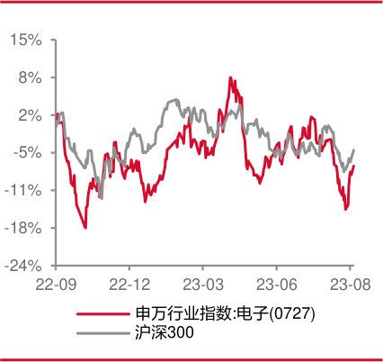

纵轴：15%、8%、2%、-5%、-11%、-18%、-24%；横轴：22-09、22-12、23-03、23-06、23-08；图例：申万行业指数:电子(0727)、沪深 300

### 相关研究

1. 华为发售全球首款卫星通话手机 Mate 60Pro，ASML 获高端 DUV 光刻机出口许可——电子行业周报（20230828-20230903)
2. 宏微科技（688711）：乘风新能源创宏伟蓝图、增添新产能以积微成著 ——公司深度报告
3. AI 芯片巨头业绩表现超预期，面板价格延续上涨趋势——电子行业周报（20230821-20230825)
4. 入空驭气奔如电，电子气体国产进程有望加速——半导体行业深度报告（一）

### 投资要点：

- 存储芯片是半导体产业第二细分市场，景气度主要受下游消费电子和服务器驱动。存储芯片是半导体产业第二细分市场，市场规模仅次于逻辑芯片，行业景气度受供需关系影响较大，呈现出较强的周期性。根据 WSTS 统计，2022 年存储芯片市场规模为 1297.67 亿美元，预计 2023 年下半年市场加速筑底，随后迎来上行周期，WSTS 预测 2023、2024 年市场规模分别为 840.41、1203.26 亿美元，同比增速分别为 -35.2%、43.2%。存储芯片下游需求主要以消费电子和服务器为主，其中 DRAM 市场需求主要以手机、PC 和服务器为主，2022 年占比分别为 34%/16%/33%；NAND Flash 主要包括嵌入式存储、固态硬盘、移动存储等，其中嵌入式存储与固态硬盘是 NAND Flash 的主要产品类别，市场规模近两年占 NAND Flash 市场 85%以上。整个存储行业目前主要驱动还是受下游消费电子类终端影响，一些新型的科技势力短期爆发式增长，对细分市场产品也有一定的驱动力。今年数据中心、AI 等基础设施布局加快，全球 AI 服务器预计 2023 年增长 15.30%，达 211 亿美元，算力需求爆发式增长需要搭载更大的存储容量以提升处理速度，从而带动存储芯片需求增长。

- 价格、库存拐点渐显，存储厂商削减资本开支以调配供需平衡。截至 2023 年 8 月，年初至今 DRAM 现货价格下跌 30%左右，部分现货 DDR 颗粒供应过剩，原厂不断收缩供应过剩的 DDR4 转向利润更高的 DDR5，市场供需状况在产能调动中持续变化，部分 DRAM 行情短期承压。NAND Flash 方面，价格日益趋紧，8 月渠道需求环比有所恢复，芯片供给端过剩现象将进一步改善，部分产品价格出现上扬趋势。目前存储行情位于底部横盘阶段，市场仍然处于争夺存量需求的阶段，在上游厂商减产、缩减资本开支和消费持续复苏的带动下，预计下半年存储行情将持续回暖。

- 存储市场呈现寡头垄断格局，国产化替代空间广阔。存储行业属于技术密集型产业，全球市场份额基本被韩国、日本以及美国等国家占据，近些年国内厂商积极布局，大型存储项目有合肥长鑫、长江存储、福建晋华等，还有众多企业布局利基型市场，但从当前总规模来看与国际巨头差距依然巨大。目前 DRAM 市场由三星、SK 海力士和美光三家厂商主导，CR3 市占率合计超过 95%，市场高度集中，国内厂商对 DRAM 芯片议价能力很低，国内龙头合肥长鑫与福建晋华有小批量产能，但整体占有率依然较低。NAND Flash 市场经过几十年的发展，逐渐形成了由三星电子、铠侠、西部数据、美光、SK 海力士等组成的稳定市场格局，2023 年 Q2CR5 合计市占率达 95%，国内的长江存储也在积极 NAND 市场，整体规模较小。NOR 行业经历二十多年演变，头部厂商经历多次洗牌，国际存储巨头相继退出 NOR Flash 市场，2017 年之后，全球 NOR Flash 市场被旺宏、华邦、赛普拉斯、美光和兆易创新垄断。整体上，存储行业市场空间巨大，国内企业纷纷布局，但从产能与技术上依然有巨大的国产化空间。

- 建议关注存储芯片赛道优质标的。在存储市场加速筑底的背景下，叠加上游厂商减产、缩减资本开支，全球存储市场有望迎来基本面的触底反弹。展望 2023 年下半年，在下游需求逐渐复苏情形下，受制于价格、库存压力的存储市场需求有望得到充分释放，国内细分领域标杆企业或将迎来行业周期拐点、企业盈利拐点、估值修复拐点三重底部机遇。建议关注：NOR Flash 龙头厂商兆易创新、存储芯片设计领先厂商东芯股份、车载存储龙头北京君正、多品类存储厂商江波龙、非易失性存储新星普冉股份、EEPROM 龙头聚辰股份。

- 风险提示：1）市场竞争加剧；2）下游需求复苏不及预期；3）存储价格恢复不及预期。

---

<!-- 原文第 2 页 -->

## 正文目录

1. 存储芯片是半导体产业的重要分支 …… 6
    1.1. 存储芯片是市场规模巨大的集成电路产品之一 …… 6
    1.2. 垂直分工和并购加速产业链整合 …… 8
    1.3. 存储产业在空间上经历两次迁移 …… 11
    1.4. 存储芯片技术发展趋势 …… 13

2. 存储行业周期底部渐明 …… 17
    2.1. 存储芯片市场具有强周期属性 …… 17
    2.2. 消费类终端设备搭载存储容量持续增长 …… 19
    2.3. AI&汽车电子驱动下游景气复苏 …… 21

3. 存储厂商缩减资本开支以调配供需平衡 …… 25
    3.1. 存储芯片市场行业集中度较高 …… 25
    3.2. 国内外存储厂商业绩普遍承压 …… 27
    3.3. 头部存储厂商纷纷缩减资本开支 …… 30

4. 公司介绍 …… 33
    4.1. 兆易创新：国内 NOR Flash 龙头厂商，多产品线多赛道布局 …… 33
    4.2. 东芯股份：国内领先的存储芯片设计公司，聚焦中小容量存储芯片 …… 35
    4.3. 北京君正：国内车载存储龙头厂商，“计算+存储+模拟”三线布局 …… 38
    4.4. 江波龙：国内领先的多品类存储厂商，双品牌+四产线双轮驱动成长 …… 40
    4.5. 普冉股份：非易失存储领域新星，“存储+”打开第二成长曲线 …… 43
    4.6. 聚辰股份：国内 EEPROM 芯片龙头厂商，汽车 EEPROM 持续发力 …… 46

5. 风险提示 …… 49

---

<!-- 原文第 3 页 -->

## 图表目录

图 1 半导体产品分类图 …… 6

图 2 存储芯片分类图 …… 7

图 3 存储器结构层次图 …… 7

图 4 存储系统体系结构 …… 7

图 5 存储芯片产业链 …… 8

图 6 存储芯片制造全产业链图 …… 9

图 7 1950-2010 年全球半导体产业链模式的变迁 …… 10

图 8 2003-2021 年 Fabless/IDM 公司销售增长率(%) …… 11

图 9 2003-2021 年全球 Fabless 公司销售额占集成电路总销售额比重(%) …… 11

图 10 全球存储芯片发展历程 …… 12

图 11 国内存储芯片发展历程 …… 12

图 12 JEDEC 定义了三类 DRAM 标准 …… 13

图 13 三种主流内存技术的速度对比和应用场合 …… 13

图 14 LPDDR 演进路线 …… 14

图 15 GDDR 演进路线 …… 14

图 16 国际三大存储厂商 DRAM 发展路线图 …… 14

图 17 NAND 颗粒 SLC、MLC、TLC、QLC 对比 …… 15

图 18 SLC、MLC、TLC、QLC 主要指标对比 …… 15

图 19 2D NAND 到 3D NAND 进程 …… 15

图 20 长江存储 3D NAND 架构 Xtacking …… 15

图 21 2015-2024 年全球存储芯片行业市场规模及增速(亿美元，%) …… 17

图 22 2018-2023 年我国存储芯片行业市场规模及增速(亿元，%) …… 18

图 23 2021 年全球存储市场结构（%） …… 18

图 24 2021-2027 年存储市场预测 …… 18

图 25 全球 DRAM/NAND Flash 市场规模季度变化（亿美元） …… 19

图 26 2021 年 DRAM 应用分布情况（%） …… 19

图 27 2021 年 NAND Flash 应用分布情况（%） …… 19

图 28 2010-2023 年全球智能手机出货量（百万部，%） …… 20

图 29 2017-2022 年全球 PC 出货量（百万台，%） …… 21

图 30 SSD 与 HDD 优劣势 …… 21

图 31 全球数据中心市场规模及增速（亿美元，%） …… 22

图 32 中国数据中心市场规模及增速（亿元，%） …… 22

图 33 东数西算 8 大枢纽主要承载业务类型 …… 22

图 34 东数西算战略 10 大集群分布 …… 22

图 35 全球 AI 服务器市场规模及增速（亿美元，%） …… 23

图 36 全球 AI 服务器出货量及增速（万台，%） …… 23

图 37 2021-2027 年汽车存储市场占比及增长情况（%） …… 23

图 38 2021-2027 年汽车存储市场营收情况（十亿美元） …… 23

图 39 全球 DRAM 企业市场份额(%) …… 25

图 40 全球 NAND Flash 企业市场份额（%） …… 25

图 41 全球 NOR Flash 市场主要厂商演变情况 …… 26

图 42 全球 NOR Flash 市场规模及增速（亿美元，%） …… 26

图 43 全球 NOR Flash 市场份额占比（%） …… 26

图 44 三星电子营收及存储业务收入（万亿韩元，%） …… 27

图 45 三星电子营业利润及增速（万亿韩元，%） …… 27

图 46 美光科技营收及存储业务收入（亿美元，%） …… 28

---

<!-- 原文第 4 页 -->

图 47 美光科技营业利润及增速（亿美元，%） …… 28

图 48 SK 海力士营业收入及增速（万亿韩元，%） …… 29

图 49 SK 海力士营业利润及增速（万亿韩元，%） …… 29

图 50 全球半导体行业资本支出情况（十亿美元，%） …… 30

图 51 各大存储原厂缩减资本开支 …… 30

图 52 2022 年 3 月-2023 年 8 月 DRAM 现货平均价（美元） …… 30

图 53 2022 年 1 月-2023 年 8 月 NAND Flash 现货平均价（美元） …… 31

图 54 全球存储厂商市占率梯队情况 …… 32

图 55 2021-2022 财年美光科技分产品收入（亿美元） …… 32

图 56 2022 年美光科技分地区营收情况（亿美元，%） …… 32

图 57 兆易创新存储业务布局历程 …… 33

图 58 2018-2023H1 兆易创新营收及增速（亿元，%） …… 34

图 59 2018-2023H1 兆易创新利润端情况（亿元，%） …… 34

图 60 2018-2023H1 兆易创新毛利率与净利率情况（%） …… 34

图 61 2018-2023H1 兆易创新费用率情况（%） …… 34

图 62 2019-2023H1 兆易创新营收结构（亿元） …… 35

图 63 2022 年兆易创新业务占比情况（%） …… 35

图 64 东芯股份产品应用领域 …… 36

图 65 2018-2023 H1 东芯股份营收及增速（亿元，%） …… 36

图 66 2018-2023H1 东芯股份利润端情况（亿元，%） …… 36

图 67 2018-2023H1 东芯股份毛利率与净利率情况（%） …… 37

图 68 2018-2023H1 东芯股份费用率情况（%） …… 37

图 69 2018-2022 年东芯股份营收结构（亿元） …… 37

图 70 2022 年东芯股份业务占比情况（%） …… 37

图 71 北京君正发展历程 …… 38

图 72 2018-2023H1 北京君正营收及增速（亿元，%） …… 38

图 73 2018-2023H1 北京君正利润端情况（亿元，%） …… 38

图 74 2018-2023H1 北京君正毛利率与净利率情况（%） …… 39

图 75 2018-2023H1 北京君正费用率情况（%） …… 39

图 76 2020-2023H1 北京君正营收结构（亿元） …… 39

图 77 2022 年北京君正业务占比情况（%） …… 39

图 78 江波龙发展历程 …… 40

图 79 江波龙产品发展历程 …… 41

图 80 江波龙四大产品线 …… 41

图 81 江波龙两大品牌产品矩阵 …… 41

图 82 2018-2023H1 江波龙营收及增速（亿元，%） …… 42

图 83 2018-2023H1 江波龙利润端情况（亿元，%） …… 42

图 84 2018-2023H1 江波龙毛利率与净利率情况（%） …… 42

图 85 2018-2023H1 江波龙费用率情况（%） …… 42

图 86 2017-2022 年江波龙营收结构（亿元） …… 43

图 87 2022 年江波龙业务占比情况（%） …… 43

图 88 普冉股份发展历程 …… 44

图 89 2018-2023H1 普冉股份营收及增速（亿元，%） …… 44

图 90 2018-2023 H1 普冉股份利润端情况（亿元，%） …… 44

图 91 2018-2023H1 普冉股份毛利率与净利率情况（%） …… 45

图 92 2018-2023H1 普冉股份费用率情况（%） …… 45

图 93 2018-2021 年普冉股份营收结构（亿元） …… 45

图 94 2022 年普冉股份业务占比情况（亿元，%） …… 45

---

<!-- 原文第 5 页 -->

图 95 全球及中国 EEPROM 市场规模情况（亿美元） …… 46

图 96 全球 EEPROM 生产厂商营收梯队情况 …… 46

图 97 2018-2023H1 聚辰股份营收及增速（亿元，%） …… 46

图 98 2018-2023H1 聚辰股份利润端情况（亿元，%） …… 46

图 99 2018-2023H1 聚辰股份毛利率与净利率情况（%） …… 47

图 100 2018-2023H1 聚辰股份费用率情况（%） …… 47

图 101 2018-2023H1 聚辰股份营收结构（亿元） …… 47

图 102 2022 年聚辰股份业务占比情况（%） …… 47

表 1 三类存储产品差异性 …… 8

表 2 三种产业链经营模式优劣势 …… 10

表 3 SDRAM-DDR5 主要指标对比 …… 13

表 4 NAND 厂商最新层数进展 …… 16

表 5 2023 年旗舰智能手机存储规格 …… 20

表 6 智能座舱和 ADAS/AD 系统 NAND 需求 …… 24

表 7 2022 年部分中国存储芯片公司业务布局及产销量情况 …… 27

表 8 国内部分存储厂商 2022 年经营业绩情况（亿元，%） …… 29

---

<!-- 原文第 6 页 -->

## 1.存储芯片是半导体产业的重要分支

### 1.1.存储芯片是市场规模巨大的集成电路产品之一

（1）存储芯片属于半导体中集成电路的范畴，是目前应用面最广、标准化程度最高的集成电路基础性产品之一。半导体按照产品分类可分为光电器件、传感器件、分立器件和集成电路四大类，占半导体价值量比例最高的为集成电路，约占整个半导体行业市场规模的 82.64%，其主要包括模拟芯片、微处理器芯片、逻辑芯片和存储芯片等四种。根据 WSTS 的数据，2022 年全球半导体市场规模为 5740.84 亿美元，集成电路占比达 83%，其中存储芯片市场规模为 1297.67 亿美元，占整个半导体行业的 23%，由此可以看出，存储芯片和逻辑芯片在整个半导体产业链中贡献的价值量最大。

**图 1 半导体产品分类图**

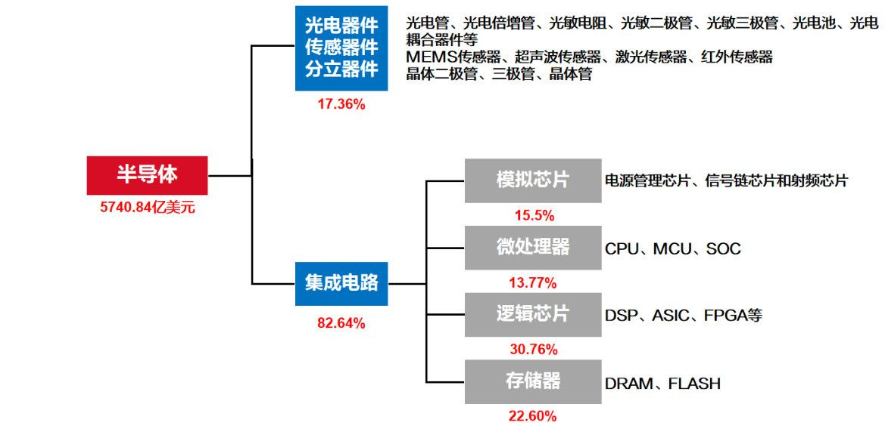

半导体 5740.84 亿美元，分为两支：

- 光电器件、传感器件、分立器件（17.36%）
    - 光电器件：光电管、光电倍增管、光敏电阻、光敏二极管、光敏三极管、光电池、光电耦合器件等
    - 传感器件：MEMS 传感器、超声波传感器、激光传感器、红外传感器
    - 分立器件：晶体二极管、三极管、晶体管
- 集成电路（82.64%）
    - 模拟芯片（15.5%）：电源管理芯片、信号链芯片和射频芯片
    - 微处理器（13.77%）：CPU、MCU、SOC
    - 逻辑芯片（30.76%）：DSP、ASIC、FPGA 等
    - 存储器（22.60%）：DRAM、FLASH

资料来源：WSTS，东海证券研究所整理

（2）存储设备是计算机系统中用于存储和读取数据的硬件组件，按存储介质不同可分为光学存储、磁性存储和半导体存储。光存储器是指用光学方法从光存储媒体上读取和存储数据的一种设备，一般指光盘机、光带机和光卡机等；磁性存储，是指利用磁能方式存储信息的磁介质设备，其存储与读取过程需要磁性盘片的机械运动，目前广泛应用于 PC 硬盘、移动硬盘等领域；存储芯片，又称为半导体存储器，是指利用电能方式存储信息的半导体介质设备，其存储与读取过程体现为电子的存储或释放，广泛应用于内存、U 盘、消费电子、智能终端、固态存储硬盘等领域。按照断电后是否保留存储的信息，存储芯片主要可分为易失性存储芯片（RAM）和非易失性存储芯片（ROM）。RAM 为随机存储器，断电后不会保存数据，主要产品包括 SRAM 和 DRAM，DRAM 即动态随机存储器，使用电容存储，DRAM 的一个比特使用一个电容和一个晶体管存储，由于电容会漏电，因此需要定时刷新一次存储单元来保持数据；SRAM 即静态随机存储器，其内部结构比 DRAM 复杂，可以在不刷新电路下保存数据。ROM 是一种存储固定信息的存储器，在正常工作状态下只能读取数据，不能即时修改或重新写入数据，在外部电源切断后仍能保存数据，读取速度较慢但存储容量更大，主要包括 EEPROM（带电可擦可编程只读存储器）、Flash (闪存芯片)、PROM(可编程只读存储器)、EPROM(可擦除可编程只读存储器)等。

---

<!-- 原文第 7 页 -->

**图 2 存储芯片分类图**

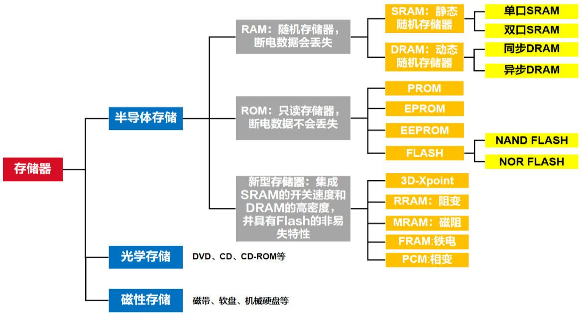

存储器，分为三支：

- 半导体存储
    - RAM：随机存储器，断电数据会丢失
        - SRAM：静态随机存储器：单口 SRAM、双口 SRAM
        - DRAM：动态随机存储器：同步 DRAM、异步 DRAM
    - ROM：只读存储器，断电数据不会丢失
        - PROM
        - EPROM
        - EEPROM
        - FLASH：NAND FLASH、NOR FLASH
    - 新型存储器：集成 SRAM 的开关速度和 DRAM 的高密度，并具有 Flash 的非易失特性
        - 3D-Xpoint
        - RRAM：阻变
        - MRAM：磁阻
        - FRAM：铁电
        - PCM：相变
- 光学存储：DVD、CD、CD-ROM 等
- 磁性存储：磁带、软盘、机械硬盘等

资料来源：CSDN，半导体行业观察，东海证券研究所整理

（3）根据具体的功能，可以将计算机中的存储器细分为寄存器、高速缓存、主存储器、磁盘缓存、固定磁盘、可移动存储介质等 6 层。从 CPU Cache、内存到 SSD 和 HDD，构成了计算机的存储体系，各层只和相邻的层交换数据，随着层级由高到低，设备容量变大、离 CPU 距离变远、访问速度变慢、传输时间变长，并且每字节的造价成本也越来越便宜。CPU 中的寄存器位于最顶部，记为 L0，它使用 SRAM 芯片做成，集成在 CPU 的内部，其容量有限、速度极快、和 CPU 同步；缓存是一种小而快的存储器，一般作为 DRAM 的缓冲，采用 SRAM 技术实现，通常也会被集成在 CPU 内部；主存一般由 DRAM 组成，和 SRAM 不同，其存储密度更高，容量更大，价格更低，速度也更慢。综合来看，SRAM 价格贵、速度快，DRAM 价格便宜、容量更大，SSD 和 HDD 硬盘作为外部存储设备容量更大、成本更低、离 CPU 更远、访问速度更慢。

**图 3 存储器结构层次图**

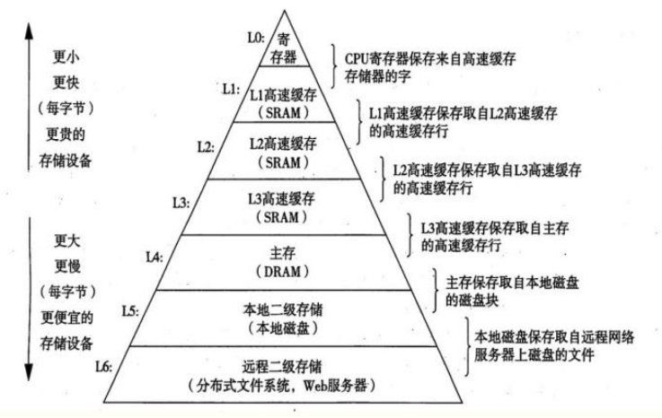

左侧纵向标注：向上箭头为“更小、更快、（每字节）更贵的存储设备”，向下箭头为“更大、更慢、（每字节）更便宜的存储设备”；金字塔自上而下 7 层及右侧说明：

- L0：寄存器——CPU 寄存器保存来自高速缓存存储器的字
- L1：L1 高速缓存（SRAM）——L1 高速缓存保存取自 L2 高速缓存的高速缓存行
- L2：L2 高速缓存（SRAM）——L2 高速缓存保存取自 L3 高速缓存的高速缓存行
- L3：L3 高速缓存（SRAM）——L3 高速缓存保存取自主存的高速缓存行
- L4：主存（DRAM）——主存保存取自本地磁盘的磁盘块
- L5：本地二级存储（本地磁盘）——本地磁盘保存取自远程网络服务器上磁盘的文件
- L6：远程二级存储（分布式文件系统，Web 服务器）

资料来源：CSDN，东海证券研究所

**图 4 存储系统体系结构**

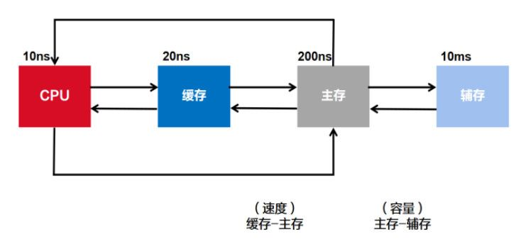

方框：CPU（红）、缓存（蓝）、主存（灰）、辅存（浅蓝），相邻方框之间有双向箭头；标注：10ns（CPU 上方）、20ns（缓存上方）、200ns（主存上方）、10ms（辅存上方）；CPU 顶部与底部各有一条绕行连线连至主存。图下方标注：（速度）缓存-主存、（容量）主存-辅存

资料来源：CSDN，东海证券研究所

（4）DRAM 和 FLASH 是目前市场上最为主要的存储芯片。FLASH 可分为 NOR 和 NAND 两种，两者区别在于存储单元连接方式不同，导致两者读取方式不同，NAND 由于引脚上复用，因此读取速度比 NOR 慢一点，但是擦除和写入速度比 NOR 快很多；NAND 内部电路更简单，因此数据密度大，体积小，成本也低，市场上一些大容量的 FLASH 都采用 NAND 型，例如 SSD、U 盘、SD 卡、EMMC。小容量的 2～12M 的 FLASH 多是 NOR 型，NOR 比较适合频繁随机读写的场合，通常用于存储程序代码并直接在闪存内运

---

<!-- 原文第 8 页 -->

行。相比于 Flash 与 Nor，DRAM 具有较高读写速度、存储时间短等优势，但单位成本更高，主要用于 PC 内存(如 DDR)、手机内存(如 LPDDR)和服务器等设备等。

**表 1 三类存储产品差异性**

| 比较类别 | NAND FLASH | NOR FLASH | DRAM |
| --- | --- | --- | --- |
| 挥发性 | 非易失性 | 非易失性 | 易失性 |
| 存储原理 | 浮栅型 | 浮栅型/电子俘获型 | 电容充放电型 |
| 读取速度 | 较慢 | 较快 | 极快 |
| 擦除/写入速度 | 快 | 较慢 | 极快（无擦除） |
| 存储容量 | 高（Gb/Tb） | 中（Mb/Gb） | 低（Mb/Gb） |
| 擦写次数 | 百万级别 | 十万级别 | 不限 |
| 制造成本 | 低 | 中 | 高 |

资料来源：东芯股份招股说明书，公开资料整理，东海证券研究所

## 1.2.垂直分工和并购加速产业链整合

（1）存储芯片是半导体产业的重要分支，下游应用空间广阔。存储芯片行业产业链上游参与者包括硅片、光刻胶、靶材、抛光材料、电子特种气体等半导体材料供应商和光刻机、PVD、CVD、刻蚀设备、清洗设备、封测设备等半导体设备供应商；产业链中游为存储芯片制造商，主要负责存储芯片的设计、制造和封测，常见的存储芯片包括 DRAM、NAND 闪存芯片和 NOR 闪存芯片等；产业链下游为消费电子、汽车电子、信息通信、人工智能等应用领域内的企业，各类电子化和智能化设备都离不开存储芯片应用。

**图 5 存储芯片产业链**

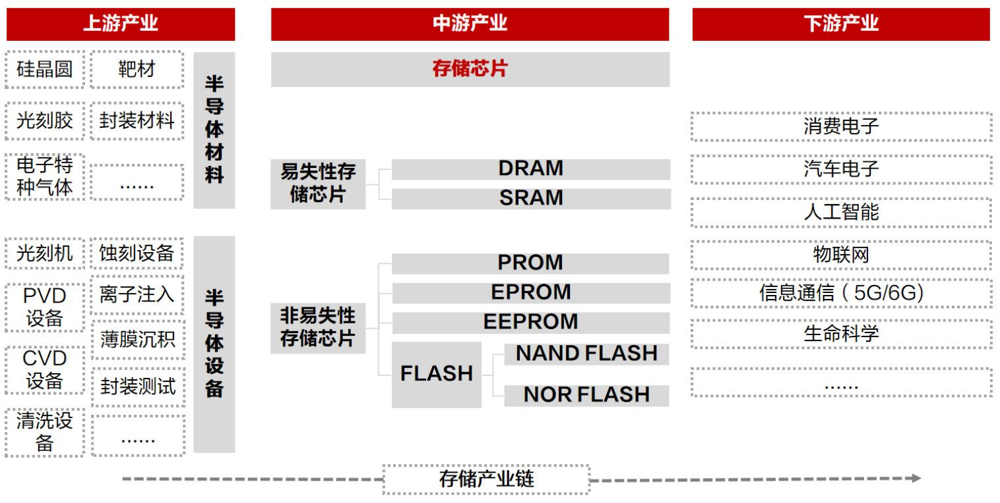

三栏结构：

- 上游产业
    - 半导体材料：硅晶圆、靶材、光刻胶、封装材料、电子特种气体、……
    - 半导体设备：光刻机、刻蚀设备、PVD 设备、离子注入、CVD 设备、薄膜沉积、封装测试、清洗设备、……
- 中游产业
    - 存储芯片
        - 易失性存储芯片：DRAM、SRAM
        - 非易失性存储芯片：PROM、EPROM、EEPROM、FLASH（NAND FLASH、NOR FLASH）
- 下游产业：消费电子、汽车电子、人工智能、物联网、信息通信（5G/6G）、生命科学、……

底部横向虚线箭头标注：存储产业链

资料来源：中商产业研究院，东海证券研究所整理

（2）存储芯片按照制造流程又可细分为一条完整的产业链。存储芯片产业链主要由集成电路设计、晶圆制造、封装和测试、模组厂商集成等环节组成，从经营模式来看，主要分为 IDM 和垂直分工模式。IDM 模式指企业业务覆盖 IC 设计、制造、封装和测试的所有环节，大部分国际存储芯片大厂均为 IDM 模式，例如东芝半导体、三星半导体、飞索半导体、美光科技等大型跨国企业。另一种模式为垂直分工模式，即 Fabless（无晶圆制造的

---

<!-- 原文第 9 页 -->

设计公司）+Foundry（晶圆代工厂）+OSAT（封装测试企业），Fabless 模式是指无晶圆生产线集成电路设计模式，即企业只进行集成电路的设计和销售，将制造、封装和测试等生产环节外包，例如高通、联发科、AMD、华大半导体等；Foundry 即晶圆代工厂，它是一种只负责芯片制造，不负责芯片设计环节的一种产业运作模式，这类企业典型代表为台积电、联电、中芯国际等；OSAT 指专门从事半导体封装和测试的企业，比如日月光、Amkor、长电、通富微电等。

**图 6 存储芯片制造全产业链图**

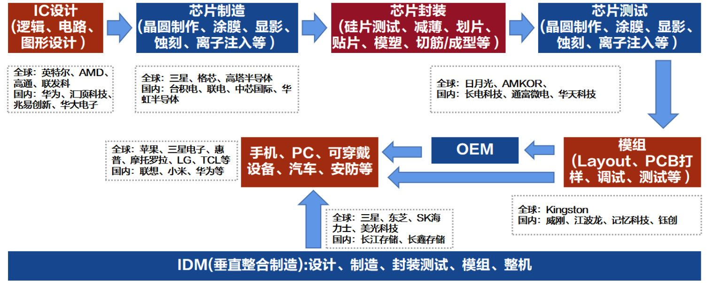

主链（蓝色箭头依次连接）：IC 设计 → 芯片制造 → 芯片封装 → 芯片测试，再由芯片测试向下连至模组；模组 → OEM → 手机、PC、可穿戴设备、汽车、安防等，模组另以一条长箭头直接指向“手机、PC、可穿戴设备、汽车、安防等”；存储芯片自下方向上以箭头连接至“手机、PC、可穿戴设备、汽车、安防等”。底部横条：IDM(垂直整合制造)：设计、制造、封装测试、模组、整机

各环节及其下方/旁侧标注：

- IC 设计（逻辑、电路、图形设计）：全球：英特尔、AMD、高通、联发科；国内：华为、汇顶科技、兆易创新、华大电子
- 芯片制造（晶圆制作、涂膜、显影、蚀刻、离子注入等）：全球：三星、格芯、高塔半导体；国内：台积电、联电、中芯国际、华虹半导体
- 芯片封装（硅片测试、减薄、划片、贴片、模塑、切筋/成型等）：全球：日月光、AMKOR；国内：长电科技、通富微电、华天科技
- 芯片测试（晶圆制作、涂膜、显影、蚀刻、离子注入等）：全球：日月光、AMKOR；国内：长电科技、通富微电、华天科技
- 模组（Layout、PCB 打样、调试、测试等）：全球：Kingston；国内：威刚、江波龙、记忆科技、铨创
- OEM
- 手机、PC、可穿戴设备、汽车、安防等：全球：苹果、三星电子、惠普、摩托罗拉、LG、TCL 等；国内：联想、小米、华为等
- 存储芯片：全球：三星、东芝、SK 海力士、美光科技；国内：长江存储、长鑫存储

资料来源：兆易创新招股说明书，东海证券研究所整理

（3）垂直分工模式进一步深化，降低成本同时显著提升产业运作效率。IDM 模式下，企业投入大量资金用于晶圆制造设备和生产线的建设，内部各环节协同生产，整体规模效应显著，毛利率也会上升；但 IDM 模式下，企业内部管理成本增加，因此，IDM 模式适合规模巨大的企业。Fabless 模式注重轻资产运营，更为灵活，可以充分利用半导体产业链资源，集中主要精力用于产品研发和技术迭代，适应激烈的市场竞争环境，快速发展，缺点是无法实现工艺协同，同时需要承担各种市场风险，相对来说适合小企业经营。存储芯片标准化程度较高，国际巨头大部分采取 IDM 模式运行，国内存储企业由于规模较小，刚开始从小众市场切入，多数采用 Fabless 模式，随着企业规模的扩大，长期或将向 IDM 模式转型。近些年，国内大型存储项目长江存储、合肥长鑫、福建晋华均是 IDM 模式的大型晶圆厂布局。

---

<!-- 原文第 10 页 -->

**表 2 三种产业链经营模式优劣势**

| 主要模式 | IDM | Fabless | Foundry |
| --- | --- | --- | --- |
| 模式特点 | 集芯片设计、制造、封装和测试等多个产业链环节于一身；早期多数集成电路企业采用的模式；目前大型芯片企业主要模式。 | 只负责芯片的电路设计与销售；将生产、测试、封装等环节外包。 | 只负责制造环节，不负责芯片设计；可以同时为多家设计公司提供服务。 |
| 模式优势 | 设计、制造等环节协同优化，有助于充分发掘技术潜力；能有条件率先实验并推行新的半导体技术。 | 资产较轻，初始投资规模小，创业难度相对较小；企业运行费用较低，转型相对灵活。 | 不承担由于市场调研不准、产品设计缺陷等决策风险。 |
| 模式劣势 | 公司规模庞大，管理成本较高；运营费用较高，资本回报率偏低。 | 与 IDM 相比无法与工艺协同优化，因此难以完成指标严苛的设计；与 Foundry 相比需要承担各种市场风险。 | 投资规模较大，维持生产线正常运作费用较高；需要持续投入维持工艺水平。 |

资料来源：CSDN，东海证券研究所

（4）行业发展和技术升级驱动产业链模式变化，并购加速产业链整合。在台积电成立以前，半导体行业只有 IDM 一种模式，经过半个多世纪发展，全球半导体产业链逐步朝向分工和整合趋势发展。1）产业链分工：摩尔定律推动半导体行业技术不断更新迭代，同时带动生产制造设备的升级改造，先进工艺晶圆厂资金投入增加，Foundry 模式能最大化的分摊技术升级成本和利用产能，提高资本支出的收益率。IDM 企业为了减少投资风险、轻资产化，逐渐采取 Fablite（轻晶圆厂）策略，将部分非核心和高难度工艺制造业务转为第三方代工，自身保留其余制造业务。2）产业链整合：半导体行业进入新的发展阶段，通过并购，企业间可以基于业务层面的协同互补，扩展产品条线和客户群体，缩减成本的同时实现更强的供应链溢价，提升行业市占率。因此，随着技术进步，全球分工模式越来越多，同时，大企业不断成长又不断合并为 IDM 模式，产业循环往复，推动全球技术不断推进。

**图 7 1950-2010 年全球半导体产业链模式的变迁**

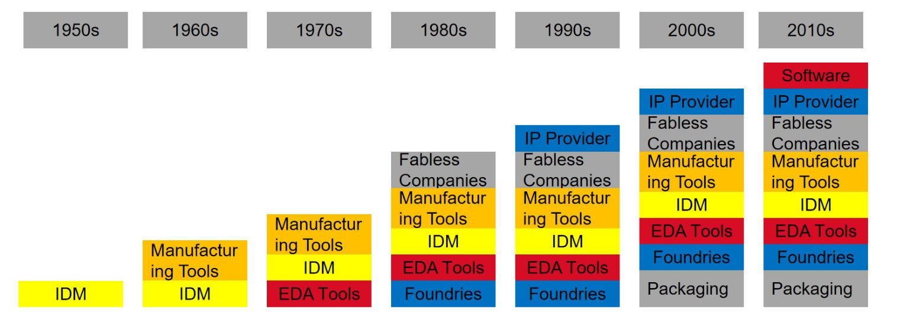

横轴：1950s、1960s、1970s、1980s、1990s、2000s、2010s；图例（色块，各年代自下而上叠加）：

- 1950s：IDM
- 1960s：IDM、Manufacturing Tools
- 1970s：EDA Tools、IDM、Manufacturing Tools
- 1980s：Foundries、EDA Tools、IDM、Manufacturing Tools、Fabless Companies
- 1990s：Foundries、EDA Tools、IDM、Manufacturing Tools、Fabless Companies、IP Provider
- 2000s：Packaging、Foundries、EDA Tools、IDM、Manufacturing Tools、Fabless Companies、IP Provider
- 2010s：Packaging、Foundries、EDA Tools、IDM、Manufacturing Tools、Fabless Companies、IP Provider、Software

资料来源：TNO and CWTS，东海证券研究所

（5）近些年，随着技术难度不断升级，Fabless 公司在全球 IC 销售额中的份额持续提升。根据 IC Insights 数据，在销售增长率方面，过去 20 年里，采取 Fabless 模式的公司 IC 销售额增长率显著高于采取 IDM 模式的公司，个别年份例如 2017、2018 年，Fabless 公司份额增长低于 IDM 公司，而且相较于 IDM 公司，Fabless 公司受市场环境波动幅度更小。在销售份额占比方面，2003-2021 年，全球 Fabless 公司销售份额占 IC 销售额比重稳定增长，2019 年 IC 市场的 Fabless 份额较去年同期提高 4.1 个百分点至 29.9%，

---

<!-- 原文第 11 页 -->

随后持续增长并在 2021 年达到 34.8%的峰值。Fabless 模式的轻资产化更为灵活，在市场周期下行的阶段，能更好适应激烈的市场竞争环境。我国国产化空间巨大，大部分的存储芯片企业成立之初均以 Fabless 模式为主。

**图8 2003-2021 年 Fabless/IDM 公司销售增长率(%)**

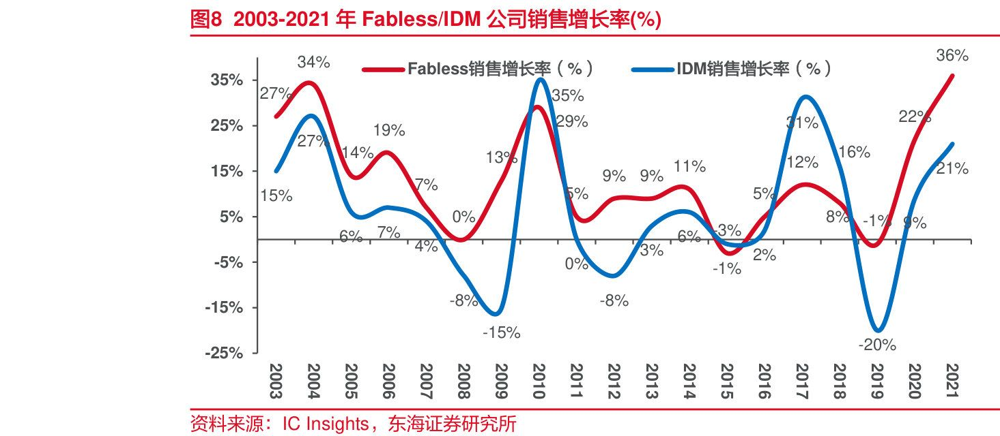

纵轴为增长率（-25% 至 35%），横轴为 2003-2021 年；图例：Fabless销售增长率（%）、IDM销售增长率（%）。各年数据标签：

| 年份 | Fabless 销售增长率（%） | IDM 销售增长率（%） |
| --- | --- | --- |
| 2003 | 27 | 15 |
| 2004 | 34 | 27 |
| 2005 | 14 | 6 |
| 2006 | 19 | 7 |
| 2007 | 7 | 4 |
| 2008 | 0 | -8 |
| 2009 | 13 | -15 |
| 2010 | 29 | 35 |
| 2011 | 5 | 0 |
| 2012 | 9 | -8 |
| 2013 | 9 | 3 |
| 2014 | 11 | 6 |
| 2015 | -3 | -1 |
| 2016 | 5 | 2 |
| 2017 | 12 | 31 |
| 2018 | 8 | 16 |
| 2019 | -1 | -20 |
| 2020 | 22 | 9 |
| 2021 | 36 | 21 |

资料来源：IC Insights，东海证券研究所

**图9 2003-2021 年全球 Fabless 公司销售额占集成电路总销售额比重(%)**

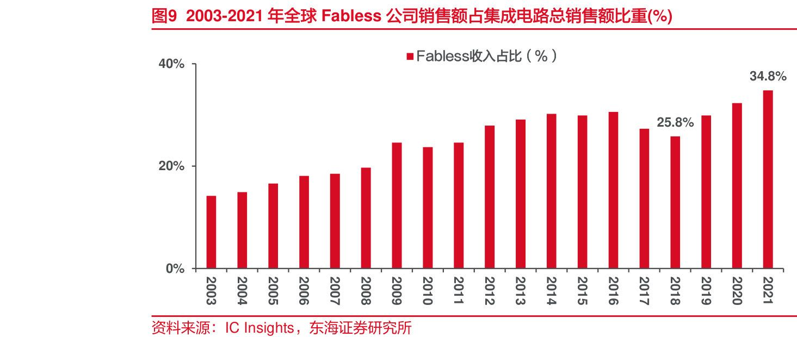

柱状图，纵轴为占比（0%-40%），横轴为 2003-2021 年；图例：Fabless收入占比（%）。仅 2018 年（25.8%）与 2021 年（34.8%）柱顶有数据标签，其余年份无数据标签。

资料来源：IC Insights，东海证券研究所

### 1.3.存储产业在空间上经历两次迁移

（1）存储芯片产业发源于美国，此后经历过两次大的产业转移。进入 1960 年代后，随着计算机技术的发展，电子行业开始了将集成电路技术用于计算机存储领域的尝试，存储芯片产业链从垂直整合到垂直化分工越来越明确，并经历了两次空间上的产业迁移，迁移路径由美国至日本再到韩国。1）美国：行业市占率居前的主要厂商也随着产业迁移发生了明显的变化，最开始由美国加州的 Advanced Memory System 公司生产出了世界上第一款 DRAM 芯片（容量仅有 1KB），随后英特尔、德州仪器（TI）、莫斯泰克（Mostek）、美光等存储厂商逐渐发展壮大。2）日本：1976 年，为了发展半导体技术领域，日本通过举国体制，成立了 VLSI 联合研发体，随后成功研制出 64K DRAM，追平了美国研发进度；到了 1980 年代，日本厂商凭借质量和价格优势，开始反超美国，市占率逐渐达到全球第一；1985 年，美苏冷战气氛不断减弱，日美贸易摩擦不断增加，美国开始对日本经济实施打压，在陆续的施压下，日本存储芯片市场份额一落千丈，很快丧失了主导权。3）韩国：

---

<!-- 原文第 12 页 -->

韩国企业抓住了美日半导体竞争的契机，在美国的技术转让和市场准入扶持下，三星电子脱颖而出，逐渐赶超日本。

**图10 全球存储芯片发展历程**

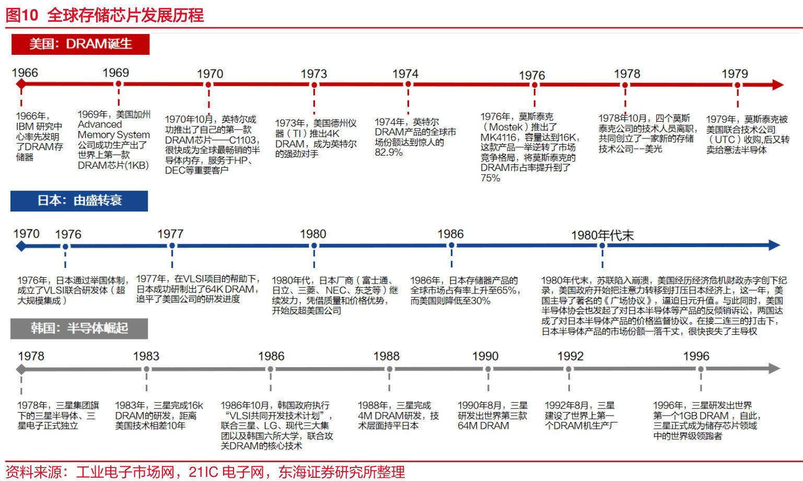

**美国：DRAM诞生**

- 1966 年，IBM 研究中心率先发明了 DRAM 存储器
- 1969 年，美国加州 Advanced Memory System 公司成功生产出了世界上第一款 DRAM 芯片(1KB)
- 1970 年 10 月，英特尔成功推出了自己的第一款 DRAM 芯片——C1103，很快成为全球最畅销的半导体内存，服务于 HP、DEC 等重要客户
- 1973 年，美国德州仪器（TI）推出 4K DRAM，成为英特尔的强劲对手
- 1974 年，英特尔 DRAM 产品的全球市场份额达到惊人的 82.9%
- 1976 年，莫斯泰克（Mostek）推出了 MK4116，容量达到 16K，这款产品一举逆转了市场竞争格局，将莫斯泰克的 DRAM 市占率提升到了 75%
- 1978 年 10 月，四个莫斯泰克公司的技术人员离职，共同创立了一家新的存储技术公司——美光
- 1979 年，莫斯泰克被美国联合技术公司（UTC）收购，后又转卖给意法半导体

**日本：由盛转衰**

- 1976 年，日本通过举国体制，成立了 VLSI 联合研发体（超大规模集成）
- 1977 年，在 VLSI 项目的帮助下，日本成功研制出了 64K DRAM，追平了美国公司的研发进度
- 1980 年代，日本厂商（富士通、日立、三菱、NEC、东芝等）继续发力，凭借质量和价格优势，开始反超美国公司
- 1986 年，日本存储器产品的全球市场占有率上升至 65%，而美国则降低至 30%
- 1980 年代末，苏联陷入崩溃，美国经历经济危机财政赤字创下纪录，美国政府开始把注意力转移到打压日本经济上，这一年，美国主导了著名的《广场协议》，逼迫日元升值。与此同时，美国半导体协会也发起了对日本半导体等产品的反倾销诉讼，两国达成了对日本半导体产品的价格监督协议。在接二连三的打击下，日本半导体产品的市场份额一落千丈，很快丧失了主导权

**韩国：半导体崛起**

- 1978 年，三星集团旗下的三星半导体、三星电子正式独立
- 1983 年，三星完成 16k DRAM 的研发，距离美国技术相差 10 年
- 1986 年 10 月，韩国政府执行“VLSI 共同开发技术计划”，联合三星、LG、现代三大集团以及韩国六所大学，联合攻关 DRAM 的核心技术
- 1988 年，三星完成 4M DRAM 研发，技术层面持平日本
- 1990 年 8 月，三星研发出世界第三款 64M DRAM
- 1992 年 8 月，三星建设了世界上第一个 DRAM 机生产厂[OCR_UNCERTAIN]
- 1996 年，三星研发出世界第一个 1GB DRAM，自此，三星正式成为储存芯片领域中的世界级领跑者

资料来源：工业电子市场网，21IC 电子网，东海证券研究所整理

（2）存储市场加速发展，国内厂商异军突起。2016 年之前，国内没有生产 DRAM、Flash 的能力，直到合肥长鑫、长江存储成立。2019 年，中国大陆公司开始全面进军存储器市场，长江存储 64 层 3D NAND Flash 进入量产阶段，紧接着合肥长鑫宣布中国大陆第一座 12 英寸 DRAM 工厂投产，并宣布首个 19 纳米工艺制造的 8Gb DDR4。三年时间里，国内相继攻克了 3D NAND Flash 和 DRAM 技术，在一定程度上打破了内存和闪存制造国际寡头垄断的局面。国内存储芯片起步晚，要实现全球领先任重道远，先进制造技术仍掌握在国际大厂的手里，因此，存储芯片产业发展需要长期的资金投入和技术革新，解决生产制造中不良率的下降以及产能的上升，提高性能指标。

**图11 国内存储芯片发展历程**

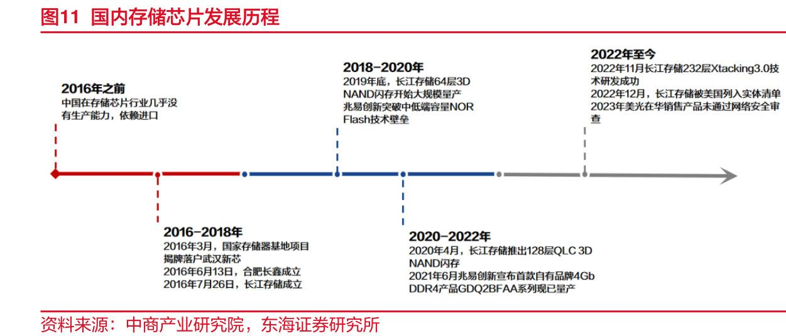

- 2016 年之前：中国在存储芯片行业几乎没有生产能力，依赖进口
- 2016-2018 年：2016 年 3 月，国家存储器基地项目揭牌落户武汉新芯；2016 年 6 月 13 日，合肥长鑫成立；2016 年 7 月 26 日，长江存储成立
- 2018-2020 年：2019 年底，长江存储 64 层 3D NAND 闪存开始大规模量产；兆易创新突破中低端容量 NOR Flash 技术壁垒
- 2020-2022 年：2020 年 4 月，长江存储推出 128 层 QLC 3D NAND 闪存；2021 年 6 月兆易创新宣布首款自有品牌 4Gb DDR4 产品 GDQ2BFAA 系列已量产
- 2022 年至今：2022 年 11 月长江存储 232 层 Xtacking3.0 技术研发成功；2022 年 12 月，长江存储被美国列入实体清单；2023 年美光在华销售产品未通过网络安全审查

资料来源：中商产业研究院，东海证券研究所

---

<!-- 原文第 13 页 -->

### 1.4.存储芯片技术发展趋势

（1）DDR、LPDDR、GDDR 是基于 DRAM 的三种内存规范或标准。固态技术协会（JEDEC） 定义了三种 DRAM 标准类别，帮助设计人员满足目标应用的功耗、性能和规格要求。标准 DDR：面向服务器、云计算、网络、笔记本电脑、台式机和消费类应用，支持更宽的通道宽度、更高的密度和不同的形状尺寸，其发展路线通过提升核心频率来提高性能。移动 DDR（LPDDR)： 面向移动式电子产品和汽车这些对规格和功耗非常敏感的领域，提供更窄的通道宽度和多种低功耗运行状态，四代之前是基于同代 DDR 发展，四代之后是基于应用端独自发展，通过提高 Prefetch 预读取位数来提升性能。图形 DDR (GDDR)：面向需要极高吞吐量的数据密集型应用程序，例如图形相关应用程序、数据中心加速和 AI，是应用于高端显卡的高性能 DDR 存储器，侧重于数据位宽、远超同期 DDR 的运行频率。

**图12 JEDEC 定义了三类 DRAM 标准**

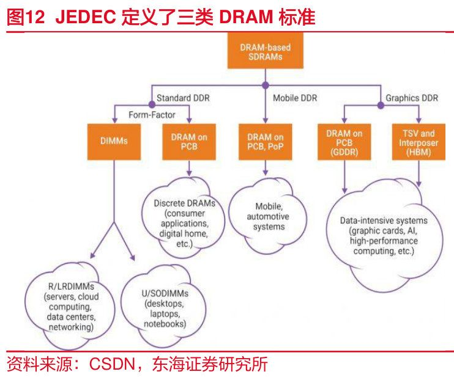

树状分类图：

- DRAM-based SDRAMs
    - Standard DDR
        - Form-Factor
            - DIMMs → R/LRDIMMs（servers, cloud computing, data centers, networking）、U/SODIMMs（desktops, laptops, notebooks）
            - DRAM on PCB → Discrete DRAMs（consumer applications, digital home, etc.）
    - Mobile DDR
        - DRAM on PCB, PoP → Mobile, automotive systems
    - Graphics DDR
        - DRAM on PCB (GDDR) → Data-intensive systems（graphic cards, AI, high-performance computing, etc.）
        - TSV and Interposer (HBM) → Data-intensive systems（graphic cards, AI, high-performance computing, etc.）

资料来源：CSDN，东海证券研究所

**图13 三种主流内存技术的速度对比和应用场合**

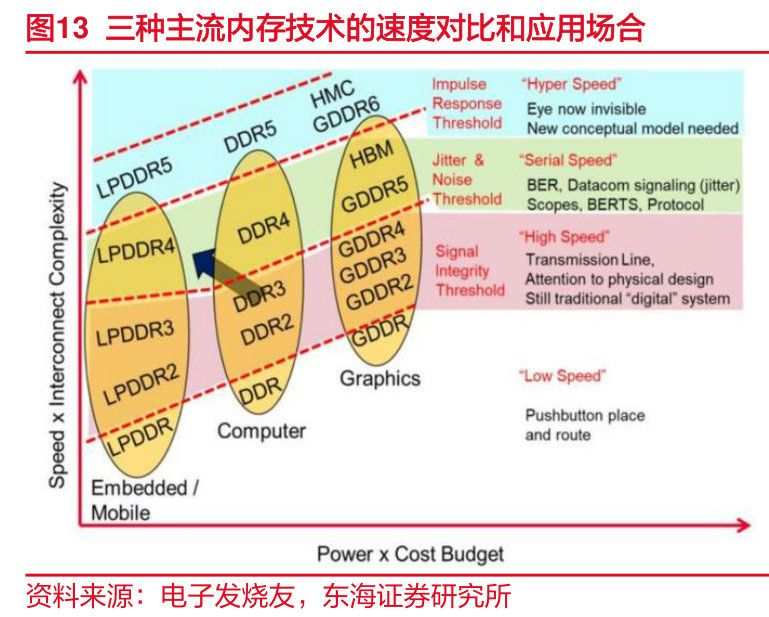

纵轴：Speed x Interconnect Complexity；横轴：Power x Cost Budget。三组技术族：Embedded / Mobile（LPDDR、LPDDR2、LPDDR3、LPDDR4、LPDDR5）、Computer（DDR、DDR2、DDR3、DDR4、DDR5）、Graphics（GDDR、GDDR2、GDDR3、GDDR4、GDDR5、HBM、GDDR6、HMC）。图中由下至上标注三条门槛线：

- Signal Integrity Threshold → “High Speed”：Transmission Line, Attention to physical design, Still traditional “digital” system
- Jitter & Noise Threshold → “Serial Speed”：BER, Datacom signaling (jitter), Scopes, BERTs, Protocol
- Impulse Response Threshold → “Hyper Speed”：Eye now invisible, New conceptual model needed

图中右下角另标注“Low Speed”：Pushbutton place and route。

资料来源：电子发烧友，东海证券研究所

（2）DDR 因其性能和成本优势成为目前 PC 和服务器端主流内存。SDRAM 也可称为 SDR SDRAM，即单倍数据传输率，SDR SDRAM 的核心、I/O、等效频率皆相同，在 1 个周期内只能读写 1 次，若需要同时写入与读取，必须等到先前的指令执行完毕，才能接着存取。DDR 是用于系统的 RAM 技术，规范名称为 DDR SDRAM，即双倍速率同步动态随机存储器，其特点是高带宽、低延时，DDR 总线每个通道是 64bit 宽度，每根 Data 的管脚可以进行读操作或写操作（不同时）。目前已推出的 DDR1-DDR5 是由 JEDEC 制定的产品标准，从 DDR1 到 DDR5 的演进路线来看，DDR 的能耗越来越低，传输速度越来越快、存储容量也越来越大，目前的最新标准是 DDR5，起步速率为 4800MT/S，最高可达 6400 MT/S，电压则从 1.2V 降至 1.1V，功耗减少 30%。目前，三星已经率先开始了下一代 DDR6 内存的早期开发，预计其 DDR6 设计将在 2024 年之前完成，在 2025 年之后开始商业应用。

**表3 SDRAM-DDR5 主要指标对比**

| 产品标准 | SDRAM | DDR1 | DDR2 | DDR3 | DDR4 | DDR5 |
| --- | --- | --- | --- | --- | --- | --- |
| 标准发布时间 | 1993 | 2000 | 2003 | 2007 | 2012 | 2020 |
| 工作电压 | 3.3V | 2.5V | 1.8V | 1.5V | 1.2V | 1.1V |
| Prefetch | 1n | 2n | 4n | 8n | 8n | 16n |
| 速度（MT/S） | 100-166 | 266-400 | 533-800 | 1066-1600 | 2133-3200 | 3200-6400 |
| BUS 频率（MHz） | 100-166 | 133-200 | 266-400 | 533-800 | 1066-1600 | 1600-3200 |

资料来源：全球半导体观察，东海证券研究所

---

<!-- 原文第 14 页 -->

（3）受益于终端需求快速发展，LPDDR 和 GDDR 步入高速迭代期。LPDDR，即低功率双倍速率同步动态随机存储器，是 DDR SDRAM 的一种，又被称为 mDDR（Mobile DDR SDRAM），拥有比同代 DDR 内存更低的功耗和更小的体积。目前智能手机普遍使用的 LPDDR5 内存标准是 2019 年 2 月由 JEDEC 协会正式发布，相较于上一代 LPDDR4 标准，LPDDR5 的 I/O 速度提升到 6400 MT/s，是 LPDDR4 速度的两倍，比 LPDDR4X 的 4266MT/S 快了 50%。GDDR，是用于显示的 RAM 技术，其特点是高带宽、高延时，目前最新的标准是 GDDR6，2022 年 7 月，三星推出了首款具有 24Gbps 处理速度的 GDDR6 显存。

**图14 LPDDR 演进路线**

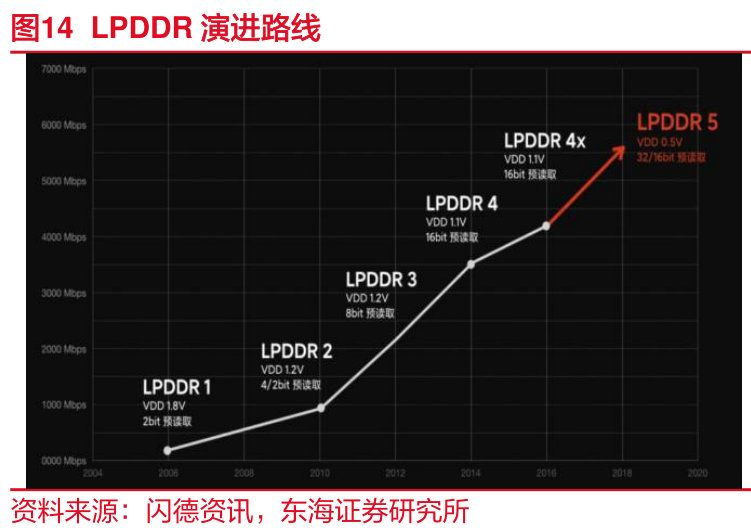

纵轴为速率（0-6000 Mbps），横轴为年份（2004-2020 年）。各代标注：

- LPDDR1：VDD 1.8V，2bit 预读取
- LPDDR2：VDD 1.2V，4/2bit 预读取
- LPDDR3：VDD 1.2V，8bit 预读取
- LPDDR4：VDD 1.1V，16bit 预读取
- LPDDR4x：VDD 1.1V，16bit 预读取
- LPDDR5：VDD 0.5V，32/16bit 预读取

资料来源：闪德资讯，东海证券研究所

**图15 GDDR 演进路线**

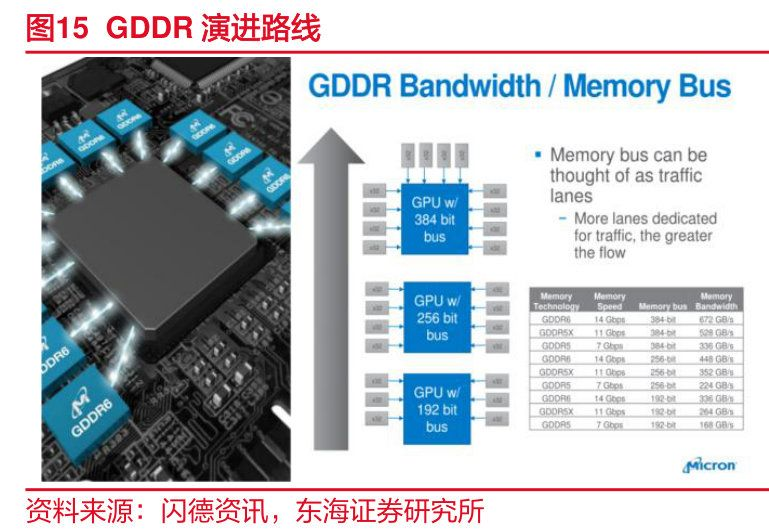

标题：GDDR Bandwidth / Memory Bus。图中示意 GPU w/ 384 bit bus、GPU w/ 256 bit bus、GPU w/ 192 bit bus 三种位宽；说明文字：“Memory bus can be thought of as traffic lanes”“More lanes dedicated for traffic, the greater the flow”。所附 Micron 表格：

| Memory Technology | Memory Speed | Memory bus | Memory Bandwidth |
| --- | --- | --- | --- |
| GDDR6 | 14 Gbps | 384-bit | 672 GB/s |
| GDDR5X | 11 Gbps | 384-bit | 528 GB/s |
| GDDR5 | 7 Gbps | 384-bit | 336 GB/s |
| GDDR6 | 14 Gbps | 256-bit | 448 GB/s |
| GDDR5X | 11 Gbps | 256-bit | 352 GB/s |
| GDDR5 | 7 Gbps | 256-bit | 224 GB/s |
| GDDR6 | 14 Gbps | 192-bit | 336 GB/s |
| GDDR5X | 11 Gbps | 192-bit | 264 GB/s |
| GDDR5 | 7 Gbps | 192-bit | 168 GB/s |

资料来源：闪德资讯，东海证券研究所

（4）DRAM 的先进制程工艺已经缩小到 15nm 以下，各大厂商继续向 10nm 逼近。从制程工艺的进展来看，早前 DRAM 产品的更新时间大致在 3 到 5 年更新一代，在步入 20nm 以内突破进展呈现放缓趋势，10nm~20nm 系列制程至少包括六代，大约每两年实现一次突破。由于电路结构是三维的，使用线性的衡量方式并不适合，存储行业通常使用 1X、1Y、1Z、1α、1β、1γ 之类的术语表达制程。国际存储大厂三星电子、SK 海力士和美光相继在 2020 年后进入 1Znm 阶段，美光 1βnm DRAM 在 2022 年 11 月实现量产，并率先应用在智能手机端的 LPDDR5X；三星在 2022 年 12 月底推出 12 nm DRAM，功耗较前一代降低 23%；SK 海力士最新一代 DRAM 为 1a nm，预计 2023 年将会实现 1b nm（即 12 nm）DRAM 的量产。中国本土 DRAM 厂商主要有合肥长鑫、紫光国芯、兆易创新、东芯股份和福建晋华等，兆易创新依托合肥长鑫的代工资源，2021 年推出首款自研 4Gb DRAM，采用 19nm 制程工艺，目前即将推出 17nm 产品；北京君正采用中国台湾力晶、南亚科技的 25nm 工艺平台；紫光国芯、东芯股份等最新工艺制程为 25nm。

**图16 国际三大存储厂商 DRAM 发展路线图**

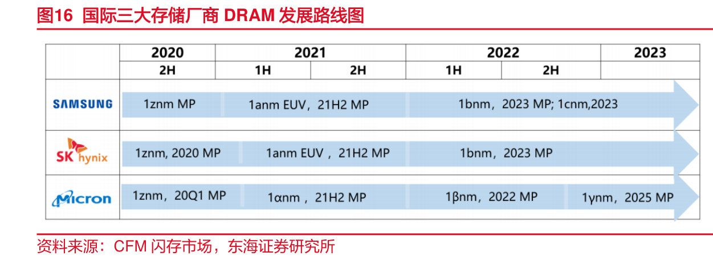

时间轴自左至右为 2020 年（2H）、2021 年（1H、2H）、2022 年（1H、2H）、2023 年。各厂商节点：

- 三星：1znm MP；1anm EUV，21H2 MP；1bnm，2023 MP；1cnm，2023
- SK 海力士：1znm，2020 MP；1anm EUV，21H2 MP；1bnm，2023 MP
- 美光：1znm，20Q1 MP；1αnm，21H2 MP；1βnm，2022 MP；1γnm，2025 MP

资料来源：CFM 闪存市场，东海证券研究所

（5）按存储单元密度来分，NAND Flash 可分为 SLC、MLC、TLC、QLC 四种。SLC 为单级单元，每单元可存储 1 比特数据，产品性能好、耐久度高，提供高达 10 万个 P/E 周期，但容量低、成本高，常应用于对读写耐久度要求很高的行业，如服务器、军工

---

<!-- 原文第 15 页 -->

等。MLC 属于多级单元，每单元可存储 2 比特数据，数据密度比 SLC 要高，可以有更大的存储容量，拥有 1 万个 P/E 周期，耐久性比 SLC 低，MLC 在服务器、工规级应用较多。TLC 为三级单元，每单元可存储 3 比特数据，性能和耐久性下降，P/E 周期降至最高 3000 个，但是容量可以做得更大，成本也可以更低，广泛用于消费类产品，是性价比最高的存储方案，性能、价格、容量等多个方面达到了较好的平衡。QLC 为四级单元，每单元可存储 4 比特数据，性能、耐久度进一步变差，P/E 周期只有 1000 个，但价格便宜，单元空间内的存储容量更高，消费级的大容量 SSD 就采用 QLC NAND 闪存颗粒。目前 NAND Flash 主要以 TLC 为主，QLC 比重正在逐步提高，QLC 的性能和耐久度的不足可以通过增大容量来弥补，在消费类产品中有取代 TCL 的趋势。

**图17 NAND 颗粒 SLC、MLC、TLC、QLC 对比**

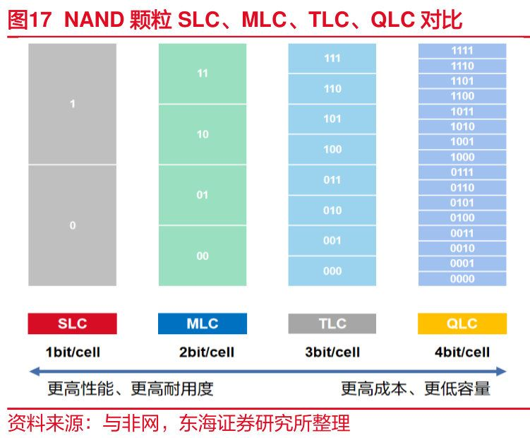

四种颗粒的比特编码示意：SLC 1bit/cell、MLC 2bit/cell、TLC 3bit/cell、QLC 4bit/cell。图下方双向箭头左端标注“更高性能、更高耐用度”，右端标注“更高成本、更低容量”。

资料来源：与非网，东海证券研究所整理

**图18 SLC、MLC、TLC、QLC 主要指标对比**

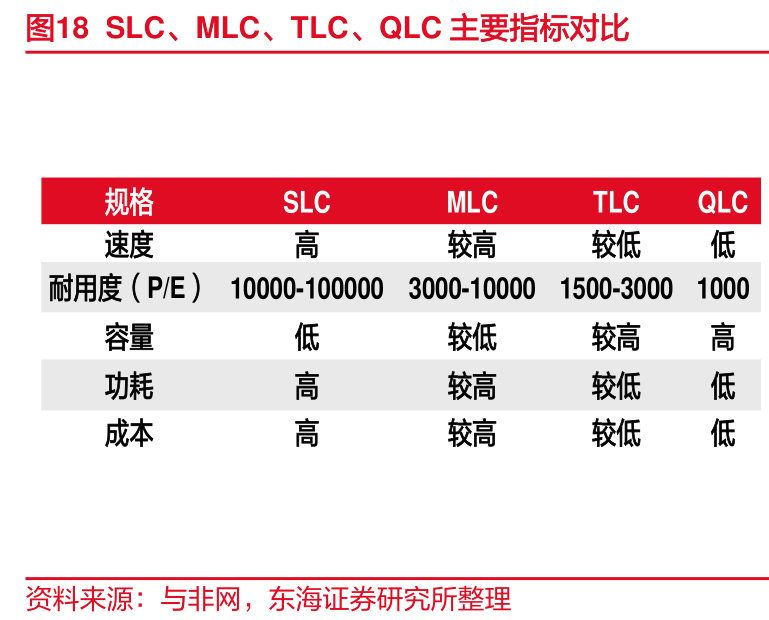

| 规格 | SLC | MLC | TLC | QLC |
| --- | --- | --- | --- | --- |
| 速度 | 高 | 较高 | 较低 | 低 |
| 耐用度（P/E） | 10000-100000 | 3000-10000 | 1500-3000 | 1000 |
| 容量 | 低 | 较低 | 较高 | 高 |
| 功耗 | 高 | 较高 | 较低 | 低 |
| 成本 | 高 | 较高 | 较低 | 低 |

资料来源：与非网，东海证券研究所整理

（6）NAND 经历了 2D NAND 时期，现在迈入 3D NAND 时期。2D NAND 将存储数据的单元水平并排地放置，放置单元的空间量有限，缩小单元则会降低可靠性；3D NAND 在纵向上增加叠放单元，加大单位面积内的晶体管数量，从而获得更高存储密度，实现更高的存储容量，此外，耐久度更高、功耗更小，同时不会导致价格大幅上升。16nm 制程以上的闪存多属于 2D NAND，其制程工艺不断发展，向 1Znm 逼近，不断缩小的光刻技术在扩展上局限性越来越强，平面微缩工艺的难度也越来越大，无限接近物理极限，16nm 制程后，继续采用 2D 微缩工艺的难度和成本已超过 3D 技术，因此 3D NAND 开始成为主流。市场上的 3D NAND 主要分为传统并列式架构和 CuA（CMOS under Array）架构，2018 年，长江存储公布了其突破性 3D NAND 架构 Xtacking，将晶圆键合这一关键技术在 3D NAND 闪存上得以实现，随着层数的不断增高，基于 Xtacking 所研发制造的 3D NAND 闪存将更具成本和创新优势。

**图19 2D NAND 到 3D NAND 进程**

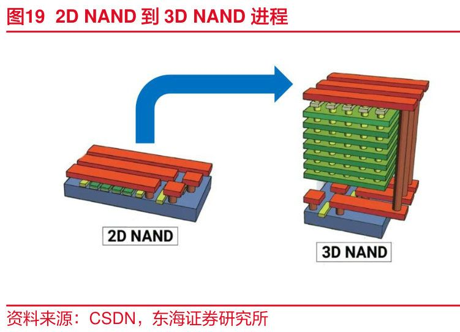

示意图：左侧为 2D NAND（单元水平并排），箭头指向右侧的 3D NAND（单元纵向叠放），图内仅标注“2D NAND”“3D NAND”。

资料来源：CSDN，东海证券研究所

**图20 长江存储 3D NAND 架构 Xtacking**

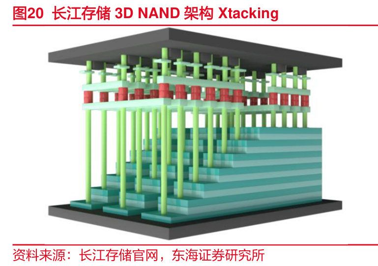

长江存储 Xtacking 3D NAND 架构三维结构示意图，图中无文字标注与数值。

资料来源：长江存储官网，东海证券研究所

---

<!-- 原文第 16 页 -->

（7）国内外存储厂商 3D NAND 层数已经发展到 200+层，未来将持续拓展更高层数。未来三星电子最早在 3D NAND 领域拓展，2013 年 8 月，三星推出 24 层 128Gb 第一代 V-NAND 闪存，这是全球首个 3D 单元结构“V-NAND”，后陆续推出 32 层、48 层、64 层、96 层、128 层、176 层、236 层 V-NAND 。韩国第二大存储厂商 SK 海力士在 2014 年研发出 24 层 3D NAND 产品，之后陆续按照 32、48 层、72 层、76 层、96 层、128 层、176 层的顺序陆续推出闪存新产品，2022 年 8 月，SK 海力士将层数突破到 238 层的新高度，是目前全球最高层数 NAND 闪存。此外，美国公司美光推出 232 层 3D NAND，凯侠和西部数据共同推出 218 层，国内厂商长江存储也将 3D NAND 层数推至 232 层，未来，存储厂商会向更具竞争力的 300+层、400+层数堆叠的 3D NAND Flash 迈进。

**表4 NAND 厂商最新层数进展**

| 存储厂商 | 时间 | NAND 层数进展 |
| --- | --- | --- |
| 三星电子(V-NAND) | 2013 年 | 24 层 128Gb 第一代 V-NAND |
| 三星电子(V-NAND) | 2014 年 | 32 层 128Gb 第二代 V-NAND |
| 三星电子(V-NAND) | 2015 年 | 48 层 128Gb 第三代 V-NAND |
| 三星电子(V-NAND) | 2016 年 | 64 层 128Gb 第四代 V-NAND |
| 三星电子(V-NAND) | 2018 年 | 96 层 128Gb 第五代 V-NAND |
| 三星电子(V-NAND) | 2019 年 | 128 层 128Gb 第六代 V-NAND |
| 三星电子(V-NAND) | 2020 年 | 176 层 128Gb 第七代 V-NAND |
| 三星电子(V-NAND) | 2022 年 | 236 层 128Gb 第八代 V-NAND |
| SK 海力士(4D PUC) | 2014 年 | 24 层第一代 3D NAND |
| SK 海力士(4D PUC) | 2015 年 | 36 层第二代 3D NAND |
| SK 海力士(4D PUC) | 2016 年 | 48 层第三代 3D NAND |
| SK 海力士(4D PUC) | 2017 年 | 72 层第四代 3D NAND |
| SK 海力士(4D PUC) | 2018 年 | 96 层第五代 3D NAND |
| SK 海力士(4D PUC) | 2019 年 | 128 层第六代 4D NAND |
| SK 海力士(4D PUC) | 2020 年 | 176 层第七代 4D NAND |
| SK 海力士(4D PUC) | 2022 年 | 238 层第八代 4D NAND |
| 美光(CuA) | 2016 年 | 32 层第一代 3D NAND |
| 美光(CuA) | 2017 年 | 64 层第二代 3D NAND |
| 美光(CuA) | 2018 年 | 96 层第三代 3D NAND |
| 美光(CuA) | 2019 年 | 128 层第四代 3D NAND |
| 美光(CuA) | 2020 年 | 176 层第五代 3D NAND |
| 美光(CuA) | 2022 年 | 232 层第六代 3D NAND |
| 凯侠(BiCS) | 2012 | 24 层 BiCS1 3D NAND |
| 凯侠(BiCS) | 2015 | 48 层 BiCS2 3D NAND |
| 凯侠(BiCS) | 2017 | 64 层 BiCS3 3D NAND |
| 凯侠(BiCS) | 2018 | 96 层 BiCS4 3D NAND |
| 凯侠(BiCS) | 2020 | 112 层 BiCS5 3D NAND |
| 凯侠(BiCS) | 2021 | 162 层 BiCS6 3D NAND |
| 凯侠(BiCS) | 2023 | 218 层 BiCS7 3D NAND |

资料来源：全球半导体观察，东海证券研究所整理

---

<!-- 原文第 17 页 -->

## 2.存储行业周期底部渐明

### 2.1.存储芯片市场具有强周期属性

（1）存储芯片是半导体标准化程度最高的市场，周期性表现显著、市场弹性较强。半导体产业中，存储芯片的市场规模仅次于逻辑芯片，行业景气度受供需关系影响较大，呈现出较强的周期性，被视为半导体产业周期的风向标。根据 WSTS 统计，2015-2022 年，全球存储芯片市场规模呈周期性波动，2018 年全球存储芯片市场规模为 1580 亿美元，2019 年受贸易摩擦和价格下降影响，全球存储芯片市场下降 32.6%至 1064 亿美元，2021 年存储芯片市场达到短期峰值，随后两年市场景气持续下行，WSTS 预测 2023、2024 年存储芯片市场规模分别为 840.41、1203.26 亿美元。根据历史数据表现来看，半导体和存储市场周期性趋同，但存储行业整体波动性较大，弹性较强。我们预计 2023 年下半年市场加速筑底，有望迎来上行周期，且随着人工智能、物联网、大数据等领域的发展，行业需求将得到持续扩张。

**图21 2015-2024 年全球存储芯片行业市场规模及增速(亿美元，%)**

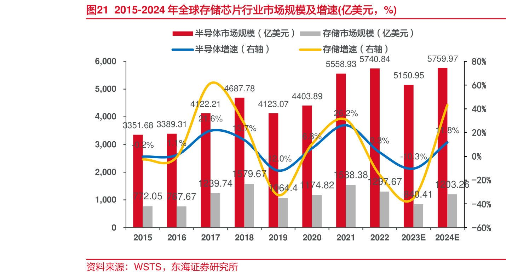

柱状图为半导体市场规模（亿美元）、存储市场规模（亿美元），折线图为半导体增速（右轴）、存储增速（右轴）；横轴 2015-2024E。图中标注的柱顶数值与增速标签：

| 年份 | 半导体市场规模（亿美元） | 存储市场规模（亿美元） | 半导体增速（%） |
| --- | --- | --- | --- |
| 2015 | 3351.68 | 772.05 | -0.2 |
| 2016 | 3389.31 | 767.67 | 1.1 |
| 2017 | 4122.21 | 1239.74 | 21.6 |
| 2018 | 4687.78 | 1579.67 | 13.7 |
| 2019 | 4123.07 | 1064.4 | -12.0 |
| 2020 | 4403.89 | 1174.82 | 6.8 |
| 2021 | 5558.93 | 1538.38 | 26.2 |
| 2022 | 5740.84 | 1297.67 | 3.3 |
| 2023E | 5150.95 | 840.41 | -10.3 |
| 2024E | 5759.97 | 1203.26 | 11.8 |

资料来源：WSTS，东海证券研究所

（2）国内存储芯片市场近年来持续扩大。随着人工智能、物联网和云计算技术的推进，国内电子制造水平不断提升，对存储芯片的需求逐步攀升。国内存储芯片制造商积极投入存储芯片研发和制造领域，努力实现技术自主创新，提升本土产业竞争力，降低进口依赖。根据中商产业研究院数据显示，2018-2022 年，中国存储芯片行业市场规模总体呈现上涨态势，2019 年受全球存储器行业的影响，市场规模有所下降，2022 年国内存储芯片行业市场规模约为 5938 亿元，预测 2023 年将达到 6492 亿元。随着国内消费电子市场高速发展，未来存储芯片的需求空间也会越来越广阔。

---

<!-- 原文第 18 页 -->

**图22 2018-2023 年我国存储芯片行业市场规模及增速(亿元，%)**

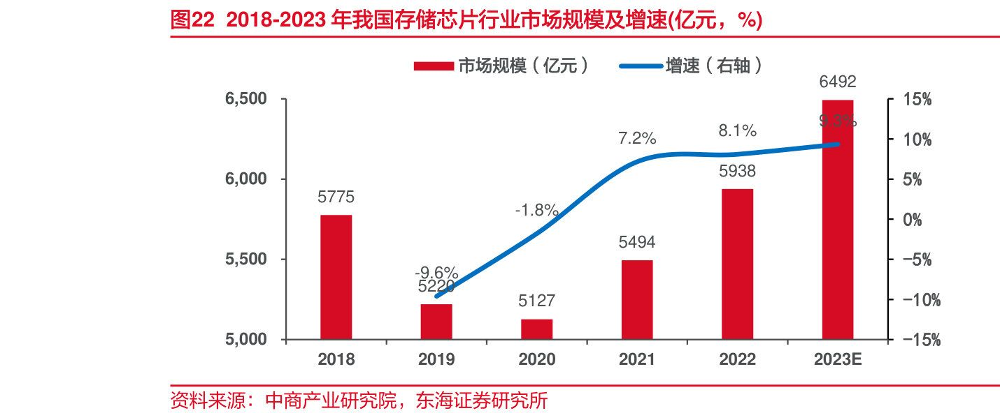

柱状图为市场规模（亿元），折线图为增速（右轴）；横轴 2018-2023E。图中标注值：

| 年份 | 市场规模（亿元） | 增速（%） |
| --- | --- | --- |
| 2018 | 5775 | — |
| 2019 | 5220 | -9.6 |
| 2020 | 5127 | -1.8 |
| 2021 | 5494 | 7.2 |
| 2022 | 5938 | 8.1 |
| 2023E | 6492 | 9.3 |

资料来源：中商产业研究院，东海证券研究所

（3）从全球存储市场结构来看，DRAM 和 NAND Flash 占据绝对主导地位。根据 Yole Group 调查机构的数据显示，2021 年存储芯片整体市场规模达到了 1665 亿美元。其中 DRAM 占比为 56.3%，NAND 占比为 40%，剩下的 NOR、(NV)SRAM/FRAM、EEPROM、新型非易失存储等占比 3.7%。同时，Yole 预测在 2021-2027 年，存储市场平均每年将会有 8%的增长，到 2027 年市场规模将达到 2630 亿美元，其中 DRAM 和 NAND 依然占据绝对地位，预计在 2027 年 DRAM 达到 60%，NAND 市场稍微有所下降到 36%，其他存储器占剩余 4%的市场份额。

**图23 2021 年全球存储市场结构（%）**

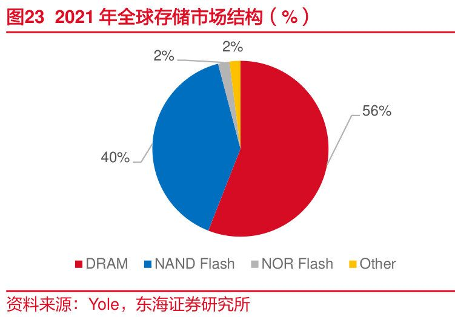

饼图：DRAM 56%，NAND Flash 40%，NOR Flash 2%，Other 2%。图例：DRAM、NAND Flash、NOR Flash、Other。

资料来源：Yole，东海证券研究所

**图24 2021-2027 年存储市场预测**

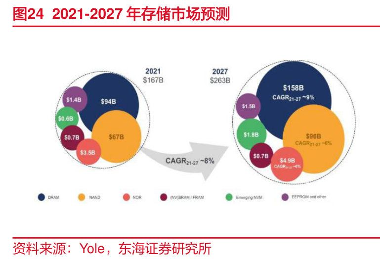

气泡图，左侧 2021 年合计 $167B，右侧 2027 年合计 $263B，箭头标注 CAGR21-27 ~8%。分项：

- DRAM：$94B → $158B，CAGR21-27 ~9%
- NAND：$67B → $96B，CAGR21-27 ~6%
- NOR：$3.5B → $4.9B，CAGR21-27 ~6%
- (NV)SRAM / FRAM：$0.7B → $0.7B
- Emerging NVM：$0.6B → $1.8B
- EEPROM and other：$1.4B → $1.5B

资料来源：Yole，东海证券研究所

（4）分季度来看，2022 年成为拐点，存储市场规模增长步入尾声。三年疫情期间，存储市场需求上升，市场规模增长较快，据 CFM 闪存市场预计，2021 年 Q3 DRAM 市场规模增长 9%至 264 亿美元，NAND Flash 市场规模增长 15%达到 186 亿美元，之后 DRAM/NAND 市场规模开始下降，到 2022 年 Q4 存储市场规模已经回到 2019 年 Q1、Q2 的周期底部水平，在淡季效应下 2023 年一季度环比续跌，二季度或为 2023 年最低点，预计从 2023 年下半年起，存储市场规模将逐季增长，在需求改善的前提下有望回到之前的增长速度和市场规模。

---

<!-- 原文第 19 页 -->

**图25 全球 DRAM/NAND Flash 市场规模季度变化（亿美元）**

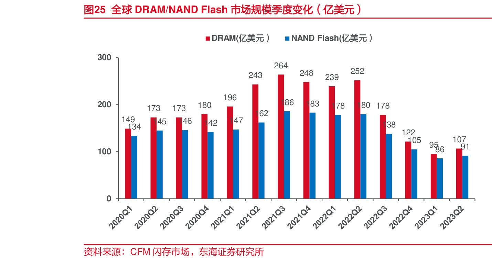

柱状图为 DRAM(亿美元）、NAND Flash(亿美元)，横轴 2020Q1-2023Q2。图中标注值：

| 季度 | DRAM（亿美元） | NAND Flash（亿美元） |
| --- | --- | --- |
| 2020Q1 | 149 | 134 |
| 2020Q2 | 173 | 145 |
| 2020Q3 | 173 | 146 |
| 2020Q4 | 180 | 142 |
| 2021Q1 | 196 | 147 |
| 2021Q2 | 243 | 162 |
| 2021Q3 | 264 | 186 |
| 2021Q4 | 248 | 183 |
| 2022Q1 | 239 | 178 |
| 2022Q2 | 252 | 180 |
| 2022Q3 | 178 | 138 |
| 2022Q4 | 122 | 105 |
| 2023Q1 | 95 | 86 |
| 2023Q2 | 107 | 91 |

资料来源：CFM 闪存市场，东海证券研究所

### 2.2.消费类终端设备搭载存储容量持续增长

（1）存储下游应用空间广泛，主要以消费电子和服务器为主。存储器产业链下游涵盖智能手机、平板电脑、计算机、网络通信设备、汽车电子等行业以及个人移动存储等领域，不同应用场景对存储器的参数要求复杂多样，涉及容量、读写速度、功耗、尺寸、稳定性、兼容性等多项内容，由此也形成了不同的产品形态。DRAM 中，LPDDR 主要与嵌入式存储配合应用于智能手机、平板等消费电子产品，近年来亦应用于功耗限制严格的个人电脑产品，DDR 主要应用于服务器、个人电脑等，DRAM 市场需求主要以手机、PC 和服务器为主，2021 年占比分别为 35%/16%/33%。NAND Flash 包括嵌入式存储（用于电子移动终端低功耗场景）、固态硬盘（大容量存储场景）和移动存储（便携式存储场景）等，其中嵌入式存储市场主要受智能手机、平板等消费电子行业驱动，固态硬盘下游市场包括服务器、个人电脑，移动存储广泛应用于各类消费者领域，2021 年，应用于 mobile 端的嵌入式存储产品、应用于 PC 端的 cSSD 和应用于服务器端的 eSSD 产品分别占比 34%、22% 和 26%。

**图26 2021 年 DRAM 应用分布情况（%）**

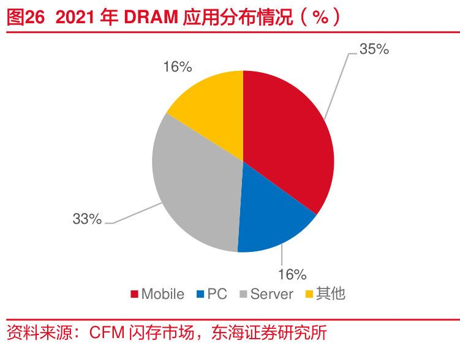

饼图：Mobile 35%，PC 16%，Server 33%，其他 16%。图例：Mobile、PC、Server、其他。

资料来源：CFM 闪存市场，东海证券研究所

**图27 2021 年 NAND Flash 应用分布情况（%）**

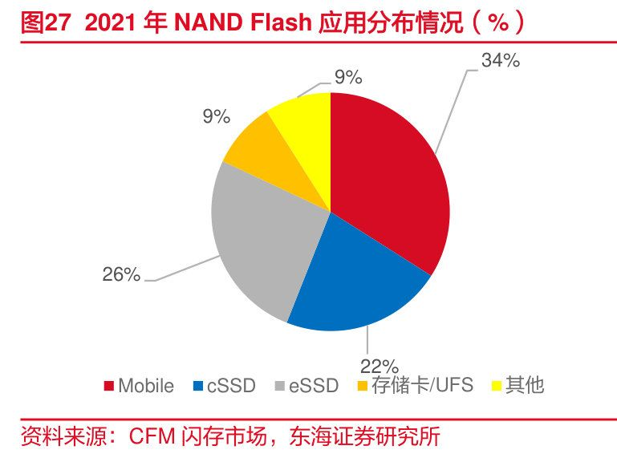

饼图：Mobile 34%，cSSD 22%，eSSD 26%，存储卡/UFS 9%，其他 9%。图例：Mobile、cSSD、eSSD、存储卡/UFS、其他。

资料来源：CFM 闪存市场，东海证券研究所

（2）作为存储芯片下游重要的细分市场，智能手机景气度成为存储市场发展的核心驱动力之一。随着移动通信技术的发展和移动互联网的普及，手机 ROM 和 RAM 分别成为嵌

---

<!-- 原文第 20 页 -->

入式 NAND Flash 和 DRAM 的核心市场。得益于 3G/4G 通信网络的建设，全球智能手机市场出货量从 2010 年的 3.05 亿台迅速递增至 2016 年的 14.73 亿台，2017 年开始智能手机市场趋向饱和，主要是 4G 智能手机增量市场触及天花板，智能手机整体出货量主要受存量市场手机单位存储容量增长驱动。2019 年是 5G 商用化元年，随着 5G 逐渐普及，新一轮的换机周期开启，智能手机终端新需求进一步打开。

**图28 2010-2023 年全球智能手机出货量（百万部，%）**

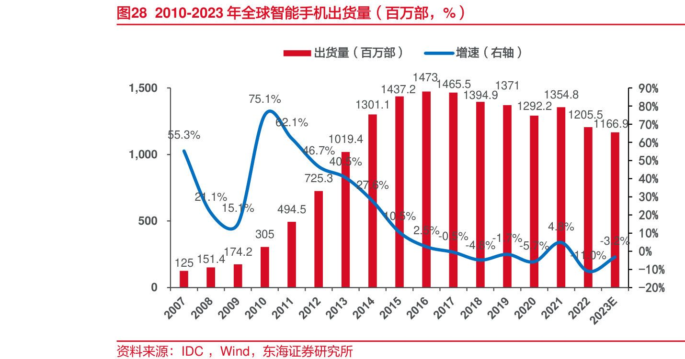

柱状图为出货量（百万部），折线图为增速（右轴）；横轴 2007-2023E。图中标注值：

| 年份 | 出货量（百万部） | 增速（%） |
| --- | --- | --- |
| 2007 | 125 | 55.3 |
| 2008 | 151.4 | 21.1 |
| 2009 | 174.2 | 15.1 |
| 2010 | 305 | 75.1 |
| 2011 | 494.5 | 62.1 |
| 2012 | 725.3 | 46.7 |
| 2013 | 1019.4 | 40.5 |
| 2014 | 1301.1 | 27.6 |
| 2015 | 1437.2 | 10.5 |
| 2016 | 1473 | 2.5 |
| 2017 | 1465.5 | -0.5 |
| 2018 | 1394.9 | -4.8 |
| 2019 | 1371 | -1.7 |
| 2020 | 1292.2 | -5.7 |
| 2021 | 1354.8 | 4.8 |
| 2022 | 1205.5 | -11.0 |
| 2023E | 1166.9 | -3.2 |

资料来源：IDC ，Wind，东海证券研究所

（3）存储芯片价格下跌，助推终端厂商容量配置升级。智能手机对于存储芯片需求不只取决于手机出货量，同时取决于单台手机的存储容量。目前主流智能手机的存储容量为 256GB 至 512GB，缓存容量为 8GB 至 12GB，随着 5G 手机渗透率的逐步提升，智能手机的性能进一步升级，单台智能手机的 RAM 模块（LPDDR）和 ROM 模块（嵌入式 NAND Flash）均在经历持续、大幅地提升。RAM 扩容是 CPU 提升处理速率的必要条件，功能更为强大的移动终端将允许手机搭载功能更为复杂、占据存储容量更大的软件程序，且消费者通过移动终端欣赏更高画质、音质内容物的消费习惯亦会进一步持续推动智能手机 ROM 扩容。2023 年智能手机在生产数量上增长平缓，平均搭载容量增加为移动端 NAND 需求增长的主要驱动力，集邦咨询预计随着 UFS 价格回调，2023 年 Q4 256GB 占比有望突破 30%。

**表5 2023 年旗舰智能手机存储规格**

| 型号 | 处理器 | 内存规格/容量 | 闪存规格/容量 | 价格 | 上市时间 |
| --- | --- | --- | --- | --- | --- |
| HUAWEI mate 60 Pro | 麒麟 9000S | LPDDR5X(12GB) | UFS4.0(256GB/512GB/1TB) | 12GB+256GB:6499；12GB+512GB:6999；12GB+1TB:7999 | 2023 年 8 月 |
| vivo X90s | 天玑 9200+旗舰芯片 | LPDDR5X 四通道（8GB/12GB） | UFS4.0（256GB/512GB） | 8GB+256GB：3999；12GB+256GB：4299；12GB+512GB：4699 | 2023 年 6 月 |
| vivo S17 Pro | 天玑 8200 | LPDDR5（8GB/12GB） | UFS3.1（256GB/512GB） | 8GB+256GB：3099；12GB+256GB：3299；12GB+512GB：3499 | 2023 年 5 月 |
| 一加 11 | 第二代骁龙 8移动平台 | LPDDR5X 满血版（12GB、16GB） | UFS4.0（256GB、512GB） | 12GB+256GB：3999；16GB+256GB：4399；16GB+512GB：4899 | 2023 年 1 月 |
| 小米 13 | 第二代骁龙 8 | 8GB/12GB LPDDR5X 高 | UFS4.0（128GB、 | 8GB+128GB：3999 | 2022 年 12 月 |

---

<!-- 原文第 21 页 -->

| | | | | | |
| --- | --- | --- | --- | --- | --- |
| | 移动平台 | 速内存（8533Mbps） | 256GB、512GB） | 8GB+256GB：4299 12GB+256GB：4599 12GB+512GB：4999 | |
| 小米 13 Pro | 第二代骁龙 8 移动平台 | 8GB/12GB LPDDR5X 高速内存（8533Mbps） | UFS4.0（128GB、256GB、512GB） | 8GB+128GB：4999 8GB+256GB：5399 12GB+256GB：5799 12GB+512GB：6299 | 2022 年 12 月 |
| iQOO 11 | 第二代骁龙 8 移动平台 | LPDDR5X 四通道（8GB、12GB、16GB） | UFS4.0（128GB、256GB、512GB） | 8GB+128GB：3799 8GB+256GB：4099 12GB+256GB：4399 16GB+256GB：4699 16GB+512GB：4999 | 2022 年 12 月 |
| iQOO 11 Pro | 第二代骁龙 8 移动平台 | LPDDR5X 四通道（8GB、12GB、16GB） | UFS4.0（256GB、512GB） | 8GB+256GB：4999 12GB+256GB：5499 16GB+512GB：5999 | 2022 年 12 月 |

资料来源：电子发烧友，vivo 官网，华为官网，东海证券研究所

（4）PC 市场需求有所回落，单台设备存储容量持续增加。三年疫情带来工作、生活方式的转变，而平板、笔记本电脑等也因远程办公、在线教育场景需求，出货量大幅增长，2020 年、2021 年出货量同比增长 13.47%和 15.27%，但疫情并非长期性事件，PC 需求量持续高速增长存在较大不确定性，2022 年开始需求已经回落。由于 SSD 的制造成本较高，PC 端数据存储过去主要使用机械硬盘（HDD），近年来，随着 NAND Flash 单位存储经济效益持续凸显，同时笔记本电脑，特别是轻薄笔记本电脑对存储物理空间限制严格，SSD 对 HDD 的替代效应显著。同时，PC 与其他消费电子产品相同，正在经历性能和数据存储需求的持续增长，随着消费者处理数据的需求不断增加，单台设备的存储容量需求亦持续增加。

**图 29 2017-2022 年全球 PC 出货量（百万台，%）**

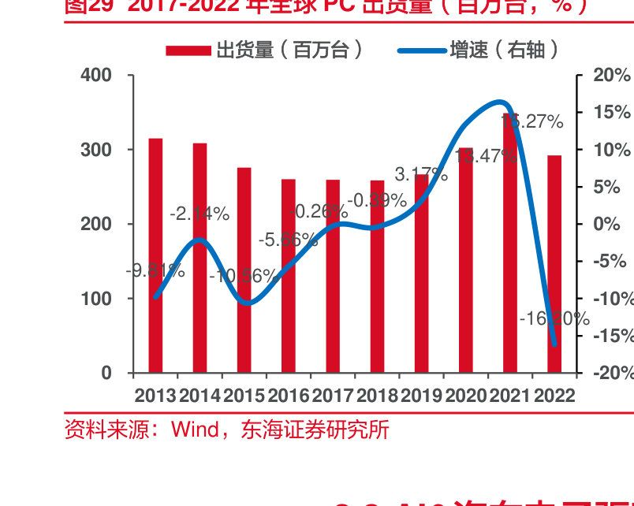

图例：出货量（百万台）、增速（右轴）；2013-2022 年，左轴出货量 0-400 百万台，右轴增速 -20%-20%。增速标注（2013-2022 年依次）：-9.81%、-2.14%、-10.56%、-5.66%、-0.26%、-0.39%、3.17%、13.47%、15.27%、-16.20%；柱状图（出货量）图上无数据标签。

资料来源：Wind，东海证券研究所

**图 30 SSD 与 HDD 优劣势**

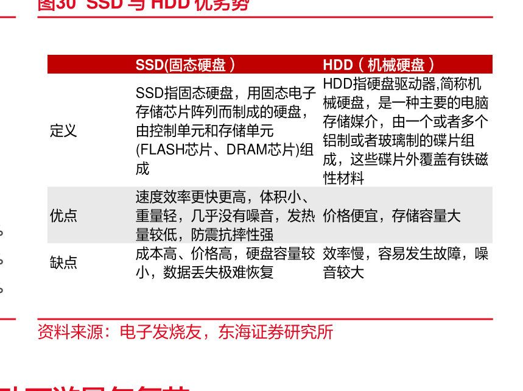

| | SSD(固态硬盘） | HDD（机械硬盘） |
| --- | --- | --- |
| 定义 | SSD指固态硬盘，用固态电子存储芯片阵列而制成的硬盘，由控制单元和存储单元(FLASH芯片、DRAM芯片)组成 | HDD指硬盘驱动器,简称机械硬盘，是一种主要的电脑存储媒介，由一个或者多个铝制或者玻璃制的碟片组成，这些碟片外覆盖有铁磁性材料 |
| 优点 | 速度效率更快更高，体积小、重量轻，几乎没有噪音，发热量较低，防震抗摔性强 | 价格便宜，存储容量大 |
| 缺点 | 成本高、价格高，硬盘容量较小，数据丢失极难恢复 | 效率慢，容易发生故障，噪音较大 |

资料来源：电子发烧友，东海证券研究所

## 2.3.AI&汽车电子驱动下游景气复苏

（1）数据规模持续增长，给存储行业带来较大的成长空间。传统存储面对的应用主要是数据库、文件和流媒体等传统应用，在新兴技术驱动下，存储主要面对的是云计算、大数据和人工智能等大规模数据应用场景。据 IDC 预测，2025 年，全球数据量将达到 175ZB，5 年年均复合增长率 31.8%，而数据中心存储量占比将超过 70%。从全球市场来看，2017-2022 年全球数据中心市场保持平稳增长趋势，市场规模从 465.5 亿美元增长至

---

<!-- 原文第 22 页 -->

679.3 亿美元，五年内的年均复合增长率为 9.91%，预计 2023 年全球数据中心市场规模将进一步增至 820.5 亿美元。随着我国各行业数字化转型的深入推进，我国数据中心市场规模也将保持持续增长态势，预计 2023 年市场规模将达到 2470.1 亿元。一方面互联网巨头纷纷自建数据中心，同时传统企业上云进程加快，两者共同带动服务器数据存储市场规模快速增长。在数据中心作为新型基础设施加快建设的背景下，服务器数据存储的市场规模将继续快速增长，存储板块的需求也将大幅增加。

**图 31 全球数据中心市场规模及增速（亿美元，%）**

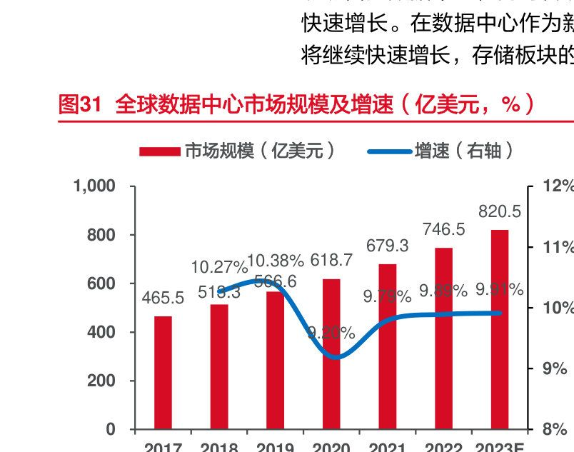

图例：市场规模（亿美元）、增速（右轴）；2017-2023E 年，左轴 0-1,000 亿美元，右轴 8%-12%。市场规模（亿美元）：465.5、513.3、566.6、618.7、679.3、746.5、820.5；增速标注（2018-2023E 年依次）：10.27%、10.38%、9.20%、9.79%、9.89%、9.91%。

资料来源：中国信通院，东海证券研究所

**图 32 中国数据中心市场规模及增速（亿元，%）**

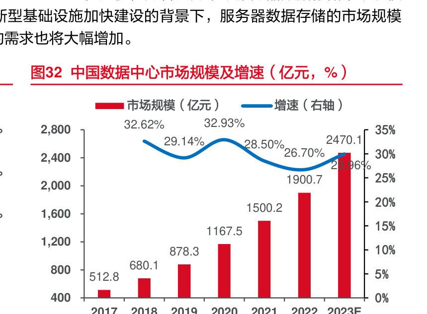

图例：市场规模（亿元）、增速（右轴）；2017-2023E 年，左轴 400-2,800 亿元，右轴 0%-35%。市场规模（亿元）：512.8、680.1、878.3、1167.5、1500.2、1900.7、2470.1；增速标注（2018-2023E 年依次）：32.62%、29.14%、32.93%、28.50%、26.70%、29.96%。

资料来源：中国信通院，东海证券研究所

（2）“东数西算”工程全面实施，服务器存储市场有望进一步打开。2021 年 5 月，国家发展改革委、中央网信办、工业和信息化部、国家能源局联合印发《全国一体化大数据中心协同创新体系算力枢纽实施方案》，2022 年 2 月，京津冀、长三角、粤港澳大湾区、成渝、内蒙古、贵州、甘肃、宁夏 8 地启动了建设国家算力枢纽节点，并规划了 10 个国家数据中心集群，依托 8 大算力枢纽和 10 大集群，更好引导数据中心集约化、规模化、绿色化发展，促进东西部数据流通、价值传递，带动数据中心相关产业由东向西有效转移。国家东数西算战略不断取得进展，预计到 2025 年，韶关数据中心集群将建成 50 万架标准机架、500 万台服务器规模，投资超 500 亿元。东数西算战略聚焦于算力和数据存储，工程的实施有望进一步拉动服务器数据存储的总体市场规模，国产企业级 SSD 厂商有望打开增量空间。

**图 33 东数西算 8 大枢纽主要承载业务类型**

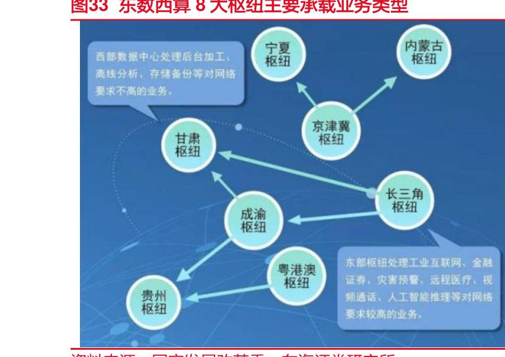

示意图：8 个枢纽节点（甘肃枢纽、宁夏枢纽、内蒙古枢纽、京津冀枢纽、长三角枢纽、成渝枢纽、粤港澳枢纽、贵州枢纽），箭头由东部枢纽指向西部枢纽。两处说明框原文：

- 西部数据中心处理后台加工、离线分析、存储备份等对网络要求不高的业务。
- 东部枢纽处理工业互联网、金融证券、灾害预警、远程医疗、视频通话、人工智能推理等对网络要求较高的业务。

资料来源：国家发展改革委，东海证券研究所

**图 34 东数西算战略 10 大集群分布**

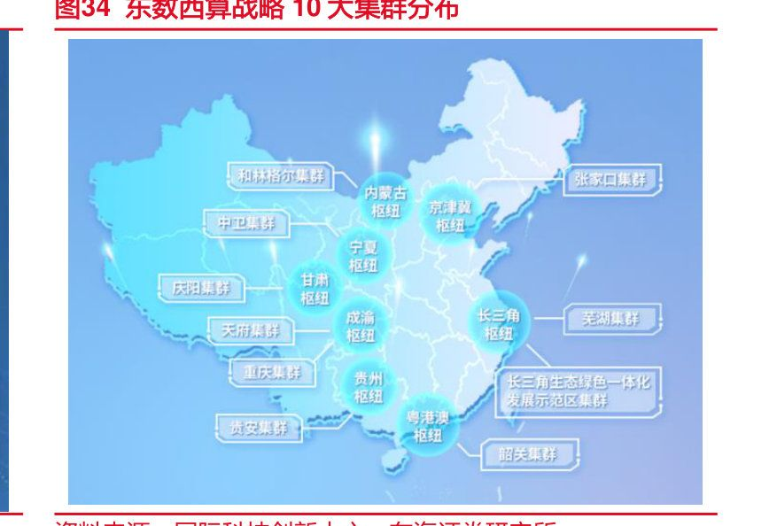

中国地图标注：8 大枢纽（京津冀枢纽、内蒙古枢纽、宁夏枢纽、甘肃枢纽、成渝枢纽、贵州枢纽、粤港澳枢纽、长三角枢纽）与 10 大集群（张家口集群、和林格尔集群、中卫集群、庆阳集群、天府集群、重庆集群、贵安集群、韶关集群、芜湖集群、长三角生态绿色一体化发展示范区集群）。图上无数据数值。

资料来源：国际科技创新中心，东海证券研究所

（3）生成式 AI 市场迅速扩张，提高了对 AI 服务器内存的需求。随着人工智能产业加速发展，全球主要国家和地区纷纷加快 AI 基础设施布局， AI 服务器通常由 CPU 搭载

---

<!-- 原文第 23 页 -->

GPU、FPGA、ASIC 等加速芯片组成，以满足高吞吐量互联的需求，是人工智能基础设施的核心。2022 年全球 AI 服务器市场规模约为 183 亿美元，预计 2023 年全球 AI 服务器市场规模增长 15.30%，将达 211 亿美元。2022 年全球 AI 服务器出货量约占整体服务器比重近 1%，约为 14.5 万台，预计 2023 年出货量将达 15 万台，到 2026 年将增长至 22.5 万台。AI 大模型等人工智能技术发展，引发了对服务器算力需求的进一步增长，智能算力需求爆发式增长意味着需要搭载更大的存储容量以提升处理速度，同时带动存储芯片需求成长。

**图 35 全球 AI 服务器市场规模及增速（亿美元，%）**

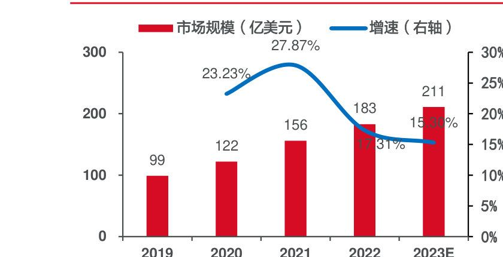

图例：市场规模（亿美元）、增速（右轴）；2019-2023E 年，左轴 0-300 亿美元，右轴 0%-30%。市场规模（亿美元）：99、122、156、183、211；增速标注（2020-2023E 年依次）：23.23%、27.87%、17.31%、15.30%。

资料来源：IDC，东海证券研究所

**图 36 全球 AI 服务器出货量及增速（万台，%）**

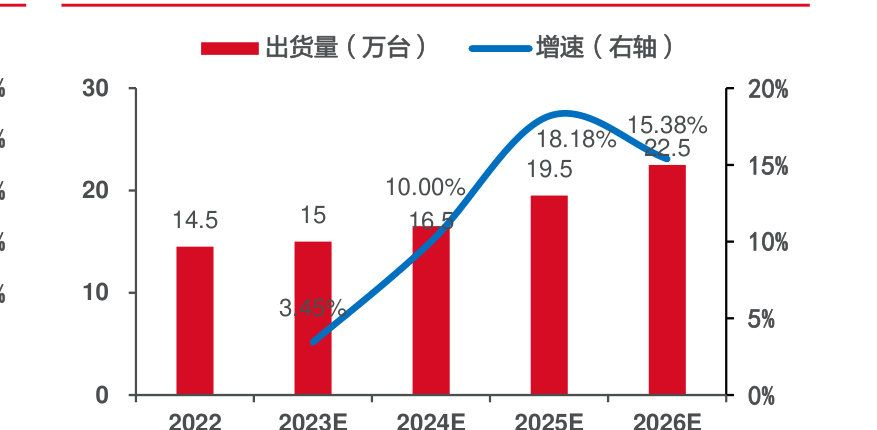

图例：出货量（万台）、增速（右轴）；2022-2026E 年，左轴 0-30 万台，右轴 0%-20%。出货量（万台）：14.5、15、16.5、19.5、22.5；增速标注（2023E-2026E 年依次）：3.45%、10.00%、18.18%、15.38%。

资料来源：TrendForce，东海证券研究所

（4）汽车存储市场发展迅速，主要以智能座舱和 ADAS&AD 为主。根据 Yole 报告，2021 年，汽车存储器市场规模达到 43 亿美元，占全球存储器市场收入的 2.6%，占汽车半导体的 10%。汽车存储器 2021 到 2027 年的年均复合增长率为 20%，超过同期存储器市场和汽车半导体市场的增速。汽车存储市场由 NAND 和 DRAM 主导，合计份额为 80%，其中 DRAM 为 41%，NAND 为 39%，NOR Flash 在汽车领域表现的占有率较高，市场份额为 15%。具有信息娱乐单元、仪表盘和连接性的驾驶舱是目前主要的汽车存储用户，2021 年占比达到 71%，ADAS&AD 紧跟其后，成为第二大车载内存用户，2021 年占收入的 24%，动力总成、底盘和安全以及车身和舒适性等其他领域合计占需求的 5%。预计到 2027 年，智能座舱仍将是存储领域主要消费者，但 ADAS&AD 的收入份额将增至 36%，技术方面，DRAM 和 NAND 将占汽车内存收入的 90%左右。

**图 37 2021-2027 年汽车存储市场占比及增长情况（%）**

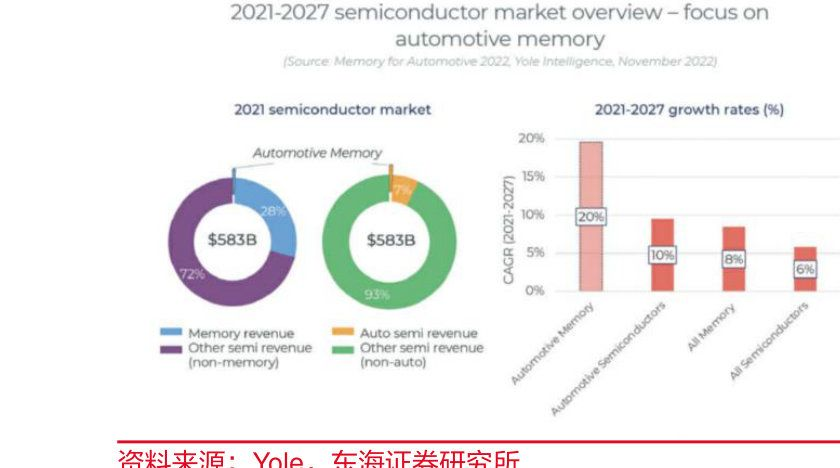

原图为 Yole 图表，图内标题 “2021-2027 semiconductor market overview – focus on automotive memory”，来源标注 “(Source: Memory for Automotive 2022, Yole Intelligence, November 2022)”。

- 左图 “2021 semiconductor market”：环形图，中心 $583B；Memory revenue 28%、Other semi revenue (non-memory) 72%
- 中图 “2021 semiconductor market”：环形图，中心 $583B；Auto semi revenue 7%[OCR_UNCERTAIN]、Other semi revenue (non-auto) 93%
- 右图 “2021-2027 growth rates (%)”：纵轴 CAGR (2021-2027) 0%-20%；柱标注 Automotive Memory 20%、Automotive Semiconductors 10%、All Memory 8%、All Semiconductors 6%

资料来源：Yole，东海证券研究所

**图 38 2021-2027 年汽车存储市场营收情况（十亿美元）**

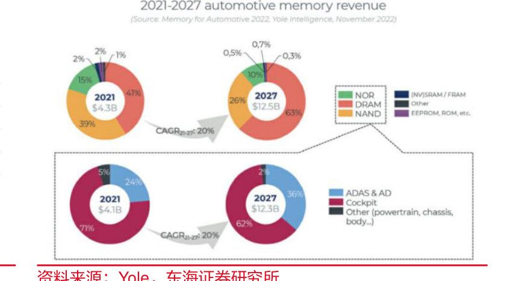

原图为 Yole 图表，图内标题 “2021-2027 automotive memory revenue”，来源标注 “(Source: Memory for Automotive 2022, Yole Intelligence, November 2022)”。

- 上排左：2021 年，中心 $4.3B；DRAM 41%、NAND 39%、NOR 15%、2%、2%、1%（图例：NOR、DRAM、NAND、(NV)SRAM / FRAM、Other、EEPROM, ROM, etc.）
- 上排右：2027 年，中心 $12.5B；DRAM 63%、NAND 26%、NOR 10%、0.7%、0.5%、0.3%
- 两图之间：CAGR₂₁₋₂₇: 20%
- 下排左：2021 年，中心 $4.1B；Cockpit 71%、ADAS & AD 24%、Other 5%
- 下排右：2027 年，中心 $12.3B；Cockpit 62%、ADAS & AD 36%、Other 2%（图例：ADAS & AD、Cockpit、Other (powertrain, chassis, body...)）
- 下排两图之间：CAGR₂₁₋₂₇: 20%

资料来源：Yole，东海证券研究所

（5）自动驾驶等级越高，对车载存储容量、密度和带宽的需求也大幅提升。车载市场目前主要的存储应用包括 DRAM（DDR、LPDDR）和 NAND（eMMC 和 UFS 等），其中低功耗的 LPDDR 和 NAND 将是主要增长点。高等级自动驾驶汽车对于车载存储容量、密度和带宽的需求更高，将需要采用更高带宽的存储器如 LPDDR5、GDDR6 等，以简化系统设计。以 NAND Flash 为例，主要用于 ADAS 系统、IVI 系统、汽车中控等，作用在于存

---

<!-- 原文第 24 页 -->

储连续数据，随着自动驾驶等级提升，ADAS 系统对 NAND 容量需求增长显著，L1/L2 级 ADAS 一般只需主流 8-64GB 的 eMMC，L3 级则提升至 128/256GB，L5 级最高可能超过 2TB，可能进一步采用 PCIe SSD。

**表 6 智能座舱和 ADAS/AD 系统 NAND 需求**

| 主机厂 | 车型 | L2 级自动驾驶 | L3 级自动驾驶 | L4 级自动驾驶 | L5 级自动驾驶 |
| --- | --- | --- | --- | --- | --- |
| 智能座舱 | 容量 | 64-128GB | 128-512GB | 256-512GB | 512GB-1TB |
| 智能座舱 | 类型 | eMMC | eMMC/UFS | UFS | UFS |
| ADAS/AD | 容量 | 8-64GB | 128-256GB | 512GB-1TB | 1-2TB |
| ADAS/AD | 类型 | eMMC | eMMC/UFS2.1 | UFS3.0/PCIe SSD | PCIe SSD |

资料来源：佐思汽研《2022 年车载存储芯片行业研究报告》，东海证券研究所

---

<!-- 原文第 25 页 -->

## 3.存储厂商缩减资本开支以调配供需平衡

### 3.1.存储芯片市场行业集中度较高

（1）DRAM 和 NAND Flash 市场集中度高，呈现寡头垄断格局。根据 Yole 数据，2021 年全球存储市场中，DRAM 占比为 56.3%，NAND 占比为 40%，目前 DRAM 芯片的市场格局由三星、SK 海力士和美光三家存储厂商主导，CR3 市场占有率合计已超过 95%，最新数据来看，2023 年 Q2 三星电子占全球 DRAM 市场营收的 38.14%，SK 海力士占比达 32.29%，美光的市占率也达到 25.03%，市场高度集中，寡头垄断的格局使得国内厂商对 DRAM 芯片议价能力很低，也使得 DRAM 芯片成为我国受外部制约最严重的基础产品之一。NAND Flash 市场经过几十年的发展，逐渐形成了由三星电子、铠侠、西部数据、美光、SK 海力士等组成的稳定市场格局，2023 年 Q2 三星电子、铠侠、SK 海力士、西部数据、美光的营收占比分别为 30.18%、20.05%、18.25%、15.09%、11.10%，CR5 合计市占率达 95%，国内的长江存储也在慢慢进入 NAND 市场，但市占率相对较低。

**图 39 全球 DRAM 企业市场份额(%)**

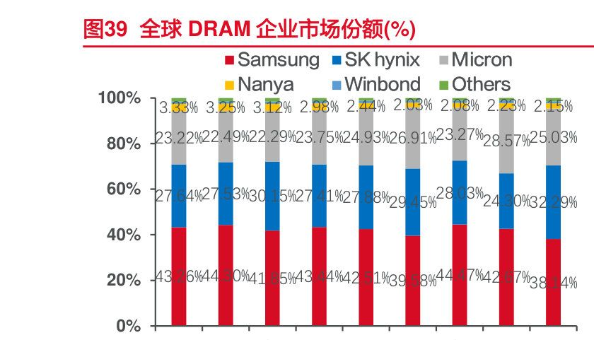

堆积柱状图，2021Q2-2023Q2；纵轴 0%-100%；图例：Samsung、SK hynix、Micron、Nanya、Winbond、Others。柱上标注数值：

| 季度 | Samsung | SK hynix | Micron | Others |
| --- | --- | --- | --- | --- |
| 2021Q2 | 43.26% | 27.64% | 23.22% | 3.33% |
| 2021Q3 | 44.30% | 27.53% | 22.49% | 3.25% |
| 2021Q4 | 41.85% | 30.15% | 22.29% | 3.12% |
| 2022Q1 | 43.44% | 27.41% | 23.75% | 2.98% |
| 2022Q2 | 42.51% | 27.88% | 24.93% | 2.44% |
| 2022Q3 | 39.58% | 29.45% | 26.91% | 2.03% |
| 2022Q4 | 44.47% | 28.03% | 23.27% | 2.08% |
| 2023Q1 | 42.67% | 24.30% | 28.57% | 2.23% |
| 2023Q2 | 38.14% | 32.29% | 25.03% | 2.15% |

资料来源：CFM 闪存市场，东海证券研究所整理

**图 40 全球 NAND Flash 企业市场份额（%）**

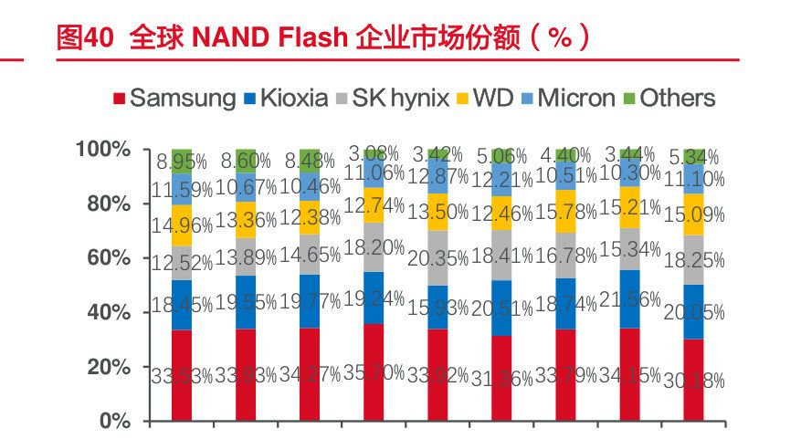

堆积柱状图，2021Q2-2023Q2；纵轴 0%-100%；图例：Samsung、Kioxia、SK hynix、WD、Micron、Others。柱上标注数值：

| 季度 | Samsung | Kioxia | SK hynix | WD | Micron | Others |
| --- | --- | --- | --- | --- | --- | --- |
| 2021Q2 | 33.53% | 18.45% | 12.52% | 14.96% | 11.59% | 8.95% |
| 2021Q3 | 33.93% | 19.55% | 13.89% | 13.36% | 10.67% | 8.60% |
| 2021Q4 | 34.27% | 19.77% | 14.65% | 12.38% | 10.46% | 8.48% |
| 2022Q1 | 35.70% | 19.24% | 18.20% | 12.74% | 11.06% | 3.08% |
| 2022Q2 | 33.92% | 15.93% | 20.35% | 13.50% | 12.87% | 3.42% |
| 2022Q3 | 31.36% | 20.51% | 18.41% | 12.46% | 12.21% | 5.06% |
| 2022Q4 | 33.79% | 18.74% | 16.78% | 15.78% | 10.51% | 4.40% |
| 2023Q1 | 34.15% | 21.56% | 15.34% | 15.21% | 10.30% | 3.44% |
| 2023Q2 | 30.18% | 20.05% | 18.25% | 15.09% | 11.10% | 5.34% |

资料来源：CFM 闪存市场，东海证券研究所整理

（2）NOR 行业经历二十多年演变，头部厂商经历多次洗牌。2003 年由 AMD 和富士通整合各自的闪存业务合并成立飞索半导体，后逐渐发展为 NOR Flash 领域头部厂商，然而在 2009 年，公司申请了破产保护，三星电子也在 2010 年开始宣布退出 NOR 市场，由英特尔和意法半导体在 2008 年合资成立的恒亿也在 2010 年被美光收购。全球 NOR 市场空间经过较长时间的下行，国际巨头美光和赛普拉斯于 2017 年先后宣布逐步退出中低容量的消费电子市场，美光和赛普拉斯的退出使华邦、旺宏和兆易创新的份额开始上升，另外产能的减少也改善了市场的供需关系，2017 年之后，全球 NOR Flash 市场被旺宏、华邦、赛普拉斯、美光和兆易创新垄断。

---

<!-- 原文第 26 页 -->

**图 41 全球 NOR Flash 市场主要厂商演变情况**

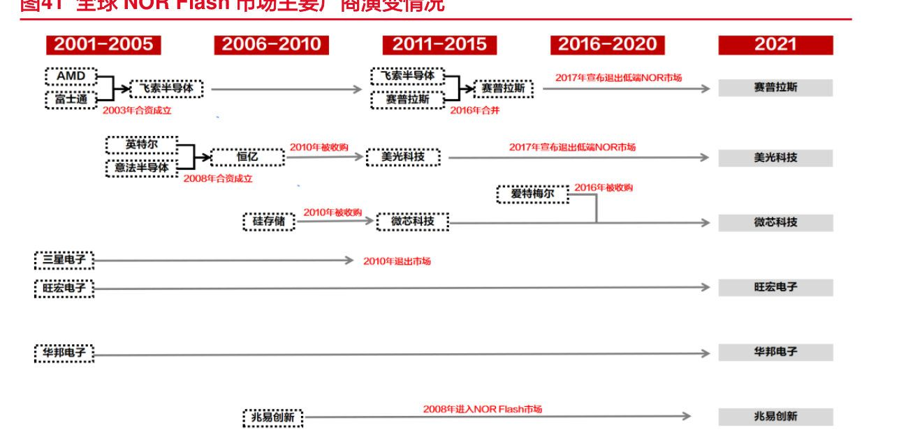

横轴年代（2001-2005、2006-2010、2011-2015、2016-2020、2021），厂商并购与退出关系：

- AMD + 富士通 ——（2003年合资成立）→ 飞索半导体 → 飞索半导体 + 赛普拉斯 ——（2016年合并）→ 赛普拉斯 ——（2017年宣布退出低端NOR市场）→ 赛普拉斯（2021）
- 英特尔 + 意法半导体 ——（2008年合资成立）→ 恒忆 ——（2010年被收购）→ 美光科技 ——（2017年宣布退出低端NOR市场）→ 美光科技（2021）
- 硅存储 ——（2010年被收购）→ 微芯科技；爱特梅尔 ——（2016年被收购）→ 并入微芯科技 → 微芯科技（2021）
- 三星电子 ——（2010年退出市场）
- 旺宏电子 ——→ 旺宏电子（2021）
- 华邦电子 ——→ 华邦电子（2021）
- 兆易创新 ——（2008年进入NOR Flash市场）→ 兆易创新（2021）

资料来源：Cypress，前瞻产业研究院，东海证券研究所

（3）国际存储巨头相继退出 NOR Flash 市场，龙头占据主要份额。NOR Flash 属于利基型存储，在全球存储市场份额很小，根据 Yole 数据，2021 年全球存储市场中，NOR 占比仅为 2.1%。2015-2021 年，受 5G、TWS 等新智能设备，以及居家办公、远程教育等需求带动，NOR Flash 市场规模保持稳定增长，2021 年市场规模达到 28.84 亿美元，同比增长 15.36%，其中旺宏、赛普拉斯、华邦、美光和兆易创新成为 NOR Flash 全球前五大供应商，2017 年占据全球 92%以上的市场份额。随着 2017 年国际存储巨头美光、赛普拉斯相继退出低端 NOR 市场，华邦、旺宏、兆易创新则逐渐占据 NOR Flash 剩余的主要市场份额，2021 年三家存储厂商的市占率分别为 35%、33%和 23%，CR3 合计市占率达到 91%，国内厂商例如普冉股份、北京君正、东芯股份、恒烁股份等也迅速加入市场。

**图 42 全球 NOR Flash 市场规模及增速（亿美元，%）**

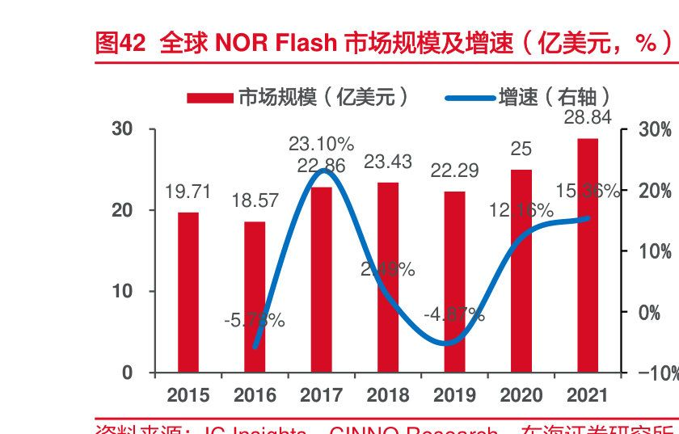

图例：市场规模（亿美元）、增速（右轴）；2015-2021 年，左轴 0-30 亿美元，右轴 -10%-30%。市场规模（亿美元）：19.71、18.57、22.86、23.43、22.29、25、28.84；增速标注（2016-2021 年依次）：-5.78%、23.10%、2.49%、-4.87%、12.16%、15.36%。

资料来源：IC Insights，CINNO Research，东海证券研究所

**图 43 全球 NOR Flash 市场份额占比（%）**

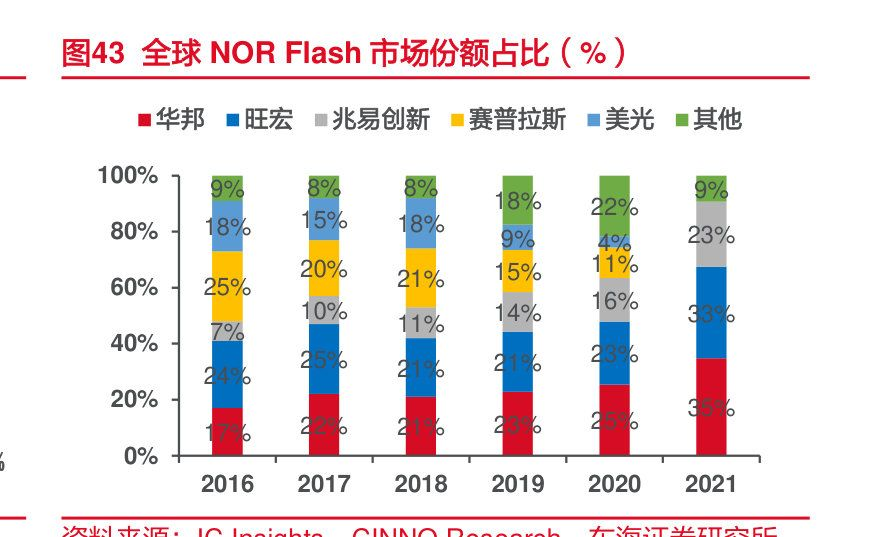

100% 堆积柱状图，2016-2021 年；图例：华邦（红）、旺宏（蓝）、兆易创新（灰）、赛普拉斯（黄）、美光（浅蓝）、其他（绿）。柱上标注数值：

| 年份 | 华邦 | 旺宏 | 兆易创新 | 赛普拉斯 | 美光 | 其他 |
| --- | --- | --- | --- | --- | --- | --- |
| 2016 | 17% | 24% | 7% | 25% | 18% | 9% |
| 2017 | 22% | 25% | 10% | 20% | 15% | 8% |
| 2018 | 21% | 21% | 11% | 21% | 18% | 8% |
| 2019 | 23% | 21% | 14% | 15% | 9% | 18% |
| 2020 | 25% | 23% | 16% | 11% | 4% | 22% |
| 2021 | 35% | 33% | 23% | — | — | 9% |

资料来源：IC Insights，CINNO Research，东海证券研究所

（4）国内厂商加快产业链布局，聚焦利基型存储市场。存储芯片行业属于技术密集型产业，全球存储芯片市场基本均被韩国、日本以及美国等国家垄断，国内存储芯片行业起步晚，缺乏技术积累，国内厂商除合肥长鑫和长江存储外，大部分聚焦于利基型市场，与国际龙头展开错位竞争。国内代表性存储芯片设计及制造企业包括兆易创新、长江存储、长鑫存储、武汉新芯、普冉股份等，近年来，中国紫光集团旗下长江存储、武汉新芯，以及兆易创新及其合作厂商合肥长鑫等在 DRAM 和 Flash 领域逐渐突破技术壁垒，存储芯片供给格局正在悄然变化，从过去高度依赖进口，到国产品牌逐渐开始占据市场。尽管目前国内存储芯片产业整体发展与海外巨头仍然存在差距，各家存储芯片产品仍处于投产初期，

---

<!-- 原文第 27 页 -->

尚未实现产品的规模量产，但随着国内厂商不断取得关键性技术突破，市场有望迎来黄金发展期。

**表 7 2022 年部分中国存储芯片公司业务布局及产销量情况**

| 公司名称 | 存储芯片营收（亿元） | 存储芯片业务布局 | 存储芯片产量（亿颗） | 存储芯片销量（亿颗） |
| --- | --- | --- | --- | --- |
| 长江存储 | / | NAND Flash | / | |
| 长鑫存储 | / | DRAM | / | |
| 福建晋华 | / | DRAM | / | |
| 兆易创新 | 48.26 | DRAM 和 Flash | 22.60 | 22.53 |
| 东芯股份 | 8.63 | DRAM 和 Flash | 2.21 | 1.17 |
| 北京君正 | 40.55 | SRAM、DRAM、Flash | 8.64 | 8.44 |
| 澜起科技 | 27.35 | DDR2-5 系列内存接口芯片 | 2.10 | 1.88 |
| 普冉股份 | 8.72 | NOR Flash 和 EEPROM | 62.87 | 35.08 |
| 聚辰股份 | 8.54 | EEPROM 和 NOR Flash | 13.68 | 12.24 |
| 复旦微电 | 9.40 | EEPROM 和 Flash | 5.00 | 5.40 |

资料来源：wind，各大公司年度报告，东海证券研究所整理(注：北京君正产销量口径为集成电路设计，澜起科技产销量口径为互连类芯片，长江存储、长鑫存储、福建晋华为未上市企业，未公布存储芯片产销量情况)

### 3.2.国内外存储厂商业绩普遍承压

（1）需求疲软及客户调整库存，三星电子存储业绩大幅下滑。三星电子是全球存储行业龙头厂商，DRAM 和 NAND Flash 的市占率均位列全球第一。三星电子成立于 1969 年，1974 年三星收购了韩国半导体公司 50%的股份并于 1979 年收购了剩余股份，改名三星半导体，并于 1980 年与三星电子合并，进一步巩固了三星电子在半导体制造领域的统治地位。根据三星电子公布的财报数据，2022 年 Q3 开始，三星电子业绩开始出现下滑，公司 2023 年 Q2 实现营业收入 60.01 万亿韩元，同比-22%/环比-6%；实现营业利润 0.67 万亿韩元，同比-95.26%/环比+4.69%。其中，存储业务营收为 8.97 万亿韩元，同比-57%/环比+1%，存储市况恶化使得三星电子整体业绩回落，不仅存储营收急速下滑，而且存储所在的 DS 部门 2023 年 Q2 亏损 4.36 万亿韩元，上季度亏损 4.58 万亿韩元，环比亏损收窄。

**图 44 三星电子营收及存储业务收入（万亿韩元，%）**

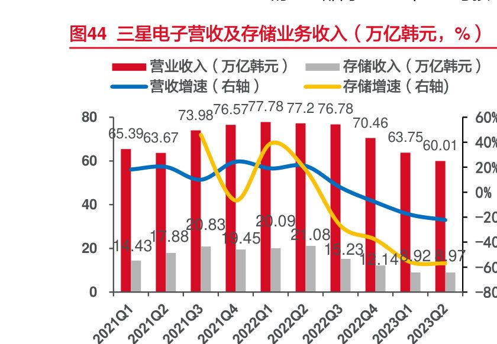

图例：营业收入（万亿韩元）、存储收入（万亿韩元）、营收增速（右轴）、存储增速（右轴)；2021Q1-2023Q2，左轴 0-80 万亿韩元，右轴 -80%-60%。营业收入（万亿韩元）：65.39、63.67、73.98、76.57、77.78、77.2、76.78、70.46、63.75、60.01；存储收入（万亿韩元）：14.43、17.88、20.83、19.45、20.09、21.08、15.23、12.14、8.92、8.97；两条增速曲线图上无数据标签。

资料来源：三星电子公司公告，东海证券研究所整理（注：三星电子 2023 年第二季度财务报告截至 2023 年 6 月 30 日）

**图 45 三星电子营业利润及增速（万亿韩元，%）**

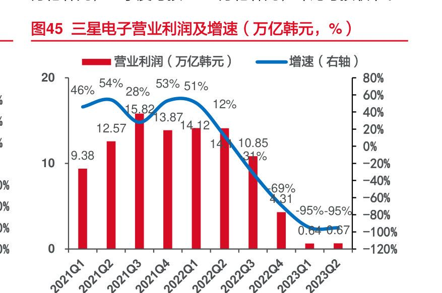

图例：营业利润（万亿韩元）、增速（右轴）；2021Q1-2023Q2，左轴 0-20 万亿韩元，右轴 -120%-80%。营业利润（万亿韩元）：9.38、12.57、15.82、13.87、14.12、14.1、10.85、4.31、0.64、0.67；增速标注（2021Q1-2023Q2 依次）：46%、54%、28%、53%、51%、12%、-31%、-69%、-95%、-95%。

资料来源：三星电子公司公告，东海证券研究所整理（注：三星电子 2023 年第二季度财务报告截至 2023 年 6 月 30 日）

（2）美光 2023 年 Q3 业绩环比改善，AI 领域拉动存储芯片需求增加。美光科技是全球领先的 DRAM 供应商之一，同时也是 NAND 闪存市场的领军企业之一，其存储芯片行

---

<!-- 原文第 28 页 -->

业市占率全球领先。公司成立于 1978 年，总部位于美国爱达荷州博伊西市，最初是生产 DRAM 芯片的专业厂商，随着技术不断升级和业务范围的扩大，美光科技逐渐成为了集计算存储、移动存储、服务器、网络与通信、工业与汽车等多个领域的智能存储解决方案提供商。公司 2023 财年第三财季实现营业收入 37.52 亿美元，同比下降 56.58%，其中 DRAM 占营收比重的 71%，NAND 占 27%；三季度调整后运营亏损 14.69 亿美元，市场预期亏损 16.9 亿美元，较上季度亏损 20.77 亿美元显著收窄。受益于生成式人工智能技术的加速普及，人工智能服务器对于内存芯片和存储芯片市场需求拉动，叠加上游减产和渠道清库存，传统的个人电脑和智能手机市场，存储芯片供大于求的难题有所缓解，存储芯片行业开始逐渐回温。

**图 46 美光科技营收及存储业务收入（亿美元，%）**

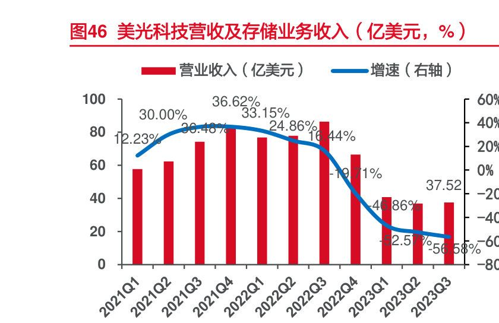

图例：营业收入（亿美元）、增速（右轴）；2021Q1-2023Q3，左轴 0-100 亿美元，右轴 -80%-60%。营业收入柱状图仅 2023Q3 标注 37.52，其余柱无数据标签；增速标注（2021Q1-2023Q3 依次）：12.23%、30.00%、36.48%、36.62%、33.15%、24.86%、16.44%、-19.71%、-46.86%、-52.57%、-56.58%。

资料来源：美光科技公司公告，东海证券研究所（注：美光科技 2023 年第三季度财务报告截至 2023 年 6 月 1 日）

**图 47 美光科技营业利润及增速（亿美元，%）**

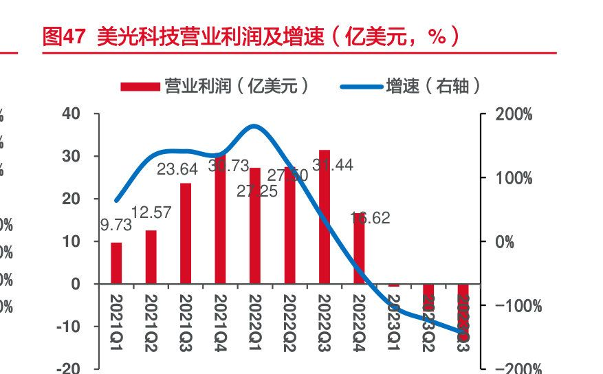

图例：营业利润（亿美元）、增速（右轴）；2021Q1-2023Q3，左轴 -20-40 亿美元，右轴 -200%-200%。营业利润（亿美元）：9.73、12.57、23.64、30.73、27.25、27.50、31.44、16.62，2023Q1-2023Q3 为负值且无数据标签；增速曲线图上无数据标签。

资料来源：美光科技公司公告，东海证券研究所（注：美光科技 2023 年第三季度财务报告截至 2023 年 6 月 1 日）

（3）AI 推动高端存储产品销售增加，SK 海力士二季度营收亏损收窄。SK 海力士成立于 1983 年，公司主要生产和提供电脑和移动产品等 IT 设备必需的 DRAM 和 NAND 闪存产品，在世界 IT 产业中占据主导地位，是世界第二大内存芯片厂商。自 1984 年生产 16Kb SRAM 以来，之后持续提供世界最小、最高速、最低电压的内存半导体，随着移动端和 PC 端用户量日益增多，对内存芯片的需求也越来越多，SK Hynix 加速产品布局，技术发展层层突破。公司 2023 财年第二财季实现营收 7.31 万亿韩元，较一季度 5.09 万亿韩元环比增长 44%，同比减少 47%；经营亏损 2.88 万亿韩元，相比去年同期是由盈转亏，环比收窄 15%；净亏损 2.99 万亿韩元，净利润率-41%优于 Q1 和去年 Q4。尽管 PC、移动端市场弱势，DDR4 等普通 DRAM 价格持续下降，但随着以 ChatGPT 为中心的生成式 AI 市场的扩大，用于 AI 服务器的存储器产品需求强势，HBM3、高性能 DDR5 和 LPDDR5 DRAM 等高价格、高配置产品销售增加，DRAM 整体 ASP 比第一季度有所提高。

---

<!-- 原文第 29 页 -->

**图 48 SK 海力士营业收入及增速（万亿韩元，%）**

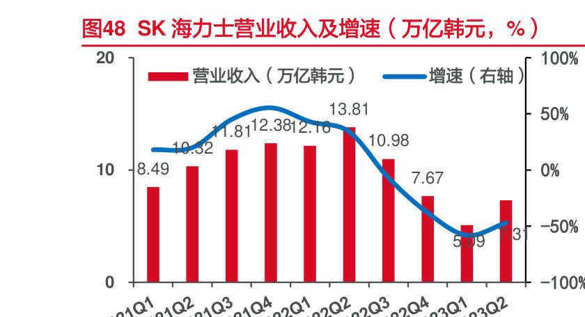

图例：营业收入（万亿韩元）、增速（右轴）；2021Q1-2023Q2，左轴 0-20 万亿韩元，右轴 -100%-100%。营业收入（万亿韩元）：8.49、10.32、11.81、12.38、12.16、13.81、10.98、7.67、5.09、7.31；增速曲线图上无数据标签。

资料来源：SK 海力士公司公告，东海证券研究所整理（注：SK 海力士 2023 年第二季度财务报告截至 2023 年 6 月 30 日）

**图 49 SK 海力士营业利润及增速（万亿韩元，%）**

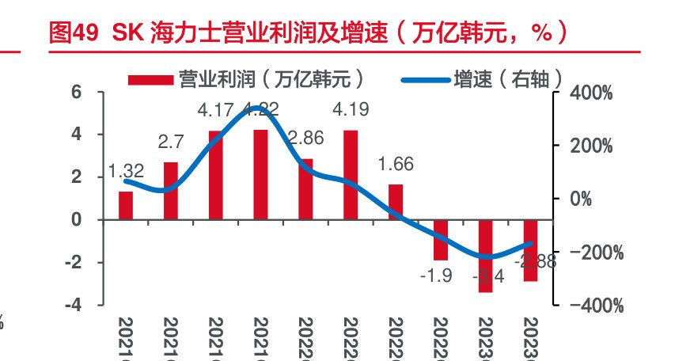

图例：营业利润（万亿韩元）、增速（右轴）；2021Q1-2023Q2，左轴 -4-6 万亿韩元，右轴 -400%-400%。营业利润（万亿韩元）：1.32、2.7、4.17、4.22、2.86、4.19、1.66、-1.9、-3.4、-2.88；增速曲线图上无数据标签。

资料来源：SK 海力士公司公告，东海证券研究所整理（注：SK 海力士 2023 年第二季度财务报告截至 2023 年 6 月 30 日）

（4）国内存储厂商经营状况下滑，多数业绩表现不佳。面对全球消费电子行业需求疲软、产业库存较高、全球通胀、新冠疫情、经济放缓等多重因素叠加，半导体存储行业需求下滑，存储产品价格下滑，市场整体表现下行趋势。国内存储厂商财务表现来看，大多数厂商出现营收、归母净利润下滑，盈利水平下降，个别厂商如聚辰股份，把握 DDR 内存模组换代升级以及汽车级 EEPROM 芯片供应短缺带来的市场发展机遇，应用于 DDR5 内存模组、汽车电子及工业控制等高附加值市场的产品于 2021 年第四季度起大批量供货，带动公司收入规模和资产规模持续扩张。随着 2023 年下半年消费端需求逐步恢复，存储芯片价格逐渐回暖，各厂商库存水平恢复正常，存储厂商业绩情况有望呈现阶段性恢复。

**表 8 国内部分存储厂商 2022 年经营业绩情况（亿元，%）**

| 公司 | 年份 | 营收（亿元） | 营收增速（%） | 归母净利润（亿元） | 归母净利润增速（%） |
| --- | --- | --- | --- | --- | --- |
| 江波龙 | 2020 | 72.76 | 27.19% | 2.76 | 115.48% |
| 江波龙 | 2021 | 97.49 | 33.99% | 10.13 | 266.73% |
| 江波龙 | 2022 | 83.30 | -14.55% | 0.73 | -92.81% |
| 兆易创新 | 2020 | 44.97 | 40.40% | 8.81 | 45.11% |
| 兆易创新 | 2021 | 85.10 | 89.25% | 23.37 | 165.33% |
| 兆易创新 | 2022 | 81.30 | -4.47% | 20.53 | -12.16% |
| 北京君正 | 2020 | 21.70 | 539.40% | 0.73 | 24.79% |
| 北京君正 | 2021 | 52.74 | 143.07% | 9.26 | 1165.27% |
| 北京君正 | 2022 | 54.12 | 2.61% | 7.89 | -14.79% |
| 佰维存储 | 2020 | 16.42 | 39.90% | 0.27 | 46.74% |
| 佰维存储 | 2021 | 26.09 | 58.92% | 1.17 | 326.59% |
| 佰维存储 | 2022 | 29.86 | 14.44% | 0.71 | -38.91% |
| 东芯股份 | 2020 | 7.84 | 52.71% | 0.20 | 130.60% |
| 东芯股份 | 2021 | 11.34 | 44.62% | 2.62 | 1240.27% |
| 东芯股份 | 2022 | 11.46 | 1.03% | 1.85 | -29.17% |
| 聚辰股份 | 2020 | 4.94 | -3.80% | 1.63 | 71.33% |
| 聚辰股份 | 2021 | 5.44 | 10.17% | 1.08 | -33.57% |
| 聚辰股份 | 2022 | 9.80 | 80.21% | 3.54 | 226.81% |
| 普冉股份 | 2020 | 7.17 | 97.62% | 0.86 | 166.20% |
| 普冉股份 | 2021 | 11.03 | 53.75% | 2.91 | 238.39% |
| 普冉股份 | 2022 | 9.25 | -16.15% | 0.83 | -71.44% |
| 恒烁股份 | 2020 | 2.52 | 88.37% | 0.21 | 506.58% |
| 恒烁股份 | 2021 | 5.76 | 128.76% | 1.48 | 616.41% |
| 恒烁股份 | 2022 | 4.33 | -24.76% | 0.21 | -85.63% |

资料来源：Wind，东海证券研究所

---

<!-- 原文第 30 页 -->

## 3.3.头部存储厂商纷纷缩减资本开支

（1）存储大厂纷纷缩减资本支出，降低产能利用率以调配供需平衡。根据 IC insights 数据显示，全球半导体资本支出在 2021 年增长 35%，2022 年增长 19%后，预计 2023 年下降 14%，达 1560 亿美元。细分来看，在存储领域，以 SK 海力士和美光科技为首的存储芯片厂商对半导体投资支出显著下滑，其中，SK 海力士在 2023 年降低 50%资本支出，美光在 2023 年资本支出下降 42%，存储厂商龙头三星电子 2022 年只增加了 5%的资本支出，2023 年维持上年同等水平。当前，存储市场处于下行周期，全球存储厂商面临价格下降、产业本身的周期属性以及外部经济环境下行因素，为应对持续低迷的存储芯片市场，三星电子、美光科技、SK 海力士、西部数据等存储芯片大厂都宣布将于 2023 年大幅度减产、削减资本开支，改善供需结构。

**图 50 全球半导体行业资本支出情况（十亿美元，%）**

柱状图，2021-2023 年，纵轴 0-200 十亿美元；图例：半导体行业、三星电子、SK海力士、美光科技。柱上标注（十亿美元）：

| 年份 | 半导体行业 | 三星电子 | SK海力士 | 美光科技 |
| --- | --- | --- | --- | --- |
| 2021 | 153.1 | 38.1 | 11.7 | 9.7 |
| 2022 | 181.7 | 40.2 | 15.9 | 12 |
| 2023 | 156 | 40.2 | 8 | 7 |

资料来源：IC Insights，东海证券研究所

**图 51 各大存储原厂缩减资本开支**

| 存储原厂 | 减少产出 | 减少资本支出 | 其他措施 |
| --- | --- | --- | --- |
| 三星电子 | 4月宣布对存储芯片减产之后，7月份宣布延长减产措施，并额外调整NAND闪存在内特定 | 优化旧制程产线，灵活调整2023年设备方面的资本支出 | 集团内部资金拆借支持半导体部门资本支出 |
| SK海力士 | 围绕收益较低产品线减产，进一步削减NAND产量5%-10% | 2023年资本支出在原有15-20万亿韩元基础上削减50%以上 | 削减管理岗位人数(20%-30%) |
| 美光科技 | 将DRAM和NAND晶圆的开工量减少约20%，DRAM bit同比供应将减少，NAND bit供应增长将显著低于之前的估计 | 2023年资本支出由120亿美元减少至70-75亿美元，下降42%，减少2024年规划资本支出 | 放缓技术升级，降低运营成本(裁员比例由2022年预计的10%提升至15%) |
| 西部数据+铠侠 | 调整横滨、北上NAND Flash工厂产量，从2022年10月开始消减约30%产量 | 2023年资本支出减少至23亿美元，下降15% | 2022年11月开始实施不超过10%的裁员计划 |

资料来源：CFM 闪存市场，东海证券研究所

（2）存储芯片价格下跌幅度减缓，短期有望筑底反弹。截至 2023 年 8 月，年初至今 DRAM 现货价格下跌 30%左右，虽然 DRAM 厂商较早计划减产，但由于今年服务器需求不如预期，服务器 DRAM 供应整体溢出严重，部分现货 DDR 颗粒供应过剩，原厂不断收缩供应过剩的 DDR4 转向利润更高的 DDR5，市场供需状况在产能调动中持续变化，供需两端持续博弈，部分 DRAM 行情短期承压。目前存储行情位于底部横盘阶段，市场仍然处于争夺存量需求的阶段，在上游厂商减产、资源拉涨和消费持续复苏的带动下，预计下半年存储行情将持续回暖。

**图 52 2022 年 3 月-2023 年 8 月 DRAM 现货平均价（美元）**

折线图，横轴 2022-03 至 2023-08，纵轴 0-9 美元；图例 6 条曲线：DRAM:DDR3 4Gb 512Mx8 1600MHz、DRAM:DDR4 16Gb(2Gx8)2666 Mbps、DRAM:DDR4 16Gb(2Gx8)eTT Mbps、DRAM:DDR4 8Gb(1Gx8)2666 Mbps、DRAM:DDR4 8Gb(1Gx8)eTT、DRAM:DDR4 8Gb(512Mx16)2666 Mbps。曲线图上无数据标签。

资料来源：同花顺 iFinD，东海证券研究所

---

<!-- 原文第 31 页 -->

（3）NAND Flash 价格日益趋紧，部分产品价格出现上扬趋势。截至 2023 年 8 月 28 日，SLC 2Gb 256MBx8/SLC 1Gb 128MBx8 现货价格分别为 0.79/0.82 美元，环比 7 月 28 日跌幅为 1.13%/2.26%；MLC 64Gb 8GBx8/MLC 32Gb 4GBx8 现货价格分别为 3.86/2.06 美元，环比小幅增长 0.26%/0.34%，巩固了 NAND 资源涨价趋势；3D TLC 256Gb 现货价格为 2.10 美元，环比保持不变。随着存储大厂纷纷宣布大幅减产，NAND 芯片供给端过剩现象将进一步改善，8 月渠道需求环比有所恢复，存储行情有底部反转迹象。

**图 53 2022 年 1 月-2023 年 8 月 NAND Flash 现货平均价（美元）**

折线图。纵轴：0、1、2、3、4、5（美元）；横轴：2022-01 至 2023-08 逐月（图中未标注各期数值）。图例（5 条曲线）：

- Flash:SLC 2Gb 256MBx8
- Flash:SLC 1Gb 128MBx8
- Flash:MLC 64Gb 8GBx8
- Flash:MLC 32Gb 4GBx8
- Flash:3D TLC 256Gb

资料来源：同花顺 iFinD，东海证券研究所

（4）美光在华销售产品未通过网络安全检查，国产化自主安全可控需求凸显。2023 年 5 月 21 日，网信中国发文称，网络安全审查办公室依法对美光公司在华销售产品进行了网络安全审查，审查发现，美光公司产品存在较严重网络安全问题隐患，对我国关键信息基础设施供应链造成重大安全风险，影响我国国家安全。为此，网络安全审查办公室依法作出不予通过网络安全审查的结论。按照《网络安全法》等法律法规，国内关键信息基础设施的运营者应停止采购美光公司产品。美光是美国的存储芯片行业龙头，也是全球第三大存储芯片巨头，审查结果将影响美光的产品在中国市场的销售，三星、SK 海力士将逐渐取而代之，中国的存储厂商也能获得更多市场机会，此前采购美光存储晶圆、芯片的中国存储模组制造企业将进行产品结构调整。

---

<!-- 原文第 32 页 -->

**图 54 全球存储厂商市占率梯队情况**

三座金字塔示意（自塔尖向下为市占率由高到低的梯队），自左至右为 DRAM、NAND Flash、NOR Flash：

- DRAM：三星、美光、海力士垄断了 95%的份额 → 南华科技、华邦电子 → 其他
- NAND Flash：三星 → 铠侠、海力士、西部数据、美光、英特尔 → 其他
- NOR Flash：华邦、旺宏、兆易创新市占率排名前三，合计占比达 91% → 赛普拉斯、美光 → 其他

图下方居中注释：全球存储厂商市占率梯队情况

资料来源：CFM 闪存市场，IC Insights，CINNO Research，东海证券研究所整理

（5）美光在华销售份额较高，国产替代空间广阔。根据美光科技 2022 年财报数据，2022 财年美光营收为 307.58 亿美元，其中中国内地为 33.11 亿美元，占比为 11%，是除美国和中国台湾外第三大市场。在美光销售的产品中，DRAM 内存是其最主要的来源，2022 年营收 223.86 亿美元，占比 73%，NAND 闪存是第二大产品，2022 年营收 78.11 亿美元，占比 25%。根据 IC Insights 的数据，全球车规 DRAM 市占率前三分别为美光（45%）、北京君正（15%）和三星（11%），随着美光在华销售产品受到限制，国内车载存储龙头北京君正最先受益；SLC NAND 领域，国内龙头东芯股份有望从中受益；此外，根据 CINNO Research 数据，2020 年美光在全球 NOR Flash 市场占约 4%的份额，国内 NOR Flash 龙头厂商兆易创新有望加速产品升级以及提高市占率。

**图 55 2021-2022 财年美光科技分产品收入（亿美元）**

柱状图。纵轴：0、50、100、150、200、250、300（亿美元）；横轴：2021、2022。图例：DRAM（亿美元）、NAND（亿美元）、Other（亿美元）。图中标注数值：

| 产品 | 2021 | 2022 |
| --- | --- | --- |
| DRAM（亿美元） | 200.39 | 223.86 |
| NAND（亿美元） | 70.07 | 78.11 |
| Other（亿美元） | 6.59 | 5.61 |

资料来源：美光科技公司公告，东海证券研究所

**图 56 2022 年美光科技分地区营收情况（亿美元，%）**

饼图，标注为“营收金额，占比”。图例：中国内地、中国台湾、中国香港、美国、日本、其他地区。图中标注数值：

| 地区 | 营收（亿美元） | 占比 |
| --- | --- | --- |
| 中国内地 | 33.11 | 11% |
| 中国台湾 | 61.85 | 20% |
| 中国香港 | 16.65 | 5% |
| 美国 | 160.26 | 52% |
| 日本 | 16.96 | 6% |
| 其他地区 | 18.75 | 6% |

资料来源：同花顺 iFinD，东海证券研究所

---

<!-- 原文第 33 页 -->

## 4.公司介绍

### 4.1.兆易创新：国内 NOR Flash 龙头厂商，多产品线多赛道布局

（1）持续完善产品结构，支撑业务稳健发展。兆易创新是一家广泛布局于存储芯片、微控制器、传感器芯片的半导体设计厂商，公司成立于 2005 年 4 月，公司前身是北京芯技佳易微电子科技有限公司，2009 年 12 月正式更名为北京兆易创新科技有限公司。在存储业务布局方面，公司 2008 年成功量产 180nm 串行 NOR Flash，2013 年推出业界第一颗 SPI NAND Flash，2017 年 10 月，公司联合合肥长鑫，开展 19nm 制程的 12 英寸 DRAM 项目，首次涉足 DRAM 市场，并于 2021 年 6 月发布首款自有品牌 DRAM 产品。公司存储器产品可分为三个部分，NOR Flash、SLC NAND Flash 和 DRAM，在 NOR Flash 领域，公司市场占有率全球第三、中国第一，累计出货量近 212 亿颗；在 NAND Flash 领域，公司实现了从 SPI NOR Flash 到 SPI NAND Flash 车规级产品的全面布局，为车载应用的国产化提供丰富多样的选择；在 DRAM 领域，公司自研 DRAM 产品组合，在已有 DDR4 产品基础上，推出 DDR3L 产品，广泛应用在智慧家庭、工业、车载影音系统等领域。

**图 57 兆易创新存储业务布局历程**

横向时间轴，事件标注分列轴线上、下两侧：

- 2005 年：公司前身北京芯技佳易微电子科技有限公司成立
- 2008 年：量产 180nm 串行 NOR Flash
- 2009 年：正式更名为北京兆易创新科技有限公司
- 2011 年：量产 90nm SPI NOR Flash，并切入手机市场
- 2013 年：量产 65nm SPI NOR Flash，退出 32bit MCU，量产利基型 SPI NAND
- 2016 年：上交所主板上市
- 2017 年：联合合肥长鑫推动 DRAM 存储项目，量产 38nm SPI NAND Flash
- 2019 年：SPI NOR Flash 产品通过 AEC-Q100 认证
- 2020 年：量产 55nm SPI NOR Flash，量产 24nm 4Gb SPI NAND Flash
- 2021 年：发布首款自有品牌 DRAM

资料来源：兆易创新招股说明书，前瞻产业研究院，东海证券研究所

（2）业绩保持高增长态势，受终端需求不振短期下滑。收入端来看，公司营业收入从 2018 年 22.46 亿元增长至 2022 年 81.3 亿元，近五年复合增长率为 37.9%，得益于前瞻性的战略布局和持续研发创新，以及应对市场供需变化的快速反应能力，公司实现了经营业绩高速成长，2021 年公司营收同比增长 89.25%。利润端来看，归母净利润从 2018 年 4.05 亿元增长至 2022 年 20.53 亿元，近五年复合增长率为 50.05%，2021 年同比增长 165.33%。2022 年，受经济环境、地缘政治冲突等外部因素影响，存储行业整体面临周期下行压力，消费电子市场整体表现低迷，市场需求疲软，行业仍处于库存消化调整期，公司产品销售价格承压，进一步导致营业收入和归母净利润出现下滑。

---

<!-- 原文第 34 页 -->

**图 58 2018-2023H1 兆易创新营收及增速（亿元，%）**

柱状图（柱为营业收入，右轴折线为增速）。左轴：20、40、60、80、100（亿元）；右轴：-60%、-40%、-20%、0%、20%、40%、60%、80%、100%。横轴：2018、2019、2020、2021、2022、2023H1。图例：营业收入（亿元）、增速（右轴）。图中标注数值：

| 期间 | 营业收入（亿元） | 增速（右轴） |
| --- | --- | --- |
| 2018 | 22.46 | 10.65% |
| 2019 | 32.03 | 42.62% |
| 2020 | 44.97 | 40.40% |
| 2021 | 85.1 | 89.25% |
| 2022 | 81.3 | -4.47% |
| 2023H1 | 29.66 | -37.97% |

资料来源：Wind，东海证券研究所

**图 59 2018-2023H1 兆易创新利润端情况（亿元，%）**

柱状图（柱为归母净利润，右轴折线为增速）。左轴：0、10、20、30（亿元）；右轴：-100%、-50%、0%、50%、100%、150%、200%。横轴：2018、2019、2020、2021、2022、2023H1。图例：归母净利润（亿元）、增速（右轴）。图中标注数值：

| 期间 | 归母净利润（亿元） | 增速（右轴） |
| --- | --- | --- |
| 2018 | 4.05 | 1.91% |
| 2019 | 6.07 | 49.85% |
| 2020 | 8.81 | 45.11% |
| 2021 | 23.37 | 165.33% |
| 2022 | 20.53 | -12.16% |
| 2023H1 | 3.36 | -78.00% |

资料来源：Wind，东海证券研究所

（3）盈利水平稳健，费用端管控良好。受终端智能化需求和供应链本土化趋势，公司产品市场需求持续旺盛，毛利率从 2018 年 38.25%增长至 2022 年 47.66%，净利率也从 2018 年 17.99%增长至 25.25%，保持稳定增长态势。此外，公司积极开拓新市场、新客户，优化产品和客户结构，费用端保持良好水平，近年来，由于人员规模增加、员工报酬增加、以及股权激励费用增加，导致人工费用增加，销售/管理/研发费率有所提高。

**图 60 2018-2023H1 兆易创新毛利率与净利率情况（%）**

折线图。纵轴：0%、10%、20%、30%、40%、50%；横轴：2018、2019、2020、2021、2022、2023H1。图例：毛利率（%）、净利率（%）。图中标注数值：

| 期间 | 毛利率（%） | 净利率（%） |
| --- | --- | --- |
| 2018 | 38.25% | 17.99% |
| 2019 | 40.52% | 18.90% |
| 2020 | 37.38% | 19.58% |
| 2021 | 46.54% | 27.46% |
| 2022 | 47.66% | 25.25% |
| 2023H1 | 33.43% | 11.33% |

资料来源：Wind，东海证券研究所

**图 61 2018-2023H1 兆易创新费用率情况（%）**

折线图。纵轴：2%、4%、6%、8%、10%、12%、14%、16%、18%；横轴：2018、2019、2020、2021、2022、2023H1。图例：销售费率（%）、管理费率（%）、研发费率（%）。图中标注数值（部分标签互相重叠）：

| 期间 | 销售费率（%） | 管理费率（%） | 研发费率（%） |
| --- | --- | --- | --- |
| 2018 | 3.43% | 5.63% | 9.26% |
| 2019 | 3.90% | 5.33% | 11.34% |
| 2020 | 4.32% | 4.77% | 11.07% |
| 2021 | 2.60% | 4.59% | 9.89% |
| 2022 | 3.27% | 5.23% | 11.51% |
| 2023H1 | 4.34% | 5.80% | 16.09% |

资料来源：Wind，东海证券研究所

（4）存储业务筑牢根基，多元化布局助力稳健经营。公司业务是多赛道多产品线的组合布局，目前主要是存储器、微控制器和传感器三大类，存储器又分为 SPI NOR、SLC NAND 和 DRAM，微控制器包括 ARM 核和 RISC-V 开源内核，传感器包括触控和指纹识别芯片。从业务收入情况来看，存储业务是公司收入的主要来源，2019-2023H1 年占营收比例均保持在 60%以上，公司各项业务整体上均保持稳定增长态势，2022 年存储业务、传感器业务收入减少，主要是受消费市场需求疲软影响，得益于公司多元化产品布局，其来自工业、网通领域的收入增加弥补了消费领域的收入下滑，并带动微控制器业务收入增长。

---

<!-- 原文第 35 页 -->

**图 62 2019-2023H1 兆易创新营收结构（亿元）**

柱状图（按年分组，各组内依次为存储芯片、MCU、传感器、其他）。纵轴：0、10、20、30、40、50、60（亿元）；横轴：2019、2020、2021、2022、2023H1。图例：存储芯片（亿元）、MCU（亿元）、传感器（亿元）、其他（亿元）。图中标注数值（“其他”系列无数据标签）：

| 期间 | 存储芯片（亿元） | MCU（亿元） | 传感器（亿元） |
| --- | --- | --- | --- |
| 2019 | 25.56 | 4.44 | 2.03 |
| 2020 | 32.83 | 7.55 | 4.50 |
| 2021 | 54.51 | 24.56 | 5.46 |
| 2022 | 48.26 | 28.29 | 4.35 |
| 2023H1 | 20.13 | 7.72 | 1.77 |

资料来源：Wind，东海证券研究所

**图 63 2022 年兆易创新业务占比情况（%）**

饼图，标注为“营收金额，占比”。图例：存储芯片（亿元）、MCU（亿元）、传感器（亿元）、其他（亿元）。图中标注数值：

| 业务 | 营收（亿元） | 占比 |
| --- | --- | --- |
| 存储芯片 | 48.26 | 59% |
| MCU | 28.29 | 35% |
| 传感器 | 4.35 | 5% |
| 其他 | 0.40 | 1% |

资料来源：Wind，东海证券研究所

（5）公司主要关注要素：1）NOR Flash 方面，公司推出 512Mb、1Gb、2Gb 的大容量 SPI NOR Flash 产品，填补国产空白，在汽车应用上，公司 GD25 产品全面满足车规级 AEC-Q100 认证，SPI NOR Flash 车规级产品 2Mb~2Gb 容量已全线铺齐，为市场提供全国产化车规级闪存产品；2）NAND Flash 方面，38nm 和 24nm 两种制程全面量产，容量覆盖 1Gb~8Gb，其中车规产品 GD5F 系列 SPI NAND，容量覆盖 1Gb~4Gb，38nm SLC NAND Flash 车规级产品搭配车规级 SPI NOR Flash，为进入车用市场提供更多机会；3）DRAM 方面，公司已量产 DDR4、DDR3L 产品，并通过与代工厂商的紧密合作关系，获得稳定的产能保障；4）MCU 方面，公司 GD32 MCU 产品已成功量产 38 大产品系列、超过 450 款 MCU 产品，实现对通用型、低成本、高性能、低功耗、无线连接等主流应用市场的全覆盖。

### 4.2.东芯股份：国内领先的存储芯片设计公司，聚焦中小容量存储芯片

（1）紧跟存储芯片国产化浪潮，聚焦中小容量存储芯片领域。东芯股份成立于 2014 年 11 月，是国内领先的存储芯片设计公司，聚焦于中小容量存储芯片的研发、设计和销售，实现芯片设计、制造、封装测试等环节全流程的掌控能力，是少数可以同时提供 NAND、NOR、DRAM 等主要存储芯片完整解决方案的公司。公司搭建了稳定可靠的供应链体系，设计研发并量产的 24nm NAND、48nm NOR 均为我国领先的闪存芯片工艺制程，实现了国内闪存芯片的技术突破。凭借强大的研发能力和稳定的供应链体系，产品已进入国内外众多知名客户，被广泛应用于通讯设备、安防监控、可穿戴设备、移动终端等终端产品。

---

<!-- 原文第 36 页 -->

**图 64 东芯股份产品应用领域**

产品应用领域示意图，四组应用（图中为产品实物图，无数据）：

- 可穿戴设备：智能手环、智能手表、TWS 耳机
- 安防监控：网络智能监控、人工智能摄像头、数字录像机
- 通讯设备：光猫、路由器、机顶盒
- 移动终端：功能手机、POS 机、行车记录仪

资料来源：东芯股份招股说明书，东海证券研究所

（2）收入持续稳健增长，利润端短期承压。收入端，公司营业收入从 2018 年 5.10 亿元增长至 2022 年 11.46 亿元，近五年复合增长率为 22.43%，主要得益于公司产品线不断丰富，对客户的导入陆续完成，产品逐步放量，销售规模有所扩大，且随着市场持续回暖，产品价格上涨。利润端，公司加强布局、完善多渠道供应链及交货方式，在 2020 年首次实现盈利，并在 2021 年实现归母净利润 2.62 亿元，同比增长 1240.27%，2022 年受地缘政治局势紧张、全球经济下滑、半导体行业周期性波动等因素影响，公司利润端有所下滑。

**图 65 2018-2023 H1 东芯股份营收及增速（亿元，%）**

柱状图（柱为营业收入，右轴折线为增速）。左轴：0、5、10、15（亿元）；右轴：-80%、-60%、-40%、-20%、0%、20%、40%、60%、80%。横轴：2018、2019、2020、2021、2022、2023H1。图例：营业收入（亿元）、增速（右轴）。图中标注数值：

| 期间 | 营业收入（亿元） | 增速（右轴） |
| --- | --- | --- |
| 2018 | 5.10 | 42.43% |
| 2019 | 5.14 | 0.71% |
| 2020 | 7.84 | 52.71% |
| 2021 | 11.34 | 44.62% |
| 2022 | 11.46 | 1.03% |
| 2023H1 | 2.4 | -66.42% |

资料来源：Wind，东海证券研究所

**图 66 2018-2023H1 东芯股份利润端情况（亿元，%）**

柱状图（柱为归母净利润，右轴折线为增速）。左轴：-1、0、1、2、3、4（亿元）；右轴：-500%、0%、500%、1000%、1500%。横轴：2018、2019、2020、2021、2022、2023H1。图例：归母净利润（亿元）、增速（右轴）。图中标注数值：

| 期间 | 归母净利润（亿元） | 增速（右轴） |
| --- | --- | --- |
| 2018 | -0.22 | 70.17% |
| 2019 | -0.64 | -192.80% |
| 2020 | 0.20 | 130.60% |
| 2021 | 2.62 | 1240.27% |
| 2022 | 1.85 | -29.17% |
| 2023H1 | -0.75 | -134.99% |

资料来源：Wind，东海证券研究所

（3）规模效应显现叠加产品结构持续优化，盈利能力稳步提升。随着公司销售规模逐步扩大，规模效应开始显现，同时公司在持续微缩制程及提高良率的同时对现有产品的结构进行持续优化，高附加值和高毛利率产品的销售占比提升，如大容量 SLC NAND 等，因此毛利率水平得到很大提升。费用率方面，公司持续加大研发投入力度，保证公司产品的技术先进性，2022 年公司研发费用 1.10 亿元，占营收比重为 9.63%，同比+3.03pct，销售费用、管理费用管控良好，2022 年较上期分别-0.09pct/-0.14pct。

---

<!-- 原文第 37 页 -->

**图 67 2018-2023H1 东芯股份毛利率与净利率情况（%）**

折线图。纵轴：-35%、-25%、-15%、-5%、5%、15%、25%、35%、45%；横轴：2018、2019、2020、2021、2022、2023H1。图例：毛利率（%）、净利率（%）。图中标注数值：

| 期间 | 毛利率（%） | 净利率（%） |
| --- | --- | --- |
| 2018 | 22.28% | -1.79% |
| 2019 | 15.00% | -12.17% |
| 2020 | 22.01% | 1.79% |
| 2021 | 42.12% | 25.05% |
| 2022 | 40.58% | 18.97% |
| 2023H1 | 12.74% | -30.27% |

资料来源：Wind，东海证券研究所

**图 68 2018-2023H1 东芯股份费用率情况（%）**

折线图。纵轴：0%、5%、10%、15%、20%、25%、30%、35%；横轴：2018、2019、2020、2021、2022、2023H1。图例：销售费率（%）、管理费率（%）、研发费率（%）。图中标注数值：

| 期间 | 销售费率（%） | 管理费率（%） | 研发费率（%） |
| --- | --- | --- | --- |
| 2018 | 3.27% | 7.85% | 9.84% |
| 2019 | 3.87% | 8.67% | 9.44% |
| 2020 | 2.60% | 5.80% | 6.06% |
| 2021 | 1.40% | 5.26% | 6.60% |
| 2022 | 1.31% | 5.12% | 9.63% |
| 2023H1 | 4.56% | 12.90% | 34.94% |

资料来源：Wind，东海证券研究所

（4）NOR Flash 业务出现大幅下滑，技术服务收入实现翻倍增长。公司的主要产品为非易失性存储芯片 NAND Flash、NOR Flash，易失性存储芯片 DRAM 以及衍生产品 MCP，从产品收入情况来看，2022 年公司 NAND 产品实现收入 7.08 亿元，同比增长 7.27%，经过多年发展，公司的品牌知名度和产品得到客户的广泛认可，公司 NAND 产品在国内的市场地位日趋凸显，销售规模和盈利能力逐步提升，2022 年 NOR Flash 产品实现收入 0.72 亿元，同比下滑 61.47%，主要由于消费电子需求下滑，穿戴式应用需求走弱所致，同时 DRAM、MCP 和技术服务比去年同期也分别增长了 3.22%、26.38%和 99.70%，技术服务增长较多主要是由于项目进度投入增加，按照履约进度确认技术服务收入增加。

**图 69 2018-2022 年东芯股份营收结构（亿元）**

柱状图（按年分组，各组内依次为 NAND、MCP、DRAM、NOR、其他）。纵轴：0、2、4、6、8（亿元）；横轴：2018、2019、2020、2021、2022。图例：NAND（亿元）、MCP（亿元）、DRAM（亿元）、NOR（亿元）、其他（亿元）。图中标注数值（“其他”系列无数据标签）：

| 期间 | NAND（亿元） | MCP（亿元） | DRAM（亿元） | NOR（亿元） |
| --- | --- | --- | --- | --- |
| 2018 | 1.77 | 1.67 | 0.68 | 0.97 |
| 2019 | 1.48 | 1.22 | 0.61 | 1.66 |
| 2020 | 3.98 | 1.33 | 0.47 | 1.83 |
| 2021 | 6.60 | 1.78 | 0.79 | 1.88 |
| 2022 | 7.08 | 2.25 | 0.82 | 0.72 |

资料来源：Wind，东海证券研究所

**图 70 2022 年东芯股份业务占比情况（%）**

饼图，标注为“营收金额，占比”。图例：NAND（亿元）、MCP（亿元）、DRAM（亿元）、NOR（亿元）、其他（亿元）。图中标注数值：

| 业务 | 营收（亿元） | 占比 |
| --- | --- | --- |
| NAND | 7.08 | 62% |
| MCP | 2.25 | 20% |
| DRAM | 0.82 | 7% |
| NOR | 0.72 | 6% |
| 其他 | 0.60 | 5% |

资料来源：Wind，东海证券研究所

（5）公司主要关注要素：1）NAND Flash，公司在 28nm 及 24nm 的制程上持续开发新产品，不断扩充 SLC NAND Flash 产品线，部分新产品已达到量产标准，公司先进制程的 1xnm NAND Flash 产品已完成首轮晶圆流片及首次晶圆制造，并已完成功能性验证。2）NOR Flash，公司的 NOR Flash 产品在力积电的 48nm 制程上持续进行更高容量的新产品开发，目前 512Mb、1Gb 大容量 NOR Flash 产品都已有样品可提供给客户，此外，公司在中芯国际的 NOR Flash 产品制程从 65nm 推进至 55nm，目前该制程产线已完成首次晶圆流片。3）DRAM，公司设计研发的 LPDDR4x 及 PSRAM 产品均已完成工程样片并已通过客户验证。4）车规产品研发进度方面，公司基于中芯国际 38nm 工艺平台的 SLC NAND Flash 以及基于力积电 48nm 工艺平台的 NOR Flash 均有产品通过 AEC-Q100 测试，将适用于要求更为严苛的车规级应用环境。

---

<!-- 原文第 38 页 -->

### 4.3.北京君正：国内车载存储龙头厂商，“计算+存储+模拟”三线布局

（1）收购美国公司 ISSI 及其子公司 Lumissil，公司发展迈向新台阶。公司成立于 2005 年 7 月，自成立以来，不断研发新产品推向市场，公司产品先后进入指纹识别、教育电子、PMP 等重点应用领域，2011 年 5 月，公司成功在深交所创业板上市。2020 年，公司完成对北京矽成半导体有限公司收购，正式切入存储与模拟芯片赛道，北京矽成经营主体 ISSI 原为美国上市公司，1995 年在纳斯达克上市，主营业务为集成电路存储芯片以及模拟芯片的研发、技术支持和销售。本次并购是公司发展中的重要里程碑，自此，公司拥有三大业务品牌：Ingenic、ISSI 和 Lumissil，分别包括微处理器芯片和智能视频芯片、存储芯片、模拟与互联芯片的业务，公司拥有了面向多类重要芯片领域的核心技术，并拥有全球化的客户资源、渠道资源、市场资源和全球化的人才资源。

**图 71 北京君正发展历程**

横向时间轴，事件标注分列轴线上、下两侧：

- 2005 年：公司前身北京君正集成电路有限公司设立
- 2006 年：公司产品成功进入指纹识别领域
- 2007 年：公司年出货量突破 88 万颗，产品进入便携教育电子领域
- 2008 年：公司年出货量突破 550 万颗，产品进入 PMP 领域
- 2009 年：深圳君正时代集成电路有限公司设立，面向智能家居家电、智能穿戴、二维码、智能门锁等各类智能硬件市场以及生物识别等领域
- 2010 年：公司年出货量持续增长，产品进入平板电脑领域
- 2011 年：公司成功登陆深交所创业板
- 2014 年：合肥君正科技有限公司成立，积极拓展智能视频和泛视频类应用领域
- 2020 年：完成对北京矽成半导体有限公司收购，公司正式切入存储与模拟芯片赛道

资料来源：北京君正招股说明书，公司公告，东海证券研究所整理

（2）业绩保持高增长态势，短期扰动不改长期发展势头。收入端，公司营业收入从 2018 年 2.60 亿元增长至 2022 年 54.12 亿元，近五年复合增长率为 114%，2022 年，在全球经济局势动荡、通胀率提升、流动性收紧和经济增长乏力背景下，集成电路市场增速相应放缓，市场从芯片供不应求到去库存的下行周期。在 2022 年集成电路设计领域普遍出现业绩压力较大的情况下，公司收入实现逆势增长。利润端，公司归母净利润从 2018 年 0.14 亿元增长至 2022 年 7.89 亿元，近五年复合增长率为 174%，消费电子市场在 2021 年高速增长之后，2022 年陷入低迷，公司总体利润水平也受到影响，出现下滑。随着市场整体库存水平的下降，供需平衡逐渐改善，预计未来消费电子市场有望逐渐复苏，市场需求有望恢复。

**图 72 2018-2023H1 北京君正营收及增速（亿元，%）**

柱状图（柱为营业收入，右轴折线为增速）。左轴：0、20、40、60（亿元）；右轴：-200%、0%、200%、400%、600%。横轴：2018、2019、2020、2021、2022、2023H1。图例：营业收入（亿元）、增速（右轴）。图中标注数值：

| 期间 | 营业收入（亿元） | 增速（右轴） |
| --- | --- | --- |
| 2018 | 2.60 | 40.77% |
| 2019 | 3.39 | 30.69% |
| 2020 | 21.70 | 539.40% |
| 2021 | 52.74 | 143.07% |
| 2022 | 54.12 | 2.61% |
| 2023H1 | 22.21 | -20.79% |

资料来源：Wind，东海证券研究所

**图 73 2018-2023H1 北京君正利润端情况（亿元，%）**

柱状图（柱为归母净利润，右轴折线为增速）。左轴：0、2、4、6、8、10（亿元）；右轴：-200%、0%、200%、400%、600%、800%、1000%、1200%。横轴：2018、2019、2020、2021、2022、2023H1。图例：归母净利润（亿元）、增速（右轴）。图中标注数值：

| 期间 | 归母净利润（亿元） | 增速（右轴） |
| --- | --- | --- |
| 2018 | 0.14 | 107.89% |
| 2019 | 0.59 | 334.02% |
| 2020 | 0.73 | 24.79% |
| 2021 | 9.26 | 1165.27% |
| 2022 | 7.89 | -14.79% |
| 2023H1 | 2.22 | -56.53% |

资料来源：Wind，东海证券研究所

---

<!-- 原文第 39 页 -->

（3）盈利水平保持稳健，费用端持续优化。毛利率方面，2018-2022 年，公司一直保持良好的盈利水平，2020 年由于公司全资子公司北京矽成纳入公司合并报表编制范围，毛利率出现下滑，其余年份公司毛利率维持在 40%左右的较高水平。费用端数据来看，公司近几年费用持续优化，销售费用率、管理费用率逐步下降，此外，公司持续加强技术与产品研发投入，2022 年研发费用占收入比重达 12%，增强核心技术的积累和新产品的更新迭代的同时，也提高了公司的市场竞争力。

**图 74 2018-2023H1 北京君正毛利率与净利率情况（%）**

折线图。纵轴：0%、10%、20%、30%、40%、50%；横轴：2018、2019、2020、2021、2022、2023H1。图例：毛利率（%）、净利率（%）。图中标注数值：

| 期间 | 毛利率（%） | 净利率（%） |
| --- | --- | --- |
| 2018 | 39.86% | 5.20% |
| 2019 | 39.78% | 17.29% |
| 2020 | 27.13% | 3.36% |
| 2021 | 36.96% | 17.47% |
| 2022 | 38.56% | 14.39% |
| 2023H1 | 36.45% | 9.66% |

资料来源：Wind，东海证券研究所

**图 75 2018-2023H1 北京君正费用率情况（%）**

折线图。纵轴：0%、5%、10%、15%、20%、25%、30%；横轴：2018、2019、2020、2021、2022、2023H1。图例：销售费率（%）、管理费率（%）、研发费率（%）。图中标注数值：

| 期间 | 销售费率（%） | 管理费率（%） | 研发费率（%） |
| --- | --- | --- | --- |
| 2018 | 4.11% | 11.83% | 28.48% |
| 2019 | 2.97% | 19.97% | 18.27% |
| 2020 | 6.42% | 4.51% | 15.35% |
| 2021 | 4.90% | 3.03% | 9.88% |
| 2022 | 5.38% | 3.07% | 11.86% |
| 2023H1 | 7.37% | 3.90% | 15.18% |

资料来源：Wind，东海证券研究所

（4）并表后业务规模大幅提高，存储芯片业务筑牢基本面。公司主要产品线包括微处理器芯片、智能视频芯片、存储芯片、模拟与互联芯片，产品被广泛应用于汽车电子、工业与医疗、通讯设备及消费电子等领域。存储业务方面，公司存储芯片产品可分为 SRAM、DRAM 和 Flash 三大类，公司 SRAM 产品品类丰富，包括了不同容量的同步 SRAM、异步 SRAM、高速 QDR SRAM 等产品；DRAM 产品研发包括了从 SDR、DDR1、DDR2、LPDDR2、DDR3 到 DDR4、LPDDR4 等各类产品；公司 Flash 产品线包括了目前全球主流的 NOR Flash 存储芯片和 NAND Flash 存储芯片。从业务收入情况来看，公司各项业务整体上均保持稳定增长态势，其中存储芯片业务是公司收入的主要来源，2022 年收入占比达到 75%。

**图 76 2020-2023H1 北京君正营收结构（亿元）**

柱状图（按年分组，各组内依次为存储芯片、智能视频芯片、模拟与互联芯片、微处理器芯片、计算芯片、其他）。纵轴：0、10、20、30、40、50（亿元）；横轴：2020、2021、2022、2023H1。图例：存储芯片（亿元）、智能视频芯片（亿元）、模拟与互联芯片（亿元）、微处理器芯片（亿元）、计算芯片（亿元）、其他（亿元）。图中标注数值（计算芯片、其他及部分小值柱无数据标签）：

| 期间 | 存储芯片（亿元） | 智能视频芯片（亿元） | 模拟与互联芯片（亿元） | 微处理器芯片（亿元） |
| --- | --- | --- | --- | --- |
| 2020 | 15.25 | 2.91 | 1.87 | —（无数据标签） |
| 2021 | 35.94 | 9.79 | 4.13 | 1.99 |
| 2022 | 40.55 | 6.43 | 4.79 | 1.27 |
| 2023H1 | 15 | —（无数据标签） | 1.88 | 4.73 |

资料来源：Wind，东海证券研究所

**图 77 2022 年北京君正业务占比情况（%）**

饼图，标注为“营收金额，占比”。图例：存储芯片（亿元）、智能视频芯片（亿元）、模拟与互联芯片（亿元）、微处理器芯片（亿元）、其他（亿元）。图中标注数值：

| 业务 | 营收（亿元） | 占比 |
| --- | --- | --- |
| 存储芯片 | 40.55 | 75% |
| 智能视频芯片 | 6.43 | 12% |
| 模拟与互联芯片 | 4.79 | 9% |
| 微处理器芯片 | 1.27 | 2% |
| 其他 | 1.07 | 2% |

资料来源：Wind，东海证券研究所

（5）公司主要关注要素：1）存储芯片领域，公司的 8G  LPDDR4 已完成工程样品的生产并开始向客户送样，新规格的 2G LPDDR2、4G LPDDR4 等产品于报告期内完成了量产工作；公司进行了 16M~128M 不同电压的多款超低功耗、高性价比 NOR Flash 芯片研发与投片工作，其中部分产品于报告期内实现了量产。2）智能视频领域，公司的产品线不断拓展，目前公司有面向安防监控市场的 IPC 产品 T 系列芯片、面向后端 NVR 等设备的 A1 芯片以及面向泛视频类市场的 C100 芯片，公司将在 A1 和 C100 的基础上分别进行下

---

<!-- 原文第 40 页 -->

一代升级产品的研发，从而形成 A 系列和 C 系列产品，公司的产品系列已由单一芯片平台扩展到多芯片平台。3）模拟与互联芯片领域，公司不断丰富车规级、工业级等高品质 LED 驱动芯片的产品种类，继续进行面向汽车应用的 LIN、CAN、GreenPHY、G.vn 等网络传输产品的研发和测试等工作，部分产品进行了样品生产和风险量产，GreenPHY 产品已向客户提供了样品。4）微处理器芯片领域，公司完成了 X1600 系列芯片的测试和量产工作，进行了下一代升级产品 X2600 的研发，该产品在图像处理和显示性能等方面均有进一步提升，具有较高的功能灵活性和扩展性。

### 4.4.江波龙：国内领先的多品类存储厂商，双品牌+四产线双轮驱动成长

（1）聚焦于存储产品和应用，收购 Lexar 进一步开拓海外市场。江波龙电子成立于 1999 年，经过十多年的技术积累，公司打造了 FORESEE 品牌并在存储行业拥有良好的口碑，2011 年发布 FORESEE 品牌 eMMC，SSD 存储产品。2017 年公司成功收购 Lexar，Lexar 1996 年诞生于美国，是具有 27 年历史的国际高端消费类存储品牌，业务涉及摄影、影音、高端移动存储场景领域，在存储领域拥有全球化、全产品、全链路布局。根据 Omdia 数据，2021 年，Lexar 存储卡全球市场份额位列第二名，Lexar 闪存盘全球市场份额位列第三名，根据 TrendForce 发布的 2021 年全球 SSD 模组企业自有品牌渠道市场出货量排名，Lexar 品牌出货量位列该市场全球第四名。2022 年 8 月 5 日，公司成功登陆深交所创业板，同时发布企业级 SSD，跨出企业级 SSD 高端存储领域的第一步。

**图 78 江波龙发展历程**

横向时间轴，事件标注分列轴线上、下两侧：

- 1999 年：深圳市江波龙电子有限公司注册成立，从事 MASK ROM 业务，开启存储之路
- 2002 年：开发出首个基于 AG-AND 型闪存的 U 盘控制芯片，为国内市场提供高兼容性、高性价比的存储解决方案
- 2005 年：研发、生产及销售 SD 卡和 MMC 移动闪存卡
- 2010 年：使用 16 层堆叠技术生产出全球首颗 microSD 32GB 存储产品，为首款 USB 协议的嵌入式存储产品
- 2011 年：创立行业类存储品牌 FORESEE，发布 eMMC、SSD 存储产品
- 2015 年：DRAM 技术实现市场化，推出 LPDDR3 和 eMCP 嵌入式存储产品
- 2017 年：收购国际高端消费类存储品牌 Lexar（雷克沙），成为江波龙全资子公司独立运作；FORESEE 发布 SLC NAND、nMCP 等存储产品
- 2018 年：9 月 30 日起正式改制为“深圳市江波龙电子股份有限公司”；首发 1TB UFS、1TB microSD 卡产品和 1TB PCIe BGA SSD，引领存储行业进入 TB 大容量时代
- 2020 年：江波龙电子正式进军内存条市场，全面覆盖消费级、商用级、企业级内存产品
- 2022 年：8 月 5 日，在深交所挂牌上市；发布中国大陆首款车规级 UFS 和 512Mb SPI NAND Flash；发布企业级 SSD，跨出企业级 SSD 高端存储领域的第一步

资料来源：江波龙公司官网，东海证券研究所

（2）深耕存储行业 20 余年，逐步完善产品布局。通过不断的技术积累和迭代，公司驱动自身规模和价值提升，通过创新封装集成设计和 NAND Flash 主控芯片定制，成功开发了一体化 U 盘模块 UDP 和 SSD 模块 SDP，有效简化产品后端组装工艺，实现规模化、高品质量产，率先在行业中推广应用，为公司带来业务规模和市场价值。2011 年，公司开始自主开发 eMMC 存储器，2019 年开始规模量产工规级、车规级 eMMC 存储器，在国产 eMMC 存储器领域具有市场领先地位。2020 年公司车规级 eMMC 通过 AEC-Q100 可靠性验证标准。

---

<!-- 原文第 41 页 -->

**图 79 江波龙产品发展历程**

| 年份 | 产品 | 内容 |
| --- | --- | --- |
| 2002 | NAND Flash USB | 在U盘开发中自主设计并定制基于AG-AND型闪存的U盘控制芯片 |
| 2006 | MMC mobile | 自主定制电源IC，将单电压Flash应用在双电压MMC mobile产品上 |
| 2008 | UDP模块 | 创新开发一体化封装U盘模块UDP，改变U盘行业生产和商业模式 |
| 2009 | NFC microSD | 自主开发支持NFC的存储卡，获得银联商业认证 |
| 2010 | EUDM | 使用16层堆叠技术生产Micro SD 32GB产品 |
| 2011 | Wi-Fi microSD | 自主开发支持Wi-Fi功能的Micro SD卡 |
| 2012 | tSD | 自主设计采用TSOP48封装的SD协议产品，获“科技部国家重点新产品”认证 |
| 2014 | eMCP | 在国内较早开发eMCP产品，将eMMC和LPDDR3一体化封装 |
| 2015 | Type-C USB3.1 | 发布Type C USB 3.1高速U3产品；利用自主固件使NAND Flash存储器兼容iOS系统 |
| 2016 | Mini SDP | 创新开发一体化SSD模块SDP，再次撬动行业革新 |
| 2017 | PCIe BGA SSD | 采用BGA封装规格封装SSD，创新开发超小尺寸SSD（11.5mm X 13mm） |
| 2018 | NM Card | 全新标准存储卡，尺寸与Nano SIM卡相同，兼容Nano SIM卡槽 |
| 2019 | 工业宽温eMMC | 全面量产工作温度为-40~85°C的工业宽温级eMMC |
| 2020 | 车规级eMMC | 车规级eMMC通过AEC-Q100可靠性验证标准 |

资料来源：江波龙招股说明书，东海证券研究所

（3）产品+品牌双轮驱动，加快产业布局。公司主要从事 Flash 及 DRAM 存储器的研发、设计和销售，提供消费级、工规级、车规级存储器以及行业存储软硬件应用解决方案。公司面向消费电子、工业、通信、汽车、安防、监控等行业应用市场和消费者市场，为客户提供高性能、高品质、创新领先的存储芯片与产品。按产品划分，公司目前拥有嵌入式存储、固态硬盘、移动存储和内存条四大产品线，按品牌划分，公司已经形成了面向工业市场（To B）的 FORESEE 品牌产品矩阵及面向消费者个人市场（To C）的 Lexar（雷克沙）品牌产品矩阵。

**图 80 江波龙四大产品线**

图 80：从左至右为嵌入式存储、固态硬盘、移动存储、内存条四类产品图片及标注。

资料来源：江波龙招股说明书，东海证券研究所

**图 81 江波龙两大品牌产品矩阵**

图 81：左为 FORESEE 产品矩阵，右为 Lexar 产品矩阵（图中标注“Lexar”“Lexar Product Series”）。

资料来源：江波龙公司公告，东海证券研究所

（4）收入持续稳健增长，受行业景气下行利润端短期下滑。收入端来看，公司营业收入从 2018 年 42.28 亿元增长至 2022 年 83.30 亿元，近五年复合增长率为 18.48%。2022 年，公司业绩出现明显下滑，一是受宏观不利因素影响，全球经济下行风险加剧，市场需求持续疲软，存储市场供大于求，量价齐跌；二是 2021 年行业景气度高，公司业绩创造新高，导致 2022 年同比基数较高。利润端来看，2018-2021 年，公司归母净利润保持高速增长，2021 年达到 10.13 亿元，2022 年，由于存储芯片行业整体承压公司利润出现下滑，较上年同期下滑 92.81%。

---

<!-- 原文第 42 页 -->

**图 82 2018-2023H1 江波龙营收及增速（亿元，%）**

| 年份 | 营业收入（亿元） | 增速（%，右轴） |
| --- | --- | --- |
| 2018 | 42.28 | — |
| 2019 | 57.21 | 35.29 |
| 2020 | 72.76 | 27.19 |
| 2021 | 97.49 | 33.99 |
| 2022 | 83.30 | -14.55 |
| 2023H1 | 37.07 | -24.41 |

右轴刻度：-40%、-20%、0%、20%、40%

资料来源：Wind，东海证券研究所

**图 83 2018-2023H1 江波龙利润端情况（亿元，%）**

| 年份 | 归母净利润（亿元） | 增速（%，右轴） |
| --- | --- | --- |
| 2018 | -0.57 | — |
| 2019 | 1.28 | 326.73 |
| 2020 | 2.76 | 115.48 |
| 2021 | 10.13 | 266.73 |
| 2022 | 0.73 | -92.81 |
| 2023H1 | -5.96 | -260.94 |

右轴刻度：-400%、-200%、0%、200%、400%

资料来源：Wind，东海证券研究所

（5）盈利水平稳健，费用端管控良好。毛利率方面，2018-2021 年，公司毛利率一直保持稳定增长趋势，2022 年受宏观环境影响，叠加消费市场的低迷，毛利率有所波动，在原厂减产效应以及宏观经济修复的双重驱动之下，存储市场有望在下半年进入企稳的阶段，公司净利率有望得到恢复。费用端来看，随着公司业务规模的不断扩大，人员数量有所增长，同时公司经营业绩逐年提升，人员绩效薪酬相应有所增长，从而使得销售/管理费率 2022 年有所增长，此外，公司一直持续加大研发投入，2022 年公司研发费用达到 3.56 亿元，公司的研发投入更多集中于企业级存储产品、自研小容量存储芯片等未来高增长潜力的领域，这些新领域都还需要持续的技术投入和资源投入。

**图 84 2018-2023H1 江波龙毛利率与净利率情况（%）**

| 年份 | 毛利率（%） | 净利率（%） |
| --- | --- | --- |
| 2018 | 7.62 | -1.38 |
| 2019 | 10.71 | 2.23 |
| 2020 | 11.96 | 3.80 |
| 2021 | 19.97 | 10.39 |
| 2022 | 12.40 | 0.87 |
| 2023H1 | 0.83 | -16.08 |

纵轴刻度：-20%、-15%、-10%、-5%、0%、5%、10%、15%、20%、25%

资料来源：Wind，东海证券研究所

**图 85 2018-2023H1 江波龙费用率情况（%）**

| 年份 | 销售费率（%） | 管理费率（%） | 研发费率（%） |
| --- | --- | --- | --- |
| 2018 | — | 2.87 | 1.86 |
| 2019 | — | 2.85 | 1.57 |
| 2020 | — | 2.47 | 3.02 |
| 2021 | — | 2.02 | 3.31 |
| 2022 | — | 2.54 | 4.27 |
| 2023H1 | — | 4.49 | 6.66 |

纵轴刻度：0%、2%、4%、6%、8%；图中销售费率折线无数据标签

资料来源：Wind，东海证券研究所

（6）各项业务保持稳定增长，嵌入式存储营收贡献最大。从业务收入情况来看，公司各项业务整体上均保持稳定增长态势，公司主营业务收入主要来源于嵌入式存储、移动存储和固态硬盘，内存条是公司 2020 年新推出的产品，尚处于市场推广期，收入贡献较小，但增长速度较快。嵌入式存储和固态硬盘是公司重点产品，近年来销售规模和占比呈逐年上升趋势，移动存储产品主要包括 U 盘、存储卡及个人便携移动存储设备等，收入规模较为稳定，但随着公司整体收入规模的增长，销售占比显著下降。

---

<!-- 原文第 43 页 -->

**图 86 2017-2022 年江波龙营收结构（亿元）**

柱状堆叠图：纵轴 0-50（亿元），刻度 0、10、20、30、40、50；横轴 2017、2018、2020、2021、2022；图例为嵌入式存储（亿元）、移动存储（亿元）、固态硬盘（亿元）、内存条（亿元）、其他（亿元）；图中无数据标签。

资料来源：Wind，东海证券研究所

**图 87 2022 年江波龙业务占比情况（%）**

饼图，标注为“数值，占比”：

- 嵌入式存储（亿元）：43.66，52%
- 移动存储（亿元）：20.38，25%
- 固态硬盘（亿元）：15.04，18%
- 内存条（亿元）：4.17，5%
- 其他（亿元）：0.05，0%

资料来源：Wind，东海证券研究所

（7）公司主要关注要素：1）嵌入式存储方面，目前公司能够大规模供应 eMMC 5.1 产品，自研固件的 UFS 2.2 产品已经量产出货；在 LPDDR4、LPDDR 4X 之外，成规模送样 FORESEE 品牌的 LPDDR 5，并为后续量产出货做好相应准备；公司自研 SLC NAND Flash 存储芯片产品：512Mbit、1Gbit、2Gbit、4Gbit 均已实现量产，并率先推出了 512 Mb SLC NAND Flash 小容量存储芯片。2）固态硬盘方面，持续拓展企业级和高端消费级 SSD 市场，公司已经推出多款高速 SSD 产品，消费类 PCIe 接口 SSD 最高可实现 7,500MBps/6,500MBps 的读写速度，SATA 接口 SSD 最高可实现 550MBps/500MBps 的读/写速度。3）移动存储方面，大容量产品方面，公司推出 2TB CF express 金卡和 1TB Micro SD PLAY 卡；高速传输产品方面，推出读取速度 1900MB/s，写入速度 1700MB/s 的 CF express 钻石卡产品；创新产品方面，推出指纹识别闪存盘、与 nano SIM 卡同尺寸的 NM Card 产品。4）内存条方面，公司内存条产品线覆盖 DDR4 及 DDR5 系列规格，产品容量包含 4GB 到 64GB，公司亦正在有序导入 DDR5 的 RDIMM 产品，不断丰富公司 RDIMM 产品线。

## 4.5.普冉股份：非易失存储领域新星，“存储+”打开第二成长曲线

（1）非易失性存储新进者，积极拓展“存储+”战略。普冉股份成立于 2016 年，2021 年 8 月 23 日成功登陆上交所科创板，公司在非易失性存储器芯片领域深耕多年，凭借其低功耗、高可靠性的产品优势，在下游客户处积累了良好的品牌认可度，成为了国内 NOR Flash 和 EEPROM 的主要供应商之一。根据存储需求的不同，公司的 NOR Flash 产品应用于低功耗蓝牙模块、TWS 耳机、手机触控和指纹、可穿戴设备、车载导航和安全芯片等领域，EEPROM 产品应用于手机摄像头模组、智能仪表、网络通信、家电等领域。在立足于存储芯片领域的基础上，实施基于先进工艺和存储器优势的“存储+”战略，积极拓展通用微控制器和存储结合模拟的全新产品线。

---

<!-- 原文第 44 页 -->

**图 88 普冉股份发展历程**

| 年份 | 事件 |
| --- | --- |
| 2012 | 普冉半导体（上海）有限公司前身无锡普雅半导体有限公司成立 |
| 2013 | 普冉第一颗产品BLCD Fan Drive研发成功并进入量产 |
| 2014 | 普冉64kb-1024kb IIC EEPROM系列产品研发成功并实现量产 |
| 2015 | 小容量高可靠性的2kb-32kb IIC EEPROM进入量产；普冉第一颗高安全性4Mb SPI NOR Flash产品研发成功并进入量产 |
| 2016 | 普冉半导体（上海）有限公司在上海自贸区注册成立；小容量1Mb-4Mb SPI NOR Flash进入量产；32kb-128kb高可靠性WLCSP EEPROM进入量产 |
| 2017 | 工作温度达到125度的高可靠性4Mb SPI NOR Flash进入量产；具有软件与保护功能的64kb-128kb IIC EEPROM进入量产；超低功耗8Mb&16Mb SPI NOR Flash进入量产 |
| 2018 | 面向物联网应用的超低功耗、宽电压、高可靠性的32Mb&64Mb SPI NOR Flash进入量产；面向3D结构光传感器与虹膜识别应用的1Mb-16Mb SPI NOR Flash进入量产 |
| 2019 | 首颗AECQ 100 P25Q80 Flash进入量产；首颗40nm超低功耗大容量SPI NOR Flash进入量产 |
| 2020 | 整体变更为股份公司 |
| 2021 | 8月23日，在上交所科创板挂牌上市 |

资料来源：普冉股份官网，普冉股份招股说明书，东海证券研究所

（2）业绩持续高增长，受终端需求下降短期承压。收入端，公司营业收入从 2018 年 1.78 亿元增长至 2022 年 9.25 亿元，近五年复合增长率为 51%，2022 年，全球经济总量增速放缓，消费动力不足，消费电子产品等的出货量缩减等影响传导至上游厂商，对公司的主营业务收入规模产生影响，原有存储产品线出货量下降，新产品推出后的上量未达预期，总体经营业绩出现下滑。利润端，公司归母净利润从 2018 年 0.13 亿元增长至 2022 年 0.83 亿元，近五年复合增长率为 59%，2022 年由于行业景气下行，整体出货量和单价均有所下降，导致利润端短期承压。

**图 89 2018-2023H1 普冉股份营收及增速（亿元，%）**

| 年份 | 营业收入（亿元） | 增速（%，右轴） |
| --- | --- | --- |
| 2018 | 1.78 | 129.11 |
| 2019 | 3.63 | 103.64 |
| 2020 | 7.17 | 97.62 |
| 2021 | 11.03 | 53.75 |
| 2022 | 9.25 | -16.15 |
| 2023H1 | 4.69 | -17.71 |

右轴刻度：-50%、0%、50%、100%、150%

资料来源：Wind，东海证券研究所

**图 90 2018-2023 H1 普冉股份利润端情况（亿元，%）**

| 年份 | 归母净利润（亿元） | 增速（%，右轴） |
| --- | --- | --- |
| 2018 | 0.13 | 259.71 |
| 2019 | 0.32 | 141.67 |
| 2020 | 0.86 | 166.20 |
| 2021 | 2.91 | 238.39 |
| 2022 | 0.83 | -71.44 |
| 2023H1 | -0.78 | -175.68 |

右轴刻度：-200%、-100%、0%、100%、200%、300%

资料来源：Wind，东海证券研究所

（3）盈利能力稳健，持续加大研发投入。毛利率方面，由于代工价格变动相对存在一定的滞后，公司销售的主要产品的原材料采购价格仍相对较高，芯片产品的价格与毛利均承受了较大的压力，2022 年公司产品综合毛利率为 29.85%，较去年同期-6.38pct。费用端来看，由于公司规模扩大使得销售、管理人员也有所增加，2022 年销售/管理费率有所提高，研发投入方面，2022 年公司投入研发费用 1.49 亿元，占营业收入的 16.07%，同比提升 7.77pct。通过持续增加的研发投入，公司整体研发能力快速提升，原有产品迭代并实施性能优化，新产品按计划实现量产，产品竞争力和覆盖面进一步增强。

---

<!-- 原文第 45 页 -->

**图 91 2018-2023H1 普冉股份毛利率与净利率情况（%）**

| 年份 | 毛利率（%） | 净利率（%） |
| --- | --- | --- |
| 2018 | 24.79 | 7.50 |
| 2019 | 27.46 | 8.90 |
| 2020 | 23.79 | 11.99 |
| 2021 | 36.23 | 26.40 |
| 2022 | 29.85 | 8.99 |
| 2023H1 | 20.57 | -16.70 |

纵轴刻度：-20%、-10%、0%、10%、20%、30%、40%

资料来源：Wind，东海证券研究所

**图 92 2018-2023H1 普冉股份费用率情况（%）**

| 年份 | 销售费率（%） | 管理费率（%） | 研发费率（%） |
| --- | --- | --- | --- |
| 2018 | 4.00 | 4.02 | 7.55 |
| 2019 | 4.19 | 3.25 | 8.58 |
| 2020 | 2.29 | 2.54 | 6.41 |
| 2021 | 1.96 | 2.28 | 8.30 |
| 2022 | 3.00 | 3.60 | 16.07 |
| 2023H1 | 4.21 | 4.66 | 20.01 |

纵轴刻度：0%、5%、10%、15%、20%、25%

资料来源：Wind，东海证券研究所

（4）存储芯片业务筑基，拓展微控制器及模拟芯片业务。公司的主营业务是非易失性存储器芯片及基于存储芯片的衍生芯片的设计与销售，目前主要产品包括：NORFlash 和 EEPROM 两大类非易失性存储器芯片、微控制器芯片以及模拟产品。从业务收入情况来看，公司各项业务整体上均保持稳定增长态势，其中 NOR Flash 和 EEPROM 芯片业务是公司收入的主要来源，2022 年存储芯片收入占比达到 94%。公司实施“存储+”战略，积极拓展微控制器及模拟芯片领域，依托公司在存储领域的技术优势和平台资源，实现向更高附加值领域和更多元化的市场拓展。

**图 93 2018-2021 年普冉股份营收结构（亿元）**

| 年份 | NOR Flash（亿元） | EEPROM（亿元） | 其他（亿元） |
| --- | --- | --- | --- |
| 2018 | 1.35 | 0.42 | 0.01 |
| 2019 | 2.55 | 1.06 | 0.03 |
| 2020 | 4.93 | 2.22 | 0.02 |
| 2021 | 7.84 | 3.19 | 0.01 |

纵轴刻度：0、2、4、6、8、10（亿元）

资料来源：Wind，东海证券研究所

**图 94 2022 年普冉股份业务占比情况（亿元，%）**

饼图，标注为“数值，占比”：

- 存储芯片：8.72，94%
- 微控制器及其他：0.53，6%

资料来源：Wind，东海证券研究所

（5）公司主要关注要素：1）非易失存储领域有望提高市占率，公司作为非易失性存储新进者，以先进工艺低功耗 NOR Flash 和高可靠性 EEPROM 为核心，公司基于 ETOX 工艺平台并结合既有的低功耗设计，完成了 50nm 及 55nm 工艺下 ETOX NOR Flash 产品多个容量系列的研发并成功量产出货，应用于可穿戴设备、安防、工控等领域；车载 EEPROM 产品完成了 AEC-Q100 标准的全面考核，在车身摄像头和车载中控应用上实现了海外客户的批量交付，并继续向其他国内外客户拓展。2）“存储+”系列产品方面的拓展有望打开第二成长空间，公司基于 ARM 内核的 32 位 M0+ MCU 产品完成研发并顺利量产出货并全面推广，目前 M0+系列已推出 60 余颗产品，应用于家电、监控、通讯传输、BMS 监测保护等领域；支持高通新一代平台的 1.2V 应用 VCM Driver 产品完成研发并进入客户送样和认证阶段，该系列产品目前主要应用在手机摄像头领域。

---

<!-- 原文第 46 页 -->

## 4.6.聚辰股份：国内 EEPROM 芯片龙头厂商，汽车 EEPROM 持续发力

（1）EEPROM 市场规模持续增长，公司是国内市占率龙头厂商。根据 Yole 的数据显示，2021 年存储芯片整体市场规模达到了 1665 亿美元，DRAM 占比为 56.3%，NAND 占比为 40%，NOR 占比为 2.1%，EEPROM 等其他存储器占比为 1.6%（EEPROM 占比最高）。得益于 5G 智能手机出货量、服务器 DDR5 内存模组以及汽车电子等应用领域的需求增长，EEPROM 市场规模一直保持稳定增长，2022 年受下游终端消费需求下降影响，全球 EEPROM 市场规模为 11.52 亿美元，同比增幅减缓为 2%左右，中国地区为 6.82 亿美元，同比增长幅度为 4.5%。从全球 EEPROM 厂商营收来看，第一梯队主要有瑞士意法半导体和美国微芯科技，主要在汽车电子领域占据主导地位；第二梯队厂商有聚辰股份、安森美、普冉股份、上海复旦微电等，主要在消费电子、通讯、家电、工控等领域占据主导地位；第三梯队则是一些地区性的小型制造商。

**图 95 全球及中国 EEPROM 市场规模情况（亿美元）**

| 年份 | 全球EEPROM市场规模（亿美元） | 中国EEPROM市场规模（亿美元） |
| --- | --- | --- |
| 2018 | 8.49 | 3.84 |
| 2019 | 8.83 | 4.05 |
| 2020 | 9.63 | 4.65 |
| 2021 | 11.07 | 6.20 |
| 2022 | 11.52 | 6.82 |

纵轴刻度：0、2、4、6、8、10、12（亿美元）

资料来源：亿渡数据，东海证券研究所

**图 96 全球 EEPROM 生产厂商营收梯队情况**

金字塔三层结构：

| 梯队 | 厂商 | 说明 |
| --- | --- | --- |
| 第一梯队 | 意法半导体、美国微芯科技 | 具有很长的经营历史、营收达到10亿元以上、产品单价高，主要在汽车电子领域占据主导地位，具有很强竞争力的国际品牌。 |
| 第二梯队 | 聚辰股份、安森美、普冉股份、复旦微电、上海贝岭、艾普凌科 | 成立时间较晚、营收在1亿元至10亿元之间、产品单价适中、在消费电子、通讯、家电等领域占据主导地位，并具有很强竞争力的知名品牌。 |
| 第三梯队 | 地区性的小型制造商 | 营收在一千万至1亿之间，单价低的本土中小制造商。 |

资料来源：亿渡数据，东海证券研究所

（2）SPD 与汽车 EEPROM 快速放量，业绩实现高速增长。收入端，公司营业收入从 2018 年 4.32 亿元增长至 2022 年 9.80 亿元，近五年复合增长率为 23%，受益于 DDR 内存模组换代升级以及高可靠性产品的客户认可度及品牌影响力不断提升，公司 SPD 产品以及应用于汽车电子、工业控制等高附加值市场的 EEPROM 产品销量和收入实现高速增长，带动公司收入规模和资产规模持续扩张，2022 年公司全年实现营业收入 9.80 亿元，较上年同期增长 80.21%，在存储行业业绩承压的情况下，公司实现逆势高增长。利润端，公司归母净利润从 2018 年 0.76 亿元增长至 2022 年 3.54 亿元，近五年复合增长率为 47%，2022 年实现归母净利润 3.54 亿元，同比增长 226.81%。

**图 97 2018-2023H1 聚辰股份营收及增速（亿元，%）**

| 年份 | 营业收入（亿元） | 增速（%，右轴） |
| --- | --- | --- |
| 2018 | 4.32 | 25.69 |
| 2019 | 5.13 | 18.78 |
| 2020 | 4.94 | -3.80 |
| 2021 | 5.44 | 10.17 |
| 2022 | 9.80 | 80.21 |
| 2023H1 | 3.17 | -28.25 |

右轴刻度：-40%、-20%、0%、20%、40%、60%、80%、100%

资料来源：Wind，东海证券研究所

**图 98 2018-2023H1 聚辰股份利润端情况（亿元，%）**

| 年份 | 归母净利润（亿元） | 增速（%，右轴） |
| --- | --- | --- |
| 2018 | 0.76 | 205.90 |
| 2019 | 0.95 | 24.95 |
| 2020 | 1.63 | 71.33 |
| 2021 | 1.08 | -33.57 |
| 2022 | 3.54 | 226.81 |
| 2023H1 | 0.64 | -57.18 |

右轴刻度：-200%、-100%、0%、100%、200%、300%

资料来源：Wind，东海证券研究所

---

<!-- 原文第 47 页 -->

（3）毛利率实现高增，费用端整体管控良好。毛利率方面，受益于公司 SPD 产品、高可靠性 EEPROM 产品等高附加值产品销售占比的提升，2022 年公司综合毛利率较上年同期+28.25pct。费用端来看，2022 年公司销售费用率较上年同期+1.34pct，主要由于公司业务规模扩张以及股份支付费用的影响所致，此外，公司一直保持较高的研发投入，面对不断变化的下游应用市场需求，公司持续进行技术升级和产品开发，不断提高产品的竞争力和附加值。

**图 99 2018-2023H1 聚辰股份毛利率与净利率情况（%）**

| 年份 | 毛利率（%） | 净利率（%） |
| --- | --- | --- |
| 2018 | 45.87 | 17.61 |
| 2019 | 40.78 | 18.53 |
| 2020 | 33.72 | 32.97 |
| 2021 | 38.78 | 19.06 |
| 2022 | 67.03 | 35.32 |
| 2023H1 | 47.48 | 17.51 |

纵轴刻度：0%、20%、40%、60%、80%

资料来源：Wind，东海证券研究所

**图 100 2018-2023H1 聚辰股份费用率情况（%）**

| 年份 | 销售费率（%） | 管理费率（%） | 研发费率（%） |
| --- | --- | --- | --- |
| 2018 | 6.13 | 7.62 | 14.67 |
| 2019 | 4.75 | 5.67 | 11.24 |
| 2020 | 4.10 | 4.92 | 10.52 |
| 2021 | 4.47 | 5.30 | 13.66 |
| 2022 | 5.81 | 4.82 | 13.67 |
| 2023H1 | 5.92 | 6.71 | 22.84 |

纵轴刻度：0%、5%、10%、15%、20%、25%

资料来源：Wind，东海证券研究所

（4）EEPROM 芯片业务筑牢基本盘，拓宽智能卡与音圈马达驱动芯片成长空间。公司主要有 EEPROM、音圈马达驱动芯片和智能卡芯片三条产品线，产品广泛应用于智能手机、液晶面板、计算机及周边、汽车电子、工业控制、白色家电、蓝牙模块、通讯、医疗仪器等众多领域。从业务收入情况来看，公司各项业务整体上均保持稳定增长态势，其中 EEPROM 芯片业务是公司收入的主要来源，2022 年实现收入 8.54 亿元，占营收比重达到 87%。公司持续进行技术升级和产品开发，一方面巩固和增强公司在智能手机摄像头模组、液晶面板等下游应用领域的竞争优势，另一方面，进一步拓宽 EEPROM 产品的应用领域，向内存模组、汽车电子及工业控制等更高附加值的市场拓展。

**图 101 2018-2023H1 聚辰股份营收结构（亿元）**

| 年份 | EEPROM（亿元） | 智能卡芯片（亿元） | 音圈马达驱动芯片（亿元） |
| --- | --- | --- | --- |
| 2018 | 3.86 | 0.39 | 0.06 |
| 2019 | 4.53 | 0.48 | 0.12 |
| 2020 | 4.09 | 0.36 | 0.47 |
| 2021 | 4.25 | 0.65 | 0.52 |
| 2022 | 8.54 | 0.69 | 0.57 |
| 2023H1 | 2.49 | 0.24 | 0.43 |

图例含 EEPROM（亿元）、智能卡芯片（亿元）、音圈马达驱动芯片（亿元）、其他（亿元）；纵轴刻度 0、3、6、9（亿元）；“其他”无数据标签

资料来源：Wind，东海证券研究所

**图 102 2022 年聚辰股份业务占比情况（%）**

饼图，标注为“数值，占比”：

- EEPROM（亿元）：8.54，87%
- 智能卡芯片（亿元）：0.69，7%
- 音圈马达驱动芯片（亿元）：0.57，6%

资料来源：Wind，东海证券研究所

（5）公司主要关注要素：1）EEPROM 方面，公司推出全球首款 1.2V 智能手机摄像头 EEPROM 产品，率先通过高通平台的测试认证，成功导入多个终端项目并实现量产；SPD 产品于报告期内大批量供货，成为公司业绩增长的重要驱动力；公司目前已拥有 A1 及以下等级的全系列汽车级 EEPROM 产品，完善在 A0 等级汽车级 EEPROM 的技术积累和产品布局，开发满足不同等级的 ISO 26262 功能安全标准的汽车级 EEPROM 产品。2）智能卡芯片，公司加大对非接触式 CPU 卡芯片、高频 RFID 芯片等新产品的市场拓展力度，并研发新一代非接触逻辑加密卡芯片、新一代 RFID 标签芯片以及超高频 RFID 标签芯片产

---

<!-- 原文第 48 页 -->

品。3）音圈马达驱动芯片，公司依托 EEPROM 产品的客户资源优势，实现向闭环和光学防抖音圈马达驱动芯片等更高附加值的市场拓展。

---

<!-- 原文第 49 页 -->

## 5.风险提示

1）市场竞争加剧的风险：存储芯片行业属于技术密集型产业，国内外企业持续加大存储芯片新技术、新工艺推进，行业竞争较为激烈，行业龙头在资金实力、技术储备、渠道及品牌等方面都具有明显的竞争优势，新进入者如果不能建立有效的策略，保持和增强自身的动态竞争能力，则将会对公司经营业绩产生不利影响。

2）下游需求复苏不及预期的风险：存储下游应用空间广泛，涵盖智能手机、平板电脑、计算机、服务器、汽车电子等等领域，作为存储芯片下游重要的细分市场，消费电子下半年需求复苏情况是存储市场发展的核心驱动因素之一，历史数据来看，下半年为电子产品消费传统旺季，如果下游需求依然疲软或复苏不及预期，则对存储厂商经营业绩产生影响。

3）存储芯片价格恢复不及预期的风险：目前存储芯片行情位于底部横盘阶段，市场仍然处于争夺存量需求的阶段，市场供需状况在产能调动中持续变化，供需两端持续博弈，如果上游厂商减产、缩减资本开支力度不及预期，供需结构得不到有效改善，则会影响下半年存储芯片行情复苏。

---

<!-- 原文第 50 页 -->

## 一、评级说明

|  | 评级 | 说明 |
| --- | --- | --- |
| 市场指数评级 | 看多 | 未来 6 个月内沪深 300 指数上升幅度达到或超过 20% |
|  | 看平 | 未来 6 个月内沪深 300 指数波动幅度在-20%—20%之间 |
|  | 看空 | 未来 6 个月内沪深 300 指数下跌幅度达到或超过 20% |
| 行业指数评级 | 超配 | 未来 6 个月内行业指数相对强于沪深 300 指数达到或超过 10% |
|  | 标配 | 未来 6 个月内行业指数相对沪深 300 指数在-10%—10%之间 |
|  | 低配 | 未来 6 个月内行业指数相对弱于沪深 300 指数达到或超过 10% |
| 公司股票评级 | 买入 | 未来 6 个月内股价相对强于沪深 300 指数达到或超过 15% |
|  | 增持 | 未来 6 个月内股价相对强于沪深 300 指数在 5%—15%之间 |
|  | 中性 | 未来 6 个月内股价相对沪深 300 指数在-5%—5%之间 |
|  | 减持 | 未来 6 个月内股价相对弱于沪深 300 指数 5%—15%之间 |
|  | 卖出 | 未来 6 个月内股价相对弱于沪深 300 指数达到或超过 15% |

## 二、分析师声明：

本报告署名分析师具有中国证券业协会授予的证券投资咨询执业资格并注册为证券分析师，具备专业胜任能力，保证以专业严谨的研究方法和分析逻辑，采用合法合规的数据信息，审慎提出研究结论，独立、客观地出具本报告。

本报告中准确反映了署名分析师的个人研究观点和结论，不受任何第三方的授意或影响，其薪酬的任何组成部分无论是在过去、现在及将来，均与其在本报告中所表述的具体建议或观点无任何直接或间接的关系。

署名分析师本人及直系亲属与本报告中涉及的内容不存在任何利益关系。

## 三、免责声明：

本报告基于本公司研究所及研究人员认为合法合规的公开资料或实地调研的资料，但对这些信息的真实性、准确性和完整性不做任何保证。本报告仅反映研究人员个人出具本报告当时的分析和判断，并不代表东海证券股份有限公司，或任何其附属或联营公司的立场，本公司可能发表其他与本报告所载资料不一致及有不同结论的报告。本报告可能因时间等因素的变化而变化从而导致与事实不完全一致，敬请关注本公司就同一主题所出具的相关后续研究报告及评论文章。在法律允许的情况下，本公司的关联机构可能会持有报告中涉及的公司所发行的证券并进行交易，并可能为这些公司正在提供或争取提供多种金融服务。

本报告仅供“东海证券股份有限公司”客户、员工及经本公司许可的机构与个人阅读和参考。在任何情况下，本报告中的信息和意见均不构成对任何机构和个人的投资建议，任何形式的保证证券投资收益或者分担证券投资损失的书面或口头承诺均为无效，本公司亦不对任何人因使用本报告中的任何内容所引致的任何损失负任何责任。本公司客户如有任何疑问应当咨询独立财务顾问并独自进行投资判断。

本报告版权归“东海证券股份有限公司”所有，未经本公司书面授权，任何人不得对本报告进行任何形式的翻版、复制、刊登、发表或者引用。

## 四、资质声明：

东海证券股份有限公司是经中国证监会核准的合法证券经营机构，已经具备证券投资咨询业务资格。我们欢迎社会监督并提醒广大投资者，参与证券相关活动应当审慎选择具有相当资质的证券经营机构，注意防范非法证券活动。

**上海 东海证券研究所**

地址：上海市浦东新区东方路1928号 东海证券大厦
网址：Http://www.longone.com.cn
座机：（8621）20333275
手机：18221959689
传真：（8621）50585608
邮编：200215

**北京 东海证券研究所**

地址：北京市西三环北路87号国际财经中心D座15F
网址：Http://www.longone.com.cn
座机：（8610）59707105
手机：18221959689
传真：（8610）59707100
邮编：100089

---
