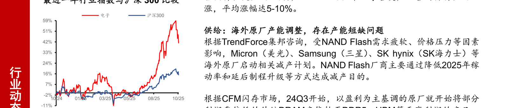

> 原文件：[M157_pdf.dfcfw.com_H3_AP202510211766124995_1.pdf](https://github.com/jadennevercode/CJCC-Knowledge-Base/blob/5ec8511eb834073c8bfbd79c94af196282d483cf/materials/%E8%B7%A8%E9%93%BE%EF%BC%9A%E4%BE%9B%E9%9C%80%E4%B8%8E%E4%BB%B7%E6%A0%BC%E5%8F%A3%E5%BE%84/M157_pdf.dfcfw.com_H3_AP202510211766124995_1.pdf)
> 转换方式：多模态逐页转录（页面图像 + 文本层交叉校验）

<!-- 原文第 1 页 -->

# AI 驱动需求增长，看好本轮存储周期持续性

——存储行业跟踪

增持（维持）

行业: 电子
日期: 2025年10月20日

分析师: 梁瑞
Tel: 021-53686409
E-mail: liangrui@shzq.com
SAC 编号: S0870523110001

**最近一年行业指数与沪深 300 比较**

- 纵轴刻度：59%、51%、42%、33%、24%、16%、7%、-2%、-11%
- 横轴刻度：10/24、01/25、03/25、05/25、08/25、10/25
- 图例：电子（红线）、沪深300（蓝线）

相关报告：

## 主要观点

### 价格：预计 DRAM/NAND 价格持续上涨

9月以来，存储迎来新一轮涨价。闪迪宣布将面向所有渠道和消费者客户的NAND产品价格上调10%以上。西部数据通知客户将逐步提高所有HDD（机械硬盘）产品的价格。三星电子发出第四季度提价通知，计划将部分DRAM价格上调15%至30%，NAND闪存价格上调5%至10%。

预期25Q4延续涨价趋势。根据TrendForce集邦咨询，预估25Q4整体一般型DRAM(Conventional DRAM)价格将季增8-13%，若加计HBM，涨幅将扩大至13-18%；NAND Flash第四季各类产品合约价将全面上涨，平均涨幅达5-10%。

### 供给：海外原厂产能调整，存在产能短缺问题

根据TrendForce集邦咨询，受NAND Flash需求疲软、价格压力等因素影响，Micron（美光）、Samsung（三星）、SK hynix（SK海力士）等海外原厂启动相关减产计划。NAND Flash厂商主要通过降低2025年稼动率和延后制程升级等方式达成减产目的。

根据CFM闪存市场，24Q3开始，以盈利为主基调的原厂就开始将部分利润率偏低的传统DRAM产能转至DDR5、HBM等更高利润的产品。而今年4月，海外原厂接连宣布将停产DDR4、LPDDR4X等旧制程DRAM产品，虽然基于下游应用市场的长尾需求，部分原厂决定针对特定客户维持一定产能供应，但仍存在产能短缺问题。

### 需求：AI 推动存储需求持续增长，看好本轮周期的持续性

**HDD短缺，推动SSD需求增长。** AI推理（AI Inference）应用快速推升实时存取、高速处理海量数据的需求，促使机械硬盘（HDD）与固态硬盘（SSD）供应商积极扩大供给大容量存储产品。由于全球主要HDD制造商近年未规划扩大产线，无法及时满足AI刺激的突发性、巨量储存需求。根据TrendForce集邦咨询，目前NL HDD交期已从原本的数周，急剧延长为52周以上，加速扩大CSP的储存缺口。根据CFM闪存市场，北美市场因面向数据中心的HDD供应紧缺，部分北美客户将采购需求转至企业级存储，服务器NAND市场需求明显增加。

**DRAM需求有望快速增长。** 一方面Server DRAM则因CSP（云端服务供应商）建置动能回温，DDR5产品需求持续增强，2026年CSP的DRAM采购需求有望大幅成长；另一方面，HBM需求持续扩张，Yole Group预测，HBM市场将在2030年前保持33%的年复合增长率，届时其营收将超过DRAM市场总营收的50%。

---

<!-- 原文第 2 页 -->

## 投资建议

我们认为AI需求旺盛推动存储需求的增长，同时由于海外原厂产能限制，25Q4存储涨价趋势预计持续，看好本轮存储大周期。建议关注：兆易创新、德明利、佰维存储、普冉股份等。

## 风险提示

宏观经济波动风险；行业周期波动风险；市场需求不及预期风险；上游晶圆等原材料紧缺和价格波动风险；技术升级迭代和研发失败风险等。

---

<!-- 原文第 3 页 -->

## 分析师声明

作者具有中国证券业协会授予的证券投资咨询资格或相当的专业胜任能力，以勤勉尽责的职业态度，独立、客观地出具本报告，并保证报告采用的信息均来自合规渠道，力求清晰、准确地反映作者的研究观点，结论不受任何第三方的授意或影响。此外，作者薪酬的任何部分不与本报告中的具体推荐意见或观点直接或间接相关。

## 公司业务资格说明

本公司具备证券投资咨询业务资格。

## 投资评级体系与评级定义

|  |  |
| --- | --- |
| 股票投资评级： | 分析师给出下列评级中的其中一项代表其根据公司基本面及（或）估值预期以报告日起 6 个月内公司股价相对于同期市场基准指数表现的看法。 |
| 买入 | 股价表现将强于基准指数 20%以上 |
| 增持 | 股价表现将强于基准指数 5-20% |
| 中性 | 股价表现将介于基准指数±5%之间 |
| 减持 | 股价表现将弱于基准指数 5%以上 |
| 无评级 | 由于我们无法获取必要的资料，或者公司面临无法预见结果的重大不确定性事件，或者其他原因，致使我们无法给出明确的投资评级 |
| 行业投资评级： | 分析师给出下列评级中的其中一项代表其根据行业历史基本面及（或）估值对所研究行业以报告日起 12 个月内的基本面和行业指数相对于同期市场基准指数表现的看法。 |
| 增持 | 行业基本面看好，相对表现优于同期基准指数 |
| 中性 | 行业基本面稳定，相对表现与同期基准指数持平 |
| 减持 | 行业基本面看淡，相对表现弱于同期基准指数 |

相关证券市场基准指数说明：A 股市场以沪深 300 指数为基准；港股市场以恒生指数为基准；美股市场以标普 500 或纳斯达克综合指数为基准。

### 投资评级说明：

不同证券研究机构采用不同的评级术语及评级标准，投资者应区分不同机构在相同评级名称下的定义差异。本评级体系采用的是相对评级体系。投资者买卖证券的决定取决于个人的实际情况。投资者应阅读整篇报告，以获取比较完整的观点与信息，投资者不应以分析师的投资评级取代个人的分析与判断。

## 免责声明

本报告仅供上海证券有限责任公司(以下简称“本公司”）的客户使用。本公司不会因接收人收到本报告而视其为客户。

本报告版权归本公司所有，本公司对本报告保留一切权利。未经书面授权，任何机构和个人均不得对本报告进行任何形式的发布、复制、引用或转载。如经过本公司同意引用、刊发的，须注明出处为上海证券有限责任公司研究所，且不得对本报告进行有悖原意的引用、删节和修改。

在法律许可的情况下，本公司或其关联机构可能会持有报告中涉及的公司所发行的证券或期权并进行交易，也可能为这些公司提供或争取提供多种金融服务。

本报告的信息来源于已公开的资料，本公司对该等信息的准确性、完整性或可靠性不作任何保证。本报告所载的资料、意见和推测仅反映本公司于发布本报告当日的判断，本报告所指的证券或投资标的的价格、价值或投资收入可升可跌。过往表现不应作为日后的表现依据。在不同时期，本公司可发出与本报告所载资料、意见或推测不一致的报告。本公司不保证本报告所含信息保持在最新状态。同时，本公司对本报告所含信息可在不发出通知的情形下做出修改，投资者应当自行关注相应的更新或修改。

本报告中的内容和意见仅供参考，并不构成客户私人咨询建议。在任何情况下，本公司、本公司员工或关联机构不承诺投资者一定获利，不与投资者分享投资收益，也不对任何人因使用本报告中的任何内容所引致的任何损失负责，投资者据此做出的任何投资决策与本公司、本公司员工或关联机构无关。

市场有风险，投资需谨慎。投资者不应将本报告作为投资决策的唯一参考因素，也不应当认为本报告可以取代自己的判断。

---
