> 原文件：[M159_pdf.dfcfw.com_H3_AP202601231818318213_1.pdf](https://github.com/jadennevercode/CJCC-Knowledge-Base/blob/5ec8511eb834073c8bfbd79c94af196282d483cf/materials/%E8%B7%A8%E9%93%BE%EF%BC%9A%E4%BE%9B%E9%9C%80%E4%B8%8E%E4%BB%B7%E6%A0%BC%E5%8F%A3%E5%BE%84/M159_pdf.dfcfw.com_H3_AP202601231818318213_1.pdf)
> 转换方式：多模态逐页转录（页面图像 + 文本层交叉校验）

<!-- 原文第 1 页 -->

电子 | 证券研究报告 — 行业深度

2026 年 1 月 23 日

强于大市

# 存储行业深度报告

## 骐骥驰骋，AI“存”变，国产“储”势，星火燎原

AI 与数据扩张推动存储进入新周期，供需紧张致价格持续上涨，HBM 等新技术迭代需求旺盛，国产存储加速发展机遇显现，给予行业强于大市的评级。

### 支撑评级的要点

- **综述：数据扩张+AI 扩散，存储新周期加速到来。** 在数字经济各领域对存储技术需求不断扩大的推动下，存储市场规模持续上升。从下游应用结构来看，AI 端侧存储需求增长速度显著高于其他细分市场，已成为推动全球存储市场扩张的关键动力。同时大模型技术热潮带动 AI 服务器存储需求快速增长，服务器领域存储需求亦将保持较高增速。价格方面，存储全系产品价格 2025 年已出现较大幅度涨幅，2026 年或进一步上涨，我们认为本轮价格上涨则是由 AI 服务器和通用服务器共同驱动，还存在着结构性的产能转换和多个维度的需求竞争，情况更为复杂，短缺和涨价或将会持续更长时间。
- **供需：结构性供给受限持续，原厂竞逐新技术蓝海，AI 产业链健康度打开远期需求空间。** 资本支出方面：2026 年资本支出重点将转向制程技术升级与混合键合等先进工艺的导入，位元供给增长幅度有限，供不应求的市场状态或将持续全年。技术升级方面：HBM 加速迭代，带宽等性能指标不断迈进。同时随着 AI 推理市场迅速增长，存储行业逐渐步入“后 HBM 时代”——HBF 应运而生。需求方面：从国际领先供应商对于 AI 基础设施配置来看，高性能 HBM、LPDDR5X 仍需求旺盛。从终端需求来看，服务器市场对于存储需求将保持快速增长态势。
- **国产：原厂端奔赴全球标准+产业链自主，产品端锚定平台化+品类升级。** DRAM 方面，长鑫存储已正式推出 LPDDR5X 产品，NAND 方面，长江存储三期建设正迈向 100%设备国产化目标。技术方面，CBA+4F2 在制程节点压力以及混合键合技术积累加持之下或成为国产存储弯道超车的必由之路。我们认为，长江存储和长鑫存储作为国内存储芯片制造龙头企业，生产经营稳中向好，推动建设意志坚定不移，有望为产业链带来诸多机会。此外国内利基存储市场亦将在 AI 定制化存储推动下迎来发展良机。

### 投资建议

- 综合考虑 AI 带来的需求增量及结构供给冲击，我们认为无论短期还是中长期维度，存储产业链或存在高度确定性机会。我们建议关注如下细分方向：1）受益于周期价格波动的经销商及模组产品制造商：香农芯创、江波龙、佰维存储、德明利、开普云；2）专注于利基市场及存储产品配套芯片的 IC 设计公司：【利基存储】：兆易创新、东芯股份、普冉股份、聚辰股份、北京君正；【配套芯片】：澜起科技、联芸科技；3）国产半导体存储器供应链：【设备】：北方华创、中微公司、拓荆科技、迈为股份、精智达、微导纳米、长川科技；【材料】：华海诚科、联瑞新材、深南电路、兴森科技、广钢气体、雅克科技（化工组覆盖）、兴福电子；【CBA DRAM】：晶合集成、汇成股份；【封装】：深科技。

### 评级面临的主要风险

- 行业周期性波动风险
- 技术迭代与竞争加剧风险
- 地缘政治与供应链风险
- AI 需求可持续性风险
- 国产替代与技术突破不及预期风险

相关研究报告

《2026 年 CES 英伟达演讲》20260107
《存储行业点评》20260105
《电子行业 2026 年年度策略》20251226

中银国际证券股份有限公司
具备证券投资咨询业务资格
电子

证券分析师：李圣宣
shengxuan.li@bocichina.com
证券投资咨询业务证书编号：S1300525110001

证券分析师：苏凌瑶
lingyao.su@bocichina.com
证券投资咨询业务证书编号：S1300522080003

---

<!-- 原文第 2 页 -->

# 目录

- **综述：数据扩张+AI 扩散，存储新周期加速到来** …… 4
  - AI 驱动数据生成总量增长，存储需求伴随基础设施应运而生 …… 4
  - 现货价格一路上扬，半导体存储器有望开启景气新周期 …… 6
  - “端”“云”两侧纷至沓来，下游诸多细分迎来边际催化 …… 7
- **供给端：结构性供给受限持续，原厂竞逐新技术蓝海** …… 12
  - 原厂 26 年资本支出供给仍有限，现货资源供给趋紧或将持续 …… 12
  - HBM 仍是兵家必争之地，HBF 专门为推理而生 …… 13
- **需求端：AI 产业链健康度打开远期需求空间** …… 15
  - AI 存储需求激发 HDD 替代效应，NAND FLASH 结构性需求旺盛 …… 15
  - 高端 DRAM 仍为 AI 标配，终端加速转向 LPDDR5X …… 15
  - KV CACHE 催生 NAND 新需求，以存带算趋势渐进 …… 17
  - 服务器市场持续快速增长，涨价或抑制部分消费需求 …… 18
- **国产侧：原厂端奔赴全球标准+产业链自主，产品端锚定平台化+品类升级** …… 19
  - 国产高端新品+产能稳步扩张，抢占 AI 时代国际话语权 …… 19
  - 约束条件寻求“最优解”，CBA+4F2 技术引领“弯道超车” …… 20
  - 利基市场温和起涨，国产存储产品发力做大做强 …… 22
- **投资建议与风险提示** …… 25
  - 投资建议 …… 25
  - 风险提示 …… 25

---

<!-- 原文第 3 页 -->

# 图表目录

- 图表 1. IDC 中国数据生成量预测（2024-2029） …… 4
- 图表 2. 谷歌每月处理的 Tokens 用量突破千亿 …… 4
- 图表 3. 谷歌每月处理的 Tokens 用量迅速增长 …… 4
- 图表 4. 2021-2026 年全球八大 CSP 资本支出情况 …… 5
- 图表 5. 典型数据中心的 capex 构成（2021） …… 5
- 图表 6. Flash Wafer 1Tb TLC 近期行情走势图（20251023-20260122） …… 6
- 图表 7. DDR4 16Gb 3200 近期行情走势图（20251028-20260120） …… 6
- 图表 8. OEM SSD 1TB PCIe 4.0 近期行情走势图（20251028-20260120） …… 6
- 图表 9. DDR4 SODIMM 8GB 3200 近期行情走势图（20251028-20260120） …… 6
- 图表 10. 半导体存储器产业链概览 …… 7
- 图表 11. 全球存储产品市场规模（2020-2029） …… 8
- 图表 12. 全球服务器出货量及 AI 渗透率（2020-2029） …… 9
- 图表 13. 全球手机出货量及 AI 渗透率（2020-2029） …… 9
- 图表 14. 全球 PC 出货量及 AI 渗透率（2020-2029） …… 9
- 图表 15. 全球汽车销量及智能汽车渗透率（2020-2029） …… 10
- 图表 16. 全球 AR/VR 设备出货量及 AI 渗透率（2020-2029） …… 11
- 图表 17. 全球机器人销售收入及具身智能渗透率（2020-2029） …… 11
- 图表 18. 2022-2026 年 DRAM 与 NAND Flash 产业资本支出 …… 12
- 图表 19. 全球 2025/2026 年内存市场与各类别产品成长率预估 …… 13
- 图表 20. HBM 技术路线图 …… 13
- 图表 21. HBF 结构图 …… 14
- 图表 22. Nearline HDD 与 QLC SSD 重点比较 …… 15
- 图表 23. 英伟达 NVL576 …… 15
- 图表 24. 谷歌 TPU …… 15
- 图表 25. 预估 2026 年 LPDDR5X 需求年增幅达 169% …… 16
- 图表 26. LPDRAM 生产正快速向 LPDDR5（X）收敛 …… 16
- 图表 27. KV Cache 工作原理 …… 17
- 图表 28. 英伟达基于 BlueField-4 DPU 构建的推理上下文内存存储平台 …… 17
- 图表 29. 英伟达重构存储架构 …… 17
- 图表 30. 2025/2026 各终端应用存储位元需求量涨跌幅预测 …… 18
- 图表 31. 长鑫存储正式推出 LPDDR5X …… 19
- 图表 32. 长江存储晶栈®Xtacking® 4.0 …… 20
- 图表 33. 标准 6F² 布局与采用垂直通道晶体管的 4F² 布局 …… 21
- 图表 34. 第八代 BiCS FLASH 所采用的 CBA …… 21
- 图表 35. DRAM 技术路线图 …… 22
- 图表 36. 2023.01-2025.12 台股利基存储厂商营收情况 …… 23
- 图表 37. DRAM 标准类型 …… 24
- 图表 38. 紫光国芯 SeDRAM …… 24

---

<!-- 原文第 4 页 -->

## 综述：数据扩张+AI 扩散，存储新周期加速到来

### AI 驱动数据生成总量增长，存储需求伴随基础设施应运而生

根据国际数据公司 IDC 预计，2025 年全球将产生 213.56ZB 数据，到 2029 年将增长一倍以上达到 527.47ZB。其中，中国市场 2025 年将产生 51.78ZB 数据，到 2029 年增长至 136.12ZB，CAGR 将达到 26.9%。

**图表 1. IDC 中国数据生成量预测（2024-2029）**

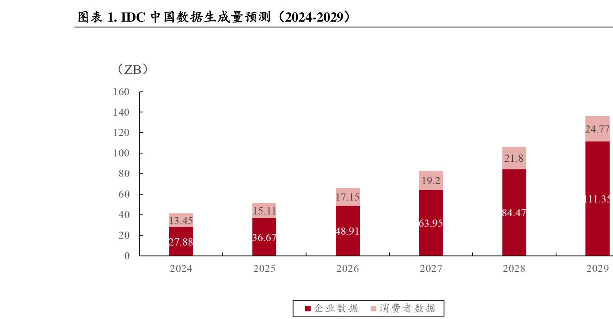

单位：ZB。图例：企业数据（深红色）、消费者数据（浅粉色）。柱上数据标签：

| 年份 | 企业数据 | 消费者数据 |
| --- | --- | --- |
| 2024 | 27.88 | 13.45 |
| 2025 | 36.67 | 15.11 |
| 2026 | 48.91 | 17.15 |
| 2027 | 63.95 | 19.2 |
| 2028 | 84.47 | 21.8 |
| 2029 | 111.35 | 24.77 |

资料来源：199IT 网，IDC，中银证券

其中云端数据生成量将大幅增长，2029 年约有 43%的数据直接在云端生成，高于 2024 年的 24%和 2019 年的 13%，从 2024 到 2029 年的复合年增长率达到 40.9%。

我们认为大模型训推产生的数据仍将驱动数据总量保持高速增长。以谷歌为例，2025 年 10 月，谷歌月均处理的 Tokens 数量已突破千万亿级大关，达到 1.3 千万亿。此外，OpenAI、国内的字节跳动、百度等公司亦达到了日均万亿 Tokens 的处理量级。

**图表 2. 谷歌每月处理的 Tokens 用量突破千亿**

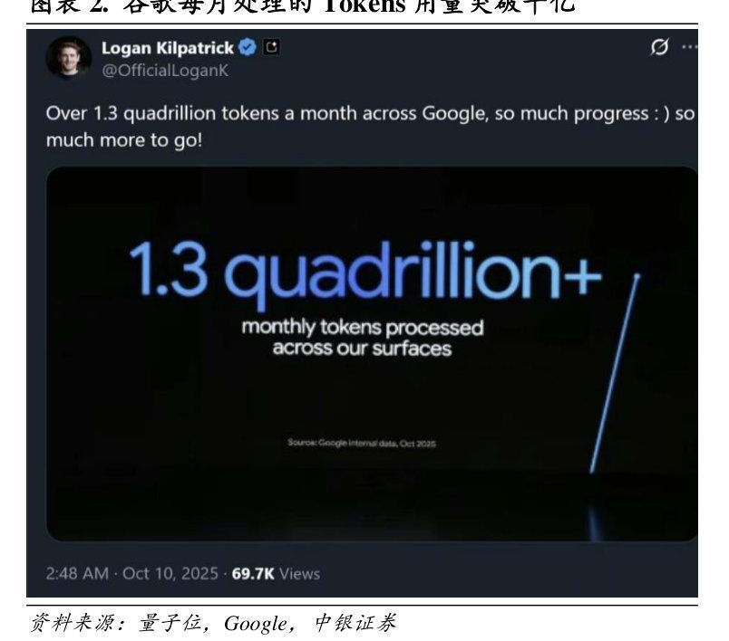

图为 Logan Kilpatrick（@OfficialLoganK）推文截图，推文内容：“Over 1.3 quadrillion tokens a month across Google, so much progress :) so much more to go!”；配图文字：“1.3 quadrillion+ monthly tokens processed across our surfaces”，图内小字“Source: Google internal data, Oct 2025”；推文底部：“2:48 AM · Oct 10, 2025 · 69.7K Views”。

资料来源：量子位，Google，中银证券

**图表 3. 谷歌每月处理的 Tokens 用量迅速增长**

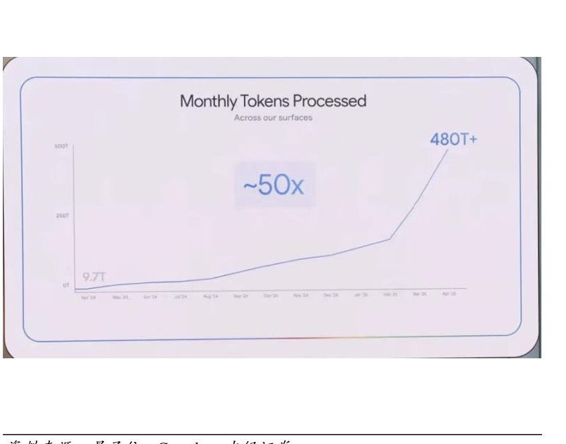

图为折线图，标题“Monthly Tokens Processed”，副标题“Across our surfaces”。纵轴刻度：0T、250T、500T；横轴为月份（Apr'24 起至 Apr'25，月份标签字号过小）。标注：“9.7T”“~50x”“480T+”。

资料来源：量子位，Google，中银证券

---

<!-- 原文第 5 页 -->

资本支出方面，随着北美云端服务大厂陆续更新指引，TrendForce 将 2025 年全球八大主要 CSPs 资本支出总额年增率从原本的 61%上修至 65%。2026 年 CSPs 仍将维持积极的投资节奏，合计资本支出将进一步推升至 6,000 亿美元以上，同比增长约 40%。我们认为 AI 基础建设的长期成长潜能依然充沛。

**图表 4. 2021-2026 年全球八大 CSP 资本支出情况**

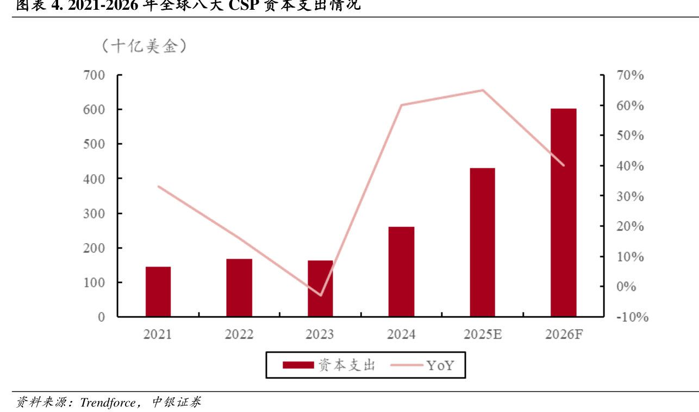

柱状图为资本支出，左轴单位：（十亿美元），刻度 0–700；折线为 YoY，右轴刻度 -10%–70%。横轴：2021、2022、2023、2024、2025E、2026F。图例：资本支出、YoY。柱与折线均无数据标签。

资料来源：Trendforce，中银证券

而存储为数据中心资本支出中重要组成部分，典型数据中心的资本支出中存储占比约为 12%，伴随 AI 基础设施资本支出的持续投入以及存储技术的加速迭代，我们认为其在数据中心成本中的占比还有望提升，我们将在后文逐一论述。

**图表 5. 典型数据中心的 capex 构成（2021）**

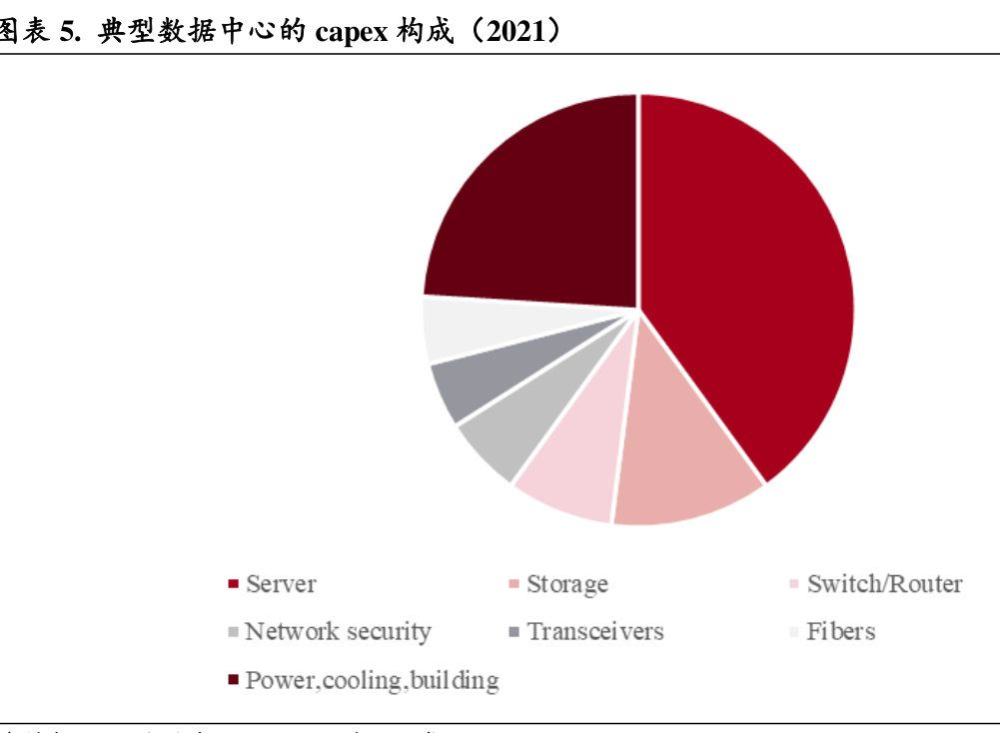

饼图，图例：Server、Storage、Switch/Router、Network security、Transceivers、Fibers、Power,cooling,building。饼图无百分比数据标签。

资料来源：绿数头条，Dell'Oro，中银证券

---

<!-- 原文第 6 页 -->

### 现货价格一路上扬，半导体存储器有望开启景气新周期

从现货价格来看，无论是上游的 Flash Wafer 和 DDR 以及下游的 SSD 及内存条均出现大幅上涨。根据闪存市场，从资源端看，25Q4 现货 512Gb 及以上容量的 NAND 资源价格累计涨幅环比普遍超一倍。而 25Q4 末，部分原厂释放小批量资源供应但价格高昂，下游存储厂商基于此前囤积的较低价库存结合当下回补的高价资源，尚能平铺整体成本。随着低价库存快速消耗，未来高成本压力将日益显著增加。

**图表 6. Flash Wafer 1Tb TLC 近期行情走势图（20251023-20260122）**

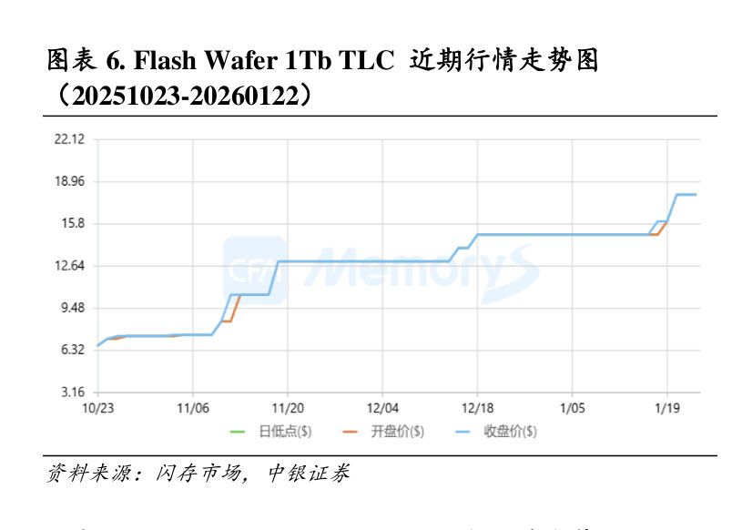

纵轴为价格（$），刻度 3.16、6.32、9.48、12.64、15.8、18.96、22.12；横轴为日期，刻度 10/23、11/06、11/20、12/04、12/18、1/05、1/19。图例：日低点($)、开盘价($)、收盘价($)。曲线无数据标签。

资料来源：闪存市场，中银证券

**图表 7. DDR4 16Gb 3200 近期行情走势图（20251028-20260120）**

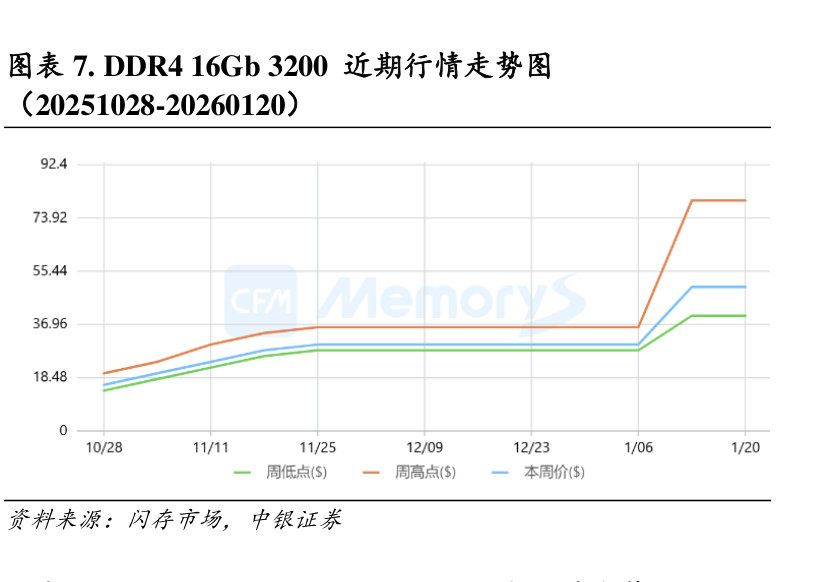

纵轴为价格（$），刻度 0、18.48、36.96、55.44、73.92、92.4；横轴为日期，刻度 10/28、11/11、11/25、12/09、12/23、1/06、1/20。图例：周低点($)、周高点($)、本周价($)。曲线无数据标签。

资料来源：闪存市场，中银证券

**图表 8. OEM SSD 1TB PCIe 4.0 近期行情走势图（20251028-20260120）**

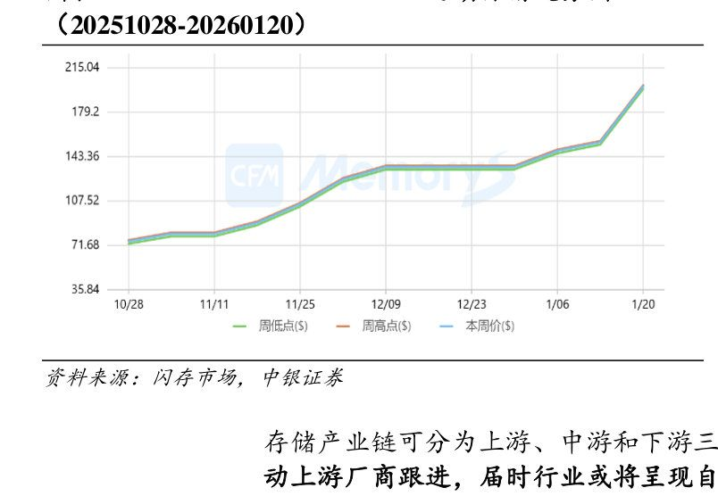

纵轴为价格（$），刻度 35.84、71.68、107.52、143.36、179.2、215.04；横轴为日期，刻度 10/28、11/11、11/25、12/09、12/23、1/06、1/20。图例：周低点($)、周高点($)、本周价($)。曲线无数据标签。

资料来源：闪存市场，中银证券

**图表 9. DDR4 SODIMM 8GB 3200 近期行情走势图（20251028-20260120）**

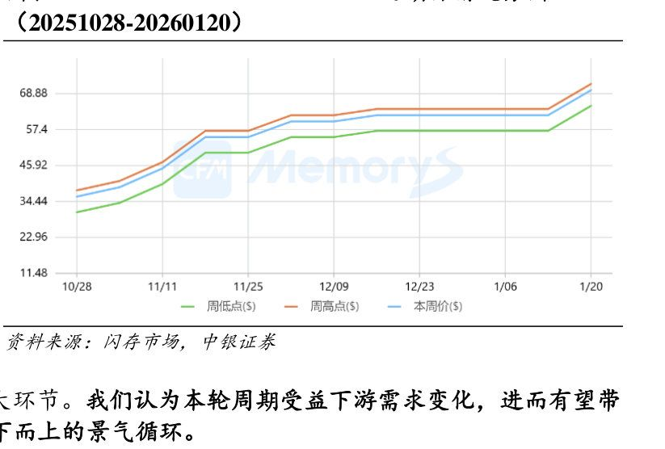

纵轴为价格（$），刻度 11.48、22.96、34.44、45.92、57.4、68.88；横轴为日期，刻度 10/28、11/11、11/25、12/09、12/23、1/06、1/20。图例：周低点($)、周高点($)、本周价($)。曲线无数据标签。

资料来源：闪存市场，中银证券

存储产业链可分为上游、中游和下游三大环节。我们认为本轮周期受益下游需求变化，进而有望带动上游厂商跟进，届时行业或将呈现自下而上的景气循环。

**上游：基础资源供给**

上游主要为行业提供基础资源，包括存储晶圆制造（如 NAND Flash、DRAM 芯片）和主控芯片等核心组件。存储芯片主要分为易失性存储器（如 DRAM）和非易失性存储器（如 NAND Flash）两大类。

**中游：核心制造与价值创造**

中游环节负责存储解决方案的设计、封装及测试，是连接上游基础元件与下游应用的关键。行业主要有两种运营模式：

专业代工模式：企业专注于存储解决方案的设计、封装（自营或外包）及测试，并实现大规模交付，以满足市场对存储器产品的多样化需求。其中，封装测试环节对性能验证、缺陷检测和良率提升至关重要。

集成设备制造模式：企业业务覆盖从芯片设计、晶圆制造到封装测试的全流程生产。

**下游：多元化应用驱动创新**

下游应用领域高度多元化，涵盖 AI 终端（如 AI 智能手机、AI PC、AI 眼镜）、消费电子、智能驾驶及工业能源等。各应用市场对存储产品在容量、速度、功耗及可靠性等方面有独特要求，推动存储技术持续升级。

---

<!-- 原文第 7 页 -->

**图表 10. 半导体存储器产业链概览**

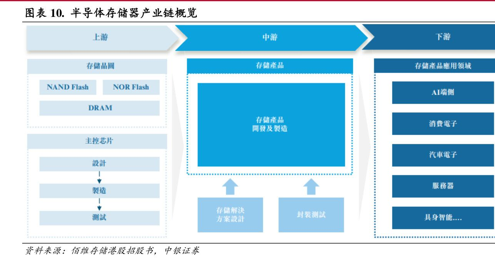

流程图分三栏，从左至右为：上游（存储晶圆：NAND Flash、NOR Flash、DRAM；主控芯片：设计→制造→测试）、中游（存储产品：存储产品研发及制造，下方为存储解决方案设计、封装测试）、下游（存储产品应用领域：AI 端侧、消费电子、汽车电子、服务器、具身智能…）。

资料来源：佰维存储港股招股书，中银证券

### “端”“云”两侧纷至沓来，下游诸多细分迎来边际催化

存储产品长期增长态势稳健。根据佰维存储港股招股书，2020 年全球市场规模为 1499 亿美元。在数字经济各领域对存储技术需求不断扩大的推动下，市场规模持续上升，至 2024 年达到 1928 亿美元，期间复合年增长率为 6.5%。展望未来，随着人工智能技术更深层次地融入各类产业，存储产品的应用场景预计将进一步拓宽。全球市场规模有望从 2025 年的 2633 亿美元增长至 2029 年的 4071 亿美元，此期间的复合年增长率将达到 11.5%。

从下游应用结构来看，AI 端侧领域存储需求的增长速度显著高于其他细分市场，已成为推动全球存储市场扩张的关键动力。根据佰维存储港股招股书，随着 AI 手机、AI PC、AI 眼镜以及智能驾驶等新兴应用场景的快速发展，AI 端侧应用对存储产品的需求呈现迅速增长态势。2020 年至 2024 年间，AI 端侧存储市场的复合年增长率高达 99.5%，2024 年市场规模达到 179 亿美元。2025 年至 2029 年期间，其复合年增长率将保持在 36.4%的较高水平，领先于所有下游应用领域。

大模型技术热潮带动 AI 服务器需求快速增长，服务器领域存储需求亦将保持较高增速。根据佰维存储港股招股书，其存储市场规模从 2020 年的 268 亿美元提升至 2024 年的 594 亿美元，复合年增长率为 22.0%。到 2029 年，该市场规模或将进一步扩大至 1458 亿美元。同时，全球数据中心的持续建设与扩容，以及大模型部署、实时数据处理等场景对 AI 推理需求的高速增长，也成为重要的驱动因素，持续刺激对高性能存储产品的需求，进而推动整体市场的增长。

---

<!-- 原文第 8 页 -->

**图表 11. 全球存储产品市场规模（2020-2029）**

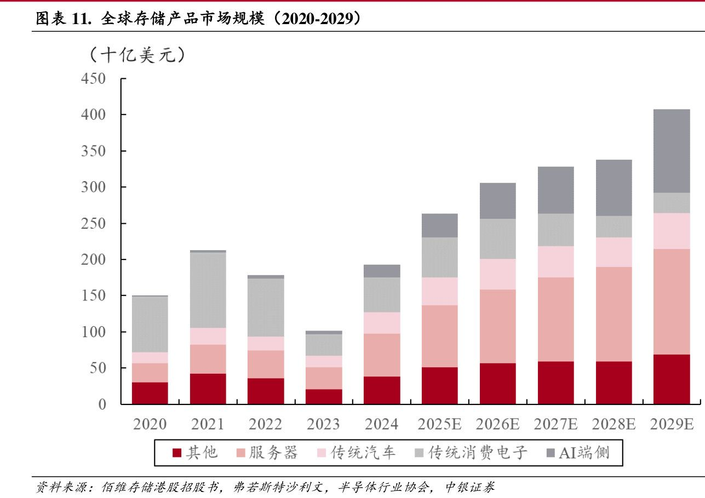

堆叠柱状图，单位：（十亿美元），纵轴刻度 0–450（步长 50）。横轴：2020、2021、2022、2023、2024、2025E、2026E、2027E、2028E、2029E。图例（自下而上）：其他、服务器、传统汽车、传统消费电子、AI 端侧。柱体无数据标签。

资料来源：佰维存储港股招股书，弗若斯特沙利文，半导体行业协会，中银证券

**云侧方面：AI 服务器为核心驱动**

根据佰维存储港股招股书，2024 年，全球服务器出货量约为 1600 万台，2029 年或有望增长至约 1880 万台。作为人工智能应用的核心计算基础设施，AI 服务器提供了强大的并行计算能力。随着 AI 技术在各行业的持续渗透，市场对 AI 服务器的需求呈现稳步增长态势。2024 年，全球 AI 服务器出货量约为 200 万台，2029 年或将增至约 540 万台。

在 AI 服务器架构中，DRAM 主要用于临时数据存储。DDR5 等内存凭借其高带宽与低延迟特性，有效保障了深度学习、图像识别等高计算密度任务的顺畅执行。此外，LPDDR 凭借其低功耗与小体积的优势，常被应用于对功耗和空间有严格限制的 AI 服务器场景。同时，SSD 承担长期数据存储任务，为满足 AI 应用需求，需具备更大容量与更高传输速度。上述存储器件共同协作，推动 AI 服务器在性能与能效方面的整体提升。

---

<!-- 原文第 9 页 -->

**图表 12. 全球服务器出货量及 AI 渗透率（2020-2029）**

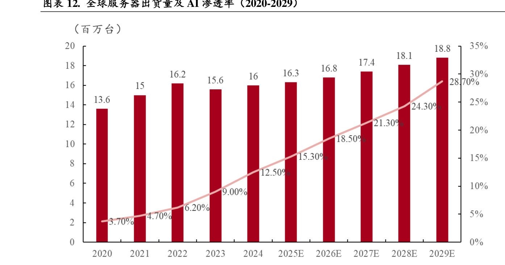

柱状图为服务器出货量，左轴单位：（百万台），刻度 0–20（步长 2）；折线为 AI 渗透率，右轴刻度 0%–35%（步长 5%）。横轴：2020、2021、2022、2023、2024、2025E、2026E、2027E、2028E、2029E。柱上数据标签：13.6、15、16.2、15.6、16、16.3、16.8、17.4、18.1、18.8；AI 渗透率标签：3.70%、4.70%、6.20%、9.00%、12.50%、15.30%、18.50%、21.30%、24.30%、28.70%。图例：服务器出货量、AI 渗透率。

资料来源：佰维存储港股招股书，弗若斯特沙利文，半导体行业协会，中银证券

**端侧方面：下游百花齐放**

**1）PC 与手机：AI 化普及推动存储性能基准跃升**

作为消费电子的基本盘，PC 与手机正全面 AI 化。根据佰维存储港股招股书，至 2029 年，AI 手机与 AI PC 的出货量将分别达 7.74 亿部和 2.16 亿台。

- 市场驱动力：AI 手机具备强大的端侧算力，DRAM&NAND 各有其独特作用。
- 存储技术融合演进：DRAM（如 LPDDR5/5X、DDR5）的带宽和 NAND Flash/SSD 的读写速度共同构成了设备性能的基石。在智能手机领域，MCP（多芯片封装）技术通过集成进一步优化了内部空间与成本，支撑了设备的小型化与高性价比迭代。在 PC 领域，SSD 已成为提升系统响应速度、支撑大型 AI 应用运行的核心部件，持续推动 PC 向高效率、高稳定性方向升级。

**图表 13. 全球手机出货量及 AI 渗透率（2020-2029）**

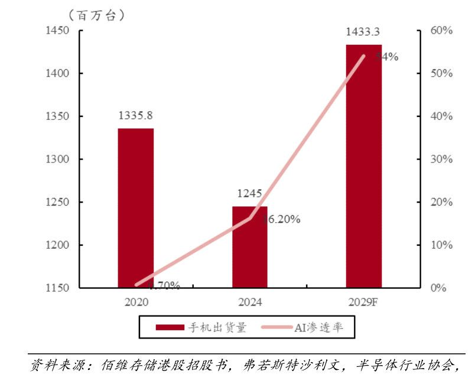

柱状图为手机出货量，左轴单位：（百万台），刻度 1150–1450（步长 50）；折线为 AI 渗透率，右轴刻度 0%–60%（步长 10%）。横轴：2020、2024、2029F。柱上数据标签：1335.8、1245、1433.3；AI 渗透率标签：0.70%、6.20%、54%。图例：手机出货量、AI 渗透率。

资料来源：佰维存储港股招股书，弗若斯特沙利文，半导体行业协会，中银证券

**图表 14. 全球 PC 出货量及 AI 渗透率（2020-2029）**

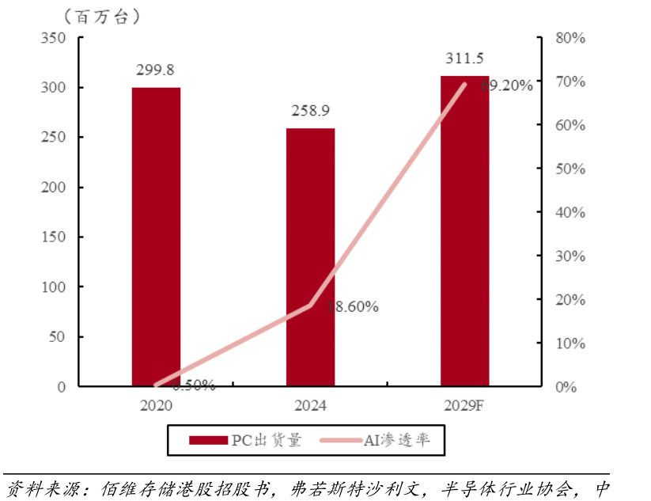

柱状图为 PC 出货量，左轴单位：（百万台），刻度 0–350（步长 50）；折线为 AI 渗透率，右轴刻度 0%–80%（步长 10%）。横轴：2020、2024、2029F。柱上数据标签：299.8、258.9、311.5；AI 渗透率标签：0.50%、8.60%、69.20%。图例：PC 出货量、AI 渗透率。

资料来源：佰维存储港股招股书，弗若斯特沙利文，半导体行业协会，中银证券

---

<!-- 原文第 10 页 -->

**2）汽车：车载系统复杂度提升催生多维存储需求**

智能汽车正加速向高阶自动驾驶迈进，根据佰维存储港股招股书，2024 年全球销量约 1380 万辆，至 2029 年或将增长至 3720 万辆。

- 市场驱动力：车载信息娱乐系统（IVI）与高级驾驶辅助系统（ADAS）的功能叠加，导致车内数据量呈指数级增长，系统复杂度陡增。
- 存储技术融合演进：车载存储体系呈现分层、多维度特征。DRAM 作为运算平台的“内存”，需在多任务并行处理（如感知融合、规划控制、沉浸式座舱渲染）中确保效率与平稳性。而 SSD 则承担起高精度地图、行车数据记录、个性化设置等关键数据的长期存储任务，其大容量、高耐用性和抗震动特性是支持汽车“软件定义”与持续迭代的前提。

**图表 15. 全球汽车销量及智能汽车渗透率（2020-2029）**

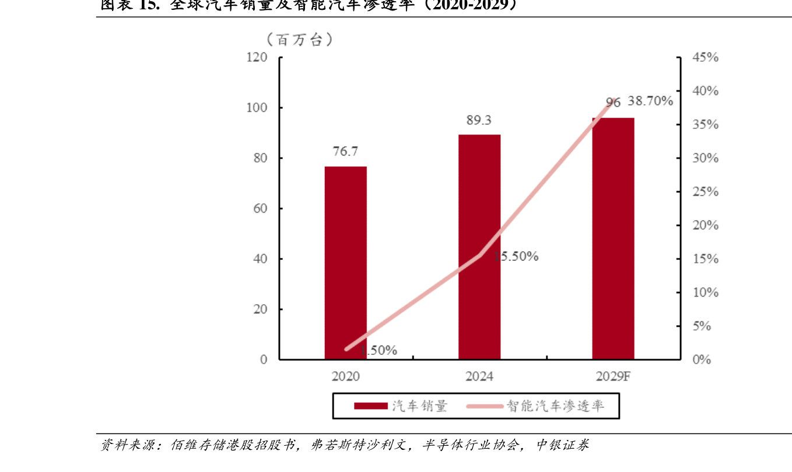

柱状图为汽车销量，左轴单位：（百万台），刻度 0–120（步长 20）；折线为智能汽车渗透率，右轴刻度 0%–45%（步长 5%）。横轴：2020、2024、2029F。柱上数据标签：76.7、89.3、96 [OCR_UNCERTAIN]；智能汽车渗透率标签：1.50%、15.50%、38.70%。图例：汽车销量、智能汽车渗透率。

资料来源：佰维存储港股招股书，弗若斯特沙利文，半导体行业协会，中银证券

**3）AR/VR：轻量化与高性能的集成化存储挑战**

AR/VR 设备，特别是 AI 眼镜，正从娱乐工具向生产力平台跃迁。根据佰维存储港股招股书，其全球出货量预计从 2024 年的 960 万台增长至 2029 年的 1.06 亿台。

- 市场驱动力：应用场景扩展至教育、医疗、工业等专业领域，对语音助手、图像识别、实时翻译等功能的实时性要求极高。
- 存储技术融合演进：为应对设备轻量化与高性能的双重需求，存储方案从分立走向高度集成。ePOP 作为“DRAM+NAND 闪存”的垂直堆叠封装解决方案，以其高传输速度、低功耗和极小占用空间，完美契合 AI 眼镜的物理限制与复杂场景（如高分辨率图像缓存）的数据处理需求，成为推动产品创新的核心技术支点。

---

<!-- 原文第 11 页 -->

**图表 16. 全球 AR/VR 设备出货量及 AI 渗透率（2020-2029）**

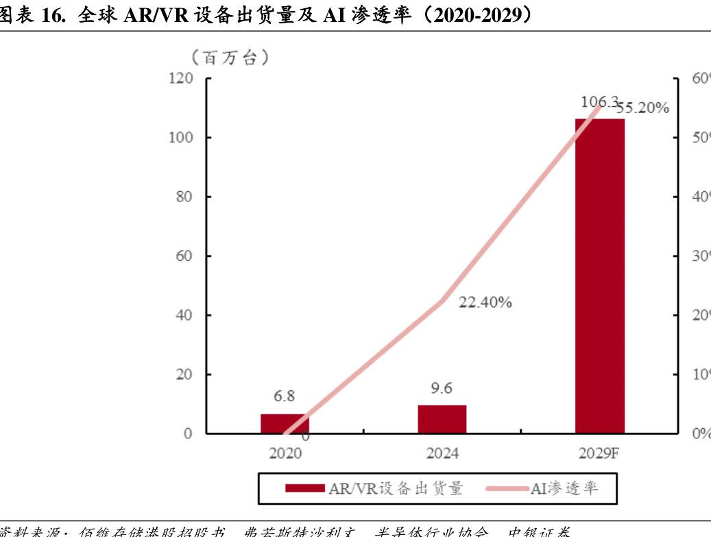

（百万台）

| 年份 | AR/VR 设备出货量（百万台） | AI 渗透率 |
| --- | --- | --- |
| 2020 | 6.8 | 0% |
| 2024 | 9.6 | 22.40% |
| 2029F | 106.3 | 55.20% |

图例：AR/VR设备出货量、AI渗透率

资料来源：佰维存储港股招股书，弗若斯特沙利文，半导体行业协会，中银证券

### 4）机器人（具身智能）：自主决策驱动存储向高可靠性演进

机器人产业正从执行重复任务的自动化设备，向具备环境感知和自主执行能力的“具身智能”体进化。根据佰维存储港股招股书，到 2029 年，全球机器人销售收入将达 8785 亿元人民币，其中具身智能的渗透率将提升至 36.5%。

- 市场驱动力：拓展至非结构化环境下的复杂任务，要求机器人能进行低延迟的自主决策与动作控制。
- 存储技术融合演进：DRAM 作为临时存储核心，必须确保感知、决策、控制链路的绝对流畅与稳定。存储系统需为海量的环境建模与学习数据提供高可靠、高带宽的持久化支持，这是机器人实现安全、可靠自主行为的基础保障。

**图表 17. 全球机器人销售收入及具身智能渗透率（2020-2029）**

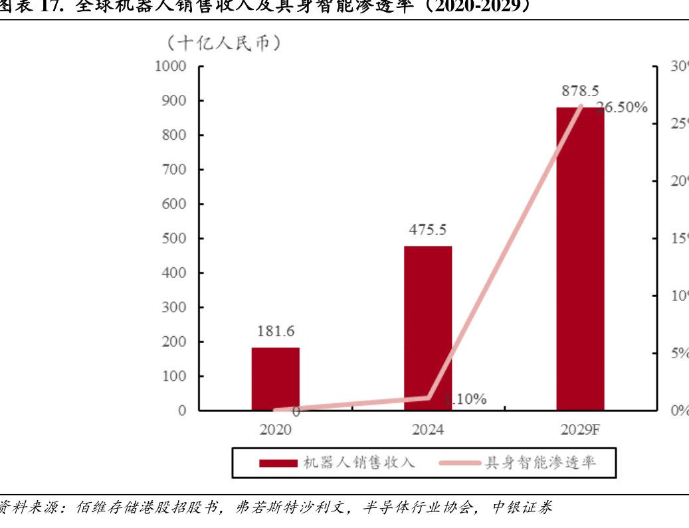

（十亿元人民币）

| 年份 | 机器人销售收入（十亿元人民币） | 具身智能渗透率 |
| --- | --- | --- |
| 2020 | 181.6 | 0% |
| 2024 | 475.5 | 10% |
| 2029F | 878.5 | 26.50% |

图例：机器人销售收入、具身智能渗透率

资料来源：佰维存储港股招股书，弗若斯特沙利文，半导体行业协会，中银证券

---

<!-- 原文第 12 页 -->

## 供给端：结构性供给受限持续，原厂竞逐新技术蓝海

### 原厂 26 年资本支出供给仍有限，现货资源供给趋紧或将持续

根据 TrendForce，随着存储器平均销售价格持续提升，供应商获利也有所增加，DRAM 与 NAND Flash 后续的资本支出将会持续上涨，但对于 2026 年的位元产出成长的助力有限。DRAM 和 NAND Flash 产业的投资重心正逐渐转变，从单纯地扩充产能，转向制程技术升级、高层数堆栈、混合键合以及 HBM 等高附加价值产品。

**图表 18. 2022-2026 年 DRAM 与 NAND Flash 产业资本支出**

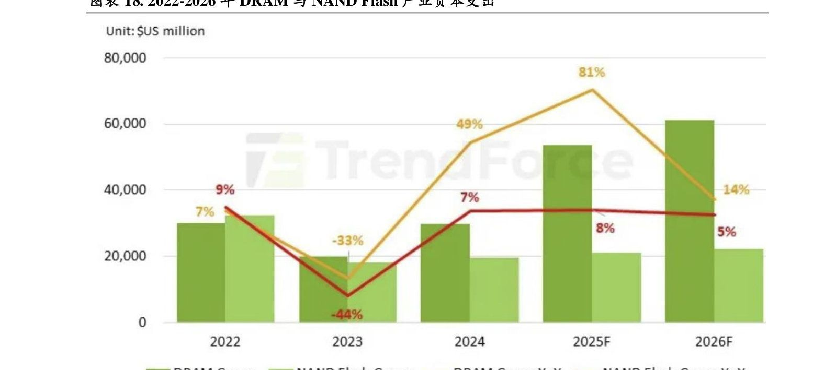

Unit: $US million

| 年份 | DRAM Capex YoY | NAND Flash Capex YoY |
| --- | --- | --- |
| 2022 | 9% | 7% |
| 2023 | -33% | -44% |
| 2024 | 49% | 7% |
| 2025F | 81% | 8% |
| 2026F | 14% | 5% |

图例：DRAM Capex、NAND Flash Capex、DRAM Capex YoY、NAND Flash Capex YoY

资料来源：Trendforce，中银证券

**DRAM 方面**，美光是资本支出策略最为积极的厂商，其 2026 年资本支出预计为 135 亿美元，年增长率达 23%，主要投资方向为 1 gamma 制程技术的导入及 TSV 设备建设。SK 海力士亦呈现显著增长，2026 年资本支出预计为 205 亿美元，同比增长 17%，主要用于 M15x 厂区 HBM4 产能的扩张。三星预计资本支出为 200 亿美元，同比增长 11%，重点投向 HBM 相关 1C 制程的推进及 P4L 晶圆产能的小幅提升。

然而，在产能扩张方面存在结构性制约。据 TrendForce 分析，目前无尘室资源已趋于紧张，在现有 DRAM 供应商中，仅三星与 SK 海力士仍具备小幅扩产的空间。美光则需待其美国 ID1 新厂于 2027 年投产后方可实现产能提升，因此 2026 年内任何资本支出的上修对实际位元产出的贡献均较为有限。

**NAND Flash 方面**，铠侠/闪迪因未涉足 DRAM 业务，是最为积极扩产的厂商，其 2026 年资本支出预计为 45 亿美元，同比增长 41%，主要用于加速 BiCS8 量产及投入 BiCS9 研发。美光计划小幅提升 NAND Flash 产能，并聚焦于 G9 制程发展与企业级固态硬盘业务，预计资本支出年增幅高达 63%。相比之下，三星与 SK 海力士/Solidigm 则计划缩减或限制 NAND Flash 资本支出，将资源优先配置于 HBM 与 DRAM 领域。

尽管需求强劲，部分厂商因历经多次行业景气循环，在资本支出与产能扩张策略上趋于保守。2026 年资本支出重点将转向制程技术升级与混合键合等先进工艺的导入，而非规模性扩产。我们认为，2026 年 NAND Flash 位元供给增长幅度有限，供不应求的市场状态或将持续全年。

---

<!-- 原文第 13 页 -->

### HBM 仍是兵家必争之地，HBF 专门为推理而生

根据 TrendForce 的预测，从供应端来看，2025 年全球 DRAM 供应将同比增长 24%，2026 年将同比增长 20%。从具体的内存类型来看，在 2025 年的 DRAM 供应当中，HBM 同比增长 88.1%，消费类内存同比下滑 1.2%，用于图形处理的显存同比下滑 0.3%，移动端内存同比增长 23.3%，服务器内存同比增长 28.4%，PC 端内存同比增长 4.4%。从 2026 年的 DRAM 供应来看，HBM 的增长幅度降至 38.2%，消费类将增长 6.2%，显存将增长 23.6%，移动端将增长 17.3%，服务器将增长 23.1%，PC 端将增长 5.1%。

**图表 19. 全球 2025/2026 年内存市场与各类别产品成长率预估**

| Year of 2026 | YoY(%) | % of Total Supply |
| --- | --- | --- |
| PC | 5.1 | 8.2 |
| Server | 23.1 | 39.2 |
| Mobile | 17.3 | 35.3 |
| Graphics | 23.6 | 2.8 |
| Consumer | 6.2 | 5.4 |
| HBM | 38.2 | 9.1 |

| Year of 2025 | YoY(%) | % of Total Supply |
| --- | --- | --- |
| PC | 4.4 | 9.3 |
| Server | 28.4 | 38.0 |
| Mobile | 23.3 | 36.0 |
| Graphics | (0.3) | 2.7 |
| Consumer | (1.2) | 6.1 |
| HBM | 88.1 | 7.9 |

资料来源：Trendforce，芯智讯，中银证券

从 HBM 技术路线来看，根据 Tom’s hardware 援引韩国国家研究机构 KAIST 论文。当前头部内存大厂研发的 HBM4 的每个堆栈的 HBM 容量将从 288GB 增加到 348GB，而演进到 HBM8 将有望从上代的 5120GB 增加到 6144GB。此外，功率要求将随性能而变化，从 HBM4 的每堆栈 75W 上升到 HBM8 的 180W。

**图表 20. HBM 技术路线图**

|  | HBM4 (2026) | HBM5 (2029) | HBM6 (2032) | HBM7 (2035) | HBM8 (2038) |
| --- | --- | --- | --- | --- | --- |
| Data Rate | 8 Gbps | 8 Gbps | 16 Gbps | 24 Gbps | 32 Gbps |
| # of I/O | 2,048 | 4,096 | 4,096 | 8,192 | 16,384 |
| Bandwidth | 2.0 TB/s | 4 TB/s | 8 TB/s | 24 TB/s | 64 TB/s |
| Capacity/die | 24 Gb | 40 Gb | 48 Gb | 64 Gb | 80 Gb |
| # of die stack | 12/16-Hi | 16-Hi | 16/20-Hi | 20/24-Hi | 20/24-Hi |
| Capacity/HBM | 36/48 GB | 80 GB | 96/120 GB | 160/192 GB | 200/240 GB |
| Power/HBM | 75 W | 100 W | 120 W | 160 W | 180 W |
| Die stacking | Microbump (MR-MUF) | 〃 | Bump-less Cu-Cu Direct bonding | 〃 | 〃 |
| Cooling Method | Direct-to-Chip (D2C) Liquid Cooling | Immersion Cooling | 〃 | Embedded Cooling | 〃 |
| HBM Architecture | Custom HBM Base Die HBM-LPDDR | 3D NMC-HBM & stacked cache / decap | Multi-tower HBM Active / Hybrid Interposer | Hybrid HBM Architecture HBM-HBF HBM-3D LPDDR | Full-3D / HBM Centric Computing Architecture |
| Additional Features (Patent) | NMC processor + LPDDR Ctrl | + Cache + CXL + on-die/stacked decap + HBM shielding | + Network switch + Bridge die + Asymmetric TSV | + HBF/LPDDR Ctrl + Storage network | + HBM Centric Interposer + Double side Cooling + Edge-expand Stack |
| AI Design Agent | ubump & TSV-array Decap placement Optimization | I/O Interface Optimization considering PSIJ | Hybrid Equalizer + Generative AI based SI/PI Metric Estimation | LLM based Human Interactive AI Design Agent | 〃 |

注：〃 表示该单元格与左侧单元格合并。

资料来源：Trendforce，中银证券

---

<!-- 原文第 14 页 -->

从 2026 年到 2038 年，HBM 的带宽预计将从 2TB/s 增长到 64TB/s，而数据传输速率将从 8GT/s 提高到 32GT/s。每个 HBM 封装的 I/O 位宽也将从当今 HBM3E 的 1,024bit 增加到 HBM4 的 2,048bit，然后一直增加到 HBM8 的 16,384bit。

随着 AI 推理市场迅速增长，存储行业逐渐步入“后 HBM 时代”——不仅三星、SK 海力士等存储巨头纷纷推进第六代 HBM，更有全新技术如 HBF，试图参与到这场 AI 存力竞争的浪潮中来，三星、SK 海力士、闪迪等存储厂商正纷纷投入 HBF 技术的研发。

HBF，全称 High Bandwidth Flash，即高带宽闪存，其结构与堆叠 DRAM 芯片的 HBM 类似，是一种通过堆叠 NAND 闪存而制成的产品。被称作“HBM 之父”的韩国科学技术院教授金正浩指出，虽然 NAND 闪存比 DRAM 慢，但它提供了大约 10 倍的容量，这对于支持下一代 AI 可能至关重要。

**图表 21. HBF 结构图**

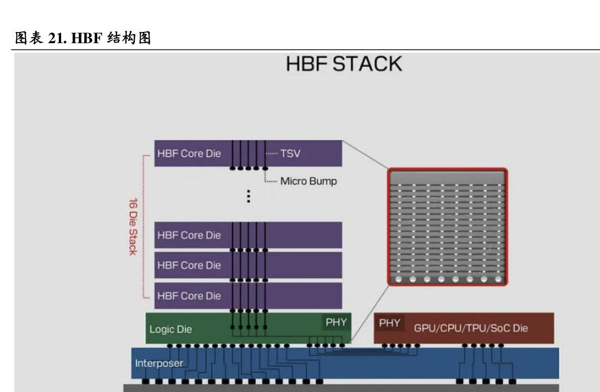

图内标注：HBF STACK；HBF Core Die、TSV、Micro Bump；16 Die Stack；Logic Die、PHY；GPU/CPU/TPU/SoC Die；Interposer；Package Substrate

资料来源：雷科技，闪迪，中银证券

根据闪迪和 SK 海力士的路线规划，2026 年下半年就会有首批 HBF 样品出现，2027 年初或有搭载 HBF 的 AI 推理设备面世。我们认为 GPU 厂商和服务器厂商或将率先尝鲜，伴随产业持续成熟，边缘设备和个人计算领域有望跟进。

---

<!-- 原文第 15 页 -->

## 需求端：AI 产业链健康度打开远期需求空间

### AI 存储需求激发 HDD 替代效应，NAND Flash 结构性需求旺盛

根据 TrendForce，AI 推理应用快速推升实时存取、高速处理海量数据的需求，传统作为海量数据存储基石的 Nearline HDD（近线硬盘）已出现供应短缺。由于全球主要 HDD 制造商近年未规划扩大产线，无法及时满足 AI 刺激的突发性、巨量储存需求。目前 NL HDD 交期已从原本的数周，急剧延长为 52 周以上，加速扩大 CSP 的存储缺口。在此背景下，高效能、高成本的 SSD 逐渐成为市场焦点，特别是大容量的 QLC SSD 出货或有望于 2026 年显著增长。

根据 TrendForce，HDD 产业正值技术换代的阵痛期，投资新一代热辅助磁记录技术产线初期的高昂成本，不仅造成产能扩张瓶颈，也迫使供应商将费用转嫁给客户，导致每 GB 的平均售价从过往的 0.012-0.013 美元，提高至 0.015-0.016 美元，削弱了 HDD 最核心的成本优势。相比之下，NAND Flash 通过 3D 堆栈技术的演进，产能提升速度远快于 HDD。此外，随着堆栈层数从上百层迈向 200 层以上或更高，晶圆的储存位元密度不断提升。预期 2026 年 2Tb QLC 芯片的产出将逐步放量，成为降低 Nearline SSD 成本的主力。

AI 推理工作负载涉及大量小型数据的随机读取，以及对模型参数的快速调用。从效能角度分析，SSD 的 IOPS（每秒读写次数）是 HDD 的数百甚至数千倍，其微秒级的延迟更是 HDD 毫秒级延迟无法比拟的。而 SSD 在运作时无需马达驱动磁盘，每 TB 的功耗远低于 HDD。对于大型数据中心而言，改用 SSD 所节省的电费、冷却成本以及机柜空间，长期足以抵销其较高的初始购置成本。

**图表 22. Nearline HDD 与 QLC SSD 重点比较**

| 产品 | 交付周期 | 每 GB 平均售价（美元） | 最大容量 | 性能 | 能效 |
| --- | --- | --- | --- | --- | --- |
| Nearline HDD | 52 周 | 0.015 | 32TB | 弱 | 较低 |
| QLC SSD | 8 周 | 0.05-0.06 | 122TB | 强 | 较高 |

资料来源：Trendforce，中银证券

北美 CSP 早已规划于温数据应用扩大采用 SSD，但因为 HDD 缺口严峻，CSP 甚至开始考虑于冷数据采用 SSD。我们认为，在 AI 需求带动下，NAND Flash 存在结构性需求旺盛，相关供应链有望深度受益。

### 高端 DRAM 仍为 AI 标配，终端加速转向 LPDDR5X

从国际领先供应商对于 AI基础设施配置来看，高性能 DRAM 仍是持续发力方向。英伟达预计于 2027 年下半年推出 Rubin Ultra NVL576，单机柜预计搭载 365TB 的 HBM4e，是 GB300 NVL72 的 8 倍。无独有偶，在 HotChips 2025 上，谷歌介绍了第七代 TPU“Ironwood”的情况，其配备了 192GB 的 HBM，带宽高达 7.4TB/s，亦显著高于前代标准。

**图表 23. 英伟达 NVL576**

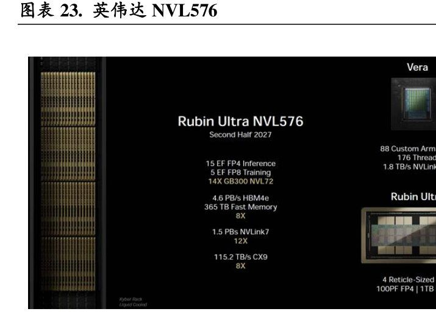

图内文字：Rubin Ultra NVL576；Second Half 2027；15 EF FP4 Inference；5 EF FP8 Training；14X GB300 NVL72；4.6 PB/s HBM4e；365 TB Fast Memory；8X；1.5 PBs NVLink7；12X；115.2 TB/s CX9；8X；Vera：88 Custom Arm Cores、176 Threads、1.8 TB/s NVLink-C2C；Rubin Ultra：4 Reticle-Sized GPUs、100PF FP4 | 1TB HBM4e；Kyber Rack Liquid Cooled

资料来源：半导体纵横，英伟达，中银证券

**图表 24. 谷歌 TPU**

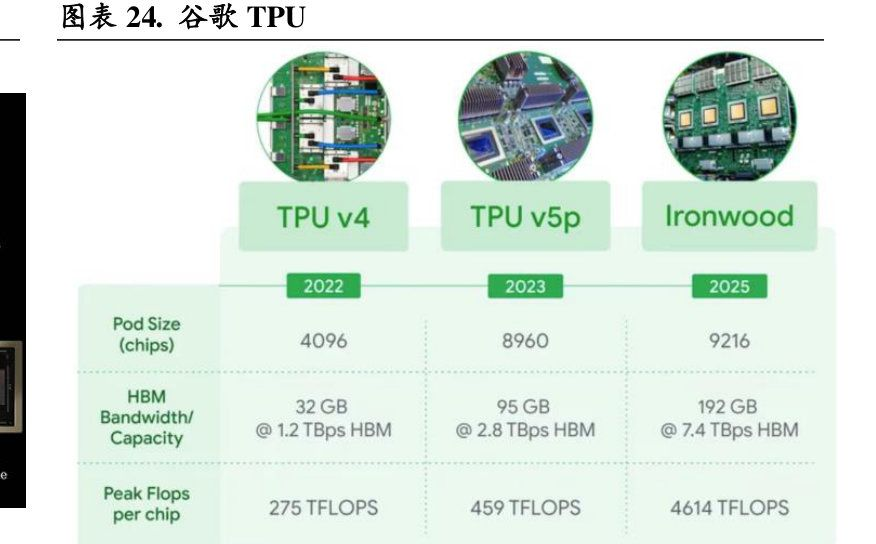

|  | TPU v4 | TPU v5p | Ironwood |
| --- | --- | --- | --- |
| 年份 | 2022 | 2023 | 2025 |
| Pod Size (chips) | 4096 | 8960 | 9216 |
| HBM Bandwidth/Capacity | 32 GB @1.2 TBps HBM | 95 GB @2.8 TBps HBM | 192 GB @7.4 TBps HBM |
| Peak Flops per chip | 275 TFLOPS | 459 TFLOPS | 4614 TFLOPS |

资料来源：超能网，Google，中银证券

---

<!-- 原文第 16 页 -->

除 HBM 外，随着 CSP 扩大资本支出，并计划采购更多的英伟达 GB300 和 VR200 机架解决方案。英伟达 GB/VR 机架需求的增长或将进一步推动 Grace 和 Vera CPU 需求。伴随英伟达 AI 服务器出货量的增长，其对于 LPDDR5X 的需求亦将持续增长。

**图表 25. 预估 2026 年 LPDDR5X 需求年增幅达 169%**

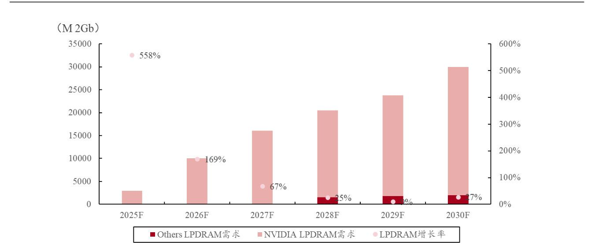

（M 2Gb）

| 年份 | LPDDRAM 增长率 |
| --- | --- |
| 2025F | 558% |
| 2026F | 169% |
| 2027F | 67% |
| 2028F | 25% |
| 2029F | 0% |
| 2030F | 27% |

图例：Others LPDDRAM需求、NVIDIA LPDDRAM需求、LPDDRAM增长率

资料来源：Trendforce，芯智讯，中银证券

根据 TrendForce，2025 年市场对于 LPDDR5X 的需求同比增长 558%，2026 年还将继续增长 169%，2025-2030 年的年复合增长率将会高达 51%。而对于 LPDDR5X 的整体需求当中，来自英伟达 AI/服务器的需求占据了极高的比重。

此外，目前智能智能手机内存解决方案基本都是 LPDDR4、LPDDR5。但是由于上游原厂逐步停止 LPDDR4 的供应，产线转产新制程，使得 LPDDR4 缺货涨价，并且是不可逆的，所以手机厂商亦需要加速转向最先进的 LPDDR5/LPDDR5X。

根据 TrendForce 的预计，从智能手机生产的角度来看，LPDDR5(X) Gb 当量预计将在 2025 年占比 52%，在 2026 年将提升至 66%。2025 年配备 LPDDR5(X)的智能手机将占智能手机总产量的 37%，到 2026 年将占 51%。

**图表 26. LPDRAM 生产正快速向 LPDDR5（X）收敛**

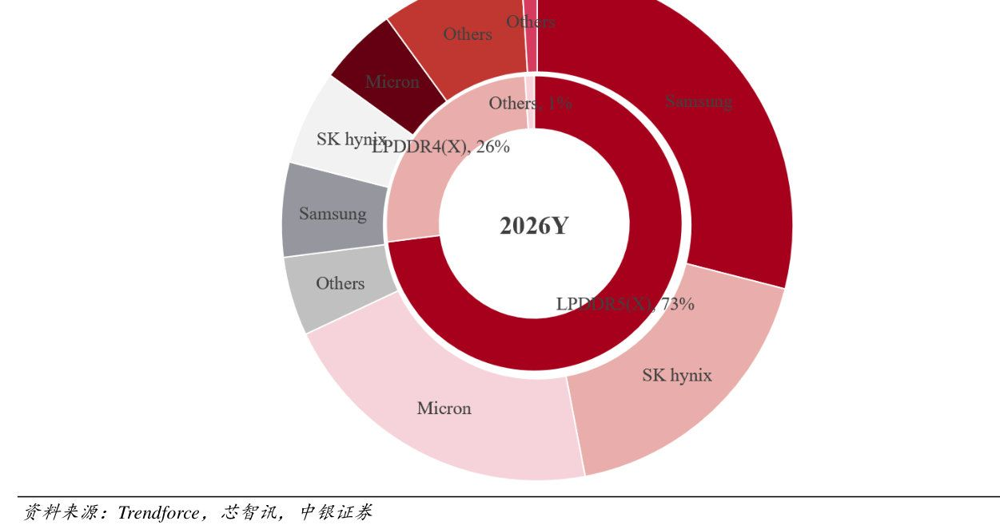

图内标注：2026Y；内环 LPDDR4(X), 26% / LPDDR5(X), 73% / Others 1%；外环 Samsung、SK hynix、Micron、Others

资料来源：Trendforce，芯智讯，中银证券

---

<!-- 原文第 17 页 -->

### KV Cache 催生 NAND 新需求，以存带算趋势渐进

根据华尔街见闻，在黄仁勋在 CES 演讲中，敏锐地捕捉到了 AI 模型侧的根本性变化——Test-time Scaling（测试时扩展）。“推理不再是一次性的回答，而是一个思考的过程。”他指出，随着 DeepSeek R1 和 OpenAI o1 等模型的出现，AI 开始展现出思维链能力。这意味着 AI 在给出答案前，需要消耗大量的算力进行多步推理、反思和规划。

同时，当 AI 从简单的问答转向长时间的复杂推理时，记忆瓶颈涌现。在 Agentic AI 时代，智能体需要记住漫长的对话历史和复杂的上下文，这会产生巨大的 KV Cache。传统的解决方案是将这些数据塞进昂贵的 HBM 显存中，但 HBM 容量有限且价格高昂，这被称为“显存墙”。AI 的工作记忆存储在 HBM 内存中。每生成一个 token，它都要读取整个模型和所有工作记忆。对于需要长期运行、拥有持续记忆的 AI 智能体，这种架构显然不可持续。

**图表 27. KV Cache 工作原理**

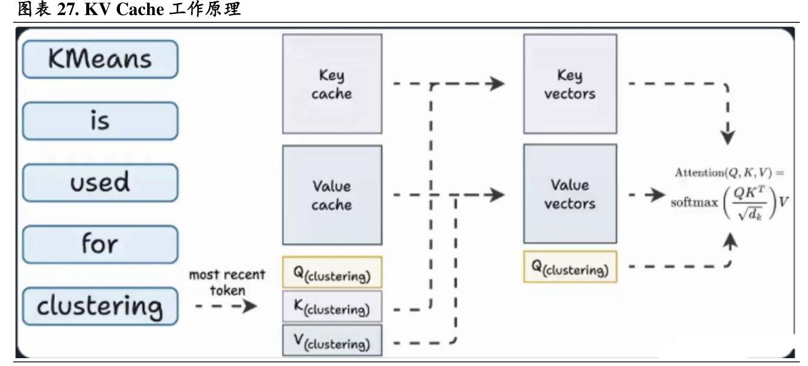

图内标注：KMeans、is、used、for、clustering（most recent token）；Key cache、Value cache；Q(clustering)、K(clustering)、V(clustering)；Key vectors、Value vectors；Attention(Q, K, V) = softmax(QK^T/√d_k)V

资料来源：腾讯云开发者社区，中银证券

英伟达的解决方案是一套全新的存储架构：基于 BlueField-4 DPU 构建的推理上下文内存存储平台（Inference Context Memory Storage Platform）。在每个 GPU 原有 1TB 内存的基础上，英伟达通过这个平台为每个GPU额外增加了16TB的“思考空间”。这个平台被放置在离计算单元最近的位置，通过高达 200Gb/s 的带宽连接，避免了传统存储带来的延迟瓶颈。

**图表 28. 英伟达基于 BlueField-4 DPU 构建的推理上下文内存存储平台**

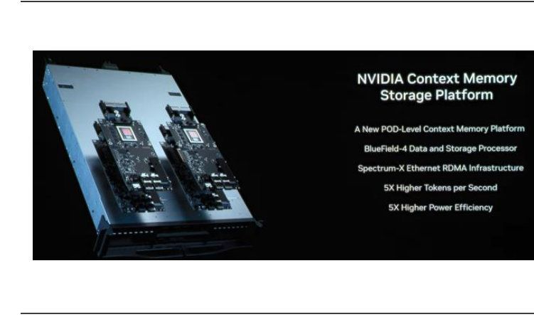

图内文字：NVIDIA Context Memory Storage Platform；A New POD-Level Context Memory Platform；BlueField-4 Data and Storage Processor；Spectrum-X Ethernet RDMA Infrastructure；5X Higher Tokens per Second；5X Higher Power Efficiency

资料来源：Youtube，英伟达，中银证券

**图表 29. 英伟达重构存储架构**

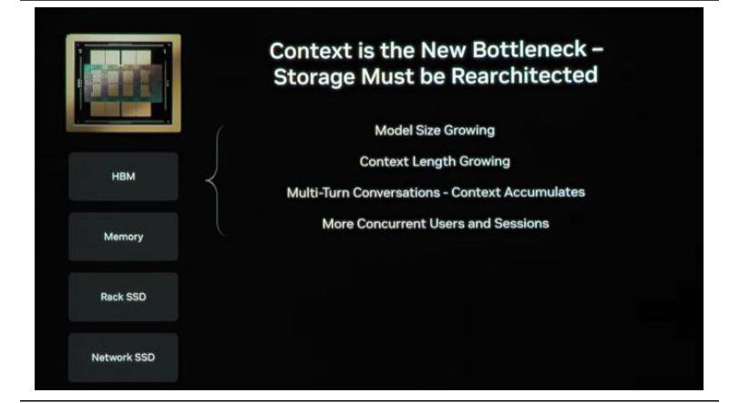

图内文字：Context is the New Bottleneck – Storage Must be Rearchitected；Model Size Growing；Context Length Growing；Multi-Turn Conversations - Context Accumulates；More Concurrent Users and Sessions；层级 HBM、Memory、Rack SSD、Network SSD

资料来源：Youtube，英伟达，中银证券

---

<!-- 原文第 18 页 -->

### 服务器市场持续快速增长，涨价或抑制部分消费需求

从终端需求来看，服务器市场对于存储需求将保持快速增长。根据 Trendforce 预计，通用服务器方面，对于 DRAM 需求，2025 年同比增长 19%，2026 年将继续同比增长 20%；对于 NAND Flash 的需求，2025 年同比增长 30%，2026 年同比增长 19%。AI 服务器方面，2025 年 LPDDR 需求同比增长 67%，RDIMM 同比增长 31%；2026 年 LPDDR 需求同比增长 15%，RDIMM 同比增长 21%。对于 NAND Flash 需求方面，2025 年同比增长 60%，2026 年将继续增长 70%。

而由于存储芯片价格持续上涨，将迫使 PC 厂商和智能手机提升产品价格，或将抑制客户需求。2025 年来自笔记本电脑的需求分别增长 14%和 3%，2026 年将继续分别增长 10%和 6%；2025 年来自智能手机的需求分别增长 9%和 11%，2026 年将继续增长 8%和 8%。

**图表 30. 2025/2026 各终端应用存储位元需求量涨跌幅预测**

| YoY |  | NB | Server | AI Server | Smartphone |
| --- | --- | --- | --- | --- | --- |
| Shipment or Production Volume | 2025 | 5% | 8% | 25% | 2% |
|  | 2026 | (3%) | 9% | 24% | (2%) |
| DRAM Content | 2025 | 14% | 19% | LPDDR:67% RDIMM:31% | 9% |
|  | 2026 | 10% | 20% | LPDDR:15% RDIMM:21% | 8% |
| ND Flash Content | 2025 | 3% | 30% | over 60% | 11% |
|  | 2026 | 6% | 19% | over 70% | 8% |

资料来源：Trendforce，芯智讯，中银证券

---

<!-- 原文第 19 页 -->

## 国产侧：原厂端奔赴全球标准+产业链自主，产品端锚定平台化+品类升级

### 国产高端新品+产能稳步扩张，抢占 AI 时代国际话语权

**DRAM 方面**，据长鑫存储官方网站信息更新，长鑫存储已正式推出 LPDDR5X 产品，最高速率达到 10667Mbps。据官网产品信息介绍，LPDDR5/5X 是第五代超低功耗双倍速率动态随机存储器。通过创新的封装技术和优化的内存设计，长鑫存储 LPDDR5X 在容量、速率、功耗上都有显著提升，目前提供 12Gb 和 16Gb 两种单颗粒容量，最高速率达到 10667Mbps ，达到国际主流水平，较上一代 LPDDR5 提升了 66%，同时可以兼容 LPDDR5，功耗则比 LPDDR5 降低了 30%。

**图表 31. 长鑫存储正式推出 LPDDR5X**

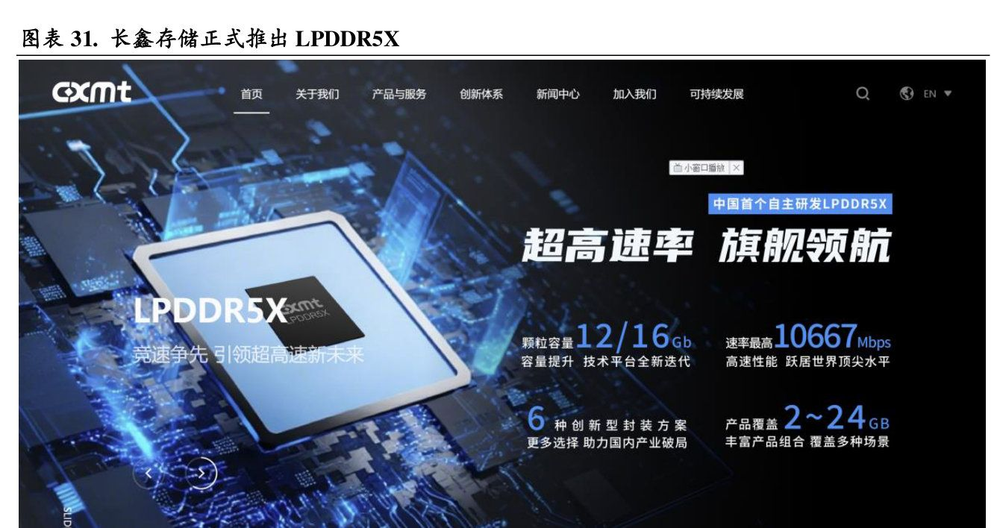

图内文字：cxmt；中国首个自主研发LPDDR5X；超高速率 旗舰领航；LPDDR5X；竞速争先 引领超高速新未来；颗粒容量 12/16 Gb（容量提升 技术平台全新迭代）；速率最高 10667 Mbps（高性能 跃居世界顶尖水平）；6 种创新型封装方案（更多选择 助力国内产业破局）；产品覆盖 2~24 GB（丰富产品组合 覆盖多种场景）

资料来源：长鑫存储，中银证券

从技术与产业价值来看，10667Mbps 速率的突破堪称“解渴”。当前端侧 AI 应用蓬勃发展，内存带宽已成为制约设备性能的关键瓶颈——实测数据显示，搭载 10.7Gbps（即上述 10667Mbps）速率内存的设备，运行 Llama 2 等大型语言模型时，响应速度、语音转译等任务效率都大大提升。对旗舰手机而言，这一速率可轻松支撑 8K 视频连拍、高帧率游戏多开等高频场景，解决了此前国产终端完全依赖韩系内存才能实现极致性能的痛点。

2025 年 7 月，长鑫存储母公司长鑫科技启动 A 股上市辅导。长鑫存储 2016 年成立，专注 DRAM 芯片，2024 年 DDR4 全球市占约 5%，2025 年底预计升至 8%。其无控股股东，第一大股东为合肥清辉集电，合肥国资等多机构加持，合肥政府早期助力其发展，2025 年 DRAM 晶圆产量预计增长 68%。

**NAND 方面**，长江存储正迈向 100%设备国产化。长江存储的发展轨迹是中国半导体产业在高压制裁下实现战略性突围的典型范例。2022 年，美国将其列入实体清单，导致其先进设备进口受阻，产能规划一度腰斩，面临严峻生存危机。然而，这场危机也强力催化了其供应链的全面国产化进程。通过国内设备厂商组成“攻坚联盟”，长江存储实现了设备国产化率的快速提升，从制裁前的较低水平升至 2024 年的约 45%，远超国内同业平均水平，2023 年推出的 232 层 TLC 芯片 X4-9070，通过双层堆叠实现 294 层等效密度，接口速度达 3600MT/s，性能比肩三星、SK 海力士的旗舰产品。其自主研发的 Xtacking 晶栈架构成为关键技术，不仅使产品在存储密度和性能上比肩国际巨头，更在 2025 年吸引了三星公司为其混合键合技术支付专利授权费，标志着中国企业在全球半导体核心技术领域首次掌握了重要的话语权。2025 年 9 月，注册资本高达 207.2 亿元的三期工厂正式成立，明确了“100%使用国产半导体设备”的雄心，计划于 2026 年投产后将总产能提升至 30 万片/月，届时其全球市场份额有望从当前的 12%增至约 15%，从而有望获得影响全球市场定价的能力。

---

<!-- 原文第 20 页 -->

**图表 32. 长江存储晶栈®Xtacking® 4.0**

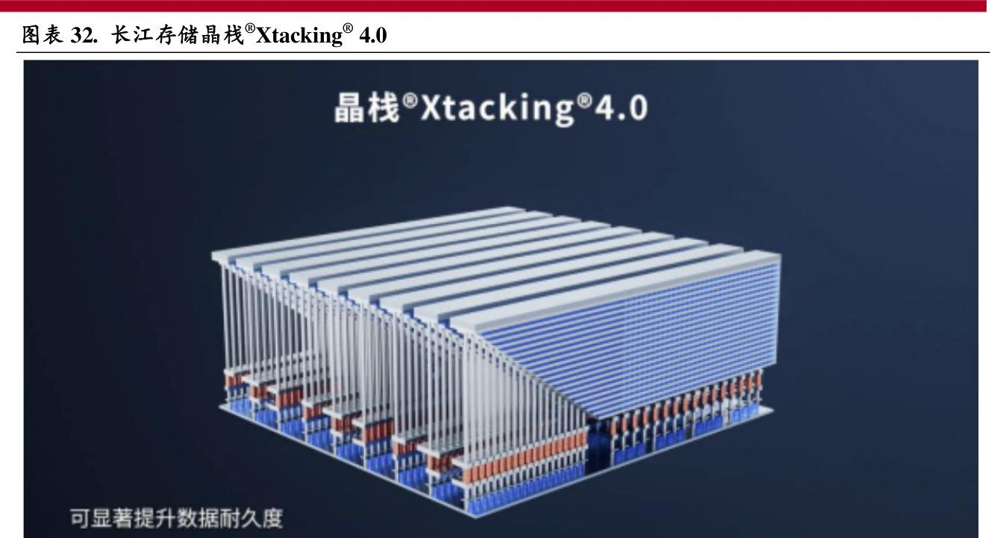

图内文字：晶栈®Xtacking®4.0；可显著提升数据耐久度

资料来源：长江存储，中银证券

我们认为，长江存储和长鑫存储作为国内存储芯片制造龙头企业，生产经营稳中向好，推动建设意志坚定不移，产能建设有望为产业链带来诸多机会。

### 约束条件寻求“最优解”，CBA+4F² 技术引领“弯道超车”

当 DRAM 制造商面对在 1α纳米节点以下继续传统缩放的挑战时，行业站在了一个关键的转折点，渐进式改进已经不再足够。前进的道路需要在架构上进行创新，重新思考存储单元的构建方式以及 DRAM 芯片不同功能模块的集成方式。两种互补的方法已经成为延续 DRAM 缩放至 2020 年代后期最可行的近期解决方案：向 4F²布局的过渡以及 CMOS 键合阵列架构的采用。

在半导体存储器技术中，存储单元的物理布局密度常通过以最小特征尺寸（F）为基准的归一化面积进行描述，类似于标准逻辑单元以“轨道高度”作为比较基准的方法。其中，F 通常指制造工艺中的最小线宽或间距，在 DRAM 中对应字线或位线的宽度。

DRAM 自 2007 年以来普遍采用 6F²单元布局，更早的制程则使用 8F²。作为对比，现代 NAND 闪存已实现 4F²单元，但其特征尺寸 F 远大于 DRAM；而 SRAM 单元面积高达约 120F²，密度较 DRAM 低约 20 倍。从几何结构上看，4F²代表单个存储单元的理论极限面积。这是因为特征尺寸 F 定义为线宽或间距，因此“线-间距”重复单元的节距为 2F，而非 F。由此推导，单元在二维方向上的最小可实现尺寸为 2F×2F，即 4F²。

---

<!-- 原文第 21 页 -->

图表 33. 标准 6F² 布局与采用垂直通道晶体管的 4F² 布局

| ITEMS | Layout | Profile map | Comments |
| --- | --- | --- | --- |
| 6F² DRAM | （图：BL Pitch、WL Pitch） | （图：Cylinder Capacitor、LP、SNC、N⁺ SiN、BL、WL、STI、PW、Recess access transistor、1F 1F 1F、BLC、L_CH） | Pros: ✓ Matured technology ✓ No floating body effect Cons: ✓ Lower bit-cell density ✓ Row hammer effect ✓ Short channel effect ✓ Process more complicated |
| 4F² DRAM | （图：BL Pitch、WL Pitch、2F） | （图：Pillar Capacitor、LP、SNC、WL、BL、NW、PW、Vertical access transistor、1F、SNC、L_CH、BL） | Pros: ✓ Easier AA & NC patterns ✓ No BLC patterning ✓ higher bit density Cons: ✓ Difficult BL process ✓ Floating body effect |

资料来源：semianalysis，芯智讯，中银证券

中国供应商长鑫存储于 2023 年底公开了基于垂直沟道晶体管（VCT）的 4F²布局方案，并将其用于 18 纳米节点 DRAM 的开发。相较于三星、SK 海力士和美光等头部厂商仍可通过现有架构延续微缩，我们认为长鑫的选择反映了其在制程节点追赶压力下更为激进的架构转型，或有望借此实现技术迭代。

然而，4F²需要的工艺条件和材料与高性能外围线路的要求存在兼容问题。存储阵列中的垂直晶体管需要专门的外延生长技术、新型栅极介电层以及针对 DRAM 电荷存储而非开关速度优化的精心控制的掺杂轮廓。与此同时，外围线路受益于具有高介电常数金属栅极、应变硅沟道以及多个阈值电压选项的先进逻辑工艺，这些可最大化性能并最小化功耗。试图在同一晶圆上制造这两个部分会强制进行次优妥协，从而抵消了 4F²的大部分潜在收益。

为解决上述问题，CBA 技术或将成为重要技术思路。CMOS 键合阵列架构代表了制造范式的转变，将 DRAM 芯片分离成两个独立处理的晶圆，然后键合在一起形成最终器件。一个晶圆包含存储单元阵列及其数十亿个存储电容器和访问晶体管，而第二个晶圆容纳所有外围线路，包括感测放大器、行和列解码器、输入/输出驱动器以及控制逻辑。在使用优化技术处理每个晶圆后，制造商使用晶圆对晶圆混合键合将它们连接起来，通过界面处的直接铜对铜和介电对介电键合创建电气连接。

图表 34. 第八代 BiCS FLASH 所采用的 CBA

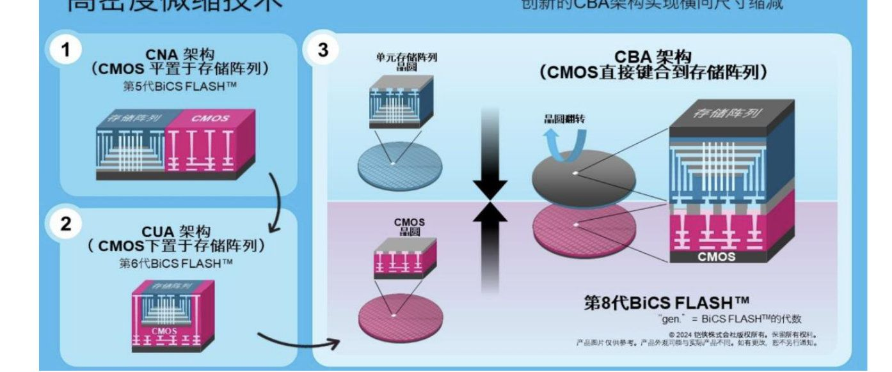

高密度微缩技术；创新的 CBA 架构实现横向尺寸缩减
1 CNA 架构（CMOS 平置于存储阵列）第 5 代 BiCS FLASH™
2 CUA 架构（CMOS 下置于存储阵列）第 6 代 BiCS FLASH™
3 CBA 架构（CMOS 直接键合到存储阵列）
单元存储阵列晶圆；CMOS 晶圆；晶圆翻转；第 8 代 BiCS FLASH™
注：“gen.” = BiCS FLASH™ 的代数；© 2024 铠侠株式会社版权所有，保留所有权利。产品图片仅供参考。产品外观可能与实际产品不同。如有更改，恕不另行通知。

资料来源：铠侠，中银证券

---

<!-- 原文第 22 页 -->

CBA 架构的优点是：可以使用最佳的制造工艺来分别制作 CMOS 电路用晶圆和存储单元用晶圆。这样，由于只需要对存储单元阵列的晶圆进行高温处理，因此能够在不考虑对 CMOS 电路造成影响的情况下，采用能够确保可靠性的必要温度进行热处理。通过将两种晶圆的制造工艺加以区分，可以最大限度地发挥 CMOS 电路和存储单元的性能。

CBA 架构的成功取决于连接阵列和外围晶圆的混合键合技术。与使用焊料微凸点创建电气连接的传统芯片堆叠方法不同，混合键合在两个晶圆上的铜焊盘之间实现直接的金属对金属接触。该工艺从化学机械抛光开始，在两个晶圆上创建原子级光滑的表面，铜焊盘略微凹陷在周围的介电材料下方。当晶圆在精心控制的条件下接触时，介电表面首先通过范德华力和氢键键合。随后的热处理使铜焊盘膨胀并接触，同时通过穿过界面创建共价 Si-O-Si 桥的冷凝反应加强介电键合。结果是具有电气连接的永久键合，这些连接的电阻和可靠性特征几乎与单个晶圆内的传统金属互连相同。键合界面与周围材料几乎无法区分，从两个单独处理的晶圆创建了实际上的单一单片结构。

从时间节点上看，主要 DRAM 供应商将在 2026 年左右开始 CBA-DRAM 的风险生产，全面大规模生产或将于 2027 年开始。采用 CBA 架构将对 DRAM 制造与供应链产生深远影响。制造环节需为阵列与外围晶圆设立独立工艺流程及相应的洁净室或生产隔离区，且键合过程对环境控制的要求接近先进逻辑工艺水准，导致现有产线需进行重大基础设施升级。设备投资模式也将显著变化，晶圆键合作为新增设备类别，单价高且需求量较大，同时键合前后的检测与计量系统变得更为关键，以降低合损风险。此外，该架构在理论上为供应链分解创造了可能，但由于设计集成度高、技术专有及竞争敏感，短期内更可能由整合器件制造商控制核心晶圆制造，而将键合等环节外包以获取产能弹性。我们认为，伴随 CBA 架构的推进，以长鑫为代表的国产供应链有望迎来全新增量机会。

图表 35. DRAM 技术路线图

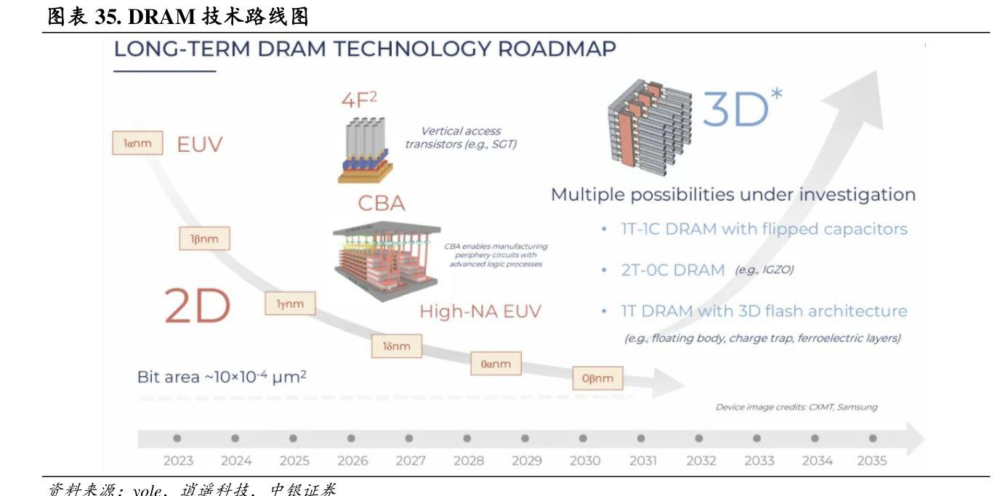

LONG-TERM DRAM TECHNOLOGY ROADMAP
节点标签：1αnm、1βnm、1γnm、1δnm、0αnm [OCR_UNCERTAIN]、0βnm [OCR_UNCERTAIN]
EUV；High-NA EUV；2D
4F²：Vertical access transistors (e.g., SGT)
CBA：CBA enables manufacturing periphery circuits with advanced logic processes
3D*
Bit area ~10×10⁻⁴ μm²
Multiple possibilities under investigation：1T-1C DRAM with flipped capacitors；2T-0C DRAM（e.g., IGZO）；1T DRAM with 3D flash architecture（e.g., floating body, charge trap, ferroelectric layers）
横轴年份：2023—2035；Device image credits: CXMT, Samsung

资料来源：yole，逍遥科技，中银证券

## 利基市场温和起涨，国产存储产品发力做大做强

2025 年以来，台股三大利基存储厂商旺宏、华邦电、南亚科合计营收大体呈现逐月攀升情况。2025 年 12 月，三大利基存储厂合计实现营收 244.20 亿新台币，同比+134.94%，环比+14.96%。其中，南亚科技 2025Q4 营业收入达 300.94 亿新台币，环比增长 60.3%，季度 DRAM ASP（平均售价）环比增长超三成，销售规模亦增长超 10%；毛利率达到 49.0%，相较 25Q3 提升 30.5 个百分点。

---

<!-- 原文第 23 页 -->

图表 36. 2023.01-2025.12 台股利基存储厂商营收情况

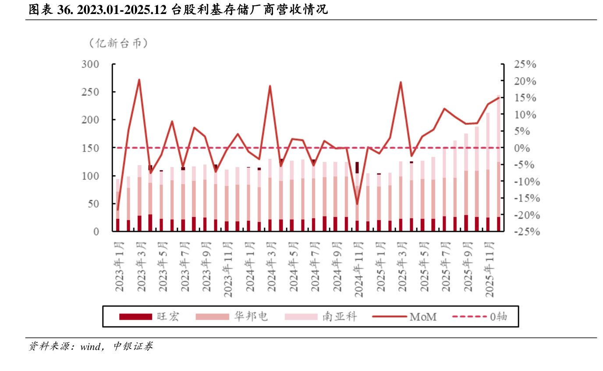

左轴（亿新台币）：0、50、100、150、200、250、300；右轴（%）：25%、20%、15%、10%、5%、0%、-5%、-10%、-15%、-20%、-25%
横轴：2023 年 1 月至 2025 年 11 月（双月标注）
图例：旺宏、华邦电、南亚科（柱状）；MoM（折线）；0 轴（虚线）

资料来源：wind，中银证券

NOR Flash 方面，根据 TechNowvoice 新闻，国产 NOR Flash 芯片大厂，开始減少在本土晶圆厂代工，并寻求与其他晶圆代工厂合作。由于大量的产能承接需要磨合技术、良率、产品等认证，NOR FLASH 可能会存在摩擦性的供给缺口，进而推升行业价格起涨。而根据芯极速此前报道，继 DRAM 和 NAND 价格持续上涨后，NOR Flash 市场也传出报价即将调涨的消息，从 25Q4 开始，各区域市场或将全面反映价格上调，单季涨幅可能达到双位数百分比。NOR Flash 市场此前因终端需求低迷，价格长期疲软。中国市场率先在 25Q3 调涨报价，涨幅约为 5%至 10%。尽管市场供需仍处于博弈状态，但原材料和封测成本的双重上涨推动了这一趋势。存储器封测厂商南茂表示，25Q3 起已调涨存储器相关封测报价 5%至 18%，以应对材料成本的增加。

我们认为，NOR Flash 的需求自 2024 年下半年以来表现疲软，但随着 AI 数据中心需求增加以及车用市场逐步回暖，NOR Flash 市场供需趋于健康，适时调涨报价成为必然趋势，NOR Flash 价格 25Q4 有望调升至双位数百分比，或有望延续至 2026 年。

利基 DRAM 方面，根据科创板日报报道，兆易创新在 2025 半年度业绩说明会中表示，目前公司预期下半年利基型 DRAM 营收相比于上半年会有显著的增长。公司 DRAM 产品合约价格在 25Q2 出现了上涨的现象，25Q3 仍在上涨。随着海外大厂淡出利基型 DRAM 市场，市场供需格局发生变化，市场面临供不应求的局面，产品价格也随之上涨。据兆易创新判断，利基 DRAM 产品的涨价目前还在持续，紧缺预计持续全年。

利基市场当前最主流的是 DDR4 和 LPDDR4 接口的产品，目前兆易创新已经有 DDR32Gb 和 4Gb、DDR4 4Gb 和 8Gb 以及 LPDDR4 的小容量颗粒。从现阶段来看，兆易创新仍处于产能爬坡期。公司表示，在 Flash 产品方面，公司短期感受到供给侧产能相对紧张，未来随着合作 fab 厂新开产能投入使用，有望逐渐缓解。在利基型 DRAM 产品方面，公司逐年结合自身的营收和市场份额拓展计划与供应链合作伙伴洽谈关联交易采购额度。展望未来 5 年，公司有信心在国内利基型 DRAM 市场取得约三分之一的份额。

定制化存储方面，随着 ChatGPT 等人工智能应用的增长，全球对算力的需求正以指数级态势攀升。然而，人工智能的发展不仅依赖于性能强劲的计算芯片，更离不开高性能内存的协同配合。传统内存已难以满足 AI 芯片对数据传输速度的要求，而高带宽内存（HBM）凭借创新的堆叠设计，成功攻克了带宽瓶颈、功耗过高以及容量限制这三大关键难题，为 AI 应用的高效运行提供了重要支撑。但如今，传统 HBM 已经受限，3D DRAM 能够提供更高带宽。同时还能进一步优化功耗表现，全球的存储厂商也普遍将 3D DRAM 视为下一代内存技术突破带宽瓶颈的关键方向。

---

<!-- 原文第 24 页 -->

图表 37. DRAM 标准类型

| 分类 | 核心标准/全称 | 关键特性 | 主要应用场景 |
| --- | --- | --- | --- |
| 标准 DDR | 双倍数据率同步动态随机存取存储器（Double Data Rate SDRAM） | 每个时钟周期的上升沿和下降沿均能传输数据，数据传输率较高 | 服务器、电脑 |
| 移动 DDR | LPDDR (Low Power DDR) | 低功耗，适配移动设备续航需求 | 手机、平板、汽车等 |
| 图形 DDR | GDDR (Graphics DDR) | 支持高带宽、高速率数据传输 | 显卡、游戏机、高性能计算等 |
|  | HBM（属于图形 DDR 范畴） | 大容量、高带宽、低功耗 | Al 训练卡、高性能图形/AI 加速计算设备等 |

资料来源：蓝鲸新闻，半导体产业纵横，中银证券

例如紫光国芯 SeDRAM®技术，创新性地通过 Wafer-to-Wafer（WoW）3D 堆叠，实现了数十 TB 的内存访问带宽和数十 GB 的存储容量，突破了传统存储方案的性能瓶颈。该技术摒弃了 HBM 或 DDR 存储方案中的 PHY-PHY 互连结构，采用金属层垂直互连的方式，大幅降低了访存延迟和功耗。紫光国芯的 SeDRAM®技术已演进至第四代，其采用标准化 IP 交付，完全兼容传统的 SoC 设计和生产流程，助力用户缩短产品研发周期、最大化提升产品性能。该技术现已成功支持包括知名厂商在内的近 40 款芯片产品的研发与量产。

图表 38. 紫光国芯 SeDRAM

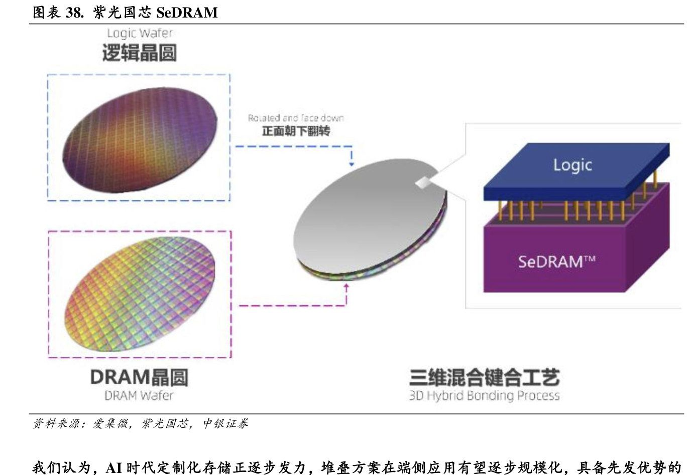

Logic Wafer 逻辑晶圆；DRAM Wafer DRAM 晶圆
Rotated and face down 正面朝下翻转
三维混合键合工艺 3D Hybrid Bonding Process
Logic；SeDRAM™

资料来源：爱集微，紫光国芯，中银证券

我们认为，AI 时代定制化存储正逐步发力，堆叠方案在端侧应用有望逐步规模化，具备先发优势的公司有望深度受益产业浪潮。

---

<!-- 原文第 25 页 -->

## 投资建议与风险提示

### 投资建议

综合考虑 AI 对存储带来的需求增量及结构供给冲击，我们认为无论短期还是中长期维度，存储产业链或存在高度确定性机会。我们建议关注如下细分方向：

#### 一、受益于周期价格波动的经销商及模组产品制造商

香农芯创、江波龙、佰维存储、德明利、开普云

#### 二、专注于利基市场及存储产品配套芯片的 IC 设计公司

【利基存储】：兆易创新、东芯股份、普冉股份、聚辰股份、北京君正

【配套芯片】：澜起科技、联芸科技

#### 三、国产半导体存储器供应链

【设备】：北方华创、中微公司、拓荆科技、迈为股份、精智达、微导纳米、长川科技

【材料】：华海诚科、联瑞新材、深南电路、兴森科技、广钢气体、雅克科技（化工组覆盖）、兴福电子

【CBA DRAM】：晶合集成、汇成股份

【封装】：深科技

此外我们还建议对未来有望上市的国产半导体存储器制造商给予高度关注。

### 风险提示

行业周期性波动风险：存储芯片具备大宗商品属性，价格极易受供需关系影响。若未来产能扩张过快或 AI 需求不及预期，可能导致行业再次进入供过于求的降价周期。

技术迭代与竞争加剧风险：存储技术迭代迅速，若企业研发跟进不及，或面临技术落后、市场份额丢失的风险。国际龙头厂商竞争激烈，后发者追赶压力巨大。

地缘政治与供应链风险：全球各国推进“主权 AI”，贸易政策、技术禁运等不确定性可能扰乱全球供应链，影响中国存储企业的技术获取和市场拓展。

AI 需求可持续性风险：当前行业增长高度依赖 AI 驱动，若 AI 应用商业化落地进程放缓，或云厂商资本开支减弱，将直接影响存储需求的增长动能。

国产替代与技术突破不及预期风险：中国存储企业在先进制程方面仍处于追赶阶段，若关键技术研发进度或良率提升不及预期，将影响其市场竞争力与盈利水平。

---

<!-- 原文第 26 页 -->

## 披露声明

本报告准确表述了证券分析师的个人观点。该证券分析师声明，本人未在公司内、外部机构兼任有损本人独立性与客观性的其他职务，没有担任本报告评论的上市公司的董事、监事或高级管理人员；也不拥有与该上市公司有关的任何财务权益；本报告评论的上市公司或其它第三方都没有或没有承诺向本人提供与本报告有关的任何补偿或其它利益。

中银国际证券股份有限公司同时声明，将通过公司网站披露本公司授权公众媒体及其他机构刊载或者转发证券研究报告有关情况。如有投资者于未经授权的公众媒体看到或从其他机构获得本研究报告的，请慎重使用所获得的研究报告，以防止被误导，中银国际证券股份有限公司不对其报告理解和使用承担任何责任。

## 评级体系说明

以报告发布日后公司股价/行业指数涨跌幅相对同期相关市场指数的涨跌幅的表现为基准：

公司投资评级：

买　　入：预计该公司股价在未来 6-12 个月内超越基准指数 20%以上；

增　　持：预计该公司股价在未来 6-12 个月内超越基准指数 10%-20%；

中　　性：预计该公司股价在未来 6-12 个月内相对基准指数变动幅度在-10%-10%之间；

减　　持：预计该公司股价在未来 6-12 个月内相对基准指数跌幅在 10%以上；

未有评级：因无法获取必要的资料或者其他原因，未能给出明确的投资评级。

行业投资评级：

强于大市：预计该行业指数在未来 6-12 个月内表现强于基准指数；

中　　性：预计该行业指数在未来 6-12 个月内表现基本与基准指数持平；

弱于大市：预计该行业指数在未来 6-12 个月内表现弱于基准指数；

未有评级：因无法获取必要的资料或者其他原因，未能给出明确的投资评级。

沪深市场基准指数为沪深 300 指数；新三板市场基准指数为三板成指或三板做市指数；香港市场基准指数为恒生指数或恒生中国企业指数；美股市场基准指数为纳斯达克综合指数或标普 500 指数。

---

<!-- 原文第 27 页 -->

## 风险提示及免责声明

本报告由中银国际证券股份有限公司证券分析师撰写并向特定客户发布。

本报告发布的特定客户包括：1) 基金、保险、QFII、QDII 等能够充分理解证券研究报告，具备专业信息处理能力的中银国际证券股份有限公司的机构客户；2) 中银国际证券股份有限公司的证券投资顾问服务团队，其可参考使用本报告。中银国际证券股份有限公司的证券投资顾问服务团队可能以本报告为基础，整合形成证券投资顾问服务建议或产品，提供给接受其证券投资顾问服务的客户。

中银国际证券股份有限公司不以任何方式或渠道向除上述特定客户外的公司个人客户提供本报告。中银国际证券股份有限公司的个人客户从任何外部渠道获得本报告的，亦不应直接依据所获得的研究报告作出投资决策；需充分咨询证券投资顾问意见，独立作出投资决策。中银国际证券股份有限公司不承担由此产生的任何责任及损失等。

本报告内含保密信息，仅供收件人使用。阁下作为收件人，不得出于任何目的直接或间接复制、派发或转发此报告全部或部分内容予任何其他人，或将此报告全部或部分内容发表。如发现本研究报告被私自刊载或转发的，中银国际证券股份有限公司将及时采取维权措施，追究有关媒体或者机构的责任。所有本报告内使用的商标、服务标记及标记均为中银国际证券股份有限公司或其附属及关联公司（统称“中银国际集团”）的商标、服务标记、注册商标或注册服务标记。

本报告及其所载的任何信息、材料或内容只提供给阁下作参考之用，并未考虑到任何特别的投资目的、财务状况或特殊需要，不能成为或被视为出售或购买或认购证券或其它金融票据的要约或邀请，亦不构成任何合约或承诺的基础。中银国际证券股份有限公司不能确保本报告中提及的投资产品适合任何特定投资者。本报告的内容不构成对任何人的投资建议，阁下不会因为收到本报告而成为中银国际集团的客户。阁下收到或阅读本报告须在承诺购买任何报告中所指之投资产品之前，就该投资产品的适合性，包括阁下的特殊投资目的、财务状况及其特别需要寻求阁下相关投资顾问的意见。

尽管本报告所载资料的来源及观点都是中银国际证券股份有限公司及其证券分析师从相信可靠的来源取得或达到，但撰写本报告的证券分析师或中银国际集团的任何成员及其董事、高管、员工或其他任何个人（包括其关联方）都不能保证它们的准确性或完整性。除非法律或规则规定必须承担的责任外，中银国际集团任何成员不对使用本报告的材料而引致的损失负任何责任。本报告对其中所包含的或讨论的信息或意见的准确性、完整性或公平性不作任何明示或暗示的声明或保证。阁下不应单纯依靠本报告而取代个人的独立判断。本报告仅反映证券分析师在撰写本报告时的设想、见解及分析方法。中银国际集团成员可发布其它与本报告所载资料不一致及有不同结论的报告，亦有可能采取与本报告观点不同的投资策略。为免生疑问，本报告所载的观点并不代表中银国际集团成员的立场。

本报告可能附载其它网站的地址或超级链接。对于本报告可能涉及到中银国际集团本身网站以外的资料，中银国际集团未有参阅有关网站，也不对它们的内容负责。提供这些地址或超级链接（包括连接到中银国际集团网站的地址及超级链接）的目的，纯粹为了阁下的方便及参考，连结网站的内容不构成本报告的任何部份。阁下须承担浏览这些网站的风险。

本报告所载的资料、意见及推测仅基于现状，不构成任何保证，可随时更改，毋须提前通知。本报告不构成投资、法律、会计或税务建议或保证任何投资或策略适用于阁下个别情况。本报告不能作为阁下私人投资的建议。

过往的表现不能被视作将来表现的指示或保证，也不能代表或对将来表现做出任何明示或暗示的保障。本报告所载的资料、意见及预测只是反映证券分析师在本报告所载日期的判断，可随时更改。本报告中涉及证券或金融工具的价格、价值及收入可能出现上升或下跌。

部分投资可能不会轻易变现，可能在出售或变现投资时存在难度。同样，阁下获得有关投资的价值或风险的可靠信息也存在困难。本报告中包含或涉及的投资及服务可能未必适合阁下。如上所述，阁下须在做出任何投资决策之前，包括买卖本报告涉及的任何证券，寻求阁下相关投资顾问的意见。

中银国际证券股份有限公司及其附属及关联公司版权所有。保留一切权利。

## 中银国际证券股份有限公司

中国上海浦东

银城中路 200 号

中银大厦 39 楼

邮编 200121

电话: (8621) 6860 4866

传真: (8621) 5888 3554

## 相关关联机构：

### 中银国际研究有限公司

香港花园道一号

中银大厦二十楼

电话:(852) 3988 6333

致电香港免费电话：

中国网通 10 省市客户请拨打：10800 8521065

中国电信 21 省市客户请拨打：10800 1521065

新加坡客户请拨打：800 852 3392

传真:(852) 2147 9513

### 中银国际证券有限公司

香港花园道一号

中银大厦二十楼

电话:(852) 3988 6333

传真:(852) 2147 9513

### 中银国际控股有限公司北京代表处

中国北京市西城区

西单北大街 110 号 8 层

邮编:100032

电话: (8610) 8326 2000

传真: (8610) 8326 2291

### 中银国际(英国)有限公司

2/F, 1 Lothbury

London EC2R 7DB

United Kingdom

电话: (4420) 3651 8888

传真: (4420) 3651 8877

### 中银国际(美国)有限公司

美国纽约市美国大道 1045 号

7 Bryant Park 15 楼

NY 10018

电话: (1) 212 259 0888

传真: (1) 212 259 0889

### 中银国际(新加坡)有限公司

注册编号 199303046Z

新加坡百得利路四号

中国银行大厦四楼(049908)

电话: (65) 6692 6829 / 6534 5587

传真: (65) 6534 3996 / 6532 3371

---
