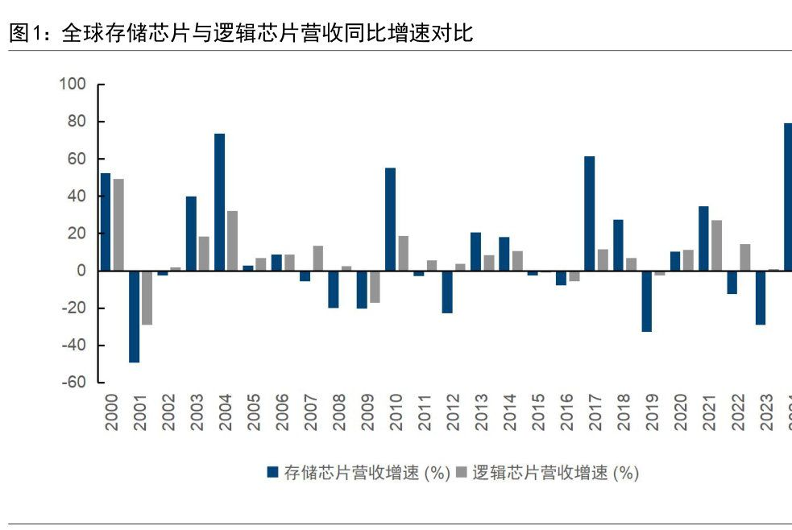
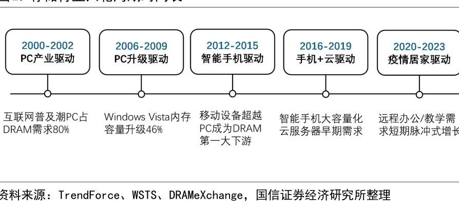

> 原文件：[M160_pdf.dfcfw.com_H3_AP202608251828419638_1.pdf](https://github.com/jadennevercode/CJCC-Knowledge-Base/blob/5ec8511eb834073c8bfbd79c94af196282d483cf/materials/%E8%B7%A8%E9%93%BE%EF%BC%9A%E4%BE%9B%E9%9C%80%E4%B8%8E%E4%BB%B7%E6%A0%BC%E5%8F%A3%E5%BE%84/M160_pdf.dfcfw.com_H3_AP202608251828419638_1.pdf)
> 转换方式：多模态逐页转录（页面图像 + 文本层交叉校验）

<!-- 原文第 1 页 -->

证券研究报告 | 2026年08月25日

# 专题研究报告

## 存储行业周期的历史回顾、现状解析与未来展望

## 核心观点

存储行业是半导体行业中周期性最显著的细分赛道。存储芯片是半导体产业中市场规模最大、周期性最显著的细分赛道，与计算芯片并称为半导体产业的两大支柱，占据全球半导体市场规模的三分之一以上。当前，存储行业正经历一轮由 AI 算力革命驱动的超级景气周期，本报告以历史周期运行规律为认知坐标，沿着“历史复盘-现状拆解-未来推演-产业启示”的逻辑链条，系统梳理存储行业周期的底层逻辑与六轮周期演化特征，深度拆解本轮周期在供需格局、投融资、交易定价、利润分配层面的结构性变化，对 2026-2028 年行业走向开展多情景推演，并提炼产业影响与投资层面的核心结论。

从历史周期规律来看，“需求快变、供给慢变”的天然错配是周期波动的核心根源。2000 年以来行业共经历六轮完整周期，按核心驱动场景可划分为 PC 主导、智能手机主导、数据中心与 AI 主导三大阶段；伴随行业从分散竞争走向寡头垄断，单轮周期价格波动幅度持续收窄，头部原厂逐步形成逆周期调节能力。复盘历史可提炼出“超级周期”的三大刚性触发条件：下游出现行业级增量需求、供给端经历充分出清、技术迭代带来单位价值量跃升；2023 年第四季度启动的本轮周期，是六轮中唯一同时高强度满足三大条件的周期，AI 算力需求的长期持续性使其与传统消费电子驱动周期存在本质差异。

从本轮周期运行现状来看，行业呈现极致的结构性分化特征，核心运行逻辑已脱离传统周期框架。需求端，AI 算力基础设施建设成为绝对增长引擎，HBM 需求爆发式增长，企业级存储依托长协订单提供长期刚性支撑，消费电子需求占比历史性回落、对周期边际影响显著弱化，行业从“消费电子单引擎”转向“AI 算力主导、企业级支撑、消费电子托底”的多元驱动格局。供给端，产能约束呈现三重结构性叠加：三大原厂高度垄断高端产能并定向投向 HBM 与企业级产品，消费级产能加速退出；先进封装与配套设备构成关键供给瓶颈，短期供给弹性显著低于晶圆产能；技术迭代释放的有效供给被 HBM 更高的晶圆消耗强度对冲，高端存储供需紧平衡持续强化。投融资端，全球产业资本大幅上调开支，资金高度聚焦 HBM 扩产、先进封装配套与下一代技术前瞻布局，韩、美、中三大产业集群各自加码产能建设，区域聚集特征突出。交易定价端，长协锁价模式全面替代现货成为高端存储主流交易方式，合约价主导定价权，不同品类价格走势显著分化，全产业链库存处于历史低位，进一步拉长景气周期时长。利润分配端，产业链利润向掌握高端产能的原厂环节集中，三大原厂利润率创下半导体制造业历史罕见水平，上游瓶颈配套环节分享次级红利，下游按客户绑定深度分层；国内产业已形成“通用市场全球前列、高端赛道从零起步”的二层格局，HBM 领域与国际头部仍存 2—3 年代差。

从未来趋势推演来看，AI 资本开支落地节奏、原厂扩产与技术迭代进度、宏观地缘变化是决定周期走向的三大核心变量。基于变量的不同组合，行业存在三类情景：乐观情景下超级周期景气度延续至 2028 年底，高端品类供需缺口持续存在；中性情景下结构性景气持续至 2027 年底，2028 年逐步温和分化；悲观情景下周期或于 2027 年中见顶，通用存储出现阶段性价格调整。无论情景如何演化，产品结构高端化、供应链区域化分离是两大长期

发展研究·专题研究

证券分析师：陈锐
0755-81981573
chenrui1@guosen.com.cn
S0980516110001

---

<!-- 原文第 2 页 -->

确定性方向，以 HBM 为核心的高端存储将成为行业长期成长主线，三大产业集群的独立演进将逐步弱化存储价格的全球联动性。

从产业影响与投资启示来看，本轮超级周期正全方位重构产业链价值分配与全球分工体系，上游设备材料价值向高端配套环节集中，下游终端成本分层传导，存储首次成为算力硬件第一大成本项，并成为拉动本轮全球半导体景气的核心板块。投资逻辑需从传统的现货价格周期博弈，转向稀缺高端产能资源配置思路：长期按稀缺性与业绩弹性形成四大配置梯队，分阶段开展景气轮动，并建立高频、中频、低频三层标准化产业跟踪体系动态研判拐点。同时需警惕估值透支、拐点误判、长协履约、政策管制、技术路线替代等多重风险。

风险提示：海外市场风险波动，政策效果不及预期。

---

<!-- 原文第 3 页 -->

# 内容目录

一、历史回顾 …… 5
　　（一）存储周期的底层逻辑与经典阶段划分 …… 5
　　（二）历史周期的核心驱动因素与波动特征复盘 …… 7
　　（三）历史周期的核心驱动因素与波动特征复盘 …… 11
二、现状解析 …… 12
　　（一）需求端：AI 算力爆发与结构性分化 …… 12
　　（二）供给端：产能约束、先进封装瓶颈与技术迭代 …… 14
　　（三）投融资进展：赛道热度、区域分布与阶段特征 …… 17
　　（四）交易与价格机制：长协定价主导下的价格分化与库存重塑 …… 19
　　（五）产业链利润分配：从微笑曲线到瓶颈环节的超额利润攫取 …… 20
三、未来展望 …… 21
　　（一）影响行业周期走向的核心变量前瞻 …… 22
　　（二）基于核心变量的周期情景推演 …… 23
　　（三）行业长期趋势下的确定性方向 …… 25
四、产业影响与投资启示 …… 26
　　（一）产业影响：产业链价值重构与区域格局调整 …… 26
　　（二）投资启示：行业配置逻辑与跟踪体系 …… 27
　　（三）投资风险提示 …… 28
风险提示 …… 30

---

<!-- 原文第 4 页 -->

# 图表目录

图 1：全球存储芯片与逻辑芯片营收同比增速对比 …… 5
图 2：存储行业六轮周期时间表 …… 7

表 1：DRAM 主流颗粒价格（美元/颗） …… 6
表 2：六轮存储周期三大条件 …… 11
表 3：六轮存储周期三大条件满足情况对比 …… 11
表 4：北美五大云厂商资本支出预估 …… 13
表 5：HBM 市场份额与产能规划 …… 15
表 6：存储行业投融资区域分布 …… 18
表 7：周期情景推演 …… 23

---

<!-- 原文第 5 页 -->

# 一、历史回顾

## （一）存储周期的底层逻辑与经典阶段划分

存储行业是半导体行业中周期性最显著的细分赛道。以营收口径衡量，根据 WSTS（世界半导体贸易统计组织）历年统计，全球存储芯片营收在周期高点年份的同比增速可达 60% 以上（如 2017 年同比+61.5%），在低点年份的同比降幅可达 30% 上下（如 2019 年同比-32.6%、2023 年约-29%），波动幅度显著大于同期逻辑芯片及半导体整体市场。周期波动的核心根源，在于天然的供需错配属性。

图1：全球存储芯片与逻辑芯片营收同比增速对比

资料来源：WSTS，国信证券经济研究所整理；注：单位为%

需求端方面，下游 PC、手机、服务器等终端需求属于快变量。据 IDC 与 Gartner Dataquest 统计，2001 年全球 PC 出货量同比下滑约 4.6%（Dataquest 口径），出现自 1985 年以来的首次年度负增长；而据 IDC 季度跟踪，2020 年第三季度全球 PC 出货量在疫情居家需求驱动下同比增长 14.6%，前后两个时点的增速振幅超过 20 个百分点。手机端波动同样剧烈，据 IDC 统计，2022 年全球智能手机出货量同比下滑 11.3%，为 2013 年以来最大年度降幅。需求侧单季度级别的剧烈波动，直接决定了存储订单节奏的高频变化。

供给端方面，存储晶圆产能属于慢变量。据 SEMI《World Fab Forecast》及三星、SK 海力士、美光历年公开项目建设时间表，一座新建 12 英寸存储晶圆厂从土建动工到实现稳定量产通常需要 24-36 个月；即便在既有厂区内进行产线改造或制程转换，从设备搬入到良率爬坡完成也需 12-18 个月。产能投放以“年”计，而需求变化以“季度”计，两者之间存在天然时差。

“需求快变、供给慢变”的内在矛盾，天然决定了行业“价格上行→产能扩张→产能过剩→价格下跌→产能收缩→供需再平衡”的周期性轮回，这是所有存储周期运行的底层逻辑。

在周期划分上，不同机构对存储周期的划分可能并不统一。本报告按 DRAM 价格完整“上行-下行”闭环细拆，即以 DRAM 合约价趋势性拐点为划分基准、以 WSTS 年度营收增速交叉验证，将 2000-2026 年划分为六轮完整周期。

从波动幅度看，深度调整在历史上反复出现：1996-1998 年亚洲金融危机期间，

---

<!-- 原文第 6 页 -->

DRAM 价格累计最大跌幅超过 90%；2001 年互联网泡沫破裂后，据美光财报，其 2001 财年第四季度（2001 年 6-8 月）存储产品平均售价环比下跌约 55%、较上年同期下跌约 85%，可作为行业价格深跌的缩影；2022-2023 年的调整中，DRAM 价格累计下跌约 58%。综合来看，单次下行最大跌幅超 80% 的深度调整，主要集中于 2009 年以前厂商分散竞争的阶段；2012 年后随行业集中度提升，单轮最大跌幅收窄至 50%-70% 区间，30%-60% 的区间波动为行业常态。

表1：DRAM 主流颗粒价格（美元/颗）

| 年份 | 周期阶段 | 主流 DRAM 规格 | 代表性价格（美元/颗） | 价格区间（美元/颗） | 关键事件 |
| --- | --- | --- | --- | --- | --- |
| 2000 | 上行顶点 | 64Mb SDRAM | 1.5 | 1.5-8.0 | 互联网泡沫顶点，年初 8.0 年末暴跌至 1.5 |
| 2001 | 深度下行 | 128Mb SDRAM | 0.8 | <1.0 | 泡沫破裂，需求崩塌，价格跌破现金成本 |
| 2002 | 弱复苏 | 256Mb DDR | 3.5 | 3.0-4.0 | 行业触底，DDR 开始替代 SDRAM |
| 2003 | 上行期 | 256Mb DDR | 3.5 | 3.5-3.8 | 供需紧平衡，价格温和上涨 |
| 2004 | 周期高点 | 256Mb DDR | 5.8 | 5.0-6.5 | 严重供需错配，价格暴涨 |
| 2005 | 下行期 | 512Mb DDR2 | 4.5 | 4.0-5.0 | 供给增加，价格从高位回落 |
| 2006 | 震荡筑底 | 512Mb DDR2 | 2.5 | 2.0-3.0 | Vista 预期落空，库存积压 |
| 2007 | 上行期 | 1Gb DDR2 | 2.5 | 2.0-3.0 | 价格阶段性反弹，次贷危机初现 |
| 2008 | 深度下行 | 1Gb DDR2 | 0.8 | <1.0 | 全球金融危机，需求骤停，价格雪崩 |
| 2009 | 周期底部 | 1Gb DDR2/DDR3 | 0.8 | 0.8-2.0 | 历史级低谷，奇梦达破产，年末 DDR3 反弹 |
| 2010 | 强劲复苏 | 1Gb DDR3 | 2.8 | 2.5-3.0 | 经济复苏+智能机初期红利，量价齐升 |
| 2011 | 下行期 | 2Gb DDR3 | 1.5 | 1.5 | 泰国洪灾+PC 疲软，供过于求 |
| 2012 | 出清/拐点 | 4Gb DDR3 | 1.4 | 1.2-1.5 | 尔必达破产，三大寡头格局初现 |
| 2013 | 上行期 | 4Gb DDR3 | 3.5 | 3.0-4.0 | 寡头控产效应显现，价格反弹 |
| 2014 | 高位盘整 | 4Gb DDR3 | 3.5 | 3.5-3.7 | 智能手机大容量化，供需两旺 |
| 2015 | 下行期 | 4Gb DDR3 | 1.5 | 1.5 | PC 需求衰退，新一轮去库存 |
| 2016 | 筑底反转 | 8Gb DDR4 | 4 | 2.5-4.0 | 云计算+数据中心，DDR4 渗透突破 |
| 2017 | 超级周期 | 8Gb DDR4 | 9.5 | 9.0-9.5 | 手机+云爆发，产能严重不足，价格翻倍 |
| 2018 | 见顶回落 | 8Gb DDR4 | 6 | 6.0-9.0 | 前三季度$9.0，Q4 库存高企+贸易摩擦暴跌 |
| 2019 | 深度下行 | 8Gb DDR4 | 2.5 | 2.5 | 贸易战+产能过剩，全年单边下跌 |
| 2020 | 弱复苏 | 8Gb DDR4 | 3 | 3 | 疫情居家办公，PC/笔电短期需求 |
| 2021 | 上行高点 | 8Gb DDR4 | 4.5 | 4.0-5.0 | 缺芯潮，供应链恐慌性囤货 |
| 2022 | 崩塌下行 | 8Gb DDR4 | 2 | 2 | 疫情红利消退，手机/PC 出货量双位数下滑 |
| 2023 | 历史级大底 | 8Gb DDR4 | 1.1 | 1.0-1.2 | 极致去库存，价格跌破所有厂商现金成本 |
| 2024 | 复苏反转 | DDR4/DDR5 | 1.8 | 1.5-2.0 | AI 训练算力爆发，DDR5 渗透率过半 |
| 2025 | 加速上行 | DDR5/HBM | 2.5 | >2.5 | AI 推理+长协锁价，HBM 极度紧缺 |
| 2026E | 超级周期 | DDR5/HBM4 | - | 长协溢价极高 | AI 基础设施重构，HBM 产能售罄 |

资料来源：DRAMeXchange、TrendForce、iSuppli，国信证券经济研究所整理

按核心驱动场景，本文将六轮周期归为三大经典阶段。划分标准为“该轮上行期 DRAM 比特需求增量的主导来源”，而非当时的叙事热点。前两轮（2000-2002、2006-2009）为 PC 及服务器驱动周期。据行业历史数据，2001 年前后 PC 占 DRAM 总需求约 80%，是绝对主导下游；2006-2009 年周期的上行主要由 Windows Vista 操作系统带动的 PC 内存容量升级与企业服务器需求驱动，同期功能机单机存储以 NOR 闪存及小容量芯片为主，占 DRAM 比特需求的比重很低。因此该轮虽伴随功能机普及的叙事，需求增量的主导权仍在 PC 端，归入 PC 驱动阶段。中间两轮（2012-2015、2016-2019）为智能手机驱动周期。据 IHS iSuppli 统计，2012 年第二季度 PC 占 DRAM 比特需求的份额首次跌破 50%，智能手机与平板合计首次超越 PC 成为第一大下游，智能手机换机潮与单机容量升级构成该阶段需求增量的主

---

<!-- 原文第 7 页 -->

导来源。最近两轮（2020-2023、2023 年至今）为数据中心与 AI 驱动周期。据 TrendForce 统计，2023 年服务器 DRAM 位元产出占比（37.6%）正式超越移动 DRAM（36.8%），成为第一大应用领域；2023 年以来，HBM 与 AI 服务器需求成为行业增量的绝对主导。

每一轮周期的上行幅度、持续时长、产业传导特征，均由核心下游需求增量与供给端产能扩张节奏共同决定；而阶段驱动力的切换（PC→智能手机→数据中心/AI）正是理解各轮周期量价特征差异的第一把钥匙。

## （二）历史周期的核心驱动因素与波动特征复盘

### 1、六轮周期的驱动与运行复盘

**第一阶段为 PC 产业主导的两轮周期。2000-2002 年周期核心驱动为互联网普及潮带动的 PC 放量，当时 PC 占 DRAM 总需求约八成。**上行期自 1999 年至 2000 年约一年半：据 Gartner Dataquest 当年统计，2000 年全球 DRAM 市场规模约 315 亿美元，较 1999 年增长约三成（另一行业统计口径为 289 亿美元，同比增长 28.4%），全年持续供不应求。下行期自 2001 年初持续约两年：据美光 2001 财年财报，其 2001 财年第四季度（自然年 2001 年 6-8 月）存储产品平均售价较上年同期下跌约 85%，较上季度下跌约 55%；行业层面，据 Gartner Dataquest 统计，DRAM 价格在 2000 年中至 2001 年中累计下降约 80%，当年 128Mbit 芯片现货价一度跌破 2 美元，合约价跌破 3 美元，双双击穿制造成本；同期全球 DRAM 市场营收自 2000 年的 315 亿美元骤降至 2001 年的约 140 亿美元，同比萎缩约 55%-56%，为当时行业史上最严重年度收缩。终端侧，据 IDC 与 Gartner Dataquest 统计，Dataquest 口径下 2001 年全球 PC 出货量同比下滑约 4.6%，出现 1985 年以来首次年度负增长。这一轮深跌加速了全球厂商分化：韩系厂商凭借成本优势逆势扩大份额，美、日、欧厂商逐步退出主流市场或转向利基产品。据美国国会研究处记载，到 2001 年全球 DRAM 市场已由四家主要厂商主导，为此后韩系主导格局埋下伏笔。

图2：存储行业六轮周期时间表

- 2000-2002 PC产业驱动：互联网普及潮 PC占DRAM需求80%
- 2006-2009 PC升级驱动：Windows Vista内存容量升级46%
- 2012-2015 智能手机驱动：移动设备超越PC成为DRAM第一大下游
- 2016-2019 手机+云驱动：智能手机大容量化 云服务器早期需求
- 2020-2023 疫情居家驱动：远程办公/教学需求 短期脉冲式增长
- 2023至今 AI算力驱动：HBM需求爆发 AI服务器出货+31%

资料来源：TrendForce、WSTS、DRAMeXchange，国信证券经济研究所整理

**第二阶段的首轮（2006-2009 年）核心驱动为 Windows Vista 操作系统带动的 PC 内存容量升级预期叠加企业服务器需求。**三星与 IDC 当年曾估计，仅 Vista 操作系统即可带动单台 PC 平均内存容量提升约 46%，对应约 230 亿美元的产值空间。上行期自 2006 年至 2007 年上半年约一年半。据 iSuppli 统计，2006 年全球 DRAM 市场营收约 340 亿美元，同比增长约三成半；2007 年 1 月 Vista 正式上市，但上半年行业已因扩产竞赛陷入供过于求，主流 DDR2 合约价累计下跌约五成，直至当年 7 月，Vista 备货叠加旺季预期才带动 DDR2 现货价格反弹约 12%-20%，升势未能延续。下行期自 2007 年下半年至 2009 年初约两年。据 iSuppli 统计，2007 年 DRAM 市场营收萎缩约 7%-8%至约 315 亿美元，第四季度全行业营业亏损近 30 亿美元；2008 年进一步萎缩约 25%至约 236 亿美元。2008 年第四季度为这一轮深谷，

---

<!-- 原文第 8 页 -->

当季产业营收仅约 42 亿美元。据 iSuppli 统计业界收入平均环比下滑约 38%，集邦 DRAMeXchange 口径更是逾 40%，为当时有统计以来最大单季降幅；主流 DDR2 667MHz 1Gb 颗粒现货价自 10 月初的约 1.25 美元崩落至 12 月中旬最低的约 0.58 美元，10 月底起跌破厂商约 1 美元的现金成本，逼近材料成本线，价格自这一轮峰值累计跌幅超过八成。这一轮周期是行业整合的分水岭。2009 年 1 月 23 日，曾为全球第三大、彼时全球供货份额约一成的德国 DRAM 厂商奇梦达向慕尼黑地方法院提交破产申请，成为本轮出清的标志性事件，消息公布后现货价格随即见底回升；据集邦 DRAMeXchange 统计，韩系双雄（三星+SK 海力士）合计市场份额由 2008 年第四季度的 46.3%升至 2009 年第一季度的 50.1%，首次突破五成，第三季度进一步升至 54.1%，韩系主导格局自此确立。

**第二阶段为智能手机主导的两轮周期。2012-2015 年周期核心驱动为智能手机普及初期需求。**据 IHS iSuppli 统计，2012 年第二季度移动设备（智能手机与平板合计）DRAM 比特需求占比首次超越 PC 成为第一大下游。上行期自 2012 年下半年至 2014 年约两年。据集邦 DRAMeXchange 统计，2013 年 4GB 内存模组合约均价自约 17 美元涨至约 33 美元，涨幅逼近一倍；2013 年全球 DRAM 产业营收达 352 亿美元，同比增长 32.5%；2014 年产业景气超预期，第四季度单季产值达 130 亿美元，创单季历史新高，全年产值约 460 亿美元，明显超出该机构 2013 年末 395 亿美元的预估。这一轮周期见证了行业史上最重要事件，2012 年 2 月 27 日，日本最大 DRAM 厂商尔必达在连续五个季度亏损后，依《公司更生法》向东京地方法院申请破产保护，负债高达 4480 亿日元（约 55 亿美元），为日本制造业史上最大破产案；2012 年 7 月，美光与其签署收购协议，以约 25 亿美元收购尔必达全部股权（其中 7.5 亿美元以现金支付，其余 17.5 亿美元于 2019 年前分期支付），另以 3.34 亿美元从力晶手中收购其台湾合资厂瑞晶电子 24%股权（交易完成后美光合计掌握瑞晶 89%股权），交易于 2013 年 7 月 31 日完成交割，美光借此跃升为全球第二大 DRAM 厂商。2013 年 9 月 4 日，SK 海力士无锡工厂发生火灾，该厂产量约占全球 DRAM 的 12%，占 SK 海力士总产出的一半。据集邦 DRAMeXchange 统计，火灾后至 9 月 24 日 DRAM 现货价累计上涨 42%，创两年来新高，成为本轮上行斜率最陡的一段。下行期自 2014 年第四季度至 2016 年上半年，4GB DDR3 模组合约价自 2014 年 10 月的 32.75 美元跌至 2016 年 6 月的 12.5 美元，累计跌幅约六成二，至 2016 年 6 月方止跌回稳。

**2016-2019 年周期核心驱动为智能手机大容量化（单机存储搭载量持续攀升）叠加云服务器早期需求**；同时三大原厂将产能自标准型 DRAM 转向移动式与服务器用产品，叠加先进制程转换良率不及预期，供给端扩张保持纪律。上行期自 2016 年第三季度至 2018 年第三季度，持续九个季度。据集邦 DRAMeXchange 统计，2016 年第四季度标准型 DRAM 合约价飙涨逾 30%，带动当季全球 DRAM 营收环比增长 18.2%；据 IC Insights 统计，2017 年 DRAM 平均售价同比上涨约 47%，创当时历史最大年度涨幅；全上行期主流 4GB 模组合约均价自 2016 年 6 月谷底的约 12.5 美元升至 2018 年第三季度的 34.5 美元，累计涨幅超过一倍半。据 TrendForce 统计，2018 年 10 月合约价正式起跌，4GB 模组均价自 34.5 美元滑落至 31 美元，单月跌幅约一成，结束持续逾两年的上涨。下行期自 2018 年第四季度持续约一年余。据 TrendForce 统计，2019 年全年 DRAM 报价累计跌幅超过五成；据 WSTS 统计，2019 年全球存储营收同比下滑 32.6%，其中 DRAM 下滑 37.1%。这一轮周期后，三星、SK 海力士、美光三大原厂垄断格局正式确立。据 TrendForce 统计，2018 年三家合计 DRAM 市场份额达 95.4%（第一季度）至 95.7%（第三季度），当年第三季度三大原厂营业利润率亦同步创下历史新高（三星 70%、SK 海力士 66%、美光 62%）。

**第三阶段为数据中心与 AI 主导的两轮周期。2020—2023 年周期的核心驱动为全**

---

<!-- 原文第 9 页 -->

球疫情下的居家办公与远程教学需求。上行期自 2020 年第四季度至 2021 年第三季度约四个季度：2021 年第一季度 DRAM 现货价格同比上涨约 50%，但同期合约价涨幅仅 0%至 5%，涨势主要由利基型产品现货领涨；至 2021 年第二季度整体 DRAM 合约价环比涨幅扩大至 18%至 23%，其中 PC DRAM 环比上涨 23%至 28%、服务器 DRAM 环比上涨 20%至 25%，全上行期整体合约价累计涨幅约三至四成。下行期自 2021 年第四季度起合约价连跌八个季度，至 2023 年第三季度仍环比小幅下跌，至 2023 年第四季度方见底回升。受价格回落影响，2022 年全球存储市场规模同比下滑约 13%至 14%，终结 2020 至 2021 年的连续增长。下行后期产业出清加速：2022 年第四季度 DRAM 产业营收环比下滑 32.5%，逼近 2008 年金融海啸时约 36%的历史最大单季跌幅；该季度 DDR4 服务器 DRAM 合约价环比下跌 23%至 28%、DDR5 环比下跌 30%至 35%。这一轮下行价格自峰值累计跌幅约五至六成。下行期间三星电子 DS 部门 2022 年第四季度营业利润自 8830 亿韩元骤降至 2700 亿韩元，同比下滑约 97%，美光于 2022 年 11 月宣布 DRAM 与 NAND 晶圆投片较 2022 财年第四季度削减约 20%并大幅削减资本开支，SK 海力士亦自 2022 年第四季度起宣布减产，稼动率自 92%向 82%下调，供给端约束自此持续强化。

**2023 年第四季度启动的新一轮周期，核心驱动为 AI 算力基础设施建设。**据 TrendForce 统计，2023 年第四季度 Mobile DRAM 合约价环比上涨 13%至 18%，为当季领涨品类并带动 DRAM 合约价普遍上行，本轮上行正式开启。2025 年全球 DRAM 产值达 1657 亿美元，同比增长 73%；其中 2025 年第四季度在 DDR5 需求拉动下单季合约价涨幅达 53%至 58%，高于其统计的历史循环单季最高约 35%的水平，该机构评价本轮涨势幅度显著高于历史循环，被市场称为 AI 驱动的存储“超级周期”。

纵观六轮复盘，每轮周期的驱动切换、量价幅度与格局演化，构成了归纳行业周期波动特征与传导规律的事实基础。

### 2、周期波动的核心特征

从六轮周期的长期演化来看，行业运行呈现若干稳定特征，其中最具产业含义的有二：格局决定波动、消费电子决定节奏。

**其一，行业格局决定周期波动幅度，二者呈显著负相关。**2000 年代中后期，全球 DRAM 市场仍有三星、SK 海力士、美光、奇梦达、尔必达及南亚科、力晶、茂德、华邦等近十家主要厂商同台竞争，集中度较低。分散竞争格局下，各家厂商在价格上行期竞相扩产、下行期降价保份额，价格战没有刹车机制：2001-2002 年与 2007-2009 年两轮下行，DRAM 价格自峰值累计跌幅均超过八成，其中 2008 年第四季度单季产业营收环比下滑约 38%至 40%，创当时历史纪录。此后行业集中度拾级而上，2009 年第一季度韩系双雄合计份额首次突破 50%，2014 年第四季度三大原厂合计份额达 90%以上，2018 年进一步升至约 95%。与集中度提升同步，单轮最大跌幅明显收窄，2015-2016 年下行累计约六成，2018-2019 年下行全年跌幅超五成，2021-2023 年下行累计约 58%，深度调整从分散竞争时代的超八成，收敛至寡头格局时代的六成左右。

格局改善之所以能熨平波动，核心在于头部原厂形成了逆周期调节能力。价格下行期主动缩减供给，比如 2022 年第四季度起美光等原厂陆续宣布减产以应对价格深跌；价格上行期则优先将产能投向高毛利产品而非全面扩产，比如 2016-2018 年上行期中，三大原厂持续将产能自标准型 DRAM 转向移动式与服务器用产品，以供给纪律维持价格弹性。

**其二，消费电子是传统周期的核心边际影响变量。**传统周期中，PC 与智能手机合计长期占据 DRAM 比特需求的五成以上，比如 2001 年前后 PC 单一品类即占约 80%，

---

<!-- 原文第 10 页 -->

至 2019 年移动设备与 PC 仍分别占约 41%、13%。由于消费电子需求基数大、换机与购机节奏弹性高，其边际变化直接主导行业周期节奏。2018 年、2022 年两轮深度调整，核心诱因均为消费电子需求的周期性崩塌：据 IDC 统计，2018 年全球智能手机出货量 14.05 亿部、同比下滑 4.1%，连续两年减少，叠加 2016-2018 年上行期扩产产能的集中释放，DRAM 合约价自 2018 年 10 月见顶回落，2019 年全年累计跌幅超过五成；2022 年疫情红利消退后，据 IDC 统计，全球 PC 出货量 2.923 亿台、同比下滑 16.5%（其中第四季度单季下滑 28.1%），全球智能手机出货量同比下滑 11.3%、为 2013 年以来最大年度降幅，双双出现两位数下滑，叠加原厂前期扩张产能集中投产与产业链库存高企，本轮下行 DRAM 价格累计下跌约 58%。

需要指出的是，消费电子对周期的边际主导力在本轮周期中正显著弱化。2023 年以来的上行由 AI 算力与数据中心需求驱动，消费电子复苏幅度不足以左右行业走向。这一变化本身，正是本轮周期区别于传统周期的重要注脚。

### 3、价格传导机制与传导时滞

存储行业的价格传导遵循“现货价格→合约价格→渠道库存→原厂产能调整”的链条，各环节存在节奏明确的时滞，且各环节的时滞量级差异很大，需要分层理解。

第一层是现货向合约的传导，时滞约一个季度。存储现货市场按日交易、对供需边际变化即时反应，而合约价是原厂与品牌客户之间的长期订单价格，通常按季度谈判重签。历史上现货的领先性反复得到验证：2013 年 9 月 4 日 SK 海力士无锡工厂火灾后，现货价在 20 天内累计飙升 42%，而当月合约价一度“难产”，至中秋节后才明朗，9 月合约均价环比上涨 8.86%，更明显的涨幅落在 10-11 月；2016 年第三季度现货起涨后，第四季度标准型 DRAM 合约价单季即上涨逾 30%；2020 年第四季度现货启动上涨，2021 年第一季度现货价同比涨幅已达约 50%，而同期合约价环比仅上涨约 8%，至第二季度合约价环比涨幅才扩大至 18%-23%。需要说明的是，现货领先并非铁律，2023 年第三季度至 2024 年的上行由供给收缩主导，DRAM 现货价格涨幅反而落后于合约，区间涨幅仅 20%-70%。传导方向与弹性，取决于周期由需求拉动还是供给收缩驱动。

第二层是价格与库存向原厂产能决策的传导，时滞约两至四个季度。价格持续上行、合约价覆盖扩张成本后，原厂才会正式启动新产能建设；价格持续下行、渠道库存高企时，原厂才会落实减产。以最近一轮下行为例，DRAM 合约价自 2021 年第四季度转跌，产业链库存一度累积至创纪录的约 3-4 个月供应量，而美光等原厂至 2022 年第四季度才陆续宣布减产。从价格信号到产能决策，间隔约三至四个季度。

第三层是产能决策到有效产能落地的传导，时滞以年计。据 SEMI《World Fab Forecast》及原厂公开项目建设时间表，新建 12 英寸存储晶圆厂从动工到稳定量产需 24-36 个月。综合来看，价格信号在现货与合约之间的传导约需 1 个季度，但“价格信号→原厂产能决策→有效产能变化”的全链条时滞长达两年以上。这正是之前所述“需求快变、供给慢变”矛盾在价格机制上的具体体现，也是周期得以自我强化的传动装置。

值得注意的是，本轮周期中传统传导机制正在发生结构性变化。随着三大原厂将新增产能全部定向投向 HBM 与企业级产品，并以长期供货协议锁定核心客户需求，合约价的主导权显著强化，现货市场的领先指标意义相应弱化。2026 年以来现货与合约走势多次“撕裂”：3 月国内主流 DDR4 现货价单月跳水超 30%，而同期合约价延续上涨；7 月 64GB 服务器 DRAM 现货报价突破 3100 美元，较约 1380 美元的合约价高出约 146%；据 TrendForce 统计，2026 年第一季度合约价涨幅达 60%

---

<!-- 原文第 11 页 -->

以上、部分产品线接近翻倍，原厂对核心客户普遍转向竞价与长协锁量模式。传统周期中“现货领涨领跌→合约跟随→产能滞后调整”的节律，正在让位于“长协定价→产能定向投放”的新机制。

### （三）历史周期的核心驱动因素与波动特征复盘

复盘六轮周期可以发现，涨幅最大、持续性最强的上行阶段，通常在需求、供给、技术三个维度同时具备某些共性条件。

表2：六轮存储周期三大条件

| 条件编号 | 条件名称 | 具体内涵 |
| --- | --- | --- |
| 条件一 | 下游出现行业级增量需求 | 非简单存量升级，而是全新应用场景带来的结构性需求增量 |
| 条件二 | 供给端经历充分出清 | 头部厂商无盲目扩产计划、产能纪律显著改善 |
| 条件三 | 技术迭代带来单位价值量跃升 | 同等产能下行业营收规模显著放大 |

资料来源：TrendForce 集邦咨询，国信证券经济研究所整理

**2023 年启动的本轮周期是六轮中唯一三大条件同时以高强度满足的周期。**需求维度，AI 算力基础设施建设不仅创造了 HBM 这一全新需求品类，更具备长期持续性。历史超级周期的增量多为单一赛道的短期爆发，比如疫情远程需求仅支撑约四个季度的上行，而 TrendForce 预计本轮 DRAM 涨势将延续至 2027 年，需求量级与持续时长均远超传统周期。供给维度，本轮出清更彻底，纪律更刚性：2022-2023 年深跌中，三大原厂将产能利用率降至历史低点，并以近乎对半砍的力度削减资本开支，比如 SK 海力士 2023 年资本开支同比下降约 54%；此后产能扩张逻辑从“价格上涨即全面扩产”彻底转向“基于长期需求的定向扩产”，2023 年第四季度起，SK 海力士宣布新增投资集中于 HBM、DDR5、LPDDR5 等高端产品，美光 2026 财年资本开支预算上调至约 200 亿美元，主要投向 HBM 产能，新增产能不再对消费级市场形成供给冲击。技术维度，HBM 带来真正的单位价值量跃迁：据 TrendForce 统计，HBM3e 定价原为服务器 DDR5 的四至五倍，不过 2025 年末以来随 DDR5 价格大涨，价差有所收敛；且 HBM 对晶圆资源的消耗约为常规 DRAM 的三倍，每多投 1 片 HBM 晶圆，常规 DRAM 供给约减少 3 片；2025 年 HBM 占 DRAM 产业总产值的比重预计已超过 30%。同时，HBM 的良率控制与先进封装工艺大幅抬高了行业技术壁垒，进一步强化供给端刚性约束。

表3：六轮存储周期三大条件满足情况对比

| 周期轮次 | 时间区间 | 驱动因素 | 条件一 | 条件二 | 条件三 | 满足条数 | 典型特征 |
| --- | --- | --- | --- | --- | --- | --- | --- |
| 第一轮 | 2000-2002 年 | 互联网 PC 普及 | 满足 | 不满足 | 不满足 | 1 条 | 行业处于近十家厂商分散竞争阶段，供给无出清；SDR→DDR 切换属常规迭代 |
| 第二轮 | 2006-2009 年 | Vista 带动内存升级 | 不满足 | 不满足 | 不满足 | 0 条 | Vista 偏存量升级且销量不及预期；奇梦达破产发生在周期尾段（是结果而非前提）；DDR2→DDR3 属常规迭代 |
| 第三轮 | 2012-2015 年 | 智能手机普及 | 满足 | 满足 | 不满足 | 2 条 | 尔必达破产实现深度出清（2012 年全球 DRAM 资本开支同比-33%至 57 亿美元）；移动 DRAM 放量未带来单位价值量数倍跃迁 |
| 第四轮 | 2016-2019 年 | 智能手机大容量化+云服务器早期需求 | 满足 | 满足 | 不满足 | 2 条 | 三大原厂合计份额约 95%支撑供给纪律，成就 2016-2018 年“超级周期”上行；DDR4 渗透属常规迭代 |
| 第五轮 | 2020-2023 年 | 疫情远程需求 | 部分满足 | 部分满足 | 不满足 | 1.5 条 | 疫情需求属短期脉冲（上行仅约 4 季度即逆转）；SK 海力士资本开支 2021-2022 年大幅回升至 19.7 万亿韩元（超 2018 年峰值），纪律不彻底；DDR5 渗透占比极低 |
| 第六轮 | 2023 年至今 | AI 算力基础设施建设 | 满足 | 满足 | 满足 | 3 条 | 六轮中唯一三大条件同时以高强度满足 |

资料来源：TrendForce 集邦咨询，国信证券经济研究所整理

---

<!-- 原文第 12 页 -->

还应注意，本轮周期在三大条件之外额外叠加了长期成长变量：AI 需求正从大模型训练端向推理端延伸，存储需求从“一次性投入”转向“长期算力基础设施投入”，这使本轮周期与传统消费电子驱动的周期存在本质差异，也是其被摩根士丹利等机构定义为 AI 驱动“超级周期”的核心原因。

厘清历史周期的底层逻辑、演化特征与本轮周期的定位差异后，下文将进一步从供需格局、投融资、价格机制、利润分配等维度，全面拆解本轮存储超级周期的现状特征与结构性矛盾。

## 二、现状解析

2023 年下半年，存储行业在经历三个季度的价格下行后，正式结束疫情周期调整期，进入新一轮上行周期。2025 年下半年起，行业运行节奏彻底脱离传统周期框架，价格上涨幅度、需求持续强度、供给约束刚性程度均远超市场此前最乐观预期。本轮周期核心特征体现为极致的结构性分化：一端是 AI 算力驱动的高端存储持续紧缺，另一端是传统消费级存储供需总体平稳。本章按照需求、供给、投融资、交易定价、利润分配的逻辑框架，逐层拆解本轮周期的现状特征与内在矛盾。

### （一）需求端：AI 算力爆发与结构性分化

本轮存储超级周期最核心的变化是需求结构重构，行业从此前“消费电子单引擎主导”的格局，转向“AI 算力主导、企业级需求支撑、消费电子托底”的多元驱动结构，消费电子对周期的边际影响被大幅弱化。

#### 1、AI 算力是核心增长引擎

**AI 算力基础设施建设是拉动本轮存储需求爆发的绝对核心驱动**，其需求量级显著超出行业传统认知边界。从传导逻辑看，AI 大模型的训练、推理、多模态数据处理都伴随参数与数据在计算单元与存储单元之间的高频搬运，存储带宽而非算力本身日益成为系统性能的瓶颈，即业界所称的“内存墙”约束。“HBM 之父”、韩国科学技术院（KAIST）金正浩教授在 2026 年公开访谈中指出，受内存带宽制约，GPU 真正用于有效计算的时间仅约 10%，要充分释放 GPU 算力，必须配套足量的高带宽存储。

从需求总量看，据 TrendForce 集邦咨询 AI Server 产业研究，2026 年全球 AI 服务器出货量同比增速已上调至 31%左右（该机构 2025 年 10 月 30 日预估为“年增 20%以上”，2026 年 1 月上修至“28%以上”，2026 年 8 月 3 日再度上调至 31%左右，年内连续三次上调），占整体服务器出货比重升至 17%以上。需要说明的是，31%为出货量口径；叠加单机存储搭载量的代际提升，AI 服务器拉动的存储需求在金额与位元量口径下的增速均显著高于出货量增速。据美光科技在 2023 年 6 月财报电话会议上的披露，AI 服务器的 DRAM 用量约为普通服务器的 6-8 倍，NAND 用量约为 3 倍；以整机规格实证，NVIDIA DGX H100 系统搭载 8 颗 H100 GPU，合计配置 640GB HBM 显存与 2TB DDR5 系统内存，而同期传统双路服务器的内存配置通常为 512GB-1TB DRAM 且不含 HBM。

从品类结构看，HBM 是 AI 算力的核心刚需载体。据 SEMI 中国总裁冯莉援引的行业预测，2026 年全球 HBM 市场规模将同比增长 58%至约 546 亿美元，占整体 DRAM 市场比重接近四成；据 TrendForce 集邦咨询预估，2026 年全球 HBM 位元出货量将突破 300 亿 Gb，HBM4 已于 2026 年第二季度量产出货，下半年起超越 HBM3e 成为市场主流。单加速器搭载容量沿英伟达产品路线图持续跃升：H100 的 80GB（HBM3）→H200 的 141GB（HBM3e）→B200/GB200 的 192GB（HBM3e）→GB300 的

---

<!-- 原文第 13 页 -->

288GB，下一代 Rubin 平台单 GPU 将搭载 288GB HBM4。

更关键的是需求结构正在持续优化。2026 年以前，核心增量来自大模型训练端；2026 年起，需求重心加速转向以 AI 智能体（Agent）为核心的推理端。据 TrendForce 集邦咨询 2026 年 5 月发布的 AI 产业研究，2026 年北美五大云厂商合计 AI 训练算力同比增长约 56%，而 AI 推理算力同比增长高达 120%；AMD 公司 CEO 苏姿丰预计 2026 年全球约 60%的 AI 算力将用于推理，巴克莱预测 2026 年推理计算需求将占 AI 总算力需求的 70%以上。训练需求近似一次性投入，推理需求则随应用渗透持续放量，这一结构变化意味着 AI 存储需求正从“一次性训练投入”转向“长期持续的算力基础设施运营投入”，是支撑本轮周期长期景气的核心底层逻辑。另外，资金端也可直接佐证需求刚性。据 TrendForce 集邦咨询，2026 年全球九大云厂商（美系 Google、AWS、Meta、微软、Oracle 及中系字节跳动、腾讯、阿里巴巴、百度）合计资本支出预估将突破约 8867 亿美元，同比年增约九成，且年内多次上修。

#### 2、企业级存储提供长期刚性支撑

**企业级存储是本轮超级周期的第二增长极，也是行业刚性增量的基础。**与历史周期中企业级需求跟随宏观 IT 支出波动不同，本轮企业级需求直接绑定 AI 算力基础设施资本开支，与消费电子周期的相关性显著弱化。云厂商是企业级存储的核心下游，据 TrendForce 集邦咨询，2026 年全球九大云厂商合计资本支出预估将突破约 8867 亿美元，同比年增约九成，资本开支向 AI 服务器、数据中心 SSD 与服务器内存的集中投放，直接带动企业级存储需求同步爆发。

表4：北美五大云厂商资本支出预估

| 厂商 | 2026 年资本支出预估 | 同比增幅 | 主要投向 |
| --- | --- | --- | --- |
| Amazon/AWS | 2000 亿美元 | +141%（对比 2025 年 830 亿美元） | AWS、AI 芯片、机器人 |
| Google/Alphabet | 1800 亿-1900 亿美元 | +257%（对比 2025 年 525 亿美元） | TPU 芯片、AI 算力、云需求 |
| Microsoft | 1900 亿美元 | +78%（对比 2025 年 813 亿美元） | Azure、OpenAI 算力 |
| Meta | 1250 亿-1450 亿美元 | +73%（对比 2025 年 722 亿美元） | 超级智能实验室、自研 ASIC |
| Oracle | 500 亿美元（2026 财年） | +138%（对比 2025 年 210 亿美元） | OCI、数据中心 |

资料来源：TrendForce 集邦咨询，国信证券经济研究所整理

SSD 端，据 TrendForce 集邦咨询 2026 年 1 月产业调查，受北美云厂商加码 AI 基础建设驱动，2026 年全球服务器市场迎来成长高峰，企业级 SSD 需求预期将首度超越智能手机，成为 NAND Flash 第一大应用。实际运行数据印证了该判断，据 TrendForce 集邦咨询官方披露，2026 年第一季度全球前五大企业级 SSD 品牌合计营收达 184.6 亿美元、环比大增 86.1%，创单季历史新高，其中三星以 70.5 亿美元居首（环比+92.8%），SK 海力士集团（含 Solidigm）46.4 亿美元，美光 30.9 亿美元；当季企业级 SSD 合约价环比上涨约 80%，各供应商库存已降至历史低点，产出速度远赶不上订单增长。

内存端，服务器用内存已完成向 DDR5 的代际切换。据 TrendForce 数据，2025 年 DDR5 在服务器内存市场的渗透率已跨过 80%门槛，2026 年预计进一步推高至 90%；同期 DDR4 新需求持续萎缩，行业甚至已有供应商开始讨论其停产时间表。这意味着服务器内存的增量需求全部落在 DDR5 及更高端的 HBM 品类上，企业级需求增长与原厂的高端产能倾斜战略形成闭环。

更关键的是交易模式的重构。企业级存储采购已从传统现货交易全面转向长期供货协议（LTA）锁价，构成需求刚性的机制性保障。据高盛 2026 年 8 月发布的三星、SK 海力士、美光、闪迪四家原厂 LTA 条款横向对比研报，本轮长协覆盖率由

---

<!-- 原文第 14 页 -->

2023-2025 年行业常规的 20%-30%跃升至 2026 年的 50%以上，合约期限以五年为主，部分三年，并普遍引入预付款与财务担保机制。从原厂一手披露看，三星预计多年期订单将达计划产能的 60%-70%，其中 HBM 先进产能锁定率超 90%，且已收到约四分之一的合约预付款；美光已签署 16 份战略客户协议，覆盖约 20%的 DRAM 出货量与三分之一的 NAND 出货量，预计收到约 220 亿美元预付款；闪迪已签署八份长期供货协议，最低总收入达 939 亿美元，加权平均期限超过四年。头部云厂商以真金白银的预付款锁定未来三至五年的供应，意味着企业级存储需求的量级已被合约结构化锚定。这种“先付款、后提货”的需求形态在历轮周期中从未出现，是“长期刚性支撑”的核心依据。

#### 3、消费电子需求边际影响显著弱化

**与历史周期的一个本质差异在于：本轮超级周期中，消费电子已从存储周期的“驱动者”变为“承受者”，其对行业周期的边际影响能力大幅下降。**

从需求结构看，消费电子的占比已发生历史性易位。据 TrendForce 集邦咨询 MTS 2026 存储产业趋势研讨会发布的数据，AI 服务器（含 HBM 与服务器 DDR5）对 DRAM 位元的消耗量自 2024 年起急剧增加，预计 2026 年约占全球 DRAM 总供应量的 66%，2027 年可能进一步提升至 70%以上；智能手机、PC、汽车/工控/网通及其他消费电子合计仅分得约 34%，其中智能手机约 12%，PC/笔电约 10%。与传统周期中 PC 与智能手机合计长期占据 DRAM 总需求六成以上相对比，消费电子的需求占比已从主导量级压缩至约三分之一，这一占比结构表明消费电子对行业周期走向的边际定价权已经易手。

从终端出货看，2026 年消费电子正经历的不是复苏，而是存储涨价挤压下的深度收缩。据 IDC 于 2026 年 3 月发布的全球 PC 与智能手机市场预测，受存储芯片供应紧缺与价格持续上涨冲击，2026 年全球智能手机出货量预计同比下降 12.9%，为有记录以来最大年度跌幅；全球 PC 出货量预计下降 11.3%，复苏时间被推迟至 2028 年；两大品类平均售价预计上涨约 14%，部分 OEM 厂商被迫以降配应对成本压力（如 12GB+256GB 机型调整为 8GB+128GB）。Gartner 与 Counterpoint 的同期预测方向一致，2026 年全球 PC 出货量下滑约 10.4%，智能手机出货量跌破 11 亿部，为 2013 年以来最低水平。IDC 在报告中明确指出，短缺的结构性因素在于“AI 基础设施需求与消费设备争夺同一 DRAM 和 NAND 产能”，并预计存储危机将持续至 2027 年。换言之，本轮消费电子的收缩本身就是超级周期的结果而非原因。即便智能手机与 PC 出现历史性下滑，2026 年存储价格与原厂盈利仍屡创历史新高，这是“消费电子边际影响显著弱化”最直接的现实证据。

从供给响应看，消费电子需求的任何波动都已无法获得产能端的响应。三大原厂不仅停止了消费级产能扩张，更在主动退出成熟产品线。据 TrendForce 报道，三星已于 2025 年 6 月停止接收 DDR4 订单，同年 12 月完成最后出货，美光于 2026 年第一季度完成 DDR4 最后出货，SK 海力士于 2026 年 4 月完成 DDR4 退出，三家产能全面转向 DDR5 与 HBM；三星 DDR4 产能已降至 2025 年水平的 20%以下，产线设备多已拆除，即便市场价格信号反转，重建产能也需 18-24 个月。供给端的结构性退出意味着消费电子与行业景气之间的传统传导链条已被切断，消费级需求的短期波动既不会引发原厂产能回补，也不会对行业高景气度造成实质性冲击，这与前述“2018 年、2022 年消费电子崩塌直接主导周期下行”的历史机制形成鲜明对照，本轮周期的运行逻辑已截然不同。

### （二）供给端：产能约束、先进封装瓶颈与技术迭代

需求端的结构性爆发是本轮周期的核心拉动力，供给端的刚性约束则是紧缺格局

---

<!-- 原文第 15 页 -->

得以持续的核心支撑。本轮供给端的约束并非简单的产能总量不足，而是由三重结构性因素叠加而成。一是产能高度集中且定向倾斜，三大原厂将绝大部分新增产能投向 HBM 与企业级存储，消费级产能加速退出；二是先进封装与配套设备构成关键瓶颈，台积电 CoWoS 产能缺口约 20%、TC 键合设备市场高度垄断，短期供给弹性远低于晶圆产能本身；三是技术迭代对有效供给的边际调节，HBM4 代际升级提升单颗带宽与容量，但良率爬坡仍需时间，名义产能与有效产出之间存在显著折扣。三重约束共同塑造了当前“高端持续紧缺、低端弱平衡”的结构性供给格局。

#### 1、产能高度集中与倾斜式分配格局

**当前全球高端存储产能呈现极高集中度**，三星、SK 海力士、美光三大原厂合计占据全球 HBM 市场约 99%的份额，但内部结构正随 HBM4 世代切换发生微妙松动。分代际、口径看，HBM3E 时代的 2025 年，SK 海力士以绝对优势领跑。进入 HBM4 世代后，海力士的龙头地位仍然稳固，但三星借 HBM4 率先量产收复了部分份额。更核心的变化是三大原厂的产能分配逻辑，自 2025 年起，头部原厂将绝大部分新增产能优先投向 HBM 与企业级存储，消费级产能则加速退出，“高端挤压低端”成为本轮供给格局的主线。

具体来看，三星正以激进的扩产与率先量产扭转上一代的落后局面。据韩媒 ETNews 报道，三星计划将 HBM 月产能从约 17 万片提升至 2026 年底的约 25 万片，增幅接近 50%，并将平泽 P4 产线转型为 HBM4 专属制造基地，把 P5 Fab 2 动工时间提前至 2026 年 7 月。其 12 层 HBM4 于 2026 年 1 月通过英伟达最终质量认证，2 月 12 日全球率先量产出货并交付英伟达，量产后仅四个月累计销售额即突破 10 亿美元，现有 HBM4 产能已被客户全数预订。SK 海力士则以更大规模的资本开支巩固龙头地位，2026 年 8 月 7 日经董事会批准，将投资 54.3 万亿韩元（约 383 亿美元）在韩国本土扩建产能，其中清州 M17 工厂约 134.7 亿美元（2031 年前完成），龙仁半导体产业园第二阶段约 249 亿美元（2031 年 10 月底前完成），重点扩大 HBM、下一代 DRAM 及 NAND 产能；其 HBM4 自 2026 年 2 月起出货，量产步调相对稳健。美光的处境则体现“售罄但追赶”的双重特征，据美光 FY2026 Q1 财报电话会披露，2026 年全年 HBM 产能已被客户预订一空，但目前仅能满足核心客户约一半至三分之二的订单需求，公司预计三年后 HBM 潜在市场规模可达千亿美元；为追赶产能，美光将 FY2026 资本支出上调至超过 250 亿美元，日本、新加坡新建晶圆厂及纽约 Megafab 预计 2028-2029 年陆续投产。这种“产能全部锁定、仍供不应求”的格局直接造成了行业结构性紧缺现状，“高端挤压低端”的分配模式进一步拉长了本轮周期的上行时长。

表5：HBM 市场份额与产能规划

| 机制名称 | SK 海力士 | 三星电子 | 美光科技 |
| --- | --- | --- | --- |
| 2025 年 HBM 市场份额 | 59% | 20% | 20% |
| 2026 年 HBM 市场预测份额 | 50% | 28% | 22% |
| HBM 产能规划 | 扩产投资 54.3 万亿韩元（约 383 亿美元）；主要项目包括清州 M17 工厂（134.7 亿美元）、龙仁产业园二期（249 亿美元） | 2026 年底目标约 25 万片，增幅接近 50%；主要基地包括平泽 P4（HBM4 专属）、P5 Fab 2（2026 年 7 月动工） | 2026 财年资本支出超过 270 亿美元；新建日本、新加坡晶圆厂、纽约 Megafab，2028-2029 年陆续投产。 |

资料来源：TrendForce 集邦咨询，国信证券经济研究所整理

#### 2、先进封装与配套环节的供给瓶颈

存储行业的供给约束并非单纯的晶圆产能不足，而是核心配套资源的多重约束，其中封装环节是限制短期供给弹性的最关键变量。需要区分两个层级的封装瓶颈：

---

<!-- 原文第 16 页 -->

其一是存储原厂内部的 HBM 堆叠封装（TSV 加微凸点，三星与美光采用 TC-NCF 路线、SK 海力士采用 MR-MUF 路线），其二是晶圆代工端将 GPU 与 HBM 集成于硅中介层的 2.5D 封装（以台积电 CoWoS 为代表）。

就代工端而言，据行业统计，台积电 CoWoS 月产能已从 2022 年的约 1.5 万片提升至 2026 年的约 7 万片，2026 年底预计达 13-14 万片，五年扩产近十倍仍供不应求。摩根大通测算 2026 年 CoWoS 供需缺口约 20%，英伟达一家即预订了台积电 2026 年约 80-85 万片的 CoWoS 产能，台积电被迫扩大 CoW 前段工序外包，日月光等 OSAT 厂商承接后全行业月产能才接近 20 万片。

**在原厂堆叠封装环节，设备与材料构成第一重约束。**HBM 堆叠键合设备高度集中，韩美半导体在 HBM 用 TC 键合机（TC Bonder）市场的份额约 71.2%。设备供应的紧张程度可从两笔交易实证：2026 年 6 月 8 日，SK 海力士向韩美半导体下单 442 亿韩元（约 2900 万美元）的“TC Bonder 4.5 Griffin”设备用于 HBM4 生产，单笔订单相当于韩美半导体上年全年营收的 7.66%；同期 SK 海力士多家一级设备供应商反向提出 3%-4%的供货涨价要求并被接受，半导体设备行业延续多年的“买方市场”惯例在本轮周期中被打破，原厂被迫以涨价锁定设备供应。技术路线上，三星的 TC-NCF 与 SK 海力士的 MR-MUF 之争仍在持续，JEDEC 上调 HBM4 封装厚度上限后，混合键合的导入节奏暂缓，但 16 层堆叠的散热与翘曲控制仍是各家工艺攻关的焦点。

**良率是名义产能与有效产出之间的第二重折扣**，且口径必须区分厂商与代际。以爬坡最陡的三星 HBM4 为例，2026 年 2 月量产初期良率不足 60%，至 2026 年 8 月已接近 80%的“黄金良率”门槛，提前约四个月达成年度目标，三星进而将 12 层 HBM4 的良率目标上调至 85%，HBM4E 的可靠性测试良率也于 2026 年 6 月突破 70%。SK 海力士则凭借 MR-MUF 路线的良率优势被视为领跑者。综合来看，本轮供给弹性由“封装产能×良率爬坡×设备交付”三重变量共同决定。头部原厂虽在 2026 年快速跨越良率门槛，但代工端约 20%的封装缺口与设备议价权的逆转表明，配套环节仍是本轮供给约束中最紧的一环。

#### 3、技术迭代对有效供给的边际调节

技术迭代是影响有效供给规模的重要变量，本轮周期中其作用集中体现为 HBM 的代际升级。2026 年，HBM4 在三大原厂全面进入量产。三星于 2026 年 2 月 12 日率先宣布 HBM4 量产并启动商用出货，采用第六代 10 纳米级（1c）DRAM 工艺与 4 纳米逻辑基础裸片（Base Die），稳定传输速率 11.7Gbps、最高可达 13Gbps，单堆叠带宽最高 3.3TB/s，为 HBM3E 的 2.7 倍，12 层堆叠容量 24-36GB，并规划以 16 层堆叠扩展至 48GB。

SK 海力士于 2025 年 9 月全球率先完成 HBM4 开发并构建量产体系，2026 年 7 月 15 日启动面向英伟达 Vera Rubin 平台的 12 层 HBM4 量产交付，其 HBM4 采用 2048 条数据传输通道（I/O 数量较 HBM3E 翻倍），运行速率突破 10Gbps（超出 JEDEC 标准 8Gbps 上限），单颗 12 层产品每秒数据处理能力超 2TB，能效较前代提升 40%以上，并计划自 2026 年 9 月起扩大出货规模。

美光于 2026 年第一季度实现 HBM4 36GB 12 层产品批量出货，引脚速率超 11Gb/s、带宽超 2.8TB/s（为 HBM3E 的 2.3 倍），并已向客户交付 48GB 16 层样品。代际升级使同等晶圆投入下的单颗带宽与容量持续提升，对供给紧张局面形成双向调节，也就是说短期加剧晶圆消耗强度，但长期来看，底层制程密度提升能摊薄单位存储的晶圆消耗。

与技术参数提升同步的是良率爬坡对有效供给的二次放大。HBM 良率随工艺成熟

---

<!-- 原文第 17 页 -->

快速改善：三星 HBM4 量产初期（2026 年 2 月）良率不足 60%，至 2026 年 8 月已提升至约 80%，提前约四个月达成原定年底目标，其依托的 1c DRAM 裸片良率年初已达 80%；SK 海力士 HBM4 良率亦已进入 80%区间，接近上一代成熟产品 HBM3E 的水平。此外，底层制程迭代提供基础性的位元供给增量：第六代 10 纳米级工艺（三星/SK 海力士称 1c、美光称 1γ）较上一代位元密度提升约 30%，并首次在美光产线引入 EUV 光刻；美光预计到 2026 年年中，1γ 工艺 DRAM 将占其位元出货量一半以上。

但需要明确的是，技术迭代同时抬高了生产门槛与资源消耗，其供给释放效应被两重机制对冲。其一，HBM 对晶圆资源的消耗远高于通用产品。相同位元产出下，HBM 较 DDR5 约需消耗 3 倍投片量，且美光在财报电话会中明确“每一代换算比还在往上走”，即 HBM4 的晶圆消耗强度高于 HBM3E。这意味着 HBM 在 DRAM 总投片中的占比每提高一个百分点，对通用存储供给的挤出就放大一分。TrendForce 估算 HBM 晶圆投入占 DRAM 总投片比例将从 2025 年底的 18%升至 2026 年底的 22%、2027 年底的 30%。其二，需求增速持续跑赢供给释放。2026 年 HBM 位元需求同比增速仍在 70%以上，TrendForce 预计 2027 年 HBM 位元出货量同比增长 50%-60%却仍低于需求增速，市场延续紧平衡。因此，技术迭代无法改变产能倾斜的核心分配逻辑，也无法从根本上扭转高端存储供需紧平衡的格局；HBM4E 将重复“参数跃升—良率爬坡—资源消耗加剧”的同一循环。

### （三）投融资进展：赛道热度、区域分布与阶段特征

在 AI 算力驱动的存储超级周期背景下，全球存储及上下游产业链的投融资热度显著提升，资本逻辑从过往的周期博弈转向长期成长赛道布局。本节从赛道热度、细分投向、区域分布与阶段特征四个维度展开分析。

#### 1、赛道热度

从产业资本维度看，三大原厂 2026 年资本开支集体大幅上调。从公司层面总投入口径（含代工、NAND 与研发）来看，三星电子计划 2026 年研发及设施投入超过 110 万亿韩元，同比增长约 21.7%，创历史新高，重点投向 HBM 产能扩张与先进制程，目标 2026 年 HBM 产能提升 50%；SK 海力士 2026 年资本支出计划约 35 万亿韩元，同比增幅 42%，重点投向 HBM4 产能扩张与先进封装；美光 2026 财年资本开支从年初指引的约 180 亿美元上调至超过 270 亿美元，同比接近翻倍，投向先进 DRAM、HBM、先进 NAND 及新增制造设施。从股权融资维度看，中国市场 2025 年初至 2026 年 2 月 5 日集成电路领域披露融资规模达 835 亿元、累计 1197 起，平均单笔约 7000 万元，其中 20 起大额融资中 12 个超 10 亿元，资金集中流向存储芯片、AI 芯片、半导体制造三大领域。

#### 2、细分投向

全球范围内，投融资围绕三条主线展开且均有代表性项目落地。一是 HBM 为核心的高端存储扩产。三大原厂资本开支如上所述，且美光明确 HBM 先进封装设施 2026 年投入运营、2027 年形成实质供应贡献。二是先进封装与配套环节的扩产。安靠（Amkor）于 2025 年 10 月启动总投资 70 亿美元的先进封装园区建设；国内封测环节 2026 年以来长电科技、甬矽电子等 A 股封测及存储模组厂商扩产计划合计超 400 亿元。三是下一代技术路线的前瞻布局。存算一体方向，杭州微纳核芯 2026 年完成 B3、B4 轮融资后 B 轮系列总额突破 10 亿元，资方覆盖兆易创新、佰维存储等存储产业资本与运营商、大模型公司，形成“终端—存储—云端—大模型”全链条资本闭环。国内市场则聚焦国产替代主线。长鑫科技科创板 IPO 资金拟投向晶圆制造量产线升级（75 亿元）、DRAM 技术升级（130 亿元）与前瞻技术研发

---

<!-- 原文第 18 页 -->

（90 亿元）；长江存储方面，其控股方长存集团完成 94 亿元 B 轮融资用于 3D NAND 产能扩张与先进工艺研发。政策资本层面，国家集成电路产业投资基金三期注册资本 3440 亿元，超过前两期之和，首次引入六大国有银行合计超 1000 亿元，存续期 15 年，首批已投项目包括通过子基金注资拓荆键科（混合键合设备）、参与中微公司收购杭州众硅的配套募资等，投资逻辑从“广撒网”转向设备材料补短板与先进封装、AI 存储布局。

#### 3、区域分布

投融资的区域聚集特征明显。韩国集群方面，SK 海力士规划向龙仁半导体集群投资约 600 万亿韩元建设四座晶圆厂，清州厂区投资约 100 万亿韩元扩产 NAND，SK 集团层面宣布在韩国国内投入约 1100 万亿韩元用于存储及基础设施；三星平泽 P5 总投资预计超 60 万亿韩元，并规划龙仁国家先进系统半导体产业园区投资 360 万亿韩元。

美国集群方面，美光计划在 2035 年前将美国投资扩大至 2500 亿美元，包括爱达荷州博伊西两座晶圆厂、纽约州克莱园区，目标四成 DRAM 在美国本土生产；SK 海力士亦在印第安纳州西拉斐特投资约 40 亿美元建设先进封装基地，预计 2028 年完工。

国内方面，投融资高度聚集于合肥与长三角、珠三角产业带。长鑫科技合肥厂区周边已聚集广钢气体、盛美半导体、北方华创、华海清科、合肥沛顿等配套企业，形成设备材料就地配套格局；配套扩产同步落地，如深科技旗下深圳沛顿及合肥沛顿实施总投资 14.7 亿元的高端存储封测产能扩充项目。

表6：存储行业投融资区域分布

| 区域 | 企业/项目 | 投资金额 | 投资项目/地点 | 投资领域 |
| --- | --- | --- | --- | --- |
| 韩国集群 | SK 海力士 | 约 600 万亿韩元 | 龙仁半导体集群 | 四座晶圆厂 |
| 韩国集群 | SK 海力士 | 约 100 万亿韩元 | 清州厂区 | NAND 扩产 |
| 韩国集群 | SK 集团 | 约 1100 万亿韩元 | 韩国国内总计 | 存储及基础设施 |
| 美国集群 | 美光 | 2500 亿美元 | 美国总投资 | - |
| 美国集群 | SK 海力士 | 约 40 亿美元 | 印第安纳州 | 先进封装基地 |
| 中国集群 | 大基金三期 | 3440 亿元 | 全国 | 设备材料、先进封装 |
| 中国集群 | 长鑫科技 IPO | 579 亿元 | 合肥 | DRAM 制造 |
| 中国集群 | 长江存储三期 | 207.2 亿元 | 武汉 | 3D NAND 扩产 |
| 中国集群 | 长存集团 B 轮 | 94 亿元 | 武汉 | 3D NAND |
| 中国集群 | 深科技沛顿 | 14.7 亿元 | 深圳/合肥 | 高端存储封测 |
| 中国集群 | 盈新发展 | 17.79 亿元 | - | DDR5/服务器存储模组 |

资料来源：万得，TrendForce 集邦咨询，国信证券经济研究所整理

#### 4、阶段特征

海外存储扩产以成熟期产业资本与战略投资为主，单项目投资动辄百亿美金、建设周期 5 年以上，并配套五年期 HBM 战略供货协议等长期锁定安排（美光已签署行业首批五年期 HBM 供货协议）。国内则呈现二元结构。一端是早期技术攻关融资集中于设备、材料、存算一体等卡脖子环节；另一端是成熟产能项目的融资放量，除长鑫 IPO 外，2026 年以来华海清科、拓荆科技、通富微电、江波龙等多家产业链公司启动再融资，盈新发展亦公告拟定增募资不超 17.79 亿元投向先进存储模组封测与存储主控芯片研发。整体看，存储赛道的投融资已呈现“投向聚焦高端、区域集群落地、阶段分层清晰”的格局，与前述的需求爆发与供给约束形成资本层面的印证。

---

<!-- 原文第 19 页 -->

### （四）交易与价格机制：长协定价主导下的价格分化与库存重塑

供需格局的结构性分化，直接传导至交易定价与库存运行层面。与传统周期中现货价格主导定价的机制不同，本轮周期交易模式发生根本性变革：长协锁价成为高端存储的主流交易方式，价格形成机制从现货驱动转向合约驱动，库存运行则呈现“财报口径与渠道口径双重低位”的特征，二者共同熨平了短期价格波动、延长了景气周期持续时间。

#### 1、品类间价格走势结构性分化

本轮周期的价格走势呈现与历史周期截然不同的结构性分化，且分化结构本身在 2026 年发生了二次演化。从合约价环比序列看，一般型 DRAM 合约价 2026 年第一季度环比上涨 90%-95%，第二季度环比上涨 58%-63%，TrendForce 预计第三季度涨幅收敛至 13%-18%、第四季度进一步放缓至 3%-8%；NAND Flash 合约价同期从第一季度的 55%-60%收敛至预计第三季度季增 10%-15%、第四季度 0%-5%。企业级 SSD 的第三季度合约价环比涨幅预计为 25%-30%，服务器 DDR5 为 10%-20%。

**分化的第一层是高端与通用的差距。**HBM 处于配额制供货状态，TrendForce 测算 2026 年 HBM 供需缺口高达 50%-60%，全部采用长协定价、市场上几乎无现货流通；Bernstein 跟踪的 HBM 现货参考价 2026 年约为 16.6 美元/GB，并预测 2027 年可能升至 53 美元/GB。

**分化的第二层是 2026 年新出现的“退出品类尾部拉升”。**DDR4 因三大原厂加速退出而供给坍塌，但服务器、工控、网通设备的存量需求仍在，摩根士丹利预计 2026 年 7-9 月 DDR4 单月涨幅可能超过 20%，整个第三季度累计涨幅超 30%，涨幅反超 DDR5；部分大型云厂商甚至开始为 DDR4 签署 1-2 年期长期采购协议。

**分化的第三层是消费端的承受力见顶。**Counterpoint 数据显示 2026 年第二季度批发价 200 美元以内低端手机的 BOM 成本同比上涨约 70%，几乎全部由存储涨价推动，PC、智能手机等消费端客户对合约价的承受力已达极限，这是第三季度涨幅收敛的直接原因。

#### 2、长协定价替代现货成为主流模式

本轮周期交易模式变革的核心证据，是三大原厂及闪迪在 2026 年集中落地的长期供货协议（LTA）体系，其覆盖率、条款结构与资金锁定规模均有可核验数据。覆盖率方面，三星披露 LTA 通常基于 5 年期并通过滚动续约机制每年延续一年，已与全球前五大数据中心客户完成签约，正与另外 5 家大客户最终谈判，预计签约完成后多年期合约量将达到其计划产能的约 60%-70%；美光已签署 16 份战略客户协议，覆盖约 20%的 DRAM 出货量和约三分之一的 NAND 出货量，最终目标是 LTA 收入占比超过 50%；SK 海力士已完成约 10 份长期协议条款谈判，覆盖率约 50%-60%；闪迪已签署 5 项多年期协议，覆盖 FY2027 超过三分之一的 BiCS 供应量。

**定价条款方面，本轮长协区别于以往周期的最大特征是“价格区间+底价保护+预付款”三重机制。**美光明确其最大合约设有价格上下限，以 2026 年第二季度市价为定价基准，即便按底价销售毛利率仍高于历史峰值水平；三星按客户群体和产品类别采用差异化定价模型，并为通用产品设置底价；SK 海力士则选择取消价格上限，保留普通 DRAM 最大的价格上涨弹性。预付款机制的体量空前，美光预计将收到 220 亿美元现金存款及相关财务承诺，闪迪披露的财务担保（含预付款）超过 110 亿美元，三星已收到约四分之一的合约总预付款。

#### 3、全链条库存处于历史低位

---

<!-- 原文第 20 页 -->

库存数据有两套口径第一套是原厂财报口径的库存周转天数，CY2026 年第一季度，三星库存 384.4 亿美元，周转天数 101 天，环比+3 天；美光库存 82.67 亿美元，周转天数 123 天，环比-2 天，收入环比+75%背景下，周转天数反而下降；SK 海力士库存 105.37 亿美元，周转天数 123 天，环比+4 天，系优先保障 HBM 及高附加值产品的战略备货；闪迪周转天数约 156 天，与其 NAND 长协模式下的战略备货有关。

第二套是成品库存口径，截至 2026 年第二季度末，三星和 SK 海力士的 DRAM 及 NAND 成品库存均在 2-4 周以内，低于约 4-5 周的正常水平，更远低于历次下行周期前常见的 10 周以上水平。

渠道层面，模组厂库存确因消费端疲软有所上升，但模组厂市场仅占整体存储市场的个位数百分比，对行业基本面影响有限；下游服务器客户即便积极采购，到货物也基本直接用于即时生产，库存维持正常区间。整体看，“原厂全链条库存健康偏低+成品库存极低+渠道结构性分化”的组合，印证了“高端紧缺、低端弱平衡”的格局。

### （五）产业链利润分配：从微笑曲线到瓶颈环节的超额利润攫取

供需与定价机制的双重变化，最终传导至产业链利润分配层面。传统存储周期中，产业链利润分配符合“微笑曲线”规律，上游设备材料厂商、下游存储模组和渠道厂商的利润弹性高于中间的存储制造原厂。但本轮超级周期的产能紧缺格局彻底重构了这一分配逻辑。掌握高端产能的瓶颈环节拿走了绝大部分超额利润，2026 年第二季度三大原厂财报提供了直接的实证。

#### 1、利润分配逻辑的根本性重构

**本轮利润分配的实测格局呈现清晰的“哑铃倒置”特征。**中间的制造原厂环节利润率均达到半导体制造业历史罕见水平。美光 2026 财年第三季度 GAAP 毛利率 84.6%，营业利润率 80.4%；SK 海力士 2026 年第二季度毛利率 83%，营业利润率 76%；三星 DS 部门同期营业利润率约 70%。

上游设备材料环节同步受益但弹性次之。SEMI 预测 2026 年全球半导体制造设备销售额达 1659 亿美元，同比增长 23.2%，创历史新高，国内设备商盛美上海 2026 年上半年归母净利润同比增长 42.14%。

下游环节则明显分层。头部模组与封测厂商凭借与原厂和长鑫产业链的绑定实现满产与扩产，而中小模组厂、渠道商拿货成本飙升，部分面临“有订单无货源”；不过模组厂整体仅占全球存储市场的个位数百分比，其库存波动不改变行业基本面。

本轮周期中利润向掌握高端产能的原厂集中，上游瓶颈配套环节分享次级红利，下游按客户绑定深度分层，能与原厂签长协、与国产原厂绑定的头部厂商受益，中小厂商被挤出。

#### 2、全球头部原厂的盈利表现

三星电子 2026 年第二季度综合营收 171.5 万亿韩元，同比增长 130%，营业利润 89.5 万亿韩元，同比增长 1813.8%，销售额与营业利润连续三个季度刷新单季历史纪录；其中 DS（半导体）部门营收 127.5 万亿韩元，营业利润 89.2 万亿韩元，同比增长超 250 倍，DS 部门营业利润率约 70%，因 DX（整机）部门亏损 8000 亿韩元，DS 部门对集团营业利润的贡献实际接近 100%。存储业务营收与利润双创历史新高，服务器存储收入占比创纪录，HBM4 大规模出货，并向主要客户交付业界

---

<!-- 原文第 21 页 -->

首批 HBM4E 样品。

SK 海力士 2026 年第二季度营收 79.32 万亿韩元，同比增长 257%，营业利润 60.54 万亿韩元，同比增长 557%，营业利润率 76%，高于第一季度的 71.5%，毛利率 83%。HBM4 已于第二季度量产出货、良率与品质接近成熟 HBM3E 水平，HBM4E 完成客户送样、目标 2027 年批量生产，公司已与约 10 家客户完成长期供货协议谈判。

美光 2026 财年第三季度（截至 2026 年 5 月 28 日）营收 414.6 亿美元，环比增长 73.8%，同比增长 345.7%；GAAP 毛利率 84.6%，GAAP 营业利润率 80.4%，GAAP 净利润 282.4 亿美元，同比增长约 14 倍；分事业部看，云存储（CMBU）营收 137.7 亿美元，营业利润率 78%，核心数据中心营收 115.2 亿美元，营业利润率 83%。HBM 收入连续第二个季度突破 10 亿美元，2026 年 HBM 产能已被全额锁定；公司同时给出 FY26Q4 指引，营收 500 亿美元±10 亿、毛利率约 86%。

#### 3、国内存储产业的全球定位与发展现状

通用存储市场，国内厂商已进入全球前列。长鑫科技按 Omdia 口径为中国第一，全球第四大 DRAM 厂商，全球份额从 2025 年第一季度的约 3%逐季攀升至 2026 年第一季度的 7.7%-8%，17nm DDR5 良率突破 90%，LPDDR6 已完成核心客户送样，规划 2026 年下半年量产导入，将跻身全球 LPDDR6 首发第一梯队；长江存储 2026 年第一季度全球 NAND 份额约 13%，294 层 3D NAND 量产，良率突破 90%，并于 2025 年初向三星反向授权混合键合技术专利，实现中国芯片企业首次向韩国原厂收取专利费。另外，今日头条转引华尔街日报报道，苹果已在 iPhone 和 Mac 产品线中测试长鑫 DRAM 芯片。业绩层面，长鑫科技 2026 年第一季度营收 508 亿元，归母净利润 247.6 亿元，预计上半年营收 1100-1200 亿元，归母净利润 500-570 亿元；SemiAnalysis 预测其 2028 年全球 DRAM 市占率或达 17%。

但在 HBM 这一本轮周期价值量最高的赛道上，国内仍存明显代差。长鑫 HBM3 样品已交付华为等国内客户验证，预计 2026 年底至 2027 年初小批量试产，2027 年规模化供货（月产能目标约 5 万片晶圆），2027-2028 年进入国内主流 AI 服务器供应链，HBM 国产化率预计从不足 1%向 5%-10%攀升；华为昇腾 950PR 已搭载 128GB 国产 HBM 实现量产，形成“国产算力芯片+国产 HBM”的本土闭环。综合来看，国内存储产业的全球定位已从“中低端补充”升级为“通用市场全球前四、高端市场从零到一”的二层格局。DRAM/NAND 通用市场对全球供给格局开始产生实质影响，但 HBM 领域与三大原厂仍保持 2-3 年代差，份额不足 1%，且产能扩张持续受先进设备进口限制约束，这一结构性短板在 2028 年前难以根本改变。

厘清当前行业供需、定价与利润的结构性特征后，下文将基于三大核心变量对 2026-2028 年行业走向进行多情景推演，明确长期发展的确定性方向。

## 三、未来展望

基于 2026 年上半年产业数据及财报季最新披露，结合头部存储原厂的扩产规划、云厂商资本开支指引与行业机构的供需量化测算，本章对 2026-2028 年行业走向进行多情景推演。需要说明的是，在中性情景（基准情形）下，本轮超级周期的景气度预计延续至 2027 年底，部分高端存储品类的紧缺格局将延续至 2028 年以后；在悲观情景下，周期存在 2027 年中提前见顶的可能。行业边际变化的节奏，由需求端 AI 资本开支落地速度、供给端产能释放与技术迭代进度、宏观地缘环境三大核心变量共同博弈决定。本章先拆解三大核心变量的影响逻辑，再通过多情景演绎推演行业走向，最后明确不受短期波动影响的长期确定性方向。

---

<!-- 原文第 22 页 -->

### （一）影响行业周期走向的核心变量前瞻

三大核心变量的边际变化，将直接决定行业价格走势、产能扩张节奏与产业格局的演变方向，是判断周期演化路径的核心锚点。

#### 1、需求端变量：AI 资本开支的落地节奏

需求端的核心变量是全球头部云厂商的 AI 资本开支落地节奏，这一变量在 2026 年第二季度财报季后呈现出“当期超预期、远期有分歧”的清晰图景。从已验证的最新数据看，2026 年第二季度微软、谷歌、亚马逊、Meta 四家资本开支合计 1712 亿美元（含融资租赁），同比增长 78.7%，高于市场一致预期；四家 2026 年全年资本开支指引合计约 7200 亿-7450 亿美元，中值约 7325 亿美元，较第一季度指引中值 7100 亿美元进一步上调。分公司看：亚马逊将 2026 年资本开支预期由约 2000 亿美元上调至约 2200 亿美元，CEO 贾西在财报电话会中明确表示“即使投入 2200 亿美元，仍无法满足 2026 年的全部需求，2027 年也将如此，而已知的 2028 年需求规模令人瞩目”；谷歌将全年指引上调至 1950 亿-2050 亿美元，CFO 明确表示 2027 年资本开支还将“大幅增加”；微软预计 FY2027Q1 单季资本开支将超过 500 亿美元；Meta 将指引区间收窄至 1300 亿-1450 亿美元，其 CFO 称“可预见的未来行业整体算力仍将保持紧张”。

但远期存在明显分歧。支持放缓的证据集中在财务可持续性：谷歌 2026Q2 出现几十年来首次季度自由现金流为负（-59 亿美元），亚马逊 7 月初发行 250 亿美元债券专项为 AI 基础设施融资，摩根士丹利测算五大云厂商（亚马逊、谷歌、Meta、微软、甲骨文）2026-2028 年资本开支占收入比可能高达 38%、44%、45%，超过互联网泡沫时期约 32%的峰值。支持延续的证据则在于需求可见度，微软商业合同积压达 6270 亿美元（同比+99%），亚马逊 AWS 的 AI 业务年化收入已超 250 亿美元且增速创 18 个季度新高，美光、SK 海力士财报均确认长协订单能见度延伸至 2028 年以后。综合来看，2026-2027 年资本开支高增速为大概率事件（已验证+指引锁定），2028 年起的不确定性来自商业化变现效率而非投资意愿，这是悲观情景的核心触发条件。

此外，推理侧需求正在接棒训练侧。亚马逊判断“企业在生产环境中规模化应用推理仍处非常早期”，推理流量的持续性是 2027 年后需求的第二引擎。

#### 2、供给端变量：头部原厂的扩产节奏与技术迭代进度

供给端变量决定高端存储供需缺口的持续时长。一是产能释放节奏：SK 海力士 M15X 加速量产、龙仁首座晶圆厂洁净室提前至 2027 年 2 月试产（初期月产能约 2 万片，主打 1c DRAM 与 HBM4E）；三星平泽 P4 于 2026 年投入运营、P5 Fab1 目标 2028 年量产；美光爱达荷 ID1 厂预计 2027 年中期出片；NAND 方面，按 TrendForce 官方口径，行业总产能约 136.5 万片/月，2026 年底可提升至约 133 万片/月，真正的新建产能增量（约占总产能 17%-19%）要到 2027 年中以后释放。二是产能结构分配：TrendForce 估算 HBM 晶圆投入占 DRAM 总投片比例将从 2025 年底的 18%升至 2026 年底的 22%、2027 年底的 30%。三是技术迭代节奏：HBM4 已于 2026 年上半年在三大原厂全面量产，良率爬坡（三星从 2 月不足 60%升至 8 月约 80%）持续释放有效供给；HBM4E 三星已于 2026 年上半年送样、SK 海力士与美光均规划 2027 年量产，其进度若超预期，将“单颗带宽提升→等效扩大有效供给”的机制间接缓解紧缺。综合来看，供给端的不确定性集中于 2027 年，新建产能释放时点、良率爬坡斜率、HBM4E 量产进度三者叠加，构成乐观与悲观情景在供给侧的分野。

#### 3、宏观端变量：全球汇率波动与地缘政策变化

---

<!-- 原文第 23 页 -->

宏观变量是三大变量中唯一的外生不可控项。汇率方面，韩元兑美元自 2021 年初至 2026 年 7 月初累计贬值一度超 43%，2026 年 7 月以来在韩国央行加息与出口创汇改善推动下反弹超 8%，8 月初现货约 1421，机构对 2026 年全年均值预测约 1400。汇率对行业的作用机制是双向的：韩元弱势抬升三星、SK 海力士以韩元计价的出口利润，为其扩产提供财务缓冲；但若韩元快速升值叠加存储价格见顶，将同时压缩利润与扩产能力，这一敏感性将在悲观情景中计入。出口景气方面，韩国 2026 年 7 月出口同比大增 62.8%至 988.9 亿美元，其中对华半导体出口连续 6 个月保持三位数增长，印证需求端的地缘分布尚未因政策摩擦恶化。

地缘政策方面，三个可观测事实构成本变量的现状基准：其一，美国对华半导体设备出口限制持续约束中国存储厂商的产能爬坡与 HBM 攻坚，这是供给端区域分割的长期变量；其二，韩国政府设立规模 150 万亿韩元的“国民成长基金”（2025 年 9 月公布，2026 年初启动首批投资）定向投资 AI 与半导体等战略产业，产业政策竞争在加码而非缓和；其三，2026 年 7 月 29 日韩国副总理召开紧急市场会议应对存储股剧烈波动，标志存储板块已成为国家级金融稳定议题。综合来看，当前地缘政策处于“管制存量维持、增量未恶化”的均衡态，这正是乐观与中性情景的公共前提；若出现对华管制升级（如设备限制扩展至成熟制程）或韩美产业政策冲突显性化，则构成悲观情景的外生触发器。

### （二）基于核心变量的周期情景推演

基于上述三大核心变量的不同组合，参照 1996 年以来六轮存储周期的历史特征与 2026 年 8 月中旬的最新产业跟踪结果，对 2026-2028 年全球存储行业的发展趋势进行多情景推演，分为乐观、中性、悲观三类情景。

**表7：周期情景推演**

| 维度 | 乐观情景 | 中性情景 | 悲观情景 |
| --- | --- | --- | --- |
| 核心假设 | 云厂商资本开支 2026-2027 年保持高增速且 2028 年不见顶；推理侧规模化商用加速；扩产持续受先进封装设备与核心材料约束 | 2026 年资本开支高增速兑现，2027 年增速边际放缓但绝对额仍增长；推理增量基本抵消训练需求边际回落；原厂按当前规划扩产 | 云厂商资本开支在 2026 年底提前边际放缓；推理增量无法抵消训练需求回落；原厂扩产超规划 |
| 周期演绎 | HBM、企业级 SSD 供需缺口延续至 2028 年；2026 年下半年高端品类维持环比上涨；原厂维持产能纪律 | HBM、企业级 SSD 紧缺延续至 2027 年底，2028 年供需缺口逐步收窄；2027 年高端价格在长协机制下高位平稳；原厂将部分新增产能回投通用存储，但核心产能仍优先保障高端 | HBM、企业级 SSD 供需缺口在 2027 年中前后基本收窄；2027 年下半年高端存储价格阶段性回调；原厂产能纪律弱化，中低端产能释放过快 |
| 触发条件 | 四家云厂商 2027 年合计资本开支指引不低于 2026 年水平等 | 四家云厂商 2026 年全年资本开支落在 7200 亿-7450 亿美元指引区间等 | 四家云厂商 2027 年合计指引跌破 7000 亿美元（较 2026 年中值 7325 亿美元负增长），或单一厂商下调超 15%等 |

资料来源：万得，TrendForce 集邦咨询，国信证券经济研究所整理

#### 1、乐观情景

核心假设：需求端，AI 大模型商业化落地进度超预期，头部云厂商资本开支在 2026-2027 年保持高增速且 2028 年不见顶。可观测依据为四家 2026 年合计指引 7200 亿-7450 亿美元的基础上，2027 年指引继续上调（谷歌已预告“大幅增加”、微软 FY2027Q1 单季指引超 500 亿美元）；推理侧规模化商用加速，接棒训练需求。供给端，扩产持续受先进封装设备与核心材料约束，HBM 良率爬坡慢于预期；HBM4E 量产进度符合而非超出当前时间表。宏观端，地缘政策维持“管制存量维持、增量未恶化”的均衡态。

周期演绎：分品类看，HBM、企业级 SSD 供需缺口延续至 2028 年，DDR5 紧缺延续

---

<!-- 原文第 24 页 -->

至 2028 年前后；HBM4 长协订单覆盖率向三星口径的 60%-70%上限演进，原厂产能无法完全覆盖云厂商需求。价格走势方面，2026 年下半年高端品类维持环比上涨，其中第三季度企业级 SSD 合约价季增 20%-25%、服务器 DDR5 季增 10%-20%已有 TrendForce 官方预测支撑，第四季度涨幅预测收敛至 3%-8%；2027 年在长协价格区间机制下维持高位，已签合约的底价条款，为价格底部提供了可验证的支撑。行业格局上，原厂维持产能纪律，高景气延续至 2028 年。

触发条件：四家云厂商 2027 年合计资本开支指引不低于 2026 年水平；长协覆盖率向计划产能的 70%演进且无重大解约；推理端需求指标（云厂商 AI 收入年化规模）保持翻倍级增速。

#### 2、中性情景

核心假设：需求端，2026 年资本开支高增速兑现，2027 年增速边际放缓但绝对额仍增长，但微软 6270 亿美元商业合同积压与美光“2026 年 HBM 产能售罄”的长协锁定保证了需求惯性；推理增量基本抵消训练需求的边际回落。供给端，原厂按当前规划扩产，龙仁洁净室 2027 年 2 月试产，美光 ID1 厂 2027 年中期出片，NAND 新建产能 2027 年中后释放约 17%-19%；HBM 投片占 DRAM 比例按 TrendForce 口径从 2026 年底的 22%提升至 2027 年底的 30%；良率爬坡符合已验证轨迹。宏观端无系统性冲击。

周期演绎：分品类看，HBM、企业级 SSD 紧缺延续至 2027 年底，2028 年供需缺口逐步收窄；DDR5 等通用存储缺口在 2027 年内逐步缓解。供给端，美光 ID1 与 NAND 新产能释放、需求端消费类疲软。价格走势方面，2026 年下半年涨幅逐季收敛，2027 年高端价格在长协机制下高位平稳，通用存储价格 2027 年内见顶后小幅回落，全年跌幅不超过 10%。行业格局上，原厂将部分新增产能回投通用存储，但核心产能仍优先保障高端；HBM4E 按 2027 年量产节奏接棒，行业高景气延续至 2027 年底，2028 年进入温和分化。高端缓释、通用回落、DDR4 等退出品类随国产补位而正常化。技术侧方面，存算一体在 2027 年后开始进入端侧推理场景，作为需求结构的边际补充。

触发条件：核心变量按当前公开轨迹演进即为本情景，四家 2026 年全年资本开支落在 7200 亿-7450 亿美元指引区间；TrendForce 季度价格预测与实际值偏差不超 ±5 个百分点；HBM 投片占比沿 22%→30%路径演进。

#### 3、悲观情景

核心假设：需求端，AI 商业化变现效率不及预期，云厂商资本开支在 2026 年底提前边际放缓。可观测信号为四家合计 2027 年指引跌破 7000 亿美元或任一头部厂商明确下调；推理增量无法抵消训练需求回落。供给端出现三重超预期：原厂扩产超规划、HBM 良率提升超预期。宏观端，韩元快速升值叠加存储价格见顶压缩原厂利润与扩产现金流，或对华设备管制扩展至成熟制程引发供应链割裂，多重风险形成负面共振。

周期演绎：分品类看，HBM、企业级 SSD 供需缺口在 2027 年中前后基本收窄，通用存储出现阶段性小幅过剩。触发机制是 2027 年中后期 NAND 新建产能与龙仁、ID1 DRAM 产能的集中释放恰好叠加上需求降速。价格走势方面，2027 年下半年高端存储价格阶段性回调 10%-15%，通用存储自 2027 年中见顶后回调 15%-20%。行业格局上，原厂产能纪律弱化，中低端产能释放过快，高景气于 2027 年中提前结束。

触发条件：四家云厂商 2027 年合计指引跌破 7000 亿美元（较 2026 年中值 7325

---

<!-- 原文第 25 页 -->

亿美元负增长），或单一厂商下调超 15%；原厂财报 DOI 口径库存回升至 130 天以上；TrendForce 季度合约价预测转为环比持平或负增长；长鑫 HBM3 年底产能达 1.5-2 万片/月且获华为批量导入，明年目标 5 万片。上述信号出现两项及以上，即应从中性情景切换至悲观情景。

### （三）行业长期趋势下的确定性方向

基于行业技术迭代节奏与下游长期需求布局的跟踪结果，无论三种情景如何演化，本轮超级周期下行业长期发展存在两大确定性较高的核心方向。

#### 1、产品结构高端化

从长期趋势看，HBM、DDR5、企业级 SSD 等高端存储已成为行业增长的核心支撑。关于 HBM 市场规模的量化预测，不同机构口径差异较大，本节并列呈现三组可溯源的预测。保守口径来自 Yole，预计 HBM 市场 2025 年约 340 亿美元、2026 年约 460 亿美元、2030 年约 980 亿美元，2024-2030 年复合增速约 33%，HBM 营收占全球 DRAM 市场的比例将从 2024 年的约 18%升至 2030 年的约 50%，成为存储第一大细分品类；中性偏乐观口径来自 TrendForce 与美银证券的联合测算，2026 年 HBM 市场约 546 亿美元（同比+58%），2028 年突破 1000 亿美元，2030 年达 1200 亿-1680 亿美元区间；最激进的口径来自汇丰，预计 HBM 市场 2026 年约 730 亿美元、2027 年约 1370 亿美元、2028 年约 1960 亿美元，2025-2028 年复合增速约 70%。三组口径的年度数值相差最高近一倍，差异主要来自是否计入定制 HBM 与涨价假设，但方向完全一致。位元口径可交叉得到验证：汇丰预计 HBM 位元需求从 2025 年约 230 亿 Gb 增至 2028 年约 590 亿 Gb，占 DRAM 总位元需求的比例从 7%升至 10%；TrendForce 预计 2027 年 HBM 位元出货同比增长 50%-60%仍低于需求增速。

高端化趋势的长期支撑来自供需两端的独立证据。需求侧方面，HBM 下游从训练扩展至推理与边缘计算的复合场景，推理端 HBM 需求占比已提升至约 28%-31%，且推理算力占 AI 总算力比重已超 60%，英伟达 Vera Rubin 单 GPU 最高配置 288GB HBM4、AMD MI455 平台预计达 432GB，单平台搭载量代际跃升。供给侧方面，HBM 对晶圆资源的消耗约为 DDR5 的 3 倍且逐代上升，产能扩张受先进封装设备与良率爬坡的双重约束，行业集中度高、新进入者短期无法形成有效供给。

#### 2、供应链格局重构

从全球产业格局看，供应链区域化分离趋势将进一步强化，这一判断有明确的投资流向数据支撑。美国集群：美光计划 2035 年前在美国投资 2500 亿美元，SK 海力士在印第安纳州投资约 40 亿美元建设先进封装基地，三星德州 Taylor 厂总投资约 117 亿美元；韩国集群：SK 海力士规划龙仁集群约 600 万亿韩元、清州约 100 万亿韩元，三星规划龙仁系统半导体园区 360 万亿韩元，SK 集团层面在韩投入约 1100 万亿韩元；中国集群：大基金三期注册资本 3440 亿元重点投向设备材料与先进封装，长鑫科技 IPO 募资 579 亿元、长存集团 B 轮融资 94 亿元。三大集群的投资规模均为历史峰值量级，且开工时点集中于 2026-2028 年，区域化不是趋势推演而是已在发生的事实，其长期影响在于，三大集群各自的供需平衡将相对独立，存储价格的全球联动性下降，国内市场的价格弹性与海外可能出现阶段性背离。

上述长期趋势与情景推演均基于当前可观测的产业数据与公开规划，仍存在多项不可控的尾部风险。除各情景已列明的需求不及预期、供给超预期、宏观地缘波动外，需重点关注技术替代风险，若存算一体、近内存计算等新架构的商用节奏超预期，将在推理侧分流对传统高端存储的需求，对行业短期景气度与演化节奏形成显著冲击。基于对行业未来趋势与风险的研判，本轮超级周期将对全产业链

---

<!-- 原文第 26 页 -->

与全球产业格局产生深远影响，也对应着全新的投资逻辑与跟踪框架，下文将系统梳理产业影响与投资启示。

## 四、产业影响与投资启示

本轮 AI 驱动的存储超级周期不仅重塑存储行业内部供需、价格与利润结构，更向上游半导体设备材料、向下游算力终端、再到全球半导体整体产业周期形成全方位传导，同时重构全球存储区域分工体系。基于产业结构性变革，传统周期股投资框架不再适用，需切换为稀缺产能资源配置思路，并搭建完整常态化行业跟踪体系，结合周期领先指标动态判断景气拐点。本章分为产业影响、投资启示与投资风险提示三大板块，系统梳理产业链价值重构与区域格局变化、行业配置逻辑与产业跟踪体系以及本轮周期特有的风险因素。

### （一）产业影响：产业链价值重构与区域格局调整

本轮存储超级周期对产业链的影响不止于存储行业内部，而是沿“上游设备材料—中下游模组与终端—全球半导体周期—区域分工”四个维度形成结构性传导。

#### 1、对上游设备与材料行业的价值重塑

本轮周期上游的增长逻辑已从“随存储整体产能同步扩张”切换为“仅高端存储配套环节享受量价红利”。设备维度方面，SEMI 预测 2026 年全球半导体制造设备总销售额达 1659 亿美元，同比增长 23.2%，创历史新高，并预计增长延续至 2028 年的 2295 亿美元；扩产投资中超过七成用于设备采购，三大原厂 HBM 相关的刻蚀、薄膜沉积、测试与先进封装键合设备成为采购核心。国产设备商的订单弹性同样可观测，盛美上海 2026 年上半年营收 37.18 亿元、同比增长 13.87%，归母净利润 9.89 亿元、同比增长 42.14%；大基金三期首批投资通过子基金注资拓荆键科，直指决定 3D 堆叠能力上限的混合键合设备。设备交付周期方面，设备商订单饱满，原厂被迫接受涨价以锁定设备交付。材料维度方面，HBM 专用 ABF 载板、TC-NCF 键合胶等特种封装材料的供给紧张程度不亚于芯片本身，佐证材料包括国产材料的突破式导入，比如华海诚科的环氧塑封料已适配 12 层 HBM3E 并通过 SK 海力士认证，雅克科技前驱体、联瑞新材 Low-α球形硅微粉已进入三星/海力士供应链。价值分配层面，进入三大原厂高端产线验证体系的头部供应商获取超额订单，成熟制程配套商增长空间收缩，上游集中度提升。

#### 2、对中下游模组、服务器及终端的分层冲击

存储涨价成本沿产业链传导，不同下游主体因长协获取能力而显著分化。头部云厂商与一线模组企业通过 5 年期 LTA 及滚动续约锁定供给，头部模组厂可向上转嫁成本，比如深科技旗下沛顿存储满产并启动 14.7 亿元高端封测扩产、盈新发展拟定增 17.79 亿元投向 DDR5/服务器存储模组。中小模组与渠道商无原厂直供长协渠道，只能采购高价现货，“有订单、无货源”的困境持续；但模组厂市场仅占整体存储市场的个位数百分比，其库存波动对行业基本面的实质影响有限。长期看，份额向具备长协能力的头部集中的趋势明确。

传导链条的价值量方面，据 UBS/高盛对英伟达 Vera Rubin Superchip 的拆解显示，存储首次成为算力硬件的第一大成本项。终端侧，Counterpoint 数据显示 2026Q2 批发价 200 美元以内低端手机 BOM 成本同比上涨约 70%、几乎全部由存储推动，苹果已上调 iPad 与 Mac 全系价格。“算力价格第一次由存储决定”是本轮周期区别于以往所有周期的产业级影响。

---

<!-- 原文第 27 页 -->

#### 3、对全球半导体整体周期的拉动作用

WSTS 2026 年 6 月预测：2026 年全球半导体市场规模约 1.51 万亿美元、同比增长约 90%（较 2025 年 12 月预测的 9754 亿美元大幅上调 55%，因数据中心普及速度超预期），2027 年预计达 1.91 万亿美元；存储侧，2026 年第一季度全球 DRAM 营收 970 亿美元（同比+260%）、DRAM+NAND 合计 1371.4 亿美元（环比+81.6%、同比+245%），按逐季爬坡年化估算，2026 年存储营收约 6500 亿-7500 亿美元区间，占全球半导体总规模的比例约 43%-48%，创历史最高（2018 年超级周期顶点约 34%）。存储以四成以上的占比贡献了全球半导体增量的主体（2026 年 WSTS 预测存储与逻辑增速均超 30%，为主要增长动能），本轮全球半导体景气度确实由存储板块主导。同时，头部原厂凭借 HBM 产能建立的技术、资本、客户三重壁垒持续强化全球话语权。

#### 4、全球供应链区域化分离长期趋势

三大集群的形成正在产生三个可观测的结构性后果。其一，价格联动性下降，美国集群与韩国集群各自优先供给本区域云厂商，区域间供需再平衡的摩擦加大，同一品类在不同区域可能出现阶段性价差；其二，交付与配套半径收缩，SK 海力士印第安纳封装基地与美光新加坡 NAND 投资表明“晶圆—封装—模组”的就地配套正在重建，设备材料商的全球交付网络需跟随重组；其三，中国集群的独立演进，在设备进口限制约束下，国产设备采购占比已突破 50%，长鑫合肥厂区周边已形成设备材料就地配套格局，中国集群正在形成“内需驱动、自主配套”的平行生态。

### （二）投资启示：行业配置逻辑与跟踪体系

本轮存储周期由 AI 算力长期增量驱动，与过往消费电子主导的短期周期存在机制差异：需求侧有云厂商五年期长协与数千亿美元级资本开支锁定，供给侧有晶圆消耗比与封装瓶颈的硬约束，价格形成由长协主导。因此传统“博弈现货价格涨跌”的周期股投资思路失效。核心思路转为布局产业稀缺高端产能资源，同时搭建跟踪体系动态预判景气拐点，并对投资风险保持明示。

#### 1、行业配置逻辑

第一梯队：全球头部存储原厂。拥有规模化 HBM、DDR5 高端量产产能并掌握长协定价权，盈利已被 2026 年二季度财报验证：三星 DS 部门单季营业利润 89.2 万亿韩元（营业利润率约 70%）、SK 海力士营业利润率 76%、美光 FY26Q3 的 GAAP 毛利率 84.6%，是本轮周期业绩确定性最强的核心资产。

第二梯队：先进封装与特种核心材料厂商。具备 2.5D/3D 封装量产验证能力及 HBM 配套材料供应资格的企业，供给瓶颈突出：HBM 对晶圆消耗为 DDR5 的约 3 倍且逐代上升，封装产能为有效供给的最紧约束；材料端国产供应商已实现突破式导入。

第三梯队：高端存储专用设备厂商。刻蚀、薄膜沉积、测试、先进键合设备供应商深度绑定三大原厂扩产计划：2026 年全球半导体设备销售额预计 1659 亿美元创历史新高，三大原厂 2026 年资本开支集体上调，扩产投资超七成流向设备。

第四梯队：国内存储产业链。国内厂商的定位是“通用存储全球前五、HBM 起步”。长鑫科技全球 DRAM 份额 7.7%-8%、长江存储 NAND 份额约 13%，受益本地供应链自主可控需求与国产替代增量。本梯队的持有理由与第一至三梯队不同，是国产替代的独立行情，而非全球紧缺的价格弹性，二者不应混同。

#### 2、产业跟踪体系

---

<!-- 原文第 28 页 -->

##### 高频月度跟踪

核心数据源：TrendForce（DRAMeXchange）月度价格、WSTS/SIA 月度统计、韩国产业通商资源部月度出口数据、原厂公开产销信息。

监测维度：价格数据（HBM 参考价、DDR5/企业级 SSD 合约价与现货价月度环比）、产能投放（三大原厂 HBM 投片量、先进封装爬坡进度）、库存指标（原厂财报库存周转天数）、长协订单（云厂商长协签约规模与预付款进展）。需求端的高频可得数据为存储进出口与现货价格。

##### 中频季度跟踪（财报验证景气真实度）

数据源：三大原厂、闪迪、云厂商、设备材料企业财报及电话会。监测维度：原厂盈利（HBM 营收占比、毛利率、季度营业利润）、原厂产能规划（一年资本开支指引、HBM 扩产与良率进度）、云厂商资本开支指引的边际变化、上下游传导（设备材料订单增速与交付周期、模组厂商拿货成本）。

##### 低频事件跟踪（长期格局判断，季度/半年度复盘）

监测维度：产能落地，比如龙仁（2027 年 2 月试产）、美光 ID1（2027 年中出片）、P5（2028 年）等新建产能里程碑；技术迭代，比如 HBM4E 量产（2027 年）、存算一体商用进度；区域政策，包括美国对华出口管制清单调整、各国产业扶持政策；区域分组供需，包括韩国出口、中国国产替代里程碑、美国建厂进度等。

### （三）投资风险提示

第一，估值透支风险。若景气度边际回落，板块可能出现业绩仍增长但估值先行回调的背离。

第二，拐点误判风险。轮动策略的时间基线挂在中性情景上，若悲观情景触发而切换执行不及时，高端产能标的的回撤幅度将显著大于通用标的。

第三，长协履约与价格机制风险。长协锁定价格而非产能，当 2027 年中后新建产能集中释放时，合约重签价格存在重定价风险，届时“底价保护”条款的实际执行尚无历史先例可循。

第四，政策风险。第四梯队（国产替代链）的产能爬坡受设备进口管制约束，若管制范围从先进制程扩展至成熟制程设备，国内扩产节奏将受到直接冲击；反之若管制边际放松，全球供给释放可能快于预期。

第五，国产替代政策风险。第四梯队（国产替代链）的发展不仅受设备进口管制约束，还面临技术标准制定、市场准入门槛、政府采购政策等多重政策变量。若国产存储产品性能达标但遭遇市场准入壁垒，或技术路线被新兴标准替代，国内厂商的产能爬坡与市场拓展将面临系统性风险。

第六，汇率与跨境结算风险。全球存储供应链涉及美元、韩元、人民币等多币种结算，三大原厂资本开支与营收以本币计价，而长协订单多以美元计价。若美元指数大幅波动或区域货币出现竞争性贬值，将影响原厂实际盈利水平与长协履约意愿，进而扰动全球供需定价体系。

第七，技术迭代与路线替代风险。HBM4/5、存算一体、新型存储器（如 MRAM、ReRAM）等技术路线正在快速演进。若某一代技术出现重大良率突破或成本塌方，可能改变现有竞争格局，导致已锁定的长协产能面临技术性贬值风险，或使部分产能投资提前进入折旧周期。

---

<!-- 原文第 29 页 -->

第八，地缘政治与供应链重组风险。中美科技竞争持续深化，区域供应链“去全球化”趋势加速。若主要经济体出台更严格的出口管制或本地化生产要求，可能迫使企业重复建设产能，增加全球存储行业的资本开支负担，同时引发区域性价差与交付周期延长。

---

<!-- 原文第 30 页 -->

## 风险提示

海外市场风险波动，政策效果不及预期。

---

<!-- 原文第 31 页 -->

# 免责声明

## 分析师声明

作者保证报告所采用的数据均来自合规渠道；分析逻辑基于作者的职业理解，通过合理判断并得出结论，力求独立、客观、公正，结论不受任何第三方的授意或影响；作者在过去、现在或未来未就其研究报告所提供的具体建议或所表述的意见直接或间接收取任何报酬，特此声明。

## 国信证券投资评级

投资评级标准：报告中投资建议所涉及的评级（如有）分为股票评级和行业评级（另有说明的除外）。评级标准为报告发布日后 6 到 12 个月内的相对市场表现，也即报告发布日后的 6 到 12 个月内公司股价（或行业指数）相对同期相关证券市场代表性指数的涨跌幅作为基准。A 股市场以沪深 300 指数（000300.SH）作为基准；新三板市场以三板成指（899001.CSI）为基准；香港市场以恒生指数(HSI.HI)作为基准；美国市场以标普 500 指数(SPX.GI)或纳斯达克指数（IXIC.GI）为基准。

| 类别 | 级别 | 说明 |
| --- | --- | --- |
| 股票投资评级 | 优于大市 | 股价表现优于市场代表性指数 10%以上 |
| 股票投资评级 | 中性 | 股价表现介于市场代表性指数±10%之间 |
| 股票投资评级 | 弱于大市 | 股价表现弱于市场代表性指数 10%以上 |
| 股票投资评级 | 无评级 | 股价与市场代表性指数相比无明确观点 |
| 行业投资评级 | 优于大市 | 行业指数表现优于市场代表性指数 10%以上 |
| 行业投资评级 | 中性 | 行业指数表现介于市场代表性指数±10%之间 |
| 行业投资评级 | 弱于大市 | 行业指数表现弱于市场代表性指数 10%以上 |

## 重要声明

本报告由国信证券股份有限公司（已具备中国证监会许可的证券投资咨询业务资格）制作；报告版权归国信证券股份有限公司

关本报告的摘要或节选都不代表本报告正式完整的观点，一切须以我公司向客户发布的本报告完整版本为准。

本报告基于已公开的资料或信息撰写，但我公司不保证该资料及信息的完整性、准确性。本报告所载的信息、资料、建议及推测仅反映我公司于本报告公开发布当日的判断，在不同时期，我公司可能撰写并发布与本报告所载资料、建议及推测不一致的报告。我公司不保证本报告所含信息及资料处于最新状态；我公司可能随时补充、更新和修订有关信息及资料，投资者应当自行关注相关更新和修订内容。我公司或关联机构可能会持有本报告中所提到的公司所发行的证券并进行交易，还可能为这些公司提供或争取提供投资银行、财务顾问或金融产品等相关服务。本公司的资产管理部门、自营部门以及其他投资业务部门可能独立做出与本报告中意见或建议不一致的投资决策。

本报告仅供参考之用，不构成出售或购买证券或其他投资标的要约或邀请。在任何情况下，本报告中的信息和意见均不构成对任何个人的投资建议。任何形式的分享证券投资收益或者分担证券投资损失的书面或口头承诺均为无效。投资者应结合自己的投资目标和财务状况自行判断是否采用本报告所载内容和信息并自行承担风险，我公司及雇员对投资者使用本报告及其内容而造成的一切后果不承担任何法律责任。

## 证券投资咨询业务的说明

本公司具备中国证监会核准的证券投资咨询业务资格。证券投资咨询，是指从事证券投资咨询业务的机构及其投资咨询人员以下列形式为证券投资人或者客户提供证券投资分析、预测或者建议等直接或者间接有偿咨询服务的活动：接受投资人或者客户委托，提供证券投资咨询服务；举办有关证券投资咨询的讲座、报告会、分析会等；在报刊上发表证券投资咨询的文章、评论、报告，以及通过电台、电视台等公众传播媒体提供证券投资咨询服务；通过电话、传真、电脑网络等电信设备系统，提供证券投资咨询服务；中国证监会认定的其他形式。

发布证券研究报告是证券投资咨询业务的一种基本形式，指证券公司、证券投资咨询机构对证券及证券相关产品的价值、市场走势或者相关影响因素进行分析，形成证券估值、投资评级等投资分析意见，制作证券研究报告，并向客户发布的行为。

---

<!-- 原文第 32 页 -->

# 国信证券经济研究所

### 深圳

深圳市福田区福华一路 125 号国信金融大厦 36 层

邮编：518046　总机：0755-82130833

### 上海

上海浦东民生路 1199 弄证大五道口广场 1 号楼 12 层

邮编：200135

### 北京

北京西城区金融大街兴盛街 6 号国信证券 9 层

邮编：100032

---
