> 原文件：[M162_20260907-东吴证券-东吴证券存储行业复盘报告：从周期出清到AI重构，存储行业历史复盘与新周期展望.pdf](https://github.com/jadennevercode/CJCC-Knowledge-Base/blob/5ec8511eb834073c8bfbd79c94af196282d483cf/materials/%E8%B7%A8%E9%93%BE%EF%BC%9A%E4%BE%9B%E9%9C%80%E4%B8%8E%E4%BB%B7%E6%A0%BC%E5%8F%A3%E5%BE%84/M162_20260907-%E4%B8%9C%E5%90%B4%E8%AF%81%E5%88%B8-%E4%B8%9C%E5%90%B4%E8%AF%81%E5%88%B8%E5%AD%98%E5%82%A8%E8%A1%8C%E4%B8%9A%E5%A4%8D%E7%9B%98%E6%8A%A5%E5%91%8A%EF%BC%9A%E4%BB%8E%E5%91%A8%E6%9C%9F%E5%87%BA%E6%B8%85%E5%88%B0AI%E9%87%8D%E6%9E%84%EF%BC%8C%E5%AD%98%E5%82%A8%E8%A1%8C%E4%B8%9A%E5%8E%86%E5%8F%B2%E5%A4%8D%E7%9B%98%E4%B8%8E%E6%96%B0%E5%91%A8%E6%9C%9F%E5%B1%95%E6%9C%9B.pdf)
> 转换方式：多模态逐页转录（页面图像 + 文本层交叉校验）

<!-- 原文第 1 页 -->

证券研究报告

东吴证券 SOOCHOW SECURITIES

# 存储行业复盘报告：从周期出清到AI重构：存储行业历史复盘与新周期展望

证券分析师：张良卫
执业证书编号：S0600516070001
联系电话：021-60197988

研究助理：刘斌斌
执业证书编号：S0600126060018
联系电话：021-60197988

二零二六年九月七日

请务必阅读正文之后的免责声明部分

---

<!-- 原文第 2 页 -->

## 摘要：

- 核心结论：存储行业本质上是“需求波动与供给滞后”共同驱动的强高周期行业。复盘1985年以来主要周期，价格下行通常由高景气扩产、制程放量与需求转弱叠加触发，底部修复则依赖减产、资本开支收缩及成本产能退出。历次深度出清均推动行业集中度提升，头部厂商供给纪律逐步增强。

- 需求主线持续迁移：早期存储需求主要由PC驱动，2012年后智能手机和云计算接力，2020-2023年经历疫情需求前置与库存反转。当前AI将需求进一步扩展至HBM、服务器DDR5及企业级SSD，存储需求由消费电子周期修复转向AI基础设施带来的结构性增量。

- 当前周期供需共振：2022-2023年原厂减产及资本开支收缩压低了行业供给弹性；HBM较高的晶圆消耗和先进封装约束进一步挤占通用DRAM供给。与此同时，AI训练与推理共同拉动HBM、服务器内存及企业级SSD需求，供给收缩与AI需求上行构成本轮景气强于以往消费电子周期的核心原因。

- 景气验证与后续观察：美光FY26Q3 DRAM和NAND价格环比分别上涨约60%和85%，四大业务单元营收均创纪录。后续应重点跟踪DRAM/NAND合约价与现货价、原厂库存及资本开支、晶圆投片和制程迁移、HBM产能转换，以及云厂商资本开支和AI加速器出货节奏。

- 推荐：闪迪（SNDK.O）、美光科技（MU.O）

- 建议关注：SK 海力士（000660.KS）、三星电子（005930.KS）。

风险提示：AI数据中心资本开支不及预期；原厂扩产或制程迁移导致供给释放快于预期；存储价格快速上涨抑制终端需求；宏观经济、地缘政治及出口管制风险；股价短期波动风险。

---

<!-- 原文第 3 页 -->

## 目录

- 1、行业初期总览
- 2、1985年：美日产业更替与第一次深度出清
- 3、1993-1998年：PC繁荣、无序扩产与韩系崛起
- 4、1999-2003年：互联网泡沫破裂与需求崩塌
- 5、2006-2009年：Vista预期落空、金融危机与奇梦达退出
- 6、2009-2013年：PC需求转弱、天然灾害与尔必达退出
- 7、2012-2015年：三寡头形成与移动需求接力
- 8、2016-2019年：云计算与智能手机驱动的新一轮周期
- 9、2020-2023：疫情提前透支需求
- 10、2024至今：AI驱动下的DRAM与NAND共振

---

<!-- 原文第 4 页 -->

## 目录

- 11、风险提示

---

<!-- 原文第 5 页 -->

## 1、行业初期总览

---

<!-- 原文第 6 页 -->

## 1.1 DRAM竞争格局（按地区）

图：DRAM竞争格局（按地区，%）

20世纪70年代，美国 intel、德州仪器等凭借先发优势垄断 DRAM市场。

20世纪80年代，日本在超大规模集成电路（VLSI）计划下，政府主导，攻克DRAM大规模制造工艺，品控、稳定性优于美厂。市占率持续提升。

1985年美日签订《广场协议》日元大幅升值，削弱了日本半导体出口的成本优势。1986年《美日半导体协定》美国对日本 DRAM 征收反倾销税，设定外国半导体在日本市场占有率需达 20% 的硬性指标，并实施 FMV定价格局，限制日厂的定价自由。

1986年5月三星、现代、金星（GoldStar，后来 LG）成立半导体研究联合组织，并向政府提出共同研发建议。1986年10月韩国政府正式启动：4M DRAM 超大规模集成电路共同研发项目，目标明确，到1989年开发4M DRAM，尽可能消除韩国和日本之间的技术差距，政府、韩国电子电信研究院(ETRI)、三星、现代、金星共同投入 879 亿韩元（约1.1亿美元，美光1986-1989年累计研发投入仅为1965万美元）。

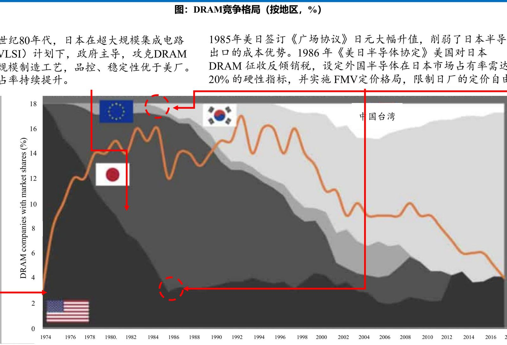

横轴：1974、1976、1978、1980、1982、1984、1986、1988、1990、1992、1994、1996、1998、2000、2002、2004、2006、2008、2010、2012、2014、2016、2018。
左纵轴：DRAM companies with market shares (%)，刻度 0、2、4、6、8、10、12、14、16、18。
右纵轴：Regional market share %。
图内标注：中国台湾。

资料来源：Micro Ops，东吴证券研究所

---

<!-- 原文第 7 页 -->

## 1.2 DRAM竞争格局（按厂商）

英飞凌科技（Infineon）前身为德国西门子半导体部门，1999年完成分拆并独立上市。2006年，英飞凌进一步剥离DRAM业务，推动奇梦达（Qimonda）独立上市。2009年奇梦达破产后，其位于中国台湾地区的制造资产由美光科技以较低成本收购，西安研发中心则出售给浪潮集团，后续由紫光集团承接。专利资产方面，奇梦达相关专利于2009年出售给知识产权管理机构；2019年，长鑫存储与相关机构签署专利许可及购买协议，取得奇梦达全球数万项DRAM专利的合法使用权。

1999年，日本电气（NEC）与日立（Hitachi）整合旗下DRAM业务，共同成立尔必达（Elpida）；2003年，三菱电机（Mitsubishi Electric）的DRAM业务进一步并入尔必达。2009年，日本政府依据《产业活力再造法》向尔必达提供政府注资及银行贷款支持，但未能根本扭转其经营困境。2012年，尔必达进入破产程序，随后被美光科技收购。

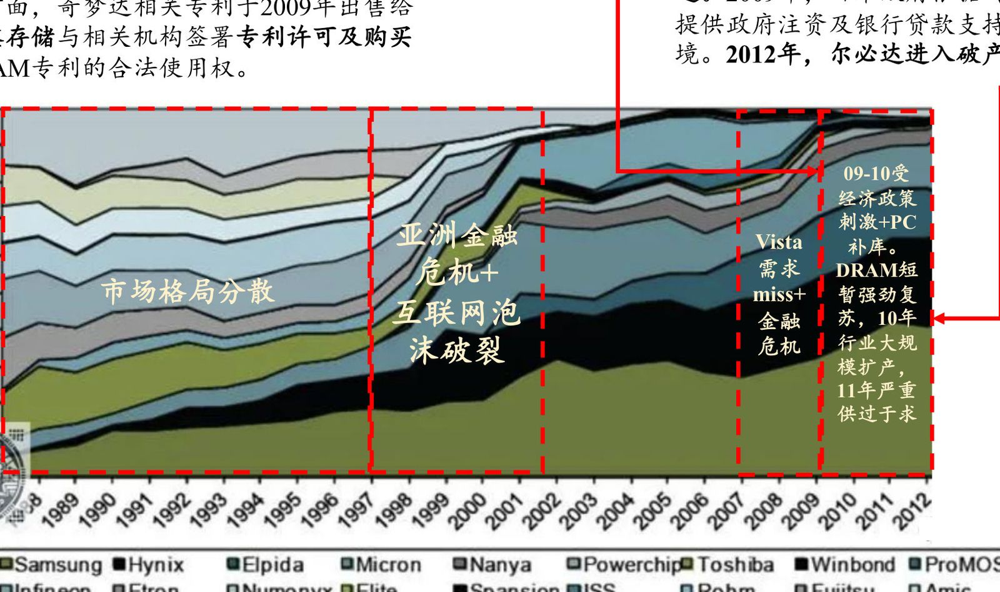

图：DRAM竞争格局 按厂商（%）

横轴：1988[OCR_UNCERTAIN]、1989—2012（逐年标注）。
纵轴：20、30、40、50、60、70、80、90、100。
图内标注：市场格局分散；亚洲金融危机+互联网泡沫破裂；Vista需求miss+金融危机；09-10受经济政策刺激+PC补库。DRAM短暂强劲复苏，10年行业大规模扩产，11年严重供过于求。
图例：Samsung、Hynix、Elpida、Micron、Nanya、Powerchip、Toshiba、Winbond、ProMOS、Infineon、Etron、Numonyx、Elite、Spansion、ISS、Rohm、Fujitsu、Amic、TM、Panasonic、NEC、Hitachi、Sony、Mitsubishi、TI、LG、Others。

资料来源：Gartner、DRAMeXchange、Bernstein，东吴证券研究所

---

<!-- 原文第 8 页 -->

## 2、1985年：美日产业更替与第一次深度出清

---

<!-- 原文第 9 页 -->

## 2.1 1985: 美日产业更替，日本厂商后来居上

- 20世纪80年代早期：随着美国计算机行业对 DRAM 的需求不断增加，许多美国计算机制造商开始使用日本制造的 DRAM。日本制造的 DRAM 以其出色的质量而备受推崇。在设计和制造技术方面，日本 DRAM 处于领先水平，因此在质量、交货期和价格方面都得到了高度评价。1981 年，日本在 64K DRAM 领域的市场份额超过了美国；到 1987 年，日本在 DRAM 总市场份额中占据了 80%的份额，其中256K DRAM占比尤其高。

- 20世纪80年代中期：1983-1984年全球电脑需求旺盛，美、日、韩厂商在景气高点同时建厂扩产；1985年电脑需求突然降温，但新建工厂集中投产导致市场上芯片供过于求，一款主流内存芯片的售价在9个月内从 8.95 美元跌到2.95 美元，跌幅近七成。

- 主流厂商表现：日本厂商凭成本优势横扫市场，1986年日本半导体产值超过美国，跃居全球第一，全球前三大半导体厂商（ NEC、东芝、日立）均为日本企业；同时 “Wintel”（Windows+Intel）PC自1985 年起份额快速攀升。美国厂商几乎全线退出，英特尔在1985年退出DRAM业务并将战略重心转向微处理器，美国巨头 Mostek 于1985年被母公司关闭并出售主要资产，同期三星逆势投入超1亿美元做 DRAM。

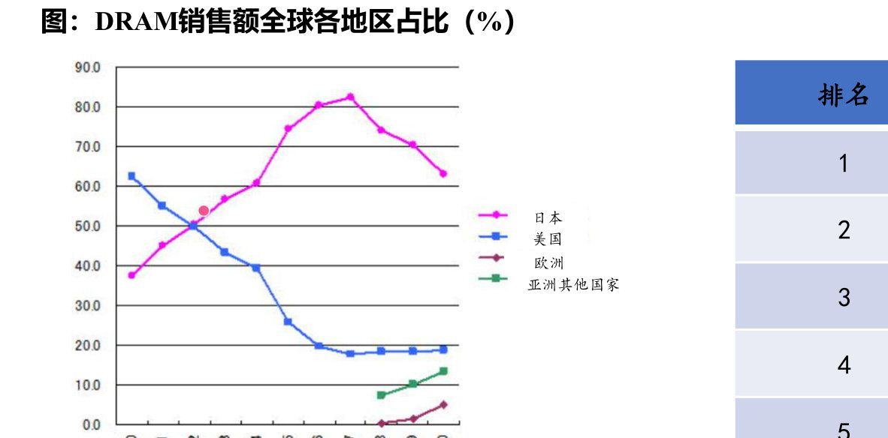

图：DRAM销售额全球各地区占比（%）

横轴：1980、1981、1982、1983、1984、1985、1986、1987、1988、1989、1990。
纵轴：0.0、10.0、20.0、30.0、40.0、50.0、60.0、70.0、80.0、90.0。
图例：日本、美国、欧洲、亚洲其他国家。

表：1987年全球半导体厂商营收排名

| 排名 | 公司 | 国家 | 排名 | 公司 | 国家 |
| --- | --- | --- | --- | --- | --- |
| 1 | NEC | 日本 | 6 | 富士通 | 日本 |
| 2 | 东芝 | 日本 | 7 | 飞利浦 | 荷兰 |
| 3 | 日立 | 日本 | 8 | 国家半导体 | 美国 |
| 4 | 摩托罗拉 | 美国 | 9 | 三菱 | 日本 |
| 5 | 德州仪器 | 美国 | 10 | 英特尔 | 美国 |

资料来源：日本半导体历史博物馆、Chemeurope，东吴证券研究所

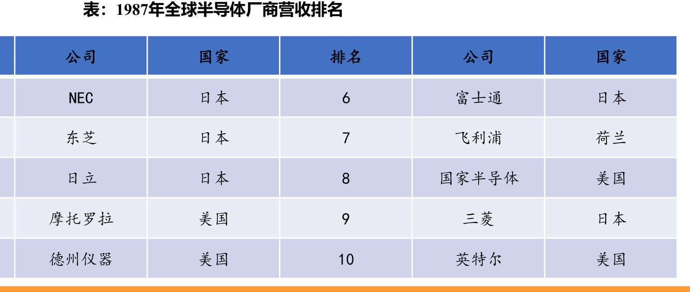

---

<!-- 原文第 10 页 -->

## 2.2 1985: 顶点扩产，需求转向后价格暴跌

- 供给侧：1983-1984 年全球PC需求高景气推动DRAM价格上行，美、日、韩厂商在周期高点同步启动扩产；其中日本厂商依托综合电机集团的低成本资本优势逆势加杠杆，日立、东芝半导体资本开支大幅上涨。

- 需求侧：1985 年全球计算机产业进入衰退，前期基于高景气作出的需求预测大幅落空；需求增速由正转负的同时，前期扩产产能集中投放，供给与需求曲线反向运行，供需剪刀差进一步放大。

- 全行业亏损与出清：供需错配下 DRAM 价格中枢断崖式下移，行业进入边际亏损状态；全球存储市场规模大幅收缩，1985年美系半导体厂商合计亏损超 10 亿美元。严重负毛利和经营亏损的状态倒逼高成本产能退出、推动行业出清。

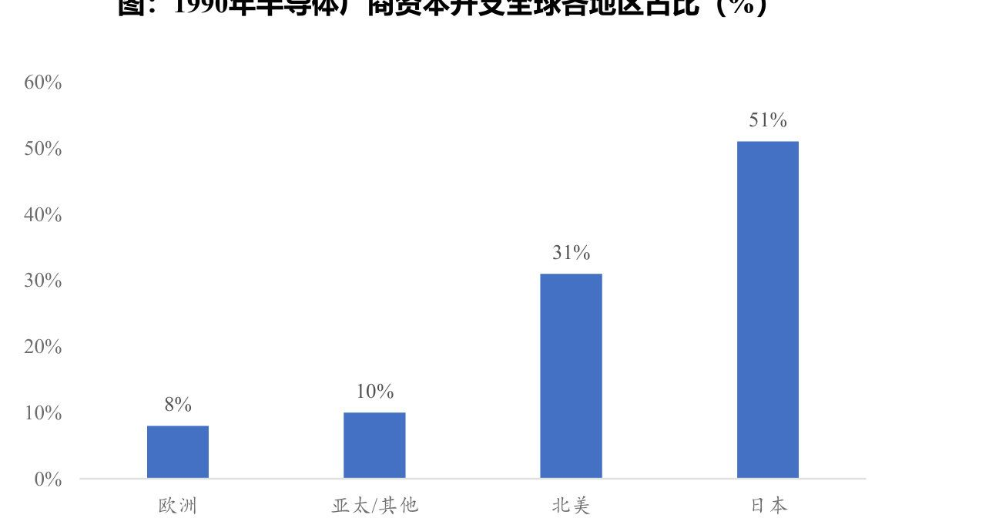

图：1990年半导体厂商资本开支全球各地区占比（%）

横轴：欧洲、亚太/其他、北美、日本；数值分别为 8%、10%、31%、51%。
纵轴：0%、10%、20%、30%、40%、50%、60%。

图：美光1984-1991年净利润（单位：千美元）

横轴：1984、1985、1986、1987、1988、1989、1990、1991；数值分别为 28969、154、-33941、-22933、97981、106103、4908、5079。
纵轴：-40000、0、40000、80000、120000。

资料来源：Semiconductor Digest、Micron、FabricatedKnowledge，东吴证券研究所

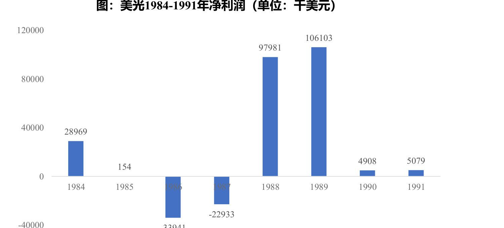

---

<!-- 原文第 11 页 -->

## 3、1993-1998年：PC繁荣、无序扩产与韩系崛起

---

<!-- 原文第 12 页 -->

## 3. 1993–1998：超额利润引发无序扩产，集中度首次抬升

- **超额利润引发无序扩产：** 1995年Windows 95换机潮推动PC高增长，DRAM供不应求、头部厂商毛利率升至50%以上。空前利润引发全行业无序扩产，中国台湾厂商亦借机入场；全球半导体资本开支1995年增长74%，1996年增速放缓至8%。新产线在1995–1996年集中爬坡，供给由紧转松。
- **价格断崖式下行：** DRAM价格1995年末见顶后崩塌，16M ASP在1996年内由43.25美元跌至9.70美元，全年跌幅约78%。1996–1997年行业出现史上首次连续两年收入下滑，半导体市场收入减少超百亿美元，中小厂商大面积出局。
- **韩元汇率对韩国厂商的影响：** 韩元兑美元汇率在1997下半年由886：1贬至1701：1，使得韩国厂商以美元计的债务近乎翻倍，资产负债表恶化；出口成本骤降，价格竞争力反而增强，韩国厂商在此阶段市场份额迅速增加。
- **市场集中度提升：** 韩国DRAM全球份额由1987年的约5%升至1998年的40.9%，首次超过日本；美光于1998年完成收购德州仪器存储业务(对价约8亿美元），成为全球第二大存储厂商；行业集中度首次系统性抬升。

图：1976-2011每年新增PC数量（单位：千台）

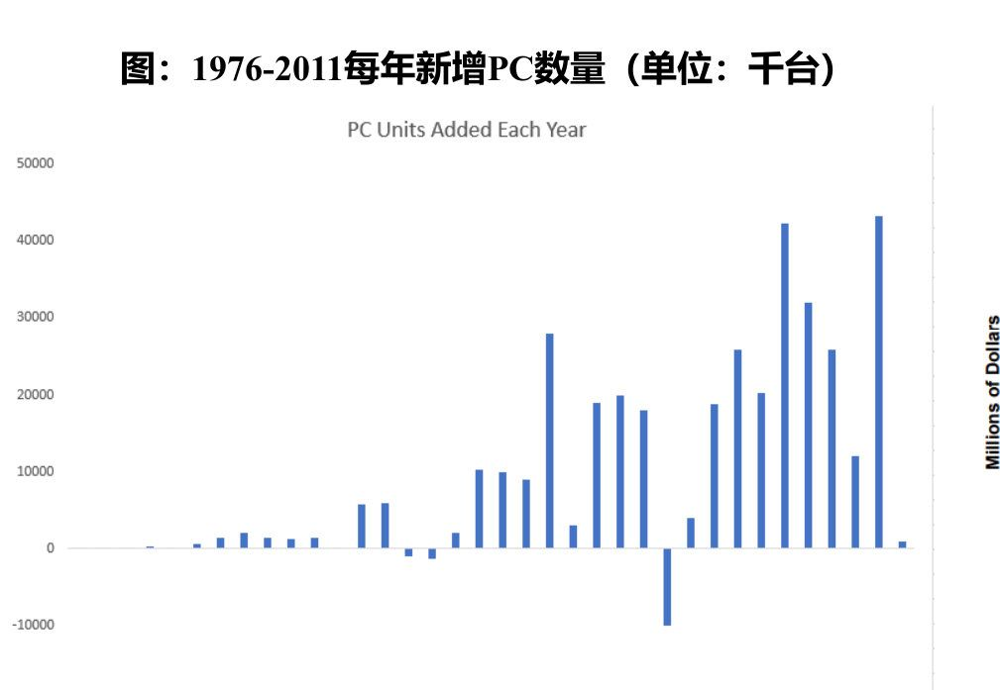

图：全球半导体厂商资本开支（单位：百万美元）

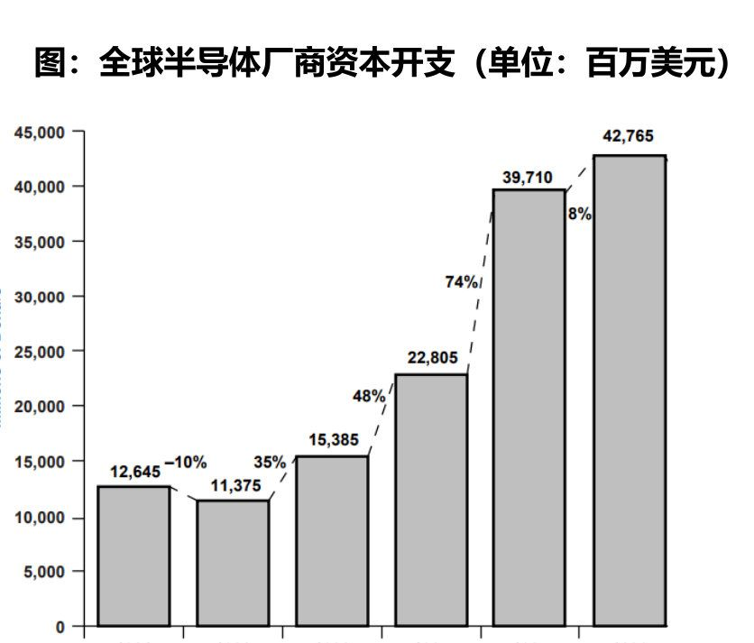

| 年份 | 资本开支（百万美元） |
| --- | --- |
| 1991 | 12,645 |
| 1992 | 11,375 |
| 1993 | 15,385 |
| 1994 | 22,805 |
| 1995 | 39,710 |
| 1996 | 42,765 |
| 1997（FCST） | 39,655 |

（图中柱间标注同比：1992年-10%、1993年35%、1994年48%、1995年74%、1996年8%、1997年-7%）

图：16M DRAM ASP变化（单位：美元）

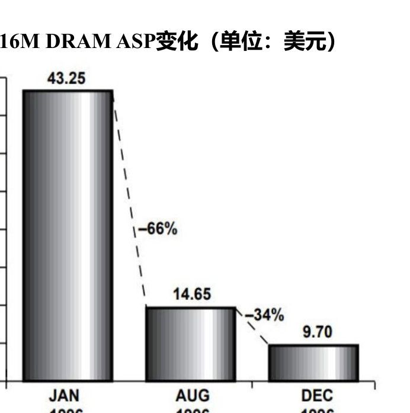

| 时点 | ASP（美元） |
| --- | --- |
| JAN 1996 | 43.25 |
| AUG 1996 | 14.65 |
| DEC 1996 | 9.70 |

（图中标注降幅：JAN 1996→AUG 1996 为-66%；AUG 1996→DEC 1996 为-34%）

资料来源：MicroTrend、Fabricated Knowledge、日本半导体历史博物馆, 东吴证券研究所

---

<!-- 原文第 13 页 -->

## 4、1999-2003年：互联网泡沫破裂与需求崩塌

---

<!-- 原文第 14 页 -->

## 4. 1999-2003年：互联网泡沫破裂，需求系统性崩塌

- **供给侧：** 半导体厂商在1990年代末为承接互联网时代的旺盛需求大举扩产，泡沫破裂后骤然背上过剩fab产能；这一轮扩产惯性可追溯至上一轮周期中1995、1996年分别有42和48个新fab项目、Morgan Stanley统计1995年芯片行业资本开支占行业收入的比重达到27.8%而1999年该比例为23%。
- **需求侧：** 互联网/电信泡沫破裂使服务器、网络设备及企业级需求断崖，2001年有至少537家互联网公司破产或倒闭；Y2K换机透支后PC进入空窗，2001年全球PC出货1.28亿台、同比下降4.6%，是继1985年后PC历史上第二次年度下滑，叠加2001年美国衰退与9·11，需求大幅下降。
- **市场表现：** 以128MB内存模组为例，其价格由1999年180美元跌至2000年不足20美元，2001年DRAM价格跌破成本价，多数厂商陷入亏损。以海力士为例，2001年净利润亏损38.5亿美元，显示互联网泡沫破裂和DRAM价格暴跌对盈利造成严重冲击。此后亏损幅度收窄，2002年和2003年分别亏损15.7亿和17.7亿美元，但整体仍未恢复盈利。

图：1994-2001PC销量（单位：千台）

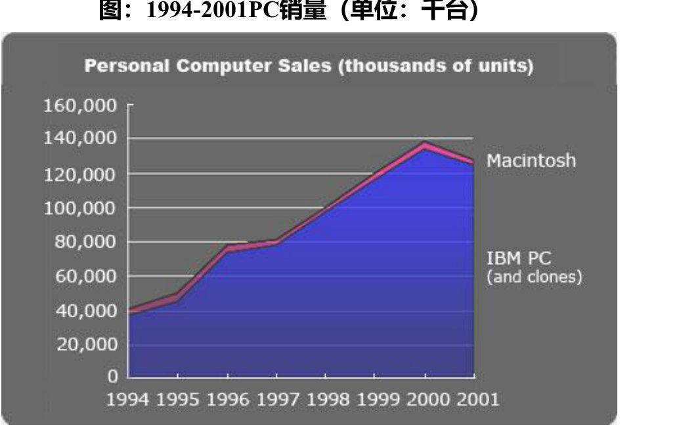

图：海力士1999-2005净利润（单位：百万美元）

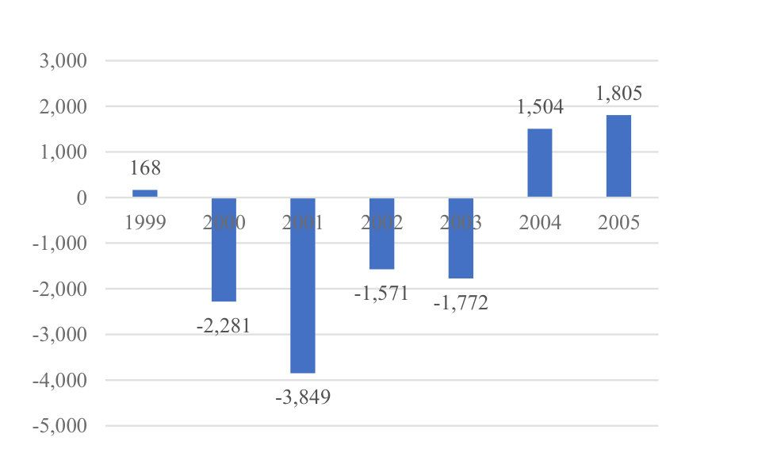

| 年份 | 净利润（百万美元） |
| --- | --- |
| 1999 | 168 |
| 2000 | -2,281 |
| 2001 | -3,849 |
| 2002 | -1,571 |
| 2003 | -1,772 |
| 2004 | 1,504 |
| 2005 | 1,805 |

资料来源：Bloomberg、EETimes、MIT、Arstechica、东吴证券研究所整理

---

<!-- 原文第 15 页 -->

## 5、2006-2009年：Vista预期落空、金融危机与奇梦达退出

---

<!-- 原文第 16 页 -->

## 5.1 2006-2009年：Vista预期落空叠加金融危机导致价格断崖式下跌

- **核心背景：** 2006-2007年，行业景气度处于高位，叠加市场对微软Vista升级带来的内存需求增量预期过高，推动了全行业大规模扩产；2008年产能集中投放时，全球金融危机爆发，消费电子及数据中心终端需求减少，供需错配导致内存价格大幅下降。
- **价格见底后回升：** 以主流512Mb DDR2-667 DRAM颗粒为例，其合约价由2007年初约5.95美元降至10月上半月的1.31美元；DRAMeXchange公布当年年内累计跌幅口径为79.4%。经过连续亏损和供给调整，全球DRAM行业收入于2009年第一季度触底，此后逐季回升：2009年第三季度收入约61亿美元，第四季度升至87亿美元，环比增长43%。
- **结局：** 奇梦达、飞索两大头部厂商相继破产出清，部分中小厂退出，三星/海力士/美光三寡头雏形成型。

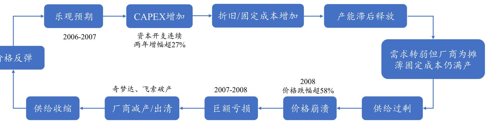

图：行业周期循环（价格反弹—乐观预期—CAPEX增加—折旧/固定成本增加—产能滞后释放—需求转弱但厂商为摊薄固定成本仍满产—供给过剩—价格崩溃—巨额亏损—厂商减产/出清—供给收缩—价格反弹）

循环路径与节点标注（按图中箭头方向）：

1. 价格反弹 → 乐观预期（标注：2006-2007）→ CAPEX增加（标注：资本开支连续两年增幅超27%）→ 折旧/固定成本增加 → 产能滞后释放
2. 产能滞后释放 → 需求转弱但厂商为摊薄固定成本仍满产 → 供给过剩
3. 供给过剩 → 价格崩溃（标注：2008 价格跌幅超58%）→ 巨额亏损（标注：2007-2008）→ 厂商减产/出清（标注：奇梦达、飞索破产）→ 供给收缩
4. 供给收缩 → 价格反弹（回到起点）

资料来源：WSTS，东吴证券研究所整理

---

<!-- 原文第 17 页 -->

## 5.2 高预期、重资产叠加政策扶持，推动产能过剩

- **预期驱动：** 新系统对内存容量要求较XP大幅提升（三星当时预测PC平均内存搭载量由800MB提升至1.2GB），市场普遍预期将带动DRAM需求量价齐升。各厂商在此预期驱动下启动扩产计划。以海力士为例，2006年公司实现营收约81亿美元，同比增幅近40%，随即将2007年资本开支上调至55亿美元。
- **CAPEX增加：** 2005年-2007年，全球主要DRAM厂商资本开支连续大幅攀升，行业总CAPEX由2004年约107亿美元增至2007年峰值约214亿美元，年复合增速达26%。高资本开支带来了高折旧，以海力士为例，2006年折旧达16亿美元，同比增长超30%。重资产模式下的高折旧成本使得停产的损失远大于亏损出货，推动厂商持续生产，2005年-2007全球DRAM产能年涨幅连续三年超30%。
- **政策扶持：** 中国台湾地区政府长期将DRAM产业列为战略性扶持对象，通过银行低息贷款、税收优惠及国家开发基金注资等多种机制，持续支持南亚科技、ProMOS等本土厂商激进扩产。

图：DRAM总资本开支（单位：百万美元）

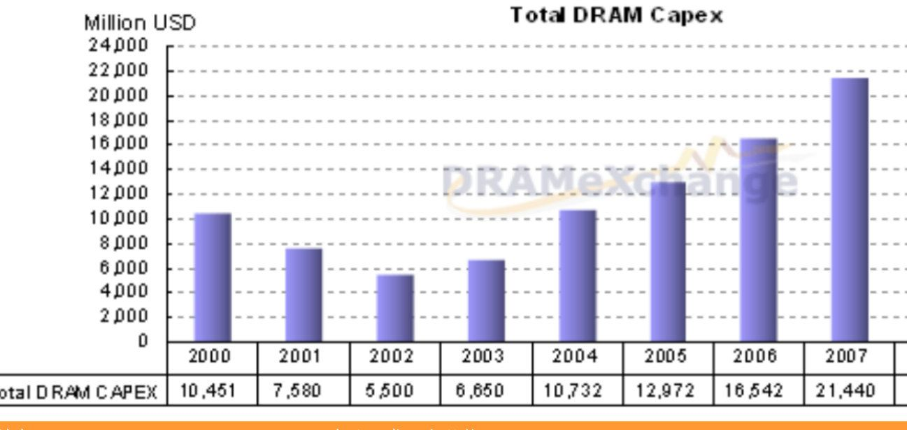

| 年份 | Total DRAM CAPEX（百万美元） |
| --- | --- |
| 2000 | 10,451 |
| 2001 | 7,580 |
| 2002 | 5,500 |
| 2003 | 6,650 |
| 2004 | 10,732 |
| 2005 | 12,972 |
| 2006 | 16,542 |
| 2007 | 21,440 |
| 2008 | 12,246 |
| 2009 | 4,336 |

图：全球DRAM产能变化（单位：12英寸等效晶圆，千片）

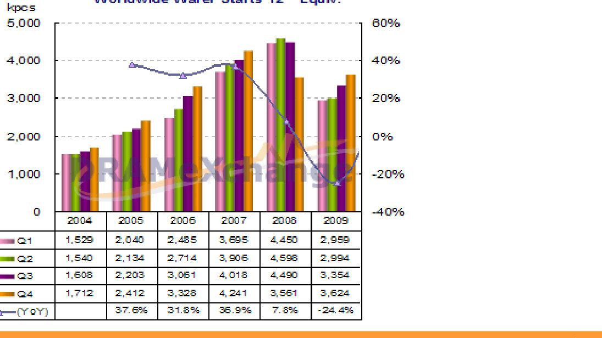

| 年份（季度） | Q1 | Q2 | Q3 | Q4 | （YoY） |
| --- | --- | --- | --- | --- | --- |
| 2004 | 1,529 | 1,540 | 1,608 | 1,712 | — |
| 2005 | 2,040 | 2,134 | 2,203 | 2,412 | 37.6% |
| 2006 | 2,485 | 2,714 | 3,061 | 3,328 | 31.8% |
| 2007 | 3,695 | 3,906 | 4,018 | 4,241 | 36.9% |
| 2008 | 4,450 | 4,596 | 4,490 | 3,561 | 7.8% |
| 2009 | 2,959 | 2,994 | 3,354 | 3,624 | -24.4% |

资料来源：TrendForce、DRAMeXchange，东吴证券研究所整理

---

<!-- 原文第 18 页 -->

## 5.3 需求侧：外部经济环境冲击叠加内生需求疲软

- **预期落空：** Vista销量不及预期，DRAM供过于求；据Gartner Dataquest数据，按512Mb等效容量计，DRAM ASP在2007年同比下降27.9%至4.27美元，2008年进一步同比下降32.6%至2.88美元。从2007年初开始，随着次贷危机苗头出现，企业开始削减IT投资，消费者推迟PC购买计划，DRAM需求迅速恶化。
- **金融危机冲击：** 雷曼兄弟2008年9月15日宣告破产，此后一周内DRAM价格暴跌21%，这是自2001年10月以来单周最大跌幅。金融危机同时打击了消费侧和企业侧：一方面消费端信用收缩导致PC/消费电子需求骤降；另一方面企业端IT预算被大幅削减，服务器DRAM需求快速萎缩。2008年Q4全球DRAM市场营收环比下跌超40%。
- **需求增量不足：** 2009年智能手机尚未成为主流且单机存储容量较低，云计算与数据中心建设尚处早期，需求端在短期内缺乏新的增量引擎。

图：256Mb DRAM价格变化（单位：美元）

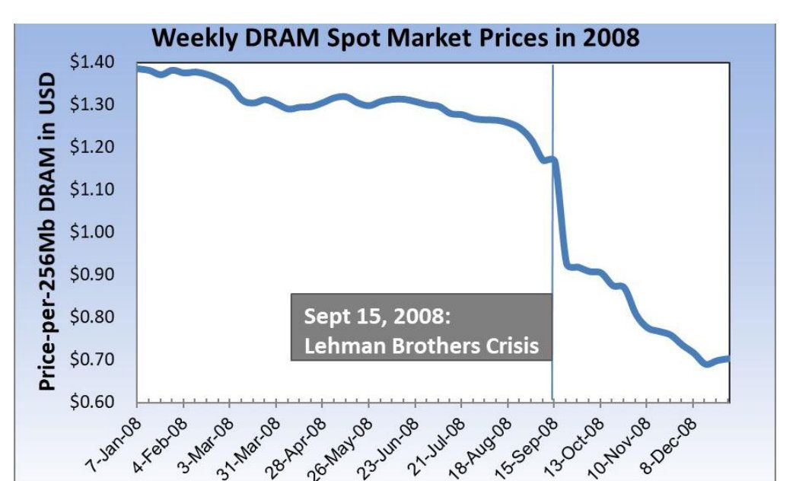

（图内标题：Weekly DRAM Spot Market Prices in 2008；纵轴：Price-per-256Mb DRAM in USD，$0.60–$1.40；横轴：7-Jan-08 至 8-Dec-08 逐周；图内标注：Sept 15, 2008: Lehman Brothers Crisis）

图：DRAM市场增幅（以营收计，%）

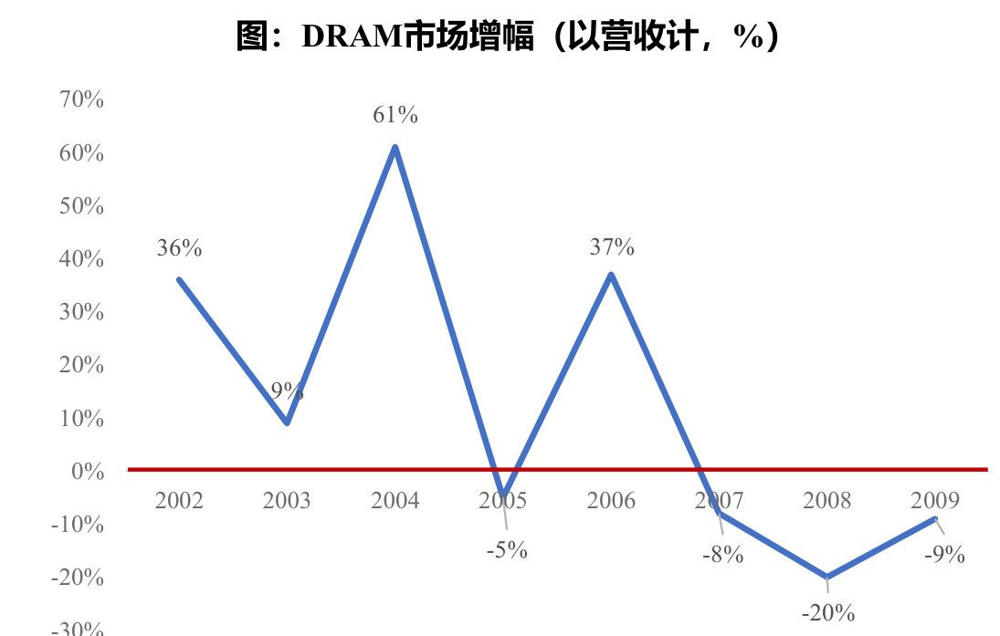

| 年份 | 市场增幅 |
| --- | --- |
| 2002 | 36% |
| 2003 | 9% |
| 2004 | 61% |
| 2005 | -5% |
| 2006 | 37% |
| 2007 | -8% |
| 2008 | -20% |
| 2009 | -9% |

资料来源：Chip History Centre、IC Insight、Eetasia，东吴证券研究所

---

<!-- 原文第 19 页 -->

## 5.4.1 奇梦达破产：行业下行、成本压力与融资约束叠加

- **行业供需转弱，产品价格持续下行：** 2007-2008年DRAM行业新增供给快速释放，而终端需求表现相对疲弱，行业价格持续下跌。奇梦达2008财年第二季度Bit出货量同比增长48%，但产品平均售价同比下降67%，叠加美元走弱，公司净销售额下降至4.12亿欧元。
- **制程结构相对落后，成本端承受压力：** 奇梦达长期采用Deep Trench技术路线。截至2008年3月底，公司超过75%的产能采用80nm和75nm制程，而更具成本效率的65nm Buried Wordline产品直至2008年10月才进入商业生产；46nm产品原计划于2009年中期量产。在DRAM价格快速下降阶段，新制程尚处于导入和爬坡期，旧制程经济性下降及生产规模相对有限，使公司成本结构承受较大压力。
- **经营现金流承压，外部融资未能及时落实：** 公司通过出售Inotera股权、关闭部分工厂等方式改善流动性，并寻求3.25亿欧元救助方案，受金融危机及资本市场融资环境收紧等因素影响，相关融资未能按期完成，公司于2009年1月23日申请破产。

图：主要DRAM厂商营业利润率与制程代次对比

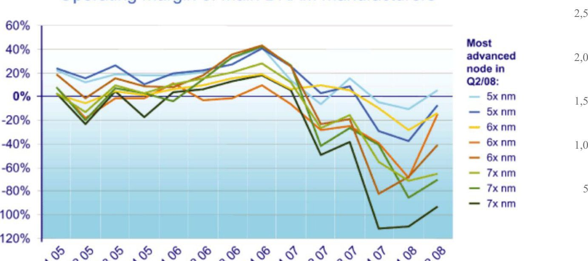

（图内标题：Operating margin of main DRAM manufacturers；纵轴：Operating Margin，-120%–60%；横轴：Q1'05–Q2'08；图例：Most advanced node in Q2/08：5x nm、5x nm、6x nm、6x nm、7x nm、7x nm、7x nm）

图：美光与奇梦达营收对比（2006-2008 单位：百万美元）

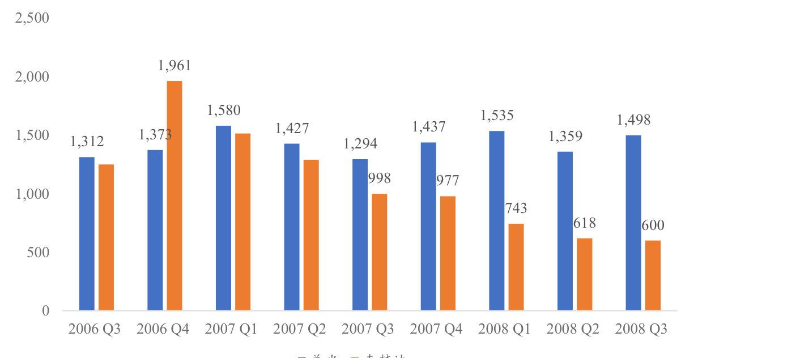

| 期间 | 美光 | 奇梦达 |
| --- | --- | --- |
| 2006 Q3 | 1,312 | （无数据标签） |
| 2006 Q4 | 1,373 | 1,961 |
| 2007 Q1 | 1,580 | （无数据标签） |
| 2007 Q2 | 1,427 | （无数据标签） |
| 2007 Q3 | 1,294 | 998 |
| 2007 Q4 | 1,437 | 977 |
| 2008 Q1 | 1,535 | 743 |
| 2008 Q2 | 1,359 | 618 |
| 2008 Q3 | 1,498 | 600 |

资料来源：Bloomberg、ResearchGate、ASML，东吴证券研究所

---

<!-- 原文第 20 页 -->

## 5.4.2 竞争格局重塑

- **奇梦达破产：** 进入下行周期后，公司持续以低于成本的价格出售芯片。2009年1月公司正式申请破产保护。
- **台系厂商份额收缩：** 2008年中国台湾五大DRAM厂全年合计亏损1,594.9亿新台币，同比亏损规模增加331%，市场份额持续收缩。
- **寡头格局形成：** 本轮出清重塑了全球DRAM产业竞争格局，2009年，三星、SK海力士、尔必达（Elpida）、美光四家合计产量占市场份额约76%。

图：2006-2010年DRAM市场份额变化（按产量）

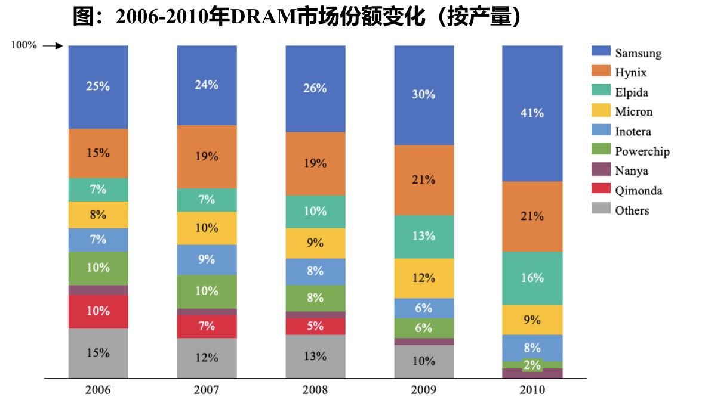

| 厂商（图例自上而下） | 2006 | 2007 | 2008 | 2009 | 2010 |
| --- | --- | --- | --- | --- | --- |
| Samsung | 25% | 24% | 26% | 30% | 41% |
| Hynix | 15% | 19% | 19% | 21% | 21% |
| Elpida | 7% | 7% | 10% | 13% | 16% |
| Micron | 8% | 10% | 9% | 12% | 9% |
| Inotera | 7% | 9% | 8% | 6% | 8% |
| Powerchip | 10% | 10% | 8% | 6% | 2% |
| Nanya | （无数据标签） | （无数据标签） | （无数据标签） | （无数据标签） | （无数据标签） |
| Qimonda | 10% | 7% | 5% | （无色段） | （无色段） |
| Others | 15% | 12% | 13% | 10% | （无色段） |

图：厂商退出/整合事件时间轴

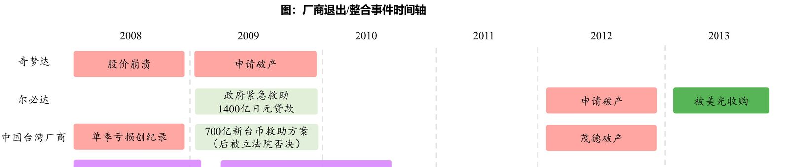

| 厂商 | 2008 | 2009 | 2010 | 2011 | 2012 | 2013 |
| --- | --- | --- | --- | --- | --- | --- |
| 奇梦达 | 股价崩溃 | 申请破产 | | | | |
| 尔必达 | | 政府紧急救助 1400亿日元贷款 | | | 申请破产 | 被美光收购 |
| 中国台湾厂商 | 单季亏损创纪录 | 700亿新台币救助方案（后被立法院否决） | | | 茂德破产 | |
| 三星 | 逆周期扩产 | 份额持续提升 | | | | |

资料来源：ResearchGate，东吴证券研究所

---

<!-- 原文第 21 页 -->

## 6、2009-2013年：PC需求转弱、天然灾害与尔必达退出

---

<!-- 原文第 22 页 -->

### 6.1 2009-2012年：PC 增速见顶叠加天然灾害，DRAM 陷入慢性出清

- 核心背景：2010 年DRAM价格见顶后行业进入下行通道，2011 年欧债危机持续打压企业 IT 支出。同年泰国洪水冲击全球PC供应链，终端阶段性需求提前透支，叠加前期扩产产能集中释放，行业供需失衡问题进一步加剧。
- 双市场承压：DRAM侧，2011 年收入逐季下滑，价格不断降低，大量滞销库存积压使得厂商现金流持续承压。2012 年初，2Gb DDR3芯片现货价跌至0.82-0.95美元区间，达历史性低点。NAND侧，2012 年全年品牌NAND总收入约190.6亿美元，同比下降约6.6%，价格压力相对DRAM温和，但供过于求的结构同样存在；不同之处在于NAND的下行有SSD快速放量作为需求端的部分对冲，而DRAM缺乏缓冲。
- 结果：尔必达 2012 年 2 月申请破产保护，2013 年被美光收购；台系茂德破产、力晶退出标准DRAM；行业收敛为三星、SK 海力士、美光三足鼎立。

图：DRAM价格变化（单位：美元/GB）

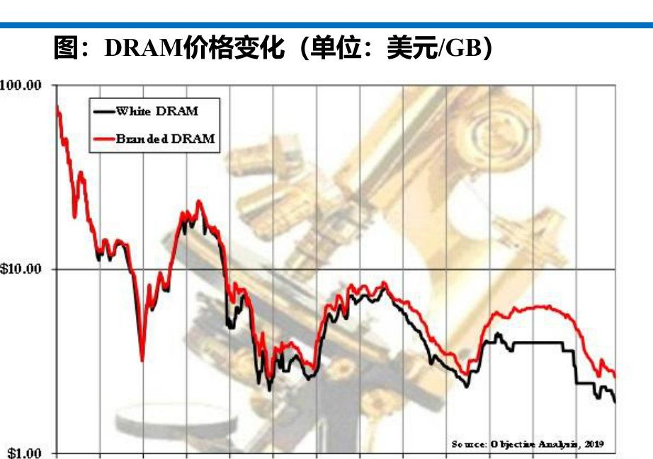

纵轴：Lowest Price per GigaByte（对数刻度，$1.00/$10.00/$100.00）；横轴：2006-2018 年；图例：White DRAM、Branded DRAM。图内标注来源：Source: Objective Analysis（年份数字过小不可辨 [OCR_UNCERTAIN]）。图上无数据标签。

图：头部存储厂商2006-2012资本开支（单位：百万美元，%）

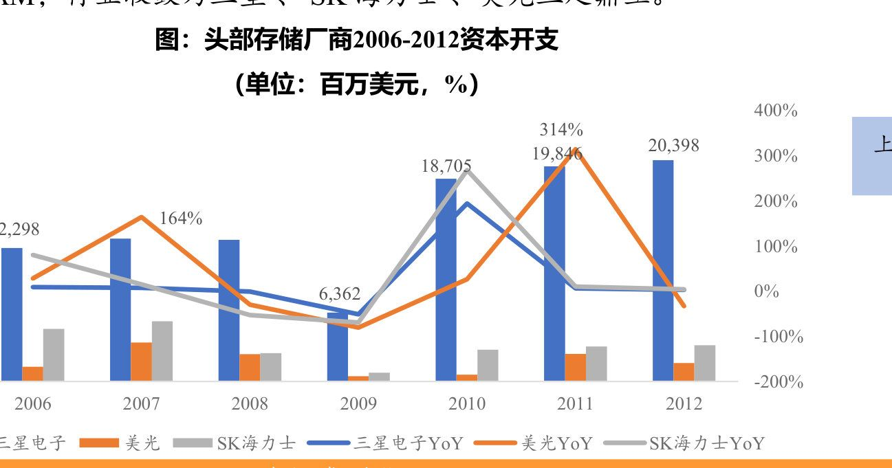

左轴：0-25,000（百万美元）；右轴：-200%-400%（%）；横轴：2006-2012 年；图例：三星电子、美光、SK海力士（柱），三星电子 YoY、美光 YoY、SK海力士 YoY（折线）。柱顶/折线标注：2006 年 12,298；2007 年 164%（美光 YoY）；2009 年 6,362；2010 年 18,705；2011 年 19,846 与 314%（美光 YoY）；2012 年 20,398。

图：周期事件时间轴

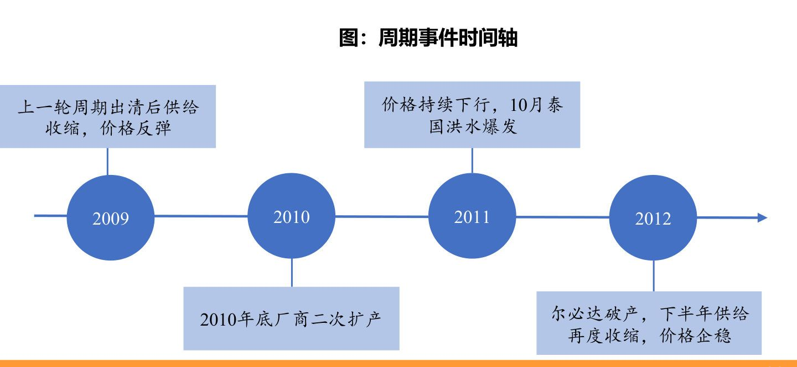

时间轴节点与标注：2009 年——上一轮周期出清后供给收缩，价格反弹；2010 年——2010年底厂商二次扩产；2011 年——价格持续下行，10 月泰国洪水爆发；2012 年——尔必达破产，下半年供给再度收缩，价格企稳。

资料来源：The memory guy、DRAMeXchange，东吴证券研究所

---

<!-- 原文第 23 页 -->

### 6.2 供给侧：遗留产能叠加制程迁移，NAND供给同时扩张

- 历史遗留过剩产能：上一轮周期大规模产能投资无法收回，厂商迫于高折旧成本继续生产，由此引发的供给过剩使价格持续走低。2010 年随价格短暂反弹厂商再度追加CAPEX，2012 年过剩压力重新积聚，六家主要供应商合计产能已大幅超出有效需求水平。
- 制程迁移释放隐形供给：存储供给由“晶圆投片量 × 每片 bit 产出”共同驱动，节点每缩短一代，单片晶圆 bit 产出提升约 40–50%，无需新建任何晶圆厂即可大幅扩张有效供给。2009 年全球 DRAM 晶圆产能较高峰下降约 30%，但当年 bit 供给仍同比增长24%，其原因在于产线在同步从 8x nm 加速迁移至 5x–6x nm；2010 年进一步推进至 4x–3x nm，bit 供给增速跃升至 +57%，2011 年增速仍高达 +47%。
- NAND 供给高速扩张：2008-2012年连续五年NAND晶圆产能年涨幅超50%，头部厂商同步推进2x nm向1x nm节点迁移，晶圆产能持续扩张叠加单片晶圆bit产出提升，导致NAND bit供给大幅提升。2011-2012年存储市场在两条产品线上都供给过剩，共同拉低全行业价格中枢。

图：2009-2017 DRAM CAPEX与ASP变化（资本开支单位：十亿美元；ASP 单位：美元/颗）

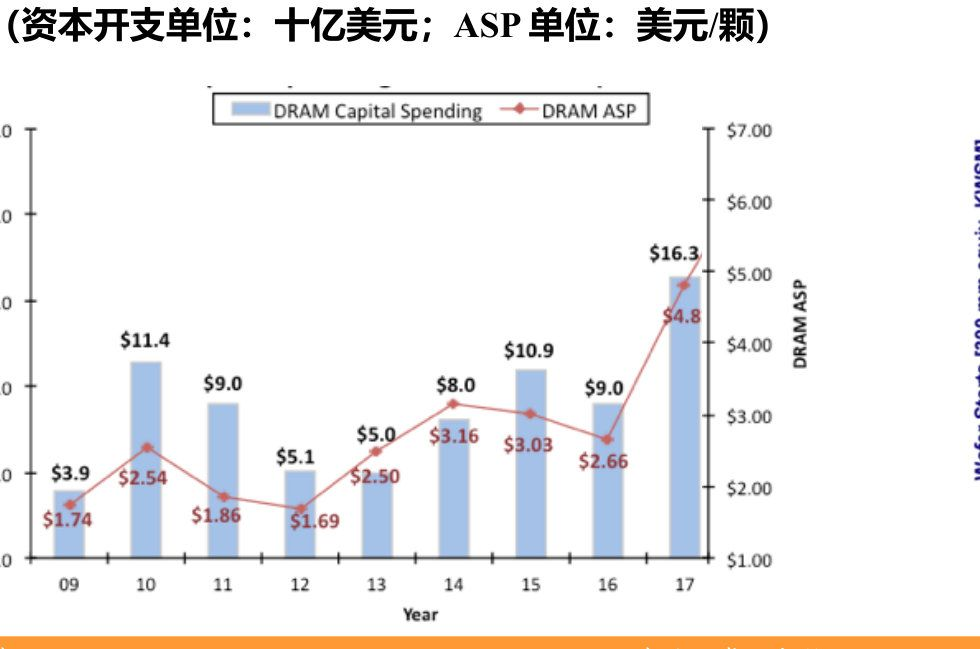

左轴：DRAM Capital Spending ($B)，$0.0-$25.0；右轴：DRAM ASP，$1.00-$7.00；横轴：09-17。柱（资本开支）标注：09 年 $3.9、10 年 $11.4、11 年 $9.0、12 年 $5.1、13 年 $5.0、14 年 $8.0、15 年 $10.9、16 年 $9.0、17 年 $16.3；折线（ASP）标注：09 年 $1.74、10 年 $2.54、11 年 $1.86、12 年 $1.69、13 年 $2.50、14 年 $3.16、15 年 $3.03、16 年 $2.66、17 年 $4.8。

图：2008Q1-2010Q4 DRAM 晶圆产能（单位：千片/月，折合 300mm 等效）

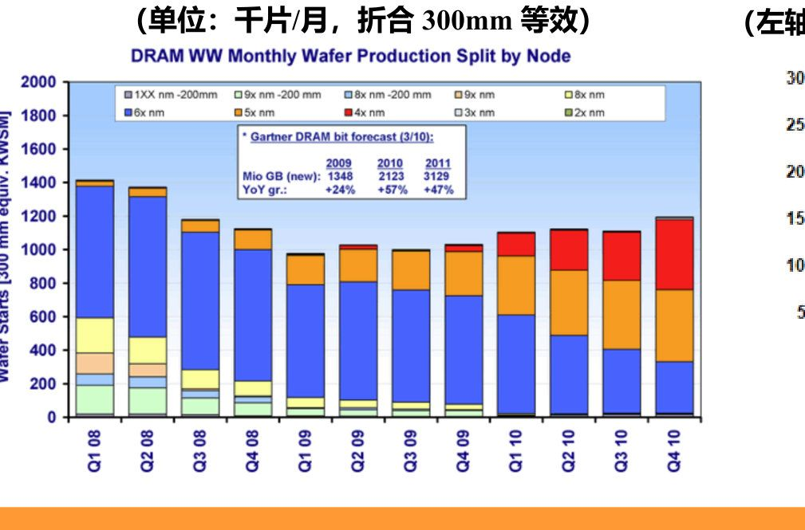

图内英文标题：DRAM WW Monthly Wafer Production Split by Node；纵轴：Wafer Starts (300 mm equiv. KWSM)，0-2000；横轴：1Q 08-4Q 10；图例（按节点）：1XX nm -200mm、9x nm -200 mm、8x nm -200 mm、9x nm、8x nm、6x nm、5x nm、4x nm、3x nm、2x nm。图内附注框：Gartner DRAM bit forecast (3/10): Mio. GB (new)：2009 年 1348、2010 年 2123、2011 年 3129；YoY gr.：+24%、+87%、+47%。

图：2008-2012 全球NAND产量（左轴单位：百万 GB；右轴为总位元产出同比增速，%）

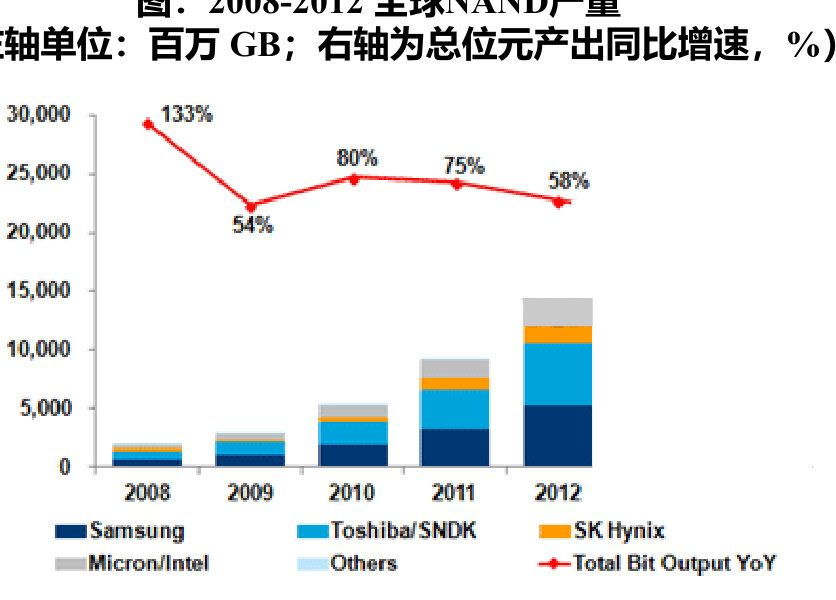

左轴：0-30,000（百万 GB）；右轴：0%-80%；横轴：2008-2012 年；图例：Samsung、Toshiba/SNDK、SK Hynix、Micron/Intel、Others（柱），Total Bit Output YoY（折线）。折线标注：2008 年 133%、2009 年 54%、2010 年 80%、2011 年 75%、2012 年 58%。

资料来源：WSTS、IC Insights、DRAMeXchange、ASML，东吴证券研究所

---

<!-- 原文第 24 页 -->

### 6.3 需求侧：泰国洪水叠加PC结构性下行拐点

- 泰国洪水传导至PC供应链：2011 年泰国承担全球约41%的HDD产量，该年10月洪水爆发导致西部数据等主力产线被淹。受HDD短缺制约，2011 年第四季度全球PC出货量环比下降约10.4%；与此同时，HDD价格上涨挤压整机成本，PC厂商进一步压低包括DRAM在内的其他零部件采购成本，对DRAM形成整机出货收缩与采购价格承压的双重影响。
- PC需求逐步萎缩：2010 年 4 月第一代iPad发布引发的平板替代效应开始显现。Statista数据显示全球PC出货量由2011年的2.09亿持续下降至2012年的2.01亿和2013年的1.81亿，表明PC需求已由高速扩张阶段逐步转入下行阶段。
- 供需增速错配导致价格下跌：2011 年全球DRAM位元产出同比增长约50%，显著高于Bloomberg口径下同期PC出货量16.6%的增幅。2Gb DRAM合约价由2011年5月的2.13美元降至年底0.88美元，跌幅58%，现货价格同期下跌约70%。

图：各产品2010-2014出货量（单位：百万）

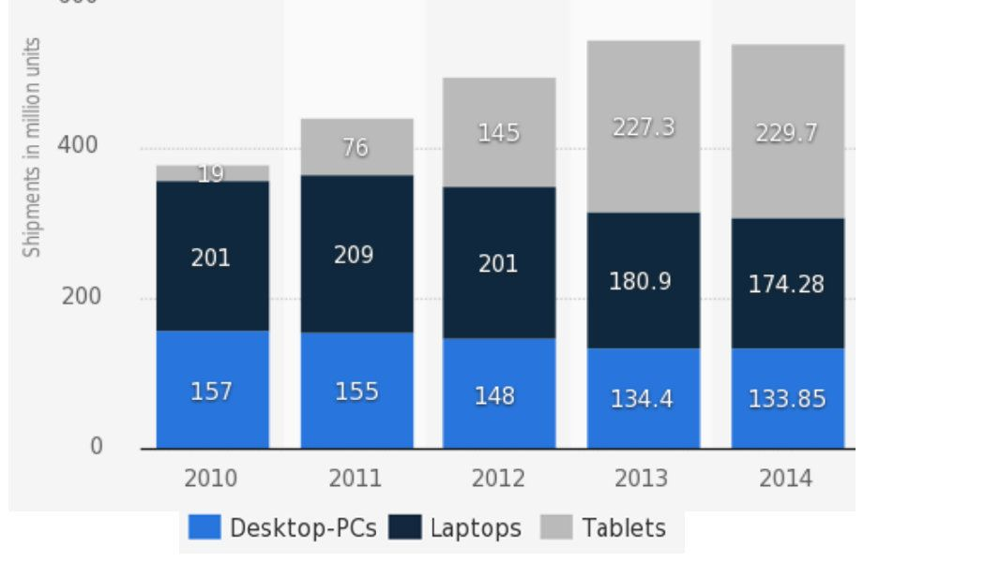

纵轴：Shipments in million units，0-600；横轴：2010-2014 年；图例：Desktop-PCs、Laptops、Tablets。分段标注（下→上）：2010 年 157、201、19；2011 年 155、209、76；2012 年 148、201、145；2013 年 134.4、180.9、227.3；2014 年 133.85、174.28、229.7。

图：DRAM需求结构迁移（左轴：按位元出货量计的全球 DRAM 市场份额，%；右轴：全球 DRAM 销售额，十亿美元）

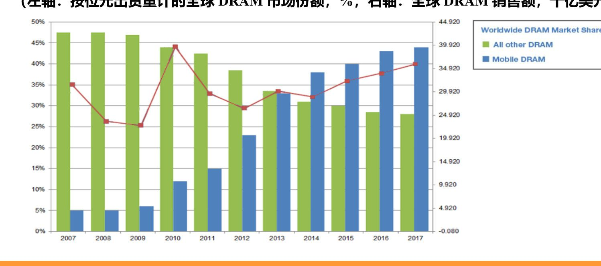

左轴：0%-50%；右轴：-0.080-44.920；横轴：2007-2017 年；图例：All other DRAM、Mobile DRAM。图上无数据标签。

资料来源：Bloomberg、IDC、Statista，东吴证券研究所

---

<!-- 原文第 25 页 -->

### 6.4 竞争格局：尔必达破产被美光收购，奠定三寡头格局

- 日系厂商退出市场：尔必达由NEC、日立、三菱电机DRAM业务合并而成，最终在汇率与价格的双重压迫下成本结构全面失效，于2012年2月以约4,480亿日元（约55亿美元）债务申请破产保护，为日本制造业历史上规模最大的破产案。
- 美光整合收购：美光以约25亿美元于2013年7月完成收购，收购前美光DRAM市场份额约12.9%（行业第四），收购后跃升至约28%，超越海力士晋升行业第二，并获得尔必达在苹果供应链中的移动DRAM核心份额。
- SK入主海力士：SK 集团通过 SK 电信陆续增持，最终以3.37万亿韩元完成约21%持股，彻底解除了海力士延续十年的高额债务危机，公司正式更名SK海力士；资产负债表的根本性修复为其后续持续加大先进制程投入奠定财务基础。
- 三寡头格局正式形成：合并后2014年三家市占率为三星约40.2%、海力士约27.4%、美光约25.1%，合计超过90%；寡头格局使头部厂商首次具备通过控制产能来稳定价格的协调能力，McKinsey将2012年之后定义为行业“持续盈利新阶段”

图：2011年厂商市场份额（按营收）

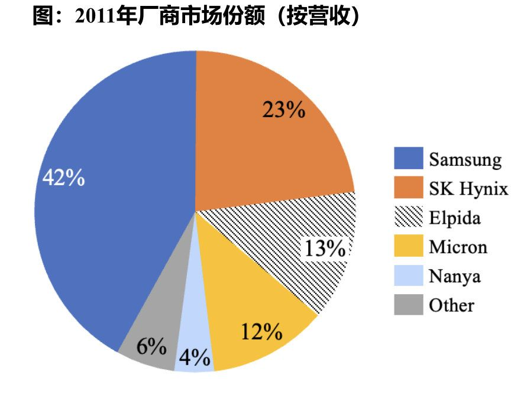

扇区标注：Samsung 42%、SK Hynix 23%、Elpida 13%（斜线填充）、Micron 12%、Nanya 4%、Other 6%；图例：Samsung、SK Hynix、Elpida、Micron、Nanya、Other。

图：2014年厂商市场份额（按营收）

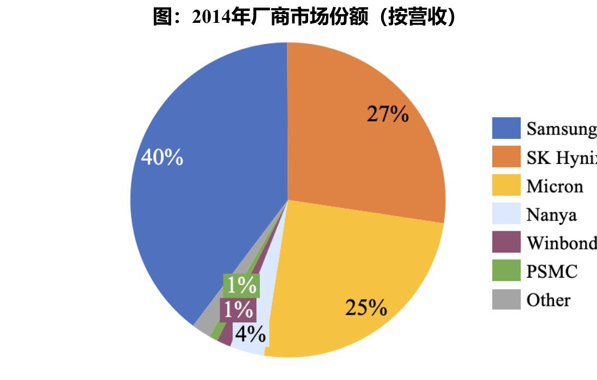

扇区标注：Samsung 40%、SK Hynix 27%、Micron 25%、Nanya 4%、Winbond 1%、PSMC 1%；Other 扇区在图上未标数值；图例：Samsung、SK Hynix、Micron、Nanya、Winbond、PSMC、Other。

资料来源：Statista、McKinsey，东吴证券研究所

---

<!-- 原文第 26 页 -->

## 7、2012-2015年：三寡头形成与移动需求接力

---

<!-- 原文第 27 页 -->

### 7.1 2012-2015周期：行业出清叠加移动需求，DRAM进入高盈利周期

- 核心背景：2012年尔必达破产、台系厂商退出标准DRAM，行业结束长期无序扩产。2013年美光完成对尔必达及瑞晶的整合，DRAM供给集中到三星、SK海力士和美光三大集团，供给策略由争夺份额逐步转向利润与产品组合管理。
- 上涨逻辑：供给端新增晶圆产能有限，厂商持续将产能由PC DRAM转向移动和服务器DRAM；需求端则受智能手机、平板和云计算拉动。2013年SK海力士无锡工厂火灾进一步放大短期供应紧张，推动DRAM价格和厂商盈利快速上升。
- 下跌逻辑：2014年下半年后，20/25nm制程迁移和部分新增产能开始释放更多bit供给；与此同时，2015年PC需求疲弱、智能手机增速放缓，供需关系重新转松，DRAM价格进入下行。
- 周期结果：2012年四季度价格触底回升，2013-2014年形成景气上行，2014年四季度附近达到阶段高点，2015年转入下行。行业虽然仍具周期性，但三寡头格局使本轮盈利能力和底部稳定性明显好于此前周期。

图：2012Q4 DRAM头部厂商营收（单位：百万美元）及市场份额（以营收计）

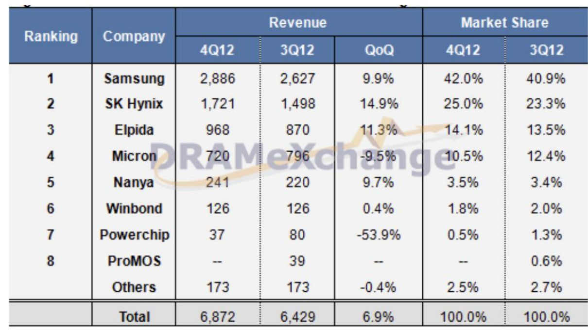

| Ranking | Company | Revenue 4Q12 | Revenue 3Q12 | Revenue QoQ | Market Share 4Q12 | Market Share 3Q12 |
|---|---|---|---|---|---|---|
| 1 | Samsung | 2,886 | 2,627 | 9.9% | 42.0% | 40.9% |
| 2 | SK Hynix | 1,721 | 1,498 | 14.9% | 25.0% | 23.3% |
| 3 | Elpida | 968 | 870 | 11.3% | 14.1% | 13.5% |
| 4 | Mircon | 720 | 796 | -9.5% | 10.5% | 12.4% |
| 5 | Nanya | 241 | 220 | 9.7% | 3.5% | 3.4% |
| 6 | Winbond | 126 | 126 | 0.4% | 1.8% | 2.0% |
| 7 | Powerchip | 37 | 80 | -53.9% | 0.5% | 1.3% |
| 8 | ProMOS | -- | 39 | -- | -- | 0.6% |
| | Others | 173 | 173 | -0.4% | 2.5% | 2.7% |
| | Total | 6,872 | 6,429 | 6.9% | 100.0% | 100.0% |

图：周期事件时间轴

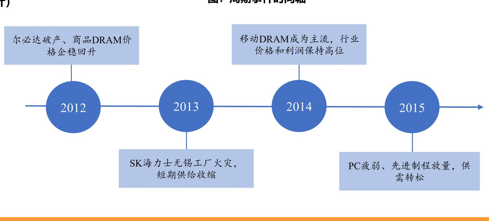

时间轴节点与标注：2012 年——尔必达破产、商品DRAM价格企稳回升；2013 年——SK海力士无锡工厂火灾，短期供给收缩；2014 年——移动DRAM成为主流，行业价格和利润保持高位；2015 年——PC疲弱、先进制程放量，供需转松。

资料来源：McKinsey、Yahoo Finance、东吴证券研究所整理

---

<!-- 原文第 28 页 -->

### 7.2 供给侧：新增晶圆产能受控，制程迁移成为主要供给增量

- 行业出清抑制新增产能：经历2011-2012年的深度亏损后，厂商显著收缩资本开支。尔必达退出并被美光整合后，三星、SK海力士和美光占据绝大部分市场。头部厂商更加重视盈利，将部分PC DRAM产能转向移动和服务器DRAM，压缩了标准型DRAM的有效供给。
- 偶发事件放大短缺：2013年9月SK海力士无锡厂火灾，该厂月产能约10万片DRAM晶圆，约占其总产能的一半、全球DRAM供给的10%以上；DigiTimes Research估算4Q13全球DRAM产能因此环比下降约5.7%，现货价单日跳涨最高20%。由于行业在2011-2012年深度亏损后普遍收缩资本开支、缺少可快速补充的闲置产能，价格对扰动的弹性显著放大。
- 2015年供给重新加速：三星、SK海力士和美光加快向20/25nm制程迁移，单位晶圆bit产出提升；部分厂商同时调整或扩充产能。
- NAND供给持续增长：NAND并未经历与DRAM同等强度的产能退出。2014年和2015年NAND bit供给增速分别约为36%和35%，三星西安工厂推进3D NAND量产，制程和堆叠层数成为主要供给增长来源。

图：DRAM单片bit增速与年晶圆产出

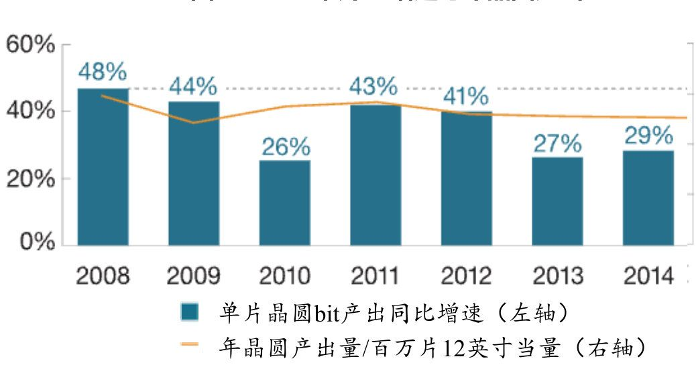

左轴：0%-60%（单片晶圆bit产出同比增速）；右轴：0-20（年晶圆产出量/百万片12英寸当量）；横轴：2008-2014 年；图例：单片晶圆bit产出同比增速（左轴，柱）、年晶圆产出量/百万片12英寸当量（右轴，折线）。柱顶标注：2008 年 48%、2009 年 44%、2010 年 26%、2011 年 43%、2012 年 41%、2013 年 27%、2014 年 29%。

图：NAND单片bit增速与年晶圆产出

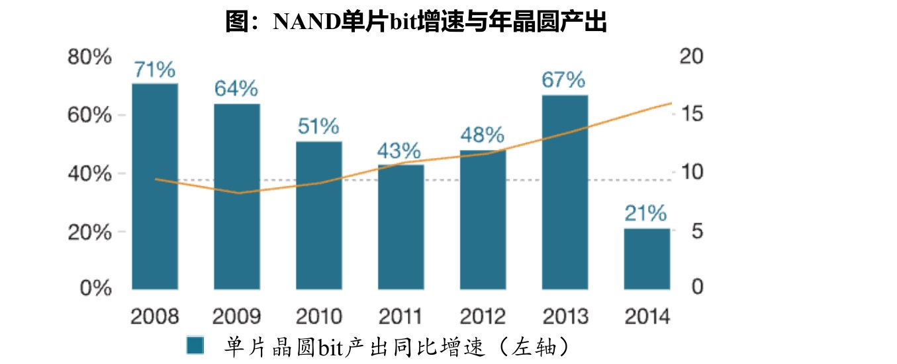

左轴：0%-80%（单片晶圆bit产出同比增速）；右轴：0-20（年晶圆产出量/百万片12英寸当量）；横轴：2008-2014 年；图例：单片晶圆bit产出同比增速（左轴，柱）、年晶圆产出量/百万片12英寸当量（右轴，折线）。柱顶标注：2008 年 71%、2009 年 64%、2010 年 51%、2011 年 43%、2012 年 48%、2013 年 67%、2014 年 21%。

资料来源：McKinsey、Yahoo Finance、DRAMeXchange、东吴证券研究所整理

---

<!-- 原文第 29 页 -->

### 7.3 需求侧：PC端需求转向移动端和服务器，需求结构切换

- 智能手机成为第一增长引擎：全球智能手机出货量由2013年的约10.3亿部升至2014年的约13.0亿部，2015年进一步增至约14.4亿部。高端手机运行内存由1GB向2GB、3GB升级，推动移动DRAM需求同时受益于终端销量和单机容量增长。
- 服务器需求提升行业稳定性：云计算和数据中心建设带动服务器DRAM持续增长，DDR4率先在服务器平台导入。服务器产品认证周期长、容量高、价格稳定性较好，成为厂商改善产品组合和盈利的重要方向。
- PC需求由支撑项转为拖累项：PC与笔记本销量缺乏明显复苏，Windows 10免费升级没有带来预期中的换机需求。TrendForce估计2015年笔记本出货约1.68亿台，同比下降5%；笔记本平均内存容量预期也由4.6GB下调至4.4GB，直接压制PC DRAM需求。
- 智能手机增速在2015年放缓：全球智能手机出货增速由2014年的28.1%下降至2015年的10.7%。移动需求仍在增长，但已难以完全吸收先进制程释放的新增供给，供需关系因此由紧平衡转向宽松。

图：2009-2016 个人计算设备（含平板）出货量及增速

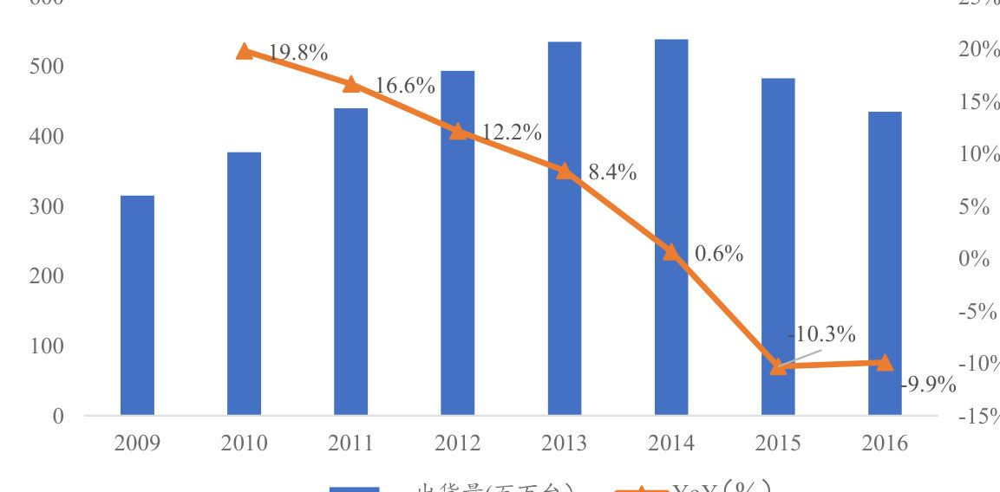

左轴：0-600（PC出货量，百万台）；右轴：-15%-25%（YoY，%）；横轴：2009-2016 年；图例：PC出货量(百万台)（柱）、YoY（%）(折线)。折线标注：2010 年 19.8%、2011 年 16.6%、2012 年 12.2%、2013 年 8.4%、2014 年 0.6%、2015 年 -10.3%、2016 年 -9.9%；柱体无数据标签。

图：2009-2017 全球智能手机出货量及增速

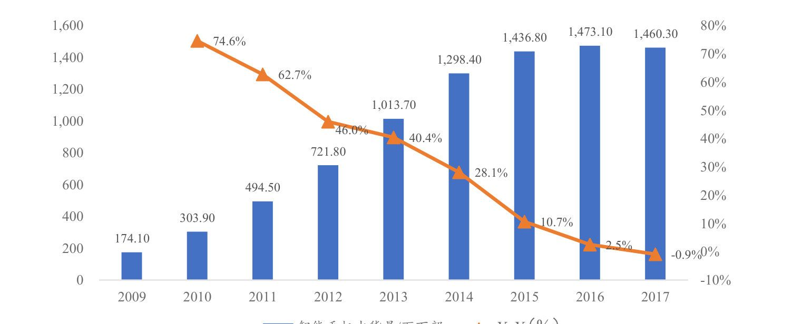

左轴：0-1,600（智能手机出货量/百万部）；右轴：-10%-80%（YoY，%）；横轴：2009-2017 年；图例：智能手机出货量/百万部（柱）、YoY（%）(折线)。柱顶标注：2009 年 174.10、2010 年 303.90、2011 年 494.50、2012 年 721.80、2013 年 1,013.70、2014 年 1,298.40、2015 年 1,436.80、2016 年 1,473.10、2017 年 1,460.30；折线标注：2010 年 74.6%、2011 年 62.7%、2012 年 46.0%、2013 年 40.4%、2014 年 28.1%、2015 年 10.7%、2016 年 2.5%、2017 年 -0.9%。

资料来源：IDC、Wind、Bloomberg，东吴证券研究所整理

---

<!-- 原文第 30 页 -->

## 8、2016-2019年：云计算与智能手机驱动的新一轮周期

---

<!-- 原文第 31 页 -->

### 8.1 2016-2019周期传导机制

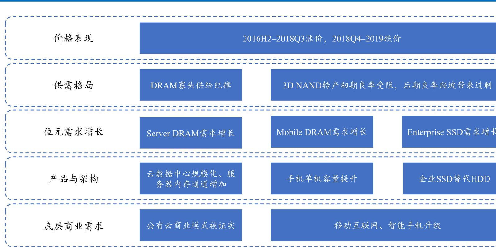

图中为五层结构框图，自上而下依次为「价格表现」「供需格局」「位元需求增长」「产品与架构」「底层商业需求」，每层左侧为层级名称，右侧为对应的蓝色文本框：

- 价格表现：2016H2–2018Q3涨价，2018Q4–2019跌价
- 供需格局：DRAM寡头供给纪律；3D NAND转产初期良率受限，后期良率爬坡带来过剩
- 位元需求增长：Server DRAM需求增长；Mobile DRAM需求增长；Enterprise SSD需求增长
- 产品与架构：云数据中心规模化、服务器内存通道增加；手机单机容量提升；企业SSD替代HDD
- 底层商业需求：公有云商业模式被证实；移动互联网、智能手机升级

资料来源：东吴证券研究所整理

---

<!-- 原文第 32 页 -->

### 8.2 2016-2019周期：DRAM需求侧

- 超大规模数据中心进入建设期：谷歌、微软等云厂商大幅增加资本开支以建设数据中心，2015-2018资本开支增幅超161%，服务器出货量提升直接拉动服务器端 DDR4 DRAM 需求。
- 服务器DRAM配置提升：2016 年后，服务器平台从 DDR3/早期 DDR4 向 DDR4 RDIMM/LRDIMM 迁移，内存频率、通道数和单条模组容量均有提升；Intel Xeon Scalable 等新平台将单 CPU 内存通道数由此前主流 4 通道提升至 6 通道，双路服务器均衡配置下所需内存模组数量增加。同时，虚拟化、AI/机器学习等云端工作负载对内存容量和带宽提出更高要求，推动单服务器 DRAM 容量向 256GB、384GB甚至更高容量上移。
- 智能手机单机DRAM含量跃升：智能手机平均DRAM含量从2016年约2.4GB升至2017年约3.2GB，同比增长33%。安卓手机制造商通过增加内置内存的方式提升计算速度与用户体验；高端机型已搭载4–6GB移动DRAM内存，规格逼近主流笔记本。

图：Intel Xeon Scalable每CPU配备6通道DDR4内存容量达768 GB - 1.5 TB

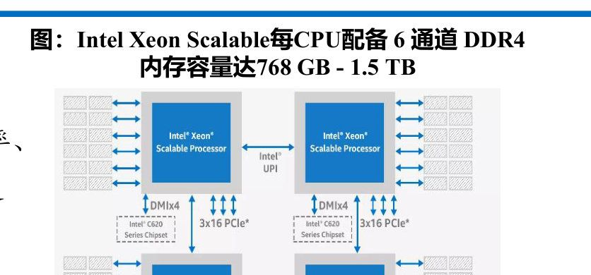

双路服务器拓扑示意图：左右两颗 Intel® Xeon® Scalable Processor 经 Intel® UPI 互联；每颗 CPU 两侧各接 6 条 DDR4 DIMM 通道；每颗 CPU 另以 DMIx4 连接 Intel® C620 Series Chipset，并以 3x16 PCIe* 向上连接。脚注小字：PCIe *uplink connection for Intel® QuickAssist Technology and Intel® Ethernet；‡ Available on selected SKUs。

图：主要云厂商2015-2018资本开支（单位：百万美元）

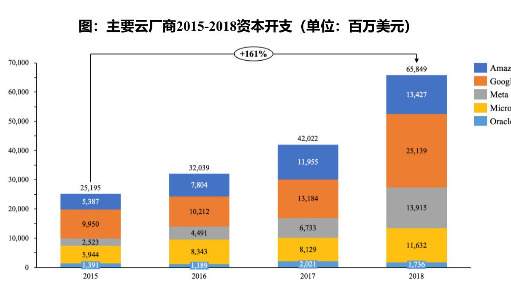

纵轴：0-70,000（百万美元）；横轴：2015-2018 年；图例（自上而下）：Amazon、Google、Meta、Microsoft、Oracle。柱顶合计及标注：2015 年 25,195；2016 年 32,039；2017 年 42,022；2018 年 65,849；图上以箭头连接 2015 年与 2018 年柱顶并标注 +161%。分段值（上→下）：2015 年 Amazon 5,387、Google 9,950、Meta 2,523、Microsoft 5,944、Oracle 1,391；2016 年 7,804、10,212、4,491、8,343、1,189；2017 年 11,955、13,184、6,733、8,129、2,021；2018 年 13,427、25,139、13,915、11,632、1,736。

图：智能手机单机DRAM含量跃升（以iPhone和三星Galaxy为例）

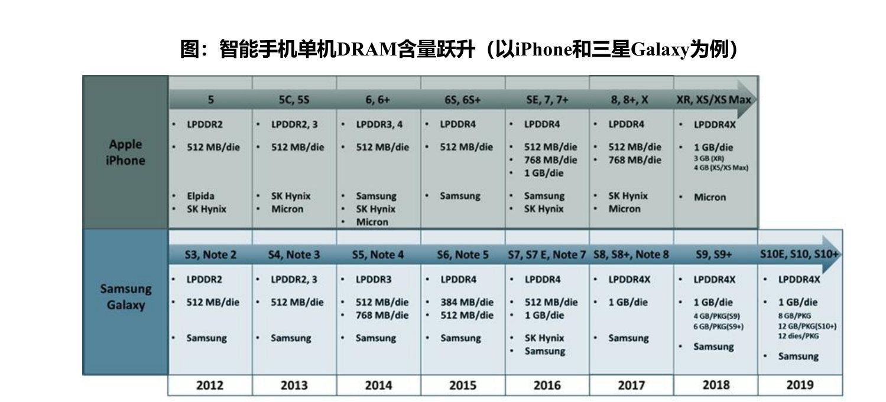

| 平台 | 年份 | 机型 | DRAM 类型 | 单 die 容量 | 供应商 |
|---|---|---|---|---|---|
| Apple iPhone | 2012 | 5 | LPDDR2 | 512 MB/die | Elpida、SK Hynix |
| Apple iPhone | 2013 | 5C, 5S | LPDDR2, 3 | 512 MB/die | SK Hynix、Micron |
| Apple iPhone | 2014 | 6, 6+ | LPDDR3, 4 | 512 MB/die | Samsung、SK Hynix、Micron |
| Apple iPhone | 2015 | 6S, 6S+ | LPDDR4 | 512 MB/die；768 MB/die；1 GB/die | Samsung |
| Apple iPhone | 2016 | SE, 7, 7+ | LPDDR4 | 512 MB/die；768 MB/die | Samsung、SK Hynix |
| Apple iPhone | 2017 | 8, 8+, X | LPDDR4 | 512 MB/die；768 MB/die | SK Hynix、Micron |
| Apple iPhone | 2018 | XR, XS/XS Max | LPDDR4X | 1 GB/die（3 GB (XR)、4 GB (XS/XS Max)） | Micron |
| Samsung Galaxy | 2012 | S3, Note 2 | LPDDR2 | 512 MB/die | Samsung |
| Samsung Galaxy | 2013 | S4, Note 3 | LPDDR2, 3 | 512 MB/die | Samsung |
| Samsung Galaxy | 2014 | S5, Note 4 | LPDDR3 | 512 MB/die；768 MB/die | Samsung |
| Samsung Galaxy | 2015 | S6, Note 5 | LPDDR4 | 384 MB/die；512 MB/die | Samsung |
| Samsung Galaxy | 2016 | S7, S7 E, Note 7 | LPDDR4 | 512 MB/die；1 GB/die | SK Hynix、Samsung |
| Samsung Galaxy | 2017 | S8, S8+, Note 8 | LPDDR4X | 1 GB/die | Samsung |
| Samsung Galaxy | 2018 | S9, S9+ | LPDDR4X | 1 GB/die（4 GB/PKG(S9)、6 GB/PKG(S9+)） | Samsung |
| Samsung Galaxy | 2019 | S10E, S10, S10+ | LPDDR4X | 1 GB/die（8 GB/PKG、12 GB/PKG(S10+)、12 dies/PKG） | Samsung |

资料来源：Bloomberg、EE Times、Tech Powerup、东芝官网、三星官网、Intel官网，东吴证券研究所整理

---

<!-- 原文第 33 页 -->

### 8.3 美光营收拆分

图：美光2015-2020营收拆分（按业务部门，绝对值，单位：百万美元）

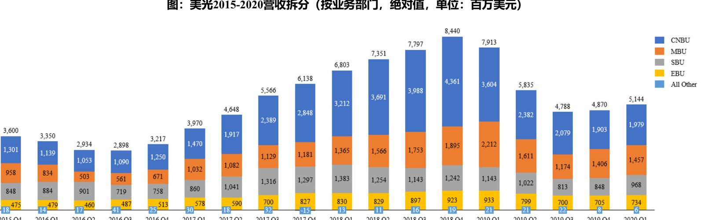

横轴：2015 Q4 至 2020 Q1 共 18 个季度；纵轴无刻度标签，各段及柱顶均标数值；图例：CNBU、MBU、SBU、EBU、All Other。

| 季度 | CNBU | MBU | SBU | EBU | All Other | 合计 |
|---|---|---|---|---|---|---|
| 2015 Q4 | 1,301 | 958 | 848 | 475 | 18 | 3,600 |
| 2016 Q1 | 1,139 | 834 | 884 | 479 | 14 | 3,350 |
| 2016 Q2 | 1,053 | 503 | 901 | 460 | 17 | 2,934 |
| 2016 Q3 | 1,090 | 561 | 719 | 487 | 41 | 2,898 |
| 2016 Q4 | 1,250 | 671 | 758 | 513 | 25 | 3,217 |
| 2017 Q1 | 1,470 | 1,032 | 860 | 578 | 30 | 3,970 |
| 2017 Q2 | 1,917 | 1,082 | 1,041 | 590 | 18 | 4,648 |
| 2017 Q3 | 2,389 | 1,129 | 1,316 | 700 | 32 | 5,566 |
| 2017 Q4 | 2,848 | 1,181 | 1,297 | 827 | -15 | 6,138 |
| 2018 Q1 | 3,212 | 1,365 | 1,383 | 830 | 13 | 6,803 |
| 2018 Q2 | 3,691 | 1,566 | 1,254 | 829 | 11 | 7,351 |
| 2018 Q3 | 3,988 | 1,753 | 1,143 | 897 | 16 | 7,797 |
| 2018 Q4 | 4,361 | 1,895 | 1,242 | 923 | 19 | 8,440 |
| 2019 Q1 | 3,604 | 2,212 | 1,143 | 933 | 21 | 7,913 |
| 2019 Q2 | 2,382 | 1,611 | 1,022 | 799 | 21 | 5,835 |
| 2019 Q3 | 2,079 | 1,174 | 813 | 700 | 22 | 4,788 |
| 2019 Q4 | 1,903 | 1,406 | 848 | 705 | 8 | 4,870 |
| 2020 Q1 | 1,979 | 1,457 | 968 | 734 | 6 | 5,144 |

图：美光2015-2020营收拆分（按业务部门，收入占比，单位：%，百万美元）

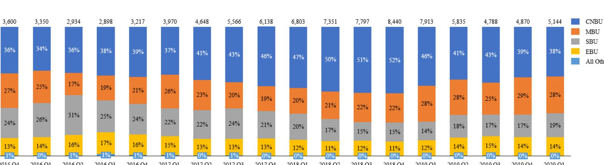

横轴：2015 Q4 至 2020 Q1；纵轴为各业务部门收入占比（%，向下堆叠），柱顶标注当期营收合计（百万美元）；图例：CNBU、MBU、SBU、EBU、All Other。

| 季度 | CNBU | MBU | SBU | EBU | All Other | 营收合计 |
|---|---|---|---|---|---|---|
| 2015 Q4 | 36% | 27% | 24% | 13% | 1% | 3,600 |
| 2016 Q1 | 34% | 25% | 26% | 14% | 0% | 3,350 |
| 2016 Q2 | 36% | 17% | 31% | 16% | 1% | 2,934 |
| 2016 Q3 | 38% | 19% | 25% | 17% | 1% | 2,898 |
| 2016 Q4 | 39% | 21% | 24% | 16% | 1% | 3,217 |
| 2017 Q1 | 37% | 26% | 22% | 15% | 1% | 3,970 |
| 2017 Q2 | 41% | 23% | 22% | 13% | 0% | 4,648 |
| 2017 Q3 | 43% | 20% | 24% | 13% | 1% | 5,566 |
| 2017 Q4 | 46% | 19% | 21% | 13% | 0% | 6,138 |
| 2018 Q1 | 47% | 20% | 20% | 12% | 0% | 6,803 |
| 2018 Q2 | 50% | 21% | 17% | 11% | 0% | 7,351 |
| 2018 Q3 | 51% | 22% | 15% | 12% | 0% | 7,797 |
| 2018 Q4 | 52% | 22% | 15% | 11% | 0% | 8,440 |
| 2019 Q1 | 46% | 28% | 14% | 12% | 0% | 7,913 |
| 2019 Q2 | 41% | 28% | 18% | 14% | 0% | 5,835 |
| 2019 Q3 | 43% | 25% | 17% | 15% | 0% | 4,788 |
| 2019 Q4 | 39% | 29% | 17% | 14% | 0% | 4,870 |
| 2020 Q1 | 38% | 28% | 19% | 14% | 0% | 5,144 |

**美光业务部门拆分口径**

- CNBU：计算与网络事业部，覆盖范围包括云/企业服务器 DRAM、PC 客户端 DRAM等。
- MBU：移动事业部，覆盖范围包括智能手机用 LPDDR、eMMC/UFS 等管理型 NAND等。
- SBU：存储事业部，覆盖范围SSD 及元件级存储解决方案。
- EBU：嵌入式事业部，覆盖汽车、工业及消费嵌入式市场。

资料来源：Bloomberg、美光科技、东吴证券研究所整理

---

<!-- 原文第 34 页 -->

### 8.4 2016-2019周期：DRAM供给扩张路径

- 制程迁移释放 bit supply：2016 年后，头部厂商持续推进 20/21nm 向 1X nm、1Y nm、1Z nm 迁移。先进制程提高了单片晶圆产出 bit 数，因此即使前道产能扩张有限，行业 bit supply 仍能持续增长。2018 年后，随着 1X nm 良率提升和 1Y nm 导入，供给端 bit产能开始明显释放。
- 三星平泽工厂2018年转向生产DRAM：三星平泽 P1 初期以 V-NAND 为重点，但后续市场预期部分空间转向 DRAM，叠加 1X nm 良率提升和 1Y nm 导入，推动 2018 年 DRAM 位元供给增速预期上修。相比之下，SK 海力士更多体现为无锡扩建与制程迁移，美光则基本没有新增大规模 DRAM 前道产能，主要依靠 1X/1Y/1Z nm 迁移提升每片晶圆的bit产出。
- 供给调整滞后放大下行压力：DRAM 扩产、制程迁移和客户认证周期较长，供给端无法在需求转弱时立即收缩。2018 年下半年开始，云客户库存消化、智能手机需求走弱，需求增速下修；但前期制程迁移与部分产能释放已经进入市场，供给调整滞后导致 2019 年行业由紧平衡转向过剩，价格进入快速下行阶段。

图：DRAM 制程迁移 Roadmap

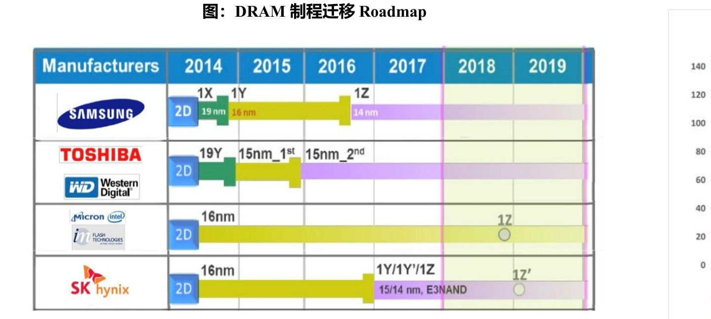

甘特图：纵轴为厂商（Samsung；TOSHIBA／Western Digital；Micron／Intel（Intel Flash Technologies）；SK hynix），横轴为 2014-2019 年；各厂商行首色块标注「2D」，其后按条形颜色与节点标注推进路径：

- Samsung：2D（2014）→ 1X（19 nm）→ 1Y（16 nm）→ 1Z（14 nm），绿色条（19 nm）与黄色条（16 nm）相接于 2015 年前后，紫色条（14 nm）自 2016 年后段延续至 2019 年。
- TOSHIBA／Western Digital：2D（2014）→ 19Y → 15nm_1st → 15nm_2nd，紫色条（15nm_2nd）延续至 2019 年。
- Micron／Intel：2D（2014）→ 16nm，黄绿色条（16nm）延伸至 2018 年，2018 年处标 1Z 并以空心圆圈标记节点。
- SK hynix：2D（2014）→ 16nm，2017 年处标 1Y/1Y'/1Z，其后为紫色条（15/14 nm, E3NAND）延续至 2019 年；2018 年处标 1Z' 并以空心圆圈标记节点。

图：DRAM 裸片面积与存储密度变化趋势

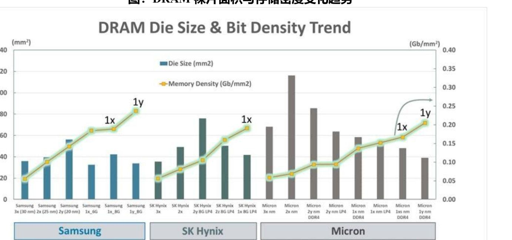

图内标题：DRAM Die Size & Bit Density Trend。左轴：Die Size（mm²），0-140；右轴：Memory Density（Gb/mm²），0.00-0.40；图例：Die Size (mm2)（柱）、Memory Density (Gb/mm2)（折线）。横轴按厂商分组并标注制程/产品：Samsung——3x (30 nm)、2x (25 nm)、2y (20 nm)、1x_6G、1x_8G、1y_8G；SK Hynix——3x、2x、2y 8G LP4、2z 8G LP4、1x 8G LP4；Micron——3x nm、2x nm、2y nm DDR4、2y nm LP4、1x nm DDR4、1x nm LP4、1xS nm DDR4、1y nm DDR4。折线附近另标注 1x、1y 制程节点。图上无数据标签。

资料来源：Tech Insights、Semiconductor Digest ，东吴证券研究所整理

---

<!-- 原文第 35 页 -->

### 8.5 2016-2019周期：DRAM位元供给增速与厂商分化

- 行业供给增速中枢回落： 全球DRAM供给bit增速由2016年的23.7%降至2017年的19.2%，2018年约为19.6%。随着行业扩产趋于审慎、制程微缩难度提升，供给增速逐步回落。
- 厂商供给节奏分化： TrendForce测算三星供给bit增速由2016年的24.8%降至2017年的15.8%，美光由26.7%降至18.8%；SK海力士则由21.5%升至26.2%，增速高于行业平均，主要对应其产能爬坡及制程迁移贡献。
- 制程迁移仍支撑供给持续增长：尽管新增晶圆产能相对有限，先进制程带来的单位晶圆bit产出提升，使行业每年仍可形成约15%-20%的供给增量。

图：DRAM供给bit增速（%）

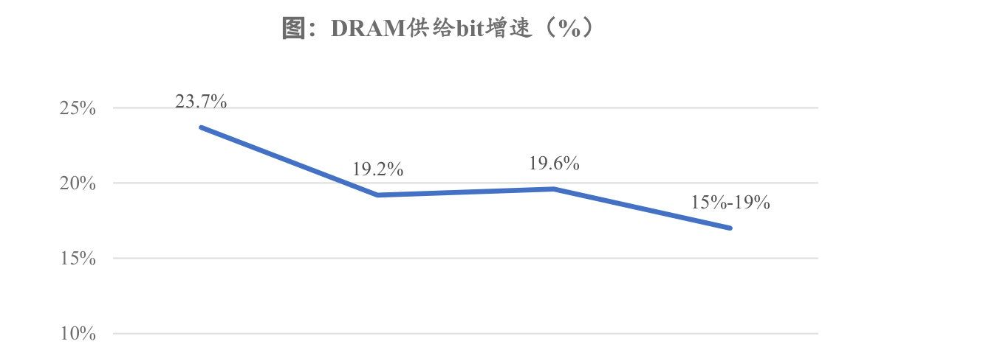

纵轴：0%-25%；横轴：2016-2019 年；单条折线，数据标签：2016 年 23.7%、2017 年 19.2%、2018 年 19.6%、2019 年 15%-19%。

图：2016–2017 头部存储厂商供给端分季度位元产出环比（%）

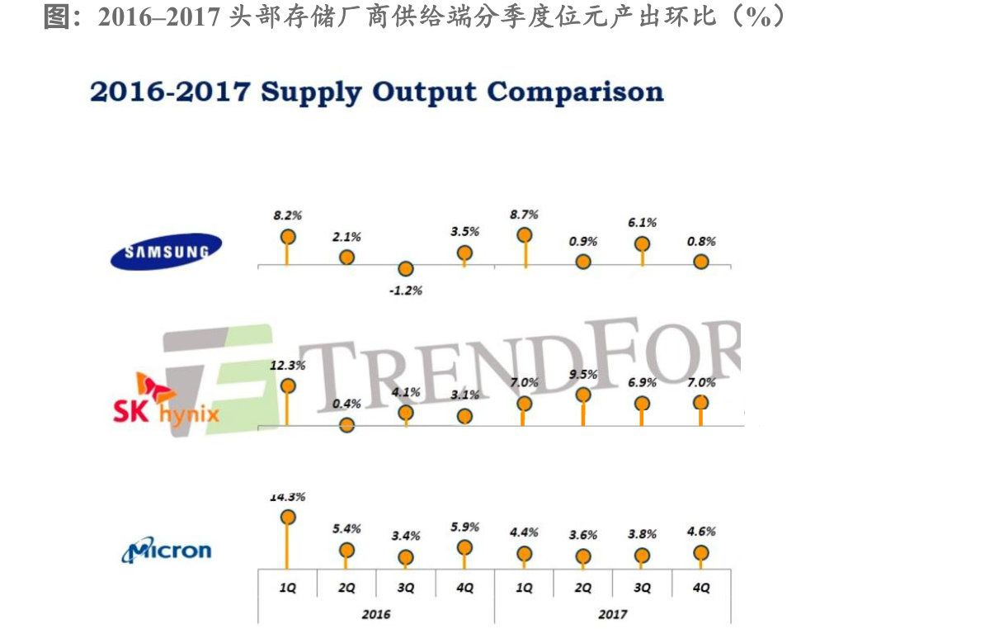

图内标题：2016-2017 Supply Output Comparison；横轴：2016 年 1Q-4Q、2017 年 1Q-4Q；纵轴为各季度位元产出环比（%），以棒棒糖图按厂商分行展示，图内可见 TrendForce 水印。分行数值（左→右，2016 1Q 至 2017 4Q）：

- Samsung：8.2%、2.1%、-1.2%、3.5%、8.7%、0.9%、6.1%、0.8%
- SK hynix：12.3%、0.4%、4.1%、3.1%、7.0%、9.5%、6.9%、7.0%
- Micron：14.3%、5.4%、3.4%、5.9%、4.4%、3.6%、3.8%、4.6%

资料来源：Tech Insights、Semiconductor Digest ，东吴证券研究所整理

---

<!-- 原文第 36 页 -->

### 8.6 2016-2019周期：智能手机拉动，服务器建设接力

图：全球PC、智能手机季度出货量

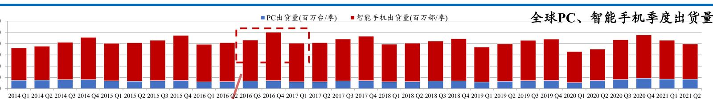

纵轴：0-600；横轴：2014 Q1 至 2021 Q2（逐季）；图例：PC出货量(百万台/季)、智能手机出货量(百万部/季)。红色虚线框圈出 2016 年前后的区间，并用箭头指向下方两图的同期区间。图上无数据标签。

图：美光收盘价及DDR3现货价（左轴系股价，右轴系DRAM月均价）

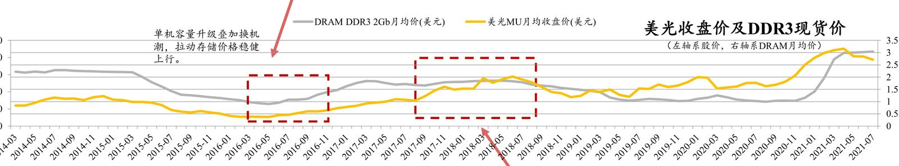

左轴：0-100（美元，美光股价）；右轴：0-3.5（美元，DRAM月均价）；横轴：2014-03 至 2021-07 逐月；图例：DRAM DDR3 2Gb月均价(美元)、美光MU月均收盘价(美元)。图上无数据标签。图内文本框：单机容量升级叠加换机潮，拉动存储价格稳健上行。图内另有两处红色虚线框，分别圈出 2016 年与 2017 年下半年至 2018 年中的区间，并用箭头指向下方云厂 CAPEX 图的对应区间。

图：北美四大云厂季度累计CAPEX（亿美元）

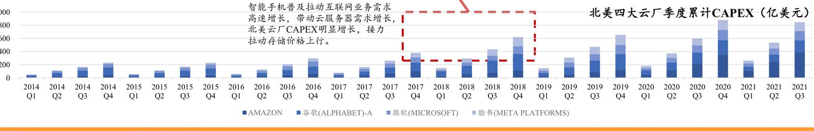

纵轴：0-1,000（亿美元）；横轴：2014 Q1 至 2021 Q3（逐季）；图例：AMAZON、谷歌(ALPHABET)-A、微软(MICROSOFT)、脸书(META PLATFORMS)，按厂商堆叠。红色虚线框标注 2017 Q1-2018 Q3 区间。图上无数据标签。图内文本框：智能手机普及拉动互联网业务需求高速增长，带动云服务器需求增长，北美云厂CAPEX明显增长，接力拉动存储价格上行。

资料来源： Wind，Micron，Bloomberg ，东吴证券研究所整理

---

<!-- 原文第 37 页 -->

## 9、2020-2023：疫情提前透支需求

---

<!-- 原文第 38 页 -->

### 9.1 2020-2023周期传导机制

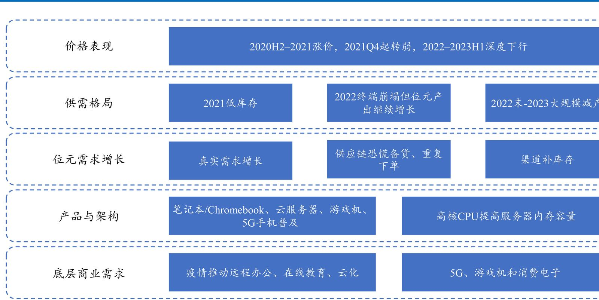

图中为五层结构框图，自上而下依次为「价格表现」「供需格局」「位元需求增长」「产品与架构」「底层商业需求」，每层左侧为层级名称，右侧为对应的蓝色文本框：

- 价格表现：2020H2–2021涨价，2021Q4起转弱，2022–2023H1深度下行
- 供需格局：2021低库存；2022终端崩塌但位元产出继续增长；2022末-2023大规模减产
- 位元需求增长：真实需求增长；供应链恐慌备货、重复下单；渠道补库存
- 产品与架构：笔记本/Chromebook、云服务器、游戏机、5G手机普及；高核CPU提高服务器内存容量
- 底层商业需求：疫情推动远程办公、在线教育、云化；5G、游戏机和消费电子

资料来源：东吴证券研究所整理

---

<!-- 原文第 39 页 -->

### 9.2 2020-2023周期需求端驱动因素

- 新冠疫情影响消费级存储需求结构：2020—2023周期，疫情显著改变了消费级存储需求结构：居家办公、在线教育和线上娱乐推动笔记本及PC换机需求快速上升，带动PC DRAM和Client SSD需求在2020-2021年显著扩张；但智能手机需求在疫情初期已受消费收缩和供应链扰动冲击，随后虽阶段性修复，却未形成与PC同等强度的持续增长。2022年起，疫情期间前置的终端需求逐步透支，叠加通胀、宏观不确定性和渠道高库存，PC与智能手机出货同步回落，消费级DRAM与NAND订单显著收缩，并成为后续存储行业深度去库存和价格下行的重要需求端原因。
- PC出货拉动DRAM、SSD与客户端NAND需求：2019Q4全球传统PC出货约7180万台；疫情后，远程办公和在线教育推动PC需求在2020Q4升至9160万台，2021年维持高位。2022年起，前置购买需求回落与渠道库存压力显现，PC出货连续走弱 。
- 智能手机需求影响DRAM、UFS/eMMC与消费级NAND需求：2020H1，疫情冲击线下销售、供应链和消费需求，智能手机出货明显下滑；2020H2-2021H1，需求修复与低基数带来反弹；2021H2起增速转弱，2022-2023H1持续下行。

图：PC出货：疫情带动需求跃升，随后需求前置回落

纵轴：全球传统PC出货量（百万台），55-95；横轴：2019 Q4 至 2023 Q2（逐季）；分区标注：疫情前基准、居家办公/在线教育拉动、需求回落与去库存。数据标签：71.8m YoY +4.8%（2019 Q4）；91.6m YoY +26.1%（2020 Q4）；92.7m YoY +1.0%（2021 Q4，标签与 2020 Q4 峰值标签位置相邻）；67.2m YoY -28.1%（2022 Q4）；56.9m YoY -29.0%（2023 Q1）；61.6m YoY -13.4%（2023 Q2）；2020 Q1 低点无数据标签。图下注释：数据来源：IDC Worldwide Quarterly Personal Computing Device Tracker （IDC/BusinessWire公开稿）；东吴证券研究所整理。

图：智能手机出货：短暂修复后再度走弱

纵轴：全球智能手机出货量（百万台），260-380；横轴：2019 Q4 至 2023 Q2（逐季）；分区标注：疫情前基准、疫情冲击、修复/补库存、需求走弱/渠道去库存。数据标签：368.8m YoY -1.1%（2019 Q4）；278.4m YoY -16.0%（2020 Q1，标签位于 2020 Q1 与 2020 Q2 之间）；385.9m YoY +4.3%（2020 Q4）；345.5m YoY -25.5%（2021 Q1）；362.4m YoY -3.2%（2021 Q4）；300.3m YoY -18.3%（2022 Q4）；265.3m YoY -7.8%（2023 Q2）。图下注释：数据来源：IDC Worldwide Quarterly Mobile Phone Tracker （IDC/BusinessWire公开稿）；东吴证券研究所整理。

资料来源：IDC、BusinessWire，东吴证券研究所整理

---

<!-- 原文第 40 页 -->

### 9.3 2020-2023周期供给端驱动因素

- 存储供给周期总览： 受宏观需求预期、库存水平、价格周期和企业盈利能力驱动，2020-2023年存储供给周期呈现“需求上升推动资本扩张-供给滞后维持价格高位-需求回落后供给惯性形成过剩-厂商以减产和削减CAPEX修复供需”的典型特征，DRAM与NAND周期高度相似。
- 本轮周期主要由需求因素驱动，进而影响行业供给与资本支出周期。2020 年疫情初期，消费电子需求和终端供应链受冲击，合约价格整体偏弱；但远程办公、在线教育带动 PC、服务器需求快速增长。2021 年，客户补库存、终端配置升级进一步推升存储需求，DRAM DDR4 8Gb 合约价由一季度的 3.00 美元/颗升至三季度的 4.10 美元/颗，NAND Flash 128Gb MLC 合约价则由 4.20 美元/颗升至 4.81 美元/颗。需求扩张和价格上行改善了原厂盈利预期，主要厂商同步扩大资本开支，推进 DRAM 制程迁移和高层数 3D NAND 量产。
- 2022 年起，疫情期间 PC 和智能手机需求逐步透支，叠加通胀、宏观不确定性和渠道高库存，终端订单明显收缩；但此前资本开支、制程迁移和高层数 NAND 量产仍持续释放供给，价格进入下行周期。至 2022 年四季度，DRAM 合约价降至 2.21 美元/颗，较 2021 年三季度高点下降约 46%；2023 年三季度进一步降至 1.30 美元/颗，NAND 合约价亦在 2023 年二、三季度降至 3.82 美元/颗。面对需求低迷、库存累积和盈利下滑，主要厂商在 2023 年陆续采取减产、降投片、延后扩产和削减资本开支等措施，供给端开始主动收缩。

图：2021-2023 DRAM&NAND合约价（单位：美元/颗）

图内标题：DRAM & NAND Contract Prices (2020Q1-2023Q4)；纵轴：US$/unit，1.6-4.8；横轴：Quarter，2020Q1 至 2023Q4；图例：PC DRAM DDR4 8Gb、NAND Flash 128Gb MLC。图上无数据标签。

图：2018-2024 DRAM生产商资本开支对比（单位：十亿美元）

纵轴：US$ bn，0-14；横轴：Year，2018-2024 年；图例：Samsung、SK hynix、Micron、CXMT、Winbond。图上无数据标签。

图：2018-2024 NAND生产商资本开支对比（单位：十亿美元）

纵轴：US$ bn，0-12；横轴：Year，2018-2024 年；图例：Samsung、YMTC、Kioxia/SanDisk、SK hynix、Micron。图上无数据标签。

资料来源：Omdia,、NAND Memory Market Tracker 、TrendForce、DRAMeXchange，东吴证券研究所整理

---

<!-- 原文第 41 页 -->

# 9.4 资本市场：价格上行到盈利反转，景气定价与市值重估

- **上行期，价格与盈利共振，股价同步抬升。**2020年中期后，PC、服务器和SSD需求恢复，客户补库存推动DRAM/NAND价格进入上行区间，主要厂商利润率随之修复。按季度营业利润率看，Micron、SK hynix、Samsung、Western Digital在2021年前后分别达到约35.7%、35.3%、21.4%和15.4%的阶段高点。资本市场同步定价景气扩张：以2020年6月为起点，至各自阶段高点，Micron、SK hynix、Western Digital、Samsung股价分别上涨约81%、77%、70%和69%，其中Micron涨幅最高、股价弹性最强。
- **拐点期，需求转弱与库存累积压制估值。**2021年末至2022年，消费电子、PC和智能手机需求走弱，客户由补库存转向去库存，存储价格逐步转弱。由于前期资本开支和制程迁移仍在释放供给，价格下行开始向利润表传导，主要厂商利润率从高位回落。股价也随盈利预期下修而进入调整区间，说明资本市场不再单纯交易短期出货增长，而是开始反映库存周期反转和价格下跌对后续盈利的压力。
- **下行期，利润表深度承压，股价大幅回撤。**2022年下半年至2023年初，DRAM/NAND价格下跌、客户库存调整和原厂库存压力集中体现，主要厂商盈利快速恶化。SK hynix 2023Q1营业利润率降至约-66.9%，Micron对应财季降至约-62.4%，Samsung公司层面利润率降至约1.0%，Western Digital亦转为亏损。对应股价从高点至低点大幅回撤，Samsung、SK hynix、Micron、Western Digital最大回撤约50%、54%、46%和58%。

图：2020-2023头部存储厂商季度营业利润率（单位：%）

纵轴：Operating margin (%)，刻度 40 至 -60；横轴：2020Q1–2024Q2 各季度；图例：Samsung、Micron、SK hynix、Western Digital。

图：2020-2023头部存储厂商股价走势（归一化处理，2020年1月=100）

纵轴：Index，刻度 60 至 180；横轴：2020-01 至 2024-01（月）；图例：Samsung、Micron、SK hynix、Western Digital。

资料来源：Samsung Electronics；SK hynix；Micron；Western Digital 官网；Bloomberg；东吴证券研究所整理

---

<!-- 原文第 42 页 -->

# 9.5 2018-2024周期：消费电子+云服务器需求释放，AI拉动初显

上图：季度出货量堆叠柱状图，纵轴刻度 0–600，横轴 2018 Q1–2024 Q4；图例：PC出货量(百万台/季)、智能手机出货量(百万部/季)。

消费电子出货量基本稳定，叠加存储厂产能释放，存储价格下探。

疫情期间，居家办公、娱乐催生消费电子需求明显增长。驱动存储价格回升。

20H2-21H1透支消费电子需求，后续消费电子出货量进入下行通道，对存储需求下降，存储价格持续下行。

中图：双轴折线图，左轴刻度 0–5，右轴刻度 0–150，横轴 2018-01 至 2024-12（月）；图例：DRAM DDR3 4Gb现货月均价(美元，左轴)、美光MU月均收盘价(美元，右轴)。

Chat GPT驱动下,股价和存储现货价背离。

下图：季度堆叠柱状图，纵轴刻度 0–2500，横轴 2018 Q1–2024 Q4；图例：AMAZON、谷歌ALPHABET、微软MICROSOFT、脸书META PLATFORMS；图题：北美四大云厂季度累计CAPEX（亿美元）。

北美四大云厂 CAPEX基本稳定。

疫情期间，对云服务需求增长驱动云厂CAPEX增长，支撑存储价格上行。

云厂CAPEX保持稳健，存储厂产能释放，存储价格再次持续下探。

AI驱动下云厂CAPEX提速，对存储未来需求乐观，股价与存储现货价格持续背离。

资料来源：Wind，Micron，Bloomberg；东吴证券研究所整理

---

<!-- 原文第 43 页 -->

# 10、2024至今：AI驱动下的DRAM与NAND共振

---

<!-- 原文第 44 页 -->

# 10.1 2024至今：AI需求引发存储超级周期

- **核心背景：**经历2022–2023年行业性巨亏后,海外存储原厂自2023年起陆续大幅减产，资本开支同步收缩,供给弹性被系统性抽离。2024年生成式AI爆发，AI服务器对HBM、DDR5及高容量NAND的需求呈指数级、结构性放量。减产效应的深化与AI需求的加速拉升双向叠加，2025年下半年全球存储进入供不应求的加速爆发期。
- **双市场共振：**DRAM侧，HBM单位位元消耗晶圆约为普通DRAM的2-4倍，叠加CoWoS先进封装瓶颈，高端产能对通用DRAM形成“挤占”,供需缺口持续拉大。NAND侧，AI推理催生企业级SSD对机械硬盘的加速替代，原厂将有限晶圆优先分流至高溢价企业级产品，同时加速退出2D NAND等传统品，减产过快导致中低端结构性紧缺。
- **结果：**存储行业单季营收环比大幅跃升，三巨头(三星、SK海力士、美光)营业利润率创历史新高。美光FY26Q3季报显示包括云存储、数据中心在内的四大单元营收全线创纪录，DRAM现货价环比涨约60%，NAND晶圆现货价环比涨约85%

图：主流DRAM现货价（美元）

Mainstream DRAM Spot Price (USD)；纵轴刻度 0–50；横轴：2023-6 至 2026-3 各季末（2023-6、2023-9、2023-12、2024-3、2024-6、2024-9、2024-12、2025-3、2025-6、2025-9、2025-12、2026-3）。

图：主流NAND晶圆现货价（美元）

Mainstream NAND Flash Wafer Spot Price (USD)；纵轴刻度 0–25；横轴：2023-6 至 2026-3 各季末（2023-6、2023-9、2023-12、2024-3、2024-6、2024-9、2024-12、2025-3、2025-6、2025-9、2025-12、2026-3）。

资料来源：TrendForce、Micron，东吴证券研究所整理

---

<!-- 原文第 45 页 -->

# 10.2.1 需求侧：AI训练与推理共同拉动存储需求

- **单服务器基础配置需求：**AI服务器本身即配备多层存储，GPU侧使用HBM、CPU侧配置DDR内存、同时搭载系统盘SSD与数据缓存盘SSD。H200至B300升级中，HBM容量提升明显，构成DRAM侧核心增量，NAND则作为服务器本地存储形成基础需求。
- **英伟达提出直连GPU方案：**英伟达Storage-Next/GPU直连方案将SSD定位为GPU外部记忆层，用于承接KV Cache、上下文记忆、RAG数据库和生成结果。该方案缩短SSD到GPU的数据路径，推动企业级SSD向高带宽、低延迟、高IOPS方向升级。
- **推理规模化打开持续需求：**训练阶段主要拉动checkpoint、训练数据集和模型版本存储；推理阶段则进一步带来长上下文、KV Cache、RAG向量数据库和生成内容存储需求。随着AI应用落地，推理侧NAND需求更具持续扩容属性。

图：英伟达服务器基础配备需求（以8卡集群为例）

**DRAM侧**

| 项目 | 作用 | H200存储容量 | B200存储容量 | B300存储容量 |
| --- | --- | --- | --- | --- |
| GPU | 负责大模型训练、推理、矩阵计算 | 1,128GB HBM显存容量 | 1,440 GB HBM显存容量 | 2.3 TB HBM显存容量 |
| CPU侧系统内存 | 服务器主内存 | 2 TB DDR内存 | 2 TB DDR内存 | 2 TB DDR内存 |

**NAND侧**

| 项目 | 作用 | H200存储容量 | B200存储容量 | B300存储容量 |
| --- | --- | --- | --- | --- |
| 操作系统盘 SSD | 装系统、驱动、管理软件等 | 2*1.92 = 3.84TB | 2*1.92 = 3.84TB | 2*1.92 = 3.84TB |
| 数据缓存盘 SSD | 放训练数据、临时数据、中间文件、缓存数据等 | 8*3.84 = 30.72TB | 8*3.84 = 30.72TB | 8*3.84 = 30.72TB |

资料来源：英伟达官网、铠侠官网，东吴证券研究所整理

---

<!-- 原文第 46 页 -->

# 10.2.2 需求侧：英伟达直连方案

架构示意图（英伟达直连方案）：

训练侧
- 基础形态：GPU + HBM + SSD
- 预训练：SSD × 2
- Checkpoint存储：SSD × 2

推理侧
- 基础形态：GPU + HBM + SSD
- KV Cache溢出上下文存储：SSD × 2
- 英伟达Storage-Next方案：SSD × 2

RAG
- 数据库生成：GPU + HBM + SSD × 2
- 数据库检索：CPU + DRAM + SSD × 2

Storage Server
- 横向排列 SSD × 10

资料来源：铠侠官网，东吴证券研究所整理

---

<!-- 原文第 47 页 -->

# 10.2.3 需求侧：云厂商资本开支上行驱动服务器装机扩张

- **云厂商资本开支持续上行：**头部云厂商资本开支进入AI驱动扩张周期，Bloomberg显示市场一致预期2026年前五大云厂商资本开支合计达6,918亿美元，2027年进一步提升至9,069亿美元。云厂商加码AI数据中心建设，为GPU服务器、HBM、DDR及企业级SSD需求提供总量支撑。
- **AI加速器出货高增：**GPU出货量快速放量，2022–2025年均复合增速达116%。GPU供应商中英伟达维持主导地位，同时Google、Amazon、AMD等自研/定制芯片同步增长，推动AI服务器装机规模持续扩大。
- **存储需求乘数放大：**AI加速器出货增长将直接带动服务器数量提升，而单台AI服务器需配置HBM、CPU侧DDR、本地SSD及数据缓存盘。云厂商CapEx与GPU出货共振，推动DRAM和NAND bit demand从单机需求扩展至数据中心级需求。

图：云厂商CAPEX（单位：亿美元）

图例：Google、Amazon、Meta、Microsoft、Oracle、YoY（折线，无数据标签）。

| 年份 | Google | Amazon | Meta | Microsoft | Oracle | 柱顶合计 |
| --- | --- | --- | --- | --- | --- | --- |
| 2023 | 87 | 323 | 527 | 273 | 281 | 1,490 |
| 2024 | 69 | 525 | 830 | 373 | 445 | 2,241 |
| 2025 | 212 | 914 | 1,318 | 697 | 646 | 3,787 |
| 2026E | 557 | 1,858 | 1,992 | 1,345 | 1,166 | 6,918 |
| 2027E | 898 | 2,458 | 2,292 | 1,622 | 1,800 | 9,069 |

图：GPU出货量（单位：万）

图例：Nvidia、AMD、Amazon、Google、Huawei、Cambricon；图内标注箭头“+116% p.a.”。

| 年份 | Nvidia | AMD | Amazon | Google | 柱顶合计 |
| --- | --- | --- | --- | --- | --- |
| 2022 | 77 |  |  | 10 | 87 |
| 2023 | 129 |  |  | 102 | 231 |
| 2024 | 384 | 48 | 76 | 219 | 733 |
| 2025 | 446 | 44 | 109 | 275 | 885 |

[TABLE_RECONSTRUCTION_UNCERTAIN]

图：GPU出货量（对标H100算力，单位：万）

图例：Nvidia、AMD、Amazon、Google、Huawei、Cambricon。

| 年份 | Nvidia | AMD | Amazon | Google | Huawei | 柱顶合计 |
| --- | --- | --- | --- | --- | --- | --- |
| 2022 | 27 |  |  | 1 |  | 28 |
| 2023 | 110 |  |  | 19 |  | 129 |
| 2024 | 332 | 55 | 30 | 73 |  | 509 |
| 2025 | 893 | 70 | 71 | 283 | 53 | 1,374 |

[TABLE_RECONSTRUCTION_UNCERTAIN]

资料来源：Bloomberg、Epoch AI，东吴证券研究所整理

---

<!-- 原文第 48 页 -->

# 11、风险提示

---

<!-- 原文第 49 页 -->

# 风险提示

- **AI数据中心资本开支不及预期：**若全球AI算力需求增长、模型迭代速度或AI应用商业化进展不及预期，北美云厂及其他AI基础设施厂商资本开支可能低于市场预期，进而影响服务器、AI加速卡及配套存储产品的需求增长，对存储行业景气度及相关公司业绩形成压制。
- **原厂扩产或制程迁移导致供给释放快于预期：**若存储原厂资本开支增加、产能扩张进度加快，或先进制程导入及制程迁移效率高于预期，可能带动DRAM、NAND有效供给快速增长，供需格局改善幅度超出预期，从而导致存储价格涨幅收窄甚至回落，影响行业盈利能力。
- **存储价格快速上涨抑制终端需求：**若DRAM、NAND等存储产品价格在短期内快速上涨，终端厂商成本压力可能加大，并通过降低单机容量、延缓补库及推迟设备更新等方式抑制需求，进而削弱存储价格持续上涨的基础，导致行业景气度不及预期。
- **宏观经济、地缘政治及出口管制风险：**全球经济增长、消费电子及服务器等下游需求可能受到宏观经济波动影响；同时，地缘政治变化、贸易摩擦及出口管制政策可能对半导体产业链、设备及产品流通产生影响，进而影响存储行业供需格局及相关公司经营。
- **股价短期波动风险：**近期存储公司（SK海力士、三星电子、美光、闪迪等）股价波动较大，市场预期在短期内得到了较为充分的集中反映。伴随估值水平的迅速抬升，需注意短期内受市场情绪波动、获利资金结账等多重因素交织影响，股价震荡幅度可能有所加大，建议投资者理性看待短期的交易风险。

---

<!-- 原文第 50 页 -->

# 免责声明

东吴证券股份有限公司经中国证券监督管理委员会批准，已具备证券投资咨询业务资格。

本研究报告仅供东吴证券股份有限公司（以下简称“本公司”）的客户使用。本公司不会因接收人收到本报告而视其为客户。在任何情况下，本报告中的信息或所表述的意见并不构成对任何人的投资建议，本公司及作者不对任何人因使用本报告中的内容所导致的任何后果负任何责任。任何形式的分享证券投资收益或者分担证券投资损失的书面或口头承诺均为无效。

在法律许可的情况下，东吴证券及其所属关联机构可能会持有报告中提到的公司所发行的证券并进行交易，还可能为这些公司提供投资银行服务或其他服务。

市场有风险，投资需谨慎。本报告是基于本公司分析师认为可靠且已公开的信息，本公司力求但不保证这些信息的准确性和完整性，也不保证文中观点或陈述不会发生任何变更，在不同时期，本公司可发出与本报告所载资料、意见及推测不一致的报告。

本报告的版权归本公司所有，未经书面许可，任何机构和个人不得以任何形式翻版、复制和发布。经授权刊载、转发本报告或者摘要的，应当注明出处为东吴证券研究所，并注明本报告发布人和发布日期，提示使用本报告的风险，且不得对本报告进行有悖原意的引用、删节和修改。未经授权或未按要求刊载、转发本报告的，应当承担相应的法律责任。本公司将保留向其追究法律责任的权利。

**东吴证券投资评级标准**

投资评级基于分析师对报告发布日后6至12个月内行业或公司回报潜力相对基准表现的预期（A 股市场基准为沪深 300 指数，香港市场基准为恒生指数，美国市场基准为标普 500 指数，新三板基准指数为三板成指（针对协议转让标的）或三板做市指数（针对做市转让标的），北交所基准指数为北证50指数），具体如下：

公司投资评级：

买入：预期未来6个月个股涨跌幅相对基准在15%以上；

增持：预期未来6个月个股涨跌幅相对基准介于5%与15%之间；

中性：预期未来 6个月个股涨跌幅相对基准介于-5%与5%之间；

减持：预期未来 6个月个股涨跌幅相对基准介于-15%与-5%之间；

卖出：预期未来 6个月个股涨跌幅相对基准在-15%以下。

行业投资评级：

增持： 预期未来6个月内，行业指数相对强于基准5%以上；

中性： 预期未来6个月内，行业指数相对基准-5%与5%；

减持： 预期未来6个月内，行业指数相对弱于基准5%以上。

我们在此提醒您，不同证券研究机构采用不同的评级术语及评级标准。我们采用的是相对评级体系，表示投资的相对比重建议。投资者买入或者卖出证券的决定应当充分考虑自身特定状况，如具体投资目的、财务状况以及特定需求等，并完整理解和使用本报告内容，不应视本报告为做出投资决策的唯一因素。

东吴证券研究所

苏州工业园区星阳街5号

邮政编码：215021

传真：（0512）62938527

公司网址：http://www.dwzq.com.cn

---

<!-- 原文第 51 页 -->

# 东吴证券  财富家园

---
