> 原文件：[M163_2026-04-03_Bernstein_行业定期_全球内存_n内存追踪（3月）：现货价格有所回落，但2026年第二季度合约价格有望超预期上.pdf](https://github.com/jadennevercode/CJCC-Knowledge-Base/blob/5ec8511eb834073c8bfbd79c94af196282d483cf/materials/%E8%B7%A8%E9%93%BE%EF%BC%9A%E4%BE%9B%E9%9C%80%E4%B8%8E%E4%BB%B7%E6%A0%BC%E5%8F%A3%E5%BE%84/M163_2026-04-03_Bernstein_%E8%A1%8C%E4%B8%9A%E5%AE%9A%E6%9C%9F_%E5%85%A8%E7%90%83%E5%86%85%E5%AD%98_n%E5%86%85%E5%AD%98%E8%BF%BD%E8%B8%AA%EF%BC%883%E6%9C%88%EF%BC%89%EF%BC%9A%E7%8E%B0%E8%B4%A7%E4%BB%B7%E6%A0%BC%E6%9C%89%E6%89%80%E5%9B%9E%E8%90%BD%EF%BC%8C%E4%BD%862026%E5%B9%B4%E7%AC%AC%E4%BA%8C%E5%AD%A3%E5%BA%A6%E5%90%88%E7%BA%A6%E4%BB%B7%E6%A0%BC%E6%9C%89%E6%9C%9B%E8%B6%85%E9%A2%84%E6%9C%9F%E4%B8%8A.pdf)
> 转换方式：多模态逐页转录（页面图像 + 文本层交叉校验）

<!-- 原文第 1 页 -->

# Global Memory

## MEMORY TRACKER (Mar): Some dip in spot price, but 2QCY26 contract price is expected to be an upside surprise

3 April 2026

**Mark Li** +852 2123 2645 mark.li@bernsteinsg.com
**Mark C. Newman** +1 212 845 7822 mark.newman@bernsteinsg.com
**Edward Hou, CFA** +852 2123 2623 edward.hou@bernsteinsg.com
**Yipin Cai, CFA** +852 2123 2669 yipin.cai@bernsteinsg.com
**April Li** +1 917 344 8339 april.li@bernsteinsg.com
**Phoebe Sun** +1 917 344 8481 phoebe.sun@bernsteinsg.com

**This monthly tracker (download dataset here) summarizes spot and contract price data released by TrendForce/DRAMeXchange & compares that with our model & investor expectation.**

**DRAM: Mar contract price rose a bit more and 2QCY26 contract may rise by another 40-50% QoQ.**

**Spot price:** PC DRAM spot price saw some drop in Mar with DDR5 down 5.3% MoM, as some distributors lowered prices. Nonetheless, spot price remained considerably above contract prices. Server DRAM spot price also rose continuously in Mar.

**Contract price:** DRAM contract prices in Mar went up mildly MoM as most negotiations had already concluded. Overall Mar DRAM contract price was 105% higher vs. 4QCY25, with 109% for PC, 103% for Server, 89% for Mobile & ~130% for Consumer. Shortage remained and contract price is estimated to see another 40-50% QoQ increase in 2QCY26. Beyond 2QCY26, room for further increases will get smaller and suppliers are increasingly focusing more on LTAs to secure price and profitability for CY2027 and beyond.

**NAND: contract price rose further MoM in Mar & is expected to jump up by another 70-75% QoQ in 2QCY26.**

**Spot price:** Despite some minor dip towards the month end, NAND wafer spot price increase accelerated to 24-26% MoM in Mar.

**Contract price:** Mar NAND wafer contract price was up further by 16-20% MoM and was 128-176% over 4QCY25. For eMMC/UFS used principally in Mobile, TrendForce expects 95% QoQ increase for 1QCY26. Though some module houses were getting more cautious, eSSD demand kept supply tight and price increase continued. Overall Mar contract price for wafer & Mobile NAND is expected to rise by 136% QoQ in 1QCY26, and we believe SSDs were seeing a similar hike. And 2QCY26 contract price is projected to rise by another 70-75% QoQ, stronger than our forecast and ahead of the price hike of DRAM as well.

**In summary, contract prices continued to increase MoM in Mar, implying price increase for 1QCY26 vs. 4QCY25 went up 105% for DRAM and 136% for NAND.** Though some spot prices fell towards the month end, it seemed more like speculators taking some profits as demand remains robust & supply is still tight. And preview on 2QCY26 also suggests contract price will be in line or stronger than our expectation especially for NAND. Beyond 2QCY26 room for further hikes will get limited and suppliers are increasingly focused on securing LTAs for long-term price and profitability. We model memory prices to continue rising this year, with NAND possibly risnig more in the near term, but to peak in 1HCY27 and start falling more into 2HCY27 and CY28 as more capacity is brought online. See Global Memory: Price increase more than expected in 2QCY26 and Sandisk FQ2'26: A significant beat and guide to usher in the Year of the Fire-Horse, Raising TP to $1000 for details.

See the Disclosure Appendix of this report for required disclosures, analyst certifications and other important information. Alternatively, visit our  Global Research Disclosure Website.
www.bernsteinresearch.com

First Published: 02 Apr 2026 16:45 UTC  Completion Date: 02 Apr 2026 16:45 UTC

## 内存追踪器（3月）：现货价格略有下跌，但2026年第二季度合同价格预计将带来上行惊喜

2026年4月3日

**Mark Li**+852 2123 2645 mark.li@bernsteinsg.com
**Mark C. Newman** +1 212 845 7822 mark.newman@bernsteinsg.com
**Edward Hou, CFA**+852 2123 2623 edward.hou@bernsteinsg.com
**蔡一平，CFA**+852 2123 2669 yipin.cai@bernsteinsg.com
**李April**+1 917 344 8339 april.li@bernsteinsg.com
**Phoebe Sun**+1 917 344 8481 phoebe.sun@bernsteinsg.com

**本月度跟踪报告（数据集下载此处）汇总了TrendForce/DRAMeXchange发布的现货及合约价格数据，并将其与我们的模型及投资者预期进行对比。**

**DRAM：3月合约价涨幅略有扩大，2026年第二季度（2QCY26）合约价可能环比再涨40-50%。**

**现货价：** PC DRAM现货价在3月份有所下跌，DDR5环比下跌5.3%，因部分分销商降价。尽管如此，现货价仍远高于合约价。服务器DRAM现货价在3月份也持续上涨。

**合同价格：** 3月DRAM合同价格环比小幅上涨，因大部分谈判已结束。3月整体DRAM合同价格较2025年第四季度上涨105%，其中PC上涨109%，服务器上涨103%，移动上涨89%，消费类上涨~130%。短缺仍存，预计2026年第二季度合同价格将再环比上涨40-50%。2026年第二季度之后，进一步上涨的空间将缩小，供应商越来越关注长期协议（LTA）以确保2027年及以后的价格和盈利能力。

**NAND：3月份合约价环比进一步上涨，预计2026年第二季度将再环比上涨70-75%。**

**现货价：** 尽管月末略有下跌，但NAND晶圆现货价在3月份环比涨幅加快至24-26%。

**合同价格：** 3月NAND晶圆合同价格环比进一步上涨16-20%，较2025年第四季度上涨128-176%。对于主要用于移动设备的eMMC/UFS，TrendForce预计2026年第一季度环比增长95%。尽管部分模组厂商变得更加谨慎，但eSSD需求仍使供应紧张，价格持续上涨。预计2026年第一季度晶圆及移动NAND的3月整体合同价格环比上涨136%，我们认为SSD价格也出现类似涨幅。预计2026年第二季度合同价格将再环比上涨70-75%，涨幅强于我们的预测，也领先于DRAM的价格涨幅。

**总之，合约价格在3月继续环比上涨，意味着2026年第一季度较2025年第四季度的价格涨幅为DRAM上涨105%，NAND上涨136%。** 尽管部分现货价格在月末下跌，但这似乎更像是投机者获利了结，因为需求依然强劲且供应仍紧张。此外2026年第二季度的预览也表明合约价格将符合或强于我们的预期，尤其是NAND。2026年第二季度之后，进一步涨价的空间将有限，供应商越来越注重确保长期协议（LTA）以实现长期价格和盈利能力。我们预测内存价格今年将继续上涨，NAND近期可能涨幅更大，但将在2027年上半年见顶，并在2027年下半年和2028年随着更多产能上线而开始更大幅度下跌。详情请见全球内存：2026年第二季度价格涨幅超预期和闪迪2026财年第二季度：大幅超出预期，指引开启火马年，目标价上调至1000美元。

有关要求的披露、分析师认证和其他重要信息，请参阅本报告的披露附录。或者，访问我们的 全球研究披露网站。
www.bernsteinresearch.com

首次发布：2026年4月2日16:45 UTC 完成日期：2026年4月2日16:45 UTC

---

<!-- 原文第 2 页 -->

## BERNSTEIN TICKER TABLE

| Ticker | Rating | Cur | Closing Price (2 Apr 2026) | Price Target (2 Apr 2026) | TTM Rel. Perf. | Cur | Reported EPS 2025A | Reported EPS 2026E | Reported EPS 2027E | Reported P/E (x) 2025A | Reported P/E (x) 2026E | Reported P/E (x) 2027E |
|---|---|---|---|---|---|---|---|---|---|---|---|---|
| 005930.KS (SEC- Samsung) | O | KRW | 175,600 | 225,000 | 178.1% | KRW | 6,611.53 | 35,740 | 49,548 | 26.6 | 4.9 | 3.5 |
| 005935.KS (SEC-Pref - Samsung) | O | KRW | 118,600 | 191,250 | 125.5% | KRW | 6,611.53 | 35,740 | 49,548 | 17.9 | 3.3 | 2.4 |
| SMSN.LI (Samsung) | O | USD | 3,022.00 | 3,888.00 | 174.2% | USD | 116.15 | 617.62 | 856.24 | 26.0 | 4.9 | 3.5 |
| 000660.KS (SK hynix) | O | KRW | 823,000 | 1,150,000 | 296.1% | KRW | 60,341 | 286,732 | 385,594 | 13.6 | 2.9 | 2.1 |
| MU (Micron) | O | USD | 367.85 | 510.00 | 298.5% | USD | 8.29 | 62.53 | 121.03 | 44.4 | 5.9 | 3.0 |
| 285A.JP (KIOXIA) | U | JPY | 21,095 | 17,000 | 894.7% | JPY | 516.74 | 928.46 | 7,786.17 | 40.8 | 22.7 | 2.7 |
| SNDK (SanDisk) | O | USD | 692.73 | 1,000.00 | 1336.5% | USD | 2.32 | 38.92 | 90.96 | 299.2 | 17.8 | 7.6 |
| ASIAX |  |  | 1,666.79 |  |  |  |  |  |  |  |  |  |
| EM |  |  | 1,579.81 |  |  |  |  |  |  |  |  |  |
| SPX |  |  | 6,575.32 |  |  |  |  |  |  |  |  |  |

O - Outperform, M - Market-Perform, U - Underperform, NR - Not Rated, CS - Coverage Suspended
MU, SNDK estimate is Adjusted EPS; MU, SNDK valuation is Adjusted P/E (x); 285A.JP base year is 2024;
Source: Bloomberg, Bernstein estimates and analysis.

## INVESTMENT IMPLICATIONS

Samsung Electronics: We rate Samsung Electronics Outperform with price target of KRW 225,000.

SK hynix : We rate SK hynix Outperform with price target of KRW 1,150,000.

Micron: We rate Micron Outperform with price target of US$510.00.

KIOXIA: We rate KIOXIA Underperform with price target of JPY 17,000.

SanDisk: We rate SNDK Outperform with a price target of $1,000.00

## Bernstein代码表

| Ticker | 评级 | Cur | 结束价格 | 价格目标 | TTM Rel.表现 | Cur | 2025A | 2026E | 2027E | 报告市盈率（倍）2025A | 报告市盈率（倍）2026E | 报告市盈率（倍）2027E |
|---|---|---|---|---|---|---|---|---|---|---|---|---|
| 005930.KS（SEC-三星） | O | KRW | 175,600 | 225,000 | 178.1% | KRW | 6,611.53 | 35,740 | 49,548 | 26.6 | 4.9 | 3.5 |
| 005935.KS（SEC-Pref - 三星） | O | KRW | 118,600 | 191,250 | 125.5% | KRW | 6,611.53 | 35,740 | 49,548 | 17.9 | 3.3 | 2.4 |
| SMSN.LI（三星） | O | USD | 3,022.00 | 3,888.00 | 174.2% | USD | 116.15 | 617.62 | 856.24 | 26.0 | 4.9 | 3.5 |
| 000660.KS (SK hynix) | O | KRW | 823,000 | 1,150,000 | 296.1% | KRW | 60,341 | 286,732 | 385,594 | 13.6 | 2.9 | 2.1 |
| MU（美光） | O | USD | 367.85 | 510.00 | 298.5% | USD | 8.29 | 62.53 | 121.03 | 44.4 | 5.9 | 3.0 |
| 285A.JP (KIOXIA) | U | JPY | 21,095 | 17,000 | 894.7% | JPY | 516.74 | 928.46 | 7,786.17 | 40.8 | 22.7 | 2.7 |
| SNDK (SanDisk) | O | USD | 692.73 | 1,000.00 | 1336.5% | USD | 2.32 | 38.92 | 90.96 | 299.2 | 17.8 | 7.6 |
| ASIAX |  |  | 1,666.79 |  |  |  |  |  |  |  |  |  |
| EM |  |  | 1,579.81 |  |  |  |  |  |  |  |  |  |
| SPX |  |  | 6,575.32 |  |  |  |  |  |  |  |  |  |

O - 跑赢，M - 与市场持平，U - 跑输，NR - 未评级，CS - 覆盖暂停；MU、SNDK的预估为调整后每股收益；MU、SNDK的估值为调整后市盈率（倍）；285A.JP的基准年为2024年；来源：彭博、Bernstein预估及分析。

## 投资影响

Samsung Electronics: 我们给予三星电子“跑赢大市”评级，目标价为225,000韩元。SK hynix : 我们给予SK hynix“跑赢大市”评级，目标价为1,150,000韩元。Micron: 我们给予美光科技“跑赢大市”评级，目标价为510.00美元。KIOXIA: 我们给予KIOXIA“跑输大市”评级，目标价为17,000日元。SanDisk: 我们给予SanDisk（SNDK）“跑赢大市”评级，目标价为1,000.00美元

---

<!-- 原文第 3 页 -->

## DETAILS

*TrendForce (who publishes research on memory market & also maintains DRAMeXchange for memory spot market) has released the Mar 2026 contract prices for DRAM & NAND covering different applications (dataset can be downloaded at Memory Price Tracker). We select mainstream products from each segment, apply different weights on them to derive an industry average ASP change. SSD & HBM are not in the samples & will be additionally considered so that we can compare the ASP with our projection. Spot price is noisy but we also summarize some spot price data as it can be a leading indicator of contract price. Please feel free to find our most recent market review and download our industry and company models from the links below.*

- CoWoS/HBM Model
- DRAM Industry Model
- NAND Industry Model
- Samsung Electronics Model
- SK hynix Model
- Micron Model
- KIOXIA Model
- SanDisk Model

- **DRAM contract prices were up mildly in Mar though some spot prices corrected. There was no sign of demand weakening or shortage easing, and early checks suggests another 40-50% QoQ increase in contract price for 2QCY26 & the focus on LTAs beyond that.**
  - **Spot price:**
    - **PC DRAM:** PC DRAM chip spot price kept increasing in early Mar but saw some softness in late Mar. And by the end of Mar DDR4 chip spot price was up 3.2% MoM but DDR5 was down 5.3% (Exhibit 1, Exhibit 3, Exhibit 4, Exhibit 5, Exhibit 6). TrendForce did point out in the previous month that supply and demand was likely still reaching a balance as buyers showed more hesitation. In Mar some distributors indeed lowered prices hoping to attract more purchases, and hence some correction in spot prices. TrendForce also observed that module houses turned more conservative in their purchases and inventory levels and hence spot prices may see continued pressure. We however also point out that despite the decline, spot price remained notably above contract prices and despite the fall in some spot prices contract prices still have ample headroom to go up.
    - **Server DRAM:** Server DRAM spot price was more robust in Mar. Server DDR4 spot price increase accelerated to nearly 40% MoM. DDR5 spot price also increased by another 10% MoM. And both remained notably above the latest contract prices (Exhibit 1, Exhibit 11, Exhibit 12). Perhaps it was because the demand and buying power of server customers was more robust than that of PC and consumer customers. Server DRAM inventory is likely more limited in spot market as well, as the vast majority of sales is made directly between memory makers and customers.
  - **Contract price:**
    - **Average:** Overall, taking a weighted average of multiple samples, we find contracts set in Mar indicated conventional DRAM prices to rise by 105% QoQ in 1QCY26 (Exhibit 1). It was stronger than our latest expectation, but the actual company reported ASP may not be this dramatic as the coverage period of contracts usually do not fully align with the calendar quarter. And as suppliers optimize for profits, the mix among PC, Mobile, Server, etc. can differ from our samples & have a big impact on ASP too. Also the blended DRAM ASP increase may be diluted by HBM as HBM price is bound by usually annual contracts and is likely to take a QoQ dip in 1QCY26 as new supply agreements kick in. So the weighted average contract price increase here won't match the increase reported in company earnings releases but does serve as

## 详情

*TrendForce（发布内存市场研究并运营DRAMeXchange内存现货市场）已发布2026年3月DRAM和NAND合约价，覆盖不同应用（数据集可在内存价格 tracker下载）。我们从各细分市场选取主流产品，赋予不同权重以计算行业平均ASP变化。SSD和HBM未纳入样本，将额外考虑以便与我们的预测对比。现货价波动较大，但我们也汇总了部分现货价数据，因其可作为合约价的领先指标。请查阅我们的最新市场评论，并通过以下链接下载行业和公司模型。*

- CoWoS/HBM Model
- DRAM行业模型
- NAND行业模型
- 三星电子型号
- SK hynix模型
- 美光模型
- KIOXIA Model
- SanDisk Model

- **DRAM合约价格3月小幅上涨，但部分现货价格回调。未见需求走弱或短缺缓解的迹象，初步调研显示2QCY26合约价格将再环比上涨40-50%，且未来关注点将转向LTAs。**
  - **现货价格：**
    - **PC DRAM：** PC DRAM芯片现货价在3月初持续上涨，但3月末有所疲软。到3月底，DDR4芯片现货价环比上涨3.2%，但DDR5环比下跌5.3%（图表1、图表3、图表4、图表5、图表6）。TrendForce在上个月确实指出，由于买家表现出更多犹豫，供需可能仍在达到平衡。3月份，部分分销商确实降价以吸引更多购买，因此现货价出现了一些回调。TrendForce还观察到，模块厂商在采购和库存水平上变得更加保守，因此现货价可能面临持续压力。不过我们也指出，尽管现货价下跌，但其仍显著高于合约价，而且尽管部分现货价下跌，合约价仍有充足的上涨空间。
    - **服务器DRAM：** 服务器DRAM现货价在3月份更为坚挺。服务器DDR4现货价环比涨幅加快至近40%。DDR5现货价也环比再上涨10%。两者均显著高于最新合约价（图表1、图表11、图表12）。这可能是因为服务器客户的需求和购买力比PC和消费客户更强。服务器DRAM的现货市场库存也可能更为有限，因为绝大多数销售是由内存制造商直接与客户进行的。
  - **合约价：**
    - **平均值：** 总体而言，通过对多个样本进行加权平均，我们发现3月份签订的合约显示，传统DRAM价格在2026年第一季度环比上涨105%（图表1）。这一涨幅强于我们最新的预期，但公司实际报告的ASP可能不会如此显著，因为合约的覆盖期通常与日历季度不完全一致。随着供应商优化利润，PC、移动、服务器等产品的组合可能与我们的样本不同，这也会对ASP产生重大影响。此外，混合DRAM ASP的上涨可能会被HBM稀释，因为HBM价格通常受年度合约约束，随着新供应协议的生效，2026年第一季度HBM价格可能会环比下跌。因此，此处的加权平均合约价涨幅不会与公司财报中报告的涨幅一致，但确实可以作为

---

<!-- 原文第 4 页 -->

an important indication for where the market is heading.

- **PC DRAM:** Contract price in Mar was up very mildly MoM, and blended Mar PC contract price remained ~105-110% higher than 4QCY25 contract price (Exhibit 1, Exhibit 3, Exhibit 7). There were very few new contracts in Mar as most of them for 1QCY26 had been signed in Jan and Feb. Hence contract price was largely unchanged. PC sales remained solid, as consumers were pulling-in their purchases in anticipation of PC price increase. And DRAM inventory at PC OEMs was mostly falling. PC DRAM chip prices rose mildly MoM in Mar mainly in DDR5. And chip prices remained notably above module prices, because the lack of direct supply from memory makers prompted OEMs to source from modules houses, despite a notable premium charged by module houses. In that backdrop, some initial discussions for 2QCY26 contracts had started and TrendForce sees another 40-45% QoQ increase in PC DRAM contract prices. Going forward, PC demand is still expected to eventually slow down as pull-forward purchases end and the effect of demand destruction by high PC price kicks in. TrendForce still sees 8% drop in CY2026's full-year PC shipment, but we think the decline likely will be much worse at teens% level and primarily in 2HCY26.
- **PC DDR4:** PC DDR4 contract price increased slightly too. DDR5 price discount vs. DDR4 hence remained stable at 16% (Exhibit 5,Exhibit 8,Exhibit 9,Exhibit 10). PC DDR4 is now primarily supplied by Nanya, but demand is still resilient driven by low-end PCs. Hence, TrendForce expects DDR4 price may trend even stronger than DDR5.
- **Server DRAM:** Mar server DRAM contract price went up mildly MoM, and the blended average stood at ~100% higher 4QCY25 (Exhibit 1, Exhibit 11, Exhibit 13). Contract prices were mostly stable though SK hynix slightly raising its monthly price quotes moved up the overall prices a bit. As the focus of discussion moved to 2QCY26, Samsung released early price quotes, which were 25-30% higher over 1QCY26. The price quotes however came with options for flexible adjustment, and TrendForce believes it is highly likely it will be revised up following price quotes from other suppliers. So all things considered, TrendForce believes 2QCY26 price increase is likely to settle at 43-48% QoQ for server DRAM. Beyond that, rooms for further increases is getting limited, as enterprise and OEMs are increasingly feeling the pain. Hence TrendForce observed that memory suppliers were shifting focus to LTAs to secure price and profitability for CY2027 and beyond. US CSPs remained the most proactive customers for LTAs and also were the priority for suppliers, but Chinese CSPs and enterprise OEMs were also joining the negotiations as they anticipate shortage to last into CY2027. On top of volume commitment, terms of LTAs can also include prepayment and bottom price as safeguard mechanism for the memory suppliers.
- **Server DDR4:** Server DDR4 contract price was unchanged MoM and still 97% higher compared to 4QCY25 (Exhibit 12,Exhibit 14). DDR5's premium slightly increased to 15% (Exhibit 15). DDR4 likely will remain in acute shortage with supply EOL from large suppliers. However, DDR5 was likely already over 90% of the market in 1QCY26 and hence should be the focus.
- **Mobile DRAM:** TrendForce updates Mobile DRAM contract price data only in the first month of a quarter. By the end of Jan, most customers had not begun negotiation for 1QCY26 supply contracts, except for a few in North America. But judging by the price increase observed in other end markets and also supply chain checks, TrendForce expects that Mobile DRAM contract price likely will go up by 85-90% QoQ in 1QCY26 (Exhibit 1, Exhibit 16, Exhibit 17, Exhibit 18). The US Mobile OEM had largely concluded 1QCY26 supply discussion in 4QCY25. It did enjoy more favorable price earlier, but also got a steep price hike in 1QCY26. Supply was unsurprisingly tight and vendors generally aimed to bring price and profitability to similar levels across all end markets. Into 2QCY26, Mobile DRAM contract price is also projected to rise by 20-25%. And under such elevated memory prices Chinese and low-end brands likely will experience the worst contraction and TrendForces projects the overall smartphone shipment may shrink by 7-15% this year. We however see that too optimistic and a downside risk to it.
- **Specialty DRAM:** Specialty DRAM contract price was increasing more quickly by 25-36% MoM in Mar, and Mar contract prices were 114-153% higher vs. 4QCY25 (Exhibit 1, Exhibit 19). Price increase was mainly supported by Taiwanese suppliers as the top 3 suppliers continued to lower legacy DRAM production. Price increase was particularly strong for low density products for which there was little to no supply from large vendors. TrendForce observed that price of Korean suppliers has already been very high, whereas Taiwanese suppliers were trying to catch up in price. Going forward price increase is expected to continue at 45-50% QoQ in 2QCY26, and likely mainly driven by Taiwanese suppliers.
- **In summary, DRAM contract prices in Mar were up mildly from Feb as most 1QCY26 contract negotiations had been completed before. Though there was some correction in spot prices, there was no sign of demand slowing**

市场走向的重要指标。

- **PC DRAM：** 3月合约价环比仅小幅上涨，3月PC混合合约价仍较2025年第四季度合约价~105高110%（图表1、图表3、图表7）。3月新合约极少，因2026年第一季度大部分合约已在1-2月签署，故合约价基本持平。PC销售保持稳健，消费者因预期PC涨价而提前采购。PC OEM的DRAM库存大多下降。3月PC DRAM芯片价环比小幅上涨，主要集中在DDR5。芯片价仍显著高于模块价，因内存厂商直接供应不足，OEM被迫从模块厂商采购，尽管后者收取显著溢价。在此背景下，2026年第二季度合约的初步讨论已启动，TrendForce预计PC DRAM合约价将再环比上涨40-45%。未来，PC需求预计最终将放缓，因提前采购结束及高PC价格导致的需求破坏效应显现。TrendForce仍预计2026年全年PC出货量下降8%，但我们认为降幅可能更严重至两位数，且主要集中在2026年下半年。
- **PC DDR4：** PC DDR4合同价格也略有上涨。因此DDR5相对于DDR4的价格折扣保持稳定在16%（图表5、图表8、图表9、图表10）。PC DDR4现在主要由南亚科技供应，但低端PC驱动的需求仍具韧性。因此，TrendForce预计DDR4价格涨幅可能甚至强于DDR5。
- **服务器DRAM：** 3月服务器DRAM合同价格环比小幅上涨，混合平均价较2025年第四季度上涨~100%（图表1、图表11、图表13）。合同价格大多稳定，但SK海力士略微上调月度报价使整体价格略有上升。随着讨论重点转向2026年第二季度，三星发布了早期报价，较2026年第一季度上涨25-30%。不过这些报价附带灵活调整选项，TrendForce认为随着其他供应商报价的跟进，价格很可能进一步上调。综合考虑，TrendForce认为2026年第二季度服务器DRAM价格涨幅可能稳定在43-48%环比。此后，进一步上涨的空间有限，因为企业和原始设备制造商（OEM）越来越感受到压力。因此，TrendForce观察到内存供应商正将重点转向长期协议（LTA），以确保2027年及以后的价格和盈利能力。美国云服务提供商（CSP）仍是LTA最积极的客户，也是供应商的优先对象，但中国CSP和企业OEM也加入了谈判，因为他们预计短缺将持续到2027年。除了数量承诺外，LTA条款还可能包括预付款和最低价格，作为内存供应商的保障机制。
- **服务器DDR4：** 服务器DDR4合同价格环比持平，仍较2025年第四季度上涨97%（图表12、图表14）。DDR5的溢价略微上升至15%（图表15）。DDR4可能仍处于严重短缺状态，因为大型供应商的供应已接近生命周期结束（EOL）。然而，DDR5在2026年第一季度的市场占比可能已超过90%，因此应成为关注重点。
- **移动DRAM：** TrendForce仅在每季度第一个月更新移动DRAM合约价数据。截至1月末，除北美少数客户外，大多数客户尚未开始2026年第一季度（1QCY26）供应合约的谈判。但从其他终端市场的涨价情况及供应链调研来看，TrendForce预计2026年第一季度移动DRAM合约价可能环比上涨85-90%（Exhibit 1、Exhibit 16、Exhibit 17、Exhibit 18）。美国移动设备原始设备制造商（OEM）已在2025年第四季度（4QCY25）基本完成2026年第一季度的供应谈判。其早期确实享受了更优惠的价格，但2026年第一季度也面临大幅涨价。供应紧张在意料之中，供应商普遍希望在所有终端市场实现类似的价格和盈利水平。进入2026年第二季度，移动DRAM合约价预计还将上涨20-25%。在如此高的存储器价格下，中国及低端品牌可能面临最严重的收缩，TrendForce预计今年整体智能手机出货量可能下降7-15%。但我们认为这一预测过于乐观，存在下行风险。
- **特种DRAM：** 特种DRAM合约价格在3月环比上涨25-36%，涨幅加快，且3月合约价格较2025年第四季度（图表1、图表19）上涨114-153%。价格上涨主要由台湾供应商支撑，因为前三大供应商继续降低传统DRAM产量。低密度产品的价格上涨尤为强劲，大型供应商对此类产品的供应极少甚至没有。TrendForce观察到韩国供应商的价格已经很高，而台湾供应商正试图跟上价格。未来预计2026年第二季度价格将继续环比上涨45-50%，且可能主要由台湾供应商推动。
- **总之，3月DRAM合约价较2月小幅上涨，因为2026年第一季度的大部分合约谈判已在之前已完成。尽管现货价有所回调，但无需求放缓迹象**

---

<!-- 原文第 5 页 -->

**or shortage easing. Initial discussions for 2QCY26 had begun and TrendForce broadly expects another 40-50% QoQ increase for PC, server and consumer DRAM contract prices, which is in line with our latest forecast too. Beyond that, room for continued price hikes will become smaller, and suppliers are shifting focus to LTAs to secure long-term price and profitability. We also expect price increase to sustain throughout the year, but with consumer demand falling and more supply gradually coming online, we expect price to peak in 1HCY27 and gradually come down. And we expect price and margins to correct to normal levels in CY28 as more capacity is brought to the market. See Global Memory: Price increase more than expected in 2QCY26 for details**

**NAND wafer contract price continued rising in Mar, and the overall NAND contract price is expected to rise at a faster rate than DRAM.**

- **Spot price:**
  - **NAND Wafer:** Mar NAND wafer spot price increase accelerated to 24-26% MoM (Exhibit 2, Exhibit 20, Exhibit 21). Price increase was particularly strong early in the month though there were some minor corrections towards the end of Mar. Our checks indeed pick up stronger price increases in NAND than in DRAM in the near term, likely because cleanroom space has been prioritized for DRAM over NAND.
- **Contract price:**
  - **Average:** Taking the average of multiple samples, we find contracts set in Mar indicated 136% QoQ NAND price increase from 4QCY25 to 1QCY26, above our latest forecast (Exhibit 2). Our samples here do not include client and enterprise SSDs, but we believe the price hike of SSDs is similar to that of other NAND products currently, as seen elsewhere in this upcycle. Still actual company reported 1QCY26 ASP may not be this much as new contracts do not all kick in from the start of the quarter, and other factors such as suppliers optimize production for profitability product mix may deviate from our samples and also have a significant impact on blended ASP.
  - **NAND Wafer:** NAND wafer contract price continued to rise by another 16-20% MoM in Mar. Compared to 4QCY25, Mar contract price was higher by 128-176% (Exhibit 20, Exhibit 21, Exhibit 22, Exhibit 23). Overall demand, led by enterprise SSD and AI, remained robust. Though some module houses were getting more cautious at wafer price, fear of worse supply shortage allowed suppliers to achieve further price increases. In Mar 2D MLC price rose significantly more due to large suppliers exiting 2D to give room for 3D NAND production. We however don't think it will provide a meaningful lift to blended ASP due to its small mix in the overall volume. Despite some decline in spot price, TrendForce believes NAND wafer contract price will have continued support from limited production and can rise further in the near term. Next quarter contract price is projected to rise by another 60-65% QoQ.
  - **eMMC/UFS:** 1QCY26 Mobile NAND contract price is estimated to rise by ~95% QoQ (Exhibit 24,Exhibit 25). Smartphone demand was still healthy in 1QCY26 as OEMs and module houses were eager to secure more inventory, due to exiting with relatively low inventory from the previous quarter, and also due to concern on shortage exacerbating further. Supply continued to be tight and especially for consumer-grade eMMC, as its profitability was not as good. Also, capacity addition through tech upgrades remained in early stages and was yet to contribute to notable supply addition. As a result prices broadly increased sharply. Going forward smartphone unit likely will drop meaningfully due to price increase and memory de-specing. But TrendForce does not believe that can alter the rising trend of NAND price, and instead sees enterprise demand and supply addition as key factors.
- **In summary, Mar NAND wafer contract price went up further as well. Despite some mild decline in wafer spot price, there was no sign of shortage easing. 2QCY26 contract price is expected to broadly rise by another 70-75%, stronger than DRAM and our model as well. Near-term NAND prices may continue to trend up more than DRAM due to more limited space for capacity addition. We expect price to continue rising throughout the year, but with more cleanroom built we see price to peak in 1HCY27, and come down from 2HCY27 and more in CY28. Longer-term we remain more cautious on NAND, due to more competition from China (details in our deep dive on YMTC).**

**或短缺缓解。2026年第二季度的初步讨论已开始，TrendForce普遍预计PC、服务器及消费级DRAM合约价将再环比上涨40-50%，与我们最新预测一致。此外，继续涨价的空间将缩小，供应商正转向长期协议（LTA）以保障长期价格和盈利能力。我们也预计价格将全年维持上涨，但随着消费需求下降及更多供应逐步释放，价格预计将在2027年上半年见顶并逐步回落。我们预计2028年价格和利润率将随着更多产能投产回归正常水平。详见全球内存：2026年第二季度价格涨幅超预期。**

**3月NAND晶圆合同价格持续上涨，整体NAND合同价格预计涨幅快于DRAM。**

- **现货价：**
  - **NAND晶圆：** 3月NAND晶圆现货价格涨幅加快至环比24-26%（图表2、图表20、图表21）。本月初价格涨幅尤为强劲，但3月末出现小幅回调。我们的调研确实发现，近期NAND价格涨幅高于DRAM，这可能是因为洁净室空间优先用于DRAM而非NAND。
- **合同价格：**
  - **平均值：** 通过对多个样本取平均值，我们发现3月签订的合约显示NAND价格从2025年第四季度到2026年第一季度环比上涨136%，高于我们最新预测（Exhibit 2）。我们的样本不包括客户端和企业级SSD，但我们认为目前SSD的涨价幅度与其他NAND产品类似，正如本次上行周期中的其他情况所示。尽管如此，公司实际报告的2026年第一季度ASP可能不会达到这一水平，因为新合约并非全部从季度初开始生效，且其他因素（如供应商为盈利产品组合优化生产）可能与我们的样本存在偏差，也会对综合ASP产生重大影响。
  - **NAND晶圆：** 3月NAND晶圆合约价格继续环比上涨16-20%。与4QCY25相比，3月合约价格上涨了128-176%（图表20、图表21、图表22、图表23）。以企业级SSD和AI为引领的整体需求依然强劲。尽管部分模组厂商对晶圆价格愈发谨慎，但对供应短缺加剧的担忧使得供应商得以进一步提价。3月，由于大型供应商退出2D生产以腾出空间用于3D NAND生产，2D MLC价格涨幅显著更大。不过，由于其在整体产量中的占比很小，我们认为这不会对综合ASP产生显著提振。尽管现货价格有所下跌，但TrendForce认为NAND晶圆合约价格将因产能有限而持续获得支撑，并在近期进一步上涨。预计下一季度合约价格将环比再涨60-65%。
  - **eMMC/UFS：** 预计2026年第一季度移动NAND合约价将环比上涨~95%（图表24、图表25）。2026年第一季度智能手机需求仍健康，因为原始设备制造商（OEM）和模块厂商急于获得更多库存，原因是上一季度库存相对较低，且担心短缺进一步加剧。供应持续紧张，尤其是消费级eMMC，因为其盈利能力不佳。此外，通过技术升级增加产能仍处于早期阶段，尚未对显著的供应增加做出贡献。因此，价格普遍大幅上涨。未来，由于价格上涨和内存降配，智能手机出货量可能会大幅下降。但TrendForce认为这不会改变NAND价格的上涨趋势，反而认为企业需求和供应增加是关键因素。
- **总之，3月NAND晶圆合同价格也进一步上涨。尽管晶圆现货价格略有下降，但短缺缓解的迹象并未出现。2026年第二季度合同价格预计将普遍再上涨70-75%，涨幅强于DRAM和我们的模型。短期内，由于产能扩充空间更有限，NAND价格可能继续比DRAM上涨更多。我们预计价格全年将持续上涨，但随着更多洁净室建成，价格将在2027年上半年见顶，并从2027年下半年开始回落，2028年回落幅度更大。长期来看，由于来自中国的竞争加剧，我们对NAND仍持更谨慎态度（详情见我们对长江存储的深度研究）。**

---

<!-- 原文第 6 页 -->

**Our industry average is derived from an average of many applications, weighted by their contributions to the overall market, and with the weights on DDR5 & LPDDR5 adjusted to reflect its penetration. HBM & SSD are not in our samples & are discussed separately.**

- Our average DRAM contract price change mentioned above is a weighted average of multiple applications, with Mobile, Server, PC and Specialty DRAM accounting for 34%, 34%, 9% and 15%, respectively. And within PC DRAM, we include both DRAM chips and DRAM module prices in our samples, assuming 10%/90% weight for chips/modules (Exhibit 26). Additionally, the weights assigned to DDR5 & LPDDR5 will be adjusted according to their adoptions. For NAND, the average is based on a weighted average of eMMC/UFC (40%) and NAND wafer (60%) (Exhibit 27). We then additionally discuss the influence of HBM & SSD as they're not in our samples.

**EXHIBIT 1: Mar DRAM contract price grew a bit further MoM for PC and server DRAM.**

Spot Price (US$/GB), price at end of month, MoM and quarterly average:

| DRAM | Product | Jan-26 | Feb-26 | Mar-26 | MoM Jan-26 | MoM Feb-26 | MoM Mar-26 | 4QCY25 | 1QCY26 QTD | QoQ |
|---|---|---|---|---|---|---|---|---|---|---|
| PC DRAM | DDR4 8Gb Chip | 30.8 | 32.9 | 34.0 | 27.2% | 7.0% | 3.2% | 13.4 | 31.2 | 132.7% |
| PC DRAM | DDR5 16Gb Chip | 18.6 | 19.8 | 18.7 | 27.6% | 6.3% | -5.3% | 10.1 | 18.6 | 84.6% |
| Server DRAM | DDR4 64GB RDIMM* | 14.5 | 14.6 | 20.3 | 16.3% | 0.2% | 39.5% | 10.2 | 15.4 | 50.9% |
| Server DRAM | DDR5 64GB RDIMM* | 29.3 | 34.0 | 37.5 | 109.5% | 16.0% | 10.3% | 9.7 | 30.4 | 213.4% |

Contract Price (US$/GB, except the price of uMCP & eMCP is module price):

| DRAM | Product | Prior Price 3QCY25 | Prior Price 4QCY25 | QoQ | Price for 1QCY26 Jan-26 | Price for 1QCY26 Feb-26 | Price for 1QCY26 Mar-26 | 1QCY26 Over 4QCY25 Jan-26 | 1QCY26 Over 4QCY25 Feb-26 | 1QCY26 Over 4QCY25 Mar-26 |
|---|---|---|---|---|---|---|---|---|---|---|
| PC DRAM | DDR4 8Gb Chip | 5.3 | 8.1 | 53.5% | 11.5 | 13.0 | 13.0 | 41.4% | 59.8% | 59.8% |
| PC DRAM | DDR5 16Gb Chip | 2.8 | 8.2 | 195.2% | 14.3 | 15.0 | 15.5 | 74.5% | 83.7% | 89.8% |
| PC DRAM | DDR5 16GB UDIMM* | 2.9 | 4.1 | 39.4% | 8.4 | 8.8 | 8.9 | 104.6% | 113.7% | 116.8% |
| PC DRAM | DDR4 16GB UDIMM* | 3.2 | 4.6 | 45.1% | 10.0 | 10.3 | 10.6 | 117.7% | 124.5% | 131.3% |
| PC DRAM | DDR4 8GB UDIMM* | 3.4 | 4.9 | 45.3% | 10.6 | 10.6 | 10.6 | 117.9% | 117.9% | 117.9% |
| Server DRAM | DDR5 96GB RDIMM* | 4.5 | 6.9 | 55.4% | 13.2 | 13.9 | 14.6 | 89.9% | 100.0% | 110.1% |
| Server DRAM | DDR5 64GB RDIMM* | 4.2 | 6.6 | 57.4% | 12.6 | 13.0 | 13.3 | 89.9% | 95.1% | 100.2% |
| Server DRAM | DDR5 48GB RDIMM* | 4.5 | 7.1 | 57.4% | 13.5 | 13.8 | 14.2 | 89.9% | 95.1% | 100.2% |
| Server DRAM | DDR4 64GB RDIMM* | 3.6 | 5.8 | 62.6% | 11.5 | 11.5 | 11.5 | 97.3% | 97.3% | 97.3% |
| Mobile DRAM | LPDDR5 16GB Discrete | 2.8 | 4.0 | 45.3% | 7.6 |  |  | 89.7% |  |  |
| Mobile DRAM | LPDDR5 12GB Discrete | 2.8 | 4.0 | 45.4% | 7.6 |  |  | 89.7% |  |  |
| Mobile DRAM | LPDDR4X 8GB Discrete | 2.6 | 3.9 | 50.7% | 7.4 |  |  | 87.5% |  |  |
| Mobile DRAM | LPDDR4X 4GB Discrete | 2.6 | 3.9 | 51.2% | 7.4 |  |  | 87.5% |  |  |
| Mobile DRAM | uMCP (LPDDR4X 64Gb+NAND 128GB)** | 28.0 | 40.9 | 45.9% | 74.5 |  |  | 82.3% |  |  |
| Mobile DRAM | eMCP (LPDDR4X 32Gb+NAND 64GB)** | 14.7 | 20.9 | 42.5% | 38.5 |  |  | 84.2% |  |  |
| Specialty DRAM | DDR4 4Gb | 4.7 | 7.0 | 50.0% | 11.0 | 12.0 | 15.0 | 57.1% | 71.4% | 114.3% |
| Specialty DRAM | DDR3 4Gb | 3.2 | 5.9 | 85.4% | 10.0 | 11.0 | 15.0 | 68.5% | 85.4% | 152.8% |
| Weighted Average |  | 3.5 | 5.4 | 55.1% | 10.1 | 10.5 | 11.2 | 85.6% | 92.0% | 104.8% |

Bernstein Estimate (Blended ASP, inc HBM)****:

| Company | Prior Price 3QCY25 | Prior Price 4QCY25 | QoQ | Price for 1QCY26 | 1QCY26 Over 4QCY25 |
|---|---|---|---|---|---|
| Samsung | 3.5 | 4.9 | 40.0% | 7.8 | 57.3% |
| SK hynix | 4.1 | 5.1 | 22.5% | 7.1 | 40.5% |
| Micron*** | 3.6 | 4.3 | 19.5% | 7.0 | 61.6% |
| Weighted Average | 3.8 | 4.8 | 28.2% | 7.3 | 52.1% |

*: DIMM = Dual In-line Memory Module; UDIMM (Unbuffered DIMM) is the DIMM mostly for desktop PC; RDIMM (Registered DIMM) is mostly for server
**: eMCP (Embedded Multi-Chip Package) is mostly used in mobile applications & is a package standard that extends the eMMC standard (which consists of NAND & controller) to include DRAM too in the package.  uMCP (UFS + MCP) is similar to eMCP but replace eMMC with UFS. Their prices include the DRAM, NAND & controller in the package but are classified as part of DRAM statistics as DRAM contributes more value.
***: Micron's quarter ends a month earlier.
****: Our models were last updated in Mar 2026.

Source: DRAMeXchange, Bernstein estimates and analysis

**我们的行业平均水平来自众多应用的平均值，按其对整体市场的贡献加权，并调整DDR5和LPDDR5的权重以反映其渗透率。HBM和SSD未纳入我们的样本，将单独讨论。**

- 上述DRAM合约价平均变化为多应用加权平均，移动、服务器、PC及特种DRAM分别占34%、34%、9%和15%。PC DRAM内部，我们将DRAM芯片和模块价纳入样本，假设芯片/模块权重为10%/90%（图表26）。此外，DDR5和LPDDR5的权重将根据其渗透率调整。NAND方面，平均值基于eMMC/UFS（40%）和NAND晶圆（60%）的加权平均（图表27）。我们还将额外讨论HBM和SSD的影响，因其未纳入样本。

**图表1：3月份PC和服务器DRAM合约价环比进一步小幅上涨。**

现货价（美元/GB）：

| DRAM | 产品 | 2026年1月 | Feb-26 | 2026年3月 | MoM 2026年1月 | MoM Feb-26 | MoM 2026年3月 | 4QCY25 | 2026年第一季度 QTD | QoQ |
|---|---|---|---|---|---|---|---|---|---|---|
| PC DRAM | DDR4 8Gb芯片 | 30.8 | 32.9 | 34.0 | 27.2% | 7.0% | 3.2% | 13.4 | 31.2 | 132.7% |
| PC DRAM | DDR5 16Gb芯片 | 18.6 | 19.8 | 18.7 | 27.6% | 6.3% | -5.3% | 10.1 | 18.6 | 84.6% |
| 服务器DRAM | DDR4 64GB RDIMM* | 14.5 | 14.6 | 20.3 | 16.3% | 0.2% | 39.5% | 10.2 | 15.4 | 50.9% |
| 服务器DRAM | DDR5 64GB RDIMM* | 29.3 | 34.0 | 37.5 | 109.5% | 16.0% | 10.3% | 9.7 | 30.4 | 213.4% |

合约价格（US$/GB，uMCP & eMCP价格除外为模块价格）：

| DRAM | 产品 | prior价 2025年第三季度 | prior价 4QCY25 | QoQ | 1QCY26价格 2026年1月 | 1QCY26价格 Feb-26 | 1QCY26价格 2026年3月 | 2026年第一季度 vs 2025年第四季度 2026年1月 | 2026年第一季度 vs 2025年第四季度 Feb-26 | 2026年第一季度 vs 2025年第四季度 2026年3月 |
|---|---|---|---|---|---|---|---|---|---|---|
| PC DRAM | DDR4 8Gb芯片 | 5.3 | 8.1 | 53.5% | 11.5 | 13.0 | 13.0 | 41.4% | 59.8% | 59.8% |
| PC DRAM | DDR5 16Gb芯片 | 2.8 | 8.2 | 195.2% | 14.3 | 15.0 | 15.5 | 74.5% | 83.7% | 89.8% |
| PC DRAM | DDR5 16GB UDIMM* | 2.9 | 4.1 | 39.4% | 8.4 | 8.8 | 8.9 | 104.6% | 113.7% | 116.8% |
| PC DRAM | DDR4 16GB UDIMM* | 3.2 | 4.6 | 45.1% | 10.0 | 10.3 | 10.6 | 117.7% | 124.5% | 131.3% |
| PC DRAM | DDR4 8GB UDIMM* | 3.4 | 4.9 | 45.3% | 10.6 | 10.6 | 10.6 | 117.9% | 117.9% | 117.9% |
| 服务器DRAM | DDR5 96GB RDIMM* | 4.5 | 6.9 | 55.4% | 13.2 | 13.9 | 14.6 | 89.9% | 100.0% | 110.1% |
| 服务器DRAM | DDR5 64GB RDIMM* | 4.2 | 6.6 | 57.4% | 12.6 | 13.0 | 13.3 | 89.9% | 95.1% | 100.2% |
| 服务器DRAM | DDR5 48GB RDIMM* | 4.5 | 7.1 | 57.4% | 13.5 | 13.8 | 14.2 | 89.9% | 95.1% | 100.2% |
| 服务器DRAM | DDR4 64GB RDIMM* | 3.6 | 5.8 | 62.6% | 11.5 | 11.5 | 11.5 | 97.3% | 97.3% | 97.3% |
| 移动DRAM | LPDDR5 16GB离散型 | 2.8 | 4.0 | 45.3% | 7.6 |  |  | 89.7% |  |  |
| 移动DRAM | LPDDR5 12GB Discrete | 2.8 | 4.0 | 45.4% | 7.6 |  |  | 89.7% |  |  |
| 移动DRAM | LPDDR4X 8GB 离散型 | 2.6 | 3.9 | 50.7% | 7.4 |  |  | 87.5% |  |  |
| 移动DRAM | LPDDR4X 4GB 离散 | 2.6 | 3.9 | 51.2% | 7.4 |  |  | 87.5% |  |  |
| 移动DRAM | uMCP (LPDDR4X 64Gb+NAND 128GB)** | 28.0 | 40.9 | 45.9% | 74.5 |  |  | 82.3% |  |  |
| 移动DRAM | eMCP (LPDDR4X 32Gb+NAND 64GB)** | 14.7 | 20.9 | 42.5% | 38.5 |  |  | 84.2% |  |  |
| 特种DRAM | DDR4 4Gb | 4.7 | 7.0 | 50.0% | 11.0 | 12.0 | 15.0 | 57.1% | 71.4% | 114.3% |
| 特种DRAM | DDR3 4Gb | 3.2 | 5.9 | 85.4% | 10.0 | 11.0 | 15.0 | 68.5% | 85.4% | 152.8% |
| 加权平均 |  | 3.5 | 5.4 | 55.1% | 10.1 | 10.5 | 11.2 | 85.6% | 92.0% | 104.8% |

Bernstein预估（混合平均售价，含HBM）****：

| 公司 | prior价 2025年第三季度 | prior价 4QCY25 | QoQ | 1QCY26价格 | 2026年第一季度 vs 2025年第四季度 |
|---|---|---|---|---|---|
| Samsung | 3.5 | 4.9 | 40.0% | 7.8 | 57.3% |
| SK海力士 | 4.1 | 5.1 | 22.5% | 7.1 | 40.5% |
| 美光*** | 3.6 | 4.3 | 19.5% | 7.0 | 61.6% |
| 加权平均 | 3.8 | 4.8 | 28.2% | 7.3 | 52.1% |

*：DIMM = 双列直插内存模块；UDIMM（无缓冲DIMM）主要用于台式电脑；RDIMM（带寄存器DIMM）主要用于服务器 **：eMCP（嵌入式多芯片封装）主要用于移动应用，是一种封装标准，在eMMC标准（包含NAND和控制器）基础上扩展，同时在封装中加入DRAM。uMCP（UFS + MCP）与eMCP类似，但将eMMC替换为UFS。其价格包含封装中的DRAM、NAND和控制器，但因DRAM贡献更多价值，被归类为DRAM统计的一部分。***：美光（Micron）的季度结束比我们早一个月。****：我们的模型上次更新于2026年3月。

来源：DRAMeXchange、Bernstein预估及分析

---

<!-- 原文第 7 页 -->

**EXHIBIT 2: NAND wafer contract price continued to see robust MoM growth in Mar.**

Spot Price (US$/GB):

| NAND | Product | Jan-26 | Feb-26 | Mar-26 | MoM Jan-26 | MoM Feb-26 | MoM Mar-26 | 4QCY25 | 1QCY26 QTD | QoQ |
|---|---|---|---|---|---|---|---|---|---|---|
| NAND Wafer | 1Tb 3D TLC/QLC | 0.152 | 0.168 | 0.212 | 17.0% | 10.5% | 26.1% | 0.080 | 0.177 | 122.9% |
| NAND Wafer | 512Gb 3D TLC | 0.255 | 0.280 | 0.346 | 24.9% | 10.1% | 23.5% | 0.118 | 0.294 | 148.6% |

Contract Price (US$/GB):

| NAND | Product | Prior Price 3QCY25 | Prior Price 4QCY25 | QoQ | Price for 1QCY26 Jan-26 | Price for 1QCY26 Feb-26 | Price for 1QCY26 Mar-26 | 1QCY26 Over 4QCY25 Jan-26 | 1QCY26 Over 4QCY25 Feb-26 | 1QCY26 Over 4QCY25 Mar-26 |
|---|---|---|---|---|---|---|---|---|---|---|
| NAND Wafer | 1Tb 3D QLC | 0.045 | 0.091 | 102.2% | 0.161 | 0.188 | 0.225 | 76.1% | 105.7% | 145.9% |
| NAND Wafer | 1Tb 3D TLC | 0.047 | 0.099 | 113.2% | 0.170 | 0.196 | 0.227 | 70.6% | 97.1% | 128.1% |
| NAND Wafer | 512Gb 3D TLC | 0.053 | 0.134 | 154.8% | 0.252 | 0.312 | 0.370 | 88.0% | 132.7% | 175.9% |
| eMMC/UFS* | 512GB UFS | 0.064 | 0.067 | 4.1% | 0.132 |  |  | 97.2% |  |  |
| eMMC/UFS* | 256GB UFS | 0.063 | 0.068 | 7.8% | 0.131 |  |  | 91.9% |  |  |
| eMMC/UFS* | 128GB TLC eMMC | 0.061 | 0.067 | 9.1% | 0.131 |  |  | 97.3% |  |  |
| Weighted Average |  | 0.054 | 0.092 | 70.0% | 0.169 | 0.192 | 0.217 | 84.0% | 108.7% | 136.0% |

Bernstein Estimate (Blended ASP, inc eSSD)****:

| Company | Prior Price 3QCY25 | Prior Price 4QCY25 | QoQ | Price for 1QCY26 | 1QCY26 Over 4QCY25 |
|---|---|---|---|---|---|
| Samsung | 0.067 | 0.083 | 24.0% | 0.157 | 90.0% |
| SK hynix | 0.078 | 0.104 | 32.6% | 0.176 | 70.0% |
| Micron** | 0.069 | 0.079 | 14.5% | 0.150 | 90.0% |
| KIOXIA | 0.047 | 0.052 | 12.0% | 0.094 | 80.0% |
| SanDisk | 0.077 | 0.101 | 30.4% | 0.154 | 53.0% |
| Weighted Average | 0.066 | 0.081 | 23.5% | 0.145 | 78.5% |

*: eMMC (Embedded Multi Media Card) is a standard that packages NAND dies & controller together. UFS (Universal Flash Storage) is an enhancement over eMMC.
**: Micron's quarter ends a month earlier.
***: Our models were last updated in Mar 2026.

Source: DRAMeXchange, Bloomberg, Bernstein estimates and analysis

**EXHIBIT 3: PC DDR5 DRAM chip spot price saw some decline in Mar but remained considerably above contract price.**

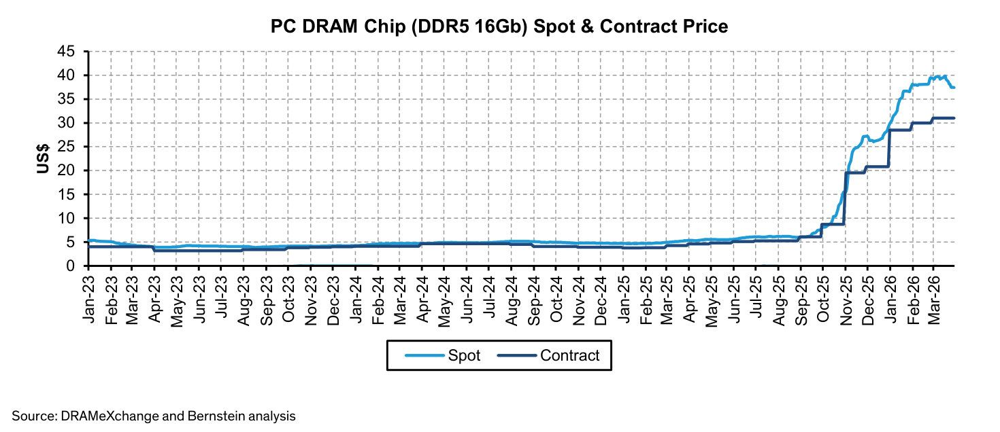

Chart title: PC DRAM Chip (DDR5 16Gb) Spot & Contract Price
Y-axis: US$ (0–45); X-axis: Jan-23 to Mar-26
Legend: Spot, Contract

Source: DRAMeXchange and Bernstein analysis

**图表2：NAND晶圆合约价格在3月继续保持强劲的环比增长。**

现货价（美元/GB）：

| NAND | 产品 | 2026年1月 | Feb-26 | 2026年3月 | MoM 2026年1月 | MoM Feb-26 | MoM 2026年3月 | 4QCY25 | 2026年第一季度 QTD | QoQ |
|---|---|---|---|---|---|---|---|---|---|---|
| NAND晶圆 | 1Tb 3D TLC/QLC | 0.152 | 0.168 | 0.212 | 17.0% | 10.5% | 26.1% | 0.080 | 0.177 | 122.9% |
| NAND晶圆 | 512Gb 3D TLC | 0.255 | 0.280 | 0.346 | 24.9% | 10.1% | 23.5% | 0.118 | 0.294 | 148.6% |

合约价（美元/GB）：

| NAND | 产品 | prior价 2025年第三季度 | prior价 4QCY25 | QoQ | 1QCY26价格 2026年1月 | 1QCY26价格 Feb-26 | 1QCY26价格 2026年3月 | 2026年第一季度vs2025年第四季度 2026年1月 | 2026年第一季度vs2025年第四季度 Feb-26 | 2026年第一季度vs2025年第四季度 2026年3月 |
|---|---|---|---|---|---|---|---|---|---|---|
| NAND晶圆 | 1Tb 3D QLC | 0.045 | 0.091 | 102.2% | 0.161 | 0.188 | 0.225 | 76.1% | 105.7% | 145.9% |
| NAND晶圆 | 1Tb 3D TLC | 0.047 | 0.099 | 113.2% | 0.170 | 0.196 | 0.227 | 70.6% | 97.1% | 128.1% |
| NAND晶圆 | 512Gb 3D TLC | 0.053 | 0.134 | 154.8% | 0.252 | 0.312 | 0.370 | 88.0% | 132.7% | 175.9% |
| eMMC/UFS* | 512GB UFS | 0.064 | 0.067 | 4.1% | 0.132 |  |  | 97.2% |  |  |
| eMMC/UFS* | 256GB UFS | 0.063 | 0.068 | 7.8% | 0.131 |  |  | 91.9% |  |  |
| eMMC/UFS* | 128GB TLC eMMC | 0.061 | 0.067 | 9.1% | 0.131 |  |  | 97.3% |  |  |
| 加权平均 |  | 0.054 | 0.092 | 70.0% | 0.169 | 0.192 | 0.217 | 84.0% | 108.7% | 136.0% |

Bernstein预估（混合ASP，含eSSD）****：

| 公司 | prior价 2025年第三季度 | prior价 4QCY25 | QoQ | 1QCY26价格 | 2026年第一季度vs2025年第四季度 |
|---|---|---|---|---|---|
| Samsung | 0.067 | 0.083 | 24.0% | 0.157 | 90.0% |
| SK海力士 | 0.078 | 0.104 | 32.6% | 0.176 | 70.0% |
| 美光** | 0.069 | 0.079 | 14.5% | 0.150 | 90.0% |
| 铠侠 | 0.047 | 0.052 | 12.0% | 0.094 | 80.0% |
| SanDisk | 0.077 | 0.101 | 30.4% | 0.154 | 53.0% |
| 加权平均 | 0.066 | 0.081 | 23.5% | 0.145 | 78.5% |

*：eMMC（嵌入式多媒体卡）是将NAND芯片与控制器封装在一起的标准。UFS（通用闪存存储）是eMMC的增强版。**：美光（Micron）的季度结束比我们早一个月。***：我们的模型上次更新于2026年3月。

来源：DRAMeXchange、彭博（Bloomberg）、Bernstein估算及分析

**图表3：PC DDR5 DRAM芯片现货价格3月有所下跌，但仍显著高于合约价格。**

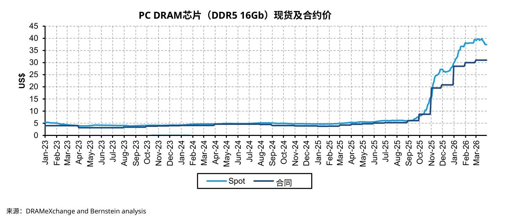

图表标题：PC DRAM芯片（DDR5 16Gb）现货及合约价
Y轴：US$（0–45）；X轴：Jan-23 至 Mar-26
图例：Spot、合同

来源：DRAMeXchange and Bernstein analysis

---

<!-- 原文第 8 页 -->

**EXHIBIT 4: PC DDR5 chip spot price started seeing some correction towards end of Mar.**

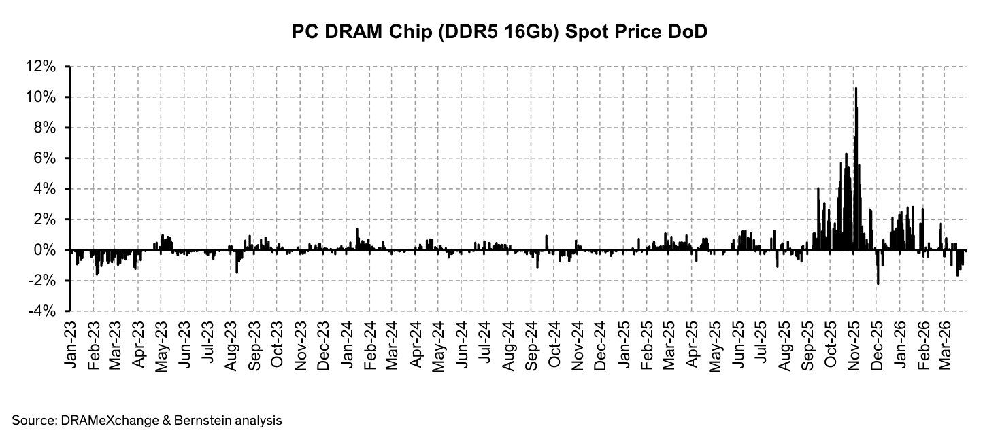

Chart title: PC DRAM Chip (DDR5 16Gb) Spot Price DoD
Y-axis: % (-4% to 12%); X-axis: Jan-23 to Mar-26
Legend: none

Source: DRAMeXchange & Bernstein analysis

**EXHIBIT 5: PC DDR4 chip spot price remained growing in Mar.**

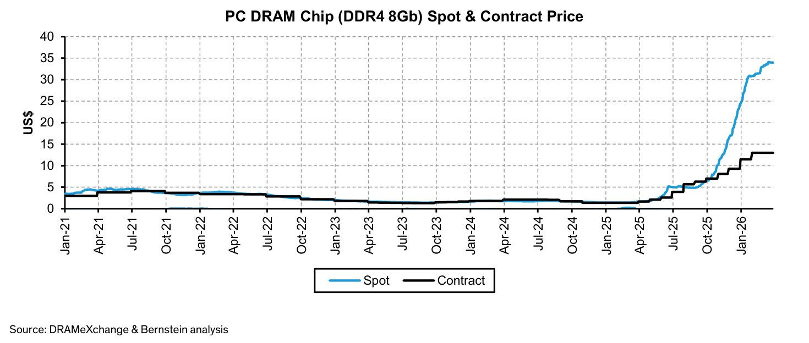

Chart title: PC DRAM Chip (DDR4 8Gb) Spot & Contract Price
Y-axis: US$ (0–40); X-axis: Jan-21 to Jan-26 (quarterly ticks)
Legend: Spot, Contract

Source: DRAMeXchange & Bernstein analysis

**EXHIBIT 4: PC DDR5芯片现货价在3月末开始出现一定回调。**

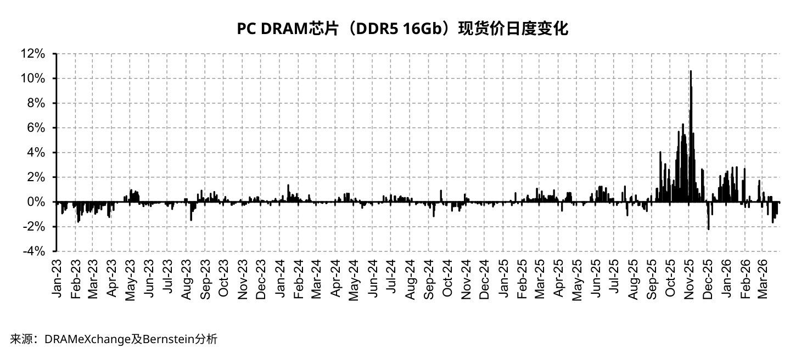

图表标题：PC DRAM芯片（DDR5 16Gb）现货价日度变化
Y轴：%（-4% 至 12%）；X轴：Jan-23 至 Mar-26
图例：无

来源：DRAMeXchange及Bernstein分析

**图表5：PC DDR4芯片现货价格在3月持续上涨。**

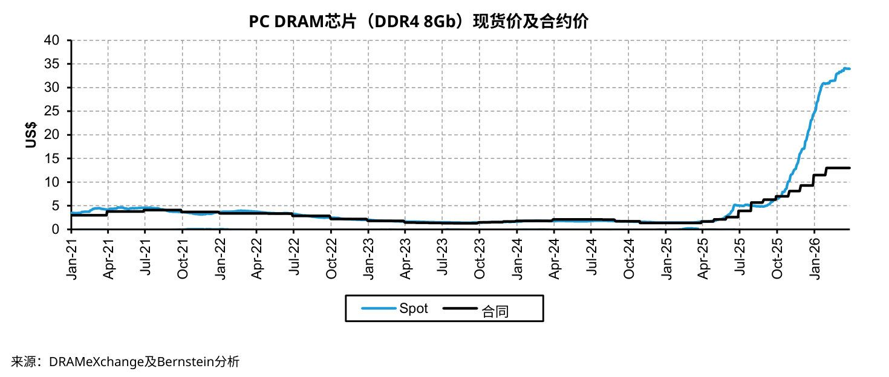

图表标题：PC DRAM芯片（DDR4 8Gb）现货价及合约价
Y轴：US$（0–40）；X轴：Jan-21 至 Jan-26（按季度标注）
图例：Spot、合同

来源：DRAMeXchange及Bernstein分析

---

<!-- 原文第 9 页 -->

**EXHIBIT 6: PC DDR4 spot price growth momentum also showed some slow down in late Mar.**

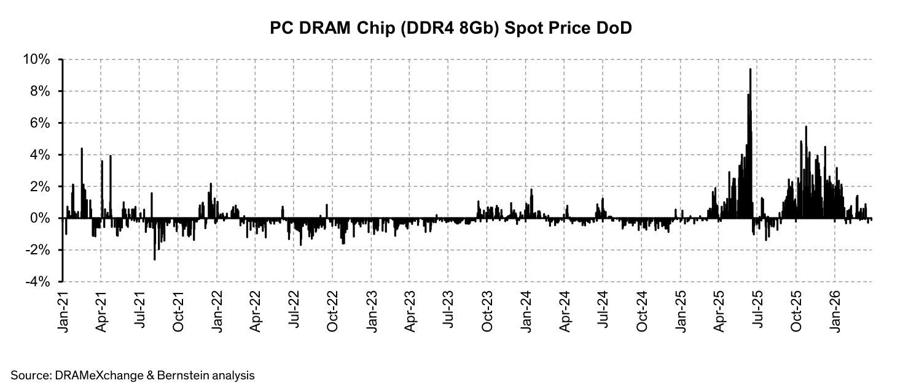

Chart title: PC DRAM Chip (DDR4 8Gb) Spot Price DoD
Y-axis: % (-4% to 10%); X-axis: Jan-21 to Jan-26 (quarterly ticks)
Legend: none

Source: DRAMeXchange & Bernstein analysis

**EXHIBIT 7: PC DDR5 module contract price was largely flattish in Mar as most contract negotiations had been completed in previous months.**

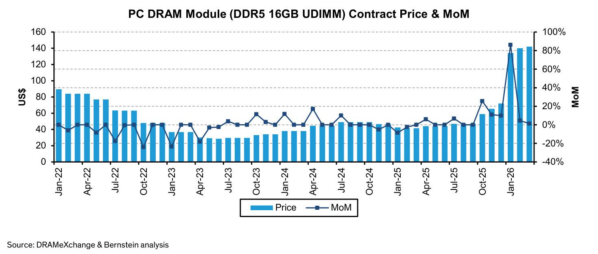

Chart title: PC DRAM Module (DDR5 16GB UDIMM) Contract Price & MoM
Y-axis: US$ (0–160, left); MoM (-40% to 100%, right); X-axis: Jan-22 to Jan-26 (quarterly ticks)
Legend: Price, MoM

Source: DRAMeXchange & Bernstein analysis

**EXHIBIT 6: PC DDR4现货价格增长势头在3月末也有所放缓。**

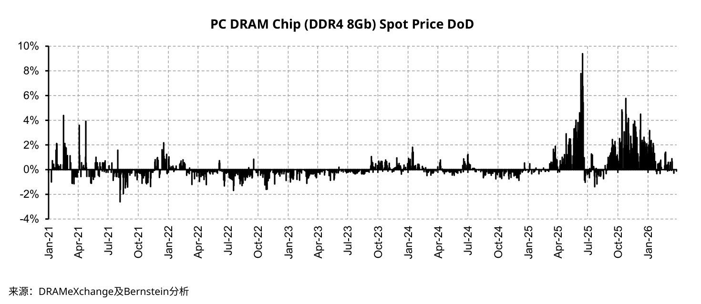

图表标题：PC DRAM Chip (DDR4 8Gb) Spot Price DoD
Y轴：%（-4% 至 10%）；X轴：Jan-21 至 Jan-26（按季度标注）
图例：无

来源：DRAMeXchange及Bernstein分析

**图表7：PC DDR5模块合约价在3月份基本持平，因为大部分合约谈判已在前几个月完成。**

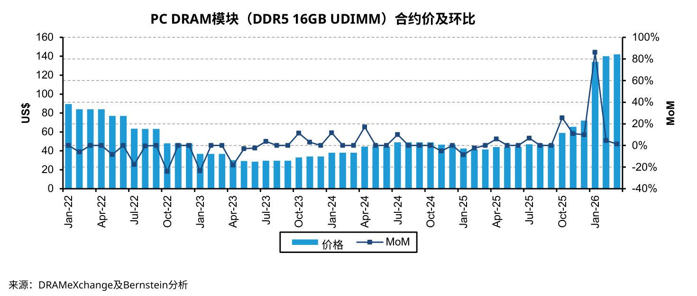

图表标题：PC DRAM模块（DDR5 16GB UDIMM）合约价及环比
Y轴：US$（0–160，左）；MoM（-40% 至 100%，右）；X轴：Jan-22 至 Jan-26（按季度标注）
图例：价格、MoM

来源：DRAMeXchange及Bernstein分析

---

<!-- 原文第 10 页 -->

**EXHIBIT 8: PC DDR4 module contract price was unchanged for 8GB...**

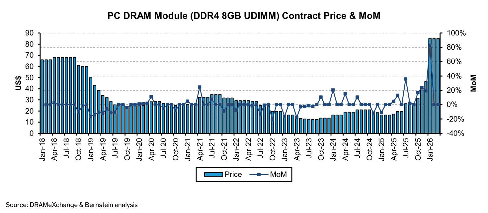

Chart title: PC DRAM Module (DDR4 8GB UDIMM) Contract Price & MoM
Y-axis: US$ (0–90, left); MoM (-40% to 100%, right); X-axis: Jan-18 to Jan-26 (quarterly ticks)
Legend: Price, MoM

Source: DRAMeXchange & Bernstein analysis

**EXHIBIT 9: ...while 16GB modules saw some minor growth in Mar.**

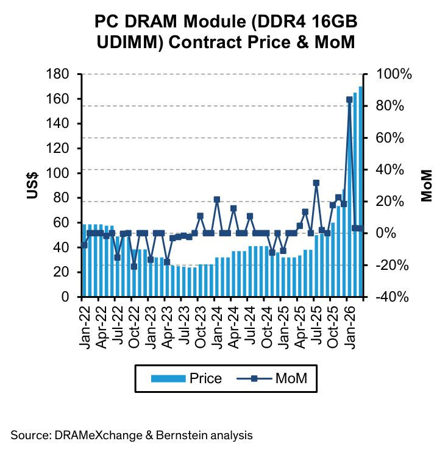

Chart title: PC DRAM Module (DDR4 16GB UDIMM) Contract Price & MoM
Y-axis: US$ (0–180, left); MoM (-40% to 100%, right); X-axis: Jan-22 to Jan-26 (quarterly ticks)
Legend: Price, MoM

Source: DRAMeXchange & Bernstein analysis

**EXHIBIT 10: PC DDR5 price discount vs. DDR4 was stable at 16%.**

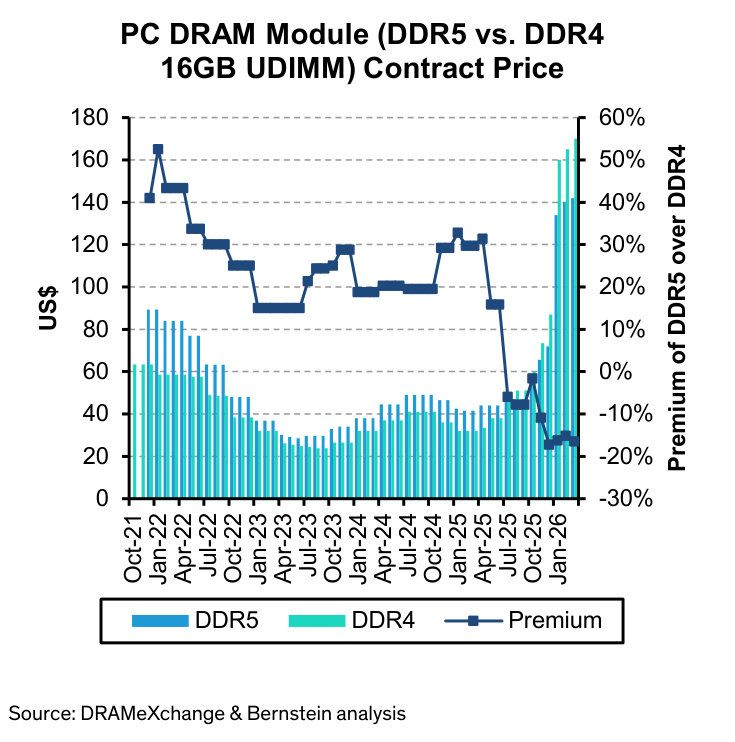

Chart title: PC DRAM Module (DDR5 vs. DDR4 16GB UDIMM) Contract Price
Y-axis: US$ (0–180, left); Premium of DDR5 over DDR4 (-30% to 60%, right); X-axis: Oct-21 to Jan-26 (quarterly ticks)
Legend: DDR5, DDR4, Premium

Source: DRAMeXchange & Bernstein analysis

**图表8：PC DDR4 module contract price was unchanged for 8GB...**

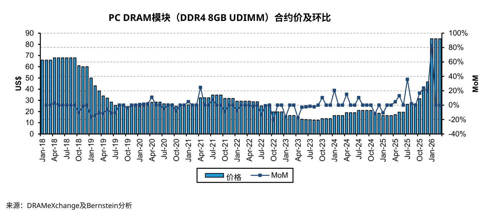

图表标题：PC DRAM模块（DDR4 8GB UDIMM）合约价及环比
Y轴：US$（0–90，左）；MoM（-40% 至 100%，右）；X轴：Jan-18 至 Jan-26（按季度标注）
图例：价格、MoM

来源：DRAMeXchange及Bernstein分析

**EXHIBIT 9: …而16GB模块3月略有增长。**

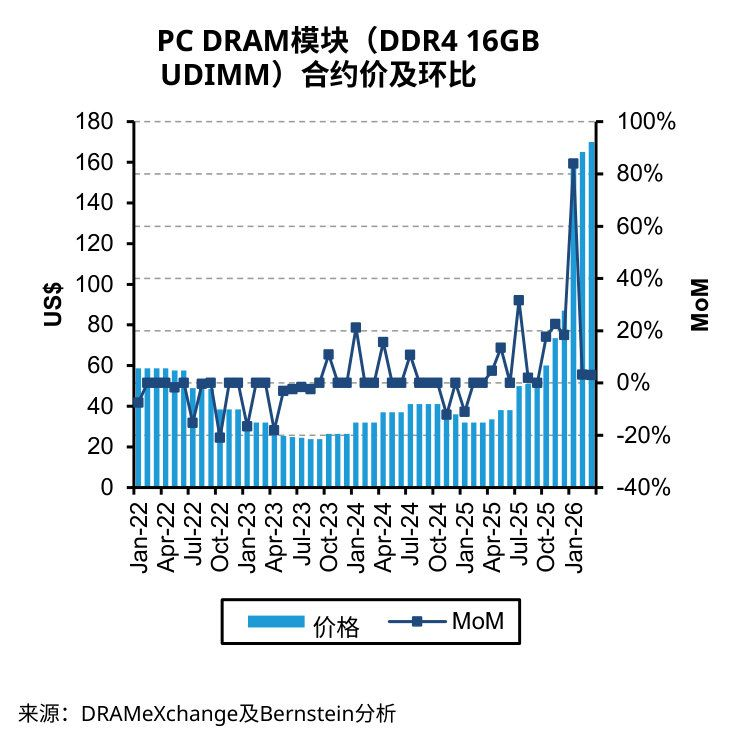

图表标题：PC DRAM模块（DDR4 16GB UDIMM）合约价及环比
Y轴：US$（0–180，左）；MoM（-40% 至 100%，右）；X轴：Jan-22 至 Jan-26（按季度标注）
图例：价格、MoM

来源：DRAMeXchange及Bernstein分析

**EXHIBIT 10: PC DDR5价格较DDR4的折扣稳定在16%。**

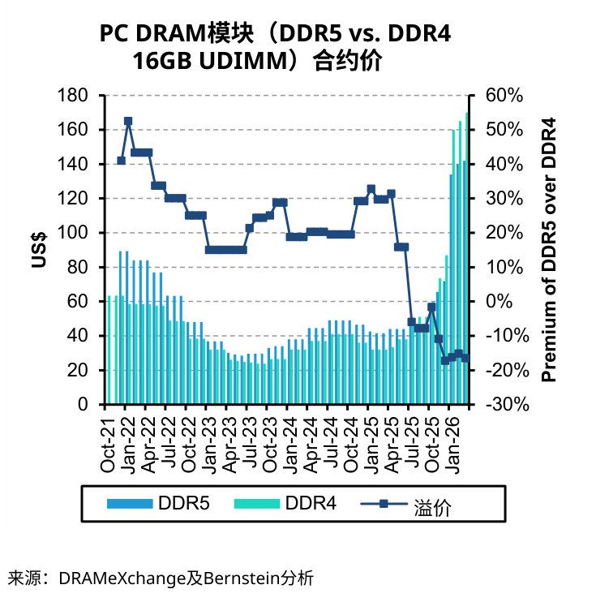

图表标题：PC DRAM模块（DDR5 vs. DDR4 16GB UDIMM）合约价
Y轴：US$（0–180，左）；Premium of DDR5 over DDR4（-30% 至 60%，右）；X轴：Oct-21 至 Jan-26（按季度标注）
图例：DDR5、DDR4、溢价

来源：DRAMeXchange及Bernstein分析

---

<!-- 原文第 11 页 -->

**EXHIBIT 11: Server DDR5 module spot price increase continued in Mar after brief pause in Feb.**

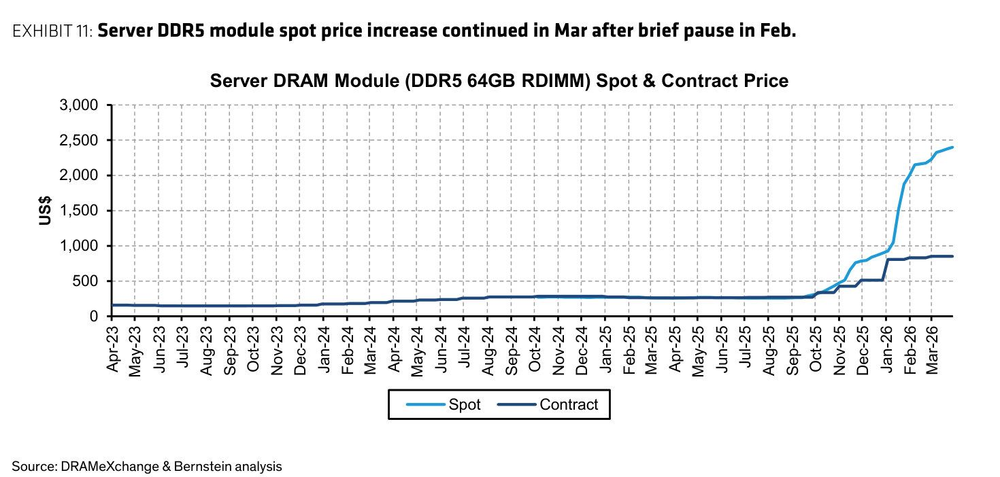

- 标题：Server DRAM Module (DDR5 64GB RDIMM) Spot & Contract Price｜Y 轴：US$（0–3,000）｜X 轴：Apr-23–Mar-26（月度）｜图例：Spot / Contract
- 来源：DRAMeXchange & Bernstein analysis

**EXHIBIT 12: Server DDR4 spot price increase accelerated significantly in Mar.**

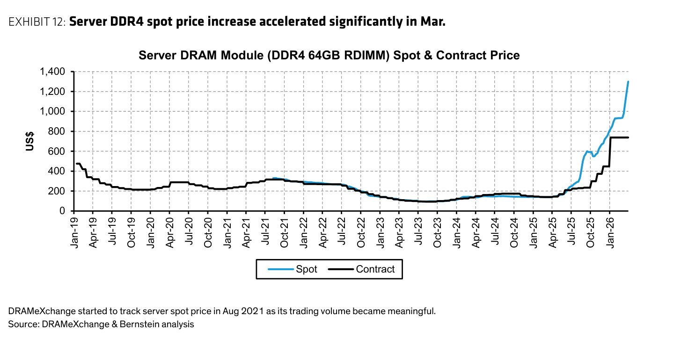

- 标题：Server DRAM Module (DDR4 64GB RDIMM) Spot & Contract Price｜Y 轴：US$（0–1,400）｜X 轴：Jan-19–Jan-26（月度）｜图例：Spot / Contract
- DRAMeXchange started to track server spot price in Aug 2021 as its trading volume became meaningful.
- 来源：DRAMeXchange & Bernstein analysis

**EXHIBIT 11: 服务器DDR5模块现货价在2月短暂停顿后，3月继续上涨。**

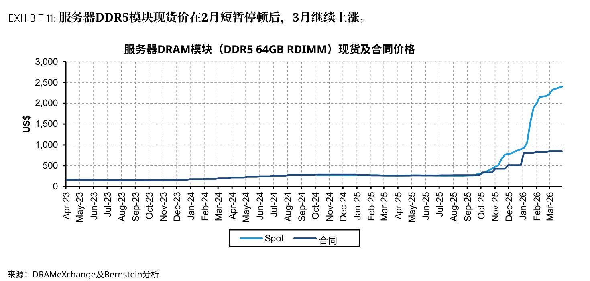

- 标题：服务器DRAM模块（DDR5 64GB RDIMM）现货及合同价格｜Y 轴：US$（0–3,000）｜X 轴：Apr-23–Mar-26（月度）｜图例：Spot / 合同
- 来源：DRAMeXchange及Bernstein分析

**EXHIBIT 12: 3月服务器DDR4现货价格涨幅显著加快。**

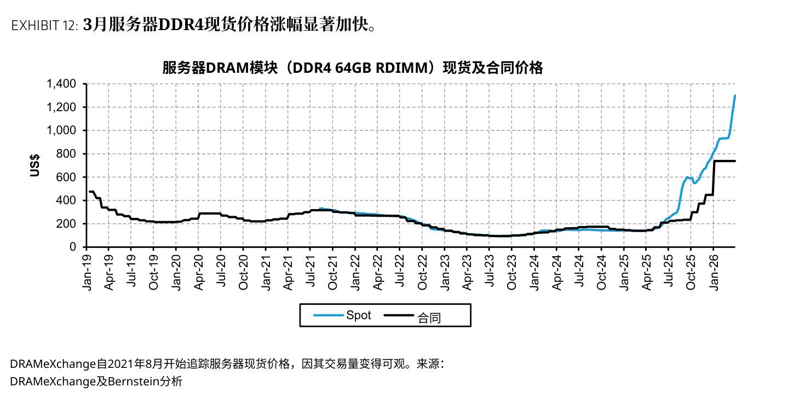

- 标题：服务器DRAM模块（DDR4 64GB RDIMM）现货及合同价格｜Y 轴：US$（0–1,400）｜X 轴：Jan-19–Jan-26（月度）｜图例：Spot / 合同
- DRAMeXchange自2021年8月开始追踪服务器现货价格，因其交易量变得可观。来源：DRAMeXchange及Bernstein分析

---

<!-- 原文第 12 页 -->

**EXHIBIT 13: As most of 1Q26 contracts had been set in previous months, Mar server DDR5 module contract price was up only slightly.**

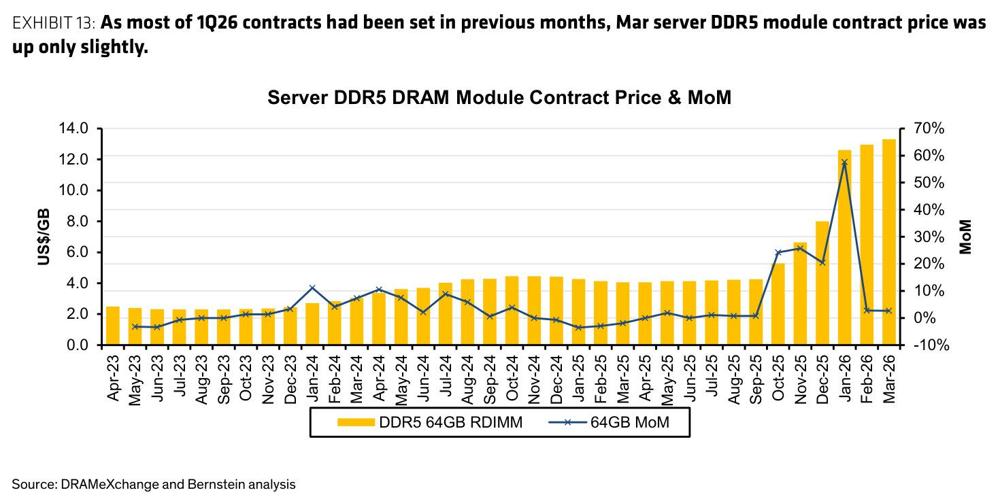

- 标题：Server DDR5 DRAM Module Contract Price & MoM｜左 Y 轴：US$/GB（0.0–14.0）｜右 Y 轴：MoM（-10%–70%）｜X 轴：Apr-23–Mar-26（月度）｜图例：DDR5 64GB RDIMM / 64GB MoM
- 来源：DRAMeXchange and Bernstein analysis

**EXHIBIT 14: Server DDR4 module contract price was unchanged in Mar MoM.**

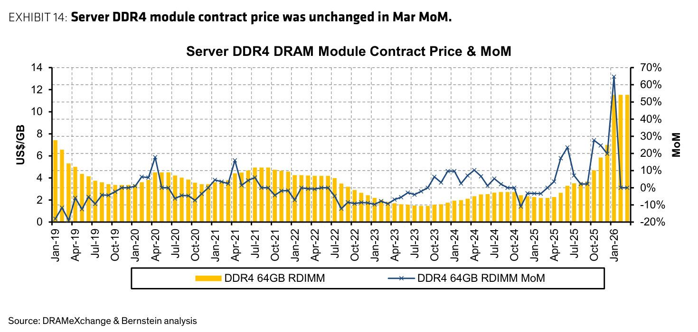

- 标题：Server DDR4 DRAM Module Contract Price & MoM｜左 Y 轴：US$/GB（0–14）｜右 Y 轴：MoM（-20%–70%）｜X 轴：Jan-19–Jan-26（月度）｜图例：DDR4 64GB RDIMM / DDR4 64GB RDIMM MoM
- 来源：DRAMeXchange & Bernstein analysis

**EXHIBIT 13: 由于2026年第一季度的大部分合约已在前几个月敲定，3月服务器DDR5模块合约价仅小幅上涨。**

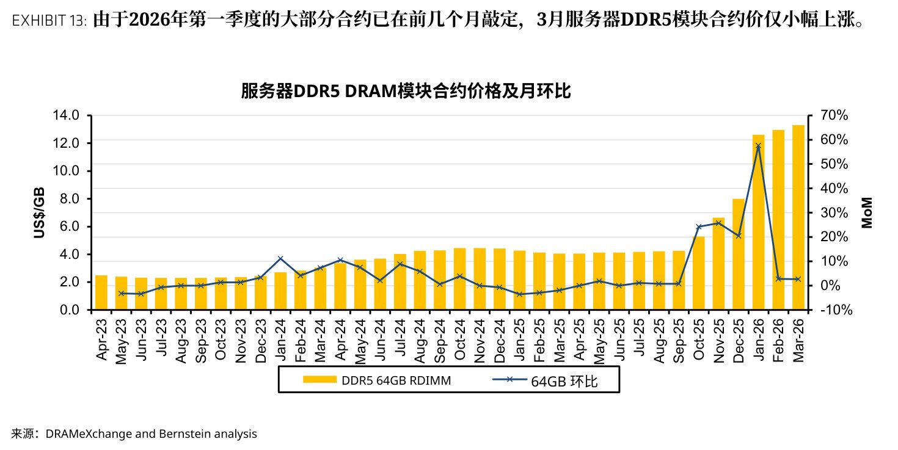

- 标题：服务器DDR5 DRAM模块合约价格及月环比｜左 Y 轴：US$/GB（0.0–14.0）｜右 Y 轴：MoM（-10%–70%）｜X 轴：Apr-23–Mar-26（月度）｜图例：DDR5 64GB RDIMM / 64GB 环比
- 来源：DRAMeXchange and Bernstein analysis

**图表14：服务器DDR4模块合约价格在3月环比持平。**

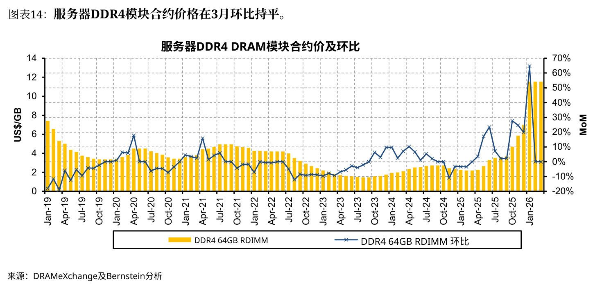

- 标题：服务器DDR4 DRAM模块合约价及环比｜左 Y 轴：US$/GB（0–14）｜右 Y 轴：MoM（-20%–70%）｜X 轴：Jan-19–Jan-26（月度）｜图例：DDR4 64GB RDIMM / DDR4 64GB RDIMM 环比
- 来源：DRAMeXchange及Bernstein分析

---

<!-- 原文第 13 页 -->

**EXHIBIT 15: Server DDR5 premium over DDR4 rose slightly to 15%.**

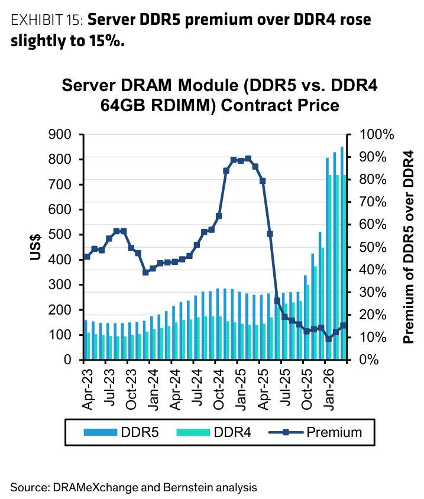

- 标题：Server DRAM Module (DDR5 vs. DDR4 64GB RDIMM) Contract Price｜左 Y 轴：US$（0–900）｜右 Y 轴：Premium of DDR5 over DDR4（0%–100%）｜X 轴：Apr-23–Jan-26｜图例：DDR5 / DDR4 / Premium
- 来源：DRAMeXchange and Bernstein analysis

**EXHIBIT 16: LPDDR5 contract price was estimated to surge by 90% QoQ.**

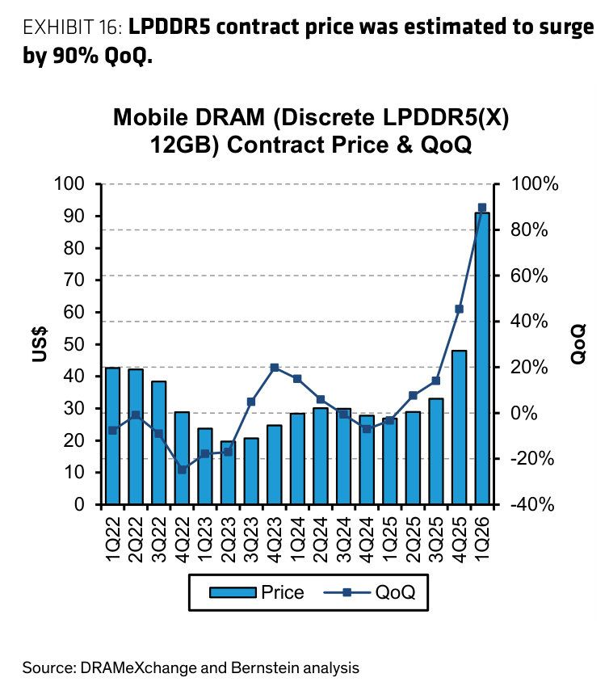

- 标题：Mobile DRAM (Discrete LPDDR5(X) 12GB) Contract Price & QoQ｜左 Y 轴：US$（0–100）｜右 Y 轴：QoQ（-40%–100%）｜X 轴：1Q22–1Q26（季度）｜图例：Price / QoQ
- 来源：DRAMeXchange and Bernstein analysis

**EXHIBIT 17: LPDDR4 price is expected to grow at similar paces.**

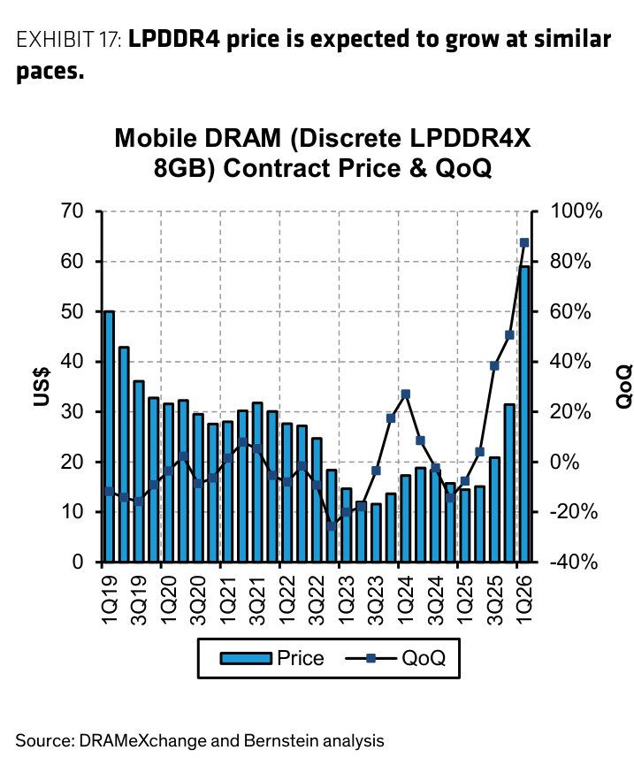

- 标题：Mobile DRAM (Discrete LPDDR4X 8GB) Contract Price & QoQ｜左 Y 轴：US$（0–70）｜右 Y 轴：QoQ（-40%–100%）｜X 轴：1Q19–1Q26（季度）｜图例：Price / QoQ
- 来源：DRAMeXchange and Bernstein analysis

**EXHIBIT 18: The price of low-end eMCP packages is also estimated to rise by 84%, similar to overall mobile DRAM.**

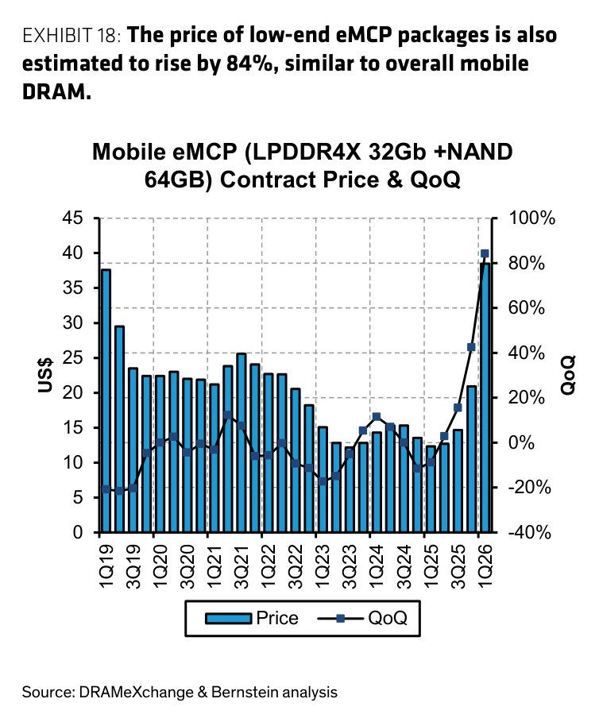

- 标题：Mobile eMCP (LPDDR4X 32Gb +NAND 64GB) Contract Price & QoQ｜左 Y 轴：US$（0–45）｜右 Y 轴：QoQ（-40%–100%）｜X 轴：1Q19–1Q26（季度）｜图例：Price / QoQ
- 来源：DRAMeXchange & Bernstein analysis

**EXHIBIT 15: 服务器DDR5较DDR4的溢价小幅上升至15%。**

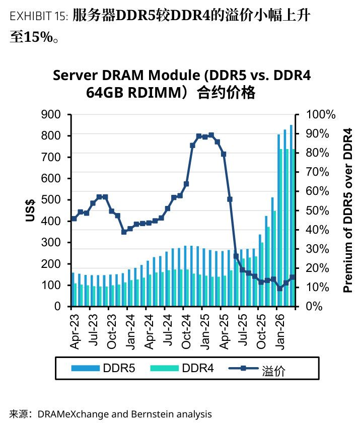

- 标题：Server DRAM Module (DDR5 vs. DDR4 64GB RDIMM）合约价格｜左 Y 轴：US$（0–900）｜右 Y 轴：Premium of DDR5 over DDR4（0%–100%）｜X 轴：Apr-23–Jan-26｜图例：DDR5 / DDR4 / 溢价
- 来源：DRAMeXchange and Bernstein analysis

**图表16：LPDDR5合约价格预计环比飙升90%。**

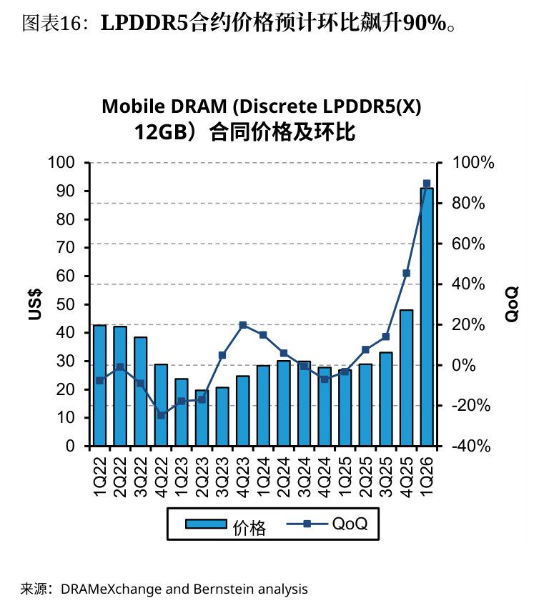

- 标题：Mobile DRAM (Discrete LPDDR5(X) 12GB）合同价格及环比｜左 Y 轴：US$（0–100）｜右 Y 轴：QoQ（-40%–100%）｜X 轴：1Q22–1Q26（季度）｜图例：价格 / QoQ
- 来源：DRAMeXchange and Bernstein analysis

**EXHIBIT 17: LPDDR4价格预计将以类似速度增长。**

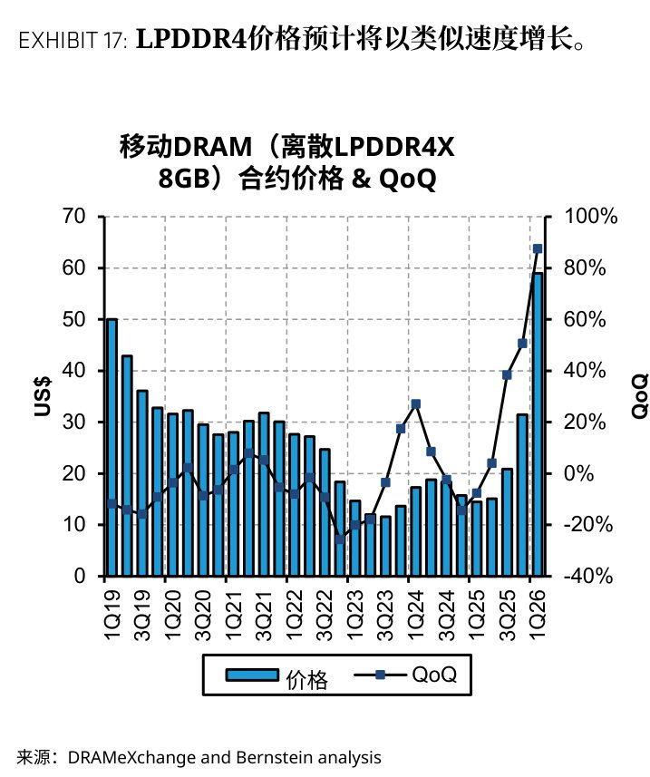

- 标题：移动DRAM（离散LPDDR4X 8GB）合约价格 & QoQ｜左 Y 轴：US$（0–70）｜右 Y 轴：QoQ（-40%–100%）｜X 轴：1Q19–1Q26（季度）｜图例：价格 / QoQ
- 来源：DRAMeXchange and Bernstein analysis

**图表18：低端eMCP封装价格预计也将上涨84%，与整体移动DRAM价格走势相似。**

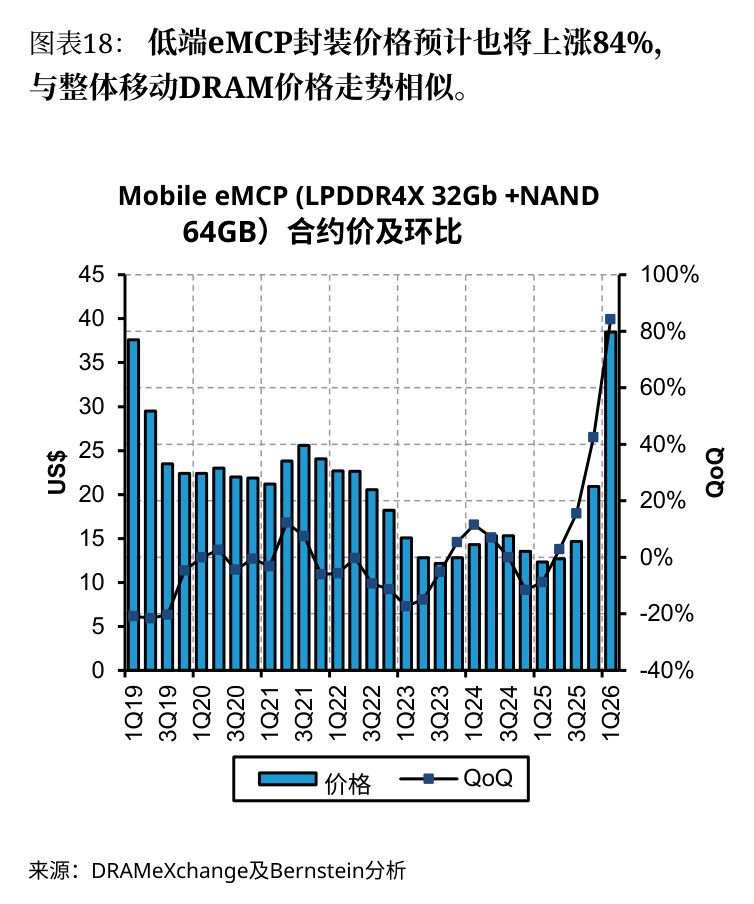

- 标题：Mobile eMCP (LPDDR4X 32Gb +NAND 64GB）合约价及环比｜左 Y 轴：US$（0–45）｜右 Y 轴：QoQ（-40%–100%）｜X 轴：1Q19–1Q26（季度）｜图例：价格 / QoQ
- 来源：DRAMeXchange及Bernstein分析

---

<!-- 原文第 14 页 -->

**EXHIBIT 19: Consumer DRAM contract price went up more in Mar by 25% led by Taiwanese suppliers.**

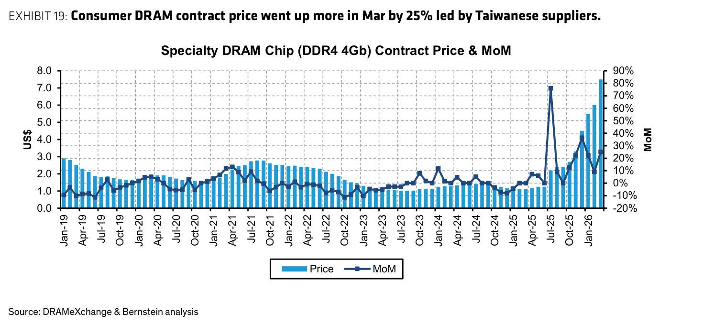

- 标题：Specialty DRAM Chip (DDR4 4Gb) Contract Price & MoM｜左 Y 轴：US$（0.0–8.0）｜右 Y 轴：MoM（-20%–90%）｜X 轴：Jan-19–Jan-26（月度）｜图例：Price / MoM
- 来源：DRAMeXchange & Bernstein analysis

**EXHIBIT 20: NAND 512Gb spot price increase accelerated in Mar despite some correction towards month end.**

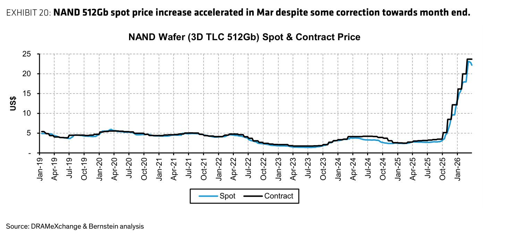

- 标题：NAND Wafer (3D TLC 512Gb) Spot & Contract Price｜Y 轴：US$（刻度：-、5、10、15、20、25）｜X 轴：Jan-19–Jan-26（月度）｜图例：Spot / Contract
- 来源：DRAMeXchange & Bernstein analysis

**EXHIBIT 19: 2026年3月消费级DRAM合约价涨幅扩大至25%，由台湾供应商引领。**

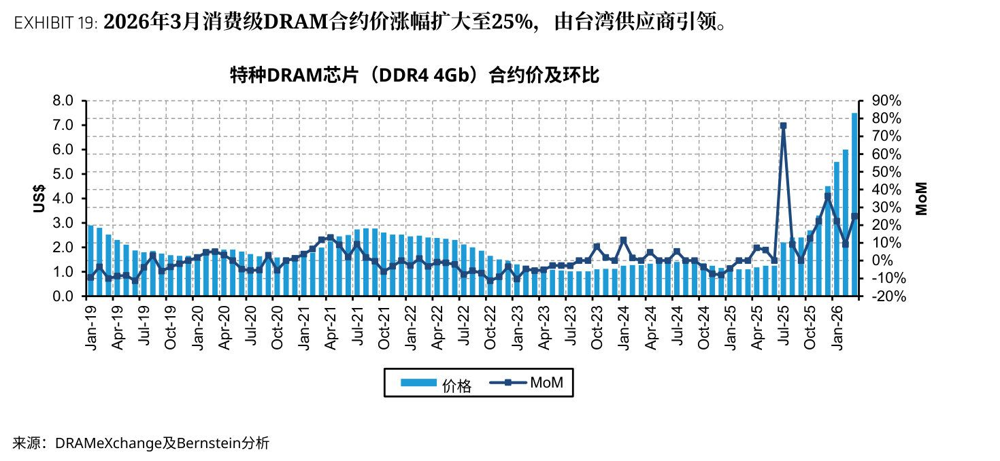

- 标题：特种DRAM芯片（DDR4 4Gb）合约价及环比｜左 Y 轴：US$（0.0–8.0）｜右 Y 轴：MoM（-20%–90%）｜X 轴：Jan-19–Jan-26（月度）｜图例：价格 / MoM
- 来源：DRAMeXchange及Bernstein分析

**EXHIBIT 20: 3月NAND 512Gb现货价涨幅加快，尽管月末出现一定回调。**

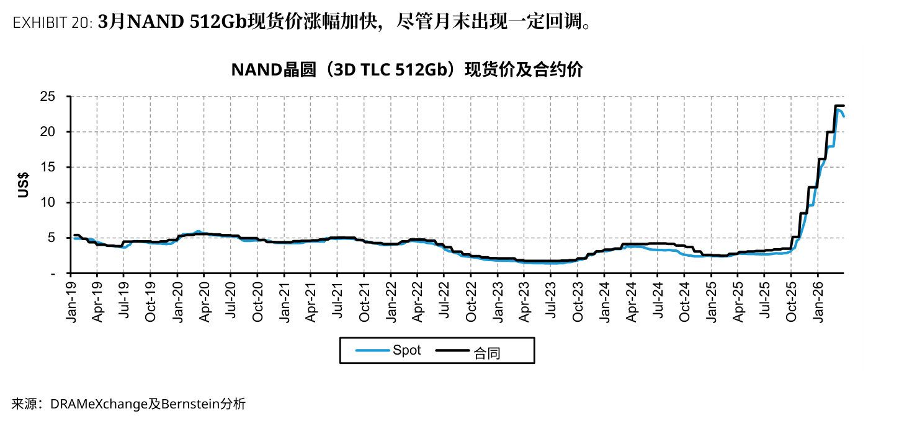

- 标题：NAND晶圆（3D TLC 512Gb）现货价及合约价｜Y 轴：US$（刻度：-、5、10、15、20、25）｜X 轴：Jan-19–Jan-26（月度）｜图例：Spot / 合同
- 来源：DRAMeXchange及Bernstein分析

---

<!-- 原文第 15 页 -->

**EXHIBIT 21: 1Tb wafer spot prices also rose rapidly in early Mar though dropped a bit towards month end.**

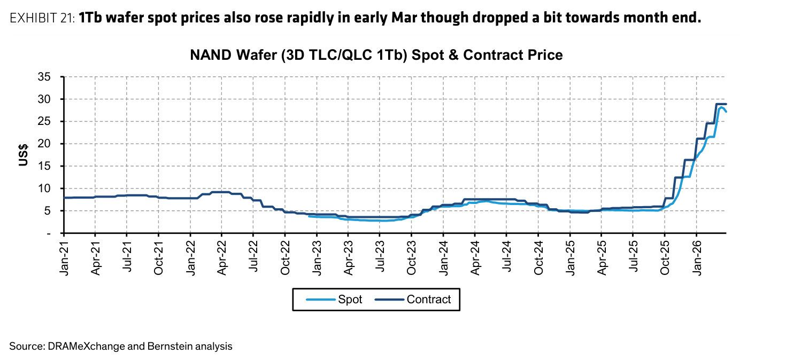

- 标题：NAND Wafer (3D TLC/QLC 1Tb) Spot & Contract Price｜Y 轴：US$（刻度：-、5、10、15、20、25、30、35）｜X 轴：Jan-21–Jan-26（月度）｜图例：Spot / Contract
- 来源：DRAMeXchange and Bernstein analysis

**EXHIBIT 22: TLC NAND wafer contract price was up another 16-19% MoM in Mar, primarily driven by scarce supply, even though module houses were getting more cautious on buying.**

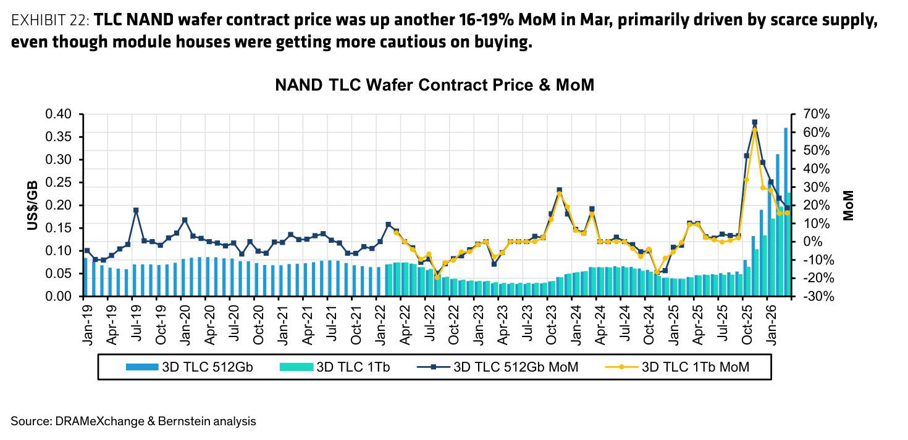

- 标题：NAND TLC Wafer Contract Price & MoM｜左 Y 轴：US$/GB（0.00–0.40）｜右 Y 轴：MoM（-30%–70%）｜X 轴：Jan-19–Jan-26（月度）｜图例：3D TLC 512Gb / 3D TLC 1Tb / 3D TLC 512Gb MoM / 3D TLC 1Tb MoM
- 来源：DRAMeXchange & Bernstein analysis

**图表21：1Tb晶圆现货价在3月初也快速上涨，尽管月末略有下跌。**

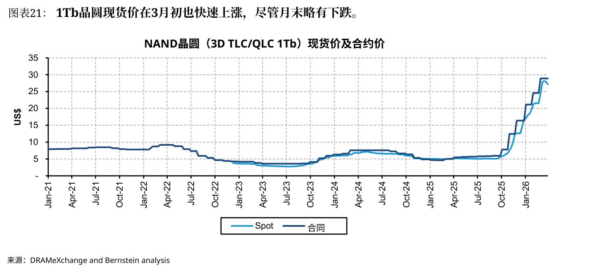

- 标题：NAND晶圆（3D TLC/QLC 1Tb）现货价及合约价｜Y 轴：US$（刻度：-、5、10、15、20、25、30、35）｜X 轴：Jan-21–Jan-26（月度）｜图例：Spot / 合同
- 来源：DRAMeXchange and Bernstein analysis

**EXHIBIT 22: 3月TLC NAND晶圆合同价格环比再上涨16-19%，主要受供应稀缺驱动，尽管模组厂商在采购上变得更加谨慎。**

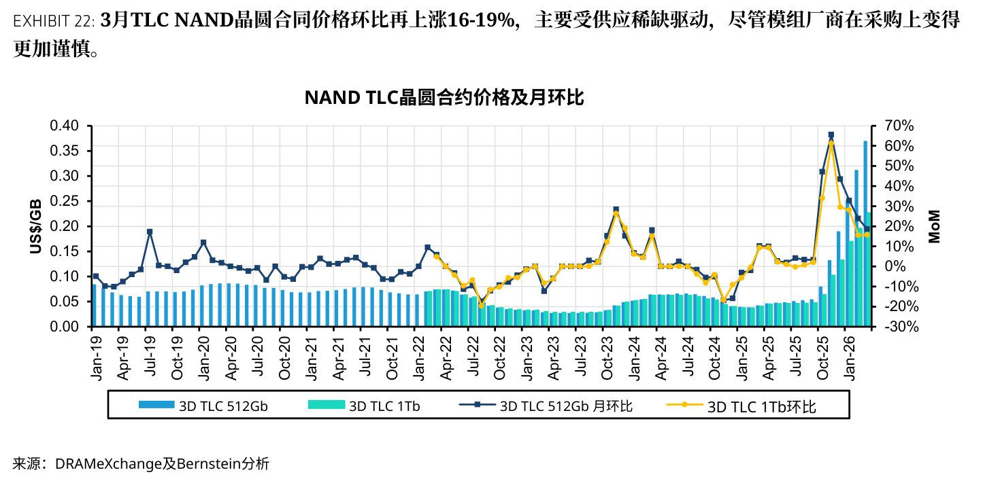

- 标题：NAND TLC晶圆合约价格及月环比｜左 Y 轴：US$/GB（0.00–0.40）｜右 Y 轴：MoM（-30%–70%）｜X 轴：Jan-19–Jan-26（月度）｜图例：3D TLC 512Gb / 3D TLC 1Tb / 3D TLC 512Gb 月环比 / 3D TLC 1Tb环比
- 来源：DRAMeXchange及Bernstein分析

---

<!-- 原文第 16 页 -->

**EXHIBIT 23: 1Tb QLC NAND wafer contract price increase accelerated to 20% MoM in Mar.**

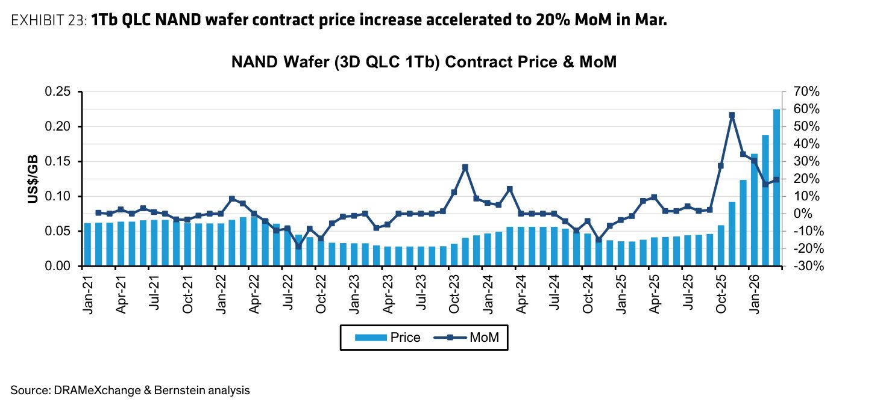

- 标题：NAND Wafer (3D QLC 1Tb) Contract Price & MoM｜左 Y 轴：US$/GB（0.00–0.25）｜右 Y 轴：MoM（-30%–70%）｜X 轴：Jan-21–Jan-26（月度）｜图例：Price / MoM
- 来源：DRAMeXchange & Bernstein analysis

**EXHIBIT 24: Mobile NAND contract price for 1QCY26 was revised to be up by close to 100% QoQ.**

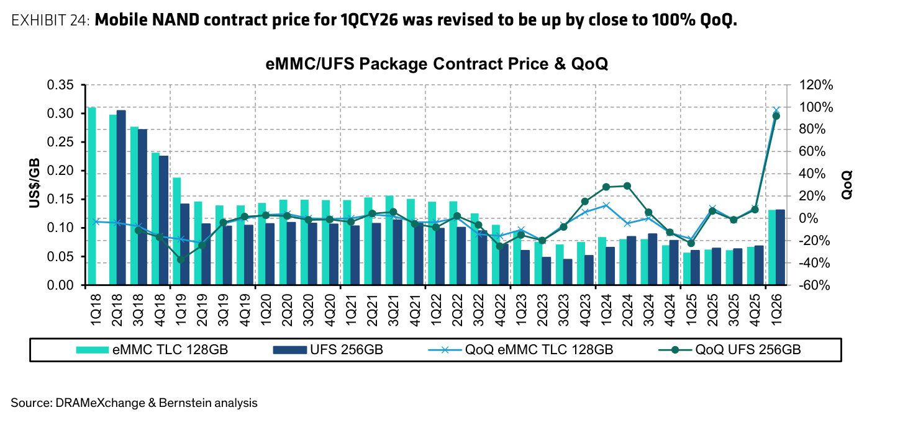

- 标题：eMMC/UFS Package Contract Price & QoQ｜左 Y 轴：US$/GB（0.00–0.35）｜右 Y 轴：QoQ（-60%–120%）｜X 轴：1Q18–1Q26（季度）｜图例：eMMC TLC 128GB / UFS 256GB / QoQ eMMC TLC 128GB / QoQ UFS 256GB
- 来源：DRAMeXchange & Bernstein analysis

**EXHIBIT 23: 3月1Tb QLC NAND晶圆合同价格涨幅加快至环比20%。**

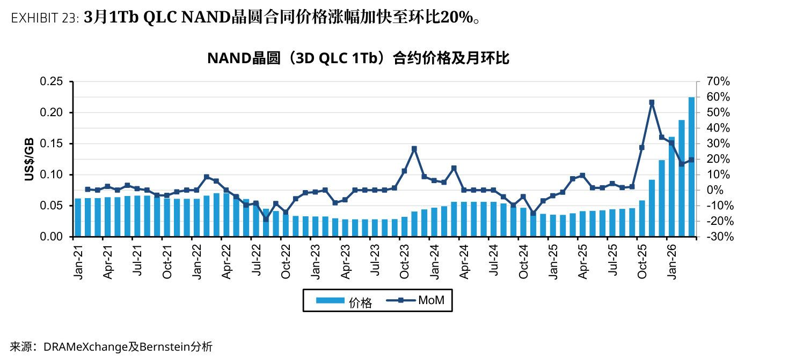

- 标题：NAND晶圆（3D QLC 1Tb）合约价格及月环比｜左 Y 轴：US$/GB（0.00–0.25）｜右 Y 轴：MoM（-30%–70%）｜X 轴：Jan-21–Jan-26（月度）｜图例：价格 / MoM
- 来源：DRAMeXchange及Bernstein分析

**EXHIBIT 24: 2026年第一季度移动NAND合约价环比上调近100%。**

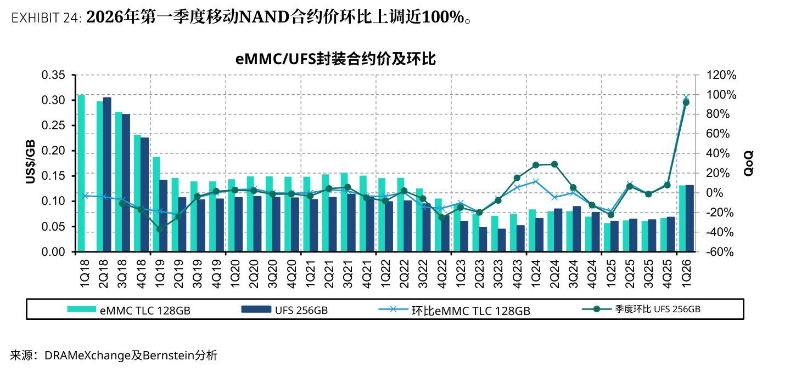

- 标题：eMMC/UFS封装合约价及环比｜左 Y 轴：US$/GB（0.00–0.35）｜右 Y 轴：QoQ（-60%–120%）｜X 轴：1Q18–1Q26（季度）｜图例：eMMC TLC 128GB / UFS 256GB / 环比eMMC TLC 128GB / 季度环比 UFS 256GB
- 来源：DRAMeXchange及Bernstein分析

---

<!-- 原文第 17 页 -->

**EXHIBIT 25: High-density 512GB UFS contract price is also expected to rise by ~100% in 1QCY26.**

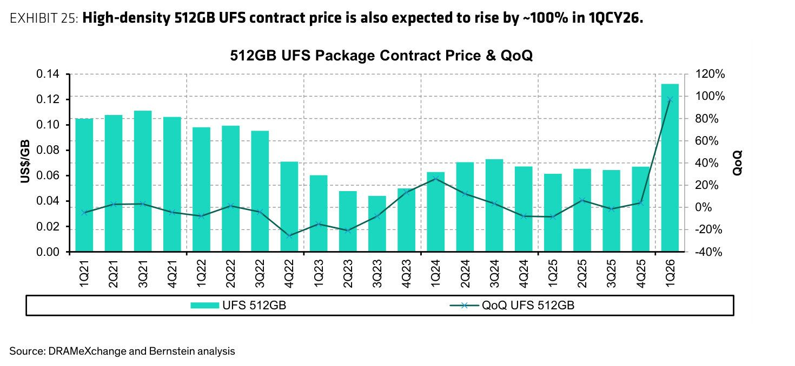

- 标题：512GB UFS Package Contract Price & QoQ｜左 Y 轴：US$/GB（0.00–0.14）｜右 Y 轴：QoQ（-40%–120%）｜X 轴：1Q21–1Q26（季度）｜图例：UFS 512GB / QoQ UFS 512GB
- 来源：DRAMeXchange and Bernstein analysis

**EXHIBIT 26: Our industry ASP is a weighted average of different products based on the size of their demand. We then further adjust it for HBM.**

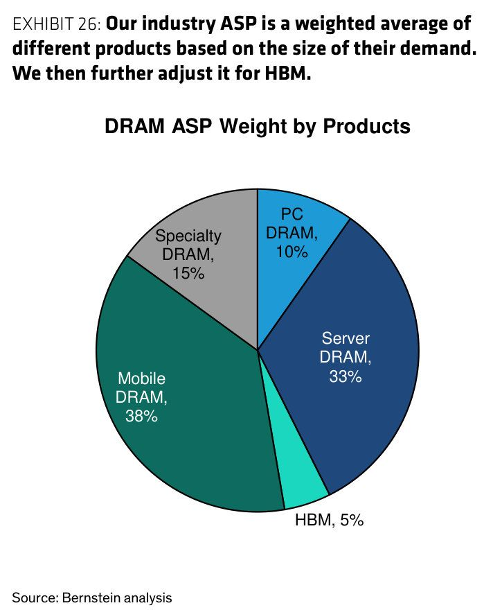

- 标题：DRAM ASP Weight by Products（饼图）｜标注：PC DRAM 10%、Server DRAM 33%、Mobile DRAM 38%、Specialty DRAM 15%、HBM 5%
- 来源：Bernstein analysis

**EXHIBIT 27: We allocate 40% & 60% to eMMC/UFS & wafer, respectively, to derive the industry NAND ASP. eSSD is then considered in addition.**

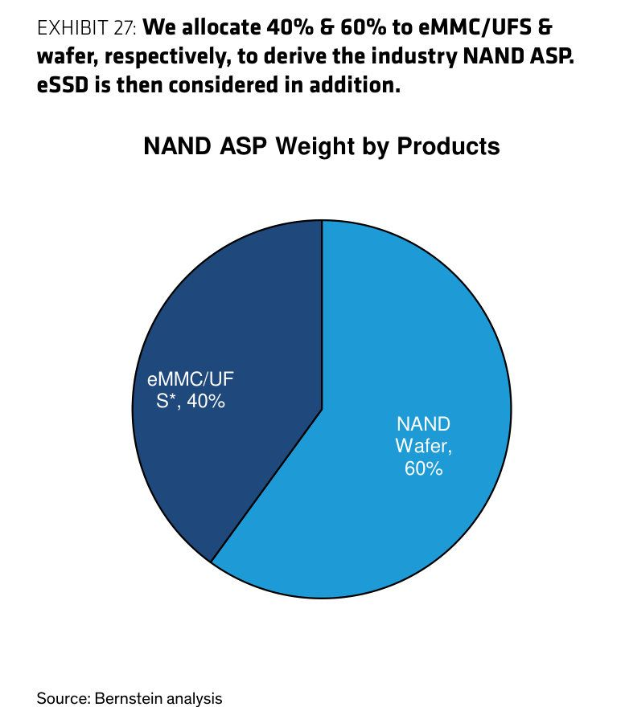

- 标题：NAND ASP Weight by Products（饼图）｜标注：eMMC/UFS*, 40%、NAND Wafer, 60%
- 来源：Bernstein analysis

## Further Reading Materials

- 19 Mar 2026 - Korea Memory Export Tracker (Feb): A recovery from Jan, esp. for SK hynix
- 19 Mar 2026 - Micron 2QFY26: Higher capex on higher demand visibility
- 18 Mar 2026 - Global Memory: Price increase more than expected in 2QCY26
- 17 Mar 2026 - Asia Semiconductors & Hardware: Stronger & longer - 2026 Tech Tour takeaways
- 13 Mar 2026 - Global Industrial Gases & Semis: Assessing the helium impact

**EXHIBIT 25: 高密度512GB UFS合约价预计在2026年第一季度也将上涨~100%。**

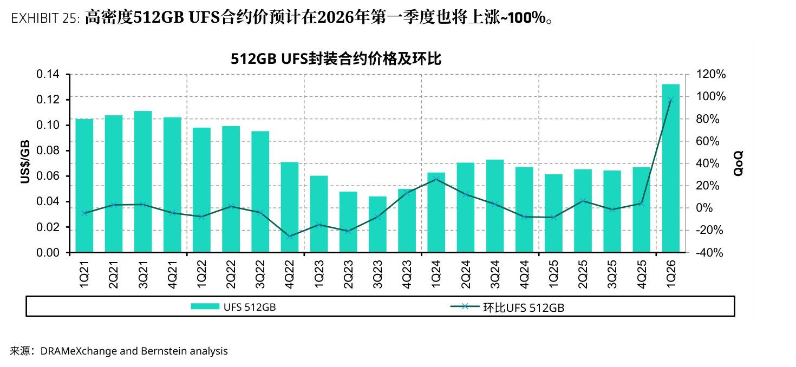

- 标题：512GB UFS封装合约价格及环比｜左 Y 轴：US$/GB（0.00–0.14）｜右 Y 轴：QoQ（-40%–120%）｜X 轴：1Q21–1Q26（季度）｜图例：UFS 512GB / 环比UFS 512GB
- 来源：DRAMeXchange and Bernstein analysis

**EXHIBIT 26: 我们的行业ASP是不同产品基于需求规模的加权平均值，之后我们会针对HBM进一步调整。**

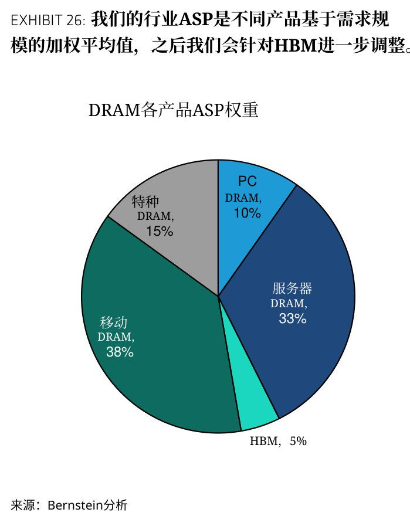

- 标题：DRAM各产品ASP权重（饼图）｜标注：PC DRAM 10%、服务器 DRAM 33%、移动 DRAM 38%、特种 DRAM 15%、HBM 5%
- 来源：Bernstein分析

**EXHIBIT 27: 我们分别为eMMC/UFS和晶圆分配40%和60%的权重，以得出行业NAND平均售价。eSSD将额外考虑。**

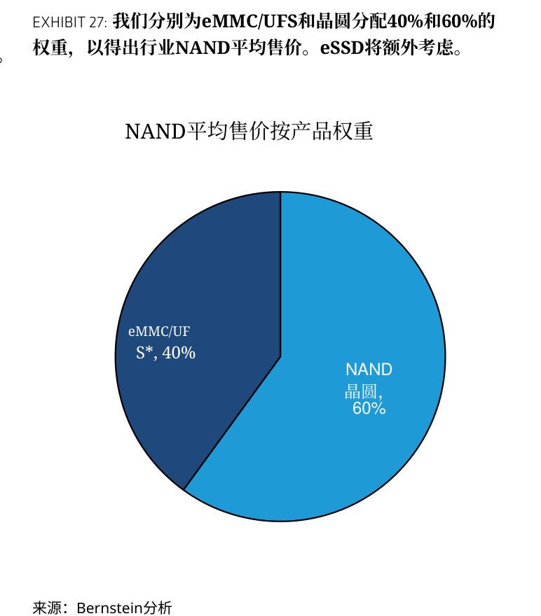

- 标题：NAND平均售价按产品权重（饼图）｜标注：eMMC/UFS*, 40%、NAND 晶圆 60%
- 来源：Bernstein分析

## 进一步阅读材料

- 19 2026年3月 - 韩国内存出口追踪（2月）：较1月有所恢复，尤其对SK海力士而言
- 19 2026年3月 - 美光2026财年第二季度：需求可见性提高导致资本支出增加
- 18 2026年3月 - 全球内存：2026年第二季度价格涨幅超预期
- 17 2026年3月 - 亚洲半导体与硬件：更强更持久——2026年技术考察心得
- 13 2026年3月 - 全球工业气体与半导体：评估氦气影响

---

<!-- 原文第 18 页 -->

- 12 Feb 2026 - KIOXIA 3QFY25: Finally hiking price on Apple too?
- 30 Jan 2026 - SanDisk FQ2'26: A significant beat and guide to usher in the Year of the Fire-Horse, Raising TP to $1000
- 29 Jan 2026 - Samsung 4Q25: 1cnm stable & flexibility to maximize profits
- 29 Jan 2026 - SK hynix 4Q25: As good as expected
- 27 Jan 2026 - AI Value Chain: Putting it all together - how much AI upside does each name really have, and who might be an underappreciated winner?
- 2 Jan 2026 - Asia Semiconductors & Global Memory: 2026 is still all about AI
- 11 Dec 2025 - Expert Insight: How much memory do AI Data Centers need?
- 8 Dec 2025 - 4Q25 AI Server Pulse: joining the OpenAI club to keep the party going?
- 24 Nov 2025 - Asian Semis & Global Memory: Two findings, one simulation & one model for AI
- 3 Nov 2025 - Global Semis: September 2025 WSTS Tracker - Sales up 14.0% MoM, better than typical (+8.0% MoM) & up 27.5% YoY
- 27 Oct 2025 - AI Value Chain: How much does a GW of data center capacity actually cost, and what goes into it?
- 1 Sep 2025 - Global Semicap and Memory - US revokes Samsung and SK hynix semicap license waivers for their China Fabs
- 21 Aug 2025 - KIOXIA: Decipher the complex JV with SanDisk
- 29 Jul 2025 - Samsung: Dimensioning the contribution of the Tesla project on Samsung & ASML
- 13 Jun 2025 - KIOXIA: The Last Samurai - initiating with Underperform
- 6 Dec 2024 - Global Memory: Decoupling in memory? A quantitative assessment
- 21 Nov 2024 - Global Memory: Will China/YMTC surprise us in NAND?
- 16 Sep 2024 - Global Memory: Is Samsung still the memory leader?
- 8 Jul 2024 - Global Semiconductors: AI semiconductor roadmap - 3 charts & 7 investment implications
- 25 Jun 2024 - China AI & Asia Semis: Edge AI - a conversation with a Director of AI Solutions of a Chinese leading phone OEM (takeaways + transcript)
- 1 Jun 2023 - 10 FAQs on Investing in Semiconductors for Generative AI
- 4 Mar 2022 - Global Memory: Cornerstone of the Data Economy
- 25 Oct 2021 | Global Memory: The cornerstone of the data economy but painful cyclicality - Initiating with Underperform

- 12 2026年2月 - KIOXIA 3QFY25：终于也要给Apple提价了？
- 30 2026年1月 - 闪迪2026财年第二季度：业绩大幅超预期，指引预示火马年到来，目标价上调至1000美元
- 29 2026年1月 - 三星2025年第四季度：1cnm稳定且灵活最大化利润
- 29 2026年1月 - SK海力士2025年第四季度：符合预期
- 27 2026年1月 - AI价值链：整合所有要素——每个标的实际有多少AI上行空间，以及谁可能是被低估的赢家？
- 2 2026年1月 - 亚洲半导体与全球内存：2026年仍以AI为核心
- 11 2025年12月 - 专家洞察：AI数据中心需要多少内存？
- 8 2025年12月 - 2025年第四季度AI服务器动态：加入OpenAI俱乐部以维持增长势头？
- 24 2025年11月 - 亚洲半导体与全球内存：两项发现、一次模拟及一个AI模型
- 3 2025年11月 - 全球半导体：2025年9月WSTS tracker——销售额环比增长14.0%，好于通常（+80%环比）且同比增长27.5%
- 27 2025年10月 - 人工智能价值链：1GW数据中心容量实际成本是多少，包含哪些内容？
- 1 2025年9月 - 全球半导体及内存——美国撤销三星和SK hynix中国晶圆厂的半导体许可证豁免
- 21 2025年8月 - 铠侠：解读与闪迪的复杂合资企业
- 29 2025年7月 - 三星：评估特斯拉项目对三星及ASML的贡献
- 13 2025年6月 - 铠侠：最后的武士——初始评级为跑输
- 6 2024年12月 - 全球存储器：存储器领域是否脱钩？量化评估
- 21 2024年11月 - 全球内存：中国/长江存储会在NAND领域给我们带来惊喜吗？
- 16 2024年9月 - 全球内存：三星仍是内存领域的领导者吗？
- 8 2024年7月 - 全球半导体：AI半导体路线图 - 3张图表及7项投资启示
- 25 2024年6月 - 中国人工智能与亚洲半导体：边缘人工智能——与中国领先手机OEM的人工智能解决方案总监的对话（要点+ 记录）
- 1 2023年6月 - 生成式AI半导体投资的10个常见问题
- 4 2022年3月 - 全球内存：数据经济的基石
- 25 10月 2021 | 全球内存：数据经济的基石但存在痛苦的周期性——初始评级为跑输大盘

---

<!-- 原文第 19 页 -->

## DISCLOSURE APPENDIX

### I. REQUIRED DISCLOSURES

References to "Bernstein" or the "Firm" in these disclosures relate to the following entities: Bernstein Institutional Services LLC (April 1, 2024 onwards), Sanford C. Bernstein & Co., LLC (pre April 1, 2024), Bernstein Autonomous LLP, BSG France S.A. (April 1, 2024 onwards), Sanford C. Bernstein (Hong Kong) Limited 盛博香港有限公司, Sanford C. Bernstein (Canada) Limited, Sanford C. Bernstein (India) Private Limited (SEBI registration no. INH000006378), Sanford C. Bernstein (Singapore) Private Limited, Sanford C. Bernstein Japan KK (サンフォード・C・バーンスタイン株式会社) and analysts employed by Société Générale Africa Technologies & Services to produce Bernstein research under a Global Services Agreement in place between Bernstein and Société Générale.

Bernstein is part of a joint venture between Société Générale (SG) and AllianceBernstein, L.P. (AB). Unless specifically noted otherwise, for purposes of these disclosures, references to Bernstein's "affiliates" relate to both SG and AB and their respective affiliates.

### VALUATION METHODOLOGY

**Samsung Electronics Co Ltd**

We value Samsung Electronics with 1.6x of 2-year forward BVPS and arrive at price target of KRW 225,000 for its common shares, KRW191,250 for preferred shares, and US$3,888 for US ADR.

**SK Hynix Inc**

We value SK hynix with 1.5x of 2-year foreward BVPS and arrive at price target of KRW1,150,000.

**Micron Technology Inc**

We value Micron with 2x of 2-year forward BVPS and arrive at price target of US$510.

**KIOXIA Holdings Corp**

We value KIOXIA with 1x of 2-year forward BVPS and arrive at price target of JPY17,000

**SanDisk Corp**

We value SanDisk at 11x our FY27 EPS, implying EV 10.3x our estimate of $13.8B FY 27 FCF, which gives our target price of $1000.

### RISKS

**Samsung Electronics Co Ltd**

The biggest downside risk to our target price is an earlier end of favorable pricing environment, which can be a result of weaker demand or higher supply. Investor sentiment and hence the valuation rewarded by investors is also a risk. China's progress in memory, especially in NAND, is a downside risk too.

**SK Hynix Inc**

The biggest downside risk to our target price is an earlier end of favorable pricing environment, which can be a result of weaker demand or higher supply. Investor sentiment and hence the valuation rewarded by investors is also a risk. China's progress in memory, especially in NAND, is a downside risk too.

**Micron Technology Inc**

The biggest downside risk to our target price is an earlier end of favorable pricing environment, which can be a result of weaker demand or higher supply. Investor sentiment and hence the valuation rewarded by investors is also a risk. China's progress in memory, especially in NAND, is a downside risk too.

## 披露附录

### 一、所需披露

本披露中提及的“Bernstein”或“公司”指以下实体：Bernstein Institutional Services LLC（2024年4月1日起）、Sanford C. Bernstein & Co., LLC（2024年4月1日前）、Bernstein Autonomous LLP、BSG France S.A.（2024年4月1日起）、Sanford C. Bernstein (Hong Kong) Limited 盛博香港有限公司, Sanford C. Bernstein (Canada) Limited、Sanford C. Bernstein (India) Private Limited（SEBI注册号：INH000006378）、Sanford C. Bernstein (Singapore) Private Limited、Sanford C. Bernstein Japan KK (サンフォード・C・バーンスタイン株式会社)，以及由法国兴业银行非洲技术与服务公司（Société Générale Africa Technologies & Services）聘用的分析师，根据Bernstein与法国兴业银行（Société Générale）之间的全球服务协议开展Bernstein研究。

Bernstein是法国兴业银行（SG）与AllianceBernstein, L.P.（AB）之间合资企业的一部分。除非另有明确说明，就这些披露而言，提及Bernstein的“关联公司”是指SG和AB及其各自的关联公司。

### 估值方法

**Samsung Electronics Co Ltd**

我们对三星电子的估值为2年期预期账面价值（BVPS）的1.6倍，得出普通股目标价为225,000韩元，优先股为191,250韩元，美国存托凭证（ADR）为3,888美元。

**SK海力士公司（SK Hynix Inc）**

我们以SK hynix两年远期BVPS的1.5倍估值，并得出目标价为1,150,000韩元。

**美光科技公司**

我们对美光科技的估值为其两年远期BVPS的2倍，目标价为510美元。

**KIOXIA Holdings Corp**

我们对KIOXIA的估值为其两年远期BVPS的1倍，目标价为17,000日元

**闪迪公司**

我们对闪迪的估值为11倍 我们2027财年的每股收益，隐含企业价值10.3倍于我们13美元的预估，27财年自由现金流80亿，据此得出我们的目标价1000美元。

### 风险

**Samsung Electronics Co Ltd**

我们目标价的最大下行风险是有利定价环境提前结束，这可能是需求疲软或供应增加的结果。投资者情绪以及投资者给予的估值也是一个风险。中国在内存领域（尤其是NAND）的进展也是一个下行风险。

**SK海力士公司（SK Hynix Inc）**

我们目标价的最大下行风险是有利定价环境提前结束，这可能是需求疲软或供应增加的结果。投资者情绪以及投资者给予的估值也是一个风险。中国在内存领域（尤其是NAND）的进展也是一个下行风险。

**美光科技公司**

我们目标价的最大下行风险是有利定价环境提前结束，这可能是需求疲软或供应增加的结果。投资者情绪以及投资者给予的估值也是一个风险。中国在内存领域（尤其是NAND）的进展也是一个下行风险。

---

<!-- 原文第 20 页 -->

**KIOXIA Holdings Corp**

Upside risk to our target price include 1) stronger than expected NAND demand growth, which likely would lead to better NAND pricing and hence company earnings, 2) favorable policy support from Japanese government such as capex subsidies, and 3) better than expected cost reduction

**SanDisk Corp**

The biggest risks to the downside on SanDisk and to our price target are that: 1) Near-term numbers look high and face cyclical downside from NAND; 2) SNDK's disclosures and broader investor communications have been confusing, potentially dissuading more quality-focused investors; and 3) NAND weakness could extend beyond the current cycle and be more structural, in which case SanDisk's DCF value could be structurally lower and the impaired value of its assets may be materially below replacement cost.

## RATINGS DEFINITIONS, BENCHMARKS AND DISTRIBUTION

### EQUITY RATINGS DEFINITIONS

**Bernstein brand**

The Bernstein brand rates stocks based on forecasts of relative performance for the next 12 months versus the S&P 500 for stocks listed on the U.S. and Canadian exchanges, versus the Bloomberg Europe Developed Markets Large and Mid Cap Price Return Index EUR (EDME) for stocks listed on the European exchanges and emerging markets exchanges outside of the Asia Pacific region, versus the Bloomberg Japan Large and Mid Cap Price Return Index USD (JPL) for stocks listed on the Japanese exchanges, and versus the Bloomberg Asia ex-Japan Large and Mid Cap Price Return Index (ASIAX) for stocks listed on the Asian (ex-Japan) exchanges -unless otherwise specified.

The Bernstein brand has three categories of ratings:

- Outperform: Stock will outpace the market index by more than 15 pp
- Market-Perform: Stock will perform in line with the market index to within +/-15 pp
- Underperform: Stock will trail the performance of the market index by more than 15 pp

Coverage Suspended: Coverage of a company under the Bernstein research brand has been suspended. Ratings and price targets are suspended temporarily, are no longer current, and should therefore not be relied upon.

Not Rated: A rating assigned when the stock cannot be accurately valued, or the performance of the company accurately predicted, at the present time. The covering analyst may continue to publish research reports on the company to update investors on events and developments.

Not Covered (NC) denotes companies that are not under coverage.

Bernstein brand stock ratings are based on a 12-month time horizon.

**Autonomous brand – common stocks**

The Autonomous brand rates common stocks as indicated below. As our benchmarks we use the Bloomberg Europe 500 Banks And Financial Services Index (BEBANKS) and Bloomberg Europe Dev Mkt Financials Large and Mid Cap Price Ret Index EUR (EDMFI) index for developed European banks and Payments, the Bloomberg Europe 500 Insurance Index (BEINSUR) for European insurers, the S&P 500 and S&P Financials for US banks and Payments coverage, S5LIFE for US Insurance, the S&P Insurance Select Industry (SPSIINS) for US Non-Life Insurers coverage, and the Bloomberg Emerging Markets Financials Large, Mid and Small Cap Price Return Index (EMLSF) for emerging market banks and insurers and Payments. Ratings are stated relative to the sector (not the market).

The Autonomous brand has three categories of common stock ratings:

- Outperform (OP): Stock will outpace the relevant index by more than 10 pp
- Neutral (N): Stock will perform in line with the market index to within +/-10 pp

**KIOXIA Holdings Corp**

我们目标价的上行风险包括：1）NAND需求增长强于预期，这可能导致NAND定价更优，进而提升公司盈利；2）日本政府的有利政策支持（如资本支出补贴）；3）成本降幅超预期

**闪迪公司**

The biggest risks to the downside on SanDisk and to our price target are that: 1) Near-term numbers look high and face cyclical downside from NAND; 2) SNDK's disclosures and broader investor communications have been confusing, potentially dissuading more quality-focused investors; and 3) NAND weakness could extend beyond the current cycle and be more structural, in which case SanDisk's DCF value could be structurally lower and the impaired value of its assets may be materially below replacement cost.

## 评级定义、基准和分布

### 股票评级定义

**Bernstein品牌**

Bernstein品牌对股票的评级基于未来12个月相对于以下指数的相对表现：美国和加拿大交易所上市股票相对于标准普尔500指数（S&P 500）；欧洲交易所和亚太地区以外新兴市场交易所上市股票相对于彭博欧洲发达市场大型和中型股价格回报指数欧元（EDME）；日本交易所上市股票相对于彭博日本大型和中型股价格回报指数美元（JPL）；亚洲（日本除外）交易所上市股票相对于彭博亚洲日本除外大型和中型股价格回报指数（ASIAX）——除非另有说明。

Bernstein品牌有三类评级：

- 跑赢大市：股票表现将超过市场指数15个百分点以上
- 市场表现：股票表现将与市场指数一致，偏差在+/-15个百分点以内。
- 跑输：股票表现将落后市场指数超过15个百分点

coverage暂停：Bernstein研究品牌下对某公司的coverage已暂停。评级和目标价暂时暂停，不再有效，因此不应依赖。

未评级：当目前无法准确估值股票或准确预测公司业绩时给予的评级。负责的分析师可能会继续发布关于该公司的研究报告，向投资者更新事件和发展情况。

未覆盖（NC）指未纳入覆盖范围的公司。

Bernstein品牌股票评级基于12个月的时间范围。

**Autonomous品牌——普通股**

Autonomous品牌对普通股的评级如下所示。我们使用以下基准：对于发达欧洲银行和支付领域，使用彭博欧洲500银行及金融服务指数（BEBANKS）和彭博欧洲发达市场金融大盘及中盘价格回报指数欧元（EDMFI）；对于欧洲保险公司，使用彭博欧洲500保险指数（BEINSUR）；对于美国银行和支付覆盖领域，使用标准普尔500指数和标准普尔金融指数；对于美国保险领域，使用S5LIFE；对于美国非寿险保险公司覆盖领域，使用标准普尔保险精选行业指数（SPSIINS）；对于新兴市场银行、保险公司和支付领域，使用彭博新兴市场金融大盘、中盘及小盘价格回报指数（EMLSF）。评级是相对于行业（而非市场）而言的。

Autonomous品牌有三类普通股评级：

- 跑赢（OP）：股票将跑赢相关指数超过10个百分点
- 中性（N）：股票表现将与市场指数一致，偏差在+/-10个百分点内

---

<!-- 原文第 21 页 -->

- Underperform (UP): Stock will trail the performance of the relevant index by more than 10 pp

Coverage Suspended: Coverage of a company under the Autonomous research brand has been suspended. Ratings and price targets are suspended temporarily, are no longer current, and should therefore not be relied upon.

Not Rated: A rating assigned when the stock cannot be accurately valued, or the performance of the company accurately predicted, at the present time. The covering analyst may continue to publish research reports on the company to update investors on events and developments.

Those denoted as "Feature" (e.g., Feature Outperform FOP, Feature Under Outperform FUP) are our core ideas.

Not Covered (NC) denotes companies that are not under coverage.

Autonomous brand common stock ratings are based on a 12-month time horizon.

**Autonomous brand – preferred stocks**

The Autonomous brand has three categories of preferred stock ratings:

- Outperform (OP): The total return of the preferred instrument is expected to outperform preferred securities of other issuers operating in similar sectors or rating categories over the next six months.
- Neutral (N): The total return of the preferred instrument is expected to perform in line with preferred securities of other issuers operating in similar sectors or rating categories over the next six months.
- Underperform (UP): The total return of the preferred instrument is expected to underperform preferred securities of other issuers operating in similar sectors or rating categories over the next six months.

Autonomous preferred stock ratings are based on a 6-month time horizon.

### AUTONOMOUS CREDIT RESEARCH

Where this report contains investment recommendations for credit instruments, as defined in article 3(1)(35) of the Market Abuse Regulation, the information below is presented to comply with its disclosure requirements.

The report may also include reference(s) to published opinions by other Autonomous or Bernstein analysts covering the equity securities of the issuer(s) referenced herein. Please note an investment recommendation for credit instruments published by the author(s) of this report may differ from the published view of the analyst covering equity securities for the issuer(s) contained in this report and vice versa.

### CREDIT RATINGS DEFINITIONS

The Autonomous brand has three categories of credit ratings:

- Credit Outperform (C-OP): The total return of the Reference Credit Instrument is expected to outperform the credit spread of bonds of other issuers operating in similar sectors or rating categories over the next six months.
- Credit Neutral (C-N): The total return of the Reference Credit Instrument is expected to perform in line with the credit spread of bonds of other issuers operating in similar sectors or rating categories over the next six months.
- Credit Underperform (C-UP): The total return of the Reference Credit Instrument is expected to underperform the credit spread of bonds of other issuers operating in similar sectors or rating categories over the next six months.

Autonomous credit ratings are based on a 6-month time horizon.

A list of all investment recommendations produced by the author(s) of this report alongside credit ratings history are available upon request.

It is at the sole discretion of the Firm as to when to initiate, update and cease research coverage. The Firm has established, maintains and relies on information barriers to control the flow of information contained in one or more areas (i.e. the private side) within the Firm, and into other areas, units, groups or affiliates (i.e. public side) of the Firm

- 跑输（UP）：股票表现将落后相关指数超过10个百分点

coverage暂停：Autonomous研究品牌下某公司的coverage已暂停。评级和目标价暂时中止，不再具有时效性，因此不应依赖。

未评级：当目前无法准确估值股票或准确预测公司业绩时给予的评级。负责的分析师可能会继续发布关于该公司的研究报告，向投资者更新事件和发展情况。

标注为“特色”的（例如特色跑赢大盘FOP、特色跑输大盘FUP）是我们的核心观点。

未覆盖（NC）指未纳入覆盖范围的公司。

Autonomous品牌普通股评级基于12个月的时间范围。

**Autonomous品牌——优先股**

Autonomous品牌的优先股评级分为三类：

- 表现优于（OP）：优先工具的总回报预计在未来六个月内跑赢类似行业或评级类别的其他发行人的优先证券。
- 中性（N）：预计该优先股工具的总回报在未来六个月内将与其他类似行业或评级类别的发行人的优先股证券表现一致。
- 跑输（UP）：未来六个月，该优先股的总回报预计将跑输同类行业或评级类别的其他发行人优先股。

Autonomous优先股评级基于6个月的时间范围。

### Autonomous信用研究

如果本报告包含《市场滥用条例》第3(1)(35)条定义的信用工具投资建议，则以下信息是为遵守其披露要求而提供的。

本报告还可能引用其他Autonomous或Bernstein分析师已发布的观点，这些分析师覆盖本报告提及的发行人的权益证券。请注意：本报告作者发布的信用工具投资建议，可能与本报告中覆盖该发行人权益证券的分析师的已发布观点不同，反之亦然。

### CREDIT RATINGS DEFINITIONS

Autonomous品牌有三类信用评级：

- 信用跑赢（C-OP）：参考信用工具的总回报预计在未来六个月内跑赢类似行业或评级类别的其他发行人债券的信用利差。
- 信用中性（C-N）：预计参考信用工具的总回报在未来六个月内与其他类似行业或评级类别的发行人的债券信用利差表现一致。
- 信用表现不佳（C-UP）：参考信用工具的总回报预计在未来六个月内跑输类似行业或评级类别的其他发行人债券的信用利差。

Autonomous信用评级基于6个月的时间范围。

本报告作者出具的所有投资建议清单及信用评级历史可应要求提供。

公司全权决定何时启动、更新和终止研究覆盖。公司已建立、维护并依赖信息壁垒，以控制公司内部一个或多个区域（即私人侧）内的信息流向公司其他区域、部门、集团或关联公司（即公共侧）。

---

<!-- 原文第 22 页 -->

## DISTRIBUTION OF EQUITY RATINGS/INVESTMENT BANKING SERVICES

| Equity Rating | Market Abuse Regulation (MAR) and FINRA Rating Category | Global Rating Distribution | Investment Banking Relationships* |
| --- | --- | --- | --- |
| Outperform | BUY | 51.1% | 16.5% |
| Market-Perform (Bernstein Brand) Neutral (Autonomous Brand) | HOLD | 36.3% | 17.8% |
| Underperform | SELL | 12.6% | 14.9% |

\* These figures represent the percentage of companies within each equity rating category for which affiliates of Bernstein have provided investment banking services within the previous 12 months. As of March 31, 2026. All figures are updated quarterly.

## PRICE CHARTS / RATINGS AND PRICE TARGET HISTORY

**Samsung Electronics Co Ltd (005930.KS) Rating History for Bernstein as of 04/01/2026**

- Y 轴：KRW250,000 / KRW200,000 / KRW150,000 / KRW100,000 / KRW50,000 / KRW0｜X 轴：Jul 23、Oct 23、Jan 24、Apr 24、Jul 24、Oct 24、Jan 25、Apr 25、Jul 25、Oct 25、Jan 26、Apr 26｜图例：Closing Price / Price Target
- 评级符号：Outperform (O); Market-Perform (M); Underperform (U); Coverage Suspended (CS); Not Covered (NC)
- 标注：O:KRW82,000.00（06/13/2023）、O:KRW92,000.00（12/11/2023）、O:KRW104,000.00（06/11/2024）、O:KRW82,000.00（12/18/2024）、O:KRW78,000.00（06/23/2025）、O:KRW95,000.00（09/19/2025）、O:KRW130,000.00（12/08/2025）、O:KRW95,000.00（12/08/2025）、O:KRW130,000.00（12/11/2025）、O:KRW140,000.00（01/02/2026）、O:KRW225,000.00（03/18/2026）

**Samsung Electronics Co Ltd (005935.KS) Rating History for Bernstein as of 04/01/2026**

- Y 轴：KRW200,000 / KRW180,000 / KRW160,000 / KRW140,000 / KRW120,000 / KRW100,000 / KRW80,000 / KRW60,000 / KRW40,000｜X 轴：Jul 23、Oct 23、Jan 24、Apr 24、Jul 24、Oct 24、Jan 25、Apr 25、Jul 25、Oct 25、Jan 26、Apr 26｜图例：Closing Price / Price Target
- 评级符号：Outperform (O); Market-Perform (M); Underperform (U); Coverage Suspended (CS); Not Covered (NC)
- 标注：O:KRW73,800.00（06/13/2023）、O:KRW82,800.00（12/11/2023）、O:KRW93,600.00（06/11/2024）、O:KRW69,700.00（12/18/2024）、O:KRW66,300.00（06/23/2025）、O:KRW80,750.00（09/19/2025）、O:KRW110,500.00（12/08/2025）、O:KRW80,750.00（12/08/2025）、O:KRW110,500.00（12/11/2025）、O:KRW119,000.00（01/02/2026）、O:KRW191,250.00（03/18/2026）

## 股票评级/投资银行服务分布

| 权益评级 | 市场滥用监管（MAR）及FINRA评级类别 | 全球评级 Distribution | 投资银行关系* |
| --- | --- | --- | --- |
| 跑赢大市 | BUY | 51.1% | 16.5% |
| Market-Perform (Bernstein Brand) 中性（Autonomous品牌） | HOLD | 36.3% | 17.8% |
| 跑输大市 | SELL | 12.6% | 14.9% |

\* 这些数字代表每个股票评级类别中，伯恩斯坦关联方在过去12个月内提供过投资银行服务的公司百分比。截至2026年3月31日。所有数字每季度更新一次。

## 价格图表 / 评级及目标价历史

**三星电子有限公司（005930.KS）截至2026年4月1日的Bernstein评级历史**

- Y 轴：KRW250,000、KRW200,000、KRW150,000、KRW100,000、KRW50,000、KRW0（部分刻度标签与译文叠印）｜X 轴：Jul 23–Apr 26（刻度为叠印的日期译文，如“7月23日”“2023年10月”）｜图例：收盘价 / 目标价
- 评级符号：Outperform (O); Market-Perform (M); Underperform (U); Coverage Suspended (CS); Not Covered (NC)
- 标注：O:KRW82,000.00（06/13/2023）、O:KRW92,000.00（12/11/2023）、O:KRW104,000.00（06/11/2024）、O:KRW82,000.00（12/18/2024）、O:KRW78,000.00（06/23/2025）、O:KRW95,000.00（09/19/2025）、O:KRW130,000.00（12/08/2025）、O:KRW95,000.00（12/08/2025）、O:KRW130,000.00（12/11/2025）、O:KRW140,000.00（01/02/2026）、O:225,000.00韩元（03/18/2026）

**三星电子有限公司（005935.KS）截至2026年4月1日的Bernstein评级历史**

- Y 轴：KRW200,000、KRW180,000、KRW160,000、KRW140,000、KRW120,000、KRW100,000、KRW80,000、KRW60,000、KRW40,000（部分刻度标签与译文叠印）｜X 轴：Jul 23–Apr 26（刻度为叠印的日期译文，如“7月23日”“2023年10月”）｜图例：收盘价 / 目标价
- 评级符号：Outperform (O); Market-Perform (M); Underperform (U); Coverage Suspended (CS); Not Covered (NC)
- 标注：O:KRW73,800.00（06/13/2023）、O:KRW82,800.00（12/11/2023）、O:KRW93,600.00（06/11/2024）、O:KRW69,700.00（12/18/2024）、O:KRW66,300.00（06/23/2025）、O:KRW80,750.00（09/19/2025）、O:KRW110,500.00（12/08/2025）、O:KRW80,750.00（12/08/2025）、O:KRW110,500.00（12/11/2025）、O:119,000.00韩元（01/02/2026）、O:KRW191,250.00（03/18/2026）

---

<!-- 原文第 23 页 -->

**Samsung Electronics Co Ltd (SMSN.LI) Rating History for Bernstein as of 04/01/2026**

- Y 轴：$4,000 / $3,500 / $3,000 / $2,500 / $2,000 / $1,500 / $1,000 / $500｜X 轴：Jul 23、Oct 23、Jan 24、Apr 24、Jul 24、Oct 24、Jan 25、Apr 25、Jul 25、Oct 25、Jan 26、Apr 26｜图例：Closing Price / Price Target
- 评级符号：Outperform (O); Market-Perform (M); Underperform (U); Coverage Suspended (CS); Not Covered (NC)
- 标注：O:$1,551.00（06/13/2023）、O:$1,756.00（12/11/2023）、O:$1,729.00（03/07/2024）、O:$1,903.00（06/11/2024）、O:$1,479.00（12/18/2024）、O:$1,423.00（06/23/2025）、O:$1,734.00（09/19/2025）、O:$2,257.00（12/08/2025）、O:$1,734.00（12/08/2025）、O:$2,257.00（12/11/2025）、O:$2,431.00（01/02/2026）、O:$3,888.00（03/18/2026）

**SK Hynix Inc (000660.KS) Rating History for Bernstein as of 04/01/2026**

- Y 轴：KRW1.2M / KRW1M / KRW800K / KRW600K / KRW400K / KRW200K / KRW0｜X 轴：Jul 23、Oct 23、Jan 24、Apr 24、Jul 24、Oct 24、Jan 25、Apr 25、Jul 25、Oct 25、Jan 26、Apr 26｜图例：Closing Price / Price Target
- 评级符号：Outperform (O); Market-Perform (M); Underperform (U); Coverage Suspended (CS); Not Covered (NC)
- 标注：O:KRW130,000.00（06/13/2023）、O:KRW140,000.00（12/11/2023）、O:KRW185,000.00（03/07/2024）、O:KRW240,000.00（06/11/2024）、O:KRW310,000.00（06/23/2025）、O:KRW400,000.00（09/19/2025）、O:KRW650,000.00（12/08/2025）、O:KRW400,000.00（12/08/2025）、O:KRW650,000.00（12/11/2025）、O:KRW750,000.00（01/02/2026）、O:KRW1,150,000.00（03/18/2026）

**Micron Technology Inc (MU) Rating History for Bernstein as of 04/01/2026**

- Y 轴：$600 / $500 / $400 / $300 / $200 / $100 / $0｜X 轴：Jul 23、Oct 23、Jan 24、Apr 24、Jul 24、Oct 24、Jan 25、Apr 25、Jul 25、Oct 25、Jan 26、Apr 26｜图例：Closing Price / Price Target
- 评级符号：Outperform (O); Market-Perform (M); Underperform (U); Coverage Suspended (CS); Not Covered (NC)
- 标注：O:$85.00（06/13/2023）、O:$105.00（03/07/2024）、O:$140.00（06/11/2024）、O:$120.00（12/18/2024）、O:$140.00（06/23/2025）、O:$170.00（09/19/2025）、O:$270.00（12/08/2025）、O:$170.00（12/08/2025）、O:$270.00（12/11/2025）、O:$330.00（01/02/2026）、O:$510.00（03/18/2026）

**三星电子有限公司（SMSN.LI）截至2026年4月1日的Bernstein评级历史**

- Y 轴：$4,000、$3,500、$3,000、$2,500、$2,000、$1,500、$1,000、$500｜X 轴：Jul 23–Apr 26（刻度为叠印的日期译文，如“7月23日”“2023年10月”）｜图例：收盘价 / 目标价
- 评级符号：Outperform (O); Market-Perform (M); Underperform (U); Coverage Suspended (CS); Not Covered (NC)
- 标注：O:$1,551.00（06/13/2023）、O:$1,756.00（12/11/2023）、O:$1,729.00（03/07/2024）、O:$1,903.00（06/11/2024）、O:$1,479.00（12/18/2024）、O:$1,423.00（06/23/2025）、O:$1,734.00（09/19/2025）、O:$2,257.00（12/08/2025）、O:$1,734.00（12/08/2025）、O:$2,257.00（12/11/2025）、O:$2,431.00（01/02/2026）、O:$3,888.00（03/18/2026）

**SK海力士公司（000660.KS）截至2026年4月1日的伯恩斯坦评级历史**

- Y 轴：KRW1.2M、KRW1M、80万韩元、60万韩元、40万韩元、KRW200K、KRW0（部分刻度标签与译文叠印）｜X 轴：Jul 23–Apr 26（刻度为叠印的日期译文，如“7月23日”“2023年10月”）｜图例：收盘价 / 目标价
- 评级符号：Outperform (O); Market-Perform (M); Underperform (U); Coverage Suspended (CS); Not Covered (NC)
- 标注：O:KRW130,000.00（06/13/2023）、O:KRW140,000.00（12/11/2023）、O:KRW185,000.00（03/07/2024）、O:KRW240,000.00（06/11/2024）、O:KRW310,000.00（06/23/2025）、O:KRW400,000.00（09/19/2025）、O:KRW650,000.00（12/08/2025）、O:KRW400,000.00（12/08/2025）、O:KRW650,000.00（12/11/2025）、O:KRW750,000.00（01/02/2026）、O:KRW1,150,000.00（03/18/2026）

**Micron Technology Inc (MU) 截至2026年4月1日的Bernstein评级历史**

- Y 轴：$600、$500、$400、$300、$200、$100、$0｜X 轴：Jul 23–Apr 26（刻度为叠印的日期译文，如“7月23日”“2023年10月”）｜图例：收盘价 / 目标价
- 评级符号：Outperform (O); Market-Perform (M); Underperform (U); Coverage Suspended (CS); Not Covered (NC)
- 标注：O:$85.00（06/13/2023）、O:$105.00（03/07/2024）、O:$140.00（06/11/2024）、O:$120.00（12/18/2024）、O:$140.00（06/23/2025）、O:$170.00（09/19/2025）、O:$270.00（12/08/2025）、O:$170.00（12/08/2025）、O:$270.00（12/11/2025）、O:$330.00（01/02/2026）、O:$510.00（03/18/2026）

---

<!-- 原文第 24 页 -->

**KIOXIA Holdings Corp (285A.JP) Rating History for Bernstein as of 04/01/2026**

- Y 轴：¥25,000 / ¥20,000 / ¥15,000 / ¥10,000 / ¥5,000 / ¥0｜X 轴：Apr 23、Jul 23、Oct 23、Jan 24、Apr 24、Jul 24、Oct 24、Jan 25、Apr 25、Jul 25、Oct 25、Jan 26、Apr 26｜图例：Closing Price / Price Target
- 评级符号：Outperform (O); Market-Perform (M); Underperform (U); Coverage Suspended (CS); Not Covered (NC)
- 标注：I:U:¥1,500.00（06/13/2025）、U:¥3,500.00（09/19/2025）、U:¥7,000.00（12/08/2025）、U:¥17,000.00（03/18/2026）

**SanDisk Corp (SNDK) Rating History for Bernstein as of 04/01/2026**

- Y 轴：$1,200 / $1,000 / $800 / $600 / $400 / $200 / $0｜X 轴：Apr 23、Jul 23、Oct 23、Jan 24、Apr 24、Jul 24、Oct 24、Jan 25、Apr 25、Jul 25、Oct 25、Jan 26、Apr 26｜图例：Closing Price / Price Target
- 评级符号：Outperform (O); Market-Perform (M); Underperform (U); Coverage Suspended (CS); Not Covered (NC)
- 标注：I:O:$120.00（09/15/2025）、O:$300.00（11/07/2025）、O:$580.00（01/14/2026）、O:$1,000.00（01/30/2026）

All price target and closing price data in the chart(s) above are denominated in the currency noted in the Ticker Table of this report.

## CONFLICTS OF INTEREST

SG and/or its affiliates beneficially own 1% or more of a class of common equity securities of the following company: KIOXIA Holdings Corp.

Bernstein has received compensation for non-investment banking securities-related products or services in the previous twelve months from the following clients: Samsung Electronics Co Ltd.

Bernstein and/or affiliates have received compensation for non-investment banking securities-related products or services in the previous twelve months from the following clients: Samsung Electronics Co Ltd, SK Hynix Inc and KIOXIA Holdings Corp.

Certain affiliates of Bernstein act as market maker or liquidity provider in the debt securities of: SK Hynix Inc and KIOXIA Holdings Corp.

Certain affiliates of Bernstein act as market maker or liquidity provider in the equities securities of: Micron Technology Inc.

## OTHER MATTERS

The legal entity(ies) employing the analyst(s) listed in this report, and their location, can be determined by the country code of their phone number, as follows:

+1 Bernstein Institutional Services LLC; New York, New York, USA

+44 Bernstein Autonomous LLP; London UK

**KIOXIA Holdings Corp (285A.JP) 截至2026年4月1日的Bernstein评级历史**

- Y 轴：¥25,000、¥20,000、¥15,000、¥10,000、¥5,000、¥0｜X 轴：Apr 23–Apr 26（刻度为叠印的日期译文，如“7月23日”“2023年10月”）｜图例：收盘价 / 目标价
- 评级符号：Outperform (O); Market-Perform (M); Underperform (U); Coverage Suspended (CS); Not Covered (NC)
- 标注：I:U:¥1,500.00（06/13/2025）、U:¥3,500.00（09/19/2025）、U:¥7,000.00（12/08/2025）、U:¥17,000.00（03/18/2026）

**闪迪公司（SNDK）截至2026年4月1日的伯恩斯坦评级历史**

- Y 轴：$1,200、$1,000、$800、$600、$400、$200、$0｜X 轴：Apr 23–Apr 26（刻度为叠印的日期译文，如“7月23日”“2023年10月”）｜图例：收盘价 / 目标价
- 评级符号：Outperform (O); Market-Perform (M); Underperform (U); Coverage Suspended (CS); Not Covered (NC)
- 标注：I:O:$120.00（09/15/2025）、O:$300.00（11/07/2025）、O:$580.00（01/14/2026）、O:$1,000.00（01/30/2026）

所有目标价及收盘价：上述图表中的价格数据以本报告行情表中注明的货币计价

## 利益冲突

SG及/或其关联公司实益持有以下公司某类普通股1%或以上权益：铠侠控股公司（KIOXIA Holdings Corp.）

伯恩斯坦在过去12个月内从以下客户处获得了非投资银行类证券相关产品或服务的报酬：三星电子有限公司。

Bernstein及/或其关联公司在过去十二个月内从以下客户获得了非投资银行证券相关产品或服务的报酬：三星电子有限公司、SK海力士公司及铠侠控股公司。

Bernstein的某些关联公司担任以下公司债务证券的做市商或流动性提供者：SK Hynix Inc和KIOXIA Holdings Corp。

某些关联公司 Bernstein作为做市商或流动性提供者参与以下股票的交易：Micron Technology Inc.

## 其他事项

本报告中列出的分析师所任职的法律实体及其所在地可通过其电话号码的国家代码确定，如下：

+1 Bernstein Institutional Services LLC；美国纽约州纽约市

+44 Bernstein Autonomous LLP；英国伦敦

---

<!-- 原文第 25 页 -->

+212 Société Générale Africa Technologies & Services; Casablanca, Morocco

+33 BSG France S.A.; Paris, France

+34 BSG France S.A.; Madrid, Spain

+41 Bernstein Autonomous LLP; Geneva, Switzerland

+49 BSG France S.A.; Frankfurt, Germany

+91 Sanford C. Bernstein (India) Private Limited; Mumbai, India

+852 Sanford C. Bernstein (Hong Kong) Limited 盛博香港有限公司; Hong Kong, China

+65 Sanford C. Bernstein (Singapore) Private Limited; Singapore

+81 Sanford C. Bernstein Japan KK; Tokyo, Japan

Where this report has been prepared by research analyst(s) employed by a non-US affiliate, such analyst(s), is/are (unless otherwise expressly noted below) not registered as associated persons of Bernstein Institutional Services LLC or any other SEC-registered broker-dealer and are not licensed or qualified as research analysts with FINRA. Accordingly, such analyst(s) may not be subject to FINRA's restrictions regarding (among other things) communications by research analysts with a subject company, interactions between research analysts and investment banking personnel, participation by research analysts in solicitation and marketing activities relating to investment banking transactions, public appearances by research analysts, and trading securities held by a research analyst account.

Where this report has been prepared by research analyst(s) employed by Société Générale Africa Technologies & Services (part of the Société Générale group of companies), it has been prepared on behalf of a Bernstein company under a Global Services Agreement in place between Bernstein and Société Générale.

## CERTIFICATION

Each research analyst listed in this report, who is primarily responsible for the preparation of the content of this report, certifies that all of the views expressed in this publication accurately reflect that analyst's personal views about any and all of the subject securities or issuers and that no part of that analyst's compensation was, is, or will be, directly or indirectly, related to the specific recommendations or views in this publication.

## II. ADDITIONAL GLOBAL CONFLICT DISCLOSURES

It is at the sole discretion of the Firm as to when to initiate, update and cease research coverage. The Firm has established, maintains and relies on information barriers to control the flow of information contained in one or more areas (i.e., the private side) within the Firm, and into other areas, units, groups or affiliates (i.e., public side) of the Firm.

## III. OTHER IMPORTANT INFORMATION AND DISCLOSURES

Separate branding is maintained for "Bernstein" and "Autonomous" research products.

- Bernstein produces a number of different types of research products including, among others, fundamental analysis and quantitative analysis under both the "Autonomous" and "Bernstein" brands. Recommendations contained within one type of research product may differ from recommendations contained within other types of research products, whether as a result of differing time horizons, methodologies or otherwise. Furthermore, views or recommendations within a research product issued under one brand may differ from views or recommendations under the same type of research product issued under the other brand. The Research Ratings System for the two brands and other information related to those Rating Systems are included in the previous section.
- Autonomous operates as a separate business unit within the following entities: Bernstein Institutional Services LLC, Bernstein Autonomous LLP, Sanford C. Bernstein (Hong Kong) Limited 盛博香港有限公司 and Sanford C. Bernstein (India) Private Limited. For information relating to "Autonomous" branded products (including certain Sales materials) please visit: www.autonomous.com. For information relating to Bernstein branded products please visit: www.bernsteinresearch.com.

Analysts are compensated based on aggregate contributions to the research franchise as measured by account penetration, productivity and proactivity of investment ideas. No analysts are compensated based on performance in, or contributions to,

+212 Société Générale Africa Technologies & Services; Casablanca, Morocco

+33 BSG France S.A.；法国巴黎

+34 BSG法国公司；西班牙马德里

+41 Bernstein Autonomous LLP; Geneva, Switzerland

+49 BSG France S.A.；德国法兰克福

+91 Sanford C. Bernstein (India) Private Limited；印度孟买

+852 桑福德·C·伯恩斯坦（香港）有限公司 盛博香港有限公司; 中国香港

+65 Sanford C. Bernstein (Singapore) Private Limited; 新加坡

+81 Sanford C. Bernstein Japan KK; 日本东京

如果本报告由非美国附属公司雇佣的研究分析师编写，则该分析师（除非下文另有明确说明）未注册为Bernstein Institutional Services LLC或任何其他SEC注册经纪交易商的关联人士，也未获得FINRA的研究分析师许可或资格。因此，该分析师可能不受FINRA关于（其中包括）研究分析师与标的公司的沟通、研究分析师与投资银行人员的互动、研究分析师参与与投资银行交易相关的招揽和营销活动、研究分析师的公开露面以及研究分析师账户持有的证券交易的限制。

本报告由法国兴业银行非洲技术与服务公司（法国兴业银行集团旗下公司）聘用的研究分析师编制，代表伯恩斯坦旗下公司根据伯恩斯坦与法国兴业银行之间的全球服务协议编制。

## CERTIFICATION

本报告中列出的每位主要负责本报告内容编制的研究分析师均证明：本出版物中表达的所有观点均准确反映了该分析师对所有标的证券或发行人的个人观点；且该分析师薪酬的任何部分过去、现在或将来均未直接或间接与本出版物中的具体建议或观点相关。

## II. 额外全球冲突披露

公司全权决定何时启动、更新和终止研究覆盖。公司已建立、维护并依赖信息壁垒，以控制公司内部一个或多个区域（即“私人侧”）的信息流向公司其他区域、部门、集团或关联公司（即“公共侧”）。

## III. 其他重要信息及披露

“Bernstein”和“Autonomous”研究产品保持独立品牌。

- Bernstein生产多种不同类型的研究产品，包括（其中包括）“Autonomous”和“Bernstein”品牌下的基本面分析和定量分析。一种研究产品中包含的建议可能与其他类型研究产品中的建议不同，无论是由于不同的时间范围、方法还是其他原因。此外，一个品牌下发布的研究产品中的观点或建议可能与另一个品牌下发布的相同类型研究产品中的观点或建议不同。两个品牌的研究评级系统以及与这些评级系统相关的其他信息包含在上一节中。
- Autonomous作为独立业务部门在以下实体中运营：Bernstein Institutional Services LLC、Bernstein Autonomous LLP、Sanford C. Bernstein (Hong Kong) Limited 盛博香港有限公司以及Sanford C. Bernstein (India) Private Limited。有关“Autonomous”品牌产品（包括某些销售材料）的信息，请访问：www.autonomous.com。有关Bernstein品牌产品的信息，请访问：www.bernsteinresearch.com。

分析师的薪酬基于对研究业务的整体贡献，衡量标准包括账户渗透率、生产力和投资理念的积极性。没有分析师的薪酬基于以下方面的表现或贡献：

---

<!-- 原文第 26 页 -->

generating investment banking revenues.

This report has been produced by an independent analyst as defined in Article 3 (1)(34)(i) of EU 596/2014 Market Abuse Regulation ("MAR") and the same article of MAR as it forms part of United Kingdom domestic law by virtue of the European Union (Withdrawal) Act 2018.

**To our readers in the United States:** Bernstein Institutional Services LLC, a broker-dealer registered with the U.S. Securities and Exchange Commission ("SEC") and a member of the U.S. Financial Industry Regulatory Authority, Inc. ("FINRA") is distributing this publication in the United States and accepts responsibility for its contents. Where this material contains an analysis of debt product(s), such material is intended only for institutional investors and is not subject to the US independence and disclosure standards applicable to debt research prepared for retail investors.

Bernstein Institutional Services LLC may act as principal for its own account or as agent for another person (including an affiliate) in sales or purchases of any security which is a subject of this report. This report does not purport to meet the objectives or needs of any specific individuals, entities or accounts.

**To our readers in Canada:** If this publication pertains to a Canadian domiciled company, it is being distributed in Canada by Sanford C. Bernstein (Canada) Limited, which is licensed and regulated by the Canadian Investment Regulatory Organization. If the publication pertains to a non-Canadian domiciled company, it is being distributed by Bernstein Institutional Services LLC, which is licensed and regulated by both the SEC and FINRA, into Canada under the International Dealers Exemption.

This document may not be passed onto any person in Canada unless that person qualifies as "permitted client" as defined in Section 1.1 of NI 31-103.

**To our readers in Brazil:** This report has been prepared by Bernstein Institutional Services LLC, and Banco BTG Pactual S.A. ("BTG") is responsible for the distribution of this report in Brazil.

**To readers in the United Kingdom:** This publication has been issued or approved for issue in the United Kingdom by Bernstein Autonomous LLP, authorised and regulated by the Financial Conduct Authority and located at 60 London Wall, London EC2M 5SH, +44 (0)20-7170-5000. Registered in England & Wales No OC343985.

This document is for distribution only to persons who (i) have professional experience in matters relating to investments falling within Article 19(5) of the Financial Services and Markets Act 2000 (Financial Promotion) Order 2005 (as amended, the "Financial Promotion Order"), (ii) are persons falling within Article 49(2)(a) to (d) ("high net worth companies, unincorporated associations, etc.") of the Financial Promotion Order, (iii) are outside the United Kingdom, or (iv) are persons to whom an invitation or inducement to engage in investment activity (within the meaning of section 21 of the FSMA) in connection with the issue or sale of any securities may otherwise lawfully be communicated or caused to be communicated (all such persons together being referred to as "relevant persons"). This document is directed only at relevant persons and must not be acted on or relied on by persons who are not relevant persons. Any investment or investment activity to which this document relates is available only to relevant persons and will be engaged in only with relevant persons.

**To our readers in the member states of the EEA:** This publication is being distributed by BSG France SA, which is authorised and regulated by the Autorité de Contrôle Prudentiel et de Résolution (ACPR) and Autorité des Marchés Financiers (AMF).

**To our readers in Hong Kong:** This publication is being distributed in Hong Kong by Sanford C. Bernstein (Hong Kong) Limited 盛博香港有限公司, which is licensed and regulated by the Hong Kong Securities and Futures Commission (Central Entity No. AXC846) to carry out Type 4 (Advising on Securities) regulated activities and subject to the licensing conditions mentioned in the SFC Public Register (https://www.sfc.hk/publicregWeb/corp/AXC846/details)). This publication is solely for professional investors, as defined in the Securities and Futures Ordinance (Cap. 571). The purpose of this report is solely to provide an analysis of the issuers referred to in this report and is not intended for any purpose contrary to the laws of Hong Kong.

**To our readers in Singapore:** This publication is being distributed in Singapore by Sanford C. Bernstein (Singapore) Private Limited, only to accredited investors or institutional investors, as defined in the Securities and Futures Act 2001 of Singapore ("SFA"). Recipients in Singapore should contact Sanford C. Bernstein (Singapore) Private Limited in respect of matters arising from, or in connection with, this publication. Sanford C. Bernstein (Singapore) Private Limited is regulated by the Monetary Authority of Singapore and licensed under the SFA as a capital markets services licence holder for dealing in capital markets products that are securities and collective investment schemes and an exempt financial adviser for advising on, issuing and promulgating analyses and reports on securities. Sanford C. Bernstein (Singapore) Private Limited is registered in Singapore with Company Registration No. 20213710W and located at One Raffles Quay, #27-11 South Tower, Singapore 048583, +65-6230-4612.

**To our readers in the People's Republic of China:** The securities referred to in this document are not being offered or sold and may not be offered or sold, directly or indirectly, in the People's Republic of China (for such purposes, not including the Hong Kong and Macau Special Administrative Regions or Taiwan, the "PRC") in contravention of any applicable laws of the PRC.

产生投资银行收入。

本报告由符合《欧盟2014/596号市场滥用条例》（“MAR”）第3条第1款第34项第i目定义的独立分析师编制，且该条例因《2018年欧盟（退出）法》成为英国国内法的一部分，本报告也符合该条例对应条款的定义。

**致美国读者：** Bernstein Institutional Services LLC是在美国证券交易委员会（“SEC”）注册的经纪交易商，也是美国金融业监管局（“FINRA”）的成员，负责在美国分发本出版物并对其内容负责。如果本材料包含对债务产品的分析，则此类材料仅面向机构投资者，不受适用于向零售投资者提供的债务研究的美国独立性和披露标准约束。

Bernstein Institutional Services LLC在买卖本报告涉及的任何证券时，可能以本人账户的委托人身份行事，或作为其他人士（包括关联方）的代理人行事。本报告并非旨在满足任何特定个人、实体或账户的目标或需求。

**致加拿大读者：** 若本出版物涉及加拿大注册公司，由持牌并受加拿大投资监管组织监管的Sanford C. Bernstein (Canada) Limited在加拿大分发。若涉及非加拿大注册公司，由持牌并受美国SEC和FINRA监管的Bernstein Institutional Services LLC根据国际交易商豁免条款向加拿大分发。

本文件不得传递给加拿大的任何个人，除非该个人符合NI 31-103第1.1节定义的“允许客户”。

**致巴西读者：** 本报告由Bernstein Institutional Services LLC和Banco BTG Pactual S.A.（“BTG”）负责本报告在巴西的分发。

**致英国读者：** 本出版物已由Bernstein Autonomous LLP在英国发布或获得发布批准，该公司受英国金融行为监管局（FCA）授权和监管，地址为伦敦伦敦墙60号，EC2M 5SH，+44 (0)20-7170-5000。在英格兰和威尔士注册，注册号OC343985。

本文件仅向以下人士分发：(i) 具有《2000年金融服务和市场法》（《2005年金融促销令》，经修订后简称“金融促销令”）第19(5)条所指投资相关事项专业经验的人士；(ii) 属于金融促销令第49(2)(a)至(d)条所指的人士（“高净值公司、非法人团体等”）；(iii) 英国境外人士；或(iv) 可合法向其传达或促使传达与任何证券发行或销售相关的投资活动邀请或诱导（符合《金融服务和市场法》第21条定义）的人士（所有此类人士统称“相关人士”）。本文件仅针对相关人士，非相关人士不得依据或依赖本文件采取行动。本文件涉及的任何投资或投资活动仅向相关人士提供，且仅与相关人士开展。

**致欧洲经济区（EEA）成员国读者：** 本出版物由BSG France SA分发，该公司受法国审慎监管与处置局（ACPR）和法国金融市场管理局（AMF）授权并监管。

**致香港读者：** 本出版物由持牌并受香港证券及期货事务监察委员会（中央实体编号：AXC846）监管的Sanford C. Bernstein (Hong Kong) Limited 盛博香港有限公司,在香港分发，可从事第4类（证券咨询）受规管活动，并遵守证监会公开登记册所列许可条件（https://www.sfc.hk/publicregWeb/corp/AXC846/details）。本出版物仅面向《证券及期货条例》（第571章）定义的专业投资者。本报告仅旨在分析本报告提及的发行人，不用于任何违反香港法律的目的。

**致新加坡读者：** 本出版物由Sanford C. Bernstein (Singapore) Private Limited在新加坡分发，仅面向新加坡《2001年证券及期货法》（"SFA"）所定义的认可投资者或机构投资者。新加坡的收件人如就本出版物产生或相关的事宜应联系Sanford C. Bernstein (Singapore) Private Limited。Sanford C. Bernstein (Singapore) Private Limited受新加坡金融管理局监管，并根据SFA获发资本市场服务牌照，可从事证券及集合投资计划等资本市场产品的交易，同时作为豁免财务顾问提供有关证券的分析及报告的建议、发行及发布服务。Sanford C. Bernstein (Singapore) Private Limited在新加坡注册，公司注册号为20213710W，地址为One Raffles Quay, #27-11 South Tower, Singapore 048583，+65-6230-4612。

**致中华人民共和国读者：** 本文件所述证券不得在中华人民共和国（为此目的，不包括香港和澳门特别行政区或台湾，即“中国”）违反任何适用法律向任何个人发售或出售，也不得直接或间接发售或出售。

---

<!-- 原文第 27 页 -->

This document does not constitute an offer to sell or the solicitation of an offer to buy any securities in the PRC to any person to whom it is unlawful to make the offer or solicitation in the PRC.

We do not represent that this document may be lawfully distributed, or that any securities may be lawfully offered, in compliance with any applicable registration or other requirements in the PRC, or pursuant to an exemption available thereunder, or assume any responsibility for facilitating any such distribution or offering. In particular, no action has been taken by us which would permit a public offering of any securities or distribution of this document in the PRC. Accordingly, the securities are not being offered or sold within the PRC by means of this document or any other document. Neither this document nor any advertisement or other offering material may be distributed or published in the PRC, except under circumstances that will result in compliance with any applicable laws and regulations.

**To our readers in Japan:** This publication is being distributed in Japan by Sanford C. Bernstein Japan KK (サンフォード・C・バーンスタイン株式会社), which is registered in Japan as a Financial Instruments Business Operator with the Kanto Local Finance Bureau (registration number: The Director-General of Kanto Local Finance Bureau (FIBO) No.3387) and regulated by the Financial Services Agency. It is also a member of Japan Investment Advisers Association. This publication is solely for qualified institutional investors in Japan only, as defined in Article 2, paragraph (3), items (i) of the Financial Instruments and Exchange Act.

For the institutional client readers in Japan who have been granted access to the Bernstein website by Daiwa Securities Group Inc. ("Daiwa"), your access to this document should not be construed as meaning that Bernstein is providing you with investment advice for any purposes. Whilst Bernstein has prepared this document, your relationship is, and will remain with, Daiwa, and Bernstein has neither any contractual relationship with you nor any obligations towards you.

**To our readers in Australia:** Sanford C. Bernstein (Hong Kong) Limited 盛博香港有限公司 is responsible for distributing research in Australia. It is regulated by the Securities and Exchange Commission under U.S. laws, by the Financial Conduct Authority under U.K. laws, which differs from Australian laws. Sanford C. Bernstein (Hong Kong) Limited 盛博香港有限公司 is exempt from the requirement to hold an Australian financial services license under the Corporations Act 2001 in respect of the provision of the following financial services to wholesale clients:

- providing financial product advice;
- dealing in a financial product;
- making a market for a financial product; and
- providing a custodial or depository service.

**To our readers in India:** This publication is being distributed in India by Sanford C. Bernstein (India) Private Limited (SCB India) which is licensed and regulated by Securities and Exchange Board of India ("SEBI") as a research analyst entity under the SEBI (Research Analyst) Regulations, 2014, having registration no. INH000006378 and as a stock broker having registration no. INZ000213537. SCB India is currently engaged in the business of providing research and stock broking services. Please refer to www.bernsteinresearch.in for more information.

- SCB India is a Private limited company incorporated under the Companies Act, 2013, on April 12, 2017 bearing corporate identification number U65999MH2017FTC293762, and registered office at Level 3A, 4th Floor, First International Financial Centre, Plot Nos C-54 and C-55, G Block, Near CBI Office, Bandra Kurla Complex, Bandra (East), Mumbai 400098, Maharashtra, India (Phone No: +91-22-68421401).
- For details of Associates (i.e., affiliates/group companies) of SCB India, kindly email MUM-BERNSTEIN-InCompliance@bernsteinsg.com.
- SCB India does not have any disciplinary history as on the date of this report.
- Except as noted above, SCB India and/or its Associates (i.e., affiliates/group companies), the Research Analysts authoring this report, and their relatives
- do not have any financial interest in the subject company
- do not have actual/beneficial ownership of one percent or more in securities of the subject company;
- is not engaged in any investment banking activities for Indian companies, as such;

本文件不构成向中华人民共和国境内任何人士要约出售或招揽购买任何证券，若该要约或招揽在中华人民共和国境内属违法。

我们不声明本文件可在中国依法分发，或任何证券可在中国依法发售（符合中国适用的登记或其他要求，或依据中国适用的豁免），也不对促成任何此类分发或发售承担任何责任。尤其需要指出的是，我们未采取任何允许在中国公开发售任何证券或分发本文件的行动。因此，不得通过本文件或任何其他文件在中国境内发售或销售证券。除符合中国适用法律法规的情况外，不得在中国分发或发布本文件、任何广告或其他发售材料。

**致日本读者：** 本出版物由Sanford C. Bernstein Japan KK (サンフォード・C・バーンスタイン株式会社),在日本分发，该公司在日本注册为金融工具业务运营商，受关东财务局监管（注册号：关东财务局局长（FIBO）第3387号），并受金融服务厅监管。同时也是日本投资顾问协会会员。本出版物仅面向《金融商品交易法》第2条第3款第（i）项定义的日本合格机构投资者。

对于由大和证券集团（“Daiwa”）授予Bernstein网站访问权限的日本机构客户读者，您对本文件的访问不应被解释为Bernstein在任何目的下向您提供投资建议。尽管本文件由Bernstein编制，但您的关系现在是且将继续与Daiwa保持，Bernstein与您既无任何合同关系，也无任何义务。

**致澳大利亚读者：** 盛博香港有限公司（Sanford C. Bernstein (Hong Kong) Limited）负责在澳大利亚分发研究报告。它受美国法律下的证券交易委员会（SEC）和英国法律下的金融行为监管局（FCA）监管，这与澳大利亚法律不同。盛博香港有限公司（Sanford C. Bernstein (Hong Kong) Limited）就向批发客户提供以下金融服务而言，根据《2001年公司法》豁免持有澳大利亚金融服务牌照的要求：

- 提供金融产品咨询；
- 从事金融产品交易；
- 为金融产品做市；以及
- 提供托管或保管服务。

**致印度读者：** 本出版物由Sanford C. Bernstein (India) Private Limited（SCB India）在印度分发，该公司根据2014年《SEBI（研究分析师）条例》获得印度证券交易委员会（“SEBI”）许可并受其监管，注册编号为INH000006378，同时作为股票经纪人注册，编号为INZ000213537。SCB India目前从事研究和股票经纪业务。更多信息请参考www.bernsteinresearch.in。

- SCB India是一家根据《2013年公司法》于2017年4月12日注册成立的私人有限公司，公司识别码为U65999MH2017FTC293762，注册地址为印度马哈拉施特拉邦孟买班德拉（东）班德拉-库尔拉综合体G区C-54和C-55号地块第一国际金融中心4楼3A层（电话：+91-22-68421401）。
- 如需了解SCB印度关联公司（即附属/集团公司）的详情，请发送邮件至MUM-BERNSTEIN-InCompliance@bernsteinsg.com。
- 截至本报告日期，SCB India无任何纪律处分记录。
- 除上文所述外，SCB India和/或其关联公司（即附属公司/集团公司）、撰写本报告的研究分析师及其亲属
- 对标的公司没有任何财务利益
- 未实际/有益拥有标的公司1%或以上的证券;
- 因此未为印度公司开展任何投资银行业务；

---

<!-- 原文第 28 页 -->

- have not managed or co-managed a public offering in the past twelve months for any Indian companies;
- have not received any compensation for investment banking services or merchant banking services from the subject company in the past 12 months;
- have not received compensation for brokerage services from the subject company in the past twelve months;
- have not received any compensation or other benefits from the subject company or third party related to the specific recommendations or views in this report; and
- do not currently, but may in the future, act as a market maker in the financial instruments of the companies covered in the report.
- do not have any conflict of interest in the subject company as of the date of this report.
- Except as noted above, the subject company has not been a client of SCB India during twelve months preceding the date of distribution of this research report. Neither SCB India nor its Associates (i.e., affiliates/group companies) have received compensation for products or services other than investment banking, merchant banking or brokerage services from the subject company in the past twelve months.
- The principal research analyst(s) who prepared this report, members of the analysts' team, and members of their households are not an officer, director, employee or advisory board member of the companies covered in the report.
- Our Compliance officer / Grievance officer is Ms. Rupal Talati, who can be reached at +91-22-68421451, or MUM-BERNSTEIN-InCompliance@bernsteinsg.com / Scbin-investorgrievance@bernsteinsg.com
- The Research investor charter and Terms & Conditions of SCB India are available on its website and may be accessed at Sanford C. Bernstein (India) Private Limited (https://bernsteinresearch.in/) for your reference.
- Disclaimer: Registration granted by SEBI, and certification from NISM, is in no way a guarantee of performance of the intermediary or provide any assurance of returns to investors. Investments in securities market are subject to market risks. Read all the related documents carefully before investing.

**To our readers in Switzerland:** This document is provided in Switzerland by or through Bernstein Autonomous LLP, and is provided only to qualified investors as defined in article 10 of the Swiss Collective Investment Scheme Act ("CISA") and related provisions of the Collective Investment Scheme Ordinance and in strict compliance with applicable Swiss law and regulations. The products mentioned in this document may not be suitable for all types of investors. This document is based on the Directives on the Independence of Financial Research issued by the Swiss Bankers Association (SBA) in January 2008.

**To our readers in the Middle East:** Bernstein Autonomous LLP, DIFC branch has its principal office at Gate Village 06, DIFC, Dubai, UAE. Bernstein Autonomous LLP, DIFC branch is regulated by the Dubai Financial Services Authority (DFSA) with the registration number CL10040 and is provisioned for Arranging Deals in Investments and Advising on Financial Products. All communications and services are directed at Professional Clients and Market Counterparties only (as defined in the DFSA rulebook). Persons other than Professional Clients and Market Counterparties, such as Retail Clients, are not the intended recipients of our communications or services.

## LEGAL

All research publications are disseminated to our clients through posting on the firm's password protected websites, bernsteinresearch.com and autonomous.com. Certain, but not all, research publications are also made available to clients through third-party vendors or redistributed to clients through alternate electronic means as a convenience.

This publication has been published and distributed in accordance with the Firm's policy for management of conflicts of interest in investment research, a copy of which is available from Bernstein Institutional Services LLC, Director of Compliance, 245 Park Avenue, New York, NY 10167. Additional disclosures and information regarding Bernstein's business are available on our website www.bernsteinresearch.com.

The securities described herein may not be eligible for sale in all jurisdictions or to certain categories of investors where that permission profile is not consistent with the licenses held by the entities noted herein. This document is for distribution only as may be permitted by law. This publication is not directed to, or intended for distribution to or use by, any person or entity who is a citizen

- 在过去十二个月内未为任何印度公司管理或联合管理过公开募股；
- 过去12个月未从标的公司获得任何投资银行服务或商人银行服务的报酬；
- 过去十二个月内未从标的公司获得经纪服务相关补偿；
- 未从标的公司或第三方获得与本报告中的特定建议或观点相关的任何补偿或其他利益；且
- 目前未担任，但未来可能担任本报告所覆盖公司金融工具的做市商。
- 截至本报告日期，在标的公司中不存在任何利益冲突。
- 除上述说明外，目标公司在本研究报告分发日期前十二个月内未成为SCB India的客户。SCB India及其关联公司（即附属/集团公司）在过去十二个月内未从目标公司获得除投资银行、商人银行或经纪服务以外的产品或服务补偿。
- 撰写本报告的主要研究分析师、分析师团队成员及其家庭成员，均非本报告所覆盖公司的高管、董事、员工或咨询委员会成员。
- 我们的合规官/申诉官是Rupal Talati女士，您可以通过以下方式联系她：+91-22-68421451，或MUM-BERNSTEIN-InCompliance@bernsteinsg.com / Scbin-investorgrievance@bernsteinsg.com
- SCB India的研究投资者章程及条款和条件可在其网站上获取，可访问SanfordC. Bernstein (India) Private Limited（https://bernsteinresearch.in/）以供参考。
- 免责声明：SEBI授予的注册和NISM颁发的证书绝不保证中介机构的业绩或向投资者提供任何回报保证。证券市场投资存在市场风险。投资前请仔细阅读所有相关文件。

**致瑞士读者：** 本文件由Bernstein Autonomous LLP在瑞士提供或通过其提供，仅向《瑞士集体投资计划法》（“CISA”）第10条定义的合格投资者提供，并严格遵守适用的瑞士法律和法规。本文件中提及的产品可能不适合所有类型的投资者。本文件基于瑞士银行家协会（SBA）2008年1月发布的《金融研究独立性指令》。

**致中东地区读者：** Bernstein Autonomous LLP, DIFC branch has its principal office at Gate Village 06, DIFC, Dubai, UAE. Bernstein Autonomous LLP, DIFC branch is regulated by the Dubai Financial Services Authority (DFSA) with the registration number CL10040 and is provisioned for Arranging Deals in Investments and Advising on Financial Products. All communications and services are directed at Professional Clients and Market Counterparties only (as defined in the DFSA rulebook). Persons other than Professional Clients and Market Counterparties, such as Retail Clients, are not the intended recipients of our communications or services.

## 法律声明

所有研究出版物均通过发布在公司受密码保护的网站bernsteinresearch.com和autonomous.com上向客户传播。某些（但非全部）研究出版物也通过第三方供应商向客户提供，或作为便利通过替代电子方式重新分发给客户。

本出版物的发布和分发符合公司的投资研究利益冲突管理政策，该政策副本可从Bernstein Institutional Services LLC合规总监处获取，地址为纽约州纽约市公园大道245号，邮编10167。有关Bernstein业务的其他披露和信息可在我们的网站www.bernsteinresearch.com上查询。

本文件所述证券可能无法在所有司法管辖区出售，或无法向某些类别的投资者出售（如果该许可范围与本文件所述实体持有的许可证不一致）。本文件仅可在法律允许的范围内分发。本出版物不针对任何公民或实体，也不打算分发给或供其使用。

---

<!-- 原文第 29 页 -->

or resident of, or located in any locality, state, country or other jurisdiction where such distribution, publication, availability or use would be contrary to law or regulation or which would subject any of the entities referenced herein or any of their subsidiaries or affiliates to any registration or licensing requirement within such jurisdiction. This publication is based upon public sources we believe to be reliable, but no representation is made by us that the publication is accurate or complete. We do not undertake to advise you of any change in the reported information or in the opinions herein. This publication was prepared and issued by entity referred to herein for distribution to eligible counterparties or professional clients. This publication is not an offer to buy or sell any security, and it does not constitute investment, legal or tax advice. The investments referred to herein may not be suitable for you. Investors must make their own investment decisions in consultation with their professional advisors in light of their specific circumstances. The value of investments may fluctuate, and investments that are denominated in foreign currencies may fluctuate in value as a result of exposure to exchange rate movements. Information about past performance of an investment is not necessarily a guide to, indicator of, or assurance of, future performance.

This report is directed to and intended only for our clients who are "eligible counterparties", "professional clients", "institutional investors" and/or "professional investors" as defined by the aforementioned regulators, and must not be redistributed to retail clients as defined by the aforementioned regulators. Retail clients who receive this report should note that the services of the entities noted herein are not available to them and should not rely on the material herein to make an investment decision. The result of such act will not hold the entities noted herein liable for any loss thus incurred as the entities noted herein are not registered/authorised/ licensed to deal with retail clients and will not enter into any contractual agreement/arrangement with retail clients. This report is provided subject to the terms and conditions of any agreement that the clients may have entered into with the entities noted herein. All research reports are disseminated on a simultaneous basis to eligible clients through electronic publication to our client portal.

The information in this report was prepared by Bernstein solely for the internal business use of our clients. Clients may store, display, analyze, reformat and print the information in this report for this limited use only. Clients may not copy, alter, create derivative works, resell, reverse engineer, commercially exploit, share or distribute any part of the information contained herein for any purpose without Bernstein's express written consent. These restrictions include extracting data or using the content to develop indices or other products. Further, you may not use this report, or any portion of this report, to train or finetune any third-party machine learning or artificial intelligence system, or as a prompt or input into any such system. You also may not, without Bernstein's express written consent, do any of the foregoing in connection with your own internal machine learning or artificial intelligence system.

Bernstein may use artificial intelligence tools in the preparation of its materials. Any such materials are reviewed by Bernstein's research analysts prior to publication.

This report has been prepared for information purposes only and is based on current public information that we consider reliable, but the entities noted herein do not warrant or represent (express or implied) as to the sources of information or data contained herein are accurate, complete, not misleading or as to its fitness for the purpose intended even though the entities noted herein rely on reputable or trustworthy data providers, it should not be relied upon as such. Opinions expressed are the author(s)' current opinions as of the date appearing on the material only and we do not undertake to advise you of any change in the reported information or in the opinions herein.

This publication was prepared and issued by the entity referred to herein for distribution to eligible counterparties or professional clients. The information in this report is intended for general circulation and does not constitute an offer to buy or sell any security, investment, legal or tax advice nor a personal recommendation, as defined by any of the aforementioned regulators. It does not take into account the particular investment objectives, financial situations, or needs of individual investors. The report has not been reviewed by any of the aforementioned regulators and does not represent any official recommendation from the aforementioned regulators. The investments referred to herein may not be suitable for you. Investors must make their own investment decisions in consultation with advice sought from a financial adviser regarding the suitability of the investment product, taking into account the specific investment objectives, financial situation or particular needs of any recipient of the recommendation, before the recipient makes a commitment to purchase the investment product.

The analysis contained herein is based on numerous assumptions. Different assumptions could result in materially different results. The information in this report does not constitute, or form part of, any offer to sell or issue, or any offer to purchase or subscribe for shares, or to induce engage in any other investment activity. The value of any securities or financial instruments mentioned in this report may fluctuate subject to market conditions. Information about past performance of an investment is not necessarily a guide to, indicative of, or assurance of future performance. Estimates of future performance mentioned by the research analyst in this report are based on assumptions that may not be realized due to unforeseen factors like market volatility/fluctuation. In relation to securities or financial instruments denominated in a foreign currency other than the clients' home currency, movements in exchange rates will have an effect on the value, either favorable or unfavorable. Before acting on any recommendations in this report, recipients should consider the appropriateness of investing in the subject securities or financial instruments mentioned in this report and, if necessary, seek for independent professional advice.

或居住在、位于任何地区、州、国家或其他司法管辖区，在该司法管辖区内此类分发、发布、提供或使用将违反法律或法规，或会使本报告中提及的任何实体或其任何子公司或关联方在该司法管辖区内承担任何注册或许可要求。本出版物基于我们认为可靠的公开来源，但我们不保证本出版物准确或完整。我们不承诺就报告信息或本报告中的意见的任何变化向您提供建议。本出版物由本报告中提及的实体编制并发布，仅分发给合格对手方或专业客户。本出版物不是购买或出售任何证券的要约，也不构成投资、法律或税务建议。本报告中提及的投资可能不适合您。投资者必须根据自身具体情况，在咨询专业顾问后做出自己的投资决策。投资价值可能波动，以外币计价的投资可能因汇率变动而波动。关于投资过往表现的信息不一定是未来表现的指南、指标或保证。

本报告仅针对并仅供我们的客户（即上述监管机构定义的“合格对手方”、“专业客户”、“机构投资者”和/或“专业投资者”）使用，不得重新分发给上述监管机构定义的零售客户。收到本报告的零售客户应注意，本文件提及的实体的服务不对其开放，且不应依赖本文件中的材料做出投资决策。此类行为的结果不会使本文件提及的实体对由此产生的任何损失承担责任，因为本文件提及的实体未注册/授权/许可与零售客户开展业务，也不会与零售客户签订任何合同协议/安排。本报告的提供受客户与本文件提及的实体可能签订的任何协议的条款和条件约束。所有研究报告均通过电子发布至我们的客户门户，同时分发给合格客户。

本报告中的信息由Bernstein独家编制，仅供客户内部业务使用。客户仅可出于此有限用途存储、展示、分析、重新格式化和打印本报告中的信息。未经Bernstein明确书面同意，客户不得为任何目的复制、修改、创作衍生作品、转售、逆向工程、商业利用、分享或分发本报告包含的任何部分信息。这些限制包括提取数据或使用内容开发指数或其他产品。此外，您不得使用本报告或其任何部分来训练或微调任何第三方机器学习或人工智能系统，也不得将其作为任何此类系统的提示或输入。未经Bernstein明确书面同意，您也不得将上述任何行为与您自己的内部机器学习或人工智能系统相关联。

Bernstein在准备其材料时可能使用人工智能工具。所有此类材料在发布前均由Bernstein的研究分析师审核。

本报告仅供参考，基于我们认为可靠的当前公开信息，但本文件所述实体不保证或声明（明示或暗示）本文件包含的信息或数据来源准确、完整、不误导或适合预期用途，尽管本文件所述实体依赖信誉良好的数据提供商，但不应以此为依据。表达的观点仅为材料标注日期的作者当前观点，我们不承诺告知您报告信息或观点的任何变化。

本出版物由本文提及的实体编写和发布，分发给合格对手方或专业客户。本报告中的信息仅供一般传阅，不构成购买或出售任何证券的要约、投资、法律或税务建议，也不构成任何上述监管机构定义的个人推荐。它不考虑个别投资者的特定投资目标、财务状况或需求。本报告未被任何上述监管机构审查，也不代表任何上述监管机构的正式推荐。本文提及的投资可能不适合您。投资者必须在咨询财务顾问关于投资产品适用性的建议后，根据推荐接收者的特定投资目标、财务状况或特定需求，做出自己的投资决策，然后接收者才能承诺购买该投资产品。

本文件中的分析基于众多假设。不同的假设可能导致实质性不同的结果。本报告中的信息不构成或不构成任何出售或发行要约、任何购买或认购股份的要约，或诱导参与任何其他投资活动的一部分。本报告中提及的任何证券或金融工具的价值可能随市场情况波动。投资的过往业绩信息不一定是未来业绩的指南、指示或保证。研究分析师在本报告中提及的未来业绩估计基于假设，这些假设可能因市场波动等不可预见因素而无法实现。对于以客户本国货币以外的外币计价的证券或金融工具，汇率变动将对其价值产生有利或不利影响。在根据本报告中的任何建议采取行动之前，收件人应考虑投资本报告中提及的标的证券或金融工具的适当性，并在必要时寻求独立专业建议。

---

<!-- 原文第 30 页 -->

The securities described herein may not be eligible for sale in all jurisdictions or to certain categories of investors where that permission profile is not consistent with the licenses held by the entities noted herein. This document is for distribution only as may be permitted by law. It is not directed to, or intended for distribution to or use by, any person or entity who is a citizen or resident of or located in any locality, state, country or other jurisdiction where such distribution, publication, availability or use would be contrary to law or regulation or would subject the entities noted herein to any regulation or licensing requirement within such jurisdiction.

Source: Bloomberg Index Services Limited. BLOOMBERG® is a trademark and service mark of Bloomberg Finance L.P. and its affiliates (collectively "Bloomberg"). Bloomberg or Bloomberg's licensors own all proprietary rights in the Bloomberg Indices. Neither Bloomberg nor Bloomberg's licensors approves or endorses this material, or guarantees the accuracy or completeness of any information herein, or makes any warranty, express or implied, as to the results to be obtained therefrom and, to the maximum extent allowed by law, neither shall have any liability or responsibility for injury or damages arising in connection therewith.

No part of this material may be reproduced, distributed or transmitted or otherwise made available without prior consent of the entities noted herein. Copyright Bernstein Institutional Services LLC Bernstein Autonomous LLP, BSG France S.A., Sanford C. Bernstein (Hong Kong) Limited 盛博香港有限公司, Sanford C. Bernstein (Canada) Limited, Sanford C. Bernstein (India) Private Limited (SEBI registration no. INH000006378), Sanford C. Bernstein (Singapore) Private Limited and Sanford C. Bernstein Japan KK (サンフォード・C・バーンスタイン株式会社). All rights reserved. The trademarks and service marks contained herein are the property of their respective owners. Any unauthorized use or disclosure is strictly prohibited. The entities noted herein may pursue legal action if the unauthorized use results in any defamation and/or reputational risk to the entities noted herein and research published under the Bernstein and Autonomous brands.

本文件所述证券可能无法在所有司法管辖区发售，或无法向某些类别的投资者发售（如果该许可情况与本文件提及的实体持有的许可证不一致）。本文件仅可在法律允许的范围内分发。本文件不针对任何人士或实体，也不打算向其分发或供其使用——如果该人士或实体是任何地区、州、国家或其他司法管辖区的公民、居民或位于该司法管辖区，且此类分发、发布、提供或使用违反该司法管辖区的法律或法规，或会使本文件提及的实体在该司法管辖区内受任何监管或许可要求约束。

来源：彭博指数服务有限公司。BLOOMBERG®是彭博金融有限公司及其关联公司（统称“彭博”）的商标和服务标志。彭博或彭博的许可方拥有彭博指数的所有专有权利。彭博或彭博的许可方不批准或认可本材料，也不保证本文中任何信息的准确性或完整性，也不就由此获得的结果做出任何明示或暗示的保证，并且在法律允许的最大范围内，彭博或其许可方对因本材料产生的伤害或损害不承担任何责任。

未经本文件中提及的实体事先同意，不得复制、分发、传输或以其他方式提供本材料的任何部分。版权所有：伯恩斯坦机构服务有限责任公司、伯恩斯坦Autonomous有限责任合伙公司、BSG France S.A.、桑福德·C·伯恩斯坦（香港）有限公司 盛博香港有限公司,、桑福德·C·伯恩斯坦（加拿大）有限公司、桑福德·C·伯恩斯坦（印度）私人有限公司（SEBI注册编号INH000006378）、桑福德·C·伯恩斯坦（新加坡）私人有限公司和桑福德·C·伯恩斯坦日本株式会社 (サンフォード・C・バーンスタイン株式会社). 保留所有权利。本文件中包含的商标和服务标志为其各自所有者的财产。严禁任何未经授权的使用或披露。如果未经授权的使用对本文件中提及的实体以及以伯恩斯坦和Autonomous品牌发布的研究造成任何诽谤和/或声誉风险，本文件中提及的实体可能采取法律行动。

---
