> 原文件：[M164_2025-12-12_美国银行_行业策略_2026年内存超级周期的五大关键点及股票思路（含翻译）.pdf](https://github.com/jadennevercode/CJCC-Knowledge-Base/blob/5ec8511eb834073c8bfbd79c94af196282d483cf/materials/%E8%B7%A8%E9%93%BE%EF%BC%9A%E4%BE%9B%E9%9C%80%E4%B8%8E%E4%BB%B7%E6%A0%BC%E5%8F%A3%E5%BE%84/M164_2025-12-12_%E7%BE%8E%E5%9B%BD%E9%93%B6%E8%A1%8C_%E8%A1%8C%E4%B8%9A%E7%AD%96%E7%95%A5_2026%E5%B9%B4%E5%86%85%E5%AD%98%E8%B6%85%E7%BA%A7%E5%91%A8%E6%9C%9F%E7%9A%84%E4%BA%94%E5%A4%A7%E5%85%B3%E9%94%AE%E7%82%B9%E5%8F%8A%E8%82%A1%E7%A5%A8%E6%80%9D%E8%B7%AF%EF%BC%88%E5%90%AB%E7%BF%BB%E8%AF%91%EF%BC%89.pdf)
> 转换方式：多模态逐页转录（页面图像 + 文本层交叉校验）

<!-- 原文第 1 页 -->

<!-- 左页：英文原版 -->

# Global Memory Tech

## Top-5 checkpoints for 2026 memory super-cycle and stock ideas

Price Objective Change

### 1. 2026 super-cycle: similar to 1990s, DRAM sales up 51%

Global memory sales are expected to hit new highs in 2026 (DRAM US$196bn, +51% YoY; NAND US$114bn, +45%) even after 2024-25 upturn. ASP hike (DRAM +33% YoY / NAND +26%) should be the key contributor rather than bit growth (+14% / +15%). We also assume 10%+ sales growth in 2027. This is an exceptionally longer upturn due to AI and similar to 1992-95 upcycle with PC boom. See Exhibit 2 for our estimates summary.

### 2. HBM shortage: more likely with new GPU/ASIC

Strongly growing memory content per GPU/ASIC (Rubin Ultra, v7, Trm3, etc.) will easily warrant 50-100% HBM demand growth pa vs sub-50% wafer capacity growth.

### 3. Supply constraint: high capex but low productivity

SK Hynix's strongly growing capex (our estimate: W23tn/W35tn in 2025/26) includes infrastructure-related spend (30%+ of total) and node migration (40%+). Manufacturing cycle time for new HBM4/LPDDR5/SOCAAM/GDDR7/eSSD is also rising. Net-net, DRAM and NAND production volume will likely remain low at sub-20% YoY.

### 4. Price: high ASP sustainable despite spot correction

Conventional DRAM spot (US$25-50 for DDR4/5) and contract (sub-US$10) price should meet at US$10-15 range. This suggests 50%+/- contract price upside despite spot correction. Our analysis also reveals higher margin for conventional DRAM vs HBM (4Q25E). Global ASP is mostly based on contract price. HBM can also be a seller's market (minimal price-cut pressure) given stronger demand coupled with new ASIC/GPU.

### 5. Top pick: Hynix, but Samsung and Nanya also attractive

Our top pick for global memory is SK Hynix. We also maintain Buy on Samsung Electronics and Nanya Tech. We raise our EPS estimates and POs for all three companies given more favorable memory chip pricing environment for 2026. Company-specific investment thesis, EPS estimate revisions, and PO changes are as follows.

**SK Hynix:** record-high 4Q25/2026 OP (W16tn/W77tn); HBM leadership sustainable; new PO of W900,000 (old: W800,000) is derived from 3.6x 2026E P/B (implied P/E only 11x); 2026E EPS revision (+23%) mostly based on 9% higher DRAM ASP. **Samsung Electronics:** upcycle OP well expected for 4Q25/2026 (W15tn/W76tn) due to conventional DRAM ASP strength but HBM still behind Hynix; new PO (W150k for common; old W140k) is derived from 2.1x 2026E P/B; EPS estimate revision (+17% for 2026) is based on 11% higher DRAM ASP; POs for preferred shares (W120,000; old W112,000) / GDR (US$2,650; old US$2,470) are derived from 20% discount ratio (vs common) and FX of W1.4k. **Nanya Tech:** a beneficiary of legacy DRAM shortage; new PO of NT$200 (old: NT$178) is derived from 3.0x 2026E P/B (upcycle revenue/ROE); 2026E EPS revision (+25%) mostly based on 12% higher DRAM ASP assumption. *We will resume our Weekly on 9 Jan.*

>> Employed by a non-US affiliate of BofAS and is not registered/qualified as a research analyst under the FINRA rules.

Refer to "Other Important Disclosures" for information on certain BofA Securities entities that take responsibility for the information herein in particular jurisdictions.

**BofA Securities does and seeks to do business with issuers covered in its research reports. As a result, investors should be aware that the firm may have a conflict of interest that could affect the objectivity of this report. Investors should consider this report as only a single factor in making their investment decision.**

Refer to important disclosures on page 30 to 34. Analyst Certification on page 28. Price Objective Basis/Risk on page 27.

**12 December 2025**

Equity

Global

Technology

**Simon Woo, CFA >>**
Research Analyst
Merrill Lynch (Seoul)
+82 2 3707 0554
simon.woo@bofa.com

**Dai Shen >>**
Research Analyst
Merrill Lynch (Hong Kong)
dai.shen@bofa.com

**Vivek Arya**
Research Analyst
BofAS
vivek.arya@bofa.com

**Mikio Hirakawa >>**
Research Analyst
BofAS Japan
mikio.hirakawa@bofa.com

**Matt Shin >>**
Research Analyst
Merrill Lynch (Seoul)
matt.shin2@bofa.com

### Exhibit 1: Memory upcycle continues

BofA global memory forecasts

| YoY | 24 | 25E | 26E | 27E |
|---|---|---|---|---|
| DRAM sales | 86% | 47% | 51% | 10% |
| NAND sales | 84% | 1% | 45% | 10% |
| DRAM ASP | 62% | 25% | 33% | -2% |
| NAND ASP | 65% | -10% | 26% | -4% |
| DRAM bit | 15% | 18% | 14% | 13% |
| NAND bit | 11% | 12% | 15% | 14% |
| DRAM capex | 42% | 29% | 36% | 1% |
| NAND capex | 14% | 7% | 13% | 2% |
| DRAM capa | 7% | 8% | 11% | 8% |
| NAND capa | -2% | -4% | 6% | 5% |

Source: BofA Global Research estimates

BofA GLOBAL RESEARCH

**AI:** Artificial intelligence
**ASIC:** Application-specific integrated circuit
**ASP:** Average selling price
**DDR4/5:** 4th/5th gen of DRAM
**DRAM:** Dynamic random-access memory
**eSSD:** Enterprise solid-state drive
**GDDR7:** 7th gen graphics DRAM
**GPU:** Graphics processing unit
**HBM:** High bandwidth memory
**HBM4:** 6th gen of HBM
**LPDDR5:** Low-power DDR5
**NAND:** Not-AND memory
**SOCAMM:** Small-outline compressed memory module

<!-- 右页：中文译本 -->

# 全球内存技术

## 2026年内存超级周期的前五大关注点及股票建议

目标价变动

### 1. 2026年超级周期：与1990年代类似，DRAM销售额增长51%

全球内存销售额预计在2026年创下新高（DRAM 1960亿美元，同比增长+51%；NAND 1140亿美元，同比增长+45%），即使在2024-25年的上行周期之后。平均售价（ASP）上涨（DRAM同比增长+33% / NAND同比增长+26%）应是主要贡献因素，而非比特增长（+14% / +15%）。我们还假设2027年销售额增长10%+ 。由于人工智能（AI）的推动，这是一个异常漫长的上行周期，类似于1992-95年伴随PC繁荣的上行周期。有关我们的估计摘要，请参阅图表2。

### 2. HBM短缺：新GPU/ASIC更可能引发短缺

每GPU/ASIC（Rubin Ultra、v7、Trm3等）的内存容量强劲增长，将轻松支撑HBM需求每年增长50-100%，而晶圆产能增长低于50%。

### 3. 供应约束：高资本支出但低生产率

SK海力士's快速增长的资本支出（我们的估计：2025/26年为23万亿韩元/35万亿韩元）包括基础设施相关支出（占总额的30%+）和节点迁移（40%+）。新型HBM4/LPDDR5/SOCAAM/GDDR7/eSSD的制造周期也在延长。归根结底，DRAM和NAND的产量同比增长可能仍低于20%。

### 4. 价格：尽管现货价格回调，高平均售价（ASP）仍可持续

传统DRAM现货（DDR4/5为25-50美元）和合约（低于10美元）价格应在10-15美元区间汇合；这意味着尽管现货回调，合约价格仍有50%+/-上涨空间；我们的分析还显示传统DRAM利润率高于HBM（2025年第四季度预估）；全球ASP主要基于合约价格；鉴于需求更强劲及新ASIC/GPU推出，HBM也可能成为卖方市场（价格下调压力极小）

### 5. 首选：海力士，但三星和南亚也具吸引力

我们对全球内存行业的首选是SK海力士。我们还维持对三星电子和南亚科技的买入评级。鉴于2026年内存芯片定价环境更有利，我们上调了这三家公司的每股收益（EPS）预期和目标价（PO）。公司特定的投资论点、EPS预期调整和目标价变化如下。

**SK海力士：**2025年第四季度/2026年营业利润创纪录（16万亿韩元/77万亿韩元）；HBM领导地位可持续；新目标价900,000韩元（旧：800,000韩元）基于2026年预期市净率3.6倍（隐含市盈率仅11倍）；2026年预期每股收益调整（+23%）主要基于DRAM平均售价上涨9%；**三星电子：**2025年第四季度/2026年营业利润上行周期可期（15万亿韩元/76万亿韩元），因传统DRAM平均售价走强但HBM仍落后海力士；新目标价（普通股150,000韩元；旧140,000韩元）基于2026年预期市净率2.1倍；每股收益预估调整（2026年+17%）基于DRAM平均售价上涨11%；优先股（120,000韩元；旧112,000韩元）/GDR（2,650美元；旧2,470美元）目标价基于20%折扣率（vs普通股）及1美元兑1,400韩元汇率；**南亚科技：**受益于传统DRAM短缺；新目标价200新台币（旧：178新台币）基于2026年预期市净率3.0倍（上行周期收入/净资产收益率）；2026年预期每股收益调整（+25%）主要基于DRAM平均售价上涨12%假设；我们将于1月9日恢复周报。

>> 由美银证券（BofAS）的非美国关联公司聘用，未根据FINRA规则注册/合格为研究分析师。

有关某些美银证券实体在特定司法管辖区对本文信息负责的信息，请参阅“其他重要披露”。

**美银证券与研究报告中覆盖的发行人存在并寻求开展业务关系。因此，投资者应注意，本公司可能存在利益冲突，可能影响本报告的客观性。投资者应将本报告仅视为做出投资决策的一个因素。**

重要披露请参阅第30至34页。分析师认证请参阅第28页。目标价依据/风险请参阅第27页。

**2025年12月12日**

Equity

Global

Technology

**Simon Woo, CFA >>** 研究分析师 美林证券（首尔）+82 2 3707 0554 simon.woo@bofa.com

**Dai Shen >>** 研究分析师 美林（香港）dai.shen@bofa.com

**Vivek Arya** 研究分析师 美银证券（BofAS）vivek.arya@bofa.com

**Mikio Hirakawa >>** 研究分析师 美国银行日本分公司 mikio.hirakawa@bofa.com

**Matt Shin >>** 研究分析师 美林（首尔）matt.shin2@bofa.com

### Exhibit 1: 内存上行周期持续

美银全球内存预测

| YoY | 24 | 25E | 26E | 27E |
|---|---|---|---|---|
| DRAM销售额 | 86% | 47% | 51% | 10% |
| NAND销售额 | 84% | 1% | 45% | 10% |
| DRAM平均售价 | 62% | 25% | 33% | -2% |
| NAND平均售价 | 65% | -10% | 26% | -4% |
| DRAM位 | 15% | 18% | 14% | 13% |
| NAND位 | 11% | 12% | 15% | 14% |
| DRAM资本支出 | 42% | 29% | 36% | 1% |
| NAND资本支出 | 14% | 7% | 13% | 2% |
| DRAM容量 | 7% | 8% | 11% | 8% |
| NAND capa | -2% | -4% | 6% | 5% |

来源：BofA Global Research 预估

美国银行全球研究部

**AI：**人工智能
**ASIC：**专用集成电路
**ASP：**平均售价
**DDR4/5：**第四/五代DRAM
**DRAM：**动态随机存取存储器
**eSSD：**企业级固态硬盘
**GDDR7：**第七代图形DRAM
**GPU：**图形处理器
**HBM：**高带宽存储器
**HBM4：**第六代HBM
**LPDDR5：**低功耗DDR5
**NAND：**非与门存储器
**SOCAMM：**小外形压缩存储器模块

---

<!-- 原文第 2 页 -->

<!-- 左页：英文原版 -->

## Global memory cycle upturn likely to continue in 2026-27E

**Exhibit 2: We expect global DRAM sales to grow 47%/51% YoY in 2025/26E even after 80%+ in 2024; key contributor should be Hynix's HBM. NAND, however, is expected to grow low-single digit in 2025, but strongly recover in 2026 (+45%); that said, we expect memory upturn to continue in 2026E**

Global memory forecast summary

| | 1Q25 | 2Q25 | 3Q25 | 4Q25E | 1Q26E | 2Q26E | 3Q26E | 4Q26E | 2020 | 2021 | 2022 | 2023 | 2024 | 2025E | 2026E | 2027E |
|---|---|---|---|---|---|---|---|---|---|---|---|---|---|---|---|---|
| **Revenue US$bn** | | | | | | | | | | | | | | | | |
| DRAM | 23.4 | 28.2 | 35.1 | 42.6 | 45.6 | 46.5 | 51.0 | 52.6 | 65.4 | 92.1 | 77.7 | 47.3 | 87.9 | 129.2 | 195.8 | 215.9 |
| NAND | 15.3 | 18.3 | 20.9 | 24.0 | 26.3 | 27.1 | 29.8 | 30.7 | 58.5 | 73.3 | 67.3 | 42.4 | 78.1 | 78.5 | 113.9 | 125.1 |
| DRAM+NAND total | 38.7 | 46.5 | 56.0 | 66.6 | 71.9 | 73.7 | 80.8 | 83.3 | 123.9 | 165.4 | 144.9 | 89.7 | 166.0 | 207.7 | 309.7 | 341.0 |
| **% QoQ** | | | | | | | | | | | | | | | | |
| DRAM | -10% | 20% | 24% | 21% | 7% | 2% | 10% | 3% |  |  |  |  |  |  |  |  |
| NAND | -23% | 20% | 15% | 14% | 10% | 3% | 10% | 3% |  |  |  |  |  |  |  |  |
| DRAM/NAND total | -16% | 20% | 21% | 19% | 8% | 2% | 10% | 3% |  |  |  |  |  |  |  |  |
| **% YoY** | | | | | | | | | | | | | | | | |
| DRAM | 39% | 33% | 48% | 63% | 95% | 65% | 45% | 24% | 5% | 41% | -16% | -39% | 86% | 47% | 51% | 10% |
| NAND | -8% | -9% | -3% | 21% | 72% | 48% | 42% | 28% | 26% | 25% | -8% | -37% | 84% | 1% | 45% | 10% |
| DRAM/NAND total | 16% | 12% | 24% | 45% | 86% | 59% | 44% | 25% | 14% | 34% | -12% | -38% | 85% | 25% | 49% | 10% |
| **Blended ASP US$/unit** | | | | | | | | | | | | | | | | |
| DRAM 8Gb equiv | 3.2 | 3.2 | 3.6 | 4.2 | 4.7 | 4.7 | 4.9 | 4.8 | 3.3 | 3.8 | 3.2 | 1.8 | 2.9 | 3.6 | 4.8 | 4.7 |
| NAND 256Gb equiv | 2.3 | 2.2 | 2.3 | 2.7 | 3.0 | 3.0 | 3.1 | 3.0 | 3.8 | 3.4 | 3.0 | 1.6 | 2.6 | 2.4 | 3.0 | 2.9 |
| **% QoQ** | | | | | | | | | | | | | | | | |
| DRAM ASP | -7% | 2% | 11% | 18% | 11% | 1% | 3% | -1% |  |  |  |  |  |  |  |  |
| NAND ASP | -16% | -7% | 6% | 15% | 11% | 1% | 2% | -2% |  |  |  |  |  |  |  |  |
| **% YoY** | | | | | | | | | | | | | | | | |
| DRAM ASP | 38% | 19% | 17% | 23% | 47% | 47% | 36% | 15% | -15% | 14% | -16% | -45% | 62% | 25% | 33% | -2% |
| NAND ASP | 4% | -18% | -20% | -4% | 27% | 38% | 32% | 12% | -2% | -9% | -13% | -46% | 65% | -10% | 26% | -4% |
| **Shipments bn units** | | | | | | | | | | | | | | | | |
| DRAM 8Gb equiv | 7.4 | 8.7 | 9.8 | 10.1 | 9.8 | 9.8 | 10.5 | 10.9 | 19.5 | 24.1 | 24.2 | 26.7 | 30.6 | 36.1 | 41.1 | 46.4 |
| NAND 256Gb equiv | 6.6 | 8.4 | 9.1 | 9.0 | 8.9 | 9.0 | 9.8 | 10.3 | 15.4 | 21.3 | 22.6 | 26.6 | 29.5 | 33.0 | 37.9 | 43.3 |
| **% QoQ** | | | | | | | | | | | | | | | | |
| DRAM bit growth | -4% | 19% | 12% | 3% | -4% | 1% | 7% | 4% |  |  |  |  |  |  |  |  |
| NAND bit growth | -9% | 28% | 8% | -1% | -2% | 2% | 8% | 5% |  |  |  |  |  |  |  |  |
| **% YoY** | | | | | | | | | | | | | | | | |
| DRAM bit growth | 1% | 11% | 26% | 32% | 33% | 13% | 7% | 8% | 23% | 23% | 0% | 10% | 15% | 18% | 14% | 13% |
| NAND bit growth | -11% | 11% | 22% | 25% | 35% | 8% | 8% | 14% | 29% | 38% | 6% | 18% | 11% | 12% | 15% | 14% |
| **Capacity 300mm k wpm** | | | | | | | | | | | | | | | | |
| DRAM wafer capacity | 1,830 | 1,832 | 1,874 | 1,947 | 2,001 | 2,047 | 2,088 | 2,140 | 1,377 | 1,481 | 1,561 | 1,628 | 1,734 | 1,871 | 2,069 | 2,234 |
| NAND wafer capacity | 1,700 | 1,688 | 1,714 | 1,758 | 1,770 | 1,802 | 1,826 | 1,845 | 1,662 | 1,681 | 1,783 | 1,820 | 1,786 | 1,715 | 1,811 | 1,903 |
| DRAM+NAND total | 3,530 | 3,520 | 3,588 | 3,705 | 3,771 | 3,849 | 3,914 | 3,985 | 3,039 | 3,162 | 3,344 | 3,447 | 3,520 | 3,586 | 3,880 | 4,137 |
| **% QoQ** | | | | | | | | | | | | | | | | |
| DRAM capacity total | 1% | 0% | 2% | 4% | 3% | 2% | 2% | 2% |  |  |  |  |  |  |  |  |
| NAND capacity total | -3% | -1% | 2% | 3% | 1% | 2% | 1% | 1% |  |  |  |  |  |  |  |  |
| DRAM/NAND total | -1% | 0% | 2% | 3% | 2% | 2% | 2% | 2% |  |  |  |  |  |  |  |  |
| **% YoY** | | | | | | | | | | | | | | | | |
| DRAM capacity | 10% | 8% | 6% | 8% | 9% | 12% | 11% | 10% | 4% | 8% | 5% | 4% | 7% | 8% | 11% | 8% |
| NAND capacity | -7% | -6% | -4% | 0% | 4% | 7% | 7% | 5% | 1% | 1% | 6% | 2% | -2% | -4% | 6% | 5% |
| DRAM+NAND total | 2% | 1% | 1% | 4% | 7% | 9% | 9% | 8% | 2% | 4% | 6% | 3% | 2% | 2% | 8% | 7% |
| **Capex spending** | | | | | | | | | | | | | | | | |
| DRAM | 12.0 | 10.6 | 11.0 | 12.4 | 16.2 | 15.6 | 15.0 | 15.6 | 21.4 | 27.1 | 31.0 | 25.2 | 35.7 | 46.0 | 62.4 | 63.3 |
| NAND | 5.5 | 5.8 | 6.2 | 6.5 | 6.8 | 6.8 | 7.1 | 6.5 | 22.5 | 27.9 | 29.0 | 19.7 | 22.4 | 24.0 | 27.1 | 27.8 |
| Total (DRAM+NAND) | 17.5 | 16.3 | 17.3 | 18.9 | 23.0 | 22.4 | 22.0 | 22.1 | 43.9 | 55.0 | 60.0 | 45.0 | 58.2 | 69.9 | 89.5 | 91.0 |
| **QoQ/YoY in capex** | | | | | | | | | | | | | | | | |
| DRAM | 10% | -12% | 4% | 13% | 31% | -4% | -4% | 4% | -2% | 27% | 14% | -19% | 42% | 29% | 36% | 1% |
| NAND | -15% | 4% | 8% | 4% | 5% | 0% | 4% | -8% | 12% | 24% | 4% | -32% | 14% | 7% | 13% | 2% |
| Total (DRAM+NAND) | 0% | -7% | 6% | 9% | 22% | -3% | -2% | 0% | 5% | 25% | 9% | -25% | 29% | 20% | 28% | 2% |

Source: WSTS, Companies, BofA Global Research estimates

BofA GLOBAL RESEARCH

<!-- 右页：中文译本 -->

## 全球内存周期上行趋势可能在2026-27年（预估）持续

**图表2：我们预计2025/26E全球DRAM销售额同比增长47%/51%，即便2024年增长80%+ 后仍保持增长；主要贡献者应为海力士的HBM。不过NAND预计2025年增长低个位数，但2026年强劲复苏（+45%）；尽管如此，我们预计2026E内存周期将持续上行**

全球内存预测摘要

| | 1Q25 | 2Q25 | 2025年第三季度 | 2025年第四季度（预估） | 2026年第一季度（预估） | 2026年第二季度（预估） | 2026年第三季度（预估） | 2026年第四季度（预估） | 2020年 | 2021年 | 2022年 | 2023年 | 2024年 | 2025年（预估） | 2026年（预估） | 2027年（预估） |
|---|---|---|---|---|---|---|---|---|---|---|---|---|---|---|---|---|
| **收入（十亿美元）** | | | | | | | | | | | | | | | | |
| DRAM | 23.4 | 28.2 | 35.1 | 42.6 | 45.6 | 46.5 | 51.0 | 52.6 | 65.4 | 92.1 | 77.7 | 47.3 | 87.9 | 129.2 | 195.8 | 215.9 |
| NAND | 15.3 | 18.3 | 20.9 | 24.0 | 26.3 | 27.1 | 29.8 | 30.7 | 58.5 | 73.3 | 67.3 | 42.4 | 78.1 | 78.5 | 113.9 | 125.1 |
| DRAM+NAND总计 | 38.7 | 46.5 | 56.0 | 66.6 | 71.9 | 73.7 | 80.8 | 83.3 | 123.9 | 165.4 | 144.9 | 89.7 | 166.0 | 207.7 | 309.7 | 341.0 |
| **环比百分比（% QoQ）** | | | | | | | | | | | | | | | | |
| DRAM | -10% | 20% | 24% | 21% | 7% | 2% | 10% | 3% |  |  |  |  |  |  |  |  |
| NAND | -23% | 20% | 15% | 14% | 10% | 3% | 10% | 3% |  |  |  |  |  |  |  |  |
| DRAM/NAND总计 | -16% | 20% | 21% | 19% | 8% | 2% | 10% | 3% |  |  |  |  |  |  |  |  |
| **同比%** | | | | | | | | | | | | | | | | |
| DRAM | 39% | 33% | 48% | 63% | 95% | 65% | 45% | 24% | 5% | 41% | -16% | -39% | 86% | 47% | 51% | 10% |
| NAND | -8% | -9% | -3% | 21% | 72% | 48% | 42% | 28% | 26% | 25% | -8% | -37% | 84% | 1% | 45% | 10% |
| DRAM/NAND总计 | 16% | 12% | 24% | 45% | 86% | 59% | 44% | 25% | 14% | 34% | -12% | -38% | 85% | 25% | 49% | 10% |
| **综合平均售价（Blended ASP） 美元/单位（US$/unit）** | | | | | | | | | | | | | | | | |
| DRAM 8Gb等效 | 3.2 | 3.2 | 3.6 | 4.2 | 4.7 | 4.7 | 4.9 | 4.8 | 3.3 | 3.8 | 3.2 | 1.8 | 2.9 | 3.6 | 4.8 | 4.7 |
| NAND 256Gb等效容量 | 2.3 | 2.2 | 2.3 | 2.7 | 3.0 | 3.0 | 3.1 | 3.0 | 3.8 | 3.4 | 3.0 | 1.6 | 2.6 | 2.4 | 3.0 | 2.9 |
| **环比百分比（% QoQ）** | | | | | | | | | | | | | | | | |
| DRAM平均售价 | -7% | 2% | 11% | 18% | 11% | 1% | 3% | -1% |  |  |  |  |  |  |  |  |
| NAND平均售价 | -16% | -7% | 6% | 15% | 11% | 1% | 2% | -2% |  |  |  |  |  |  |  |  |
| **% 同比** | | | | | | | | | | | | | | | | |
| DRAM平均售价 | 38% | 19% | 17% | 23% | 47% | 47% | 36% | 15% | -15% | 14% | -16% | -45% | 62% | 25% | 33% | -2% |
| NAND平均售价 | 4% | -18% | -20% | -4% | 27% | 38% | 32% | 12% | -2% | -9% | -13% | -46% | 65% | -10% | 26% | -4% |
| **出货量（十亿件）** | | | | | | | | | | | | | | | | |
| DRAM 8Gb等效 | 7.4 | 8.7 | 9.8 | 10.1 | 9.8 | 9.8 | 10.5 | 10.9 | 19.5 | 24.1 | 24.2 | 26.7 | 30.6 | 36.1 | 41.1 | 46.4 |
| NAND 256Gb等效容量 | 6.6 | 8.4 | 9.1 | 9.0 | 8.9 | 9.0 | 9.8 | 10.3 | 15.4 | 21.3 | 22.6 | 26.6 | 29.5 | 33.0 | 37.9 | 43.3 |
| **环比百分比（% QoQ）** | | | | | | | | | | | | | | | | |
| DRAM位增长 | -4% | 19% | 12% | 3% | -4% | 1% | 7% | 4% |  |  |  |  |  |  |  |  |
| NAND比特增长 | -9% | 28% | 8% | -1% | -2% | 2% | 8% | 5% |  |  |  |  |  |  |  |  |
| **% 同比** | | | | | | | | | | | | | | | | |
| DRAM位增长 | 1% | 11% | 26% | 32% | 33% | 13% | 7% | 8% | 23% | 23% | 0% | 10% | 15% | 18% | 14% | 13% |
| NAND比特增长 | -11% | 11% | 22% | 25% | 35% | 8% | 8% | 14% | 29% | 38% | 6% | 18% | 11% | 12% | 15% | 14% |
| **产能 300mm 千片/分钟（k wpm）** | | | | | | | | | | | | | | | | |
| DRAM晶圆产能 | 1,830 | 1,832 | 1,874 | 1,947 | 2,001 | 2,047 | 2,088 | 2,140 | 1,377 | 1,481 | 1,561 | 1,628 | 1,734 | 1,871 | 2,069 | 2,234 |
| NAND晶圆产能 | 1,700 | 1,688 | 1,714 | 1,758 | 1,770 | 1,802 | 1,826 | 1,845 | 1,662 | 1,681 | 1,783 | 1,820 | 1,786 | 1,715 | 1,811 | 1,903 |
| DRAM+NAND总计 | 3,530 | 3,520 | 3,588 | 3,705 | 3,771 | 3,849 | 3,914 | 3,985 | 3,039 | 3,162 | 3,344 | 3,447 | 3,520 | 3,586 | 3,880 | 4,137 |
| **环比百分比（% QoQ）** | | | | | | | | | | | | | | | | |
| DRAM总容量 | 1% | 0% | 2% | 4% | 3% | 2% | 2% | 2% |  |  |  |  |  |  |  |  |
| NAND总容量 | -3% | -1% | 2% | 3% | 1% | 2% | 1% | 1% |  |  |  |  |  |  |  |  |
| DRAM/NAND总计 | -1% | 0% | 2% | 3% | 2% | 2% | 2% | 2% |  |  |  |  |  |  |  |  |
| **% YoY** | | | | | | | | | | | | | | | | |
| DRAM产能 | 10% | 8% | 6% | 8% | 9% | 12% | 11% | 10% | 4% | 8% | 5% | 4% | 7% | 8% | 11% | 8% |
| NAND产能 | -7% | -6% | -4% | 0% | 4% | 7% | 7% | 5% | 1% | 1% | 6% | 2% | -2% | -4% | 6% | 5% |
| DRAM+NAND总计 | 2% | 1% | 1% | 4% | 7% | 9% | 9% | 8% | 2% | 4% | 6% | 3% | 2% | 2% | 8% | 7% |
| **资本支出** | | | | | | | | | | | | | | | | |
| DRAM | 12.0 | 10.6 | 11.0 | 12.4 | 16.2 | 15.6 | 15.0 | 15.6 | 21.4 | 27.1 | 31.0 | 25.2 | 35.7 | 46.0 | 62.4 | 63.3 |
| NAND | 5.5 | 5.8 | 6.2 | 6.5 | 6.8 | 6.8 | 7.1 | 6.5 | 22.5 | 27.9 | 29.0 | 19.7 | 22.4 | 24.0 | 27.1 | 27.8 |
| 总计（DRAM+NAND） | 17.5 | 16.3 | 17.3 | 18.9 | 23.0 | 22.4 | 22.0 | 22.1 | 43.9 | 55.0 | 60.0 | 45.0 | 58.2 | 69.9 | 89.5 | 91.0 |
| **资本支出环比/同比** | | | | | | | | | | | | | | | | |
| DRAM | 10% | -12% | 4% | 13% | 31% | -4% | -4% | 4% | -2% | 27% | 14% | -19% | 42% | 29% | 36% | 1% |
| NAND | -15% | 4% | 8% | 4% | 5% | 0% | 4% | -8% | 12% | 24% | 4% | -32% | 14% | 7% | 13% | 2% |
| 总计（DRAM+NAND） | 0% | -7% | 6% | 9% | 22% | -3% | -2% | 0% | 5% | 25% | 9% | -25% | 29% | 20% | 28% | 2% |

来源：WSTS、公司、美银全球研究部估算

美国银行全球研究部

---

<!-- 原文第 3 页 -->

<!-- 左页：英文原版 -->

## Exhibit 3: Server, SSD and smartphone shipment recovery relatively outstanding; auto growth also promising

Product unit assumptions - our underlying assumptions for tech product shipments

| | 2016 | 2017 | 2018 | 2019 | 2020 | 2021 | 2022 | 2023 | 2024 | 2025E | 2026E | 2027E | CAGR 2025-27E |
|---|---|---|---|---|---|---|---|---|---|---|---|---|---|
| **Units (mn)** | | | | | | | | | | | | | |
| 5G smartphone |  |  |  | 19 | 269 | 614 | 678 | 730 | 847 | 901 | 975 | 1,045 | 7.7% |
| Non-5G smartphone | 1,488 | 1,508 | 1,432 | 1,394 | 1,031 | 744 | 520 | 421 | 371 | 347 | 294 | 254 | -14.4% |
| Smartphones total (5G, 4G, etc) | 1,488 | 1,508 | 1,432 | 1,413 | 1,300 | 1,358 | 1,198 | 1,152 | 1,218 | 1,248 | 1,269 | 1,299 | 2.0% |
| Apple iPhone | 215 | 216 | 205 | 192 | 195 | 238 | 233 | 225 | 222 | 239 | 250 | 258 | 3.9% |
| Samsung | 311 | 315 | 290 | 295 | 254 | 271 | 258 | 225 | 224 | 233 | 239 | 249 | 3.3% |
| Other OEMs | 962 | 977 | 936 | 926 | 851 | 849 | 707 | 702 | 772 | 776 | 780 | 792 | 1.1% |
| Tablet | 204 | 185 | 173 | 160 | 188 | 184 | 163 | 138 | 147 | 151 | 151 | 155 | 1.5% |
| SSD | 130 | 167 | 201 | 248 | 340 | 431 | 399 | 351 | 378 | 426 | 449 | 470 | 5.1% |
| PC | 256 | 255 | 255 | 261 | 297 | 351 | 294 | 253 | 256 | 276 | 285 | 290 | 2.6% |
| Server | 10 | 10 | 12 | 12 | 13 | 14 | 15 | 12 | 14 | 17 | 20 | 21 | 9.9% |
| Auto - DRAM embedded | 57 | 61 | 65 | 67 | 63 | 69 | 69 | 72 | 75 | 79 | 85 | 90 | 6.8% |
| TV (LCD, OLED) | 222 | 215 | 221 | 223 | 225 | 214 | 203 | 199 | 201 | 203 | 206 | 209 | 1.5% |
| Game - DRAM embedded | 44 | 50 | 52 | 51 | 42 | 48 | 43 | 41 | 42 | 42 | 43 | 45 | 2.7% |
| **Growth YoY** | | | | | | | | | | | | | |
| 5G smartphone |  |  |  |  |  | 128.1% | 10.3% | 7.8% | 16.0% | 6.4% | 8.2% | 7.1% |  |
| Non-5G smartphone | 3.3% | 1.3% | -5.1% | -2.6% | -26.1% | -27.8% | -30.1% | -19.0% | -12.0% | -6.5% | -15.2% | -13.6% |  |
| Smartphones total (5G, 4G, etc) | 3.3% | 1.3% | -5.1% | -1.3% | -8.0% | 4.5% | -11.8% | -3.9% | 5.7% | 2.4% | 1.7% | 2.3% |  |
| Apple iPhone | -7.0% | 0.2% | -4.8% | -6.5% | 1.3% | 22.2% | -2.1% | -3.4% | -1.3% | 7.7% | 4.6% | 3.2% |  |
| Samsung | -3.0% | 1.5% | -8.1% | 1.8% | -14.0% | 6.8% | -4.8% | -12.8% | -0.6% | 4.1% | 2.7% | 3.9% |  |
| Other OEMs | 8.3% | 1.5% | -4.1% | -1.1% | -8.0% | -0.3% | -16.8% | -0.7% | 10.0% | 0.5% | 0.6% | 1.6% |  |
| Tablet | -9.1% | -9.0% | -6.3% | -7.5% | 17.2% | -2.0% | -11.7% | -15.5% | 6.6% | 3.0% | -0.1% | 3.0% |  |
| SSD | 36.2% | 28.4% | 20.0% | 23.7% | 36.9% | 26.7% | -7.3% | -12.0% | 7.6% | 12.6% | 5.4% | 4.7% |  |
| PC | -5.9% | -0.3% | -0.2% | 2.6% | 13.6% | 4.0% | -16.2% | -13.8% | 1.0% | 7.9% | 3.2% | 2.0% |  |
| Server | -1.6% | 7.2% | 15.7% | -0.4% | 7.3% | 6.9% | 9.7% | -17.5% | 18.0% | 19.8% | 15.0% | 5.1% |  |
| Auto - DRAM embedded | 13.1% | 7.1% | 5.3% | 3.5% | -5.2% | 8.6% | 0.3% | 4.7% | 3.4% | 5.9% | 6.8% | 6.7% |  |
| TV (LCD, OLED) | -1.2% | -3.2% | 2.9% | 0.7% | 1.0% | -5.2% | -4.8% | -2.1% | 1.0% | 1.1% | 1.2% | 1.8% |  |
| Game - DRAM embedded | 6.9% | 12.8% | 3.0% | -1.3% | -16.8% | 12.5% | -9.7% | -4.9% | 2.5% | 1.0% | 2.4% | 3.0% |  |

Note: Sell-in based thus actual sell-through can be higher/lower than our assumptions; we still assume minimal impact of Huawei given other OEMs' market share increase, etc; memory content increase (auto, server, SSD) likely stronger than unit growth; smartphone shipment estimate is slightly lowered due to Samsung Electronics' weak shipment for mid to low end phones vs upbeat AI smartphone GS24

Source: SA, IDC, IHS, BofA Global Research estimates

### Exhibit 4: Only 3-4 weeks for both DRAM and NAND as of Dec-25; lower than normal (1-2 months)

Memory chipmakers' inventories - finished chips in weeks

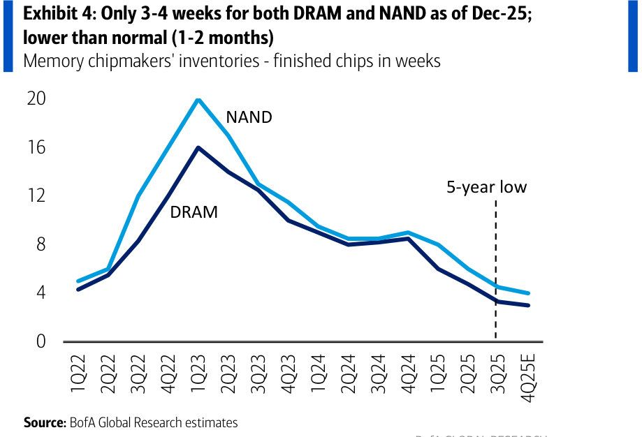

Y-axis: weeks (0/4/8/12/16/20); X-axis: 1Q22-4Q25E; series: DRAM, NAND; callout: 5-year low; no data labels on chart

Source: BofA Global Research estimates

### Exhibit 5: Both DRAM and NAND fabs fully utilized ex old idle capacity as Dec-25

Memory chipmakers' fab utilization

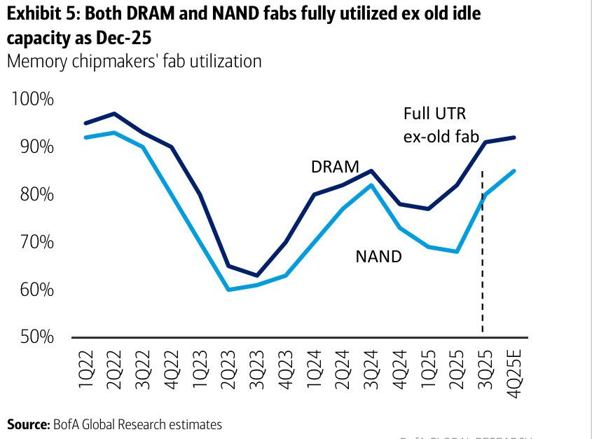

Y-axis: utilization (50%-100%); X-axis: 1Q22-4Q25E; series: DRAM, NAND; callout: Full UTR ex-old fab; no data labels on chart

Source: BofA Global Research estimates

BofA GLOBAL RESEARCH

<!-- 右页：中文译本 -->

## 图表3：服务器、SSD和智能手机出货量复苏相对显著；汽车增长也前景良好

产品单位假设 - 我们对科技产品出货量的基本假设

| | 2016 | 2017 | 2018 | 2019 | 2020 | 2021 | 2022 | 2023 | 2024 | 2025E | 2026E | 2027E | 2025-27E复合年增长率 |
|---|---|---|---|---|---|---|---|---|---|---|---|---|---|
| **单位（百万）** | | | | | | | | | | | | | |
| 5G智能手机 |  |  |  | 19 | 269 | 614 | 678 | 730 | 847 | 901 | 975 | 1,045 | 7.7% |
| 非5G智能手机 | 1,488 | 1,508 | 1,432 | 1,394 | 1,031 | 744 | 520 | 421 | 371 | 347 | 294 | 254 | -14.4% |
| 智能手机总计（5G、4G等） | 1,488 | 1,508 | 1,432 | 1,413 | 1,300 | 1,358 | 1,198 | 1,152 | 1,218 | 1,248 | 1,269 | 1,299 | 2.0% |
| Apple iPhone | 215 | 216 | 205 | 192 | 195 | 238 | 233 | 225 | 222 | 239 | 250 | 258 | 3.9% |
| Samsung | 311 | 315 | 290 | 295 | 254 | 271 | 258 | 225 | 224 | 233 | 239 | 249 | 3.3% |
| 其他原始设备制造商（OEM） | 962 | 977 | 936 | 926 | 851 | 849 | 707 | 702 | 772 | 776 | 780 | 792 | 1.1% |
| 平板电脑 | 204 | 185 | 173 | 160 | 188 | 184 | 163 | 138 | 147 | 151 | 151 | 155 | 1.5% |
| SSD | 130 | 167 | 201 | 248 | 340 | 431 | 399 | 351 | 378 | 426 | 449 | 470 | 5.1% |
| PC | 256 | 255 | 255 | 261 | 297 | 351 | 294 | 253 | 256 | 276 | 285 | 290 | 2.6% |
| 服务器 | 10 | 10 | 12 | 12 | 13 | 14 | 15 | 12 | 14 | 17 | 20 | 21 | 9.9% |
| 汽车 - 嵌入式DRAM | 57 | 61 | 65 | 67 | 63 | 69 | 69 | 72 | 75 | 79 | 85 | 90 | 6.8% |
| 电视（LCD、OLED） | 222 | 215 | 221 | 223 | 225 | 214 | 203 | 199 | 201 | 203 | 206 | 209 | 1.5% |
| 游戏 - 嵌入式DRAM | 44 | 50 | 52 | 51 | 42 | 48 | 43 | 41 | 42 | 42 | 43 | 45 | 2.7% |
| **同比增长** | | | | | | | | | | | | | |
| 5G智能手机 |  |  |  |  |  | 128.1% | 10.3% | 7.8% | 16.0% | 6.4% | 8.2% | 7.1% |  |
| 非5G智能手机 | 3.3% | 1.3% | -5.1% | -2.6% | -26.1% | -27.8% | -30.1% | -19.0% | -12.0% | -6.5% | -15.2% | -13.6% |  |
| 智能手机总计（5G、4G等） | 3.3% | 1.3% | -5.1% | -1.3% | -8.0% | 4.5% | -11.8% | -3.9% | 5.7% | 2.4% | 1.7% | 2.3% |  |
| Apple iPhone | -7.0% | 0.2% | -4.8% | -6.5% | 1.3% | 22.2% | -2.1% | -3.4% | -1.3% | 7.7% | 4.6% | 3.2% |  |
| Samsung | -3.0% | 1.5% | -8.1% | 1.8% | -14.0% | 6.8% | -4.8% | -12.8% | -0.6% | 4.1% | 2.7% | 3.9% |  |
| 其他原始设备制造商（OEM） | 8.3% | 1.5% | -4.1% | -1.1% | -8.0% | -0.3% | -16.8% | -0.7% | 10.0% | 0.5% | 0.6% | 1.6% |  |
| 平板电脑 | -9.1% | -9.0% | -6.3% | -7.5% | 17.2% | -2.0% | -11.7% | -15.5% | 6.6% | 3.0% | -0.1% | 3.0% |  |
| SSD | 36.2% | 28.4% | 20.0% | 23.7% | 36.9% | 26.7% | -7.3% | -12.0% | 7.6% | 12.6% | 5.4% | 4.7% |  |
| PC | -5.9% | -0.3% | -0.2% | 2.6% | 13.6% | 4.0% | -16.2% | -13.8% | 1.0% | 7.9% | 3.2% | 2.0% |  |
| 服务器 | -1.6% | 7.2% | 15.7% | -0.4% | 7.3% | 6.9% | 9.7% | -17.5% | 18.0% | 19.8% | 15.0% | 5.1% |  |
| 汽车 - 嵌入式DRAM | 13.1% | 7.1% | 5.3% | 3.5% | -5.2% | 8.6% | 0.3% | 4.7% | 3.4% | 5.9% | 6.8% | 6.7% |  |
| 电视（LCD、OLED） | -1.2% | -3.2% | 2.9% | 0.7% | 1.0% | -5.2% | -4.8% | -2.1% | 1.0% | 1.1% | 1.2% | 1.8% |  |
| 游戏 - 嵌入式DRAM | 6.9% | 12.8% | 3.0% | -1.3% | -16.8% | 12.5% | -9.7% | -4.9% | 2.5% | 1.0% | 2.4% | 3.0% |  |

注：基于出货量，因此实际销量可能高于/低于我们的假设；考虑到其他原始设备制造商的市场份额增长等，我们仍假设华为的影响最小；内存容量增长（汽车、服务器、SSD）可能强于单位增长；由于三星电子中低端手机出货疲软，而AI智能手机GS24表现乐观，智能手机出货量预估略有下调。

来源：SA、IDC、IHS、美银全球研究预估

### 图表4：截至2025年12月，DRAM和NAND库存均仅3-4周；低于正常水平（1-2个月）

内存芯片制造商'库存 - 数周内完成芯片制造

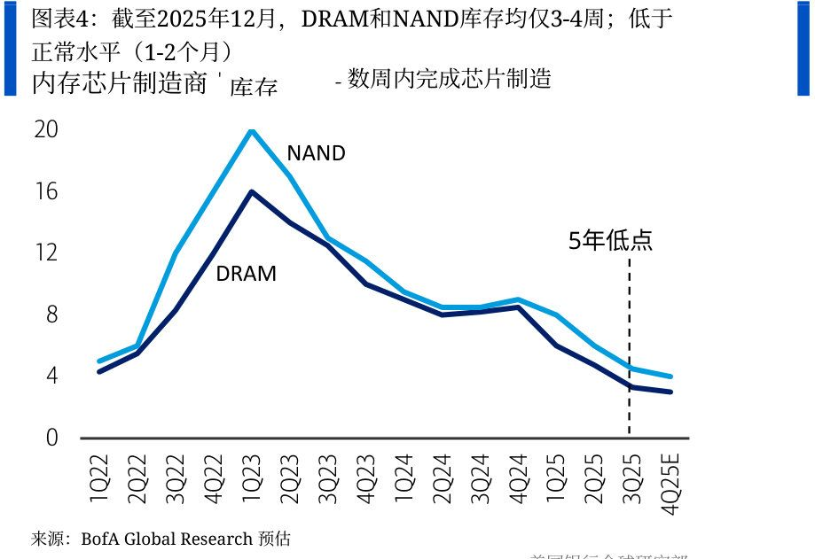

纵轴：周（0/4/8/12/16/20），横轴：1Q22-4Q25E，折线：DRAM、NAND，标注：5年低点；图上无数据标签

来源：BofA Global Research 预估

### 图表5：截至2025年12月，DRAM和NAND晶圆厂（除旧闲置产能外）均满负荷运行

内存芯片制造商'晶圆厂利用率

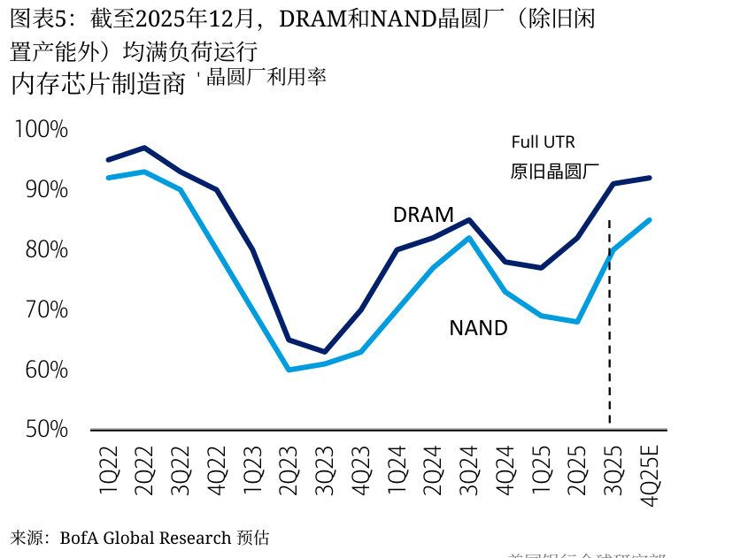

纵轴：利用率（50%-100%），横轴：1Q22-4Q25E，折线：DRAM、NAND，标注：Full UTR 原旧晶圆厂；图上无数据标签

来源：BofA Global Research 预估

美国银行全球研究部

---

<!-- 原文第 4 页 -->

<!-- 左页：英文原版 -->

## Exhibit 6: Mostly server (including HBM) and smartphone-driven sales seen

DRAM sales mix and ASP by application

| | 2016 | 2017 | 2018 | 2019 | 2020 | 2021 | 2022 | 2023 | 2024 | 2025E | 2026E | 2027E |
|---|---|---|---|---|---|---|---|---|---|---|---|---|
| **DRAM sales mix** | | | | | | | | | | | | |
| Servers | 25% | 26% | 35% | 24% | 30% | 31% | 41% | 33% | 48% | 52% | 55% | 58% |
| PCs | 10% | 14% | 14% | 13% | 14% | 15% | 14% | 11% | 11% | 12% | 12% | 12% |
| Smartphones | 26% | 31% | 29% | 45% | 38% | 36% | 34% | 33% | 34% | 35% | 35% | 35% |
| Spot, consumer, etc* | 39% | 29% | 22% | 18% | 18% | 18% | 12% | 22% | 7% | 2% | -3% | -5% |
| Demand mix total | 100% | 100% | 100% | 100% | 100% | 100% | 100% | 100% | 100% | 100% | 100% | 100% |
| **DRAM sales, US$bn** | | | | | | | | | | | | |
| Servers | 10.2 | 18.9 | 34.4 | 14.9 | 19.4 | 28.5 | 31.6 | 15.8 | 42.3 | 66.8 | 108.5 | 125.7 |
| PCs | 4.1 | 10.0 | 13.9 | 8.4 | 8.9 | 14.2 | 10.6 | 5.3 | 9.6 | 15.0 | 24.2 | 25.8 |
| Smartphones | 10.6 | 22.9 | 29.0 | 27.9 | 25.0 | 32.9 | 26.1 | 15.7 | 29.6 | 44.8 | 68.9 | 76.2 |
| Spot, consumer, etc* | 16.3 | 21.0 | 22.0 | 11.3 | 12.0 | 16.6 | 9.4 | 10.5 | 6.5 | 2.6 | -5.9 | -11.8 |
| Total sales US$bn | 41.2 | 72.8 | 99.3 | 62.5 | 65.4 | 92.1 | 77.7 | 47.3 | 87.9 | 129.2 | 195.8 | 215.9 |
| **DRAM ASP, US$/8Gb** | | | | | | | | | | | | |
| Servers | 5.9 | 7.7 | 9.9 | 3.3 | 3.1 | 3.6 | 3.2 | 1.8 | 3.2 | 3.6 | 4.5 | 4.4 |
| PCs | 2.6 | 5.8 | 7.2 | 3.7 | 3.0 | 3.6 | 3.0 | 1.5 | 2.4 | 3.2 | 4.5 | 4.2 |
| Smartphones | 4.1 | 6.6 | 6.9 | 5.1 | 4.1 | 4.4 | 3.5 | 2.0 | 2.9 | 3.7 | 4.8 | 4.6 |
| Spot, consumer, etc* | 4.5 | 5.7 | 6.6 | 3.0 | 2.9 | 3.4 | 2.7 | 1.7 | 2.0 | 4.3 | 2.2 | 2.5 |
| DRAM ind avg price | 4.3 | 6.4 | 7.7 | 3.9 | 3.3 | 3.8 | 3.2 | 1.8 | 2.9 | 3.6 | 4.8 | 4.7 |
| **ASP change YoY** | | | | | | | | | | | | |
| Servers | -20% | 31% | 29% | -66% | -7% | 17% | -11% | -46% | 82% | 13% | 25% | -2% |
| PCs | -48% | 122% | 26% | -49% | -18% | 21% | -19% | -48% | 58% | 30% | 41% | -7% |
| Smartphones | -42% | 60% | 5% | -26% | -20% | 8% | -20% | -45% | 48% | 27% | 32% | -5% |
| Spot, consumer, etc* | -35% | 25% | 17% | -54% | -6% | 19% | -21% | -37% | 18% | 113% | -47% | 10% |
| DRAM ind avg price | -34% | 48% | 20% | -49% | -15% | 14% | -16% | -45% | 62% | 25% | 33% | -2% |

*Implied amount after server/PC/smartphone demand, thus negative figures possible due to channel inventories (not consumed)

Source: Company data, BofA Global Research estimates, industry data

## Exhibit 7: Mostly for SSD and smartphone applications

NAND sales mix and ASP by application

| | 2016 | 2017 | 2018 | 2019 | 2020 | 2021 | 2022 | 2023 | 2024 | 2025E | 2026E | 2027E |
|---|---|---|---|---|---|---|---|---|---|---|---|---|
| **NAND sales mix** | | | | | | | | | | | | |
| SSD | 30% | 33% | 34% | 36% | 45% | 47% | 48% | 40% | 49% | 47% | 49% | 51% |
| Smartphone | 36% | 38% | 33% | 34% | 33% | 34% | 33% | 31% | 35% | 36% | 40% | 44% |
| Spot, inventories, etc | 34% | 29% | 33% | 30% | 22% | 19% | 18% | 29% | 16% | 17% | 10% | 6% |
| Demand mix total | 100% | 100% | 100% | 100% | 100% | 100% | 100% | 100% | 100% | 100% | 100% | 100% |
| **NAND sales, US$bn** | | | | | | | | | | | | |
| SSD | 11.1 | 19.8 | 22.9 | 16.7 | 26.5 | 34.3 | 32.6 | 16.9 | 38.6 | 36.7 | 56.3 | 63.2 |
| Smartphone | 13.7 | 22.3 | 22.0 | 15.5 | 19.2 | 24.9 | 22.4 | 13.1 | 27.2 | 28.4 | 46.0 | 54.6 |
| Spot, inventories, etc | 12.8 | 17.2 | 22.6 | 14.1 | 12.7 | 14.1 | 12.3 | 12.4 | 12.3 | 13.3 | 11.6 | 7.3 |
| Total sales US$bn | 37.6 | 59.2 | 67.4 | 46.3 | 58.5 | 73.3 | 67.3 | 42.4 | 78.1 | 78.5 | 113.9 | 125.1 |
| **NAND ASP, US$/8Gb** | | | | | | | | | | | | |
| SSD | 8.5 | 10.6 | 8.8 | 4.5 | 4.4 | 4.0 | 3.4 | 1.7 | 3.1 | 2.3 | 3.1 | 2.9 |
| Smartphone | 8.7 | 10.5 | 8.6 | 4.4 | 4.3 | 4.1 | 3.3 | 1.7 | 2.8 | 2.4 | 3.1 | 3.0 |
| Spot, inventories, etc | 7.7 | 9.2 | 6.9 | 3.0 | 2.6 | 2.1 | 2.0 | 1.4 | 1.7 | 2.6 | 2.4 | 2.0 |
| NAND ind avg price | 8.3 | 10.1 | 8.0 | 3.9 | 3.8 | 3.4 | 3.0 | 1.6 | 2.6 | 2.4 | 3.0 | 2.9 |
| **ASP change YoY** | | | | | | | | | | | | |
| SSD | -29% | 25% | -17% | -49% | -1% | -10% | -13% | -49% | 76% | -24% | 31% | -5% |
| Smartphone | -30% | 21% | -18% | -48% | -2% | -4% | -21% | -48% | 64% | -15% | 33% | -3% |
| Spot, inventories, etc | -27% | 19% | -24% | -57% | -14% | -17% | -8% | -31% | 26% | 50% | -7% | -16% |
| NAND ind avg price | -28% | 22% | -21% | -52% | -2% | -9% | -13% | -46% | 65% | -10% | 26% | -4% |

*Implied amount after SSD/smartphone demand, thus negative figures possible due to channel inventories (not consumed)

Source: Company data, BofA Global Research estimates, industry data

BofA GLOBAL RESEARCH

<!-- 右页：中文译本 -->

## 图表6：主要由服务器（含HBM）和智能手机驱动的销售——DRAM销售结构及各应用平均售价

| | 2016 | 2017 | 2018 | 2019 | 2020 | 2021 | 2022 | 2023 | 2024 | 2025E | 2026E | 2027E |
|---|---|---|---|---|---|---|---|---|---|---|---|---|
| **DRAM销售结构** | | | | | | | | | | | | |
| 服务器 | 25% | 26% | 35% | 24% | 30% | 31% | 41% | 33% | 48% | 52% | 55% | 58% |
| PCs | 10% | 14% | 14% | 13% | 14% | 15% | 14% | 11% | 11% | 12% | 12% | 12% |
| 智能手机 | 26% | 31% | 29% | 45% | 38% | 36% | 34% | 33% | 34% | 35% | 35% | 35% |
| 现货、消费类等* | 39% | 29% | 22% | 18% | 18% | 18% | 12% | 22% | 7% | 2% | -3% | -5% |
| 总需求结构 | 100% | 100% | 100% | 100% | 100% | 100% | 100% | 100% | 100% | 100% | 100% | 100% |
| **DRAM销售额，十亿美元（US$bn）** | | | | | | | | | | | | |
| 服务器 | 10.2 | 18.9 | 34.4 | 14.9 | 19.4 | 28.5 | 31.6 | 15.8 | 42.3 | 66.8 | 108.5 | 125.7 |
| PCs | 4.1 | 10.0 | 13.9 | 8.4 | 8.9 | 14.2 | 10.6 | 5.3 | 9.6 | 15.0 | 24.2 | 25.8 |
| 智能手机 | 10.6 | 22.9 | 29.0 | 27.9 | 25.0 | 32.9 | 26.1 | 15.7 | 29.6 | 44.8 | 68.9 | 76.2 |
| 现货、消费类等* | 16.3 | 21.0 | 22.0 | 11.3 | 12.0 | 16.6 | 9.4 | 10.5 | 6.5 | 2.6 | -5.9 | -11.8 |
| 总销售额，十亿美金 | 41.2 | 72.8 | 99.3 | 62.5 | 65.4 | 92.1 | 77.7 | 47.3 | 87.9 | 129.2 | 195.8 | 215.9 |
| **DRAM ASP（US$/8Gb）** | | | | | | | | | | | | |
| 服务器 | 5.9 | 7.7 | 9.9 | 3.3 | 3.1 | 3.6 | 3.2 | 1.8 | 3.2 | 3.6 | 4.5 | 4.4 |
| PCs | 2.6 | 5.8 | 7.2 | 3.7 | 3.0 | 3.6 | 3.0 | 1.5 | 2.4 | 3.2 | 4.5 | 4.2 |
| 智能手机 | 4.1 | 6.6 | 6.9 | 5.1 | 4.1 | 4.4 | 3.5 | 2.0 | 2.9 | 3.7 | 4.8 | 4.6 |
| 现货、消费类等* | 4.5 | 5.7 | 6.6 | 3.0 | 2.9 | 3.4 | 2.7 | 1.7 | 2.0 | 4.3 | 2.2 | 2.5 |
| DRAM行业平均价格 | 4.3 | 6.4 | 7.7 | 3.9 | 3.3 | 3.8 | 3.2 | 1.8 | 2.9 | 3.6 | 4.8 | 4.7 |
| **平均售价同比变化** | | | | | | | | | | | | |
| 服务器 | -20% | 31% | 29% | -66% | -7% | 17% | -11% | -46% | 82% | 13% | 25% | -2% |
| PCs | -48% | 122% | 26% | -49% | -18% | 21% | -19% | -48% | 58% | 30% | 41% | -7% |
| 智能手机 | -42% | 60% | 5% | -26% | -20% | 8% | -20% | -45% | 48% | 27% | 32% | -5% |
| 现货、消费类等* | -35% | 25% | 17% | -54% | -6% | 19% | -21% | -37% | 18% | 113% | -47% | 10% |
| DRAM行业平均价格 | -34% | 48% | 20% | -49% | -15% | 14% | -16% | -45% | 62% | 25% | 33% | -2% |

*服务器/PC/智能手机需求后的隐含金额，因此由于渠道库存（未消耗）可能出现负数

来源：公司数据、美国银行全球研究部估计、行业数据

## 图表7：主要用于SSD和智能手机应用 NAND销售结构及各应用平均售价

| | 2016 | 2017 | 2018 | 2019 | 2020 | 2021 | 2022 | 2023 | 2024 | 2025E | 2026E | 2027E |
|---|---|---|---|---|---|---|---|---|---|---|---|---|
| **NAND销售结构** | | | | | | | | | | | | |
| SSD | 30% | 33% | 34% | 36% | 45% | 47% | 48% | 40% | 49% | 47% | 49% | 51% |
| 智能手机 | 36% | 38% | 33% | 34% | 33% | 34% | 33% | 31% | 35% | 36% | 40% | 44% |
| 现货、库存等 | 34% | 29% | 33% | 30% | 22% | 19% | 18% | 29% | 16% | 17% | 10% | 6% |
| 总需求结构 | 100% | 100% | 100% | 100% | 100% | 100% | 100% | 100% | 100% | 100% | 100% | 100% |
| **NAND销售额，十亿美金** | | | | | | | | | | | | |
| SSD | 11.1 | 19.8 | 22.9 | 16.7 | 26.5 | 34.3 | 32.6 | 16.9 | 38.6 | 36.7 | 56.3 | 63.2 |
| 智能手机 | 13.7 | 22.3 | 22.0 | 15.5 | 19.2 | 24.9 | 22.4 | 13.1 | 27.2 | 28.4 | 46.0 | 54.6 |
| 现货、库存等 | 12.8 | 17.2 | 22.6 | 14.1 | 12.7 | 14.1 | 12.3 | 12.4 | 12.3 | 13.3 | 11.6 | 7.3 |
| 总销售额，十亿美金 | 37.6 | 59.2 | 67.4 | 46.3 | 58.5 | 73.3 | 67.3 | 42.4 | 78.1 | 78.5 | 113.9 | 125.1 |
| **NAND ASP，美元/8Gb** | | | | | | | | | | | | |
| SSD | 8.5 | 10.6 | 8.8 | 4.5 | 4.4 | 4.0 | 3.4 | 1.7 | 3.1 | 2.3 | 3.1 | 2.9 |
| 智能手机 | 8.7 | 10.5 | 8.6 | 4.4 | 4.3 | 4.1 | 3.3 | 1.7 | 2.8 | 2.4 | 3.1 | 3.0 |
| 现货、库存等 | 7.7 | 9.2 | 6.9 | 3.0 | 2.6 | 2.1 | 2.0 | 1.4 | 1.7 | 2.6 | 2.4 | 2.0 |
| NAND行业平均价格 | 8.3 | 10.1 | 8.0 | 3.9 | 3.8 | 3.4 | 3.0 | 1.6 | 2.6 | 2.4 | 3.0 | 2.9 |
| **平均售价同比变化** | | | | | | | | | | | | |
| SSD | -29% | 25% | -17% | -49% | -1% | -10% | -13% | -49% | 76% | -24% | 31% | -5% |
| 智能手机 | -30% | 21% | -18% | -48% | -2% | -4% | -21% | -48% | 64% | -15% | 33% | -3% |
| 现货、库存等 | -27% | 19% | -24% | -57% | -14% | -17% | -8% | -31% | 26% | 50% | -7% | -16% |
| NAND行业平均价格 | -28% | 22% | -21% | -52% | -2% | -9% | -13% | -46% | 65% | -10% | 26% | -4% |

*扣除SSD/智能手机需求后的隐含金额，因此由于渠道库存（未消耗）可能出现负数

来源：公司数据、美银全球研究部估计、行业数据

美国银行全球研究部

---

<!-- 原文第 5 页 -->

<!-- 左页：英文原版 -->

## Capacity expansion & node migration = capex acceleration

### Exhibit 8: Hynix's DRAM capex amount already close to Samsung's far exceeding US/China/Taiwan peers; this is mostly for HBM capacity expansion using new fabs (M15X and Yongin in Korea)

DRAM capex trend

| | 2020 | 2021 | 2022 | 2023 | 2024 | 2025E | 2026E | 2027E |
|---|---|---|---|---|---|---|---|---|
| Samsung | 8.2 | 11.6 | 12.2 | 13.9 | 15.0 | 15.1 | 18.7 | 21.2 |
| SK Hynix | 5.6 | 7.3 | 8.9 | 3.8 | 9.0 | 13.0 | 20.7 | 21.7 |
| Micron | 5.3 | 5.6 | 5.7 | 3.9 | 6.3 | 12.8 | 17.7 | 15.0 |
| Nanya | 0.3 | 0.4 | 0.7 | 0.4 | 0.5 | 0.6 | 1.0 | 1.0 |
| CXMT | 1.5 | 1.5 | 1.7 | 2.6 | 4.0 | 3.5 | 3.3 | 3.4 |
| DRAM capex total | 21.4 | 27.1 | 31.0 | 25.2 | 35.7 | 46.0 | 62.4 | 63.3 |
| Capex change YoY | -2% | 27% | 14% | -19% | 42% | 29% | 36% | 1% |
| DRAM capex to sales | 33% | 29% | 40% | 53% | 41% | 36% | 32% | 29% |
| **DRAM capex share** | | | | | | | | |
| Samsung | 38% | 43% | 39% | 55% | 42% | 33% | 30% | 34% |
| SK Hynix | 26% | 27% | 29% | 15% | 25% | 28% | 33% | 34% |
| Micron | 25% | 21% | 19% | 16% | 18% | 28% | 28% | 24% |
| Nanya | 1% | 1% | 2% | 2% | 2% | 1% | 2% | 2% |
| CXMT | 7% | 6% | 5% | 10% | 11% | 8% | 5% | 5% |
| Total | 100% | 100% | 100% | 100% | 100% | 100% | 100% | 100% |
| **DRAM capex YoY** | | | | | | | | |
| Samsung | -8% | 42% | 5% | 14% | 8% | 1% | 23% | 14% |
| SK Hynix | -23% | 30% | 22% | -58% | 138% | 45% | 59% | 5% |
| Micron | 24% | 6% | 3% | -32% | 62% | 102% | 38% | -15% |
| Nanya | 62% | 40% | 72% | -39% | 27% | 3% | 80% | 0% |
| CXMT | 114% | 0% | 13% | 50% | 57% | -13% | -6% | 3% |
| Total | -2% | 27% | 14% | -19% | 42% | 29% | 36% | 1% |

Source: Companies, BofA Global Research estimates

### Exhibit 9: NAND capex recovery not yet strong due to low margin profile and node migration difficulties from 128/178 layers to 200-300+; YMTC's capex increase limited (vs CXMT) due to US government's control (entity list)

NAND capex trend

| | 2020 | 2021 | 2022 | 2023 | 2024 | 2025E | 2026E | 2027E |
|---|---|---|---|---|---|---|---|---|
| Samsung | 9.2 | 10.9 | 10.3 | 10.1 | 10.1 | 9.1 | 10.6 | 11.7 |
| Kioxia & JVs | 4.5 | 5.7 | 6.5 | 2.7 | 4.5 | 5.5 | 6.0 | 6.0 |
| Micron | 3.4 | 4.6 | 5.2 | 2.7 | 3.1 | 4.5 | 4.6 | 3.9 |
| SK Hynix | 2.7 | 3.4 | 4.1 | 1.6 | 2.3 | 2.5 | 3.3 | 3.4 |
| Intel China | 0.8 | 1.5 | 0.0 | 0.0 | 0.0 | 0.0 | 0.0 | 0.0 |
| YMTC | 1.6 | 1.5 | 2.5 | 2.3 | 2.0 | 2.0 | 2.3 | 2.3 |
| NAND capex total | 22.5 | 27.9 | 29.0 | 19.7 | 22.4 | 24.0 | 27.1 | 27.8 |
| NAND capex chg YoY | 12% | 24% | 4% | -32% | 14% | 7% | 13% | 2% |
| NAND capex to sales | 38% | 38% | 43% | 46% | 29% | 31% | 24% | 22% |
| **NAND capex share** | | | | | | | | |
| Samsung | 41% | 39% | 36% | 51% | 45% | 38% | 39% | 42% |
| Kioxia & JVs | 20% | 20% | 22% | 14% | 20% | 23% | 22% | 22% |
| Micron | 15% | 17% | 18% | 14% | 14% | 19% | 17% | 14% |
| SK Hynix | 12% | 12% | 14% | 8% | 10% | 10% | 12% | 12% |
| Intel China | 4% | 5% | n/a | n/a | n/a | n/a | n/a | n/a |
| YMTC | 7% | 5% | 9% | 11% | 9% | 8% | 8% | 8% |
| NAND capex total | 100% | 100% | 100% | 100% | 100% | 100% | 100% | 100% |
| **NAND capex growth (YoY)** | | | | | | | | |
| Samsung | 87% | 19% | -5% | -2% | 0% | -10% | 17% | 11% |
| Kioxia & JVs | 18% | 27% | 14% | -58% | 67% | 22% | 9% | 0% |
| Micron | -22% | 35% | 11% | -47% | 13% | 47% | 0% | -14% |
| SK Hynix | -38% | 26% | 19% | -60% | 42% | 5% | 33% | 4% |
| Intel China | -48% | 88% | na | na | na | na | na | na |
| YMTC | 129% | -6% | 67% | -10% | -11% | 0% | 15% | 0% |
| NAND capex total | 12% | 24% | 4% | -32% | 14% | 7% | 13% | 2% |

Source: Companies, BofA Global Research estimates

BofA GLOBAL RESEARCH

<!-- 右页：中文译本 -->

## 产能扩张与节点迁移 = 资本支出加速

### 图表8：海力士DRAM资本支出金额已接近三星，远超美国/中国/中国台湾同行；这主要用于使用新晶圆厂（韩国M15X和龙仁）的HBM产能扩张

DRAM资本支出趋势

| | 2020 | 2021 | 2022 | 2023 | 2024 | 2025E | 2026E | 2027E |
|---|---|---|---|---|---|---|---|---|
| Samsung | 8.2 | 11.6 | 12.2 | 13.9 | 15.0 | 15.1 | 18.7 | 21.2 |
| SK Hynix | 5.6 | 7.3 | 8.9 | 3.8 | 9.0 | 13.0 | 20.7 | 21.7 |
| Micron | 5.3 | 5.6 | 5.7 | 3.9 | 6.3 | 12.8 | 17.7 | 15.0 |
| Nanya | 0.3 | 0.4 | 0.7 | 0.4 | 0.5 | 0.6 | 1.0 | 1.0 |
| CXMT | 1.5 | 1.5 | 1.7 | 2.6 | 4.0 | 3.5 | 3.3 | 3.4 |
| DRAM总资本支出 | 21.4 | 27.1 | 31.0 | 25.2 | 35.7 | 46.0 | 62.4 | 63.3 |
| 资本支出同比变化 | -2% | 27% | 14% | -19% | 42% | 29% | 36% | 1% |
| DRAM资本支出占销售额比例 | 33% | 29% | 40% | 53% | 41% | 36% | 32% | 29% |
| **DRAM资本支出占比** | | | | | | | | |
| Samsung | 38% | 43% | 39% | 55% | 42% | 33% | 30% | 34% |
| SK Hynix | 26% | 27% | 29% | 15% | 25% | 28% | 33% | 34% |
| Micron | 25% | 21% | 19% | 16% | 18% | 28% | 28% | 24% |
| Nanya | 1% | 1% | 2% | 2% | 2% | 1% | 2% | 2% |
| CXMT | 7% | 6% | 5% | 10% | 11% | 8% | 5% | 5% |
| 总计 | 100% | 100% | 100% | 100% | 100% | 100% | 100% | 100% |
| **DRAM资本支出同比** | | | | | | | | |
| Samsung | -8% | 42% | 5% | 14% | 8% | 1% | 23% | 14% |
| SK Hynix | -23% | 30% | 22% | -58% | 138% | 45% | 59% | 5% |
| Micron | 24% | 6% | 3% | -32% | 62% | 102% | 38% | -15% |
| Nanya | 62% | 40% | 72% | -39% | 27% | 3% | 80% | 0% |
| CXMT | 114% | 0% | 13% | 50% | 57% | -13% | -6% | 3% |
| 总计 | -2% | 27% | 14% | -19% | 42% | 29% | 36% | 1% |

来源：公司、美银全球研究部估算

### 图表9：NAND资本支出复苏尚未强劲，原因是利润率低以及从128/178层向200-300+层迁移困难；由于美国政府的管制（实体清单），长江存储（YMTC）的资本支出增长有限（相比长鑫存储（CXMT））

NAND资本支出趋势

| | 2020 | 2021 | 2022 | 2023 | 2024 | 2025E | 2026E | 2027E |
|---|---|---|---|---|---|---|---|---|
| Samsung | 9.2 | 10.9 | 10.3 | 10.1 | 10.1 | 9.1 | 10.6 | 11.7 |
| 铠侠及合资企业 | 4.5 | 5.7 | 6.5 | 2.7 | 4.5 | 5.5 | 6.0 | 6.0 |
| Micron | 3.4 | 4.6 | 5.2 | 2.7 | 3.1 | 4.5 | 4.6 | 3.9 |
| SK Hynix | 2.7 | 3.4 | 4.1 | 1.6 | 2.3 | 2.5 | 3.3 | 3.4 |
| Intel China | 0.8 | 1.5 | 0.0 | 0.0 | 0.0 | 0.0 | 0.0 | 0.0 |
| YMTC | 1.6 | 1.5 | 2.5 | 2.3 | 2.0 | 2.0 | 2.3 | 2.3 |
| NAND资本支出总计 | 22.5 | 27.9 | 29.0 | 19.7 | 22.4 | 24.0 | 27.1 | 27.8 |
| NAND资本支出同比变化 | 12% | 24% | 4% | -32% | 14% | 7% | 13% | 2% |
| NAND资本支出占销售额比例 | 38% | 38% | 43% | 46% | 29% | 31% | 24% | 22% |
| **NAND资本支出占比** | | | | | | | | |
| Samsung | 41% | 39% | 36% | 51% | 45% | 38% | 39% | 42% |
| 铠侠及合资企业 | 20% | 20% | 22% | 14% | 20% | 23% | 22% | 22% |
| Micron | 15% | 17% | 18% | 14% | 14% | 19% | 17% | 14% |
| SK Hynix | 12% | 12% | 14% | 8% | 10% | 10% | 12% | 12% |
| Intel China | 4% | 5% | n/a | n/a | n/a | n/a | n/a | n/a |
| YMTC | 7% | 5% | 9% | 11% | 9% | 8% | 8% | 8% |
| NAND资本支出总计 | 100% | 100% | 100% | 100% | 100% | 100% | 100% | 100% |
| **NAND资本支出同比增长** | | | | | | | | |
| Samsung | 87% | 19% | -5% | -2% | 0% | -10% | 17% | 11% |
| 铠侠及合资企业 | 18% | 27% | 14% | -58% | 67% | 22% | 9% | 0% |
| Micron | -22% | 35% | 11% | -47% | 13% | 47% | 0% | -14% |
| SK Hynix | -38% | 26% | 19% | -60% | 42% | 5% | 33% | 4% |
| Intel China | -48% | 88% | na | na | na | na | na | na |
| YMTC | 129% | -6% | 67% | -10% | -11% | 0% | 15% | 0% |
| NAND资本支出总计 | 12% | 24% | 4% | -32% | 14% | 7% | 13% | 2% |

来源：公司、美银全球研究部估算

美国银行全球研究部

---

<!-- 原文第 6 页 -->

<!-- 左页：英文原版 -->

### Exhibit 10: Ex-conventional DRAM equipment capex spend likely up strongly due to HBM, but conventional DRAM and NAND spend broadly disciplined; non-equipment spend for buildings and utilities remain high

SPE vs non-SPE capex spend

| | 2019 | 2020 | 2021 | 2022 | 2023 | 2024 | 2025E | 2026E | 2027E |
|---|---|---|---|---|---|---|---|---|---|
| **SPE capex** | | | | | | | | | |
| DRAM | 12.1 | 12.7 | 16.2 | 17.3 | 14.1 | 22.6 | 29.3 | 43.7 | 45.4 |
| NAND | 12.1 | 14.3 | 18.2 | 18.7 | 11.9 | 14.2 | 16.4 | 18.7 | 20.0 |
| Total | 24.3 | 26.9 | 34.4 | 35.9 | 26.0 | 36.8 | 45.7 | 62.4 | 65.3 |
| **SPE capex YoY** | | | | | | | | | |
| DRAM | -22% | 4% | 28% | 7% | -18% | 60% | 29% | 49% | 4% |
| NAND | -24% | 17% | 28% | 3% | -36% | 19% | 16% | 14% | 7% |
| Total | -23% | 11% | 28% | 5% | -28% | 41% | 24% | 37% | 5% |
| **Non-SPE to capex** | | | | | | | | | |
| DRAM | 45% | 41% | 40% | 44% | 44% | 37% | 36% | 30% | 28% |
| NAND | 39% | 37% | 35% | 36% | 40% | 37% | 32% | 31% | 28% |
| Total | 42% | 39% | 38% | 40% | 42% | 37% | 35% | 30% | 28% |
| **Total capex, US$bn** | | | | | | | | | |
| DRAM | 21.9 | 21.4 | 27.1 | 31.0 | 25.2 | 35.7 | 46.0 | 62.4 | 63.3 |
| NAND | 20.1 | 22.5 | 27.9 | 29.0 | 19.7 | 22.4 | 24.0 | 27.1 | 27.8 |
| Total | 42.0 | 43.9 | 55.0 | 60.0 | 45.0 | 58.2 | 69.9 | 89.5 | 91.0 |
| **Source: Company data, BofA Global Research estimates, industry data** | | | | | | | | | |
| **BofA GLOBAL RESEARCH** | | | | | | | | | |

Source: Company data, BofA Global Research estimates, industry data

### Exhibit 11: DRAM capex increase mostly driven by Hynix and Micron - Samsung's spend relatively disciplined; NAND capex growth no longer strong due to low margin and ROIC)

SPE capex spend by memory chipmakers

| | 2019 | 2020 | 2021 | 2022 | 2023 | 2024 | 2025E | 2026E | 2027E |
|---|---|---|---|---|---|---|---|---|---|
| **DRAM SPE** | | | | | | | | | |
| Samsung | 5.5 | 4.8 | 6.9 | 7.0 | 7.8 | 8.7 | 9.4 | 13.6 | 15.5 |
| SK Hynix | 2.9 | 2.5 | 3.4 | 4.3 | 1.6 | 6.1 | 7.3 | 14.5 | 15.7 |
| Micron | 2.9 | 3.5 | 3.7 | 3.8 | 2.1 | 3.8 | 8.8 | 11.7 | 10.2 |
| Nanya | 0.1 | 0.2 | 0.4 | 0.5 | 0.3 | 0.4 | 0.4 | 0.6 | 0.7 |
| CXMT | 0.3 | 1.2 | 1.3 | 1.2 | 2.0 | 3.2 | 2.8 | 2.6 | 2.7 |
| DRAM SPE total | 12.1 | 12.7 | 16.2 | 17.3 | 14.1 | 22.6 | 29.3 | 43.7 | 45.4 |
| **YoY** | | | | | | | | | |
| Samsung | -25% | -14% | 44% | 1% | 12% | 12% | 8% | 45% | 14% |
| SK Hynix | -21% | -14% | 32% | 27% | -63% | 284% | 20% | 99% | 8% |
| Micron | -14% | 24% | 6% | 3% | -45% | 80% | 133% | 32% | -13% |
| DRAM SPE total | -22% | 4% | 28% | 7% | -18% | 60% | 29% | 49% | 4% |
| **NAND SPE** | | | | | | | | | |
| Samsung | 3.4 | 5.7 | 6.7 | 6.6 | 6.2 | 6.5 | 5.9 | 7.3 | 8.6 |
| Micron | 3.0 | 2.3 | 3.1 | 3.5 | 1.4 | 1.9 | 3.0 | 3.2 | 2.7 |
| SK Hynix | 2.3 | 1.8 | 2.4 | 2.5 | 1.0 | 1.5 | 1.9 | 2.2 | 2.6 |
| YMTC | 0.0 | 1.0 | 1.2 | 1.8 | 1.8 | 1.3 | 1.4 | 1.5 | 1.6 |
| NAND SPE total | 12.1 | 14.3 | 18.2 | 18.7 | 11.9 | 14.2 | 16.4 | 18.7 | 20.0 |
| **YoY** | | | | | | | | | |
| Samsung | -26% | 68% | 19% | -2% | -6% | 5% | -10% | 23% | 18% |
| Micron | -3% | -22% | 35% | 11% | -59% | 33% | 59% | 8% | -14% |
| SK Hynix | -38% | -24% | 36% | 2% | -61% | 57% | 27% | 16% | 16% |
| YMTC |  |  | 25% | 46% | 3% | -28% | 8% | 7% | 8% |
| NAND SPE total | -24% | 17% | 28% | 3% | -36% | 19% | 16% | 14% | 7% |

Source: Company data, BofA Global Research estimates, industry data

BofA GLOBAL RESEARCH

<!-- 右页：中文译本 -->

### 图表10：传统DRAM设备资本支出可能因HBM大幅上升，但传统DRAM和NAND支出总体disciplined；建筑和公用事业的非设备支出仍高

SPE对比非SPE资本支出

| | 2019 | 2020 | 2021 | 2022 | 2023 | 2024 | 2025E | 2026E | 2027E |
|---|---|---|---|---|---|---|---|---|---|
| **SPE资本支出** | | | | | | | | | |
| DRAM | 12.1 | 12.7 | 16.2 | 17.3 | 14.1 | 22.6 | 29.3 | 43.7 | 45.4 |
| NAND | 12.1 | 14.3 | 18.2 | 18.7 | 11.9 | 14.2 | 16.4 | 18.7 | 20.0 |
| 总计 | 24.3 | 26.9 | 34.4 | 35.9 | 26.0 | 36.8 | 45.7 | 62.4 | 65.3 |
| **SPE资本支出同比** | | | | | | | | | |
| DRAM | -22% | 4% | 28% | 7% | -18% | 60% | 29% | 49% | 4% |
| NAND | -24% | 17% | 28% | 3% | -36% | 19% | 16% | 14% | 7% |
| 总计 | -23% | 11% | 28% | 5% | -28% | 41% | 24% | 37% | 5% |
| **非SPE与资本支出** | | | | | | | | | |
| DRAM | 45% | 41% | 40% | 44% | 44% | 37% | 36% | 30% | 28% |
| NAND | 39% | 37% | 35% | 36% | 40% | 37% | 32% | 31% | 28% |
| 总计 | 42% | 39% | 38% | 40% | 42% | 37% | 35% | 30% | 28% |
| **总资本支出，十亿美元** | | | | | | | | | |
| DRAM | 21.9 | 21.4 | 27.1 | 31.0 | 25.2 | 35.7 | 46.0 | 62.4 | 63.3 |
| NAND | 20.1 | 22.5 | 27.9 | 29.0 | 19.7 | 22.4 | 24.0 | 27.1 | 27.8 |
| 总计 | 42.0 | 43.9 | 55.0 | 60.0 | 45.0 | 58.2 | 69.9 | 89.5 | 91.0 |

来源：公司数据、美国银行全球研究部预估、行业数据

### 图表11：DRAM资本支出增长主要由海力士和镁光驱动——三星支出相对克制；NAND资本支出增长不再强劲（因低利润率和ROIC）

内存芯片制造商的SPE资本支出

| | 2019 | 2020 | 2021 | 2022 | 2023 | 2024 | 2025E | 2026E | 2027E |
|---|---|---|---|---|---|---|---|---|---|
| Samsung | 5.5 | 4.8 | 6.9 | 7.0 | 7.8 | 8.7 | 9.4 | 13.6 | 15.5 |
| SK Hynix | 2.9 | 2.5 | 3.4 | 4.3 | 1.6 | 6.1 | 7.3 | 14.5 | 15.7 |
| Micron | 2.9 | 3.5 | 3.7 | 3.8 | 2.1 | 3.8 | 8.8 | 11.7 | 10.2 |
| Nanya | 0.1 | 0.2 | 0.4 | 0.5 | 0.3 | 0.4 | 0.4 | 0.6 | 0.7 |
| CXMT | 0.3 | 1.2 | 1.3 | 1.2 | 2.0 | 3.2 | 2.8 | 2.6 | 2.7 |
| DRAM SPE总计 | 12.1 | 12.7 | 16.2 | 17.3 | 14.1 | 22.6 | 29.3 | 43.7 | 45.4 |
| **YoY** | | | | | | | | | |
| Samsung | -25% | -14% | 44% | 1% | 12% | 12% | 8% | 45% | 14% |
| SK Hynix | -21% | -14% | 32% | 27% | -63% | 284% | 20% | 99% | 8% |
| Micron | -14% | 24% | 6% | 3% | -45% | 80% | 133% | 32% | -13% |
| DRAM SPE总计 | -22% | 4% | 28% | 7% | -18% | 60% | 29% | 49% | 4% |
| **NAND SPE** | | | | | | | | | |
| Samsung | 3.4 | 5.7 | 6.7 | 6.6 | 6.2 | 6.5 | 5.9 | 7.3 | 8.6 |
| Micron | 3.0 | 2.3 | 3.1 | 3.5 | 1.4 | 1.9 | 3.0 | 3.2 | 2.7 |
| SK Hynix | 2.3 | 1.8 | 2.4 | 2.5 | 1.0 | 1.5 | 1.9 | 2.2 | 2.6 |
| YMTC | 0.0 | 1.0 | 1.2 | 1.8 | 1.8 | 1.3 | 1.4 | 1.5 | 1.6 |
| NAND SPE总计 | 12.1 | 14.3 | 18.2 | 18.7 | 11.9 | 14.2 | 16.4 | 18.7 | 20.0 |
| **YoY** | | | | | | | | | |
| Samsung | -26% | 68% | 19% | -2% | -6% | 5% | -10% | 23% | 18% |
| Micron | -3% | -22% | 35% | 11% | -59% | 33% | 59% | 8% | -14% |
| SK Hynix | -38% | -24% | 36% | 2% | -61% | 57% | 27% | 16% | 16% |
| YMTC |  |  | 25% | 46% | 3% | -28% | 8% | 7% | 8% |
| NAND SPE总计 | -24% | 17% | 28% | 3% | -36% | 19% | 16% | 14% | 7% |

来源：公司数据、美国银行全球研究部预估、行业数据

美国银行全球研究部

---

<!-- 原文第 7 页 -->

<!-- 左页：英文原版 -->

## 2026E HBM TAM expansion to US$55bn

**Exhibit 12: We maintain our bullish view on HBM. We assume stronger growth in 2026 sales (US$55bn; +58% YoY). This is based on a limited price cut (blended ASP -6%; similar to 5-10% cost reduction; 5-10% price cut for 12-hi HBM3e offset by a 20% price premium for HBM4) and robust bit growth (+69%). Hynix's proven 12-hi HBM3e and HBM4 (mass production started in Sept) should be the key contributors; industry average OPM above 40% thanks to Hynix's high margin profile (60%+); no downturn in 2027 given volume growth and cost reduction fully offset price cut**

Global HBM market - record high revenue continues into 2025/26/27E (US$35bn/55bn/64bn)

| | 2022 | 2023 | 2024 | 2025E | 2026E | 2027E | 2028E | 2029E | 2030E | CAGR 2025-28E |
|---|---|---|---|---|---|---|---|---|---|---|
| **HBM earnings** | | | | | | | | | | |
| Sales, US$bn | 1.6 | 4.2 | 17.4 | 34.5 | 54.6 | 64.3 | 72.4 | 85.5 | 98.1 | 28% |
| Shipment units, GB bn | 0.1 | 0.5 | 1.6 | 3.1 | 5.2 | 6.8 | 8.4 | 10.5 | 12.7 | 40% |
| ASP, US$/GB | 16.7 | 8.8 | 11.0 | 11.3 | 10.5 | 9.4 | 8.6 | 8.1 | 7.7 | -9% |
| Price premium | 430% | 436% | 355% | 292% | 168% | 145% | 146% | 90% | 72% |  |
| OP, US$bn | 0.4 | 1.8 | 8.3 | 14.6 | 23.7 | 28.1 | 31.0 | 36.9 | 42.2 | 28% |
| OP margin | 25% | 42% | 48% | 42% | 43% | 44% | 43% | 43% | 43% |  |
| **% YoY** | | | | | | | | | | |
| Sales, US$bn | 55% | 155% | 316% | 98% | 58% | 18% | 13% | 18% | 15% |  |
| Shipment units, GB bn | 95% | 383% | 233% | 94% | 69% | 32% | 23% | 25% | 21% |  |
| ASP, US$/GB | n/a | n/a | 25% | 2% | -6% | -11% | -8% | -5% | -5% |  |
| **HBM shipment mix** | | | | | | | | | | |
| HBM5+ | 0% | 0% | 0% | 0% | 0% | 0% | 10% | 51% | 75% |  |
| HBM4e | 0% | 0% | 0% | 0% | 0% | 13% | 53% | 36% | 19% |  |
| HBM4 | 0% | 0% | 0% | 0% | 17% | 68% | 27% | 10% | 5% |  |
| HBM3e | 0% | 0% | 58% | 83% | 79% | 17% | 10% | 3% | 1% |  |
| HBM3 | 10% | 60% | 27% | 14% | 2% | 1% | 0% | 0% | 0% |  |
| HBM2e & below | 90% | 40% | 15% | 3% | 2% | 1% | 0% | 0% | 0% |  |
| HBM mix total | 100% | 100% | 100% | 100% | 100% | 100% | 100% | 100% | 100% |  |
| % to DRAM shipment | 0.4% | 1.8% | 5.2% | 8.5% | 12.6% | 14.8% | 16.3% | 17.9% | 19.7% |  |
| % to DRAM sales | 2.1% | 8.9% | 19.8% | 26.7% | 27.9% | 29.8% | 32.3% | 29.3% | 29.7% |  |
| Wafer capacity, k wpm | 68 | 87 | 204 | 360 | 473 | 602 | 714 | 811 | 873 | 26% |
| % to DRAM wafer capacity | 4.4% | 5.4% | 11.8% | 19.2% | 22.8% | 26.9% | 29.6% | 32.0% | 32.8% |  |
| Main node | 1z | 1z | 1a, 1b | 1a, 1b | 1b, 1c | 1c | 1c, 1d | 1d | 1d, 1e |  |
| Implied demand, GB bn units | 0.1 | 0.5 | 1.8 | 3.3 | 4.8 | 6.2 | 7.7 | 9.7 | 11.8 | 33% |
| AI+HBM server units, mn | 0.3 | 1.0 | 1.9 | 2.8 | 3.5 | 4.0 | 4.4 | 4.7 | 5.0 | 17% |
| AI+HBM server shipment YoY | 42% | 289% | 88% | 50% | 25% | 15% | 10% | 7% | 6% |  |
| GB HBM per AI+HBM server | 340 | 530 | 954 | 1,171 | 1,389 | 1,538 | 1,753 | 2,051 | 2,359 | 14% |
| GB content growth QoQ/YoY | 13% | 56% | 80% | 23% | 19% | 11% | 14% | 17% | 15% |  |
| AI+HBM to total server units* | 1.7% | 8.1% | 12.9% | 16.1% | 17.5% | 19.2% | 20.1% | 20.5% | 20.7% |  |
| Global server units, mn | 14.9 | 12.3 | 14.5 | 17.3 | 19.9 | 20.9 | 22.0 | 23.1 | 24.2 | 8% |
| Global server units YoY | 10% | -17% | 18% | 20% | 15% | 5% | 5% | 5% | 5% |  |
| Excess supply, GB bn units | 0.01 | -0.05 | -0.20 | -0.20 | 0.34 | 0.68 | 0.69 | 0.82 | 0.88 |  |
| HBM sufficiency (supply to demand) | 13% | -10% | -11% | -6% | 7% | 11% | 9% | 8% | 7% |  |

Source: Companies, BofA Global Research estimates

BofA GLOBAL RESEARCH

<!-- 右页：中文译本 -->

## 2026E HBM 总可寻址市场（TAM）扩张至550亿美元

**图表12：我们维持对HBM的看涨观点。我们假设2026年销售额增长更强（550亿美元；+58%同比）。这基于有限的价格下调（混合ASP-6%；与5-10%的成本降低类似；12层堆叠HBM3e的5-10%价格下调被HBM4的20%价格溢价抵消）和强劲的比特增长（+69%）。海力士已验证的12层堆叠HBM3e和HBM4（9月开始量产）应是主要贡献者；由于海力士的高利润率（60%+），行业平均营业利润率超过40%；2027年无下行周期，因为销量增长和成本降低完全抵消价格下调**

全球HBM市场 – 创纪录的高收入持续至2025/26/27E（350亿/550亿/640亿美元）

| | 2022 | 2023 | 2024 | 2025E | 2026E | 2027E | 2028E | 2029E | 2030E | 2025-28年复合年增长率（预估） |
|---|---|---|---|---|---|---|---|---|---|---|
| **HBM盈利** | | | | | | | | | | |
| 销售额，十亿美元 | 1.6 | 4.2 | 17.4 | 34.5 | 54.6 | 64.3 | 72.4 | 85.5 | 98.1 | 28% |
| 出货量（单位：十亿GB） | 0.1 | 0.5 | 1.6 | 3.1 | 5.2 | 6.8 | 8.4 | 10.5 | 12.7 | 40% |
| ASP（US$/GB） | 16.7 | 8.8 | 11.0 | 11.3 | 10.5 | 9.4 | 8.6 | 8.1 | 7.7 | -9% |
| 价格溢价 | 430% | 436% | 355% | 292% | 168% | 145% | 146% | 90% | 72% |  |
| 营业利润（十亿美元） | 0.4 | 1.8 | 8.3 | 14.6 | 23.7 | 28.1 | 31.0 | 36.9 | 42.2 | 28% |
| 营业利润率（OP margin） | 25% | 42% | 48% | 42% | 43% | 44% | 43% | 43% | 43% |  |
| **% YoY** | | | | | | | | | | |
| 销售额，十亿美元 | 55% | 155% | 316% | 98% | 58% | 18% | 13% | 18% | 15% |  |
| 出货量（单位：十亿GB） | 95% | 383% | 233% | 94% | 69% | 32% | 23% | 25% | 21% |  |
| ASP（US$/GB） | n/a | n/a | 25% | 2% | -6% | -11% | -8% | -5% | -5% |  |
| **HBM出货结构** | | | | | | | | | | |
| HBM5+ | 0% | 0% | 0% | 0% | 0% | 0% | 10% | 51% | 75% |  |
| HBM4e | 0% | 0% | 0% | 0% | 0% | 13% | 53% | 36% | 19% |  |
| HBM4 | 0% | 0% | 0% | 0% | 17% | 68% | 27% | 10% | 5% |  |
| HBM3e | 0% | 0% | 58% | 83% | 79% | 17% | 10% | 3% | 1% |  |
| HBM3 | 10% | 60% | 27% | 14% | 2% | 1% | 0% | 0% | 0% |  |
| HBM2e及以下 | 90% | 40% | 15% | 3% | 2% | 1% | 0% | 0% | 0% |  |
| HBM总结构 | 100% | 100% | 100% | 100% | 100% | 100% | 100% | 100% | 100% |  |
| % 占DRAM出货量比例 | 0.4% | 1.8% | 5.2% | 8.5% | 12.6% | 14.8% | 16.3% | 17.9% | 19.7% |  |
| 占DRAM销售额的百分比 | 2.1% | 8.9% | 19.8% | 26.7% | 27.9% | 29.8% | 32.3% | 29.3% | 29.7% |  |
| 晶圆产能，k wpm | 68 | 87 | 204 | 360 | 473 | 602 | 714 | 811 | 873 | 26% |
| % 占DRAM晶圆产能比例 | 4.4% | 5.4% | 11.8% | 19.2% | 22.8% | 26.9% | 29.6% | 32.0% | 32.8% |  |
| 主节点 | 1z | 1z | 1a, 1b | 1a, 1b | 1b, 1c | 1c | 1c, 1d | 1d | 1d, 1e |  |
| 隐含需求（单位：十亿GB） | 0.1 | 0.5 | 1.8 | 3.3 | 4.8 | 6.2 | 7.7 | 9.7 | 11.8 | 33% |
| AI+HBM服务器数量, mn | 0.3 | 1.0 | 1.9 | 2.8 | 3.5 | 4.0 | 4.4 | 4.7 | 5.0 | 17% |
| AI+HBM服务器出货量同比 | 42% | 289% | 88% | 50% | 25% | 15% | 10% | 7% | 6% |  |
| 每AI+HBM服务器的GB HBM | 340 | 530 | 954 | 1,171 | 1,389 | 1,538 | 1,753 | 2,051 | 2,359 | 14% |
| GB内容环比/同比增长 | 13% | 56% | 80% | 23% | 19% | 11% | 14% | 17% | 15% |  |
| AI+HBM占服务器总数量的比例* | 1.7% | 8.1% | 12.9% | 16.1% | 17.5% | 19.2% | 20.1% | 20.5% | 20.7% |  |
| 全球服务器数量 , mn | 14.9 | 12.3 | 14.5 | 17.3 | 19.9 | 20.9 | 22.0 | 23.1 | 24.2 | 8% |
| 全球服务器出货量同比 | 10% | -17% | 18% | 20% | 15% | 5% | 5% | 5% | 5% |  |
| 过剩供应（单位：十亿GB） | 0.01 | -0.05 | -0.20 | -0.20 | 0.34 | 0.68 | 0.69 | 0.82 | 0.88 |  |
| HBM供需充足率（供给/需求） | 13% | -10% | -11% | -6% | 7% | 11% | 9% | 8% | 7% |  |

来源：公司、美银全球研究部估算

美国银行全球研究部

---

<!-- 原文第 8 页 -->

<!-- 左页：英文原版 -->

### Exhibit 13: Our bottom-up approach based on Big-3 players' track record and long-term plans; SK Hynix's dominant position should continue in 2025-27E; Samsung 20%+/- market share (HBM sales basis) assumed (vs Hynix 50%+)

Global HBM market share by company

| | 2022 | 2023 | 2024 | 2025E | 2026E | 2027E | 2028E | 2029E | 2030E | CAGR 2025-28E |
|---|---|---|---|---|---|---|---|---|---|---|
| **HBM units, GB bn** | | | | | | | | | | |
| SK Hynix | 0.06 | 0.27 | 0.87 | 1.78 | 2.58 | 3.37 | 4.07 | 5.20 | 6.26 | 32% |
| Samsung | 0.03 | 0.20 | 0.61 | 0.67 | 1.55 | 2.20 | 2.75 | 3.30 | 4.03 | 60% |
| Others | 0.00 | 0.01 | 0.10 | 0.62 | 1.06 | 1.27 | 1.60 | 2.00 | 2.40 | 37% |
| Global HBM total GB bn units | 0.10 | 0.47 | 1.58 | 3.07 | 5.18 | 6.85 | 8.42 | 10.50 | 12.69 | 40% |
| % of global DRAM volume | 0.4% | 1.8% | 5.2% | 8.5% | 12.6% | 14.8% | 16.3% | 17.9% | 19.7% |  |
| **HBM wafer capa, k wpm - yr avg** | | | | | | | | | | |
| SK Hynix | 35 | 37 | 100 | 153 | 190 | 249 | 274 | 293 | 307 | 22% |
| Samsung | 30 | 45 | 78 | 133 | 178 | 225 | 248 | 265 | 273 | 23% |
| Others | 3 | 5 | 27 | 75 | 105 | 128 | 193 | 253 | 293 | 37% |
| Global HBM wafer capa total | 68 | 87 | 204 | 360 | 473 | 602 | 714 | 811 | 873 | 26% |
| % of global DRAM capacity | 4.4% | 5.4% | 11.8% | 19.2% | 22.8% | 26.9% | 29.6% | 32.0% | 32.8% |  |
| Main node | 1z | 1z | 1a, 1b | 1a, 1b | 1b, 1c | 1c | 1c, 1d | 1d | 1d, 1e |  |
| **HBM ASP, US$/GB** | | | | | | | | | | |
| SK Hynix | 16.2 | 8.5 | 11.1 | 11.8 | 11.4 | 10.2 | 9.4 | 8.9 | 8.6 | -7% |
| Samsung | 17.8 | 9.3 | 11.0 | 9.8 | 8.8 | 8.1 | 7.2 | 6.7 | 6.2 | -9% |
| Global average - HBM ASP | 16.7 | 8.8 | 11.0 | 11.3 | 10.5 | 9.4 | 8.6 | 8.1 | 7.7 | -9% |
| HBM price premium | 430% | 436% | 355% | 292% | 168% | 145% | 146% | 90% | 72% |  |
| **HBM sales, US$bn** | | | | | | | | | | |
| SK Hynix | 1.1 | 2.3 | 9.6 | 20.9 | 29.3 | 34.3 | 38.2 | 46.3 | 53.6 | 22% |
| Samsung | 0.6 | 1.8 | 6.7 | 6.6 | 13.6 | 17.7 | 19.9 | 22.2 | 25.0 | 45% |
| Others | 0.0 | 0.1 | 1.1 | 7.0 | 11.7 | 12.3 | 14.3 | 16.9 | 19.5 | 27% |
| Global HBM sales total | 1.6 | 4.2 | 17.4 | 34.5 | 54.6 | 64.3 | 72.4 | 85.5 | 98.1 | 28% |
| % of global DRAM sales | 2.1% | 8.9% | 19.8% | 26.7% | 27.9% | 29.8% | 32.3% | 29.3% | 29.7% |  |
| **HBM OPM** | | | | | | | | | | |
| SK Hynix | 25% | 47% | 63% | 64% | 63% | 62% | 61% | 61% | 61% |  |
| Samsung | 27% | 38% | 33% | 20% | 38% | 39% | 38% | 38% | 38% |  |
| HBM OPM weighted avg | 26% | 42% | 49% | 50% | 52% | 51% | 51% | 51% | 51% |  |
| **HBM bit market share** | | | | | | | | | | |
| SK Hynix | 66% | 57% | 55% | 58% | 50% | 49% | 48% | 50% | 49% |  |
| Samsung | 32% | 42% | 39% | 22% | 30% | 32% | 33% | 31% | 32% |  |
| **HBM sales market share** | | | | | | | | | | |
| SK Hynix | 64% | 54% | 55% | 61% | 54% | 53% | 53% | 54% | 55% |  |
| Samsung | 34% | 44% | 39% | 19% | 25% | 28% | 28% | 26% | 25% |  |
| **HBM wafer capa mkt share** | | | | | | | | | | |
| SK Hynix | 51% | 43% | 49% | 42% | 40% | 41% | 38% | 36% | 35% |  |
| Samsung | 44% | 52% | 38% | 37% | 38% | 37% | 35% | 33% | 31% |  |
| HBM wafer capa mkt share total | 100% | 100% | 100% | 100% | 100% | 100% | 100% | 100% | 100% |  |

Source: Companies, BofA Global Research estimates

BofA GLOBAL RESEARCH

<!-- 右页：中文译本 -->

### 图表13：我们的自下而上方法基于三大玩家的业绩记录和长期计划；SK海力士的主导地位应在2025-27E持续；假设三星市场份额为20%+/-（基于HBM销售额）（海力士为50%+）

全球HBM公司市场份额

| | 2022 | 2023 | 2024 | 2025E | 2026E | 2027E | 2028E | 2029E | 2030E | 2025-28E复合年增长率 |
|---|---|---|---|---|---|---|---|---|---|---|
| **HBM单元, 十亿GB** | | | | | | | | | | |
| SK Hynix | 0.06 | 0.27 | 0.87 | 1.78 | 2.58 | 3.37 | 4.07 | 5.20 | 6.26 | 32% |
| Samsung | 0.03 | 0.20 | 0.61 | 0.67 | 1.55 | 2.20 | 2.75 | 3.30 | 4.03 | 60% |
| 其他 | 0.00 | 0.01 | 0.10 | 0.62 | 1.06 | 1.27 | 1.60 | 2.00 | 2.40 | 37% |
| 全球HBM总十亿GB数量 | 0.10 | 0.47 | 1.58 | 3.07 | 5.18 | 6.85 | 8.42 | 10.50 | 12.69 | 40% |
| 全球DRAM容量占比 | 0.4% | 1.8% | 5.2% | 8.5% | 12.6% | 14.8% | 16.3% | 17.9% | 19.7% |  |
| **HBM晶圆产能，千片/分钟 - 年度平均** | | | | | | | | | | |
| SK Hynix | 35 | 37 | 100 | 153 | 190 | 249 | 274 | 293 | 307 | 22% |
| Samsung | 30 | 45 | 78 | 133 | 178 | 225 | 248 | 265 | 273 | 23% |
| 其他 | 3 | 5 | 27 | 75 | 105 | 128 | 193 | 253 | 293 | 37% |
| 全球HBM晶圆总产能 | 68 | 87 | 204 | 360 | 473 | 602 | 714 | 811 | 873 | 26% |
| 占全球DRAM产能的百分比 | 4.4% | 5.4% | 11.8% | 19.2% | 22.8% | 26.9% | 29.6% | 32.0% | 32.8% |  |
| 主节点 | 1z | 1z | 1a, 1b | 1a, 1b | 1b, 1c | 1c | 1c, 1d | 1d | 1d, 1e |  |
| **HBM平均售价，美元/GB** | | | | | | | | | | |
| SK Hynix | 16.2 | 8.5 | 11.1 | 11.8 | 11.4 | 10.2 | 9.4 | 8.9 | 8.6 | -7% |
| Samsung | 17.8 | 9.3 | 11.0 | 9.8 | 8.8 | 8.1 | 7.2 | 6.7 | 6.2 | -9% |
| 全球平均-HBM ASP | 16.7 | 8.8 | 11.0 | 11.3 | 10.5 | 9.4 | 8.6 | 8.1 | 7.7 | -9% |
| HBM价格溢价 | 430% | 436% | 355% | 292% | 168% | 145% | 146% | 90% | 72% |  |
| **HBM销售额，十亿美元** | | | | | | | | | | |
| SK Hynix | 1.1 | 2.3 | 9.6 | 20.9 | 29.3 | 34.3 | 38.2 | 46.3 | 53.6 | 22% |
| Samsung | 0.6 | 1.8 | 6.7 | 6.6 | 13.6 | 17.7 | 19.9 | 22.2 | 25.0 | 45% |
| 其他 | 0.0 | 0.1 | 1.1 | 7.0 | 11.7 | 12.3 | 14.3 | 16.9 | 19.5 | 27% |
| 全球HBM总销售额 | 1.6 | 4.2 | 17.4 | 34.5 | 54.6 | 64.3 | 72.4 | 85.5 | 98.1 | 28% |
| % 占全球DRAM销售额比例 | 2.1% | 8.9% | 19.8% | 26.7% | 27.9% | 29.8% | 32.3% | 29.3% | 29.7% |  |
| **HBM OPM** | | | | | | | | | | |
| SK Hynix | 25% | 47% | 63% | 64% | 63% | 62% | 61% | 61% | 61% |  |
| Samsung | 27% | 38% | 33% | 20% | 38% | 39% | 38% | 38% | 38% |  |
| HBM OPM加权平均 | 26% | 42% | 49% | 50% | 52% | 51% | 51% | 51% | 51% |  |
| **HBM位市场份额** | | | | | | | | | | |
| SK Hynix | 66% | 57% | 55% | 58% | 50% | 49% | 48% | 50% | 49% |  |
| Samsung | 32% | 42% | 39% | 22% | 30% | 32% | 33% | 31% | 32% |  |
| **HBM销售市场份额** | | | | | | | | | | |
| SK Hynix | 64% | 54% | 55% | 61% | 54% | 53% | 53% | 54% | 55% |  |
| Samsung | 34% | 44% | 39% | 19% | 25% | 28% | 28% | 26% | 25% |  |
| **HBM晶圆产能市场份额** | | | | | | | | | | |
| SK Hynix | 51% | 43% | 49% | 42% | 40% | 41% | 38% | 36% | 35% |  |
| Samsung | 44% | 52% | 38% | 37% | 38% | 37% | 35% | 33% | 31% |  |
| HBM晶圆产能市场份额总计 | 100% | 100% | 100% | 100% | 100% | 100% | 100% | 100% | 100% |  |

来源：公司、美银全球研究部估算

美国银行全球研究部

---

<!-- 原文第 9 页 -->

<!-- 左页：英文原版 -->

### Exhibit 14: Hynix's 12-Hi HBM ramp-up has been successful ahead of SEC in 2025 but SEC's 2026 HBM growth and margin improvement (YoY) likely stronger vs Hynix's (high base established in 2024-25)

SK Hynix - HBM earnings outlook still stronger than Samsung's

| | 1Q25 | 2Q25 | 3Q25 | 4Q25E | 1Q26E | 2Q26E | 3Q26E | 4Q26E | 2023 | 2024 | 2025E | 2026E | 2027E | 2028E | 2029E | 2030E |
|---|---|---|---|---|---|---|---|---|---|---|---|---|---|---|---|---|
| **HBM** | | | | | | | | | | | | | | | | |
| Sales, US$bn | 4.24 | 5.05 | 5.61 | 6.05 | 6.17 | 6.45 | 7.69 | 9.03 | 2.28 | 9.62 | 20.95 | 29.35 | 34.28 | 38.22 | 46.37 | 53.63 |
| Shipment, GB bn | 0.36 | 0.43 | 0.47 | 0.52 | 0.54 | 0.58 | 0.68 | 0.78 | 0.27 | 0.87 | 1.78 | 2.58 | 3.37 | 4.08 | 5.20 | 6.26 |
| ASP, US$/GB | 11.7 | 11.9 | 11.9 | 11.7 | 11.4 | 11.1 | 11.3 | 11.6 | 8.5 | 11.1 | 11.8 | 11.4 | 10.2 | 9.4 | 8.9 | 8.6 |
| Price premium | 319% | 299% | 273% | 195% | 149% | 143% | 144% | 161% | 364% | 291% | 260% | 150% | 125% | 131% | 131% | 129% |
| Cost, US$/GB | 4.3 | 4.3 | 4.3 | 4.2 | 4.2 | 4.2 | 4.1 | 4.2 | 4.5 | 4.1 | 4.3 | 4.2 | 3.9 | 3.6 | 3.5 | 3.3 |
| OP, US$bn | 2.67 | 3.23 | 3.56 | 3.87 | 3.90 | 4.05 | 4.87 | 5.77 | 1.07 | 6.08 | 13.33 | 18.60 | 21.23 | 23.40 | 28.39 | 32.86 |
| OP margin | 63% | 64% | 64% | 64% | 63% | 63% | 63% | 64% | 47% | 63% | 64% | 63% | 62% | 61% | 61% | 61% |
| Wafer capa, kwpm | 135 | 150 | 160 | 165 | 170 | 180 | 190 | 220 | 37 | 100 | 153 | 190 | 249 | 274 | 293 | 307 |
| **QoQ/YoY** | | | | | | | | | | | | | | | | |
| Sales | 2% | 19% | 11% | 8% | 2% | 5% | 19% | 17% |  |  |  |  |  |  |  |  |
| Shipment | 1% | 18% | 11% | 9% | 5% | 7% | 18% | 14% |  |  |  |  |  |  |  |  |
| ASP | 1% | 1% | 0% | -1% | -3% | -2% | 1% | 3% |  |  |  |  |  |  |  |  |
| Cost | 1% | -1% | 1% | -2% | -1% | -1% | -1% | 2% |  |  |  |  |  |  |  |  |
| OP | 2% | 21% | 10% | 9% | 1% | 4% | 21% | 18% |  |  |  |  |  |  |  |  |
| Wafer capa | 5% | 11% | 7% | 3% | 3% | 6% | 6% | 16% |  |  |  |  |  |  |  |  |
| **HBM shipment mix** | | | | | | | | | | | | | | | | |
| HBM5 & above | 0% | 0% | 0.0% | 0.0% | 0.0% | 0.0% | 0.0% | 0.0% | 0% | 0% | 0% | 0% | 1% | 23% | 60% | 80% |
| HBM4e | 0% | 0% | 0.0% | 0.0% | 0.0% | 0.0% | 0.0% | 0.3% | 0% | 0% | 0% | 0% | 21% | 54% | 32% | 18% |
| HBM4 | 0% | 0% | 0.02% | 0.51% | 2.0% | 10.0% | 30.0% | 50.0% | 0% | 0% | 0% | 26% | 63% | 20% | 7% | 2% |
| HBM3e | 89% | 93% | 97% | 98% | 98% | 90% | 70% | 50% | 0% | 57% | 95% | 74% | 15% | 3% | 1% | 0% |
| HBM3 | 11% | 7% | 3% | 1% | 0% | 0% | 0% | 0% | 87% | 41% | 5% | 0% | 0% | 0% | 0% | 0% |
| HBM2e & below | 0.4% | 0.17% | 0.05% | 0.01% | 0% | 0% | 0% | 0% | 13% | 2% | 0% | 0% | 0% | 0% | 0% | 0% |
| Mix total | 100.0% | 100.0% | 100.0% | 100.0% | 100.0% | 100.0% | 100.0% | 100.0% | 100.0% | 100.0% | 100.0% | 100.0% | 100.0% | 100.0% | 100.0% | 100.0% |
| **Hi-mix** | | | | | | | | | | | | | | | | |
| 20-hi & above | 0% | 0% | 0% | 0% | 0% | 0% | 0% | 0% | 0% | 0% | 0% | 0% | 1% | 23% | 60% | 80% |
| 16-hi | 0% | 0% | 0% | 0% | 0% | 0% | 0% | 0.3% | 0% | 0% | 0% | 0% | 21% | 54% | 32% | 18% |
| 12-hi | 33% | 65% | 91% | 95% | 98% | 99% | 100% | 100% | 0% | 5% | 74% | 99% | 79% | 23% | 8% | 2% |
| 8-hi | 67% | 35% | 9% | 5% | 2% | 1% | 0% | 0% | 100% | 95% | 26% | 1% | 0% | 0% | 0% | 0% |
| Hi-mix total | 100% | 100% | 100% | 100% | 100% | 100% | 100% | 100% | 100% | 100% | 100% | 100% | 100% | 100% | 100% | 100% |
| **% HBM to DRAM** | | | | | | | | | | | | | | | | |
| Sales | 45% | 42% | 41% | 37% | 36% | 37% | 39% | 43% | 14% | 30% | 41% | 39% | 41% | 45% | 48% | 51% |
| Shipment | 16% | 15% | 16% | 17% | 18% | 19% | 21% | 23% | 4% | 10% | 16% | 20% | 24% | 26% | 29% | 31% |
| OP | 54% | 49% | 44% | 37% | 34% | 34% | 37% | 41% | nm | 40% | 44% | 37% | 37% | 41% | 45% | 47% |
| Wafer capa | 28% | 30% | 31% | 30% | 30% | 31% | 32% | 37% | 10% | 24% | 30% | 32% | 39% | 42% | 43% | 44% |

Source: Company, BofA Global Research estimates

BofA GLOBAL RESEARCH

<!-- 右页：中文译本 -->

### 图表14：海力士（Hynix）的12层堆叠HBM ramp-up在2025年领先于SEC取得成功，但SEC 2026年HBM增长和利润率改善（同比）可能强于海力士（2024-25年建立的高基数）

SK海力士 – HBM收益展望仍强于三星的

| | 1Q25 | 2Q25 | 2025年第三季度 | 2025年第四季度预估 | 2026年第一季度预估 | 2026年第二季度预估 | 2026年第三季度预估 | 2026年第四季度预估 | 2023 | 2024年 | 2025年预测 | 2026年预测 | 2027年预测 | 2028年预测 | 2029年预测 | 2030年预测 |
|---|---|---|---|---|---|---|---|---|---|---|---|---|---|---|---|---|
| **HBM** | | | | | | | | | | | | | | | | |
| 销售额，十亿美元 | 4.24 | 5.05 | 5.61 | 6.05 | 6.17 | 6.45 | 7.69 | 9.03 | 2.28 | 9.62 | 20.95 | 29.35 | 34.28 | 38.22 | 46.37 | 53.63 |
| 出货量，十亿GB | 0.36 | 0.43 | 0.47 | 0.52 | 0.54 | 0.58 | 0.68 | 0.78 | 0.27 | 0.87 | 1.78 | 2.58 | 3.37 | 4.08 | 5.20 | 6.26 |
| ASP（US$/GB） | 11.7 | 11.9 | 11.9 | 11.7 | 11.4 | 11.1 | 11.3 | 11.6 | 8.5 | 11.1 | 11.8 | 11.4 | 10.2 | 9.4 | 8.9 | 8.6 |
| 价格溢价 | 319% | 299% | 273% | 195% | 149% | 143% | 144% | 161% | 364% | 291% | 260% | 150% | 125% | 131% | 131% | 129% |
| 成本，美元/GB（US$/GB） | 4.3 | 4.3 | 4.3 | 4.2 | 4.2 | 4.2 | 4.1 | 4.2 | 4.5 | 4.1 | 4.3 | 4.2 | 3.9 | 3.6 | 3.5 | 3.3 |
| 营业利润（十亿美元） | 2.67 | 3.23 | 3.56 | 3.87 | 3.90 | 4.05 | 4.87 | 5.77 | 1.07 | 6.08 | 13.33 | 18.60 | 21.23 | 23.40 | 28.39 | 32.86 |
| 营业利润率（OP margin） | 63% | 64% | 64% | 64% | 63% | 63% | 63% | 64% | 47% | 63% | 64% | 63% | 62% | 61% | 61% | 61% |
| 晶圆产能（千片/周） | 135 | 150 | 160 | 165 | 170 | 180 | 190 | 220 | 37 | 100 | 153 | 190 | 249 | 274 | 293 | 307 |
| **环比/同比** | | | | | | | | | | | | | | | | |
| 销售 | 2% | 19% | 11% | 8% | 2% | 5% | 19% | 17% |  | 323% | 118% | 40% | 17% | 11% | 21% | 16% |
| 出货量 | 1% | 18% | 11% | 9% | 5% | 7% | 18% | 14% |  | 223% | 105% | 45% | 31% | 21% | 28% | 20% |
| ASP | 1% | 1% | 0% | -1% | -3% | -2% | 1% | 3% |  | 31% | 6% | -4% | -11% | -8% | -5% | -4% |
| Cost | 1% | -1% | 1% | -2% | -1% | -1% | -1% | 2% |  | -9% | 5% | -3% | -7% | -6% | -5% | -4% |
| OP | 2% | 21% | 10% | 9% | 1% | 4% | 21% | 18% |  | 469% | 119% | 40% | 14% | 10% | 21% | 16% |
| 晶圆产能 | 5% | 11% | 7% | 3% | 3% | 6% | 6% | 16% |  | 167% | 53% | 25% | 31% | 10% | 7% | 5% |
| **HBM出货结构** | | | | | | | | | | | | | | | | |
| HBM5及以上 | 0% | 0% | 0.0% | 0.0% | 0.0% | 0.0% | 0.0% | 0.0% | 0% | 0% | 0% | 0% | 1% | 23% | 60% | 80% |
| HBM4e | 0% | 0% | 0.0% | 0.0% | 0.0% | 0.0% | 0.0% | 0.3% | 0% | 0% | 0% | 0% | 21% | 54% | 32% | 18% |
| HBM4 | 0% | 0% | 0.02% | 0.51% | 2.0% | 10.0% | 30.0% | 50.0% | 0% | 0% | 0% | 26% | 63% | 20% | 7% | 2% |
| HBM3e | 89% | 93% | 97% | 98% | 98% | 90% | 70% | 50% | 0% | 57% | 95% | 74% | 15% | 3% | 1% | 0% |
| HBM3 | 11% | 7% | 3% | 1% | 0% | 0% | 0% | 0% | 87% | 41% | 5% | 0% | 0% | 0% | 0% | 0% |
| HBM2e及以下 | 0.4% | 0.17% | 0.05% | 0.01% | 0% | 0% | 0% | 0% | 13% | 2% | 0% | 0% | 0% | 0% | 0% | 0% |
| 混合总量 | 100.0% | 100.0% | 100.0% | 100.0% | 100.0% | 100.0% | 100.0% | 100.0% | 100.0% | 100.0% | 100.0% | 100.0% | 100.0% | 100.0% | 100.0% | 100.0% |
| **高混合** | | | | | | | | | | | | | | | | |
| 20层及以上 | 0% | 0% | 0% | 0% | 0% | 0% | 0% | 0% | 0% | 0% | 0% | 0% | 1% | 23% | 60% | 80% |
| 16-hi | 0% | 0% | 0% | 0% | 0% | 0% | 0% | 0.3% | 0% | 0% | 0% | 0% | 21% | 54% | 32% | 18% |
| 12-hi | 33% | 65% | 91% | 95% | 98% | 99% | 100% | 100% | 0% | 5% | 74% | 99% | 79% | 23% | 8% | 2% |
| 8-hi | 67% | 35% | 9% | 5% | 2% | 1% | 0% | 0% | 100% | 95% | 26% | 1% | 0% | 0% | 0% | 0% |
| 高混合（Hi-mix）总计 | 100% | 100% | 100% | 100% | 100% | 100% | 100% | 100% | 100% | 100% | 100% | 100% | 100% | 100% | 100% | 100% |
| **HBM占DRAM的比例** | | | | | | | | | | | | | | | | |
| 销售 | 45% | 42% | 41% | 37% | 36% | 37% | 39% | 43% | 14% | 30% | 41% | 39% | 41% | 45% | 48% | 51% |
| 出货量 | 16% | 15% | 16% | 17% | 18% | 19% | 21% | 23% | 4% | 10% | 16% | 20% | 24% | 26% | 29% | 31% |
| OP | 54% | 49% | 44% | 37% | 34% | 34% | 37% | 41% | nm | 40% | 44% | 37% | 37% | 41% | 45% | 47% |
| 晶圆产能 | 28% | 30% | 31% | 30% | 30% | 31% | 32% | 37% | 10% | 24% | 30% | 32% | 39% | 42% | 43% | 44% |

来源：公司、美银全球研究部估算

美国银行全球研究部

---

<!-- 原文第 10 页 -->

<!-- 左页：英文原版 -->

### Exhibit 15: Samsung's upside can come from 12-hi HBM3e (2H25) and HBM4 (2026-27), focused on NVIDIA's Tier 2 customers (ex-US data centers) and Big Tech companies (Amazon, Google, Broadcom, AMD, etc.)

Samsung Electronics - HBM earnings outlook

| | 1Q25 | 2Q25 | 3Q25 | 4Q25E | 1Q26E | 2Q26E | 3Q26E | 4Q26E | 2023 | 2024 | 2025E | 2026E | 2027E | 2028E | 2029E | 2030E |
|---|---|---|---|---|---|---|---|---|---|---|---|---|---|---|---|---|
| **HBM** | | | | | | | | | | | | | | | | |
| Sales, US$bn | 0.91 | 1.20 | 2.13 | 2.32 | 2.51 | 2.92 | 3.74 | 4.44 | 1.84 | 6.75 | 6.57 | 13.60 | 17.72 | 19.94 | 22.25 | 24.97 |
| % to DRAM sales | 10.0% | 11.5% | 15.4% | 13.4% | 13.7% | 15.6% | 18.3% | 21.5% | 8.4% | 17.2% | 13.0% | 17.4% | 20.9% | 26.5% | 28.3% | 32.0% |
| Shipment, GB bn | 0.09 | 0.12 | 0.22 | 0.24 | 0.27 | 0.33 | 0.43 | 0.51 | 0.20 | 0.61 | 0.67 | 1.55 | 2.20 | 2.75 | 3.30 | 4.03 |
| ASP, US$/GB | 9.88 | 10.10 | 9.70 | 9.60 | 9.17 | 8.89 | 8.71 | 8.63 | 9.31 | 11.00 | 9.76 | 8.80 | 8.06 | 7.25 | 6.74 | 6.20 |
| Price premium | 270% | 276% | 222% | 155% | 119% | 112% | 106% | 110% | 440% | 335% | 218% | 110% | 105% | 94% | 75% | 73% |
| Cost, US$/GB | 7.4 | 15.2 | 6.0 | 5.9 | 5.8 | 5.6 | 5.4 | 5.3 | 5.8 | 7.4 | 7.8 | 5.5 | 4.9 | 4.5 | 4.2 | 3.9 |
| OP, US$bn | 0.23 | -0.60 | 0.81 | 0.90 | 0.93 | 1.10 | 1.43 | 1.72 | 0.70 | 2.22 | 1.34 | 5.17 | 6.92 | 7.66 | 8.54 | 9.42 |
| OP margin | 25% | -50% | 38% | 39% | 37% | 38% | 38% | 39% | 38% | 33% | 20% | 38% | 39% | 38% | 38% | 38% |
| Wafer capa, kwpm | 120 | 125 | 135 | 150 | 160 | 170 | 180 | 200 | 45 | 78 | 133 | 178 | 225 | 248 | 265 | 273 |
| **QoQ/YoY** | | | | | | | | | | | | | | | | |
| Sales | -73% | 33% | 78% | 9% | 8% | 16% | 28% | 19% |  | 267% | -3% | 107% | 30% | 13% | 12% | 12% |
| Shipment | -69% | 30% | 85% | 10% | 13% | 20% | 31% | 20% |  | 210% | 10% | 130% | 42% | 25% | 20% | 22% |
| ASP | -12% | 2% | -4% | -1% | -5% | -3% | -2% | -1% |  | 18% | -11% | -10% | -8% | -10% | -7% | -8% |
| Cost | -5% | 104% | -60% | -2% | -2% | -4% | -3% | -2% |  | 28% | 5% | -30% | -10% | -9% | -7% | -7% |
| OP | -78% | -365% | -235% | 10% | 3% | 18% | 30% | 21% |  | 217% | -40% | 287% | 34% | 11% | 12% | 10% |
| Wafer capa | 20% | 4% | 8% | 11% | 7% | 6% | 6% | 11% |  | 72% | 71% | 34% | 27% | 10% | 7% | 3% |
| **HBM shipment mix** | | | | | | | | | | | | | | | | |
| HBM5 & above | 0.0% | 0.0% | 0.0% | 0.0% | 0.0% | 0.0% | 0.0% | 0.0% | 0.0% | 0.0% | 0.0% | 0.0% | 0.0% | 10.0% | 40.0% | 65.0% |
| HBM4e | 0.0% | 0.0% | 0.0% | 0.0% | 0.0% | 0.0% | 0.0% | 0.0% | 0.0% | 0.0% | 0.0% | 0.0% | 13.7% | 53.0% | 47.0% | 29.0% |
| HBM4 | 0.0% | 0.0% | 0.0% | 0.0% | 0.1% | 2.0% | 9.0% | 24.0% | 0.0% | 0.0% | 0.0% | 10.9% | 64.6% | 27.0% | 10.0% | 5.0% |
| HBM3e | 51.0% | 64.0% | 81.0% | 91.0% | 95.9% | 96.0% | 90.0% | 76.0% | 0.0% | 19.8% | 77.5% | 87.7% | 21.7% | 10.0% | 3.0% | 1.0% |
| HBM3 | 40.0% | 30.0% | 15.0% | 7.0% | 3.0% | 2.0% | 1.0% | 0.0% | 6.3% | 58.1% | 18.2% | 1.2% | 0.0% | 0.0% | 0.0% | 0.0% |
| HBM2e & below | 9.0% | 6.0% | 4.0% | 2.0% | 1.0% | 0.0% | 0.0% | 0.0% | 93.7% | 22.1% | 4.3% | 0.2% | 0.0% | 0.0% | 0.0% | 0.0% |
| Mix total | 100.0% | 100.0% | 100.0% | 100.0% | 100.0% | 100.0% | 100.0% | 100.0% | 100.0% | 100.0% | 100.0% | 100.0% | 100.0% | 100.0% | 100.0% | 100.0% |
| **Hi-mix** | | | | | | | | | | | | | | | | |
| 20-hi & above | 0.0% | 0.0% | 0.0% | 0.0% | 0.0% | 0.0% | 0.0% | 0.0% | 0.0% | 0.0% | 0.0% | 0.0% | 0.0% | 10.0% | 40.0% | 65.0% |
| 16-hi | 0.0% | 0.0% | 0.0% | 0.0% | 0.0% | 0.0% | 0.0% | 0.0% | 0.0% | 0.0% | 0.0% | 0.0% | 13.7% | 53.0% | 47.0% | 29.0% |
| 12-hi | 1.0% | 5.0% | 17.0% | 30.0% | 51.0% | 75.0% | 90.0% | 93.0% | 0.0% | 0.4% | 17.4% | 80.9% | 84.6% | 37.0% | 13.0% | 6.0% |
| 8-hi | 99.0% | 95.0% | 83.0% | 70.0% | 49.0% | 25.0% | 10.0% | 7.0% | 100.0% | 99.6% | 82.6% | 19.1% | 1.6% | 0.0% | 0.0% | 0.0% |
| Hi-mix total | 100.0% | 100.0% | 100.0% | 100.0% | 100.0% | 100.0% | 100.0% | 100.0% | 100.0% | 100.0% | 100.0% | 100.0% | 100.0% | 100.0% | 100.0% | 100.0% |
| **% HBM to DRAM** | | | | | | | | | | | | | | | | |
| Sales | 10% | 12% | 15% | 13% | 14% | 16% | 18% | 21% | 8% | 17% | 13% | 17% | 21% | 26% | 28% | 32% |
| Shipment | 3% | 3% | 5% | 6% | 7% | 8% | 10% | 12% | 2% | 5% | 4% | 9% | 11% | 13% | 14% | 16% |
| OP | 8% | -26% | 16% | 11% | 10% | 12% | 14% | 17% | -72% | 19% | 7% | 13% | 17% | 34% | 36% | 40% |
| Wafer capa | 18% | 19% | 21% | 23% | 24% | 25% | 26% | 28% | 6% | 11% | 20% | 26% | 30% | 32% | 34% | 34% |

Source: Company, BofA Global Research estimates

BofA GLOBAL RESEARCH

<!-- 右页：中文译本 -->

### 图表15：三星的上行空间可来自12层HBM3e（2025年下半年）和HBM4（2026-27年），目标客户为NVIDIA的二级客户（美国以外的数据中心）及大型科技公司（亚马逊、谷歌、博通、AMD等）

三星电子——HBM盈利展望

| | 1Q25 | 2Q25 | 2025年第三季度 | 2025年第四季度预估 | 2026年第一季度预估 | 2026年第二季度预估 | 2026年第三季度预估 | 2026年第四季度预估 | 2023 | 2024年 | 2025年预测 | 2026年预测 | 2027年预测 | 2028年预测 | 2029年预测 | 2030年预测 |
|---|---|---|---|---|---|---|---|---|---|---|---|---|---|---|---|---|
| **HBM** | | | | | | | | | | | | | | | | |
| 销售额，十亿美元 | 0.91 | 1.20 | 2.13 | 2.32 | 2.51 | 2.92 | 3.74 | 4.44 | 1.84 | 6.75 | 6.57 | 13.60 | 17.72 | 19.94 | 22.25 | 24.97 |
| 占DRAM销售额的百分比 | 10.0% | 11.5% | 15.4% | 13.4% | 13.7% | 15.6% | 18.3% | 21.5% | 8.4% | 17.2% | 13.0% | 17.4% | 20.9% | 26.5% | 28.3% | 32.0% |
| 出货量，十亿GB | 0.09 | 0.12 | 0.22 | 0.24 | 0.27 | 0.33 | 0.43 | 0.51 | 0.20 | 0.61 | 0.67 | 1.55 | 2.20 | 2.75 | 3.30 | 4.03 |
| ASP（US$/GB） | 9.88 | 10.10 | 9.70 | 9.60 | 9.17 | 8.89 | 8.71 | 8.63 | 9.31 | 11.00 | 9.76 | 8.80 | 8.06 | 7.25 | 6.74 | 6.20 |
| 价格溢价 | 270% | 276% | 222% | 155% | 119% | 112% | 106% | 110% | 440% | 335% | 218% | 110% | 105% | 94% | 75% | 73% |
| 成本，美元/GB（US$/GB） | 7.4 | 15.2 | 6.0 | 5.9 | 5.8 | 5.6 | 5.4 | 5.3 | 5.8 | 7.4 | 7.8 | 5.5 | 4.9 | 4.5 | 4.2 | 3.9 |
| 营业利润（十亿美元） | 0.23 | -0.60 | 0.81 | 0.90 | 0.93 | 1.10 | 1.43 | 1.72 | 0.70 | 2.22 | 1.34 | 5.17 | 6.92 | 7.66 | 8.54 | 9.42 |
| 营业利润率（OP margin） | 25% | -50% | 38% | 39% | 37% | 38% | 38% | 39% | 38% | 33% | 20% | 38% | 39% | 38% | 38% | 38% |
| 晶圆产能（千片/周） | 120 | 125 | 135 | 150 | 160 | 170 | 180 | 200 | 45 | 78 | 133 | 178 | 225 | 248 | 265 | 273 |
| **环比/同比** | | | | | | | | | | | | | | | | |
| 销售 | -73% | 33% | 78% | 9% | 8% | 16% | 28% | 19% |  | 267% | -3% | 107% | 30% | 13% | 12% | 12% |
| 出货量 | -69% | 30% | 85% | 10% | 13% | 20% | 31% | 20% |  | 210% | 10% | 130% | 42% | 25% | 20% | 22% |
| ASP | -12% | 2% | -4% | -1% | -5% | -3% | -2% | -1% |  | 18% | -11% | -10% | -8% | -10% | -7% | -8% |
| Cost | -5% | 104% | -60% | -2% | -2% | -4% | -3% | -2% |  | 28% | 5% | -30% | -10% | -9% | -7% | -7% |
| OP | -78% | -365% | -235% | 10% | 3% | 18% | 30% | 21% |  | 217% | -40% | 287% | 34% | 11% | 12% | 10% |
| 晶圆产能 | 20% | 4% | 8% | 11% | 7% | 6% | 6% | 11% |  | 72% | 71% | 34% | 27% | 10% | 7% | 3% |
| **HBM出货结构** | | | | | | | | | | | | | | | | |
| HBM5及以上 | 0.0% | 0.0% | 0.0% | 0.0% | 0.0% | 0.0% | 0.0% | 0.0% | 0.0% | 0.0% | 0.0% | 0.0% | 0.0% | 10.0% | 40.0% | 65.0% |
| HBM4e | 0.0% | 0.0% | 0.0% | 0.0% | 0.0% | 0.0% | 0.0% | 0.0% | 0.0% | 0.0% | 0.0% | 0.0% | 13.7% | 53.0% | 47.0% | 29.0% |
| HBM4 | 0.0% | 0.0% | 0.0% | 0.0% | 0.1% | 2.0% | 9.0% | 24.0% | 0.0% | 0.0% | 0.0% | 10.9% | 64.6% | 27.0% | 10.0% | 5.0% |
| HBM3e | 51.0% | 64.0% | 81.0% | 91.0% | 95.9% | 96.0% | 90.0% | 76.0% | 0.0% | 19.8% | 77.5% | 87.7% | 21.7% | 10.0% | 3.0% | 1.0% |
| HBM3 | 40.0% | 30.0% | 15.0% | 7.0% | 3.0% | 2.0% | 1.0% | 0.0% | 6.3% | 58.1% | 18.2% | 1.2% | 0.0% | 0.0% | 0.0% | 0.0% |
| HBM2e及以下 | 9.0% | 6.0% | 4.0% | 2.0% | 1.0% | 0.0% | 0.0% | 0.0% | 93.7% | 22.1% | 4.3% | 0.2% | 0.0% | 0.0% | 0.0% | 0.0% |
| 混合总量 | 100.0% | 100.0% | 100.0% | 100.0% | 100.0% | 100.0% | 100.0% | 100.0% | 100.0% | 100.0% | 100.0% | 100.0% | 100.0% | 100.0% | 100.0% | 100.0% |
| **高混合** | | | | | | | | | | | | | | | | |
| 20层及以上 | 0.0% | 0.0% | 0.0% | 0.0% | 0.0% | 0.0% | 0.0% | 0.0% | 0.0% | 0.0% | 0.0% | 0.0% | 0.0% | 10.0% | 40.0% | 65.0% |
| 16-hi | 0.0% | 0.0% | 0.0% | 0.0% | 0.0% | 0.0% | 0.0% | 0.0% | 0.0% | 0.0% | 0.0% | 0.0% | 13.7% | 53.0% | 47.0% | 29.0% |
| 12-hi | 1.0% | 5.0% | 17.0% | 30.0% | 51.0% | 75.0% | 90.0% | 93.0% | 0.0% | 0.4% | 17.4% | 80.9% | 84.6% | 37.0% | 13.0% | 6.0% |
| 8-hi | 99.0% | 95.0% | 83.0% | 70.0% | 49.0% | 25.0% | 10.0% | 7.0% | 100.0% | 99.6% | 82.6% | 19.1% | 1.6% | 0.0% | 0.0% | 0.0% |
| 高混合（Hi-mix）总计 | 100.0% | 100.0% | 100.0% | 100.0% | 100.0% | 100.0% | 100.0% | 100.0% | 100.0% | 100.0% | 100.0% | 100.0% | 100.0% | 100.0% | 100.0% | 100.0% |
| **HBM占DRAM的比例** | | | | | | | | | | | | | | | | |
| 销售 | 10% | 12% | 15% | 13% | 14% | 16% | 18% | 21% | 8% | 17% | 13% | 17% | 21% | 26% | 28% | 32% |
| 出货量 | 3% | 3% | 5% | 6% | 7% | 8% | 10% | 12% | 2% | 5% | 4% | 9% | 11% | 13% | 14% | 16% |
| OP | 8% | -26% | 16% | 11% | 10% | 12% | 14% | 17% | -72% | 19% | 7% | 13% | 17% | 34% | 36% | 40% |
| 晶圆产能 | 18% | 19% | 21% | 23% | 24% | 25% | 26% | 28% | 6% | 11% | 20% | 26% | 30% | 32% | 34% | 34% |

来源：公司、美银全球研究部估算

美国银行全球研究部

---

<!-- 原文第 11 页 -->

**Exhibit 16: Hynix's dominant position in HBM market likely to continue in 2026; Hynix's HBM4 progress is 1-2 quarters ahead of its competitors**

HBM3e/4 specs comparison – Hynix, Micron, Samsung

| Specification | SK Hynix HBM3e 12-hi | SK Hynix HBM4 12-hi | Micron HBM3e 12-hi | Micron HBM4 12-hi | Samsung HBM3e 12-hi | Samsung HBM4 12-hi |
| --- | --- | --- | --- | --- | --- | --- |
| Sampling | Mar-24 | Mar-25 | Sep-24 | Jun-25 | Feb-24* | Nov-25 |
| Mass production | Sep-24 | Sep-25 | Feb-25 | CY2026 | Sep-25 | 1H26 |
| HBM capacity | 36 GB | 36 GB | 36 GB | 36 GB | 36 GB | 36GB |
| HBM bandwidth | 1.25 TB/s | 2.5+ TB/s | 1.2+ TB/s | 2.8+ TB/s | 1.25 TB/s | 2.8+ TB/s |
| Data transfer rate | 9.6 Gbps | 10.0+ Gbps | 9.2 Gbps | 11.0+ Gbps | 9.8 Gbps | 11.0 Gbps |
| Bit interface (# of I/O pins) | 1024 | 2048 | 1024 | 2048 | 1024 | 2048 |
| Layers (# of DRAM dies) | 12 | 12 | 12 | 12 | 12 | 12 |
| Fabrication node | 1b | 1b | 1b | 1b | 1a | 1c |
| Voltage | 1.1 V | 1.1 V | 1.1 V | 1.1 V | 1.1 V | Undisclosed |

*Samsung redesigned 12-hi HBM3e sample in 1Q25; full qualification and mass production confirmed in Sep-25
Source: Companies, media reports, BofA Global Research

**Exhibit 17: Hynix officially announced mass production of 12-hi HBM4 in mid-Sept (samples sent to customers in Mar); however, actual sales volume likely small due to long start-up period, in our view, which is expected to be deployed in NVIDIA's next-gen "Rubin" GPU series; thus HBM4 shipment likely more meaningful from early-2026; "Rubin Ultra" (2H27) is expected to use 1,024GB HBM4e**

HBM spec evolution

| Specification | HBM | HBM2 | HBM2e | HBM3 | HBM3e | HBM4 | HBM4e | HBM5 |
| --- | --- | --- | --- | --- | --- | --- | --- | --- |
| Sampling year | 2013 | 2016 | 2019 | 2021 | 2023 | 1H25 | 1H26 | 2027 |
| Mass production | 2014 | 2016 | 2020 | 2022 | 2024 | 2H25 | 2027 | 2028 |
| Data transfer rate | Up to 1.0 | Up to 2.4 | 4.0 Gb/s | 6.4 Gb/s | 9.8 Gb/s | 8-11 Gb/s | 14 Gb/s | 10 Gb/s |
| Data lines (# of I/Os) | 1,024 | 1,024 | 1,024 | 1,024 | 1,024 | 2,048 | 2,048 | 4,096 |
| Bandwidth per stack | Up to 128 | Up to 256 | 460 GB/s | 819 GB/s | 1.2 TB/s | 2.0-2.8 TB/s | 3.5+ TB/s | 5.0+ TB/s |
| Memory capacity | 4 GB | 4/8 GB | 16 GB | 16/24 GB | 24/36 GB | 36/48 GB | 48/64 GB | 80GB |
| Stacks (# of DRAM dies) | 4-high | 4/8-high | 8-high | 8/12-high | 8/12-high | 12/16-high | 12/16-high | 16-high |
| DRAM die | 8Gb | 8Gb | 16Gb | 16Gb | 24Gb | 24Gb | 32Gb | 40Gb |
| Fabrication node | 28nm+ | 20nm+ | 1x, 1y | 1z | 1a, 1b | 1b, 1c | 1c | 1c or below |
| Voltage | 1.2V | 1.2V | 1.2V | 1.1V | 1.1V | 1.0V | 1.0V | 1.0V |
| Nominal stack height (μm) | 720 | 720 | 720 | 720 | 720 | 775 | 775 | 775 |

*HBM4e and HBM5 specs are based on our estimates; bandwidth per stack subject to change based on data transfer rate and # of I/Os
Source: JEDEC, Media reports, BofA Global Research estimates

**图表16：海力士在HBM市场的主导地位2026年可能持续；海力士HBM4进展领先竞争对手1-2个季度**

HBM3e/4规格比较 – 海力士、美光、三星

| 规格 | SK Hynix HBM3e 12层堆叠 | SK Hynix HBM4 12层堆叠 | Micron HBM3e 12层堆叠 | Micron HBM4 12层堆叠（12-hi） | Samsung HBM3e 12层堆叠 | Samsung HBM4 12层堆叠 |
| --- | --- | --- | --- | --- | --- | --- |
| 采样 | 2024年3月 | Mar-25 | 2024年9月 | Jun-25 | 2024年2月* | 十一月-25 |
| 量产 | 2024年9月 | Sep-25 | Feb-25 | 2026年日历年度（CY2026） | Sep-25 | 1H26 |
| HBM产能 | 36GB | 36GB | 36GB | 36GB | 36GB | 36GB |
| HBM带宽 | 1.25TB/s | 2.5+ TB/s | 1.2+ TB/s | 2.8+ TB/s | 1.25TB/s | 2.8+ TB/s |
| 数据传输速率 | 9.6Gbps | 10.0+ Gbps | 9.2Gbps | 11.0+ Gbps | 9.8Gbps | 11.0Gbps |
| 位接口（I/O引脚数） | 1024 | 2048 | 1024 | 2048 | 1024 | 2048 |
| 层数（DRAM芯片数量） | 12 | 12 | 12 | 12 | 12 | 12 |
| 制造节点 | 1b | 1b | 1b | 1b | 1a | 1c |
| 电压 | 1.1V | 1.1V | 1.1V | 1.1V | 1.1V | 未披露 |

*Samsung重新设计了12-hi HBM3e样品，于1Q25推出；全面认证和大规模生产已于Sep-25确认 来源：公司、媒体报道、BofA Global Research

**图表17：海力士已于9月中旬正式宣布12层堆叠HBM4量产（3月向客户寄送样品）；但我们认为，由于启动周期较长，实际销量可能较小，预计将部署在NVIDIA下一代"Rubin"GPU系列中；因此HBM4出货量可能从2026年初开始更具意义；"Rubin Ultra"（2027年下半年）预计将采用1024GB HBM4e**

HBM规格演进

| 规格 | HBM | HBM2 | HBM2e | HBM3 | HBM3e | HBM4 | HBM4e | HBM5 |
| --- | --- | --- | --- | --- | --- | --- | --- | --- |
| 采样年份 | 2013 | 2016 | 2019 | 2021 | 2023 | 1H25 | 1H26 | 2027 |
| 量产 | 2014 | 2016 | 2020 | 2022 | 2024 | 2H25 | 2027 | 2028 |
| 数据传输速率 | 最高达1.0 | 最高达2.4 | 4.0Gb/s | 6.4Gb/s | 9.8Gb/s | 8-11Gb/s | 14Gb/s | 10Gb/s |
| 数据线（I/O数量） | 1,024 | 1,024 | 1,024 | 1,024 | 1,024 | 2,048 | 2,048 | 4,096 |
| 每堆叠带宽 | 最多128 | 最多256 | 460GB/s | 819GB/s | 1.2TB/s | 2.0-2.8TB/s | 3.5+ TB/s | 5.0+ TB/s |
| 内存容量 | 4 GB | 4/8GB | 16GB | 16/24GB | 24/36GB | 36/48GB | 48/64GB | 80GB |
| 堆叠数（DRAM裸片数量） | 4-high | 4/8-high | 8层堆叠 | 8/12-high | 8/12-high | 12/16层堆叠（high） | 12/16层堆叠（high） | 16-high |
| DRAM芯片 | 8Gb | 8Gb | 16Gb | 16Gb | 24Gb | 24Gb | 32Gb | 40Gb |
| 制造节点 | 28nm+ | 20纳米+ | 1倍，1年 | 1z | 1a, 1b | 1b, 1c | 1c | 1美分或更低 |
| 电压 | 1.2V | 1.2V | 1.2V | 1.1V | 1.1V | 1.0V | 1.0V | 1.0V |
| 标称堆叠高度（μ米） | 720 | 720 | 720 | 720 | 720 | 775 | 775 | 775 |

*HBM4e和HBM5规格基于我们的估计；每堆叠带宽可能因数据传输速率和I/O数量而变化 来源：JEDEC、媒体报道、美银全球研究（BofA Global Research）估计

---

<!-- 原文第 12 页 -->

**Exhibit 18: AWS Trainium 3 (144GB HBM3e, 4.9TB/s bandwidth and 2.52 PFLOPS) and Google TPU v7 Ironwood (192GB HBM3e, 7.3TB/s bandwidth and 4.6 PFLOPS (FP8 performance), are inferior to NVIDIA's B300 GPU which has 288GB HBM3e with 8TB/s bandwidth and 9 PFLOPs and AMD's MI350X with 288GB HBM3e, 8TB/s and 9.2 PFLOPS performance. However, the power of the Google TPU and AWS ASIC chips comes with their massive scaling capability (up to 9,216 chips for Google TPU v7 and up to million chips for AWS Trainium 3).**

Spec comparison of NVIDIA GPU vs AMD accelerators vs Google TPU v7 Ironwood and AWS Trainium 3

| Model | NVIDIA Blackwell B300 | Google TPU v7 Ironwood | AMD MI350X | AWS Trn3 Trainium 3 | NVIDIA Rubin | AMD MI400 |
| --- | --- | --- | --- | --- | --- | --- |
| Type | GPU | TPU | APU | ASIC | GPU | APU |
| Available from | 3Q25 | 4Q25 | 4Q25 | 4Q25 | 2H26 | 2H26 |
| Node | TSMC 4NP | TSMC 3NP | TSMC 3NP | TSMC 3NP | TSMC 3NP | TSMC 2NP |
| HBM capacity | 288GB HBM3e | 192GB HBM3e | 288GB HBM3e | 144GB HBM3e | 288/384GB HBM4 | 384GB HBM4 |
| Implied DRAM capacity | 256GB | 128GB | 256GB | 128GB | 256GB | 256GB |
| Bandwidth | 8 TB/s | 7.3 TB/s | 8 TB/s | 4.9 TB/s | 16-20 TB/s | 16-20 TB/s |
| Computing power (FP8) | 9 PFLOPS | 4.6 PFLOPS | 9.2 PFLOPS | 2.52 PFLOPS | 25 PFLOPS | 20 PFLOPS |
| Power consumption (W) | 1,400 | 1,000 | 1,400 | 1,000 | 1,800 | 1,800 |

Source: Company reports, media reports, BofA Global Research

**Exhibit 19: AWS Trainium 3 chips can be scaled up to 144 via NeuronSwitch-v1 and NeroLink-v4 to form an UltraServer, and further thousands of UltraServers can be scaled to form UltraClusters 3.0; similarly NVIDIA GPUs can be scaled to 72 with NVL to form a server/rack and 4,600 such server/racks can be scaled to form a huge cluster of over 300k GPUs via NVIDIA Quantum-X800 InfiniBand. Google TPU v7 chips can be scaled to 64 via Google's proprietary Inter-chip interconnect (ICI) network and further to 9,216 chips to for a POD.**

GPU/ASIC chip configuration to a server/rack level and then to a cluster level

|  | NVIDIA Blackwell | AWS Trainium3 | Google TPU v7 |
| --- | --- | --- | --- |
| Single chip |  |  |  |
| HBM capacity | 288GB HBM3e | 144GB HBM3e | 192GB HBM3e |
| Bandwidth | 8 TB/s | 4.9 TB/s | 7.3 TB/s |
| Performance (FP8) | 9 PFLOPS | 2.52 PFLOPS | 4.6 PFLOPS |
| Server/Rack level |  |  |  |
| Number of chips | 72 | 144 | 64 |
| HBM capacity | 20TB HBM3e | 20.7 TB HBM3e | 12 TB HBM3e |
| Bandwidth | 576 TB/s | 706 TB/s | 467 TB/s |
| Performance (FP8) | 648 PFLOPS | 362 PFLOPS | 294 PFLOPS |
| Cluster level |  |  |  |
| Number of server/racks | Up to 4,600 servers/rack | 7000 UltraServers | 144 servers |
| Number of chips | 331,200 | 1,000,000 | 9,216 |
| HBM capacity | 90 PB HBM3e | 140 PB HBM3e | 1,700 TB HBM3e |
| Bandwidth | 2,587 PB/s | 4,823 PB/s | 67 PB/s |
| Performance (FP8) | 2,980 exaflops | 2,500 exaflops | 42.5 exaflops |

Source: Companies, media reports, BofA Global Research

**Exhibit 20: AWS Trainium 3 chips and Google TPU v7 Ironwood chips have been gaining tractions recently due to their notable advances in AI inference efficiency, massive scalability, and competitive energy use, enabling them to tackle large AI models in a cost-effective manner**

Spec evolution of Amazon Trainium and Google TPU chips has been so notable this year given 192GB HBM3e used for v7 vs a year ago only 64GB HBM3 (content increase 3x YoY) and 144GB HBM3e used for Trainium 3 vs 96GB HBM3e for previous gen (1.5x content increase)

| Company | Name | Type | AI function | Launch date | DRAM spec | Remarks |
| --- | --- | --- | --- | --- | --- | --- |
| Amazon | Trainium3 | ASIC | AI training | 4Q25 | 144GB HBM3e | 2x faster and 40% more energy-efficient vs previous gen |
|  | Trainium2 | ASIC | AI training | Dec-2024 | 96GB HBM3e | Apple reportedly will use these chips for training its AI Intelligence |
|  | Inferentia2 | ASIC | AI inference | 2H22 | 32GB HBM2e | More advanced AI inference vs 2019 generation |
|  | Trainium | ASIC | AI training | 2H22 | 32GB HBM2e; 1.6TB/s | Used for training AI models in cloud |
| Google | TPU v7 (Ironwood) | ASIC | AI inference | 4Q25 | 192GB HBM3e | Designed specifically for inference workloads, for AI agents to retrieve and generate data |
|  | TPU v6e | ASIC | AI training | Late-2024 | 64GB HBM3 | 2x higher capacity and bandwidth vs its predecessor |
|  | TPU v5p | ASIC | AI training | Dec-23 | 95GB HBM2e | 2.8x faster in AI training vs its predecessor |
|  | TPU v5e | ASIC | AI training | Aug-23 | 16GB HBM2 | Pre-version of v5 2024; combines tens of thousands of v5e TPUs |
|  | TPU v4 | ASIC | AI training | May-22 | 32GB HBM2 | Claimed to be more efficient vs Nvidia's A100 |

Source: Companies, media reports, BofA Global Research

**图表18：AWS Trainium 3（144GB HBM3e、4.9TB/s带宽、2.52 PFLOPS）和谷歌TPU v7 Ironwood（192GB HBM3e、7.3TB/s带宽、4.6 PFLOPS（FP8性能））逊于NVIDIA的B300 GPU（288GB HBM3e、8TB/s带宽、9 PFLOPS）和AMD的MI350X（288GB HBM3e、8TB/s、9.2 PFLOPS性能）。然而，谷歌TPU和AWS ASIC芯片的优势在于其大规模扩展能力（谷歌TPU v7最多支持9216颗芯片，AWS Trainium 3最多支持百万颗芯片）。**

NVIDIA GPU vs AMD加速器 vs Google TPU v7 Ironwood和AWS Trainium3的规格对比

| 模型 | NVIDIA Blackwell B300 | 谷歌TPU v7 Ironwood | AMD MI350X | AWS Trn3 Trainium 3 | NVIDIA Rubin 鲁宾 | AMD MI400 |
| --- | --- | --- | --- | --- | --- | --- |
| Type | GPU | TPU | APU | ASIC | GPU | APU |
| 可获取自 | 3Q25 | 4Q25 | 4Q25 | 4Q25 | 2H26 | 2H26 |
| Node | 台积电4NP | TSMC 3NP | TSMC 3NP | TSMC 3NP | TSMC 3NP | 台积电2NP |
| HBM产能 | 288GB HBM3e | 192GB HBM3e | 288GB HBM3e | 144GB HBM3e | 288/384GB HBM4 | 384GB HBM4 |
| 隐含DRAM产能 | 256GB | 128GB | 256GB | 128GB | 256GB | 256GB |
| 带宽 | 8 TB/s | 7.3 TB/s | 8 TB/s | 4.9 TB/s | 16-20 TB/s | 16-20 TB/s |
| 计算能力（FP8） | 9 PFLOPS | 4.6 PFLOPS | 9.2 PFLOPS | 2.52 PFLOPS | 25 PFLOPS | 20 PFLOPS |
| 功耗（瓦） | 1,400 | 1,000 | 1,400 | 1,000 | 1,800 | 1,800 |

来源：公司报告、媒体报道、美银全球研究

**图表19：AWS Trainium 3芯片可通过NeuronSwitch-v1和NeroLink-v4扩展至144个以形成UltraServer，进一步可将数千个UltraServer扩展至UltraClusters 3.0；类似地，NVIDIA GPU可通过NVL扩展至72个以形成服务器/机架，4,600个此类服务器/机架可通过NVIDIA Quantum-X800 InfiniBand扩展至超过30万个GPU的大型集群；Google TPU v7芯片可通过Google专有芯片间互连（ICI）网络扩展至64个，进一步扩展至9,216个芯片以形成POD**

GPU/ASIC c hip con f配置到服务器/rack level and then to a c luster level

|  | NVIDIA Blackwell | AWS Trainium3 | 谷歌TPU v7 |
| --- | --- | --- | --- |
| 单芯片 |  |  |  |
| HBM产能 | 288GB HBM3e | 144GB HBM3e | 192GB HBM3e |
| 带宽 | 8 TB/s | 4.9 TB/s | 7.3 TB/s |
| 性能（FP8） | 9 PFLOPS | 2.52 PFLOPS | 4.6 PFLOPS |
| 服务器/机架级别 |  |  |  |
| 芯片数量 | 72 | 144 | 64 |
| HBM产能 | 20TB HBM3e | 20.7 TB HBM3e | 12 TB HBM3e |
| 带宽 | 576 TB/s | 706 TB/s | 467 TB/s |
| 性能（FP8） | 648 PFLOPS | 362 PFLOPS | 294 PFLOPS |
| 集群级别 |  |  |  |
| 服务器/机架数量 | 每机架最多4600台服务器 | 7000台超服务器 | 144台服务器 |
| 芯片数量 | 331,200 | 1,000,000 | 9,216 |
| HBM产能 | 90 PB HBM3e | 140 PB HBM3e | 1,700 TB HBM3e |
| 带宽 | 2,587 PB/s | 4,823 PB/s | 67 PB/s |
| 性能（FP8） | 2,980 exaflops | 2500 exaflops | 42.5 exaflops |

来源：公司、媒体报道、BofA Global Research

**图表20：AWS Trainium 3芯片和谷歌TPU v7 Ironwood芯片最近因在AI推理效率、大规模可扩展性和具竞争力的能源使用方面的显著进步而受到关注，使其能够以经济高效的方式处理大型AI模型**

亚马逊Trainium和Google TPU芯片的规格演变今年非常显著，因为v7使用192GB HBM3e，而一年前仅使用64GB HBM3（内容同比增长3倍）且Trainium 3使用144GB HBM3e（前代仅用96GB HBM3e，内容增长1.5倍）

| Company | Name |  | AI功能类型 | 发布日期 | DRAM规格 | 备注 |
| --- | --- | --- | --- | --- | --- | --- |
| Amazon | Trainium3 | ASIC | AI训练 | 4Q25 | 144GB HBM3e | 比上一代快2倍，能效提升40% |
|  | Trainium2 | ASIC | AI训练 | 2024年12月 | 96GB HBM3e | 据报道，苹果将使用这些芯片训练其AI Intelligence |
|  | Inferentia2 | ASIC | AI推理 | 2H22 | 32GB HBM2e | 比2019年一代更先进的AI推理 |
|  | Trainium | ASIC | AI训练 | 2H22 | 32GB HBM2e; 1.6TB/s | 用于训练云端AI模型 |
| Google | TPU v7（Ironwood） | ASIC | AI推理 | 4Q25 | 192GB HBM3e | 专为推理工作负载设计，供AI代理检索并生成数据 |
|  | TPU v6e | ASIC | AI训练 | 2024年末 | 64GB HBM3 | 比前代产品容量和带宽高2倍 |
|  | TPU v5p | ASIC | AI训练 | 2023年12月 | 95GB HBM2e | AI训练速度比前代快2.8倍 |
|  | TPU v5e | ASIC | AI训练 | 2023年8月 | 16GB HBM2 | v5 2024的预版本；结合数万个v5e TPU |
|  | TPU v4 | ASIC | AI训练 | May-22 | 32GB HBM2 | 声称比Nvidia的A100更高效 |

来源：公司、媒体报道、BofA Global Research

---

<!-- 原文第 13 页 -->

**Exhibit 21: H200/B200/B300 will lead to 2025 HBM demand growth and later by Rubin/Rubin Ultra in 2026/27**

NVIDIA GPUs that use HBM memory

| Company | Name | Type | AI function | Launch date | DRAM spec | Remarks |
| --- | --- | --- | --- | --- | --- | --- |
|  | Mainstream Feynman | GPU | AI training | 2028 | HBM5 (likely) | Based on Next-gen HBM |
|  | Rubin Ultra | GPU | AI training | 2H27 | 1TB HBM4e | 4 reticles leading to 16 HBM chips each with 64GB memory (based on 16-hi layer 32Gb DRAM) |
|  | Rubin | GPU | AI training | 2H26 | 288/384GB HBM4 | HBM4 with 12-hi/16-hi layer 24Gb DRAM die; bandwidth at 13TB/s |
|  | B300 | GPU | AI training | 3Q25 | 288GB HBM3e | Based on 8 units of 12-hi layer 24Gb DRAM die; bandwidth at 8TB/s |
|  | B100/200 | GPU | AI training | 1Q25 | 192GB HBM3e | Nvidia confirmed production ramp-up and shipment in FY4Q25 (Oct-Jan) |
|  | H200 SXM/NVL | GPU | AI training | 2Q24 | 141GB HBM3e | First GPU with HBM3e (1.2TB/s) memory |
|  | H100 NVL | GPU | AI training | Sep-22 | 188GB HBM3; 7.8TB/s | Powerful AI training GPU using 188GB HBM3 |
|  | H100 SXM5 | GPU | AI training | Sep-22 | 80GB HBM3; 3.35TB/s | High-speed AI training GPU (900GB/sec) PCIe / NVL (600GB/sec) |
|  | H100 PCIe | GPU | AI training | Sep-22 | 80GB HBM2e; 2TB/s | Still based on HBM2e - HBM3 not yet |
|  | A100 | GPU | AI training | Jun-20 | 40/80GB HBM2/2e; 2TB/s | Old gen but still actively used for AI training |
| Superchip | Rubin Ultra NVL576 | Giant Superchip | AI training/inference | 2H27 | 288TB HBM4e (likely) + 72TB DRAM | Combines 288x Rubin Ultra GPU via NV Link |
|  | Vera Rubin NVL144 CPX | Giant Superchip | AI training/inference | 2H26 | 40TB HBM4 (likely) + 36TB DRAM + 18TB GDDR7 | Combines 144x Rubin GPU and 114x CPX GPU and Vera CPUs via NV Link |
|  | Vera Rubin NVL144 | Giant Superchip | AI training/inference | 2H26 | 40TB HBM4 (likely) + 36TB DRAM | Combines 144x Rubin GPU along with Vera CPUs via NV Link |
|  | Vera Rubin | Superchip | AI training/inference | 2H26 | 576GB HBM4 + 1.4TB LPDDR5X | Combines 2 x Rubin GPUs with a 1 x Vera CPU |
|  | GB300 NVL72 | Giant Superchip | AI training/inference | 3Q25 | 20TB HBM3e + 18TB LPDDR5X | Combines 36x GB300 superchips via NV Link |
|  | GB300 | Superchip | AI training/inference | 3Q25 | 576GB HBM3e + 1.2TB LPDDR5X | Combines 2 x B300 GPUs with a 1 x Grace CPU |
|  | GB200 NVL72 | Giant Superchip | AI training/inference | 1H25 | 13.5TB HBM3e + 17TB LPDDR5X | Combines 36x GB200 superchips to form one supercomputer |
|  | GB200 | Superchip | AI training/inference | 1H25 | 384GB HBM3e + 480GB LPDDR5X | Combines 2 x B200 GPUs with a 1 x Grace CPU |
|  | GH200 v2 | Superchip | AI training/inference | 2Q24 | 144GB HBM3e | 2nd gen of GH200 using "HBM3e (1.2TB/sec)" |
|  | GH200 | Superchip | AI training/inference | Dec-23 | 96GB HBM3 | Superchip based on both GPU+HBM3 and CPU+LPDDR5 |
| China | B30/B40 | GPU | AI training/inference | 2H25 | GDDR7 | Despec version of B300 for China; multiple B30 chips can be connected together to form cluster |
|  | H20 | GPU | AI training | 1Q24 | 96GB HBM3; 4TB/s | Despec version of H100 for China export; major difference is computing power |
|  | L2 | GPU | AI training/inference | Jan-24 | 24GB GDDR6; 300GB/s | Despec version of L40S for China export; lower bandwidth vs L20 |
|  | L20 | GPU | AI training/inference | Dec-23 | 48GB GDDR6; 864GB/s | Despec version of L40S for China export; major difference is computing power |
|  | L40S | GPU | AI training/inference | Oct-23 | 48GB GDDR6; 864GB/s | No HBM, just GDDR6 used but 1.2x/1.7x better AI inference/training vs A100 |

Source: Company reports, media reports, BofA Global Research

**Exhibit 22: Latest GPU/ASICs launched in 2H25: 288GB HBM3e (Blackwell Ultra, MI350X), 144GB (Trainium3), 192GB (TPU v7)**

Major AI accelerators launched in 2025

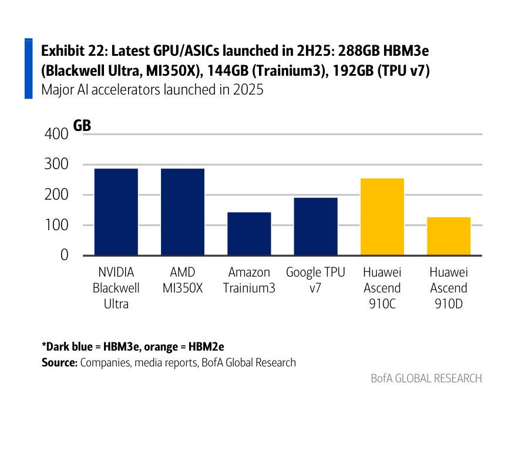

*Dark blue = HBM3e, orange = HBM2e
Source: Companies, media reports, BofA Global Research

**Exhibit 23: Next-gen GPUs/ASICs to be released in 2026E mostly adopts HBM4 with 384GB; new launches by OpenAI and Microsoft offer new upside for HBM**

Key AI accelerators to be released in 2026E

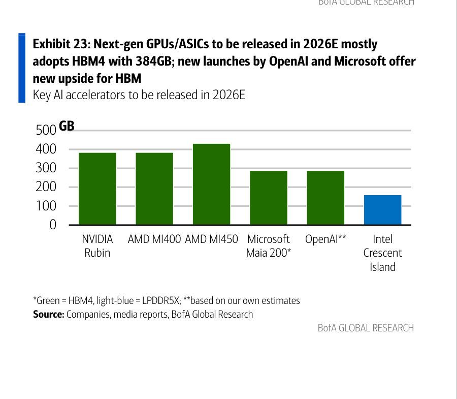

*Green = HBM4, light-blue = LPDDR5X; **based on our own estimates
Source: Companies, media reports, BofA Global Research

**图表21：H200/B200/B300将推动2025年HBM需求增长，后续2026/27年由Rubin/Rubin Ultra（使用HBM内存的NVIDIA GPU）带动**

| 公司名称 | Type | AI功能 | 发布日期 | DRAM规格 | 备注 |
| --- | --- | --- | --- | --- | --- |
| 主流Feynman | GPU | AI训练 | 2028 | HBM5（可能） | 基于下一代HBM |
| Rubin Ultra | GPU | AI训练 | 2H27 | 1TB HBM4e | 4个掩模可生产16个HBM芯片，每个芯片配备64GB内存(基于16层堆叠32Gb DRAM) |
| 鲁宾 | GPU | AI训练 | 2H26 | 288/384GB HBM4 | HBM4采用12层/16层堆叠24Gb DRAM芯片；带宽为13TB/s |
| B300 | GPU | AI训练 | 3Q25 | 288GB HBM3e | 基于8个12层24Gb DRAM裸片；带宽带宽为8TB/s |
| B100/200 | GPU | AI训练 | 1Q25 | 192GB HBM3e | 英伟达确认量产爬坡及发货时间2025财年第四季度（10月-1月） |
| H200 SXM/NVL | GPU | AI训练 | 2Q24 | 141GB HBM3e | 首款搭载HBM3e（1.2TB/s）内存的GPU |
| H100 NVL | GPU | AI训练 | Sep-22 | 188GB HBM3; 7.8TB/s | 采用188GB HBM3的强大AI训练GPU |
| H100 SXM5 | GPU | AI训练 | Sep-22 | 80GB HBM3；3.35TB/s | 高速AI训练GPU（900GB/秒）PCIe / NVL (600GB/sec) |
| H100 PCIe | GPU | AI训练 | Sep-22 | 80GB HBM2e；2TB/s | 仍基于HBM2e - HBM3尚未 |
| A100 | GPU | AI训练 | 2020年6月 | 40/80GB HBM2/2e；2TB/s | 旧世代但仍活跃用于AI训练 |
| 超级芯片 |  |  |  |  |  |
| Rubin Ultra NVL576 | 巨型超级芯片 | AI训练/推理 | 2027年下半年（2H27） | 288TB HBM4e（可能）+ 72TB DRAM | 通过NV Link连接288颗Rubin Ultra GPU |
| Vera Rubin NVL144 CPX | 巨型超级芯片 | AI训练/推理 | 2026年下半年 | 40TB HBM4（可能）+ 36TB DRAM + 18TB GDDR7 | 结合144个Rubin GPU、114个CPX GPU和Vera通过NV Link连接的CPU |
| Vera Rubin NVL144 | 巨型超级芯片 | AI训练/推理 | 2026年下半年 | 40TB HBM4（可能）+ 36TB DRAM | 通过NV Link将144个Rubin GPU与Vera CPU结合 |
| Vera Rubin | 超级芯片 | AI训练/推理 | 2026年下半年 | 576GB HBM4 + 1.4TB LPDDR5X | 结合2个Rubin GPU和1个Vera CPU |
| GB300 NVL72 | 巨型超级芯片 | AI训练/推理 | 2025年第三季度 | 20TB HBM3e + 18TB LPDDR5X | 通过NV Link组合36个GB300超级芯片 |
| GB300 | 超级芯片 | AI训练/推理 | 2025年第三季度 | 576GB HBM3e + 1.2TB LPDDR5X | 组合2个B300 GPU和1个Grace CPU |
| GB200 NVL72 | 巨型超级芯片 | AI训练/推理 | 2025年上半年（1H25） | 13.5TB HBM3e + 17TB LPDDR5X | 组合36个GB200超级芯片形成一个超级计算机 |
| GB200 | 超级芯片 | AI训练/推理 | 2025年上半年 | 384GB HBM3e + 480GB LPDDR5X | 结合2个B200 GPU与1个Grace CPU |
| GH200 v2 | 超级芯片 | AI训练/推理 | 2024年第二季度 | 144GB HBM3e | GH200第二代，采用"HBM3e（1.2TB/秒）" |
| GH200 | 超级芯片 | AI训练/推理 | 2023年12月 | 96GB HBM3 | 基于GPU+HBM3和CPU+LPDDR5的超级芯片 |
| 中国 |  |  |  |  |  |
| B30/B40 | GPU | AI训练/推理 | 2025年下半年 | GDDR7 | B300的中国特供版；多个B30芯片可连接在一起形成集群 |
| H20 | GPU | AI训练 | 1Q24 | 96GB HBM3; 4TB/s | H100的去规格化版本，用于对华出口；主要差异是计算能力 |
| L2 | GPU | AI训练/推理 | 2024年1月 | 24GB GDDR6；300GB/s | 针对中国出口的L40S降规格版本；带宽更低对比L20 |
| L20 | GPU | AI训练/推理 | 2023年12月 | 48GB GDDR6; 864GB/s | 针对中国出口的L40S降规格版本；主要差异为计算能力 |
| L40S | GPU | AI训练/推理 | 2023年10月 | 48GB GDDR6; 864GB/s | 无HBM，仅使用GDDR6，但AI性能提升1.2倍/1.7倍推理/训练 vs A100 |

来源：公司报告、媒体报道、美银全球研究部

**图表22：2025年下半年发布的最新GPU/ASIC：288GB HBM3e（Blackwell Ultra、MI350X）、144GB（Trainium3）、192GB（TPU v7）**

2025年推出的主要AI加速器

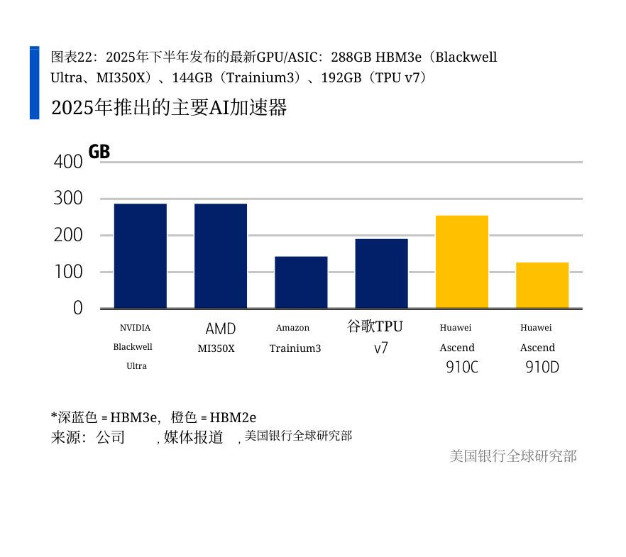

*深蓝色 = HBM3e，橙色 = HBM2e
来源：公司, 媒体报道, 美国银行全球研究部

**图表23：2026年预估发布的下一代GPU/ASIC大多采用384GB HBM4；OpenAI和微软的新发布为HBM带来新上行空间**

2026E将发布的主要AI加速器

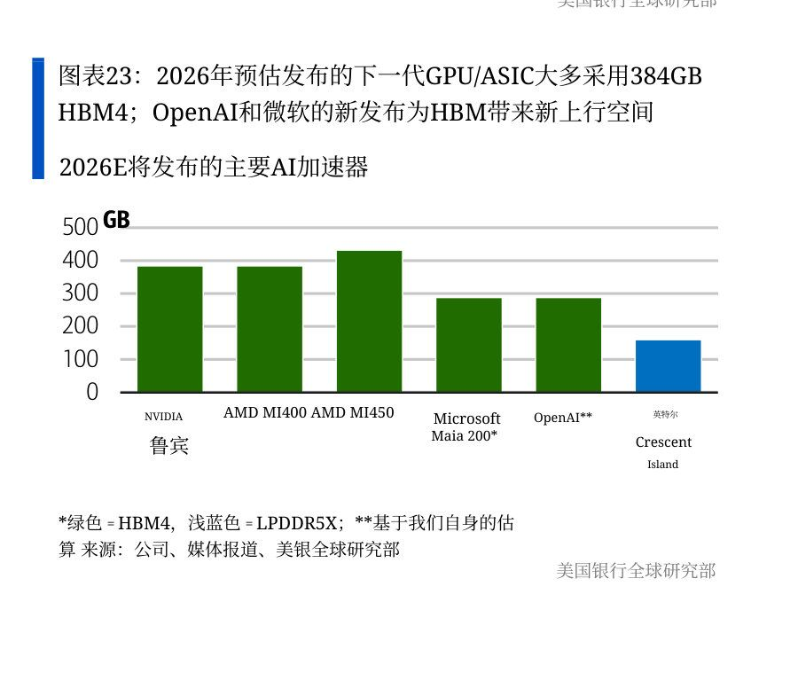

*绿色 = HBM4，浅蓝色 = LPDDR5X；**基于我们自身的估算
来源：公司、媒体报道、美银全球研究部

---

<!-- 原文第 14 页 -->

**Exhibit 24: Lots of GPU line-ups for AI training/inference; LPDDR5 and GDDR6 are also used for AI inferencing but we newly see upbeat demand for 12-hi HBM3e from new ASICs (e.g., Google's TPU v7)**

AI accelerators that use HBM memory

| Company | Name | Type | AI function | Launch date | DRAM spec | Remarks |
| --- | --- | --- | --- | --- | --- | --- |
| AMD | MI450 | APU | AI training | 2026 | 432GB HBM4 | Fabricated on TSMC's 2nm technology; can be scaled to a sever rack combining 72x GPUs (to a total of 30TB HBM) |
|  | MI400 | APU | AI training | 2026 | 384GB HBM4 | To compete with NVIDIA's Rubin GPU using HBM4; based on 16-hi |
|  | MI350X | APU | AI training | 2H25 | 288GB HBM3e; 8TB/s | Announced during its Advancing AI 2024 event; target production in 2H25 |
|  | MI325X | APU | AI training | 4Q24 | 256GB HBM3e; 6TB/s | 256GB HBM3e stated during its Advancing AI 2024 event on 10 Oct |
|  | MI300A | APU | AI training | Dec-23 | 128GB HBM3; 5.3TB/s | Slightly higher bandwidth vs MI300X |
|  | MI300X | APU | AI training | Jun-23 | 192GB HBM3; 5.2 TB/s | More advanced version vs MI300 |
|  | MI300 | APU | AI training | Jan-23 | 128GB HBM3; 1.2TB/s | Combination of CPU+GPU |
| Intel | Crescent Island | GPU | AI inference | 2H26 | 160GB LPDDR5X | Xe3P architecture with 640-bit memory interface |
|  | Gaudi3 | GPU | AI training | 3Q24 | 128GB HBM2e; 3.7TB/s | Target to compete with NVIDIA H100 |
|  | Gaudi2 | GPU | AI training | May-22 | 96GB HBM2e; 2.45TB/s | Stated stronger than NVIDIA A100 |
|  | Gaudi | GPU | AI training | NA | 32GB HBM2; 1TB/s |  |
| Meta | MTIA v2 | ASIC | AI inference | Apr-24 | LPDDR5 128GB; 204.8GB/s | TSMC's 5nm process vs first-gen 7nm |
|  | MTIA v1 | ASIC | AI inference | May-23 | LPDDR5 64GB; 176GB/s | AI accelerator - to be better than GPU |
| Amazon | Trainium3 | ASIC | AI training | 4Q25 | 144GB HBM3e | 2x faster and 40% more energy-efficient vs previous gen |
|  | Trainium2 | ASIC | AI training | Dec-2024 | 96GB HBM3e | Apple reportedly will use these chips for training its AI Intelligence |
|  | Inferentia2 | ASIC | AI inference | 2H22 | 32GB HBM2e | More advanced AI inference vs 2019 generation |
|  | Trainium | ASIC | AI training | 2H22 | 32GB HBM2e; 1.6TB/s | Used for training AI models in cloud |
| Google | TPU v7 (Ironwood) | ASIC | AI inference | 4Q25 | 192GB HBM3e | Designed specifically for inference workloads, for AI agents to retrieve and generate data |
|  | TPU v6e | ASIC | AI training | Late-2024 | 64GB HBM3 | 2x higher capacity and bandwidth vs its predecessor |
|  | TPU v5p | ASIC | AI training | Dec-23 | 95GB HBM2e | 2.8x faster in AI training vs its predecessor |
|  | TPU v5e | ASIC | AI training | Aug-23 | 16GB HBM2 | Pre-version of v5 2024; combines tens of thousands of v5e TPUs |
|  | TPU v4 | ASIC | AI training | May-22 | 32GB HBM2 | Claimed to be more efficient vs Nvidia's A100 |
| Microsoft | Maia 200 (next-gen) | ASIC | AI training | 2026 | 288GB HBM3e | For large-scale training and inference tasks within Microsoft cloud |
|  | Maia 100 | ASIC | AI inference | 2024 | 64GB HBM2e | Optimized for Azure/Bing inference workloads; 1.8TB/s bandwidth |
|  | Cobalt CPU | CPU | AI inference | TBC | DDR5 | Undisclosed |
| Huawei | Ascend 910D | NPU | AI Training | 4Q25 | 256GB HBM2e (likely) | Claims to outperform H100 GPU performance |
|  | Ascend 910C | NPU | AI Training | 1H25 | 128GB HBM2e (likely) | ASIC for China AI training and inference |
|  | Ascend 910B | NPU | AI Training | Oct-23 | 64GB HBM2e | Mostly used Ai chips in China besides the US chips |
| Alibaba | Hanguang 800 | NPU | AI inference | Sep-19 | not mentioned | Mainly for Alibaba AI inference |
| Biren | BR104 | GPU | AI training/inference | Sep-23 | 32GB HBM2e | HBM3 not yet adopted; memory content also low at 32GB |
|  | BR100 | GPU | AI training | Aug-22 | 64GB HBM2e | China's new AI training and also inference |
| Enflame | T20 | ASIC | AI training | Jul-21 | 32/64GB HBM2E | Mainly for China AI training |
| Cambricon | MLU370 | ASIC | AI inference | Mar-22 | 48GB LPDDR5 | Mainly for AI inference |

Source: Company reports, media reports, BofA Global Research

**Exhibit 25: Massive HBM content growth expected in 2025/2026-27 led by B300, Rubin and Rubin Ultra**

NVIDIA GPUs HBM spec evolution; Rubin Ultra HBM content also up 3x vs 2026 1st Rubin

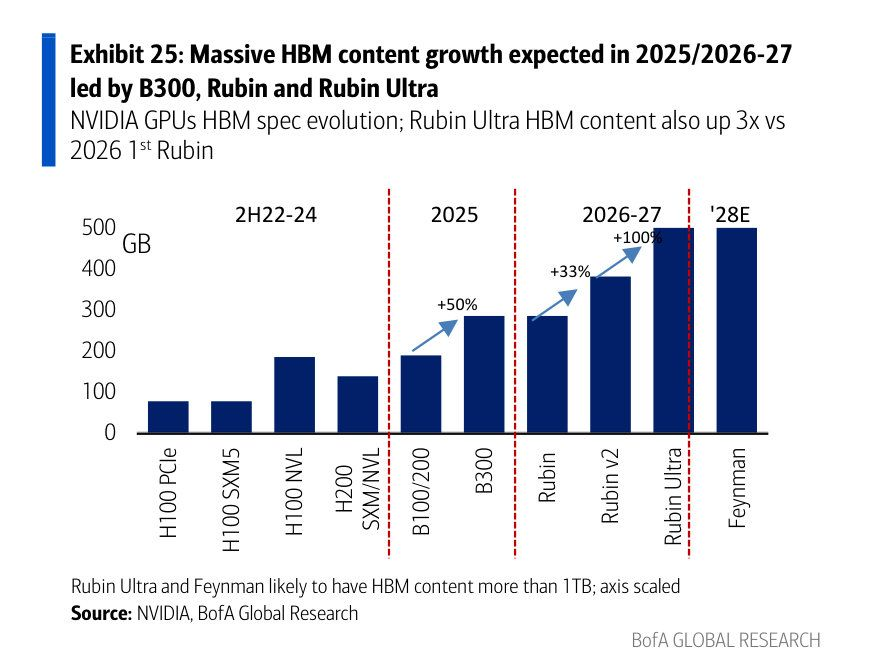

Rubin Ultra and Feynman likely to have HBM content more than 1TB; axis scaled
Source: NVIDIA, BofA Global Research

**Exhibit 26: 10-30% HBM content growth observed in AMD GPUs as well led by MI350X in 2025 and MI400 series in 2026**

AMD GPUs HBM spec evolution

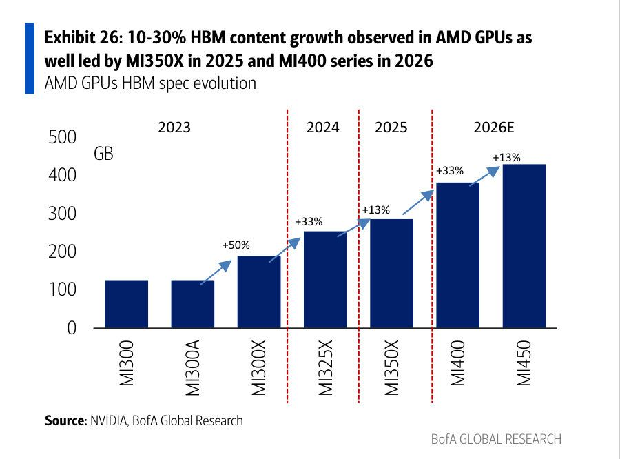

Source: NVIDIA, BofA Global Research

**图表24：AI训练/推理的GPU产品线众多；LPDDR5和GDDR6也用于AI推理，但我们新看到来自新ASIC（如Google的TPU v7）的12层堆叠HBM3e需求**

乐观 AI accelerators t hat use HBM 内存

| 公司名称 |  |  | AI功能类型 | 发布日期 | DRAM规格 | 备注 |
| --- | --- | --- | --- | --- | --- | --- |
| AMD | MI450 | APU | AI训练 | 2026 | 432GB HBM4 | 采用台积电2纳米工艺制造；可扩展至服务器机架结合72个GPU（总HBM容量达30TB） |
|  | MI400 | APU | AI训练 | 2026 | 384GB HBM4 | 与NVIDIA使用HBM4的Rubin GPU竞争；基于16层堆叠 |
|  | MI350X | APU | AI训练 | 2H25 | 288GB HBM3e；8TB/s | 于其2024年人工智能推进活动期间宣布；目标产量在2H25 |
|  | MI325X | APU | AI训练 | 4Q24 | 256GB HBM3e；6TB/s | 在10月10日的Advancing AI 2024活动中宣布的256GB HBM3e |
|  | MI300A | APU | AI训练 | 2023年12月 | 128GB HBM3；5.3TB/s | 带宽略高于MI300X |
|  | MI300X | APU | AI训练 | 2023年6月 | 192GB HBM3；5.2 TB/s | 比MI300更先进的版本 |
|  | MI300 | APU | AI训练 | 一月二十三 | 128GB HBM3；1.2TB/s | CPU+GPU的组合 |
| 英特尔 | Crescent Island | GPU | AI推理 | 2H26 | 160GB LPDDR5X | Xe3P架构，640位内存接口 |
|  | Gaudi3 | GPU | AI训练 | 3Q24 | 128GB HBM2e；3.7TB/s | 目标与NVIDIA H100竞争 |
|  | Gaudi2 | GPU | AI训练 | May-22 | 96GB HBM2e; 2.45TB/s | 称强于NVIDIA A100 |
|  | Gaudi | GPU | AI训练 | NA | 32GB HBM2；1TB/秒 |  |
| Meta | MTIA v2 | ASIC | AI推理 | 四月-24 | LPDDR5 128GB; 204.8GB/s | 台积电5纳米工艺对比第一代7纳米 |
|  | MTIA v1 | ASIC | AI推理 | May-23 | LPDDR5 64GB；176GB/s | AI加速器——优于GPU |
| Amazon | Trainium3 | ASIC | AI训练 | 4Q25 | 144GB HBM3e | 比上一代快2倍，能效提升40% |
|  | Trainium2 | ASIC | AI训练 | 2024年12月 | 96GB HBM3e | 据报道，苹果将使用这些芯片训练其AI Intelligence |
|  | Inferentia2 | ASIC | AI推理 | 2H22 | 32GB HBM2e | 比2019年一代更先进的AI推理 |
|  | Trainium | ASIC | AI训练 | 2H22 | 32GB HBM2e; 1.6TB/s | 用于训练云端AI模型 |
| Google | TPU v7（Ironwood） | ASIC | AI推理 | 4Q25 | 192GB HBM3e | 专为推理工作负载设计，供AI代理检索并生成数据 |
|  | TPU v6e | ASIC | AI训练 | 2024年末 | 64GB HBM3 | 比前代产品容量和带宽高2倍 |
|  | TPU v5p | ASIC | AI训练 | 2023年12月 | 95GB HBM2e | AI训练速度比前代快2.8倍 |
|  | TPU v5e | ASIC | AI训练 | 2023年8月 | 16GB HBM2 | v5 2024的预版本；结合数万个v5e TPU |
|  | TPU v4 | ASIC | AI训练 | May-22 | 32GB HBM2 | 声称比Nvidia的A100更高效 |
| Microsoft | Maia 200（下一代） | ASIC | AI训练 | 2026 | 288GB HBM3e | 用于微软云内的大规模训练和推理任务 |
|  | Maia 100 | ASIC | AI推理 | 2024 | 64GB HBM2e | 针对Azure/Bing推理工作负载优化；1.8TB/s带宽 |
|  | Cobalt CPU | CPU | AI推理 | TBC | DDR5 | 未披露 |
| Huawei | Ascend 910D | NPU | AI训练 | 4Q25 | 256GB HBM2e（可能） | 声称性能优于H100 GPU |
|  | Ascend 910C | NPU | AI训练 | 1H25 | 128GB HBM2e（可能） | 面向中国AI训练和推理的ASIC |
|  | Ascend 910B | NPU | AI训练 | Oct-23 | 64GB HBM2e | 中国除美国芯片外最常用的AI芯片 |
| Alibaba | Hanguang 800 | NPU | AI推理 | 2019年9月 | 未提及 | 主要用于阿里巴巴AI推理 |
| Biren | BR104 | GPU | AI训练/推理 | 2023年9月 | 32GB HBM2e | HBM3尚未采用；内存容量也较低，仅32GB |
|  | BR100 | GPU | AI训练 | 2022年8月 | 64GB HBM2e | 中国的新型AI训练及推理 |
| Enflame | T20 | ASIC | AI训练 | 2021年7月 | 32/64GB HBM2E | 主要用于中国AI训练 |
| Cambricon | MLU370 | ASIC | AI推理 | 2022年3月 | 48GB LPDDR5 | 主要用于AI推理 |

来源：公司报告、媒体报道、美银全球研究部

**图表25：2025/2026-27年HBM内容预计大幅增长，由B300、Rubin及Rubin Ultra引领**

NVIDIA GPU的HBM规格演变；Rubin Ultra的HBM含量也比2026 1st Rubin增加了3倍

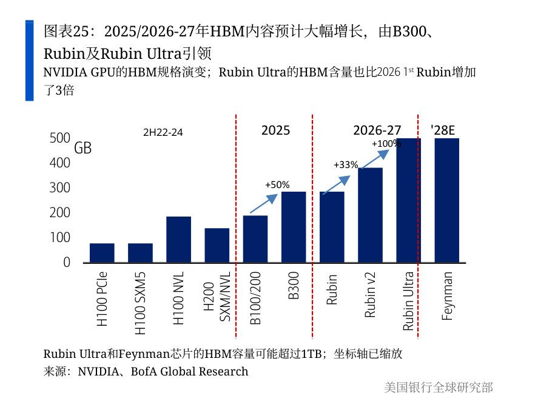

Rubin Ultra和Feynman芯片的HBM容量可能超过1TB；坐标轴已缩放
来源：NVIDIA、BofA Global Research

**图表26：AMD GPU中也观察到10-30%的HBM含量增长，由2025年的MI350X和2026年的MI400系列引领**

AMD GPU的HBM规格演进

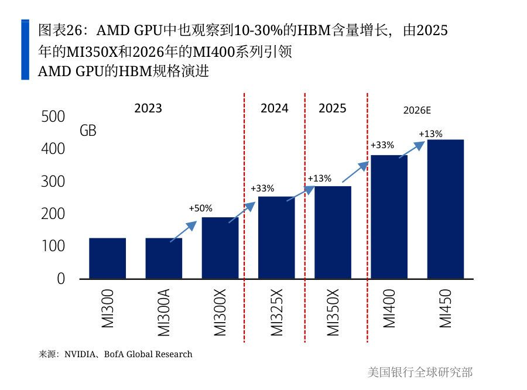

来源：NVIDIA、BofA Global Research

---

<!-- 原文第 15 页 -->

## Memory spot price trend

**Exhibit 27: DRAM spot price rally exceptionally strong since Sept-25; record-high level for current mainstream DRAM 16Gb DDR5 at US$26 and 16Gb DDR4 at $50; DRAM price hit the highest levels in the past 25 years. Previous high level was hit in Oct-17, but only $10 level vs current $20+**

DRAM spot price – long-term trend (2000-2025)

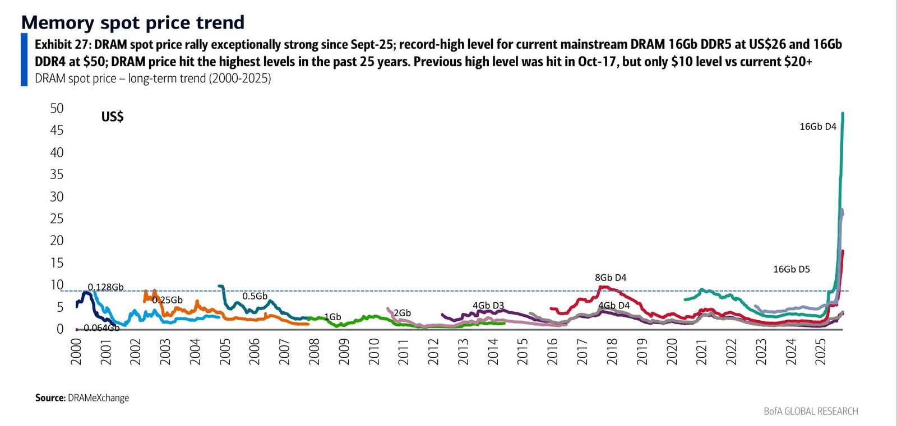

纵轴：US$ 0–50（间隔 5）；横轴：2000–2025
图例：8Gb D4、4Gb D4、4Gb D3、2Gb、1Gb、0.5Gb、0.25Gb、0.128Gb、0.064Gb、16Gb D4、16Gb D5
Source: DRAMeXchange

**Exhibit 28: More than tripled through Oct/Nov/Dec; abnormally high at US$25; no hardlanding but mild correction expected in 1Q26**

DRAM spot price outlook - US$/16Gb equiv

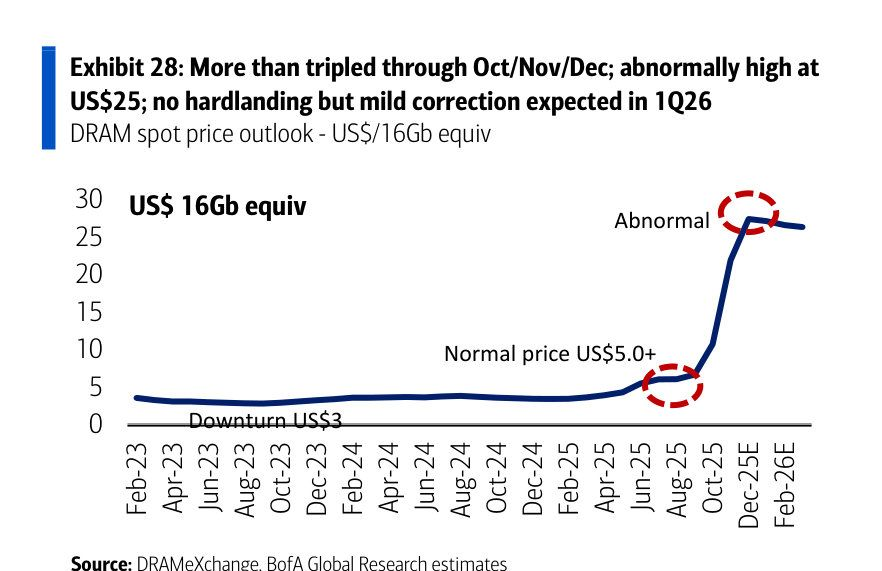

纵轴：US$ 16Gb equiv 0–30（间隔 5）；横轴：Feb-23 至 Feb-26E（两月间隔）
图内标注：Downturn US$3、Normal price US$5.0+、Abnormal
Source: DRAMeXchange, BofA Global Research estimates

**Exhibit 29: Like DRAM, more than doubled through Oct/Nov/Dec; thus abnormally high at US$10+; no hardlanding but mild correction also expected in 1Q26**

NAND spot price outlook - US$/512Gb equiv

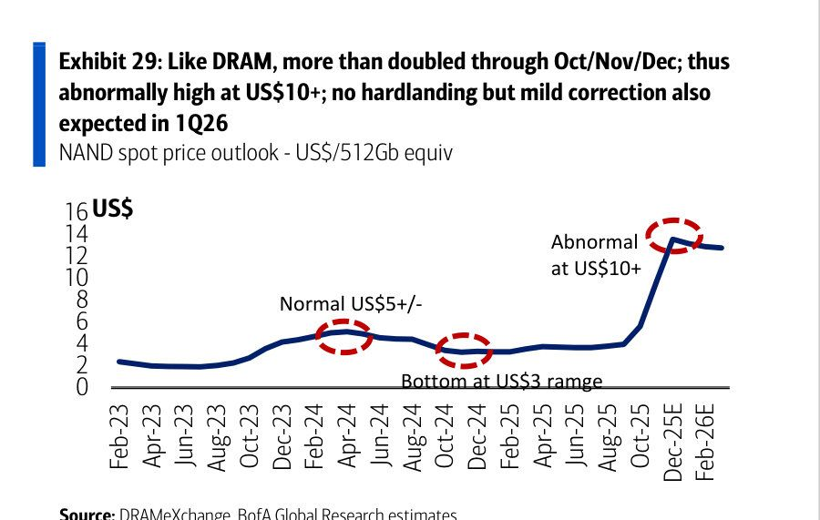

纵轴：US$ 0–16（间隔 2）；横轴：Feb-23 至 Feb-26E（两月间隔）
图内标注：Normal US$5+/-、Bottom at US$3 ramge、Abnormal at US$10+
Source: DRAMeXchange, BofA Global Research estimates

**Exhibit 30: DDR4 crossover occurred in Jun-25; current price of 16Gb DDR4 ($50) much higher vs 16Gb DDR5 ($26)**

Long term price trend of 16Gb DDR5 and 16Gb DDR4 products

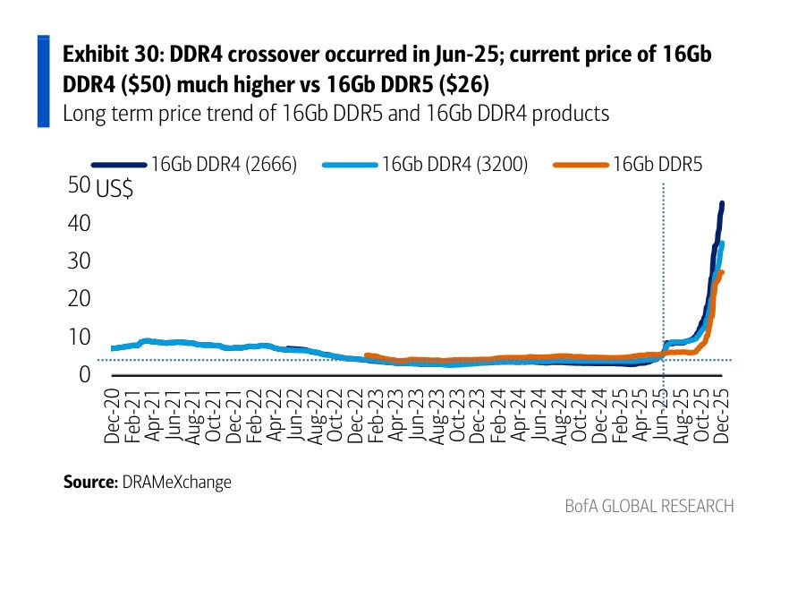

纵轴：US$ 0–50（间隔 10）；横轴：Dec-20 至 Dec-25（两月间隔）
图例：16Gb DDR4 (2666)、16Gb DDR4 (3200)、16Gb DDR5
Source: DRAMeXchange

**Exhibit 31: Current 8Gb DDR4 price hits ~$18 level, exceeds previous high of $10 (Oct-17), and way above historical average of $4-5**

Long term price trend of 8Gb DDR4 products

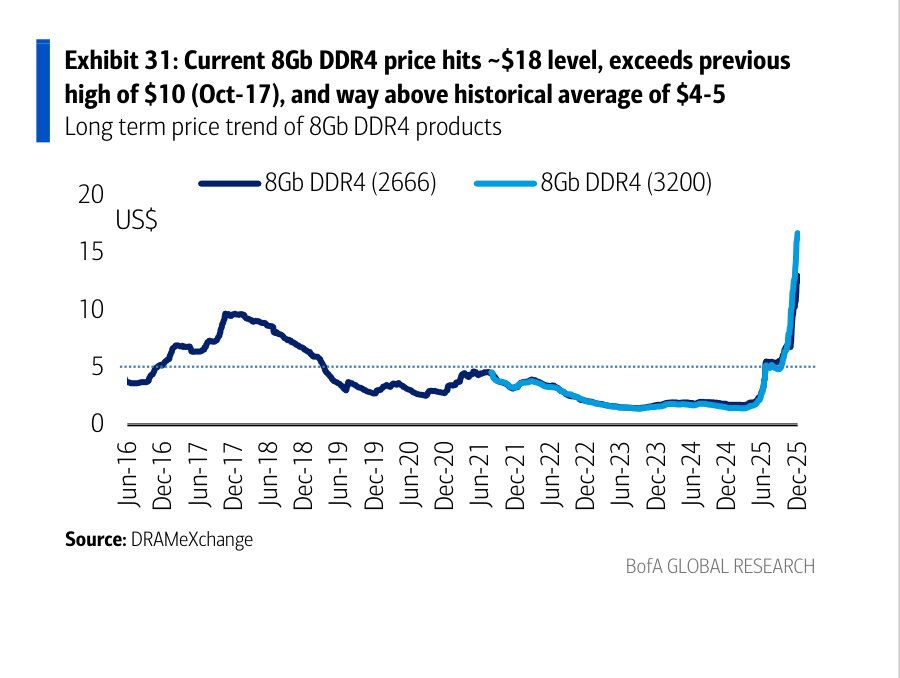

纵轴：US$ 0–20（间隔 5）；横轴：Jun-16 至 Dec-25（半年间隔）
图例：8Gb DDR4 (2666)、8Gb DDR4 (3200)
Source: DRAMeXchange

## 内存现货价格趋势

**图表27：DRAM现货价格自2025年9月以来涨势异常强劲；当前主流DRAM 16Gb DDR5创纪录高价26美元，16Gb DDR4为50美元；DRAM价格达到过去25年最高水平。此前高点出现在2017年10月，但仅为10美元，远低于当前水平20+**

DRAM现货价格——长期趋势（2000-2025年）

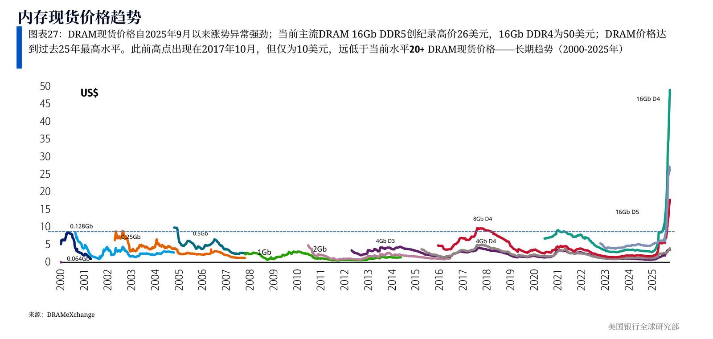

纵轴：US$ 0–50（间隔 5）；横轴：2000–2025
图例：8Gb D4、4Gb D4、4Gb D3、2Gb、1Gb、0.5Gb、0.25Gb、0.128Gb、0.064Gb、16Gb D4、16Gb D5
来源：DRAMeXchange

**Exhibit 28: 10月/11月/12月增长超过两倍；异常高至25美元；预计2026年第一季度不会硬着陆，但会温和调整**

DRAM现货价格展望 - US$/16Gb等效

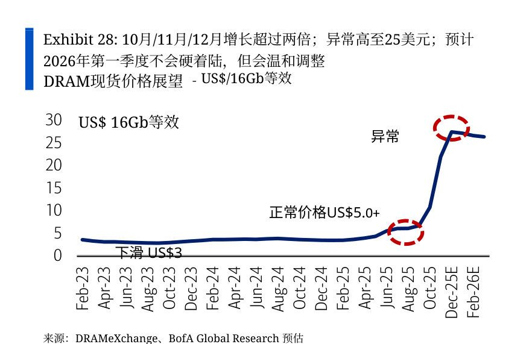

纵轴：US$ 16Gb等效 0–30（间隔 5）；横轴：Feb-23 至 Feb-26E（两月间隔）
图内标注：正常价格US$5.0+、异常、下滑US$3
来源：DRAMeXchange、BofA Global Research 预估

**图表29：与DRAM类似，10/11/12月价格涨幅超一倍；因此US$10+处于异常高位；2026年第一季度预计不会硬着陆，但温和回调可期**

NAND现货价格展望 - 美元/512Gb当量

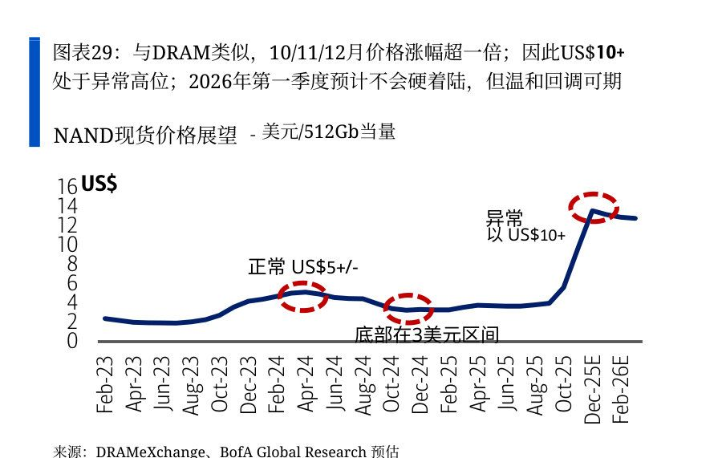

纵轴：US$ 0–16（间隔 2）；横轴：Feb-23 至 Feb-26E（两月间隔）
图内标注：正常US$5+/-、异常以US$10+、底部在3美元区间
来源：DRAMeXchange、BofA Global Research 预估

**图表30：DDR4交叉点出现在2025年6月；当前16Gb DDR4价格（50美元）远高于16Gb DDR5（26美元）**

16Gb DDR5和16Gb DDR4产品的长期价格趋势

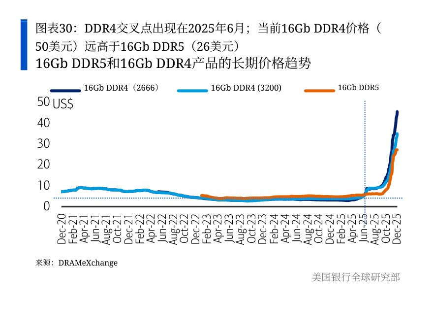

纵轴：US$ 0–50（间隔 10）；横轴：Dec-20 至 Dec-25（两月间隔）
图例：16Gb DDR4（2666）、16Gb DDR4 (3200)、16Gb DDR5
来源：DRAMeXchange

**图表31：当前8Gb DDR4价格触及~$18水平，超过2017年10月的前高$10，远高于历史平均$4-5**

8Gb DDR4产品的长期价格趋势

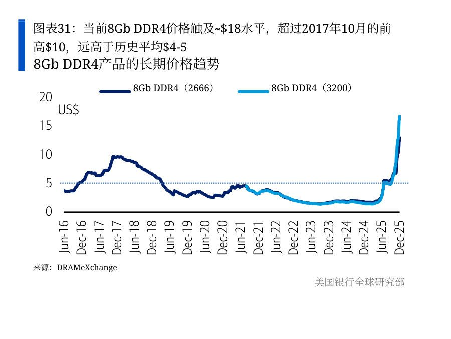

纵轴：US$ 0–20（间隔 5）；横轴：Jun-16 至 Dec-25（半年间隔）
图例：8Gb DDR4（2666）、8Gb DDR4（3200）
来源：DRAMeXchange

---

<!-- 原文第 16 页 -->

**Exhibit 32: Price slightly muted for two consecutive weeks but still all-time high (~US$26) on the back of robust rally in Nov (+60%) and Oct (+70%)**

16Gb DDR5 spot price – daily, Apr '23-Dec '25

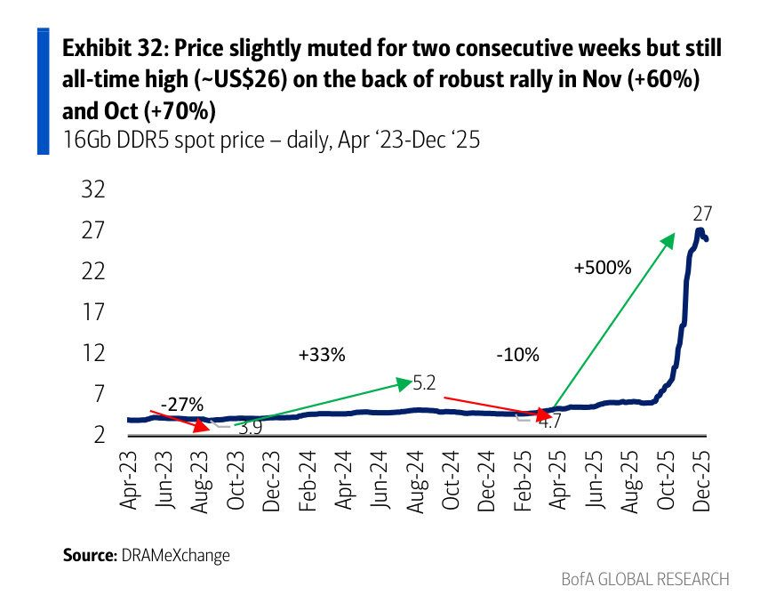

纵轴：US$ 2–32（标注值 2、7、12、17、22、27、32）；横轴：Apr-23 至 Dec-25（月间隔）
图内数值标注：-27%（Aug-23 附近）、3.9、5.2、-10%（Feb-25 附近）、4.7、+33%、+500%、27（Dec-25）
Source: DRAMeXchange

**Exhibit 33: Strongest MoM recovery (+60-100% MoM) recorded in Oct and Nov vs only 5-10% MoM during Mar-Sep**

16Gb DDR5 spot month-average price – MoM change, Apr '23-Dec '25

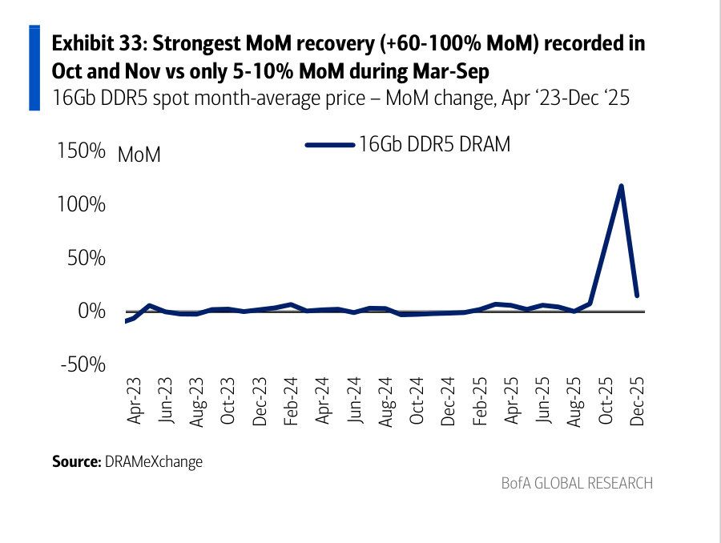

纵轴：MoM -50% 至 150%（间隔 50%）；横轴：Apr-23 至 Dec-25（月间隔）
图例：16Gb DDR5 DRAM
Source: DRAMeXchange

**Exhibit 34: 8Gb DDR4 rally more notable (1000%+ YTD) due to big-3 chipmakers' production cut; price hit $18 exceeding previous high levels of $10 hit in Oct-17**

8Gb DDR4 spot price trend, Feb '23-Dec '25

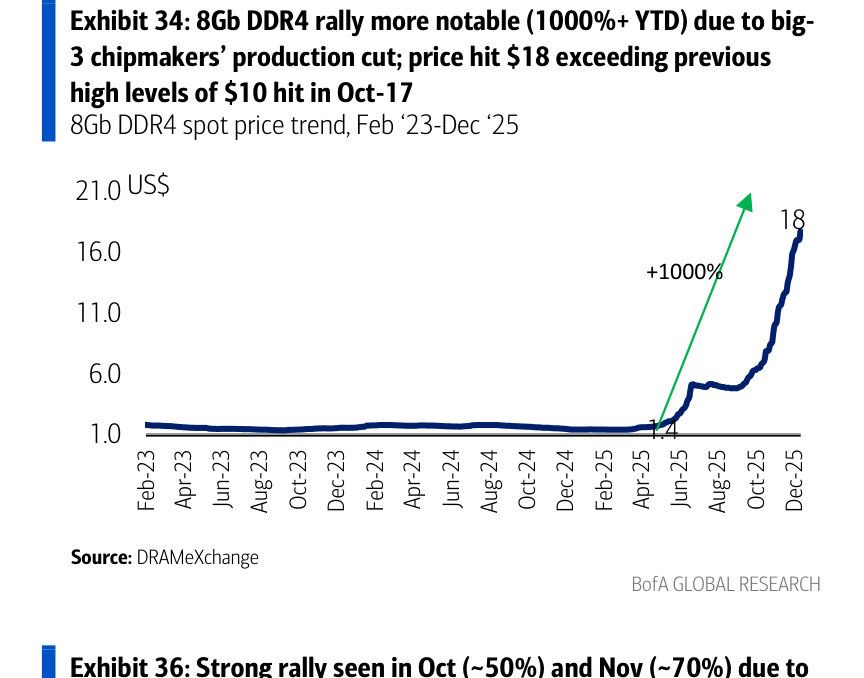

纵轴：US$ 1.0–21.0（标注值 1.0、6.0、11.0、16.0、21.0）；横轴：Feb-23 至 Dec-25（月间隔）
图内数值标注：1.4、18；涨跌幅标注：+1000%
图例：16Gb DDR4 DRAM
Source: DRAMeXchange

**Exhibit 35: Also recovered well in Sep (+33%), Oct (+70%), Nov (+50%) and early Dec (16%) to reach US$50; price up 1000%+ YTD**

16Gb DDR4 spot price trend, Jan '23-Dec '25

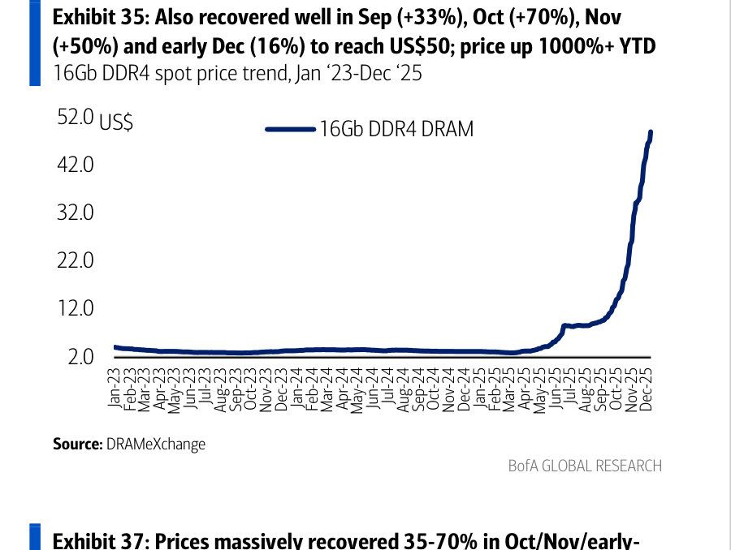

纵轴：US$ 2.0–52.0（标注值 2.0、12.0、22.0、32.0、42.0、52.0）；横轴：Jan-23 至 Dec-25（月间隔）
图例：16Gb DDR4 DRAM
Source: DRAMeXchange

**Exhibit 36: Strong rally seen in Oct (~50%) and Nov (~70%) due to production cut and demand recovery driven price upside; early Dec price also up +6%, but flat this week**

512Gb NAND wafer spot price – weekly, Dec '20-Dec '25

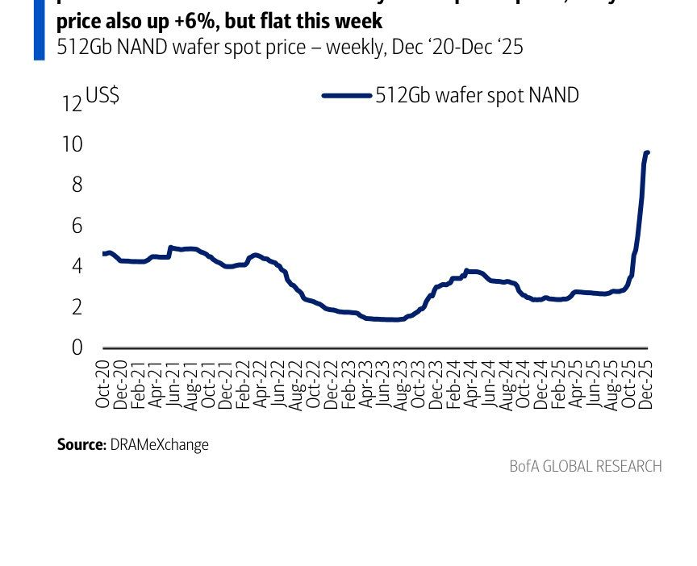

纵轴：US$ 0–12（间隔 2）；横轴：Oct-20 至 Dec-25（月间隔，按周取点）
图例：512Gb wafer spot NAND
Source: DRAMeXchange

**Exhibit 37: Prices massively recovered 35-70% in Oct/Nov/early-Dec vs up 4% MoM each in Aug and September'; prices remained flat in May/June/July**

512Gb NAND wafer spot month-average – MoM change, Oct '20-Dec '25

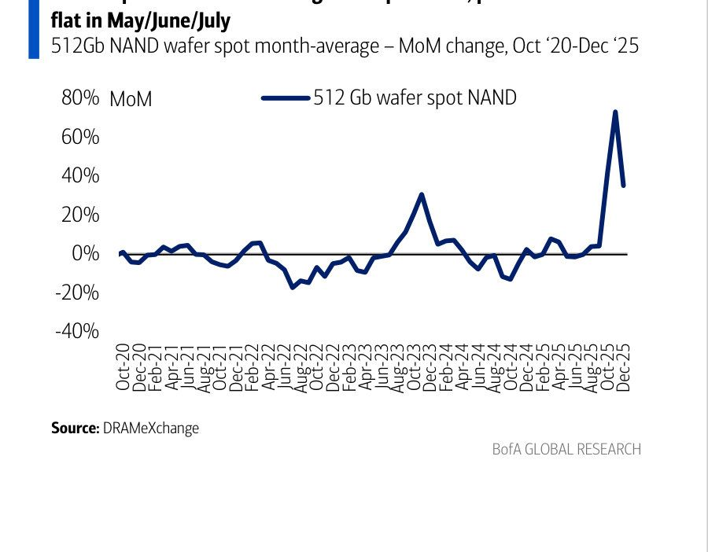

纵轴：MoM -40% 至 80%（间隔 20%）；横轴：Oct-20 至 Dec-25（月间隔）
图例：512 Gb wafer spot NAND
Source: DRAMeXchange

**图表32：价格连续两周略有回落，但仍处于历史高位（~26美元），因11月（+60%）和10月（+70%）的强劲反弹**

16Gb DDR5现货价格 – 每日，2023年4月-2025年12月

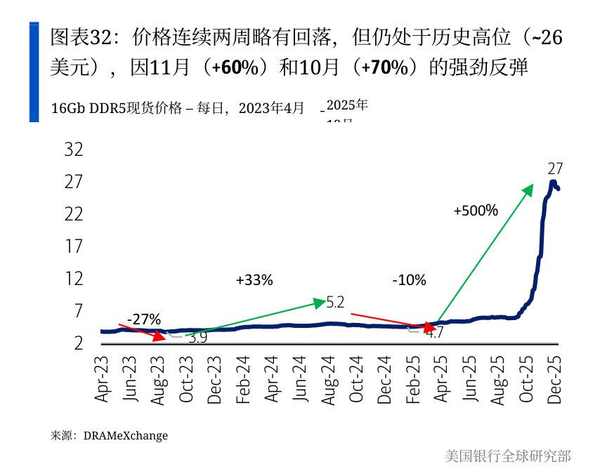

纵轴：US$ 2–32（标注值 2、7、12、17、22、27、32）；横轴：Apr-23 至 Dec-25（月间隔）
图内数值标注：-27%（Aug-23 附近）、3.9、5.2、-10%（Feb-25 附近）、4.7、+33%、+500%、27（Dec-25）
来源：DRAMeXchange

**图表33：10月和11月录得最强环比复苏（+60-100%环比），而3-9月仅5-10%环比**

16Gb DDR5现货月均价-环比变化（2023年4月-2025年12月）

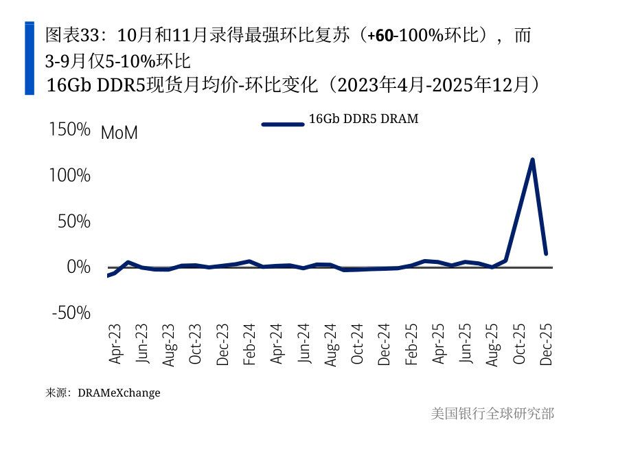

纵轴：MoM -50% 至 150%（间隔 50%）；横轴：Apr-23 至 Dec-25（月间隔）
图例：16Gb DDR5 DRAM
来源：DRAMeXchange

**图表34：8Gb DDR4反弹更显著（年初至今上涨1000%+），因三大芯片制造商减产；价格触及18美元，超过2023年2月-2025年12月期间10-17美元的前期高点**

8Gb DDR现货价格趋势

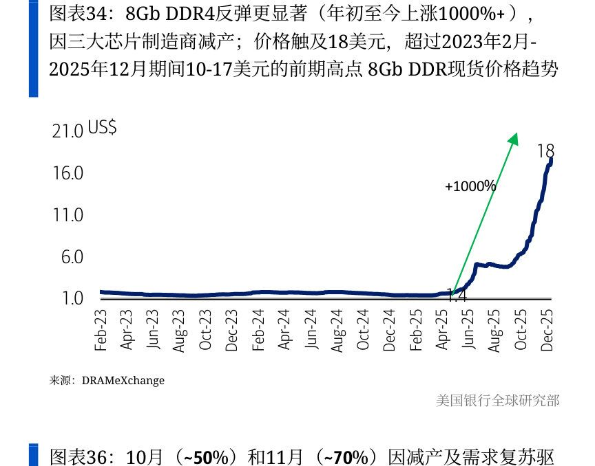

纵轴：US$ 1.0–21.0（标注值 1.0、6.0、11.0、16.0、21.0）；横轴：Feb-23 至 Dec-25（月间隔）
图内数值标注：1.4、18；涨跌幅标注：+1000%
图例：16Gb DDR4 DRAM
来源：DRAMeXchange

**Exhibit 35: 9月(+33%)、10月(+70%)、11月(+50%)及12月初(16%)也回升良好，达到50美元；价格年初至今上涨1000%+**

16Gb DDR4现货价格趋势，2023年1月-2025年12月

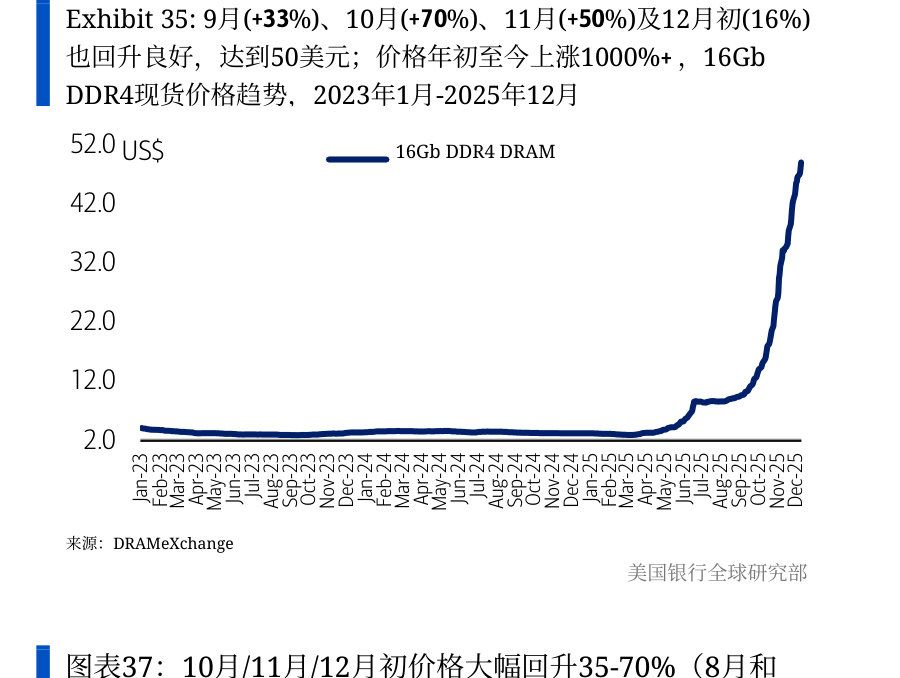

纵轴：US$ 2.0–52.0（标注值 2.0、12.0、22.0、32.0、42.0、52.0）；横轴：Jan-23 至 Dec-25（月间隔）
图例：16Gb DDR4 DRAM
来源：DRAMeXchange

**图表36：10月（~50%）和11月（~70%）因减产及需求复苏驱动价格上涨而大幅反弹；12月初价格也上涨+6%，但本周持平**

512Gb NAND晶圆现货价格 – 每周，2020年12月-2025年12月

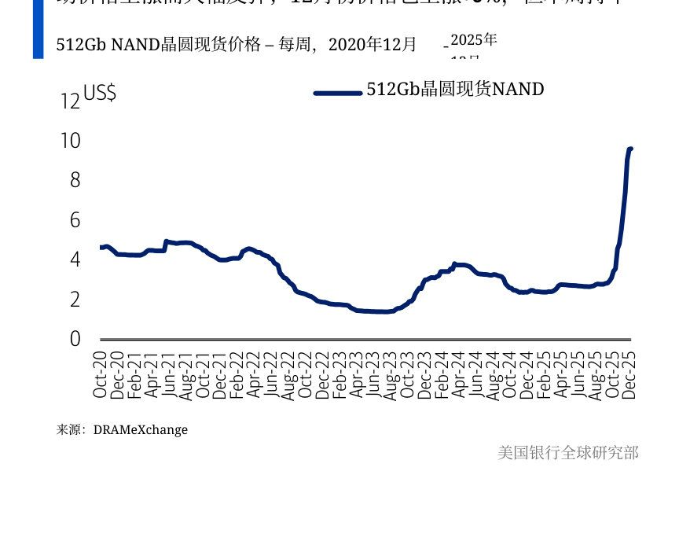

纵轴：US$ 0–12（间隔 2）；横轴：Oct-20 至 Dec-25（月间隔，按周取点）
图例：512Gb晶圆现货NAND
来源：DRAMeXchange

**图表37：10月/11月/12月初价格大幅回升35-70%（8月和9月每月环比上涨4%）；5月/6月/7月价格持平**

512Gb NAND晶圆现货月度价格 -平均值——环比变化，2020年10月-2025年12月

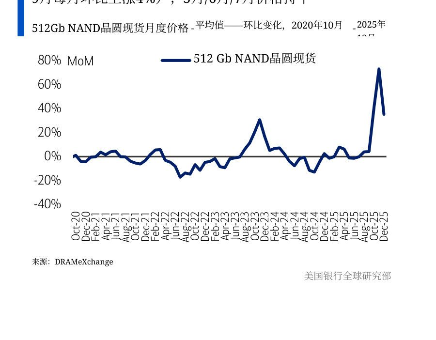

纵轴：MoM -40% 至 80%（间隔 20%）；横轴：Oct-20 至 Dec-25（月间隔）
图例：512 Gb NAND晶圆现货
来源：DRAMeXchange

---

<!-- 原文第 17 页 -->

**Exhibit 38: DRAM spot and contract price rose multifold YTD vs NAND**

Current price vs end of 2024 price comparison for DRAM/NAND spot and contract prices

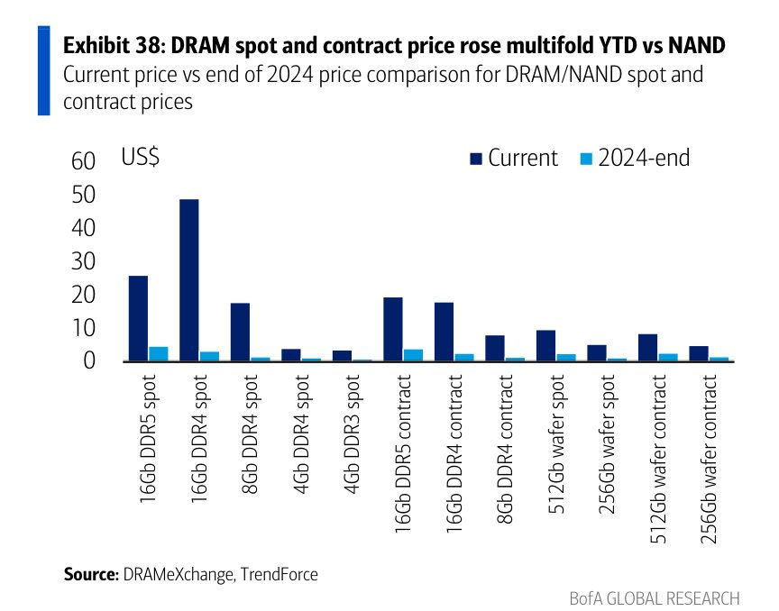

纵轴：US$ 0–60（间隔 10）；横轴（12 类）：16Gb DDR5 spot、16Gb DDR4 spot、8Gb DDR4 spot、4Gb DDR4 spot、4Gb DDR3 spot、16Gb DDR5 contract、16Gb DDR4 contract、8Gb DDR4 contract、512Gb wafer spot、256Gb wafer spot、512Gb wafer contract、256Gb wafer contract
图例：Current、2024-end
Source: DRAMeXchange, TrendForce

**Exhibit 39: DRAM spot and contract on average up 600%+ vs NAND on average up 250%+**

YTD price change of DRAM/NAND spot and contract prices

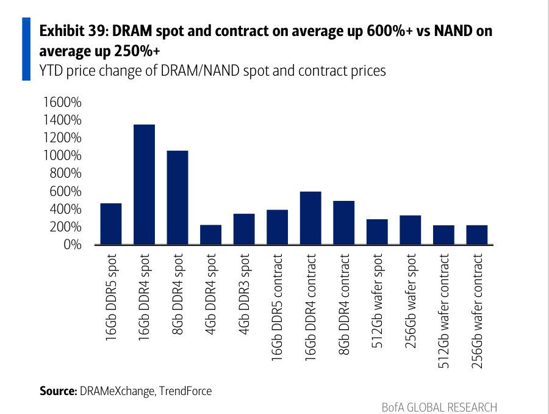

纵轴：0%–1600%（间隔 200%）；横轴（12 类）：16Gb DDR5 spot、16Gb DDR4 spot、8Gb DDR4 spot、4Gb DDR4 spot、4Gb DDR3 spot、16Gb DDR5 contract、16Gb DDR4 contract、8Gb DDR4 contract、512Gb wafer spot、256Gb wafer spot、512Gb wafer contract、256Gb wafer contract
Source: DRAMeXchange, TrendForce

**Exhibit 40: Spot and contract price 3x higher than our company/industry ASP assumptions**

16Gb equivalent spot, contract price, company specific and industry 4Q ASP

纵轴：US$ 0.0–50.0（间隔 10.0）；横轴（9 类）：16Gb DDR5 spot、16Gb DDR4 spot、16Gb DDR5 contract、16Gb DDR4 contract、Samsung ASP、SK Hynix ASP、Micron ASP、Nanya ASP、Industry ASP
Source: DRAMeXchange, TrendForce, Companies, BofA Global Research estimates

**Exhibit 41: Spot and contract price outperformed YTD; ex-spot price not yet significantly high vs end-2024 level due to 1H weaknesses**

Spot, contract price, company specific and industry YTD change

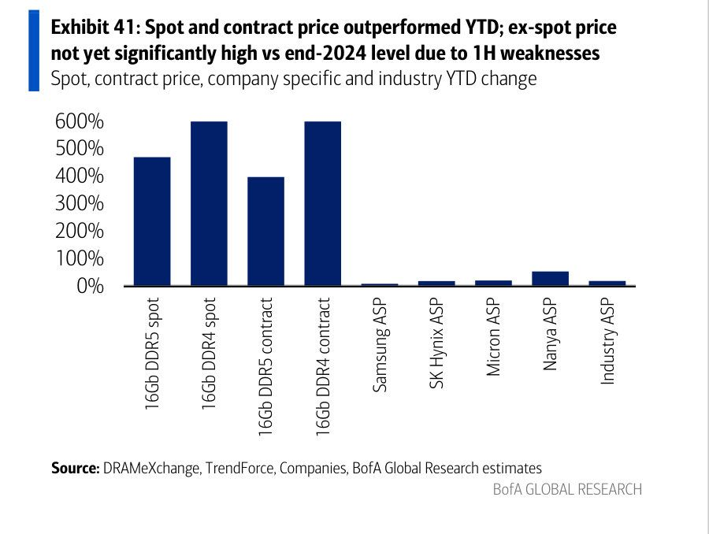

纵轴：0%–600%（间隔 100%）；横轴（9 类）：16Gb DDR5 spot、16Gb DDR4 spot、16Gb DDR5 contract、16Gb DDR4 contract、Samsung ASP、SK Hynix ASP、Micron ASP、Nanya ASP、Industry ASP
Source: DRAMeXchange, TrendForce, Companies, BofA Global Research estimates

**Exhibit 42: Current price ($26) up +480% from Jan bottom ($4.7); previous peak was hit in Aug-24 when price rose +33% to $5.2 from Aug-23 bottom of $3.9. Average peak duration is 8 months vs trough duration is 4 months**

16Gb DDR5 spot price – peak vs trough trend

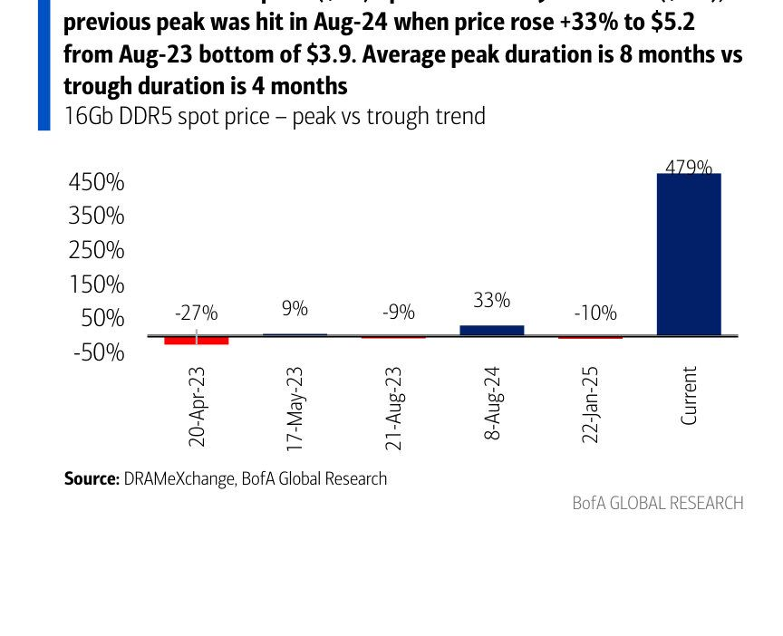

纵轴：-50% 至 450%（间隔 50%）；横轴：20-Apr-23、17-May-23、21-Aug-23、8-Aug-24、22-Jan-25、Current
图内数值标注：-27%、9%、-9%、33%、-10%、479%
Source: DRAMeXchange, BofA Global Research

**Exhibit 43: NAND price also significantly up 300% from Nov-24 bottom ($2.4)**

512Gb NAND wafer spot price – peak vs trough trend

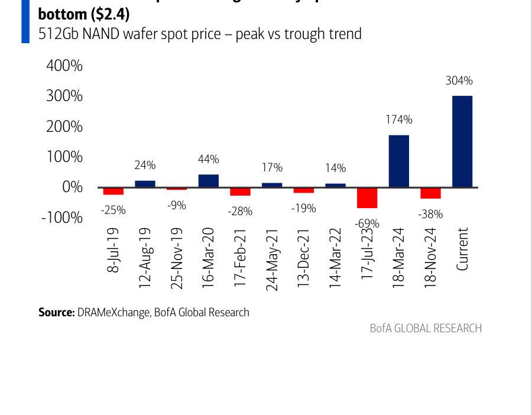

纵轴：-100% 至 400%（间隔 100%）；横轴：8-Jul-19、12-Aug-19、25-Nov-19、16-Mar-20、17-Feb-21、24-May-21、13-Dec-21、14-Mar-22、17-Jul-23、18-Mar-24、18-Nov-24、Current
图内数值标注：-25%、24%、-9%、44%、-28%、17%、-19%、14%、-69%、174%、-38%、304%
Source: DRAMeXchange, BofA Global Research

**Exhibit 38: DRAM现货和合约价格年初至今较NAND上涨数倍**

DRAM/NAND现货及合约价格当前价格与2024年末价格对比

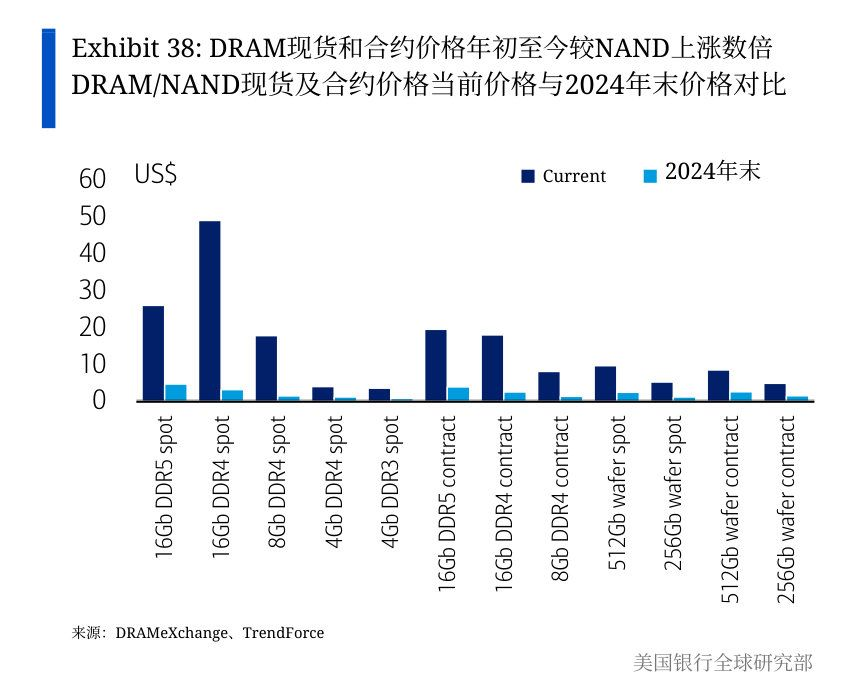

纵轴：US$ 0–60（间隔 10）；横轴（12 类）：16Gb DDR5 spot、16Gb DDR4 spot、8Gb DDR4 spot、4Gb DDR4 spot、4Gb DDR3 spot、16Gb DDR5 contract、16Gb DDR4 contract、8Gb DDR4 contract、512Gb wafer spot、256Gb wafer spot、512Gb wafer contract、256Gb wafer contract
图例：Current、2024年末
来源：DRAMeXchange、TrendForce

**图表39：DRAM现货和合同价格平均上涨600%+，而NAND平均上涨250%+**

DRAM/NAND现货及合约价格的年初至今变化

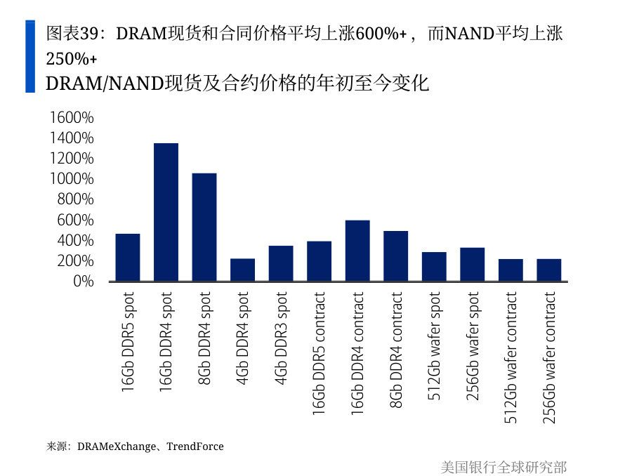

纵轴：0%–1600%（间隔 200%）；横轴（12 类）：16Gb DDR5 spot、16Gb DDR4 spot、8Gb DDR4 spot、4Gb DDR4 spot、4Gb DDR3 spot、16Gb DDR5 contract、16Gb DDR4 contract、8Gb DDR4 contract、512Gb wafer spot、256Gb wafer spot、512Gb wafer contract、256Gb wafer contract
来源：DRAMeXchange、TrendForce

**图表40：现货和合约价是我们公司/行业ASP假设的3倍**

16Gb等效现货、合同价格、公司特定及行业第四季度ASP

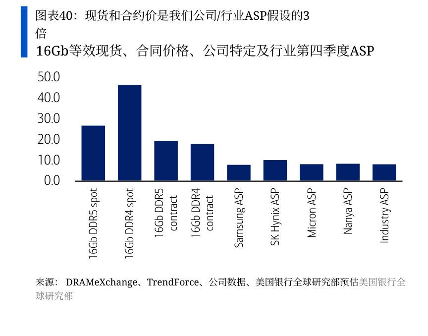

纵轴：US$ 0.0–50.0（间隔 10.0）；横轴（9 类）：16Gb DDR5 spot、16Gb DDR4 spot、16Gb DDR5 contract、16Gb DDR4 contract、Samsung ASP、SK Hynix ASP、Micron ASP、Nanya ASP、Industry ASP
来源：DRAMeXchange、TrendForce、公司数据、美国银行全球研究部预估

**图表41：现货与合约价格年初至今表现优异；现货价格尚未显著高于2024年末水平（因上半年疲软）**

现货、合约价格、公司特定及行业年初至今变化

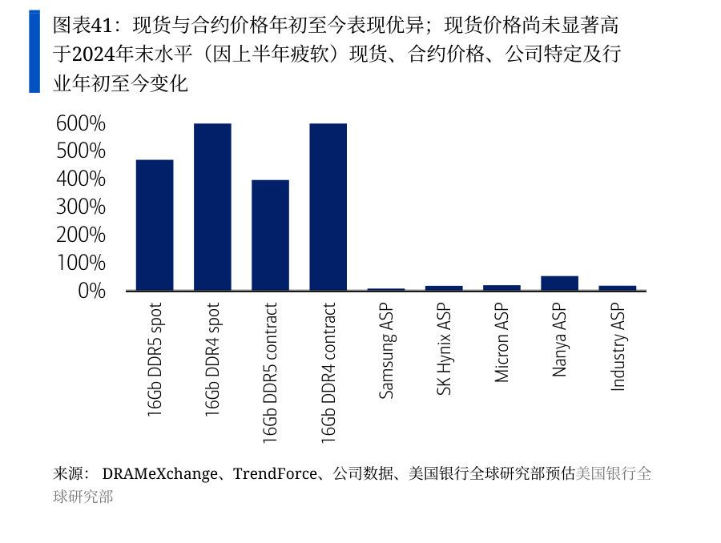

纵轴：0%–600%（间隔 100%）；横轴（9 类）：16Gb DDR5 spot、16Gb DDR4 spot、16Gb DDR5 contract、16Gb DDR4 contract、Samsung ASP、SK Hynix ASP、Micron ASP、Nanya ASP、Industry ASP
来源：DRAMeXchange、TrendForce、公司数据、美国银行全球研究部预估

**图表42：当前价格（26美元）较1月底部（4.7美元）上涨+480%；此前峰值出现在2024年8月，价格从2023年8月底部3.9美元上涨+33%至5.2美元。平均峰值持续时间为8个月，而谷值持续时间为4个月**

16Gb DDR5现货价格——峰值与谷值趋势

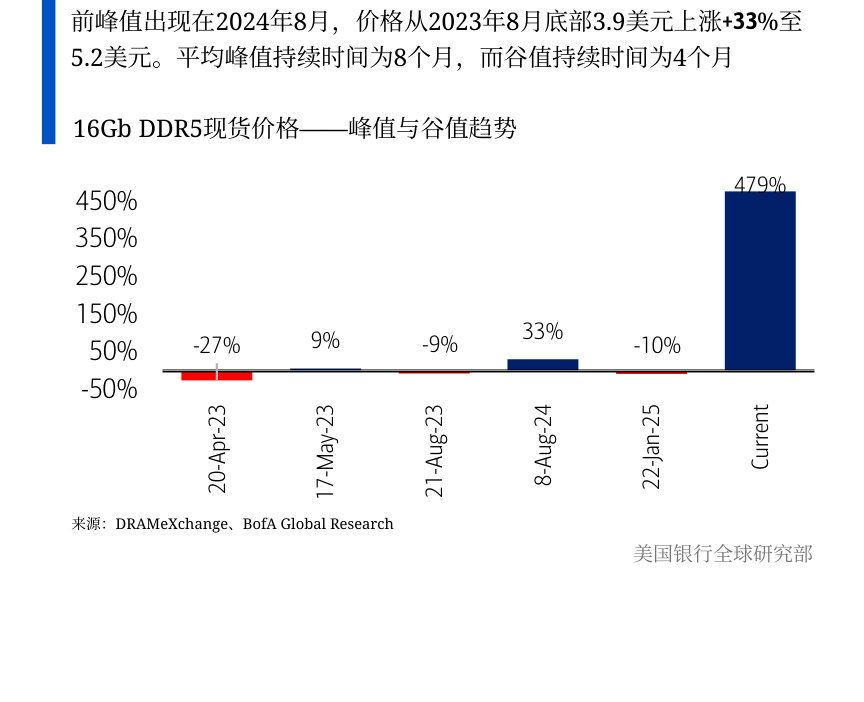

纵轴：-50% 至 450%（间隔 50%）；横轴：20-Apr-23、17-May-23、21-Aug-23、8-Aug-24、22-Jan-25、Current
图内数值标注：-27%、9%、-9%、33%、-10%、479%
来源：DRAMeXchange、BofA Global Research

**图表43：NAND价格也从2024年11月的底部（2.4美元）显著上涨300%**

2Gb 51 NAND fer spot price – pea k vs troug h trend

纵轴：-100% 至 400%（间隔 100%）；横轴：8-Jul-19、12-Aug-19、25-Nov-19、16-Mar-20、17-Feb-21、24-May-21、13-Dec-21、14-Mar-22、17-Jul-23、18-Mar-24、18-Nov-24、Current
图内数值标注：-25%、24%、-9%、44%、-28%、17%、-19%、14%、-69%、174%、-38%、304%
来源：DRAMeXchange、BofA Global Research

---

<!-- 原文第 18 页 -->

**Exhibit 44: Back to base level after hitting all time high (YoY change) in Oct-24**

YoY change of WSTS DRAM ASP (8Gb equivalent)

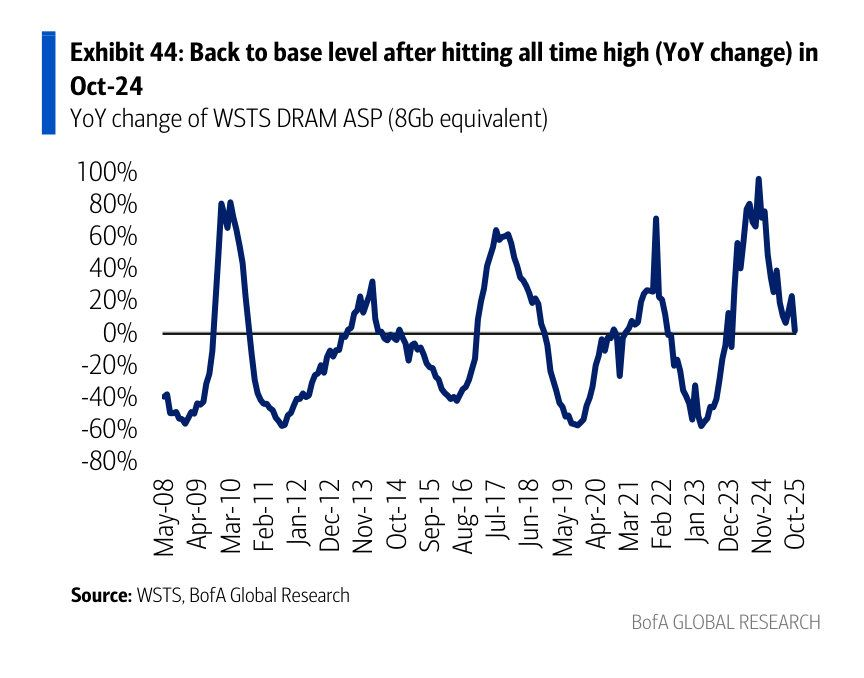

纵轴：-80% 至 100%（间隔 20%）；横轴：May-08 至 Oct-25（月间隔）
Source: WSTS, BofA Global Research

**Exhibit 45: More volatile, but recently up in the past few months**

MoM change of WSTS DRAM ASP (8Gb equivalent)

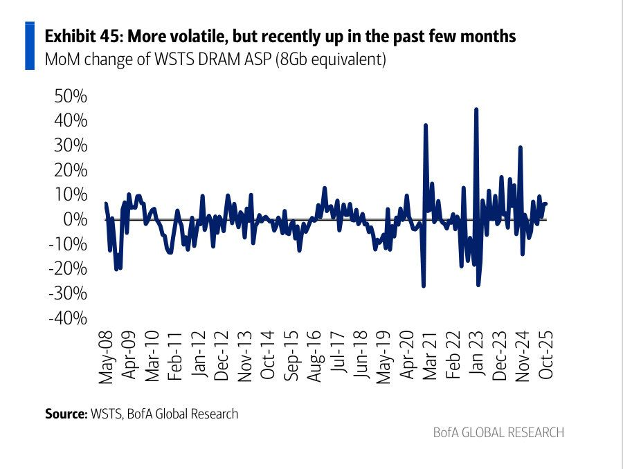

纵轴：-40% 至 50%（间隔 10%）；横轴：May-08 至 Oct-25（月间隔）
Source: WSTS, BofA Global Research

**Exhibit 46: Unit ASP at all time high levels, YoY change still positive after hitting peak in Oct-24**

YoY change of WSTS DRAM unit ASP

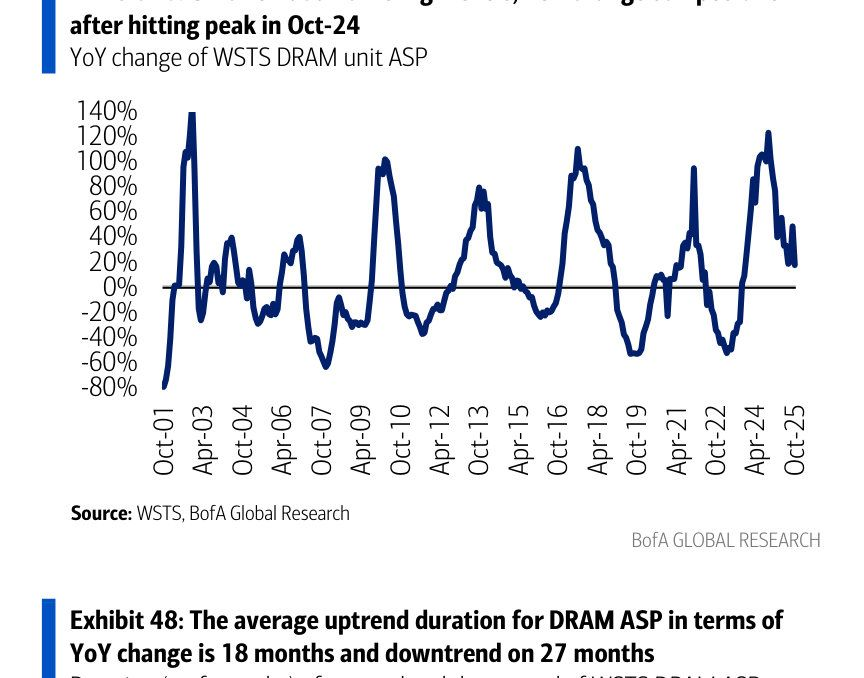

纵轴：-80% 至 140%（间隔 20%）；横轴：Oct-01 至 Oct-25（半年间隔）
Source: WSTS, BofA Global Research

**Exhibit 47: Up 10% each in Sep/Oct-25**

MoM change of WSTS DRAM unit ASP

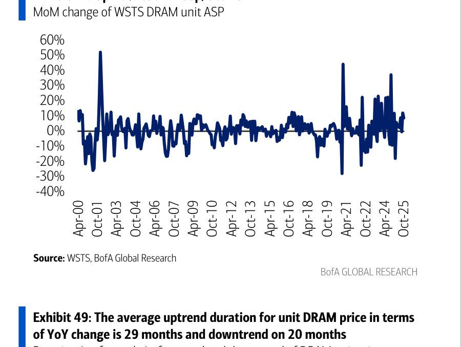

纵轴：-40% 至 60%（间隔 10%）；横轴：Apr-00 至 Oct-25（半年间隔）
Source: WSTS, BofA Global Research

**Exhibit 48: The average uptrend duration for DRAM ASP in terms of YoY change is 18 months and downtrend on 27 months**

Duration (# of months) of uptrend and downtrend of WSTS DRAM ASP

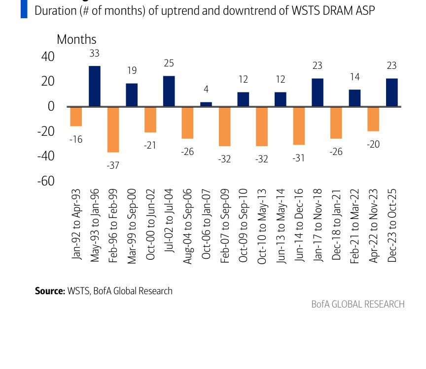

纵轴：Months -60 至 40（间隔 20）

| Period | Months |
| --- | --- |
| Jan-92 to Apr-93 | -16 |
| May-93 to Jan-96 | 33 |
| Feb-96 to Feb-99 | -37 |
| Mar-99 to Sep-00 | 19 |
| Oct-00 to Jun-02 | -21 |
| Jul-02 to Jul-04 | 25 |
| Aug-04 to Sep-06 | -26 |
| Oct-06 to Jan-07 | 4 |
| Feb-07 to Sep-09 | -32 |
| Oct-09 to Sep-10 | 12 |
| Oct-10 to May-13 | -32 |
| Jun-13 to May-14 | 12 |
| Jun-14 to Dec-16 | -31 |
| Jan-17 to Nov-18 | 23 |
| Dec-18 to Jan-21 | -26 |
| Feb-21 to Mar-22 | 14 |
| Apr-22 to Nov-23 | -20 |
| Dec-23 to Oct-25 | 23 |

Source: WSTS, BofA Global Research

**Exhibit 49: The average uptrend duration for unit DRAM price in terms of YoY change is 29 months and downtrend on 20 months**

Duration (# of months) of uptrend and downtrend of DRAM unit price

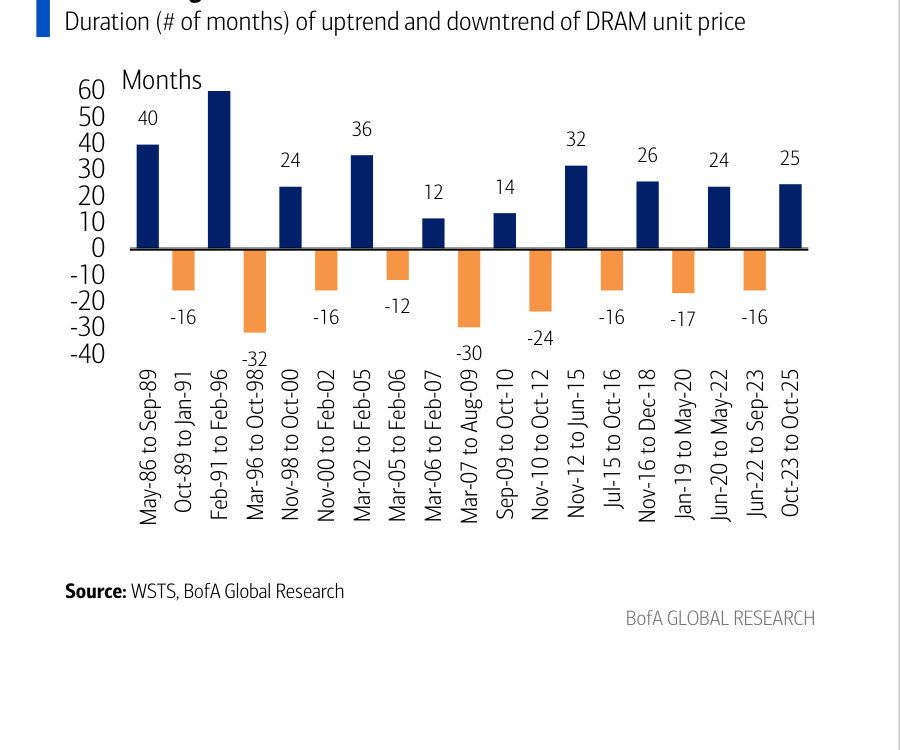

纵轴：Months -40 至 60（间隔 10）

| Period | Months |
| --- | --- |
| May-86 to Sep-89 | 40 |
| Oct-89 to Jan-91 | -16 |
| Feb-91 to Feb-96 | 60 |
| Mar-96 to Oct-98 | -32 |
| Nov-98 to Oct-00 | 24 |
| Nov-00 to Feb-02 | -16 |
| Mar-02 to Feb-05 | 36 |
| Mar-05 to Feb-06 | -12 |
| Mar-06 to Feb-07 | 12 |
| Mar-07 to Aug-09 | -30 |
| Sep-09 to Oct-10 | 14 |
| Nov-10 to Oct-12 | -24 |
| Nov-12 to Jun-15 | 32 |
| Jul-15 to Oct-16 | -16 |
| Nov-16 to Dec-18 | 26 |
| Jan-19 to May-20 | -17 |
| Jun-20 to May-22 | 24 |
| Jun-22 to Sep-23 | -16 |
| Oct-23 to Oct-25 | 25 |

Source: WSTS, BofA Global Research

**图表44：在2024年10月触及历史峰值（同比变化）后回落至基准水平**

WSTS DRAM平均售价（ASP）同比变化（8Gb当量）

纵轴：-80% 至 100%（间隔 20%）；横轴：May-08 至 Oct-25（月间隔）
来源：WSTS、美银全球研究

**图表45：波动更大，但近几个月来呈上升趋势**

WSTS DRAM ASP（8Gb等效）的环比变化

纵轴：-40% 至 50%（间隔 10%）；横轴：May-08 至 Oct-25（月间隔）
来源：WSTS、美银全球研究

**图表46：单位ASP处于历史高位，2024年10月见顶后同比变化仍为正**

WSTS DRAM单位ASP同比变化

纵轴：-80% 至 140%（间隔 20%）；横轴：Oct-01 至 Oct-25（半年间隔）
来源：WSTS、美银全球研究

**图表47：WSTS DRAM单位平均售价 2025年9月/10月环比各上涨10%**

纵轴：-40% 至 60%（间隔 10%）；横轴：Apr-00 至 Oct-25（半年间隔）
来源：WSTS、美银全球研究

**图表48：DRAM ASP同比变化的平均上升周期为18个月，下降周期为27个月**

WSTS DRAM平均售价上涨和下跌趋势的持续时间（月数）

纵轴：月份 -60 至 40（间隔 20）

| 期间 | 月数 |
| --- | --- |
| Jan-92 to Apr-93 | -16 |
| May-93 to Jan-96 | 33 |
| Feb-96 to Feb-99 | -37 |
| Mar-99 to Sep-00 | 19 |
| Oct-00 to Jun-02 | -21 |
| Jul-02 to Jul-04 | 25 |
| Aug-04 to Sep-06 | -26 |
| Oct-06 to Jan-07 | 4 |
| Feb-07 to Sep-09 | -32 |
| Oct-09 to Sep-10 | 12 |
| Oct-10 to May-13 | -32 |
| Jun-13 to May-14 | 12 |
| Jun-14 to Dec-16 | -31 |
| Jan-17 to Nov-18 | 23 |
| Dec-18 to Jan-21 | -26 |
| Feb-21 to Mar-22 | 14 |
| Apr-22 to Nov-23 | -20 |
| Dec-23 to Oct-25 | 23 |

来源：WSTS、美银全球研究

**图表49：DRAM单位价格同比变化的平均上升周期为29个月，下降周期为20个月**

DRAM单价上涨和下跌趋势的持续时间（月数）

纵轴：月份 -40 至 60（间隔 10）

| 期间 | 月数 |
| --- | --- |
| May-86 to Sep-89 | 40 |
| Oct-89 to Jan-91 | -16 |
| Feb-91 to Feb-96 | 60 |
| Mar-96 to Oct-98 | -32 |
| Nov-98 to Oct-00 | 24 |
| Nov-00 to Feb-02 | -16 |
| Mar-02 to Feb-05 | 36 |
| Mar-05 to Feb-06 | -12 |
| Mar-06 to Feb-07 | 12 |
| Mar-07 to Aug-09 | -30 |
| Sep-09 to Oct-10 | 14 |
| Nov-10 to Oct-12 | -24 |
| Nov-12 to Jun-15 | 32 |
| Jul-15 to Oct-16 | -16 |
| Nov-16 to Dec-18 | 26 |
| Jan-19 to May-20 | -17 |
| Jun-20 to May-22 | 24 |
| Jun-22 to Sep-23 | -16 |
| Oct-23 to Oct-25 | 25 |

来源：WSTS、美银全球研究

---

<!-- 原文第 19 页 -->

## BofA Memory Indicator

**Exhibit 50: Our memory indicator showed a strong recovery in Oct (YTD high of 114) vs Jan-Aug (within the range of 101-108), led by DRAM spot rally (+194% YoY), DRAM billings/ASP (+90%/+2% YoY), NAND billings (up +17% YoY); meanwhile, Korea exports were still resilient (up +25% YoY)**

BofA Memory Indicator – back to near upturn level in Sept-2025

纵轴：70–140（间隔 10）；横轴：Oct-93 至 Oct-25（两月间隔）
图内标注：Trough（2 处）、Peak、Sharp recovery、Peak
Source: DRAMeXchange, WSTS, MoTIE Korea, BofA Global Research
*Sep-25 memory indicator revised down to 108 vs 115 previously due to WSTS's revisions
The shaded area represents back-tested results from January 1991 to March 2021. The unshaded area represents actual performance since April 2021. This performance is back-tested up to March-2021, and does not represent the actual performance of any account or fund. Back-tested performance depicts the theoretical (not actual) performance of a particular strategy over the time period indicated. No representation is being made that any actual portfolio is likely to have achieved returns similar to those shown herein.
Disclaimer: The BofA Memory Indicator is intended to be an indicative metric only and may not be used for reference purposes or as a measure of performance for any financial instrument or contract, or otherwise relied upon by third parties for any other purpose, without the prior written consent of BofA Global Research. This indicator was not created to act as a benchmark. For methodology, see the 5 Aug 2024 Global Memory Tech report.

**Exhibit 51: Nov/early-Dec stock rebound primarily led by Samsung (media reports as one of the top suppliers of HBM chips for Google TPU, relatively higher exposure in conventional DRAM, HBM4 progress news), Nanya Tech (robust Nov monthly sales; up +365% YoY)**

BofA Memory Indicator is highly correlated with stock performance (back-tested)

左轴：70–140（间隔 10）；右轴：-100% 至 220%（间隔 40%）；横轴：Dec-95 至 Dec-25（月间隔）
图例：Memory indicator、Memory companies' share price (RH)
Note: Memory companies share price is average of Samsung, Hynix, Micron, and Nanya share price YoY changes
*Sep-25 memory indicator revised down to 108 vs 115 previously due to WSTS's revisions
Source: Bloomberg, BofA Global Research
The light green shaded area represents back-tested results from January 1991 to March 2021. The blue shaded area represents actual data since April 2021. This performance is back-tested and does not represent the actual performance of any account or fund. Back-tested performance depicts the theoretical (not actual) performance of a particular strategy over the time period indicated. No representation is being made that any actual portfolio is likely to have achieved returns similar to those shown herein. For methodology, see the 5 Aug 2024 Global Memory Tech report.

## 美银内存指标

**图表50：我们的内存指标显示10月强劲复苏（年初至今高点114），而1-8月（在101-108范围内），由DRAM现货上涨（+194%同比）、DRAM开票/ASP（+90%/+2%同比）、NAND开票（上涨+17%同比）引领；同时，韩国出口仍具韧性（上涨+25%同比）**

BofA内存指标-2025年9月回升至接近上行周期水平

纵轴：记忆指标 70–140（间隔 10）；横轴：Oct-93 至 Oct-25（两月间隔）
图内标注：低谷（2 处）、Peak、Sharp 复苏、Peak
来源：DRAMeXchange、WSTS、韩国产业通商资源部（MoTIE Korea）、美银全球研究部
*由于WSTS的调整，2025年9月内存指标从之前的115下调至108。阴影区域代表1991年1月至2021年3月的回溯测试结果。未阴影区域代表2021年4月以来的实际表现。该表现回溯测试至2021年3月，不代表任何账户或基金的实际表现。回溯测试表现描述了特定策略在所示时间段内的理论（非实际）表现。不保证任何实际投资组合可能获得与所示类似的回报。免责声明：美银内存指标仅作为指示性指标，未经美银全球研究部事先书面同意，不得用于参考目的或作为任何金融工具或合同的业绩衡量标准，或被第三方用于其他任何目的。该指标并非作为基准创建。有关方法，请参阅2024年8月5日的《全球内存技术报告》。

**图表51：11月/12月初股价反弹主要由三星（媒体报道其为谷歌TPU HBM芯片的顶级供应商之一，传统DRAM敞口相对较高，HBM4进展新闻）、南亚科技（11月月度销售额稳健；同比上涨+365%）引领**

美国银行内存指标与股票表现高度相关（回溯测试）

左轴：记忆指标 70–140（间隔 10）；右轴：-100% 至 220%（间隔 40%）；横轴：Dec-95 至 Dec-25（月间隔）
图例：内存指标、内存公司股价（RH）
注：内存公司股价为三星、海力士、美光和南亚股价同比变化的平均值
*2025年9月内存指标因WSTS修正下调至108（此前为115）
来源：彭博社、BofA Global Research
浅绿色阴影区域代表back-1991年1月至2021年3月的测试结果. 蓝色阴影区域代表2021年4月以来的实际数据。该表现为回测结果，不代表任何账户或基金的实际表现。回测表现描述了特定策略在所示时间段内的理论（非实际）表现。不保证任何实际投资组合可能获得与此处所示类似的回报。有关方法，请参阅2024年8月5日的《全球内存技术报告》。

---

<!-- 原文第 20 页 -->

## Korea exports, Taiwan sales and China imports

**Exhibit 52: All-time high results in Dec (US$5.3bn; +37% MoM)**

Korea semis exports – First 10 days of month US$bn

纵轴：US$bn 0.0–6.0（间隔 1.5）；横轴：Jun-22 至 Dec-25（季度间隔）
Source: MoTIE

**Exhibit 53: YoY growth still solid in Dec (+46%); already 24 consecutive months of positive growth**

Korea semis exports – YoY change in first 10 days of month

纵轴：YoY -80% 至 120%（间隔 40%）；横轴：Dec-20 至 Dec-25（季度间隔）
Source: MoTIE

**Exhibit 54: Broadly mixed in Nov – strong recovery for Wistron (+52%), Nanya (+29%), Quanta (+11%) vs negative growth for TSMC (-6%), MediaTek (-10%), Hon Hai (-6%)**

Taiwan tech companies' monthly sales MoM in Nov-25

纵轴：MoM % -40% 至 60%（间隔 20%）；横轴（36 家，自左至右）：Wistron、Nanya Tech、ADATA、Transcend、Acer、Aspeed、AUO、Quanta、Gigabyte、Yageo、Walsin、Wiwynn、Winbond、Win Semi、Holystone、Lotes、Powertech、Unimicron、Compal、Asustek、UMC、Phison、PSMC、Kinsus、ASE、Novatek、Vanguard、Nanya PCB、Inventec、Hon Hai、Innolux、TSMC、Macronix、MediaTek、Pegatron、Mitac
Source: Companies

**Exhibit 55: Nanya's exceptionally strong growth seen in Nov (+365%), Wistron/Wiwynn (Up 195%/159%), Phison (+62%), TSMC (+24%)**

Taiwan tech companies' monthly sales YoY in Nov-25

纵轴：YoY -30% 至 120%（间隔 30%）；横轴（36 家，自左至右）：Nanya Tech、Wistron、Wiwynn、Transcend、Phison、ADATA、Kinsus、Winbond、Gigabyte、Nanya PCB、Quanta、Win Semi、Hon Hai、Powertech、Macronix、TSMC、Aspeed、Yageo、Asustek、Unimicron、ASE、PSMC、Vanguard、Acer、Walsin、UMC、Lotes、MediaTek、AUO、Holystone、Mitac、Pegatron、Novatek、Innolux、Inventec、Compal
*Nanya up 365%, Wistron up 195%, Wiwynn up 159%, Transcend up 146%
Source: Companies

**Exhibit 56: Nov import value was US$39bn, +2% MoM/+14% YoY**

China monthly integrated circuit import value and YoY

左轴：US$bn 0–60（间隔 15）；右轴：YoY -80% 至 80%（间隔 40%）；横轴：Jul-17 至 Nov-25（季度间隔）
图例：China IC imports、YoY, RH
Source: China General Customs, BofA Global Research

**Exhibit 57: Nov import volume 46.8bn units, -7% MoM/+2% YoY, the lowest after seven consecutive months above 50bn units**

China monthly integrated circuit import volume and YoY

左轴：bn units 0–75（间隔 15）；右轴：YoY -80% 至 80%（间隔 40%）；横轴：Jul-17 至 Nov-25（季度间隔）
图例：China IC import unit、YoY, RH
Source: China General Customs, BofA Global Research

## 韩国出口、中国台湾销售及中国进口

**图表52：12月创历史新高（53亿美元；+37%环比）**

韩国半导体出口——每月前10天（十亿美元）

纵轴：十亿美元 0.0–6.0（间隔 1.5）；横轴：Jun-22 至 Dec-25（季度间隔）
来源：MoTIE

**图表53：12月同比增长仍稳健（+46%）；已连续24个月实现正增长**

韩国半导体出口——每月前10天同比变化

纵轴：YoY -80% 至 120%（间隔 40%）；横轴：Dec-20 至 Dec-25（季度间隔）
来源：MoTIE

**图表54：11月表现普遍喜忧参半 – 纬创（+52%）、南亚（+29%）、广达（+11%）强劲复苏，而台积电（-6%）、联发科（-10%）、鸿海（-6%）负增长**

2025年11月台湾科技公司月度销售额环比

纵轴：环比百分比 -40% 至 60%（间隔 20%）；横轴（36 家，自左至右）：Wistron、Nanya Tech、ADATA、Transcend、Acer、Aspeed、AUO、Quanta、Gigabyte、Yageo、Walsin、Wiwynn、Winbond、Win Semi、Holystone、Lotes、Powertech、Unimicron、Compal、Asustek、UMC、Phison、PSMC、Kinsus、ASE、Novatek、Vanguard、Nanya PCB、Inventec、Hon Hai、Innolux、TSMC、Macronix、MediaTek、Pegatron、Mitac
来源：公司

**图表55：南亚科11月增长异常强劲（+365%），纬创/纬颖（增长195%/159%），群联（+62%），台积电（+24%）**

台湾科技公司11月月度销售额同比

纵轴：YoY -30% 至 120%（间隔 30%）；横轴（36 家，自左至右）：Nanya Tech、Wistron、Wiwynn、Transcend、Phison、ADATA、Kinsus、Winbond、Gigabyte、Nanya PCB、Quanta、Win Semi、Hon Hai、Powertech、Macronix、TSMC、Aspeed、Yageo、Asustek、Unimicron、ASE、PSMC、Vanguard、Acer、Walsin、UMC、Lotes、MediaTek、AUO、Holystone、Mitac、Pegatron、Novatek、Innolux、Inventec、Compal
*南亚科技上涨365%，纬创上涨195%，纬穎上涨159%，创见上涨146%
来源：公司数据

**图表56：11月进口额为390亿美元，环比+2%/同比+14%**

中国月度集成电路进口额及同比

左轴：十亿美元 0–60（间隔 15）；右轴：同比 -80% 至 80%（间隔 40%）；横轴：Jul-17 至 Nov-25（季度间隔）
图例：中国集成电路进口、同比, 环比
来源：中国海关总署、美银全球研究部

**图表57：11月进口量468亿件，环比下降7%/同比+2%，为连续7个月超500亿件后的最低值**

中国月度集成电路进口量及同比

左轴：十亿单位 0–75（间隔 15）；右轴：同比 -80% 至 80%（间隔 40%）；横轴：Jul-17 至 Nov-25（季度间隔）
图例：中国集成电路进口单位、同比, 环比
来源：中国海关总署、美银全球研究部

---

<!-- 原文第 21 页 -->

## We collectively lifted PO of Samsung, Hynix, Nanya

**Exhibit 58: Our PO revision (up 7%) is reflected by our upward revision of 2026E EPS revision (+17%), which is based on 2ppt higher OPM for 2026. HBM (2026E: sales US$14bn, bit growth 130%, ASP cut only 10%, OPM 38%), conventional DRAM (OPM 52%), NAND (23%) and foundry (no more large loss) are expected to lead to 2026 EPS growth (+66% YoY))**

Samsung Electronics – Earnings revisions (2025-27E)

| Wbn, Won | 1Q25 | 2Q25 | 3Q25 | 4Q25E | 1Q26E | 2Q26E | 3Q26E | 4Q26E | 2020 | 2021 | 2022 | 2023 | 2024 | 2025E | 2026E | 2027E |
| --- | --- | --- | --- | --- | --- | --- | --- | --- | --- | --- | --- | --- | --- | --- | --- | --- |
| EPS - fully diluted – New | 1,187 | 733 | 1,783 | 1,734 | 2,080 | 2,114 | 2,491 | 2,344 | 3,841 | 5,777 | 8,057 | 2,131 | 4,956 | 5,435 | 9,028 | 9,797 |
| EPS - fully diluted – Old | 1,187 | 733 | 1,783 | 1,640 | 1,753 | 1,785 | 2,176 | 2,025 | 3,841 | 5,777 | 8,057 | 2,131 | 4,956 | 5,341 | 7,740 | 8,698 |
| EPS - fully diluted – Difference | n/a | n/a | n/a | 6% | 19% | 18% | 14% | 16% | n/a | n/a | n/a | n/a | n/a | 2% | 17% | 13% |
| Sales – New | 79.1 | 74.6 | 86.1 | 87.6 | 93.3 | 89.3 | 98.5 | 95.6 | 236.8 | 279.6 | 302.2 | 258.9 | 300.9 | 327.4 | 376.6 | 389.9 |
| Sales – Old | 79.1 | 74.6 | 86.1 | 84.1 | 88.2 | 84.5 | 93.3 | 90.7 | 236.8 | 279.6 | 302.2 | 258.9 | 300.9 | 323.9 | 356.7 | 369.7 |
| Sales – Difference | n/a | n/a | n/a | 4% | 6% | 6% | 6% | 5% | n/a | n/a | n/a | n/a | n/a | 1% | 6% | 5% |
| OP – New | 6.7 | 4.7 | 12.2 | 14.8 | 17.6 | 17.9 | 21.1 | 19.8 | 36.0 | 51.6 | 43.4 | 6.6 | 32.7 | 38.4 | 76.3 | 82.6 |
| OP – Old | 6.7 | 4.7 | 12.2 | 14.0 | 14.7 | 15.0 | 18.3 | 17.0 | 36.0 | 51.6 | 43.4 | 6.6 | 32.7 | 37.5 | 64.9 | 72.9 |
| OP – Difference | n/a | n/a | n/a | 6% | 20% | 19% | 15% | 17% | n/a | n/a | n/a | n/a | n/a | 2% | 18% | 13% |
| OP margin – New | 8.4% | 6.3% | 14.1% | 16.9% | 18.9% | 20.0% | 21.4% | 20.7% | 15.2% | 18.5% | 14.4% | 2.5% | 10.9% | 11.7% | 20.3% | 21.2% |
| OP margin – Old | 8.4% | 6.3% | 14.1% | 16.6% | 16.7% | 17.7% | 19.6% | 18.7% | 15.2% | 18.5% | 14.4% | 2.5% | 10.9% | 11.6% | 18.2% | 19.7% |
| OP margin – Difference %pt | n/a | n/a | n/a | 0.3% | 2.2% | 2.3% | 1.8% | 2.0% | n/a | n/a | n/a | n/a | n/a | 0.1% | 2.1% | 1.5% |
| FX - avg (W/USD) – New | 1,453 | 1,401 | 1,387 | 1,448 | 1,395 | 1,385 | 1,373 | 1,358 | 1,180 | 1,144 | 1,291 | 1,306 | 1,365 | 1,422 | 1,378 | 1,328 |
| FX - avg (W/USD) – Old | 1,453 | 1,401 | 1,387 | 1,395 | 1,375 | 1,365 | 1,355 | 1,345 | 1,180 | 1,144 | 1,291 | 1,306 | 1,365 | 1,409 | 1,360 | 1,313 |
| FX - avg (W/USD) – Difference | n/a | n/a | n/a | 4% | 1% | 1% | 1% | 1% | n/a | n/a | n/a | n/a | n/a | 1% | 1% | 1% |
| Net non-operating income – New | 2.5 | 1.1 | 1.4 | 1.1 | 1.1 | 1.1 | 1.3 | 1.3 | 0.4 | 1.7 | 3.1 | 4.4 | 4.8 | 6.0 | 4.9 | 5.5 |
| Net non-operating income – Old | 2.5 | 1.1 | 1.4 | 1.1 | 1.1 | 1.1 | 1.3 | 1.3 | 0.4 | 1.7 | 3.1 | 4.4 | 4.8 | 6.0 | 4.9 | 5.5 |
| Net non-operating income – Difference | n/a | n/a | n/a | 0% | 0% | 0% | 0% | 0% | n/a | n/a | n/a | n/a | n/a | 0% | 0% | 0% |
| Tax rate - effective – New | 10.1% | 11.1% | 9.7% | 25.0% | 24.0% | 24.0% | 24.0% | 24.0% | 27.3% | 25.2% | -19.8% | -40.7% | 8.2% | 15.5% | 24.0% | 24.0% |
| Tax rate - effective – Old | 10.1% | 11.1% | 9.7% | 25.0% | 24.0% | 24.0% | 24.0% | 24.0% | 27.3% | 25.2% | -19.8% | -40.7% | 8.2% | 15.3% | 24.0% | 24.0% |
| Tax rate - effective – Difference %pt | n/a | n/a | n/a | 0.0% | 0.0% | 0.0% | 0.0% | 0.0% | n/a | n/a | n/a | n/a | n/a | 0.2% | 0.0% | 0.0% |
| NP after minority int – New | 8.0 | 4.9 | 12.0 | 11.7 | 14.0 | 14.2 | 16.8 | 15.8 | 26.1 | 39.2 | 54.7 | 14.5 | 33.6 | 36.6 | 60.8 | 66.0 |
| NP after minority int – Old | 8.0 | 4.9 | 12.0 | 11.0 | 11.8 | 12.0 | 14.7 | 13.6 | 26.1 | 39.2 | 54.7 | 14.5 | 33.6 | 36.0 | 52.1 | 58.6 |
| NP after minority int – Difference | n/a | n/a | n/a | 6% | 19% | 18% | 14% | 16% | n/a | n/a | n/a | n/a | n/a | 2% | 17% | 13% |
| ROE - annualized – New | 8.2% | 5.0% | 12.1% | 11.5% | 13.4% | 13.3% | 15.2% | 13.8% | 10.0% | 13.9% | 17.1% | 4.1% | 9.0% | 9.1% | 13.9% | 13.4% |
| ROE - annualized – Old | 8.2% | 5.0% | 12.1% | 10.9% | 11.4% | 11.3% | 13.4% | 12.2% | 10.0% | 13.9% | 17.1% | 4.1% | 9.0% | 9.0% | 12.0% | 12.2% |
| ROE - annualized – Difference %pt | n/a | n/a | n/a | 1% | 2% | 2% | 2% | 2% | n/a | n/a | n/a | n/a | n/a | 0% | 2% | 1% |
| EBITDA – New | 18.2 | 16.0 | 24.0 | 26.7 | 29.5 | 29.9 | 33.1 | 31.9 | 66.3 | 85.9 | 82.5 | 45.2 | 75.4 | 84.9 | 124.4 | 131.7 |
| EBITDA – Old | 18.2 | 16.0 | 23.6 | 25.5 | 26.2 | 26.6 | 29.9 | 28.7 | 66.3 | 85.9 | 82.5 | 45.2 | 75.4 | 83.3 | 111.4 | 120.3 |
| EBITDA – Difference | n/a | n/a | n/a | 5% | 13% | 13% | 11% | 11% | n/a | n/a | n/a | n/a | n/a | 2% | 12% | 9% |
| Capex spend – New | 12.1 | 13.0 | 10.8 | 12.2 | 12.6 | 12.8 | 13.6 | 15.1 | 37.6 | 47.1 | 49.4 | 57.6 | 51.4 | 48.2 | 54.1 | 58.6 |
| Capex spend – Old | 12.1 | 13.0 | 10.8 | 12.2 | 12.3 | 12.8 | 13.1 | 13.3 | 37.6 | 47.1 | 49.4 | 57.6 | 51.4 | 48.2 | 51.5 | 54.5 |
| Capex spend – Difference | n/a | n/a | n/a | 0% | 2% | 0% | 4% | 14% | n/a | n/a | n/a | n/a | n/a | 0% | 5% | 8% |
| Net cash – New | 94 | 87 | 92 | 100 | 108 | 119 | 132 | 141 | 105 | 106 | 105 | 80 | 93 | 100 | 141 | 181 |
| Net cash – Old | 94 | 87 | 92 | 99 | 105 | 113 | 124 | 132 | 105 | 106 | 105 | 80 | 93 | 99 | 132 | 167 |
| Net cash – Difference | n/a | n/a | n/a | 1% | 3% | 5% | 6% | 7% | n/a | n/a | n/a | n/a | n/a | 1% | 7% | 8% |
| BVPS (Wk, period-end) – New | 59 | 58 | 61 | 62 | 64 | 66 | 68 | 70 | 39 | 44 | 51 | 52 | 58 | 62 | 70 | 78 |
| BVPS (Wk, period-end) – Old | 59 | 58 | 60 | 62 | 63 | 64 | 66 | 68 | 39 | 44 | 51 | 52 | 58 | 62 | 68 | 75 |
| BVPS (Wk, period-end) – Difference | n/a | n/a | n/a | 1% | 1% | 2% | 2% | 3% | n/a | n/a | n/a | n/a | n/a | 1% | 3% | 4% |

Source: Company, BofA Global Research estimates

BofA GLOBAL RESEARCH

## 我们集体上调了三星、海力士、南亚的目标价

**图表58：我们的目标价（PO）上调7%反映了我们对2026年预估每股收益（EPS）的上调（+17%），这基于2026年营业利润率（OPM）提高2个百分点。HBM（2026年预估：销售额140亿美元，比特增长130%，平均售价（ASP）仅下降10%，营业利润率38%）、传统DRAM（营业利润率52%）、NAND（23%）和晶圆代工（不再有大额亏损）预计将推动2026年每股收益增长（+66%同比）。**

三星电子——盈利预估调整（2025-27年预估）

| Wtn, Won | 2025年第一季度 | 2025年第二季度 | 2025年第三季度 | 2025年第四季度E | 2026年第一季度E | 2026年第二季度E | 2026年第三季度E | 2026年第四季度E | 2020 | 2021 | 2022 | 2023 | 2024年 | 2025年（预估） | 2026年（预估） | 2027年（预估） |
| --- | --- | --- | --- | --- | --- | --- | --- | --- | --- | --- | --- | --- | --- | --- | --- | --- |
| 每股收益 - 完全稀释 – New | 1,187 | 733 | 1,783 | 1,734 | 2,080 | 2,114 | 2,491 | 2,344 | 3,841 | 5,777 | 8,057 | 2,131 | 4,956 | 5,435 | 9,028 | 9,797 |
| 每股收益 - 完全稀释 – Old | 1,187 | 733 | 1,783 | 1,640 | 1,753 | 1,785 | 2,176 | 2,025 | 3,841 | 5,777 | 8,057 | 2,131 | 4,956 | 5,341 | 7,740 | 8,698 |
| 每股收益 - 完全稀释 – 差异 | n/a | n/a | n/a | 6% | 19% | 18% | 14% | 16% | n/a | n/a | n/a | n/a | n/a | 2% | 17% | 13% |
| 销售 – New | 79.1 | 74.6 | 86.1 | 87.6 | 93.3 | 89.3 | 98.5 | 95.6 | 236.8 | 279.6 | 302.2 | 258.9 | 300.9 | 327.4 | 376.6 | 389.9 |
| 销售 – Old | 79.1 | 74.6 | 86.1 | 84.1 | 88.2 | 84.5 | 93.3 | 90.7 | 236.8 | 279.6 | 302.2 | 258.9 | 300.9 | 323.9 | 356.7 | 369.7 |
| 销售 – 差异 | n/a | n/a | n/a | 4% | 6% | 6% | 6% | 5% | n/a | n/a | n/a | n/a | n/a | 1% | 6% | 5% |
| OP – New | 6.7 | 4.7 | 12.2 | 14.8 | 17.6 | 17.9 | 21.1 | 19.8 | 36.0 | 51.6 | 43.4 | 6.6 | 32.7 | 38.4 | 76.3 | 82.6 |
| OP – Old | 6.7 | 4.7 | 12.2 | 14.0 | 14.7 | 15.0 | 18.3 | 17.0 | 36.0 | 51.6 | 43.4 | 6.6 | 32.7 | 37.5 | 64.9 | 72.9 |
| OP – 差异 | n/a | n/a | n/a | 6% | 20% | 19% | 15% | 17% | n/a | n/a | n/a | n/a | n/a | 2% | 18% | 13% |
| 营业利润率（OP margin） – New | 8.4% | 6.3% | 14.1% | 16.9% | 18.9% | 20.0% | 21.4% | 20.7% | 15.2% | 18.5% | 14.4% | 2.5% | 10.9% | 11.7% | 20.3% | 21.2% |
| 营业利润率（OP margin） – Old | 8.4% | 6.3% | 14.1% | 16.6% | 16.7% | 17.7% | 19.6% | 18.7% | 15.2% | 18.5% | 14.4% | 2.5% | 10.9% | 11.6% | 18.2% | 19.7% |
| 营业利润率（OP margin） – 差异百分点（%pt） | n/a | n/a | n/a | 0.3% | 2.2% | 2.3% | 1.8% | 2.0% | n/a | n/a | n/a | n/a | n/a | 0.1% | 2.1% | 1.5% |
| 外汇 - 平均汇率（韩元/美元） – New | 1,453 | 1,401 | 1,387 | 1,448 | 1,395 | 1,385 | 1,373 | 1,358 | 1,180 | 1,144 | 1,291 | 1,306 | 1,365 | 1,422 | 1,378 | 1,328 |
| 外汇 - 平均汇率（韩元/美元） – Old | 1,453 | 1,401 | 1,387 | 1,395 | 1,375 | 1,365 | 1,355 | 1,345 | 1,180 | 1,144 | 1,291 | 1,306 | 1,365 | 1,409 | 1,360 | 1,313 |
| 外汇 - 平均汇率（韩元/美元） – 差异 | n/a | n/a | n/a | 4% | 1% | 1% | 1% | 1% | n/a | n/a | n/a | n/a | n/a | 1% | 1% | 1% |
| 净非营业收入 – New | 2.5 | 1.1 | 1.4 | 1.1 | 1.1 | 1.1 | 1.3 | 1.3 | 0.4 | 1.7 | 3.1 | 4.4 | 4.8 | 6.0 | 4.9 | 5.5 |
| 净非营业收入 – Old | 2.5 | 1.1 | 1.4 | 1.1 | 1.1 | 1.1 | 1.3 | 1.3 | 0.4 | 1.7 | 3.1 | 4.4 | 4.8 | 6.0 | 4.9 | 5.5 |
| 净非营业收入 – 差异 | n/a | n/a | n/a | 0% | 0% | 0% | 0% | 0% | n/a | n/a | n/a | n/a | n/a | 0% | 0% | 0% |
| 实际税率 – New | 10.1% | 11.1% | 9.7% | 25.0% | 24.0% | 24.0% | 24.0% | 24.0% | 27.3% | 25.2% | -19.8% | -40.7% | 8.2% | 15.5% | 24.0% | 24.0% |
| 实际税率 – Old | 10.1% | 11.1% | 9.7% | 25.0% | 24.0% | 24.0% | 24.0% | 24.0% | 27.3% | 25.2% | -19.8% | -40.7% | 8.2% | 15.3% | 24.0% | 24.0% |
| 实际税率 – 差异百分点（%pt） | n/a | n/a | n/a | 0.0% | 0.0% | 0.0% | 0.0% | 0.0% | n/a | n/a | n/a | n/a | n/a | 0.2% | 0.0% | 0.0% |
| 少数股东权益后净利润（NP after minority int） – New | 8.0 | 4.9 | 12.0 | 11.7 | 14.0 | 14.2 | 16.8 | 15.8 | 26.1 | 39.2 | 54.7 | 14.5 | 33.6 | 36.6 | 60.8 | 66.0 |
| 少数股东权益后净利润（NP after minority int） – Old | 8.0 | 4.9 | 12.0 | 11.0 | 11.8 | 12.0 | 14.7 | 13.6 | 26.1 | 39.2 | 54.7 | 14.5 | 33.6 | 36.0 | 52.1 | 58.6 |
| 少数股东权益后净利润（NP after minority int） – 差异 | n/a | n/a | n/a | 6% | 19% | 18% | 14% | 16% | n/a | n/a | n/a | n/a | n/a | 2% | 17% | 13% |
| 净资产收益率（ROE）- 年化 – New | 8.2% | 5.0% | 12.1% | 11.5% | 13.4% | 13.3% | 15.2% | 13.8% | 10.0% | 13.9% | 17.1% | 4.1% | 9.0% | 9.1% | 13.9% | 13.4% |
| 净资产收益率（ROE）- 年化 – Old | 8.2% | 5.0% | 12.1% | 10.9% | 11.4% | 11.3% | 13.4% | 12.2% | 10.0% | 13.9% | 17.1% | 4.1% | 9.0% | 9.0% | 12.0% | 12.2% |
| 净资产收益率（ROE）- 年化 – 差异百分点（%pt） | n/a | n/a | n/a | 1% | 2% | 2% | 2% | 2% | n/a | n/a | n/a | n/a | n/a | 0% | 2% | 1% |
| EBITDA – New | 18.2 | 16.0 | 24.0 | 26.7 | 29.5 | 29.9 | 33.1 | 31.9 | 66.3 | 85.9 | 82.5 | 45.2 | 75.4 | 84.9 | 124.4 | 131.7 |
| EBITDA – Old | 18.2 | 16.0 | 23.6 | 25.5 | 26.2 | 26.6 | 29.9 | 28.7 | 66.3 | 85.9 | 82.5 | 45.2 | 75.4 | 83.3 | 111.4 | 120.3 |
| EBITDA – 差异 | n/a | n/a | n/a | 5% | 13% | 13% | 11% | 11% | n/a | n/a | n/a | n/a | n/a | 2% | 12% | 9% |
| 资本支出 – New | 12.1 | 13.0 | 10.8 | 12.2 | 12.6 | 12.8 | 13.6 | 15.1 | 37.6 | 47.1 | 49.4 | 57.6 | 51.4 | 48.2 | 54.1 | 58.6 |
| 资本支出 – Old | 12.1 | 13.0 | 10.8 | 12.2 | 12.3 | 12.8 | 13.1 | 13.3 | 37.6 | 47.1 | 49.4 | 57.6 | 51.4 | 48.2 | 51.5 | 54.5 |
| 资本支出 – 差异 | n/a | n/a | n/a | 0% | 2% | 0% | 4% | 14% | n/a | n/a | n/a | n/a | n/a | 0% | 5% | 8% |
| 净现金 – New | 94 | 87 | 92 | 100 | 108 | 119 | 132 | 141 | 105 | 106 | 105 | 80 | 93 | 100 | 141 | 181 |
| 净现金 – Old | 94 | 87 | 92 | 99 | 105 | 113 | 124 | 132 | 105 | 106 | 105 | 80 | 93 | 99 | 132 | 167 |
| 净现金 – 差异 | n/a | n/a | n/a | 1% | 3% | 5% | 6% | 7% | n/a | n/a | n/a | n/a | n/a | 1% | 7% | 8% |
| 每股账面价值（BVPS）（周，期末） – New | 59 | 58 | 61 | 62 | 64 | 66 | 68 | 70 | 39 | 44 | 51 | 52 | 58 | 62 | 70 | 78 |
| 每股账面价值（BVPS）（周，期末） – Old | 59 | 58 | 60 | 62 | 63 | 64 | 66 | 68 | 39 | 44 | 51 | 52 | 58 | 62 | 68 | 75 |
| 每股账面价值（BVPS）（周，期末） – 差异 | n/a | n/a | n/a | 1% | 1% | 2% | 2% | 3% | n/a | n/a | n/a | n/a | n/a | 1% | 3% | 4% |

来源：公司、BofA Global Research 预估

美国银行全球研究部

---

<!-- 原文第 22 页 -->

**Exhibit 59: Our PO revision (+13%) is based on 2025/26E EPS change (+5%/+23% with more positive DRAM OPM (1-2ppt higher) and stronger/faster NAND OPM rebound (2-9ppt revised up); Micron’s P/B is already 3.7x, based on FY26 EPS consensus even with lower HBM market share and margin vs Hynix’s)**

SK Hynix – Earnings revisions (2025-27E)

| Wbn, Won | 1Q25 | 2Q25 | 3Q25 | 4Q25E | 1Q26E | 2Q26E | 3Q26E | 4Q26E | 2020 | 2021 | 2022 | 2023 | 2024 | 2025E | 2026E | 2027E |
| --- | --- | --- | --- | --- | --- | --- | --- | --- | --- | --- | --- | --- | --- | --- | --- | --- |
| EPS - fully diluted – New | 11,411 | 10,135 | 18,242 | 17,824 | 18,921 | 19,300 | 21,674 | 22,769 | 6,952 | 13,983 | 3,242 | -12,959 | 27,930 | 57,525 | 82,665 | 90,643 |
| EPS - fully diluted – Old | 11,411 | 10,135 | 17,725 | 15,447 | 14,957 | 15,430 | 17,802 | 18,963 | 6,952 | 13,983 | 3,242 | -12,959 | 27,930 | 54,819 | 67,153 | 75,138 |
| EPS - fully diluted – Difference | n/a | n/a | n/a | 15% | 27% | 25% | 22% | 20% | n/a | n/a | n/a | n/a | n/a | 5% | 23% | 21% |
| Dividend/share – New | 375 | 375 | 375 | 1,600 | 375 | 375 | 375 | 2,500 | 1,170 | 1,540 | 1,200 | 1,200 | 2,204 | 2,725 | 3,625 | 5,125 |
| Dividend/share – Old | 375 | 375 | 375 | 1,600 | 375 | 375 | 375 | 2,500 | 1,170 | 1,540 | 1,200 | 1,200 | 2,204 | 2,725 | 3,625 | 5,125 |
| Dividend/share – Difference | n/a | n/a | n/a | 0% | 0% | 0% | 0% | 0% | n/a | n/a | n/a | n/a | n/a | 0% | 0% | 0% |
| Shares for FD EPS - mn – New | 710 | 690 | 690 | 690 | 690 | 690 | 690 | 690 | 684 | 687 | 688 | 703 | 709 | 695 | 690 | 690 |
| Shares for FD EPS - mn – Old | 710 | 690 | 711 | 711 | 711 | 711 | 711 | 711 | 684 | 687 | 688 | 703 | 709 | 706 | 711 | 711 |
| Shares for FD EPS - mn – Difference | n/a | n/a | n/a | -3% | -3% | -3% | -3% | -3% | n/a | n/a | n/a | n/a | n/a | -1% | -3% | -3% |
| Sales – New | 17,639 | 22,232 | 24,449 | 30,692 | 31,584 | 32,046 | 35,223 | 36,463 | 31,900 | 42,998 | 44,622 | 32,766 | 66,193 | 95,012 | 135,315 | 143,130 |
| Sales – Old | 17,639 | 22,232 | 24,449 | 28,425 | 27,778 | 28,181 | 31,416 | 32,806 | 31,900 | 42,998 | 44,622 | 32,766 | 66,193 | 92,745 | 120,181 | 128,016 |
| Sales – Difference | n/a | n/a | n/a | 8% | 14% | 14% | 12% | 11% | n/a | n/a | n/a | n/a | n/a | 2% | 13% | 12% |
| OP – New | 7,441 | 9,213 | 11,383 | 16,157 | 17,657 | 17,993 | 20,171 | 21,167 | 5,013 | 12,410 | 6,809 | -7,730 | 23,467 | 44,194 | 76,987 | 83,810 |
| OP – Old | 7,441 | 9,213 | 11,383 | 14,408 | 14,409 | 14,844 | 17,084 | 18,172 | 5,013 | 12,410 | 6,809 | -7,730 | 23,467 | 42,444 | 64,510 | 71,553 |
| OP – Difference | n/a | n/a | n/a | 12% | 23% | 21% | 18% | 16% | n/a | n/a | n/a | n/a | n/a | 4% | 19% | 17% |
| OP margin – New | 42.2% | 41.4% | 46.6% | 52.6% | 55.9% | 56.1% | 57.3% | 58.0% | 15.7% | 28.9% | 15.3% | -23.6% | 35.5% | 46.5% | 56.9% | 58.6% |
| OP margin – Old | 42.2% | 41.4% | 46.6% | 50.7% | 51.9% | 52.7% | 54.4% | 55.4% | 15.7% | 28.9% | 15.3% | -23.6% | 35.5% | 45.8% | 53.7% | 55.9% |
| OP margin – Difference | n/a | n/a | n/a | 2.0% | 4.0% | 3.5% | 2.9% | 2.7% | n/a | n/a | n/a | n/a | n/a | 0.8% | 3.2% | 2.7% |
| Pre-tax income – New | 9,299 | 8,723 | 14,790 | 16,207 | 17,432 | 17,783 | 19,971 | 20,982 | 6,237 | 13,416 | 4,003 | -11,658 | 23,885 | 49,020 | 76,167 | 83,535 |
| Pre-tax income – Old | 9,299 | 8,723 | 14,790 | 14,458 | 14,184 | 14,634 | 16,884 | 17,987 | 6,237 | 13,416 | 4,003 | -11,658 | 23,885 | 47,270 | 63,690 | 71,278 |
| Pre-tax income – Difference | n/a | n/a | n/a | 12% | 23% | 22% | 18% | 17% | n/a | n/a | n/a | n/a | n/a | 4% | 20% | 17% |
| Tax rate - effective – New | 12.8% | 19.8% | 14.8% | 24.0% | 25.0% | 25.0% | 25.0% | 25.0% | 23.7% | 28.3% | 44.0% | 21.6% | 17.1% | 18.4% | 25.0% | 25.0% |
| Tax rate - effective – Old | 12.8% | 19.8% | 14.8% | 24.0% | 25.0% | 25.0% | 25.0% | 25.0% | 23.7% | 28.3% | 44.0% | 21.6% | 17.1% | 18.2% | 25.0% | 25.0% |
| Tax rate - effective – Difference | n/a | n/a | n/a | 0.0% | 0.0% | 0.0% | 0.0% | 0.0% | n/a | n/a | n/a | n/a | n/a | 0.2% | 0.0% | 0.0% |
| NP ex minority int – New | 8,107 | 6,997 | 12,595 | 12,307 | 13,064 | 13,326 | 14,965 | 15,721 | 4,755 | 9,602 | 2,230 | -9,112 | 19,789 | 40,006 | 57,077 | 62,585 |
| NP ex minority int – Old | 8,107 | 6,997 | 12,595 | 10,977 | 10,628 | 10,964 | 12,650 | 13,475 | 4,755 | 9,602 | 2,230 | -9,112 | 19,789 | 38,676 | 47,718 | 53,393 |
| NP ex minority int – Difference | n/a | n/a | n/a | 12% | 23% | 22% | 18% | 17% | n/a | n/a | n/a | n/a | n/a | 3% | 20% | 17% |
| ROE - annualized – New | 41.8% | 33.2% | 53.9% | 46.6% | 44.5% | 40.9% | 41.5% | 39.6% | 9.5% | 16.8% | 3.6% | -15.6% | 31.1% | 43.2% | 41.2% | 32.1% |
| ROE - annualized – Old | 41.8% | 33.2% | 53.8% | 41.9% | 37.0% | 34.9% | 36.9% | 36.1% | 9.5% | 16.8% | 3.6% | -15.6% | 31.1% | 42.1% | 36.0% | 29.7% |
| ROE - annualized – Difference | n/a | n/a | n/a | 4.8% | 7.5% | 5.9% | 4.6% | 3.5% | n/a | n/a | n/a | n/a | n/a | 1.1% | 5.2% | 2.4% |
| EBITDA – New | 10,786 | 12,667 | 14,943 | 19,778 | 21,350 | 21,741 | 23,994 | 25,085 | 14,488 | 23,065 | 20,634 | 5,943 | 36,349 | 58,174 | 92,169 | 100,410 |
| EBITDA – Old | 10,786 | 12,667 | 14,949 | 18,034 | 18,109 | 18,598 | 20,914 | 22,097 | 14,488 | 23,065 | 20,634 | 5,943 | 36,349 | 56,437 | 79,719 | 88,183 |
| EBITDA – Difference | n/a | n/a | n/a | 10% | 18% | 17% | 15% | 14% | n/a | n/a | n/a | n/a | n/a | 3% | 16% | 14% |
| Capex spend – New | 6,284 | 4,332 | 5,033 | 7,502 | 8,000 | 8,500 | 9,000 | 9,500 | 10,069 | 12,487 | 19,010 | 8,325 | 15,946 | 23,150 | 35,000 | 35,000 |
| Capex spend – Old | 6,284 | 4,332 | 5,033 | 7,501 | 8,000 | 8,000 | 8,500 | 7,500 | 10,069 | 12,487 | 19,010 | 8,325 | 15,946 | 23,150 | 32,000 | 31,000 |
| Capex spend – Difference | n/a | n/a | n/a | 0% | 0% | 6% | 6% | 27% | n/a | n/a | n/a | n/a | n/a | 0% | 9% | 13% |
| Net debt – New | 9,023 | 4,879 | -3,776 | -8,178 | -14,789 | -22,456 | -31,381 | -39,250 | 6,303 | 8,951 | 16,586 | 20,548 | 8,527 | -8,178 | -39,250 | -77,410 |
| Net debt – Old | 9,023 | 4,879 | -3,775 | -2,502 | -7,693 | -13,151 | -20,484 | -28,121 | 6,303 | 8,951 | 16,586 | 20,548 | 8,527 | -2,502 | -28,121 | -61,513 |
| Net debt – Difference | n/a | n/a | n/a | 227% | 92% | 71% | 53% | 40% | n/a | n/a | n/a | n/a | n/a | 227% | 40% | 26% |
| Adj BVPS ex treasury – New | 117,947 | 129,988 | 149,162 | 165,800 | 184,898 | 204,387 | 226,325 | 247,086 | 75,860 | 90,394 | 92,004 | 77,752 | 107,256 | 165,800 | 247,086 | 334,985 |
| Adj BVPS ex treasury – Old | 117,947 | 129,988 | 144,818 | 159,045 | 174,057 | 189,558 | 207,503 | 224,406 | 75,860 | 90,394 | 92,004 | 77,752 | 107,256 | 159,045 | 224,406 | 296,428 |
| Adj BVPS ex treasury – Difference | n/a | n/a | n/a | 4% | 6% | 8% | 9% | 10% | n/a | n/a | n/a | n/a | n/a | 4% | 10% | 13% |

Source: Company, BofA Global Research estimates

BofA GLOBAL RESEARCH

**图表59：我们的目标价（PO）调整（+13%）基于2025/26E每股收益（EPS）变化（+5%/+23%，DRAM营业利润率（OPM）更积极（提高1-2个百分点），NAND营业利润率反弹更强/更快（上调2-9个百分点）；即使HBM市场份额和利润率低于海力士，基于2026财年EPS共识，美光的市净率（P/B）已达3.7倍）**

SK海力士 – 收益调整（2025-27E）

| 万亿韩元，韩元 | 2025年第一季度 | 2025年第二季度 | 2025年第三季度 | 2025年第四季度E | 2026年第一季度E | 2026年第二季度E | 2026年第三季度E | 2026年第四季度E | 2020 | 2021 | 2022 | 2023 | 2024年 | 2025年（预估） | 2026年（预估） | 2027年（预估） |
| --- | --- | --- | --- | --- | --- | --- | --- | --- | --- | --- | --- | --- | --- | --- | --- | --- |
| 每股收益 - 完全稀释 – New | 11,411 | 10,135 | 18,242 | 17,824 | 18,921 | 19,300 | 21,674 | 22,769 | 6,952 | 13,983 | 3,242 | -12,959 | 27,930 | 57,525 | 82,665 | 90,643 |
| 每股收益 - 完全稀释 – Old | 11,411 | 10,135 | 17,725 | 15,447 | 14,957 | 15,430 | 17,802 | 18,963 | 6,952 | 13,983 | 3,242 | -12,959 | 27,930 | 54,819 | 67,153 | 75,138 |
| 每股收益 - 完全稀释 – 差异 | n/a | n/a | n/a | 15% | 27% | 25% | 22% | 20% | n/a | n/a | n/a | n/a | n/a | 5% | 23% | 21% |
| 每股股息 – New | 375 | 375 | 375 | 1,600 | 375 | 375 | 375 | 2,500 | 1,170 | 1,540 | 1,200 | 1,200 | 2,204 | 2,725 | 3,625 | 5,125 |
| 每股股息 – Old | 375 | 375 | 375 | 1,600 | 375 | 375 | 375 | 2,500 | 1,170 | 1,540 | 1,200 | 1,200 | 2,204 | 2,725 | 3,625 | 5,125 |
| 每股股息 – 差异 | n/a | n/a | n/a | 0% | 0% | 0% | 0% | 0% | n/a | n/a | n/a | n/a | n/a | 0% | 0% | 0% |
| 完全稀释每股收益对应的股份数（百万） – New | 710 | 690 | 690 | 690 | 690 | 690 | 690 | 690 | 684 | 687 | 688 | 703 | 709 | 695 | 690 | 690 |
| 完全稀释每股收益对应的股份数（百万） – Old | 710 | 690 | 711 | 711 | 711 | 711 | 711 | 711 | 684 | 687 | 688 | 703 | 709 | 706 | 711 | 711 |
| 完全稀释每股收益对应的股份数（百万） – 差异 | n/a | n/a | n/a | -3% | -3% | -3% | -3% | -3% | n/a | n/a | n/a | n/a | n/a | -1% | -3% | -3% |
| 销售 – New | 17,639 | 22,232 | 24,449 | 30,692 | 31,584 | 32,046 | 35,223 | 36,463 | 31,900 | 42,998 | 44,622 | 32,766 | 66,193 | 95,012 | 135,315 | 143,130 |
| 销售 – Old | 17,639 | 22,232 | 24,449 | 28,425 | 27,778 | 28,181 | 31,416 | 32,806 | 31,900 | 42,998 | 44,622 | 32,766 | 66,193 | 92,745 | 120,181 | 128,016 |
| 销售 – 差异 | n/a | n/a | n/a | 8% | 14% | 14% | 12% | 11% | n/a | n/a | n/a | n/a | n/a | 2% | 13% | 12% |
| OP – New | 7,441 | 9,213 | 11,383 | 16,157 | 17,657 | 17,993 | 20,171 | 21,167 | 5,013 | 12,410 | 6,809 | -7,730 | 23,467 | 44,194 | 76,987 | 83,810 |
| OP – Old | 7,441 | 9,213 | 11,383 | 14,408 | 14,409 | 14,844 | 17,084 | 18,172 | 5,013 | 12,410 | 6,809 | -7,730 | 23,467 | 42,444 | 64,510 | 71,553 |
| OP – 差异 | n/a | n/a | n/a | 12% | 23% | 21% | 18% | 16% | n/a | n/a | n/a | n/a | n/a | 4% | 19% | 17% |
| 营业利润率（OP margin） – New | 42.2% | 41.4% | 46.6% | 52.6% | 55.9% | 56.1% | 57.3% | 58.0% | 15.7% | 28.9% | 15.3% | -23.6% | 35.5% | 46.5% | 56.9% | 58.6% |
| 营业利润率（OP margin） – Old | 42.2% | 41.4% | 46.6% | 50.7% | 51.9% | 52.7% | 54.4% | 55.4% | 15.7% | 28.9% | 15.3% | -23.6% | 35.5% | 45.8% | 53.7% | 55.9% |
| 营业利润率（OP margin） – 差异 | n/a | n/a | n/a | 2.0% | 4.0% | 3.5% | 2.9% | 2.7% | n/a | n/a | n/a | n/a | n/a | 0.8% | 3.2% | 2.7% |
| 税前收入 – New | 9,299 | 8,723 | 14,790 | 16,207 | 17,432 | 17,783 | 19,971 | 20,982 | 6,237 | 13,416 | 4,003 | -11,658 | 23,885 | 49,020 | 76,167 | 83,535 |
| 税前收入 – Old | 9,299 | 8,723 | 14,790 | 14,458 | 14,184 | 14,634 | 16,884 | 17,987 | 6,237 | 13,416 | 4,003 | -11,658 | 23,885 | 47,270 | 63,690 | 71,278 |
| 税前收入 – 差异 | n/a | n/a | n/a | 12% | 23% | 22% | 18% | 17% | n/a | n/a | n/a | n/a | n/a | 4% | 20% | 17% |
| 实际税率 – New | 12.8% | 19.8% | 14.8% | 24.0% | 25.0% | 25.0% | 25.0% | 25.0% | 23.7% | 28.3% | 44.0% | 21.6% | 17.1% | 18.4% | 25.0% | 25.0% |
| 实际税率 – Old | 12.8% | 19.8% | 14.8% | 24.0% | 25.0% | 25.0% | 25.0% | 25.0% | 23.7% | 28.3% | 44.0% | 21.6% | 17.1% | 18.2% | 25.0% | 25.0% |
| 实际税率 – 差异 | n/a | n/a | n/a | 0.0% | 0.0% | 0.0% | 0.0% | 0.0% | n/a | n/a | n/a | n/a | n/a | 0.2% | 0.0% | 0.0% |
| 归属于母公司净利润（扣除少数股东权益） – New | 8,107 | 6,997 | 12,595 | 12,307 | 13,064 | 13,326 | 14,965 | 15,721 | 4,755 | 9,602 | 2,230 | -9,112 | 19,789 | 40,006 | 57,077 | 62,585 |
| 归属于母公司净利润（扣除少数股东权益） – Old | 8,107 | 6,997 | 12,595 | 10,977 | 10,628 | 10,964 | 12,650 | 13,475 | 4,755 | 9,602 | 2,230 | -9,112 | 19,789 | 38,676 | 47,718 | 53,393 |
| 归属于母公司净利润（扣除少数股东权益） – 差异 | n/a | n/a | n/a | 12% | 23% | 22% | 18% | 17% | n/a | n/a | n/a | n/a | n/a | 3% | 20% | 17% |
| 净资产收益率（ROE）- 年化 – New | 41.8% | 33.2% | 53.9% | 46.6% | 44.5% | 40.9% | 41.5% | 39.6% | 9.5% | 16.8% | 3.6% | -15.6% | 31.1% | 43.2% | 41.2% | 32.1% |
| 净资产收益率（ROE）- 年化 – Old | 41.8% | 33.2% | 53.8% | 41.9% | 37.0% | 34.9% | 36.9% | 36.1% | 9.5% | 16.8% | 3.6% | -15.6% | 31.1% | 42.1% | 36.0% | 29.7% |
| 净资产收益率（ROE）- 年化 – 差异 | n/a | n/a | n/a | 4.8% | 7.5% | 5.9% | 4.6% | 3.5% | n/a | n/a | n/a | n/a | n/a | 1.1% | 5.2% | 2.4% |
| EBITDA – New | 10,786 | 12,667 | 14,943 | 19,778 | 21,350 | 21,741 | 23,994 | 25,085 | 14,488 | 23,065 | 20,634 | 5,943 | 36,349 | 58,174 | 92,169 | 100,410 |
| EBITDA – Old | 10,786 | 12,667 | 14,949 | 18,034 | 18,109 | 18,598 | 20,914 | 22,097 | 14,488 | 23,065 | 20,634 | 5,943 | 36,349 | 56,437 | 79,719 | 88,183 |
| EBITDA – 差异 | n/a | n/a | n/a | 10% | 18% | 17% | 15% | 14% | n/a | n/a | n/a | n/a | n/a | 3% | 16% | 14% |
| 资本支出 – New | 6,284 | 4,332 | 5,033 | 7,502 | 8,000 | 8,500 | 9,000 | 9,500 | 10,069 | 12,487 | 19,010 | 8,325 | 15,946 | 23,150 | 35,000 | 35,000 |
| 资本支出 – Old | 6,284 | 4,332 | 5,033 | 7,501 | 8,000 | 8,000 | 8,500 | 7,500 | 10,069 | 12,487 | 19,010 | 8,325 | 15,946 | 23,150 | 32,000 | 31,000 |
| 资本支出 – 差异 | n/a | n/a | n/a | 0% | 0% | 6% | 6% | 27% | n/a | n/a | n/a | n/a | n/a | 0% | 9% | 13% |
| 净债务 – New | 9,023 | 4,879 | -3,776 | -8,178 | -14,789 | -22,456 | -31,381 | -39,250 | 6,303 | 8,951 | 16,586 | 20,548 | 8,527 | -8,178 | -39,250 | -77,410 |
| 净债务 – Old | 9,023 | 4,879 | -3,775 | -2,502 | -7,693 | -13,151 | -20,484 | -28,121 | 6,303 | 8,951 | 16,586 | 20,548 | 8,527 | -2,502 | -28,121 | -61,513 |
| 净债务 – 差异 | n/a | n/a | n/a | 227% | 92% | 71% | 53% | 40% | n/a | n/a | n/a | n/a | n/a | 227% | 40% | 26% |
| 调整后每股账面价值（BVPS）- 不含库存股 – New | 117,947 | 129,988 | 149,162 | 165,800 | 184,898 | 204,387 | 226,325 | 247,086 | 75,860 | 90,394 | 92,004 | 77,752 | 107,256 | 165,800 | 247,086 | 334,985 |
| 调整后每股账面价值（BVPS）- 不含库存股 – Old | 117,947 | 129,988 | 144,818 | 159,045 | 174,057 | 189,558 | 207,503 | 224,406 | 75,860 | 90,394 | 92,004 | 77,752 | 107,256 | 159,045 | 224,406 | 296,428 |
| 调整后每股账面价值（BVPS）- 不含库存股 – 差异 | n/a | n/a | n/a | 4% | 6% | 8% | 9% | 10% | n/a | n/a | n/a | n/a | n/a | 4% | 10% | 13% |

来源：公司、BofA Global Research 预估

美国银行全球研究部

---

<!-- 原文第 23 页 -->

**Exhibit 60: Our more positive 2025-27E EPS estimates are mostly based on 4-12% higher sales (entirely price driven; nil revisions to bit growth) and 3-7%pt stronger OPM assumptions**

Nanya Tech – Earnings revisions (2025-27E)

| (NT$bn, NT$) | 1Q25 | 2Q25 | 3Q25 | 4Q25E | 1Q26E | 2Q26E | 3Q26E | 4Q26E | 2020 | 2021 | 2022 | 2023 | 2024 | 2025E | 2026E | 2027E |
| --- | --- | --- | --- | --- | --- | --- | --- | --- | --- | --- | --- | --- | --- | --- | --- | --- |
| EPS (FD) – New | -0.62 | -1.31 | 0.50 | 2.24 | 2.94 | 2.87 | 3.38 | 3.60 | 2.49 | 7.35 | 4.68 | -2.39 | -1.63 | 0.81 | 12.79 | 13.88 |
| EPS (FD) – Old | -0.62 | -1.31 | 0.50 | 1.90 | 2.33 | 2.29 | 2.70 | 2.93 | 2.49 | 7.35 | 4.68 | -2.39 | -1.63 | 0.47 | 10.26 | 11.46 |
| EPS (FD) – Difference | n/a | n/a | n/a | 18% | 26% | 25% | 25% | 23% | n/a | n/a | n/a | n/a | n/a | 73% | 25% | 21% |
| Dividend/share – New | 0.00 | 0.00 | 0.00 | 0.00 | 0.00 | 0.00 | 0.00 | 0.00 | 1.30 | 3.70 | 2.13 | 0.00 | 0.00 | 0.00 | 0.00 | 0.00 |
| Dividend/share – Old | 0.00 | 0.00 | 0.00 | 0.00 | 0.00 | 0.00 | 0.00 | 0.00 | 1.30 | 3.70 | 2.13 | 0.00 | 0.00 | 0.00 | 0.00 | 0.00 |
| Dividend/share – Difference | n/a | n/a | n/a | nm | nm | nm | nm | nm | n/a | n/a | n/a | n/a | n/a | nm | nm | nm |
| Sales total – New | 7.2 | 10.5 | 18.8 | 28.6 | 32.3 | 30.7 | 34.1 | 35.8 | 61.0 | 85.6 | 57.0 | 29.9 | 34.1 | 65.1 | 132.9 | 141.0 |
| Sales total – Old | 7.2 | 10.5 | 18.8 | 26.2 | 28.6 | 27.4 | 30.5 | 32.0 | 61.0 | 85.6 | 57.0 | 29.9 | 34.1 | 62.7 | 118.5 | 126.0 |
| Sales total – Difference | n/a | n/a | n/a | 9% | 13% | 12% | 12% | 12% | n/a | n/a | n/a | n/a | n/a | 4% | 12% | 12% |
| OP margin – New | -43.9% | -42.8% | 6.0% | 29.9% | 36.1% | 37.1% | 39.5% | 40.1% | 13.8% | 31.8% | 19.3% | -48.4% | -30.9% | 3.1% | 38.3% | 39.4% |
| OP margin – Old | -43.9% | -42.8% | 6.0% | 25.4% | 29.3% | 30.0% | 32.7% | 34.3% | 13.8% | 31.8% | 19.3% | -48.4% | -30.9% | 0.2% | 31.7% | 34.2% |
| OP margin – Difference | n/a | n/a | n/a | 4.5% | 6.9% | 7.1% | 6.9% | 5.8% | n/a | n/a | n/a | n/a | n/a | 2.9% | 6.6% | 5.2% |
| EBITDA – New | 0.8 | -0.7 | 4.7 | 12.2 | 15.4 | 15.1 | 17.2 | 18.2 | 22.9 | 42.5 | 26.2 | 0.9 | 5.6 | 17.0 | 65.9 | 71.1 |
| EBITDA – Old | 0.8 | -0.7 | 4.9 | 10.5 | 12.2 | 12.1 | 13.9 | 15.0 | 22.9 | 42.5 | 26.2 | 0.9 | 5.6 | 15.4 | 53.2 | 59.4 |
| EBITDA – Difference | n/a | n/a | n/a | 16% | 26% | 25% | 24% | 21% | n/a | n/a | n/a | n/a | n/a | 10% | 24% | 20% |
| Capex – New | 6.5 | 2.8 | 1.9 | 5.5 | 6.0 | 7.0 | 8.0 | 9.0 | 8.5 | 11.3 | 20.7 | 13.2 | 16.1 | 16.7 | 30.0 | 30.0 |
| Capex – Old | 6.5 | 2.8 | 1.9 | 5.5 | 6.0 | 6.0 | 6.0 | 7.0 | 8.5 | 11.3 | 20.7 | 13.2 | 16.1 | 16.7 | 25.0 | 28.0 |
| Capex – Difference | n/a | n/a | n/a | 0% | 0% | 17% | 33% | 29% | n/a | n/a | n/a | n/a | n/a | 0% | 20% | 7% |
| DRAM sales (US$mn) – New | 218 | 342 | 627 | 922 | 931 | 880 | 993 | 1,049 | 2,075 | 3,066 | 1,935 | 958 | 1,062 | 2,109 | 3,854 | 4,133 |
| DRAM sales (US$mn) – Old | 218 | 342 | 627 | 859 | 821 | 775 | 876 | 926 | 2,075 | 3,066 | 1,935 | 958 | 1,062 | 2,047 | 3,398 | 3,649 |
| DRAM sales (US$mn) – Difference | n/a | n/a | n/a | 7% | 13% | 14% | 13% | 13% | n/a | n/a | n/a | n/a | n/a | 3% | 13% | 13% |
| Shipments (8Gb, mn) – New | 98 | 167 | 208 | 219 | 197 | 187 | 202 | 210 | 611 | 612 | 447 | 429 | 450 | 692 | 796 | 875 |
| Shipments (8Gb, mn) – Old | 98 | 167 | 208 | 219 | 197 | 187 | 202 | 210 | 611 | 612 | 447 | 429 | 450 | 692 | 796 | 875 |
| Shipments (8Gb, mn) – Difference | n/a | n/a | n/a | 0% | 0% | 0% | 0% | 0% | n/a | n/a | n/a | n/a | n/a | 0% | 0% | 0% |
| ASP US$/8b equiv – New | 2.67 | 2.53 | 3.55 | 4.72 | 5.28 | 5.28 | 5.44 | 5.50 | 3.39 | 4.99 | 4.49 | 2.52 | 2.86 | 3.55 | 5.38 | 5.20 |
| ASP US$/8b equiv – Old | 2.67 | 2.53 | 3.55 | 4.43 | 4.72 | 4.72 | 4.86 | 4.91 | 3.39 | 4.99 | 4.49 | 2.52 | 2.86 | 3.46 | 4.81 | 4.65 |
| ASP US$/8b equiv – Difference | n/a | n/a | n/a | 6% | 12% | 12% | 12% | 12% | n/a | n/a | n/a | n/a | n/a | 3% | 12% | 12% |
| ASP chg (QoQ/YoY) – New | -2% | -5% | 40% | 33% | 12% | 0% | 3% | 1% | -9% | 47% | -10% | -44% | 13% | 24% | 52% | -3% |
| ASP chg (QoQ/YoY) – Old | -2% | -5% | 40% | 25% | 7% | 0% | 3% | 1% | -9% | 47% | -10% | -44% | 13% | 21% | 39% | -3% |
| ASP chg (QoQ/YoY) – Difference | n/a | n/a | n/a | 8% | 6% | 0% | 0% | 0% | n/a | n/a | n/a | n/a | n/a | 3% | 13% | 0% |
| Cost US$/8Gb equiv – New | 3.84 | 3.62 | 3.33 | 3.31 | 3.37 | 3.32 | 3.29 | 3.29 | 2.93 | 3.40 | 3.61 | 3.75 | 3.74 | 3.47 | 3.32 | 3.15 |
| Cost US$/8Gb equiv – Old | 3.84 | 3.62 | 3.33 | 3.31 | 3.34 | 3.31 | 3.27 | 3.23 | 2.93 | 3.40 | 3.61 | 3.75 | 3.74 | 3.47 | 3.29 | 3.06 |
| Cost US$/8Gb equiv – Difference | n/a | n/a | n/a | 0% | 3% | 2% | 2% | 6% | n/a | n/a | n/a | n/a | n/a | 0% | 3% | 10% |
| Bit growth (QoQ/YoY) – New | 8% | 70% | 25% | 5% | 0% | 0% | 0% | 0% | 35% | 0% | -27% | -4% | 5% | 54% | 15% | 10% |
| Bit growth (QoQ/YoY) – Old | 8% | 70% | 25% | 5% | 0% | 0% | 0% | 0% | 35% | 0% | -27% | -4% | 5% | 54% | 15% | 10% |
| Bit growth (QoQ/YoY) – Difference | n/a | n/a | n/a | 0% | 0% | 0% | 0% | 0% | n/a | n/a | n/a | n/a | n/a | 0% | 0% | 0% |

Source: Company, BofA Global Research estimates

BofA GLOBAL RESEARCH

**图表60：我们对2025-27E每股收益（EPS）的更乐观预期主要基于销售额增长4-12%（完全由价格驱动；比特增长无调整）以及营业利润率（OPM）假设提升3-7个百分点**

南亚科技 – 盈利调整（2025-27E）

| （十亿新台币，新台币） | 2025年第一季度 | 2025年第二季度 | 2025年第三季度 | 2025年第四季度E | 2026年第一季度E | 2026年第二季度E | 2026年第三季度E | 2026年第四季度E | 2020 | 2021 | 2022 | 2023 | 2024年 | 2025年（预估） | 2026年（预估） | 2027年（预估） |
| --- | --- | --- | --- | --- | --- | --- | --- | --- | --- | --- | --- | --- | --- | --- | --- | --- |
| 每股收益（摊薄后，EPS (FD)） – New | -0.62 | -1.31 | 0.50 | 2.24 | 2.94 | 2.87 | 3.38 | 3.60 | 2.49 | 7.35 | 4.68 | -2.39 | -1.63 | 0.81 | 12.79 | 13.88 |
| 每股收益（摊薄后，EPS (FD)） – Old | -0.62 | -1.31 | 0.50 | 1.90 | 2.33 | 2.29 | 2.70 | 2.93 | 2.49 | 7.35 | 4.68 | -2.39 | -1.63 | 0.47 | 10.26 | 11.46 |
| 每股收益（摊薄后，EPS (FD)） – 差异 | n/a | n/a | n/a | 18% | 26% | 25% | 25% | 23% | n/a | n/a | n/a | n/a | n/a | 73% | 25% | 21% |
| 每股股息 – New | 0.00 | 0.00 | 0.00 | 0.00 | 0.00 | 0.00 | 0.00 | 0.00 | 1.30 | 3.70 | 2.13 | 0.00 | 0.00 | 0.00 | 0.00 | 0.00 |
| 每股股息 – Old | 0.00 | 0.00 | 0.00 | 0.00 | 0.00 | 0.00 | 0.00 | 0.00 | 1.30 | 3.70 | 2.13 | 0.00 | 0.00 | 0.00 | 0.00 | 0.00 |
| 每股股息 – 差异 | n/a | n/a | n/a | nm | nm | nm | nm | nm | n/a | n/a | n/a | n/a | n/a | nm | nm | nm |
| 总销售额 – New | 7.2 | 10.5 | 18.8 | 28.6 | 32.3 | 30.7 | 34.1 | 35.8 | 61.0 | 85.6 | 57.0 | 29.9 | 34.1 | 65.1 | 132.9 | 141.0 |
| 总销售额 – Old | 7.2 | 10.5 | 18.8 | 26.2 | 28.6 | 27.4 | 30.5 | 32.0 | 61.0 | 85.6 | 57.0 | 29.9 | 34.1 | 62.7 | 118.5 | 126.0 |
| 总销售额 – 差异 | n/a | n/a | n/a | 9% | 13% | 12% | 12% | 12% | n/a | n/a | n/a | n/a | n/a | 4% | 12% | 12% |
| 营业利润率（OP margin） – New | -43.9% | -42.8% | 6.0% | 29.9% | 36.1% | 37.1% | 39.5% | 40.1% | 13.8% | 31.8% | 19.3% | -48.4% | -30.9% | 3.1% | 38.3% | 39.4% |
| 营业利润率（OP margin） – Old | -43.9% | -42.8% | 6.0% | 25.4% | 29.3% | 30.0% | 32.7% | 34.3% | 13.8% | 31.8% | 19.3% | -48.4% | -30.9% | 0.2% | 31.7% | 34.2% |
| 营业利润率（OP margin） – 差异 | n/a | n/a | n/a | 4.5% | 6.9% | 7.1% | 6.9% | 5.8% | n/a | n/a | n/a | n/a | n/a | 2.9% | 6.6% | 5.2% |
| EBITDA – New | 0.8 | -0.7 | 4.7 | 12.2 | 15.4 | 15.1 | 17.2 | 18.2 | 22.9 | 42.5 | 26.2 | 0.9 | 5.6 | 17.0 | 65.9 | 71.1 |
| EBITDA – Old | 0.8 | -0.7 | 4.9 | 10.5 | 12.2 | 12.1 | 13.9 | 15.0 | 22.9 | 42.5 | 26.2 | 0.9 | 5.6 | 15.4 | 53.2 | 59.4 |
| EBITDA – 差异 | n/a | n/a | n/a | 16% | 26% | 25% | 24% | 21% | n/a | n/a | n/a | n/a | n/a | 10% | 24% | 20% |
| Capex – New | 6.5 | 2.8 | 1.9 | 5.5 | 6.0 | 7.0 | 8.0 | 9.0 | 8.5 | 11.3 | 20.7 | 13.2 | 16.1 | 16.7 | 30.0 | 30.0 |
| Capex – Old | 6.5 | 2.8 | 1.9 | 5.5 | 6.0 | 6.0 | 6.0 | 7.0 | 8.5 | 11.3 | 20.7 | 13.2 | 16.1 | 16.7 | 25.0 | 28.0 |
| Capex – 差异 | n/a | n/a | n/a | 0% | 0% | 17% | 33% | 29% | n/a | n/a | n/a | n/a | n/a | 0% | 20% | 7% |
| DRAM销售额（百万美元） – New | 218 | 342 | 627 | 922 | 931 | 880 | 993 | 1,049 | 2,075 | 3,066 | 1,935 | 958 | 1,062 | 2,109 | 3,854 | 4,133 |
| DRAM销售额（百万美元） – Old | 218 | 342 | 627 | 859 | 821 | 775 | 876 | 926 | 2,075 | 3,066 | 1,935 | 958 | 1,062 | 2,047 | 3,398 | 3,649 |
| DRAM销售额（百万美元） – 差异 | n/a | n/a | n/a | 7% | 13% | 14% | 13% | 13% | n/a | n/a | n/a | n/a | n/a | 3% | 13% | 13% |
| 出货量（8Gb，百万） – New | 98 | 167 | 208 | 219 | 197 | 187 | 202 | 210 | 611 | 612 | 447 | 429 | 450 | 692 | 796 | 875 |
| 出货量（8Gb，百万） – Old | 98 | 167 | 208 | 219 | 197 | 187 | 202 | 210 | 611 | 612 | 447 | 429 | 450 | 692 | 796 | 875 |
| 出货量（8Gb，百万） – 差异 | n/a | n/a | n/a | 0% | 0% | 0% | 0% | 0% | n/a | n/a | n/a | n/a | n/a | 0% | 0% | 0% |
| 平均售价 美元/8Gb等效 – New | 2.67 | 2.53 | 3.55 | 4.72 | 5.28 | 5.28 | 5.44 | 5.50 | 3.39 | 4.99 | 4.49 | 2.52 | 2.86 | 3.55 | 5.38 | 5.20 |
| 平均售价 美元/8Gb等效 – Old | 2.67 | 2.53 | 3.55 | 4.43 | 4.72 | 4.72 | 4.86 | 4.91 | 3.39 | 4.99 | 4.49 | 2.52 | 2.86 | 3.46 | 4.81 | 4.65 |
| 平均售价 美元/8Gb等效 – 差异 | n/a | n/a | n/a | 6% | 12% | 12% | 12% | 12% | n/a | n/a | n/a | n/a | n/a | 3% | 12% | 12% |
| ASP变化（环比/同比） – New | -2% | -5% | 40% | 33% | 12% | 0% | 3% | 1% | -9% | 47% | -10% | -44% | 13% | 24% | 52% | -3% |
| ASP变化（环比/同比） – Old | -2% | -5% | 40% | 25% | 7% | 0% | 3% | 1% | -9% | 47% | -10% | -44% | 13% | 21% | 39% | -3% |
| ASP变化（环比/同比） – 差异 | n/a | n/a | n/a | 8% | 6% | 0% | 0% | 0% | n/a | n/a | n/a | n/a | n/a | 3% | 13% | 0% |
| 成本 美元/8Gb等效 – New | 3.84 | 3.62 | 3.33 | 3.31 | 3.37 | 3.32 | 3.29 | 3.29 | 2.93 | 3.40 | 3.61 | 3.75 | 3.74 | 3.47 | 3.32 | 3.15 |
| 成本 美元/8Gb等效 – Old | 3.84 | 3.62 | 3.33 | 3.31 | 3.34 | 3.31 | 3.27 | 3.23 | 2.93 | 3.40 | 3.61 | 3.75 | 3.74 | 3.47 | 3.29 | 3.06 |
| 成本 美元/8Gb等效 – 差异 | n/a | n/a | n/a | 0% | 3% | 2% | 2% | 6% | n/a | n/a | n/a | n/a | n/a | 0% | 3% | 10% |
| 位增长（环比/同比） – New | 8% | 70% | 25% | 5% | 0% | 0% | 0% | 0% | 35% | 0% | -27% | -4% | 5% | 54% | 15% | 10% |
| 位增长（环比/同比） – Old | 8% | 70% | 25% | 5% | 0% | 0% | 0% | 0% | 35% | 0% | -27% | -4% | 5% | 54% | 15% | 10% |
| 位增长（环比/同比） – 差异 | n/a | n/a | n/a | 0% | 0% | 0% | 0% | 0% | n/a | n/a | n/a | n/a | n/a | 0% | 0% | 0% |

来源：公司、BofA Global Research 预估

美国银行全球研究部

---

<!-- 原文第 24 页 -->

## Solid hyperscale capex continues in 2026E led by Meta

**Exhibit 61: Top 6 hyperscalers combined capex spend expected to grow 32% YoY in 2026E to reach US$551bn**
Top 6 hyperscalers’ combined capex trend

X-axis: 2022, 2023, 2024, 2025E, 2026E; Y-axis: US$bn (0-600); Series: Top 6 hyperscalers

*Top 6 hyperscalers include Amazon, Alphabet, Meta, Microsoft, Oracle and Alibaba
Source: Companies, BofA Global Research estimates

BofA GLOBAL RESEARCH

**Exhibit 62: Record-high capex likely to continue for US hyperscalers in 2026E vs muted growth from Alibaba**
Top 6 hyperscalers’ capex trend

X-axis: 2022, 2023, 2024, 2025E, 2026E; Y-axis: US$bn (0-200); Series: Amazon, Alphabet, Meta, Microsoft, Oracle, Alibaba

Source: Companies, BofA Global Research estimates

BofA GLOBAL RESEARCH

**Exhibit 63: Record-high capex spend by all big-4 hyperscalers well-expected to continue in 2025-26E; robust growth started since 2024**
Hyperscalers’ capex growth – YoY change

X-axis: 2024, 2025E, 2026E; Y-axis: % (0%-100%); Series: Amazon, Alphabet, Meta, Microsoft, Oracle

Note: Microsoft and Oracle data adjusted for CY basis **Oracle’s 2025 capex up 230% YoY
Source: Companies, BofA Global Research estimates

BofA GLOBAL RESEARCH

**Exhibit 64: Steady increase in capex relative to sales due to strong AI demand, much higher ratio seen than during the cloud boom (2017-18)**
Hyperscalers’ capex-to-sales ratio

X-axis: 2022, 2023, 2024, 2025E, 2026E; Y-axis: % (0%-70%); Series: Amazon, Alphabet, Meta, Microsoft, Oracle

Note: Microsoft and Oracle data adjusted for CY basis
Source: Companies, BofA Global Research estimates

BofA GLOBAL RESEARCH

**Exhibit 65: Oct/Nov price sharply up due to seasonality and tight supply vs weak Aug-Sep**
Client SSD price trend – mostly for PC (not server), Oct ’23 - Nov ‘25

X-axis: 2H-Oct-23, 2H-Nov-23, 2H-Dec-23, 2H-Jan-24, 2H-Feb-24, 2H-Mar-24, 2H-Apr-24, 2H-May-24, 2H-Jun-24, 2H-Jul-24, 2H-Aug-24, 2H-Sep-24, 2H-Oct-24, 2H-Nov-24, 2H-Dec-24, 2H-Jan-25, 2H-Feb-25, 2H-Mar-25, 2H-Apr-25, 2H-May-25, 2H-Jun-25, 2H-Jul-25, 2H-Aug-25, 2H-Sep-25, 2H-Oct-25, 2H-Nov-25; Y-axis: US$ (30-150); Series: 256GB, 512GB, 1TB

Note: SSD prices are as of 28 Nov 2025, reported by DRAMeXchange. TB = terabyte.
Source: DRAMeXchange

BofA GLOBAL RESEARCH

**Exhibit 66: 15-20% recovery YTD; mostly NAND production cut driven**
Client SSD (for PC) price comparison – current vs. end-2024

X-axis: 256GB, 512GB, 1TB; Y-axis: US$ (0-150); Series: end-2024, Oct-25; Data labels (US$): 256GB 41 (end-2024) / 46 (Oct-25), 512GB 65 / 83, 1TB 102 / 134

Note: SSD prices are as of 28 Nov 2025, reported by DRAMeXchange
Source: DRAMeXchange

BofA GLOBAL RESEARCH

## 2026年预估，由Meta主导的超大规模资本支出持续稳固

**图表61：前六大超大规模云服务商的合并资本支出预计在2026E同比增长32%，达到5510亿美元**
前六大超大规模云服务商的合并资本支出趋势

X轴：2022、2023、2024、2025E、2026E；Y轴：十亿美元（0-600）；图例：前六大超大规模云厂商

*前六大超大规模厂商包括亚马逊、Alphabet、Meta、微软、甲骨文和阿里巴巴
来源：公司、BofA Global Research估算

美国银行全球研究部

**图表62：2026年美国超大规模云厂商资本支出可能继续创纪录高位，而阿里巴巴增长温和**
前六大超大规模厂商资本支出趋势

X轴：2022、2023、2024、2025E、2026E；Y轴：十亿美元（0-200）；图例：Amazon、Alphabet、Meta、Microsoft、Oracle、Alibaba

来源：公司、美银全球研究部估算

美国银行全球研究部

**图表63：四大超大规模厂商资本支出创纪录高，预计在2025-26E年持续；强劲增长自2024年开始**
超大规模厂商资本支出增长——同比变化

X轴：2024、2025E、2026E；Y轴：%（0%-100%）；图例：Amazon、Alphabet、Meta、Microsoft、Oracle

注：微软和甲骨文数据已按日历年度调整 **甲骨文2025年资本支出同比增长230%
来源：公司、BofA Global Research 预估

BofA GLOBAL RESEARCH

**图表64：因AI需求强劲，资本支出相对销售额稳步增长，比率远高于云热潮时期（2017-18年）**
超大规模数据中心资本支出/销售额比率

X轴：2022、2023、2024、2025E、2026E；Y轴：%（0%-70%）；图例：Amazon、Alphabet、Meta、Microsoft、Oracle

注：微软和甲骨文数据已按日历年度调整。
来源：公司、美银全球研究预估

美国银行全球研究部

**图表65：10/11月价格因季节性和供应紧张大幅上涨，与8-9月疲软形成对比**
客户端SSD价格趋势 – 主要用于PC（非服务器），2023年10月 - 2025年11月

X轴：2H-Oct-23 至 2H-Nov-25（逐月）；Y轴：US$（30-150）；图例：256GB、512GB、1TB

注：SSD价格截至2025年11月28日，由DRAMeXchange报告。TB = 太字节。
来源：DRAMeXchange

美国银行全球研究部

**图表66：年初至今恢复15-20%；主要由NAND减产推动**
客户端SSD（用于PC）价格对比——当前 vs. end-2024

X轴：256GB、512GB、1TB；Y轴：US$（0-150）；图例：2024年末、2025年10月；数据标签（美元）：256GB 41 / 46，512GB 65 / 83，1TB 102 / 134

注：SSD价格截至2025年11月28日，由DRAMeXchange报道
来源：DRAMeXchange

美国银行全球研究部

---

<!-- 原文第 25 页 -->

**Exhibit 67: Memory stock rally recently muted due to AI bubble concern; that said, record high earnings well expected in 4Q25- 2026; P/E still low**
Valuation comparison among memory and semiconductor supply chain stocks

| Company | Ticker | Rating | Price (Local) | Mcap ($bn) | P/E FY24 | P/E FY25E | P/E FY26E | P/Book FY24 | P/Book FY25E | P/Book FY26E | EV/EBITDA FY25E | EV/EBITDA FY26E | EV/Sales FY25E | EV/Sales FY26E | ROE FY24 | ROE FY25E | ROE FY26E | Div. yield FY25E | Div. yield FY26E |
| --- | --- | --- | --- | --- | --- | --- | --- | --- | --- | --- | --- | --- | --- | --- | --- | --- | --- | --- | --- |
| SK Hynix | HXSCF | B-1-7 | 565,000 | 282.2 | 21.0 | 10.2 | 7.1 | 5.8 | 3.8 | 2.6 | 7.3 | 4.6 | 4.5 | 3.1 | 31.1% | 43.2% | 41.2% | 0.5% | 0.6% |
| Samsung | SSNLF | B-1-7 | 107,700 | 436.4 | 21.9 | 20.0 | 12.0 | 1.8 | 1.7 | 1.5 | 7.5 | 5.1 | 1.9 | 1.7 | 9.0% | 9.1% | 13.9% | 1.4% | 1.4% |
| Micron | MU | C-2-7 | 258.46 | 290.9 | 197.3 | 31.2 | 13.2 | 6.4 | 5.4 | 3.8 | 26.9 | 10.4 | 7.8 | 5.1 | 3.3% | 18.8% | 33.7% | 0.2% | 0.2% |
| Nanya | NNYAF | B-1-9 | 162.00 | 16.1 | NM | 193.7 | 12.2 | 2.9 | 2.9 | 2.4 | 26.9 | 6.9 | 7.0 | 3.4 | -3.1% | 1.5% | 21.7% | 0.0% | 0.0% |
| Kioxia | XIYUF | C-2-9 | 9,890.00 | 34.5 | 19.0 | 21.0 | 10.0 | 7.0 | 5.4 | 3.5 | 8.7 | 5.9 | 3.4 | 2.7 | 45.9% | 29.3% | 42.3% | 0.0% | 0.0% |
| Sandisk | SNDK | C-1-9 | 241.61 | 35.4 | n/a | 80.0 | 20.4 | 3.2 | 3.8 | 3.1 | 39.8 | 12.8 | 4.6 | 3.4 | 0.0% | 4.3% | 17.6% | 0.0% | 0.0% |
| SIMO | SIMO | C-1-7 | 93.26 | 3.2 | 34.7 | 30.6 | 21.7 | 4.0 | 3.6 | 3.4 | 23.2 | 14.2 | 3.4 | 2.8 | 12.0% | 12.7% | 16.5% | 2.1% | 2.6% |
| Phison | PISNF | B-2-8 | 1,125.00 | 7.4 | 31.5 | 37.7 | 19.6 | 4.7 | 4.4 | 4.0 | 24.7 | 14.6 | 3.1 | 2.4 | 17.3% | 12.9% | 22.8% | 1.9% | 3.0% |
| NVIDIA | NVDA | C-1-7 | 180.93 | 4,396.6 | 60.5 | 38.8 | 24.5 | 56.7 | 32.1 | 17.3 | 32.6 | 20.5 | 21.1 | 14.1 | 121.4% | 103.9% | 89.6% | 0.0% | 0.0% |
| AMD | AMD | C-1-9 | 221.43 | 360.5 | 66.9 | 56.1 | 35.1 | 6.3 | 5.5 | 4.8 | 34.9 | 25.0 | 10.6 | 8.3 | 9.5% | 10.5% | 14.8% | 0.0% | 0.0% |
| Broadcom | AVGO | C-1-7 | 406.37 | 1,919.0 | 83.6 | 59.6 | 39.3 | 28.7 | 23.9 | 17.9 | 47.7 | 29.8 | 30.7 | 19.8 | 51.8% | 45.3% | 54.1% | 0.6% | 0.6% |
| Oracle | ORCL | C-1-7 | 198.85 | 571.3 | 33.0 | 23.5 | 19.2 | 27.6 | 15.4 | 10.6 | 18.4 | 15.6 | 9.6 | 7.8 | 114.4% | 84.9% | 68.0% | 0.7% | 0.7% |
| TSMC | TSMWF | B-1-7 | 1,480 | 1,227.7 | 32.7 | 23.1 | 18.1 | 8.9 | 7.4 | 5.8 | 14.1 | 11.2 | 9.7 | 7.9 | 30.3% | 35.2% | 36.0% | 1.6% | 1.6% |
| ASML | ASMLF | B-1-7 | 940.90 | 429.4 | 48.7 | 37.4 | 34.6 | 20.0 | 17.1 | 16.2 | 29.0 | 27.4 | 11.1 | 10.5 | 47.6% | 49.1% | 47.7% | 0.7% | 0.9% |
| AMAT | AMAT | B-1-7 | 270.11 | 215.2 | 31.2 | 28.7 | 28.7 | 11.3 | 10.5 | 9.1 | 24.2 | 24.4 | 7.7 | 7.7 | 40.8% | 38.6% | 33.4% | 0.7% | 0.8% |
| Lam | LRCX | C-1-7 | 168.71 | 211.9 | 55.7 | 40.8 | 35.4 | 24.9 | 21.6 | 18.7 | 33.3 | 28.3 | 11.5 | 10.0 | 47.7% | 57.9% | 56.6% | 0.5% | 0.6% |
| TEL | TOELF | C-1-8 | 31,500 | 95.7 | 26.7 | 30.1 | 24.3 | 7.8 | 6.8 | 5.8 | 20.7 | 16.1 | 6.0 | 5.5 | 30.1% | 24.1% | 25.8% | 1.7% | 2.1% |
| Hanmi Semi | HNSIF | C-2-7 | 121,000 | 7.8 | 78.1 | 49.8 | 31.6 | 22.1 | 16.8 | 12.1 | 38.7 | 23.6 | 17.5 | 11.6 | 27.4% | 38.2% | 44.2% | 0.8% | 1.0% |
| BESI | BESVF | B-1-7 | 136.90 | 13.1 | 59.4 | 81.6 | 43.2 | 21.7 | 27.8 | 22.7 | 57.0 | 34.1 | 19.1 | 13.7 | 40.8% | 30.6% | 59.3% | 1.1% | 2.2% |
| ASMPT | ASMVF | C-2-8 | 78.85 | 4.1 | 100.7 | 314.0 | 30.6 | 2.3 | 2.2 | 2.1 | 21.8 | 14.7 | 2.5 | 2.3 | 2.2% | 0.7% | 6.9% | 0.5% | 1.7% |

Source: Company reports, BofA Global Research estimates; Mcap = market capitalization, ROE = return on equity, Div = dividend.

BofA GLOBAL RESEARCH

**Exhibit 68: Memory stocks slightly corrected/mixed in 2H-Nov/early-Dec due to fears of AI bubble or profit taking**
Memory stocks’ price performance (2025 YTD)

X-axis: 8Gb DDR4, 16Gb DDR5, 512Gb NAND, Sandisk, Kioxia, Nanya, Winbond, WDC, Hynix, Micron, Phison, Samsung Elect, Macronix, SIMO, Hanmi Semi, Powertech; Y-axis: %

*8Gb DDR4 spot price up 1000%+ YTD and SanDisk, Kioxia, Nanya, Winbond, WDC up more than 240%+ YTD; axis scaled to show more relative comparison
Source: Bloomberg, DRAMeXchange

BofA GLOBAL RESEARCH

**Exhibit 69: Non-memory stocks broadly underperformed vs memory YTD; also recently muted due to AI bubble concern**
Global tech stocks’ price performance (2025 YTD)

X-axis: Lam Research, Intel, AMD, Broadcom, AMAT, ASML, TSMC, NVIDIA, TEL, Qcom, Apple; Y-axis: %

Source: Bloomberg

BofA GLOBAL RESEARCH

**Exhibit 70: Hynix/NVIDIA outperforming Micron/TSMC/Samsung**
Share price performance comparison *indexed to 100 based on Jan-24 close prices

X-axis: Jan-24, Feb-24, Mar-24, Apr-24, May-24, Jun-24, Jul-24, Aug-24, Sep-24, Oct-24, Nov-24, Dec-24, Jan-25, Feb-25, Mar-25, Apr-25, May-25, Jun-25, Jul-25, Aug-25, Sep-25, Oct-25, Nov-25, Dec-25; Y-axis: index (0-500); Series: NVIDIA, Hynix, Micron, Samsung, TSMC

Source: Bloomberg, BofA Global Research

BofA GLOBAL RESEARCH

**Exhibit 71: Both Hynix and Samsung only trading sub-3.0x P/B vs Micron’s 3.7x; Hynix’s 8.3x P/E much lower than Samsung/Micron 13x+**
FY26 P/E and P/B comparison of big-3 memory chipmakers

P/E (x): Samsung 13.5, Hynix 8.3, Micron 12.9; P/B (x): Samsung 1.6, Hynix 2.6, Micron 3.7; Y-axis: (x) 0-15

Source: BofA Global Research estimates

BofA GLOBAL RESEARCH

**图表67：内存股近期因AI泡沫担忧涨幅趋缓；尽管如此，2025年第四季度至2026年盈利创纪录高企仍可期；市盈率仍处于低位**
内存与半导体供应链股票估值比较

| 公司 | 股票代码 | 评级 | 价格（本地） | Mcap（十亿美元） | P/E FY24 | P/E FY25E | P/E FY26E | 市净率 FY24 | 市净率 FY25E | 市净率 FY26E | EV/EBITDA FY25E | EV/EBITDA FY26E | 企销比 FY25E | 企销比 FY26E | ROE FY24 | ROE FY25E | ROE FY26E | 股息收益率 FY25E | 股息收益率 FY26E |
| --- | --- | --- | --- | --- | --- | --- | --- | --- | --- | --- | --- | --- | --- | --- | --- | --- | --- | --- | --- |
| SK Hynix | HXSCF | B-1-7 | 565,000 | 282.2 | 21.0 | 10.2 | 7.1 | 5.8 | 3.8 | 2.6 | 7.3 | 4.6 | 4.5 | 3.1 | 31.1% | 43.2% | 41.2% | 0.5% | 0.6% |
| Samsung | SSNLF | B-1-7 | 107,700 | 436.4 | 21.9 | 20.0 | 12.0 | 1.8 | 1.7 | 1.5 | 7.5 | 5.1 | 1.9 | 1.7 | 9.0% | 9.1% | 13.9% | 1.4% | 1.4% |
| Micron | MU | C-2-7 | 258.46 | 290.9 | 197.3 | 31.2 | 13.2 | 6.4 | 5.4 | 3.8 | 26.9 | 10.4 | 7.8 | 5.1 | 3.3% | 18.8% | 33.7% | 0.2% | 0.2% |
| Nanya | NNYAF | B-1-9 | 162.00 | 16.1 | NM | 193.7 | 12.2 | 2.9 | 2.9 | 2.4 | 26.9 | 6.9 | 7.0 | 3.4 | -3.1% | 1.5% | 21.7% | 0.0% | 0.0% |
| Kioxia | XIYUF | C-2-9 | 9,890.00 | 34.5 | 19.0 | 21.0 | 10.0 | 7.0 | 5.4 | 3.5 | 8.7 | 5.9 | 3.4 | 2.7 | 45.9% | 29.3% | 42.3% | 0.0% | 0.0% |
| Sandisk | SNDK | C-1-9 | 241.61 | 35.4 | n/a | 80.0 | 20.4 | 3.2 | 3.8 | 3.1 | 39.8 | 12.8 | 4.6 | 3.4 | 0.0% | 4.3% | 17.6% | 0.0% | 0.0% |
| SIMO | SIMO | C-1-7 | 93.26 | 3.2 | 34.7 | 30.6 | 21.7 | 4.0 | 3.6 | 3.4 | 23.2 | 14.2 | 3.4 | 2.8 | 12.0% | 12.7% | 16.5% | 2.1% | 2.6% |
| Phison | PISNF | B-2-8 | 1,125.00 | 7.4 | 31.5 | 37.7 | 19.6 | 4.7 | 4.4 | 4.0 | 24.7 | 14.6 | 3.1 | 2.4 | 17.3% | 12.9% | 22.8% | 1.9% | 3.0% |
| NVIDIA | NVDA | C-1-7 | 180.93 | 4,396.6 | 60.5 | 38.8 | 24.5 | 56.7 | 32.1 | 17.3 | 32.6 | 20.5 | 21.1 | 14.1 | 121.4% | 103.9% | 89.6% | 0.0% | 0.0% |
| AMD | AMD | C-1-9 | 221.43 | 360.5 | 66.9 | 56.1 | 35.1 | 6.3 | 5.5 | 4.8 | 34.9 | 25.0 | 10.6 | 8.3 | 9.5% | 10.5% | 14.8% | 0.0% | 0.0% |
| Broadcom | AVGO | C-1-7 | 406.37 | 1,919.0 | 83.6 | 59.6 | 39.3 | 28.7 | 23.9 | 17.9 | 47.7 | 29.8 | 30.7 | 19.8 | 51.8% | 45.3% | 54.1% | 0.6% | 0.6% |
| Oracle | ORCL | C-1-7 | 198.85 | 571.3 | 33.0 | 23.5 | 19.2 | 27.6 | 15.4 | 10.6 | 18.4 | 15.6 | 9.6 | 7.8 | 114.4% | 84.9% | 68.0% | 0.7% | 0.7% |
| TSMC | TSMWF | B-1-7 | 1,480 | 1,227.7 | 32.7 | 23.1 | 18.1 | 8.9 | 7.4 | 5.8 | 14.1 | 11.2 | 9.7 | 7.9 | 30.3% | 35.2% | 36.0% | 1.6% | 1.6% |
| ASML | ASMLF | B-1-7 | 940.90 | 429.4 | 48.7 | 37.4 | 34.6 | 20.0 | 17.1 | 16.2 | 29.0 | 27.4 | 11.1 | 10.5 | 47.6% | 49.1% | 47.7% | 0.7% | 0.9% |
| AMAT | AMAT | B-1-7 | 270.11 | 215.2 | 31.2 | 28.7 | 28.7 | 11.3 | 10.5 | 9.1 | 24.2 | 24.4 | 7.7 | 7.7 | 40.8% | 38.6% | 33.4% | 0.7% | 0.8% |
| Lam | LRCX | C-1-7 | 168.71 | 211.9 | 55.7 | 40.8 | 35.4 | 24.9 | 21.6 | 18.7 | 33.3 | 28.3 | 11.5 | 10.0 | 47.7% | 57.9% | 56.6% | 0.5% | 0.6% |
| TEL | TOELF | C-1-8 | 31,500 | 95.7 | 26.7 | 30.1 | 24.3 | 7.8 | 6.8 | 5.8 | 20.7 | 16.1 | 6.0 | 5.5 | 30.1% | 24.1% | 25.8% | 1.7% | 2.1% |
| 韩美半导体 | HNSIF | C-2-7 | 121,000 | 7.8 | 78.1 | 49.8 | 31.6 | 22.1 | 16.8 | 12.1 | 38.7 | 23.6 | 17.5 | 11.6 | 27.4% | 38.2% | 44.2% | 0.8% | 1.0% |
| BESI | BESVF | B-1-7 | 136.90 | 13.1 | 59.4 | 81.6 | 43.2 | 21.7 | 27.8 | 22.7 | 57.0 | 34.1 | 19.1 | 13.7 | 40.8% | 30.6% | 59.3% | 1.1% | 2.2% |
| ASMPT | ASMVF | C-2-8 | 78.85 | 4.1 | 100.7 | 314.0 | 30.6 | 2.3 | 2.2 | 2.1 | 21.8 | 14.7 | 2.5 | 2.3 | 2.2% | 0.7% | 6.9% | 0.5% | 1.7% |

来源：公司报告、BofA Global Research估算；Mcap = 市值、ROE = 净资产收益率、Div = 股息。

美国银行全球研究部

**图表68：内存股在11月下旬/12月初因AI泡沫担忧或获利了结而略有回调/涨跌互现**
内存股价格表现（2025年年初至今（YTD））[OCR_UNCERTAIN]

*8Gb DDR4现货价格年初至今上涨1000%+，SanDisk、铠侠、南亚、华邦、WDC年初至今上涨超过240%+；坐标轴已缩放以展示更多相对对比。
来源：彭博、DRAMeXchange

美国银行全球研究部

**图表69：非内存类股票年初至今普遍跑输内存类；近期因AI泡沫担忧也表现疲软**
全球科技股价格表现（2025年年初至今（YTD））[OCR_UNCERTAIN]

来源：彭博社

美国银行全球研究部

**图表70：海力士/NVIDIA表现优于美光/台积电/三星**
股价表现比较 *以2024年1月收盘价为基准（指数化为100）

来源：彭博社、BofA Global Research

美国银行全球研究部

**图表71：海力士（Hynix）和三星的市净率（P/B）均低于3.0倍，而美光（Micron）为3.7倍；海力士的市盈率（P/E）为8.3倍，远低于三星/美光的13倍+**
2026财年三大存储芯片制造商的市盈率（P/E）和市净率（P/B）比较

来源：BofA Global Research 预估

美国银行全球研究部

---

<!-- 原文第 26 页 -->

Nanya Tech
ADATA
Transcend
Phison
Powertech
Macronix
Winbond
Memory total
TSMC
UMC
Vanguard
Win Semi
PSMC
ASE
MediaTek
Aspeed
Novatek
Logic total
AUO
Innolux
Panel total
Yageo
Walsin
Holystone
MLCC total
Hon Hai
Quanta
Inventec
Mitac
Gigabyte
Wiwynn
Asustek
Acer
Compal
Wistron

南亚科技
ADATA
Transcend
Phison
Powertech
Macronix
Winbond
内存总计
TSMC
UMC
Vanguard
Win Semi
PSMC
ASE
MediaTek
Aspeed
Novatek
逻辑芯片总计
AUO
Innolux
面板总计
Yageo
Walsin
Holystone
MLCC总计
Hon Hai
Quanta
英业达
Mitac
Gigabyte
Wiwynn
Asustek
Acer
Compal
Wistron

---

<!-- 原文第 27 页 -->

Pegatron
Lotes
ODM total
Unimicron
Nanya PCB
Kinsus

## Investment Rationale

### Nanya Technology

Our Buy rating is based on solid earnings turnaround on the back of robust DRAM price rebound. Short-term catalyst is likely to be legacy DDR4 spot-price rally. The Big 3 memory chipmakers' capex and production cut for commodity DRAM could also offer a more favorable business environment even in the long term. Profit generation (positive OP margin and ROE) will likely be more notable from 4Q25 (OPM 30%) and through 2026 (35-40% range), thanks to contract price hike.

### SK Hynix

Hynix is our top pick for global memory and Korea tech. Record-high OP (₩11tn/₩16tn in 3Q/4Q and ₩77tn in 2026) on the back of HBM leadership (global market share 50-60% sustainable for long term) and conventional DRAM margin improvement (back to upcycle from 2H25) is well expected. High ROE (30%+) and FCF generation (₩30tn+ pa) should lead to re-rating (e.g., 3-4x fair P/B). Micron already trades at over 3.0x P/B.

## Price objective basis & risk

### Nanya Technology (NNYAF)

Our PO of NT$200 is derived from 3.0x 2026E P/B. This is over 40% higher than previous peak levels (2017-18, 2021) due to a more favorable competitive landscape (close peers no longer focus on commodity memory due to AI/HBM growth opportunities). Earnings turnaround (3Q25) and more meaningful profit generation (4Q25-2026) could lead P/B to be close to 3.0x level, as evident from the upcycle period, in our view.

Upside risks: strong DRAM spot price rally, Big 3 memory chipmakers' more meaningful supply/capex cut for commodity DRAM due to HBM, and more successful ramp-up of DDR4 or DDR5 (better cost or margin improvement).

Downside risks: weaker legacy DDR4 demand (quicker shift to DDR5), a severe price cut coupled with bigger impact of US tariffs, and China's more successful memory production increase.

### Samsung Electronics (SSNLF / SSNHZ)

Our PO of ₩150,000 is derived from 2.1x 2026E P/B, which is close to the previous peak level (2.0x range in 2017-18 / 2021-22) or higher than its historical average (1.4x in 2015-24) as we assume upcycle level of earnings in 4Q25 and 2026. Our GDR PO of US$2,650 is automatically calculated at an FX rate of near-₩1.4k/USD.

Downside risks are mostly related to US tariffs, 12-hi HBM execution, memory price cut, large foundry loss and aggressive capex increase.

Upside risks could come from US Big Tech (new orders for HBM and even 2nm node

和硕 光宝
ODM总计
欣兴 南亚
PCB 金像
电子

## 投资理由

### 南亚科技

我们的买入评级基于DRAM价格强劲反弹带来的稳健盈利反转。短期催化剂可能是旧款DDR4现货价格上涨。三大内存芯片制造商对商品DRAM的资本支出和减产也可能在长期内提供更有利的商业环境。得益于合约价格上涨，盈利产生（正营业利润率（OPM）和净资产收益率（ROE））可能从2025年第四季度（OPM 30%）及2026年（35-40%区间）开始更加显著。

### SK Hynix

海力士是我们在全球内存和韩国科技领域的首选。由于HBM的领先地位（全球市场份额50-60%长期可持续）和传统DRAM利润率改善（从2025年下半年回到上行周期），预计营业利润将创历史新高（2023年第三/四季度为11万亿韩元/16万亿韩元，2026年为77万亿韩元）。高净资产收益率（30%+）和自由现金流产生（每年30万亿韩元+）应导致重估（例如，合理市净率3-4倍）。美光科技的市净率已超过3.0倍

## 目标价格依据及风险

### 南亚科技（NNYAF）

我们的目标价200新台币基于2026年预期市净率3.0倍；因竞争格局更有利（近同行因AI/HBM增长机会不再聚焦商品内存），这比此前峰值水平（2017-18年、2021年）高出40%以上；在我们看来，盈利反转（2025年第三季度）及更具意义的利润生成（2025年第四季度至2026年）可能使市净率接近3.0倍，上行周期表现可佐证

上行风险：DRAM现货价格强劲上涨；三大内存芯片制造商因HBM而对通用DRAM进行更有意义的供应/资本支出削减；DDR4或DDR5的量产爬坡更成功（成本或利润率改善更佳）。

下行风险：传统DDR4需求疲软（更快转向DDR5）、严重降价加上美国关税的更大影响，以及中国存储产量增长更成功。

### 三星电子（SSNLF / SSNHZ）

我们的目标价（PO）为150,000韩元，基于2026E市净率（P/B）2.1倍，接近之前的峰值水平（2017-18/2021-22年的2.0倍区间）或高于其历史平均水平（2015-24年的1.4倍），因为我们假设2025年第四季度和2026年的收益处于上行周期水平。我们的全球存托凭证（GDR）目标价为2,650美元，按近1,400韩元/美元的汇率自动计算。

下行风险主要与美国关税、12层堆叠HBM执行情况、内存价格下调、晶圆厂大额亏损及资本支出激进增加有关

上行风险可能来自美国大型科技公司（HBM新订单甚至2nm节点

---

<!-- 原文第 28 页 -->

foundry), conventional memory cycle (significant price hike), restructuring plan (significant cost cut) and shareholder return (payout ratio increase).

### Samsung Electronics Preferred (SSNNF)

Our PO of ₩120,000 for the preferred shares is based on a 20% fair discount (close to past 12-month average) to the common shares, given no voting rights. However, the dividend amount is almost the same for both types. This offers a higher yield for the preferred shares vs the common. The discount ratio (preferred share price vs common) was c.10% in 2021-22, but it rose to near-20% in 2024-25 (undervalued vs the common).

Our valuation of the common shares is derived from 2.1x 2026E P/B, which is close to the previous peak level (2.0x range in 2017-18 / 2021-22) or higher than its historical average (1.4x in 2015-24) as we assume upcycle level of earnings in 4Q25 and 2026. Our GDR PO of US$2,650 is automatically calculated at a FX rate of near-₩1.4k/USD.

Downside risks are mostly related to US tariffs, 12-hi HBM execution, memory price cut, large foundry loss and aggressive capex increase.

Upside risks could come from US Big Tech (new orders for HBM and even 2nm node foundry), conventional memory cycle (significant price hike), restructuring plan (significant cost cut) and shareholder return (payout ratio increase).

### SK Hynix (HXSCF)

Our PO of ₩900,000 is derived from 3.6x 2026E P/B. This is 50%+ higher than 2018 upturn level (2x with cloud boom). We believe already proven strong 2025 results and promising 2026-27 outlook with HBM leadership (50-60% global market share) will lead to rerating at more than 3x fair P/B. Global peer company Micron already trades at more than 3.0x, based on FY26E BPS.

Upside risk is stronger HBM demand from US Big Tech.

Downside risk is competitors' more aggressive capex increase.

## Analyst Certification

We, Simon Woo, CFA and Matt Shin, hereby certify that the views each of us has expressed in this research report accurately reflect each of our respective personal views about the subject securities and issuers. We also certify that no part of our respective compensation was, is, or will be, directly or indirectly, related to the specific recommendations or view expressed in this research report.

晶圆厂）、传统内存周期（价格大幅上涨）、重组计划（大幅成本削减）和股东回报（派息率提高）。

### 三星电子优先股（SSNNF）

我们对优先股设定的120,000韩元目标价（PO）基于普通股20%的公允折扣（接近过去12个月平均水平），因为优先股无投票权。然而，两种类型的股息金额几乎相同。这使得优先股的收益率高于普通股。2021-22年优先股价格与普通股的折扣率约为10%，但2024-25年升至近20%（相对于普通股被低估）。

我们对普通股的估值来自2.1倍2026E市净率（P/B），接近之前的峰值水平（2017-18/2021-22年的2.0倍区间）或高于其历史平均水平（2015-24年的1.4倍），因为我们假设2025年第四季度和2026年的盈利处于上行周期水平。我们的GDR目标价2,650美元是按近1,400韩元/美元的汇率自动计算的。

下行风险主要与美国关税、12层堆叠HBM执行情况、内存价格下调、晶圆厂大额亏损及资本支出激进增加有关

上行风险可能来自美国大型科技公司（HBM及甚至2纳米节点晶圆代工新订单）、传统内存周期（价格大幅上涨）、重组计划（成本大幅削减）及股东回报（派息率提高）。

### SK Hynix (HXSCF)

我们的目标价（PO）为90万韩元，基于2026年预估市净率（P/B）3.6倍。这比2018年上行周期水平（云繁荣期时2倍）高出50%+。我们认为，已验证的2025年强劲业绩、2026-27年前景可期（HBM全球市场份额领先50-60%），将推动其估值重估至合理市净率3倍以上。全球同行镁光基于2026财年预估每股账面价值（BPS），当前市净率已超过3.0倍。

上行风险是美国大型科技公司对HBM的需求更强。

下行风险是竞争对手更激进的资本支出增长。

## 分析师认证

本人Simon Woo, CFA及Matt Shin特此证明，我们各自在本研究报告中表达的观点准确反映了对所述证券及发行人的个人观点；我们还证明，我们各自薪酬的任何部分均未、目前也不会、将来也不会直接或间接与本报告中表达的具体建议或观点相关联

---

<!-- 原文第 29 页 -->

# APR - Semiconductor Coverage Cluster

| Investment rating | Company | BofA Ticker | Bloomberg symbol | Analyst |
| --- | --- | --- | --- | --- |
| **BUY** | | | | |
| | Alchip | ALCPF | 3661 TT | Mike Yang |
| | AMEC | XRTOF | 688012 CH | Dai Shen |
| | ASE Technology Holding | XSRIF | 3711 TT | Haas Liu |
| | ASE Technology Holding -ADR | ASX | ASX US | Haas Liu |
| | Aspeed | XLKMF | 5274 TT | Mike Yang |
| | Chroma ATE | CRMJF | 2360 TT | Haas Liu |
| | eMemory | XYLWF | 3529 TT | Mike Yang |
| | Global Unichip Corp. | GBUHF | 3443 TT | Mike Yang |
| | Grand Process Technology Corp | XZOWF | 3131 TT | Mike Yang |
| | Horizon Robotics | HRZRF | 9660 HK | Daley Li, CFA |
| | InnoScience Technology | XSCHF | 2577 HK | Daley Li, CFA |
| | King Yuan Electronics Corp. | KYUFF | 2449 TT | Mike Yang |
| | Kinik | KIKCF | 1560 TT | Haas Liu |
| | MediaTek | MDTKF | 2454 TT | Haas Liu |
| | Montage Technology | XRDFF | 688008 CH | Daley Li, CFA |
| | MPI Corporation | XMJCF | 6223 TT | Mike Yang |
| | Nanya Technology | NNYAF | 2408 TT | Simon Woo, CFA |
| | NCE Power | XVFFF | 605111 CH | Daley Li, CFA |
| | OmniVision | XXHQF | 603501 CH | Dai Shen |
| | Rockchip | XRPXF | 603893 CH | Daley Li, CFA |
| | Samsung Elec -G | SSNHZ | SMSN LI | Simon Woo, CFA |
| | Samsung Electronics | SSNLF | 005930 KS | Simon Woo, CFA |
| | Samsung Electronics Preferred | SSNNF | 005935 KS | Simon Woo, CFA |
| | Silicon Motion | SIMO | SIMO US | Simon Woo, CFA |
| | SK Hynix | HXSCF | 000660 KS | Simon Woo, CFA |
| | Taiwan Semiconductor Manufacturing Co. | TSM | TSM US | Haas Liu |
| | Taiwan Semiconductor Manufacturing Co. | TSMWF | 2330 TT | Haas Liu |
| | Winbond Electronics | WBEKF | 2344 TT | Dai Shen |
| | WT Microelectronics | XZOPF | 3036 TT | Mike Yang |
| **NEUTRAL** | | | | |
| | ASMedia Technology Inc. | XZSFF | 5269 TT | Mike Yang |
| | ASMPT | ASMVF | 522 HK | Simon Woo, CFA |
| | Black Sesame Intl Holding | BSIHF | 2533 HK | Daley Li, CFA |
| | Crystal Clear | XPPTF | 300655 CH | Dai Shen |
| | GigaDevice | XGXIF | 603986 CH | Daley Li, CFA |
| | GlobalWafers | XWLFF | 6488 TT | Haas Liu |
| | Hanmi Semiconductor | HNSIF | 042700 KS | Simon Woo, CFA |
| | JCET Group Co Ltd | XJIEF | 600584 CH | Dai Shen |
| | LX Semicon | XLXSF | 108320 KS | Simon Woo, CFA |
| | M31 Technology | XMTZF | 6643 TT | Mike Yang |
| | Novatek | NVKMF | 3034 TT | Haas Liu |
| | Parade | PRDWF | 4966 TT | Mike Yang |
| | Phison Electronics | PISNF | 8299 TT | Simon Woo, CFA |
| | Powerchip Semiconductor Manufacturing Co | XCHPF | 6770 TT | Mike Yang |
| | Realtek | RLTKF | 2379 TT | Haas Liu |
| | Shenzhen Goodix | XQPLF | 603160 CH | Daley Li, CFA |
| **UNDERPERFORM** | | | | |
| | Faraday | FDYTF | 3035 TT | Mike Yang |
| | Hangzhou Silan Microelectronics | XDFRF | 600460 CH | Daley Li, CFA |
| | Hua Hong Semi | HHUSF | 1347 HK | Dai Shen |
| | Ingenic | XISCF | 300223 CH | Dai Shen |
| | Lion Electronics | XDHFF | 605358 CH | Dai Shen |
| | Macronix International | MXICF | 2337 TT | Dai Shen |
| | Maxscend | XMXSF | 300782 CH | Daley Li, CFA |
| | Powertech Technology | XPPZF | 6239 TT | Simon Woo, CFA |
| | Silergy Corp. | SLEGF | 6415 TT | Mike Yang |
| | Soulbrain | XSBOF | 357780 KS | Simon Woo, CFA |
| | United Microelectronics Corp. | XUMIF | 2303 TT | Haas Liu |
| | United Microelectronics Corp. | UMC | UMC US | Haas Liu |
| | Vanguard International Semiconductor Co | VGILF | 5347 TT | Haas Liu |
| | VeriSilicon | XMLZF | 688521 CH | Daley Li, CFA |
| | Win Semiconductors | XWIIF | 3105 TT | Mike Yang |
| | Wonik IPS | XRHQF | 240810 KS | Simon Woo, CFA |

# APR - 半导体覆盖集群

| 投资评级 | Company | BofA Ticker | 彭博代码 | 分析师 |
| --- | --- | --- | --- | --- |
| **BUY** | | | | |
| | Alchip | ALCPF | 3661 TT | Mike Yang |
| | AMEC | XRTOF | 688012 CH | Dai Shen |
| | ASE Technology Holding | XSRIF | 3711 TT | Haas Liu |
| | ASE Technology Holding -美国存托凭证（ADR） | ASX | ASX US | Haas Liu |
| | Aspeed | XLKMF | 5274 TT | Mike Yang |
| | Chroma ATE | CRMJF | 2360 TT | Haas Liu |
| | eMemory | XYLWF | 3529 TT | Mike Yang |
| | Global Unichip Corp. | GBUHF | 3443 TT | Mike Yang |
| | Grand Process Technology Corp | XZOWF | 3131 TT | Mike Yang |
| | Horizon Robotics | HRZRF | 9660 HK | Daley Li, CFA |
| | 创新科技 | XSCHF | 2577 HK | Daley Li, CFA |
| | King Yuan Electronics Corp. | KYUFF | 2449 TT | Mike Yang |
| | Kinik | KIKCF | 1560 TT | Haas Liu |
| | MediaTek | MDTKF | 2454 TT | Haas Liu |
| | Montage Technology | XRDFF | 688008 CH | Daley Li, CFA |
| | MPI Corporation | XMJCF | 6223 TT | Mike Yang |
| | 南亚科技 | NNYAF | 2408 TT | Simon Woo, CFA |
| | NCE Power | XVFFF | 605111 CH | Daley Li, CFA |
| | OmniVision | XXHQF | 603501 CH | Dai Shen |
| | Rockchip | XRPXF | 603893 CH | Daley Li, CFA |
| | 三星电子-G | SSNHZ | SMSN LI | Simon Woo, CFA |
| | Samsung Electronics | SSNLF | 005930 KS | Simon Woo, CFA |
| | 三星电子优先股 | SSNNF | 005935 KS | Simon Woo, CFA |
| | Silicon Motion | SIMO | SIMO US | Simon Woo, CFA |
| | SK Hynix | HXSCF | 000660 KS | Simon Woo, CFA |
| | Taiwan Semiconductor Manufacturing Co. | TSM | TSM US | Haas Liu |
| | Taiwan Semiconductor Manufacturing Co. | TSMWF | 2330 TT | Haas Liu |
| | 华邦电子 | WBEKF | 2344 TT | Dai Shen |
| | WT Microelectronics | XZOPF | 3036 TT | Mike Yang |
| **中性** | | | | |
| | ASMedia Technology Inc. | XZSFF | 5269 TT | Mike Yang |
| | ASMPT | ASMVF | 522 HK | Simon Woo, CFA |
| | 黑芝麻国际控股 | BSIHF | 2533 HK | Daley Li, CFA |
| | Crystal Clear | XPPTF | 300655 CH | Dai Shen |
| | GigaDevice | XGXIF | 603986 CH | Daley Li, CFA |
| | GlobalWafers | XWLFF | 6488 TT | Haas Liu |
| | Hanmi Semiconductor | HNSIF | 042700 KS | Simon Woo, CFA |
| | JCET Group Co Ltd | XJIEF | 600584 CH | Dai Shen |
| | LX Semicon | XLXSF | 108320 KS | Simon Woo, CFA |
| | M31 Technology | XMTZF | 6643 TT | Mike Yang |
| | Novatek | NVKMF | 3034 TT | Haas Liu |
| | Parade | PRDWF | 4966 TT | Mike Yang |
| | Phison Electronics | PISNF | 8299 TT | Simon Woo, CFA |
| | 力积电半导体制造股份有限公司 | XCHPF | 6770 TT | Mike Yang |
| | Realtek | RLTKF | 2379 TT | Haas Liu |
| | Shenzhen Goodix | XQPLF | 603160 CH | Daley Li, CFA |
| **UNDERPERFORM** | | | | |
| | Faraday | FDYTF | 3035 TT | Mike Yang |
| | 杭州士兰微电子 | XDFRF | 600460 CH | Daley Li, CFA |
| | Hua Hong Semi | HHUSF | 1347 HK | Dai Shen |
| | Ingenic | XISCF | 300223 CH | Dai Shen |
| | Lion Electronics | XDHFF | 605358 CH | Dai Shen |
| | Macronix International | MXICF | 2337 TT | Dai Shen |
| | 展讯 | XMXSF | 300782 CH | Daley Li, CFA |
| | Powertech Technology | XPPZF | 6239 TT | Simon Woo, CFA |
| | Silergy Corp. | SLEGF | 6415 TT | Mike Yang |
| | Soulbrain | XSBOF | 357780 KS | Simon Woo, CFA |
| | United Microelectronics Corp. | XUMIF | 2303 TT | Haas Liu |
| | United Microelectronics Corp. | UMC | UMC US | Haas Liu |
| | 先锋国际半导体公司 | VGILF | 5347 TT | Haas Liu |
| | VeriSilicon | XMLZF | 688521 CH | Daley Li, CFA |
| | Win Semiconductors | XWIIF | 3105 TT | Mike Yang |
| | Wonik IPS | XRHQF | 240810 KS | Simon Woo, CFA |

---

<!-- 原文第 30 页 -->

APR - Semiconductor Coverage Cluster

| Investment rating | Company | BofA Ticker | Bloomberg symbol | Analyst |
| --- | --- | --- | --- | --- |

# Disclosures

## Important Disclosures

### Nanya Tech (NNYAF) Price Chart

Annotations: 12-Dec U / Woo / PO:NT$40; 8-Mar B / PO:NT$75; 11-Jan / PO:NT$100; 15-Mar / PO:NT$85; 16-Aug U / PO:NT$55; 13-Jan / PO:NT$20; 11-Apr B / PO:NT$48; 19-Jun / PO:NT$75; 14-Oct / PO:NT$140; 11-Apr / PO:NT$88; 11-Apr / PO:NT$95; 9-Oct / PO:NT$45; 24-Apr / PO:NT$53; 24-Oct / PO:NT$150; 8-Nov / PO:NT$178

X-axis: 1-Jan-23 – 1-Jan-25; Y-axis: NT$ (NT$0 / NT$100 / NT$200); Legend: NNYAF (price line), Restricted (dark grey), PO (light blue)

B: Buy, N: Neutral, U: Underperform, PO: Price Objective, NA: No longer valid, NR: No Rating

The Investment Opinion System is contained at the end of the report under the heading "Fundamental Equity Opinion Key". Dark grey shading indicates the security is restricted with the opinion suspended. Medium grey shading indicates the security is under review with the opinion withdrawn. Light grey shading indicates the security is not covered. Chart is current as of a date no more than one trading day prior to the date of the report.

### Samsung common (SSNLF) Price Chart

Annotations: 12-Dec N / Woo / PO:W67000; 8-Mar B / PO:W80000; 9-Jan / PO:W100000; 5-Apr / PO:W110000; 5-Jul / PO:W110000; 11-Sep N / PO:W80000; 6-Jan / PO:W66000; 9-Apr B / PO:W75000; 17-Jul / PO:W85000; 27-Sep / PO:W110000; 3-Jan / PO:W65000; 6-Apr / PO:W90000; 1-Feb / PO:W70000; 12-Jun / PO:W100000; 16-Aug / PO:W100000; 31-Oct / PO:W70000; 1-Feb / PO:W62000; 1-Aug / PO:W95000; 14-Oct / PO:W130000; 24-Oct / PO:W140000

X-axis: 1-Jan-23 – 1-Jan-25; Y-axis: W (W0 / W50000 / W100000 / W150000); Legend: SSNLF (price line), Restricted (dark grey), PO (light blue)

B: Buy, N: Neutral, U: Underperform, PO: Price Objective, NA: No longer valid, NR: No Rating

The Investment Opinion System is contained at the end of the report under the heading "Fundamental Equity Opinion Key". Dark grey shading indicates the security is restricted with the opinion suspended. Medium grey shading indicates the security is under review with the opinion withdrawn. Light grey shading indicates the security is not covered. Chart is current as of a date no more than one trading day prior to the date of the report.

APR - 半导体覆盖集群

| 投资评级 | Company | BofA Ticker | 彭博代码 | 分析师 |
| --- | --- | --- | --- | --- |

# 披露信息

## 重要披露

### 南亚科技（NNYAF）价格图表

标注：12-Dec U / Woo / 目标价NT$40；8-Mar B / 目标价NT$75；11-Jan / 目标价NT$100；15-Mar / 目标价NT$85；16-Aug U / 目标价NT$55；13-Jan / 目标价NT$20；11-Apr B / 目标价NT$48；19-Jun / 目标价NT$75；14-Oct / 目标价NT$140；11-Apr / 目标价NT$88；11-Apr / 目标价NT$95；9-Oct / 目标价NT$45；24-Apr / 目标价NT$53；24-Oct / 目标价NT$150；8-Nov / 目标价NT$178

X轴：2023年1月1日 – 2025年1月1日；Y轴：NT$（NT$0 / NT$100 / NT$200）；图例：NNYAF（价格线）、Restricted（深灰）、PO（浅蓝）

B：买入，N：中性，U：跑输大盘，PO：目标价，NA：不再有效，NR：无评级

投资意见系统位于报告末尾的“基本股票意见要点”标题下。深灰色阴影表示证券受限制，意见已暂停。中灰色阴影表示证券正在审核，意见已撤回。浅灰色阴影表示证券未被覆盖。图表的当前日期不超过报告日期前一个交易日。

### 三星普通股（SSNLF）价格图表

标注：12-Dec N / Woo / 目标价W67000；8-Mar B / 目标价W80000；9-Jan / 目标价W100000；5-Apr / 目标价W110000；5-Jul / 目标价W110000；11-Sep N / 目标价W80000；6-Jan / 目标价W66000；9-Apr B / 目标价W75000；17-Jul / 目标价W85000；27-Sep / 目标价W110000；3-Jan / 目标价W65000；6-Apr / 目标价W90000；1-Feb / 目标价W70000；12-Jun / 目标价W100000；16-Aug / 目标价W100000；31-Oct / 目标价W70000；1-Feb / 目标价W62000；1-Aug / 目标价W95000；14-Oct / 目标价W130000；24-Oct / 目标价W140000

X轴：2023年1月1日 – 2025年1月1日；Y轴：W（W0 / W50000 / W100000 / W150000）；图例：SSNLF（价格线）、Restricted（深灰）、PO（浅蓝）

B：买入，N：中性，U：跑输大盘，PO：目标价，NA：不再有效，NR：无评级

投资意见系统位于报告末尾的“基本股票意见要点”标题下。深灰色阴影表示证券受限制，意见已暂停。中灰色阴影表示证券正在审核，意见已撤回。浅灰色阴影表示证券未被覆盖。图表的当前日期不超过报告日期前一个交易日。

---

<!-- 原文第 31 页 -->

### Samsung Elec -G (SSNHZ) Price Chart

Chart: single-series price line chart. Y-axis: US$0, US$1000, US$2000, US$3000. X-axis: 1-Jan-23, 1-Jan-24, 1-Jan-25. Legend: SSNHZ (price line), Restricted (dark grey), PO (light blue area). Annotations (rating / price objective): 12-Dec N Woo PO:US$1200; 3-Jan PO:US$1300; 1-Feb PO:US$1420; 8-Mar B PO:US$1600; 6-Apr PO:US$1750; 9-Jan PO:US$1940; 5-Apr PO:US$2100; 12-Jun PO:US$1850; 5-Jul PO:US$2000; 16-Aug PO:US$1850; 11-Sep N PO:US$1500; 31-Oct PO:US$1300; 6-Jan PO:US$1100; 1-Feb PO:US$1070; 9-Apr B PO:US$1300; 1-Aug PO:US$1710; 17-Jul PO:US$1540; 14-Oct PO:US$2000; 24-Oct PO:US$2280; 27-Sep PO:US$2470.

B: Buy, N: Neutral, U: Underperform, PO: Price Objective, NA: No longer valid, NR: No Rating

The Investment Opinion System is contained at the end of the report under the heading "Fundamental Equity Opinion Key". Dark grey shading indicates the security is restricted with the opinion suspended. Medium grey shading indicates the security is under review with the opinion withdrawn. Light grey shading indicates the security is not covered. Chart is current as of a date no more than one trading day prior to the date of the report.

### Samsung preferred (SSNNF) Price Chart

Chart: single-series price line chart. Y-axis: W0, W50000, W100000, W150000. X-axis: 1-Jan-23, 1-Jan-24, 1-Jan-25. Legend: SSNNF (price line), Restricted (dark grey), PO (light blue area). Annotations (rating / price objective): 12-Dec N Woo PO:W61000; 3-Jan PO:W59000; 1-Feb PO:W63000; 8-Mar B PO:W73000; 6-Apr PO:W80000; 9-Jan PO:W89000; 5-Apr PO:W98000; 5-Jul PO:W98000; 12-Jun PO:W89000; 16-Aug PO:W85000; 11-Sep N PO:W68000; 31-Oct PO:W57000; 6-Jan PO:W55000; 1-Feb PO:W51500; 9-Apr B PO:W62000; 1-Aug PO:W80000; 17-Jul PO:W70000; 14-Oct PO:W104000; 24-Oct PO:W112000; 27-Sep PO:W93000.

B: Buy, N: Neutral, U: Underperform, PO: Price Objective, NA: No longer valid, NR: No Rating

The Investment Opinion System is contained at the end of the report under the heading "Fundamental Equity Opinion Key". Dark grey shading indicates the security is restricted with the opinion suspended. Medium grey shading indicates the security is under review with the opinion withdrawn. Light grey shading indicates the security is not covered. Chart is current as of a date no more than one trading day prior to the date of the report.

### SK Hynix (HXSCF) Price Chart

Chart: single-series price line chart. Y-axis: W0, W500000, W1000000. X-axis: 1-Jan-23, 1-Jan-24, 1-Jan-25. Legend: HXSCF (price line), Restricted (dark grey), PO (light blue area). Annotations (rating / price objective): 12-Dec U Woo PO:W80000; 3-Jan PO:W75000; 1-Feb PO:W70000; 6-Apr B PO:W115000; 1-Jun PO:W160000; 21-Oct PO:W180000; 26-Jan PO:W200000; 14-Mar PO:W235000; 18-Apr PO:W250000; 12-Jun PO:W280000; 19-Jul PO:W300000; 16-Aug PO:W270000; 11-Sep PO:W240000; 11-Oct PO:W280000; 24-Oct PO:W300000; 22-Apr PO:W250000; 19-Jun PO:W360000; 17-Jul PO:W400000; 24-Oct PO:W700000; 27-Sep PO:W470000; 30-Oct PO:W800000.

B: Buy, N: Neutral, U: Underperform, PO: Price Objective, NA: No longer valid, NR: No Rating

The Investment Opinion System is contained at the end of the report under the heading "Fundamental Equity Opinion Key". Dark grey shading indicates the security is restricted with the opinion suspended. Medium grey shading indicates the security is under review with the opinion withdrawn. Light grey shading indicates the security is not covered. Chart is current as of a date no more than one trading day prior to the date of the report.

**Equity Investment Rating Distribution: Electrical Equipment Group (as of 30 Sep 2025)**

| Coverage Universe | Count | Percent | Inv. Banking Relationships R1 | Count | Percent |
|---|---|---|---|---|---|
| Buy | 18 | 66.67% | Buy | 8 | 44.44% |
| Hold | 5 | 18.52% | Hold | 3 | 60.00% |
| Sell | 4 | 14.81% | Sell | 0 | 0.00% |

### 三星电子-G（SSNHZ）价格图表

图表：单只股票价格走势图。Y轴：US$0、US$1000、US$2000、US$3000。X轴：1-Jan-23、1-Jan-24、1-Jan-25。图例：SSNHZ（价格线）、Restricted（深灰）、PO（浅蓝色区域）。标注（评级/目标价）：12-Dec N Woo PO:US$1200；3-Jan PO:US$1300；1-Feb PO:US$1420；8-Mar B PO:US$1600；6-Apr PO:US$1750；9-Jan PO:US$1940；5-Apr PO:US$2100；12-Jun PO:US$1850；5-Jul PO:US$2000；16-Aug PO:US$1850；11-Sep N PO:US$1500；31-Oct PO:US$1300；6-Jan PO:US$1100；1-Feb PO:US$1070；9-Apr B PO:US$1300；1-Aug PO:US$1710；17-Jul PO:US$1540；14-Oct PO:US$2000；24-Oct PO:US$2280；27-Sep PO:US$2470。

B: Buy, N: Neutral, U: Underperform, PO: Price Objective, NA: No longer valid, NR: No Rating

投资意见系统位于报告末尾的“基本股票意见要点”标题下。深灰色阴影表示证券受限制，意见已暂停。中灰色阴影表示证券正在审核，意见已撤回。浅灰色阴影表示证券未被覆盖。图表的当前日期不超过报告日期前一个交易日。

### 三星优先股（SSNNF）价格图表

图表：单只股票价格走势图。Y轴：W0、W50000、W100000、W150000。X轴：1-Jan-23、1-Jan-24、1-Jan-25。图例：SSNNF（价格线）、Restricted（深灰）、PO（浅蓝色区域）。标注（评级/目标价）：12-Dec N Woo PO:W61000；3-Jan PO:W59000；1-Feb PO:W63000；8-Mar B PO:W73000；6-Apr PO:W80000；9-Jan PO:W89000；5-Apr PO:W98000；5-Jul PO:W98000；12-Jun PO:W89000；16-Aug PO:W85000；11-Sep N PO:W68000；31-Oct PO:W57000；6-Jan PO:W55000；1-Feb PO:W51500；9-Apr B PO:W62000；1-Aug PO:W80000；17-Jul PO:W70000；14-Oct PO:W104000；24-Oct PO:W112000；27-Sep PO:W93000。

B: Buy, N: Neutral, U: Underperform, PO: Price Objective, NA: No longer valid, NR: No Rating

投资意见系统位于报告末尾的“基本股票意见要点”标题下。深灰色阴影表示证券受限制，意见已暂停。中灰色阴影表示证券正在审核，意见已撤回。浅灰色阴影表示证券未被覆盖。图表的当前日期不超过报告日期前一个交易日。

### SK海力士（HXSCF）价格图表

图表：单只股票价格走势图。Y轴：W0、W500000、W1000000。X轴：1-Jan-23、1-Jan-24、1-Jan-25。图例：HXSCF（价格线）、Restricted（深灰）、PO（浅蓝色区域）。标注（评级/目标价）：12-Dec U Woo PO:W80000；3-Jan PO:W75000；1-Feb PO:W70000；6-Apr B PO:W115000；1-Jun PO:W160000；21-Oct PO:W180000；26-Jan PO:W200000；14-Mar PO:W235000；18-Apr PO:W250000；12-Jun PO:W280000；19-Jul PO:W300000；16-Aug PO:W270000；11-Sep PO:W240000；11-Oct PO:W280000；24-Oct PO:W300000；22-Apr PO:W250000；19-Jun PO:W360000；17-Jul PO:W400000；24-Oct PO:W700000；27-Sep PO:W470000；30-Oct PO:W800000。

B: Buy, N: Neutral, U: Underperform, PO: Price Objective, NA: No longer valid, NR: No Rating

投资意见系统位于报告末尾的“基本股票意见要点”标题下。深灰色阴影表示该证券受限，意见暂停。中灰色阴影表示该证券正在审核中且意见已撤回。浅灰色阴影表示该证券未被覆盖。图表的截止日期不超过报告日期前一个交易日。

**股票投资 评级分布：电气设备组（截至9月30日 2025)**

| Coverage Universe | 计数 | 百分比 | Inv. Banking Relationships R1 | 计数 | 百分比 |
|---|---|---|---|---|---|
| Buy | 18 | 66.67% | Buy | 8 | 44.44% |
| Hold | 5 | 18.52% | Hold | 3 | 60.00% |
| Sell | 4 | 14.81% | Sell | 0 | 0.00% |

---

<!-- 原文第 32 页 -->

**Equity Investment Rating Distribution: Technology Group (as of 30 Sep 2025)**

| Coverage Universe | Count | Percent | Inv. Banking Relationships R1 | Count | Percent |
|---|---|---|---|---|---|
| Buy | 195 | 51.72% | Buy | 99 | 50.77% |
| Hold | 103 | 27.32% | Hold | 52 | 50.49% |
| Sell | 79 | 20.95% | Sell | 23 | 29.11% |

**Equity Investment Rating Distribution: Global Group (as of 30 Sep 2025)**

| Coverage Universe | Count | Percent | Inv. Banking Relationships R1 | Count | Percent |
|---|---|---|---|---|---|
| Buy | 1816 | 53.11% | Buy | 1062 | 58.48% |
| Hold | 825 | 24.13% | Hold | 480 | 58.18% |
| Sell | 778 | 22.76% | Sell | 385 | 49.49% |

R1 Issuers that were investment banking clients of BofA Securities or one of its affiliates within the past 12 months. For purposes of this Investment Rating Distribution, the coverage universe includes only stocks. A stock rated Neutral is included as a Hold, and a stock rated Underperform is included as a Sell.

**FUNDAMENTAL EQUITY OPINION KEY:** Opinions include a Volatility Risk Rating, an Investment Rating and an Income Rating. VOLATILITY RISK RATINGS, indicators of potential price fluctuation, are: A - Low, B - Medium and C - High. INVESTMENT RATINGS reflect the analyst's assessment of both a stock's absolute total return potential as well as its attractiveness for investment relative to other stocks within its Coverage Cluster (defined below). Our investment ratings are: 1 - Buy stocks are expected to have a total return of at least 10% and are the most attractive stocks in the coverage cluster; 2 - Neutral stocks are expected to remain flat or increase in value and are less attractive than Buy rated stocks and 3 - Underperform stocks are the least attractive stocks in a coverage cluster. An investment rating of 6 (No Rating) indicates that a stock is no longer trading on the basis of fundamentals. Analysts assign investment ratings considering, among other things, the 0-12 month total return expectation for a stock and the firm's guidelines for ratings dispersions (shown in the table below). The current price objective for a stock should be referenced to better understand the total return expectation at any given time. The price objective reflects the analyst's view of the potential price appreciation (depreciation).

| Investment rating | Total return expectation (within 12-month period of date of initial rating) | Ratings dispersion guidelines for coverage clusterR2 |
|---|---|---|
| Buy | ≥ 10% | ≤ 70% |
| Neutral | ≥ 0% | ≤ 30% |
| Underperform | N/A | ≥ 20% |

R2Ratings dispersions may vary from time to time where BofA Global Research believes it better reflects the investment prospects of stocks in a Coverage Cluster.

INCOME RATINGS, indicators of potential cash dividends, are: 7 - same/higher (dividend considered to be secure), 8 - same/lower (dividend not considered to be secure) and 9 - pays no cash dividend. Coverage Cluster is comprised of stocks covered by a single analyst or two or more analysts sharing a common industry, sector, region or other classification(s). A stock's coverage cluster is included in the most recent BofA Global Research report referencing the stock.

Price Charts for the securities referenced in this research report are available on the Price Charts website, or call 1-800-MERRILL to have them mailed.

BofAS or an affiliate was a manager of a public offering of securities of this issuer within the last 12 months: Samsung Electronics.

The issuer is or was, within the last 12 months, an investment banking client of BofAS and/or one or more of its affiliates: Nanya Tech, Samsung Electronics, SK Hynix.

BofAS or an affiliate has received compensation from the issuer for non-investment banking services or products within the past 12 months: Nanya Tech, Samsung Electronics, SK Hynix.

The issuer is or was, within the last 12 months, a non-securities business client of BofAS and/or one or more of its affiliates: Nanya Tech, Samsung Electronics, SK Hynix.

In the US, retail sales and/or distribution of this report may be made only in states where these securities are exempt from registration or have been qualified for sale: Nanya Tech, Samsung Electronics, SK Hynix.

BofAS or an affiliate has received compensation for investment banking services from this issuer within the past 12 months: Samsung Electronics, SK Hynix.

BofAS or an affiliate expects to receive or intends to seek compensation for investment banking services from this issuer or an affiliate of the issuer within the next three months: Nanya Tech, Samsung Electronics, SK Hynix.

The country in which this issuer is organized has certain laws or regulations that limit or restrict ownership of the issuer's shares by nationals of other countries: Nanya Tech.

The issuer is or was, within the last 12 months, a securities business client (non-investment banking) of BofAS and/or one or more of its affiliates: Nanya Tech, Samsung Electronics, SK Hynix.

BofA Global Research personnel (including the analyst(s) responsible for this report) receive compensation based upon, among other factors, the overall profitability of Bank of America Corporation, including profits derived from investment banking. The analyst(s) responsible for this report may also receive compensation based upon, among other factors, the overall profitability of the Bank's sales and trading businesses relating to the class of securities or financial instruments for which such analyst is responsible.

## Other Important Disclosures

From time to time research analysts conduct site visits of covered issuers. BofA Global Research policies prohibit research analysts from accepting payment or reimbursement for travel expenses from the issuer for such visits.

Prices are indicative and for information purposes only. Except as otherwise stated in the report, for any recommendation in relation to an equity security, the price referenced is the publicly traded price of the security as of close of business on the day prior to the date of the report or, if the report is published during intraday trading, the price referenced is indicative of the traded price as of the date and time of the report and in relation to a debt security (including equity preferred and CDS), prices are indicative as of the date and time of the report and are from various sources including BofA Securities trading desks.

The date and time of completion of the production of any recommendation in this report shall be the date and time of dissemination of this report as recorded in the report timestamp.

Recipients who are not institutional investors or market professionals should seek the advice of their independent financial advisor before considering information in this report in connection with any investment decision, or for a necessary explanation of its contents.

Officers of BofAS or one or more of its affiliates (other than research analysts) may have a financial interest in securities of the issuer(s) or in related investments.

Refer to BofA Global Research policies relating to conflicts of interest.

"BofA Securities" includes BofA Securities, Inc. ("BofAS") and its affiliates. Investors should contact their BofA Securities representative or Merrill Global Wealth Management financial advisor if they have questions concerning this report or concerning the appropriateness of any investment idea described herein for such investor. "BofA Securities" is a global brand for BofA Global Research.

Information relating to Non-US affiliates of BofA Securities and Distribution of Affiliate Research Reports:

BofAS and/or Merrill Lynch, Pierce, Fenner & Smith Incorporated ("MLPF&S") may in the future distribute, information of the following non-US affiliates in the US (short name: legal name, regulator): Merrill Lynch (South Africa): Merrill Lynch South Africa (Pty) Ltd., regulated by the Financial Sector Conduct Authority; MLI (UK): Merrill Lynch International, regulated by the Financial Conduct Authority (FCA) and the Prudential Regulation Authority (PRA); BofASE (France): BofA Securities Europe SA is authorized by the Autorité de Contrôle Prudentiel et de Résolution (ACPR) and regulated by the ACPR and the Autorité des Marchés Financiers (AMF). BofA Securities Europe SA ("BofASE") with registered address at 51, rue La Boétie, 75008 Paris is registered under no 842 602 690 RCS Paris. In accordance with the provisions of French Code Monétaire et Financier (Monetary and Financial Code), BofASE is an établissement de crédit et d'investissement (credit

**股票投资评级分布：科技组（截至2025年9月30日）**

| Coverage Universe | 计数 | 百分比 | Inv. Banking Relationships R1 | 计数 | 百分比 |
|---|---|---|---|---|---|
| Buy | 195 | 51.72% | Buy | 99 | 50.77% |
| Hold | 103 | 27.32% | Hold | 52 | 50.49% |
| Sell | 79 | 20.95% | Sell | 23 | 29.11% |

**股票投资评级分布：全球集团（截至2025年9月30日）**

| Coverage Universe | 计数 | 百分比 | Inv. Banking Relationships R1 | 计数 | 百分比 |
|---|---|---|---|---|---|
| Buy | 1816 | 53.11% | Buy | 1062 | 58.48% |
| Hold | 825 | 24.13% | Hold | 480 | 58.18% |
| Sell | 778 | 22.76% | Sell | 385 | 49.49% |

R1过去12个月内是美国银行证券或其关联公司投资银行客户的发行人；就本投资评级分布而言，覆盖范围仅包括股票；股票评级为Neutral的股票归类为持有，评级为Underperform的股票归类为卖出

基本股票意见要点：意见包括波动率风险评级、投资评级和收益评级。波动率风险评级（潜在价格波动的指标）为：A-低、B-中、C-高。投资评级反映分析师’s对股票’s绝对总回报潜力以及其在覆盖集群（定义见下文）内相对于其他股票的投资吸引力的评估。我们的投资评级为：1-买入股票预计总回报率至少为10%，是覆盖范围内最具吸引力的股票；2 - 中性股票预计保持平稳或 increase in va lue an d are less attractive t han Buy rate d stocks and 3 - Un derper form stoc ks are t he least attractive stoc ks in a coverage cluster . 一项投资 ratin g of 6 (No Rating)表示股票不再基于基本面交易；分析师在分配投资评级时，除其他因素外，会考虑股票0-12个月的总回报预期及公司’s评级分布指引（见下表）；股票当前目标价应作为参考，以更好地理解任何给定时间的总回报预期；目标价反映分析师’s对潜在价格上涨（下跌）的看法

| 投资评级 | 总回报预期（自初始日期起12个月内）评级） | 覆盖集群的评级分布指南R2 |
|---|---|---|
| Buy | ≥ 10% | ≤ 70% |
| 中性 | ≥ 0% | ≤ 30% |
| 跑输大市 | N/A | ≥ 20% |

R2评级分布可能会不时变化，因为美国银行全球研究部认为这能更好地反映覆盖集群中股票的投资前景。

收益评级，潜在现金股息的指标，包括：7 - 相同/更高（股息被认为安全），8 - 相同/更低（股息不被认为安全 )且9 - 不派发现金股息。 Coverage Cluster由单一分析师覆盖的股票或共享共同行业、部门、地区或其他分类的两名或多名分析师覆盖的股票组成。股票的覆盖集群包含在最新的提及该股票的美国银行全球研究报告中。

本研究报告中提及的证券的价格图表可在以下网站获取：价格图表网站，或致电1-800-MERRILL索取邮寄版。

BofAS or an a ffiliate 曾是一名经理 o f a public offering o f securities o f this issuer wit hin the last 1 mont 2 hs: Samsung E l电子. [OCR_UNCERTAIN]

该发行人在过去过去12个月内，是BofAS和/或其一家或多家关联公司的投资银行客户：Nanya Tech、Samsung Electronics、SK Hynix.

BofAS or an a ffiliate has re ceived compensa tion from the issuer for non -investment banking serv ices or pro ducts within the pas t 12 months: Nanya Tech, Samsung Electronics, SK Hynix。发行人在过去12个月内是或曾是BofAS和/或其一家或多家关联公司的非证券业务客户：Nanya Tech、Samsung Electronics、SK Hynix。在美国，本报告的零售销售和/或分销仅可在这些证券豁免注册或已获销售资格的州进行：Nanya Tech、Samsung Electronics、SK Hynix.

BofAS or an a ffiliate has receive d compensation for investment banking 服务 from t his issuer wit hin the p过去12个月hs: Samsung g El电子 , SK Hynix.

美银证券（BofAS）或其关联公司预计将在未来三个月内从该发行人或其关联公司获得或打算寻求投资银行服务的补偿：南亚科技、三星电子、SK海力士。

本发行人所属国家存在限制或禁止其他国家国民持有其股份的法律法规：南亚科技；本发行人在过去12个月内是或曾是美国银行及/或其关联公司的证券业务客户（非投资银行类）：南亚科技、三星电子、SK海力士；美国银行全球研究部员工（包括本报告分析师）薪酬基于（其中包括）美国银行集团整体盈利能力，包括投资银行业务利润；本报告分析师还可能基于（其中包括）银行与该分析师负责的证券/金融工具类别相关的销售和交易业务整体盈利能力获得薪酬

## 其他重要披露

研究分析师会不时对所覆盖的发行人进行实地考察。美国银行全球研究部的政策禁止研究分析师就此类考察接受发行人支付的差旅费用或报销

价格仅为指示性且仅供参考。除非报告中另有说明，对于任何关于权益证券的建议，所引用的价格为报告日期前一日营业结束时该证券的公开交易价格；或者，如果报告在盘中交易期间发布，则所引用的价格为报告日期和时间的交易价格指示；对于债务证券（包括优先股和CDS），价格为报告日期和时间的指示性价格，来自包括BofA Securities交易部门在内的各种来源。

本报告中任何建议的制作完成日期和时间应为报告时间戳中记录的本报告的发布日期和时间。

非机构投资者或市场专业人士的收件人在考虑本报告中的信息以做出任何投资决策之前，或在需要对其内容进行必要解释之前，应咨询其独立财务顾问

美银证券（BofAS）的高管或其一家或多家关联公司（研究分析师除外）可能在发行人的证券或相关投资中拥有财务利益。

请参考美银全球研究相关政策 g to conflicts of interest. [OCR_UNCERTAIN]

“美国银行证券”包括美国银行证券有限公司（“BofAS”）及其关联公司。如果投资者对本报告或本文所述任何投资思路对其是否适当有疑问，应联系其美国银行证券代表或美林全球财富管理财务顾问。“美国银行证券”是一个 global brand for BofA Global Research.

关于美国银行证券非美国关联公司及关联公司研究报告分发的信息：B ofAS and/or Merrill Lynch, Pierce，Fenner & Smith I纳入 d ("MLPF&S") may in t he future distri bute，在 f 以下美国境内非美关联公司的情况（简称：法定名称，监管机构）：Merrill Lynch（南非）：Merrill Lynch South Africa（Pty）Ltd.，受Financial Sector Conduct Authority监管；MLI（英国）：Merrill Lynch International，受Financial Conduct Authority（FCA）和Prudential Regulation Authority（PRA）监管；BofASE（法国）：BofA Securities Europe SA获Autorité de Contrôle Prudentiel et de Résolution（ACPR）授权，并受ACPR和Autorité des Marchés Financiers（AMF）监管。BofA Securities Europe SA（"BofASE"）注册地址为51, rue La Boétie, 75008 Paris，注册号为842 602 690 RCS Paris。根据法国货币金融法典（Monetary and Financial Code）的规定，BofASE是一家établissement de crédit et d'investissement（credit

---

<!-- 原文第 33 页 -->

and investment institution) that is authorised and supervised by the European Central Bank and the Autorité de Contrôle Prudentiel et de Résolution (ACPR) and regulated by the ACPR and the Autorité des Marchés Financiers. BofASE's share capital can be found at www.bofaml.com/BofASEdisclaimer; BofA Europe (Milan): Bank of America Europe Designated Activity Company, Milan Branch, regulated by the Bank of Italy, the European Central Bank (ECB) and the Central Bank of Ireland (CBI); BofA Europe (Frankfurt): Bank of America Europe Designated Activity Company, Frankfurt Branch regulated by BaFin, the ECB and the CBI; BofA Europe (Zurich): Bank of America Europe Designated Activity Company, Zurich Branch, regulated by the Swiss Financial Market Supervisory Authority FINMA, the ECB and CBI; BofA Europe (Madrid): Bank of America Europe Designated Activity Company, Sucursal en España, regulated by the Bank of Spain, the ECB and the CBI; Merrill Lynch (Australia): Merrill Lynch Equities (Australia) Limited, regulated by the Australian Securities and Investments Commission; Merrill Lynch (Hong Kong): Merrill Lynch (Asia Pacific) Limited, regulated by the Hong Kong Securities and Futures Commission (HKSFC); Merrill Lynch (Singapore): Merrill Lynch (Singapore) Pte Ltd, regulated by the Monetary Authority of Singapore (MAS); Merrill Lynch (Canada): Merrill Lynch Canada Inc, regulated by the Canadian Investment Regulatory Organization; Merrill Lynch (Mexico): Merrill Lynch Mexico, SA de CV, Casa de Bolsa, regulated by the Comisión Nacional Bancaria y de Valores; BofAS Japan: BofA Securities Japan Co., Ltd., regulated by the Financial Services Agency; Merrill Lynch (Seoul): Merrill Lynch International, LLC Seoul Branch, regulated by the Financial Supervisory Service; Merrill Lynch (Taiwan): Merrill Lynch Securities (Taiwan) Ltd., regulated by the Securities and Futures Bureau; BofAS India: BofA Securities India Limited, regulated by the Securities and Exchange Board of India (SEBI); Merrill Lynch (Israel): Merrill Lynch Israel Limited, regulated by Israel Securities Authority; Merrill Lynch (DIFC): Merrill Lynch International (DIFC Branch), regulated by the Dubai Financial Services Authority (DFSA); Merrill Lynch (Brazil): Merrill Lynch S.A. Corretora de Títulos e Valores Mobiliários, regulated by Comissão de Valores Mobiliários; Merrill Lynch KSA Company: Merrill Lynch Kingdom of Saudi Arabia Company, regulated by the Capital Market Authority. This information: has been approved for publication and is distributed in the United Kingdom (UK) to professional clients and eligible counterparties (as each is defined in the rules of the FCA and the PRA) by MLI (UK), which is authorized by the PRA and regulated by the FCA and the PRA - details about the extent of our regulation by the FCA and PRA are available from us on request; has been approved for publication and is distributed in the European Economic Area (EEA) by BofASE (France), which is authorized by the ACPR and regulated by the ACPR and the AMF; has been considered and distributed in Japan by BofAS Japan, a registered securities dealer under the Financial Instruments and Exchange Act in Japan, or its permitted affiliates; is issued and distributed in Hong Kong by Merrill Lynch (Hong Kong) which is regulated by HKSFC; is issued and distributed in Taiwan by Merrill Lynch (Taiwan); is issued and distributed in India by BofAS India; and is issued and distributed in Singapore to institutional investors and/or accredited investors (each as defined under the Financial Advisers Regulations) by Merrill Lynch (Singapore) (Company Registration No 198602883D). Merrill Lynch (Singapore) is regulated by MAS. Merrill Lynch Equities (Australia) Limited (ABN 65 006 276 795), AFS License 235132 (MLEA) distributes this information in Australia only to 'Wholesale' clients as defined by s.761G of the Corporations Act 2001. With the exception of Bank of America N.A., Australia Branch, neither MLEA nor any of its affiliates involved in preparing this information is an Authorised Deposit-Taking Institution under the Banking Act 1959 nor regulated by the Australian Prudential Regulation Authority. No approval is required for publication or distribution of this information in Brazil and its local distribution is by Merrill Lynch (Brazil) in accordance with applicable regulations. Merrill Lynch (DIFC) is authorized and regulated by the DFSA. Information prepared and issued by Merrill Lynch (DIFC) is done so in accordance with the requirements of the DFSA conduct of business rules. BofA Europe (Frankfurt) distributes this information in Germany and is regulated by BaFin, the ECB and the CBI. BofA Securities entities, including BofA Europe and BofASE (France), may outsource/delegate the marketing and/or provision of certain research services or aspects of research services to other branches or members of the BofA Securities group. You may be contacted by a different BofA Securities entity acting for and on behalf of your service provider where permitted by applicable law. This does not change your service provider. Please refer to the Electronic Communications Disclaimers for further information.

This information has been prepared and issued by BofAS and/or one or more of its non-US affiliates. The author(s) of this information may not be licensed to carry on regulated activities in your jurisdiction and, if not licensed, do not hold themselves out as being able to do so. BofAS and/or MLPF&S is the distributor of this information in the US and accepts full responsibility for information distributed to BofAS and/or MLPF&S clients in the US by its non-US affiliates. Any US person receiving this information and wishing to effect any transaction in any security discussed herein should do so through BofAS and/or MLPF&S and not such foreign affiliates. Hong Kong recipients of this information should contact Merrill Lynch (Asia Pacific) Limited in respect of any matters relating to dealing in securities or provision of specific advice on securities or any other matters arising from, or in connection with, this information. Singapore recipients of this information should contact Merrill Lynch (Singapore) Pte Ltd in respect of any matters arising from, or in connection with, this information. For clients that are not accredited investors, expert investors or institutional investors Merrill Lynch (Singapore) Pte Ltd accepts full responsibility for the contents of this information distributed to such clients in Singapore.

**General Investment Related Disclosures:**

Taiwan Readers: Neither the information nor any opinion expressed herein constitutes an offer or a solicitation of an offer to transact in any securities or other financial instrument. No part of this report may be used or reproduced or quoted in any manner whatsoever in Taiwan by the press or any other person without the express written consent of BofA Securities.

This document provides general information only, and has been prepared for, and is intended for general distribution to, BofA Securities clients. Neither the information nor any opinion expressed constitutes an offer or an invitation to make an offer, to buy or sell any securities or other financial instrument or any derivative related to such securities or instruments (e.g., options, futures, warrants, and contracts for differences). This document is not intended to provide personal investment advice and it does not take into account the specific investment objectives, financial situation and the particular needs of, and is not directed to, any specific person(s). This document and its content do not constitute, and should not be considered to constitute, investment advice for purposes of ERISA, the US tax code, the Investment Advisers Act or otherwise. Investors should seek financial advice regarding the appropriateness of investing in financial instruments and implementing investment strategies discussed or recommended in this document and should understand that statements regarding future prospects may not be realized. Any decision to purchase or subscribe for securities in any offering must be based solely on existing public information on such security or the information in the prospectus or other offering document issued in connection with such offering, and not on this document.

Securities and other financial instruments referred to herein, or recommended, offered or sold by BofA Securities, are not insured by the Federal Deposit Insurance Corporation and are not deposits or other obligations of any insured depository institution (including, Bank of America, N.A.). Investments in general and, derivatives, in particular, involve numerous risks, including, among others, market risk, counterparty default risk and liquidity risk. No security, financial instrument or derivative is suitable for all investors. Digital assets are extremely speculative, volatile and are largely unregulated. In some cases, securities and other financial instruments may be difficult to value or sell and reliable information about the value or risks related to the security or financial instrument may be difficult to obtain. Investors should note that income from such securities and other financial instruments, if any, may fluctuate and that price or value of such securities and instruments may rise or fall and, in some cases, investors may lose their entire principal investment. Past performance is not necessarily a guide to future performance. Levels and basis for taxation may change.

This report may contain a short-term trading idea or recommendation, which highlights a specific near-term catalyst or event impacting the issuer or the market that is anticipated to have a short-term price impact on the equity securities of the issuer. Short-term trading ideas and recommendations are different from and do not affect a stock's fundamental equity rating, which reflects both a longer term total return expectation and attractiveness for investment relative to other stocks within its Coverage Cluster. Short-term trading ideas and recommendations may be more or less positive than a stock's fundamental equity rating.

BofA Securities is aware that the implementation of the ideas expressed in this report may depend upon an investor's ability to "short" securities or other financial instruments and that such action may be limited by regulations prohibiting or restricting "shortselling" in many jurisdictions. Investors are urged to seek advice regarding the applicability of such regulations prior to executing any short idea contained in this report.

Foreign currency rates of exchange may adversely affect the value, price or income of any security or financial instrument mentioned herein. Investors in such securities and instruments, including ADRs, effectively assume currency risk.

BofAS or one of its affiliates is a regular issuer of traded financial instruments linked to securities that may have been recommended in this report. BofAS or one of its affiliates may, at any time, hold a trading position (long or short) in the securities and financial instruments discussed in this report.

BofA Securities, through business units other than BofA Global Research, may have issued and may in the future issue trading ideas or recommendations that are inconsistent with, and reach different conclusions from, the information presented herein. Such ideas or recommendations may reflect different time frames, assumptions, views and analytical methods of the persons who prepared them, and BofA Securities is under no obligation to ensure that such other trading ideas or recommendations are brought to the attention of any recipient of this information.

In the event that the recipient received this information pursuant to a contract between the recipient and BofAS for the provision of research services for a separate fee, and in connection therewith BofAS may be deemed to be acting as an investment adviser, such status relates, if at all, solely to the person with whom BofAS has contracted directly and does not extend beyond the delivery of this report (unless otherwise agreed specifically in writing by BofAS). If such recipient uses the services of BofAS in connection with the sale or purchase of a security referred to herein, BofAS may act as principal for its own account or as agent for another person. BofAS is and continues to act solely as a broker-dealer in connection with the execution of any transactions, including transactions in any securities referred to herein.

**Copyright and General Information:**

Copyright 2025 Bank of America Corporation. All rights reserved. iQdatabase® is a registered service mark of Bank of America Corporation. This information is prepared for the use of BofA Securities clients and may not be redistributed, retransmitted or disclosed, in whole or in part, or in any form or manner, without the express written consent of BofA Securities. This document and its content is provided solely for informational purposes and cannot be used for training or developing artificial intelligence (AI) models or as an input in any AI application (collectively, an AI

（以及投资机构），该机构由欧洲中央银行（ECB）和审慎监管与处置局（ACPR）授权并监督，同时受ACPR和法国金融市场管理局（Autorité des Marchés Financiers）监管。BofASE的股本可在www.bofaml.com/BofASEdisclaimer；BofA Europe（米兰）：美国银行欧洲指定活动公司米兰分行，受意大利银行、欧洲中央银行（ECB）和爱尔兰中央银行（CBI）监管；BofA Europe（法兰克福）：美国银行欧洲指定活动公司法兰克福分行，受德国联邦金融监管局（BaFin）、ECB和CBI监管；BofA Europe（苏黎世）：美国银行欧洲指定活动公司苏黎世分行，受瑞士金融市场监督管理局（FINMA）、ECB和CBI监管；BofA Europe（马德里）：美国银行欧洲指定活动公司西班牙分行（Sucursal en España），受西班牙银行、ECB和CBI监管；美林（澳大利亚）：美林证券（澳大利亚）有限公司，受澳大利亚证券及投资委员会监管；美林（香港）：美林（亚太）有限公司，受香港证券及期货事务监察委员会（HKSFC）监管；美林（新加坡）：美林（新加坡）私人有限公司，受新加坡金融管理局（MAS）监管；美林（加拿大）：美林加拿大公司，受加拿大投资监管组织监管；美林（墨西哥）：美林墨西哥股份有限公司（Merrill Lynch Mexico, SA de CV），证券经纪公司（Casa de Bolsa），受墨西哥国家银行和证券委员会（Comisión Nacional Bancaria y de Valores）监管；BofAS日本：美国银行证券日本有限公司，受金融服务厅监管；美林（首尔）：美林国际有限责任公司首尔分行，受金融监督院监管；美林（台湾）：美林证券（台湾）有限公司，受证券及期货局监管；BofAS印度：美国银行证券印度有限公司，受印度证券交易委员会（SEBI）监管；美林（以色列）：美林以色列有限公司，受以色列证券管理局监管；美林（迪拜国际金融中心）：美林国际（迪拜国际金融中心分行），受迪拜金融服务管理局（DFSA）监管；美林（巴西）：美林股份有限公司证券经纪公司（Merrill Lynch S.A. Corretora de Títulos e Valores Mobiliários），受巴西证券交易委员会（Comissão de Valores Mobiliários）监管；美林沙特阿拉伯公司：美林沙特阿拉伯王国公司，受资本市场管理局监管。本信息：已获批准发布，由MLI（英国）在英国向专业客户及合格对手方（按金融行为监管局（FCA）和审慎监管局（PRA）规则定义）分发，MLI（英国）由PRA授权并受FCA和PRA监管——关于我们受FCA和PRA监管范围的详情可应要求向我们索取；已获批准发布，由BofASE（法国）在欧洲经济区（EEA）分发，BofASE（法国）由ACPR授权并受ACPR和法国金融市场管理局（AMF）监管；已获BofAS日本（日本《金融商品交易法》下注册的证券交易商）或其获准关联公司审核并在日本分发；由受HKSFC监管的美林（香港）在香港发布并分发；由美林（台湾）在台湾发布并分发；由BofAS印度在印度发布并分发；由美林（新加坡）（公司注册号198602883D）在新加坡向机构投资者和/或认可投资者（按《财务顾问条例》定义）发布并分发。美林（新加坡）受MAS监管。美林证券（澳大利亚）有限公司（ABN 65 006 276 795，AFS牌照235132，简称MLEA）仅向《2001年公司法》第761G条定义的“批发客户”在澳大利亚分发本信息。除美国银行全国协会澳大利亚分行外，MLEA及参与编制本信息的任何关联公司均非《1959年银行法》下的授权吸收存款机构，亦不受澳大利亚审慎监管局监管。本信息在巴西发布或分发无需批准，其在当地由美林（巴西）按适用法规分发。美林（迪拜国际金融中心）由DFSA授权并监管。美林（迪拜国际金融中心）编制和发布的信息符合DFSA业务行为规则的要求。BofA Europe（法兰克福）在德国分发本信息，受BaFin、ECB和CBI监管。美国银行证券实体（包括BofA Europe和BofASE（法国））可将部分研究服务或研究服务的某些方面的营销和/或提供外包/委托给美国银行证券集团的其他分支机构或成员。在适用法律允许的情况下，可能会有不同的美国银行证券实体代表您的服务提供商与您联系。这不会改变您的服务提供商。请参考电子通信免责声明以获取更多信息。

本信息由BofAS和/或其一个或多个非美国关联公司编制并发布。本信息的作者可能未获得在您所在司法管辖区从事受监管活动的许可，如果未获得许可，则不声称能够从事此类活动。BofAS和/或MLPF&S是本信息在美国的分销商，并对其非美国关联公司向BofAS和/或MLPF&S在美国的客户分发的信息承担全部责任。任何收到本信息并希望对本文讨论的任何证券进行任何交易的美国人士应通过BofAS和/或MLPF&S进行，而非此类外国关联公司。本信息的香港收件人应就与证券交易相关的任何事项、提供证券的具体建议或因本信息产生或与之相关的任何其他事项联系美林证券（亚太）有限公司。本信息的新加坡收件人应就因本信息产生或与之相关的任何事项联系美林证券（新加坡）私人有限公司。对于非合格投资者的客户，ex p合格投资者或机构投资者：美林新加坡私人有限公司对向新加坡此类客户分发的本信息内容承担全部责任 [OCR_UNCERTAIN]

**一般投资相关披露：**

台湾地区ders：Neit her the inf （注：原文首句疑似缺失首字母「N」，结合上下文补充为「Neither information...」）本文件所载信息及表达的任何意见均不构成要约或要约邀请，不涉及任何证券或其他金融工具的交易。未经美国银行证券（BofA Securities）明确书面同意，本报告的任何部分均不得在台湾地区被新闻媒体或任何其他人士以任何方式使用、复制或引用。 [OCR_UNCERTAIN]

本文件仅提供一般性信息，已编制并拟向美国银行证券的客户进行一般性分发。本文件所载信息及表达的任何意见均不构成要约或要约邀请，不涉及购买或出售任何证券、其他金融工具或与该等证券/工具相关的任何衍生品（例如期权、期货、权证及差价合约）。本文件并非旨在提供个人投资建议，亦未考虑任何特定人士的具体投资目标、财务状况及特殊需求，且不针对任何特定人士。就《雇员退休收入保障法》（ERISA）、美国税法、《投资顾问法》或其他相关规定而言，本文件及其内容不构成且不应被视为构成投资建议。投资者应就投资本文件中讨论或推荐的金融工具及实施相关投资策略的适当性咨询财务顾问，并应理解有关未来前景的陈述可能无法实现。购买或认购任何发行中证券的决定，必须完全基于该证券的现有公开信息或与该发行相关的招股说明书/其他发行文件中的信息，而非基于本文件。（说明：保留所有专有名词、括号、缩写及正式表述；补充ERISA全称以明确含义，符合中文金融文档惯例）

本文件中提及的、或由BofA Securities推荐、提供或出售的证券及其他金融工具，未获得Federal Deposit Insurance Corporation的保险，也不属于任何受保存款机构（包括Bank of America, N.A.）的存款或其他债务。一般投资，尤其是衍生品投资，涉及诸多风险，包括但不限于市场风险、交易对手违约风险和流动性风险。没有任何证券、金融工具或衍生品适合所有投资者。数字资产极具投机性、波动性且大多不受监管。在某些情况下，证券及其他金融工具可能难以估值或出售，且关于该证券或金融工具的价值或相关风险的可靠信息可能难以获取。投资者应注意，此类证券及其他金融工具的收益（如有）可能波动，且此类证券及工具的价格或价值可能涨跌，在某些情况下，投资者可能损失全部本金投资。过往业绩不必然预示未来业绩。税收水平和计税基础可能发生变化。

本报告可能包含短期交易思路或建议，其中强调了影响发行人或市场的特定近期催化剂或事件，预计该催化剂或事件会对发行人的权益证券产生短期价格影响。短期交易思路和建议与股票的基本股票评级不同，且不影响该评级，基本股票评级反映了较长期的总回报预期以及相对于其覆盖集群内其他股票的投资吸引力。短期交易思路和建议可能比股票的基本股票评级更积极或更消极。

美国银行证券知道，本报告中表达的想法的实施可能取决于投资者卖空证券或其他金融工具的能力，并且此类行动可能受到许多司法管辖区禁止或限制卖空的法规限制。建议投资者在执行本报告中包含的任何卖空想法之前，就此类法规的适用性寻求建议。

Forei gn currenc y 比率 o f exchange may adverse ly affect t he value, price or income o f any securit y or financia l instrument mentione d herein . 投资者在suc h securities an d instruments, 包括ADR，实际承担汇率风险；美国银行或其关联公司之一是与本报告中可能推荐的证券相关的交易金融工具的常规发行方；美国银行或其关联公司之一可能 , 在任何时间e, 持有交易 g p位置 (long 或卖空) 在本re中讨论的证券和金融工具中 port. [OCR_UNCERTAIN]

美国银行证券通过美国银行全球研究部以外的业务部门，可能已经发布并可能在未来发布与本文件中呈现的信息不一致且得出不同结论的交易想法或建议。此类想法或建议可能反映了编制它们的人员的不同时间范围、假设、观点和分析方法，美国银行证券没有义务确保此类其他交易想法或建议被本信息的任何接收方注意到。

如果收件人根据其与美银证券（BofAS）之间的合同（该合同约定收件人需支付单独费用以获取研究服务）收到本信息，且在此情况下美银证券可能被视为投资顾问，则该身份（若存在）仅与美银证券直接签约的主体相关，且不超出本报告的交付范围（除非美银证券另有书面明确约定）。如果该收件人使用美银证券的服务进行本报告中提及的证券买卖，美银证券可作为本人账户的主交易方或他人的代理人行事。美银证券在执行任何交易（包括本报告中提及的任何证券交易）时，始终仅作为经纪交易商行事。

**版权和一般信息：**

版权 ht 2025 Ban k of America Corporation. All rights reserved. iQdatabase® is a registered service mark of Bank of America Corporation. This information is prepared for the use of BofA Securities clients and may not be redistributed, retransmitted or disclosed, in whole or in part, or in any form or manner, without the express written consent of BofA Securities. This document and its content is provided solely for informational purposes and cannot be used for training or developing artificial intelligence (AI) models or as an input in any AI application (collectively, an AI [OCR_UNCERTAIN]

---

<!-- 原文第 34 页 -->

tool). Any attempt to utilize this document or any of its content in connection with an AI tool without explicit written permission from BofA Global Research is strictly prohibited. BofA Global Research utilizes AI, including machine learning and other technologies, to enhance the services we provide to our clients. These technologies assist our analysts in various aspects of their work, including but not limited to data analysis, content extraction, content creation, data aggregation and summarization and identifying relevant information from diverse sources. All AI-driven processes are subject to review by BofA Global Research employees. BofA Global Research information is distributed simultaneously to internal and client websites and other portals by BofA Securities and is not publicly-available material. Any unauthorized use or disclosure is prohibited. Receipt and review of this information constitutes your agreement not to redistribute, retransmit, or disclose to others the contents, opinions, conclusion, or information contained herein (including any investment recommendations, estimates or price targets) without first obtaining express permission from an authorized officer of BofA Securities.

Materials prepared by BofA Global Research personnel are based on public information. Facts and views presented in this material have not been reviewed by, and may not reflect information known to, professionals in other business areas of BofA Securities, including investment banking personnel. BofA Securities has established information barriers between BofA Global Research and certain business groups. As a result, BofA Securities does not disclose certain client relationships with, or compensation received from, such issuers. To the extent this material discusses any legal proceeding or issues, it has not been prepared as nor is it intended to express any legal conclusion, opinion or advice. Investors should consult their own legal advisers as to issues of law relating to the subject matter of this material. BofA Global Research personnel's knowledge of legal proceedings in which any BofA Securities entity and/or its directors, officers and employees may be plaintiffs, defendants, co-defendants or co-plaintiffs with or involving issuers mentioned in this material is based on public information. Facts and views presented in this material that relate to any such proceedings have not been reviewed by, discussed with, and may not reflect information known to, professionals in other business areas of BofA Securities in connection with the legal proceedings or matters relevant to such proceedings.

This information has been prepared independently of any issuer of securities mentioned herein and not in connection with any proposed offering of securities or as agent of any issuer of any securities. None of BofAS any of its affiliates or their research analysts has any authority whatsoever to make any representation or warranty on behalf of the issuer(s). BofA Global Research policy prohibits research personnel from disclosing a recommendation, investment rating, or investment thesis for review by an issuer prior to the publication of a research report containing such rating, recommendation or investment thesis.

Any information relating to sustainability in this material is limited as discussed herein and is not intended to provide a comprehensive view on any sustainability claim with respect to any issuer or security.

Any information relating to the tax status of financial instruments discussed herein is not intended to provide tax advice or to be used by anyone to provide tax advice. Investors are urged to seek tax advice based on their particular circumstances from an independent tax professional.

The information herein (other than disclosure information relating to BofA Securities and its affiliates) was obtained from various sources and we do not guarantee its accuracy. This information may contain links to third-party websites. BofA Securities is not responsible for the content of any third-party website or any linked content contained in a third-party website. Content contained on such third-party websites is not part of this information and is not incorporated by reference. The inclusion of a link does not imply any endorsement by or any affiliation with BofA Securities. Access to any third-party website is at your own risk, and you should always review the terms and privacy policies at third-party websites before submitting any personal information to them. BofA Securities is not responsible for such terms and privacy policies and expressly disclaims any liability for them.

All opinions, projections and estimates constitute the judgment of the author as of the date of publication and are subject to change without notice. Prices also are subject to change without notice. BofA Securities is under no obligation to update this information and BofA Securities ability to publish information on the subject issuer(s) in the future is subject to applicable quiet periods. You should therefore assume that BofA Securities will not update any fact, circumstance or opinion contained herein.

Subject to the quiet period applicable under laws of the various jurisdictions in which we distribute research reports and other legal and BofA Securities policy-related restrictions on the publication of research reports, fundamental equity reports are produced on a regular basis as necessary to keep the investment recommendation current.

Certain outstanding reports or investment opinions relating to securities, financial instruments and/or issuers may no longer be current. Always refer to the most recent research report relating to an issuer prior to making an investment decision.

In some cases, an issuer may be classified as Restricted or may be Under Review or Extended Review. In each case, investors should consider any investment opinion relating to such issuer (or its security and/or financial instruments) to be suspended or withdrawn and should not rely on the analyses and investment opinion(s) pertaining to such issuer (or its securities and/or financial instruments) nor should the analyses or opinion(s) be considered a solicitation of any kind. Sales persons and financial advisors affiliated with BofAS or any of its affiliates may not solicit purchases of securities or financial instruments that are Restricted or Under Review and may only solicit securities under Extended Review in accordance with firm policies.

Neither BofA Securities nor any officer or employee of BofA Securities accepts any liability whatsoever for any direct, indirect or consequential damages or losses arising from any use of this information.

工具）。未经BofA Global Research明确书面许可，任何将本文件或其任何内容用于AI工具的行为均严格禁止。BofA Global Research利用AI（包括机器学习及其他技术）增强我们为客户提供的服务。这些技术协助分析师开展各方面工作，包括但不限于数据分析、内容提取、内容创建、数据聚合与汇总以及从不同来源识别相关信息。所有AI驱动流程均需经BofA Global Research员工审核。BofA Global Research信息由BofA Securities同时分发至内部及客户网站和其他门户，不属于公开可用材料。任何未经授权的使用或披露均被禁止。接收和审阅本信息即构成您同意，未经BofA Securities授权官员的明确许可，不得向他人重新分发、重新传输或披露本文所含内容、观点、结论或信息（包括任何投资建议、预估或价格目标）。

由BofA Global Research员工编制的材料基于公开信息。本材料中陈述的事实和观点未经BofA Securities其他业务领域（包括投资银行人员）的专业人士审核，且可能未反映这些专业人士所知晓的信息。BofA Securities已在BofA Global Research与特定业务集团之间设立了信息壁垒。因此，BofA Securities不披露与该等发行人的某些客户关系，或从该等发行人处获得的报酬。若本材料涉及任何法律诉讼或问题，其编制目的并非表达任何法律结论、意见或建议，亦不打算如此表达。投资者应就与本材料主题相关的法律问题咨询其自身的法律顾问。BofA Global Research员工对本材料中提及的任何BofA Securities实体和/或其董事、高管及员工可能作为原告、被告、共同被告或共同原告（与本材料提及的发行人一起或涉及该发行人）的法律诉讼的了解，均基于公开信息。本材料中与任何该等诉讼相关的事实和观点，未经BofA Securities其他业务领域中与该等法律诉讼或相关事宜有关的专业人士审核、讨论，且可能未反映这些专业人士所知晓的信息。

本信息是独立于本报告中提及的任何证券发行人编制的，与任何拟议的证券发行无关，也不作为任何证券发行人的代理人。BofAS、其任何关联公司或其研究分析师均无权代表发行人做出任何陈述或保证。美国银行全球研究部的政策禁止研究人员在包含推荐、投资评级或投资论点的研究报告发布之前，向发行人披露该等内容以供审核

本材料中与可持续性相关的任何信息均如本文所述有限，并非旨在就任何发行人或证券的任何可持续性主张提供全面观点。

Any in formation re l关于 t h的税务状况 f financia l 工具 discusse d h本文件不旨在 ded to provi d的税务d服务或 b使用d b任何人提供 d的税务dvice. 投资者被敦促 d to seek tax advice based on their p特定情况来自独立的 pendent tax p专业人员。 [OCR_UNCERTAIN]

本文件中包含的信息（除与美国银行证券及其关联公司相关的披露信息外）均来自各种来源，我们不保证其准确性。该信息可能包含第三方网站的链接。美国银行证券不对任何第三方网站的内容或第三方网站中包含的任何链接内容负责。此类第三方网站上包含的内容不属于本信息的一部分，也未通过引用纳入本信息。包含链接并不意味着美国银行证券对其进行任何认可或与之存在任何关联。访问任何第三方网站的风险由您自行承担，在向第三方网站提交任何个人信息之前，您应始终查看第三方网站的条款和隐私政策。美国银行证券不对此类条款和隐私政策负责，并明确否认对其承担任何责任。

所有意见、预测和估计均为作者在发布日的判断，如有变更恕不另行通知。价格也如有变更恕不另行通知。BofA Securities无义务更新此信息，且BofA Securities未来发布关于相关发行人信息的能力受适用静默期限制。因此，您应假设BofA Securities不会更新本文件中包含的任何事实、情况或意见。

受我们分发研究报告所在司法管辖区法律适用的静默期以及其他与研究报告发布相关的法律和美银证券政策限制的约束，基本股票报告会根据需要定期制作，以保持投资建议的时效性。某些与证券、金融工具和/或发行人相关的未结报告或投资意见可能不再具有时效性。在做出投资决策之前，请始终参考发行人的最新研究报告。

在某些情况下，发行人可能被归类为受限制、正在审核或延长审核。在每种情况下，投资者应认为与该发行人（或其证券和/或金融工具）相关的任何投资意见已暂停或撤回，不应依赖与该发行人（或其证券和/或金融工具）相关的分析和投资意见 l 工具），分析或意见也不应被视为任何形式的招揽。与BofAS或其任何关联公司关联的销售人员和财务顾问不得招揽购买受限制或正在审查的证券或金融工具，只能根据公司政策招揽处于延长审查期的证券。美国银行证券及其任何高级职员或员工均不对因使用本信息而产生的任何直接、间接或相应损害或损失承担任何责任。

---
