> 原文件：[M167_2026-03-18_Bernstein_行业点评_全球存储：2026年第二季度价格涨幅超出预期（含翻译）.pdf](https://github.com/jadennevercode/CJCC-Knowledge-Base/blob/5ec8511eb834073c8bfbd79c94af196282d483cf/materials/%E8%B7%A8%E9%93%BE%EF%BC%9A%E4%BE%9B%E9%9C%80%E4%B8%8E%E4%BB%B7%E6%A0%BC%E5%8F%A3%E5%BE%84/M167_2026-03-18_Bernstein_%E8%A1%8C%E4%B8%9A%E7%82%B9%E8%AF%84_%E5%85%A8%E7%90%83%E5%AD%98%E5%82%A8%EF%BC%9A2026%E5%B9%B4%E7%AC%AC%E4%BA%8C%E5%AD%A3%E5%BA%A6%E4%BB%B7%E6%A0%BC%E6%B6%A8%E5%B9%85%E8%B6%85%E5%87%BA%E9%A2%84%E6%9C%9F%EF%BC%88%E5%90%AB%E7%BF%BB%E8%AF%91%EF%BC%89.pdf)
> 转换方式：多模态逐页转录（页面图像 + 文本层交叉校验）

<!-- 原文第 1 页 -->

BERNSTEIN
SOCIETE GENERALE GROUP

18 March 2026
Price Target Change

# Global Memory

## Global Memory: Price increase more than expected in 2QCY26

Mark Li
+852 2123 2645
mark.li@bernsteinsg.com

Edward Hou, CFA
+852 2123 2623
edward.hou@bernsteinsg.com

Yipin Cai, CFA
+852 2123 2669
yipin.cai@bernsteinsg.com

We update our memory & industry models (models for DRAM, NAND, CoWoW/HBM, Samsung, SK hynix, Micron & KIOXIA) & maintain Outperform rating on Samsung, SK hynix & Micron & Underperform on KIOXIA.

**Memory price to rise more than expected in 2QCY26.** Signals from our recent Tech Tour & checks found CSPs, despite much better sourcing power, may not get enough supply. The demand destruction on consumer applications is delayed too, as end customers anticipate price hikes & are buying ahead. Prices of HBM and some memory SKUs will be steadier, but some seeing close to 100% QoQ hike in 2QCY26 is still an upside surprise. Between the two, NAND has stronger price signals than DRAM.

In terms of % of demand being filled with supply, server is the best, esp. for CSPs. Apple & Samsung are ahead of other handset OEMs. For auto/industrial, despite some LTAs, checks suggested some can't get enough supply either.

**We're guessing price to rise continuously but more gradually in 2HCY26 & peak in 1HCY27.** Key suppliers & professional memory buyers also struggle to predict price in 2HCY26, as long-term contracts, despite more extended & binding than before, still can't offer sufficient guarantee. We make this guess above, as demand destruction should finally happen, & bit addition through tech upgrades gradually arrives at market. And though some expect another major demand uptick from OpenClaw, signals so far make us assume it is already part of the demand shock that happened in late CY2025.

With more clean rooms & supply from China, we expect price drop to accelerate in 2HCY27 & more into CY2028.

**HBM demand growth remains strong & Samsung is poised to gain share.** We revised up CoWoS & HBM projection not long ago (report). More data points suggest Samsung is on par with, or likely ahead of, rivals in HBM4. Competition should intensify but the upgrade from HBM3E to 4 & tight supply will keep the blended HBM price steady.

**Record earnings & book value, but can they repeat & deserve a multiple?** This cycle is surely stronger, but likely longer than our prior expectation. AI may sustain demand growth for a while, but record earnings/book value only happens in severe shortage & we won't assume shortage to persist forever, especially given record capex & even more expansion from China. We use 1.6x, 1.5x, 2x, & 1x 2-year forward P/B and set price target at KRW225K, KRW1150K, US$510 & JPY17,000 for Samsung, SK hynix, Micron and KIOXIA, respectively. Maintain Outperform on Samsung, SK hynix & Micron but Underperform on KIOXIA.

See the Disclosure Appendix of this report for required disclosures, analyst certifications and other important information. Alternatively, visit our Global Research Disclosure Website.
www.bernsteinresearch.com
First Published: 17 Mar 2026 21:45 UTC Completion Date: 17 Mar 2026 21:45 UTC

2026年3月18日
标价变动

Global Memory

## 全球内存：2QCY26价格上涨超出预期

Mark Li+852 2123 2645
mark.li@bernsteinsg.com

Edward Hou, CFA+852 2123 2623
edward.hou@bernsteinsg.com

蔡一平，CFA+852 2123 2669
yipin.cai@bernsteinsg.com

我们更新了存储及行业模型（包括DRAM、NAND、CoWoW/HBM、三星、SK hynix、Micron及KIOXIA的模型），并维持对三星、SK hynix和Micron的跑赢大盘评级，对KIOXIA的跑输大盘评级。

**2026年第二季度存储价格涨幅超预期。** 我们近期技术考察和调研的信号显示，尽管云服务提供商（CSP）的采购能力大幅提升，但可能仍无法获得足够供应。消费应用的需求破坏也被延迟，因为终端客户预期价格上涨而提前采购。HBM和部分存储SKU的价格将更稳定，但部分产品在2026年第二季度环比上涨近100%仍是一个上行惊喜。两者之间，NAND的价格信号比DRAM更强。

就供需满足率而言，服务器领域表现最佳，尤其是对CSP而言。苹果和三星领先于其他手机OEM厂商。对于汽车/工业领域，尽管有一些长期协议（LTAs），但调查显示部分厂商也无法获得足够的供应。

**我们猜测价格在2HCY26将持续上涨但更平缓，并在1HCY27达到峰值。** 主要供应商和专业存储买家也难以预测2HCY26的价格，因为长期合同尽管比以前更长期且更具约束力，但仍无法提供足够的保证。我们做出上述猜测，因为需求破坏最终会发生，且通过技术升级增加的比特数逐渐进入市场。尽管一些人预计OpenClaw会带来另一次主要需求上升，但迄今为止的信号让我们认为它已经是CY2025年末发生的需求冲击的一部分。

随着更多洁净室投产及中国供应增加，我们预计价格下降将在2027年下半年加速，并在2028年进一步加剧。

**HBM需求增长依然强劲，三星有望获得份额。** 我们不久前上调了CoWoS和HBM预测（报告）。更多数据点表明，三星在HBM4领域与竞争对手相当，甚至可能领先。竞争应会加剧，但从HBM3E向4的升级以及供应紧张将使混合HBM价格保持稳定。

**创纪录的收益和账面价值，但它们能重复吗？值得给予倍数吗？** 这个周期无疑更强劲，但可能比我们之前的预期更长。人工智能可能会在一段时间内维持需求增长，但创纪录的收益/账面价值仅在严重短缺时出现，我们不会假设短缺会永远持续，尤其是考虑到创纪录的资本支出以及中国的更多扩张。我们使用2年期远期市净率的1.6倍、1.5倍、2倍和1倍，并分别为三星、SK hynix、美光和KIOXIA设定目标价为KRW225K、KRW1150K、US$510和JPY17,000。维持三星、SK hynix和美光的跑赢大盘评级，但对KIOXIA维持跑输大盘评级。

有关所需披露、分析师认证及其他重要信息，请参阅本报告的披露附录。或者访问我们的全球研究披露网站。
www.bernsteinresearch.com
首次发布时间：2026年3月17日 21:45 UTC 完成时间：2026年3月17日 21:45 UTC

---

<!-- 原文第 2 页 -->

## BERNSTEIN TICKER TABLE

| Ticker | Rating | Cur | 17 Mar 2026 Closing Price | Price Target | TTM Rel. Perf. | Cur | Reported EPS 2025A | 2026E | 2027E | Reported P/E (x) 2025A | 2026E | 2027E |
|---|---|---|---|---|---|---|---|---|---|---|---|---|
| 005930.KS (SEC- Samsung) | O | KRW | 194,800 | 140,000 | 210.0% | KRW | 6,913.41 | 19,403 | 17,600 | 28.2 | 10.0 | 11.1 |
| 005935.KS (SEC-Pref - Samsung) | O | KRW | 141,000 | 119,000 | 169.0% | KRW | 6,913.41 | 19,403 | 17,600 | 20.4 | 7.3 | 8.0 |
| SMSN.LI (Samsung) | O | USD | 3,202.00 | 2,431.00 | 201.1% | USD | 121.71 | 336.86 | 305.56 | 26.3 | 9.5 | 10.5 |
| 000660.KS (SK hynix) | O | KRW | 976,000 | 750,000 | 345.6% | KRW | 60,173 | 145,826 | 123,274 | 16.2 | 6.7 | 7.9 |
| MU (Micron) | O | USD | 441.80 | 330.00 | 310.1% | USD | 8.29 | 32.03 | 39.03 | 53.3 | 13.8 | 11.3 |
| 285A.JP (KIOXIA) | U | JPY | 21,610 | 7,000.00 | 563.4% | JPY | 516.74 | 545.46 | 2,031.89 | 41.8 | 39.6 | 10.6 |
| ASIAX |  |  | 1,723.55 |  |  |  |  |  |  |  |  |  |
| EM |  |  | 1,622.33 |  |  |  |  |  |  |  |  |  |
| SPX |  |  | 6,716.09 |  |  |  |  |  |  |  |  |  |

O - Outperform, M - Market-Perform, U - Underperform, NR - Not Rated, CS - Coverage Suspended
MU estimate is Adjusted EPS; MU valuation is Adjusted P/E (x); 285A.JP base year is 2024;
Source: Bloomberg, Bernstein estimates and analysis.

## INVESTMENT IMPLICATIONS

**Samsung, SK hynix, Micron:** We maintain **Outperform** on Samsung, SK hynix and Micron and raise price targets to **KRW225,000 (vs 140,000)**, **KRW1,150,000 (vs 750,000)** and **US$510 (vs 330)** respectively, primarily driven by increased forecasts reflecting the stronger conventional memory pricing going forward. We now value them using 2-year forward P/B and target **1.6x (previously 1.5x)** for Samsung, **1.5x (previously 1.7x)** for SK hynix and **2.0x (previously 2.4x)** for Micron.

**KIOXIA:** We raise price target to **JPY 17,000**, also driven by notably raised estimates that reflect the stronger NAND pricing outlook. But we still find current valuation expensive and its competitive position structurally challenged. We target **1x (previously 1.5x)** 2-year forward P/B and reiterate **Underperform**.

## BERNSTEIN TICKER TABLE

| Ticker | 评级 | Cur | 3月17日 2026 结语 价格 | 价格 目标 | TTM Rel. 表现 | Cur | 报告每股收益（EPS）2025A | 2026E | 2027E | 报告市盈率（倍）2025A | 2026E | 2027E |
|---|---|---|---|---|---|---|---|---|---|---|---|---|
| 005930.KS（SEC-三星） | O | KRW | 194,800 | 140,000 | 210.0% | KRW | 6,913.41 | 19,403 | 17,600 | 28.2 | 10.0 | 11.1 |
| 005935.KS (SEC-Pref - 三星） | O | KRW | 141,000 | 119,000 | 169.0% | KRW | 6,913.41 | 19,403 | 17,600 | 20.4 | 7.3 | 8.0 |
| SMSN.LI（三星） | O | USD | 3,202.00 | 2,431.00 | 201.1% | USD | 121.71 | 336.86 | 305.56 | 26.3 | 9.5 | 10.5 |
| 000660.KS（SK海力士） | O | KRW | 976,000 | 750,000 | 345.6% | KRW | 60,173 | 145,826 | 123,274 | 16.2 | 6.7 | 7.9 |
| MU (Micron) | O | USD | 441.80 | 330.00 | 310.1% | USD | 8.29 | 32.03 | 39.03 | 53.3 | 13.8 | 11.3 |
| 285A.JP（铠侠） | U | JPY | 21,610 | 7,000.00 | 563.4% | JPY | 516.74 | 545.46 | 2,031.89 | 41.8 | 39.6 | 10.6 |
| ASIAX |  |  | 1,723.55 |  |  |  |  |  |  |  |  |  |
| EM |  |  | 1,622.33 |  |  |  |  |  |  |  |  |  |
| SPX |  |  | 6,716.09 |  |  |  |  |  |  |  |  |  |

O - 跑赢大盘，M - 同步大盘，U - 跑输大盘，NR - 未评级，CS - 覆盖暂停 美光（MU）预估为调整后每股收益；美光估值为调整后市盈率（x）；285A.JP基准年为2024年；来源：彭博社、Bernstein预估及分析。

## 投资影响

**三星、SK hynix、Micron：** 我们维持对三星、SK hynix和Micron的跑赢大盘评级，并分别将目标价上调至225,000韩元（vs 140,000）、1,150,000韩元（vs 750,000）和510美元（vs 330），主要得益于上调的预测反映了未来传统存储价格的走强。我们现在使用2年期远期P/B对它们进行估值，三星的目标为1.6倍（此前为1.5倍），SK hynix为1.5倍（此前为1.7倍），Micron为2.0倍（此前为2.4倍）。

**KIOXIA：** 我们将目标价上调至JPY 17,000，这也得益于明显上调的预估，反映了更强劲的NAND价格前景。但我们仍认为当前估值过高，其竞争地位面临结构性挑战。我们将2年期远期市净率目标定为1倍（此前为1.5倍），并重申跑输大盘评级。

---

<!-- 原文第 3 页 -->

## DETAILS

Please feel free download our industry (DRAM, NAND, CoWoW/HBM) and company models (Samsung, SK hynix, Micron & KIOXIA).

**We forecast memory price to rise more than expected in 2QCY26.**

- Signals learned in our recent Tech Tour & supply chain checks found hyperscaler demand stays strong, & possibly even exceeds supply in some cases, and consumer demand has not been destroyed yet as end customers anticipate price hikes & are buying ahead.
- Thus there has been little sign of imbalance getting narrower, and that hence gives suppliers the room to raise prices significantly into 2QCY26. Certain SKUs, particularly NAND, may see a price hike as much as 100% QoQ in 2QCY26, but HBM and other products will have steadier prices and we hence model the blended ASP to rise 47% & 60% QoQ for DRAM & NAND, respectively, in the quarter (Exhibit 1-Exhibit 2). We believe this is above buyside expectation and presents a clear upside risk to the stock prices in the near term.
- Supply shortfall is generally more acute for consumer applications than enterprise ones. Low-end handset OEMs for example are being squeezed painfully, and Apple & Samsung can't avoid price hikes but should be able to get most, if not all, of their demand fulfilled. Servers sold to enterprise customers may see muted demand because of memory prices. However with some CSPs asking for 30%+ YoY increase, server demand from hyperscalers is far stronger and we thus project 2026's overall server shipment to rise by 13%. Despite some long-term contracts, we also learned cases of supply shortage for automotive and industrial customers too. We account for these considerations and Exhibit 3 summarizes our demand forecast for different applications.

EXHIBIT 1: **We forecast DRAM blended ASP to rise by another 47% QoQ in 2QCY26.**

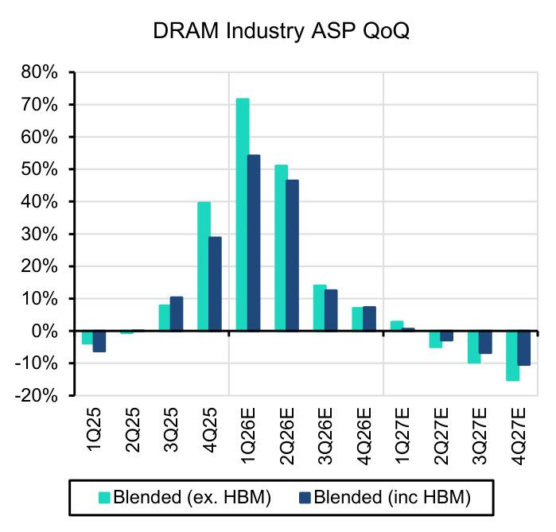
DRAM Industry ASP QoQ
纵轴：-20%～80%（刻度 -20%、-10%、0%、10%、20%、30%、40%、50%、60%、70%、80%）；横轴：1Q25–4Q27E；图例：Blended (ex. HBM)、Blended (inc HBM)

Source: Company reports, Bernstein estimates and analysis

EXHIBIT 2: **We expect NAND ASP to rise even faster in 2QCY26 by 60% QoQ.**

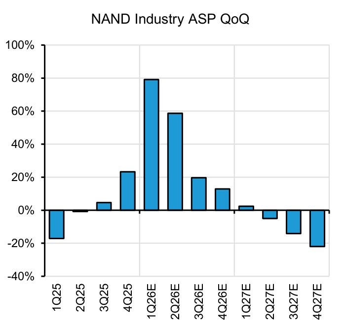
NAND Industry ASP QoQ
纵轴：-40%～100%（刻度 -40%、-20%、0%、20%、40%、60%、80%、100%）；横轴：1Q25–4Q27E；无图例（单一柱状序列）

Source: Company reports, Bernstein estimates and analysis

## 详情

欢迎下载我们的行业（DRAM、NAND、CoWoW/HBM）及公司模型（三星、SK海力士、美光及铠侠）。

**我们预测2QCY26内存价格上涨将超出预期。**

- 我们从近期技术考察和供应链调研中获得的信号显示，超大规模云服务商需求依然强劲，部分情况下甚至可能供不应求，而终端客户因预期价格上涨而提前采购，消费需求尚未被破坏。
- 因此，失衡缩小的迹象很少，这为供应商提供了在2QCY26大幅提价的空间。某些SKU（尤其是NAND）在2QCY26的环比价格涨幅可能高达100%，但HBM和其他产品的价格将更稳定，因此我们模型预测该季度DRAM和NAND的混合ASP分别环比上涨47%和60%（Exhibit 1-Exhibit 2）。我们认为这高于买方预期，并在短期内为股价带来明显的上行风险。
- 消费类应用的供应短缺通常比企业级应用更严重。例如，低端手机原始设备制造商（OEM）正遭受痛苦挤压，苹果和三星无法避免价格上涨，但应该能够满足大部分（如果不是全部）需求。由于存储价格，面向企业客户的服务器需求可能疲软。然而，由于一些云服务提供商（CSP）要求30%+ 同比增长，超大规模数据中心的服务器需求要强劲得多，因此我们预计2026年整体服务器出货量将增长13%。尽管有一些长期合同，我们也了解到汽车和工业客户存在供应短缺的情况。我们考虑了这些因素，表3总结了我们对不同应用的需求预测。

EXHIBIT 1: **我们预测2QCY26的DRAM混合ASP环比再上涨47%。**

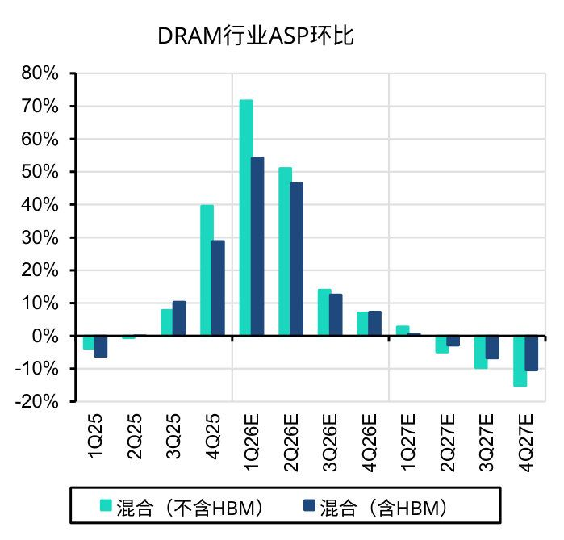
DRAM行业ASP环比
纵轴：-20%～80%（刻度 -20%、-10%、0%、10%、20%、30%、40%、50%、60%、70%、80%）；横轴：1Q25–4Q27E；图例：混合（不含HBM）、混合（含HBM）

来源：公司报告、伯恩斯坦估计及分析

EXHIBIT 2: **我们预计NAND ASP在2026年第二季度将环比上涨60%，涨幅更快。**

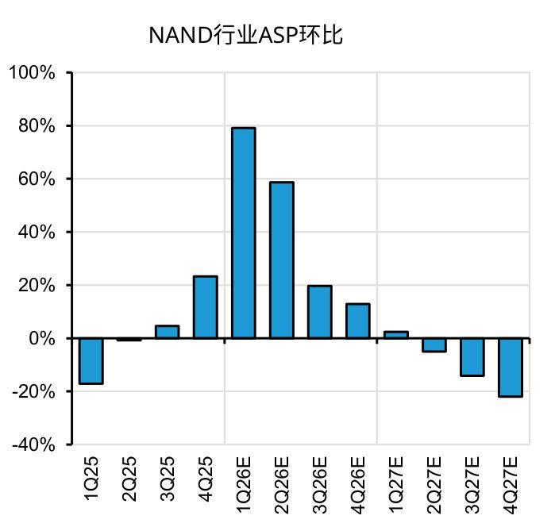
NAND行业ASP环比
纵轴：-40%～100%（刻度 -40%、-20%、0%、20%、40%、60%、80%、100%）；横轴：1Q25–4Q27E；无图例（单一柱状序列）

来源：公司报告、伯恩斯坦估计及分析

---

<!-- 原文第 4 页 -->

EXHIBIT 3: **Summary or our memory demand forecast assumptions.**

|  |  | 2021 | 2022 | 2023 | 2024 | 2025 | 2026E | 2027E | 2028E |
|---|---|---|---|---|---|---|---|---|---|
| **Device Shipment (M Units)** |  |  |  |  |  |  |  |  |  |
| PC | Shipment | 335 | 275 | 246 | 252 | 265 | 230 | 234 | 250 |
|  | Growth | 10% | -18% | -10% | 2% | 5% | -13% | 2% | 7% |
| Smartphone | Shipment | 1,358 | 1,198 | 1,152 | 1,217 | 1,249 | 1,062 | 1,083 | 1,191 |
|  | Growth | 5% | -12% | -4% | 6% | 3% | -15% | 2% | 10% |
| Server | Shipment | 13.0 | 13.6 | 12.8 | 13.1 | 14.1 | 15.9 | 17.0 | 18.0 |
|  | Growth | 2% | 5% | -6% | 2% | 8% | 13% | 7% | 6% |
| **DRAM Content per Device (GB/Unit)** |  |  |  |  |  |  |  |  |  |
| PC | Content | 7.7 | 9.1 | 9.9 | 11.1 | 12.6 | 13.5 | 14.4 | 16.3 |
|  | Growth | 6% | 18% | 8% | 12% | 13% | 8% | 6% | 14% |
| Smartphone | Content | 5.8 | 6.3 | 7.5 | 8.5 | 9.3 | 10.1 | 10.7 | 12.1 |
|  | Growth | 25% | 10% | 18% | 14% | 10% | 8% | 6% | 13% |
| Server (ex. HBM) | Content | 482 | 559 | 626 | 720 | 858 | 1,047 | 1,224 | 1,432 |
|  | Growth | 15% | 16% | 12% | 15% | 19% | 22% | 17% | 17% |
| **NAND Content per Device (GB/Unit)** |  |  |  |  |  |  |  |  |  |
| Smartphone | Content | 118 | 144 | 172 | 182 | 202 | 214 | 234 | 282 |
|  | Growth | 22% | 22% | 19% | 6% | 11% | 6% | 9% | 21% |
| Client SSD | Content | 529 | 624 | 692 | 757 | 781 | 702 | 733 | 870 |
|  | Growth | 19% | 18% | 11% | 9% | 3% | -10% | 4% | 19% |
| eSSD | Content | 2,644 | 3,224 | 3,747 | 4,769 | 6,153 | 7,477 | 9,523 | 12,307 |
|  | Growth | 32% | 22% | 16% | 27% | 29% | 22% | 27% | 29% |
| **Total Bit Demand** |  |  |  |  |  |  |  |  |  |
| Total DRAM (M Gb) | Demand | 179,450 | 193,537 | 212,956 | 253,846 | 308,470 | 368,570 | 444,443 | 542,505 |
|  | Growth | 21% | 8% | 10% | 19% | 22% | 19% | 21% | 22% |
| PC | Demand | 20,750 | 20,056 | 19,502 | 22,422 | 26,727 | 24,930 | 26,889 | 32,666 |
|  | Growth | 16% | -3% | -3% | 15% | 19% | -7% | 8% | 21% |
| Smartphone | Demand | 62,553 | 60,606 | 68,844 | 82,753 | 93,230 | 85,909 | 92,899 | 115,500 |
|  | Growth | 946% | -3% | 14% | 20% | 13% | -8% | 8% | 24% |
| Server (ex. HBM) | Demand | 50,257 | 61,031 | 64,200 | 75,306 | 96,496 | 132,990 | 166,440 | 206,337 |
|  | Growth | 17% | 21% | 5% | 17% | 28% | 38% | 25% | 24% |
| HBM | Demand | 651 | 1,358 | 3,035 | 10,098 | 23,251 | 50,347 | 76,133 | 91,965 |
|  | Growth | 109% | 109% | 123% | 233% | 130% | 117% | 51% | 21% |
| Total NAND (M GB) | Demand | 645,752 | 739,436 | 808,941 | 958,119 | 1,132,577 | 1,325,913 | 1,581,353 | 1,955,975 |
|  | Growth | 36% | 15% | 9% | 18% | 18% | 17% | 19% | 24% |
| Client SSD | Demand | 217,503 | 224,952 | 247,509 | 269,347 | 278,806 | 225,725 | 246,296 | 319,027 |
|  | Growth | 42% | 3% | 10% | 9% | 4% | -19% | 9% | 30% |
| eSSD | Demand | 159,583 | 225,815 | 196,193 | 296,481 | 423,130 | 693,899 | 865,500 | 995,159 |
|  | Growth | 46% | 42% | -13% | 51% | 43% | 64% | 25% | 15% |
| Smartphone | Demand | 160,659 | 172,373 | 197,843 | 221,549 | 252,901 | 227,650 | 253,629 | 336,272 |
|  | Growth | 28% | 7% | 15% | 12% | 14% | -10% | 11% | 33% |

Source: Gartner, TrendForce, Bernstein estimates and analysis

**Visibility is poor, but we expect price to continue rising, but much more gradually in 2HCY26, then peak in 1HCY27 and reverse into a decline in 2HCY27 and CY2028.**

- Hyperscalers are discussing long-term contracts with suppliers now. They are more extended in time, with some having coverage going beyond the end of CY2026. However, meetings with key suppliers in our Tech Tour didn't give us the confidence that these “eLTA” (extended LTAs) have sufficient lock-in on quantity & more importantly on price to avoid future volatility. Moreover, consumer applications is still a meaningful part of memory market, and our checks found that they by and large still don't have "eLTA" in place. Market is hence very fluid and even suppliers and professional memory sourcing managers don't know their prices beyond the next few months.
- We believe price increase to continue throughout CY2026, but model the magnitude of the QoQ increase to moderate in 2HCY26 more based on inputs from industry participants, or guesses, instead of quantitative analysis.
- As 1) demand destruction in consumer applications becomes gradually more visible in 2HCY26 and more into 1HCY27, & 2) supply addition, through first technology upgrades and then new clean rooms & wafer addition, arrives in late CY2026 & more in CY2027, we model the cycle to peak in 1HCY27. Price drop then accelerate in 2HCY27 when more clean rooms

EXHIBIT 3: **存储需求预测假设摘要**

|  |  | 2021 | 2022 | 2023 | 2024 | 2025 | 2026E | 2027E | 2028E |
|---|---|---|---|---|---|---|---|---|---|
| **设备出货量（百万台）** |  |  |  |  |  |  |  |  |  |
| PC | 出货量 | 335 | 275 | 246 | 252 | 265 | 230 | 234 | 250 |
|  | 增长 | 10% | -18% | -10% | 2% | 5% | -13% | 2% | 7% |
| 智能手机 | 出货量 | 1,358 | 1,198 | 1,152 | 1,217 | 1,249 | 1,062 | 1,083 | 1,191 |
|  | 增长 | 5% | -12% | -4% | 6% | 3% | -15% | 2% | 10% |
| 服务器 | 出货量 | 13.0 | 13.6 | 12.8 | 13.1 | 14.1 | 15.9 | 17.0 | 18.0 |
|  | 增长 | 2% | 5% | -6% | 2% | 8% | 13% | 7% | 6% |
| **每设备DRAM含量（GB/单位）** |  |  |  |  |  |  |  |  |  |
| PC | 含量 | 7.7 | 9.1 | 9.9 | 11.1 | 12.6 | 13.5 | 14.4 | 16.3 |
|  | 增长 | 6% | 18% | 8% | 12% | 13% | 8% | 6% | 14% |
| 智能手机 | 含量 | 5.8 | 6.3 | 7.5 | 8.5 | 9.3 | 10.1 | 10.7 | 12.1 |
|  | 增长 | 25% | 10% | 18% | 14% | 10% | 8% | 6% | 13% |
| 服务器（不含HBM） | 含量 | 482 | 559 | 626 | 720 | 858 | 1,047 | 1,224 | 1,432 |
|  | 增长 | 15% | 16% | 12% | 15% | 19% | 22% | 17% | 17% |
| **每设备NAND容量（GB/单位）** |  |  |  |  |  |  |  |  |  |
| 智能手机 | 含量 | 118 | 144 | 172 | 182 | 202 | 214 | 234 | 282 |
|  | 增长 | 22% | 22% | 19% | 6% | 11% | 6% | 9% | 21% |
| Client SSD | 含量 | 529 | 624 | 692 | 757 | 781 | 702 | 733 | 870 |
|  | 增长 | 19% | 18% | 11% | 9% | 3% | -10% | 4% | 19% |
| eSSD | 含量 | 2,644 | 3,224 | 3,747 | 4,769 | 6,153 | 7,477 | 9,523 | 12,307 |
|  | 增长 | 32% | 22% | 16% | 27% | 29% | 22% | 27% | 29% |
| **总比特需求** |  |  |  |  |  |  |  |  |  |
| 总DRAM（百万Gb） | 需求 | 179,450 | 193,537 | 212,956 | 253,846 | 308,470 | 368,570 | 444,443 | 542,505 |
|  | 增长 | 21% | 8% | 10% | 19% | 22% | 19% | 21% | 22% |
| PC | 需求 | 20,750 | 20,056 | 19,502 | 22,422 | 26,727 | 24,930 | 26,889 | 32,666 |
|  | 增长 | 16% | -3% | -3% | 15% | 19% | -7% | 8% | 21% |
| 智能手机 | 需求 | 62,553 | 60,606 | 68,844 | 82,753 | 93,230 | 85,909 | 92,899 | 115,500 |
|  | 增长 | 946% | -3% | 14% | 20% | 13% | -8% | 8% | 24% |
| 服务器（不含HBM） | 需求 | 50,257 | 61,031 | 64,200 | 75,306 | 96,496 | 132,990 | 166,440 | 206,337 |
|  | 增长 | 17% | 21% | 5% | 17% | 28% | 38% | 25% | 24% |
| HBM | 需求 | 651 | 1,358 | 3,035 | 10,098 | 23,251 | 50,347 | 76,133 | 91,965 |
|  | 增长 | 109% | 109% | 123% | 233% | 130% | 117% | 51% | 21% |
| NAND总量（百万GB） | 需求 | 645,752 | 739,436 | 808,941 | 958,119 | 1,132,577 | 1,325,913 | 1,581,353 | 1,955,975 |
|  | 增长 | 36% | 15% | 9% | 18% | 18% | 17% | 19% | 24% |
| Client SSD | 需求 | 217,503 | 224,952 | 247,509 | 269,347 | 278,806 | 225,725 | 246,296 | 319,027 |
|  | 增长 | 42% | 3% | 10% | 9% | 4% | -19% | 9% | 30% |
| eSSD | 需求 | 159,583 | 225,815 | 196,193 | 296,481 | 423,130 | 693,899 | 865,500 | 995,159 |
|  | 增长 | 46% | 42% | -13% | 51% | 43% | 64% | 25% | 15% |
| 智能手机 | 需求 | 160,659 | 172,373 | 197,843 | 221,549 | 252,901 | 227,650 | 253,629 | 336,272 |
|  | 增长 | 28% | 7% | 15% | 12% | 14% | -10% | 11% | 33% |

来源：Gartner、TrendForce、Bernstein的估计和分析

**能见度低，但我们预计价格将继续上涨，但在2026年下半年会缓慢得多，然后在2027年上半年达到峰值，并在2027年下半年和2028年转为下跌。**

- 超大规模数据中心目前正在与供应商讨论长期合同。这些合同的期限更长，部分合同的覆盖范围超出CY2026年末。然而，在我们的技术考察中与主要供应商的会面并未让我们确信这些“eLTA”（扩展长期协议）在数量上有足够的锁定，更重要的是在价格上有足够的锁定，以避免未来的波动。此外，消费应用仍是内存市场的重要组成部分，我们的调查发现它们总体上仍未签订“eLTA”。因此市场非常不稳定，即使是供应商和专业内存采购经理也不知道未来几个月后的价格。
- 我们认为价格将在2026年全年持续上涨，但我们预测2026年下半年环比涨幅将趋于温和，这更多基于行业参与者的反馈或猜测，而非定量分析。
- 随着1）消费类应用的需求破坏在2HCY26逐渐显现，并在1HCY27进一步加剧，以及2）供应增加（首先通过技术升级，然后通过新洁净室和晶圆增加）在CY2026年末出现，并在CY2027更多出现，我们建模的周期在1HCY27达到峰值。随后在2HCY27，当更多洁净室时，价格下跌加速。

---

<!-- 原文第 5 页 -->

become available, and even faster in CY2028, when the supply added by China becomes more and more sizable relative to the overall market. We assume competition will make price exiting CY2028 to fall below the starting point of this cycle (i.e. late CY2025) (Exhibit 4-Exhibit 7) but thanks to cost reduction in this period margins of memory suppliers will be still close to the historical mid-cycle average (Exhibit 8-Exhibit 9).

- The forecast above hinges on a fundamental assumption that there was a demand "shock" (i.e. major uptick) in late CY2025 but not another afterwards. Since then suppliers have been going full throttle to add more capacity and at the same time high price is also destroying some demand. The size of the imbalance is however so big and hence we assume it will take 3 years for the margins of suppliers to revert back to a normalized level. Some expect agentic workloads, for example from OpenClaw, will result in another demand “shock”. We also monitor this closely but signals thus far makes us assume it is already part of the demand shock that we saw in late CY2025.

EXHIBIT 4: **We forecast DRAM ASP to peak in 1HCY27 and correct afterwards.**

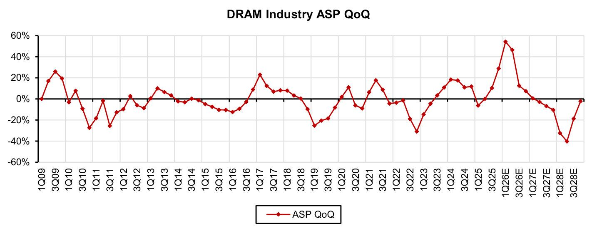
DRAM Industry ASP QoQ
纵轴：-60%～60%（刻度 -60%、-40%、-20%、0%、20%、40%、60%）；横轴：1Q09–3Q28E（每半年一个刻度，含 1Q26E 起的预测值）；图例：ASP QoQ

Source: Company reports, Bernstein estimates and analysis

EXHIBIT 5: **We model conventional DRAM ASP to fall to normal levels in CY2028.**

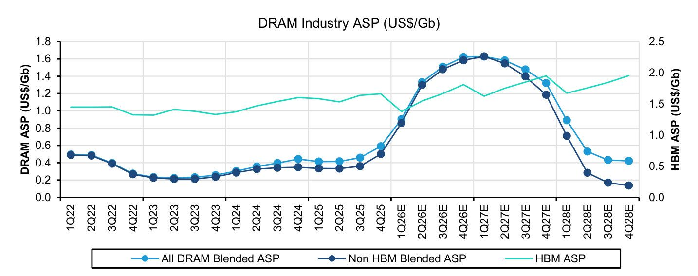
DRAM Industry ASP (US$/Gb)
左纵轴：DRAM ASP (US$/Gb) 0.0–1.8；右纵轴：HBM ASP (US$/Gb) 0.0–2.5；横轴：1Q22–4Q28E（逐季）；图例：All DRAM Blended ASP、Non HBM Blended ASP、HBM ASP

Source: Company reports, Bernstein estimates and analysis

变得可用，且在CY2028年更快，届时中国新增的供应相对于整体市场将越来越大。我们假设竞争将使CY2028年末的价格降至本周期起点（即CY2025年末）以下（Exhibit 4-Exhibit 7），但由于此期间的成本下降，内存供应商的利润率仍将接近历史中期周期平均水平（Exhibit 8-Exhibit 9）。

- 上述预测基于一个基本假设：2025年末出现了一次需求“冲击”（即大幅上升），但之后未再出现。自那以来，供应商一直在全力增加产能，同时高价也在破坏部分需求。然而，供需失衡的规模如此之大，因此我们假设供应商的利润率需要3年时间才能恢复到正常水平。一些人预计，例如来自OpenClaw的代理工作负载将导致另一次需求“冲击”。我们也在密切关注这一点，但迄今为止的信号使我们认为这已经是我们在2025年末看到的需求冲击的一部分。

EXHIBIT 4: **我们预测DRAM ASP在1HCY27达到峰值，之后回调。**

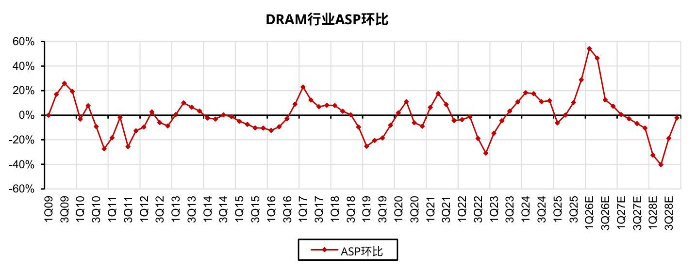
DRAM行业ASP环比
纵轴：-60%～60% 的相对变化（刻度 -60%、-40%、-20%、0%、20%、40%、60%）；横轴：1Q09–3Q28E（每半年一个刻度，含 1Q26E 起的预测值）；图例：ASP环比

来源：公司报告、伯恩斯坦估计及分析

EXHIBIT 5: **我们预测传统DRAM ASP将在2028年降至正常水平。**

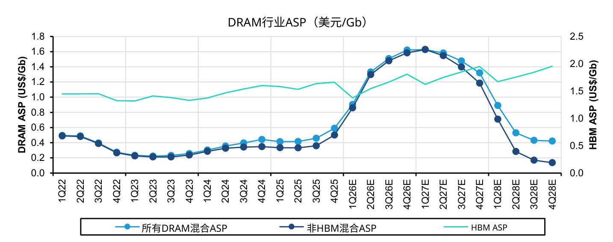
DRAM行业ASP（美元/Gb）
左纵轴：DRAM ASP (US$/Gb) 0.0–1.8；右纵轴：HBM ASP (US$/Gb) 0.0–2.5；横轴：1Q22–4Q28E（逐季）；图例：所有DRAM混合ASP、非HBM混合ASP、HBM ASP

来源：公司报告、伯恩斯坦估计及分析

---

<!-- 原文第 6 页 -->

EXHIBIT 6: **We also expect NAND ASP to see a meaningful decline from 2HCY27.**

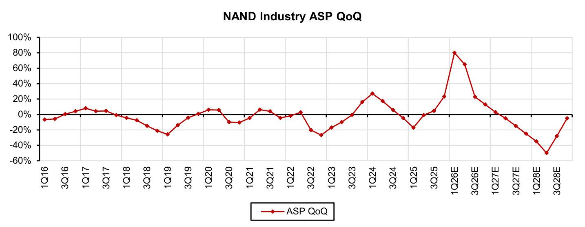
NAND Industry ASP QoQ
纵轴：-60%～100%（刻度 -60%、-40%、-20%、0%、20%、40%、60%、80%、100%）；横轴：1Q16–3Q28E（每半年一个刻度，含 1Q26E 起的预测值）；图例：ASP QoQ

Source: Company reports, Bernstein estimates and analysis

EXHIBIT 7: **And into CY2028 we believe NAND price needs to correct to normal levels.**

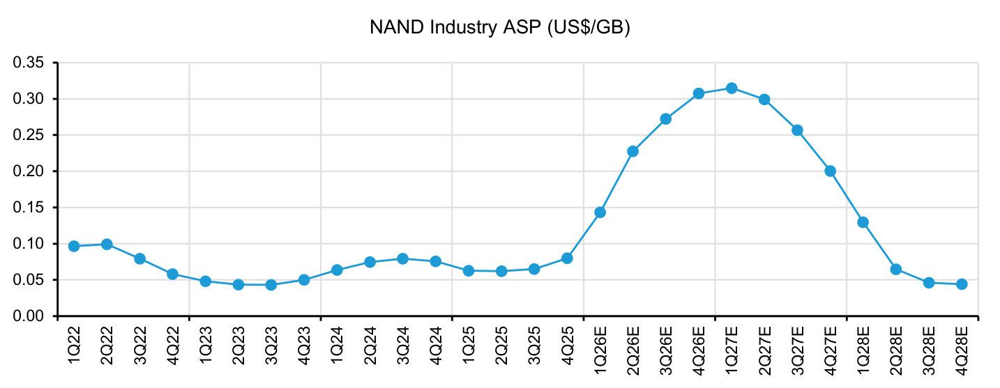
NAND Industry ASP (US$/GB)
纵轴：0.00–0.35（刻度 0.00、0.05、0.10、0.15、0.20、0.25、0.30、0.35）；横轴：1Q22–4Q28E（逐季）；单一序列，无图例

Source: Company reports, Bernstein estimates and analysis

EXHIBIT 6: **我们还预计NAND ASP从2027年下半年开始将出现显著下降。**

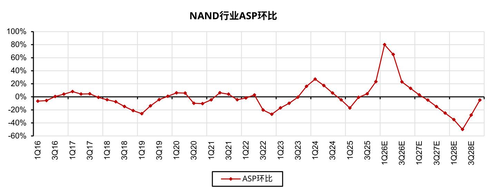
NAND行业ASP环比
纵轴：-60%～100%（刻度 -60%、-40%、-20%、0%、20%、40%、60%、80%、100%）；横轴：1Q16–3Q28E（每半年一个刻度，含 1Q26E 起的预测值）；图例：ASP环比

来源：公司报告、伯恩斯坦估计及分析

EXHIBIT 7: **到CY2028年，我们认为NAND价格需要回调至正常水平。**

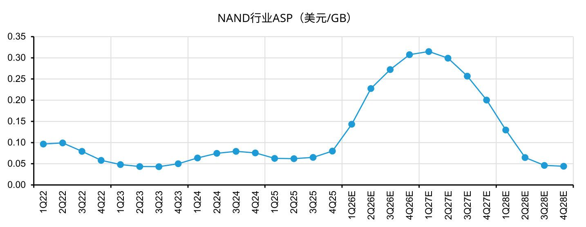
NAND行业ASP（美元/GB）
纵轴：0.00–0.35（刻度 0.00、0.05、0.10、0.15、0.20、0.25、0.30、0.35）；横轴：1Q22–4Q28E（逐季）；单一序列，无图例

来源：公司报告、伯恩斯坦估计及分析

---

<!-- 原文第 7 页 -->

EXHIBIT 8: **We see DRAM gross margin to approach 90% in late CY2026 and early CY2027, but retreat to normal levels in CY2028 as price falls.**

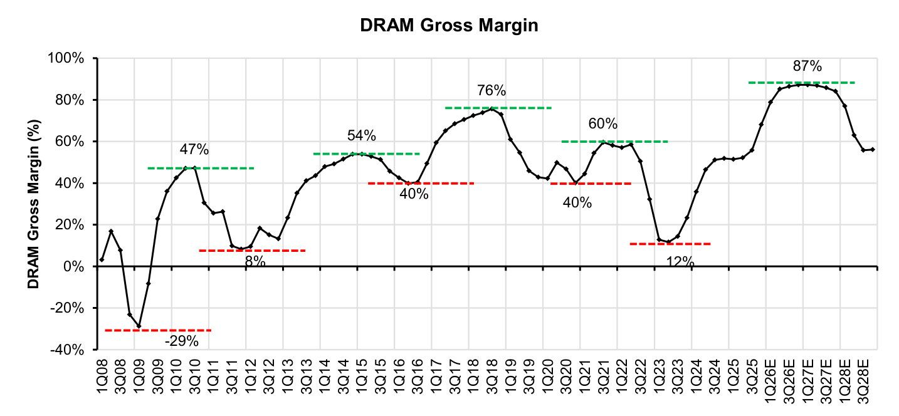
DRAM Gross Margin
纵轴：DRAM Gross Margin (%) -40%～100%；横轴：1Q08–3Q28E（每半年一个刻度，含 1Q26E 起的预测值）；图中标注参考值（按横向顺序）：-29%、47%、8%、54%、40%、76%、40%、60%、12%、87%

Source: Company reports, DRAMexchange, Bernstein estimates and analysis

EXHIBIT 9: **For NAND, we also model indstry gross margin to peak at 86% and then rapidly drops to normal levels in CY2028.**

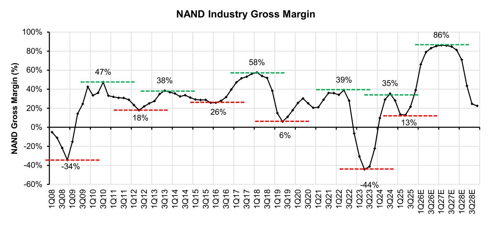
NAND Industry Gross Margin
纵轴：NAND Gross Margin (%) -60%～100%；横轴：1Q08–3Q28E（每半年一个刻度，含 1Q26E 起的预测值）；图中标注参考值（按横向顺序）：-34%、47%、18%、38%、26%、58%、6%、39%、-44%、35%、13%、86%

Source: Company reports, DRAMeXchange, Bernstein estimates and analysis

**HBM demand continues rising and data points suggest Samsung is one par with, if not ahead of, rivals in HBM4.**

- We nudged up our HBM & CoWoS capacity forecast (CoWoS/HBM Model) not long ago and expect HBM demand to sustain an upward trajectory from now to CY2028 (Exhibit 10). Helped by the transition from HBM3E to 4 (Exhibit 11) and more importantly the tight supply we expect the blended HBM ASP to rise YoY this year, despite that Samsung turning more competitive in HBM4 should exert a downward pressure (Exhibit 12). The size of the HBM ASP increase is however much smaller, and earnings of memory suppliers are still predominately determined by the prices of conventional memory.

EXHIBIT 8: **我们预计DRAM毛利率在2026年末和2027年初将接近90%，但随着价格下跌，2028年将回落至正常水平。**

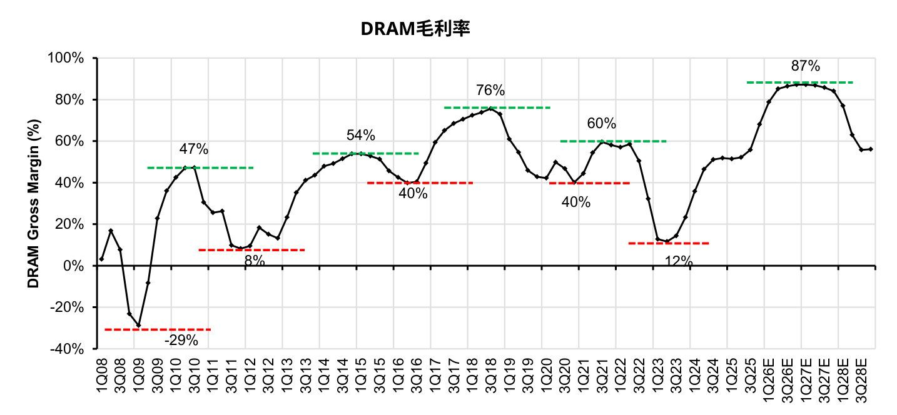
DRAM毛利率
纵轴：DRAM Gross Margin (%) -40%～100%；横轴：1Q08–3Q28E（每半年一个刻度，含 1Q26E 起的预测值）；图中标注参考值（按横向顺序）：-29%、47%、8%、54%、40%、76%、40%、60%、12%、87%

来源：公司报告、DRAMeXchange、Bernstein的估计和分析

EXHIBIT 9: **对于NAND，我们还建模行业毛利率在CY2028达到86%的峰值，然后迅速回落至正常水平。**

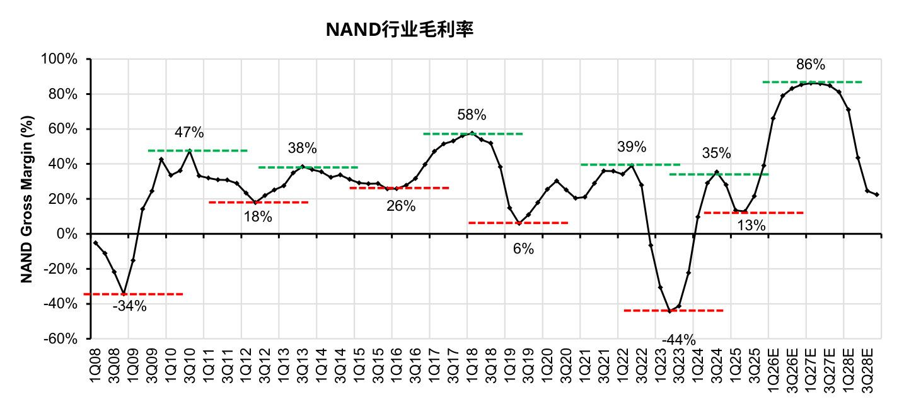
NAND行业毛利率
纵轴：NAND Gross Margin (%) -60%～100%；横轴：1Q08–3Q28E（每半年一个刻度，含 1Q26E 起的预测值）；图中标注参考值（按横向顺序）：-34%、47%、18%、38%、26%、58%、6%、39%、-44%、35%、13%、86%

来源：公司报告、DRAMeXchange、Bernstein的估计和分析

**HBM需求conti 收入上升，数据显示三星在HBM方面与竞争对手相当，甚至领先。**

- 我们不久前上调了HBM和CoWoS的产能预测（CoWoS/HBM模型），并预计从现在到CY2028年HBM需求将保持上升趋势（Exhibit 10）。在从HBM3E向4过渡（Exhibit 11）以及更重要的供应紧张的推动下，我们预计今年混合HBM ASP将同比上升，尽管三星在HBM4领域更具竞争力应会施加下行压力（Exhibit 12）。然而，HBM ASP的上涨幅度要小得多，内存供应商的收益仍主要由传统内存的价格决定。

---

<!-- 原文第 8 页 -->

- Benefited from better nodes used in DRAM and base die (Exhibit 14), Samsung, we believe, is best positioned to meet the higher speed required by NVIDIA. Micron is disadvantaged particularly with the choice of base die node. SK hynix also suffered a small delay with an issue in its base die no long ago, according to our checks. All these and having more ample clean room space than rivals should allow Samsung to gradually gain share in HBM (Exhibit 13), despite that Samsung's capacity allocation may favor conventional DRAM slightly over HBM to optimize profitability.

EXHIBIT 10: **We raised HBM forecast to 117% growth YoY in bit shipment in CY2026 not long ago.**

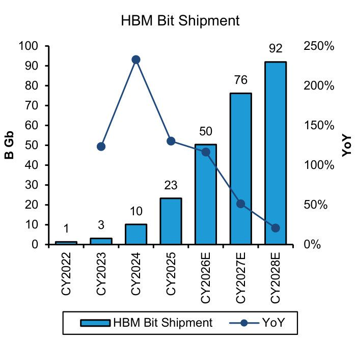
HBM Bit Shipment
左纵轴：B Gb 0–100；右纵轴：YoY 0%–250%；横轴：CY2022–CY2028E；图例：HBM Bit Shipment、YoY
柱上标注（B Gb）：1、3、10、23、50、76、92；YoY 折线未标注数值

Source: TrendForce, Yole, Bernstein estimates and analysis

EXHIBIT 11: **HBM4 will begin to take share this year though the majority likely will remain HBM3E.**

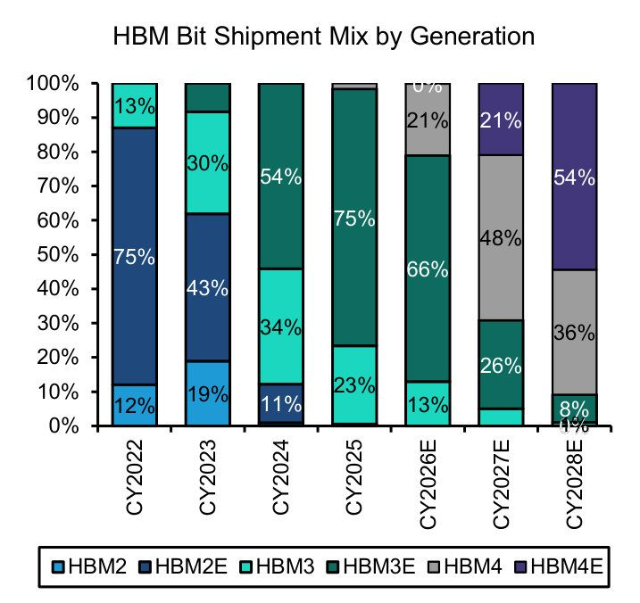
HBM Bit Shipment Mix by Generation
纵轴：0%–100%；横轴：CY2022–CY2028E；图例：HBM2、HBM2E、HBM3、HBM3E、HBM4、HBM4E
柱内标注（自下而上）：CY2022 HBM2 12% / HBM2E 75% / HBM3 13%；CY2023 HBM2 19% / HBM2E 43% / HBM3 30%；CY2024 HBM2E 11% / HBM3 34% / HBM3E 54%；CY2025 HBM3 23% / HBM3E 75%；CY2026E HBM3 13% / HBM3E 66% / HBM4 21%（顶部另有 0% 标注）；CY2027E HBM3E 26% / HBM4 48% / HBM4E 21%（底部 HBM3 段未标注）；CY2028E HBM3E 8% / HBM4 36% / HBM4E 54%（底部 HBM3 段未标注）

Source: TrendForce, Bernstein estimates and analysis

EXHIBIT 12: **We expect the blended HBM ASP to be stable this year, supported by higher HBM4 mix & tight supply overall.**

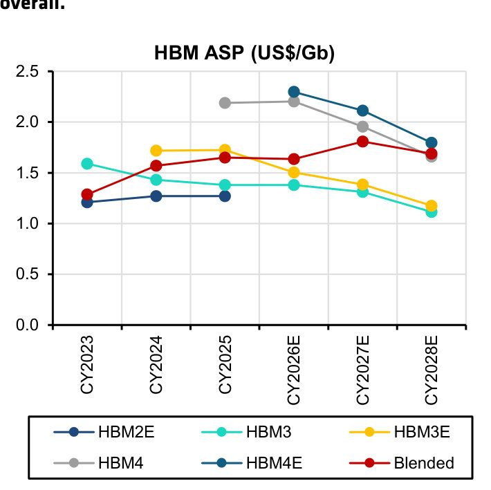
HBM ASP (US$/Gb)
纵轴：US$/Gb 0.0–2.5；横轴：CY2023–CY2028E；图例：HBM2E、HBM3、HBM3E、HBM4、HBM4E、Blended

Source: Company reports, TrendForce, Bernstein estimates and analysis

EXHIBIT 13: **We believe Samsung can gain share in HBM starting this year and going forward.**

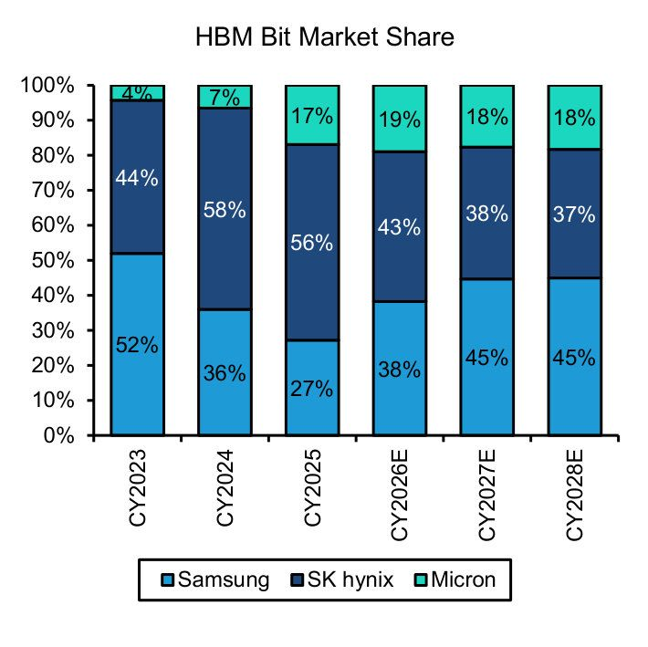
HBM Bit Market Share
纵轴：0%–100%；横轴：CY2023–CY2028E；图例：Samsung、SK hynix、Micron
柱内标注（自下而上）：CY2023 Samsung 52% / SK hynix 44% / Micron 4%；CY2024 36% / 58% / 7%；CY2025 27% / 56% / 17%；CY2026E 38% / 43% / 19%；CY2027E 45% / 38% / 18%；CY2028E 45% / 37% / 18%

Source: TrendForce, Bernstein estimates and analysis

- 得益于DRAM和基底裸片使用的更先进节点（Exhibit 14），我们认为三星最有条件满足NVIDIA所需的更高速度。美光在基底裸片节点的选择上尤其处于劣势。根据我们的调查，SK hynix最近也因基底裸片问题出现了小延迟。所有这些因素，加上比竞争对手更充足的洁净室空间，应使三星能够逐步在HBM领域获得份额（Exhibit 13），尽管三星的产能分配可能会略微偏向传统DRAM而非HBM以优化盈利能力。

EXHIBIT 10: **我们不久前将CY2026年HBM位出货量的同比增长预测上调至117%。**

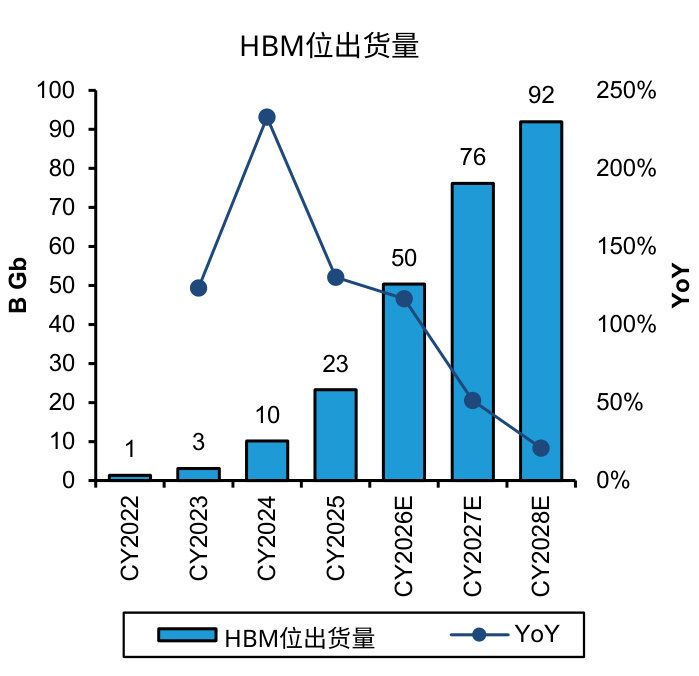
HBM位出货量
左纵轴：B Gb 0–100；右纵轴：YoY 0%–250%；横轴：CY2022–CY2028E；图例：HBM位出货量、YoY
柱上标注（B Gb）：1、3、10、23、50、76、92；YoY 折线未标注数值

来源：TrendForce、Yole、Bernstein的估计和分析

EXHIBIT 11: **HBM4今年将开始占据份额，尽管大部分仍将是HBM3E。**

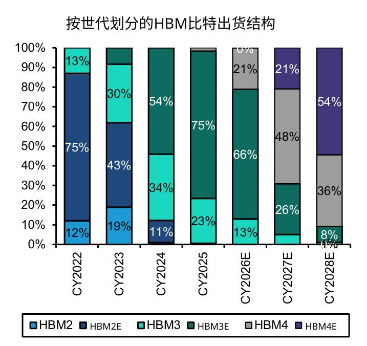
按世代划分的HBM比特出货结构
纵轴：0%–100%；横轴：CY2022–CY2028E；图例：HBM2、HBM2E、HBM3、HBM3E、HBM4、HBM4E
柱内标注（自下而上）：CY2022 HBM2 12% / HBM2E 75% / HBM3 13%；CY2023 HBM2 19% / HBM2E 43% / HBM3 30%；CY2024 HBM2E 11% / HBM3 34% / HBM3E 54%；CY2025 HBM3 23% / HBM3E 75%；CY2026E HBM3 13% / HBM3E 66% / HBM4 21%（顶部另有 0% 标注）；CY2027E HBM3E 26% / HBM4 48% / HBM4E 21%（底部 HBM3 段未标注）；CY2028E HBM3E 8% / HBM4 36% / HBM4E 54%（底部 HBM3 段未标注）

来源：TrendForce、伯恩斯坦估计及分析

EXHIBIT 12: **我们预计今年混合HBM ASP将保持稳定，这得益于更高的HBM4占比和整体供应紧张。**

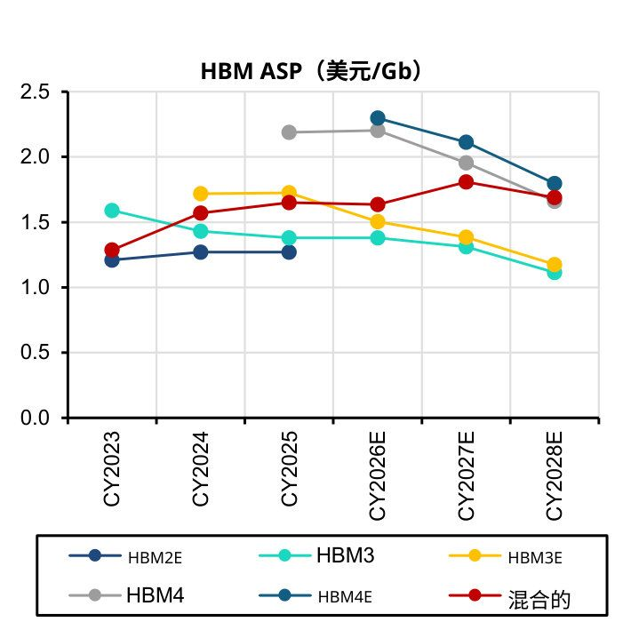
HBM ASP（美元/Gb）
纵轴：US$/Gb 0.0–2.5；横轴：CY2023–CY2028E；图例：HBM2E、HBM3、HBM3E、HBM4、HBM4E、混合的

Source: 公司报告、TrendForce、Bernstein预估及an alysis

EXHIBIT 13: **我们认为三星从今年开始将在HBM领域获得市场份额。**

HBM比特市场份额
纵轴：0%–100%；横轴：CY2023–CY2028E；图例：Samsung、SK hynix、Micron
柱内标注（自下而上）：CY2023 Samsung 52% / SK hynix 44% / Micron 4%；CY2024 36% / 58% / 7%；CY2025 27% / 56% / 17%；CY2026E 38% / 43% / 19%；CY2027E 45% / 38% / 18%；CY2028E 45% / 37% / 18%

来源：TrendForce、伯恩斯坦估计及分析

---

<!-- 原文第 9 页 -->

EXHIBIT 14: **Summary of the technology choices of HBM base dies from the three suppliers**

**HBM Base Die Process Node**

|  |  | Samsung | SK hynix | Micron |
|---|---|---|---|---|
| HBM4 | Standard | Samsung 4nm | TSMC 12nm | Internal Planar |
| HBM4 | Custom | Samsung 4nm | TSMC 12nm | Internal Planar |
| HBM4E | Standard | Samsung (2nm?) or TSMC | TSMC (12nm?) | TSMC (12nm?) |
| HBM4E | Custom | Samsung (2nm?) or TSMC | TSMC N4/3 or N3 chosen by Nvidia? | TSMC N4/3 or N3 chosen by Nvidia? |

Source: TrendForce, Bernstein estimates and analysis

**Record earnings but can it repeat and justify a multiple?** Record book values too, but 60-85% is cash & should not deserve a multiple either.

- We significantly raise 2026 and 2027 forecasts as we factor in the latest price assumptions, and we are considerably above consensus which likely is not being updated fast enough to the latest memory prices (Exhibit 15-Exhibit 18). Our 2028 forecasts are however either in line or below consensus, reflecting our view of cyclical correction in 2028.
- For the stocks, given the very strong upcycle and likely longer duration of the upcycle, we broadly remain positive on them. Share prices have rallied significantly in the past few months spurred by surging memory prices. Under the current memory price projection, earnings and book value accretion will explode in the next two years (Exhibit 19-Exhibit 22), but it would be hard to argue they are easily repeatable in the future and hence we don't think they should deserve a normal multiple. And given the projected FCF, 60-85% of the BVPS (book value per share) is expected to be cash in 2 years time (Exhibit 23-Exhibit 26). Unless there is another demand boom that will require huge capital investment, the cash part of the BVPS should not deserve a multiple either. Even if the companies significantly increase their capital return policy, what investors get is cash and hence does not have a multiple either. We hence lower multiple of SK hynix and Micron to 1.5x and 2x 2-year forward BVPS and set target price at KRW1,150,000 and US$510, respectively (Exhibit 28-Exhibit 29). For Samsung, we keep valuation multiple at 1.6x 2-year forward BVPS for its better progress at HBM4, and target is set to KRW225,000 (Exhibit 27).
- For KIOXIA, we do see the stock going higher together with NAND prices in the near term. However, the long-term concern we have for NAND and KIOXIA remains. AI is expected to bring more demand to NAND, but it is far as clear and sizable as HBM is to DRAM. And most importantly, lower technology barrier in NAND and higher competitive pressure, especially from YMTC, are the reason why the large players put lower priority on NAND investment. KIOXIA can surely benefit from the current shortage, but we are not yet convinced that its fundamental competitive position has improved. We hence maintain Underperform, and set TP at JPY 17,000, at 1x 2-year forward BVPS (Exhibit 30).
- Overall, we see AI is resulting in faster memory demand growth, but investors should remember the extraordinary earnings now takes more than just good demand and can be repeated only when severe shortage occurs again. With record high capex from the incumbents & even faster expansion from China, we don't think shortage can persist forever. Hence, though we're structurally positive on memory, but still caution investors on the cyclicality of earnings and stock prices.

EXHIBIT 14: **三家供应商HBM基底裸片技术选择摘要HBM基底裸片工艺节点**

|  |  | Samsung | SK hynix | Micron |
|---|---|---|---|---|
| HBM4 | 标准 | Samsung 4nm | TSMC 12nm | 内部 Planar |
| HBM4 | 定制 | Samsung 4nm | TSMC 12nm | 内部 Planar |
| HBM4E | 标准 | Samsung（2纳米？）或 TSMC | TSMC (12nm?) | TSMC (12nm?) |
| HBM4E | 定制 | Samsung（2纳米？）或 TSMC | 台积电N4/3或N3 由英伟达选择？ | 台积电N4/3或N3 由英伟达选择？ |

来源：TrendForce、伯恩斯坦估计及分析

创纪录的收益，但能重复吗？值得给予倍数吗？账面价值也创纪录，但60-85%是现金，也不应给予倍数。

- 我们大幅上调了2026和2027年的预测，因为我们考虑了最新的价格假设，且我们的预测远高于共识（共识可能未及时更新至最新存储价格）（表15-表18）。然而，我们的2028年预测与共识一致或低于共识，反映了我们对2028年周期性回调的看法。

对于这些股票，鉴于上行周期非常强劲且持续时间可能更长，我们总体仍持积极看法。过去几个月，受内存价格飙升推动，股价大幅上涨。根据当前内存价格预测，未来两年内盈利和账面价值的增长将大幅爆发（Exhibit 19-Exhibit 22），但很难说这些增长未来能轻易重现，因此我们认为它们不应享有正常的估值倍数。此外，根据预计的自由现金流（FCF），两年后每股账面价值（BVPS）中预计60-85%将为现金（Exhibit23-Exhibit 26）。除非出现另一场需要巨额资本投资的需求繁荣，否则BVPS中的现金部分也不应享有估值倍数。即使公司大幅提高资本回报政策，投资者获得的也是现金，因此同样没有估值倍数。因此，我们将SK海力士和Micron的估值倍数下调至1.5倍和2倍的两年远期BVPS，并分别设定目标价为KRW1,150,000和US$510（Exhibit 28-Exhibit 29）。对于三星，由于其在HBM4方面进展更佳，我们维持其估值倍数为1.6倍的两年远期BVPS，目标价设定为KRW225,000（Exhibit 27）。

- 对于铠侠，我们确实看到其股价在短期内随NAND价格上涨而走高。然而，我们对NAND和铠侠的长期担忧依然存在。人工智能预计将为NAND带来更多需求，但这远不如HBM对DRAM的需求明确且规模庞大。最重要的是，NAND技术门槛较低且竞争压力较大（尤其是来自长江存储的竞争），这是大型厂商对NAND投资优先级较低的原因。铠侠无疑能从当前短缺中受益，但我们尚未确信其基本竞争地位已改善。因此，我们维持“跑输大盘”评级，目标价设定为17,000日元，对应2年期预期BVPS的1倍（Exhibit 30）。
- 总体而言，我们看到人工智能导致内存需求增长更快，但投资者应记住，现在的非凡收益不仅仅需要良好的需求，只有在再次出现严重短缺时才能重复。由于现有企业的资本支出创历史新高，以及中国的扩张速度更快，我们认为短缺不会永远持续。因此，尽管我们对内存行业结构性乐观，但仍提醒投资者注意收益和股价的周期性。

---

<!-- 原文第 10 页 -->

EXHIBIT 15: **For Samsung, we are considerably above consensus for CY2026 and CY2027 but we expect a correction in CY2028.**

|  | 2026E Bernstein New | 2026E Bernstein Old | 2026E Bernstein % Chg | 2026E Consensus | 2026E % Diff | 2027E Bernstein New | 2027E Bernstein Old | 2027E Bernstein % Chg | 2027E Consensus | 2027E % Diff | 2028E Bernstein New | 2028E Consensus | 2028E % Diff |
|---|---|---|---|---|---|---|---|---|---|---|---|---|---|
| Revenue (KRW B) | 571,178 | 430,375 | 32.7% | 502,669 | 13.6% | 686,889 | 426,429 | 61.1% | 569,883 | 20.5% | 446,595 | 637,627 | -30.0% |
| YoY | 71.2% | 29.0% |  | 50.7% |  | 20.3% | -0.9% |  | 13.4% |  | -35.0% | 11.9% |  |
| Gross Margin | 81.2% | 64.4% | 16.8% | 56.1% | 25.1% | 87.3% | 58.3% | 29.0% | 56.5% | 30.8% | 52.9% | 53.7% | -0.7% |
| Operating Margin | 57.2% | 40.6% | 16.6% | 37.2% | 20.1% | 65.4% | 36.6% | 28.8% | 39.5% | 25.9% | 32.9% | 36.3% | -3.4% |
| EPS (KRW) | 35,740 | 19,403 | 84.2% | 23,302 | 53.4% | 49,548 | 17,600 | 181.5% | 29,011 | 70.8% | 17,340 | 30,703 | -43.5% |
| YoY | 440.6% | 193.5% |  | 252.4% |  | 38.6% | -9.3% |  | 24.5% |  | -65.0% | 5.8% |  |

Source: Bloomberg, Bernstein estimates and analysis

EXHIBIT 16: **Similarly for SK hynix, we are also more bullish on CY2026 and CY2027, primarily due to the recent surge in memory price, but our CY2028 forecasts are notably more conservative.**

|  | 2026E Bernstein New | 2026E Bernstein Old | 2026E Bernstein % Chg | 2026E Consensus | 2026E % Diff | 2027E Bernstein New | 2027E Bernstein Old | 2027E Bernstein % Chg | 2027E Consensus | 2027E % Diff | 2028E Bernstein New | 2028E Consensus | 2028E % Diff |
|---|---|---|---|---|---|---|---|---|---|---|---|---|---|
| Revenue (KRW Bn) | 307,701 | 185,614 | 65.8% | 223,192 | 37.9% | 406,986 | 171,705 | 137.0% | 276,219 | 47.3% | 182,106 | 327,876 | -44.5% |
| YoY | 216.7% | 91.1% |  | 129.7% |  | 32.3% | -7.5% |  | 23.8% |  | -55.3% | 18.7% |  |
| Gross Margin | 87.0% | 76.3% | 10.8% | 75.9% | 11.2% | 88.4% | 72.1% | 16.3% | 74.9% | 13.4% | 70.7% | 63.7% | 7.0% |
| Operating Margin | 81.1% | 68.4% | 12.7% | 67.3% | 13.8% | 82.4% | 62.5% | 19.9% | 66.0% | 16.3% | 59.5% | 50.4% | 9.1% |
| Diluted EPS (KRW) | 286,732 | 145,826 | 96.6% | 171,541 | 67.2% | 385,594 | 123,274 | 212.8% | 208,563 | 84.9% | 124,299 | 208,323 | -40.3% |
| YoY | 375.2% | 141.7% |  | 184.3% |  | 34.5% | -15.5% |  | 21.6% |  | -67.8% | -0.1% |  |

Source: Bloomberg, Bernstein estimates and analysis

EXHIBIT 17: **On Micron, while we are notably above on FY26 and FY27, for FY28 we are largely in line.**

|  | FY2026E Bernstein New | FY2026E Bernstein Old | FY2026E Bernstein % Chg | FY2026E Consensus | FY2026E % Diff | FY2027E Bernstein New | FY2027E Bernstein Old | FY2027E Bernstein % Chg | FY2027E Consensus | FY2027E % Diff | FY2028E Bernstein New | FY2028E Consensus | FY2028E % Diff |
|---|---|---|---|---|---|---|---|---|---|---|---|---|---|
| **GAAP** |  |  |  |  |  |  |  |  |  |  |  |  |  |
| Revenue (US$B) | 116.9 | 75.8 | 54.2% | 76.9 | 52.0% | 199.8 | 90.8 | 120.1% | 98.1 | 103.8% | 110.9 | 103.3 | 7.3% |
| YoY | 212.8% | 102.8% |  | 105.8% |  | 70.9% | 19.8% |  | 27.5% |  | -44.5% | 5.4% |  |
| Gross Margin | 78.0% | 66.1% | 11.9% | 67.5% | 10.5% | 85.5% | 66.9% | 18.5% | 68.3% | 17.2% | 70.3% | 64.9% | 5.4% |
| Operating Margin | 71.9% | 57.6% | 14.3% | 59.6% | 12.2% | 80.7% | 58.8% | 21.9% | 61.9% | 18.8% | 61.5% | 58.9% | 2.6% |
| Diluted EPS (US$) | 62.27 | 14.23 | 337.7% | 33.14 | 87.9% | 121.31 | 14.23 | 752.7% | 45.12 | 168.8% | 52.54 | 49.47 | 6.2% |
| YoY | 720.6% | 87.5% |  | 336.7% |  | 1498.6% | 0.0% |  | 36.2% |  | 592.4% | 9.6% |  |
| **Non-GAAP** |  |  |  |  |  |  |  |  |  |  |  |  |  |
| Diluted EPS (US$) | 62.53 | 32.03 | 95.2% | 33.73 | 85.4% | 121.03 | 39.03 | 210.1% | 44.50 | 172.0% | 52.75 | 46.63 | 13.1% |
| YoY | 654.6% | 286.5% |  | 307.0% |  | 1360.6% | 21.9% |  | 32.0% |  | 536.6% | 4.8% |  |

Source: Bloomberg, Bernstein estimates and analysis

EXHIBIT 18: **We also model a similar cycle for NAND and hence is above consensus on FY26 and FY27 but below on FY28 for KIOXIA.**

|  | FY2025E Bernstein New | FY2025E Bernstein Old | FY2025E Bernstein % Chg | FY2025E Consensus | FY2025E % Diff | FY2026E Bernstein New | FY2026E Bernstein Old | FY2026E Bernstein % Chg | FY2026E Consensus | FY2026E % Diff | FY2027E Bernstein New | FY2027E Bernstein Old | FY2027E Bernstein % Chg | FY2027E Consensus | FY2027E % Diff | FY2028E Bernstein New | FY2028E Consensus | FY2028E % Diff |
|---|---|---|---|---|---|---|---|---|---|---|---|---|---|---|---|---|---|---|
| Revenue (JPY B) | 2,239 | 1,920 | 16.6% | 2,236 | 0.1% | 7,720 | 3,146 | 145.4% | 4,395 | 75.7% | 7,448 | 2,377 | 213.4% | 5,320 | 40.0% | 2,004 | 4,280 | -53.2% |
| YoY | 31.2% | 12.5% |  | 31.0% |  | 244.8% | 63.8% |  | 96.5% |  | -3.5% | -24.4% |  | 21.0% |  | -73.1% | -19.5% |  |
| Gross Margin | 41.1% | 33.2% | 7.9% | 40.5% | 0.7% | 82.3% | 56.2% | 26.1% | 58.1% | 24.2% | 80.5% | 41.5% | 39.0% | 61.4% | 19.1% | 28.8% | 49.4% | -20.6% |
| Operating Margin | 34.8% | 25.4% | 9.5% | 34.7% | 0.1% | 78.5% | 50.1% | 28.3% | 57.9% | 20.5% | 76.3% | 33.5% | 42.8% | 57.1% | 19.2% | 21.1% | 44.8% | -23.7% |
| EPS (JPY) | 928 | 545 | 70.2% | 900 | 3.2% | 7,786 | 2,032 | 283.2% | 3,273 | 137.9% | 7,457 | 1,037 | 619.3% | 4,048 | 84.2% | 768 | 2,818 | -72.8% |
| YoY | 79.7% | 5.6% |  | 74.2% |  | 738.6% | 272.5% |  | 263.7% |  | -4.2% | -49.0% |  | 23.7% |  | -89.7% | -30.4% |  |

Source: Bloomberg and Bernstein analysis

EXHIBIT 15: **对于三星，我们对2026年和2027年的预测远高于共识，但预计2028年将出现回调。**

|  | 2026E New | 2026E Old | 2026E 变化百分比 | 2026E 共识 | 2026E 共识差异百分比 | 2027E New | 2027E Old | 2027E 变化百分比 | 2027E 共识 | 2027E 共识差异百分比 | 2028E New | 2028E 共识 | 2028E 共识差异百分比 |
|---|---|---|---|---|---|---|---|---|---|---|---|---|---|
| 收入（十亿韩元） | 571,178 | 430,375 | 32.7% | 502,669 | 13.6% | 686,889 | 426,429 | 61.1% | 569,883 | 20.5% | 446,595 | 637,627 | -30.0% |
| YoY | 71.2% | 29.0% |  | 50.7% |  | 20.3% | -0.9% |  | 13.4% |  | -35.0% | 11.9% |  |
| 毛利率 | 81.2% | 64.4% | 16.8% | 56.1% | 25.1% | 87.3% | 58.3% | 29.0% | 56.5% | 30.8% | 52.9% | 53.7% | -0.7% |
| 营业利润率 | 57.2% | 40.6% | 16.6% | 37.2% | 20.1% | 65.4% | 36.6% | 28.8% | 39.5% | 25.9% | 32.9% | 36.3% | -3.4% |
| 每股收益（韩元） | 35,740 | 19,403 | 84.2% | 23,302 | 53.4% | 49,548 | 17,600 | 181.5% | 29,011 | 70.8% | 17,340 | 30,703 | -43.5% |
| YoY | 440.6% | 193.5% |  | 252.4% |  | 38.6% | -9.3% |  | 24.5% |  | -65.0% | 5.8% |  |

来源：彭博社、Bernstein预估及分析

EXHIBIT 16: **同样对于SK hynix，我们也对CY2026和CY2027更为乐观，主要原因是近期内存价格飙升，但我们对CY2028的预测明显更为保守。**

|  | 2026E New | 2026E Old | 2026E 变化百分比 | 2026E 共识 | 2026E 共识差异百分比 | 2027E New | 2027E Old | 2027E 变化百分比 | 2027E 共识 | 2027E 共识差异百分比 | 2028E New | 2028E 共识 | 2028E 共识差异百分比 |
|---|---|---|---|---|---|---|---|---|---|---|---|---|---|
| 收入（十亿韩元） | 307,701 | 185,614 | 65.8% | 223,192 | 37.9% | 406,986 | 171,705 | 137.0% | 276,219 | 47.3% | 182,106 | 327,876 | -44.5% |
| YoY | 216.7% | 91.1% |  | 129.7% |  | 32.3% | -7.5% |  | 23.8% |  | -55.3% | 18.7% |  |
| 毛利率 | 87.0% | 76.3% | 10.8% | 75.9% | 11.2% | 88.4% | 72.1% | 16.3% | 74.9% | 13.4% | 70.7% | 63.7% | 7.0% |
| 营业利润率 | 81.1% | 68.4% | 12.7% | 67.3% | 13.8% | 82.4% | 62.5% | 19.9% | 66.0% | 16.3% | 59.5% | 50.4% | 9.1% |
| 摊薄每股收益（韩元） | 286,732 | 145,826 | 96.6% | 171,541 | 67.2% | 385,594 | 123,274 | 212.8% | 208,563 | 84.9% | 124,299 | 208,323 | -40.3% |
| YoY | 375.2% | 141.7% |  | 184.3% |  | 34.5% | -15.5% |  | 21.6% |  | -67.8% | -0.1% |  |

来源：彭博社、Bernstein预估及分析

EXHIBIT 17: **对于Micron，虽然我们的FY26和FY27预测明显高于共识，但FY28基本与共识一致。**

|  | 2026财年预测 New | 2026财年预测 Old | 2026财年预测 变化百分比 | 2026财年预测 共识 | 2026财年预测 共识差异百分比 | FY2027E New | FY2027E Old | FY2027E 变化百分比 | FY2027E 共识 | FY2027E 共识差异百分比 | 2028财年预测 New | 2028财年预测 共识 | 2028财年预测 共识差异百分比 |
|---|---|---|---|---|---|---|---|---|---|---|---|---|---|
| **GAAP** |  |  |  |  |  |  |  |  |  |  |  |  |  |
| 收入（十亿美元） | 116.9 | 75.8 | 54.2% | 76.9 | 52.0% | 199.8 | 90.8 | 120.1% | 98.1 | 103.8% | 110.9 | 103.3 | 7.3% |
| YoY | 212.8% | 102.8% |  | 105.8% |  | 70.9% | 19.8% |  | 27.5% |  | -44.5% | 5.4% |  |
| 毛利率 | 78.0% | 66.1% | 11.9% | 67.5% | 10.5% | 85.5% | 66.9% | 18.5% | 68.3% | 17.2% | 70.3% | 64.9% | 5.4% |
| 营业利润率 | 71.9% | 57.6% | 14.3% | 59.6% | 12.2% | 80.7% | 58.8% | 21.9% | 61.9% | 18.8% | 61.5% | 58.9% | 2.6% |
| 稀释每股收益 (US$) | 62.27 | 14.23 | 337.7% | 33.14 | 87.9% | 121.31 | 14.23 | 752.7% | 45.12 | 168.8% | 52.54 | 49.47 | 6.2% |
| YoY | 720.6% | 87.5% |  | 336.7% |  | 1498.6% | 0.0% |  | 36.2% |  | 592.4% | 9.6% |  |
| **Non-GAAP** |  |  |  |  |  |  |  |  |  |  |  |  |  |
| 稀释每股收益 (US$) | 62.53 | 32.03 | 95.2% | 33.73 | 85.4% | 121.03 | 39.03 | 210.1% | 44.50 | 172.0% | 52.75 | 46.63 | 13.1% |
| YoY | 654.6% | 286.5% |  | 307.0% |  | 1360.6% | 21.9% |  | 32.0% |  | 536.6% | 4.8% |  |

来源：彭博社、Bernstein预估及分析

EXHIBIT 18: **我们也为NAND建模了类似的周期，因此对KIOXIA的FY26和FY27预测高于共识，但FY28低于共识。**

|  | 2025财年（预期）New | 2025财年（预期）Old | 2025财年（预期）变化百分比 | 2025财年（预期）共识 | 2025财年（预期）共识差异百分比 | 2026财年预测 New | 2026财年预测 Old | 2026财年预测 变化百分比 | 2026财年预测 共识 | 2026财年预测 共识差异百分比 | FY2027E New | FY2027E Old | FY2027E 变化百分比 | FY2027E 共识 | FY2027E 共识差异百分比 | 2028财年预测 New | 2028财年预测 共识 | 2028财年预测 共识差异百分比 |
|---|---|---|---|---|---|---|---|---|---|---|---|---|---|---|---|---|---|---|
| 收入（十亿日元） | 2,239 | 1,920 | 16.6% | 2,236 | 0.1% | 7,720 | 3,146 | 145.4% | 4,395 | 75.7% | 7,448 | 2,377 | 213.4% | 5,320 | 40.0% | 2,004 | 4,280 | -53.2% |
| YoY | 31.2% | 12.5% |  | 31.0% |  | 244.8% | 63.8% |  | 96.5% |  | -3.5% | -24.4% |  | 21.0% |  | -73.1% | -19.5% |  |
| 毛利率 | 41.1% | 33.2% | 7.9% | 40.5% | 0.7% | 82.3% | 56.2% | 26.1% | 58.1% | 24.2% | 80.5% | 41.5% | 39.0% | 61.4% | 19.1% | 28.8% | 49.4% | -20.6% |
| 营业利润率 | 34.8% | 25.4% | 9.5% | 34.7% | 0.1% | 78.5% | 50.1% | 28.3% | 57.9% | 20.5% | 76.3% | 33.5% | 42.8% | 57.1% | 19.2% | 21.1% | 44.8% | -23.7% |
| 每股收益（日元） | 928 | 545 | 70.2% | 900 | 3.2% | 7,786 | 2,032 | 283.2% | 3,273 | 137.9% | 7,457 | 1,037 | 619.3% | 4,048 | 84.2% | 768 | 2,818 | -72.8% |
| YoY | 79.7% | 5.6% |  | 74.2% |  | 738.6% | 272.5% |  | 263.7% |  | -4.2% | -49.0% |  | 23.7% |  | -89.7% | -30.4% |  |

来源：彭博社及伯恩斯坦分析

---

<!-- 原文第 11 页 -->

EXHIBIT 19: **We see 50-60% growth per year in Samsung BVPS in the next 2 years.**

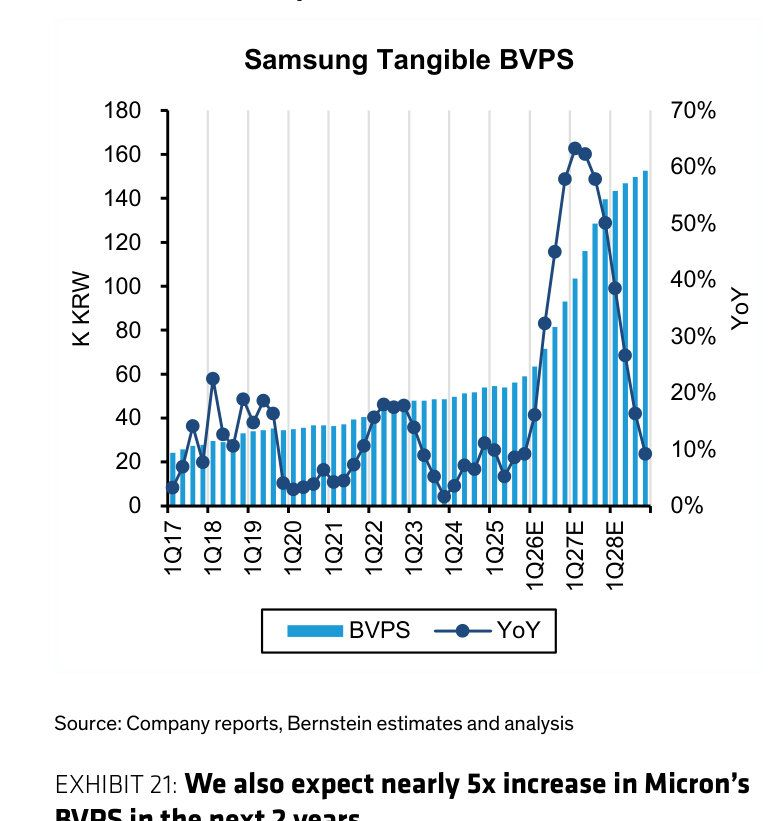
Samsung Tangible BVPS
纵轴（左）：K KRW 0～180（刻度 0、20、40、60、80、100、120、140、160、180）；纵轴（右）：YoY 0%～70%（刻度 0%、10%、20%、30%、40%、50%、60%、70%）；横轴：1Q17–1Q28E；图例：BVPS（柱状）、YoY（折线）

Source: Company reports, Bernstein estimates and analysis

EXHIBIT 20: **Given our memory price outlook, we model SK hynix BVPS can expand 4.5-5x in the next 2 years.**

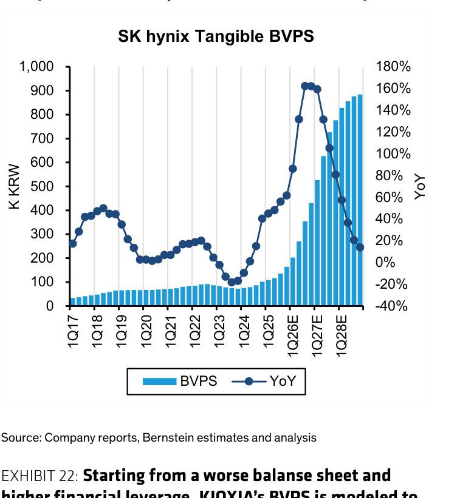
SK hynix Tangible BVPS
纵轴（左）：K KRW 0～1,000（刻度 0、100、200、300、400、500、600、700、800、900、1,000）；纵轴（右）：YoY -40%～180%（刻度 -40%、-20%、0%、20%、40%、60%、80%、100%、120%、140%、160%、180%）；横轴：1Q17–1Q28E；图例：BVPS（柱状）、YoY（折线）

Source: Company reports, Bernstein estimates and analysis

EXHIBIT 21: **We also expect nearly 5x increase in Micron’s BVPS in the next 2 years.**

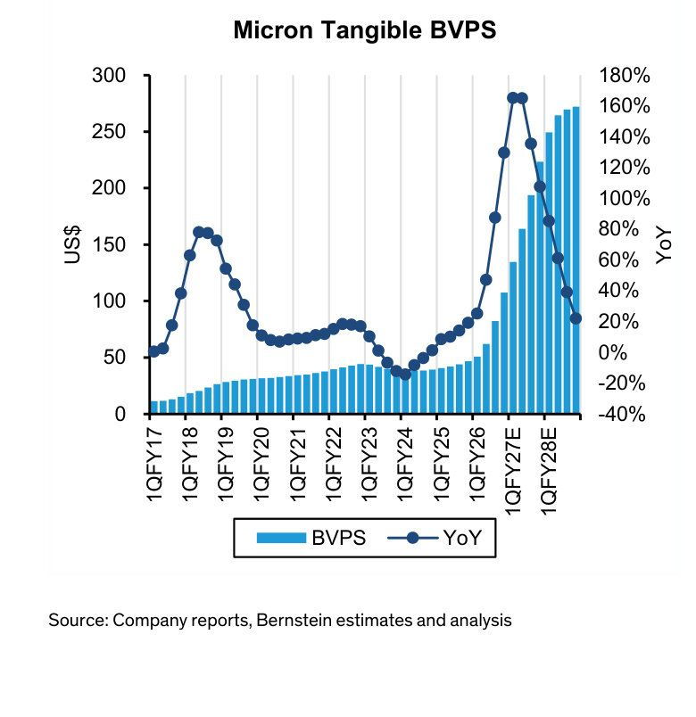
Micron Tangible BVPS
纵轴（左）：US$ 0～300（刻度 0、50、100、150、200、250、300）；纵轴（右）：YoY -40%～180%（刻度 -40%、-20%、0%、20%、40%、60%、80%、100%、120%、140%、160%、180%）；横轴：1QFY17–1QFY28E；图例：BVPS（柱状）、YoY（折线）

Source: Company reports, Bernstein estimates and analysis

EXHIBIT 22: **Starting from a worse balanse sheet and higher financial leverage, KIOXIA’s BVPS is modeled to expand by 15x in 2 years.**

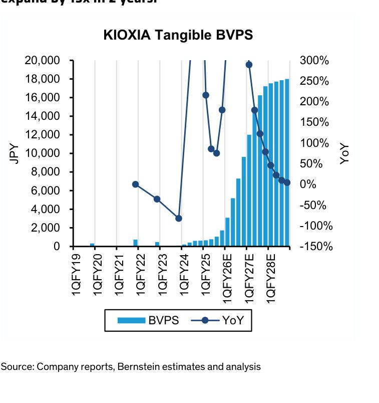
KIOXIA Tangible BVPS
纵轴（左）：JPY 0～20,000（刻度 0、2,000、4,000、6,000、8,000、10,000、12,000、14,000、16,000、18,000、20,000）；纵轴（右）：YoY -150%～300%（刻度 -150%、-100%、-50%、0%、50%、100%、150%、200%、250%、300%）；横轴：1QFY19–1QFY28E；图例：BVPS（柱状）、YoY（折线）

Source: Company reports, Bernstein estimates and analysis

EXHIBIT 19: **我们预计三星BVPS在未来2年每年增长50-60%。**

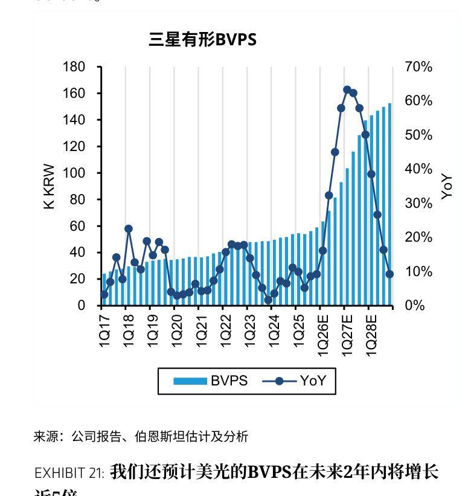
三星有形BVPS
纵轴（左）：K KRW 0～180（刻度 0、20、40、60、80、100、120、140、160、180）；纵轴（右）：YoY 0%～70%（刻度 0%、10%、20%、30%、40%、50%、60%、70%）；横轴：1Q17–1Q28E；图例：BVPS（柱状）、YoY（折线）

来源：公司报告、伯恩斯坦估计及分析

EXHIBIT 20: **鉴于我们对存储价格的展望，我们预测SK海力士的BVPS在未来2年内将增长4.5-5倍。**

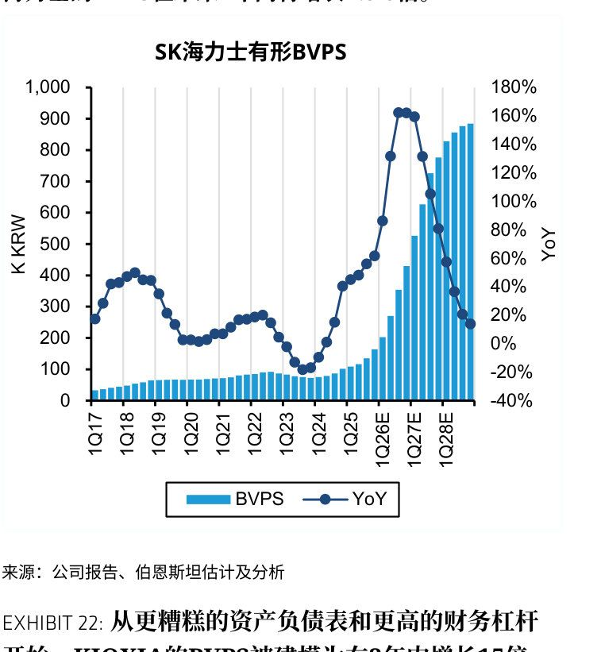
SK海力士有形BVPS
纵轴（左）：K KRW 0～1,000（刻度 0、100、200、300、400、500、600、700、800、900、1,000）；纵轴（右）：YoY -40%～180%（刻度 -40%、-20%、0%、20%、40%、60%、80%、100%、120%、140%、160%、180%）；横轴：1Q17–1Q28E；图例：BVPS（柱状）、YoY（折线）

来源：公司报告、伯恩斯坦估计及分析

EXHIBIT 21: **我们还预计美光的BVPS在未来2年内将增长近5倍。**

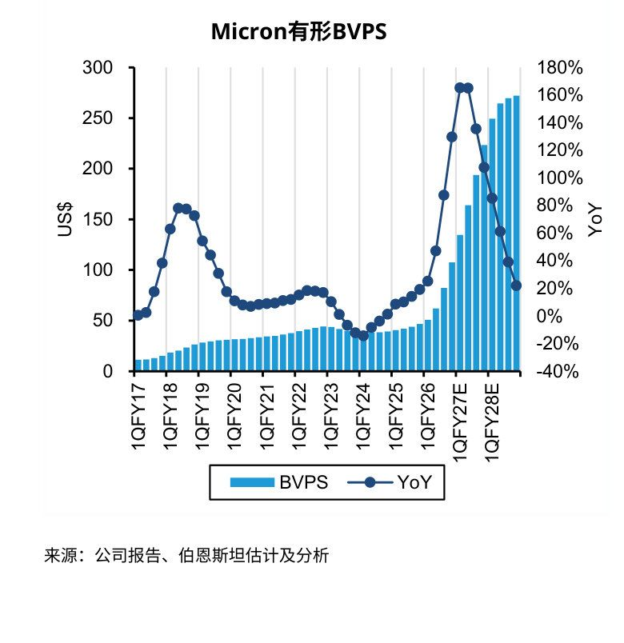
Micron有形BVPS
纵轴（左）：US$ 0～300（刻度 0、50、100、150、200、250、300）；纵轴（右）：YoY -40%～180%（刻度 -40%、-20%、0%、20%、40%、60%、80%、100%、120%、140%、160%、180%）；横轴：1QFY17–1QFY28E；图例：BVPS（柱状）、YoY（折线）

来源：公司报告、伯恩斯坦估计及分析

EXHIBIT 22: **从更糟糕的资产负债表和更高的财务杠杆开始，KIOXIA的BVPS被建模为在2年内增长15倍。**

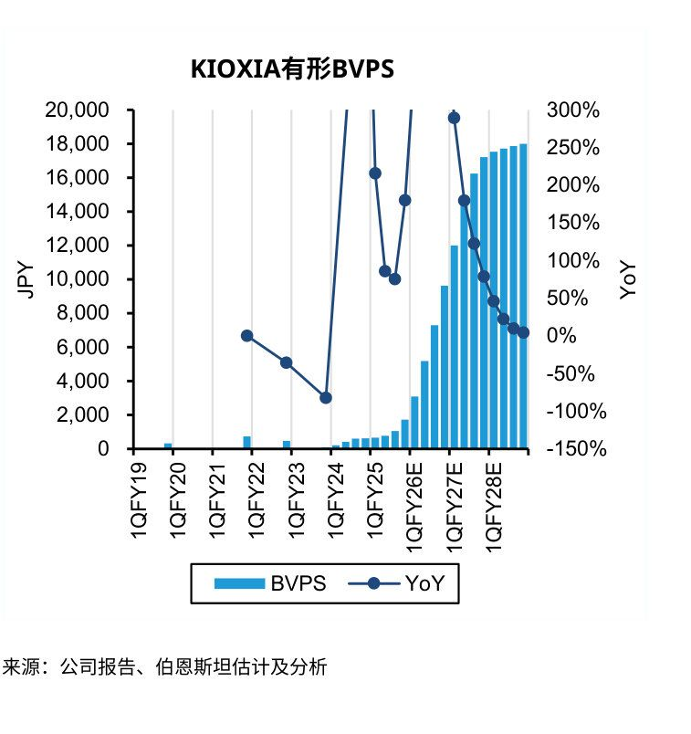
KIOXIA有形BVPS
纵轴（左）：JPY 0～20,000（刻度 0、2,000、4,000、6,000、8,000、10,000、12,000、14,000、16,000、18,000、20,000）；纵轴（右）：YoY -150%～300%（刻度 -150%、-100%、-50%、0%、50%、100%、150%、200%、250%、300%）；横轴：1QFY19–1QFY28E；图例：BVPS（柱状）、YoY（折线）

来源：公司报告、伯恩斯坦估计及分析

---

<!-- 原文第 12 页 -->

EXHIBIT 23: **At current rate, we project cash to rise to 65% of Samsung’s book value per share.**

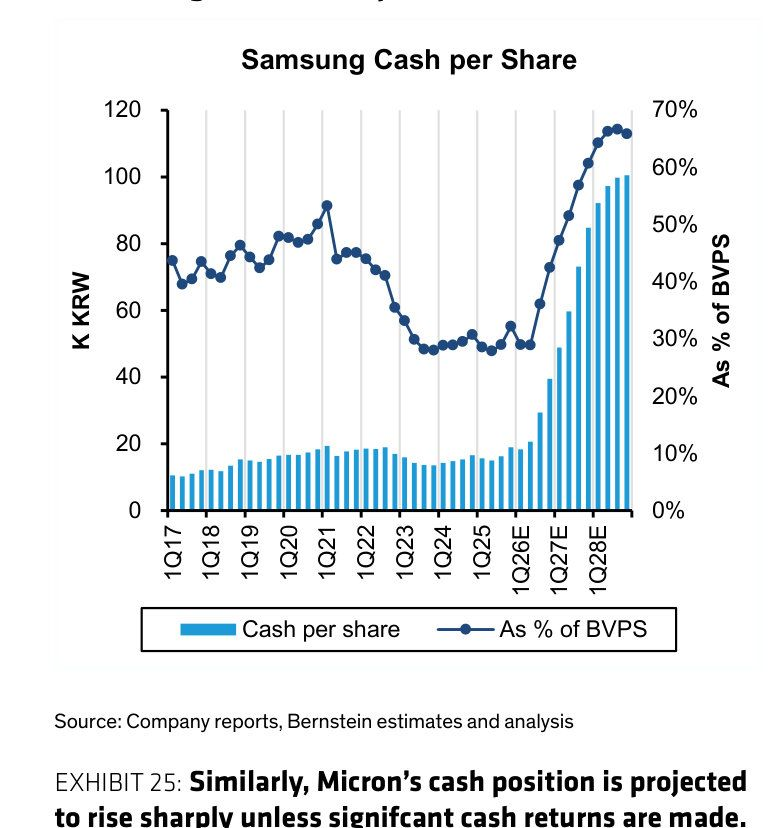
Samsung Cash per Share
纵轴（左）：K KRW 0～120（刻度 0、20、40、60、80、100、120）；纵轴（右）：As % of BVPS 0%～70%（刻度 0%、10%、20%、30%、40%、50%、60%、70%）；横轴：1Q17–1Q28E；图例：Cash per share（柱状）、As % of BVPS（折线）

Source: Company reports, Bernstein estimates and analysis

EXHIBIT 24: **SK hynix cash as % of BVPS is projected to rise from 10-20% before to nearly 80% in 2 years.**

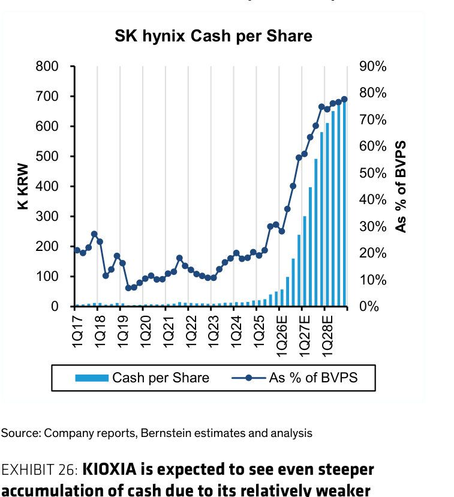
SK hynix Cash per Share
纵轴（左）：K KRW 0～800（刻度 0、100、200、300、400、500、600、700、800）；纵轴（右）：As % of BVPS 0%～90%（刻度 0%、10%、20%、30%、40%、50%、60%、70%、80%、90%）；横轴：1Q17–1Q28E；图例：Cash per Share（柱状）、As % of BVPS（折线）

Source: Company reports, Bernstein estimates and analysis

EXHIBIT 25: **Similarly, Micron’s cash position is projected to rise sharply unless signifcant cash returns are made.**

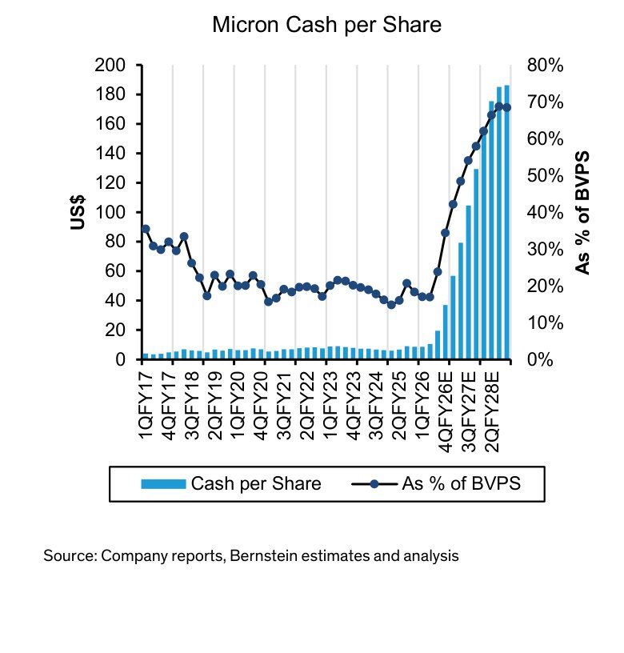
Micron Cash per Share
纵轴（左）：US$ 0～200（刻度 0、20、40、60、80、100、120、140、160、180、200）；纵轴（右）：As % of BVPS 0%～80%（刻度 0%、10%、20%、30%、40%、50%、60%、70%、80%）；横轴：1QFY17、4QFY17、3QFY18、2QFY19、1QFY20、4QFY20、3QFY21、2QFY22、1QFY23、4QFY23、3QFY24、2QFY25、1QFY26、4QFY26E、3QFY27E、2QFY28E；图例：Cash per Share（柱状）、As % of BVPS（折线）

Source: Company reports, Bernstein estimates and analysis

EXHIBIT 26: **KIOXIA is expected to see even steeper accumulation of cash due to its relatively weaker starting financial position.**

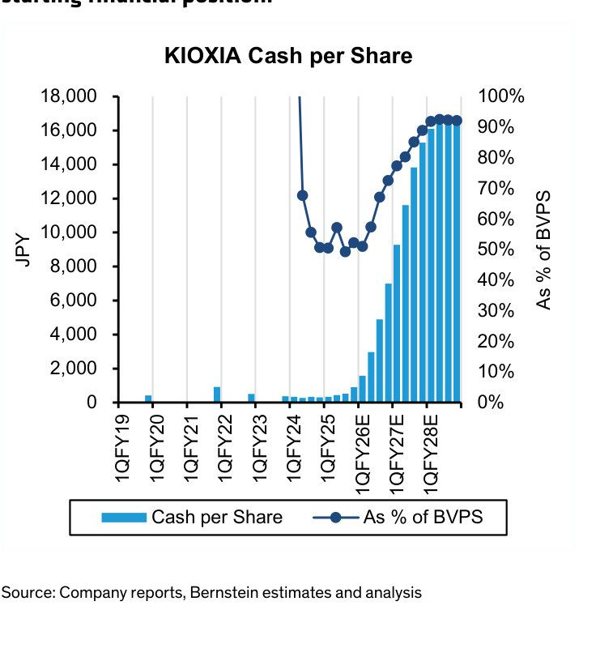
KIOXIA Cash per Share
纵轴（左）：JPY 0～18,000（刻度 0、2,000、4,000、6,000、8,000、10,000、12,000、14,000、16,000、18,000）；纵轴（右）：As % of BVPS 0%～100%（刻度 0%、10%、20%、30%、40%、50%、60%、70%、80%、90%、100%）；横轴：1QFY19–1QFY28E；图例：Cash per Share（柱状）、As % of BVPS（折线）

Source: Company reports, Bernstein estimates and analysis

EXHIBIT 23: **按当前速度，我们预计现金将升至三星每股账面价值的65%。**

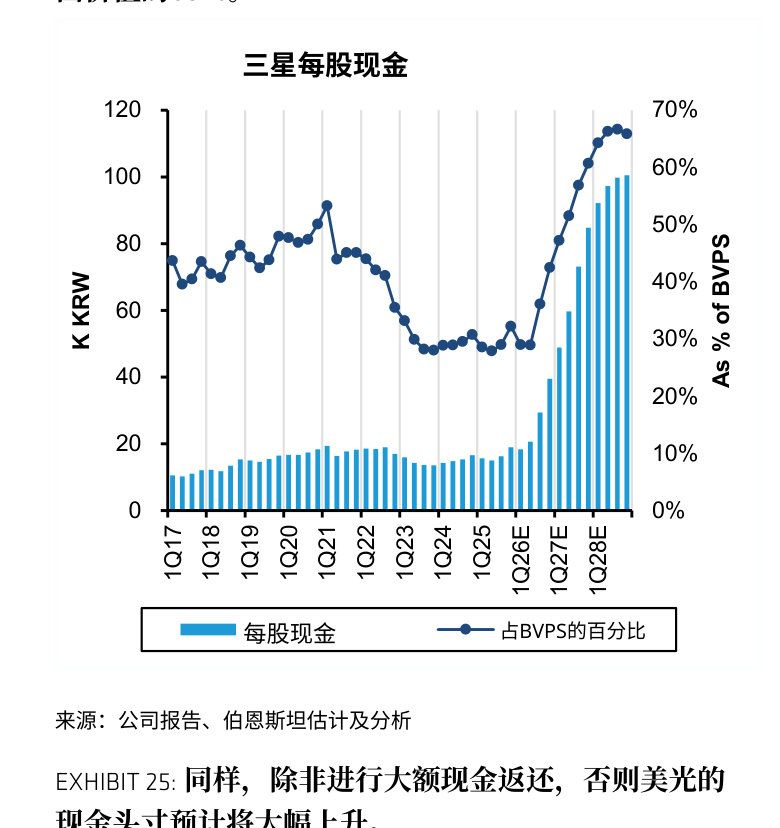
三星每股现金
纵轴（左）：K KRW 0～120（刻度 0、20、40、60、80、100、120）；纵轴（右）：As % of BVPS 0%～70%（刻度 0%、10%、20%、30%、40%、50%、60%、70%）；横轴：1Q17–1Q28E；图例：每股现金（柱状）、占BVPS的百分比（折线）

来源：公司报告、伯恩斯坦估计及分析

EXHIBIT 24: **SK海力士现金占BVPS的比例预计将从之前的10-20%在2年内升至近80%。**

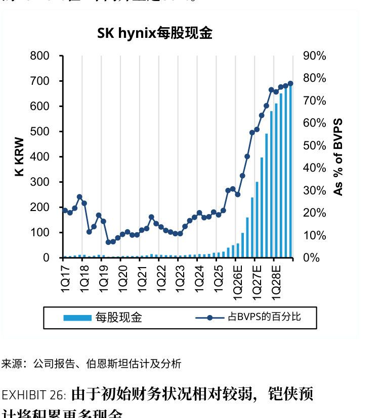
SK hynix每股现金
纵轴（左）：K KRW 0～800（刻度 0、100、200、300、400、500、600、700、800）；纵轴（右）：As % of BVPS 0%～90%（刻度 0%、10%、20%、30%、40%、50%、60%、70%、80%、90%）；横轴：1Q17–1Q28E；图例：每股现金（柱状）、占BVPS的百分比（折线）

来源：公司报告、伯恩斯坦估计及分析

EXHIBIT 25: **同样，除非进行大额现金返还，否则美光的现金头寸预计将大幅上升。**

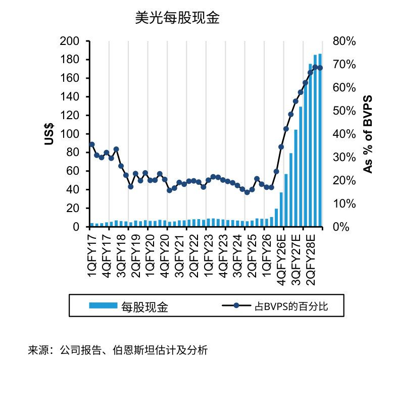
美光每股现金
纵轴（左）：US$ 0～200（刻度 0、20、40、60、80、100、120、140、160、180、200）；纵轴（右）：As % of BVPS 0%～80%（刻度 0%、10%、20%、30%、40%、50%、60%、70%、80%）；横轴：1QFY17、4QFY17、3QFY18、2QFY19、1QFY20、4QFY20、3QFY21、2QFY22、1QFY23、4QFY23、3QFY24、2QFY25、1QFY26、4QFY26E、3QFY27E、2QFY28E；图例：每股现金（柱状）、占BVPS的百分比（折线）

来源：公司报告、伯恩斯坦估计及分析

EXHIBIT 26: **由于初始财务状况相对较弱，铠侠预计将积累更多现金。**

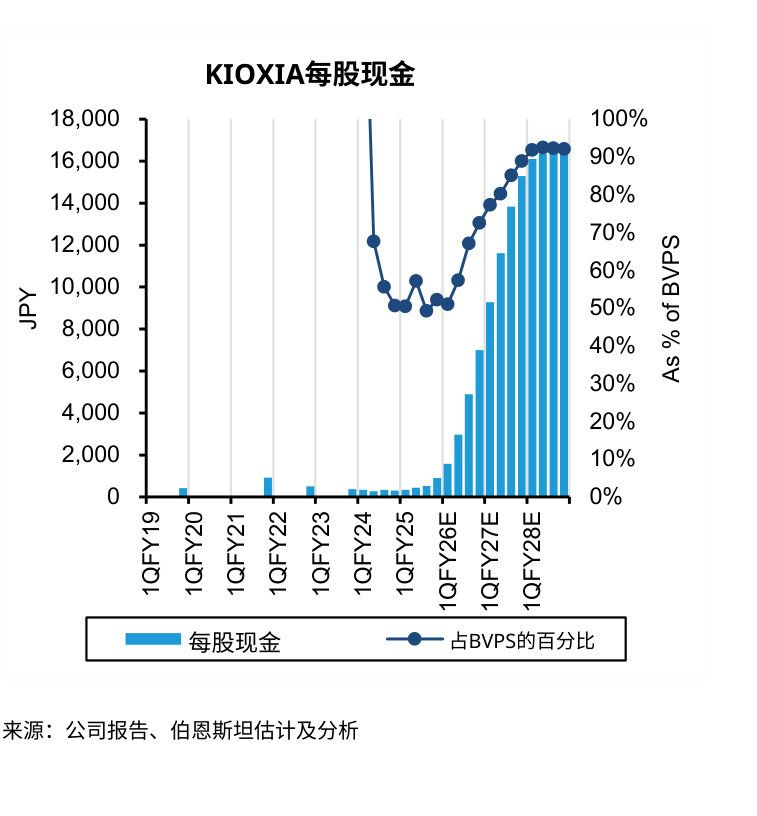
KIOXIA每股现金
纵轴（左）：JPY 0～18,000（刻度 0、2,000、4,000、6,000、8,000、10,000、12,000、14,000、16,000、18,000）；纵轴（右）：As % of BVPS 0%～100%（刻度 0%、10%、20%、30%、40%、50%、60%、70%、80%、90%、100%）；横轴：1QFY19–1QFY28E；图例：每股现金（柱状）、占BVPS的百分比（折线）

来源：公司报告、伯恩斯坦估计及分析

---

<!-- 原文第 13 页 -->

EXHIBIT 27: **We maintain the valuation of 1.6x 2-year forward P/B ratio for Samsung.**

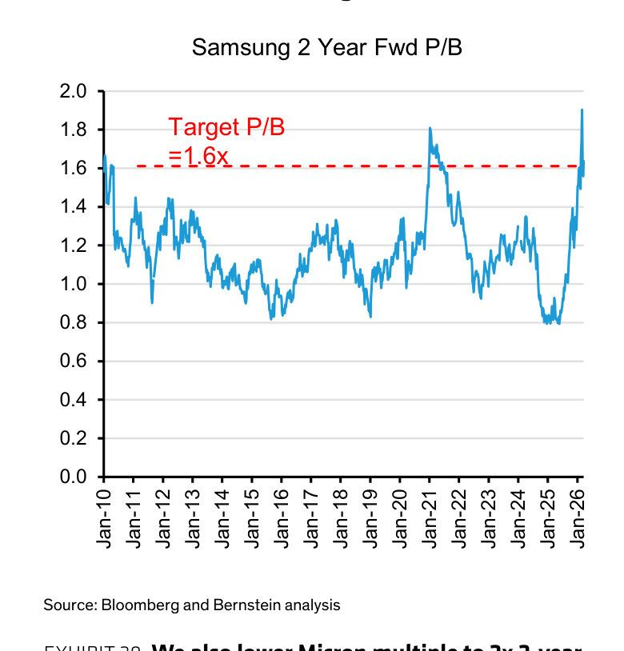
Samsung 2 Year Fwd P/B
纵轴：0.0～2.0（刻度 0.0、0.2、0.4、0.6、0.8、1.0、1.2、1.4、1.6、1.8、2.0）；横轴：Jan-10–Jan-26；无图例（单一折线）；标注：Target P/B =1.6x（红色虚线）

Source: Bloomberg and Bernstein analysis

EXHIBIT 28: **For SK hynix, we lower the multiple to 1.5x 2-year forward BVPS.**

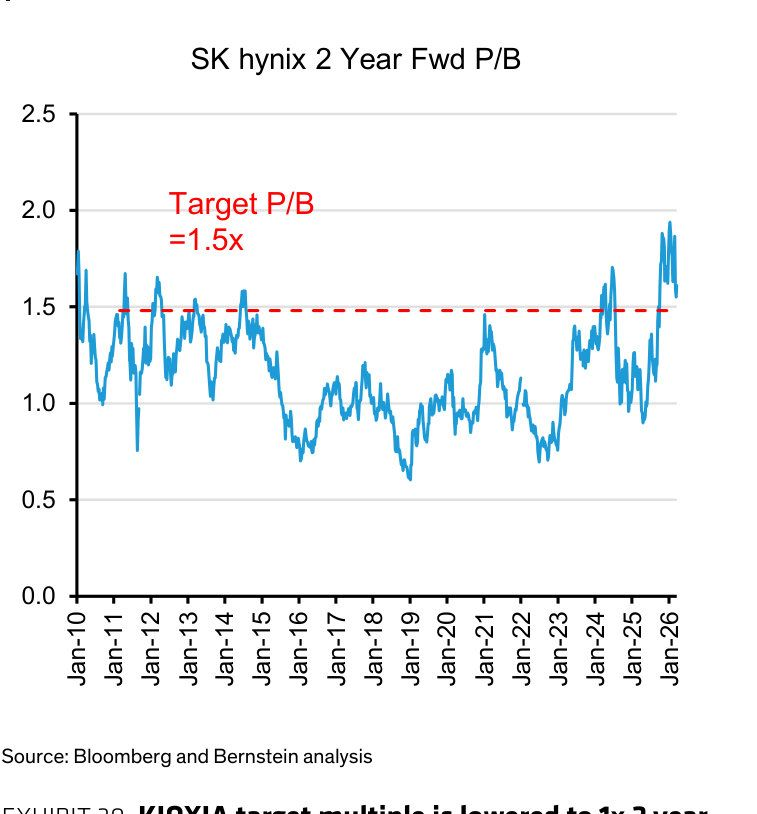
SK hynix 2 Year Fwd P/B
纵轴：0.0～2.5（刻度 0.0、0.5、1.0、1.5、2.0、2.5）；横轴：Jan-10–Jan-26；无图例（单一折线）；标注：Target P/B =1.5x（红色虚线）

Source: Bloomberg and Bernstein analysis

EXHIBIT 29: **We also lower Micron multiple to 2x 2-year forward P/B as the large cash postion on the balance sheet doesn’t deserve a multiple.**

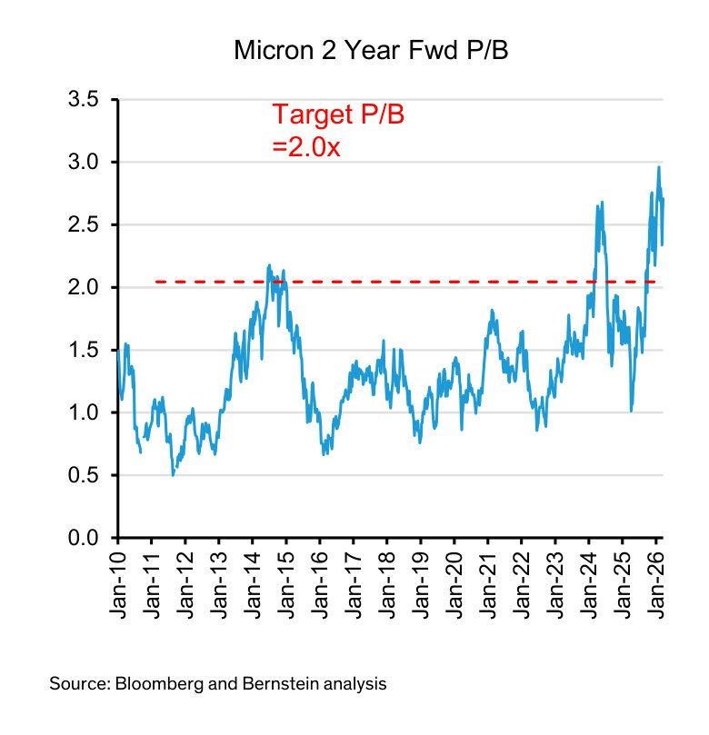
Micron 2 Year Fwd P/B
纵轴：0.0～3.5（刻度 0.0、0.5、1.0、1.5、2.0、2.5、3.0、3.5）；横轴：Jan-10–Jan-26；无图例（单一折线）；标注：Target P/B =2.0x（红色虚线）

Source: Bloomberg and Bernstein analysis

EXHIBIT 30: **KIOXIA target multiple is lowered to 1x 2 year P/B.**

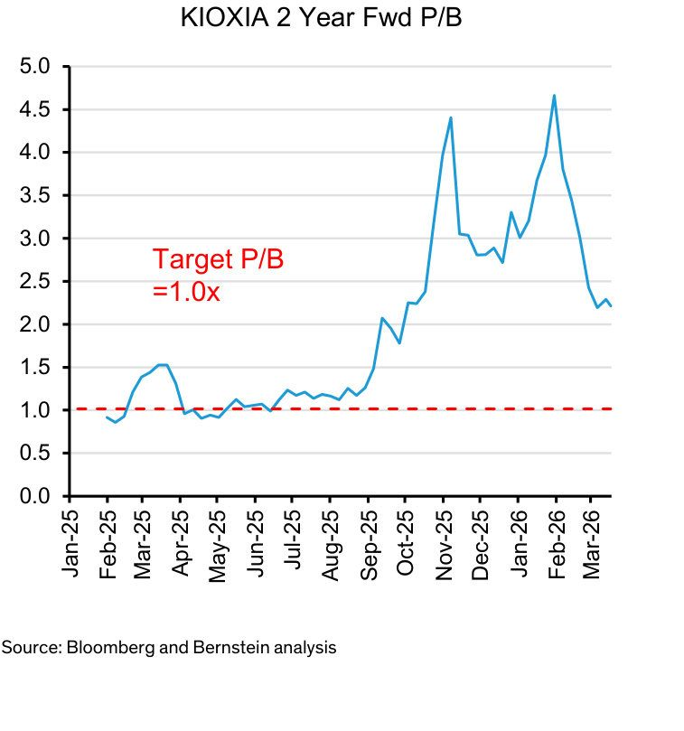
KIOXIA 2 Year Fwd P/B
纵轴：0.0～5.0（刻度 0.0、0.5、1.0、1.5、2.0、2.5、3.0、3.5、4.0、4.5、5.0）；横轴：Jan-25–Mar-26；无图例（单一折线）；标注：Target P/B =1.0x（红色虚线）

Source: Bloomberg and Bernstein analysis

EXHIBIT 27: **我们维持三星的估值为2年期预期市净率1.6倍。**

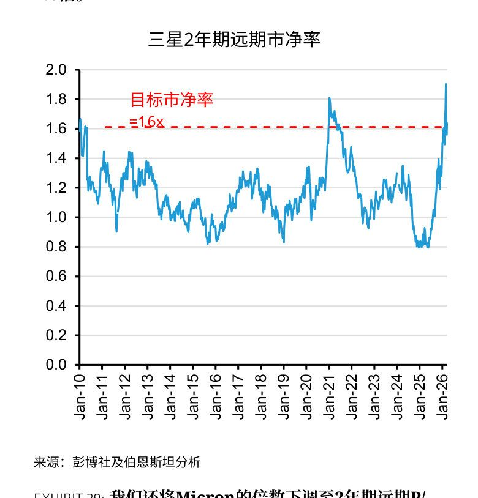
三星2年期远期市净率
纵轴：0.0～2.0（刻度 0.0、0.2、0.4、0.6、0.8、1.0、1.2、1.4、1.6、1.8、2.0）；横轴：Jan-10–Jan-26；无图例（单一折线）；标注：目标市净率 =1.6x（红色虚线）

来源：彭博社及伯恩斯坦分析

EXHIBIT 28: **对于SK hynix，我们将倍数下调至2年期远期BVPS的1.5倍。**

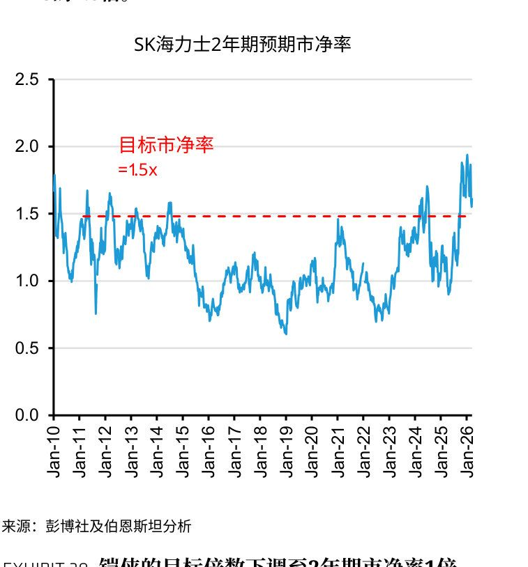
SK海力士2年期预期市净率
纵轴：0.0～2.5（刻度 0.0、0.5、1.0、1.5、2.0、2.5）；横轴：Jan-10–Jan-26；无图例（单一折线）；标注：目标市净率 =1.5x（红色虚线）

来源：彭博社及伯恩斯坦分析

EXHIBIT 29: **我们还将Micron的倍数下调至2年期远期P/B的2倍，因为资产负债表上的大量现金头寸不值得给予倍数。**

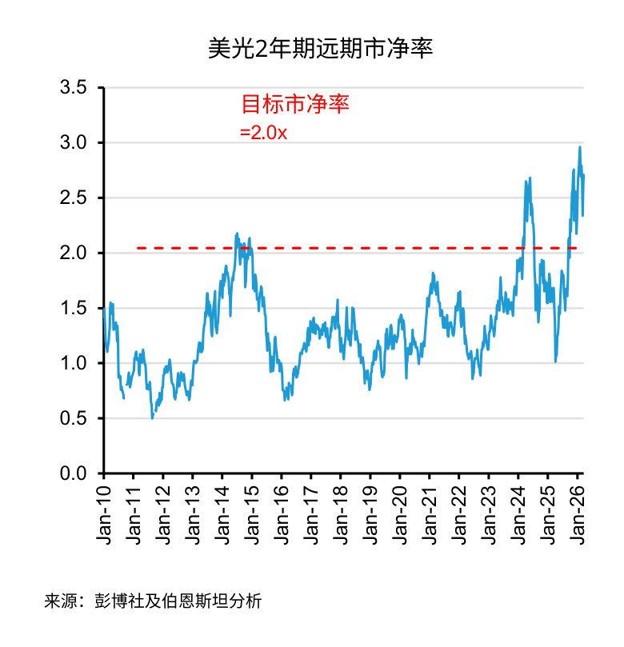
美光2年期远期市净率
纵轴：0.0～3.5（刻度 0.0、0.5、1.0、1.5、2.0、2.5、3.0、3.5）；横轴：Jan-10–Jan-26；无图例（单一折线）；标注：目标市净率 =2.0x（红色虚线）

来源：彭博社及伯恩斯坦分析

EXHIBIT 30: **铠侠的目标倍数下调至2年期市净率1倍。**

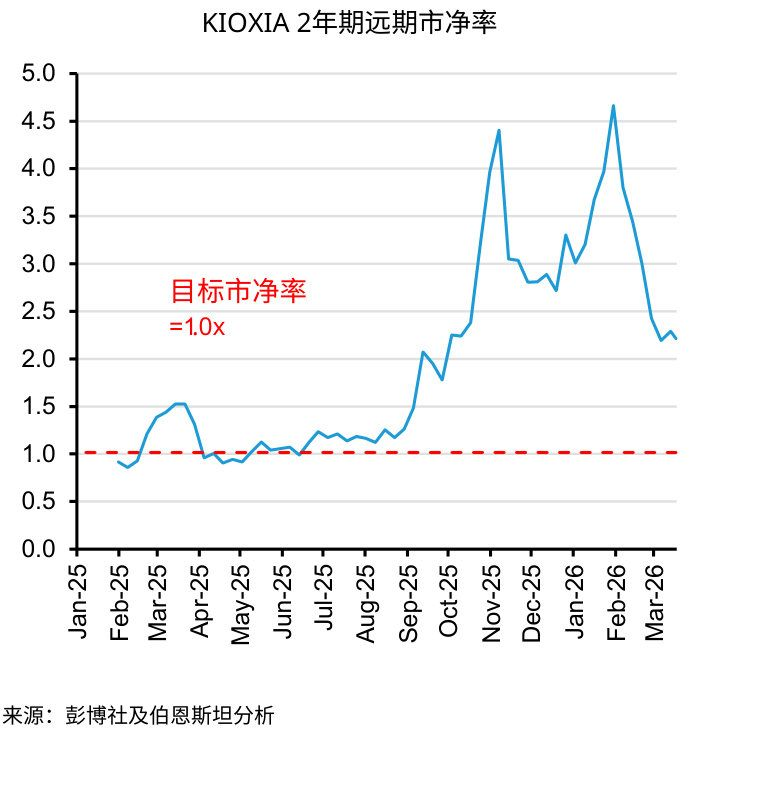
KIOXIA 2年期远期市净率
纵轴：0.0～5.0（刻度 0.0、0.5、1.0、1.5、2.0、2.5、3.0、3.5、4.0、4.5、5.0）；横轴：Jan-25–Mar-26；无图例（单一折线）；标注：目标市净率 =1.0x（红色虚线）

来源：彭博社及伯恩斯坦分析

---

<!-- 原文第 14 页 -->

## APPENDIX - FINANCIAL FORECASTS

EXHIBIT 31: **Samsung Income Statement**

Figures in KRW B Unless Otherwise Stated

| Income Statement | 2025 | 2026E | 2027E | 2028E | 1Q25 | 2Q25 | 3Q25 | 4Q25 | 1Q26E | 2Q26E | 3Q26E | 4Q26E |
|---|---|---|---|---|---|---|---|---|---|---|---|---|
| Revenue | 333,606 | 571,178 | 686,889 | 446,595 | 79,141 | 74,566 | 86,062 | 93,837 | 110,393 | 136,317 | 156,908 | 167,560 |
| COGS | 202,236 | 107,520 | 86,923 | 210,169 | 51,010 | 49,070 | 52,570 | 49,586 | 37,302 | 25,193 | 25,377 | 19,648 |
| Gross Profit | 131,370 | 463,658 | 599,966 | 236,426 | 28,131 | 25,497 | 33,492 | 44,251 | 73,090 | 111,124 | 131,531 | 147,912 |
| R&D | 37,740 | 59,974 | 66,875 | 40,162 | 9,033 | 9,019 | 8,824 | 10,864 | 12,056 | 14,903 | 15,790 | 17,224 |
| SG&A | 50,029 | 76,909 | 83,696 | 49,115 | 12,413 | 11,801 | 12,502 | 13,313 | 15,583 | 19,417 | 20,514 | 21,395 |
| Operating Profit | 43,601 | 326,775 | 449,395 | 147,148 | 6,685 | 4,676 | 12,166 | 20,074 | 45,452 | 76,804 | 95,226 | 109,293 |
| Other non-operating Income/(Expenses) | – | – | – | – | 865 | 18 | (124) | (101) | – | – | – | – |
| Equity-Method Investments | 671 | 738 | 776 | 827 | 119 | 159 | 304 | 90 | 187 | 184 | 183 | 183 |
| Net interest (expense)/gain | 4,550 | 2,460 | 7,187 | 12,651 | 1,483 | 903 | 1,200 | 965 | 559 | 475 | 557 | 869 |
| Income Before Taxes | 48,823 | 329,972 | 457,358 | 160,626 | 9,152 | 5,756 | 13,546 | 21,028 | 46,198 | 77,463 | 95,966 | 110,345 |
| Income Taxes | 4,275 | 90,742 | 125,773 | 44,172 | 929 | 640 | 1,320 | 1,387 | 12,704 | 21,302 | 26,391 | 30,345 |
| Net Income (before minority interest) | 44,548 | 239,230 | 331,585 | 116,454 | 8,223 | 5,116 | 12,226 | 19,642 | 33,493 | 56,161 | 69,575 | 80,000 |
| Minority Interest | 287 | 437 | 536 | 599 | 194 | 182 | 219 | 350 | 71 | 75 | 168 | 123 |
| Net Income (after minority interest) | 44,261 | 238,792 | 331,048 | 115,855 | 8,028 | 4,934 | 12,007 | 19,292 | 33,423 | 56,086 | 69,407 | 79,877 |
| EPS After Minority (KRW per share) | 6,612 | 35,740 | 49,548 | 17,340 | 1,192 | 737 | 1,801 | 2,886 | 5,002 | 8,394 | 10,388 | 11,955 |
| Total Shares Out | 6,695 | 6,681 | 6,681 | 6,681 | 6,737 | 6,692 | 6,665 | 6,684 | 6,681 | 6,681 | 6,681 | 6,681 |
| EBITDA | 88,008 | 377,177 | 506,715 | 211,190 | 17,415 | 16,033 | 23,126 | 31,434 | 57,391 | 89,202 | 108,055 | 122,530 |
| **Margins %** |  |  |  |  |  |  |  |  |  |  |  |  |
| Gross Margin | 39.4% | 81.2% | 87.3% | 52.9% | 35.5% | 34.2% | 38.9% | 47.2% | 66.2% | 81.5% | 83.8% | 88.3% |
| Operating Margin | 13.1% | 57.2% | 65.4% | 32.9% | 8.4% | 6.3% | 14.1% | 21.4% | 41.2% | 56.3% | 60.7% | 65.2% |
| NI before MI Margin | 13.4% | 41.9% | 48.3% | 26.1% | 10.4% | 6.9% | 14.2% | 20.9% | 30.3% | 41.2% | 44.3% | 47.7% |
| NI after MI Margin | 13.3% | 41.8% | 48.2% | 25.9% | 10.1% | 6.6% | 14.0% | 20.6% | 30.3% | 41.1% | 44.2% | 47.7% |
| EBITDA Margin | 26.4% | 66.0% | 73.8% | 47.3% | 22.0% | 21.5% | 26.9% | 33.5% | 52.0% | 65.4% | 68.9% | 73.1% |
| ROE % | 10.6% | 43.5% | 40.4% | 11.4% | 8.1% | 5.1% | 12.0% | 18.5% | 29.7% | 45.6% | 50.3% | 51.1% |
| **Growth %** |  |  |  |  |  |  |  |  |  |  |  |  |
| Revenue Growth | 10.9% | 71.2% | 20.3% | (35.0%) | 4.4% | (5.8%) | 15.4% | 9.0% | 17.6% | 23.5% | 15.1% | 6.8% |
| Operating Profit Growth | 33.2% | 649.5% | 37.5% | (67.3%) | 3.0% | (30.1%) | 160.2% | 65.0% | 126.4% | 69.0% | 24.0% | 14.8% |
| EPS Growth | 33.6% | 440.6% | 38.6% | (65.0%) | 6.8% | (38.1%) | 144.3% | 60.2% | 73.3% | 67.8% | 23.8% | 15.1% |

**Division Financials**

| Semiconductor | 2025 | 2026E | 2027E | 2028E | 1Q25 | 2Q25 | 3Q25 | 4Q25 | 1Q26E | 2Q26E | 3Q26E | 4Q26E |
|---|---|---|---|---|---|---|---|---|---|---|---|---|
| Total Revenue | 130,123 | 435,508 | 579,741 | 272,269 | 25,131 | 27,875 | 33,117 | 44,000 | 69,657 | 104,741 | 122,721 | 138,389 |
| DRAM | 72,143 | 266,117 | 359,066 | 180,210 | 12,814 | 13,813 | 18,210 | 27,306 | 43,871 | 65,321 | 74,606 | 82,319 |
| NAND | 31,871 | 141,366 | 190,984 | 60,013 | 6,261 | 7,362 | 8,466 | 9,782 | 19,443 | 32,401 | 41,049 | 48,473 |
| Total Memory | 104,100 | 407,533 | 550,100 | 240,273 | 19,100 | 21,200 | 26,700 | 37,100 | 63,327 | 97,735 | 115,668 | 130,804 |
| System LSI | 25,823 | 27,775 | 29,441 | 31,797 | 5,981 | 6,625 | 6,367 | 6,850 | 6,280 | 6,956 | 7,003 | 7,535 |
| Operating Profit | 24,847 | 312,569 | 434,984 | 125,128 | 1,106 | 350 | 6,991 | 16,400 | 41,743 | 73,740 | 91,111 | 105,974 |
| OP margin % | 19.1% | 71.8% | 75.0% | 46.0% | 4.4% | 1.3% | 21.1% | 37.3% | 59.9% | 70.4% | 74.2% | 76.6% |

| Display Panel | 2025 | 2026E | 2027E | 2028E | 1Q25 | 2Q25 | 3Q25 | 4Q25 | 1Q26E | 2Q26E | 3Q26E | 4Q26E |
|---|---|---|---|---|---|---|---|---|---|---|---|---|
| Total Revenue | 29,848 | 30,291 | 33,166 | 34,051 | 5,867 | 6,380 | 8,102 | 9,500 | 6,266 | 7,025 | 8,490 | 8,510 |
| LCD | 1,913 | 2,105 | 2,133 | 2,172 | 411 | 447 | 486 | 570 | 501 | 491 | 553 | 560 |
| AMOLED | 27,935 | 28,186 | 31,033 | 31,879 | 5,456 | 5,933 | 7,615 | 8,930 | 5,765 | 6,534 | 7,936 | 7,950 |
| Operating Profit | 4,160 | 3,701 | 4,536 | 5,067 | 462 | 473 | 1,225 | 2,000 | 599 | 634 | 1,423 | 1,045 |
| OP margin % | 13.9% | 12.2% | 13.7% | 14.9% | 7.9% | 7.4% | 15.1% | 21.1% | 9.6% | 9.0% | 16.8% | 12.3% |

| IT & Mobile | 2025 | 2026E | 2027E | 2028E | 1Q25 | 2Q25 | 3Q25 | 4Q25 | 1Q26E | 2Q26E | 3Q26E | 4Q26E |
|---|---|---|---|---|---|---|---|---|---|---|---|---|
| Total Revenue | 129,600 | 123,675 | 125,468 | 126,280 | 37,000 | 29,200 | 34,100 | 29,300 | 35,490 | 28,532 | 31,392 | 28,261 |
| Mobile (handsets + tablets) | 104,882 | 98,337 | 98,245 | 99,057 | 30,754 | 23,735 | 27,496 | 22,897 | 29,727 | 22,724 | 24,807 | 21,079 |
| Other (PCs, smartwatches, VR etc.) | 21,618 | 21,618 | 23,131 | 23,131 | 5,446 | 4,765 | 6,004 | 5,403 | 4,863 | 4,863 | 5,593 | 6,299 |
| Networking | 3,100 | 3,720 | 4,092 | 4,092 | 800 | 700 | 600 | 1,000 | 900 | 945 | 992 | 883 |
| Operating Profit | 12,900 | 8,457 | 8,409 | 14,187 | 4,300 | 3,100 | 3,600 | 1,900 | 2,786 | 1,919 | 2,088 | 1,665 |
| OP margin % | 10.0% | 6.8% | 6.7% | 11.2% | 11.6% | 10.6% | 10.6% | 6.5% | 7.9% | 6.7% | 6.7% | 5.9% |

| Consumer Electronics | 2025 | 2026E | 2027E | 2028E | 1Q25 | 2Q25 | 3Q25 | 4Q25 | 1Q26E | 2Q26E | 3Q26E | 4Q26E |
|---|---|---|---|---|---|---|---|---|---|---|---|---|
| Total Revenue | 57,300 | 56,452 | 56,611 | 57,651 | 14,500 | 14,100 | 13,900 | 14,800 | 14,030 | 14,068 | 13,861 | 14,493 |
| Visual Display | 30,900 | 30,844 | 30,491 | 31,008 | 7,800 | 7,000 | 7,300 | 8,800 | 7,531 | 7,181 | 7,459 | 8,673 |
| Appliance | 26,400 | 25,608 | 26,120 | 26,643 | 6,700 | 7,100 | 6,600 | 6,000 | 6,499 | 6,887 | 6,402 | 5,820 |
| Operating Profit | (200) | 424 | (136) | 1,015 | 300 | 200 | (100) | (600) | - | 141 | 139 | 145 |
| OP Margin % | (0.3%) | 0.8% | (0.2%) | 1.8% | 2.1% | 1.4% | (0.7%) | (4.1%) | – | 1.0% | 1.0% | 1.0% |

| Harman | 2025 | 2026E | 2027E | 2028E | 1Q25 | 2Q25 | 3Q25 | 4Q25 | 1Q26E | 2Q26E | 3Q26E | 4Q26E |
|---|---|---|---|---|---|---|---|---|---|---|---|---|
| Total Revenue | 15,157 | 16,672 | 17,506 | 18,381 | 3,419 | 3,830 | 3,954 | 3,954 | 3,761 | 4,213 | 4,349 | 4,349 |
| Operating Profit | 1,511 | 1,624 | 1,602 | 1,752 | 307 | 484 | 421 | 300 | 324 | 370 | 466 | 464 |
| OP Margin % | 10.0% | 9.7% | 9.2% | 9.5% | 9.0% | 12.6% | 10.6% | 7.6% | 8.6% | 8.8% | 10.7% | 10.7% |

Source: Company reports, Bernstein estimates and analysis

## APPENDIX - FINANCIAL FORECASTS

## EXHIBIT 31: 三星利润表

除非另有说明，否则数字以十亿韩元计

| 利润表 | 2025 | 2026E | 2027E | 2028E | 1Q25 | 2Q25 | 3Q25 | 4Q25 | 1Q26E | 2Q26E | 2026年第三季度预估 | 4Q26E |
|---|---|---|---|---|---|---|---|---|---|---|---|---|
| 收入 | 333,606 | 571,178 | 686,889 | 446,595 | 79,141 | 74,566 | 86,062 | 93,837 | 110,393 | 136,317 | 156,908 | 167,560 |
| COGS | 202,236 | 107,520 | 86,923 | 210,169 | 51,010 | 49,070 | 52,570 | 49,586 | 37,302 | 25,193 | 25,377 | 19,648 |
| 毛利 | 131,370 | 463,658 | 599,966 | 236,426 | 28,131 | 25,497 | 33,492 | 44,251 | 73,090 | 111,124 | 131,531 | 147,912 |
| R&D | 37,740 | 59,974 | 66,875 | 40,162 | 9,033 | 9,019 | 8,824 | 10,864 | 12,056 | 14,903 | 15,790 | 17,224 |
| SG&A | 50,029 | 76,909 | 83,696 | 49,115 | 12,413 | 11,801 | 12,502 | 13,313 | 15,583 | 19,417 | 20,514 | 21,395 |
| 营业利润 | 43,601 | 326,775 | 449,395 | 147,148 | 6,685 | 4,676 | 12,166 | 20,074 | 45,452 | 76,804 | 95,226 | 109,293 |
| 其他非营业收入/（费用） | – | – | – | – | 865 | 18 | (124) | (101) | – | – | – | – |
| 权益法投资 | 671 | 738 | 776 | 827 | 119 | 159 | 304 | 90 | 187 | 184 | 183 | 183 |
| 净利息（支出）/收益 | 4,550 | 2,460 | 7,187 | 12,651 | 1,483 | 903 | 1,200 | 965 | 559 | 475 | 557 | 869 |
| 税前利润 | 48,823 | 329,972 | 457,358 | 160,626 | 9,152 | 5,756 | 13,546 | 21,028 | 46,198 | 77,463 | 95,966 | 110,345 |
| 所得税 | 4,275 | 90,742 | 125,773 | 44,172 | 929 | 640 | 1,320 | 1,387 | 12,704 | 21,302 | 26,391 | 30,345 |
| 净利润（少数股东权益前） | 44,548 | 239,230 | 331,585 | 116,454 | 8,223 | 5,116 | 12,226 | 19,642 | 33,493 | 56,161 | 69,575 | 80,000 |
| 少数股东权益 | 287 | 437 | 536 | 599 | 194 | 182 | 219 | 350 | 71 | 75 | 168 | 123 |
| 净利润（扣除少数股东权益后） | 44,261 | 238,792 | 331,048 | 115,855 | 8,028 | 4,934 | 12,007 | 19,292 | 33,423 | 56,086 | 69,407 | 79,877 |
| 少数股东权益后每股收益（韩元/股） | 6,612 | 35,740 | 49,548 | 17,340 | 1,192 | 737 | 1,801 | 2,886 | 5,002 | 8,394 | 10,388 | 11,955 |
| 流通股总数 | 6,695 | 6,681 | 6,681 | 6,681 | 6,737 | 6,692 | 6,665 | 6,684 | 6,681 | 6,681 | 6,681 | 6,681 |
| EBITDA | 88,008 | 377,177 | 506,715 | 211,190 | 17,415 | 16,033 | 23,126 | 31,434 | 57,391 | 89,202 | 108,055 | 122,530 |
| **利润率%** |  |  |  |  |  |  |  |  |  |  |  |  |
| 毛利率 | 39.4% | 81.2% | 87.3% | 52.9% | 35.5% | 34.2% | 38.9% | 47.2% | 66.2% | 81.5% | 83.8% | 88.3% |
| 营业利润率 | 13.1% | 57.2% | 65.4% | 32.9% | 8.4% | 6.3% | 14.1% | 21.4% | 41.2% | 56.3% | 60.7% | 65.2% |
| 少数股东权益前净利润率 | 13.4% | 41.9% | 48.3% | 26.1% | 10.4% | 6.9% | 14.2% | 20.9% | 30.3% | 41.2% | 44.3% | 47.7% |
| 少数股东权益后净利润率 | 13.3% | 41.8% | 48.2% | 25.9% | 10.1% | 6.6% | 14.0% | 20.6% | 30.3% | 41.1% | 44.2% | 47.7% |
| 息税折旧摊销前利润率 | 26.4% | 66.0% | 73.8% | 47.3% | 22.0% | 21.5% | 26.9% | 33.5% | 52.0% | 65.4% | 68.9% | 73.1% |
| 净资产收益率（ROE）% | 10.6% | 43.5% | 40.4% | 11.4% | 8.1% | 5.1% | 12.0% | 18.5% | 29.7% | 45.6% | 50.3% | 51.1% |
| **增长率 %** |  |  |  |  |  |  |  |  |  |  |  |  |
| 收入增长 | 10.9% | 71.2% | 20.3% | (35.0%) | 4.4% | (5.8%) | 15.4% | 9.0% | 17.6% | 23.5% | 15.1% | 6.8% |
| 营业利润增长 | 33.2% | 649.5% | 37.5% | (67.3%) | 3.0% | (30.1%) | 160.2% | 65.0% | 126.4% | 69.0% | 24.0% | 14.8% |
| 每股收益增长 | 33.6% | 440.6% | 38.6% | (65.0%) | 6.8% | (38.1%) | 144.3% | 60.2% | 73.3% | 67.8% | 23.8% | 15.1% |

**部门财务数据**

| 半导体 | 2025 | 2026E | 2027E | 2028E | 1Q25 | 2Q25 | 3Q25 | 4Q25 | 1Q26E | 2Q26E | 2026年第三季度预估 | 4Q26E |
|---|---|---|---|---|---|---|---|---|---|---|---|---|
| 总收入 | 130,123 | 435,508 | 579,741 | 272,269 | 25,131 | 27,875 | 33,117 | 44,000 | 69,657 | 104,741 | 122,721 | 138,389 |
| DRAM | 72,143 | 266,117 | 359,066 | 180,210 | 12,814 | 13,813 | 18,210 | 27,306 | 43,871 | 65,321 | 74,606 | 82,319 |
| NAND | 31,871 | 141,366 | 190,984 | 60,013 | 6,261 | 7,362 | 8,466 | 9,782 | 19,443 | 32,401 | 41,049 | 48,473 |
| 总存储 | 104,100 | 407,533 | 550,100 | 240,273 | 19,100 | 21,200 | 26,700 | 37,100 | 63,327 | 97,735 | 115,668 | 130,804 |
| System LSI | 25,823 | 27,775 | 29,441 | 31,797 | 5,981 | 6,625 | 6,367 | 6,850 | 6,280 | 6,956 | 7,003 | 7,535 |
| 营业利润 | 24,847 | 312,569 | 434,984 | 125,128 | 1,106 | 350 | 6,991 | 16,400 | 41,743 | 73,740 | 91,111 | 105,974 |
| 营业利润率（%） | 19.1% | 71.8% | 75.0% | 46.0% | 4.4% | 1.3% | 21.1% | 37.3% | 59.9% | 70.4% | 74.2% | 76.6% |

| 显示面板 | 2025 | 2026E | 2027E | 2028E | 1Q25 | 2Q25 | 3Q25 | 4Q25 | 1Q26E | 2Q26E | 2026年第三季度预估 | 4Q26E |
|---|---|---|---|---|---|---|---|---|---|---|---|---|
| 总收入 | 29,848 | 30,291 | 33,166 | 34,051 | 5,867 | 6,380 | 8,102 | 9,500 | 6,266 | 7,025 | 8,490 | 8,510 |
| LCD | 1,913 | 2,105 | 2,133 | 2,172 | 411 | 447 | 486 | 570 | 501 | 491 | 553 | 560 |
| AMOLED | 27,935 | 28,186 | 31,033 | 31,879 | 5,456 | 5,933 | 7,615 | 8,930 | 5,765 | 6,534 | 7,936 | 7,950 |
| 营业利润 | 4,160 | 3,701 | 4,536 | 5,067 | 462 | 473 | 1,225 | 2,000 | 599 | 634 | 1,423 | 1,045 |
| 营业利润率（%） | 13.9% | 12.2% | 13.7% | 14.9% | 7.9% | 7.4% | 15.1% | 21.1% | 9.6% | 9.0% | 16.8% | 12.3% |

| IT与移动 | 2025 | 2026E | 2027E | 2028E | 1Q25 | 2Q25 | 3Q25 | 4Q25 | 1Q26E | 2Q26E | 2026年第三季度预估 | 4Q26E |
|---|---|---|---|---|---|---|---|---|---|---|---|---|
| 总收入 | 129,600 | 123,675 | 125,468 | 126,280 | 37,000 | 29,200 | 34,100 | 29,300 | 35,490 | 28,532 | 31,392 | 28,261 |
| 移动设备（手机 + 平板电脑） | 104,882 | 98,337 | 98,245 | 99,057 | 30,754 | 23,735 | 27,496 | 22,897 | 29,727 | 22,724 | 24,807 | 21,079 |
| 其他（个人电脑、智能手表、虚拟现实等） | 21,618 | 21,618 | 23,131 | 23,131 | 5,446 | 4,765 | 6,004 | 5,403 | 4,863 | 4,863 | 5,593 | 6,299 |
| 网络 | 3,100 | 3,720 | 4,092 | 4,092 | 800 | 700 | 600 | 1,000 | 900 | 945 | 992 | 883 |
| 营业利润 | 12,900 | 8,457 | 8,409 | 14,187 | 4,300 | 3,100 | 3,600 | 1,900 | 2,786 | 1,919 | 2,088 | 1,665 |
| 营业利润率（%） | 10.0% | 6.8% | 6.7% | 11.2% | 11.6% | 10.6% | 10.6% | 6.5% | 7.9% | 6.7% | 6.7% | 5.9% |

| 消费电子产品 | 2025 | 2026E | 2027E | 2028E | 1Q25 | 2Q25 | 3Q25 | 4Q25 | 1Q26E | 2Q26E | 2026年第三季度预估 | 4Q26E |
|---|---|---|---|---|---|---|---|---|---|---|---|---|
| 总收入 | 57,300 | 56,452 | 56,611 | 57,651 | 14,500 | 14,100 | 13,900 | 14,800 | 14,030 | 14,068 | 13,861 | 14,493 |
| 视觉显示 | 30,900 | 30,844 | 30,491 | 31,008 | 7,800 | 7,000 | 7,300 | 8,800 | 7,531 | 7,181 | 7,459 | 8,673 |
| 家电 | 26,400 | 25,608 | 26,120 | 26,643 | 6,700 | 7,100 | 6,600 | 6,000 | 6,499 | 6,887 | 6,402 | 5,820 |
| 营业利润 | (200) | 424 | (136) | 1,015 | 300 | 200 | (100) | (600) | - | 141 | 139 | 145 |
| 营业利润率% | (0.3%) | 0.8% | (0.2%) | 1.8% | 2.1% | 1.4% | (0.7%) | (4.1%) | – | 1.0% | 1.0% | 1.0% |

| Harman | 2025 | 2026E | 2027E | 2028E | 1Q25 | 2Q25 | 3Q25 | 4Q25 | 1Q26E | 2Q26E | 2026年第三季度预估 | 4Q26E |
|---|---|---|---|---|---|---|---|---|---|---|---|---|
| 总收入 | 15,157 | 16,672 | 17,506 | 18,381 | 3,419 | 3,830 | 3,954 | 3,954 | 3,761 | 4,213 | 4,349 | 4,349 |
| 营业利润 | 1,511 | 1,624 | 1,602 | 1,752 | 307 | 484 | 421 | 300 | 324 | 370 | 466 | 464 |
| 营业利润率% | 10.0% | 9.7% | 9.2% | 9.5% | 9.0% | 12.6% | 10.6% | 7.6% | 8.6% | 8.8% | 10.7% | 10.7% |

来源：公司报告、伯恩斯坦估计及分析

---

<!-- 原文第 15 页 -->

EXHIBIT 32: **Samsung Operating Metrics**

**Division Operating Metrics**

| Semiconductor | 2025 | 2026E | 2027E | 2028E | 1Q25 | 2Q25 | 3Q25 | 4Q25 | 1Q26E | 2Q26E | 3Q26E | 4Q26E |
|---|---|---|---|---|---|---|---|---|---|---|---|---|
| DRAM ASP ($/Gb) | 0.46 | 1.43 | 1.65 | 0.67 | 0.38 | 0.38 | 0.44 | 0.62 | 0.97 | 1.42 | 1.59 | 1.71 |
| % change | 20.9% | 208.0% | 15.3% | (59.2%) | (19.0%) | (0.2%) | 15.8% | 40.0% | 57.3% | 46.0% | 12.0% | 7.4% |
| NAND ASP ($/GB) | 0.07 | 0.28 | 0.31 | 0.08 | 0.07 | 0.06 | 0.07 | 0.08 | 0.16 | 0.26 | 0.32 | 0.36 |
| % change | (7.0%) | 296.5% | 10.7% | (74.2%) | (16.0%) | (4.0%) | 5.6% | 24.0% | 90.0% | 65.0% | 23.0% | 13.0% |
| DRAM Bits Shipped (Gb) | 109,195 | 128,850 | 150,754 | 185,428 | 23,107 | 25,880 | 29,762 | 30,446 | 31,207 | 31,832 | 32,468 | 33,343 |
| % change | 9.7% | 18.0% | 17.0% | 23.0% | 2.2% | 12.0% | 15.0% | 2.3% | 2.5% | 2.0% | 2.0% | 2.7% |
| NAND Bits Shipped (GB) | 321,027 | 353,130 | 430,819 | 525,599 | 65,378 | 83,030 | 91,333 | 81,286 | 85,351 | 86,204 | 88,790 | 92,785 |
| % change | 1.8% | 10.0% | 22.0% | 22.0% | (11.0%) | 27.0% | 10.0% | (11.0%) | 5.0% | 1.0% | 3.0% | 4.5% |
| DRAM Cost/Gb | 0.19 | 0.22 | 0.24 | 0.22 | 0.19 | 0.19 | 0.20 | 0.20 | 0.20 | 0.21 | 0.22 | 0.23 |
| % change | 6.6% | 11.8% | 11.3% | (9.3%) | (11.3%) | (1.5%) | 5.1% | (0.7%) | 2.4% | 5.0% | 5.0% | 4.0% |
| NAND Cost/GB | 0.05 | 0.05 | 0.04 | 0.03 | 0.06 | 0.06 | 0.05 | 0.05 | 0.05 | 0.05 | 0.04 | 0.04 |
| % change | (2.8%) | (12.8%) | (14.4%) | (12.6%) | 4.1% | (2.5%) | (10.1%) | (5.4%) | (0.6%) | (2.0%) | (2.0%) | (3.0%) |
| NAND gross margins | 25.8% | 83.7% | 87.4% | 57.1% | 14.0% | 12.6% | 25.6% | 43.3% | 70.3% | 82.4% | 86.0% | 88.0% |
| DRAM gross margins | 58.5% | 84.9% | 85.4% | 67.6% | 50.2% | 50.9% | 55.4% | 68.4% | 79.4% | 85.2% | 86.1% | 86.6% |

| Display Panel | 2025 | 2026E | 2027E | 2028E | 1Q25 | 2Q25 | 3Q25 | 4Q25 | 1Q26E | 2Q26E | 3Q26E | 4Q26E |
|---|---|---|---|---|---|---|---|---|---|---|---|---|
| LCD Panel Units (mn) | 1.8 | 2.0 | 2.2 | 2.4 | 0.4 | 0.4 | 0.5 | 0.5 | 0.5 | 0.5 | 0.5 | 0.5 |
| % change | 25.0% | 10.0% | 10.0% | 10.0% | (10.0%) | 5.0% | 7.0% | 10.8% | (10.0%) | – | 15.0% | 3.3% |
| AMOLED Panel Units (mn) | 351.2 | 323.7 | 341.3 | 376.3 | 71.1 | 83.0 | 94.1 | 103.0 | 71.7 | 76.0 | 87.9 | 88.0 |
| % change | 2.4% | (7.8%) | 5.4% | 10.3% | (26.9%) | 16.7% | 13.3% | 9.4% | (30.3%) | 5.9% | 15.7% | 0.2% |
| LCD Panel ASP (USD) | 748.2 | 736.1 | 678.1 | 627.6 | 695.2 | 746.6 | 767.1 | 775.3 | 759.8 | 744.6 | 729.7 | 715.1 |
| % change | 17.4% | (1.6%) | (7.9%) | (7.4%) | 7.7% | 7.4% | 2.8% | 1.1% | (2.0%) | (2.0%) | (2.0%) | (2.0%) |
| AMOLED ASP (USD) | 55.9 | 60.2 | 62.9 | 58.6 | 52.8 | 51.0 | 58.4 | 59.7 | 55.6 | 59.4 | 62.4 | 62.4 |
| % change | (6.4%) | 7.7% | 4.4% | (6.8%) | (7.3%) | (3.4%) | 14.4% | 2.4% | (7.0%) | 7.0% | 5.0% | – |

| IT & Mobile | 2025 | 2026E | 2027E | 2028E | 1Q25 | 2Q25 | 3Q25 | 4Q25 | 1Q26E | 2Q26E | 3Q26E | 4Q26E |
|---|---|---|---|---|---|---|---|---|---|---|---|---|
| Smartphone Units (mn) | 240 | 213 | 212 | 232 | 61 | 58 | 61 | 60 | 64 | 51 | 51 | 46 |
| % change | 7.1% | (11.4%) | (0.5%) | 9.4% | 17.3% | (4.9%) | 5.2% | (1.6%) | 7.0% | (20.0%) | – | (10.8%) |
| Featurephone Units (mn) | 15 | 15 | 15 | 15 | 4 | 4 | 4 | 4 | 4 | 4 | 4 | 4 |
| % change | – | – | – | – | – | – | – | – | – | – | – | – |
| Total Handset Units (mn) | 255 | 228 | 227 | 247 | 65 | 62 | 65 | 64 | 68 | 55 | 55 | 50 |
| % change | 6.7% | (10.7%) | (0.4%) | 8.8% | 16.1% | (4.6%) | 4.9% | (1.5%) | 6.6% | (18.9%) | – | (10.0%) |
| Total Tablet Units (mn) | 27 | 25 | 25 | 26 | 7 | 7 | 7 | 6 | 5 | 7 | 7 | 6 |
| % change | (3.3%) | (6.8%) | 1.0% | 1.0% | 0.5% | (0.5%) | – | (14.3%) | (16.7%) | 41.4% | – | (14.3%) |
| Smartphone ASP (USD) | 286.3 | 297.5 | 298.5 | 275.1 | 326.0 | 270.0 | 304.0 | 244.0 | 305.0 | 280.6 | 308.7 | 293.2 |
| % change | (2.3%) | 3.9% | 0.4% | (7.8%) | 25.4% | (17.2%) | 12.6% | (19.7%) | 25.0% | (8.0%) | 10.0% | (5.0%) |
| Featurephone ASP (USD) | 43.3 | 43.6 | 41.9 | 40.2 | 42.5 | 43.1 | 42.9 | 44.7 | 44.3 | 43.8 | 43.4 | 42.9 |
| % change | (2.9%) | 0.6% | (3.9%) | (3.9%) | (3.9%) | 1.2% | (0.4%) | 4.2% | (1.0%) | (1.0%) | (1.0%) | (1.0%) |
| Total Handset ASP (USD) | 271.9 | 280.5 | 281.3 | 260.7 | 309.4 | 256.0 | 288.7 | 232.1 | 290.4 | 264.3 | 290.4 | 274.1 |
| % change | (2.0%) | 3.2% | 0.3% | (7.3%) | 26.1% | (17.2%) | 12.7% | (19.6%) | 25.1% | (9.0%) | 9.9% | (5.6%) |
| Total Tablet ASP (USD) | 159.7 | 159.8 | 159.8 | 159.8 | 159.8 | 159.8 | 159.8 | 159.8 | 159.8 | 159.8 | 159.8 | 159.8 |
| % change | (0.1%) | 0.1% | – | – | – | – | – | – | – | – | – | – |

| Consumer Electronics | 2025 | 2026E | 2027E | 2028E | 1Q25 | 2Q25 | 3Q25 | 4Q25 | 1Q26E | 2Q26E | 3Q26E | 4Q26E |
|---|---|---|---|---|---|---|---|---|---|---|---|---|
| TV Unit Shipments (K) | 41,341 | 41,204 | 40,168 | 40,355 | 10,142 | 9,331 | 10,077 | 11,791 | 10,140 | 9,633 | 9,922 | 11,509 |
| % change | (0.0%) | (0.3%) | (2.5%) | 0.5% | (13.0%) | (8.0%) | 8.0% | 17.0% | (14.0%) | (5.0%) | 3.0% | 16.0% |
| TV ASP (USD) | 498 | 490 | 495 | 499 | 503 | 506 | 494 | 491 | 486 | 486 | 491 | 495 |
| % change | (4.4%) | (1.7%) | 1.0% | 1.0% | 0.7% | 0.5% | (2.3%) | (0.7%) | (1.0%) | – | 1.0% | 1.0% |

Source: Company reports, Bernstein estimates and analysis

## EXHIBIT 32: 三星经营指标

**部门运营指标**

| 半导体 | 2025 | 2026E | 2027E | 2028E | 1Q25 | 2Q25 | 3Q25 | 4Q25 | 1Q26E | 2Q26E | 2026年第三季度预估 | 4Q26E |
|---|---|---|---|---|---|---|---|---|---|---|---|---|
| DRAM ASP（美元/Gb） | 0.46 | 1.43 | 1.65 | 0.67 | 0.38 | 0.38 | 0.44 | 0.62 | 0.97 | 1.42 | 1.59 | 1.71 |
| 变化百分比 | 20.9% | 208.0% | 15.3% | (59.2%) | (19.0%) | (0.2%) | 15.8% | 40.0% | 57.3% | 46.0% | 12.0% | 7.4% |
| NAND ASP（美元/GB） | 0.07 | 0.28 | 0.31 | 0.08 | 0.07 | 0.06 | 0.07 | 0.08 | 0.16 | 0.26 | 0.32 | 0.36 |
| 变化百分比 | (7.0%) | 296.5% | 10.7% | (74.2%) | (16.0%) | (4.0%) | 5.6% | 24.0% | 90.0% | 65.0% | 23.0% | 13.0% |
| DRAM比特出货量（Gb） | 109,195 | 128,850 | 150,754 | 185,428 | 23,107 | 25,880 | 29,762 | 30,446 | 31,207 | 31,832 | 32,468 | 33,343 |
| 变化百分比 | 9.7% | 18.0% | 17.0% | 23.0% | 2.2% | 12.0% | 15.0% | 2.3% | 2.5% | 2.0% | 2.0% | 2.7% |
| NAND出货量（GB） | 321,027 | 353,130 | 430,819 | 525,599 | 65,378 | 83,030 | 91,333 | 81,286 | 85,351 | 86,204 | 88,790 | 92,785 |
| 变化百分比 | 1.8% | 10.0% | 22.0% | 22.0% | (11.0%) | 27.0% | 10.0% | (11.0%) | 5.0% | 1.0% | 3.0% | 4.5% |
| DRAM每Gb成本 | 0.19 | 0.22 | 0.24 | 0.22 | 0.19 | 0.19 | 0.20 | 0.20 | 0.20 | 0.21 | 0.22 | 0.23 |
| 变化百分比 | 6.6% | 11.8% | 11.3% | (9.3%) | (11.3%) | (1.5%) | 5.1% | (0.7%) | 2.4% | 5.0% | 5.0% | 4.0% |
| NAND每GB成本 | 0.05 | 0.05 | 0.04 | 0.03 | 0.06 | 0.06 | 0.05 | 0.05 | 0.05 | 0.05 | 0.04 | 0.04 |
| 变化百分比 | (2.8%) | (12.8%) | (14.4%) | (12.6%) | 4.1% | (2.5%) | (10.1%) | (5.4%) | (0.6%) | (2.0%) | (2.0%) | (3.0%) |
| NAND毛利率 | 25.8% | 83.7% | 87.4% | 57.1% | 14.0% | 12.6% | 25.6% | 43.3% | 70.3% | 82.4% | 86.0% | 88.0% |
| DRAM毛利率 | 58.5% | 84.9% | 85.4% | 67.6% | 50.2% | 50.9% | 55.4% | 68.4% | 79.4% | 85.2% | 86.1% | 86.6% |

| 显示面板 | 2025 | 2026E | 2027E | 2028E | 1Q25 | 2Q25 | 3Q25 | 4Q25 | 1Q26E | 2Q26E | 2026年第三季度预估 | 4Q26E |
|---|---|---|---|---|---|---|---|---|---|---|---|---|
| LCD面板数量（百万） | 1.8 | 2.0 | 2.2 | 2.4 | 0.4 | 0.4 | 0.5 | 0.5 | 0.5 | 0.5 | 0.5 | 0.5 |
| 变化百分比 | 25.0% | 10.0% | 10.0% | 10.0% | (10.0%) | 5.0% | 7.0% | 10.8% | (10.0%) | – | 15.0% | 3.3% |
| AMOLED面板销量（百万） | 351.2 | 323.7 | 341.3 | 376.3 | 71.1 | 83.0 | 94.1 | 103.0 | 71.7 | 76.0 | 87.9 | 88.0 |
| 变化百分比 | 2.4% | (7.8%) | 5.4% | 10.3% | (26.9%) | 16.7% | 13.3% | 9.4% | (30.3%) | 5.9% | 15.7% | 0.2% |
| LCD面板ASP（美元） | 748.2 | 736.1 | 678.1 | 627.6 | 695.2 | 746.6 | 767.1 | 775.3 | 759.8 | 744.6 | 729.7 | 715.1 |
| 变化百分比 | 17.4% | (1.6%) | (7.9%) | (7.4%) | 7.7% | 7.4% | 2.8% | 1.1% | (2.0%) | (2.0%) | (2.0%) | (2.0%) |
| AMOLED ASP（美元） | 55.9 | 60.2 | 62.9 | 58.6 | 52.8 | 51.0 | 58.4 | 59.7 | 55.6 | 59.4 | 62.4 | 62.4 |
| 变化百分比 | (6.4%) | 7.7% | 4.4% | (6.8%) | (7.3%) | (3.4%) | 14.4% | 2.4% | (7.0%) | 7.0% | 5.0% | – |

| IT与移动 | 2025 | 2026E | 2027E | 2028E | 1Q25 | 2Q25 | 3Q25 | 4Q25 | 1Q26E | 2Q26E | 2026年第三季度预估 | 4Q26E |
|---|---|---|---|---|---|---|---|---|---|---|---|---|
| 智能手机销量（百万） | 240 | 213 | 212 | 232 | 61 | 58 | 61 | 60 | 64 | 51 | 51 | 46 |
| 变化百分比 | 7.1% | (11.4%) | (0.5%) | 9.4% | 17.3% | (4.9%) | 5.2% | (1.6%) | 7.0% | (20.0%) | – | (10.8%) |
| 功能手机数量（百万） | 15 | 15 | 15 | 15 | 4 | 4 | 4 | 4 | 4 | 4 | 4 | 4 |
| 变化百分比 | – | – | – | – | – | – | – | – | – | – | – | – |
| 手机总销量（百万） | 255 | 228 | 227 | 247 | 65 | 62 | 65 | 64 | 68 | 55 | 55 | 50 |
| 变化百分比 | 6.7% | (10.7%) | (0.4%) | 8.8% | 16.1% | (4.6%) | 4.9% | (1.5%) | 6.6% | (18.9%) | – | (10.0%) |
| 平板电脑总销量（百万） | 27 | 25 | 25 | 26 | 7 | 7 | 7 | 6 | 5 | 7 | 7 | 6 |
| 变化百分比 | (3.3%) | (6.8%) | 1.0% | 1.0% | 0.5% | (0.5%) | – | (14.3%) | (16.7%) | 41.4% | – | (14.3%) |
| 智能手机ASP（美元） | 286.3 | 297.5 | 298.5 | 275.1 | 326.0 | 270.0 | 304.0 | 244.0 | 305.0 | 280.6 | 308.7 | 293.2 |
| 变化百分比 | (2.3%) | 3.9% | 0.4% | (7.8%) | 25.4% | (17.2%) | 12.6% | (19.7%) | 25.0% | (8.0%) | 10.0% | (5.0%) |
| 功能手机ASP（美元） | 43.3 | 43.6 | 41.9 | 40.2 | 42.5 | 43.1 | 42.9 | 44.7 | 44.3 | 43.8 | 43.4 | 42.9 |
| 变化百分比 | (2.9%) | 0.6% | (3.9%) | (3.9%) | (3.9%) | 1.2% | (0.4%) | 4.2% | (1.0%) | (1.0%) | (1.0%) | (1.0%) |
| 手机总ASP（美元） | 271.9 | 280.5 | 281.3 | 260.7 | 309.4 | 256.0 | 288.7 | 232.1 | 290.4 | 264.3 | 290.4 | 274.1 |
| 变化百分比 | (2.0%) | 3.2% | 0.3% | (7.3%) | 26.1% | (17.2%) | 12.7% | (19.6%) | 25.1% | (9.0%) | 9.9% | (5.6%) |
| 平板电脑总ASP（美元） | 159.7 | 159.8 | 159.8 | 159.8 | 159.8 | 159.8 | 159.8 | 159.8 | 159.8 | 159.8 | 159.8 | 159.8 |
| 变化百分比 | (0.1%) | 0.1% | – | – | – | – | – | – | – | – | – | – |

| 消费电子产品 | 2025 | 2026E | 2027E | 2028E | 1Q25 | 2Q25 | 3Q25 | 4Q25 | 1Q26E | 2Q26E | 2026年第三季度预估 | 4Q26E |
|---|---|---|---|---|---|---|---|---|---|---|---|---|
| 电视单位出货量（千） | 41,341 | 41,204 | 40,168 | 40,355 | 10,142 | 9,331 | 10,077 | 11,791 | 10,140 | 9,633 | 9,922 | 11,509 |
| 变化百分比 | (0.0%) | (0.3%) | (2.5%) | 0.5% | (13.0%) | (8.0%) | 8.0% | 17.0% | (14.0%) | (5.0%) | 3.0% | 16.0% |
| 电视ASP（美元） | 498 | 490 | 495 | 499 | 503 | 506 | 494 | 491 | 486 | 486 | 491 | 495 |
| 变化百分比 | (4.4%) | (1.7%) | 1.0% | 1.0% | 0.7% | 0.5% | (2.3%) | (0.7%) | (1.0%) | – | 1.0% | 1.0% |

来源：公司报告、伯恩斯坦估计及分析

---

<!-- 原文第 16 页 -->

EXHIBIT 33: **Samsung Balance Sheet and Cash Flow Statement**

Figures in KRW B Unless Otherwise Stated

| Balance Sheet | 2025 | 2026E | 2027E | 2028E | 1Q25 | 2Q25 | 3Q25 | 4Q25 | 1Q26E | 2Q26E | 3Q26E | 4Q26E |
|---|---|---|---|---|---|---|---|---|---|---|---|---|
| Cash & Cash Equivalents | 125,847 | 261,947 | 561,924 | 666,059 | 105,134 | 100,728 | 108,464 | 125,847 | 121,793 | 137,081 | 194,919 | 261,947 |
| Accounts Receivable | 51,128 | 95,646 | 98,552 | 62,932 | 44,867 | 43,551 | 50,539 | 51,128 | 62,655 | 78,848 | 91,866 | 95,646 |
| Inventory | 48,030 | 20,799 | 15,967 | 45,462 | 53,220 | 51,037 | 50,332 | 48,030 | 42,536 | 35,291 | 27,990 | 20,799 |
| Other Current Assets | 22,680 | 38,088 | 36,046 | 21,304 | 19,465 | 16,845 | 20,106 | 22,680 | 29,349 | 36,241 | 37,544 | 38,088 |
| Total Current Assets | 247,685 | 416,481 | 712,489 | 795,757 | 222,686 | 212,161 | 229,441 | 247,685 | 256,332 | 287,462 | 352,319 | 416,481 |
| Net PP&E | 215,305 | 245,642 | 278,169 | 305,052 | 207,386 | 205,026 | 204,861 | 215,305 | 223,581 | 231,350 | 238,704 | 245,642 |
| Intangibles | 29,481 | 29,481 | 29,481 | 29,481 | 26,695 | 25,998 | 26,469 | 29,481 | 29,481 | 29,481 | 29,481 | 29,481 |
| Investments | 48,030 | 48,768 | 49,544 | 50,371 | 33,489 | 33,240 | 38,345 | 48,030 | 48,218 | 48,402 | 48,585 | 48,768 |
| Other Non-Current Assets | 26,442 | 47,216 | 47,512 | 29,856 | 26,121 | 28,451 | 24,543 | 26,442 | 31,107 | 38,412 | 44,214 | 47,216 |
| Total Non-Current Assets | 319,258 | 371,106 | 404,705 | 414,760 | 293,691 | 292,715 | 294,219 | 319,258 | 332,386 | 347,645 | 360,983 | 371,106 |
| Total Assets | 566,942 | 787,587 | 1,117,195 | 1,210,517 | 516,377 | 504,875 | 523,660 | 566,942 | 588,718 | 635,107 | 713,302 | 787,587 |
| Accounts Payable | 67,113 | 24,152 | 35,919 | 68,624 | 63,433 | 55,598 | 57,731 | 67,113 | 48,508 | 30,168 | 28,674 | 24,152 |
| Total Debt | 25,239 | 25,239 | 25,239 | 25,239 | 11,144 | 14,030 | 16,672 | 25,239 | 25,239 | 25,239 | 25,239 | 25,239 |
| Other Liabilities | 38,270 | 73,749 | 79,806 | 53,769 | 35,186 | 35,686 | 35,755 | 38,270 | 48,911 | 59,929 | 72,493 | 73,749 |
| Total Liabilities | 130,622 | 123,140 | 140,964 | 147,632 | 109,762 | 105,313 | 110,158 | 130,622 | 122,658 | 115,336 | 126,406 | 123,140 |
| Shareholders' Equity | 436,320 | 664,447 | 976,231 | 1,062,885 | 406,614 | 399,562 | 413,502 | 436,320 | 466,060 | 519,771 | 586,896 | 664,447 |
| Total Liabilities & Equity | 566,942 | 787,587 | 1,117,195 | 1,210,517 | 516,377 | 504,875 | 523,660 | 566,942 | 588,718 | 635,107 | 713,302 | 787,587 |

| Cash Flow Statement | 2025 | 2026E | 2027E | 2028E | 1Q25 | 2Q25 | 3Q25 | 4Q25 | 1Q26E | 2Q26E | 3Q26E | 4Q26E |
|---|---|---|---|---|---|---|---|---|---|---|---|---|
| Net Income | 45,207 | 239,230 | 331,585 | 116,454 | 8,223 | 5,116 | 12,226 | 19,642 | 33,493 | 56,161 | 69,575 | 80,000 |
| Depreciation & Amortization | 46,062 | 52,058 | 58,976 | 65,698 | 11,144 | 11,771 | 11,374 | 11,774 | 12,353 | 12,812 | 13,243 | 13,651 |
| Changes in Net Working Capital & Other | (5,909) | (61,689) | 20,720 | 44,365 | (2,787) | 473 | (980) | (2,616) | (29,272) | (26,900) | (1,934) | (3,584) |
| Cash Flow From Operations | 85,360 | 229,599 | 411,280 | 226,516 | 16,580 | 17,360 | 22,620 | 28,800 | 16,575 | 42,073 | 80,884 | 90,067 |
| Capex | (47,525) | (80,740) | (89,848) | (90,926) | (12,130) | (13,035) | (10,810) | (11,550) | (20,215) | (20,167) | (20,183) | (20,174) |
| Other | (15,687) | (1,655) | (1,655) | (1,655) | (1,440) | (4,707) | (2,231) | (7,310) | (414) | (414) | (414) | (414) |
| Cash Flow From Investing | (63,212) | (82,395) | (91,503) | (92,581) | (13,570) | (17,742) | (13,040) | (18,860) | (20,629) | (20,581) | (20,597) | (20,588) |
| Cash Flow From Financing | (13,477) | (11,103) | (19,800) | (29,800) | (11,340) | (3,407) | (4,190) | 5,460 | - | (6,203) | (2,450) | (2,450) |
| Free Cash Flow | 37,835 | 148,859 | 321,432 | 135,591 | 4,450 | 4,325 | 11,811 | 17,250 | (3,641) | 21,906 | 60,701 | 69,893 |
| BVPS | 58,952 | 93,049 | 139,633 | 152,513 | 54,600 | 53,988 | 56,197 | 58,952 | 63,412 | 71,439 | 81,461 | 93,049 |

Source: Company reports, Bernstein estimates and analysis

## EXHIBIT 33: 三星资产负债表及现金流量表

除非另有说明，否则数字以十亿韩元计

| 资产负债表 | 2025 | 2026E | 2027E | 2028E | 1Q25 | 2Q25 | 3Q25 | 4Q25 | 1Q26E | 2Q26E | 2026年第三季度预估 | 4Q26E |
|---|---|---|---|---|---|---|---|---|---|---|---|---|
| 现金及现金等价物 | 125,847 | 261,947 | 561,924 | 666,059 | 105,134 | 100,728 | 108,464 | 125,847 | 121,793 | 137,081 | 194,919 | 261,947 |
| 应收账款 | 51,128 | 95,646 | 98,552 | 62,932 | 44,867 | 43,551 | 50,539 | 51,128 | 62,655 | 78,848 | 91,866 | 95,646 |
| 存货 | 48,030 | 20,799 | 15,967 | 45,462 | 53,220 | 51,037 | 50,332 | 48,030 | 42,536 | 35,291 | 27,990 | 20,799 |
| 其他流动资产 | 22,680 | 38,088 | 36,046 | 21,304 | 19,465 | 16,845 | 20,106 | 22,680 | 29,349 | 36,241 | 37,544 | 38,088 |
| 流动资产总计 | 247,685 | 416,481 | 712,489 | 795,757 | 222,686 | 212,161 | 229,441 | 247,685 | 256,332 | 287,462 | 352,319 | 416,481 |
| 净物业、厂房及设备 | 215,305 | 245,642 | 278,169 | 305,052 | 207,386 | 205,026 | 204,861 | 215,305 | 223,581 | 231,350 | 238,704 | 245,642 |
| 无形资产 | 29,481 | 29,481 | 29,481 | 29,481 | 26,695 | 25,998 | 26,469 | 29,481 | 29,481 | 29,481 | 29,481 | 29,481 |
| 投资 | 48,030 | 48,768 | 49,544 | 50,371 | 33,489 | 33,240 | 38,345 | 48,030 | 48,218 | 48,402 | 48,585 | 48,768 |
| 其他非流动资产 | 26,442 | 47,216 | 47,512 | 29,856 | 26,121 | 28,451 | 24,543 | 26,442 | 31,107 | 38,412 | 44,214 | 47,216 |
| 总非流动资产 | 319,258 | 371,106 | 404,705 | 414,760 | 293,691 | 292,715 | 294,219 | 319,258 | 332,386 | 347,645 | 360,983 | 371,106 |
| 总资产 | 566,942 | 787,587 | 1,117,195 | 1,210,517 | 516,377 | 504,875 | 523,660 | 566,942 | 588,718 | 635,107 | 713,302 | 787,587 |
| 应付账款 | 67,113 | 24,152 | 35,919 | 68,624 | 63,433 | 55,598 | 57,731 | 67,113 | 48,508 | 30,168 | 28,674 | 24,152 |
| 总债务 | 25,239 | 25,239 | 25,239 | 25,239 | 11,144 | 14,030 | 16,672 | 25,239 | 25,239 | 25,239 | 25,239 | 25,239 |
| 其他负债 | 38,270 | 73,749 | 79,806 | 53,769 | 35,186 | 35,686 | 35,755 | 38,270 | 48,911 | 59,929 | 72,493 | 73,749 |
| 总负债 | 130,622 | 123,140 | 140,964 | 147,632 | 109,762 | 105,313 | 110,158 | 130,622 | 122,658 | 115,336 | 126,406 | 123,140 |
| 股东权益 | 436,320 | 664,447 | 976,231 | 1,062,885 | 406,614 | 399,562 | 413,502 | 436,320 | 466,060 | 519,771 | 586,896 | 664,447 |
| 负债及股东权益总计 | 566,942 | 787,587 | 1,117,195 | 1,210,517 | 516,377 | 504,875 | 523,660 | 566,942 | 588,718 | 635,107 | 713,302 | 787,587 |

| 现金流量表 | 2025 | 2026E | 2027E | 2028E | 1Q25 | 2Q25 | 3Q25 | 4Q25 | 1Q26E | 2Q26E | 2026年第三季度预估 | 4Q26E |
|---|---|---|---|---|---|---|---|---|---|---|---|---|
| 净利润 | 45,207 | 239,230 | 331,585 | 116,454 | 8,223 | 5,116 | 12,226 | 19,642 | 33,493 | 56,161 | 69,575 | 80,000 |
| 折旧及摊销 | 46,062 | 52,058 | 58,976 | 65,698 | 11,144 | 11,771 | 11,374 | 11,774 | 12,353 | 12,812 | 13,243 | 13,651 |
| 净营运资本变动及其他 | (5,909) | (61,689) | 20,720 | 44,365 | (2,787) | 473 | (980) | (2,616) | (29,272) | (26,900) | (1,934) | (3,584) |
| 经营活动现金流 | 85,360 | 229,599 | 411,280 | 226,516 | 16,580 | 17,360 | 22,620 | 28,800 | 16,575 | 42,073 | 80,884 | 90,067 |
| 资本支出 | (47,525) | (80,740) | (89,848) | (90,926) | (12,130) | (13,035) | (10,810) | (11,550) | (20,215) | (20,167) | (20,183) | (20,174) |
| 其他 | (15,687) | (1,655) | (1,655) | (1,655) | (1,440) | (4,707) | (2,231) | (7,310) | (414) | (414) | (414) | (414) |
| 投资活动现金流 | (63,212) | (82,395) | (91,503) | (92,581) | (13,570) | (17,742) | (13,040) | (18,860) | (20,629) | (20,581) | (20,597) | (20,588) |
| 筹资活动现金流 | (13,477) | (11,103) | (19,800) | (29,800) | (11,340) | (3,407) | (4,190) | 5,460 | - | (6,203) | (2,450) | (2,450) |
| 自由现金流 | 37,835 | 148,859 | 321,432 | 135,591 | 4,450 | 4,325 | 11,811 | 17,250 | (3,641) | 21,906 | 60,701 | 69,893 |
| BVPS | 58,952 | 93,049 | 139,633 | 152,513 | 54,600 | 53,988 | 56,197 | 58,952 | 63,412 | 71,439 | 81,461 | 93,049 |

来源：公司报告、伯恩斯坦估计及分析

---

<!-- 原文第 17 页 -->

EXHIBIT 34: **SK hynix Income Statement**

Figures in KRW B Unless Otherwise Stated

| Income Statement | 2025 | 2026E | 2027E | 2028E | 1Q25 | 2Q25 | 3Q25 | 4Q25 | 1Q26E | 2Q26E | 3Q26E | 4Q26E |
|---|---|---|---|---|---|---|---|---|---|---|---|---|
| Revenue | 97,147 | 307,701 | 406,986 | 182,106 | 17,639 | 22,232 | 24,449 | 32,827 | 48,145 | 73,987 | 87,723 | 97,847 |
| COGS | 38,457 | 39,882 | 47,303 | 53,435 | 7,537 | 10,249 | 10,420 | 10,251 | 9,970 | 9,931 | 9,993 | 9,988 |
| Gross Profit | 58,690 | 267,819 | 359,683 | 128,672 | 10,102 | 11,983 | 14,029 | 22,576 | 38,175 | 64,056 | 77,729 | 87,859 |
| SG&A | 5,585 | 10,462 | 14,652 | 9,105 | 1,189 | 1,294 | 1,170 | 1,931 | 1,926 | 2,590 | 2,895 | 3,052 |
| R&D | 5,899 | 7,786 | 9,733 | 11,193 | 1,472 | 1,476 | 1,476 | 1,476 | 1,700 | 1,900 | 2,000 | 2,186 |
| Other Operating Exp. (Inc.) | (1) | (0) | (0) | - | - | - | - | (1) | - | - | (0) | 0 |
| Operating Income | 47,207 | 249,571 | 335,299 | 108,373 | 7,441 | 9,213 | 11,383 | 19,170 | 34,549 | 59,566 | 72,834 | 82,621 |
| Net Interest Expense | (430) | (604) | (490) | (445) | (152) | (129) | (103) | (46) | (160) | (154) | (148) | (141) |
| Other Inc/(Exp) | 3,688 | - | - | - | 2,010 | (361) | 3,510 | (1,471) | - | - | - | - |
| Earnings Before Tax | 50,465 | 248,967 | 334,808 | 107,928 | 9,299 | 8,723 | 14,790 | 17,653 | 34,388 | 59,412 | 72,687 | 82,480 |
| Income Tax/(Benefit) | 7,517 | 44,814 | 60,265 | 19,427 | 1,191 | 1,726 | 2,193 | 2,407 | 6,190 | 10,694 | 13,084 | 14,846 |
| Net Income | 42,948 | 204,153 | 274,543 | 88,501 | 8,108 | 6,997 | 12,597 | 15,246 | 28,199 | 48,718 | 59,603 | 67,633 |
| Basic EPS (KRW) | 62,108 | 293,323 | 394,458 | 127,156 | 11,756 | 10,135 | 18,242 | 21,852 | 40,515 | 69,997 | 85,637 | 97,174 |
| Diluted EPS (KRW) | 60,341 | 286,732 | 385,594 | 124,299 | 11,411 | 9,572 | 17,850 | 21,522 | 39,605 | 68,424 | 83,712 | 94,991 |
| Dividend per share (KRW) | 3,000 | 20,801 | 38,383 | 15,969 | 375 | 375 | 375 | 1,875 | 375 | 375 | 375 | 19,676 |
| Basic WASO | 692 | 696 | 696 | 696 | 690 | 690 | 690 | 696 | 696 | 696 | 696 | 696 |
| Diluted WASO | 712 | 712 | 712 | 712 | 711 | 712 | 712 | 712 | 712 | 712 | 712 | 712 |
| EBITDA | 61,138 | 267,502 | 359,833 | 138,411 | 10,787 | 12,667 | 14,943 | 22,741 | 38,579 | 63,890 | 77,481 | 87,551 |
| **Margins** |  |  |  |  |  |  |  |  |  |  |  |  |
| Gross Margin | 60.4% | 87.0% | 88.4% | 70.7% | 57.3% | 53.9% | 57.4% | 68.8% | 79.3% | 86.6% | 88.6% | 89.8% |
| EBITDA Margin | 62.9% | 86.9% | 88.4% | 76.0% | 61.2% | 57.0% | 61.1% | 69.3% | 80.1% | 86.4% | 88.3% | 89.5% |
| Operating Margin | 48.6% | 81.1% | 82.4% | 59.5% | 42.2% | 41.4% | 46.6% | 58.4% | 71.8% | 80.5% | 83.0% | 84.4% |
| Net Income Margin | 44.2% | 66.3% | 67.5% | 48.6% | 46.0% | 31.5% | 51.5% | 46.4% | 58.6% | 65.8% | 67.9% | 69.1% |
| ROE | 44.1% | 94.7% | 63.2% | 14.8% | 41.8% | 33.2% | 53.8% | 55.3% | 83.8% | 112.8% | 105.2% | 95.5% |
| **Growth** |  |  |  |  |  |  |  |  |  |  |  |  |
| Revenue Growth | 46.8% | 216.7% | 32.3% | (55.3%) | (10.8%) | 26.0% | 10.0% | 34.3% | 46.7% | 53.7% | 18.6% | 11.5% |
| Operating Profit Growth | 101.2% | 428.7% | 34.4% | (67.7%) | (7.9%) | 23.8% | 23.6% | 68.4% | 80.2% | 72.4% | 22.3% | 13.4% |
| EPS Growth | 116.1% | 372.3% | 34.5% | (67.8%) | 1.2% | (13.8%) | 80.0% | 19.8% | 85.4% | 72.8% | 22.3% | 13.5% |

| Key Operating Metrics | 2025 | 2026E | 2027E | 2028E | 1Q25 | 2Q25 | 3Q25 | 4Q25 | 1Q26E | 2Q26E | 3Q26E | 4Q26E |
|---|---|---|---|---|---|---|---|---|---|---|---|---|
| Total Revenue | 97,147 | 307,701 | 406,986 | 182,106 | 17,639 | 22,232 | 24,449 | 32,827 | 48,145 | 73,987 | 87,723 | 97,847 |
| DRAM Revenue (KRW B) | 75,496 | 215,903 | 282,458 | 142,195 | 14,041 | 17,208 | 19,168 | 25,080 | 35,105 | 52,742 | 61,175 | 66,881 |
| Gb Shipped (M Gb) | 98,961 | 113,805 | 137,704 | 167,998 | 20,062 | 24,877 | 26,743 | 27,278 | 27,278 | 28,096 | 28,939 | 29,491 |
| ASP ($/Gb) | 0.54 | 1.31 | 1.42 | 0.59 | 0.48 | 0.49 | 0.52 | 0.63 | 0.89 | 1.30 | 1.46 | 1.57 |
| Cost ($/Gb) | 0.16 | 0.14 | 0.15 | 0.14 | 0.16 | 0.17 | 0.17 | 0.15 | 0.14 | 0.14 | 0.14 | 0.13 |
| Gb Shipped Change | 22.9% | 15.0% | 21.0% | 22.0% | (7.0)% | 24.0% | 7.5% | 2.0% | 0.0% | 3.0% | 3.0% | 1.9% |
| ASP Change | 31.1% | 144.7% | 8.1% | (58.7)% | 0.0% | 2.5% | 4.7% | 22.5% | 40.5% | 45.9% | 12.6% | 7.3% |
| Cost Change | (7.7)% | (14.4)% | 6.7% | (5.1)% | (9.5)% | 5.0% | (1.0)% | (12.0)% | (4.0)% | (2.0)% | (1.0)% | (2.0)% |
| DRAM Gross Margin | 70.2% | 89.6% | 89.7% | 76.3% | 66.8% | 66.0% | 67.9% | 76.9% | 84.2% | 89.4% | 90.7% | 91.5% |
| MU DRAM GM NAND Revenue (KRW B) | 20,536 | 90,279 | 123,230 | 38,536 | 3,175 | 4,758 | 4,988 | 7,616 | 12,641 | 20,858 | 26,169 | 30,611 |
| GB Shipped (M GB) | 174,408 | 202,314 | 248,846 | 303,592 | 28,730 | 48,984 | 46,045 | 50,650 | 49,637 | 49,637 | 50,629 | 52,411 |
| ASP ($/GB) | 0.08 | 0.31 | 0.34 | 0.09 | 0.08 | 0.07 | 0.08 | 0.10 | 0.18 | 0.29 | 0.36 | 0.40 |
| Cost ($/GB) | 0.06 | 0.06 | 0.05 | 0.04 | 0.06 | 0.06 | 0.06 | 0.06 | 0.06 | 0.06 | 0.06 | 0.05 |
| GB Shipped Change | 9.9% | 16.0% | 23.0% | 22.0% | (18.0)% | 70.5% | (6.0)% | 10.0% | (2.0)% | 0.0% | 2.0% | 3.5% |
| ASP Change | (5.8)% | 273.0% | 11.0% | (74.4)% | (20.0)% | (8.9)% | 12.7% | 32.6% | 70.0% | 65.0% | 23.0% | 13.0% |
| Cost Change | (11.5)% | (9.2)% | (13.7)% | (11.0)% | (14.0)% | (1.8)% | 3.5% | (6.8)% | (2.0)% | (2.0)% | (3.0)% | (3.0)% |
| NAND Gross Margin | 25.1% | 81.8% | 85.8% | 50.8% | 17.3% | 10.9% | 18.1% | 42.5% | 66.8% | 80.3% | 84.5% | 86.7% |
| Operating Profit (KRW B) | 47,207 | 249,571 | 335,299 | 108,373 | 7,441 | 9,213 | 11,383 | 19,170 | 34,549 | 59,566 | 72,834 | 82,621 |

Source: Company reports, Bernstein estimates and analysis

## EXHIBIT 34: SK海力士利润表

除非另有说明，否则数字以十亿韩元计

| Income Statement | 2025 | 2026E | 2027E | 2028E | 1Q25 | 2Q25 | 3Q25 | 4Q25 | 1Q26E | 2Q26E | 2026年第三季度预估 | 4Q26E |
|---|---|---|---|---|---|---|---|---|---|---|---|---|
| 收入 | 97,147 | 307,701 | 406,986 | 182,106 | 17,639 | 22,232 | 24,449 | 32,827 | 48,145 | 73,987 | 87,723 | 97,847 |
| COGS | 38,457 | 39,882 | 47,303 | 53,435 | 7,537 | 10,249 | 10,420 | 10,251 | 9,970 | 9,931 | 9,993 | 9,988 |
| 毛利 | 58,690 | 267,819 | 359,683 | 128,672 | 10,102 | 11,983 | 14,029 | 22,576 | 38,175 | 64,056 | 77,729 | 87,859 |
| SG&A | 5,585 | 10,462 | 14,652 | 9,105 | 1,189 | 1,294 | 1,170 | 1,931 | 1,926 | 2,590 | 2,895 | 3,052 |
| R&D | 5,899 | 7,786 | 9,733 | 11,193 | 1,472 | 1,476 | 1,476 | 1,476 | 1,700 | 1,900 | 2,000 | 2,186 |
| 其他运营费用（含） | (1) | (0) | (0) | - | - | - | - | (1) | - | - | (0) | 0 |
| 营业利润 | 47,207 | 249,571 | 335,299 | 108,373 | 7,441 | 9,213 | 11,383 | 19,170 | 34,549 | 59,566 | 72,834 | 82,621 |
| 净利息支出 | (430) | (604) | (490) | (445) | (152) | (129) | (103) | (46) | (160) | (154) | (148) | (141) |
| Other Inc/(Exp) | 3,688 | - | - | - | 2,010 | (361) | 3,510 | (1,471) | - | - | - | - |
| 税前利润 | 50,465 | 248,967 | 334,808 | 107,928 | 9,299 | 8,723 | 14,790 | 17,653 | 34,388 | 59,412 | 72,687 | 82,480 |
| 所得税/（收益） | 7,517 | 44,814 | 60,265 | 19,427 | 1,191 | 1,726 | 2,193 | 2,407 | 6,190 | 10,694 | 13,084 | 14,846 |
| 净利润 | 42,948 | 204,153 | 274,543 | 88,501 | 8,108 | 6,997 | 12,597 | 15,246 | 28,199 | 48,718 | 59,603 | 67,633 |
| 基本每股收益（韩元） | 62,108 | 293,323 | 394,458 | 127,156 | 11,756 | 10,135 | 18,242 | 21,852 | 40,515 | 69,997 | 85,637 | 97,174 |
| 摊薄每股收益（韩元） | 60,341 | 286,732 | 385,594 | 124,299 | 11,411 | 9,572 | 17,850 | 21,522 | 39,605 | 68,424 | 83,712 | 94,991 |
| 每股股息（韩元） | 3,000 | 20,801 | 38,383 | 15,969 | 375 | 375 | 375 | 1,875 | 375 | 375 | 375 | 19,676 |
| Basic WASO | 692 | 696 | 696 | 696 | 690 | 690 | 690 | 696 | 696 | 696 | 696 | 696 |
| Diluted WASO | 712 | 712 | 712 | 712 | 711 | 712 | 712 | 712 | 712 | 712 | 712 | 712 |
| EBITDA | 61,138 | 267,502 | 359,833 | 138,411 | 10,787 | 12,667 | 14,943 | 22,741 | 38,579 | 63,890 | 77,481 | 87,551 |
| **利润率** |  |  |  |  |  |  |  |  |  |  |  |  |
| 毛利率 | 60.4% | 87.0% | 88.4% | 70.7% | 57.3% | 53.9% | 57.4% | 68.8% | 79.3% | 86.6% | 88.6% | 89.8% |
| 息税折旧摊销前利润率 | 62.9% | 86.9% | 88.4% | 76.0% | 61.2% | 57.0% | 61.1% | 69.3% | 80.1% | 86.4% | 88.3% | 89.5% |
| 营业利润率 | 48.6% | 81.1% | 82.4% | 59.5% | 42.2% | 41.4% | 46.6% | 58.4% | 71.8% | 80.5% | 83.0% | 84.4% |
| 净利润率 | 44.2% | 66.3% | 67.5% | 48.6% | 46.0% | 31.5% | 51.5% | 46.4% | 58.6% | 65.8% | 67.9% | 69.1% |
| ROE | 44.1% | 94.7% | 63.2% | 14.8% | 41.8% | 33.2% | 53.8% | 55.3% | 83.8% | 112.8% | 105.2% | 95.5% |
| **增长** |  |  |  |  |  |  |  |  |  |  |  |  |
| 收入增长 | 46.8% | 216.7% | 32.3% | (55.3%) | (10.8%) | 26.0% | 10.0% | 34.3% | 46.7% | 53.7% | 18.6% | 11.5% |
| 营业利润增长 | 101.2% | 428.7% | 34.4% | (67.7%) | (7.9%) | 23.8% | 23.6% | 68.4% | 80.2% | 72.4% | 22.3% | 13.4% |
| 每股收益增长 | 116.1% | 372.3% | 34.5% | (67.8%) | 1.2% | (13.8%) | 80.0% | 19.8% | 85.4% | 72.8% | 22.3% | 13.5% |

| 主要经营指标 | 2025 | 2026E | 2027E | 2028E | 1Q25 | 2Q25 | 3Q25 | 4Q25 | 1Q26E | 2Q26E | 2026年第三季度预估 | 4Q26E |
|---|---|---|---|---|---|---|---|---|---|---|---|---|
| 总收入 | 97,147 | 307,701 | 406,986 | 182,106 | 17,639 | 22,232 | 24,449 | 32,827 | 48,145 | 73,987 | 87,723 | 97,847 |
| DRAM收入（十亿韩元） | 75,496 | 215,903 | 282,458 | 142,195 | 14,041 | 17,208 | 19,168 | 25,080 | 35,105 | 52,742 | 61,175 | 66,881 |
| Gb出货量（百万Gb） | 98,961 | 113,805 | 137,704 | 167,998 | 20,062 | 24,877 | 26,743 | 27,278 | 27,278 | 28,096 | 28,939 | 29,491 |
| ASP（美元/Gb） | 0.54 | 1.31 | 1.42 | 0.59 | 0.48 | 0.49 | 0.52 | 0.63 | 0.89 | 1.30 | 1.46 | 1.57 |
| 成本（美元/Gb） | 0.16 | 0.14 | 0.15 | 0.14 | 0.16 | 0.17 | 0.17 | 0.15 | 0.14 | 0.14 | 0.14 | 0.13 |
| Gb出货量变化 | 22.9% | 15.0% | 21.0% | 22.0% | (7.0)% | 24.0% | 7.5% | 2.0% | 0.0% | 3.0% | 3.0% | 1.9% |
| ASP变化 | 31.1% | 144.7% | 8.1% | (58.7)% | 0.0% | 2.5% | 4.7% | 22.5% | 40.5% | 45.9% | 12.6% | 7.3% |
| 成本变化 | (7.7)% | (14.4)% | 6.7% | (5.1)% | (9.5)% | 5.0% | (1.0)% | (12.0)% | (4.0)% | (2.0)% | (1.0)% | (2.0)% |
| DRAM毛利率 | 70.2% | 89.6% | 89.7% | 76.3% | 66.8% | 66.0% | 67.9% | 76.9% | 84.2% | 89.4% | 90.7% | 91.5% |
| MU DRAM GM NAND收入（十亿韩元） | 20,536 | 90,279 | 123,230 | 38,536 | 3,175 | 4,758 | 4,988 | 7,616 | 12,641 | 20,858 | 26,169 | 30,611 |
| 出货量（百万GB） | 174,408 | 202,314 | 248,846 | 303,592 | 28,730 | 48,984 | 46,045 | 50,650 | 49,637 | 49,637 | 50,629 | 52,411 |
| ASP（美元/GB） | 0.08 | 0.31 | 0.34 | 0.09 | 0.08 | 0.07 | 0.08 | 0.10 | 0.18 | 0.29 | 0.36 | 0.40 |
| 成本（美元/GB） | 0.06 | 0.06 | 0.05 | 0.04 | 0.06 | 0.06 | 0.06 | 0.06 | 0.06 | 0.06 | 0.06 | 0.05 |
| GB出货量变化 | 9.9% | 16.0% | 23.0% | 22.0% | (18.0)% | 70.5% | (6.0)% | 10.0% | (2.0)% | 0.0% | 2.0% | 3.5% |
| ASP变化 | (5.8)% | 273.0% | 11.0% | (74.4)% | (20.0)% | (8.9)% | 12.7% | 32.6% | 70.0% | 65.0% | 23.0% | 13.0% |
| 成本变化 | (11.5)% | (9.2)% | (13.7)% | (11.0)% | (14.0)% | (1.8)% | 3.5% | (6.8)% | (2.0)% | (2.0)% | (3.0)% | (3.0)% |
| NAND毛利率 | 25.1% | 81.8% | 85.8% | 50.8% | 17.3% | 10.9% | 18.1% | 42.5% | 66.8% | 80.3% | 84.5% | 86.7% |
| 营业利润（十亿韩元） | 47,207 | 249,571 | 335,299 | 108,373 | 7,441 | 9,213 | 11,383 | 19,170 | 34,549 | 59,566 | 72,834 | 82,621 |

来源：公司报告、伯恩斯坦估计及分析

---

<!-- 原文第 18 页 -->

EXHIBIT 35: **SK hynix Balance Sheet and Cash Flow Statement**

Figures in KRW B Unless Otherwise Stated

| Balance Sheet | 2025 | 2026E | 2027E | 2028E | 1Q25 | 2Q25 | 3Q25 | 4Q25 | 1Q26E | 2Q26E | 3Q26E | 4Q26E |
|---|---|---|---|---|---|---|---|---|---|---|---|---|
| Cash & Cash Equivalents | 34,942 | 166,360 | 403,866 | 477,405 | 14,311 | 16,962 | 27,854 | 34,942 | 39,746 | 68,718 | 110,986 | 166,360 |
| Accounts Receivable | 18,199 | 62,568 | 56,669 | 23,693 | 10,629 | 13,125 | 14,312 | 18,199 | 33,459 | 46,642 | 57,894 | 62,568 |
| Inventories | 14,289 | 12,070 | 13,594 | 18,083 | 14,551 | 13,408 | 13,156 | 14,289 | 14,433 | 13,605 | 12,789 | 12,070 |
| Other Current Assets | 2,028 | 2,028 | 2,028 | 2,028 | 1,737 | 1,708 | 1,818 | 2,028 | 2,028 | 2,028 | 2,028 | 2,028 |
| Total Current Assets | 69,458 | 243,025 | 476,158 | 521,209 | 41,228 | 45,203 | 57,140 | 69,458 | 89,666 | 130,993 | 183,697 | 243,025 |
| PP&E | 77,503 | 101,670 | 124,586 | 141,276 | 63,015 | 64,473 | 68,145 | 77,503 | 83,155 | 89,356 | 94,813 | 101,670 |
| Other Non-Current Assets | 29,147 | 29,662 | 30,382 | 30,830 | 19,742 | 19,412 | 23,150 | 29,147 | 29,242 | 29,369 | 29,511 | 29,662 |
| Non-Current Assets | 106,650 | 131,332 | 154,968 | 172,106 | 82,757 | 83,885 | 91,295 | 106,650 | 112,397 | 118,725 | 124,324 | 131,332 |
| Total Assets | 176,108 | 374,357 | 631,126 | 693,315 | 123,985 | 129,088 | 148,435 | 176,108 | 202,063 | 249,718 | 308,021 | 374,357 |
| Debt | 22,248 | 18,848 | 14,848 | 14,848 | 23,333 | 21,841 | 24,079 | 22,248 | 21,398 | 20,548 | 19,698 | 18,848 |
| Accounts Payable | 2,848 | 2,432 | 3,135 | 3,538 | 1,875 | 1,806 | 2,270 | 2,848 | 2,760 | 2,808 | 2,619 | 2,432 |
| Other Liabilities | 30,345 | 42,734 | 54,971 | 39,371 | 17,339 | 18,298 | 22,080 | 30,345 | 29,301 | 29,301 | 29,301 | 42,734 |
| Total Liabilities | 55,441 | 64,014 | 72,955 | 57,757 | 42,547 | 41,945 | 48,429 | 55,441 | 53,459 | 52,657 | 51,618 | 64,014 |
| Minority Interest/Other | - | - | - | - | - | - | - | - | - | - | - | - |
| Shareholder's Equity | 120,667 | 310,343 | 558,171 | 635,558 | 81,439 | 87,142 | 100,006 | 120,667 | 148,605 | 197,061 | 256,403 | 310,343 |
| Total Liabilities & Equity | 176,108 | 374,357 | 631,126 | 693,315 | 123,986 | 129,087 | 148,435 | 176,108 | 202,063 | 249,718 | 308,021 | 374,357 |
| Tangible BVPS | 163,847 | 429,465 | 776,526 | 884,586 | 108,968 | 116,850 | 134,904 | 163,789 | 202,894 | 270,773 | 353,919 | 429,465 |

| Cash Flow Statement | 2025 | 2026E | 2027E | 2028E | 1Q25 | 2Q25 | 3Q25 | 4Q25 | 1Q26E | 2Q26E | 3Q26E | 4Q26E |
|---|---|---|---|---|---|---|---|---|---|---|---|---|
| Net Income | 42,948 | 204,153 | 274,543 | 88,501 | 8,108 | 6,997 | 12,597 | 15,246 | 28,199 | 48,718 | 59,603 | 67,633 |
| Depreciation & Amortization | 13,931 | 17,931 | 24,535 | 30,038 | 3,346 | 3,454 | 3,560 | 3,571 | 4,030 | 4,324 | 4,647 | 4,930 |
| Other | (3,289) | (42,566) | 5,077 | 28,890 | (2,379) | (1,243) | (1,789) | 2,122 | (16,798) | (11,002) | (10,625) | (4,141) |
| CF From Operations | 53,590 | 179,518 | 304,155 | 147,429 | 9,075 | 9,208 | 14,368 | 20,939 | 15,431 | 42,040 | 53,625 | 68,423 |
| Capex | (27,520) | (42,098) | (47,451) | (46,727) | (6,284) | (4,332) | (5,033) | (11,871) | (9,683) | (10,525) | (10,104) | (11,787) |
| Other | (3,691) | (515) | (721) | (448) | (3,186) | 3 | (121) | (387) | (95) | (127) | (142) | (150) |
| CF From Investing | (31,211) | (42,613) | (48,171) | (47,175) | (9,470) | (4,329) | (5,154) | (12,258) | (9,777) | (10,652) | (10,246) | (11,938) |
| CF From Financing | (1,445) | (5,488) | (18,477) | (26,714) | 509 | (1,780) | 1,375 | (1,549) | (850) | (2,416) | (1,111) | (1,111) |
| Cash at Beginning of Period | 14,156 | 34,942 | 166,360 | 403,866 | 14,156 | 14,311 | 16,962 | 27,854 | 34,942 | 39,746 | 68,718 | 110,986 |
| Net Cash Flow | 20,786 | 131,418 | 237,506 | 73,539 | 155 | 2,652 | 10,892 | 7,087 | 4,804 | 28,972 | 42,268 | 55,374 |
| Adjustments | - | - | - | - | - | (1) | - | 1 | - | - | - | - |
| Cash at End of Period | 34,942 | 166,360 | 403,866 | 477,405 | 14,311 | 16,962 | 27,854 | 34,942 | 39,746 | 68,718 | 110,986 | 166,360 |
| Free Cash Flow | 26,070 | 137,420 | 256,704 | 100,702 | 2,791 | 4,876 | 9,335 | 9,068 | 5,749 | 31,515 | 43,521 | 56,635 |

Source: Company reports, Bernstein estimates and analysis

## EXHIBIT 35: SK海力士资产负债表及现金流量表

除非另有说明，否则数字以十亿韩元计

| 资产负债表 | 2025 | 2026E | 2027E | 2028E | 1Q25 | 2Q25 | 3Q25 | 4Q25 | 1Q26E | 2Q26E | 2026年第三季度预估 | 4Q26E |
|---|---|---|---|---|---|---|---|---|---|---|---|---|
| 现金及现金等价物 | 34,942 | 166,360 | 403,866 | 477,405 | 14,311 | 16,962 | 27,854 | 34,942 | 39,746 | 68,718 | 110,986 | 166,360 |
| 应收账款 | 18,199 | 62,568 | 56,669 | 23,693 | 10,629 | 13,125 | 14,312 | 18,199 | 33,459 | 46,642 | 57,894 | 62,568 |
| 存货 | 14,289 | 12,070 | 13,594 | 18,083 | 14,551 | 13,408 | 13,156 | 14,289 | 14,433 | 13,605 | 12,789 | 12,070 |
| 其他流动资产 | 2,028 | 2,028 | 2,028 | 2,028 | 1,737 | 1,708 | 1,818 | 2,028 | 2,028 | 2,028 | 2,028 | 2,028 |
| 流动资产总计 | 69,458 | 243,025 | 476,158 | 521,209 | 41,228 | 45,203 | 57,140 | 69,458 | 89,666 | 130,993 | 183,697 | 243,025 |
| PP&E | 77,503 | 101,670 | 124,586 | 141,276 | 63,015 | 64,473 | 68,145 | 77,503 | 83,155 | 89,356 | 94,813 | 101,670 |
| 其他非流动资产 | 29,147 | 29,662 | 30,382 | 30,830 | 19,742 | 19,412 | 23,150 | 29,147 | 29,242 | 29,369 | 29,511 | 29,662 |
| 非流动资产 | 106,650 | 131,332 | 154,968 | 172,106 | 82,757 | 83,885 | 91,295 | 106,650 | 112,397 | 118,725 | 124,324 | 131,332 |
| 总资产 | 176,108 | 374,357 | 631,126 | 693,315 | 123,985 | 129,088 | 148,435 | 176,108 | 202,063 | 249,718 | 308,021 | 374,357 |
| Debt | 22,248 | 18,848 | 14,848 | 14,848 | 23,333 | 21,841 | 24,079 | 22,248 | 21,398 | 20,548 | 19,698 | 18,848 |
| 应付账款 | 2,848 | 2,432 | 3,135 | 3,538 | 1,875 | 1,806 | 2,270 | 2,848 | 2,760 | 2,808 | 2,619 | 2,432 |
| 其他负债 | 30,345 | 42,734 | 54,971 | 39,371 | 17,339 | 18,298 | 22,080 | 30,345 | 29,301 | 29,301 | 29,301 | 42,734 |
| 总负债 | 55,441 | 64,014 | 72,955 | 57,757 | 42,547 | 41,945 | 48,429 | 55,441 | 53,459 | 52,657 | 51,618 | 64,014 |
| 少数股东权益/其他 | - | - | - | - | - | - | - | - | - | - | - | - |
| 股东权益 | 120,667 | 310,343 | 558,171 | 635,558 | 81,439 | 87,142 | 100,006 | 120,667 | 148,605 | 197,061 | 256,403 | 310,343 |
| 负债及股东权益总计 | 176,108 | 374,357 | 631,126 | 693,315 | 123,986 | 129,087 | 148,435 | 176,108 | 202,063 | 249,718 | 308,021 | 374,357 |
| 有形BVPS | 163,847 | 429,465 | 776,526 | 884,586 | 108,968 | 116,850 | 134,904 | 163,789 | 202,894 | 270,773 | 353,919 | 429,465 |

| 现金流量表 | 2025 | 2026E | 2027E | 2028E | 1Q25 | 2Q25 | 3Q25 | 4Q25 | 1Q26E | 2Q26E | 2026年第三季度预估 | 4Q26E |
|---|---|---|---|---|---|---|---|---|---|---|---|---|
| 净利润 | 42,948 | 204,153 | 274,543 | 88,501 | 8,108 | 6,997 | 12,597 | 15,246 | 28,199 | 48,718 | 59,603 | 67,633 |
| 折旧及摊销 | 13,931 | 17,931 | 24,535 | 30,038 | 3,346 | 3,454 | 3,560 | 3,571 | 4,030 | 4,324 | 4,647 | 4,930 |
| 其他 | (3,289) | (42,566) | 5,077 | 28,890 | (2,379) | (1,243) | (1,789) | 2,122 | (16,798) | (11,002) | (10,625) | (4,141) |
| 经营活动现金流 | 53,590 | 179,518 | 304,155 | 147,429 | 9,075 | 9,208 | 14,368 | 20,939 | 15,431 | 42,040 | 53,625 | 68,423 |
| 资本支出 | (27,520) | (42,098) | (47,451) | (46,727) | (6,284) | (4,332) | (5,033) | (11,871) | (9,683) | (10,525) | (10,104) | (11,787) |
| 其他 | (3,691) | (515) | (721) | (448) | (3,186) | 3 | (121) | (387) | (95) | (127) | (142) | (150) |
| 投资活动现金流 | (31,211) | (42,613) | (48,171) | (47,175) | (9,470) | (4,329) | (5,154) | (12,258) | (9,777) | (10,652) | (10,246) | (11,938) |
| 融资现金流 | (1,445) | (5,488) | (18,477) | (26,714) | 509 | (1,780) | 1,375 | (1,549) | (850) | (2,416) | (1,111) | (1,111) |
| 期初现金 | 14,156 | 34,942 | 166,360 | 403,866 | 14,156 | 14,311 | 16,962 | 27,854 | 34,942 | 39,746 | 68,718 | 110,986 |
| 净现金流 | 20,786 | 131,418 | 237,506 | 73,539 | 155 | 2,652 | 10,892 | 7,087 | 4,804 | 28,972 | 42,268 | 55,374 |
| Adjustments | - | - | - | - | - | (1) | - | 1 | - | - | - | - |
| 期末现金 | 34,942 | 166,360 | 403,866 | 477,405 | 14,311 | 16,962 | 27,854 | 34,942 | 39,746 | 68,718 | 110,986 | 166,360 |
| 自由现金流 | 26,070 | 137,420 | 256,704 | 100,702 | 2,791 | 4,876 | 9,335 | 9,068 | 5,749 | 31,515 | 43,521 | 56,635 |

来源：公司报告、伯恩斯坦估计及分析

---

<!-- 原文第 19 页 -->

EXHIBIT 36: **Micron Income Statement**

Figures in USD M Unless Otherwise Stated; Fiscal Year ends August 30

| Income Statement (GAAP) | FY2025 | FY2026E | FY2027E | FY2028E | 1QFY25 | 2QFY25 | 3QFY25 | 4QFY25 | 1QFY26 | 2QFY26E | 3QFY26E | 4QFY26E |
|---|---|---|---|---|---|---|---|---|---|---|---|---|
| Revenue | 37,378 | 116,930 | 199,849 | 110,851 | 8,709 | 8,053 | 9,301 | 11,315 | 13,643 | 23,353 | 36,458 | 43,477 |
| COGS | 22,505 | 25,756 | 29,051 | 32,903 | 5,361 | 5,090 | 5,793 | 6,261 | 5,997 | 6,269 | 6,587 | 6,903 |
| Gross Profit | 14,873 | 91,174 | 170,798 | 77,948 | 3,348 | 2,963 | 3,508 | 5,054 | 7,646 | 17,084 | 29,871 | 36,574 |
| SG&A | 1,205 | 2,169 | 3,254 | 2,668 | 288 | 285 | 318 | 314 | 337 | 397 | 656 | 779 |
| R&D | 3,798 | 4,937 | 6,172 | 7,098 | 888 | 898 | 965 | 1,047 | 1,171 | 1,170 | 1,234 | 1,362 |
| Operating Profit (excl. restruct. & Other) | 9,870 | 84,068 | 161,373 | 68,183 | 2,172 | 1,780 | 2,225 | 3,693 | 6,138 | 15,517 | 27,980 | 34,433 |
| Net Interest Expense | 19 | 101 | 686 | 1,689 | (11) | (4) | 12 | 22 | 65 | (1) | 5 | 32 |
| Other Non-Operating/Operating Income | (235) | (142) | - | - | (9) | (18) | (124) | (84) | (142) | - | - | - |
| Earnings Before Tax | 9,654 | 84,027 | 162,059 | 69,872 | 2,152 | 1,758 | 2,113 | 3,631 | 6,061 | 15,516 | 27,985 | 34,465 |
| Income Tax | 1,124 | 13,226 | 25,929 | 11,878 | 283 | 177 | 235 | 429 | 829 | 2,405 | 4,478 | 5,514 |
| Equity Method Gains/(Losses) | 9 | 13 | 4 | 9 | 1 | 2 | 7 | (1) | 8 | 5 | (1) | 1 |
| Minority Interest | - | - | - | - | - | - | - | - | - | - | - | - |
| Net Income (GAAP) | 8,539 | 70,814 | 136,133 | 58,002 | 1,870 | 1,583 | 1,885 | 3,201 | 5,240 | 13,116 | 23,507 | 28,951 |
| Non-GAAP adjustments | 931 | 891 | 876 | 865 | 167 | 200 | 296 | 268 | 242 | 213 | 216 | 221 |
| Net Income (Non-GAAP) | 9,470 | 71,706 | 137,009 | 58,867 | 2,037 | 1,783 | 2,181 | 3,469 | 5,482 | 13,329 | 23,722 | 29,172 |
| Basic EPS (USD) | 7.65 | 62.99 | 122.73 | 53.17 | 1.68 | 1.42 | 1.69 | 2.86 | 4.66 | 11.66 | 20.91 | 25.79 |
| Diluted GAAP EPS (USD) | 7.59 | 62.27 | 121.31 | 52.54 | 1.67 | 1.41 | 1.68 | 2.83 | 4.60 | 11.52 | 20.67 | 25.49 |
| Diluted Non-GAAP EPS (USD) | 8.29 | 62.53 | 121.03 | 52.75 | 1.79 | 1.56 | 1.91 | 3.03 | 4.78 | 11.61 | 20.68 | 25.46 |
| Tangible BVPS (US$) | 47.9 | 108.6 | 224.4 | 273.3 | 40.6 | 42.1 | 43.9 | 46.8 | 50.8 | 61.9 | 82.3 | 107.6 |
| Weighted Average Basic Shares (M) | 1,116 | 1,124 | 1,109 | 1,091 | 1,111 | 1,115 | 1,118 | 1,120 | 1,125 | 1,125 | 1,124 | 1,123 |
| GAAP Diluted Shares Out (M) | 1,125 | 1,137 | 1,122 | 1,104 | 1,122 | 1,123 | 1,125 | 1,131 | 1,138 | 1,138 | 1,137 | 1,136 |
| Non-GAAP Diluted Shares Out (M) | 1,143 | 1,147 | 1,132 | 1,114 | 1,138 | 1,143 | 1,144 | 1,145 | 1,148 | 1,148 | 1,147 | 1,146 |
| EBITDA | 18,222 | 94,003 | 174,430 | 84,376 | 4,202 | 3,859 | 4,319 | 5,842 | 8,350 | 17,905 | 30,569 | 37,179 |
| **Margins %** |  |  |  |  |  |  |  |  |  |  |  |  |
| GAAP Gross Margin | 39.8% | 78.0% | 85.5% | 70.3% | 38.4% | 36.8% | 37.7% | 44.7% | 56.0% | 73.2% | 81.9% | 84.1% |
| GAAP EBITDA Margin (excl. restruct. & Other) | 48.8% | 80.4% | 87.3% | 76.1% | 48.2% | 47.9% | 46.4% | 51.6% | 61.2% | 76.7% | 83.8% | 85.5% |
| GAAP Operating Margin (excl. restruct. & Other) | 26.4% | 71.9% | 80.7% | 61.5% | 24.9% | 22.1% | 23.9% | 32.6% | 45.0% | 66.4% | 76.7% | 79.2% |
| GAAP Net Income Margin | 22.8% | 60.6% | 68.1% | 52.3% | 21.5% | 19.7% | 20.3% | 28.3% | 38.4% | 56.2% | 64.5% | 66.6% |
| GAAP ROE % | 17.2% | 80.2% | 73.8% | 21.3% | 16.3% | 13.3% | 15.2% | 24.4% | 37.1% | 80.7% | 113.7% | 107.0% |
| **Growth %** |  |  |  |  |  |  |  |  |  |  |  |  |
| Revenue Growth | 48.9% | 212.8% | 70.9% | (44.5%) | 12.4% | (7.5%) | 15.5% | 21.7% | 20.6% | 71.2% | 56.1% | 19.3% |
| Operating Profit Growth | 836.4% | 751.8% | 92.0% | (57.7%) | 41.1% | (18.0%) | 25.0% | 66.0% | 66.2% | 152.8% | 80.3% | 23.1% |

| Key Operating Metrics | FY2025 | FY2026E | FY2027E | FY2028E | 1QFY25 | 2QFY25 | 3QFY25 | 4QFY25 | 1QFY26 | 2QFY26E | 3QFY26E | 4QFY26E |
|---|---|---|---|---|---|---|---|---|---|---|---|---|
| Total Revenue | 37,378 | 116,930 | 199,849 | 110,851 | 8,709 | 8,053 | 9,301 | 11,315 | 13,643 | 23,353 | 36,458 | 43,477 |
| DRAM Revenue | 28,578 | 87,984 | 142,468 | 85,955 | 6,400 | 6,123 | 7,071 | 8,984 | 10,812 | 18,001 | 27,337 | 31,834 |
| Gb Shipped | 68,444 | 82,455 | 90,957 | 116,499 | 16,085 | 14,726 | 17,715 | 19,918 | 20,059 | 20,661 | 20,867 | 20,867 |
| ASP ($/Gb) | 0.42 | 1.07 | 1.57 | 0.74 | 0.40 | 0.42 | 0.40 | 0.45 | 0.54 | 0.87 | 1.31 | 1.53 |
| Actual Cost ($/Gb) | 0.22 | 0.21 | 0.23 | 0.21 | 0.23 | 0.22 | 0.21 | 0.22 | 0.20 | 0.21 | 0.22 | 0.23 |
| NAND Revenue | 8,502 | 28,594 | 57,030 | 24,544 | 2,240 | 1,855 | 2,155 | 2,252 | 2,743 | 5,264 | 9,033 | 11,555 |
| GB Shipped — Trade | 120,664 | 144,019 | 172,933 | 213,515 | 26,896 | 27,163 | 34,004 | 32,601 | 34,680 | 35,027 | 36,428 | 37,885 |
| ASP ($/GB) — Total | 0.07 | 0.20 | 0.33 | 0.11 | 0.08 | 0.07 | 0.06 | 0.07 | 0.08 | 0.15 | 0.25 | 0.30 |
| ASP ($/GB) — Trade | 0.07 | 0.20 | 0.33 | 0.11 | 0.08 | 0.07 | 0.06 | 0.07 | 0.08 | 0.15 | 0.25 | 0.30 |
| Actual Cost ($/GB) — Trade | 0.06 | 0.05 | 0.05 | 0.04 | 0.06 | 0.06 | 0.06 | 0.06 | 0.06 | 0.06 | 0.05 | 0.05 |
| NOR Revenue | 200 | 200 | 200 | 200 | 50 | 50 | 50 | 50 | 50 | 50 | 50 | 50 |
| Other Revenue | 98 | 152 | 152 | 152 | 19 | 25 | 25 | 29 | 38 | 38 | 38 | 38 |
| Operating Profit (excl. restruct. & Other) | 9,870 | 84,068 | 161,373 | 68,183 | 2,172 | 1,780 | 2,225 | 3,693 | 6,138 | 15,517 | 27,980 | 34,433 |
| Tangible BVPS | 47.9 | 108.6 | 224.4 | 273.3 | 40.6 | 42.1 | 43.9 | 46.8 | 50.8 | 61.9 | 82.3 | 107.6 |
| Company gross margins | 39.8% | 78.0% | 85.5% | 70.3% | 38.4% | 36.8% | 37.7% | 44.7% | 56.0% | 73.2% | 81.9% | 84.1% |
| DRAM gross margins | 47.3% | 79.9% | 85.5% | 72.2% | 42.5% | 46.0% | 46.6% | 52.3% | 63.3% | 76.4% | 83.3% | 84.7% |
| Total NAND gross margins | 15.8% | 72.8% | 85.9% | 64.7% | 27.5% | 8.9% | 9.7% | 15.9% | 28.7% | 63.2% | 78.4% | 83.1% |
| Trade NAND gross margins | 15.8% | 72.8% | 85.9% | 64.7% | 27.5% | 8.9% | 9.7% | 15.9% | 28.7% | 63.2% | 78.4% | 83.1% |

Source: Company reports, Bernstein estimates and analysis

## EXHIBIT 36: 美光利润表

Fi数据单位为百万美元（除非另有说明）；财年结束于8月30日

| 利润表（GAAP） | FY2025 | FY2026E | FY2027E | FY2028E | 1QFY25 | 2025财年第二季度 | 2025财年第三季度 | 2025财年第四季度 | 1QFY26 | 2QFY26E | 3QFY26E | 4QFY26E |
|---|---|---|---|---|---|---|---|---|---|---|---|---|
| 收入 | 37,378 | 116,930 | 199,849 | 110,851 | 8,709 | 8,053 | 9,301 | 11,315 | 13,643 | 23,353 | 36,458 | 43,477 |
| COGS | 22,505 | 25,756 | 29,051 | 32,903 | 5,361 | 5,090 | 5,793 | 6,261 | 5,997 | 6,269 | 6,587 | 6,903 |
| 毛利 | 14,873 | 91,174 | 170,798 | 77,948 | 3,348 | 2,963 | 3,508 | 5,054 | 7,646 | 17,084 | 29,871 | 36,574 |
| SG&A | 1,205 | 2,169 | 3,254 | 2,668 | 288 | 285 | 318 | 314 | 337 | 397 | 656 | 779 |
| R&D | 3,798 | 4,937 | 6,172 | 7,098 | 888 | 898 | 965 | 1,047 | 1,171 | 1,170 | 1,234 | 1,362 |
| 营业利润（不含重组及其他） | 9,870 | 84,068 | 161,373 | 68,183 | 2,172 | 1,780 | 2,225 | 3,693 | 6,138 | 15,517 | 27,980 | 34,433 |
| 净利息支出 | 19 | 101 | 686 | 1,689 | (11) | (4) | 12 | 22 | 65 | (1) | 5 | 32 |
| 其他非营业/营业收入 | (235) | (142) | - | - | (9) | (18) | (124) | (84) | (142) | - | - | - |
| 税前利润 | 9,654 | 84,027 | 162,059 | 69,872 | 2,152 | 1,758 | 2,113 | 3,631 | 6,061 | 15,516 | 27,985 | 34,465 |
| 所得税 | 1,124 | 13,226 | 25,929 | 11,878 | 283 | 177 | 235 | 429 | 829 | 2,405 | 4,478 | 5,514 |
| 权益法收益/（损失） | 9 | 13 | 4 | 9 | 1 | 2 | 7 | (1) | 8 | 5 | (1) | 1 |
| 少数股东权益 | - | - | - | - | - | - | - | - | - | - | - | - |
| 净利润（公认会计准则） | 8,539 | 70,814 | 136,133 | 58,002 | 1,870 | 1,583 | 1,885 | 3,201 | 5,240 | 13,116 | 23,507 | 28,951 |
| Non-GAAP调整 | 931 | 891 | 876 | 865 | 167 | 200 | 296 | 268 | 242 | 213 | 216 | 221 |
| 净利润（非公认会计准则） | 9,470 | 71,706 | 137,009 | 58,867 | 2,037 | 1,783 | 2,181 | 3,469 | 5,482 | 13,329 | 23,722 | 29,172 |
| 基本每股收益（美元） | 7.65 | 62.99 | 122.73 | 53.17 | 1.68 | 1.42 | 1.69 | 2.86 | 4.66 | 11.66 | 20.91 | 25.79 |
| 摊薄GAAP每股收益（美元） | 7.59 | 62.27 | 121.31 | 52.54 | 1.67 | 1.41 | 1.68 | 2.83 | 4.60 | 11.52 | 20.67 | 25.49 |
| 稀释非公认会计准则每股收益（美元） | 8.29 | 62.53 | 121.03 | 52.75 | 1.79 | 1.56 | 1.91 | 3.03 | 4.78 | 11.61 | 20.68 | 25.46 |
| 有形BVPS（美元） | 47.9 | 108.6 | 224.4 | 273.3 | 40.6 | 42.1 | 43.9 | 46.8 | 50.8 | 61.9 | 82.3 | 107.6 |
| 加权平均基本股数（百万） | 1,116 | 1,124 | 1,109 | 1,091 | 1,111 | 1,115 | 1,118 | 1,120 | 1,125 | 1,125 | 1,124 | 1,123 |
| GAAP摊薄已发行股份（百万） | 1,125 | 1,137 | 1,122 | 1,104 | 1,122 | 1,123 | 1,125 | 1,131 | 1,138 | 1,138 | 1,137 | 1,136 |
| 非公认会计准则稀释流通股（百万） | 1,143 | 1,147 | 1,132 | 1,114 | 1,138 | 1,143 | 1,144 | 1,145 | 1,148 | 1,148 | 1,147 | 1,146 |
| EBITDA | 18,222 | 94,003 | 174,430 | 84,376 | 4,202 | 3,859 | 4,319 | 5,842 | 8,350 | 17,905 | 30,569 | 37,179 |
| **利润率%** |  |  |  |  |  |  |  |  |  |  |  |  |
| GAAP毛利率 | 39.8% | 78.0% | 85.5% | 70.3% | 38.4% | 36.8% | 37.7% | 44.7% | 56.0% | 73.2% | 81.9% | 84.1% |
| 公认会计准则EBITDA利润率（不含重组及其他） | 48.8% | 80.4% | 87.3% | 76.1% | 48.2% | 47.9% | 46.4% | 51.6% | 61.2% | 76.7% | 83.8% | 85.5% |
| 公认会计准则营业利润率（不含重组及其他） | 26.4% | 71.9% | 80.7% | 61.5% | 24.9% | 22.1% | 23.9% | 32.6% | 45.0% | 66.4% | 76.7% | 79.2% |
| GAAP净利润率 | 22.8% | 60.6% | 68.1% | 52.3% | 21.5% | 19.7% | 20.3% | 28.3% | 38.4% | 56.2% | 64.5% | 66.6% |
| 公认会计准则净资产收益率（%） | 17.2% | 80.2% | 73.8% | 21.3% | 16.3% | 13.3% | 15.2% | 24.4% | 37.1% | 80.7% | 113.7% | 107.0% |
| **增长率 %** |  |  |  |  |  |  |  |  |  |  |  |  |
| 收入增长 | 48.9% | 212.8% | 70.9% | (44.5%) | 12.4% | (7.5%) | 15.5% | 21.7% | 20.6% | 71.2% | 56.1% | 19.3% |
| 营业利润增长 | 836.4% | 751.8% | 92.0% | (57.7%) | 41.1% | (18.0%) | 25.0% | 66.0% | 66.2% | 152.8% | 80.3% | 23.1% |

| 主要经营指标 | FY2025 | FY2026E | FY2027E | FY2028E | 1QFY25 | 2025财年第二季度 | 2025财年第三季度 | 2025财年第四季度 | 1QFY26 | 2QFY26E | 3QFY26E | 4QFY26E |
|---|---|---|---|---|---|---|---|---|---|---|---|---|
| 总收入 | 37,378 | 116,930 | 199,849 | 110,851 | 8,709 | 8,053 | 9,301 | 11,315 | 13,643 | 23,353 | 36,458 | 43,477 |
| DRAM收入 | 28,578 | 87,984 | 142,468 | 85,955 | 6,400 | 6,123 | 7,071 | 8,984 | 10,812 | 18,001 | 27,337 | 31,834 |
| Gb出货量 | 68,444 | 82,455 | 90,957 | 116,499 | 16,085 | 14,726 | 17,715 | 19,918 | 20,059 | 20,661 | 20,867 | 20,867 |
| ASP（美元/Gb） | 0.42 | 1.07 | 1.57 | 0.74 | 0.40 | 0.42 | 0.40 | 0.45 | 0.54 | 0.87 | 1.31 | 1.53 |
| 实际成本（美元/Gb） | 0.22 | 0.21 | 0.23 | 0.21 | 0.23 | 0.22 | 0.21 | 0.22 | 0.20 | 0.21 | 0.22 | 0.23 |
| NAND收入 | 8,502 | 28,594 | 57,030 | 24,544 | 2,240 | 1,855 | 2,155 | 2,252 | 2,743 | 5,264 | 9,033 | 11,555 |
| GB发货 — 贸易 | 120,664 | 144,019 | 172,933 | 213,515 | 26,896 | 27,163 | 34,004 | 32,601 | 34,680 | 35,027 | 36,428 | 37,885 |
| ASP（美元/GB）— 总计 | 0.07 | 0.20 | 0.33 | 0.11 | 0.08 | 0.07 | 0.06 | 0.07 | 0.08 | 0.15 | 0.25 | 0.30 |
| ASP（美元/GB）— 贸易 | 0.07 | 0.20 | 0.33 | 0.11 | 0.08 | 0.07 | 0.06 | 0.07 | 0.08 | 0.15 | 0.25 | 0.30 |
| 实际成本（美元/GB）— 贸易 | 0.06 | 0.05 | 0.05 | 0.04 | 0.06 | 0.06 | 0.06 | 0.06 | 0.06 | 0.06 | 0.05 | 0.05 |
| NOR收入 | 200 | 200 | 200 | 200 | 50 | 50 | 50 | 50 | 50 | 50 | 50 | 50 |
| 其他收入 | 98 | 152 | 152 | 152 | 19 | 25 | 25 | 29 | 38 | 38 | 38 | 38 |
| 营业利润（不含重组及其他） | 9,870 | 84,068 | 161,373 | 68,183 | 2,172 | 1,780 | 2,225 | 3,693 | 6,138 | 15,517 | 27,980 | 34,433 |
| 有形BVPS | 47.9 | 108.6 | 224.4 | 273.3 | 40.6 | 42.1 | 43.9 | 46.8 | 50.8 | 61.9 | 82.3 | 107.6 |
| 公司毛利率 | 39.8% | 78.0% | 85.5% | 70.3% | 38.4% | 36.8% | 37.7% | 44.7% | 56.0% | 73.2% | 81.9% | 84.1% |
| DRAM毛利率 | 47.3% | 79.9% | 85.5% | 72.2% | 42.5% | 46.0% | 46.6% | 52.3% | 63.3% | 76.4% | 83.3% | 84.7% |
| NAND总毛利率 | 15.8% | 72.8% | 85.9% | 64.7% | 27.5% | 8.9% | 9.7% | 15.9% | 28.7% | 63.2% | 78.4% | 83.1% |
| 贸易NAND毛利率 | 15.8% | 72.8% | 85.9% | 64.7% | 27.5% | 8.9% | 9.7% | 15.9% | 28.7% | 63.2% | 78.4% | 83.1% |

来源：公司报告、伯恩斯坦估计及分析

---

<!-- 原文第 20 页 -->

EXHIBIT 37: **Micron Balance Sheet and Cash Flow Statement**

Figures in USD M Unless Otherwise Stated; Fiscal Year ends August 30

| Balance Sheet | FY2025 | FY2026E | FY2027E | FY2028E | 1QFY25 | 2QFY25 | 3QFY25 | 4QFY25 | 1QFY26 | 2QFY26E | 3QFY26E | 4QFY26E |
|---|---|---|---|---|---|---|---|---|---|---|---|---|
| Cash and equivalents | 9,642 | 41,472 | 141,880 | 202,226 | 6,693 | 7,552 | 10,163 | 9,642 | 9,731 | 11,821 | 22,008 | 41,472 |
| Restricted Cash | - | - | - | - | - | - | - | - | - | - | - | - |
| Receivables | 9,265 | 32,097 | 37,478 | 11,123 | 7,423 | 6,504 | 7,436 | 9,265 | 10,184 | 17,241 | 26,336 | 32,097 |
| Inventories | 8,355 | 7,830 | 7,811 | 10,446 | 8,705 | 9,007 | 8,727 | 8,355 | 8,205 | 8,192 | 8,036 | 7,830 |
| Other Current Assets | 1,579 | 1,545 | 1,545 | 1,545 | 1,672 | 1,626 | 1,593 | 1,579 | 1,545 | 1,545 | 1,545 | 1,545 |
| Total Current Assets | 28,841 | 82,944 | 188,714 | 225,341 | 24,493 | 24,689 | 27,919 | 28,841 | 29,665 | 38,799 | 57,926 | 82,944 |
| Property, Plant & Equipment | 46,590 | 59,365 | 77,308 | 91,115 | 41,476 | 42,528 | 44,773 | 46,590 | 48,477 | 52,088 | 55,500 | 59,365 |
| Intangible Assets & Goodwill | 5,738 | 6,132 | 6,132 | 6,132 | 4,336 | 4,461 | 4,303 | 5,738 | 6,132 | 6,132 | 6,132 | 6,132 |
| Long-Term marketable investments | 1,629 | 1,702 | 1,706 | 1,715 | 1,156 | 1,375 | 1,402 | 1,629 | 1,697 | 1,702 | 1,701 | 1,702 |
| Equity Method Investments | - | - | - | - | - | - | - | - | - | - | - | - |
| Other Non-Current Assets | - | - | - | - | - | - | - | - | - | - | - | - |
| Total Non-Current Assets | 53,957 | 67,199 | 85,146 | 98,962 | 46,968 | 48,364 | 50,478 | 53,957 | 56,306 | 59,923 | 63,333 | 67,199 |
| Total Assets | 82,798 | 150,143 | 273,860 | 324,302 | 71,461 | 73,053 | 78,397 | 82,798 | 85,971 | 98,722 | 121,259 | 150,143 |
| Accounts Payable | 9,649 | 11,499 | 12,364 | 13,611 | 7,126 | 6,176 | 8,761 | 9,649 | 9,796 | 10,440 | 10,480 | 11,499 |
| Debt | 14,577 | 10,706 | 9,306 | 7,906 | 13,785 | 14,355 | 15,541 | 14,577 | 11,756 | 11,406 | 11,056 | 10,706 |
| Other Liabilities | 4,407 | 5,613 | 5,613 | 5,613 | 3,753 | 3,889 | 3,347 | 4,407 | 5,613 | 5,613 | 5,613 | 5,613 |
| Total Liabilities | 28,633 | 27,818 | 27,283 | 27,130 | 24,664 | 24,420 | 27,649 | 28,633 | 27,165 | 27,459 | 27,149 | 27,818 |
| Minority Interest | - | - | - | - | - | - | - | - | - | - | - | - |
| Shareholder's Equity | 54,165 | 122,326 | 246,577 | 297,172 | 46,797 | 48,633 | 50,748 | 54,165 | 58,806 | 71,263 | 94,110 | 122,326 |
| Total Liabilities & Equity | 82,798 | 150,143 | 273,860 | 324,302 | 71,461 | 73,053 | 78,397 | 82,798 | 85,971 | 98,722 | 121,259 | 150,143 |
| Tangible BVPS | 47.9 | 108.6 | 224.4 | 273.3 | 40.6 | 42.1 | 43.9 | 46.8 | 50.8 | 61.9 | 82.3 | 107.6 |

| Cash Flow Statement | FY2025 | FY2026E | FY2027E | FY2028E | 1QFY25 | 2QFY25 | 3QFY25 | 4QFY25 | 1QFY26 | 2QFY26E | 3QFY26E | 4QFY26E |
|---|---|---|---|---|---|---|---|---|---|---|---|---|
| Net Income | 8,539 | 70,814 | 136,133 | 58,002 | 1,870 | 1,583 | 1,885 | 3,201 | 5,240 | 13,116 | 23,507 | 28,951 |
| Depreciation & Amortization | 8,352 | 9,935 | 13,057 | 16,193 | 2,030 | 2,079 | 2,094 | 2,149 | 2,212 | 2,389 | 2,589 | 2,746 |
| Other | 634 | (18,881) | (4,500) | 24,958 | (656) | 280 | 630 | 380 | 959 | (6,405) | (8,899) | (4,536) |
| CF from Operations | 17,525 | 61,868 | 144,690 | 99,153 | 3,244 | 3,942 | 4,609 | 5,730 | 8,411 | 9,100 | 17,196 | 27,161 |
| Capex | (15,857) | (24,000) | (31,000) | (30,000) | (3,206) | (4,055) | (2,938) | (5,658) | (5,389) | (6,000) | (6,000) | (6,611) |
| Other | 1,770 | 795 | - | - | 58 | 903 | 349 | 460 | 795 | - | - | - |
| CF from Investing | (14,087) | (23,205) | (31,000) | (30,000) | (3,148) | (3,152) | (2,589) | (5,198) | (4,594) | (6,000) | (6,000) | (6,611) |
| CF from Financing | (850) | (6,850) | (13,282) | (8,807) | (422) | 96 | 540 | (1,064) | (3,745) | (1,010) | (1,010) | (1,086) |
| Beginning Cash | 7,041 | 9,642 | 41,472 | 141,880 | 7,041 | 6,693 | 7,552 | 10,163 | 9,642 | 9,731 | 11,821 | 22,008 |
| Net Cash Flow | 2,601 | 31,830 | 100,408 | 60,346 | (348) | 859 | 2,611 | (521) | 89 | 2,090 | 10,187 | 19,464 |
| Adjustments | - | - | - | - | - | - | - | - | - | - | - | - |
| Ending Cash | 9,642 | 41,472 | 141,880 | 202,226 | 6,693 | 7,552 | 10,163 | 9,642 | 9,731 | 11,821 | 22,008 | 41,472 |
| Free Cash Flow | 1,668 | 37,868 | 113,690 | 69,153 | 38 | (113) | 1,671 | 72 | 3,022 | 3,100 | 11,196 | 20,550 |

Source: Company reports, Bernstein estimates and analysis

## EXHIBIT 37: 美光资产负债表及现金流量表

Fi数据单位为百万美元（除非另有说明）；财年结束于8月30日

| 资产负债表 | FY2025 | FY2026E | FY2027E | FY2028E | 1QFY25 | 2025财年第二季度 | 2025财年第三季度 | 2025财年第四季度 | 1QFY26 | 2QFY26E | 3QFY26E | 4QFY26E |
|---|---|---|---|---|---|---|---|---|---|---|---|---|
| 现金及等价物 | 9,642 | 41,472 | 141,880 | 202,226 | 6,693 | 7,552 | 10,163 | 9,642 | 9,731 | 11,821 | 22,008 | 41,472 |
| 受限现金 | - | - | - | - | - | - | - | - | - | - | - | - |
| 应收账款 | 9,265 | 32,097 | 37,478 | 11,123 | 7,423 | 6,504 | 7,436 | 9,265 | 10,184 | 17,241 | 26,336 | 32,097 |
| 存货 | 8,355 | 7,830 | 7,811 | 10,446 | 8,705 | 9,007 | 8,727 | 8,355 | 8,205 | 8,192 | 8,036 | 7,830 |
| 其他流动资产 | 1,579 | 1,545 | 1,545 | 1,545 | 1,672 | 1,626 | 1,593 | 1,579 | 1,545 | 1,545 | 1,545 | 1,545 |
| 流动资产总计 | 28,841 | 82,944 | 188,714 | 225,341 | 24,493 | 24,689 | 27,919 | 28,841 | 29,665 | 38,799 | 57,926 | 82,944 |
| 不动产、厂房及设备 | 46,590 | 59,365 | 77,308 | 91,115 | 41,476 | 42,528 | 44,773 | 46,590 | 48,477 | 52,088 | 55,500 | 59,365 |
| 无形资产及商誉 | 5,738 | 6,132 | 6,132 | 6,132 | 4,336 | 4,461 | 4,303 | 5,738 | 6,132 | 6,132 | 6,132 | 6,132 |
| 长期可交易投资 | 1,629 | 1,702 | 1,706 | 1,715 | 1,156 | 1,375 | 1,402 | 1,629 | 1,697 | 1,702 | 1,701 | 1,702 |
| 权益法投资 | - | - | - | - | - | - | - | - | - | - | - | - |
| 其他非流动资产 | - | - | - | - | - | - | - | - | - | - | - | - |
| 总非流动资产 | 53,957 | 67,199 | 85,146 | 98,962 | 46,968 | 48,364 | 50,478 | 53,957 | 56,306 | 59,923 | 63,333 | 67,199 |
| 总资产 | 82,798 | 150,143 | 273,860 | 324,302 | 71,461 | 73,053 | 78,397 | 82,798 | 85,971 | 98,722 | 121,259 | 150,143 |
| 应付账款 | 9,649 | 11,499 | 12,364 | 13,611 | 7,126 | 6,176 | 8,761 | 9,649 | 9,796 | 10,440 | 10,480 | 11,499 |
| Debt | 14,577 | 10,706 | 9,306 | 7,906 | 13,785 | 14,355 | 15,541 | 14,577 | 11,756 | 11,406 | 11,056 | 10,706 |
| 其他负债 | 4,407 | 5,613 | 5,613 | 5,613 | 3,753 | 3,889 | 3,347 | 4,407 | 5,613 | 5,613 | 5,613 | 5,613 |
| 总负债 | 28,633 | 27,818 | 27,283 | 27,130 | 24,664 | 24,420 | 27,649 | 28,633 | 27,165 | 27,459 | 27,149 | 27,818 |
| 少数股东权益 | - | - | - | - | - | - | - | - | - | - | - | - |
| 股东权益 | 54,165 | 122,326 | 246,577 | 297,172 | 46,797 | 48,633 | 50,748 | 54,165 | 58,806 | 71,263 | 94,110 | 122,326 |
| 负债及股东权益总计 | 82,798 | 150,143 | 273,860 | 324,302 | 71,461 | 73,053 | 78,397 | 82,798 | 85,971 | 98,722 | 121,259 | 150,143 |
| 有形BVPS | 47.9 | 108.6 | 224.4 | 273.3 | 40.6 | 42.1 | 43.9 | 46.8 | 50.8 | 61.9 | 82.3 | 107.6 |

| 现金流量表 | FY2025 | FY2026E | FY2027E | FY2028E | 1QFY25 | 2025财年第二季度 | 2025财年第三季度 | 2025财年第四季度 | 1QFY26 | 2QFY26E | 3QFY26E | 4QFY26E |
|---|---|---|---|---|---|---|---|---|---|---|---|---|
| Net Income | 8,539 | 70,814 | 136,133 | 58,002 | 1,870 | 1,583 | 1,885 | 3,201 | 5,240 | 13,116 | 23,507 | 28,951 |
| 折旧及摊销 | 8,352 | 9,935 | 13,057 | 16,193 | 2,030 | 2,079 | 2,094 | 2,149 | 2,212 | 2,389 | 2,589 | 2,746 |
| 其他 | 634 | (18,881) | (4,500) | 24,958 | (656) | 280 | 630 | 380 | 959 | (6,405) | (8,899) | (4,536) |
| 经营活动现金流 | 17,525 | 61,868 | 144,690 | 99,153 | 3,244 | 3,942 | 4,609 | 5,730 | 8,411 | 9,100 | 17,196 | 27,161 |
| 资本支出 | (15,857) | (24,000) | (31,000) | (30,000) | (3,206) | (4,055) | (2,938) | (5,658) | (5,389) | (6,000) | (6,000) | (6,611) |
| 其他 | 1,770 | 795 | - | - | 58 | 903 | 349 | 460 | 795 | - | - | - |
| 投资活动现金流 | (14,087) | (23,205) | (31,000) | (30,000) | (3,148) | (3,152) | (2,589) | (5,198) | (4,594) | (6,000) | (6,000) | (6,611) |
| 筹资活动现金流 | (850) | (6,850) | (13,282) | (8,807) | (422) | 96 | 540 | (1,064) | (3,745) | (1,010) | (1,010) | (1,086) |
| 期初现金 | 7,041 | 9,642 | 41,472 | 141,880 | 7,041 | 6,693 | 7,552 | 10,163 | 9,642 | 9,731 | 11,821 | 22,008 |
| 净现金流 | 2,601 | 31,830 | 100,408 | 60,346 | (348) | 859 | 2,611 | (521) | 89 | 2,090 | 10,187 | 19,464 |
| Adjustments | - | - | - | - | - | - | - | - | - | - | - | - |
| 期末现金 | 9,642 | 41,472 | 141,880 | 202,226 | 6,693 | 7,552 | 10,163 | 9,642 | 9,731 | 11,821 | 22,008 | 41,472 |
| 自由现金流 | 1,668 | 37,868 | 113,690 | 69,153 | 38 | (113) | 1,671 | 72 | 3,022 | 3,100 | 11,196 | 20,550 |

来源：公司报告、伯恩斯坦估计及分析

---

<!-- 原文第 21 页 -->

## EXHIBIT 38: KIOXIA Income Statement

Figures in JPY M Unless Otherwise Stated

| Income Statement | FY2024 | FY2025E | FY2026E | FY2027E | FY2028E | 1QFY25 | 2QFY25 | 3QFY25 | 4QFY25E | 1QFY26E | 2QFY26E | 3QFY26E | 4QFY26E |
| --- | --- | --- | --- | --- | --- | --- | --- | --- | --- | --- | --- | --- | --- |
| Revenue | 1,706,460 | 2,239,299 | 7,720,293 | 7,448,343 | 2,003,815 | 342,799 | 448,346 | 543,631 | 904,523 | 1,462,110 | 2,048,847 | 2,026,673 | 2,182,662 |
| COGS | 1,137,027 | 1,317,897 | 1,365,485 | 1,451,376 | 1,427,133 | 271,620 | 326,208 | 366,991 | 353,078 | 347,361 | 367,003 | 325,266 | 325,855 |
| Gross Profit | 569,433 | 921,402 | 6,354,808 | 5,996,967 | 576,681 | 71,179 | 122,138 | 176,640 | 551,445 | 1,114,749 | 1,681,845 | 1,701,407 | 1,856,807 |
| SG&A | 75,451 | 94,051 | 239,329 | 245,795 | 94,179 | 17,647 | 23,635 | 20,747 | 32,022 | 48,250 | 63,514 | 62,827 | 64,738 |
| R&D | 52,400 | 52,400 | 73,360 | 80,696 | 64,557 | 12,200 | 12,600 | 13,100 | 14,500 | 16,000 | 18,000 | 20,000 | 19,360 |
| Other Operating Exp. (Inc.) | (10,166) | (5,355) | (15,441) | (14,897) | (4,008) | (3,567) | (18) | 39 | (1,809) | (2,924) | (4,098) | (4,053) | (4,365) |
| Operating Income | 451,748 | 780,307 | 6,057,560 | 5,685,372 | 421,953 | 44,899 | 85,921 | 142,754 | 506,733 | 1,053,424 | 1,604,428 | 1,622,634 | 1,777,074 |
| Net Interest Expense | (81,621) | (95,620) | (24,465) | 92,627 | 172,281 | (17,462) | (29,504) | (29,504) | (19,150) | (15,933) | (10,241) | (2,211) | 3,919 |
| Other Inc/(Exp) | 542 | 8,852 | 558 | 625 | 636 | (143) | 299 | 8,490 | 206 | 206 | 31 | 165 | 156 |
| Earnings Before Tax | 370,669 | 693,538 | 6,033,653 | 5,778,625 | 594,870 | 27,294 | 56,716 | 121,740 | 487,788 | 1,037,697 | 1,594,219 | 1,620,589 | 1,781,149 |
| Income Tax/(Benefit) | 98,354 | 185,824 | 1,749,762 | 1,675,809 | 172,521 | 9,010 | 16,054 | 33,930 | 126,830 | 300,934 | 462,319 | 469,972 | 516,536 |
| Net Income | 272,315 | 507,714 | 4,283,891 | 4,102,816 | 422,349 | 18,284 | 40,662 | 87,810 | 360,958 | 736,762 | 1,131,900 | 1,150,616 | 1,264,613 |
| Basic EPS (JPY) | 520 | 939 | 7,910 | 7,575 | 780 | 34 | 75 | 162 | 666 | 1,360 | 2,090 | 2,124 | 2,335 |
| Diluted EPS (JPY) | 517 | 928 | 7,786 | 7,457 | 768 | 34 | 75 | 160 | 656 | 1,339 | 2,057 | 2,091 | 2,298 |
| Dividend per share (JPY) | - | - | - | - | - | - | - | - | - | - | - | - | - |
| Basic WASO | 524 | 541 | 542 | 542 | 542 | 539 | 540 | 542 | 542 | 542 | 542 | 542 | 542 |
| Diluted WASO | 527 | 547 | 550 | 550 | 550 | 542 | 545 | 550 | 550 | 550 | 550 | 550 | 550 |
| EBITDA | 764,055 | 1,093,806 | 6,357,564 | 6,015,262 | 779,839 | 124,886 | 164,773 | 220,334 | 583,813 | 1,126,471 | 1,678,507 | 1,698,649 | 1,853,937 |
| Margins |  |  |  |  |  |  |  |  |  |  |  |  |  |
| Gross Margin | 33.4% | 41.1% | 82.3% | 80.5% | 28.8% | 20.8% | 27.2% | 32.5% | 61.0% | 76.2% | 82.1% | 84.0% | 85.1% |
| EBITDA Margin | 44.8% | 48.8% | 82.3% | 80.8% | 38.9% | 36.4% | 36.8% | 40.5% | 64.5% | 77.0% | 81.9% | 83.8% | 84.9% |
| Operating Margin | 26.5% | 34.8% | 78.5% | 76.3% | 21.1% | 13.1% | 19.2% | 26.3% | 56.0% | 72.0% | 78.3% | 80.1% | 81.4% |
| Net Income Margin | 16.0% | 22.7% | 55.5% | 55.1% | 21.1% | 5.3% | 9.1% | 16.2% | 39.9% | 50.4% | 55.2% | 56.8% | 57.9% |
| ROE | 45.9% | 48.9% | 123.0% | 53.5% | 4.3% | 9.8% | 20.6% | 39.1% | 124.6% | 172.5% | 171.3% | 121.6% | 101.3% |
| Growth |  |  |  |  |  |  |  |  |  |  |  |  |  |
| Revenue Growth | 58.5% | 31.2% | 244.8% | (3.5%) | (73.1%) | (1.2%) | 30.8% | 21.3% | 66.4% | 61.6% | 40.1% | (1.1%) | 7.7% |
| Operating Profit Growth | N.A. | 72.7% | 676.3% | (6.1%) | (92.6%) | 20.9% | 91.4% | 66.1% | 255.0% | 107.9% | 52.3% | 1.1% | 9.5% |
| EPS Growth | N.A. | 80.7% | 742.1% | (4.2%) | (89.7%) | (9.8%) | 122.3% | 115.1% | 311.1% | 104.1% | 53.6% | 1.7% | 9.9% |

| Key Operating Metrics | FY2024 | FY2025E | FY2026E | FY2027E | FY2028E | 1QFY25 | 2QFY25 | 3QFY25 | 4QFY25E | 1QFY26E | 2QFY26E | 3QFY26E | 4QFY26E |
| --- | --- | --- | --- | --- | --- | --- | --- | --- | --- | --- | --- | --- | --- |
| Total Revenue (JPY M) | 1,706,460 | 2,239,299 | 7,720,293 | 7,448,343 | 2,003,815 | 342,799 | 448,346 | 543,631 | 904,523 | 1,462,110 | 2,048,847 | 2,026,673 | 2,182,662 |
| NAND Revenue (JPY M) | 1,507,888 | 2,060,270 | 7,502,100 | 7,223,544 | 1,803,110 | 299,710 | 407,341 | 498,585 | 854,634 | 1,410,146 | 1,994,651 | 1,968,437 | 2,128,865 |
| GB Shipped (M GB) | 186,291 | 224,147 | 247,362 | 309,982 | 350,286 | 43,306 | 59,546 | 62,523 | 58,772 | 58,772 | 67,587 | 59,026 | 61,977 |
| ASP ($/GB) | 0.05 | 0.06 | 0.20 | 0.15 | 0.03 | 0.05 | 0.05 | 0.05 | 0.09 | 0.15 | 0.19 | 0.22 | 0.22 |
| Cost ($/GB) | 0.03 | 0.03 | 0.03 | 0.03 | 0.02 | 0.04 | 0.03 | 0.03 | 0.03 | 0.03 | 0.03 | 0.03 | 0.03 |
| GB Shipped Change | 17.4% | 20.3% | 10.4% | 25.3% | 13.0% | 0.0% | 37.5% | 5.0% | (6.0)% | 0.0% | 15.0% | (12.7)% | 5.0% |
| ASP Change | 34.5% | 14.5% | 222.2% | (23.2)% | (77.9)% | 7.0% | (2.5)% | 12.0% | 80.0% | 65.0% | 23.0% | 13.0% | 3.0% |
| Cost Change | (26.9)% | 2.7% | (10.2)% | (14.8)% | (11.5)% | 4.0% | (10.4)% | 3.3% | 0.0% | (2.0)% | (8.0)% | (2.0)% | (3.0)% |
| NAND Gross Margin | 37.8% | 44.6% | 84.5% | 82.8% | 30.9% | 23.8% | 30.1% | 35.5% | 64.2% | 78.7% | 84.1% | 86.2% | 87.0% |
| Operating Profit (JPY M) | 451,748 | 780,307 | 6,057,560 | 5,685,372 | 421,953 | 44,899 | 85,921 | 142,754 | 506,733 | 1,053,424 | 1,604,428 | 1,622,634 | 1,777,074 |

Source: Company reports, Bernstein estimates and analysis

## EXHIBIT 39: KIOXIA Balance Sheet and Cash Flow Statement

Figures in JPY M Unless Otherwise Stated

| Balance Sheet | FY2024 | FY2025E | FY2026E | FY2027E | FY2028E | 1QFY25 | 2QFY25 | 3QFY25 | 4QFY25E | 1QFY26E | 2QFY26E | 3QFY26E | 4QFY26E |
| --- | --- | --- | --- | --- | --- | --- | --- | --- | --- | --- | --- | --- | --- |
| Cash & Cash Equivalents | 167,932 | 486,372 | 3,783,411 | 8,283,008 | 8,972,507 | 178,421 | 235,546 | 281,527 | 486,372 | 851,198 | 1,606,057 | 2,651,208 | 3,783,411 |
| Accounts Receivable | 238,594 | 566,306 | 1,347,164 | 685,002 | 270,701 | 211,542 | 236,412 | 347,780 | 566,306 | 883,174 | 1,217,518 | 1,238,261 | 1,347,164 |
| Inventories | 352,863 | 354,649 | 335,258 | 399,635 | 430,453 | 371,882 | 361,634 | 353,486 | 354,649 | 356,279 | 359,374 | 341,942 | 335,258 |
| Other Current Assets | 47,320 | 76,809 | 76,809 | 76,809 | 76,809 | 46,595 | 56,683 | 76,809 | 76,809 | 76,809 | 76,809 | 76,809 | 76,809 |
| Total Current Assets | 806,709 | 1,484,135 | 5,542,643 | 9,444,454 | 9,750,470 | 808,440 | 890,275 | 1,059,602 | 1,484,135 | 2,167,461 | 3,259,758 | 4,308,220 | 5,542,643 |
| PP&E | 1,297,244 | 1,178,172 | 1,268,168 | 1,438,279 | 1,460,392 | 1,271,636 | 1,261,071 | 1,243,236 | 1,178,172 | 1,194,826 | 1,226,046 | 1,239,732 | 1,268,168 |
| Other Non-Current Assets | 815,726 | 892,210 | 892,768 | 893,393 | 894,029 | 813,947 | 830,873 | 892,004 | 892,210 | 892,416 | 892,447 | 892,612 | 892,768 |
| Non-Current Assets | 2,112,970 | 2,070,382 | 2,160,936 | 2,331,672 | 2,354,421 | 2,085,583 | 2,091,944 | 2,135,240 | 2,070,382 | 2,087,241 | 2,118,493 | 2,132,343 | 2,160,936 |
| Total Assets | 2,919,679 | 3,554,518 | 7,703,579 | 11,776,126 | 12,104,891 | 2,894,023 | 2,982,219 | 3,194,842 | 3,554,518 | 4,254,702 | 5,378,251 | 6,440,564 | 7,703,579 |
| Debt | 1,320,782 | 1,274,840 | 1,194,840 | 1,114,840 | 1,034,840 | 1,317,131 | 1,329,550 | 1,299,840 | 1,274,840 | 1,254,840 | 1,234,840 | 1,214,840 | 1,194,840 |
| Accounts Payable | 504,011 | 630,467 | 575,635 | 625,359 | 611,766 | 527,946 | 544,641 | 606,755 | 630,467 | 613,887 | 625,540 | 557,236 | 575,635 |
| Other Liabilities | 357,190 | 309,600 | 309,600 | 309,600 | 309,600 | 288,645 | 288,686 | 309,600 | 309,600 | 309,600 | 309,600 | 309,600 | 309,600 |
| Total Liabilities | 2,181,983 | 2,214,907 | 2,080,075 | 2,049,799 | 1,956,206 | 2,133,722 | 2,162,877 | 2,216,195 | 2,214,907 | 2,178,327 | 2,169,980 | 2,081,676 | 2,080,075 |
| Minority Interest/Other | 131 | 151 | 153 | 161 | 170 | 133 | 139 | 145 | 151 | 153 | 148 | 150 | 153 |
| Shareholder's Equity | 737,696 | 1,339,610 | 5,623,504 | 9,726,328 | 10,148,685 | 760,301 | 819,342 | 978,647 | 1,339,610 | 2,076,375 | 3,208,270 | 4,358,888 | 5,623,504 |
| Total Liabilities & Equity | 2,919,679 | 3,554,518 | 7,703,579 | 11,776,126 | 12,104,891 | 2,894,023 | 2,982,219 | 3,194,842 | 3,554,518 | 4,254,702 | 5,378,251 | 6,440,564 | 7,703,579 |
| Tangible BVPS | 633 | 1,726 | 9,632 | 17,207 | 17,987 | 656 | 764 | 1,056 | 1,722 | 3,083 | 5,173 | 7,297 | 9,632 |

| Cash Flow Statement | FY2024 | FY2025E | FY2026E | FY2027E | FY2028E | 1QFY25 | 2QFY25 | 3QFY25 | 4QFY25E | 1QFY26E | 2QFY26E | 3QFY26E | 4QFY26E |
| --- | --- | --- | --- | --- | --- | --- | --- | --- | --- | --- | --- | --- | --- |
| Profit Before Tax | 370,669 | 693,538 | 6,033,653 | 5,778,625 | 594,870 | 27,294 | 56,716 | 121,740 | 487,788 | 1,037,697 | 1,594,219 | 1,620,589 | 1,781,149 |
| Depreciation & Amortization | 312,307 | 313,500 | 300,004 | 329,889 | 357,887 | 79,987 | 78,852 | 77,580 | 77,081 | 73,047 | 74,079 | 76,015 | 76,863 |
| Other | (206,560) | (443,009) | (2,566,617) | (1,028,918) | 196,742 | (46,175) | (21,522) | (52,305) | (323,007) | (636,216) | (788,140) | (541,752) | (600,509) |
| CF From Operations | 476,416 | 564,029 | 3,767,040 | 5,079,596 | 1,149,499 | 61,106 | 114,046 | 147,015 | 241,862 | 474,527 | 880,158 | 1,154,851 | 1,257,503 |
| Capex | (223,847) | (275,705) | (390,000) | (500,000) | (380,000) | (52,512) | (90,615) | (70,561) | (62,017) | (89,700) | (105,300) | (89,700) | (105,300) |
| Other | 50,836 | 95,496 | - | - | - | 18,390 | 17,855 | 9,251 | 50,000 | - | - | - | - |
| CF From Investing | (173,011) | (180,209) | (390,000) | (500,000) | (380,000) | (34,122) | (72,760) | (61,310) | (12,017) | (89,700) | (105,300) | (89,700) | (105,300) |
| CF From Financing | (322,679) | (68,634) | (80,000) | (80,000) | (80,000) | (17,277) | 15,271 | (41,628) | (25,000) | (20,000) | (20,000) | (20,000) | (20,000) |
| Cash at Beginning of Period | 187,593 | 167,932 | 486,372 | 3,783,411 | 8,283,008 | 167,932 | 178,421 | 235,546 | 281,527 | 486,372 | 851,198 | 1,606,057 | 2,651,208 |
| Net Cash Flow | (19,661) | 318,440 | 3,297,040 | 4,499,596 | 689,499 | 10,489 | 57,125 | 45,981 | 204,845 | 364,827 | 754,858 | 1,045,151 | 1,132,203 |
| Adjustments | - | - | - | - | - | - | - | - | - | - | - | - | - |
| Cash at End of Period | 167,932 | 486,372 | 3,783,411 | 8,283,008 | 8,972,507 | 178,421 | 235,546 | 281,527 | 486,372 | 851,198 | 1,606,057 | 2,651,208 | 3,783,411 |
| Free Cash Flow | 303,405 | 383,820 | 3,377,040 | 4,579,596 | 769,499 | 26,984 | 41,286 | 85,705 | 229,845 | 384,827 | 774,858 | 1,065,151 | 1,152,203 |

Source: Company reports, Bernstein estimates and analysis

## EXHIBIT 38: KIOXIA利润表

除非另有说明，否则数据单位为百万日元

| 利润表 | FY2024 | 2025财年（预期） | 2026财年预测 | FY2027E | 2028财年预测 | 1QFY25 | 2025财年第二季度 | 2025财年第三季度 | 4QFY25E | 1QFY26E | 2026财年第二季度（预期） | 3QFY26E | 4QFY26E |
| --- | --- | --- | --- | --- | --- | --- | --- | --- | --- | --- | --- | --- | --- |
| 收入 | 1,706,460 | 2,239,299 | 7,720,293 | 7,448,343 | 2,003,815 | 342,799 | 448,346 | 543,631 | 904,523 | 1,462,110 | 2,048,847 | 2,026,673 | 2,182,662 |
| COGS | 1,137,027 | 1,317,897 | 1,365,485 | 1,451,376 | 1,427,133 | 271,620 | 326,208 | 366,991 | 353,078 | 347,361 | 367,003 | 325,266 | 325,855 |
| 毛利 | 569,433 | 921,402 | 6,354,808 | 5,996,967 | 576,681 | 71,179 | 122,138 | 176,640 | 551,445 | 1,114,749 | 1,681,845 | 1,701,407 | 1,856,807 |
| SG&A | 75,451 | 94,051 | 239,329 | 245,795 | 94,179 | 17,647 | 23,635 | 20,747 | 32,022 | 48,250 | 63,514 | 62,827 | 64,738 |
| R&D | 52,400 | 52,400 | 73,360 | 80,696 | 64,557 | 12,200 | 12,600 | 13,100 | 14,500 | 16,000 | 18,000 | 20,000 | 19,360 |
| 其他运营费用（含） | (10,166) | (5,355) | (15,441) | (14,897) | (4,008) | (3,567) | (18) | 39 | (1,809) | (2,924) | (4,098) | (4,053) | (4,365) |
| Operating Income | 451,748 | 780,307 | 6,057,560 | 5,685,372 | 421,953 | 44,899 | 85,921 | 142,754 | 506,733 | 1,053,424 | 1,604,428 | 1,622,634 | 1,777,074 |
| 净利息支出 | (81,621) | (95,620) | (24,465) | 92,627 | 172,281 | (17,462) | (29,504) | (29,504) | (19,150) | (15,933) | (10,241) | (2,211) | 3,919 |
| 其他收入/（费用） | 542 | 8,852 | 558 | 625 | 636 | (143) | 299 | 8,490 | 206 | 206 | 31 | 165 | 156 |
| 税前利润 | 370,669 | 693,538 | 6,033,653 | 5,778,625 | 594,870 | 27,294 | 56,716 | 121,740 | 487,788 | 1,037,697 | 1,594,219 | 1,620,589 | 1,781,149 |
| 所得税/（收益） | 98,354 | 185,824 | 1,749,762 | 1,675,809 | 172,521 | 9,010 | 16,054 | 33,930 | 126,830 | 300,934 | 462,319 | 469,972 | 516,536 |
| Net Income | 272,315 | 507,714 | 4,283,891 | 4,102,816 | 422,349 | 18,284 | 40,662 | 87,810 | 360,958 | 736,762 | 1,131,900 | 1,150,616 | 1,264,613 |
| 基本每股收益 (JPY) | 520 | 939 | 7,910 | 7,575 | 780 | 34 | 75 | 162 | 666 | 1,360 | 2,090 | 2,124 | 2,335 |
| 稀释每股收益（日元） | 517 | 928 | 7,786 | 7,457 | 768 | 34 | 75 | 160 | 656 | 1,339 | 2,057 | 2,091 | 2,298 |
| 每股股息（日元） | - | - | - | - | - | - | - | - | - | - | - | - | - |
| Basic WASO | 524 | 541 | 542 | 542 | 542 | 539 | 540 | 542 | 542 | 542 | 542 | 542 | 542 |
| Diluted WASO | 527 | 547 | 550 | 550 | 550 | 542 | 545 | 550 | 550 | 550 | 550 | 550 | 550 |
| EBITDA | 764,055 | 1,093,806 | 6,357,564 | 6,015,262 | 779,839 | 124,886 | 164,773 | 220,334 | 583,813 | 1,126,471 | 1,678,507 | 1,698,649 | 1,853,937 |
| 利润率 |  |  |  |  |  |  |  |  |  |  |  |  |  |
| 毛利率 | 33.4% | 41.1% | 82.3% | 80.5% | 28.8% | 20.8% | 27.2% | 32.5% | 61.0% | 76.2% | 82.1% | 84.0% | 85.1% |
| 息税折旧摊销前利润率 | 44.8% | 48.8% | 82.3% | 80.8% | 38.9% | 36.4% | 36.8% | 40.5% | 64.5% | 77.0% | 81.9% | 83.8% | 84.9% |
| 营业利润率 | 26.5% | 34.8% | 78.5% | 76.3% | 21.1% | 13.1% | 19.2% | 26.3% | 56.0% | 72.0% | 78.3% | 80.1% | 81.4% |
| 净利润率 | 16.0% | 22.7% | 55.5% | 55.1% | 21.1% | 5.3% | 9.1% | 16.2% | 39.9% | 50.4% | 55.2% | 56.8% | 57.9% |
| ROE | 45.9% | 48.9% | 123.0% | 53.5% | 4.3% | 9.8% | 20.6% | 39.1% | 124.6% | 172.5% | 171.3% | 121.6% | 101.3% |
| 增长 |  |  |  |  |  |  |  |  |  |  |  |  |  |
| 收入增长 | 58.5% | 31.2% | 244.8% | (3.5%) | (73.1%) | (1.2%) | 30.8% | 21.3% | 66.4% | 61.6% | 40.1% | (1.1%) | 7.7% |
| 营业利润增长 | N.A. | 72.7% | 676.3% | (6.1%) | (92.6%) | 20.9% | 91.4% | 66.1% | 255.0% | 107.9% | 52.3% | 1.1% | 9.5% |
| 每股收益增长 | N.A. | 80.7% | 742.1% | (4.2%) | (89.7%) | (9.8%) | 122.3% | 115.1% | 311.1% | 104.1% | 53.6% | 1.7% | 9.9% |

| 主要经营指标 | FY2024 | 2025财年（预期） | 2026财年预测 | FY2027E | 2028财年预测 | 1QFY25 | 2025财年第二季度 | 2025财年第三季度 | 4QFY25E | 1QFY26E | 2026财年第二季度（预期） | 3QFY26E | 4QFY26E |
| --- | --- | --- | --- | --- | --- | --- | --- | --- | --- | --- | --- | --- | --- |
| 总收入（百万日元） | 1,706,460 | 2,239,299 | 7,720,293 | 7,448,343 | 2,003,815 | 342,799 | 448,346 | 543,631 | 904,523 | 1,462,110 | 2,048,847 | 2,026,673 | 2,182,662 |
| NAND收入（百万日元） | 1,507,888 | 2,060,270 | 7,502,100 | 7,223,544 | 1,803,110 | 299,710 | 407,341 | 498,585 | 854,634 | 1,410,146 | 1,994,651 | 1,968,437 | 2,128,865 |
| 出货量（百万GB） | 186,291 | 224,147 | 247,362 | 309,982 | 350,286 | 43,306 | 59,546 | 62,523 | 58,772 | 58,772 | 67,587 | 59,026 | 61,977 |
| ASP（美元/GB） | 0.05 | 0.06 | 0.20 | 0.15 | 0.03 | 0.05 | 0.05 | 0.05 | 0.09 | 0.15 | 0.19 | 0.22 | 0.22 |
| 成本（美元/GB） | 0.03 | 0.03 | 0.03 | 0.03 | 0.02 | 0.04 | 0.03 | 0.03 | 0.03 | 0.03 | 0.03 | 0.03 | 0.03 |
| GB出货量变化 | 17.4% | 20.3% | 10.4% | 25.3% | 13.0% | 0.0% | 37.5% | 5.0% | (6.0)% | 0.0% | 15.0% | (12.7)% | 5.0% |
| ASP变化 | 34.5% | 14.5% | 222.2% | (23.2)% | (77.9)% | 7.0% | (2.5)% | 12.0% | 80.0% | 65.0% | 23.0% | 13.0% | 3.0% |
| 成本变化 | (26.9)% | 2.7% | (10.2)% | (14.8)% | (11.5)% | 4.0% | (10.4)% | 3.3% | 0.0% | (2.0)% | (8.0)% | (2.0)% | (3.0)% |
| NAND毛利率 | 37.8% | 44.6% | 84.5% | 82.8% | 30.9% | 23.8% | 30.1% | 35.5% | 64.2% | 78.7% | 84.1% | 86.2% | 87.0% |
| 营业利润（百万日元） | 451,748 | 780,307 | 6,057,560 | 5,685,372 | 421,953 | 44,899 | 85,921 | 142,754 | 506,733 | 1,053,424 | 1,604,428 | 1,622,634 | 1,777,074 |

来源：公司报告、伯恩斯坦估计及分析

## EXHIBIT 39: KIOXIA资产负债表和现金流量表

除非另有说明，否则数据单位为百万日元

| 资产负债表 | FY2024 | 2025财年（预期） | 2026财年预测 | FY2027E | 2028财年预测 | 1QFY25 | 2025财年第二季度 | 2025财年第三季度 | 4QFY25E | 1QFY26E | 2026财年第二季度（预期） | 3QFY26E | 4QFY26E |
| --- | --- | --- | --- | --- | --- | --- | --- | --- | --- | --- | --- | --- | --- |
| 现金及现金等价物 | 167,932 | 486,372 | 3,783,411 | 8,283,008 | 8,972,507 | 178,421 | 235,546 | 281,527 | 486,372 | 851,198 | 1,606,057 | 2,651,208 | 3,783,411 |
| 应收账款 | 238,594 | 566,306 | 1,347,164 | 685,002 | 270,701 | 211,542 | 236,412 | 347,780 | 566,306 | 883,174 | 1,217,518 | 1,238,261 | 1,347,164 |
| 存货 | 352,863 | 354,649 | 335,258 | 399,635 | 430,453 | 371,882 | 361,634 | 353,486 | 354,649 | 356,279 | 359,374 | 341,942 | 335,258 |
| 其他流动资产 | 47,320 | 76,809 | 76,809 | 76,809 | 76,809 | 46,595 | 56,683 | 76,809 | 76,809 | 76,809 | 76,809 | 76,809 | 76,809 |
| 流动资产总计 | 806,709 | 1,484,135 | 5,542,643 | 9,444,454 | 9,750,470 | 808,440 | 890,275 | 1,059,602 | 1,484,135 | 2,167,461 | 3,259,758 | 4,308,220 | 5,542,643 |
| PP&E | 1,297,244 | 1,178,172 | 1,268,168 | 1,438,279 | 1,460,392 | 1,271,636 | 1,261,071 | 1,243,236 | 1,178,172 | 1,194,826 | 1,226,046 | 1,239,732 | 1,268,168 |
| 其他非流动资产 | 815,726 | 892,210 | 892,768 | 893,393 | 894,029 | 813,947 | 830,873 | 892,004 | 892,210 | 892,416 | 892,447 | 892,612 | 892,768 |
| 非流动资产 | 2,112,970 | 2,070,382 | 2,160,936 | 2,331,672 | 2,354,421 | 2,085,583 | 2,091,944 | 2,135,240 | 2,070,382 | 2,087,241 | 2,118,493 | 2,132,343 | 2,160,936 |
| 总资产 | 2,919,679 | 3,554,518 | 7,703,579 | 11,776,126 | 12,104,891 | 2,894,023 | 2,982,219 | 3,194,842 | 3,554,518 | 4,254,702 | 5,378,251 | 6,440,564 | 7,703,579 |
| Debt | 1,320,782 | 1,274,840 | 1,194,840 | 1,114,840 | 1,034,840 | 1,317,131 | 1,329,550 | 1,299,840 | 1,274,840 | 1,254,840 | 1,234,840 | 1,214,840 | 1,194,840 |
| 应付账款 | 504,011 | 630,467 | 575,635 | 625,359 | 611,766 | 527,946 | 544,641 | 606,755 | 630,467 | 613,887 | 625,540 | 557,236 | 575,635 |
| 其他负债 | 357,190 | 309,600 | 309,600 | 309,600 | 309,600 | 288,645 | 288,686 | 309,600 | 309,600 | 309,600 | 309,600 | 309,600 | 309,600 |
| 总负债 | 2,181,983 | 2,214,907 | 2,080,075 | 2,049,799 | 1,956,206 | 2,133,722 | 2,162,877 | 2,216,195 | 2,214,907 | 2,178,327 | 2,169,980 | 2,081,676 | 2,080,075 |
| 少数股东权益/其他 | 131 | 151 | 153 | 161 | 170 | 133 | 139 | 145 | 151 | 153 | 148 | 150 | 153 |
| 股东权益 | 737,696 | 1,339,610 | 5,623,504 | 9,726,328 | 10,148,685 | 760,301 | 819,342 | 978,647 | 1,339,610 | 2,076,375 | 3,208,270 | 4,358,888 | 5,623,504 |
| 负债及股东权益总计 | 2,919,679 | 3,554,518 | 7,703,579 | 11,776,126 | 12,104,891 | 2,894,023 | 2,982,219 | 3,194,842 | 3,554,518 | 4,254,702 | 5,378,251 | 6,440,564 | 7,703,579 |
| 有形BVPS | 633 | 1,726 | 9,632 | 17,207 | 17,987 | 656 | 764 | 1,056 | 1,722 | 3,083 | 5,173 | 7,297 | 9,632 |

| 现金流量表 | FY2024 | 2025财年（预期） | 2026财年预测 | FY2027E | 2028财年预测 | 1QFY25 | 2025财年第二季度 | 2025财年第三季度 | 4QFY25E | 1QFY26E | 2026财年第二季度（预期） | 3QFY26E | 4QFY26E |
| --- | --- | --- | --- | --- | --- | --- | --- | --- | --- | --- | --- | --- | --- |
| 税前利润 | 370,669 | 693,538 | 6,033,653 | 5,778,625 | 594,870 | 27,294 | 56,716 | 121,740 | 487,788 | 1,037,697 | 1,594,219 | 1,620,589 | 1,781,149 |
| 折旧及摊销 | 312,307 | 313,500 | 300,004 | 329,889 | 357,887 | 79,987 | 78,852 | 77,580 | 77,081 | 73,047 | 74,079 | 76,015 | 76,863 |
| 其他 | (206,560) | (443,009) | (2,566,617) | (1,028,918) | 196,742 | (46,175) | (21,522) | (52,305) | (323,007) | (636,216) | (788,140) | (541,752) | (600,509) |
| 经营活动现金流 | 476,416 | 564,029 | 3,767,040 | 5,079,596 | 1,149,499 | 61,106 | 114,046 | 147,015 | 241,862 | 474,527 | 880,158 | 1,154,851 | 1,257,503 |
| 资本支出 | (223,847) | (275,705) | (390,000) | (500,000) | (380,000) | (52,512) | (90,615) | (70,561) | (62,017) | (89,700) | (105,300) | (89,700) | (105,300) |
| 其他 | 50,836 | 95,496 | - | - | - | 18,390 | 17,855 | 9,251 | 50,000 | - | - | - | - |
| 投资活动现金流 | (173,011) | (180,209) | (390,000) | (500,000) | (380,000) | (34,122) | (72,760) | (61,310) | (12,017) | (89,700) | (105,300) | (89,700) | (105,300) |
| 融资现金流 | (322,679) | (68,634) | (80,000) | (80,000) | (80,000) | (17,277) | 15,271 | (41,628) | (25,000) | (20,000) | (20,000) | (20,000) | (20,000) |
| 期初现金 | 187,593 | 167,932 | 486,372 | 3,783,411 | 8,283,008 | 167,932 | 178,421 | 235,546 | 281,527 | 486,372 | 851,198 | 1,606,057 | 2,651,208 |
| 净现金流 | (19,661) | 318,440 | 3,297,040 | 4,499,596 | 689,499 | 10,489 | 57,125 | 45,981 | 204,845 | 364,827 | 754,858 | 1,045,151 | 1,132,203 |
| Adjustments | - | - | - | - | - | - | - | - | - | - | - | - | - |
| 期末现金 | 167,932 | 486,372 | 3,783,411 | 8,283,008 | 8,972,507 | 178,421 | 235,546 | 281,527 | 486,372 | 851,198 | 1,606,057 | 2,651,208 | 3,783,411 |
| 自由现金流 | 303,405 | 383,820 | 3,377,040 | 4,579,596 | 769,499 | 26,984 | 41,286 | 85,705 | 229,845 | 384,827 | 774,858 | 1,065,151 | 1,152,203 |

来源：公司报告、伯恩斯坦估计及分析

---

<!-- 原文第 22 页 -->

## DISCLOSURE APPENDIX

### I. REQUIRED DISCLOSURES

References to "Bernstein" or the “Firm” in these disclosures relate to the following entities: Bernstein Institutional Services LLC (April 1, 2024 onwards), Sanford C. Bernstein & Co., LLC (pre April 1, 2024), Bernstein Autonomous LLP, BSG France S.A. (April 1, 2024 onwards), Sanford C. Bernstein (Hong Kong) Limited 盛博香港有限公司, Sanford C. Bernstein (Canada) Limited, Sanford C. Bernstein (India) Private Limited (SEBI registration no. INH000006378), Sanford C. Bernstein (Singapore) Private Limited and Sanford C. Bernstein Japan KK (サンフォード・C・バーンスタイン株式会社).

Bernstein is part of a joint venture between Société Générale (SG) and AllianceBernstein, L.P. (AB). Unless specifically noted otherwise, for purposes of these disclosures, references to Bernstein’s “affiliates” relate to both SG and AB and their respective affiliates.

### VALUATION METHODOLOGY

#### Samsung Electronics Co Ltd

We value Samsung Electronics with 1.6x of 2-year forward BVPS.

#### SK Hynix Inc

We value SK hynix with 1.5x of 2-year forebard BVPS.

#### Micron Technology Inc

We value Micron with 2x of 2-year forward BVPS.

#### KIOXIA Holdings Corp

We value KIOXIA with 1x of 2-year forward BVPS.

### RISKS

#### Samsung Electronics Co Ltd

The biggest downside risk to our target price is an earlier end of favorable pricing environment, which can be a result of weaker demand or higher supply. Investor sentiment and hence the valuation rewarded by investors is also a risk. China's progress in memory, especially in NAND, is a downside risk too.

#### SK Hynix Inc

The biggest downside risk to our target price is an earlier end of favorable pricing environment, which can be a result of weaker demand or higher supply. Investor sentiment and hence the valuation rewarded by investors is also a risk. China's progress in memory, especially in NAND, is a downside risk too.

#### Micron Technology Inc

The biggest downside risk to our target price is an earlier end of favorable pricing environment, which can be a result of weaker demand or higher supply. Investor sentiment and hence the valuation rewarded by investors is also a risk. China's progress in memory, especially in NAND, is a downside risk too.

#### KIOXIA Holdings Corp

Upside risk to our target price include 1) stronger than expected NAND demand growth, which likely would lead to better NAND pricing and hence company earnings, 2) favorable policy support from Japanese government such as capex subsidies, and 3) better than expected cost reduction

### RATINGS DEFINITIONS, BENCHMARKS AND DISTRIBUTION

## 披露附录

### 一、要求披露的信息

本披露中提及的“Bernstein”或“本公司”指以下实体：Bernstein Institutional Services LLC（2024年4月1日起）、Sanford C. Bernstein & Co., LLC（2024年4月1日前）、Bernstein Autonomous LLP、BSG France S.A.（2024年4月1日起）、Sanford C. Bernstein (Hong Kong) Limited 盛博香港有限公司, Sanford C. Bernstein (Canada) Limited、Sanford C. Bernstein (India) Private Limited（SEBI注册号：INH000006378）、Sanford C. Bernstein (Singapore) Private Limited及Sanford C. Bernstein Japan KK (サンフォード・C・バーンスタイ ン株式会社).

Bernstein是法国兴业银行（SG）与AllianceBernstein, L.P.（AB）的合资企业的一部分。除非另有明确说明，就本披露而言，提及Bernstein的“关联公司”指SG和AB及其各自的关联公司。

### 估值方法

#### Samsung Electronics Co Ltd

我们以2年期远期BVPS的1.6倍对三星电子进行估值。

#### SK Hynix Inc

我们以2年期forebard BVPS的1.5倍对SK hynix进行估值。

#### 美光科技公司

我们对Micron的估值为2年期远期BVPS的2倍。

#### 铠侠控股公司

我们以2年期远期BVPS的1倍对KIOXIA进行估值。

### 风险

#### Samsung Electronics Co Ltd

我们目标价的最大下行风险是有利定价环境提前结束，这可能是需求疲软或供应增加的结果。投资者情绪以及投资者给予的估值也是一个风险。中国在存储领域的进展，尤其是在NAND方面，也是一个下行风险。

#### SK Hynix Inc

我们目标价的最大下行风险是有利定价环境提前结束，这可能是需求疲软或供应增加的结果。投资者情绪以及投资者给予的估值也是一个风险。中国在存储领域的进展，尤其是在NAND方面，也是一个下行风险。

#### 美光科技公司

我们目标价的最大下行风险是有利定价环境提前结束，这可能是需求疲软或供应增加的结果。投资者情绪以及投资者给予的估值也是一个风险。中国在存储领域的进展，尤其是在NAND方面，也是一个下行风险。

#### 铠侠控股公司

我们目标价的上行风险包括：1）NAND需求增长强于预期，这可能导致NAND定价更优，从而提升公司收益；2）日本政府的有利政策支持，如资本支出补贴；3）成本降幅超预期。

### 评级定义、基准及分布

---

<!-- 原文第 23 页 -->

### EQUITY RATINGS DEFINITIONS

#### Bernstein brand

The Bernstein brand rates stocks based on forecasts of relative performance for the next 12 months versus the S&P 500 for stocks listed on the U.S. and Canadian exchanges, versus the Bloomberg Europe Developed Markets Large and Mid Cap Price Return Index EUR (EDME) for stocks listed on the European exchanges and emerging markets exchanges outside of the Asia Pacific region, versus the Bloomberg Japan Large and Mid Cap Price Return Index USD (JPL) for stocks listed on the Japanese exchanges, and versus the Bloomberg Asia ex-Japan Large and Mid Cap Price Return Index (ASIAX) for stocks listed on the Asian (ex-Japan) exchanges -unless otherwise specified.

The Bernstein brand has three categories of ratings:

- Outperform: Stock will outpace the market index by more than 15 pp
- Market-Perform: Stock will perform in line with the market index to within +/-15 pp
- Underperform: Stock will trail the performance of the market index by more than 15 pp

Coverage Suspended: Coverage of a company under the Bernstein research brand has been suspended. Ratings and price targets are suspended temporarily, are no longer current, and should therefore not be relied upon.

Not Rated: A rating assigned when the stock cannot be accurately valued, or the performance of the company accurately predicted, at the present time. The covering analyst may continue to publish research reports on the company to update investors on events and developments.

Not Covered (NC) denotes companies that are not under coverage.

Bernstein brand stock ratings are based on a 12-month time horizon.

#### Autonomous brand – common stocks

The Autonomous brand rates common stocks as indicated below. As our benchmarks we use the Bloomberg Europe 500 Banks And Financial Services Index (BEBANKS) and Bloomberg Europe Dev Mkt Financials Large and Mid Cap Price Ret Index EUR (EDMFI) index for developed European banks and Payments, the Bloomberg Europe 500 Insurance Index (BEINSUR) for European insurers, the S&P 500 and S&P Financials for US banks and Payments coverage, S5LIFE for US Insurance, the S&P Insurance Select Industry (SPSIINS) for US Non-Life Insurers coverage, and the Bloomberg Emerging Markets Financials Large, Mid and Small Cap Price Return Index (EMLSF) for emerging market banks and insurers and Payments. Ratings are stated relative to the sector (not the market).

The Autonomous brand has three categories of common stock ratings:

- Outperform (OP): Stock will outpace the relevant index by more than 10 pp
- Neutral (N): Stock will perform in line with the market index to within +/-10 pp
- Underperform (UP): Stock will trail the performance of the relevant index by more than 10 pp

Coverage Suspended: Coverage of a company under the Autonomous research brand has been suspended. Ratings and price targets are suspended temporarily, are no longer current, and should therefore not be relied upon.

Not Rated: A rating assigned when the stock cannot be accurately valued, or the performance of the company accurately predicted, at the present time. The covering analyst may continue to publish research reports on the company to update investors on events and developments.

Those denoted as ‘Feature’ (e.g., Feature Outperform FOP, Feature Under Outperform FUP) are our core ideas.

Not Covered (NC) denotes companies that are not under coverage.

Autonomous brand common stock ratings are based on a 12-month time horizon.

#### Autonomous brand – preferred stocks

### 股票评级定义

#### Bernstein品牌

Bernstein品牌根据未来12个月的相对表现预测对股票进行评级：美国和加拿大交易所上市的股票对比标准普尔500指数（S&P 500）；欧洲交易所及亚太地区以外新兴市场交易所上市的股票对比彭博欧洲发达市场大中盘价格回报指数（欧元计价，EDME）；日本交易所上市的股票对比彭博日本大中盘价格回报指数（美元计价，JPL）；亚洲（除日本）交易所上市的股票对比彭博亚洲除日本大中盘价格回报指数（ASIAX）——除非另有说明。

Bernstein品牌有三类评级：

- 跑赢大盘（Outperform）：股票将跑赢市场指数超过15个百分点（pp）
- 市场表现：股票表现将与市场指数一致，偏差在+/-15个百分点以内
- 跑输大盘：股票表现将落后市场指数超过15个百分点

覆盖暂停：Cov[OCR_UNREADABLE]Bernstein研究品牌下某公司的erage已暂停[OCR_UNREADABLE]. 评级和价格targ[OCR_UNREADABLE]y，已不再有效，因此不应依赖。[OCR_UNREADABLE]ets暂时暂停

未评级：当目前无法准确评估股票价值或准确预测公司业绩时分配的评级。覆盖分析师可能继续发布关于该公司的研究报告，向投资者更新事件和发展情况。

未覆盖（NC）指未被覆盖的公司。

Bernstein品牌股票评级基于12个月的时间范围。

#### Autonomous品牌 – 普通股

Autonomous 品牌对普通股的评级如下所示。我们使用以下基准：针对欧洲发达市场银行及支付行业，使用彭博欧洲500银行及金融服务指数（BEBANKS）和彭博欧洲发达市场金融大盘及中盘价格回报指数（欧元）（EDMFI）；针对欧洲保险公司，使用彭博欧洲500保险指数（BEINSUR）；针对美国银行及支付行业覆盖，使用标准普尔500指数和标准普尔金融指数，S5LIFE（美国保险），标准普尔保险精选行业指数（SPSIINS）（美国非寿险公司覆盖）；针对新兴市场银行、保险公司及支付行业，使用彭博新兴市场金融大盘、中盘及小盘价格回报指数（EMLSF）。评级是相对于行业（而非市场）给出的。

Autonomous品牌拥有三类普通股评级：

- 跑赢大盘（OP）：股票表现将超过相关指数10个百分点以上
- 中性（N）：股票表现将与市场指数一致，偏差在+/-10个百分点以内
- Underperform (UP)：股票表现将落后相关指数超过10个百分点（pp）

Coverage Suspended：Autonomous研究品牌下的公司覆盖已暂停。评级和目标价暂时暂停，不再有效，因此不应依赖。

未评级：当目前无法准确评估股票价值或准确预测公司业绩时分配的评级。覆盖分析师可能继续发布关于该公司的研究报告，向投资者更新事件和发展情况。

那些d 标注为“Feature”（例如，Feature Outperform FOP、Feature Under Outperform FUP）的是我们的核心观点 .

未覆盖（NC）指未被覆盖的公司。

Autonomous 品牌普通股评级基于12个月的时间范围。

#### Autonomous品牌 – 优先股

---

<!-- 原文第 24 页 -->

The Autonomous brand has three categories of preferred stock ratings:

- Outperform (OP): The total return of the preferred instrument is expected to outperform preferred securities of other issuers operating in similar sectors or rating categories over the next six months.
- Neutral (N): The total return of the preferred instrument is expected to perform in line with preferred securities of other issuers operating in similar sectors or rating categories over the next six months.
- Underperform (UP): The total return of the preferred instrument is expected to underperform preferred securities of other issuers operating in similar sectors or rating categories over the next six months.

Autonomous preferred stock ratings are based on a 6-month time horizon.

### AUTONOMOUS CREDIT RESEARCH

Where this report contains investment recommendations for credit instruments, as defined in article 3(1)(35) of the Market Abuse Regulation, the information below is presented to comply with its disclosure requirements.

The report may also include reference(s) to published opinions by other Autonomous or Bernstein analysts covering the equity securities of the issuer(s) referenced herein. Please note an investment recommendation for credit instruments published by the author(s) of this report may differ from the published view of the analyst covering equity securities for the issuer(s) contained in this report and vice versa.

### CREDIT RATINGS DEFINITIONS

The Autonomous brand has three categories of credit ratings:

- Credit Outperform (C-OP): The total return of the Reference Credit Instrument is expected to outperform the credit spread of bonds of other issuers operating in similar sectors or rating categories over the next six months.
- Credit Neutral (C-N): The total return of the Reference Credit Instrument is expected to perform in line with the credit spread of bonds of other issuers operating in similar sectors or rating categories over the next six months.
- Credit Underperform (C-UP): The total return of the Reference Credit Instrument is expected to underperform the credit spread of bonds of other issuers operating in similar sectors or rating categories over the next six months.

Autonomous credit ratings are based on a 6-month time horizon.

A list of all investment recommendations produced by the author(s) of this report alongside credit ratings history are available upon request.

It is at the sole discretion of the Firm as to when to initiate, update and cease research coverage. The Firm has established, maintains and relies on information barriers to control the flow of information contained in one or more areas (i.e. the private side) within the Firm, and into other areas, units, groups or affiliates (i.e. public side) of the Firm

### DISTRIBUTION OF EQUITY RATINGS/INVESTMENT BANKING SERVICES

| Equity Rating | Market Abuse Regulation (MAR) and FINRA Rating Category | Global Rating Distribution | Investment Banking Relationships* |
| --- | --- | --- | --- |
| Outperform | BUY | 51.4% | 16.8% |
| Market-Perform (Bernstein Brand) / Neutral (Autonomous Brand) | HOLD | 34.7% | 18.7% |
| Underperform | SELL | 13.9% | 13.4% |

* These figures represent the percentage of companies within each equity rating category for which affiliates of Bernstein have provided investment banking services within the previous 12 months.

As of December 31, 2025. All figures are updated quarterly.

Autonomous品牌的优先股评级分为三类：

- 跑赢（OP）：优先股工具的总回报预计在未来六个月内跑赢同类行业或评级类别中其他发行人的优先股。
- 中性（N）：总re 优先工具的…预计将与其他发行人的优先证券表现一致 ers operating in similar sec tors或评级类别在未来六个月内。
- 跑输大市（Underperform, UP）：预计优先工具的总回报将在未来六个月内跑输其他在类似行业或评级类别中运营的发行人的优先证券。

Autonomous优先股评级基于6个月的时间范围。

### AUTONOMOUS CREDIT RESEARCH

若本报告包含针对《市场滥用条例》第3(1)(35)条定义的信用工具的投资建议，则以下信息系为遵守其披露要求而提供。

本报告还可能包含对其他Autonomous或Bernstein分析师就本文提及的发行人的股票证券所发表意见的引用。请注意，本报告作者发布的信用工具投资建议可能与本报告中涵盖该发行人股票证券的分析师的公开观点不同，反之亦然。

### 信用评级定义

Autonomous品牌有三类信用评级：

- 信用跑赢（C-OP）：参考信用工具的总回报预计在未来六个月内跑赢同类行业或评级类别中其他发行人债券的信用利差。
- Credit Underperform (C-UP)：参考信用工具的总回报预计在未来六个月内跑赢类似行业或评级类别的其他发行人债券的信用利差。
- 信用跑输（Credit Underperform，C-UP）：预计参考信用工具的总回报在未来六个月内将跑输类似行业或评级类别的其他发行人债券的信用利差。

Autonomous信用评级基于6个月的时间范围。

本报告作者发布的所有投资建议清单及信用评级历史可应要求提供。

本公司可自行决定何时启动、更新及停止研究覆盖。本公司已建立、维护并依赖信息壁垒，以控制公司内部一个或多个区域（即私密侧）的信息流向公司其他区域、部门、团队或关联公司（即公开侧）。

### 股票评级/投资银行服务的分发

| 股票评级 | 市场滥用法规（MAR）及FINRA评级类别 | 全球评级配电 | 投资银行关系* |
| --- | --- | --- | --- |
| 跑赢 | BUY | 51.4% | 16.8% |
| 市场表现（Bernstein品牌） / 中性（Autonomous品牌） | HOLD | 34.7% | 18.7% |
| Underperform | SELL | 13.9% | 13.4% |

* 这些数字代表每个股票评级类别中，Bernstein的关联公司在过去12个月内提供过投资银行服务的公司百分比。截至2025年12月31日。所有数字每季度更新一次。

---

<!-- 原文第 25 页 -->

## PRICE CHARTS / RATINGS AND PRICE TARGET HISTORY

### Samsung Electronics Co Ltd (005930.KS) Rating History for Bernstein as of 03/17/2026

- Y-axis: KRW250,000 / KRW200,000 / KRW150,000 / KRW100,000 / KRW50,000 / KRW0
- X-axis: Apr 23 / Jul 23 / Oct 23 / Jan 24 / Apr 24 / Jul 24 / Oct 24 / Jan 25 / Apr 25 / Jul 25 / Oct 25 / Jan 26
- Legend: Closing Price; Price Target
- Callouts: O:KRW82,000.00 (06/13/2023); O:KRW92,000.00 (12/11/2023); O:KRW104,000.00 (06/11/2024); O:KRW82,000.00 (12/18/2024); O:KRW78,000.00 (06/23/2025); O:KRW95,000.00 (09/19/2025); O:KRW130,000.00 (12/08/2025); O:KRW95,000.00 (12/08/2025); O:KRW130,000.00 (12/11/2025); O:KRW140,000.00 (01/02/2026)
- Outperform (O); Market-Perform (M); Underperform (U); Coverage Suspended (CS); Not Covered (NC)

### Samsung Electronics Co Ltd (005935.KS) Rating History for Bernstein as of 03/17/2026

- Y-axis: KRW160,000 / KRW140,000 / KRW120,000 / KRW100,000 / KRW80,000 / KRW60,000 / KRW40,000
- X-axis: Apr 23 / Jul 23 / Oct 23 / Jan 24 / Apr 24 / Jul 24 / Oct 24 / Jan 25 / Apr 25 / Jul 25 / Oct 25 / Jan 26
- Legend: Closing Price; Price Target
- Callouts: O:KRW73,800.00 (06/13/2023); O:KRW82,800.00 (12/11/2023); O:KRW93,600.00 (06/11/2024); O:KRW69,700.00 (12/18/2024); O:KRW66,300.00 (06/23/2025); O:KRW80,750.00 (09/19/2025); O:KRW110,500.00 (12/08/2025); O:KRW80,750.00 (12/08/2025); O:KRW110,500.00 (12/11/2025); O:KRW119,000.00 (01/02/2026)
- Outperform (O); Market-Perform (M); Underperform (U); Coverage Suspended (CS); Not Covered (NC)

### Samsung Electronics Co Ltd (SMSN.LI) Rating History for Bernstein as of 03/17/2026

- Y-axis: $4,000 / $3,500 / $3,000 / $2,500 / $2,000 / $1,500 / $1,000 / $500
- X-axis: Apr 23 / Jul 23 / Oct 23 / Jan 24 / Apr 24 / Jul 24 / Oct 24 / Jan 25 / Apr 25 / Jul 25 / Oct 25 / Jan 26
- Legend: Closing Price; Price Target
- Callouts: O:$1,551.00 (06/13/2023); O:$1,756.00 (12/11/2023); O:$1,729.00 (03/07/2024); O:$1,903.00 (06/11/2024); O:$1,479.00 (12/18/2024); O:$1,423.00 (06/23/2025); O:$1,734.00 (09/19/2025); O:$2,257.00 (12/08/2025); O:$1,734.00 (12/08/2025); O:$2,257.00 (12/11/2025); O:$2,431.00 (01/02/2026)
- Outperform (O); Market-Perform (M); Underperform (U); Coverage Suspended (CS); Not Covered (NC)

## 价格图表 / 评级及价格目标历史

### 三星电子有限公司（005930.KS）Bernstein评级历史，截至2026年3月17日

- 纵轴：KRW250,000 / KRW200,000 / KRW150,000 / KRW100,000 / KRW50,000 / KRW0
- 横轴：2023年4月 / 2023年7月 / 2023年10月 / 2024年1月 / 2024年4月 / 2024年7月 / 2024年10月 / 1月25日 / 2025年4月 / 7月25日 / 10月25日 / Jan 26
- 图例：收盘价；目标价格
- 标注：O:KRW82,000.00 (06/13/2023); O:KRW92,000.00 (12/11/2023); O:KRW104,000.00 (06/11/2024); O:KRW82,000.00 (12/18/2024); O:KRW78,000.00 (06/23/2025); O:KRW95,000.00 (09/19/2025); O:KRW130,000.00 (12/08/2025); O:KRW95,000.00 (12/08/2025); O:KRW130,000.00 (12/11/2025); O:KRW140,000.00 (01/02/2026)
- 跑赢大市（O）；市场表现（M）；跑输大市（U）；覆盖暂停（CS）；未覆盖（NC）

### 三星电子株式会社 (005935.KS) 伯恩斯坦评级历史（截至2026年3月17日）

- 纵轴：KRW160,000 / KRW140,000 / KRW120,000 / KRW100,000 / KRW80,000 / KRW60,000 / KRW40,000
- 横轴：2023年4月 / 2023年7月 / 2023年10月 / 2024年1月 / 2024年4月 / 2024年7月 / 2024年10月 / 1月25日 / 2025年4月 / 7月25日 / 10月25日 / Jan 26
- 图例：收盘价；目标价格
- 标注：O:KRW73,800.00 (06/13/2023); O:KRW82,800.00 (12/11/2023); O:KRW93,600.00 (06/11/2024); O:KRW69,700.00 (12/18/2024); O:KRW66,300.00 (06/23/2025); O:KRW80,750.00 (09/19/2025); O:KRW110,500.00 (12/08/2025); O:KRW80,750.00 (12/08/2025); O:KRW110,500.00 (12/11/2025); O:KRW119,000.00 (01/02/2026)
- 跑赢大市（O）；市场表现（M）；跑输大市（U）；覆盖暂停（CS）；未覆盖（NC）

### 三星电子有限公司（SMSN.LI）Bernstein评级历史，截至2026年3月17日

- 纵轴：$4,000 / $3,500 / $3,000 / $2,500 / $2,000 / $1,500 / $1,000 / $500
- 横轴：2023年4月 / 2023年7月 / 2023年10月 / 2024年1月 / 2024年4月 / 2024年7月 / 2024年10月 / 1月25日 / 2025年4月 / 7月25日 / 10月25日 / Jan 26
- 图例：收盘价；目标价格
- 标注：O:$1,551.00 (06/13/2023); O:$1,756.00 (12/11/2023); O:$1,729.00 (03/07/2024); O:$1,903.00 (06/11/2024); O:$1,479.00 (12/18/2024); O:$1,423.00 (06/23/2025); O:$1,734.00 (09/19/2025); O:$2,257.00 (12/08/2025); O:$1,734.00 (12/08/2025); O:$2,257.00 (12/11/2025); O:$2,431.00 (01/02/2026)
- 跑赢大市（O）；市场表现（M）；跑输大市（U）；覆盖暂停（CS）；未覆盖（NC）

---

<!-- 原文第 26 页 -->

### SK Hynix Inc (000660.KS) Rating History for Bernstein as of 03/17/2026

- Y-axis: KRW1.2M / KRW1M / KRW800K / KRW600K / KRW400K / KRW200K / KRW0
- X-axis: Apr 23 / Jul 23 / Oct 23 / Jan 24 / Apr 24 / Jul 24 / Oct 24 / Jan 25 / Apr 25 / Jul 25 / Oct 25 / Jan 26
- Legend: Closing Price; Price Target
- Callouts: O:KRW130,000.00 (06/13/2023); O:KRW140,000.00 (12/11/2023); O:KRW185,000.00 (03/07/2024); O:KRW240,000.00 (06/11/2024); O:KRW310,000.00 (06/23/2025); O:KRW400,000.00 (09/19/2025); O:KRW650,000.00 (12/08/2025); O:KRW400,000.00 (12/08/2025); O:KRW650,000.00 (12/11/2025); O:KRW750,000.00 (01/02/2026)
- Outperform (O); Market-Perform (M); Underperform (U); Coverage Suspended (CS); Not Covered (NC)

### Micron Technology Inc (MU) Rating History for Bernstein as of 03/17/2026

- Y-axis: $500 / $400 / $300 / $200 / $100 / $0
- X-axis: Apr 23 / Jul 23 / Oct 23 / Jan 24 / Apr 24 / Jul 24 / Oct 24 / Jan 25 / Apr 25 / Jul 25 / Oct 25 / Jan 26
- Legend: Closing Price; Price Target
- Callouts: O:$85.00 (06/13/2023); O:$105.00 (03/07/2024); O:$140.00 (06/11/2024); O:$120.00 (12/18/2024); O:$140.00 (06/23/2025); O:$170.00 (09/19/2025); O:$270.00 (12/08/2025); O:$170.00 (12/08/2025); O:$270.00 (12/11/2025); O:$330.00 (01/02/2026)
- Outperform (O); Market-Perform (M); Underperform (U); Coverage Suspended (CS); Not Covered (NC)

### KIOXIA Holdings Corp (285A.JP) Rating History for Bernstein as of 03/17/2026

- Y-axis: ¥25,000 / ¥20,000 / ¥15,000 / ¥10,000 / ¥5,000 / ¥0
- X-axis: Apr 23 / Jul 23 / Oct 23 / Jan 24 / Apr 24 / Jul 24 / Oct 24 / Jan 25 / Apr 25 / Jul 25 / Oct 25 / Jan 26
- Legend: Closing Price; Price Target
- Callouts: I:U:¥1,500.00 (06/13/2025); U:¥3,500.00 (09/19/2025); U:¥7,000.00 (12/08/2025)
- Outperform (O); Market-Perform (M); Underperform (U); Coverage Suspended (CS); Not Covered (NC)

All price target and closing price data in the chart(s) above are denominated in the currency noted in the Ticker Table of this report.

### CONFLICTS OF INTEREST

SG and/or its affiliates beneficially own 1% or more of a class of common equity securities of the following company: KIOXIA Holdings Corp.

Bernstein has received compensation for non-investment banking securities-related products or services in the previous twelve months from the following clients: Samsung Electronics Co Ltd.

### SK Hynix Inc（000660.KS）的Bernstein评级历史（截至2026年3月17日）

- 纵轴：KRW1.2M / KRW1M / KRW800K / KRW600K / KRW400K / KRW200K / KRW0
- 横轴：2023年4月 / 2023年7月 / 2023年10月 / 2024年1月 / 2024年4月 / 2024年7月 / 2024年10月 / 1月25日 / 2025年4月 / 7月25日 / 10月25日 / Jan 26
- 图例：收盘价；目标价格
- 标注：O:KRW130,000.00 (06/13/2023); O:KRW140,000.00 (12/11/2023); O:KRW185,000.00 (03/07/2024); O:KRW240,000.00 (06/11/2024); O:KRW310,000.00 (06/23/2025); O:KRW400,000.00 (09/19/2025); O:KRW650,000.00 (12/08/2025); O:KRW400,000.00 (12/08/2025); O:KRW650,000.00 (12/11/2025); O:KRW750,000.00 (01/02/2026)
- 跑赢大市（O）；市场表现（M）；跑输大市（U）；覆盖暂停（CS）；未覆盖（NC）

### Micron Technology Inc（MU）的Bernstein评级历史（截至2026年3月17日）

- 纵轴：$500 / $400 / $300 / $200 / $100 / $0
- 横轴：2023年4月 / 2023年7月 / 2023年10月 / 2024年1月 / 2024年4月 / 2024年7月 / 2024年10月 / 1月25日 / 2025年4月 / 7月25日 / 10月25日 / Jan 26
- 图例：收盘价；目标价格
- 标注：O:$85.00 (06/13/2023); O:$105.00 (03/07/2024); O:$140.00 (06/11/2024); O:$120.00 (12/18/2024); O:$140.00 (06/23/2025); O:$170.00 (09/19/2025); O:$270.00 (12/08/2025); O:$170.00 (12/08/2025); O:$270.00 (12/11/2025); O:$330.00 (01/02/2026)
- 跑赢大市（O）；市场表现（M）；跑输大市（U）；覆盖暂停（CS）；未覆盖（NC）

### 铠侠控股公司 (285A.JP) 伯恩斯坦评级历史（截至2026年3月17日）

- 纵轴：¥25,000 / ¥20,000 / ¥15,000 / ¥10,000 / ¥5,000 / ¥0
- 横轴：2023年4月 / 2023年7月 / 2023年10月 / 2024年1月 / 2024年4月 / 2024年7月 / 2024年10月 / 1月25日 / 2025年4月 / 7月25日 / 10月25日 / Jan 26
- 图例：收盘价；目标价格
- 标注：I:U:¥1,500.00 (06/13/2025); U:¥3,500.00 (09/19/2025); U:¥7,000.00 (12/08/2025)
- 跑赢大市（O）；市场表现（M）；跑输大市（U）；覆盖暂停（CS）；未覆盖（NC）

所有价格目标和closin[OCR_UNREADABLE]g价格数据在以上图表中以本repo行情表中注明的货币计价[OCR_UNREADABLE]

### 利益冲突

SG和/或其关联公司实益拥有以下公司一类普通股证券的1%或以上：KIOXIA Holdings Corp.

伯恩斯坦在过去十二个月内从以下客户处获得了非投资银行业务相关证券产品或服务的报酬：三星电子株式会社

---

<!-- 原文第 27 页 -->

Bernstein and/or affiliates have received compensation for non-investment banking securities-related products or services in the previous twelve months from the following clients: Samsung Electronics Co Ltd, SK Hynix Inc and KIOXIA Holdings Corp.

Certain affiliates of Bernstein act as market maker or liquidity provider in the debt securities of: SK Hynix Inc and KIOXIA Holdings Corp.

Certain affiliates of Bernstein act as market maker or liquidity provider in the equities securities of: Micron Technology Inc.

### OTHER MATTERS

The legal entity(ies) employing the analyst(s) listed in this report, and their location, can be determined by the country code of their phone number, as follows:

+1 Bernstein Institutional Services LLC; New York, New York, USA

+44 Bernstein Autonomous LLP; London UK

+33 BSG France S.A.; Paris, France

+34 BSG France S.A.; Madrid, Spain

+41 Bernstein Autonomous LLP; Geneva, Switzerland

+49 BSG France S.A.; Frankfurt, Germany

+91 Sanford C. Bernstein (India) Private Limited; Mumbai, India

+852 Sanford C. Bernstein (Hong Kong) Limited 盛博香港有限公司; Hong Kong, China

+65 Sanford C. Bernstein (Singapore) Private Limited; Singapore

+81 Sanford C. Bernstein Japan KK; Tokyo, Japan

Where this report has been prepared by research analyst(s) employed by a non-US affiliate, such analyst(s), is/are (unless otherwise expressly noted below) not registered as associated persons of Bernstein Institutional Services LLC or any other SEC-registered broker-dealer and are not licensed or qualified as research analysts with FINRA. Accordingly, such analyst(s) may not be subject to FINRA’s restrictions regarding (among other things) communications by research analysts with a subject company, interactions between research analysts and investment banking personnel, participation by research analysts in solicitation and marketing activities relating to investment banking transactions, public appearances by research analysts, and trading securities held by a research analyst account.

### CERTIFICATION

Each research analyst listed in this report, who is primarily responsible for the preparation of the content of this report, certifies that all of the views expressed in this publication accurately reflect that analyst's personal views about any and all of the subject securities or issuers and that no part of that analyst's compensation was, is, or will be, directly or indirectly, related to the specific recommendations or views in this publication.

### II. ADDITIONAL GLOBAL CONFLICT DISCLOSURES

It is at the sole discretion of the Firm as to when to initiate, update and cease research coverage. The Firm has established, maintains and relies on information barriers to control the flow of information contained in one or more areas (i.e., the private side) within the Firm, and into other areas, units, groups or affiliates (i.e., public side) of the Firm.

### III. OTHER IMPORTANT INFORMATION AND DISCLOSURES

Separate branding is maintained for “Bernstein” and “Autonomous” research products.

- Bernstein produces a number of different types of research products including, among others, fundamental analysis and quantitative analysis under both the “Autonomous” and “Bernstein” brands. Recommendations contained within one type of research product may differ from recommendations contained within other types of research products, whether as a result of differing time horizons, methodologies or otherwise. Furthermore, views or recommendations within a research product issued

伯恩斯坦和/或其关联公司在过去十二个月内从以下客户处获得了非投资银行业务相关证券产品或服务的报酬：三星电子株式会社、SK海力士公司和铠侠控股公司

伯恩斯的某些关联公司 tein作为做市商或流动性提供者，参与以下公司的债务证券：SK Hynix Inc和KIOXIA Holdin gs Corp.

伯恩斯坦的某些关联公司担任以下公司股票的做市商或流动性提供者：美光科技公司

### 其他事项

本报告所列分析师的聘用法律实体及其所在地，可通过其电话号码的国家代码确定，如下：

+1 Bernstein Institutional Services LLC；美国纽约州纽约市

+44 Bernstein Autonomous LLP；英国伦敦

+33 BSG France S.A.; 巴黎，法国

+34 BSG France S.A.；西班牙马德里

+41 Bernstein Autonomous LLP；瑞士日内瓦

+49 BSG France S.A.; 法兰克福，德国

+91 Sanford C . 伯恩斯坦（印度）私人有限公司；印度孟买

+852 Sanford C. Bernstein (Hong Kong) Limited 盛博香港有限公司；中国香港

+65 Sanford C. Bernstein (Singapore) Private Limited; 新加坡

+81 Sanford C. Bernstein Japan KK; 东京，日本

若本报告由非美国关联公司雇佣的研究分析师编制，则该等分析师（除非下文另有明确说明）未注册为Bernstein Institutional Services LLC或任何其他SEC注册经纪交易商的关联人士，且未获得FINRA的研究分析师许可或资格。因此，该等分析师可能不受FINRA的以下限制（包括但不限于）：研究分析师与标的公司的沟通、研究分析师与投资银行人员的互动、研究分析师参与与投资银行交易相关的招揽和营销活动、研究分析师的公开露面，以及研究分析师账户持有的证券交易。

### 认证

本报告中列出的每位主要负责撰写本报告内容的研究分析师均保证：本出版物中表达的所有观点均准确反映该分析师对任何及所有标的证券或发行人的个人观点；且该分析师的薪酬中没有、没有也不会有任何部分直接或间接与本出版物中的具体建议或观点相关。

### 二、额外全球冲突披露

公司全权决定何时启动、更新及终止研究覆盖。公司已建立、维护并依赖信息壁垒，以控制公司内部一个或多个区域（即私密侧）内的信息流向公司其他区域、部门、集团或关联方（即公开侧）。

### 三、其他重要信息及披露

“Bernstein”和“Autonomous”研究产品保持独立品牌。

- Bernstein生产多种不同类型的研究产品，包括“Autonomous”和“Bernstein”品牌下的基本面分析和定量分析等。一种研究产品中的建议可能与其他类型研究产品中的建议不同，无论是由于不同的时间范围、方法还是其他原因。此外，已发布的研究产品中的观点或建议

---

<!-- 原文第 28 页 -->

under one brand may differ from views or recommendations under the same type of research product issued under the other brand. The Research Ratings System for the two brands and other information related to those Rating Systems are included in the previous section.

- Autonomous operates as a separate business unit within the following entities: Bernstein Institutional Services LLC, Bernstein Autonomous LLP, Sanford C. Bernstein (Hong Kong) Limited 盛博香港有限公司 and Sanford C. Bernstein (India) Private Limited. For information relating to “Autonomous” branded products (including certain Sales materials) please visit: www.autonomous.com. For information relating to Bernstein branded products please visit: www.bernsteinresearch.com.

Analysts are compensated based on aggregate contributions to the research franchise as measured by account penetration, productivity and proactivity of investment ideas. No analysts are compensated based on performance in, or contributions to, generating investment banking revenues.

This report has been produced by an independent analyst as defined in Article 3 (1)(34)(i) of EU 596/2014 Market Abuse Regulation (“MAR”) and the same article of MAR as it forms part of United Kingdom domestic law by virtue of the European Union (Withdrawal) Act 2018.

**To our readers in the United States**: Bernstein Institutional Services LLC, a broker-dealer registered with the U.S. Securities and Exchange Commission (“SEC”) and a member of the U.S. Financial Industry Regulatory Authority, Inc. (“FINRA”) is distributing this publication in the United States and accepts responsibility for its contents. Where this material contains an analysis of debt product(s), such material is intended only for institutional investors and is not subject to the US independence and disclosure standards applicable to debt research prepared for retail investors.

Bernstein Institutional Services LLC may act as principal for its own account or as agent for another person (including an affiliate) in sales or purchases of any security which is a subject of this report. This report does not purport to meet the objectives or needs of any specific individuals, entities or accounts.

**To our readers in Canada:** If this publication pertains to a Canadian domiciled company, it is being distributed in Canada by Sanford C. Bernstein (Canada) Limited, which is licensed and regulated by the Canadian Investment Regulatory Organization. If the publication pertains to a non-Canadian domiciled company, it is being distributed by Bernstein Institutional Services LLC, which is licensed and regulated by both the SEC and FINRA, into Canada under the International Dealers Exemption.

This document may not be passed onto any person in Canada unless that person qualifies as "permitted client" as defined in Section 1.1 of NI 31-103.

**To our readers in Brazil:** This report has been prepared by Bernstein Institutional Services LLC, and Banco BTG Pactual S.A. ("BTG") is responsible for the distribution of this report in Brazil.

**To readers in the United Kingdom**: This publication has been issued or approved for issue in the United Kingdom by Bernstein Autonomous LLP, authorised and regulated by the Financial Conduct Authority and located at 60 London Wall, London EC2M 5SH, +44 (0)20-7170-5000. Registered in England & Wales No OC343985.

This document is for distribution only to persons who (i) have professional experience in matters relating to investments falling within Article 19(5) of the Financial Services and Markets Act 2000 (Financial Promotion) Order 2005 (as amended, the “Financial Promotion Order”), (ii) are persons falling within Article 49(2)(a) to (d) (“high net worth companies, unincorporated associations, etc.”) of the Financial Promotion Order, (iii) are outside the United Kingdom, or (iv) are persons to whom an invitation or inducement to engage in investment activity (within the meaning of section 21 of the FSMA) in connection with the issue or sale of any securities may otherwise lawfully be communicated or caused to be communicated (all such persons together being referred to as “relevant persons”). This document is directed only at relevant persons and must not be acted on or relied on by persons who are not relevant persons. Any investment or investment activity to which this document relates is available only to relevant persons and will be engaged in only with relevant persons.

**To our readers in the member states of the EEA**: This publication is being distributed by BSG France SA, which is authorised and regulated by the Autorité de Contrôle Prudentiel et de Résolution (ACPR) and Autorité des Marchés Financiers (AMF).

**To our readers in Hong Kong:** This publication is being distributed in Hong Kong by Sanford C. Bernstein (Hong Kong) Limited 盛博香港有限公司, which is licensed and regulated by the Hong Kong Securities and Futures Commission (Central Entity No. AXC846) to carry out Type 4 (Advising on Securities) regulated activities and subject to the licensing conditions mentioned in the SFC Public Register (https://www.sfc.hk/publicregWeb/corp/AXC846/details)). This publication is solely for professional investors, as defined in the Securities and Futures Ordinance (Cap. 571). The purpose of this report is solely to provide an analysis of the issuers referred to in this report and is not intended for any purpose contrary to the laws of Hong Kong.

同一品牌下的观点或建议可能与另一品牌下发行的同类型研究产品的观点或建议不同。两个品牌的研究评级体系以及与这些评级体系相关的其他信息包含在上一节中。

- Autonomous在以下实体中作为独立业务部门运营：Bernstein Institutional Services LLC、Bernstein Autonomous LLP、Sanford C. Bernstein (Hong Kong) Limited 盛博香港有限公司及Sanford C. Bernstein (India) Private Limited。有关“ Autonomous”品牌产品（包括某些销售材料）的信息，请访问：www.autonomous.com。有关Bernstein品牌产品的信息，请访问：www.bernsteinresearch.com。

分析师的薪酬基于其对研究业务的整体贡献，衡量标准包括账户渗透率、生产力和投资理念的积极性。没有分析师的薪酬基于投资银行收入的表现或贡献。

本报告由符合《欧盟2014/596号市场滥用条例》（“MAR”）第3条(1)(34)(i)项定义的独立分析师编制，且该条例因《 2018年欧盟（退出）法案》成为英国国内法的一部分，本报告亦符合该条例同一条款的定义。

**致美国读者：** Bernstein Institutional Services LLC（一家在美国证券交易委员会（“SEC”）注册的经纪交易商，也是美国金融业监管局（“FINRA”）的成员）正在美国分发本出版物，并对其内容负责。若本材料包含对债务产品的分析，则此类材料仅面向机构投资者，且不受适用于面向零售投资者的债务研究的美国独立性和披露标准约束。

Bernstein Institutional Services LLC在买卖本报告涉及的任何证券时，可能以本人账户的委托人身份或其他人士（包括关联公司）的代理人身份行事。本报告无意满足任何特定个人、实体或账户的目标或需求。

**致加拿大读者：**如果本出版物涉及加拿大注册成立的公司，则由受加拿大投资监管组织许可和监管的Sanford C. Bernstein (Canada) Limited在加拿大分发。如果本出版物涉及非加拿大注册成立的公司，则由受美国证券交易委员会（SEC）和金融业监管局（FINRA）许可和监管的Bernstein Institutional Services LLC根据国际交易商豁免向加拿大分发。

本文件不得传递给加拿大境内的任何人士，除非该人士符合《NI 31-103》第1.1条定义的“合格客户”资格。

**致我们在巴西的读者：** S.A.（"BTG"）是负责t 本报告由Bernstein Institutional Services LLC和Banco BTG Pactual编制。本报告在巴西的分发。

**致英国读者**：本出版物已由Bernstein Autonomous LLP在英国发布或获批准发布，该公司受金融行为监管局授权及监管，地址为伦敦伦敦墙60号，邮编EC2M 5SH，+44 (0)20-7170-5000。在英格兰及威尔士注册，注册号OC343985。

本文件仅向以下人士分发：(i) 具有《2000年金融服务和市场法》（《金融推广令》）第19(5)条所述投资事项专业经验的人士；(ii) 属于《金融推广令》第49(2)(a)至(d)条（“高净值公司、非法人团体等”）的人士；(iii) 英国境外人士；或(iv) 可合法向其传达或促使传达与任何证券发行或销售相关的投资活动邀请或诱因（见《金融服务和市场法》第21条定义）的人士（所有此类人士统称为“相关人士”）。本文件仅针对相关人士，非相关人士不得采取行动或依赖本文件。本文件涉及的任何投资或投资活动仅向相关人士提供，且仅与相关人士进行。

**致欧洲经济区（****EEA****）成员国的读者**：本出版物由BSG France SA分发，该公司受法国审慎监管与决议局（ACPR）和法国金融市场管理局（AMF）授权和监管。

**致香港地区读者：** 本出版物由盛博香港有限公司（Sanford C. Bernstein (Hong Kong) Limited）在香港分发，该公司持有香港证券及期货事务监察委员会（中央实体编号AXC846）颁发的牌照，获准开展第4类（证券咨询）受规管活动，并受证监会公开注册处（https://www.sfc.hk/publicregWeb/corp/AXC846/details）提及的牌照条件约束。本出版物仅面向《证券及期货条例》（第571章）定义的专业投资者。本报告的目的仅为提供对本报告提及发行人的分析，并非用于任何违反香港法律的目的。

---

<!-- 原文第 29 页 -->

**To our readers in Singapore:** This publication is being distributed in Singapore by Sanford C. Bernstein (Singapore) Private Limited, only to accredited investors or institutional investors, as defined in the Securities and Futures Act 2001 of Singapore ("SFA"). Recipients in Singapore should contact Sanford C. Bernstein (Singapore) Private Limited in respect of matters arising from, or in connection with, this publication. Sanford C. Bernstein (Singapore) Private Limited is regulated by the Monetary Authority of Singapore and licensed under the SFA as a capital markets services licence holder for dealing in capital markets products that are securities and collective investment schemes and an exempt financial adviser for advising on, issuing and promulgating analyses and reports on securities. Sanford C. Bernstein (Singapore) Private Limited is registered in Singapore with Company Registration No. 20213710W and located at One Raffles Quay, #27-11 South Tower, Singapore 048583, +65-6230-4612.

**To our readers in the People’s Republic of China:** The securities referred to in this document are not being offered or sold and may not be offered or sold, directly or indirectly, in the People's Republic of China (for such purposes, not including the Hong Kong and Macau Special Administrative Regions or Taiwan, the “PRC”) in contravention of any applicable laws of the PRC.

This document does not constitute an offer to sell or the solicitation of an offer to buy any securities in the PRC to any person to whom it is unlawful to make the offer or solicitation in the PRC.

We do not represent that this document may be lawfully distributed, or that any securities may be lawfully offered, in compliance with any applicable registration or other requirements in the PRC, or pursuant to an exemption available thereunder, or assume any responsibility for facilitating any such distribution or offering. In particular, no action has been taken by us which would permit a public offering of any securities or distribution of this document in the PRC. Accordingly, the securities are not being offered or sold within the PRC by means of this document or any other document. Neither this document nor any advertisement or other offering material may be distributed or published in the PRC, except under circumstances that will result in compliance with any applicable laws and regulations.

**To our readers in Japan**: This publication is being distributed in Japan by Sanford C. Bernstein Japan KK (サンフォード・C・バーンスタイン株式会社), which is registered in Japan as a Financial Instruments Business Operator with the Kanto Local Finance Bureau (registration number: The Director-General of Kanto Local Finance Bureau (FIBO) No.3387) and regulated by the Financial Services Agency. It is also a member of Japan Investment Advisers Association. This publication is solely for qualified institutional investors in Japan only, as defined in Article 2, paragraph (3), items (i) of the Financial Instruments and Exchange Act.

For the institutional client readers in Japan who have been granted access to the Bernstein website by Daiwa Securities Group Inc. (“Daiwa”), your access to this document should not be construed as meaning that Bernstein is providing you with investment advice for any purposes. Whilst Bernstein has prepared this document, your relationship is, and will remain with, Daiwa, and Bernstein has neither any contractual relationship with you nor any obligations towards you.

**To our readers in Australia:** Sanford C. Bernstein (Hong Kong) Limited 盛博香港有限公司 is responsible for distributing research in Australia. It is regulated by the Securities and Exchange Commission under U.S. laws, by the Financial Conduct Authority under U.K. laws, which differs from Australian laws. Sanford C. Bernstein (Hong Kong) Limited 盛博香港有限公司 is exempt from the requirement to hold an Australian financial services license under the Corporations Act 2001 in respect of the provision of the following financial services to wholesale clients:

- providing financial product advice;
- dealing in a financial product;
- making a market for a financial product; and
- providing a custodial or depository service.

**To our readers in India:** This publication is being distributed in India by Sanford C. Bernstein (India) Private Limited (SCB India) which is licensed and regulated by Securities and Exchange Board of India ("SEBI") as a research analyst entity under the SEBI (Research Analyst) Regulations, 2014, having registration no. INH000006378 and as a stock broker having registration no. INZ000213537. SCB India is currently engaged in the business of providing research and stock broking services. Please refer to www.bernsteinresearch.in for more information.

- SCB India is a Private limited company incorporated under the Companies Act, 2013, on April 12, 2017 bearing corporate identification number U65999MH2017FTC293762, and registered office at Level 3A, 4th Floor, First International Financial Centre, Plot Nos C-54 and C-55, G Block, Near CBI Office, Bandra Kurla Complex, Bandra (East), Mumbai 400098, Maharashtra, India (Phone No: +91-22-68421401).

**致新加坡读者：**本出版物由Sanford C. Bernstein (Singapore) Private Limited在新加坡分发，仅面向新加坡《2001年证券及期货法》（“SFA”）定义的认可投资者或机构投资者。新加坡的接收方应就本出版物产生的或与其相关的事项联系Sanford C. Bernstein (Singapore) Private Limited。Sanford C. Bernstein (Singapore) Private Limited受新加坡金融管理局（MAS）监管，并根据SFA获发资本市场服务牌照，可从事证券及集合投资计划等资本市场产品的交易，同时作为豁免财务顾问提供有关证券的分析及报告的建议、发行及发布服务。Sanford C. Bernstein (Singapore) Private Limited在新加坡注册，公司注册号为 20213710W，地址为One Raffles Quay, #27-11 South Tower, Singapore 048583，+65-6230-4612。

**致中华人民共和国读者：** 本文件中提及的证券未在中华人民共和国（为此目的，不包括香港特别行政区、澳门特别行政区或台湾，以下简称“中国”）境内发售或出售，也不得直接或间接违反中国任何适用法律在中国境内发售或出售。

本文件不构成在中华人民共和国境内向任何在中华人民共和国境内进行要约或招揽属非法的人士出售任何证券的要约，或招揽购买任何证券的要约。

我们不声明本文件可合法分发，或任何证券可合法发售，符合中华人民共和国任何适用的注册或其他要求，或根据其下可用的豁免，亦不承担促进任何此类分发或发售的任何责任。特别是，我们未采取任何行动允许在中国公开发售任何证券或分发本文件。因此，证券未通过本文件或任何其他文件在中国境内发售或销售。本文件或任何广告或其他发售材料不得在中国分发或发布，除非符合任何适用法律法规的情况。

**致日本读者**：本出版物由Sanford C. Bernstein Japan KK (サンフォード・C・バーンスタイン株式会社), 在日本分发，该公司在日本注册为金融工具业务经营者，由关东财务局监管（注册号：关东财务局局长（FIBO）第3387号），并受金融服务厅监管。它也是日本投资顾问协会的成员。本出版物仅面向日本《金融工具及交易法》第2条第（3）款第（i）项定义的合格机构投资者。

对于已获得大和证券集团股份有限公司（“大和”）授予访问Bernstein网站权限的日本机构客户读者，您对本文件的访问不应被解释为Bernstein在任何情况下向您提供投资建议。尽管本文件由Bernstein编制，但您的关系现在是且将继续与大和保持，Bernstein与您既无任何合同关系，也无任何义务。

**致澳大利亚读者：** Sanford C. Bernstein (Hong Kong) Limited 盛博香港有限公司负责在澳大利亚分发研究报告。该公司受美国证券交易委员会（SEC）根据美国法律监管，受英国金融行为监管局（FCA）根据英国法律监管，这与澳大利亚法律不同。Sanford C. Bernstein (Hong Kong) Limited 盛博香港有限公司根据《2001年公司法》，在向批发客户提供以下金融服务方面豁免持有澳大利亚金融服务牌照：

- 提供金融产品建议；
- 从事金融产品交易；
- 为金融产品做市；以及
- 提供托管或保管服务。

**致印度读者：** 本出版物由Sanford C. Bernstein (India) Private Limited（SCB India）在印度分发，该公司根据《2014年 SEBI（研究分析师）条例》获得印度证券交易委员会（“SEBI”）许可，作为研究分析师实体受其监管，注册号为 INH000006378；同时作为股票经纪人受其监管，注册号为INZ000213537。SCB India目前从事提供研究和股票经纪服务的业务。更多信息请参考www.bernsteinresearch.in。

- SCB India是一家根据2013年《公司法》于2017年4月12日注册成立的私人有限公司，公司识别码为 U65999MH2017FTC293762，注册办事处位于印度马哈拉施特拉邦孟买班德拉（东）班德拉-库尔拉综合体CBI办公室附近G区C-54和C-55地块第一国际金融中心4楼3A层（电话：+91-22-68421401）。

---

<!-- 原文第 30 页 -->

- For details of Associates (i.e., affiliates/group companies) of SCB India, kindly email MUM-BERNSTEIN-InCompliance@bernsteinsg.com.
- SCB India does not have any disciplinary history as on the date of this report.
- Except as noted above, SCB India and/or its Associates (i.e., affiliates/group companies), the Research Analysts authoring this report, and their relatives
  - do not have any financial interest in the subject company
  - do not have actual/beneficial ownership of one percent or more in securities of the subject company;
  - is not engaged in any investment banking activities for Indian companies, as such;
  - have not managed or co-managed a public offering in the past twelve months for any Indian companies;
  - have not received any compensation for investment banking services or merchant banking services from the subject company in the past 12 months;
  - have not received compensation for brokerage services from the subject company in the past twelve months;
  - have not received any compensation or other benefits from the subject company or third party related to the specific recommendations or views in this report; and
  - do not currently, but may in the future, act as a market maker in the financial instruments of the companies covered in the report.
  - do not have any conflict of interest in the subject company as of the date of this report.
- Except as noted above, the subject company has not been a client of SCB India during twelve months preceding the date of distribution of this research report. Neither SCB India nor its Associates (i.e., affiliates/group companies) have received compensation for products or services other than investment banking, merchant banking or brokerage services from the subject company in the past twelve months.
- The principal research analyst(s) who prepared this report, members of the analysts' team, and members of their households are not an officer, director, employee or advisory board member of the companies covered in the report.
- Our Compliance officer / Grievance officer is Ms. Rupal Talati, who can be reached at +91-22-68421451, or MUM-BERNSTEIN-InCompliance@bernsteinsg.com / Scbin-investorgrievance@bernsteinsg.com
- The Research investor charter and Terms & Conditions of SCB India are available on its website and may be accessed at Sanford C. Bernstein (India) Private Limited (https://bernsteinresearch.in/) for your reference.
- Disclaimer: Registration granted by SEBI, and certification from NISM, is in no way a guarantee of performance of the intermediary or provide any assurance of returns to investors. Investments in securities market are subject to market risks. Read all the related documents carefully before investing.

**To our readers in Switzerland:** This document is provided in Switzerland by or through Bernstein Autonomous LLP, and is provided only to qualified investors as defined in article 10 of the Swiss Collective Investment Scheme Act (“CISA”) and related provisions of the Collective Investment Scheme Ordinance and in strict compliance with applicable Swiss law and regulations. The products mentioned in this document may not be suitable for all types of investors. This document is based on the Directives on the Independence of Financial Research issued by the Swiss Bankers Association (SBA) in January 2008.

**To our readers in the Middle East:** Bernstein Autonomous LLP, DIFC branch has its principal office at Gate Village 06, DIFC, Dubai, UAE. Bernstein Autonomous LLP, DIFC branch is regulated by the Dubai Financial Services Authority (DFSA) with the registration number CL10040 and is provisioned for Arranging Deals in Investments and Advising on Financial Products. All communications and services are directed at Professional Clients and Market Counterparties only (as defined in the DFSA rulebook). Persons other than Professional Clients and Market Counterparties, such as Retail Clients, are not the intended recipients of our communications or services.

- 如需了解SCB India的关联公司（即附属/集团公司）详情，请发送电子邮件至 MUM-BERNSTEIN-InCompliance@bernsteinsg.com。

- SCB India截至本报告日期无任何纪律处分记录。

- 除上文所述外，SCB India和/或其关联方（即附属公司/集团公司）、撰写本报告的研究分析师及其亲属
  - 在标的公司中无任何财务利益
  - 不实际/实益持有标的公司1%或以上的证券;
  - 因此未参与任何针对印度公司的投资银行业务；
  - 在过去十二个月内，尚未为任何印度公司管理或联合管理过公开发行；
  - 过去12个月内未从标的公司获得任何投资银行服务或商人银行服务的报酬；
  - 尚未在过去十二个月内，从标的公司获得了经纪服务的报酬；
  - 未从标的公司或第三方收到与本报告中具体建议或观点相关的任何补偿或其他利益；以及
  - 目前未担任，但未来可能担任本报告所涵盖公司的金融工具的做市商。
  - 截至本报告日期，在标的公司中不存在任何利益冲突。

- 除上文所述外，标的公司在本研究报告发布之日前十二个月内并非SCB India的客户。SCB India及其关联方（即附属公司/集团公司）在过去十二个月内未从标的公司获得除投资银行、商人银行或经纪服务以外的产品或服务补偿。

- 撰写本报告的主要研究分析师、分析师团队成员及其家庭成员均非本报告所覆盖公司的高管、董事、员工或顾问委员会成员。

- 我们的合规官/申诉官是Rupal Talati女士，可通过以下方式联系她：+91-22-68421451，或 MUM-BERNSTEIN-InCompliance@bernsteinsg.com / Scbin-investorgrievance@bernsteinsg.com

- SCB印度的研究投资者章程及条款细则可在其网站上查阅，网址为SanfordC. Bernstein (India) Private Limited (https://bernsteinresearch.in/)，供您参考。

- 免责声明：SEBI授予的注册和NISM颁发的证书绝不保证中介机构的业绩，也不向投资者提供任何回报保证。证券市场投资存在市场风险。投资前请仔细阅读所有相关文件。

致瑞士读者：本文件由Bernstein Autonomous LLP或通过其在瑞士提供，仅面向《瑞士集体投资计划法》（"CISA"）第10条定义的合格投资者以及《集体投资计划条例》的相关规定，并严格遵守适用的瑞士法律法规。本文件中提及的产品可能不适合所有类型的投资者。本文件基于瑞士银行家协会（SBA）2008年1月发布的《金融研究独立性指令》。

致中东地区读者：Bernstein Autonomous LLP迪拜国际金融中心（DIFC）分行的主要办公地点位于阿联酋迪拜DIFC Gate Village 06。Bernstein Autonomous LLP DIFC分行受迪拜金融服务管理局（DFSA）监管，注册号为CL10040，获准开展投资交易安排和金融产品咨询业务。所有沟通和服务仅面向专业客户和市场交易对手方（按DFSA规则手册定义）。专业客户和市场交易对手方以外的人士（如零售客户）并非我们沟通或服务的预期对象。

---

<!-- 原文第 31 页 -->

## LEGAL

All research publications are disseminated to our clients through posting on the firm's password protected websites, bernsteinresearch.com and autonomous.com. Certain, but not all, research publications are also made available to clients through third-party vendors or redistributed to clients through alternate electronic means as a convenience.

This publication has been published and distributed in accordance with the Firm's policy for management of conflicts of interest in investment research, a copy of which is available from Bernstein Institutional Services LLC, Director of Compliance, 245 Park Avenue, New York, NY 10167. Additional disclosures and information regarding Bernstein's business are available on our website www.bernsteinresearch.com.

The securities described herein may not be eligible for sale in all jurisdictions or to certain categories of investors where that permission profile is not consistent with the licenses held by the entities noted herein. This document is for distribution only as may be permitted by law. This publication is not directed to, or intended for distribution to or use by, any person or entity who is a citizen or resident of, or located in any locality, state, country or other jurisdiction where such distribution, publication, availability or use would be contrary to law or regulation or which would subject any of the entities referenced herein or any of their subsidiaries or affiliates to any registration or licensing requirement within such jurisdiction. This publication is based upon public sources we believe to be reliable, but no representation is made by us that the publication is accurate or complete. We do not undertake to advise you of any change in the reported information or in the opinions herein. This publication was prepared and issued by entity referred to herein for distribution to eligible counterparties or professional clients. This publication is not an offer to buy or sell any security, and it does not constitute investment, legal or tax advice. The investments referred to herein may not be suitable for you. Investors must make their own investment decisions in consultation with their professional advisors in light of their specific circumstances. The value of investments may fluctuate, and investments that are denominated in foreign currencies may fluctuate in value as a result of exposure to exchange rate movements. Information about past performance of an investment is not necessarily a guide to, indicator of, or assurance of, future performance.

This report is directed to and intended only for our clients who are “eligible counterparties”, “professional clients”, “institutional investors” and/or “professional investors” as defined by the aforementioned regulators, and must not be redistributed to retail clients as defined by the aforementioned regulators. Retail clients who receive this report should note that the services of the entities noted herein are not available to them and should not rely on the material herein to make an investment decision. The result of such act will not hold the entities noted herein liable for any loss thus incurred as the entities noted herein are not registered/authorised/ licensed to deal with retail clients and will not enter into any contractual agreement/arrangement with retail clients. This report is provided subject to the terms and conditions of any agreement that the clients may have entered into with the entities noted herein. All research reports are disseminated on a simultaneous basis to eligible clients through electronic publication to our client portal.

The information in this report was prepared by Bernstein solely for the internal business use of our clients. Clients may store, display, analyze, reformat and print the information in this report for this limited use only. Clients may not copy, alter, create derivative works, resell, reverse engineer, commercially exploit, share or distribute any part of the information contained herein for any purpose without Bernstein’s express written consent. These restrictions include extracting data or using the content to develop indices or other products. Further, you may not use this report, or any portion of this report, to train or finetune any third-party machine learning or artificial intelligence system, or as a prompt or input into any such system. You also may not, without Bernstein’s express written consent, do any of the foregoing in connection with your own internal machine learning or artificial intelligence system.

Bernstein may use artificial intelligence tools in the preparation of its materials. Any such materials are reviewed by Bernstein’s research analysts prior to publication.

This report has been prepared for information purposes only and is based on current public information that we consider reliable, but the entities noted herein do not warrant or represent (express or implied) as to the sources of information or data contained herein are accurate, complete, not misleading or as to its fitness for the purpose intended even though the entities noted herein rely on reputable or trustworthy data providers, it should not be relied upon as such. Opinions expressed are the author(s)’ current opinions as of the date appearing on the material only and we do not undertake to advise you of any change in the reported information or in the opinions herein.

This publication was prepared and issued by the entity referred to herein for distribution to eligible counterparties or professional clients. The information in this report is intended for general circulation and does not constitute an offer to buy or sell any security, investment, legal or tax advice nor a personal recommendation, as defined by any of the aforementioned regulators. It does not take into account the particular investment objectives, financial situations, or needs of individual investors. The report has not been reviewed by any of the aforementioned regulators and does not represent any official recommendation from the aforementioned regulators. The investments referred to herein may not be suitable for you. Investors must make their own investment decisions in consultation with advice sought from a financial adviser regarding the suitability of the investment product, taking into account the specific investment objectives, financial situation or particular needs of any recipient of the recommendation, before the recipient

## 法律

所有研究出版物通过发布在公司受密码保护的网站bernsteinresearch.com和autonomous.com上向客户传播。部分（而非全部）研究出版物还通过第三方供应商向客户提供，或为方便起见通过其他电子方式重新分发给客户。

本出版物已根据公司的投资研究利益冲突管理政策发布和分发，该政策的副本可从Bernstein Institutional Services LLC合规总监处获取，地址为纽约州纽约市公园大道245号，邮编10167。有关Bernstein业务的其他披露信息可在我们的网站www.bernsteinresearch.com上查阅。

本文件所述证券可能无法在所有司法管辖区销售，或无法向某些类别的投资者销售（若该等许可资质与本文件所述实体持有的许可证不一致）。本文件仅可在法律允许的范围内分发。本出版物不针对，亦不打算分发给或供以下任何个人或实体使用：任何地方、州、国家或其他司法管辖区的公民、居民或位于该等辖区内的个人或实体——若向其分发、提供本出版物或供其使用会违反法律或法规，或会使本文件提及的任何实体或其任何子公司、关联公司在该等辖区内承担任何注册或许可要求。本出版物基于我们认为可靠的公开来源，但我们不对本出版物的准确性或完整性作出任何陈述。我们不承担向您告知本文件中报告的信息或意见发生任何变更的义务。本出版物由本文件所述实体编制并发布，仅分发给合格对手方或专业客户。本出版物不构成购买或出售任何证券的要约，亦不构成投资、法律或税务建议。本文件提及的投资可能不适合您。投资者必须根据自身具体情况，在咨询其专业顾问后作出自己的投资决策。投资的价值可能波动，且以外币计价的投资因受汇率变动影响，其价值可能发生波动。投资的过往业绩信息不一定构成对未来业绩的指引、指标或保证。注：原文无数字、HTML标签，已完整保留所有标点符号及正式表述逻辑，符合证券类文件的严谨性要求。

本报告仅针对并面向符合上述监管机构定义的“合格交易对手方”、“专业客户”、“机构投资者”和/或“专业投资者”的客户，不得向符合上述监管机构定义的零售客户重新分发。收到本报告的零售客户应注意，本报告中提及的实体所提供的服务不适用于他们，且不应依赖本报告中的材料做出投资决策。此类行为的后果不会使本报告中提及的实体对由此产生的任何损失承担责任，因为本报告中提及的实体未注册/授权/许可与零售客户进行交易，也不会与零售客户签订任何合同协议/安排。本报告的提供受客户与本报告中提及的实体可能已签订的任何协议的条款和条件约束。所有研究报告均通过电子发布至我们的客户门户，同时向合格客户传播。

本报告中的信息由Bernstein专门为客户的内部业务使用而准备。客户仅可出于此有限目的存储、显示、分析、重新格式化和打印本报告中的信息。未经Bernstein明确书面同意，客户不得出于任何目的复制、修改、创作衍生作品、转售、逆向工程、商业利用、分享或分发本文件中包含的任何部分信息。这些限制包括提取数据或使用内容开发指数或其他产品。此外，您不得使用本报告或其任何部分来训练或微调任何第三方机器学习或人工智能系统，或将其作为提示或输入输入任何此类系统。未经Bernstein明确书面同意，您也不得就您自己的内部机器学习或人工智能系统进行上述任何操作。

Bernstein在准备其材料时可能会使用人工智能工具。任何此类材料在发布前均由Bernstein的研究分析师审核。

本报告仅供参考，基于我们认为可靠的当前公开信息编制，但本文件中提及的实体不保证或声明（明示或暗示）本文件包含的信息或数据来源准确、完整、无误导性，或适用于预期目的——即使本文件中提及的实体依赖声誉良好或可信的数据源，也不应依赖此类保证或声明。所表达的观点仅为作者截至本材料标注日期的当前观点，我们不承诺就本报告中的信息或观点的任何变化通知您。

本出版物由此处提及的实体编制并发布，旨在分发给合格对手方或专业客户。本报告中的信息仅供一般传阅，不构成购买或出售任何证券的要约、投资、法律或税务建议，也不构成任何上述监管机构定义的个人推荐。它没有考虑个别投资者的特定投资目标、财务状况或需求。本报告尚未经任何上述监管机构审核，也不代表任何上述监管机构的官方推荐。此处提及的投资可能不适合您。投资者必须在咨询财务顾问关于投资产品适合性的建议后做出自己的投资决策，同时考虑任何推荐接收者的特定投资目标、财务状况或特定需求，在接收者

---

<!-- 原文第 32 页 -->

makes a commitment to purchase the investment product.

The analysis contained herein is based on numerous assumptions. Different assumptions could result in materially different results. The information in this report does not constitute, or form part of, any offer to sell or issue, or any offer to purchase or subscribe for shares, or to induce engage in any other investment activity. The value of any securities or financial instruments mentioned in this report may fluctuate subject to market conditions. Information about past performance of an investment is not necessarily a guide to, indicative of, or assurance of future performance. Estimates of future performance mentioned by the research analyst in this report are based on assumptions that may not be realized due to unforeseen factors like market volatility/fluctuation. In relation to securities or financial instruments denominated in a foreign currency other than the clients’ home currency, movements in exchange rates will have an effect on the value, either favorable or unfavorable. Before acting on any recommendations in this report, recipients should consider the appropriateness of investing in the subject securities or financial instruments mentioned in this report and, if necessary, seek for independent professional advice.

The securities described herein may not be eligible for sale in all jurisdictions or to certain categories of investors where that permission profile is not consistent with the licenses held by the entities noted herein. This document is for distribution only as may be permitted by law. It is not directed to, or intended for distribution to or use by, any person or entity who is a citizen or resident of or located in any locality, state, country or other jurisdiction where such distribution, publication, availability or use would be contrary to law or regulation or would subject the entities noted herein to any regulation or licensing requirement within such jurisdiction.

Source: Bloomberg Index Services Limited. BLOOMBERG® is a trademark and service mark of Bloomberg Finance L.P. and its affiliates (collectively “Bloomberg”). Bloomberg or Bloomberg’s licensors own all proprietary rights in the Bloomberg Indices. Neither Bloomberg nor Bloomberg’s licensors approves or endorses this material, or guarantees the accuracy or completeness of any information herein, or makes any warranty, express or implied, as to the results to be obtained therefrom and, to the maximum extent allowed by law, neither shall have any liability or responsibility for injury or damages arising in connection therewith.

No part of this material may be reproduced, distributed or transmitted or otherwise made available without prior consent of the entities noted herein. Copyright Bernstein Institutional Services LLC Bernstein Autonomous LLP, BSG France S.A., Sanford C. Bernstein (Hong Kong) Limited 盛博香港有限公司, Sanford C. Bernstein (Canada) Limited, Sanford C. Bernstein (India) Private Limited (SEBI registration no. INH000006378), Sanford C. Bernstein (Singapore) Private Limited and Sanford C. Bernstein Japan KK (サンフォード・C・バーンスタイン株式会社). All rights reserved. The trademarks and service marks contained herein are the property of their respective owners. Any unauthorized use or disclosure is strictly prohibited. The entities noted herein may pursue legal action if the unauthorized use results in any defamation and/or reputational risk to the entities noted herein and research published under the Bernstein and Autonomous brands.

承诺购买该投资产品。

本报告包含的分析基于众多假设。不同的假设可能导致实质性不同的结果。本报告中的信息不构成或不构成任何出售或发行要约、购买或认购股份的要约，或诱导参与任何其他投资活动的一部分。本报告中提及的任何证券或金融工具的价值可能随市场情况波动。投资的过往表现信息不一定是未来表现的指南、指标或保证。研究分析师在本报告中提及的未来表现估算基于假设，这些假设可能因市场波动等不可预见因素而无法实现。对于以客户本国货币以外的外币计价的证券或金融工具，汇率变动将对其价值产生有利或不利影响。在根据本报告中的任何建议采取行动之前，收件人应考虑投资本报告中提及的标的证券或金融工具的适当性，并在必要时寻求独立专业建议。

本文件所述证券可能无法在所有司法管辖区发售，或无法向某些类别投资者发售，若该许可情况与本文件所述实体持有的许可证不一致。本文件仅可在法律允许的范围内分发。本文件不针对任何人士或实体，也不打算分发给或供其使用，若该人士或实体是任何地区、州、国家或其他司法管辖区的公民或居民，或位于该司法管辖区，而该分发、发布、提供或使用将违反法律或法规，或使本文件所述实体在该司法管辖区内受任何法规或许可要求约束。

来源：彭博指数服务有限公司（Bloomberg Index Services Limited）。BLOOMBERG®是彭博金融有限责任公司（Bloomberg Finance L.P.）及其关联公司（统称“彭博”）的商标和服务标记。彭博或其许可方拥有彭博指数的所有专有权利。彭博及其许可方均不批准或认可本材料，也不保证本材料中任何信息的准确性或完整性，亦不就从中获得的结果作出任何明示或暗示的保证，且在法律允许的最大范围内，对由此产生的任何伤害或损害不承担任何责任。

未经本文件中提及的实体事先同意，不得复制、分发、传播或以其他方式提供本材料的任何部分。版权所有：Bernstein Institutional Services LLC、Bernstein Autonomous LLP、BSG France S.A.、Sanford C. Bernstein (Hong Kong) Limited 盛博香港有限公司, Sanford C. Bernstein (Canada) Limited、Sanford C. Bernstein (India) Private Limited（SEBI注册号：INH000006378）、Sanford C. Bernstein (Singapore) Private Limited及Sanford C. Bernstein Japan KK (サンフォード・C・バーンスタイン株式会社). 保留所有权利。本文件中包含的商标和服务标记归其各自所有者所有。任何未经授权的使用或披露均严格禁止。如果未经授权的使用导致本文件中提及的实体以及以Bernstein和Autonomous品牌发布的研究面临任何诽谤和/或声誉风险，本文件中提及的实体可能采取法律行动。

---
