> 原文件：[M170_摩根士丹利_全球NAND行业展望：趋势分化_【发现报告_fxbaogao.com】.pdf](https://github.com/jadennevercode/CJCC-Knowledge-Base/blob/5ec8511eb834073c8bfbd79c94af196282d483cf/materials/%E8%B7%A8%E9%93%BE%EF%BC%9A%E4%BE%9B%E9%9C%80%E4%B8%8E%E4%BB%B7%E6%A0%BC%E5%8F%A3%E5%BE%84/M170_%E6%91%A9%E6%A0%B9%E5%A3%AB%E4%B8%B9%E5%88%A9_%E5%85%A8%E7%90%83NAND%E8%A1%8C%E4%B8%9A%E5%B1%95%E6%9C%9B%EF%BC%9A%E8%B6%8B%E5%8A%BF%E5%88%86%E5%8C%96_%E3%80%90%E5%8F%91%E7%8E%B0%E6%8A%A5%E5%91%8A_fxbaogao.com%E3%80%91.pdf)
> 转换方式：多模态逐页转录（页面图像 + 文本层交叉校验）

<!-- 原文第 1 页 -->

# 全球科技NAND产业展望：趋势分化

July 2, 2026 11:09 AM GMT

**发生了什么变化？**

| | From | To |
| --- | --- | --- |
| 深圳朗思电子股份有限公司（301308.SZ）目标价 | Rmb300.00 | Rmb673.00 |
| 硅动（SIMO.O）目标价 | US$155.00 | US$400.00 |
| 群联电子股份有限公司（8299.HK）目标价 | 新台币2,248.00元 | 新台币2,588.00元 |

**发生了什么变化？** 我们更新了2026-27年的全球NAND供需预测，并对绿色field扩张与2028年AI需求增长进行了情景测试。 我们的计算显示，显著短缺的情况应会持续到2027年。进入2028年，节点迁移和绿色field扩张可能会缓解部分供应紧张（如果当前基准情况下AI NAND同比增长60%，则短缺率可能为-5%），但在一种熊市情景下，如果中国的限制和供应纪律都放松，则存在供过于求的潜在风险。

**分叉 – AI 对比 消费者：** 我们看到服务器需求整体保持强劲，因为长期合同（LTAs）为价格提供了下行保护。 在消费者方面，模块制造商和分销商的库存水平有所增加，而智能手机和 PC 顾客在销量与利润的权衡上正面临日益增大的压力。这对市场来说并非新情况，但在 2026 年第二季度提价之后，我们开始看到实际的订单削减，这表明消费产品的定价可能很快就会触及天花板，而销量则保持低迷，因为供应商正将产能转向 AI。

**股票影响：** 我们仍然看好内存周期，并继续看好具有长期协议（LTA）支持估值扩张和股东回报的供应商名称。 策略上，由于长期协议条款更优、需求可见性更高、由EUV限制的供应纪律以及潜在的HBM4E产能挤压，我们更偏好DRAM而非NAND。在NAND领域，我们更偏好供应商而非模组制造商，这反映了利润率的持久性。

**全球视角：** 在DRAM领域，三星电子是亚洲科技团队的优选股，因其市场领导地位和潜在的更强股东回报。 在NAND领域，铠侠是我们日本半导体团队的优选股，因其稳健的自由现金流产生能力和股东回报潜力，而美光科技是我们半导体设备团队的优选股。在耐用内存周期中，我们维持对美光科技、SK海力士和闪迪的观望评级，以及对我们视为闪迪关键eSSD控制器供应商的富瀚微的观望评级。我们将我们的SIMO目标价上调，以反映eSSD的机遇。我们维持对朗新科技和群联科技与销量增长疲软相关的担忧而给予的减持评级，但基于更强的定价和利润率预期上调了我们的目标价。

- 摩根士丹利亚洲有限公司 | 段六（股票分析师） | Duan.Liu@morganstanley.com | +852 2239-7357
- 摩根士丹利国际公司+沈恩（股权分析师） | Shawn.Kim@morganstanley.com | +44 20 7677-1018
- 黄茜（Equity Analyst） | Cindy.Huang@morganstanley.com | +44 20 7425-2915
- 摩根士丹利台湾有限公司+陈查理 股票分析师 | Charlie.Chan@morganstanley.com | +886 2 2730-1725
- 摩根士丹利公司 乔瑟夫·摩尔 股票分析师 | Joseph.Moore@morganstanley.com | +1 212 761-7516
- 摩根士丹利 MUFG 证券有限公司 + 佐藤和男，CFA 股票分析师 | Kazuo.Yoshikawa@morganstanleymufg.com | +81 3 6836-8408
- 摩根士丹利台湾有限公司 + 薛文彥，CFA | Daniel.Yen@morganstanley.com | +886 2 2730-2863
- 摩根士丹利国际有限公司首尔分行+ 金润（Ryan Kim）股权分析师 | Ryan.G.Kim@morganstanley.com | +82 2 399-4939
- 摩根士丹利公司 梅森·韦恩 研究助理 | Mason.Wayne@morganstanley.com | +1 212 761-6012
- 摩根士丹利台湾有限公司 叶蒂芬妮 | Tiffany.Yeh@morganstanley.com | +886 2 7712-3032

**韩国科技亚太行业展望：具吸引力**

摩根士丹利会并与涵盖在其研究报告中的公司进行业务往来。 因此，投资者应注意，该机构可能存在利益冲突，从而影响摩根士丹利研究的客观性。投资者应将摩根士丹利研究视为其投资决策中的单一因素。

对于分析师认证及其他重要披露信息，请参阅报告末尾的“披露”部分。

非美国附属机构聘用的分析师未在FINRA注册，可能不是会员的关联人士，并且可能不受FINRA关于与目标公司沟通、公开露面以及使用研究分析师账户持有证券交易的限制。

---

<!-- 原文第 2 页 -->

## Sandisk/Micron

我们仍对SanDisk (SNDK) 和 Micron (MU) 持有OW评级，因为NAND和DRAM的供需结果持续具有吸引力。 随着AI成为内存容量的主要驱动力，且供应链几乎无库存，内存股票面临的最大风险是更广泛的AI资本支出放缓，我们预计这不会在短期内达到顶峰，从而支持利润率在2027年（目前市场预期价格将开始正常化）之后仍将保持较高水平。我们预计估值将继续上调，且SNDK和MU的市盈率（P/E）在<10倍时，仍有望从更长的可见性中受益。长期合同（LTAs）是促成更高可见性的因素之一，也表明市场可能在未来2-3年内保持紧俏。与此同时，MU和SanDisk应继续是具有吸引力的资本回报故事，因为我们预计两者要在2027年实施有意义的回购。

## 铠侠

吉川一夫

在我们对日本半导体领域的覆盖中，我们继续将 KIOXIA 评为首选，这反映了其稳健的自由现金流产生能力和股东回报潜力。

铠侠（KIOXIA）凭借其广泛的SSD产品线，似乎已准备好把握AI驱动的存储需求。 CM系列旨在满足推理AI所需的高吞吐量、低延迟的KV缓存需求，而GP系列则面向可补充HBM的超级高IOPS应用。LC系列通过其245TB QLC SSD支持大规模AI存储需求，且大规模量产出货已全面展开。

在资本配置方面，铠侠计划将自由现金流（FCF）用于增长投资和股东回报。 我们预计即使在我们保守的ASP假设下，2027/28财年也能产生4.0-5.0万亿日元规模的自由现金流，并且管理层表示，相当一部分超额累积的自由现金流有可能返还给股东，因此我们认为有潜力获得更高的回报。

铠侠（KIOXIA）也正在推进与长期协议（LTA）的谈判，主要面向数据中心和企业客户。 预计LTA将覆盖2027年出货量的50%以上，而2028年的覆盖率可能会保持在50%左右，以保持灵活性。

## 三星电子/SK海力士

金肖恩

我们维持三星电子（首选）和SK海力士的OW评级，将其视为AI计算和自主AI趋势的关键受益者（参见《自主AI——浪潮已起》）。 我们预计2026年第三季度DRAM价格将上涨20-30%，足以维持其同比变化率的加速势头。定价能力正转化为盈利预测的修订，进而支撑市盈率稳定，预计为2027年预期盈利的5.2倍。

然而，我们仍意识到对内存库存而言，变化速率依然重要。 鉴于2026年第四季度的同比定价可能趋于平稳，而供应纪律的可见性要到2028年才能实现，我们相信

---

<!-- 原文第 3 页 -->

M股短期内可能缺乏周期性催化剂，直到2028年及以后供需动态变得更加清晰。 但话说回来，市盈率仍可能继续重估。

## 签订有利长期协议的背景

### 龙系统

段六武

我们已显著上调了Longsys的估值，主要基于其价格趋势好于预期以及我们对2027年短缺的较高置信度。 我们预计Longsys的长期利润率结构将因其更好的产品组合而改善。其中医药业务模式有望在长期（25-35%）带来更稳定的利润率结构（库存压力将转移至客户），而公司内部总账会计人才的培养可能进一步提升固件和定制化服务的增值能力。我们略微关注供应商产能向CSP客户转移导致的需求疲软问题，这将限制近期需求增长，但市场对此应有充分理解。

并且价格中已包含。

### 群联

查理·张

2026年第二季度初步结果显示超出预期，主要得益于定价涨幅间隔和出货量比预期更为强劲。 预计2026年第三季度将是全年峰值季度，得益于Kioxia的虚拟芯片提供的额外供应支持，这可能推动环比约20%的收入增长，以及好于预期的环比利润率保持平稳。然而，这种强势看似具有周期性而非可持续性；毛利率扩张预计将在2026年第二至三季度达到峰值，随着低成本NAND库存耗尽，高成本供应开始在先进先出法下流入。到2026年第四季度，预计消费电子领域将出现疲软，以及更温和的定价环境将推动环比收入下降约20%，利润率将趋于正常，约为50%。尽管2026年更好的定价环境将支持2027年实现超出预期的盈利能力，但这一利好部分被持续的研发投资和更广泛的结构性风险所抵消，包括NAND供应受限、消费级SSD需求疲软、原始NAND供应商支持有限、大多数基于亚洲的SSD供应商eSSD收入贡献仅占10-20%以及超大规模企业倾向于直接从NAND晶圆厂采购或协商长期供应协议，这可能限制Phison等模块供应商的长期目标市场规模。

### SIMO（PT价格从155美元上涨至400美元）

叶蒂芬妮

对于2026财年，公司预计将实现创纪录的收入、每个季度的连续增长、利润率扩张以及产品组合的持续优化。 一些重要的增量增长点包括：1）启动驱动存储，其中SIMO正从当前的DPU启动驱动出货量扩展到更广泛的下一代AI GPU/CPU平台内容，包括DPU、以太网和与NVLink相关的交换机机会。我们预计启动驱动和其他SSD解决方案将占SIMO 2026e/2027e总收入的大约23%/26%，更多详细分析请参见AI模块：启动驱动自下而上更新部分。

2) 企业级SSD/MonTitan：SIMO的企业级SSD业务MonTitan已开始与两家客户进行生产。 该公司预计到晚期将再增加五家第一梯队CSP。

---

<!-- 原文第 4 页 -->

M 2026年，目标MonTitan贡献占2026年营收增长额的5-10%（按退出率计算）。 然而，随着我们观察到SIMO持续取得进展，我们预计其eSSD（MonTitan）业务在2026e/2027e/2028e将占SIMO总收入的5%/13%/19%，因为除了现货eSSD控制器外，我们还看到了其他可能性。

长期来看，SIMO将为CSP定制eSSD控制器。 3）尽管整体消费者需求依然平淡，但直至2026年下半年，我们仍观察到SIMO在移动设备、PC和边缘AI产品中持续获得市场份额。因此，我们将目标价上调至400美元，从155美元上调，这意味着2027年预期每股收益的23倍，高于自2019年以来其20倍的历史平均水平。我们认为这是合理的，因为SIMO正拓展至更多与AI相关的领域。总体而言，我们预计SIMO的企业/AI存储战略将持续向上拐点，2026年是第一个有意义的放量年，2027-28年则

## 扩展阶段

### Fadu

金润（Ryan Kim）

我们相信，Fadu 正逐渐从复苏故事转型为结构性地扩展 AI 存储半导体业务的故事。 尽管该公司目前的绝对收入规模仍然相对较小，但管理层评论越来越多地表明，关键的不确定性正从需求可见性转向执行/放量时间。重要的是，管理层现在将 2026 年收入 W300 亿以上的目标视为已基本锁定，这得益于与超大规模计算相关的企业级 SSD 控制器，同时预计由于控制器占比高以及增量 SG&A 有限，将实现显著的运营杠杆。更广泛的争论已不再是超大规模计算客户是否存在，而是该公司在未来 3-5 年内能够多深入地渗透以 AI 为中心的存储架构。该公司相信，最终可以通过间接和直接的合作模式覆盖全球 3-4 家顶级超大规模计算客户。如果实现，这将实质性地扩大公司的收入可见性和估值框架，与历史认知相比将产生显著差异。

### Macronix，Winbond，GigaDevice

严德安

对于SLC/MLC NAND，我们已观察到一段时间供应紧张，主流厂商退出市场，只有少数老牌玩家能够维持甚至扩大产能。 此外，我们现在正看到需求向好。高密度SLC NAND可以支持数据中心eSSD，因为它们具有快速的读写速度（链接）。此外，鉴于MLC NAND的供应短缺，企业级硬盘可能转向使用高密度SLC NAND。企业级硬盘之前使用MLC NAND用于固件、热数据以及缺陷映射。我们相信强劲的定价势头将持续到第四季度，在第三季度上涨了50-60%之后。

我们仍对 Macronix（首选； SLC/MLC NAND）、Winbond（SLC NAND）和 GigaDevice（SLC NAND）持乐观态度。

---

<!-- 原文第 5 页 -->

**图1：优先顺序**

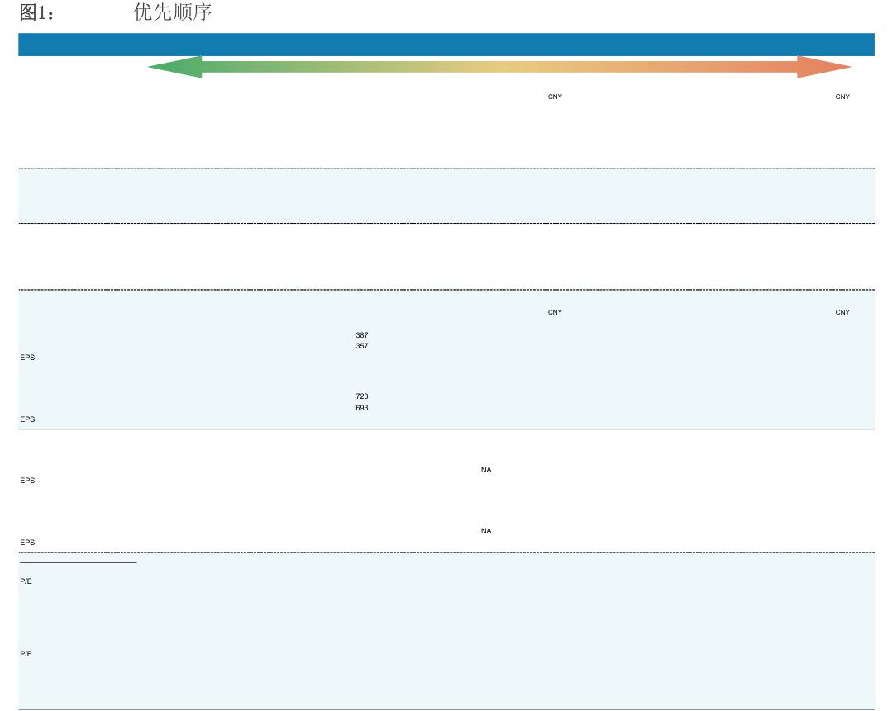

CNY
CNY
CNY
CNY
387
357
EPS
723
693
EPS
NA
EPS
NA
EPS
P/E
P/E

[TABLE_RECONSTRUCTION_UNCERTAIN]

数据来源：公司数据，摩根士丹利研究（e）的估计。数据日期为2026年6月30日。

---

<!-- 原文第 6 页 -->

## M全球NAND供需模型

在本通知中，我们更新了我们的全球NAND供需模型。 我们的计算表明，与AI相关的NAND需求将同比增长60%，或供需缺口为9%。

2027年的供应缺口（供应短缺）。

- 我们以大中华区半导体团队发布的ASIC/GPGPU出货数据（AI供应链：初步2027年台积电CoWoS分配）为基础，计算AI NAND的消耗量。
- 实践中，CSP通常每个ASIC托盘为机架内eSSD部署配备8-16TB eSSD，而外部连接/CMS类似的机架每托盘可配备16-64 TB eSSD，具体取决于应用场景。我们将与数据湖相关的需求归入QLC使用范畴，该需求受供应分配限制。
- 对于Nvidia NAND的使用，当CSP部署BlackWell机架时，我们在实践中包含其额外连接（相当于每4GPU计算节点总共64TB），而其他假设则遵循公司的官方配置。
- 对于智能手机和PC NAND需求，我们假设内容将保持稳定，而单位数量将根据我们美国硬件团队模型减少。由于AI的采用，我们假设企业eSSD使用量在2026年和2027年都将实现10%的年同比增长。
- 对于NAND供应预估，我们采用了美国SPE分析师Shane Brett对2026-27年的预估。他认为2027年将出现27%的年同比增长，并且NAND WFE加速的早期迹象已经显现（参见《上调我们的内存WFE预测（主要为DRAM）》。我们的2025年供应数据也包括了从上一个下行周期带来的整个供应链的过量库存。）

---

<!-- 原文第 7 页 -->

**图2：人工智能与非需求**

|  | 2025 | 2026e | 2027e |
| --- | --- | --- | --- |
| **ASIC** |  |  |  |
| 亚马逊云科技 Trainium（k 个单位） | 1,285 | 1,700 | 2,380 |
| 每计算托盘的ASIC | 4 | 4 | 4 |
| AWS托盘编号#（k 个单位） | 321 | 425 | 595 |
| 每托盘eSSD容量（TB） | 32 | 32 | 32 |
| **总电子固态硬盘（EB）** | **10** | **14** | **19** |
| 元数据MTIA（k个单位） | 50 | 150 | 550 |
| 每计算托盘的ASIC | 4 | 4 | 4 |
| MTIA托盘编号#（k 个） | 13 | 38 | 138 |
| 每托盘eSSD容量（TB） | 64 | 64 | 64 |
| **总电子固态硬盘（EB）** | **1** | **2** | **9** |
| 谷歌TPU（k个单元） |  | 4,080 | 8,168 |
| TPU计算托盘 |  | 4 | 4 |
| 谷歌托盘 #（k 个单位） |  | 1,020 | 2,042 |
| 每托盘eSSD容量（TB） |  | 16 | 16 |
| **总电子固态硬盘（EB）** |  | **16** | **33** |
| **总ASIC eSSD使用量（EB）** | **11** | **32** | **61** |
| **GPGPU（通用处理器图形处理器单元）** |  |  |  |
| 英伟达（k个单位） |  |  |  |
| B200/B300 | 5,819 | 5,460 | 560 |
| R200 |  | 2,080 | 5,920 |
| R300 |  |  | 1,040 |
| 机架式SSD |  |  |  |
| 每计算托盘的GPU | 4 | 4 | 4 |
| 总计算托盘数量 | 1,455 | 1,885 | 1,880 |
| 每托盘eSSD容量（TB） | 18 | 18 | 18 |
| **总电子固态硬盘（EB）** | **26** | **34** | **34** |
| 每托盘黑井 extra（CSP 部署） | 46 | 46 | 46 |
| **总电子固态硬盘（EB）** | **67** | **63** | **6** |
| STX CMS上下文记忆平台 |  |  |  |
| NVL72机架编号 |  | 28,889 | 96,667 |
| # CMS与NVL72机架数量 |  | 0.125 | 0.125 |
| 存储托盘数量（单位） |  | 16 | 16 |
| 每托盘eSSD容量（TB） |  | 32 | 32 |
| **总电子固态硬盘（EB）** |  | **2** | **6** |
| **AMD（k个单位）** |  |  |  |
| MI300/MI308 | 180 | 36 | - |
| MI325/350/375 | 540 | 84 | 288 |
| MI400 |  | 650 | 1,920 |
| MI500 |  |  | 96 |
| 每计算托盘的GPU | 4 | 4 | 4 |
| 总计算托盘数量 | 180 | 193 | 576 |
| 每托盘eSSD容量（TB） | 64 | 64 | 64 |
| **总电子固态硬盘（EB）** | **12** | **12** | **37** |
| **总GPU eSSD使用量（EB）** | **105** | **111** | **83** |
| **CPU机架** |  |  |  |
| Vera 处理器 |  | 1,030 | 2,270 |
| 每CPU的eSSD（TB） |  | 8 | 8 |
| **总电子固态硬盘（EB）** |  | **8** | **18** |
| **他人** |  |  |  |
| 中国CSP使用（EB） | 80 | 120 | 180 |
| QLC使用（EB） | - | 100 | 230 |
| CSP库存缓冲百分比 | 5% | 10% | 10% |
| **总AI NAND需求（EB）** | **205** | **400** | **609** |

来源：公司数据，高德纳，摩根士丹利研究估计

---

<!-- 原文第 8 页 -->

**附件三：全球NAND供需关系仍预示2027年将出现短缺**

|  | 2025 | 2026e | 2027e |
| --- | --- | --- | --- |
| **总AI NAND需求（EB）** | **205** | **400** | **609** |
| **其他应用（EB）** |  |  |  |
| 非AI SSD（通用服务器、PC、企业等） | 396 | 387 | 401 |
| 固态硬盘 | 209 | 181 | 175 |
| 企业级SSD（非AI） | 187 | 206 | 226 |
| 智能手机 | 337 | 291 | 301 |
| 平板电脑 | 34 | 34 | 34 |
| 闪卡 | 15 | 15 | 15 |
| U盘 | 10 | 10 | 10 |
| 其他 | 113 | 113 | 113 |
| **总非AI NAND需求（EB）** | **905** | **850** | **874** |
| 总NAND需求量（EB） | 1,111 | 1,250 | 1,484 |
| 总NAND供应量（EB） | 1,128 | 1,058 | 1,347 |
| **充足率（%）** | **2%** | **(15%)** | **(9%)** |
| **NAND需求占比（EB）** | **18%** | **32%** | **41%** |

来源：公司数据，高德纳，摩根士丹利研究估计

## 2028情景测试

我们认为，2028年及以后的重大变量可能与YMTC有关。 这家中国的NAND供应商目前正同时建设4号厂和5号厂，每个厂的规划产能均为100万片/月。如果他们决定将所有产能都用于NAND，结合已宣布的五个厂计划，他们最终可能在全球NAND行业中占据24%的市场份额（参见《芯片通胀——应对存储危机》）

在我们的基准情景中，我们假设非AI NAND需求年同比增长5%，其余供应商的产能扩张则与我们的美国半导体团队的预测相同。 我们假设2028年AI SSD需求将同比增长30-60%，而YMTC的产能范围在310kwpm（当前基准情景）到470kwpm（所有已宣布的五座晶圆厂的最大潜在产能）之间。

总之，如果人工智能资本支出继续增长，并且YMTC保持更 disciplined 的扩张策略，我们预计到2028年NAND供应仍将保持紧张。 然而，如果YMTC或其他参与者加速新建产能扩张，则可能存在产能过剩的潜在风险。

---

<!-- 原文第 9 页 -->

**图4：YMTC产能扩张与AI SSD增长情景测试**

2028年AI SSD需求同比增长百分比

| 2028年预期YMTC产能kwpm为470 | 30% | 40% | 50% | 60% |
| --- | --- | --- | --- | --- |
| 310 | -1% | -2% | -4% | -6% |
| 330 | 0% | -1% | -3% | -4% |
| 350 | 2% | 0% | -2% | -3% |
| 370 | 3% | 1% | -1% | -2% |
| 390 | 4% | 2% | 1% | -1% |
| 410 | 5% | 4% | 2% | 0% |
| 430 | 7% | 5% | 3% | 1% |
| 450 | 8% | 6% | 4% | 3% |
|  | 9% | 7% | 5% | 4% |

## 我们的分析未包含哪些内容？

- 用于 AI 推理工作负载的“超级高 IOPS”SSD 可能带来的晶圆消耗和产能挤压：如果这些新产品在 2028 年进入量产，它们将比普通 SSD 消耗多 3 倍的产能，从而显著收紧整个行业的供应。
- 新技术和 AI 应用将比我们目前估计需要更多的 SSD。
- 边缘 AI 设备的潜在需求增长，或传统周期性复苏带来的需求上扬。

---

<!-- 原文第 10 页 -->

## 通道检查

- 3Q26 NAND价格方面，TLC企业级SSD季度环比上涨30%，而消费级NAND产品仅小幅上涨，原因是价格压力正挤压智能手机和PC客户的利润空间。
- 2026年第三季度DRAM价格对服务器级产品正以环比+20%的态势运行，而消费级客户也面临类似的压力。由于持续供应紧张和增长，传统DRAM产品如DDR3/4的价格环比涨幅高达+30-40%。
- 对人工智能相关产品的需求（参见旧忆：最好多买些）
- memory供应商与主要大客户之间的长期供应协议（LTAs）仍在谈判中。 美光在过去财报中宣布，LTAs既有最高价也有最低价，这限制了价格趋势的潜在上涨空间。根据我们的渠道调研，客户更愿意为DRAM价格付费以确保供应，而NAND价格则遭遇了一些阻力。
- 到2026年第二季度末，供应商的库存水平仍处于历史低位。 模组制造商的库存水平从DRAM和NAND两方面都显著增加，与其库存建设策略一致。服务器客户的库存水平略有改善，而智能手机制造商正获得更多DRAM库存。PC制造商的DRAM库存水平继续下降。
- 同时，NAND 产品需保持平整。
- 根据我们的渠道调研，在中国部分内存经销商处，消费级（PC、智能手机）内存产品的库存水平较高，而服务器产品则供应紧张。经销商指出，当前价格水平较高（且鉴于过去三个季度的大幅提价，其成本也随之升高），这抑制了市场上的中低端买家。他们认为需求并未根本恶化，但销量萎缩导致持有库存时间过长而带来压力。
- 根据我们的计算，供需关系在短期内不会逆转。 然而，供应链日益增大的定价压力、客户不愿/无法接受更高的价格，以及模块制造商/分销商库存水平的不断上升，都表明主流消费产品的定价可能很快将达到上限。

**附件5：DRAM库存水平**　　**图6：NAND库存水平**

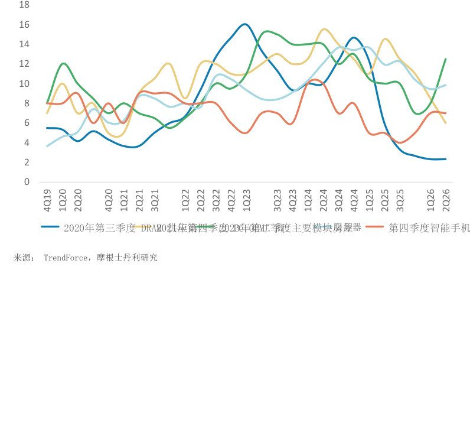

左图（附件5：DRAM库存水平）：纵轴 0–18，步长 2；横轴 4Q19、1Q20、2Q20、4Q20、1Q21、2Q21、3Q21、1Q22、2Q22、3Q22、4Q22、1Q23、3Q23、4Q23、1Q24、2Q24、3Q24、4Q24、1Q25、2Q25、3Q25、1Q26、2Q26；图例：2020年第三季度 DRAM供应商、2021年第四季度 PC OEM厂商、2023年第二季度 主要模块房屋、第四季度智能手机。图上无数据标签，未写数值。

右图（图6：NAND库存水平）：纵轴 3–27，步长 2；横轴 2Q20、3Q20、4Q20、1Q21、2Q21、3Q21、4Q21、1Q22、2Q22、3Q22、4Q22、1Q23、2Q23、3Q23、4Q23、1Q24、2Q24、3Q24、4Q24、1Q25、2Q25、3Q25、4Q25、1Q26、2Q26；图例：NAND供应商、个人电脑原始设备制造商/主要模块房屋 [OCR_UNCERTAIN]、服务器、智能手机。图上无数据标签，未写数值。

来源：TrendForce，摩根士丹利研究

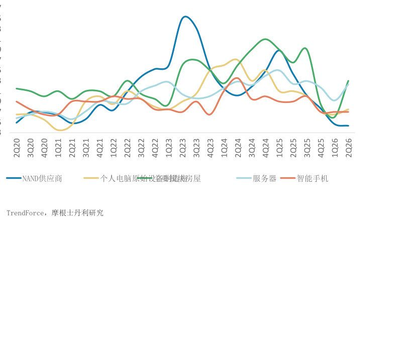

---

<!-- 原文第 11 页 -->

# M模块制造商：一种周期性较弱的商业模式

经典操作手册：过去十年，内存行业通常经历4-6个季度的上行周期，当新增产能上线以满足需求时会出现拐点。由于客户行为强化——追逐并追加更多订单——使得上行周期中的短缺状况被放大，每季度价格上涨时尤为明显，而在下行周期则减少承诺，期待价格会下一季度将有所下降。

传统上，低成本库存在一个模块制造商的业务模式中发挥着重要作用。模块制造商在周期低谷时囤积低成本库存，并在上行周期中以更大的利润弹性进行销售。这种商业模式也会影响模块制造商的股价反应——通常在低成本库存被耗尽时，利润达到峰值，股价

价格已更正。

这是否不同？在内存行业因AI需求激增而面临长期短缺的情景下，通过长期协议（LTAs），内存价格可能在接下来3-5年内维持在高位。我们认为这将从根本上改变模块制造商的业务模式，并带来一个更持久的上行周期。

1. 稳定利润率与周期性波动：低成本库存可能在今年某个时候被耗尽（Longsys目前持有2-3个季度的库存）。随着消费者对价格上涨的记忆进入2026年下半年并维持在高位，利润率应逐渐恢复到更正常化的水平，并比以往年份更加稳定。

2. 供应有限：由于供应商的配额正转向CSP客户，我们预计模块制造商在2026年和2027年的产量增长将较为平缓。进入2028年，中国国内供应商的激进绿色field产能扩张可能成为产量增长的推动力，但与此同时，在供过于求的情况下，这也可能对价格支持构成挑战。

3. 通过产品组合升级和利润率提升实现EPS提升：在销量增长受限且市场价格稳定的背景下，模块制造商将面临挑战，需要通过高端产品组合的调整和能够提升平均售价（ASP）的新增长引擎来区分自身，从而获得支撑估值和股价表现的盈利。

---

<!-- 原文第 12 页 -->

# M 展品 7：NAND 供应商的表现显著优于这个超级周期

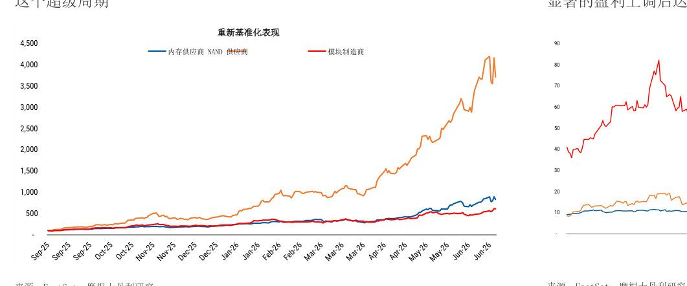

## 重新基准化表现

左图：纵轴为重新基准化表现，刻度 0、500、1,000、1,500、2,000、2,500、3,000、3,500、4,000、4,500；横轴为 Sep-25、Oct-25、Nov-25、Dec-25、Jan-26、Feb-26、Mar-26、Apr-26、May-26、Jun-26。图例：内存供应商、NAND 供应商、模块制造商。

来源：FactSet，摩根士丹利研究

## 图8：模块制造商的估值已收缩至更低水平

显著的盈利上调后达到合理水平

右图：纵轴刻度 10、20、30、40、50、60、70、80、90。

来源：FactSet，摩根士丹利研究

## 图9：模块制造商相对表现与其各自国家指数

下图：左轴刻度 -3%、-2%、-1%、0%、1%、2%、3%；右轴刻度 -3%、-2%、-1%、0%、1%、2%、3%、4%、5%；横轴为 Aug-22、Oct-22、Dec-22、Feb-23、Apr-23、Jun-23、Aug-23、Oct-23、Dec-23、Feb-24、Apr-24、Jun-24、Aug-24、Oct-24、Dec-24、Feb-25、Apr-25、Jun-25、Aug-25、Oct-25、Dec-25、Feb-26、Apr-26、Jun-26。图例：群联超越 % 1MMA、长系统的超额表现% 1MMA。标注：全球记忆股票、在LTA上集结、re-rating。

来源：FactSet，摩根士丹利研究

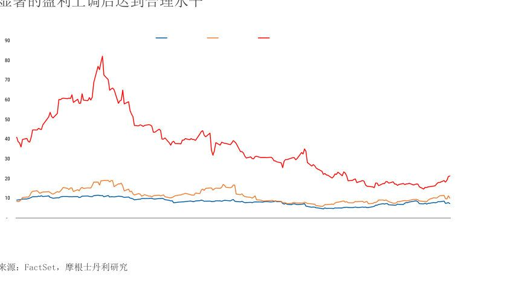

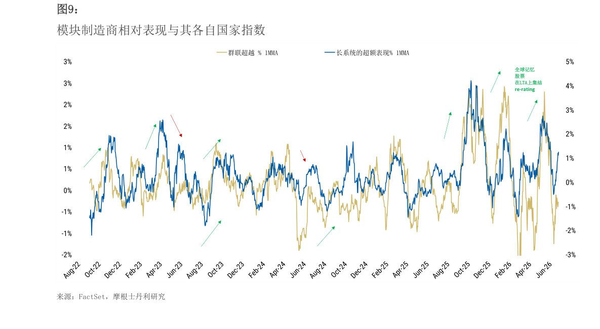

---

<!-- 原文第 13 页 -->

# 人工智能模块：自底向上启动驱动更新

在我们2月份的Phison降级报告中，我们针对增长中的AI市场，对我们启动驱动模型进行了自下而上的分析。由于现在对2027年AI GPU、CPU和ASIC芯片的出货量有了更多的可见性，加上启动驱动价格的持续上涨

模块方面，我们进一步更新了自下而上的分析：引导驱动模块是现代服务器机架中的一个基础但常被忽视的组件，特别是在大规模人工智能和云基础设施中。虽然它们不直接参与模型训练或推理工作负载，但引导驱动对于系统可用性、编排和可恢复性至关重要。从宏观层面来看，引导驱动提供了初始化硬件、加载操作系统以及在计算节点、交换机等设备上维持基本控制平面功能所需的持久本地存储。

机架内的管理服务器。

### 引导驱动模块的核心功能

- 系统初始化与硬件自举：启动驱动器存储系统固件、启动加载程序和操作系统镜像，用于启动服务器、交换机和管理节点。没有本地启动设备，即使在解耦或网络启动的环境中，硬件也无法可靠初始化。

虽然与数据缓存或训练存储相比，启动驱动器在总存储容量中只占较小份额，但它们的普遍存在和强制性使得它们成为稳定且可扩展的需求驱动因素。随着容器化、监控和本地推理工作负载导致系统软件占用空间扩大，启动驱动器的容量需求持续增长，从而增加了每个机架的累积存储内容。

我们尝试根据近期我们认为合理的机架出货量，来估算英伟达蓝域3和即将推出的蓝域4启动驱动器的TAM。我们还尝试估算其他启动驱动器市场，因为通用服务器和ASIC服务器机架也需要启动驱动器才能运行。

SIMO和Solidigm是蓝域3启动驱动模块的主要供应商。然而，我们认为SIMO在控制器方面拥有100%的市场份额，因为其他模块制造商将其SSD与SIMO的解决方案配对。我们估计GB200/300服务器机架和蓝域3启动驱动将贡献2.3%和0.9%的总收入给SIMO。

---

<!-- 原文第 14 页 -->

2026/2027e。由于英伟达决定在其即将推出的Vera Rubin机架中增加并标准化启动驱动内容，我们已看到多个模块、控制器和原始NAND供应商加入。

蓝田4型机靴驱动器的供应。这些包括SIMO、Phison和Realtek。作为通用服务器，AMD的GPU和其他ASIC服务器机架也需要系统内部的启动驱动器模块/控制器，我们计算了非启动驱动器所需的总潜在市场。

根据我们当前的货运估算。图10：评估Vera Rubin机架中启动驱动器的TAM：SIMO预计其总收入的约3%/7%将来自Vera Rubin。

## 每台Vera Rubin机架的启动驱动内容

| 托盘名称 | 托盘编号 | 每块SSD的启动驱动器 | SSD所需规格 | 启动驱动器需求总量 |
| --- | --- | --- | --- | --- |
| 计算托盘 | 18 | 1 | 1.92 TB M.2 NVMe | 18 |
| 切换托盘（NVLink） | 9 | 1 | 240G-960G M.2 | 9 |
| ToR切换（IB/Eth） | 3 | 1 | 128G-256G M.2 | 3 |
| 管理服务器 | 1 | 2 | 480G-960G M.2（RAID1） | 2 |
| 每机架总启动驱动需求 |  |  |  | 32 |
| M.2 SSD模块的ASP价格（美元） |  |  |  | 150 |

## 蓝田4（BlueField 4）每机架的启动驱动器内容

- 鲁宾（R200）芯片出货量（百万件）2080　5920
- 鲁宾超（R300）芯片出货量（mn单位）1,040
- 暗示维拉·鲁宾（超）运输（k件）29　97
- 模块 ASP（美元）150　200
- 控制器 ASP（美元）20　20
- 模块市场份额：群联 30% / 30%；硅动 (Guī Dòng) 30% / 30%；他人 40% / 40%
- 群联模块收入（百万美元）42　186
- 群联总营收（百万美元）20,090　16,070
- % of total Phison revenue 2.1%　11.5%
- SIMO模块收入（百万美元）42　186
- SIMO total revenue 1,698　2,566

[TABLE_RECONSTRUCTION_UNCERTAIN]

公司数据，摩根士丹利研究估计

## 图11：评估CMS机架中启动驱动器的TAM

鲁宾（R200）芯片出货量（百万件） 2080　5920

鲁宾超（R300）芯片出货量（单位：百万件）1040

|  | 2026e | 2027e |
| --- | --- | --- |
| 暗示的韦拉·鲁宾（超）运输（k个单位） | 29 | 97 |
| STX CMS上下文记忆平台 |  |  |
| 　存储托盘（单位） | 16 | 16 |
| 　启动驱动程序（单位） | 2 | 2 |
| 　每8个VR机架的内容 | 1 | 1 |
| 总CMS启动驱动消耗量（k单位） | 116 | 387 |
| 启动驱动ASP（美元） | 150 | 200 |
| SIMO市场份额 | 30% | 30% |
| SIMO收入贡献（百万美元） | 5 | 23 |

[TABLE_RECONSTRUCTION_UNCERTAIN]

公司数据，摩根士丹利研究估计

---

<!-- 原文第 15 页 -->

# M展示12：评估通用服务器和ASIC中启动驱动程序的TAM：SIMO将受益最大，收入贡献可能为

即使我们对整体TAM的市场份额估计保守为5%，预计到2026e/2027e年也能达到10%/12%。

|  | 2026e | 2027e |
| --- | --- | --- |
| 其他需要引导驱动的应用程序 |  |  |
| 通用服务器出货量（k台） | 21,097 | 27,426 |
| 通用服务器出货量/出货额 | 30.0% | 30.0% |
| AMD – MI系列（k个） | 770 | 2,304 |
| 　每计算托盘的GPU | 4 | 4 |
| 　AMD托盘编号 #（k个） | 193 | 576 |
| ASIC – AWS Trainium（k个单位） | 1,700 | 2,380 |
| 　每计算托盘的ASIC | 4 | 4 |
| 　AWS托盘编号#（k个单位） | 425 | 595 |
| ASIC – 脉冲星链MTIA（k个） | 150 | 550 |
| 　每计算托盘的ASIC | 4 | 4 |
| 　MTIA托盘编号#（k个） | 37.5 | 137.5 |
| 谷歌TPU（k个单元） | 4,080 | 8,168 |
| 　每计算托盘的ASIC | 4 | 4 |
| 　谷歌托盘 #（k 个单位） | 1,020 | 2,042 |
| 每托盘所需的启动驱动器数量 | 1 | 1 |
| 通用服务器和ASIC的总启动驱动消耗（k单位） | 22,772 | 30,776 |
| 启动驱动模块的ASP | 150 | 200 |
| 启动驱动控制器 ASP | 20 | 20 |
| 市场份额分析 |  |  |
| 群联 | 5% | 5% |
| SIMO | 5% | 5% |
| 他人 | 90% | 90% |
| 收入贡献 |  |  |
| 群联模块收入（百万美元） | 171 | 308 |
| 群联总营收（百万美元） | 8,699 | 6,949 |
| 　总 Phison 收入的百分比 | 2.0% | 4.4% |
| SIMO模块收入（百万美元） | 171 | 308 |
| 赛门铁克总收入（百万美元） | 1,698 | 2,566 |
| 　总SIMO收入的百分比 | 10.1% | 12.0% |

来源：公司数据，摩根士丹利研究部估计

---

<!-- 原文第 16 页 -->

# M展示13：我们预计AI启动驱动器将贡献2026e/2027e年Phison总量的2%/7%。

收入，而赛默飞在同一时期看到了15%/21%

|  | 2026e | 2027e |
| --- | --- | --- |
| 群联营收（百万美元） |  |  |
| 韦拉·鲁宾和BlueField 4启动驱动模块 | 42 | 186 |
| 通用服务器、AI GPU、ASIC及其他启动驱动模块 | 171 | 308 |
| 启动驱动模块的总收入贡献 | 212 | 493 |
| 群联总营收（百万美元） | 8,699 | 6,949 |
| 　总 Phison 收入的百分比 | 2% | 7% |
| 新摩收入（百万美元） |  |  |
| 布莱克威尔·格雷斯和BlueField 3启动驱动模块 | 39 | 24 |
| 韦拉·鲁宾和BlueField 4启动驱动模块 | 42 | 186 |
| 通用服务器、AI GPU、ASIC及其他启动驱动模块 | 171 | 308 |
| STX CMS 上下文内存引导驱动模块 | 5 | 23 |
| 启动驱动模块的总收入贡献 | 256 | 541 |
| 赛门铁克总收入（百万美元） | 1,698 | 2,566 |
| 　总SIMO收入的百分比 | 15% | 21% |

来源：公司数据，摩根士丹利研究部估计

---

<!-- 原文第 17 页 -->

# M SIMO：盈利预测修订、估值方法及季度财务报告

我们纳入了实际的首季度26（1Q26）业绩，并将2026年及2027年的GAAP每股收益（EPS）上调59%和66%，并引入2028年的预测：我们考虑了超出预期的1Q26业绩以及强劲的2Q26和2026年全年指引，因为公司在消费科技领域和企业级SSD市场正获得市场份额。我们还考虑了本报告中关于启动驱动器潜在市场分析（TAM）的预测。对于毛利率，我们上调了SSD模块业务的假设，但由于原始NAND成本上升，我们下调了启动驱动器的毛利率预测。GAAP与非GAAP之间的差异

主要反映了近期几个季度记录的未实现投资收益。

## 第14号证据：新摩：盈利预测修正

| 美元（百万），根据公认会计原则 | 新'26E | 旧'26E | 差额 | 新'27E | 旧'27E | 差额 | 新'28E |
| --- | --- | --- | --- | --- | --- | --- | --- |
| 净销售额 | 1,698 | 1,268 | 34% | 2,566 | 1,586 | 62% | 3,485 |
| 毛利润 | 825 | 621 | 33% | 1,298 | 816 | 59% | 1,843 |
| 营业利润 | 357 | 247 | 44% | 693 | 431 | 61% | 1,104 |
| 税前收入 | 385 | 255 | 51% | 700 | 439 | 59% | 1,110 |
| 净利润 | 324 | 204 | 59% | 581 | 351 | 65% | 922 |
| 美国通用会计准则每股收益（美元） | 9.55 | 6.01 | 59% | 17.13 | 10.35 | 66% | 27.17 |
| 非国际财务报告准则每股收益（美元） | 9.44 | 6.54 | 44% | 17.54 | 10.88 | 61% | 27.58 |

### 边距

|  | 新'26E | 旧'26E | 差额 | 新'27E | 旧'27E | 差额 | 新'28E |
| --- | --- | --- | --- | --- | --- | --- | --- |
| 毛利率 | 48.6% | 49.0% |  | 50.6% | 51.4% |  | 52.9% |
| 营业利润率 | 21.0% | 19.5% |  | 27.0% | 27.2% |  | 31.7% |
| 税前利润率 | 22.7% | 20.1% |  | 27.3% | 27.7% |  | 31.9% |
| Net margin | 19.1% | 16.1% |  | 22.6% | 22.1% |  | 26.4% |

来源：公司数据，摩根士丹利研究部估计

## 附件15：SIMO：季度财务报表

百万美元

[TABLE_RECONSTRUCTION_UNCERTAIN]

181　212　231　249　282　304　335　347　361　397　431　455　|　435　458　872　|　.8%
181　211　231　249　282　304　335　347　361　397　431　455　|　434　458　872
161　203　221　241　286　310　344　358　397　439　489　518　|　369　428　825
161　203　221　241　286　310　344　358　397　439　489　518　|　369　428　826

　|　2%
　|　8%
86　91　101　95　110　130　135　125　130　150　170　172　|　218　261　374　500　622　|　8%　8%
23　23　24　24　25　26　26　27　28　29　29　30　|　60　74　94　105　117
19　20　20　21　22　23　23　24　25　26　26　27　|　55　66　80　91　103
52　88　96　122　151　154　183　206　238　260　289　316　|　91　93　357　693　|　7%
62　91　99　125　154　157　186　209　242　264　293　320　|　108　119　376　707　|　1%
23　|　6　6
9
67　74　81　102　126　129　153　172　199　217　241　264　|　89　123　324　581　922
54　78　84　106　130　132　157　176　203　221　245　267　|　101　107　320　595　935

来源：公司数据，摩根士丹利研究部估计

我们将目标价从155美元上调至400美元：这反映了我们对2026-27年盈利预测的调整，并引入了2028年的预测。我们还把自由现金流（RI）的基准从2025年调整至2026年预期。我们维持其他自由现金流假设不变，包括9.5%的股权成本（无风险利率为2.0%，风险溢价为6%，贝塔系数为1.25），以及派息比率

---

<!-- 原文第 18 页 -->

M指数为62%，中期增长率为8. 6%，长期增长率为4%。我们的牛市和熊市情景预测也分别从225美元和68美元上调至580美元和175美元。

暗示33倍和10倍2027年每股收益。

## 第十六项证据：西摩：RI 模型

US$million

|  | 2026E | 2027E | 2028E | 2029E | 2030E | 2031E | 2032E | 2033E | 2034E | 2035E | 2036E | 2037E |
| --- | --- | --- | --- | --- | --- | --- | --- | --- | --- | --- | --- | --- |
| 总权益 | 1,106 | 1,557 | 2,246 | 2,707 | 3,207 | 3,750 | 4,339 | 4,980 | 5,675 | 6,431 | 7,251 | 8,142 |
| 净利润 | 324 | 581 | 922 | 1,001 | 1,087 | 1,180 | 1,282 | 1,392 | 1,512 | 1,642 | 1,783 | 1,937 |
| ROAE | 33.5% | 43.6% | 48.5% | 40.4% | 36.8% | 33.9% | 31.7% | 29.9% | 28.4% | 27.1% | 26.1% | 25.2% |
| 剩余收益 | 199 | 377 | 606 | 694 | 737 | 783 | 831 | 883 | 938 | 998 | 1,063 | 1,133 |
| 传播 | 23.9% | 34.1% | 38.9% | 30.9% | 27.2% | 24.4% | 22.2% | 20.3% | 18.8% | 17.6% | 16.5% | 15.6% |
| 结束股权资本 | 1,106 |  |  |  |  |  |  |  |  |  |  |  |
| 预测期现值 | 4,654 |  |  |  |  |  |  |  |  |  |  |  |
| 持续价值现值 | 7,818 |  |  |  |  |  |  |  |  |  |  |  |
| 股权价值 | 13,578 |  |  |  |  |  |  |  |  |  |  |  |

股份数量 34　预计价格 400

来源：公司数据，摩根士丹利研究部估计

## 第十七项证据：SIMO：市盈率区间

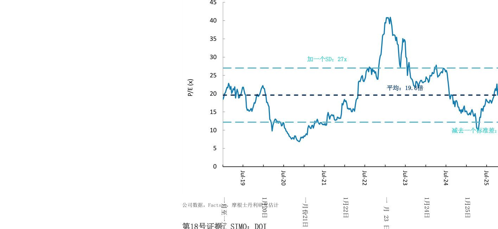

纵轴 P/E (x)，刻度 5、10、15、20、25、30、35、40、45；横轴 Jul-19、Jul-20、Jul-21、Jul-22、Jul-23、Jul-24、Jul-25、Jul-26。标注：加一个SD：27x、平均：19.6倍、减去一个标准差：12.2x。

公司数据，Factset，摩根士丹利研究估计

## 第18号证据：SIMO：DOI

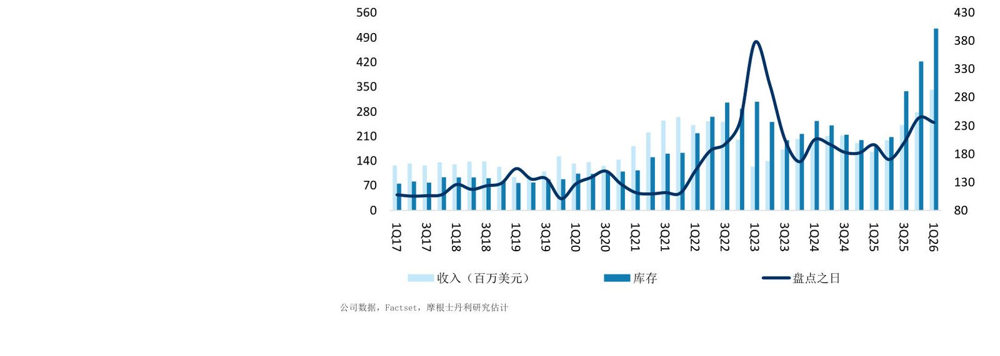

左轴刻度 0、70、140、210、280、350、420、490、560；右轴刻度 80、130、180、230、280、330、380、430；横轴 1Q17、3Q17、1Q18、3Q18、1Q19、3Q19、1Q20、3Q20、1Q21、3Q21、1Q22、3Q22、1Q23、3Q23、1Q24、3Q24、1Q25、3Q25、1Q26。图例：收入（百万美元）、库存、盘点之日。

公司数据，Factset，摩根士丹利研究估计

---

<!-- 原文第 19 页 -->

## 风险收益 – 硅动力 (SIMO.O)

2026年将提供更多eSSD机会；OW

美元400.00目标价。基本情况，剩余收益模型。关键假设：股权成本为9.5%（无风险利率为2.0%，风险溢价6%，贝塔系数1.25，股息支付率为62%，中期增长率为8.6%，长期增长率为4%。）

### 一致目标价分布

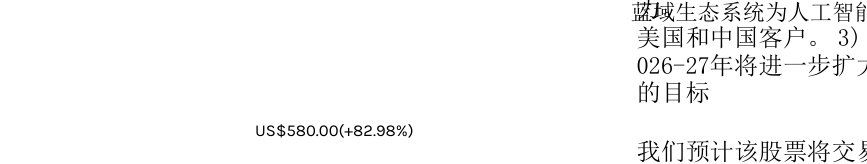

US$80.00　US$266.74　US$450.00；图例：MS PT、摩根士丹利预测

Source: Refinitiv, Morgan Stanley Research

### 风险收益图

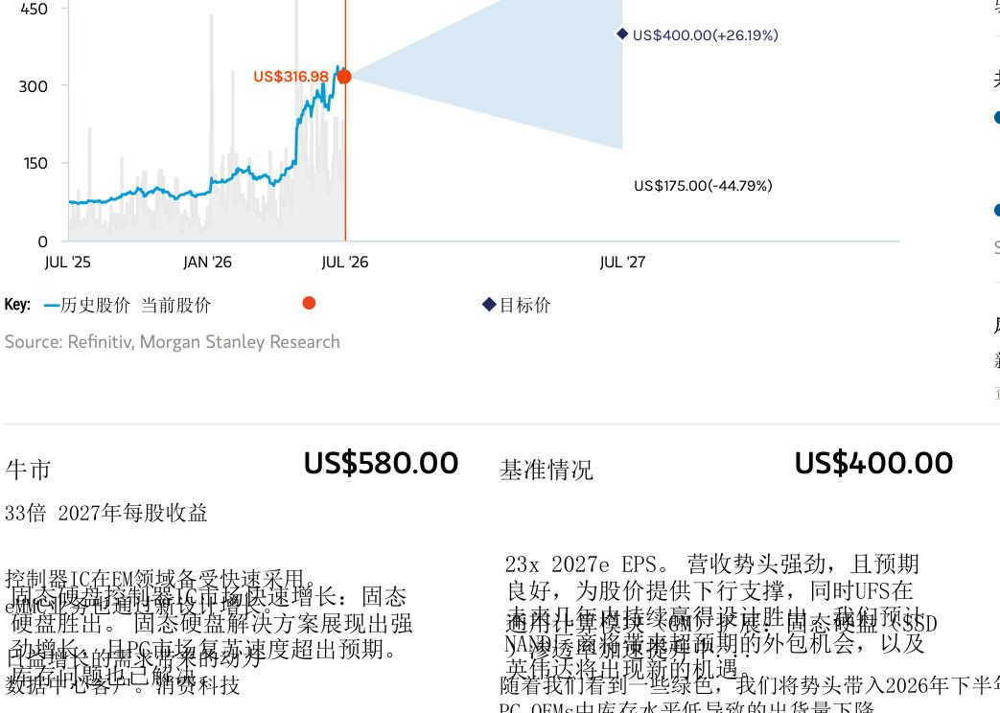

纵轴 USD，刻度 0、150、300、450、600；横轴 JUL '25、JAN '26、JUL '26、JUL '27。标注：US$316.98（当前股价）、US$580.00(+82.98%)、US$400.00(+26.19%)、US$175.00(-44.79%)。Key：历史股价、当前股价、目标价。

Source: Refinitiv, Morgan Stanley Research

超重论：我们预计SIMO将拥有更强的定价权，以及更清晰的盈利预期，这得益于不断增长的后备订单和更多业务。

人工智能时代的机遇。▪ 我们相信SIMO能够把握人工智能时代的趋势。1) 人工智能电脑可以成为推动笔记本电脑市场增长的催化剂。2) 我们看到了QLC和TLC NAND在企业服务器和智能手机领域的业务潜力。蓝域生态系统为人工智能市场带来了新的TAM。美国和中国客户。 3) 英伟达：我们预计2026-27年将进一步扩大利润率，达到公司的目标

我们预计该股票将交易至2027年每股收益的23倍，鉴于2026年前景更好、NAND厂商带来的更多外包机会以及人工智能启动带来的新机遇。

### 共识评级分布

92% 超重

8% 等权重

体重过轻 0%

MS评级

Source: Refinitiv, Morgan Stanley Research

### 风险收益主题

新数据时代：积极

查看风险回报主题的描述　here

### 牛市　US$580.00

33倍 2027年每股收益

固态硬盘控制器IC市场快速增长：固态硬盘胜出。固态硬盘解决方案展现出强劲增长，且PC市场复苏速度超出预期。库存问题也已解决。控制器IC在EM领域备受快速采用。eMMC业务也通过新设计增长。通用计算模块（GM）扩展：固态硬盘（SSD）渗透率加速提升中. ..

日益增长的需求带来的动力

数据中心客户。消费科技

### 基准情况　US$400.00

23x 2027e EPS。营收势头强劲，且预期良好，为股价提供下行支撑，同时UFS在未来几年内持续赢得设计胜出。我们预计NAND厂商将带来超预期的外包机会，以及英伟达将出现新的机遇。随着我们看到一些绿色，我们将势头带入2026年下半年。PC OEMs中库存水平低导致的出货量下降。

### US$175.00

案例10x 2027e 每股收益

关键客户将UFS内制化；PCIe Gen 4发展放缓：客户成功推出自研UFS控制器IC，并将订单量不足50%分配给硅动力。由于市场需求疲软，SSD控制器IC未能获得广泛采用，而SIMO自身的产品迁移也放缓。中国数据中心需求显著放缓，经济复苏晚于预期。库存问题比预期更为严重。

---

<!-- 原文第 20 页 -->

## 风险收益 – 硅动力 (SIMO.O)

### 关键收益输入项

| 司机 | 2025年12月 | 2026年12月e | 2027年12月e | 2028年12月e |
| --- | --- | --- | --- | --- |
| eMMC + UFS收入（美元，mn） | 336 | 625 | 676 | 698 |
| 来自SSD控制器的收入（美元，mn） | 468 | 665 | 1,216 | 1,872 |
| 可移除存储收入卡（美元，千张） | 40 | 0 | 0 | 0 |
| SSD解决方案的收入（香农+费里）（美元，百万） | 37 | 382 | 666 | 908 |

### 催化剂日历

| Date |  |
| --- | --- |
| 2026年9月23日 - 2026年9月27日 | 事件来源：Refnitiv，摩根士丹利，硅动力科技公司年度股东大会 |

### 投资驱动因素

- 固态硬盘市场增长与新增客户获取
- 企业SSD解决方案业务发展
- 普罗格西尼MMC业务

### PT/RATING风险

- 上行风险 新宣布的收购交易 开放渠道模块取得进展
- eSSD share gain
- Weaker-than-expected penetration of SSD
- 下行风险：预期需求不足
- eSSD share loss

### 全球收入敞口

- 0-10%　日本
- 10-20%　北美洲
- 20-30%　中国大陆
- 40-50%　亚太地区，不含日本、中国大陆和印度

Source: Morgan Stanley Research Estimate

区域层级解释　here

### 所有权定位

| 机构所有者，活跃百分比 | 84.1% |
| --- | --- |
| 高抛低吸比率 | 2.1x |

Refinitiv; MSPB Content. Includes certain hedge fund

高频策略净敞口29. 5%，其中对MSPB的敞口。信息可能与市场整体趋势不一致，或未能反映更广泛的市场趋势。多空比率=多头敞口/空头敞口。行业占总净敞口百分比=(对于 particular sector: Long Exposure - Short Exposure) / (Across all sectors: Long Exposure – Short Exposure).

### 微软估算值与市场共识

2026年12月财政年度预期

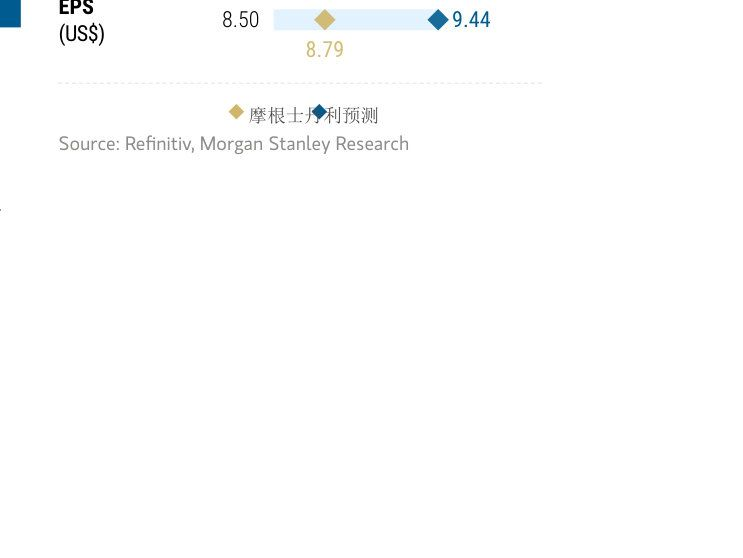

销售 / 收入（US$, mn）：1,590　1,629　1,698　1,725

息税折旧摊销前利润（US$, mn）：369　387　406　409

净利润（US$, mn）：291　297　320

EPS（US$）：8.50　8.79　9.44

◆ 摩根士丹利预测

Source: Refinitiv, Morgan Stanley Research

---

<!-- 原文第 21 页 -->

# M SIMO：财务摘要

## 利润表

美元百万（年底12月）

| | 2024 | 2025E | 2026E | 2027E | 2028E |
|---|---|---|---|---|---|
| 净销售额 | 804 | 886 | 1,698 | 2,566 | 3,485 |
| COGS | (434) | (458) | (872) | (1,268) | (1,643) |
| 毛利润 | 369 | 428 | 826 | 1,298 | 1,843 |
| 运营费用 | (278) | (335) | (469) | (605) | (739) |
| **营业收入** | **91** | **93** | **357** | **693** | **1,104** |
| 非经营收入 | 17 | 47 | 28 | 6 | 6 |
| 税前收入 | 107 | 140 | 385 | 700 | 1,110 |
| 所得税 | 18 | 17 | 61 | 119 | 189 |
| **报告净利润** | **89** | **123** | **324** | **581** | **922** |
| adj. wtd. avg. shrs (m) | 34 | 34 | 34 | 34 | 34 |
| **每股ADS收益（美元，美国公认会计原则）** | **2.65** | **3.63** | **9.55** | **17.13** | **27.17** |
| **每股ADS收益（美元，非美国通用会计准则）** | **3.01** | **3.16** | **9.44** | **17.54** | **27.58** |
| **模型软件EPS（美元）** | **3.01** | **3.16** | **9.44** | **17.54** | **27.58** |

## 现金流量表

美元百万（年底12月）

| | 2024 | 2025E | 2026E | 2027E | 2028E |
|---|---|---|---|---|---|
| **经营活动产生的现金流** | **77** | **61** | **(69)** | **117** | **453** |
| 净利润 | 89 | 123 | 324 | 581 | 922 |
| 折旧 | 25 | 30 | 30 | 30 | 30 |
| 营运资金变动 | (60) | (190) | (423) | (494) | (498) |
| 其他调整 | 22 | 99 | 0 | 0 | 0 |
| **投资活动产生的现金流量** | **(44)** | **(27)** | **(12)** | **(12)** | **(12)** |
| 资本性支出 | (43) | (27) | (12) | (12) | (12) |
| 长期投资变更 | 0 | 0 | 0 | 0 | 0 |
| 变更ST投资 | 0 | 0 | 0 | 0 | 0 |
| 其他调整 | (1) | 0 | 0 | 0 | 0 |
| **融资现金流** | **(71)** | **(92)** | **(49)** | **(130)** | **(232)** |
| 长期债务增加 | 0 | 0 | 0 | 0 | 0 |
| S/T债务增加 | 0 | 0 | 0 | 0 | 0 |
| 现金股利支付 | (67) | (67) | (49) | (130) | (232) |
| 佣金和奖金已支付 | 0 | 0 | 0 | 0 | 0 |
| 股票发行 | 0 | 0 | 0 | 0 | 0 |
| 其他调整 | (4) | (24) | 0 | 0 | 0 |
| 汇率调整 | 0 | (17) | 0 | 0 | 0 |
| **Net change in cash** | **-38** | **-74** | **-130** | **-24** | **209** |

## 资产负债表

美元百万（年底12月）

| | 2024 | 2025E | 2026E | 2027E | 2028E |
|---|---|---|---|---|---|
| Cash | 276 | 202 | 72 | 48 | 257 |
| 市凯证券 | 0 | 0 | 0 | 0 | 0 |
| AR/NR | 234 | 212 | 532 | 805 | 1,093 |
| 库存 | 199 | 422 | 597 | 868 | 1,125 |
| 其他 | 88 | 108 | 108 | 108 | 108 |
| **流动资产** | **797** | **943** | **1,310** | **1,829** | **2,583** |
| 长期投资 | 17 | 30 | 30 | 30 | 30 |
| 固定资产 | 188 | 219 | 201 | 183 | 164 |
| 递延资产 | 0 | 0 | 0 | 0 | 0 |
| 其他资产 | 30 | 31 | 31 | 31 | 31 |
| **总资产** | **1,033** | **1,223** | **1,571** | **2,072** | **2,807** |
| S/T借用 | 0 | 0 | 0 | 0 | 0 |
| **AP/NP** | **18** | **35** | **108** | **157** | **204** |
| 其他ST负债 | 182 | 305 | 305 | 305 | 305 |
| 长期债务 | 0 | 0 | 0 | 0 | 0 |
| 其他长期负债 | 60 | 52 | 52 | 52 | 52 |
| 普通股 | 0 | 0 | 0 | 0 | 0 |
| **总负债** | **259** | **392** | **466** | **515** | **561** |
| 额外资本 | 0 | 0 | 0 | 0 | 0 |
| 留存收益 | 0 | 0 | 275 | 726 | 1,415 |
| 其他股东权益 | 774 | 831 | 831 | 831 | 831 |
| **总权益** | **774** | **831** | **1,106** | **1,557** | **2,246** |
| **总负债及股东权益** | **1,033** | **1,223** | **1,571** | **2,072** | **2,807** |

E = 摩根士丹利研究预测数据来源：摩根士丹利研究，公司数据

## 财务比率

| | 2024 | 2025E | 2026E | 2027E | 2028E |
|---|---|---|---|---|---|
| **Growth(%)** | | | | | |
| Turnover | 25.7 | 10.2 | 91.7 | 51.1 | 35.8 |
| Operating profits | 127.9 | 2.4 | 283.8 | 94.2 | 59.2 |
| Pretax profits | 75.9 | 30.5 | 175.0 | 81.7 | 58.6 |
| Net profits | 68.8 | 37.4 | 164.1 | 79.4 | 58.6 |
| EPS | 64.0 | 5.3 | 198.3 | 85.8 | 57.3 |
| **边距 (%)** | | | | | |
| Gross Margin | 46.0 | 48.3 | 48.7 | 50.6 | 52.9 |
| Operating Margin | 11.3 | 10.5 | 21.0 | 27.0 | 31.7 |
| Pretax Margin | 13.4 | 15.8 | 22.7 | 27.3 | 31.9 |
| Net Profit | 11.1 | 13.8 | 19.1 | 22.6 | 26.4 |
| **返回值（%）** | | | | | |
| ROAE | 11.8 | 15.3 | 33.5 | 43.6 | 48.5 |
| ROAA | 8.7 | 10.9 | 23.2 | 31.9 | 37.8 |
| **齿比 (%)** | | | | | |
| 净债务/权益 | (35.7) | (24.3) | (6.5) | (3.1) | (11.4) |
| Liabilities/Equity | 33.5 | 47.2 | 42.1 | 33.1 | 25.0 |
| **比率 (X)** | | | | | |
| 流动比率 | 4.0 | 2.8 | 3.2 | 4.0 | 5.1 |
| 速动比率 | 2.6 | 1.2 | 1.5 | 1.8 | 2.7 |
| **他人** | | | | | |
| AR/NR 资金周转天数 | 114 | 114 | 114 | 114 | 114 |
| 存货周转天数 | 250 | 250 | 250 | 250 | 250 |
| 应收账款周转天数 | 45 | 45 | 45 | 45 | 45 |
| 现金转换周期（天） | 319 | 319 | 319 | 319 | 319 |

---

<!-- 原文第 22 页 -->

# M Longsys：预计修订

我们此前预测从2027年下半年起将进入下行周期，且短缺状况将持续到2027年。现我们将下行周期预测推迟至2028年下半年，部分由货运量增长所抵消。

在中国国内供应跟上的情景下，预计将出现增长。我们预计Longsys将继续提升其产品组合的竞争力，并通过TCM业务（客户自行确保内存供应，而Longsys提供定制化的模块设计和组装服务）来转移内存成本压力。其控制器业务的研发有望通过成本效率和固件增值服务，在长期内进一步提升其利润率格局。因此，我们上调其长期预期。

将术语利润率假设从之前的两位数上调至25-38%。因此，我们2026-28财年的每股收益（EPS）预测分别上调299%、247%和244%。基于我们残差收入模型的隐含目标价现已上涨至673元人民币，较之前的300元人民币有所提升。此前，意味着15.8倍的2027年市盈率。

在AI PC大获成功的乐观情景下，若其引发了对潜在商业收益的投资情绪，我们将情景估值上调至852元人民币，从435元人民币上调，这意味着20x 2027e P/E。

在边缘AI需求因CSP产能拥挤导致的需求疲软的极端情况下，价格可能仍将维持在高位。我们将情景估值上调至5870万元，从900万元上调，这意味着2027年预期市净率为5.0倍。

## 附件19：估算修订

(RMB元)

| | 2026E 先前 | 2026E 变更 | 2026E 变更 | 2027E 先前 | 2027E 变更 | 2027E 变更 | 2028E 先前 | 2028E 变更 | 2028E 变更 |
|---|---|---|---|---|---|---|---|---|---|
| **总销售额** | **36,899** | **65,852** | **78%** | **40,850** | **85,564** | **109%** | **48,745** | **81,251** | **67%** |
| 嵌入式存储 | 20,912 | 24,865 | 19% | 23,224 | 30,894 | 33% | 27,579 | 29,263 | 6% |
| 移动内存 | 4,457 | 19,719 | 342% | 5,061 | 24,317 | 380% | 5,695 | 22,645 | 298% |
| 固态硬盘 | 7,932 | 14,462 | 82% | 8,631 | 21,115 | 145% | 10,659 | 20,504 | 92% |
| 内存模块 | 3,384 | 6,690 | 98% | 3,710 | 9,102 | 145% | 4,581 | 8,673 | 89% |
| 他人 | 213 | 116 | (46%) | 224 | 136 | (39%) | 231 | 165 | (28%) |
| **总利润** | **11,605** | **36,052** | **211%** | **10,364** | **29,928** | **189%** | **8,835** | **21,610** | **145%** |
| 嵌入式存储 | 6,443 | 13,135 | 104% | 5,342 | 9,924 | 86% | 5,516 | 7,376 | 34% |
| 移动内存 | 2,488 | 11,815 | 375% | 2,025 | 10,295 | 408% | 1,139 | 7,854 | 590% |
| 固态硬盘 | 1,744 | 7,595 | 335% | 1,985 | 6,805 | 243% | 1,492 | 4,563 | 206% |
| 内存模块 | 851 | 3,463 | 307% | 927 | 2,854 | 208% | 596 | 1,757 | 195% |
| 他人 | 78 | 44 | (44%) | 85 | 50 | (41%) | 92 | 61 | (34%) |
| **毛利率** | **31%** | **55%** | **23.7 pp** | **25%** | **35%** | **10.0 pp** | **18%** | **27%** | **8.5 pp** |
| 嵌入式存储 | 31% | 53% | 21.8 pp | 23% | 32% | 9.1 pp | 20% | 25% | 5.2 pp |
| 移动内存 | 56% | 60% | 3.9 pp | 40% | 42% | 2.3 pp | 20% | 35% | 14.7 pp |
| 固态硬盘 | 22% | 53% | 30.5 pp | 23% | 32% | 9.2 pp | 14% | 22% | 8.3 pp |
| 内存模块 | 25% | 52% | 26.8 pp | 25% | 31% | 6.4 pp | 13% | 20% | 7.3 pp |
| 他人 | 37% | 38% | 1.0 pp | 38% | 37% | (1.0) pp | 40% | 37% | (3.0) pp |
| **NP** | **6,169** | **23,974** | **289%** | **5,057** | **17,070** | **238%** | **3,025** | **10,370** | **243%** |
| 每股收益（人民币） | 14.99 | 59.86 | 299% | 12.28 | 42.62 | 247% | 7.33 | 25.19 | 244% |

来源：公司数据，摩根士丹利研究（E）的估计

## 附件20：剩余收益模型

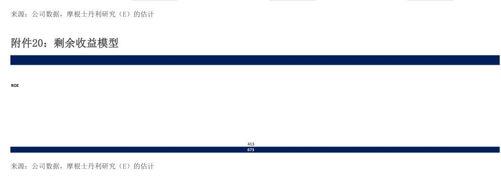

ROE

[TABLE_RECONSTRUCTION_UNCERTAIN]

来源：公司数据，摩根士丹利研究（E）的估计

---

<!-- 原文第 23 页 -->

# M 展品21：财务摘要

本页四张财务报表的表体在 PDF 中排版损坏：行标签缺失，仅残留少量数值与 NM 标记，行列关系无法恢复。

## 利润表

829

656

590

**499**

NM

NM

## 现金流量表

505

571

28)

837

562

141

10

424

780

**456**

## 资产负债表

240

985

870

## 财务比率

EPS

[TABLE_RECONSTRUCTION_UNCERTAIN]

来源：公司数据，摩根士丹利研究（E）的估计

---

<!-- 原文第 24 页 -->

# 风险收益 – 深圳朗思电子股份有限公司（301308.SZ）

缺乏短期催化剂；期待2027年定价和利润率的更多明朗；EW

673.00元 目标价

基准案例，源自剩余收益模型。我们假设权益成本为9.10%（风险...）自由利率为2.5%，风险溢价为5.5%，贝塔系数为1.2，以及最终增长率为6.3%。

## 风险收益图

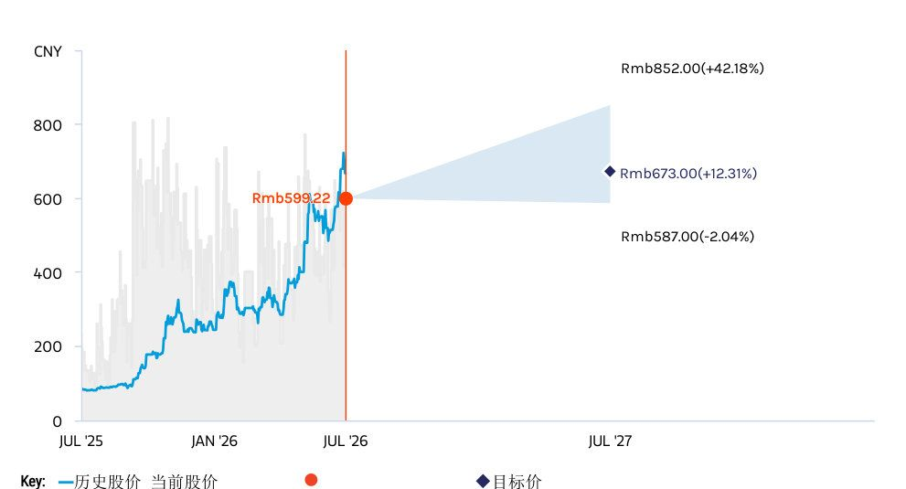

- 纵轴：CNY，0 / 200 / 400 / 600 / 800
- 横轴：JUL '25、JAN '26、JUL '26、JUL '27
- 当前股价：Rmb599.22
- 牛市：Rmb852.00(+42.18%)
- 基准：Rmb673.00(+12.31%)
- 抗辩事由：Rmb587.00(-2.04%)

Key: — 历史股价　当前股价（圆点）　目标价（菱形）

Source: Refinitiv, Morgan Stanley Research

等权重理论论点：人工智能时代终于到来，NAND领域将面临短缺，预计将持续至2027年。我们看好该公司通过企业级业务实现的中长期增长故事。

业务扩张，并逐步转向中医模式。▪ 持续的供应纪律，使国内客户库存水平正常化，以及龙系统的自助行为，应有助于股价重新 [OCR_UNREADABLE]

市盈率。▪ 我们的定价目标意味着2027年预期市盈率为15.8倍，与A股同行持平，且显著低于其30倍的历史平均市盈率，反映了强劲且更持久的盈利上调。

NAND升级再利用

风险收益主题

Secular Growth:　积极

自助：积极

查看风险回报主题的描述　here

## 牛市　Rmb852.00

20倍 2027年市盈率 人工智能驱动下的激进增长：我们假设：1）总体供应持续；2）边缘人工智能设备将触发并冲击个人电脑市场，导致NAND闪存供不应求直至2028年及以后。

纪律和CSPs的激进人工智能支出

智能手机需求强劲复苏

## 基准情况　Rmb673.00

15倍2027年市盈率的风险/回报似乎均衡，这反映了：1）在企业业务方面，海外扩张以及中医和物理治疗业务模式可能增强其中长期增长和利润率结构。

NAND的世俗增长，由AI支持。中国的本地化，以及2）长系统的自助

## 抗辩事由　Rmb587.00

5.0x 2027e P/B 市场增长不及预期：我们假设：1）边缘AI周期从2028年起将趋于疲软，并持续至更晚时间，以及2）2028年下半年价格开始下降。

---

<!-- 原文第 25 页 -->

# 风险收益 – 深圳朗思电子股份有限公司（301308.SZ）

## 关键收益输入项

| 司机 | 2025年12月 | 2026年12月e | 2027年12月e | 2028年12月e |
|---|---|---|---|---|
| 嵌入式存储 ASP 增长 (%) | (1.6) | 162.3 | 27.2 | (8.5) |
| 移动内存ASP增长率(%) | 27.6 | 314.3 | 41.4 | 1.1 |
| SSD ASP 增长率 (%) | (13.8) | 183.9 | 46.0 | 0.6 |
| 内存模块ASP增长率(%) | 4.7 | 214.3 | 35.7 | (1.3) |

## 投资驱动因素

- 商品内存价格周期
- eSSD业务拓展进度

## 全球收入敞口

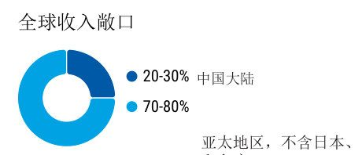

- 20-30%　中国大陆
- 70-80%　亚太地区，不含日本、中国大陆和印度

Source: Morgan Stanley Research Estimate

区域层级解释　here

## 阿尔法模型

**3/5 MOST**　三个月地平线

Source: Refinitiv, FactSet, Morgan Stanley Research; 1 is 最受青睐的五分位是第一分位，而第五分位则最不受青睐。五分位数

## 所有权定位

机构所有者，活跃比例 85.3%

Source: Refinitiv, Morgan Stanley Research

## PT/RATING风险

- 2026年下半年消费者需求好于预期的风险，这将支撑收入和利润率。
- Better-than-expected eSSD market expansion, improvement during the down-cycle
- 下行风险：内存价格和利润率下降，分享损失给新进入者（中国）记忆市场
- Prolonged commodity down-cycle that drags

## 微软估算值与市场共识

2026年12月财政年度预期

| | |
|---|---|
| 销售 / 收入 (Rmb, mn) | 65,852.3 |
| 净利润 (Rmb, mn) | 23,974 |
| EPS (Rmb) | 59.9 |

Note: There are not sufficient brokers supplying 此指标的数据共识

◆ 摩根士丹利预测

Source: Refinitiv, Morgan Stanley Research

---

<!-- 原文第 26 页 -->

# 普林斯恩M：修订估算

我们将2026年、2027年和2028年的每股收益（EPS）预测分别上调71%、13%和8%：我们计入了超出预期的2026年第二季度（2Q26）业绩。2Q26的业绩显著超出我们的预测，这得益于定价上调周期和出货量比预期更为强劲。我们预计2026年第三季度（3Q26）将是全年峰值，得益于Kioxia dummy die的更多支持，将推动环比（QoQ）收入增长约20%，并实现好于预期的（环比持平）利润率。在2026年第四季度（4Q26），我们预计消费电子将出现疲软，以及更温和的定价环境，导致4Q收入环比下降20%，利润率将正常化至约50%。鉴于2026年看到的更佳定价环境，这导致了更强的

2027年的盈利超出预期，部分被持续的研发投入所抵消。

## 第22号证据：飞索：估算修订

新台币千万元

| | 2026E 当前 | 2026E 上一个 | Diff. % | 2027E 当前 | 2027E 上一个 | Diff. % | 2028E 当前 | 2028E 上一个 | Diff. % |
|---|---|---|---|---|---|---|---|---|---|
| 净销售额 | 260,963 | 169,828 | 54% | 208,459 | 165,204 | 26% | 154,119 | 130,255 | 18% |
| 毛利润 | 155,833 | 91,990 | 69% | 90,396 | 71,566 | 26% | 60,900 | 54,074 | 13% |
| 营业利润 | 85,965 | 49,614 | 73% | 32,691 | 31,077 | 5% | 12,077 | 13,463 | -10% |
| 税前收入 | 90,915 | 52,976 | 72% | 35,646 | 31,484 | 13% | 15,031 | 13,870 | 8% |
| 报告净利润 | 75,050 | 43,940 | 71% | 29,229 | 25,817 | 13% | 12,326 | 11,373 | 8% |
| **每股收益（报告数）** | **340.55** | **199.39** | **71%** | **132.63** | **117.15** | **13%** | **55.93** | **51.61** | **8%** |

边距

| | 2026E 当前 | 2026E 上一个 | 2027E 当前 | 2027E 上一个 | 2028E 当前 | 2028E 上一个 |
|---|---|---|---|---|---|---|
| 毛利率 | 59.7% | 54.2% | 43.4% | 43.3% | 39.5% | 41.5% |
| 营业利润率 | 32.9% | 29.2% | 15.7% | 18.8% | 7.8% | 10.3% |
| 税前利润率 | 34.8% | 31.2% | 17.1% | 19.1% | 9.8% | 10.6% |
| Net margin | 28.8% | 25.9% | 14.0% | 15.6% | 8.0% | 8.7% |

来源：公司数据，摩根士丹利研究（E）的估计

## 附件23：群联：季度财务报表

新台币，以百万为单位

| | 1Q26 | 2Q26E | 3Q26E | 4Q26E | 1Q27E | 2Q27E | 3Q27E | 4Q27E | 2024 | 2025 | 2026E | 2027E | 2028E |
|---|---|---|---|---|---|---|---|---|---|---|---|---|---|
| **Total Revenues** | **40,967** | **69,547** | **83,483** | **66,965** | **53,747** | **55,548** | **53,301** | **45,862** | **58,936** | **72,664** | **260,963** | **208,459** | **154,119** |
| Sequential Change | 79.7% | 69.8% | 20.0% | -19.8% | -19.7% | 3.4% | -4.0% | -14.0% | | | | | |
| Change vs Year Ago | 196.0% | 288.7% | 360.3% | 193.7% | 31.2% | -20.1% | -36.2% | -31.5% | 22.2% | 23.3% | 259.1% | -20.1% | -26.1% |
| Cost of Sales | 15,849 | 25,190 | 30,444 | 33,646 | 28,589 | 31,121 | 31,365 | 26,988 | 39,837 | 47,806 | 105,129 | 118,062 | 93,219 |
| 收入百分比 | 39% | 36% | 36% | 50% | 53% | 56% | 59% | 59% | 68% | 66% | 40% | 57% | 60% |
| **Gross Profit** | **25,118** | **44,357** | **53,039** | **33,320** | **25,158** | **24,427** | **21,936** | **18,875** | **19,099** | **24,858** | **155,833** | **90,396** | **60,900** |
| Percent of Revenues | 61.3% | 63.8% | 63.5% | 49.8% | 46.8% | 44.0% | 41.2% | 41.2% | 32.4% | 34.2% | 59.7% | 43.4% | 39.5% |
| 增量边距 | 86% | 67% | 62% | NM | NM | -41% | NM | NM | 28% | 42% | 70% | NM | NM |
| Total Opex | 10,277 | 17,075 | 21,691 | 20,826 | 13,257 | 14,333 | 15,239 | 14,876 | 15,566 | 16,591 | 69,869 | 57,705 | 48,823 |
| Percent of Revenues | 25.1% | 24.6% | 26.0% | 31.1% | 24.7% | 25.8% | 28.6% | 32.4% | 26.4% | 22.8% | 26.8% | 27.7% | 31.7% |
| R&D | 8,671 | 14,000 | 18,000 | 18,000 | 11,000 | 12,000 | 13,000 | 12,950 | 12,586 | 13,775 | 58,671 | 48,950 | 42,350 |
| Percent of Revenues | 21.2% | 20.1% | 21.6% | 26.9% | 20.5% | 21.6% | 24.4% | 28.2% | 21.4% | 19.0% | 22.5% | 23.5% | 27.5% |
| 综合与行政 | 830 | 1,409 | 1,691 | 1,357 | 1,075 | 1,111 | 1,066 | 917 | 1,286 | 1,169 | 5,287 | 4,169 | 3,082 |
| Percent of Revenues | 2.0% | 2.0% | 2.0% | 2.0% | 2.0% | 2.0% | 2.0% | 2.0% | 2.2% | 1.6% | 2.0% | 2.0% | 2.0% |
| 销售与营销 | 776 | 1,666 | 1,999 | 1,470 | 1,182 | 1,222 | 1,173 | 1,009 | 1,694 | 1,647 | 5,911 | 4,586 | 3,391 |
| Percent of Revenues | 1.9% | 2.4% | 2.4% | 2.2% | 2.2% | 2.2% | 2.2% | 2.2% | 2.9% | 2.3% | 2.3% | 2.2% | 2.2% |
| **Operating Income** | **14,841** | **27,283** | **31,348** | **12,493** | **11,901** | **10,094** | **6,697** | **3,998** | **3,533** | **8,266** | **85,965** | **32,691** | **12,077** |
| Percent of Revenues | 36.2% | 39.2% | 37.6% | 18.7% | 22.1% | 18.2% | 12.6% | 8.7% | 6% | 11% | 33% | 16% | 8% |
| Change vs Year Ago | N/A | 1062.9% | 2101.0% | 274.7% | -19.8% | -63.0% | -78.6% | -68.0% | -2% | 134% | 940% | -62% | -63% |

总非经营收入（亏损）　3,057　416　739　739　739　739　739　6,216　1,939　4,950　2,955　2,955

| | 1Q26 | 2Q26E | 3Q26E | 4Q26E | 1Q27E | 2Q27E | 3Q27E | 4Q27E | 2024 | 2025 | 2026E | 2027E | 2028E |
|---|---|---|---|---|---|---|---|---|---|---|---|---|---|
| **Profit Before Taxes** | **17,898** | **27,699** | **32,087** | **13,232** | **12,640** | **10,833** | **7,436** | **4,737** | **9,749** | **10,206** | **90,915** | **35,646** | **15,031** |
| 收入百分比 | 44% | 40% | 38% | 20% | 24% | 20% | 14% | 10% | 17% | 14% | 35% | 17% | 10% |
| 税 | 2,723 | 4,986 | 5,776 | 2,382 | 2,275 | 1,950 | 1,338 | 853 | 1,795 | 1,465 | 15,866 | 6,416 | 2,706 |
| Tax Rate | 15.2% | 18.0% | 18.0% | 18.0% | 18.0% | 18.0% | 18.0% | 18.0% | 18% | 14% | 17% | 18% | 18% |
| Net Income, Cont Ops | 15,175 | 22,713 | 26,311 | 10,850 | 10,365 | 8,883 | 6,097 | 3,884 | 7,954 | 8,741 | 75,049 | 29,229 | 12,326 |
| 收入百分比 | 37% | 33% | 32% | 16% | 19% | 16% | 11% | 8% | 13% | 12% | 29% | 14% | 8% |

净利润（含员工奖金支出）　15,175　22,713　26,311　10,850　10,365　8,883　6,097　3,884　7,955　8,743　75,050　29,229　12,326

| | 1Q26 | 2Q26E | 3Q26E | 4Q26E | 1Q27E | 2Q27E | 3Q27E | 4Q27E | 2024 | 2025 | 2026E | 2027E | 2028E |
|---|---|---|---|---|---|---|---|---|---|---|---|---|---|
| 收入百分比 | 37% | 33% | 32% | 16% | 19% | 16% | 11% | 8% | 13.5% | 12.0% | 28.8% | 14.0% | 8.0% |
| | 0% | 0% | 0% | 0% | 0% | 0% | 0% | 0% | 0% | 0% | 0% | 0% | 0% |
| **Reported Income (TW GAAP)** | **15,175** | **22,713** | **26,311** | **10,850** | **10,365** | **8,883** | **6,097** | **3,884** | **7,955** | **8,743** | **75,050** | **29,229** | **12,326** |
| 收入百分比 | 37% | 33% | 32% | 16% | 19% | 16% | 11% | 8% | 13% | 12% | 29% | 14% | 8% |
| 变化 vs 去年 | 0% | 0% | 0% | 0% | 0% | 0% | 0% | 0% | 119% | 10% | 758% | -61% | -58% |
| **Reported EPS (NT$, TW GAAP)** | **68.86** | **103.06** | **119.39** | **49.23** | **47.03** | **40.31** | **27.67** | **17.63** | **35.68** | **39.70** | **340.55** | **132.63** | **55.93** |
| 变化 vs 去年 | 1233% | 2937% | 1082% | 134% | -32% | -61% | -77% | -64% | 102% | 11% | 758% | -61% | -58% |

来源：公司数据，摩根士丹利研究（E）的估计

---

<!-- 原文第 27 页 -->

# 普林斯恩 M：估值方法论

我们将目标价从新台币2,248元上调至新台币2,588元，以反映我们的估值调整。我们的其他风险调整后收益（RI）参数保持不变，包括9.0%的股权成本、9.0%的中期增长率、4.0%的终值增长率以及51.2%的股息支付率假设。我们将牛市和熊市情景下的估值从新台币3,090元和1,125元上调至新台币3,400元和1,250元，分别对应2026年每股收益（EPS）的10倍和2027年每股收益（EPS）的26倍。

牛市情景下的4倍2026年每股收益和熊市情景下的9倍2027年每股收益。

## 第24号证据：群联：RI型号

NT$million

| | 2026E | 2027E | 2028E | 2029E | 2030E | 2031E | 2032E | 2033E | 2034E | 2035E | 2035E |
|---|---|---|---|---|---|---|---|---|---|---|---|
| 总权益 | 130,690 | 121,591 | 118,989 | 138,089 | 158,908 | 181,601 | 206,336 | 233,298 | 262,686 | 294,718 | 329,634 |
| 净利润 | 75,050 | 29,229 | 31,860 | 34,727 | 37,853 | 41,260 | 44,973 | 49,021 | 53,433 | 58,241 | 63,483 |
| **ROAE** | **78.7%** | **23.2%** | **26.5%** | **27.0%** | **25.5%** | **24.2%** | **23.2%** | **22.3%** | **21.5%** | **20.9%** | **20.3%** |
| 剩余收益 | 41,895 | 18,561 | 21,298 | 21,474 | 22,813 | 24,256 | 25,816 | 27,506 | 29,339 | 31,331 | 33,496 |
| **传播** | **69.7%** | **14.2%** | **17.5%** | **18.0%** | **16.5%** | **15.3%** | **14.2%** | **13.3%** | **12.6%** | **11.9%** | **11.4%** |

| | |
|---|---|
| 结束股权资本 | 130,690 |
| 预测期现值 | 143,241 |
| 持续价值现值 | 296,882 |
| **股权价值** | **570,813** |
| 股份数量 | 221 |
| **预计价格** | **2,588** |

来源：公司数据，摩根士丹利研究（E）的估计

## 第 25 项证据 群联：市盈率

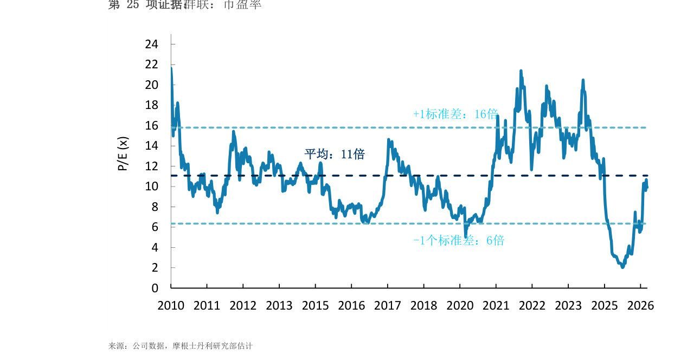

- 纵轴：P/E (x)，0 / 2 / 4 / 6 / 8 / 10 / 12 / 14 / 16 / 18 / 20 / 22 / 24
- 横轴：2010、2011、2012、2013、2015、2016、2017、2018、2020、2021、2022、2023、2025、2026
- +1标准差：16倍
- 平均：11倍
- -1个标准差：6倍

来源：公司数据，摩根士丹利研究部估计

---

<!-- 原文第 28 页 -->

# 风险收益 – 磐合电子股份有限公司（8299.HK）

人工智能助推NAND市场，但模块制造商面临障碍；EW

**PRICE TARGET　NT$2,588.00**

基本情景，残差收益模型。关键假设：股权成本为9.0%，中期9.0%的增长率，4.0%的终值增长率，以及股息支付率假设51.2%的

## 一致目标价分布

NT$2,240.00　◆（MS PT）　◆ NT$2,931.98　NT$4,130.00

◆ 摩根士丹利预测

Source: Refinitiv, Morgan Stanley Research

## 风险收益图

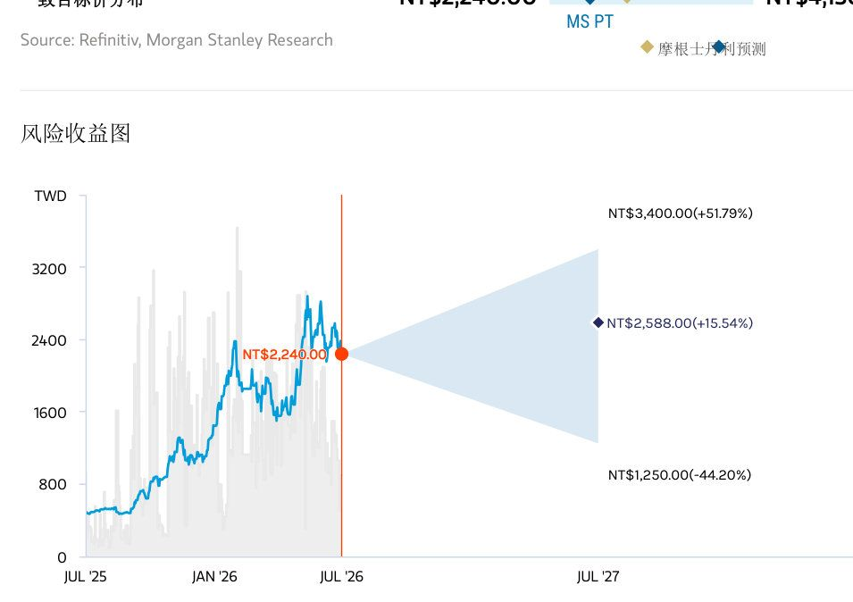

- 纵轴：TWD，0 / 800 / 1600 / 2400 / 3200
- 横轴：JUL '25、JAN '26、JUL '26、JUL '27
- 当前股价：NT$2,240.00
- 牛市：NT$3,400.00(+51.79%)
- 基准：NT$2,588.00(+15.54%)
- 熊市：NT$1,250.00(-44.20%)

Key: — 历史股价　当前股价（圆点）　◆ 目标价

Source: Refinitiv, Morgan Stanley Research

等权重理论：受AI驱动的存储需求正推动行业上行，但鉴于NAND供应受限、FIFO驱动利润率正常化以及消费级SSD需求疲软，我们认为模组供应商的上行空间有限。

NAND价格上涨。▪ 尽管eSSD和AI相关存储为Phison和Longsys等亚洲模块供应商代表有意义的增长机会，但我们认为其规模仍然不足以抵消更广泛

倾向于优先考虑他们的其他客户。

消费级SSD的弱点。▪ 我们看到执行层面的风险，因为原始NAND供应商正寻求进一步削减对模块厂家的支持 [OCR_UNREADABLE]，而行业平均出货量同比将下降-40%，这可能会带来风险。

群联

### 共识评级分布

| | |
|---|---|
| 93% 超重 | ████████████████ |
| 7% 等权重 | ██ |
| 体重过轻 0% | （空） |

● MS评级

Source: Refinitiv, Morgan Stanley Research

## 风险收益主题

世俗增长：风险回报主题的积极观点描述　here

## 牛市　NT$3,400.00

26x 2027e 股东权益收益率市场增长加速：1) 2026年收入同比增长50%。

不断增长的SSD需求与有限的供应增长提示NAND闪存短缺；SSD预计在2024年至2028年期间，将以年复合增长率（CAGR）>40%的速度增长；2) 毛利率将在2026年从...上升至90%。2025年将达到34%；3）显示控制器IC收入

## 基准情景　NT$2,588.00

19x 2027e 每股收益

2026年对NAND模块来说是好年景，但我们怀疑它无法持续到2027年：1) 收入增长年复合增长率为27%，得益于价格上涨；3) 2026年，闪存模块收入中闪存控制器IC收入增长24%。

59.7% in 2026 from 33.4% in 2023 from the rises 355% Y/Y in 2026 vs. -20% in 2027; 4)

## 案例　NT$1,250.00

9x 2027e 每股收益

美光不外包，SSD市场增长缓慢，NAND闪存价格跌幅大于基准情景：1）2024-2028年营收年复合增长率（CAGR）低于10%；2）毛利率面临更显著下滑，到2026年将低于40%（2023年为33.4%）；3）闪存控制器IC收入2026年同比增长10%。

---

<!-- 原文第 29 页 -->

# 风险收益 – 磐合电子股份有限公司（8299.HK）

## 关键收益输入项

| 司机 | 2025年12月 | 2026年12月e | 2027年12月e | 2028年12月e |
|---|---|---|---|---|
| 闪存模块收入同比（%） | 22.0 | 354.9 | (19.8) | (28.1) |
| 闪存控制器IC收入同比(%) | 44.7 | 23.9 | (29.1) | (3.1) |
| 闪存模块毛利率(%) | 33.5 | 60.6 | 43.3 | 39.1 |
| 闪存控制器IC毛利率（%） | 43.9 | 45.3 | 43.3 | 43.3 |

## 投资驱动因素

- NAND闪存价格上涨
- 关键OEM采用解决方案 [OCR_UNREADABLE]
- SSD渗透率提高

## 全球收入敞口

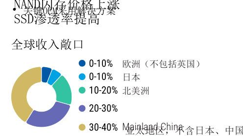

- 0-10%　欧洲（不包括英国）
- 0-10%　日本
- 10-20%　北美洲
- 20-30%　[OCR_UNREADABLE]
- 30-40%　Mainland China

亚太地区，不含日本、中国大陆和印度

Source: Morgan Stanley Research Estimate

区域层级解释　here

## 阿尔法模型

**1/5 MOST**　三个月地平线

Source: Refinitiv, FactSet, Morgan Stanley Research; 1 is 最受青睐的五分位是第一分位，而第五分位则最不受青睐。五分位数

## 所有权定位

机构所有者，活跃比例 57.9%

Source: Refinitiv, Morgan Stanley Research

## PT/RATING风险

向上风险

- 预期外高速eMMC控制器IC
- 外包率更快SSD市场增长
- 市场份额在超薄本和固态硬盘上获得增长

下行风险

- NAND需求低于预期
- Non-acceptance of price hikes on NAND 模块
- 对全球NAND供应的影响趋缓

## 微软估算值与市场共识

2027年12月财政年度预期

| | 摩根士丹利 | 共识区间低 | 共识区间高 | 共识均值 |
|---|---|---|---|---|
| 销售 / 收入 (NT$, mn) | 208,459 | 160,367 | 376,572 | 260,423 |
| 息税折旧摊销前利润 (NT$, mn) | 32,761 | 21,276 | 105,424 | 47,811 |
| 净利润 (NT$, mn) | 29,229 | 19,854 | 85,046 | 45,924 |
| EPS (NT$) | 132.63 | 95.37 | 390.48 | 209.55 |

◆ 摩根士丹利预测

Source: Refinitiv, Morgan Stanley Research

---

<!-- 原文第 30 页 -->

# 普林斯恩 M：财务摘要

## 利润表

新台币 mn（年底12月）

| | 2024 | 2025E | 2026E | 2027E | 2028E |
|---|---|---|---|---|---|
| 净销售额 | 58,936 | 72,664 | 260,963 | 208,459 | 154,119 |
| COGS | (39,837) | (47,806) | (105,129) | (118,062) | (93,219) |
| 毛利润 | 19,099 | 24,858 | 155,833 | 90,396 | 60,900 |
| 运营费用 | (15,566) | (16,591) | (69,869) | (57,705) | (48,823) |
| **营业收入** | **3,533** | **8,266** | **85,965** | **32,691** | **12,077** |
| 非经营收入 | 6,216 | 1,939 | 4,950 | 2,955 | 2,955 |
| 税前收入 | 9,749 | 10,206 | 90,915 | 35,646 | 15,031 |
| 所得税 | 1,795 | 1,465 | 15,866 | 6,416 | 2,706 |
| **报告净利润** | **7,954** | **8,741** | **75,049** | **29,229** | **12,326** |
| adj. wtd. avg. shrs (m) | 204 | 207 | 221 | 221 | 221 |
| **报告每股收益（新台币）** | **35.68** | **39.70** | **340.55** | **132.63** | **55.93** |

## 现金流量表

新台币 mn（年底12月）

| | 2024 | 2025E | 2026E | 2027E | 2028E |
|---|---|---|---|---|---|
| **经营活动产生的现金流** | **2,094** | **1,598** | **66,200** | **33,810** | **23,139** |
| 净利润 | 7,955 | 8,743 | 75,050 | 29,229 | 12,326 |
| 折旧 | 695 | 755 | 70 | 70 | 70 |
| 营运资金变动 | (3,895) | (9,886) | (8,920) | 4,510 | 10,743 |
| 其他调整 | (2,661) | 1,986 | 0 | 0 | 0 |
| **投资活动产生的现金流量** | **3,903** | **(1,908)** | **(170)** | **(170)** | **(170)** |
| 资本性支出 | (955) | (1,397) | (170) | (170) | (170) |
| 长期投资变更 | (705) | (529) | 0 | 0 | 0 |
| 变更ST投资 | (53) | (402) | 0 | 0 | 0 |
| 其他调整 | 5,616 | 420 | 0 | 0 | 0 |
| **融资现金流** | **(673)** | **(3,109)** | **(4,468)** | **(38,329)** | **(14,928)** |
| 长期债务增加 | 5,681 | (5,701) | 0 | 0 | 0 |
| S/T债务增加 | 41 | (41) | 0 | 0 | 0 |
| 现金股利支付 | (2,661) | (5,172) | (4,468) | (38,329) | (14,928) |
| 佣金和奖金已支付 | 0 | 0 | 0 | 0 | 0 |
| 股票发行 | 0 | 0 | 0 | 0 | 0 |
| 其他调整 | (3,733) | 7,806 | 0 | 0 | 0 |
| 汇率调整 | 437 | (288) | 0 | 0 | 0 |
| **Net change in cash** | **5,762** | **-3,707** | **61,562** | **-4,689** | **8,041** |

## 资产负债表

新台币 mn（年底12月）

| | 2024 | 2025E | 2026E | 2027E | 2028E |
|---|---|---|---|---|---|
| Cash | 19,982 | 16,275 | 77,837 | 73,148 | 81,190 |
| 市凯证券 | 784 | 1,475 | 1,475 | 1,475 | 1,475 |
| AR/NR | 8,011 | 13,689 | 32,634 | 26,068 | 19,273 |
| 库存 | 24,614 | 35,609 | 29,945 | 33,629 | 26,553 |
| 其他 | 649 | 1,432 | 1,432 | 1,432 | 1,432 |
| **流动资产** | **54,041** | **68,480** | **143,322** | **135,752** | **129,922** |
| 长期投资 | 651 | 1,171 | 1,171 | 1,171 | 1,171 |
| 固定资产 | 3,783 | 3,883 | 3,983 | 4,083 | 4,183 |
| 递延资产 | 701 | 629 | 629 | 629 | 629 |
| 其他资产 | 10,164 | 11,593 | 11,593 | 11,593 | 11,593 |
| **总资产** | **69,339** | **85,756** | **160,698** | **153,228** | **147,497** |
| S/T借用 | 41 | 0 | 0 | 0 | 0 |
| **AP/NP** | **1,309** | **8,878** | **13,239** | **14,867** | **11,739** |
| 其他ST负债 | 12,870 | 16,417 | 16,417 | 16,417 | 16,417 |
| 长期债务 | 6,054 | 352 | 352 | 352 | 352 |
| 其他长期负债 | 0 | 0 | 0 | 0 | 0 |
| 普通股 | 2,058 | 2,180 | 2,180 | 2,180 | 2,180 |
| **总负债** | **20,273** | **25,648** | **30,008** | **31,637** | **28,508** |
| 额外资本 | 13,054 | 19,104 | 19,104 | 19,104 | 19,104 |
| 留存收益 | 34,283 | 39,151 | 109,734 | 100,634 | 98,032 |
| 其他股东权益 | (329) | (327) | (327) | (327) | (327) |
| **总权益** | **49,066** | **60,108** | **130,690** | **121,591** | **118,989** |
| **总负债及股东权益** | **69,339** | **85,756** | **160,698** | **153,228** | **147,497** |

E = 摩根士丹利研究预测数据来源：摩根士丹利研究，公司数据

## 财务比率

| | 2024 | 2025E | 2026E | 2027E | 2028E |
|---|---|---|---|---|---|
| **Growth(%)** | | | | | |
| Turnover | 22.2 | 23.3 | 259.1 | -20.1 | -26.1 |
| Operating profits | -2.5 | 134.0 | 939.9 | -62.0 | -63.1 |
| Pretax profits | 137.8 | 4.7 | 790.8 | -60.8 | -57.8 |
| Net profits | 119.5 | 9.9 | 758.6 | -61.1 | -57.8 |
| EPS | 102.4 | 11.3 | 757.9 | -61.1 | -57.8 |
| **边距 (%)** | | | | | |
| Gross Margin | 32.4 | 34.2 | 59.7 | 43.4 | 39.5 |
| Operating Margin | 6.0 | 11.4 | 32.9 | 15.7 | 7.8 |
| Pretax Margin | 16.5 | 14.0 | 34.8 | 17.1 | 9.8 |
| Net Profit | 13.5 | 12.0 | 28.8 | 14.0 | 8.0 |
| **返回值（%）** | | | | | |
| ROAE | 17.3 | 16.0 | 78.7 | 23.2 | 10.2 |
| ROAA | 11.8 | 11.3 | 60.9 | 18.6 | 8.2 |
| **齿比 (%)** | | | | | |
| 净债务/权益 | (28.3) | (26.5) | (59.3) | (59.9) | (67.9) |
| Liabilities/Equity | 41.3 | 42.7 | 23.0 | 26.0 | 24.0 |
| **比率 (X)** | | | | | |
| 流动比率 | 3.8 | 2.7 | 4.8 | 4.3 | 4.6 |
| 速动比率 | 2.0 | 1.2 | 3.7 | 3.2 | 3.6 |
| **他人** | | | | | |
| AR/NR 资金周转天数 | 46 | 46 | 46 | 46 | 46 |
| 存货周转天数 | 104 | 104 | 104 | 104 | 104 |
| 应收账款周转天数 | 46 | 46 | 46 | 46 | 46 |
| 现金转换周期（天） | 104 | 104 | 104 | 104 | 104 |

---

<!-- 原文第 31 页 -->

# M 风险收益参考链接

1. 查看期权概率方法的解释 - Options_Probabilities_Exhibit_Link.pdf
2. 查看风险回报主题的描述 - RR_Themes_Exhibit_Link.pdf
3. 查看区域层级说明 GEG_Exhibit_Link.pdf
4. 查看主题/曝光方法的说明 ESG_Sustainable_Solutions_External_Link.pdf
5. 查看HERS方法论的说明 ESG_HERS_External_Link.pdf

---

<!-- 原文第 32 页 -->

# 披露部分

The information and opinions in Morgan Stanley Research were prepared or are disseminated by Morgan Stanley & Co. LLC and/or Morgan Stanley C.T.V.M. S.A. and/or Morgan Stanley México, Casa de Bolsa, S.A. de C.V. and/or Morgan Stanley Canada Limited and/or Morgan Stanley & Co. International plc and/or Morgan Stanley Europe S.E. and/or RMB Morgan Stanley Proprietary Limited and/or Morgan Stanley MUFG Securities Co., Ltd. and/or Morgan Stanley Capital Group Japan Co., Ltd. and/or Morgan Stanley Asia Limited and/or Morgan Stanley Asia (Singapore) Pte. (Registration number 199206298Z) and/or Morgan Stanley Asia (Singapore) Securities Pte Ltd (Registration number 200008434H), regulated by the Monetary Authority of Singapore (which accepts legal responsibility for its contents and should be contacted with respect to any matters arising from, or in connection with, Morgan Stanley Research) and/or Morgan Stanley Taiwan Limited and/or Morgan Stanley & Co International plc, Seoul Branch, and/or Morgan Stanley Australia Limited (A.B.N. 67 003 734 576, holder of Australian financial services license No. 233742, which accepts responsibility for its contents), and/or Morgan Stanley Wealth Management Australia Pty Ltd (A.B.N. 19 009 145 555, holder of Australian financial services license No. 240813, which accepts responsibility for its contents), and/or Morgan Stanley India Company Private Limited having Corporate Identification No (CIN) U22990MH1998PTC115305, regulated by the Securities and Exchange Board of India ("SEBI") and holder of licenses as a Research Analyst (SEBI Registration No. INH000001105), Stock Broker (SEBI Stock Broker Registration No. INZ000244438), Merchant Banker (SEBI Registration No. INM000011203), and depository participant with National Securities Depository Limited (SEBI Registration No. IN-DP-NSDL-567-2021) having registered office at Altimus, Level 39 & 40, Pandurang Budhkar Marg, Worli, Mumbai 400018, India; Telephone no. +91-22-61181000; Compliance Officer Details: Mr. Tejarshi Hardas, Tel. No.: +91-22-61181000 or Email: tejarshi.hardas@morganstanley.com; Grievance officer details: Mr. Tejarshi Hardas, Tel. No.: +91-22-61181000 or Email: msic-compliance@morganstanley.com which accepts the responsibility for its contents and should be contacted with respect to any matters arising from, or in connection with, Morgan Stanley Research, and their affiliates (collectively, "Morgan Stanley"). Morgan Stanley India Company Private Limited (MSICPL) may use AI tools in providing research services. All recommendations contained

此处由具备相应资质的研究分析师制作。 关于本报告中涉及公司的重大披露、股价图表及股票评级历史，请访问摩根士丹利研究披露网站 www.morganstanley.com/eqr/disclosures/webapp/generalresearch，或联系您的投资代表或摩根士丹利研究，地址为1585百老汇大道，（收件人：研究）

管理层），纽约，纽约州，10036，美国。 有关本研究报告中所提及的任何建议、评级或目标价格的估值方法和相关风险，请联系客户支持团队，联系方式如下：美国/加拿大 +1 800 303-2495；香港 +852 2848-5999；拉丁美洲 +1 718 754-5444（美国）；伦敦 +44 (0)20-7425-8169；新加坡 +65 6834-6860；悉尼 +61 (0)2-9770-1505；东京 +81

(0)3-6836-9000。 或者您可以联系您的投资代表或摩根士丹利研究部门，地址为美国纽约市百老汇1585号（收件人：研究管理部），邮编10036。分析师认证

以下分析师特此证明，他们在此报告中关于所讨论公司的观点已准确表达，且他们未收到亦不会收到任何直接或间接报酬，以换取在此报告中表达具体建议或观点：查理·陈； 辛迪·黄；瑞安·金；肖恩·金；段柳；约瑟夫·摩尔；

叶芙妮·叶；尹丹尼尔，CFA；吉川和夫，CFA。

## 全球研究冲突管理政策

摩根士丹利研究已根据我们的利益冲突管理政策发布，该政策可在 www.morganstanley.com/institutional/research/conflictpolicies 查看。该政策的葡萄牙语版本可在 www.morganstanley.com.br 查看。

重要监管披露：相关公司分析师或策略师（或其家庭成员）持有如下证券（或相关衍生品）：刘岩 - 三星电子（普通股或优先股）。 截至2026年5月29日，摩根士丹利持有摩根士丹利研究覆盖的以下公司1%或以上的某类普通股权证券：华大基因股份有限公司、北京矽力杰半导体有限公司、艾斯欧派泰斯有限公司、铠侠控股有限公司、L&F株式会社、联诺工业股份有限公司、LG显示有限公司、LG伊诺特有限公司、美光科技国际有限公司、群联科技、群联科技。

电子株式会社，三星电机制造株式会社，闪迪公司，硅动力公司，SK海力士，SK Square株式会社， Winbond电子株式会社。 在过去12个月内，摩根士丹利管理或共同管理了KIOXIA Holdings、LG电子、三星电子、SK海力士、SK Square的证券公开募股（或144A发行）。

株式会社。 过去12个月内，摩根士丹利已从铠侠控股、LG电子、美光科技公司、三星电子获得投行业务的报酬。

SK海力士。 在未来三个月内，摩根士丹利预计将收到或意图从Ecopro BM、GigaDevice半导体北京有限公司、HD Hyundai Electric Ltd、铠侠控股、L&F株式会社、LG Display、LG电子、Macronix国际有限公司、美光科技、群联电子、三星电子、闪迪获得投资银行服务补偿。

公司：深圳市隆思电子有限公司、硅动力、SK海力士、SK Square株式会社、华邦电子股份有限公司。 在过去12个月内，摩根士丹利已从美光科技、三星电子、硅动力、华邦电子股份有限公司获得除投资银行服务之外的产品和服务补偿。

在过去12个月内，摩根士丹利已向或正向以下公司提供投资银行业务服务，或与以下公司存在投资银行业务客户关系：Ecopro BM、吉大芯半导体北京有限公司、HD Hyundai Electric Ltd、铠侠控股有限公司、L&F株式会社、LG显示、LG电子、麦克罗尼克斯国际有限公司、美光科技公司、群联电子股份有限公司、三星电子、闪迪公司、深圳朗新电子有限公司、硅动力、SK海力士、SK Square株式会社、华邦电子股份有限公司。在过去12个月内，摩根士丹利已向或正向以下公司提供非投资银行业务、证券相关服务，或过去曾达成提供服务协议或存在客户关系：美光科技公司、三星电子、硅动力、SK海力士、华邦电子股份有限公司。摩根士丹利&公司有限责任公司为硅动力的证券做市。

负责摩根士丹利研究准备工作的股票研究分析师或策略师，其报酬基于多种因素，包括研究质量、投资者客户反馈、选股、竞争因素、公司收入以及整体投资银行业务收入。 股票研究分析师或策略师的报酬与摩根士丹利进行投资银行业务或资本市场交易、特定交易台的盈利能力或收入无关。摩根士丹利及其附属机构从事与摩根士丹利研究涵盖的公司/工具相关的业务，包括做市、提供流动性、基金管理、商业银行业务、信贷发放、投资服务和投资银行业务。摩根士丹利以主经纪商身份向客户买卖摩根士丹利研究涵盖的公司证券/工具。摩根士丹利可能在该公司债务或本报告中讨论的工具中持有头寸。摩根士丹利可能作为主经纪商交易或进行主经纪商交易，涉及的债务证券（或相关衍生品）是债务研究报告中讨论的主题。上述某些披露也是为了遵守美国以外司法管辖区的适用法规。

---

<!-- 原文第 33 页 -->

摩根士丹利采用相对评级体系，使用如"增持"、"持股观望"、"未评级"或"减持"等术语（详见下文定义）。摩根士丹利不对我们覆盖的股票进行"买入"、"持有"或"卖出"的评级。"增持"、"持股观望"、"未评级"和"减持"并不等同于"买入"、"持有"和"卖出"。投资者应仔细阅读摩根士丹利研究中使用的所有评级定义。此外，由于摩根士丹利研究包含更完整的分析师观点信息，投资者应仔细阅读摩根士丹利研究的全部内容，而不仅从评级中推断信息。无论如何，评级（或研究）均不应被使用或依赖作为投资建议。投资者的决定

买卖股票应取决于个人情况（例如投资者现有的持股）以及其他考量因素。

# 全球股票评级分布（截至2026年6月30日）

下述股票评级适用于摩根士丹利的基本面股票研究，不适用于该机构发布的债券研究。为披露目的（根据FINRA要求），我们在我们的评级（增持、持股观望、未评级和减持）旁边列出了买入、持有和卖出这些类别标题。摩根士丹利不对我们覆盖的股票进行买入、持有或卖出的评级。增持、持股观望、未评级和减持并不等同于买入、持有和卖出，而是代表建议的相对权重（见下定义）。为满足监管要求，我们将我们最积极的股票评级——增持——与...相对应。
购买建议；我们将等权重（Equal-weight）和未评级（Not-Rated）归为持有（hold），将低配（Underweight）归为卖出（sell）建议。

| 股票评级类别 | 覆盖范围 数 | 覆盖范围 百分比 | 投行客户（IBC） 数 | 投行客户（IBC） 总百分比（IBC） | 评分百分比类别 | 其他材料投资服务客户（杂项） 数 | 其他材料投资服务客户（杂项） 总百分比 其他 MISC |
|---|---|---|---|---|---|---|---|
| Overweight/Buy | 1544 | 42% | 453 | 49% | 29% | 757 | 44% |
| Equal-weight/Hold | 1577 | 43% | 390 | 42% | 25% | 769 | 44% |
| Not-Rated/Hold | 3 | 0% | 1 | 0% | 33% | 1 | 0% |
| Underweight/Sell | 544 | 15% | 89 | 10% | 16% | 204 | 12% |
| 总计 | 3,668 |  | 933 |  |  | 1731 |  |

数据包括目前被评定等级的普通股和存托凭证。投资银行客户是指向摩根士丹利支付投资银行佣金的公司。

过去12个月。 由于小数点四舍五入，"占总额的%"列中提供的百分比可能无法完全加总为100%。分析师股票评级
超重（O或超）- 预计该股票的总回报将超过相关国家MSCI指数的总回报或分析师所在行业的平均总回报（或行业）

团队（的）覆盖范围，在未来12-18个月内，根据风险调整后的表现。 等权重（E或Equal）- 预计该股票的总回报率将在未来12-18个月内，与相关国家MSCI指数的总回报率或分析师行业（或行业团队）覆盖范围的平均总回报率一致，并基于风险调整后的表现。
未评级（NR）- 目前分析师对于该股票相对于相关国家MSCI指数的总回报，或其自身的平均总回报，尚无足够的信心。

未来12-18个月内，按风险调整后的行业（或行业团队）覆盖范围。 低配（U或Under）- 预计该股票的总回报率将低于相关国家MSCI指数的总回报率或分析师行业（或行业）的平均总回报率。

除非另有说明，摩根士丹利研究中包含的价格目标时间范围为12至18个月。 在此期间，需根据风险调整后的
基础，评估团队（的）覆盖范围。

分析师行业观点：有吸引力（A）：分析师预计其负责覆盖的行业范围内，未来12-18个月的表现将相对于相关的广泛市场基准具有吸引力，具体如下。

线性（I）：分析师预计其行业覆盖范围内的表现在未来12-18个月内将与相关广泛市场基准相符，具体如下。 谨慎（C）：分析师对其行业覆盖范围内的表现在未来12-18个月内与相关广泛市场基准相比持谨慎态度，具体如下。各地区的基准如下：北美 - 标普500；拉丁美洲 - 相关MSCI国家指数或MSCI拉丁美洲指数；欧洲 - MSCI欧洲；日本 - 东证指数；亚洲 - 相关MSCI国家指数或MSCI次区域指数或MSCI亚太区除日本指数。

## 股票价格、目标价及评级历史（参见评级定义）

---

<!-- 原文第 34 页 -->

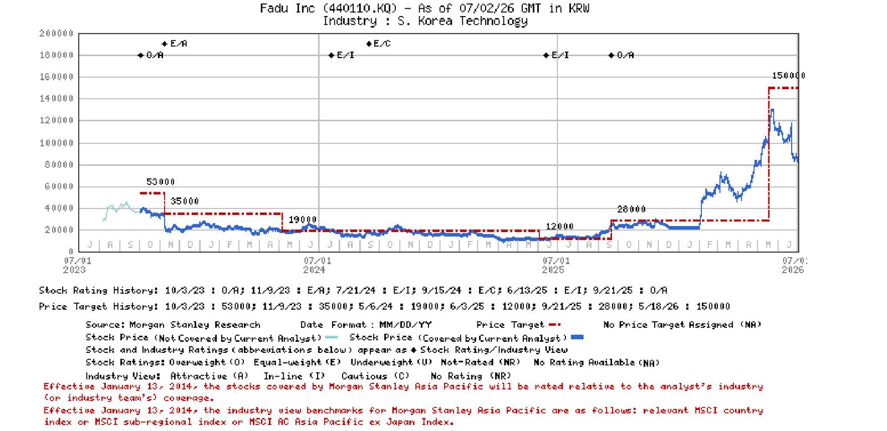

Fadu Inc (440110.KQ) - As of 07/02/26 GMT in KRW
Industry : S. Korea Technology

纵轴刻度：0、20000、40000、60000、80000、100000、120000、140000、160000、180000、200000（KRW）；横轴：07/01/2023 至 07/01/2026。
评级与行业观点标记（♦）：E/R（页面上方）、O/R、E/I、E/C、E/I、O/R。
价格目标标注（红色虚线）：53000、35000、19000、12000、28000、150000。

Stock Rating History: 10/3/23 : O/R; 11/9/23 : E/R; 7/21/24 : E/I; 9/15/24 : E/C; 6/13/25 : E/I; 9/21/25 : O/R

Price Target History: 10/3/23 : 53000; 11/9/23 : 35000; 5/6/24 : 19000; 6/3/25 : 12000; 9/21/25 : 28000; 5/18/26 : 150000

Source: Morgan Stanley Research    Date Format : MM/DD/YY    Price Target ■—    No Price Target Assigned (NA)
Stock Price (Not Covered by Current Analyst) —    Stock Price (Covered by Current Analyst) ■
Stock and Industry Ratings (abbreviations below) appear as ♦ Stock Rating/Industry View
Stock Ratings: Overweight (O)  Equal-weight (E)  Underweight (U)  Not-Rated (NR)  No Ratings Available (NA)
Industry View: Attractive (A)  In-line (I)  Cautions (C)  No Rating (NR)
Effective January 13, 2014, the stocks covered by Morgan Stanley Asia Pacific will be rated relative to the analyst's industry (or industry team's) coverage.
Effective January 13, 2014, the industry view benchmarks for Morgan Stanley Asia Pacific are as follows: relevant MSCI country index or MSCI sub-regional index or MSCI AC Asia Pacific ex Japan Index.

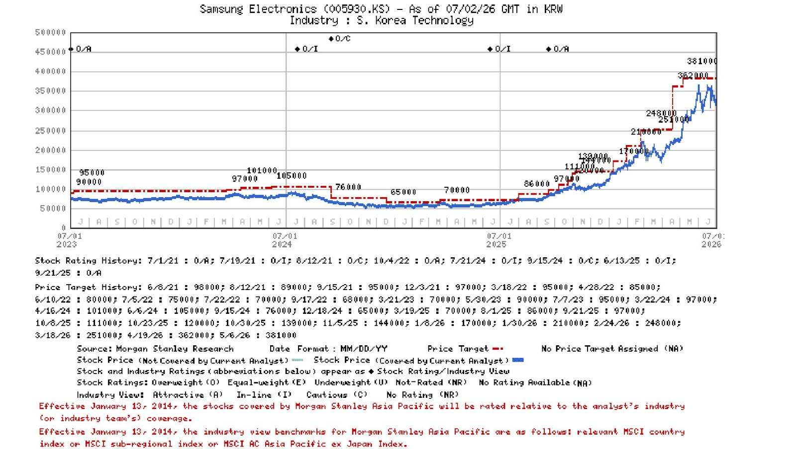

Samsung Electronics (005930.KS) - As of 07/02/26 GMT in KRW
Industry : S. Korea Technology

纵轴刻度：0、50000、100000、150000、200000、250000、300000、350000、400000、450000、500000（KRW）；横轴：07/01/2023 至 07/01/2026。
评级与行业观点标记（♦）：O/R、O/I、O/C、O/I、O/R。

Stock Rating History: 7/1/21 : O/R; 7/19/21 : O/I; 8/12/21 : O/C; 10/4/22 : O/R; 7/21/24 : O/I; 9/15/24 : O/C; 6/13/25 : O/I; 9/21/25 : O/R

Price Target History: 6/8/21 : 98000; 8/12/21 : 89000; 9/15/21 : 95000; 12/3/21 : 97000; 3/18/22 : 95000; 4/28/22 : 85000; 6/10/22 : 80000; 7/5/22 : 75000; 7/22/22 : 70000; 9/17/22 : 68000; 3/21/23 : 70000; 5/30/23 : 90000; 7/7/23 : 95000; 3/22/24 : 97000; 4/16/24 : 101000; 6/6/24 : 105000; 9/15/24 : 76000; 12/18/24 : 65000; 3/19/25 : 70000; 8/1/25 : 86000; 9/21/25 : 97000; 10/8/25 : 111000; 10/23/25 : 120000; 10/30/25 : 139000; 11/5/25 : 144000; 1/8/26 : 170000; 1/30/26 : 210000; 2/24/26 : 248000; 3/18/26 : 251000; 4/19/26 : 362000; 5/6/26 : 381000

Source: Morgan Stanley Research    Date Format : MM/DD/YY    Price Target ■—    No Price Target Assigned (NA)
Stock Price (Not Covered by Current Analyst) —    Stock Price (Covered by Current Analyst) ■
Stock and Industry Ratings (abbreviations below) appear as ♦ Stock Rating/Industry View
Stock Ratings: Overweight (O)  Equal-weight (E)  Underweight (U)  Not-Rated (NR)  No Ratings Available (NA)
Industry View: Attractive (A)  In-line (I)  Cautions (C)  No Rating (NR)
Effective January 13, 2014, the stocks covered by Morgan Stanley Asia Pacific will be rated relative to the analyst's industry (or industry team's) coverage.
Effective January 13, 2014, the industry view benchmarks for Morgan Stanley Asia Pacific are as follows: relevant MSCI country index or MSCI sub-regional index or MSCI AC Asia Pacific ex Japan Index.

---

<!-- 原文第 35 页 -->

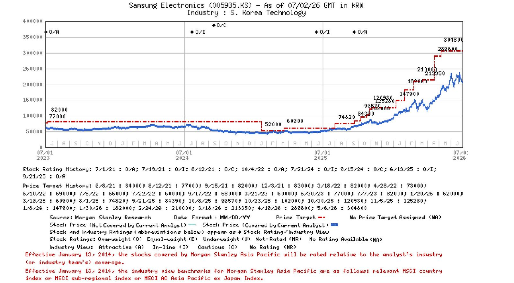

Samsung Electronics (005935.KS) - As of 07/02/26 GMT in KRW
Industry : S. Korea Technology

纵轴刻度：0、50000、100000、150000、200000、250000、300000、350000、400000（KRW）；横轴：07/01/2023 至 07/01/2026。
评级与行业观点标记（♦）：O/R、O/I、O/C、O/I、O/R。

Stock Rating History: 7/1/21 : O/R; 7/19/21 : O/I; 8/12/21 : O/C; 10/4/22 : O/R; 7/21/24 : O/I; 9/15/24 : O/C; 6/13/25 : O/I; 9/21/25 : O/R

Price Target History: 6/8/21 : 84000; 8/12/21 : 77000; 9/15/21 : 82000; 12/3/21 : 83000; 3/18/22 : 82000; 4/28/22 : 73000; 6/10/22 : 69000; 7/5/22 : 65000; 7/22/22 : 60000; 9/17/22 : 58000; 3/21/23 : 60000; 5/30/23 : 77000; 7/7/23 : 82000; 1/20/25 : 52000; 3/19/25 : 60900; 8/1/25 : 74820; 9/21/25 : 84390; 10/8/25 : 96570; 10/23/25 : 102000; 10/30/25 : 120930; 11/5/25 : 125280; 1/8/26 : 147900; 1/30/26 : 182000; 2/24/26 : 210000; 3/18/26 : 213350; 4/19/26 : 289600; 5/6/26 : 304800

Source: Morgan Stanley Research    Date Format : MM/DD/YY    Price Target ■—    No Price Target Assigned (NA)
Stock Price (Not Covered by Current Analyst) —    Stock Price (Covered by Current Analyst) ■
Stock and Industry Ratings (abbreviations below) appear as ♦ Stock Rating/Industry View
Stock Ratings: Overweight (O)  Equal-weight (E)  Underweight (U)  Not-Rated (NR)  No Ratings Available (NA)
Industry View: Attractive (A)  In-line (I)  Cautions (C)  No Rating (NR)
Effective January 13, 2014, the stocks covered by Morgan Stanley Asia Pacific will be rated relative to the analyst's industry (or industry team's) coverage.
Effective January 13, 2014, the industry view benchmarks for Morgan Stanley Asia Pacific are as follows: relevant MSCI country index or MSCI sub-regional index or MSCI AC Asia Pacific ex Japan Index.

---

<!-- 原文第 36 页 -->

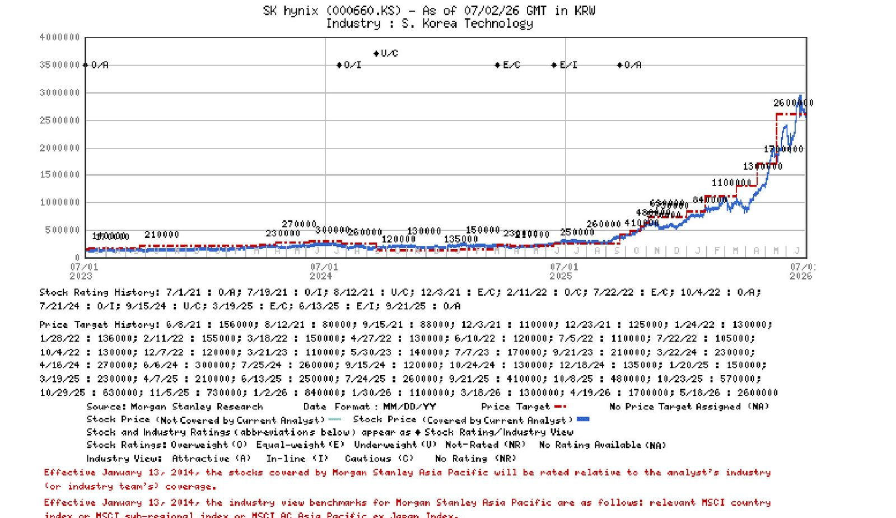

SK hynix (000660.KS) - As of 07/02/26 GMT in KRW
Industry : S. Korea Technology

纵轴刻度：0、500000、1000000、1500000、2000000、2500000、3000000、3500000、4000000（KRW）；横轴：07/01/2023 至 07/01/2026。
评级与行业观点标记（♦）：O/R、O/I、U/C、E/C、E/I、O/R。

Stock Rating History: 7/1/21 : O/R; 7/19/21 : O/I; 8/12/21 : U/C; 12/3/21 : E/C; 2/11/22 : O/C; 7/22/22 : E/C; 10/4/22 : O/R; 7/21/24 : O/I; 9/15/24 : U/C; 3/19/25 : E/C; 6/13/25 : E/I; 9/21/25 : O/R

Price Target History: 6/8/21 : 156000; 8/12/21 : 80000; 9/15/21 : 88000; 12/3/21 : 110000; 12/23/21 : 125000; 1/24/22 : 130000; 1/28/22 : 136000; 2/11/22 : 155000; 3/18/22 : 150000; 4/27/22 : 130000; 6/10/22 : 120000; 7/5/22 : 110000; 7/22/22 : 105000; 10/4/22 : 130000; 12/7/22 : 120000; 3/21/23 : 110000; 5/30/23 : 140000; 7/7/23 : 170000; 9/21/23 : 210000; 3/22/24 : 230000; 4/16/24 : 270000; 6/6/24 : 300000; 7/25/24 : 260000; 9/15/24 : 120000; 10/24/24 : 130000; 12/18/24 : 135000; 1/20/25 : 150000; 3/19/25 : 230000; 4/7/25 : 210000; 6/13/25 : 250000; 7/24/25 : 260000; 9/21/25 : 410000; 10/8/25 : 480000; 10/23/25 : 570000; 10/29/25 : 630000; 11/5/25 : 730000; 1/2/26 : 840000; 1/30/26 : 1100000; 3/18/26 : 1300000; 4/19/26 : 1700000; 5/18/26 : 2600000

Source: Morgan Stanley Research    Date Format : MM/DD/YY    Price Target ■—    No Price Target Assigned (NA)
Stock Price (Not Covered by Current Analyst) —    Stock Price (Covered by Current Analyst) ■
Stock and Industry Ratings (abbreviations below) appear as ♦ Stock Rating/Industry View
Stock Ratings: Overweight (O)  Equal-weight (E)  Underweight (U)  Not-Rated (NR)  No Ratings Available (NA)
Industry View: Attractive (A)  In-line (I)  Cautions (C)  No Rating (NR)
Effective January 13, 2014, the stocks covered by Morgan Stanley Asia Pacific will be rated relative to the analyst's industry (or industry team's) coverage.
Effective January 13, 2014, the industry view benchmarks for Morgan Stanley Asia Pacific are as follows: relevant MSCI country index or MSCI sub-regional index or MSCI AC Asia Pacific ex Japan Index.

# 摩根士丹利·史密斯·巴尼有限责任公司客户重要披露

有关可能合理预期会影响摩根士丹利史密斯巴尼有限公司选择第三方研究机构或第三方研究报告的主题公司的任何重大利益冲突的披露，可在摩根士丹利财富管理的披露网站 www.morganstanley.com/online/researchdisclosures 上获得。

摩根士丹利特定的披露信息，请参考 https://www.morganstanley.com/eqr/disclosures/webapp/generalresearch。每份摩根士丹利研究报告均代表摩根士丹利史密斯巴尼有限公司进行审阅和批准。该审阅和批准由同一人代表摩根士丹利审阅研究报告。这可能产生利益冲突。

## 其他重要披露

在研究完成前曾接触或可能接触过该研究的 Research 成员持有 Micron Technology Inc. 的证券（或相关衍生品）。此人并非研究分析师或研究分析师的家庭成员。

摩根士丹利研究政策规定，研究分析师和研究管理部门将根据发行人、行业或市场出现可能对报告内研究观点或意见产生重大影响的最新发展，随时更新研究报告。 此外，某些研究出版物将按固定周期（周度/月度/季度/年度）进行更新，并通常按该频率更新，除非研究分析师和研究管理部门根据当前情况认定需要采用不同的发布计划。

摩根士丹利并非担任市政顾问，此处所含意见或观点无意被视为，亦不构成《多德-弗兰克华尔街改革和消费者保护法》第975条意义上的建议。

摩根士丹利提供一种名为"战术观点"的股票研究产品。 "战术观点"中包含的对某只股票的看法可能与该股票其他研究中的建议或观点相悖。这可能是由于不同的时间范围、方法论、市场事件或其他因素造成的。如需获取某只股票的所有可用研究，请联系您的销售代表或访问 Matrix 网站 http://www.morganstanley.com/matrix。

摩根士丹利研究通过我们专属的研究平台Matrix提供给客户，同时摩根士丹利也以电子方式向客户分发。 部分而非全部摩根士丹利研究产品也会通过第三方供应商提供给客户，或以其他电子方式重新分发给客户，以提供便利。如需获取所有可用的摩根士丹利研究，请联系您的销售代表或访问Matrix网站http://www.morganstanley.com/matrix。

摩根士丹利研究资料的任何访问和/或使用均需遵守摩根士丹利使用条款（http://www.morganstanley.com/terms.html）。通过访问和/或使用摩根士丹利研究资料，您即表示您已阅读并同意受我们的使用条款（http://www.morganstanley.com/terms.html）的约束。此外，您同意摩根士丹利根据我们的隐私政策（http://www.morganstanley.com/privacy_pledge.html）和全球Cookie政策（http://www.morganstanley.com/privacy_pledge.html）处理您的个人数据和使用Cookie，包括用于设置您的偏好以及收集读者数据，以便我们为您提供更优质和个性化的服务与产品。欲了解更多关于摩根士丹利如何处理个人数据、我们如何使用Cookie以及如何拒绝Cookie的信息，请参阅我们的隐私政策（http://www.morganstanley.com/privacy_pledge.html）和全球Cookie政策（http://www.morganstanley.com/privacy_pledge.html）。请使用

---

<!-- 原文第 37 页 -->

请点击提供的链接审阅摩根士丹利印度公司私人有限公司（Morgan Stanley India Company Private Limited）的条款和条件以及最重要的条款和条件（https://www.morganstanley.com/assets/pdfs/about-us-global-offices/india/Terms_and_conditions.pdf），并点击以下链接审阅审计报告（https://ny.matrix.ms.com/eqr/research/webapp/researchdocs/）

MSICPL_摩根士丹利_研究_审计报告. pdf。如果您不同意我们的使用条款和/或您不愿授权摩根士丹利处理您的个人数据或使用Cookie，请勿访问我们的研究。摩根士丹利研究不提供个性化投资建议。摩根士丹利研究是在不考虑接收者具体情况和目标的情况下编制的。摩根士丹利建议投资者独立评估特定投资和策略，并鼓励投资者寻求财务顾问的建议。一项投资或策略的适当性将取决于投资者的具体情况和目标。摩根士丹利研究中讨论的证券、工具或策略可能不适合所有投资者，某些投资者可能无权购买或参与其中部分或全部。摩根士丹利研究不是购买或出售任何证券/工具的要约，也不是参与任何特定交易策略的邀请。您的投资价值和收入可能会因利率、汇率、违约率、提前偿付率、证券/工具价格、市场指数、公司运营或财务状况或其他因素的变化而变化。在证券/工具交易中行使期权或其他权利可能有时间限制。过去的表现不一定能预示未来的表现。对未来表现的预测基于可能无法实现的假设。如提供，且除非另有说明，封面上的收盘价是指相关主体的主要交易所价格。

公司证券/工具。负责准备摩根士丹利研究的固定收益研究分析师、策略师或经济学家，其薪酬基于多种因素，包括研究的质量、准确性和价值、公司盈利能力或收入（其中包含固定收益交易和资本市场盈利能力或收入）、客户反馈和竞争因素。固定收益研究分析师、策略师或经济学家的薪酬与摩根士丹利或其进行的投资银行或资本市场交易无关。

特定交易台的盈利能力或收入。 摩根士丹利研究中的"关于标的公司的重大监管披露"部分列出了所有被提及的公司，其中摩根士丹利持有该公司1%或更多的普通股证券类别。对于摩根士丹利研究中提到的其他所有公司，摩根士丹利可能在这些公司的证券/工具或证券/工具的衍生品中拥有低于1%的投资，并且可能以与摩根士丹利研究中所讨论的不同方式进行交易。摩根士丹利未参与摩根士丹利研究准备的员工可能投资于所提及公司的证券/工具或证券/工具的衍生品，并且可能以不同的方式交易。

源自摩根士丹利研究部分。 衍生品可由摩根士丹利或其关联人士发行。除摩根士丹利相关信息外，摩根士丹利研究基于公开信息。摩根士丹利已尽最大努力使用可靠、全面的信息，但我们不保证其准确性或完整性。除我们打算停止对某公司进行股票研究覆盖外，我们无义务告知您摩根士丹利研究中的观点或信息何时发生变化。摩根士丹利研究中呈现的事实和观点未经审查，可能不反映信息

已知，其他摩根士丹利业务领域的专业人员，包括投资银行人员。 摩根士丹利研究部门人员可以参加公司活动，如实地考察，但通常禁止公司报销其相关费用，除非

经研究管理部门授权成员预先批准

摩根士丹利可能做出与本报告中的建议或观点不一致的投资决策。 针对基于台湾地区或交易台湾证券/工具的读者：交易于台湾地区的证券/工具信息由摩根士丹利台湾有限公司（"MSTL"）提供。该等信息仅供参考。读者应独立评估投资风险，并对其投资决策负全部责任。未经摩根士丹利事先书面同意，摩根士丹利研究可能不得向公众媒体分发、或被公众媒体引用或使用。根据台湾证券交易所建议法规第7-1条的规定，任何非客户读者在获取和/或接收摩根士丹利研究的情况下，不得向任何第三方（包括但不限于关联方、关联公司及任何其他第三方）提供摩根士丹利研究，或从事任何可能产生或看似可能产生利益冲突的与摩根士丹利研究相关的活动。不交易于台湾地区的证券/工具信息仅用于信息目的，不构成建议。

或为交易此类证券/工具的招揽。 MSTL可能不会为客户执行此类证券/工具的交易。摩根士丹利研究中的某些信息由摩根士丹利亚洲有限公司上海代表处员工为摩根士丹利亚洲有限公司的使用而获取。摩根士丹利未根据中国法律注册成立，与此报告相关的研究在中国境外进行。摩根士丹利研究不构成向中国出售任何证券的要约或招揽购买任何证券的要约。中国投资者应具备投资此类证券的相关资格，并应自行负责从相关政府部门获取所有相关批准、许可证、核实和/或注册。本报告或其任何部分均不旨在构成，也不应被视为根据中国法律定义的任何证券投资咨询服务。此信息仅供参考。

Morgan Stanley Research is disseminated in Brazil by Morgan Stanley C.T.V.M. S.A. located at Av. Brigadeiro Faria Lima, 3600, 6th floor, São Paulo - SP, Brazil; and is regulated by the Comissão de Valores Mobiliários; in Mexico by Morgan Stanley México, Casa de Bolsa, S.A. de C.V which is regulated by Comision Nacional Bancaria y de Valores. Paseo de los Tamarindos 90, Torre 1, Col. Bosques de las Lomas Floor 29, 05120 Mexico City; in Japan by Morgan Stanley MUFG Securities Co., Ltd. and, for Commodities related research reports only, Morgan Stanley Capital Group Japan Co., Ltd; in Hong Kong by Morgan Stanley Asia Limited (which accepts responsibility for its contents) and by Morgan Stanley Bank Asia Limited; in Singapore by Morgan Stanley Asia (Singapore) Pte. (Registration number 199206298Z) and/or Morgan Stanley Asia (Singapore) Securities Pte Ltd (Registration number 200008434H), regulated by the Monetary Authority of Singapore (which accepts legal responsibility for its contents and should be contacted with respect to any matters arising from, or in connection with, Morgan Stanley Research) and by Morgan Stanley Bank Asia Limited, Singapore Branch (Registration number T14FC0118J); in Australia to "wholesale clients" within the meaning of the Australian Corporations Act by Morgan Stanley Australia Limited A.B.N. 67 003 734 576, holder of Australian financial services license No. 233742, which accepts responsibility for its contents; in Australia to "wholesale clients" and "retail clients" within the meaning of the Australian Corporations Act by Morgan Stanley Wealth Management Australia Pty Ltd (A.B.N. 19 009 145 555, holder of Australian financial services license No. 240813, which accepts responsibility for its contents; in Korea by Morgan Stanley & Co International plc, Seoul Branch; in India by Morgan Stanley India Company Private Limited having Corporate Identification No (CIN) U22990MH1998PTC115305, regulated by the Securities and Exchange Board of India ("SEBI") and holder of licenses as a Research Analyst (SEBI Registration No. INH000001105); Stock Broker (SEBI Stock Broker Registration No. INZ000244438), Merchant Banker (SEBI Registration No. INM000011203), and depository participant with National Securities Depository Limited (SEBI Registration No. IN-DP-NSDL-567-2021) having registered office at Altimus, Level 39 & 40, Pandurang Budhkar Marg, Worli, Mumbai 400018, India; Telephone no. +91-22-61181000; Compliance Officer Details: Mr. Tejarshi Hardas, Tel. No.: +91-22-61181000 or Email: tejarshi.hardas@morganstanley.com; Grievance officer details: Mr. Tejarshi Hardas, Tel. No.: +91-22-61181000 or Email: msic-compliance@morganstanley.com. Morgan Stanley India Company Private Limited (MSICPL) may use AI tools in providing research services. All recommendations contained herein are made by the duly qualified research analysts; in Canada by Morgan Stanley Canada Limited; in Germany and the European Economic Area where required by Morgan Stanley Europe S.E., authorised and regulated by Bundesanstalt fuer Finanzdienstleistungsaufsicht (BaFin) under the reference number 149169; in the US by Morgan Stanley & Co. LLC, which accepts responsibility for its contents. Morgan Stanley & Co. International plc, authorized by the Prudential Regulation Authority and regulated by the Financial Conduct Authority and the Prudential Regulation Authority, disseminates in the UK research that it has prepared, and research which has been prepared by any of its affiliates, only to persons who (i) are investment professionals falling within Article 19(5) of the Financial Services and Markets Act 2000 (Financial Promotion) Order 2005 (as amended, the "Order"); (ii) are persons who are

---

<!-- 原文第 38 页 -->

符合本令第49(2)(a)至(d)条的高净值实体； 或(iii)可能依据2000年《金融服务与市场法》（修订版）第21条所述的进行投资活动之邀请或引诱，合法地被传达或促使传达给其的个人。RMB摩根士丹利私人有限公司是JSE有限公司和A2X（私营）有限公司的成员。RMB摩根士丹利私人有限公司是由摩根士丹利国际控股有限公司和RMB投资顾问（私人）有限公司共同拥有，而RMB投资顾问（私人）有限公司为FirstRand有限公司全资拥有的合资企业。摩根士丹利研究的信息由摩根士丹利沙特阿拉伯公司传播，该公司受资本

沙特阿拉伯王国市场管理局，仅面向 sophistication 投资者。 摩根士丹利研究中的信息由摩根士丹利国际公司（迪拜金融中心分行）提供，受迪拜金融服务管理局（DFSA）监管，或由摩根士丹利国际公司（阿布扎比金融市场分行）提供，受阿布扎比金融服务监管局（FSRA）监管，均仅面向 DFSA 或 FSRA 定义的专业客户。与此项研究相关的金融产品或金融服务，将仅提供给我们确认符合专业客户监管标准的客户。关于涵盖各行业的投资所提供的不同 MS 研究评级或建议的百分比分布情况，可供查阅。

根据您的销售代表的要求。 摩根士丹利研究中的信息由摩根士丹利国际有限公司（卡塔尔金融中心分行）提供，该机构受卡塔尔金融中心监管机构监管。

（QFCRA）该指引仅面向企业客户和市场交易对手，并非为QFCRA定义的零售客户提供。 根据土耳其资本市场委员会的要求，此处陈述的投资信息、意见及建议不属于投资咨询活动范畴。投资咨询服务由授权机构根据客户的风险和收益偏好独家提供。此处陈述的意见和推荐具有普遍性，可能不适合您的财务状况、风险和收益偏好。因此，仅凭此处信息做出投资决策可能无法带来

符合您期望的结果。 以下公司经营的国家通常受到美国财政部办公室管理或执行的综合制裁计划。

根据美国海外资产控制办公室（"OFAC"）以及其他国家和多国机构的规定：三星电子。 摩根士丹利研究中所包含的商标和服务商标为其各自所有者的财产。第三方数据提供者对其提供的数据的准确性、完整性或及时性不作任何保证或陈述，且对于与该数据相关的任何损害不承担责任。全球行业分类标准（GICS）是...

由MSCI和S&P开发，并为其独家财产。 未经摩根士丹利书面许可，不得转载、销售或再次分发摩根士丹利研究或其任何部分。摩根士丹利研究中引用的指标和追踪器不得被视为或视为Regulation EU 2016/1011或任何其他类似框架下的基准。在某些固定收益研究报告中所推荐或讨论的发行人和/或固定收益产品可能不会得到持续跟踪。因此，投资者应将此类固定收益研究报告视为提供独立分析，不应期望持续的分析或有关此类发行人和/或个别固定收益产品的额外报告。

摩根士丹利可能不时持有与研究报告所涉及公司相关的重大财务和商业利益。 SEBI的注册和全国证券市场研究所（NISM）的认证绝不保证中介机构的业绩，也不向投资者提供任何回报保证。证券投资受市场风险影响。投资前请仔细阅读所有相关文件。

## 行业覆盖：韩国科技

| 公司（股票代码） | 评分（截至） | PRICE* (07/02/2026) |
|---|---|---|
| **金润（Ryan Kim）** |  |  |
| Ecopro BM (247540.KQ) | U (03/20/2023) | W125,500 |
| Fadu Inc (440110.KQ) | O (09/21/2025) | W76,000 |
| 韩米半导体有限公司 (042700.KS) | O (08/16/2024) | W219,500 |
| 现代汽车集团 (267260.KS) | O (03/25/2025) | W969,000 |
| Isu Petasys Co. Ltd. (007660.KS) | O (02/03/2025) | W119,800 |
| L&F Co Ltd (066970.KS) | E (04/03/2025) | W106,700 |
| Leeno Industrial Inc. (058470.KQ) | O (04/03/2025) | W75,100 |
| 乐特能源材料股份有限公司 (020150.KS) | U (04/03/2025) | W39,200 |
| LS Electric (010120.KS) | O (01/22/2026) | W236,500 |
| POSCO FUTURE M (003670.KS) | U (04/03/2025) | W163,600 |
| SK IE Technology (361610.KS) | U (04/03/2025) | W16,030 |
| SK Square Co Ltd. (402340.KS) | O (05/06/2026) | W1,525,000 |
| Wonik IPS Co Ltd (240810.KQ) | O (08/08/2025) | W131,600 |
| **金肖恩** |  |  |
| LG Display (034220.KS) | E (06/11/2025) | W10,980 |
| LG Electronics (066570.KS) | E (04/07/2025) | W192,300 |
| LG Innotek (011070.KS) | E (03/12/2025) | W874,000 |
| 三星电机 (009150.KS) | O (07/31/2025) | W1,926,000 |
| Samsung Electronics (005935.KS) | O (11/18/2019) | W188,700 |
| Samsung Electronics (005930.KS) | O (11/18/2019) | W286,000 |
| SK hynix (000660.KS) | O (09/21/2025) | W2,187,000 |

股票评级可能会发生变化。 请参阅每家公司最新的研究报告。*历史价格未进行除权除息调整。

---

<!-- 原文第 39 页 -->

© 2026 摩根士丹利

---
