> 原文件：[M171_摩根士丹利_全球NAND行业展望：趋势分化_【英文】.pdf](https://github.com/jadennevercode/CJCC-Knowledge-Base/blob/5ec8511eb834073c8bfbd79c94af196282d483cf/materials/%E8%B7%A8%E9%93%BE%EF%BC%9A%E4%BE%9B%E9%9C%80%E4%B8%8E%E4%BB%B7%E6%A0%BC%E5%8F%A3%E5%BE%84/M171_%E6%91%A9%E6%A0%B9%E5%A3%AB%E4%B8%B9%E5%88%A9_%E5%85%A8%E7%90%83NAND%E8%A1%8C%E4%B8%9A%E5%B1%95%E6%9C%9B%EF%BC%9A%E8%B6%8B%E5%8A%BF%E5%88%86%E5%8C%96_%E3%80%90%E8%8B%B1%E6%96%87%E3%80%91.pdf)
> 转换方式：多模态逐页转录（页面图像 + 文本层交叉校验）

<!-- 原文第 1 页 -->

Morgan Stanley | RESEARCH

July 2, 2026 11:09 AM GMT

Global Technology

# NAND Industry Outlook: Diverging Trends

## What's Changed

| | From | To |
|---|---|---|
| Shenzhen Longsys Electronics Co Ltd (301308.SZ) — Price Target | Rmb300.00 | Rmb673.00 |
| Silicon Motion (SIMO.O) — Price Target | US$155.00 | US$400.00 |
| Phison Electronics Corp (8299.TWO) — Price Target | NT$2,248.00 | NT$2,588.00 |

AI continues to create shortages in the NAND industry into 2027, while supply and demand dynamics depend on supply discipline moving into 2028 and beyond. We still like suppliers for LTA downside protection and enhanced shareholder returns, and are starting to see consumer pricing plateau.

**What's changed?** We update our global NAND supply and demand forecast for 2026-27 and conducted a scenario test on greenfield expansion vs. AI demand growth for 2028. Our calculation shows significant shortages should persist into 2027. Moving into 2028, node migration and greenfield expansion may ease some supply tightness (-5% shortage if 60% YoY AI NAND growth with current base case capacity expansion), while in a bear case scenario where both China restrictions and supply discipline ease, there is potential risk of oversupply.

**Bifurcation – AI vs. consumer:** We see overall server demand remaining strong as LTAs have provided downside protections on pricing. On the consumer side, inventory levels have increased at module makers and distributors, and smartphone and PC customers are facing increasing pressure on the volume vs. margin trade-off. This is not new to the market, but we have begun to see actual order cuts after 2Q26 price hikes, indicating pricing for consumer products might hit a ceiling very soon while volume remains muted as suppliers shift capacity to AI.

**Stock implications:** We remain bullish on the memory cycle and continue to like supplier names with LTA supporting valuation expansion and shareholder returns. Tactically, we prefer DRAM over NAND due to better LTA terms, higher demand visibility, supply discipline capped by EUV and a potential HBM4E capacity squeeze. In NAND, we prefer suppliers over module makers, reflecting margin durability.

**Global perspective:** In DRAM, **Samsung Electronics** is Asia Tech team's Top Pick for its market leadership and potentially stronger shareholder returns. In NAND, **Kioxia** is our Japan Semi team's Top Pick for solid FCF generation and shareholder return potential while **Macronix** is our GC Semi team's Top Pick. We remain OW on **Micron, SK hynix** and **SanDisk** amid a durable memory cycle, as well as **Fadu**, a key eSSD controller supplier to SanDisk. We raise our **SIMO** PT to reflect the eSSD opportunity. We remain EW on **Longsys** and **Phison** on concerns around muted volume growth but raise our PTs on stronger pricing and margin assumptions.

## Analyst coverage

MORGAN STANLEY ASIA LIMITED+
**Duan Liu** — Equity Analyst
Duan.Liu@morganstanley.com — +852 2239-7357

MORGAN STANLEY & CO. INTERNATIONAL PLC+
**Shawn Kim** — Equity Analyst
Shawn.Kim@morganstanley.com — +44 20 7677-1018

**Cindy Huang** — Equity Analyst
Cindy.Huang@morganstanley.com — +44 20 7425-2915

MORGAN STANLEY TAIWAN LIMITED+
**Charlie Chan** — Equity Analyst
Charlie.Chan@morganstanley.com — +886 2 2730-1725

MORGAN STANLEY & CO. LLC
**Joseph Moore** — Equity Analyst
Joseph.Moore@morganstanley.com — +1 212 761-7516

MORGAN STANLEY MUFG SECURITIES CO., LTD.+
**Kazuo Yoshikawa, CFA** — Equity Analyst
Kazuo.Yoshikawa@morganstanleymufg.com — +81 3 6836-8408

MORGAN STANLEY TAIWAN LIMITED+
**Daniel Yen, CFA** — Equity Analyst
Daniel.Yen@morganstanley.com — +886 2 2730-2863

MORGAN STANLEY & CO. INTERNATIONAL PLC, SEOUL BRANCH+
**Ryan Kim** — Equity Analyst
Ryan.G.Kim@morganstanley.com — +82 2 399-4939

MORGAN STANLEY & CO. LLC
**Mason Wayne** — Research Associate
Mason.Wayne@morganstanley.com — +1 212 761-6012

MORGAN STANLEY TAIWAN LIMITED+
**Tiffany Yeh** — Equity Analyst
Tiffany.Yeh@morganstanley.com — +886 2 7712-3032

**S. KOREA TECHNOLOGY**
Asia Pacific
Industry View
**Attractive**

Morgan Stanley does and seeks to do business with companies covered in Morgan Stanley Research. As a result, investors should be aware that the firm may have a conflict of interest that could affect the objectivity of Morgan Stanley Research. Investors should consider Morgan Stanley Research as only a single factor in making their investment decision.

**For analyst certification and other important disclosures, refer to the Disclosure Section, located at the end of this report.**

*+ Analysts employed by non-U.S. affiliates are not registered with FINRA, may not be associated persons of the member and may not be subject to FINRA restrictions on communications with a subject company, public appearances and trading securities held by a research analyst account.

---

<!-- 原文第 2 页 -->

## Global Perspectives

### Sandisk/Micron

*Joseph Moore*

We remain OW on Sandisk and MU, as supply demand outcomes continue to look compelling for both NAND and DRAM. With AI now the principal driver of memory bits and little to no inventory across the supply, the biggest risk to memory stocks is a broader AI capex slowdown, which we do not expect to peak in the near term, supporting a path to higher earnings power well beyond 2027 (when consensus currently assumes pricing will begin to normalize). We expect continued upward revisions to estimates, and at <10x P/E for both SNDK and MU multiples should still have room to benefit from extended visibility. LTAs are part of what's enabling that higher level of visibility, and are symptomatic of a market that could should stay tight for another 2-3 years. Meanwhile, MU and Sandisk should continue to be attractive capital return stories, as we expect both to pursue meaningful buybacks in 2027.

### KIOXIA

*Kazuo Yoshikawa*

We maintain KIOXIA as our Top Pick within our Japan semiconductor coverage, reflecting solid FCF generation and shareholder return potential.

KIOXIA appears well positioned to capture AI-driven storage demand with a broad SSD lineup. The CM Series addresses high-throughput, low-latency KV cache needs for inference AI, while the GP Series targets Super High IOPS applications that can complement HBM. The LC Series supports large-scale AI storage demand with 245TB QLC SSDs, with mass-production shipments already underway.

On capital allocation, KIOXIA plans to use FCF for both growth investments and shareholder returns. We see scope for stronger returns, supported by expected annual FCF generation of ¥4.0-5.0trn in FY3/27-3/28 even under our conservative ASP assumptions, and management's indication that a substantial portion of excess accumulated FCF could potentially be returned to shareholders.

KIOXIA is also progressing LTA discussions, mainly with data center and enterprise customers. LTAs are expected to cover more than 50% of CY27 shipments, while CY28 coverage is likely to remain around 50% to preserve flexibility.

### Samsung Electronics/SK hynix

*Shawn Kim*

We maintain OW ratings for both Samsung Electronics (Top Pick) and SK hynix as key beneficiaries to AI compute and agentic AI trends (see Agentic AI – The Surge Begins). We estimate more than 20-30% DRAM price hikes in 3Q26, enough to keep the YoY rate of change accelerating. Pricing power is translating into earnings revisions that in turn support P/E stability, at 5.2x 2027e earnings.

However, we are mindful of the rate of change that still matters for memory stocks. With YoY pricing likely to plateau in 4Q26 vs. supply discipline visibility in 2028, we believe

---

<!-- 原文第 3 页 -->

stocks might lack near-term cyclical catalysts until supply and demand dynamics become more clear into 2028 and beyond. That said, multiples could continue to re-rate on the back of favorable LTAs.

### Longsys

*Duan Liu*

We have significantly raised our estimates for Longsys on better-than-expected pricing trends and high conviction levels on 2027 shortages. We expect Longsys's long-term margin profile to improve due to its better product mix. Its TCM business model will likely bring a more stable margin profile over the long term (25-35%) as inventory pressure is shifted to customers, and the company's in-house controller development could further increase the value add on firmware and customized services. We are slightly concerned about muted volume growth due to suppliers' shifting capacity to CSP customers, which should cap near-term volume growth, but this should be well understood by the market and already in the price.

### Phison

*Charlie Chan*

2Q26 preliminary results were a strong beat vs. estimates, driven by more resilient pricing hike intervals and shipments than expected. 3Q26 is expected to be the peak quarter of the year, supported by additional supply support from Kioxia's dummy die, which could drive around 20% QoQ revenue growth and a better-than-feared flat QoQ margin. However, this strength appears cyclical rather than sustainable; gross margin expansion is still expected to peak around 2Q26–3Q26 as low-cost NAND inventory is depleted and higher-cost supply begins to flow through under FIFO accounting. By 4Q26, emerging weakness in consumer tech and a more moderate pricing environment are expected to drive revenue down around 20% QoQ, with margins normalizing to roughly 50%. Although the better 2026 pricing environment supports stronger-than-expected profitability into 2027, this upside is partially offset by continued R&D investment and broader structural risks, including constrained NAND supply, weakening consumer SSD demand, limited raw NAND supplier support, modest eSSD revenue contribution of only around 10–20% for most Asia-based SSD vendors and hyperscalers' tendency to purchase directly from NAND fab owners or negotiate long-term supply agreements, which may limit the long-term addressable market for module vendors such as Phison.

### SIMO (PT increases to US$400 from US$155)

*Tiffany Yeh*

For FY2026, the company expects record revenue, sequential growth every quarter, margin expansion, and an improving mix. Some important incremental growth vectors are:
1) Boot drive storage, where SIMO is expanding from current DPU boot-drive shipments into broader next-gen AI GPU/CPU platform content, including DPU, Ethernet, and NVLink-related switch opportunities. We expect boot drive and other SSD solutions to account for 23%/26% of SIMO's 2026e/2027e total revenue, see more detailed analysis in AI Module: Boot Drive Bottom-up Updates section.
2) Enterprise SSD / MonTitan: SIMO's enterprise SSD business, MonTitan, has started production with two customers. The company expects to add five more Tier 1 CSPs by late

---

<!-- 原文第 4 页 -->

2026 and targets MonTitan to contribute 5–10% of expanded 2026 revenue on an exit run-rate basis. However, as we see SIMO continuing to make progress, we expect its eSSD (MonTitan) business to account for 5%/13%/19% of SIMO's total revenue in 2026e/2027e/2028e, as besides off-the-shelf eSSD controllers, we also see the possibility for SIMO to customize eSSD controllers for CSPs in the long run.
3) Although overall consumer demand remains lukewarm, we continue to see SIMO gaining market share in mobile, PC and edge AI products even into 2H26. As a result, we raise our price target to US$400 from US$155, implying 23x 2027e EPS, above its historical average of 20x since 2019. We view this as justifiable as SIMO is diversifying into more AI-exposed areas. Overall, we expect to see continual upward inflection in SIMO's enterprise/AI storage strategy, with 2026 the first meaningful ramp year and 2027-28 as the scaling phase.

### Fadu

*Ryan Kim*

We believe Fadu is gradually transitioning from a recovery story to a structurally scaling AI storage semiconductor story. Although the company remains relatively small in absolute revenue today, management commentary increasingly suggests the key uncertainty is shifting away from demand visibility and toward execution/ramp timing. Importantly, management now frames 2026 revenue of W300bn+ as effectively secured, supported by hyperscaler-related enterprise SSD controllers, while also guiding for meaningful operating leverage due to a controller-heavy mix and limited incremental SG&A. The broader debate is no longer whether hyperscaler exposure exists, but rather how far the company can penetrate AI-centric storage architectures over the next 3-5 years. The company believes it can eventually cover 3-4 of the top global hyperscalers through indirect and direct engagement models. If realized, this could materially expand both the revenue visibility and valuation frameworks vs. historical perceptions.

### Macronix, Winbond, GigaDevice

*Daniel Yen*

For SLC/MLC NAND, we have seen supply tightness for a while with mainstream vendors existing the market and only a handful of legacy players able to maintain or even increase capacity. In addition, we are now seeing demand upside. High-density SLC NAND can support datacenter eSSD as they have fast reading and writing speeds (link). In addition, given the MLC NAND shortfall, enterprise HDDs are likely shifting to high-density SLC NAND. Enterprise HDDs previously used MLC NAND for firmware, hot data and defect mapping. We believe strong pricing momentum will continue into 4Q, following 50–60% increases in 3Q.

We remain OW on Macronix (Top Pick; SLC/MLC NAND), Winbond (SLC NAND) and GigaDevice (SLC NAND).

---

<!-- 原文第 5 页 -->

Exhibit 1: Order of Preference

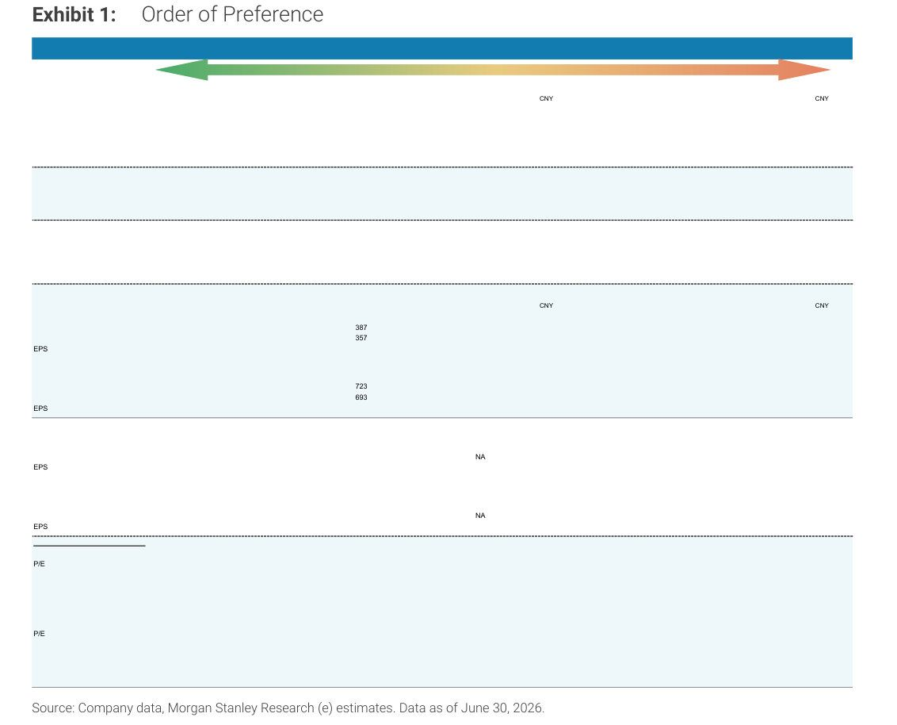

[TABLE_RECONSTRUCTION_UNCERTAIN]

Arrow graphic from left (green) to right (orange), with "CNY" labels at the left column, at the middle column and at the right column.

Company names and most cell values in this exhibit are blank in the source PDF; only the following row labels and values are present:

- EPS: 387 / 357
- EPS: 723 / 693
- EPS: NA
- EPS: NA
- P/E: (no value shown)
- P/E: (no value shown)

Source: Company data, Morgan Stanley Research (e) estimates. Data as of June 30, 2026.

---

<!-- 原文第 6 页 -->

## Global NAND Supply & Demand Model

In this note, we update our global NAND supply and demand model. Our calculations indicate that AI-related NAND demand will increase by 60% YoY, or a 9% demand-supply gap (supply shortage) in 2027.

- We rely on ASIC/GPGPU shipment data published by our Greater China Semiconductor team (AI Supply Chain: Preliminary 2027 TSMC CoWoS Allocation) as the basis for our AI NAND consumption calculation.
- In practice, CSP usually has 8-16TB eSSD per ASIC tray for the in-rack eSSD deployment, while the externally attached/CMS-like rack can have 16-64 TB eSSD per tray, depending on the application scenario. We group datalake-related demand into QLC usage, which is capped by supply allocation.
- For Nvidia NAND usage, we include CSP's extra attachment in practice (which is equivalent to 64TB per 4GPU compute node in total) when they deploy the BlackWell rack, while other assumptions follow the company's official configurations.
- For smartphone and PC NAND demand, we assume content will be flat while units decrease in line with our US hardware team's model. For enterprise's eSSD usage, we assume 10% growth YoY for both 2026 and 2027 due to AI adoption.
- For NAND supply estimates, we leverage our US SPE analyst Shane Brett's estimates for 2026-27. He sees 27% YoY bit growth in 2027 and early signs of NAND WFE acceleration emerging (see Raising our memory WFE forecasts (mainly DRAM). Our 2025 supply numbers also include excessive inventory across the supply chain carried from the last down cycle.

---

<!-- 原文第 7 页 -->

Exhibit 2: AI NAND demand

| | 2025 | 2026e | 2027e |
|---|---|---|---|
| **ASIC** | | | |
| AWS Trainium (k units) | 1,285 | 1,700 | 2,380 |
| ASIC per compute tray | 4 | 4 | 4 |
| AWS Tray # (k units) | 321 | 425 | 595 |
| eSSD per tray (TB) | 32 | 32 | 32 |
| *Total eSSD (EB)* | *10* | *14* | *19* |
| **Meta MTIA (k units)** | 50 | 150 | 550 |
| ASIC per compute tray | 4 | 4 | 4 |
| MTIA Tray # (k units) | 13 | 38 | 138 |
| eSSD per tray (TB) | 64 | 64 | 64 |
| *Total eSSD (EB)* | *1* | *2* | *9* |
| **Google TPU (k units)** | | 4,080 | 8,168 |
| TPU per compute tray | | 4 | 4 |
| Google Tray # (k units) | | 1,020 | 2,042 |
| eSSD per tray (TB) | | 16 | 16 |
| *Total eSSD (EB)* | | *16* | *33* |
| ***Total ASIC eSSD usage (EB)*** | ***11*** | ***32*** | ***61*** |
| **GPGPU** | | | |
| Nvidia (k units) | | | |
| B200/B300 | 5,819 | 5,460 | 560 |
| R200 | | 2,080 | 5,920 |
| R300 | | | 1,040 |
| *In-rack eSSD* | | | |
| GPU per compute tray | 4 | 4 | 4 |
| Total # of compute tray | 1,455 | 1,885 | 1,880 |
| eSSD per tray (TB) | 18 | 18 | 18 |
| **Total eSSD (EB)** | **26** | **34** | **34** |
| Blackwell extra (CSP deployment) per tray | 46 | 46 | 46 |
| **Total eSSD (EB)** | **67** | **63** | **6** |
| *STX CMS Context Memory Platform* | | | |
| # of NVL72 Rack | | 28,889 | 96,667 |
| # of CMS vs NVL72 Rack | | 0.125 | 0.125 |
| # of storage tray (unit) | | 16 | 16 |
| eSSD per tray (TB) | | 32 | 32 |
| **Total eSSD (EB)** | | **2** | **6** |
| **AMD (k units)** | | | |
| MI300/MI308 | 180 | 36 | - |
| MI325/350/375 | 540 | 84 | 288 |
| MI400 | | 650 | 1,920 |
| MI500 | | | 96 |
| GPU per compute tray | 4 | 4 | 4 |
| Total # of compute tray | 180 | 193 | 576 |
| eSSD per tray (TB) | 64 | 64 | 64 |
| **Total eSSD (EB)** | **12** | **12** | **37** |
| ***Total GPGPU eSSD usage (EB)*** | ***105*** | ***111*** | ***83*** |
| **CPU Rack** | | | |
| Vera CPU | | 1,030 | 2,270 |
| eSSD per CPU (TB) | | 8 | 8 |
| **Total eSSD (EB)** | | **8** | **18** |
| **Others** | | | |
| China CSP usage (EB) | 80 | 120 | 180 |
| QLC usage (EB) | - | 100 | 230 |
| CSP Inventory buffer % | 5% | 10% | 10% |
| ***Total AI NAND demand (EB)*** | ***205*** | ***400*** | ***609*** |

Source: Company data, Gartner, Morgan Stanley Research estimates

---

<!-- 原文第 8 页 -->

Exhibit 3: Global NAND supply and demand still point to shortage in 2027

| | 2025 | 2026e | 2027e |
|---|---|---|---|
| **Total AI NAND demand (EB)** | **205** | **400** | **609** |
| **Other Applications (EB)** | | | |
| non-AI SSD (general server, PC, enterprise etc) | 396 | 387 | 401 |
| PC SSD | 209 | 181 | 175 |
| Enterprise SSD (non-AI) | 187 | 206 | 226 |
| Smartphones | 337 | 291 | 301 |
| Tablets | 34 | 34 | 34 |
| Flash Cards | 15 | 15 | 15 |
| USB Flash Drives | 10 | 10 | 10 |
| Other | 113 | 113 | 113 |
| ***Total non-AI NAND demand (EB)*** | ***905*** | ***850*** | ***874*** |
| Total NAND demand (EB) | 1,111 | 1,250 | 1,484 |
| Total NAND supply (EB) | 1,128 | 1,058 | 1,347 |
| *Sufficiency Ratio (%)* | *2%* | *(15%)* | *(9%)* |
| *AI as % of NAND demand (EB)* | *18%* | *32%* | *41%* |

Source: Company data, Gartner, Morgan Stanley Research estimates

## 2028 Scenario Test

We think the biggest swing factor for 2028 and beyond could be related to YMTC. This Chinese NAND supplier currently has Fab4 and Fab5 under construction at the same time, with each having 100kwpm planned capacity. If they decide to dedicate all of that to NAND, with the announced five fabs, they could eventually take 24% market share in the global NAND industry (see Chipflation – Navigating A Memory Crisis).

In our base case scenario, we assume 5% YoY growth for non-AI NAND demand, and the rest of the supplier's capacity expansion to be the same as in our US Semiconductor team's forecast. We assume AI SSD demand will grow by another 30-60% YoY in 2028 vs. YMTC capacity ranging from 310kwpm (current base case) to 470kwpm (potential max capacity of all announced five fabs).

In conclusion, we still see NAND supply remaining tight into 2028 if AI capex continues to grow and YMTC keeps a more disciplined approach on expansion. However, if YMTC or other players accelerate greenfield expansion, there will likely be potential risks of oversupply.

---

<!-- 原文第 9 页 -->

Exhibit 4: YMTC capacity expansion vs. AI SSD growth scenario test

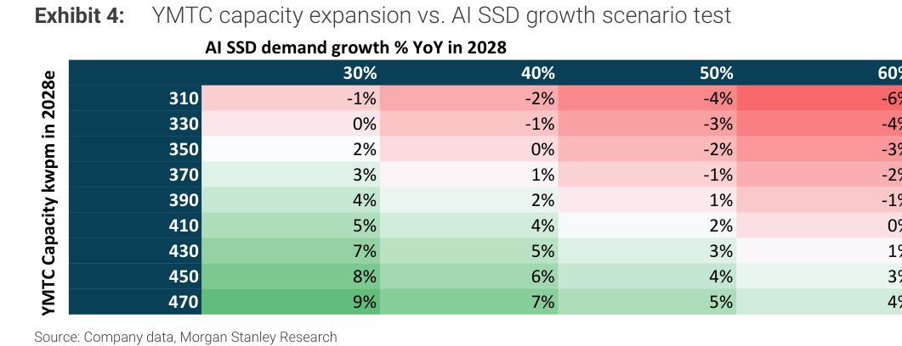

Column axis: AI SSD demand growth % YoY in 2028. Row axis: YMTC Capacity kwpm in 2028e.

| YMTC Capacity kwpm in 2028e | 30% | 40% | 50% | 60% |
|---|---|---|---|---|
| 310 | -1% | -2% | -4% | -6% |
| 330 | 0% | -1% | -3% | -4% |
| 350 | 2% | 0% | -2% | -3% |
| 370 | 3% | 1% | -1% | -2% |
| 390 | 4% | 2% | 1% | -1% |
| 410 | 5% | 4% | 2% | 0% |
| 430 | 7% | 5% | 3% | 1% |
| 450 | 8% | 6% | 4% | 3% |
| 470 | 9% | 7% | 5% | 4% |

Source: Company data, Morgan Stanley Research

## What's not included in our analysis?

- Potential wafer consumption and capacity squeeze from "Super High IOPS" SSD designed for AI inference workloads: If these new products enter volume production in 2028, they will likely consume 3x more capacity than a normal SSD would do, significantly tightening overall industry supply.
- New technology and AI applications that requires more SSD than we currently estimate.
- Potential demand upside from edge AI devices, or traditional cycle recovery.

---

<!-- 原文第 10 页 -->

## Channel Checks

- **3Q26 NAND pricing** is tracking at +30% QoQ for TLC eSSD while up only slightly for consumer grade NAND products due to pricing pressure weighing on smartphone and PC customers' margin.
- **3Q26 DRAM pricing** is tracking at +20% QoQ for server grade products as consumer customers face similar pressure. Legacy DRAM products such as DDR3/4 tracking are much higher at +30-40% QoQ due to continued tightening supply and growing demand from AI related products (see Old Memory: Better to buy more)
- **LTAs** among memory suppliers and key major customers are still under negotiations. Micron announced in their past earnings that LTAs have both ceiling and floor prices that cap potential upside for pricing trends. According to our channel checks, customers are more willing to pay for the DRAM pricing to secure supply, while NAND pricing has received some push back.
- At the end of 2Q26, supplier **inventory levels** remain at historical lows. Module makers inventory levels increased significantly from both DRAM and NAND, consistent with their inventory building strategy. Server customers' inventory level improved marginally while smartphone makers are receiving more DRAM inventory. PC markers' inventory levels continued to fall for DRAM while remaining flat for NAND.
- According to our channel checks, inventory levels for consumer grade (PC, smartphone) memory products are elevated at some **Chinese memory distributors**, while server products remain tight. Distributors noted that pricing levels are high (and their costs are also high given the aggressive price hikes in the past three quarters), discouraging mid-small buyers in the market. They do not think demand is fundamentally getting worse, but volume shrinkage leads to pressure from holding inventories for too long.

Based on our calculations, supply and demand dynamics will not reverse in the near term. However, increasing pricing pressure at the supply chain, customers' unwillingness/incapability to take higher prices and increasing levels of inventory at module makers/distributors indicate that mainstream consumer products pricing might hit a ceiling soon.

Exhibit 5: DRAM Inventory Level

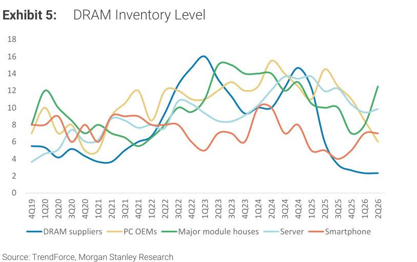

Y-axis: 0, 2, 4, 6, 8, 10, 12, 14, 16, 18. X-axis (quarterly): 4Q19, 1Q20, 2Q20, 3Q20, 4Q20, 1Q21, 2Q21, 3Q21, 4Q21, 1Q22, 2Q22, 3Q22, 4Q22, 1Q23, 2Q23, 3Q23, 4Q23, 1Q24, 2Q24, 3Q24, 4Q24, 1Q25, 2Q25, 3Q25, 4Q25, 1Q26, 2Q26. Legend: DRAM suppliers, PC OEMs, Major module houses, Server, Smartphone.

Source: TrendForce, Morgan Stanley Research

Exhibit 6: NAND Inventory Level

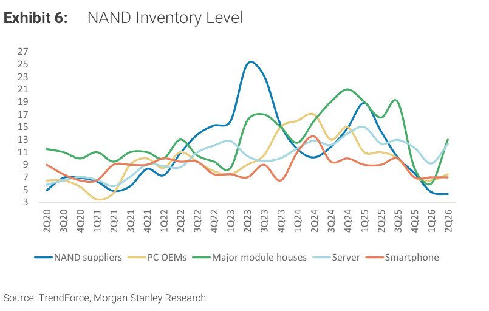

Y-axis: 3, 5, 7, 9, 11, 13, 15, 17, 19, 21, 23, 25, 27. X-axis (quarterly): 2Q20, 3Q20, 4Q20, 1Q21, 2Q21, 3Q21, 4Q21, 1Q22, 2Q22, 3Q22, 4Q22, 1Q23, 2Q23, 3Q23, 4Q23, 1Q24, 2Q24, 3Q24, 4Q24, 1Q25, 2Q25, 3Q25, 4Q25, 1Q26, 2Q26. Legend: NAND suppliers, PC OEMs, Major module houses, Server, Smartphone.

Source: TrendForce, Morgan Stanley Research

---

<!-- 原文第 11 页 -->

# Module Makers: A Less Cyclical Business Model

**The classic playbook:** In the past decade, the memory industry has typically faced 4-6 quarters of upcycle, with inflection when new capacity comes online to meet demand. The cycle hasn't remained at an elevated level due to reinforced customer behavior – chase and add more orders - hence, exaggerating the shortage in an upcycle when pricing increases every quarter, while de-committing during the downcycle expecting pricing to be lower in the next quarter.

Traditionally, low cost inventory plays an important role in a module maker's business model. Module makers hoard low cost inventories at cycle troughs and sell into upcycles with greater margin elasticity. This business model also influences module makers' share price reactions – usually when low cost inventory is depleted, margin peaks and the stock price corrects.

**Is this time different?** Under a scenario where the memory industry faces prolonged shortage due to the AI demand boom, memory prices could remain at elevated levels for the next 3-5 years through LTAs. We believe this would fundamentally change the module maker business model in a more durable upcycle as well.

**1. Stable margin vs. cyclical volatility:** Low cost inventory will likely be depleted at some point this year (Longsys currently holds 2-3 quarters of inventory). With consumer memory pricing hikes narrowing into 2H26 and seen remaining at elevated levels, margins should gradually return to more normalized levels and become more stable than what we've seen in previous years.

**2. Limited supply:** We expect muted volume growth for module makers in both 2026 and 2027 as suppliers' allocations are being shifted to CSP customers. Moving into 2028, aggressive greenfield capacity expansion from domestic Chinese suppliers could be a tailwind for volume growth, but at the same time, they could present challenges on pricing support in a scenario of oversupply.

**3. EPS lift through mix shift and margin expansion:** In an environment where volume growth limited and market pricing is stable, module makers would be challenged to differentiate themselves through premium product mix shifts and new growth engines that can increase ASPs, hence the earnings to support valuation and share price performance.

---

<!-- 原文第 12 页 -->

## Exhibit 7: NAND suppliers have outperformed significantly in this supercycle

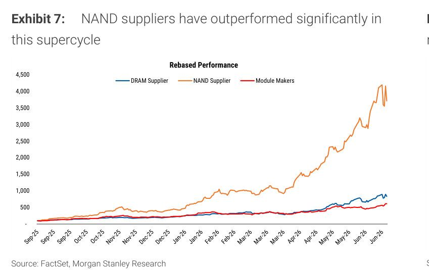

- Chart title: Rebased Performance
- Legend: DRAM Supplier / NAND Supplier / Module Makers
- Y-axis: rebased performance index, 500 to 4,500
- X-axis: Sep-25 to Jun-26

Source: FactSet, Morgan Stanley Research

## Exhibit 8: Module makers' valuation has contracted to a more reasonable level after significant upward earnings revisions

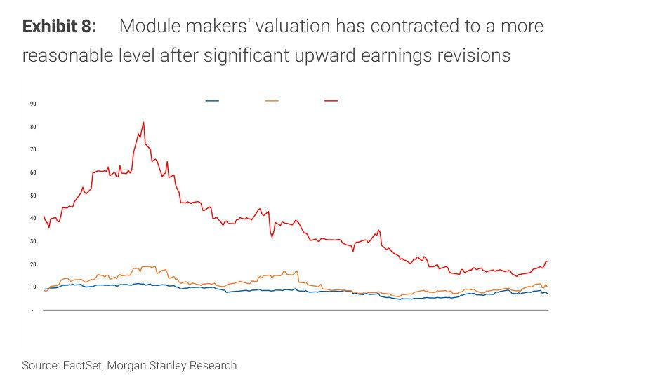

- Legend: three series indicated by colour swatches only (blue, light brown, red), no legend text is legible on the page
- Y-axis: 10 to 90
- X-axis: no axis labels printed

Source: FactSet, Morgan Stanley Research

## Exhibit 9: Module makers relative performance vs. respective country index

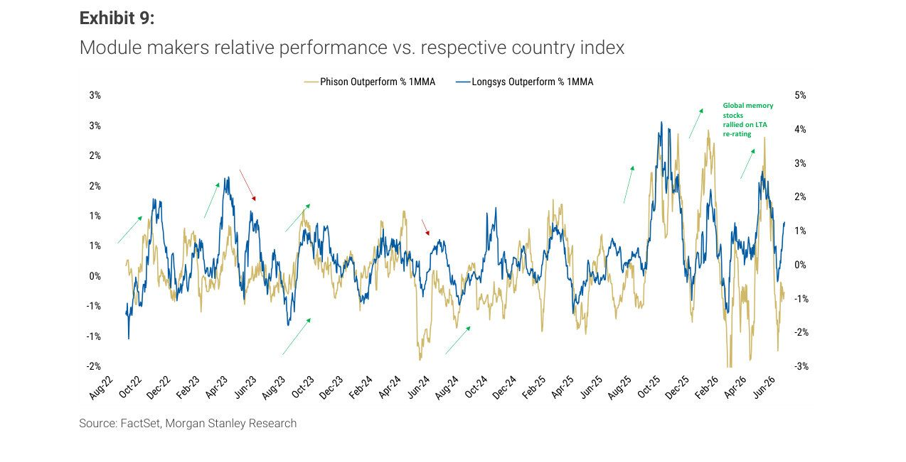

- Legend: Phison Outperform % 1MMA / Longsys Outperform % 1MMA
- Left Y-axis: -2% to 3% (tick labels printed as -2%, -1%, -1%, 0%, 1%, 1%, 2%, 2%, 3%)
- Right Y-axis: -3% to 5% (tick labels printed as -3%, -2%, -1%, 0%, 1%, 2%, 3%, 4%, 5%)
- X-axis: Aug-22 to Jun-26
- Annotation: "Global memory stocks rallied on LTA re-rating" (with directional arrows)

Source: FactSet, Morgan Stanley Research

---

<!-- 原文第 13 页 -->

# AI Module: Boot Drive Bottom-up Updates

In our February Phison downgrade report, we published a bottom-up analysis for our boot drive model for the growing AI market. As there is now more visibility into 2027's AI GPU, CPU and ASIC chip shipments, together with ongoing price increases for boot drive modules, we further update our bottom-up analysis:

Boot drive modules are a foundational, but often overlooked, component in modern server racks, particularly in large-scale AI and cloud infrastructure. While they do not participate directly in model training or inference workloads, boot drives are mission-critical for system availability, orchestration and recoverability. At a high level, boot drives provide the persistent local storage required to initialize hardware, load operating systems, and maintain essential control-plane functions across compute nodes, switches, and management servers within a rack.

**Core Functions of Boot Drive Modules**

- **System Initialization and Hardware Bring-Up:** Boot drives store the system firmware, boot loader, and operating system images required to power on servers, switches, and management nodes. Without a local boot device, hardware cannot reliably initialize, even in disaggregated or network-booted environments.
- **Control Plane and OS Persistence:** In modern AI racks, boot drives host: 1) containerized operating systems; 2) device drivers (GPU, NIC, NVLink, accelerators); 3) system services and orchestration agents. This ensures each node can operate autonomously and recover independently from network or storage disruptions.
- **Configuration, Logs, and Telemetry Storage:** Boot drives retain system configuration files, event logs, and telemetry data critical for debugging, compliance and fleet-level monitoring. This function is particularly important in hyperscale and AI factory environments where rapid fault isolation is required.
- **Fast Recovery and Operational Resilience:** Local boot drives enable rapid reboot and redeployment, Isolation of failures to individual nodes, reduced dependency on shared storage during recovery events. This materially improves system uptime and operational efficiency.

While boot drives represent a smaller share of total storage capacity compared with data cache or training storage, their ubiquity and mandatory nature make them a stable and scalable demand driver. As system software footprints expand due to containerization, monitoring, and local inference workloads, boot drive capacity requirements continue to rise, increasing cumulative storage content per rack.

We try to gauge the TAM for NVIDIA's Blue Field 3 and upcoming Blue Field 4 boot drive, based on the rack shipments we see as reasonable in the near term. We also try to size other boot drive markets, as general servers and ASIC server racks also require boot drives to function.

SIMO and Solidigm are the major providers of the Blue Field 3 boot drive module. However, we see SIMO as having 100% market share in controllers, as the other module maker pairs its SSD with SIMO's solution. We estimate the GB200/300 server rack and Blue Field 3 boot drive will contribute 2.3%/0.9% of total revenue to SIMO in

---

<!-- 原文第 14 页 -->

2026/2027e.

As NVIDIA decided to increase and standardize the boot drive content in its upcoming Vera Rubin rack, we have seen multiple module, controller and raw NAND vendors joining the supply for Blue Field-4 boot drives. These include, SIMO, Phison and Realtek.

As a general server, AMD's GPU and other ASIC server racks would also require boot drive modules/controllers inside the system, we calculate the TAM for non-boot drives needed based on our current estimates for shipments.

**Exhibit 10:** Gauging the TAM for boot drives in Vera Rubin Rack: SIMO to see around 3%/7% of total revenue coming from Vera Rubin rack in 2026e/2027e; But we see the revenue contribution remaining quite limited for Phison into 2027e

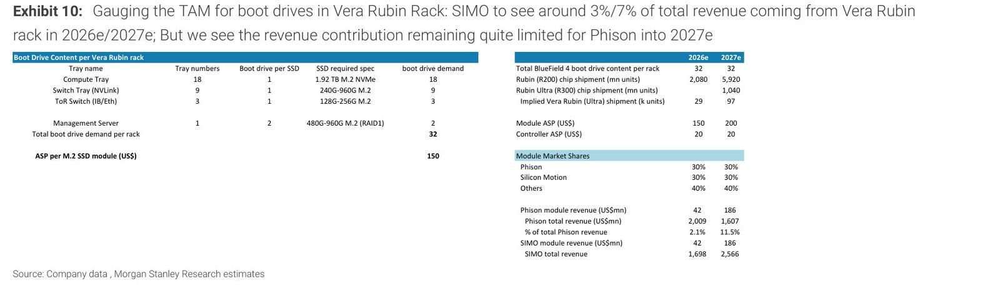

**Boot Drive Content per Vera Rubin rack**

| Tray name | Tray numbers | Boot drive per SSD | SSD required spec | boot drive demand |
| --- | --- | --- | --- | --- |
| Compute Tray | 18 | 1 | 1.92 TB M.2 NVMe | 18 |
| Switch Tray (NVLink) | 9 | 1 | 240G-960G M.2 | 9 |
| ToR Switch (IB/Eth) | 3 | 1 | 128G-256G M.2 | 3 |
| Management Server | 1 | 2 | 480G-960G M.2 (RAID1) | 2 |
| Total boot drive demand per rack | | | | **32** |

**ASP per M.2 SSD module (US$) — 150**

| | 2026e | 2027e |
| --- | --- | --- |
| Total BlueField 4 boot drive content per rack | 32 | 32 |
| Rubin (R200) chip shipment (mn units) | 2,080 | 5,920 |
| Rubin Ultra (R300) chip shipment (mn units) | | 1,040 |
| Implied Vera Rubin (Ultra) shipment (k units) | 29 | 97 |
| Module ASP (US$) | 150 | 200 |
| Controller ASP (US$) | 20 | 20 |
| **Module Market Shares** | | |
| Phison | 30% | 30% |
| Silicon Motion | 30% | 30% |
| Others | 40% | 40% |
| Phison module revenue (US$mn) | 42 | 186 |
| Phison total revenue (US$mn) | 2,009 | 1,607 |
| % of total Phison revenue | 2.1% | 11.5% |
| SIMO module revenue (US$mn) | 42 | 186 |
| SIMO total revenue | 1,698 | 2,566 |

Source: Company data, Morgan Stanley Research estimates

**Exhibit 11:** Gauging the TAM for boot drives in CMS racks

| | 2026e | 2027e |
| --- | --- | --- |
| Rubin (R200) chip shipment (mn units) | 2,080 | 5,920 |
| Rubin Ultra (R300) chip shipment (mn units) | | 1,040 |
| Implied Vera Rubin (Ultra) shipment (k units) | 29 | 97 |
| STX CMS Context Memory Platform | | |
| Storage tray (units) | 16 | 16 |
| Boot drive (units) | 2 | 2 |
| Content per 8 units of VR rack | 1 | 1 |
| Total CMS Boot Drive Consumption (k units) | 116 | 387 |
| Boot Drive ASP (US$) | 150 | 200 |
| SIMO market shares | 30% | 30% |
| Revenue contribution to SIMO (US$mn) | 5 | 23 |

Source: Company data, Morgan Stanley Research estimates

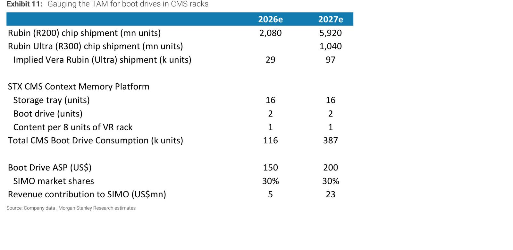

---

<!-- 原文第 15 页 -->

**Exhibit 12:** Gauging the TAM for boot drives in general servers and ASIC: SIMO to benefit most, with revenue contribution likely to reach 10%/12% in 2026e/2027e even with our conservative market share estimates of 5% in the overall TAM

| **Other application requiring boot drive** | 2026e | 2027e |
| --- | --- | --- |
| General Server shipment (k units) | 21,097 | 27,426 |
| General Server shipment Y/Y | 30.0% | 30.0% |
| AMD - MI series (k units) | 770 | 2,304 |
| GPU per compute tray | 4 | 4 |
| AMD Tray # (k units) | 193 | 576 |
| ASIC - AWS Trainium (k units) | 1,700 | 2,380 |
| ASIC per compute tray | 4 | 4 |
| AWS Tray # (k units) | 425 | 595 |
| ASIC - Meta MTIA (k units) | 150 | 550 |
| ASIC per compute tray | 4 | 4 |
| MTIA Tray # (k units) | 37.5 | 137.5 |
| Google TPU (k units) | 4,080 | 8,168 |
| ASIC per compute tray | 4 | 4 |
| Google Tray # (k units) | 1,020 | 2,042 |
| Number of boot drive needed per tray | 1 | 1 |
| Total boot drive consumption in general server and ASICs (k units) | 22,772 | 30,776 |
| ASP for boot drive module | 150 | 200 |
| ASP for boot drive controller | 20 | 20 |
| **Market share analysis** | | |
| Phison | 5% | 5% |
| SIMO | 5% | 5% |
| Others | 90% | 90% |
| **Revenue contribution** | | |
| Phison module revenue (US$mn) | 171 | 308 |
| Phison total revenue (US$mn) | 8,699 | 6,949 |
| % of total Phison revenue | 2.0% | 4.4% |
| SIMO module revenue (US$mn) | 171 | 308 |
| SIMO total revenue (US$mn) | 1,698 | 2,566 |
| % of total SIMO revenue | 10.1% | 12.0% |

Source: Company data, Morgan Stanley Research estimates

---

<!-- 原文第 16 页 -->

**Exhibit 13:** We expect AI boot drives to contribute 2%/7% of Phison's 2026e/2027e total revenue, while SIMO sees 15%/21% in the same period

| **Phison Revenue (US$mn)** | 2026e | 2027e |
| --- | --- | --- |
| Vera Rubin and BlueField 4 Boot Drive Module | 42 | 186 |
| General server, AI GPU, ASIC and other Boot Drive Module | 171 | 308 |
| Total Revneue contribution from Boot Drive Module | 212 | 493 |
| Phison total revenue (US$mn) | 8,699 | 6,949 |
| % of total Phison revenue | 2% | 7% |

| **SIMO Revenue (US$mn)** | 2026e | 2027e |
| --- | --- | --- |
| Grace Blackwell and BlueField 3 Boot Drive Module | 39 | 24 |
| Vera Rubin and BlueField 4 Boot Drive Module | 42 | 186 |
| General server, AI GPU, ASIC and other Boot Drive Module | 171 | 308 |
| STX CMS Context Memory Boot Drive Module | 5 | 23 |
| Total Revneue contribution from Boot Drive Module | 256 | 541 |
| SIMO total revenue (US$mn) | 1,698 | 2,566 |
| % of total SIMO revenue | 15% | 21% |

Source: Company data, Morgan Stanley Research estimates

---

<!-- 原文第 17 页 -->

# SIMO: Earnings Revision Estimates, Valuation Methodology and Quarterly Financials

**We factor in actual 1Q26 results and lift GAAP EPS by 59% and 66% for 2026e and 2027e, and introduce 2028e estimates:** We factor in the better-than-expected 1Q26 result and strong 2Q26 and 2026 full-year guidance, as the company is seeing market share gains in the consumer tech area and enterprise SSD front. We also factor in our estimates for the boot drive TAM analysis in this report. For gross margin, we raise our assumptions for the SSD module business, but lower our gross margin estimates for boot drives given the elevated raw NAND costs. The difference between GAAP and non-GAAP earnings primarily reflects unrealized investment gains recorded in recent quarters.

**Exhibit 14:** SIMO: Earnings estimate revisions

| US$ mn, in GAAP | New '26E | Old '26E | Diff. | New '27E | Old '27E | Diff. | New '28E |
| --- | --- | --- | --- | --- | --- | --- | --- |
| Net sales | 1,698 | 1,268 | 34% | 2,566 | 1,586 | 62% | 3,485 |
| Gross profit | 825 | 621 | 33% | 1,298 | 816 | 59% | 1,843 |
| Operating profit | 357 | 247 | 44% | 693 | 431 | 61% | 1,104 |
| Pretax Income | 385 | 255 | 51% | 700 | 439 | 59% | 1,110 |
| Net income | 324 | 204 | 59% | 581 | 351 | 65% | 922 |
| **GAAP EPS (US$)** | **9.55** | **6.01** | **59%** | **17.13** | **10.35** | **66%** | **27.17** |
| **Non-GAAP EPS (US$)** | **9.44** | **6.54** | **44%** | **17.54** | **10.88** | **61%** | **27.58** |
| **Margins** | | | | | | | |
| Gross margin | 48.6% | 49.0% | | 50.6% | 51.4% | | 52.9% |
| Operating margin | 21.0% | 19.5% | | 27.0% | 27.2% | | 31.7% |
| Pretax margin | 22.7% | 20.1% | | 27.3% | 27.7% | | 31.9% |
| Net margin | 19.1% | 16.1% | | 22.6% | 22.1% | | 26.4% |

Source: Company data, Morgan Stanley Research estimates

**Exhibit 15:** SIMO: Quarterly financials

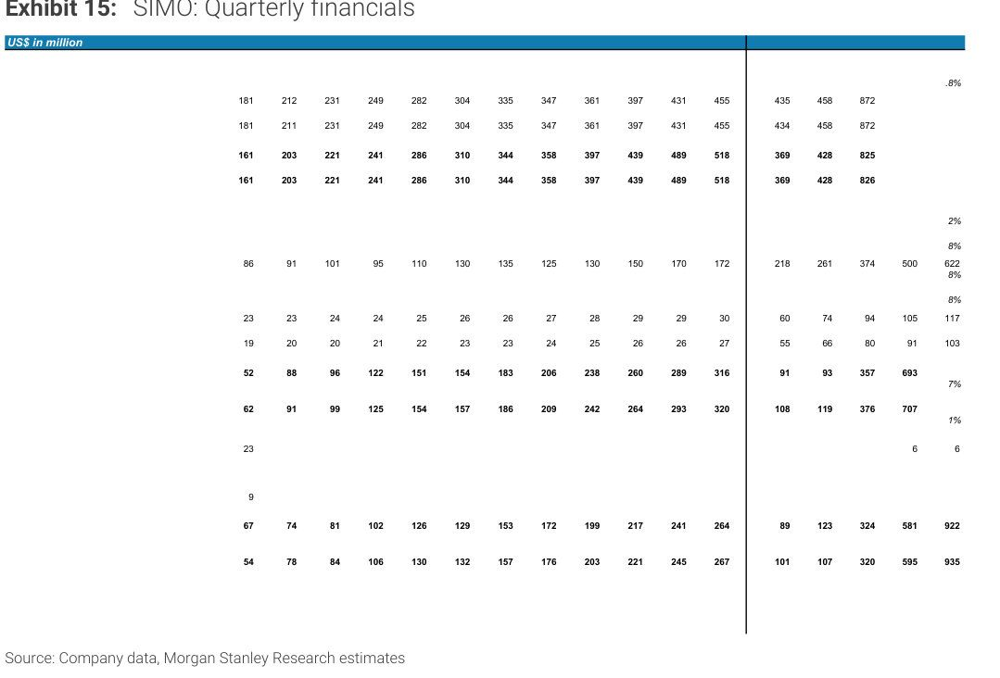

US$ in million

[TABLE_RECONSTRUCTION_UNCERTAIN]

行标签与列标题在页面渲染中不可见（未印出），仅数值可读；以下按页面印刷顺序逐行抄录，每行前半为季度区块、后半为右侧区块（以 `|` 分隔）：

- 181 212 231 249 282 304 335 347 361 397 431 455 | 435 458 872（右侧标注 .8%）
- 181 211 231 249 282 304 335 347 361 397 431 455 | 434 458 872
- 161 203 221 241 286 310 344 358 397 439 489 518 | 369 428 825
- 161 203 221 241 286 310 344 358 397 439 489 518 | 369 428 826
- 86 91 101 95 110 130 135 125 130 150 170 172 | 218 261 374 500（右侧另有 622；该组右侧标注 2%、8%、8%）
- 23 23 24 24 25 26 26 27 28 29 29 30 | 60 74 94 105 117
- 19 20 20 21 22 23 23 24 25 26 26 27 | 55 66 80 91 103
- 52 88 96 122 151 154 183 206 238 260 289 316 | 91 93 357 693
- 62 91 99 125 154 157 186 209 242 264 293 320 | 108 119 376 707
- 23（仅此一个数值）
- 9（仅此一个数值）
- 67 74 81 102 126 129 153 172 199 217 241 264 | 89 123 324 581 922
- 54 78 84 106 130 132 157 176 203 221 245 267 | 101 107 320 595 935

右侧百分比标注（自上而下）：.8%、2%、8%、8%、8%、7%、1%

Source: Company data, Morgan Stanley Research estimates

**We increase our price target from US$155 to US$400:** This reflects the changes in our 2026-27 earnings estimates and also introduced 2028e estimates. We also roll forward our RI base from 2025 to 2026e. We keep other RI assumptions unchanged, including a cost of equity of 9.5% (risk-free rate 2.0%, risk premium 6%, beta of 1.25), payout ratio of

---

<!-- 原文第 18 页 -->

62%, intermediate-term growth rate of 8.6%, and long-term growth rate of 4%. Our bull and bear case also increase from US$225 and US$68 to US$580 and US$175, respectively, implying 33x and 10x 2027e EPS.

**Exhibit 16:** SIMO: RI model

| US$million | 2026E | 2027E | 2028E | 2029E | 2030E | 2031E | 2032E | 2033E | 2034E | 2035E | 2036E | 2037E |
| --- | --- | --- | --- | --- | --- | --- | --- | --- | --- | --- | --- | --- |
| **Total Equity** | 1,106 | 1,557 | 2,246 | 2,707 | 3,207 | 3,750 | 4,339 | 4,980 | 5,675 | 6,431 | 7,251 | 8,142 |
| **Net Profit** | 324 | 581 | 922 | 1,001 | 1,087 | 1,180 | 1,282 | 1,392 | 1,512 | 1,642 | 1,783 | 1,937 |
| **ROAE** | 33.5% | 43.6% | 48.5% | 40.4% | 36.8% | 33.9% | 31.7% | 29.9% | 28.4% | 27.1% | 26.1% | 25.2% |
| **Residual Income** | 199 | 377 | 606 | 694 | 737 | 783 | 831 | 883 | 938 | 998 | 1,063 | 1,133 |
| **Spread** | 23.9% | 34.1% | 38.9% | 30.9% | 27.2% | 24.4% | 22.2% | 20.3% | 18.8% | 17.6% | 16.5% | 15.6% |
| Ending Equity Capital | 1,106 | | | | | | | | | | | |
| PV of Forecast Period | 4,654 | | | | | | | | | | | |
| PV of Continuing Value | 7,818 | | | | | | | | | | | |
| **Equity Value** | 13,578 | | | | | | | | | | | |
| No. of Shares | 34 | | | | | | | | | | | |
| **Projected Price** | **400** | | | | | | | | | | | |

Source: Company data, Morgan Stanley Research estimates

**Exhibit 17:** SIMO: P/E band

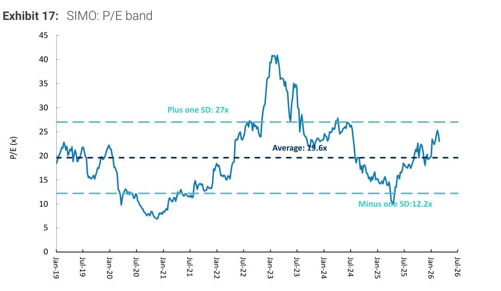

- Y-axis: P/E (x), 0 to 45
- X-axis: Jan-19 to Jul-26
- Reference lines: Average: 19.6x; Plus one SD: 27x; Minus one SD: 12.2x

Source: Company data, Factset, Morgan Stanley Research estimates

**Exhibit 18:** SIMO: DOI

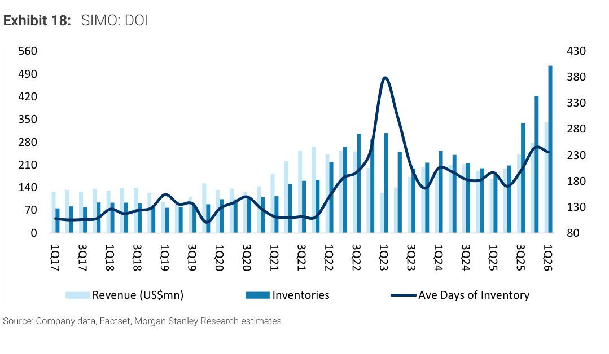

- Left Y-axis: 0 to 560 (ticks 0, 70, 140, 210, 280, 350, 420, 490, 560)
- Right Y-axis: 80 to 430 (ticks 80, 130, 180, 230, 280, 330, 380, 430)
- X-axis: 1Q17 to 1Q26
- Legend: Revenue (US$mn) / Inventories / Ave Days of Inventory

Source: Company data, Factset, Morgan Stanley Research estimates

---

<!-- 原文第 19 页 -->

# Risk Reward – Silicon Motion (SIMO.O)

More eSSD opportunities from 2026; OW

## PRICE TARGET US$400.00

Base case, residual income model. Key assumptions: cost of equity of 9.5% (risk-free rate 2.0%, risk premium 6%, beta of 1.25), payout ratio of 62%, intermediate-term growth rate of 8.6%, and long-term growth rate of 4%.

**Consensus Price Target Distribution** — US$80.00 to US$450.00

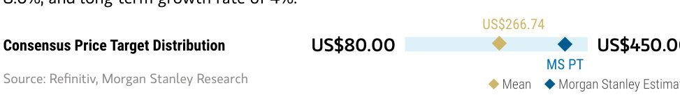

- Mean: US$266.74
- MS PT marker (blue diamond) at the high end of the range, value not labelled
- Legend: Mean / Morgan Stanley Estimates

Source: Refinitiv, Morgan Stanley Research

## RISK REWARD CHART

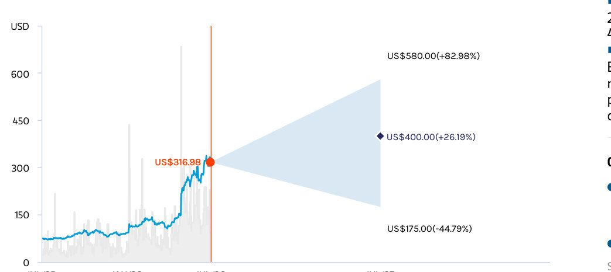

- Y-axis: USD, 0 to 600 (ticks 0, 150, 300, 450, 600)
- X-axis: JUL '25, JAN '26, JUL '26, JUL '27
- Current Stock Price: US$316.98
- Price Target: US$400.00 (+26.19%)
- Bull case: US$580.00 (+82.98%)
- Bear case: US$175.00 (-44.79%)
- Key: Historical Stock Performance / Current Stock Price / Price Target

Source: Refinitiv, Morgan Stanley Research

## OVERWEIGHT THESIS

- We expect SIMO to enjoy better pricing power and earnings visibility, supported by a growing backlog and more business opportunities in the AI era.
- We believe SIMO can enjoy AI-era trends. 1) AI PCs can be a catalyst accelerating notebook market growth. 2) We see QLC and TLC NAND business potential for enterprise servers and smartphone customers in the US and China. 3) NVIDIA's Blue Field ecosystem offers new TAM in AI.
- We expect further margin expansion in 2026-27, reaching the company's target of 48-50%.
- We expect the stock to trade to 23x 2027e EPS, given the better outlook for 2026, more outsourced opportunities from NAND players and new opportunities in AI boot drives and NVIDIA.

**Consensus Rating Distribution**

| Rating | Share |
| --- | --- |
| Overweight | 92% |
| Equal-weight | 8% |
| Underweight | 0% |

MS Rating: OW

Source: Refinitiv, Morgan Stanley Research

**Risk Reward Themes**

New Data Era: Positive

View descriptions of Risk Rewards Themes here

## BULL CASE — US$580.00 / 33x 2027e EPS

Rapid SSD controller IC growth: SSD controller ICs enjoy fast adoption in EM. The eMMC business also grows via new design wins. SSD solutions show strong growth momentum given increasing demand from data center customers. The consumer tech and PC market recovers faster than expected. Inventory problems are also resolved.

## BASE CASE — US$400.00 / 23x 2027e EPS

Stronger revenue momentum along with GM expansion: SSD penetration ramps up as expected, providing downside support, and UFS secures sustained design wins in the next few years. Better-than-expected momentum into 2H26 as we see some green shoots in PC OEMs on low inventory levels. We see more outsourcing opportunities from NAND players and new opportunities at NVIDIA.

## BEAR CASE — US$175.00 / 10x 2027e EPS

Key customer moves UFS in-house; slower PCIe gen 4 development: Customers successfully introduce in-house UFS controller ICs and allocate less than 50% of orders to Silicon Motion. SSD controller ICs do not gain widespread adoption amid price declines due to lukewarm EM demand, while SIMO's own product migration slows. China's data center demand slows significantly and the economy recovers later than expected. The inventory issues are more severe than expected.

---

<!-- 原文第 20 页 -->

# Risk Reward – Silicon Motion (SIMO.O)

## KEY EARNINGS INPUTS

| Drivers | Dec 2025 | Dec 2026e | Dec 2027e | Dec 2028e |
| --- | --- | --- | --- | --- |
| Revenue from eMMC + UFS (US$, mn) | 336 | 625 | 676 | 698 |
| Revenue from SSD Controllers (US$, mn) | 468 | 665 | 1,216 | 1,872 |
| Revenue from Removable Memory Card (US$, mn) | 40 | 0 | 0 | 0 |
| Revenue from SSD solutions (Shannon+ Ferri) (US$, mn) | 37 | 382 | 666 | 908 |

Source: Refinitiv, Morgan Stanley Research

## CATALYST CALENDAR

| Date | Event |
| --- | --- |
| 23 Sep 2026 - 27 Sep 2026 | Silicon Motion Technology Corp Annual Shareholders Meeting |

Source: Refinitiv, Morgan Stanley

## INVESTMENT DRIVERS

- SSD market growth and new customer wins
- Enterprise SSD solution business development
- Progress in eMMC business

## GLOBAL REVENUE EXPOSURE

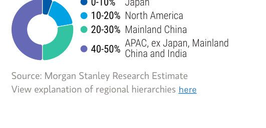

- Pie chart legend: 0-10% Japan / 10-20% North America / 20-30% Mainland China / 40-50% APAC, ex Japan, Mainland China and India
- No share values printed

Source: Morgan Stanley Research Estimate

View explanation of regional hierarchies here

## RISKS TO PT/RATING

**RISKS TO UPSIDE**

- New acquisition deals announced
- Significantly increased penetration of SSD
- Traction for open channel module
- eSSD share gain

**RISKS TO DOWNSIDE**

- Weaker-than-expected penetration of SSD
- Open channel module loses traction with weaker-than-expected demand
- eSSD share loss

## OWNERSHIP POSITIONING

| Metric | Value |
| --- | --- |
| Inst. Owners, % Active | 84.1% |
| HF Sector Long/Short Ratio | 2.1x |
| HF Sector Net Exposure | 29.5% |

Refinitiv; MSPB Content. Includes certain hedge fund exposures held with MSPB. Information may be inconsistent with or may not reflect broader market trends. Long/Short Ratio = Long Exposure / Short exposure. Sector % of Total Net Exposure = (For a particular sector: Long Exposure - Short Exposure) / (Across all sectors: Long Exposure – Short Exposure).

## MS ESTIMATES VS. CONSENSUS

FY Dec 2026e

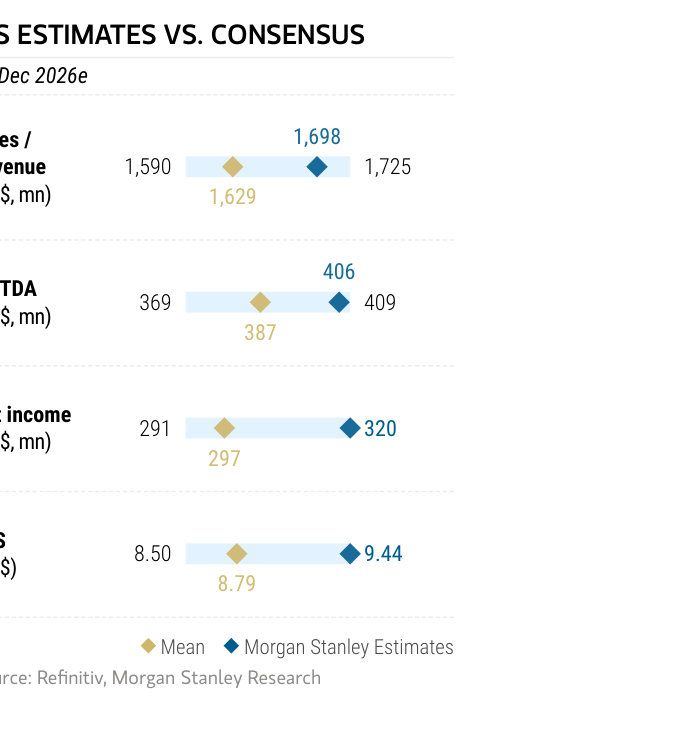

- Legend: Mean / Morgan Stanley Estimates
- Sales / Revenue (US$, mn): bar range 1,590 to 1,725; Mean 1,629; Morgan Stanley Estimates 1,698
- EBITDA (US$, mn): bar range 369 to 409; Mean 387; Morgan Stanley Estimates 406
- Net income (US$, mn): bar range 291 to 320; Mean 297; Morgan Stanley Estimates 320
- EPS (US$): bar range 8.50 to (not printed); Mean 8.79; Morgan Stanley Estimates 9.44

Source: Refinitiv, Morgan Stanley Research

---

<!-- 原文第 21 页 -->

# SIMO: Financial Summary

## Income Statement

US$mn (Years End Dec) | 2024 | 2025E | 2026E | 2027E | 2028E
--- | --- | --- | --- | --- | ---
Net sales | 804 | 886 | 1,698 | 2,566 | 3,485
COGS | (434) | (458) | (872) | (1,268) | (1,643)
Gross profit | 369 | 428 | 826 | 1,298 | 1,843
Operating expenses | (278) | (335) | (469) | (605) | (739)
Operating income | 91 | 93 | 357 | 693 | 1,104
Non-operating income | 17 | 47 | 28 | 6 | 6
Pre-tax income | 107 | 140 | 385 | 700 | 1,110
Income tax | 18 | 17 | 61 | 119 | 189
Reported net Income | 89 | 123 | 324 | 581 | 922
Adj.wtd.avg.shrs( m) | 34 | 34 | 34 | 34 | 34
Earnings per ADS (US$, GAAP) | 2.65 | 3.63 | 9.55 | 17.13 | 27.17
Earnings per ADS (US$, non GAAP) | 3.01 | 3.16 | 9.44 | 17.54 | 27.58
Modelware EPS (US$) | 3.01 | 3.16 | 9.44 | 17.54 | 27.58

## Cash Flow Statement

US$mn (Years End Dec) | 2024 | 2025E | 2026E | 2027E | 2028E
--- | --- | --- | --- | --- | ---
Cashflow from Operations | 77 | 61 | (69) | 117 | 453
Net profits | 89 | 123 | 324 | 581 | 922
Depreciation | 25 | 30 | 30 | 30 | 30
Working Capital Change | (60) | (190) | (423) | (494) | (498)
Other adjustments | 22 | 99 | 0 | 0 | 0
Cashflow from Investing | (44) | (27) | (12) | (12) | (12)
Capex | (43) | (27) | (12) | (12) | (12)
Change of LT Investment | 0 | 0 | 0 | 0 | 0
Change of ST Investment | 0 | 0 | 0 | 0 | 0
Other adjustments | (1) | 0 | 0 | 0 | 0
Cashflow from financing | (71) | (92) | (49) | (130) | (232)
Increase in L/T debt | 0 | 0 | 0 | 0 | 0
Increase in S/T debt | 0 | 0 | 0 | 0 | 0
Cash Dividend Paid | (67) | (67) | (49) | (130) | (232)
Dir& Emp Bonus Paid | 0 | 0 | 0 | 0 | 0
Issuance of stock | 0 | 0 | 0 | 0 | 0
Other adjustments | (4) | (24) | 0 | 0 | 0
Exchange rate adjustment | 0 | (17) | 0 | 0 | 0
Net change in cash | -38 | -74 | -130 | -24 | 209

## Balance Sheet

US$mn (Years End Dec) | 2024 | 2025E | 2026E | 2027E | 2028E
--- | --- | --- | --- | --- | ---
Cash | 276 | 202 | 72 | 48 | 257
Mkt Securities | 0 | 0 | 0 | 0 | 0
AR/NR | 234 | 212 | 532 | 805 | 1,093
Inventory | 199 | 422 | 597 | 868 | 1,125
Other | 88 | 108 | 108 | 108 | 108
Current Assets | 797 | 943 | 1,310 | 1,829 | 2,583
Long-term investments | 17 | 30 | 30 | 30 | 30
Fixed assets | 188 | 219 | 201 | 183 | 164
Deferred assets | 0 | 0 | 0 | 0 | 0
Other assets | 30 | 31 | 31 | 31 | 31
Total Assets | 1,033 | 1,223 | 1,571 | 2,072 | 2,807
S/T borrowings | 0 | 0 | 0 | 0 | 0
AP/NP | 18 | 35 | 108 | 157 | 204
Other ST liabilities | 182 | 305 | 305 | 305 | 305
LT debt | 0 | 0 | 0 | 0 | 0
Other LT liabilities | 60 | 52 | 52 | 52 | 52
Common shares | 0 | 0 | 0 | 0 | 0
Total Liabilities | 259 | 392 | 466 | 515 | 561
Additional capital | 0 | 0 | 0 | 0 | 0
Retained earning | 0 | 0 | 275 | 726 | 1,415
Other shareholders' equity | 774 | 831 | 831 | 831 | 831
Total Equity | 774 | 831 | 1,106 | 1,557 | 2,246
Total Liab. & Shrhldr's Equity | 1,033 | 1,223 | 1,571 | 2,072 | 2,807

## Financial Ratios

2024 | 2025E | 2026E | 2027E | 2028E
--- | --- | --- | --- | ---
**Growth(%)** | | | | 
Turnover | 25.7 | 10.2 | 91.7 | 51.1 | 35.8
Operating profits | 127.9 | 2.4 | 283.8 | 94.2 | 59.2
Pretax profits | 75.9 | 30.5 | 175.0 | 81.7 | 58.6
Net profits | 68.8 | 37.4 | 164.1 | 79.4 | 58.6
EPS | 64.0 | 5.3 | 198.3 | 85.8 | 57.3
**Margins (%)** | | | | 
Gross Margin | 46.0 | 48.3 | 48.7 | 50.6 | 52.9
Operating Margin | 11.3 | 10.5 | 21.0 | 27.0 | 31.7
Pretax Margin | 13.4 | 15.8 | 22.7 | 27.3 | 31.9
Net Profit | 11.1 | 13.8 | 19.1 | 22.6 | 26.4
**Return (%)** | | | | 
ROAE | 11.8 | 15.3 | 33.5 | 43.6 | 48.5
ROAA | 8.7 | 10.9 | 23.2 | 31.9 | 37.8
**Gearing (%)** | | | | 
Net Debt/Equity | (35.7) | (24.3) | (6.5) | (3.1) | (11.4)
Liabilities/Equity | 33.5 | 47.2 | 42.1 | 33.1 | 25.0
**Ratios (X)** | | | | 
Current ratio | 4.0 | 2.8 | 3.2 | 4.0 | 5.1
Quick ratio | 2.6 | 1.2 | 1.5 | 1.8 | 2.7
**Others** | | | | 
AR/NR Turnover (days) | 114 | 114 | 114 | 114 | 114
Inventory Turnover (days) | 250 | 250 | 250 | 250 | 250
AP Turnover (days) | 45 | 45 | 45 | 45 | 45
Cash Conversion (days) | 319 | 319 | 319 | 319 | 319

E = Morgan Stanley Research Estimates

Source: Morgan Stanley Research, Company Data

---

<!-- 原文第 22 页 -->

# Longsys: Estimate Revisions

We previously forecast a downcycle from 2H27 onward, with shortages persisting in 2027.

We now delay our downcycle assumption to 2H28, partially offset by volume shipment increases in a scenario where China domestic supply catches up.

We expect Longsys to continue to enhance its product mix profile and shift memory cost pressures through the TCM business (customers secure memory supply by themselves while Longsys provides customized module design and assembly services). Its R&D for the controller business will likely further enhance its margin profile over the long term through cost efficiency and firmware value-added services. Hence, we increase our long-term margin assumption to 25-38%, from the high teens previously.

As such, our 2026-28 EPS estimates increase by 299%, 247% and 244%, respectively. Our residual income based model implied price target is now Rmb673, up from Rmb300 previously, implying 15.8x 2027e P/E.

In a bull case scenario where AI PC takes off and triggers investment sentiment on potential business upside, we raise our scenario value to Rmb852, from Rmb435, implying 20x 2027e P/E.

In a bear case scenario where edge AI demand recovery is weaker than expected due to shortage created from CSP capacity crowding-out effects, pricing likely remains at elevated levels. We raise our scenario value to Rmb587, from Rmb90, implying 5.0x 2027e P/B.

## Exhibit 19: Estimate revisions

(RMB mn) | 2026E Prior | 2026E New | 2026E Change | 2027E Prior | 2027E New | 2027E Change | 2028E Prior | 2028E New | 2028E Change
--- | --- | --- | --- | --- | --- | --- | --- | --- | ---
**Total Sales** | 36,899 | 65,852 | 78% | 40,850 | 85,564 | 109% | 48,745 | 81,251 | 67%
Embedded Storage | 20,912 | 24,865 | 19% | 23,224 | 30,894 | 33% | 27,579 | 29,263 | 6%
Mobile Memory | 4,457 | 19,719 | 342% | 5,061 | 24,317 | 380% | 5,695 | 22,645 | 298%
Solid-State Drive | 7,932 | 14,462 | 82% | 8,631 | 21,115 | 145% | 10,659 | 20,504 | 92%
Memory Module | 3,384 | 6,690 | 98% | 3,710 | 9,102 | 145% | 4,581 | 8,673 | 89%
Others | 213 | 116 | (46%) | 224 | 136 | (39%) | 231 | 165 | (28%)
**Total GP** | 11,605 | 36,052 | 211% | 10,364 | 29,928 | 189% | 8,835 | 21,610 | 145%
Embedded Storage | 6,443 | 13,135 | 104% | 5,342 | 9,924 | 86% | 5,516 | 7,376 | 34%
Mobile Memory | 2,488 | 11,815 | 375% | 2,025 | 10,295 | 408% | 1,139 | 7,854 | 590%
Solid-State Drive | 1,744 | 7,595 | 335% | 1,985 | 6,805 | 243% | 1,492 | 4,563 | 206%
Memory Module | 851 | 3,463 | 307% | 927 | 2,854 | 208% | 596 | 1,757 | 195%
Others | 78 | 44 | (44%) | 85 | 50 | (41%) | 92 | 61 | (34%)
**GP Margin** | 31% | 55% | 23.7 pp | 25% | 35% | 10.0 pp | 18% | 27% | 8.5 pp
Embedded Storage | 31% | 53% | 21.8 pp | 23% | 32% | 9.1 pp | 20% | 25% | 5.2 pp
Mobile Memory | 56% | 60% | 3.9 pp | 40% | 42% | 2.3 pp | 20% | 35% | 14.7 pp
Solid-State Drive | 22% | 53% | 30.5 pp | 23% | 32% | 9.2 pp | 14% | 22% | 8.3 pp
Memory Module | 25% | 52% | 26.8 pp | 25% | 31% | 6.4 pp | 13% | 20% | 7.3 pp
Others | 37% | 38% | 1.0 pp | 38% | 37% | (1.0)pp | 40% | 37% | (3.0)pp
**NP** | 6,169 | 23,974 | 289% | 5,057 | 17,070 | 238% | 3,025 | 10,370 | 243%
**EPS (RMB$)** | 14.99 | 59.86 | 299% | 12.28 | 42.62 | 247% | 7.33 | 25.19 | 244%

Source: Company data, Morgan Stanley Research (E) estimates

## Exhibit 20: Residual Income model

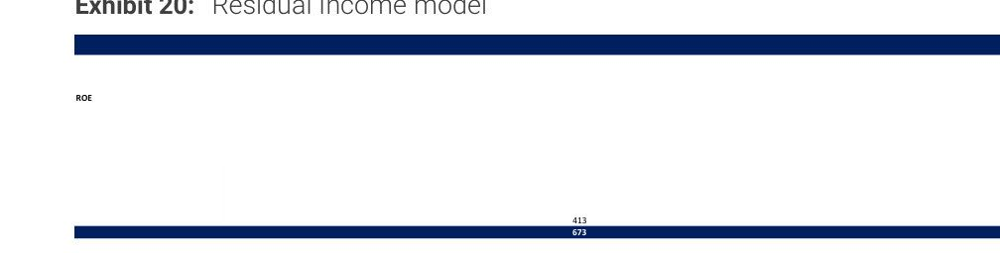

413
673

ROE

Source: Company data, Morgan Stanley Research (E) estimates

---

<!-- 原文第 23 页 -->

## Exhibit 21: Financial Summary

**Income Statement**

829

656

590

499

NM

NM

**Cash Flow Statement**

505

571

28) 837

562 10 141

424

780

456

**Balance Sheet**

240

985

870

**Financial Ratios**

EPS

[TABLE_RECONSTRUCTION_UNCERTAIN]

Source: Company data, Morgan Stanley Research (E) estimates

---

<!-- 原文第 24 页 -->

# Risk Reward – Shenzhen Longsys Electronics Co Ltd (301308.SZ)

Lack of near-term catalysts; await more clarity on 2027 pricing and margin; EW

## PRICE TARGET Rmb673.00

Base case, derived from residual income model. We assume a cost of equity of 9.10% (risk-free rate of 2.5%, risk premium of 5.5%, beta of 1.2) and a terminal growth rate of 6.3%.

## RISK REWARD CHART

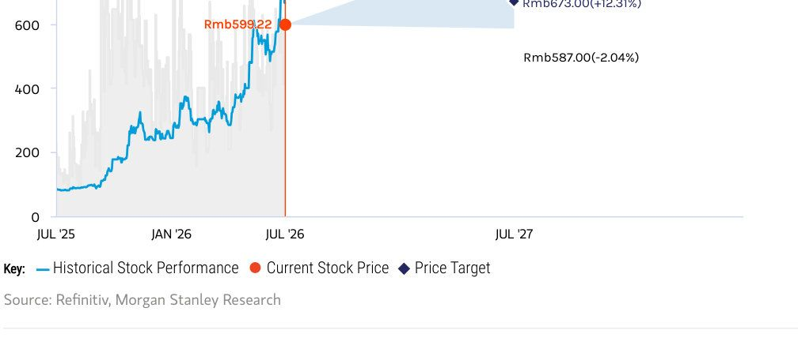

CNY

0 / 200 / 400 / 600 / 800

JUL '25 / JAN '26 / JUL '26 / JUL '27

Rmb852.00(+42.18%)

Rmb673.00(+12.31%)

Rmb587.00(-2.04%)

Rmb599.22

Key: — Historical Stock Performance ● Current Stock Price ◆ Price Target

Source: Refinitiv, Morgan Stanley Research

## EQUAL-WEIGHT THESIS

- The AI era has finally come to NAND, with shortages seen extending into 2027.
- We like the company's medium- to long-term growth story through enterprise business expansion and a mix shift to a TCM model.
- Continued supply discipline, normalized domestic customers' inventory levels, and Longsys's self-help should help the stock re-rate.
- Our price target implies 15.8x 2027e P/E, in-line with its A-share peers and significantly lower than its historical average of 30x P/E, reflecting robust and more durable earnings upward revision in the NAND upcycle.

**Risk Reward Themes**

Secular Growth: Positive

Self-help: Positive

View descriptions of Risk Rewards Themes here

## BULL CASE Rmb852.00

**20x 2027e P/E**

Aggressive growth supported by AI tailwinds: We assume: 1) overall supply discipline and CSPs' aggressive AI spending continue; and 2) edge AI devices trigger strong demand recovery for the smartphone and PC markets, creating a shortage for NAND into 2028 and beyond.

## BASE CASE Rmb673.00

**15x 2027e P/E**

Risk/reward appears balanced, reflecting 1) NAND's secular growth, supported by AI and China's localization, and 2) Longsys' self-help in enterprise business, overseas expansion and TCM&PTM business models likely enhancing its medium-/long-term growth and margin profile.

## BEAR CASE Rmb587.00

**5.0x 2027e P/B**

Weaker-than-expected market growth: We assume: 1) a weaker edge AI cycle moving into 2028 and beyond and 2) pricing starting to decline in 2H28.

---

<!-- 原文第 25 页 -->

# Risk Reward – Shenzhen Longsys Electronics Co Ltd (301308.SZ)

## KEY EARNINGS INPUTS

Drivers | Dec 2025 | Dec 2026e | Dec 2027e | Dec 2028e
--- | --- | --- | --- | ---
Embedded Storage ASP Growth (%) | (1.6) | 162.3 | 27.2 | (8.5)
Mobile Memory ASP Growth (%) | 27.6 | 314.3 | 41.4 | 1.1
SSD ASP Growth (%) | (13.8) | 183.9 | 46.0 | 0.6
Memory Module ASP Growth (%) | 4.7 | 214.3 | 35.7 | (1.3)

## INVESTMENT DRIVERS

- Commodity memory pricing cycle
- eSSD business expansion progress

## GLOBAL REVENUE EXPOSURE

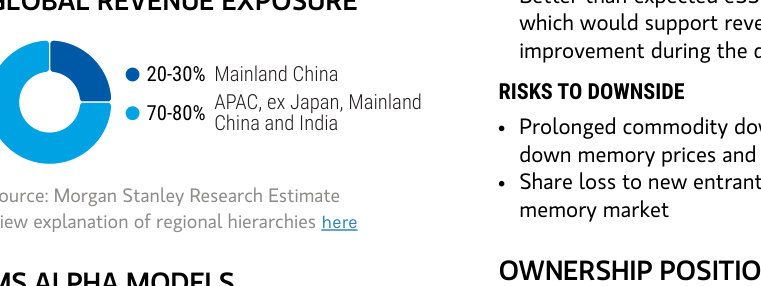

- 20-30% Mainland China
- 70-80% APAC, ex Japan, Mainland China and India

Source: Morgan Stanley Research Estimate

View explanation of regional hierarchies here

## MS ALPHA MODELS

**3/5 MOST**　3 Month Horizon

Source: Refinitiv, FactSet, Morgan Stanley Research; 1 is the highest favored Quintile and 5 is the least favored Quintile

## RISKS TO PT/RATING

**RISKS TO UPSIDE**

- Better-than-expected consumer demand recovery in 2H26
- Better-than-expected eSSD market expansion, which would support revenue and margin improvement during the down-cycle

**RISKS TO DOWNSIDE**

- Prolonged commodity down-cycle that drags down memory prices and margins
- Share loss to new entrants in the Chinese memory market

## OWNERSHIP POSITIONING

Inst. Owners, % Active　85.3%

Source: Refinitiv, Morgan Stanley Research

## MS ESTIMATES VS. CONSENSUS

FY Dec 2026e

**Sales / Revenue (Rmb, mn)**　◆ 65,852.3

Note: There are not sufficient brokers supplying consensus data for this metric

**Net income (Rmb, mn)**　◆ 23,974

Note: There are not sufficient brokers supplying consensus data for this metric

**EPS (Rmb)**　◆ 59.9

Note: There are not sufficient brokers supplying consensus data for this metric

◆ Mean　◆ Morgan Stanley Estimates

Source: Refinitiv, Morgan Stanley Research

---

<!-- 原文第 26 页 -->

# Phison: Estimate Revisions

**We raise our 2026, 2027 and 2028 EPS estimates by 71%, 13% and 8%, respectively:**

We factor in stronger-than-expected 2Q26 results. 2Q26 delivered a strong beat vs. our forecasts, driven by more resilient pricing hike intervals and shipments than expected. We expect 3Q26 to be the peak of the year, supported by more support from Kioxia's dummy die, leading to around 20% QoQ revenue growth and a better-than-feared (flat Q/Q) margin. In 4Q26, we expect emerging weakness from consumer tech and a more moderate pricing environment to result in 4Q revenue declining 20% QoQ, with margins normalizing to ~50%. Reflecting the better pricing environment seen for 2026, this leads to stronger-than-expected profitability in 2027, partially offset by the ongoing R&D investments.

## Exhibit 22: Phison: Estimate revisions

NT$ mn | Current 2026E | Previous 2026E | Diff. % | Current 2027E | Previous 2027E | Diff. % | Current 2028E | Previous 2028E | Diff. %
--- | --- | --- | --- | --- | --- | --- | --- | --- | ---
Net sales | 260,963 | 169,828 | 54% | 208,459 | 165,204 | 26% | 154,119 | 130,255 | 18%
Gross profit | 155,833 | 91,990 | 69% | 90,396 | 71,566 | 26% | 60,900 | 54,074 | 13%
Operating profit | 85,965 | 49,614 | 73% | 32,691 | 31,077 | 5% | 12,077 | 13,463 | -10%
Pretax Income | 90,915 | 52,976 | 72% | 35,646 | 31,484 | 13% | 15,031 | 13,870 | 8%
Reported net income | 75,050 | 43,940 | 71% | 29,229 | 25,817 | 13% | 12,326 | 11,373 | 8%
Reported EPS | 340.55 | 199.39 | 71% | 132.63 | 117.15 | 13% | 55.93 | 51.61 | 8%

**Margins**

Gross margin | 59.7% | 54.2% | | 43.4% | 43.3% | | 39.5% | 41.5% | 
--- | --- | --- | --- | --- | --- | --- | --- | --- | ---
Operating margin | 32.9% | 29.2% | | 15.7% | 18.8% | | 7.8% | 10.3% | 
Pretax margin | 34.8% | 31.2% | | 17.1% | 19.1% | | 9.8% | 10.6% | 
Net margin | 28.8% | 25.9% | | 14.0% | 15.6% | | 8.0% | 8.7% | 

Source: Company data, Morgan Stanley Research (E) estimates

## Exhibit 23: Phison: Quarterly financials

NT$ in million | 1Q26 | 2Q26E | 3Q26E | 4Q26E | 1Q27E | 2Q27E | 3Q27E | 4Q27E | 2024 | 2025 | 2026E | 2027E | 2028E
--- | --- | --- | --- | --- | --- | --- | --- | --- | --- | --- | --- | --- | ---
Total Revenues | 40,967 | 69,547 | 83,483 | 66,965 | 53,747 | 55,548 | 53,301 | 45,862 | 58,936 | 72,664 | 260,963 | 208,459 | 154,119
Sequential Change | 79.7% | 69.8% | 20.0% | -19.8% | -19.7% | 3.4% | -4.0% | -14.0% | | | | | 
Change vs Year Ago | 196.0% | 288.7% | 360.3% | 193.7% | 31.2% | -20.1% | -36.2% | -31.5% | 22.2% | 23.3% | 259.1% | -20.1% | -26.1%
Cost of Sales | 15,849 | 25,190 | 30,444 | 33,646 | 28,589 | 31,121 | 31,365 | 26,988 | 39,837 | 47,806 | 105,129 | 118,062 | 93,219
Percent of Revenues | 39% | 36% | 36% | 50% | 53% | 56% | 59% | 59% | 68% | 66% | 40% | 57% | 60%
Gross Profit | 25,118 | 44,357 | 53,039 | 33,320 | 25,158 | 24,427 | 21,936 | 18,875 | 19,099 | 24,858 | 155,833 | 90,396 | 60,900
Percent of Revenues | 61.3% | 63.8% | 63.5% | 49.8% | 46.8% | 44.0% | 41.2% | 41.2% | 32.4% | 34.2% | 59.7% | 43.4% | 39.5%
Incremental Margin | 86% | 67% | 62% | NM | NM | -41% | NM | NM | 28% | 42% | 70% | NM | NM
Total Opex | 10,277 | 17,075 | 21,691 | 20,826 | 13,257 | 14,333 | 15,239 | 14,876 | 15,566 | 16,591 | 69,869 | 57,705 | 48,823
Percent of Revenues | 25.1% | 24.6% | 26.0% | 31.1% | 24.7% | 25.8% | 28.6% | 32.4% | 26.4% | 22.8% | 26.8% | 27.7% | 31.7%
R&D | 8,671 | 14,000 | 18,000 | 18,000 | 11,000 | 12,000 | 13,000 | 12,950 | 12,586 | 13,775 | 58,671 | 48,950 | 42,350
Percent of Revenues | 21.2% | 20.1% | 21.6% | 26.9% | 20.5% | 21.6% | 24.4% | 28.2% | 21.4% | 19.0% | 22.5% | 23.5% | 27.5%
General & administrative | 830 | 1,409 | 1,691 | 1,357 | 1,075 | 1,111 | 1,066 | 917 | 1,286 | 1,169 | 5,287 | 4,169 | 3,082
Percent of Revenues | 2.0% | 2.0% | 2.0% | 2.0% | 2.0% | 2.0% | 2.0% | 2.0% | 2.2% | 1.6% | 2.0% | 2.0% | 2.0%
Selling & marketing | 776 | 1,666 | 1,999 | 1,470 | 1,182 | 1,222 | 1,173 | 1,009 | 1,694 | 1,647 | 5,911 | 4,586 | 3,391
Percent of Revenues | 1.9% | 2.4% | 2.4% | 2.2% | 2.2% | 2.2% | 2.2% | 2.2% | 2.9% | 2.3% | 2.3% | 2.2% | 2.2%
**Operating Income** | 14,841 | 27,283 | 31,348 | 12,493 | 11,901 | 10,094 | 6,697 | 3,998 | 3,533 | 8,266 | 85,965 | 32,691 | 12,077
Percent of Revenues | 36.2% | 39.2% | 37.6% | 18.7% | 22.1% | 18.2% | 12.6% | 8.7% | 6% | 11% | 33% | 16% | 8%
Change vs Year Ago | N/A | 1062.9% | 2101.0% | 274.7% | -19.8% | -63.0% | -78.6% | -68.0% | -2% | 134% | 940% | -62% | -63%
Total Non-operating Income(Loss) | 3,057 | 416 | 739 | 739 | 739 | 739 | 739 | 739 | 6,216 | 1,939 | 4,950 | 2,955 | 2,955
**Profit Before Taxes** | 17,898 | 27,699 | 32,087 | 13,232 | 12,640 | 10,833 | 7,436 | 4,737 | 9,749 | 10,206 | 90,915 | 35,646 | 15,031
Percent of Revenues | 44% | 40% | 38% | 20% | 24% | 20% | 14% | 10% | 17% | 14% | 35% | 17% | 10%
Taxes | 2,723 | 4,986 | 5,776 | 2,382 | 2,275 | 1,950 | 1,338 | 853 | 1,795 | 1,465 | 15,866 | 6,416 | 2,706
Tax Rate | 15.2% | 18.0% | 18.0% | 18.0% | 18.0% | 18.0% | 18.0% | 18.0% | 18% | 14% | 17% | 18% | 18%
Net Income, Cont Ops | 15,175 | 22,713 | 26,311 | 10,850 | 10,365 | 8,883 | 6,097 | 3,884 | 7,954 | 8,741 | 75,049 | 29,229 | 12,326
Percent of Revenues | 37% | 33% | 32% | 16% | 19% | 16% | 11% | 8% | 13% | 12% | 29% | 14% | 8%
Net Income (incl. Emp. Bonus Expense) | 15,175 | 22,713 | 26,311 | 10,850 | 10,365 | 8,883 | 6,097 | 3,884 | 7,955 | 8,743 | 75,050 | 29,229 | 12,326
Percent of Revenues | 37% | 33% | 32% | 16% | 19% | 16% | 11% | 8% | 13.5% | 12.0% | 28.8% | 14.0% | 8.0%
[label not visible] Percent of Revenues | 0% | 0% | 0% | 0% | 0% | 0% | 0% | 0% | 0% | 0% | 0% | 0% | 0%
Reported Income (TW GAAP) | 15,175 | 22,713 | 26,311 | 10,850 | 10,365 | 8,883 | 6,097 | 3,884 | 7,955 | 8,743 | 75,050 | 29,229 | 12,326
Percent of Revenues | 37% | 33% | 32% | 16% | 19% | 16% | 11% | 8% | 13% | 12% | 29% | 14% | 8%
Change vs Year Ago | 0% | 0% | 0% | 0% | 0% | 0% | 0% | 0% | 119% | 10% | 758% | -61% | -58%
**Reported EPS (NT$, TW GAAP)** | 68.86 | 103.06 | 119.39 | 49.23 | 47.03 | 40.31 | 27.67 | 17.63 | 35.68 | 39.70 | 340.55 | 132.63 | 55.93
Change vs Year Ago | 1233% | 2937% | 1082% | 134% | -32% | -61% | -77% | -64% | 102% | 11% | 758% | -61% | -58%

Source: Company data, Morgan Stanley Research (E) estimates

---

<!-- 原文第 27 页 -->

# Phison: Valuation Methodology

**We raise our price target from NT$2,248 to NT$2,588, reflecting our estimate changes.**

Our other RI parameters are unchanged, including a cost of equity of 9.0%, a medium-term growth rate of 9.0%, a terminal growth rate of 4.0% and a dividend payout ratio assumption of 51.2%. We increase our bull and bear case values from NT$3,090 and NT$1,125 to NT$3,400 and NT$1,250, respectively, implying 10x 2026e and 26x 2027e EPS in the bull case and 4x 2026e and 9x 2027e EPS in the bear.

## Exhibit 24: Phison: RI model

NT$million | 2026E | 2027E | 2028E | 2029E | 2030E | 2031E | 2032E | 2033E | 2034E | 2035E | 2035E
--- | --- | --- | --- | --- | --- | --- | --- | --- | --- | --- | ---
Total Equity | 130,690 | 121,591 | 118,989 | 138,089 | 158,908 | 181,601 | 206,336 | 233,298 | 262,686 | 294,718 | 329,634
Net Profit | 75,050 | 29,229 | 31,860 | 34,727 | 37,853 | 41,260 | 44,973 | 49,021 | 53,433 | 58,241 | 63,483
ROAE | 78.7% | 23.2% | 26.5% | 27.0% | 25.5% | 24.2% | 23.2% | 22.3% | 21.5% | 20.9% | 20.3%
Residual Income | 41,895 | 18,561 | 21,298 | 21,474 | 22,813 | 24,256 | 25,816 | 27,506 | 29,339 | 31,331 | 33,496
Spread | 69.7% | 14.2% | 17.5% | 18.0% | 16.5% | 15.3% | 14.2% | 13.3% | 12.6% | 11.9% | 11.4%

Ending Equity Capital | 130,690
--- | ---
PV of Forecast Period | 143,241
PV of Continuing Value | 296,882
Equity Value | 570,813
No. of Shares | 221
Projected Price | 2,588

Source: Company data, Morgan Stanley Research (E) estimates

## Exhibit 25: Phison: P/E multiple

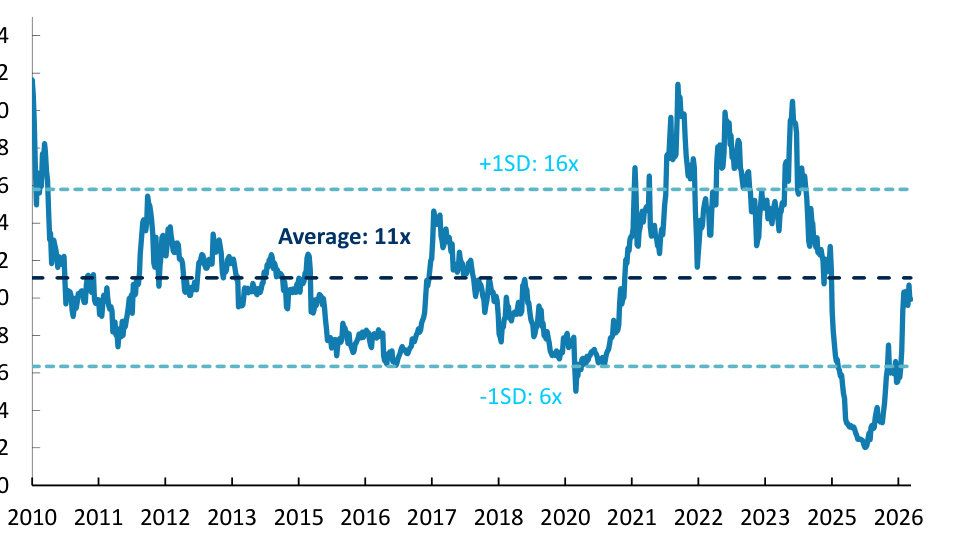

Average: 11x

+1SD: 16x

-1SD: 6x

P/E (x)

0 / 2 / 4 / 6 / 8 / 10 / 12 / 14 / 16 / 18 / 20 / 22 / 24

2010 / 2011 / 2012 / 2013 / 2015 / 2016 / 2017 / 2018 / 2020 / 2021 / 2022 / 2023 / 2025 / 2026

Source: Company data, Morgan Stanley Research estimates

---

<!-- 原文第 28 页 -->

# Risk Reward – Phison Electronics Corp (8299.TWO)

AI Boosts NAND Market, but Module Makers Face Hurdles; EW

## PRICE TARGET NT$2,588.00

Base case, residual income model. Key assumptions: a cost of equity of 9.0%, a medium-term growth rate of 9.0%, a terminal growth rate of 4.0%, and a dividend payout ratio assumption of 51.2%.

**Consensus Price Target Distribution**　NT$2,240.00　◆ MS PT　Mean NT$2,931.98　NT$4,130.00

◆ Mean　◆ Morgan Stanley Estimates

Source: Refinitiv, Morgan Stanley Research

## RISK REWARD CHART

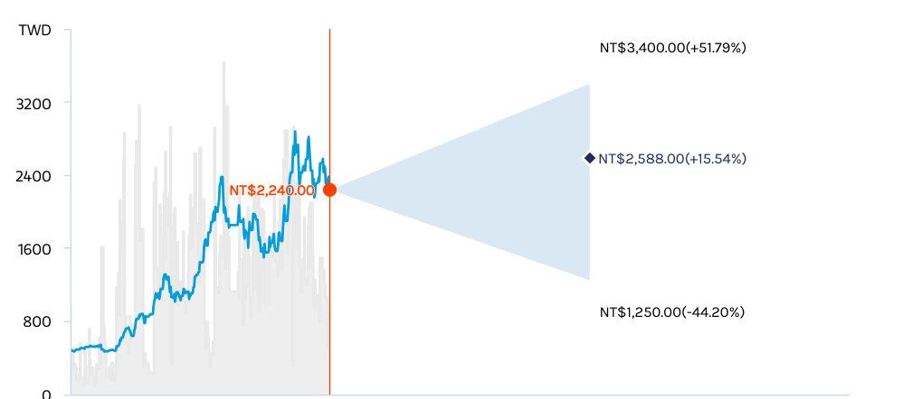

NT$3,400.00(+51.79%)

NT$2,588.00(+15.54%)

NT$1,250.00(-44.20%)

NT$2,240.00

TWD

0 / 800 / 1600 / 2400 / 3200

JUL '25 / JAN '26 / JUL '26 / JUL '27

Key: — Historical Stock Performance ● Current Stock Price ◆ Price Target

Source: Refinitiv, Morgan Stanley Research

## EQUAL-WEIGHT THESIS

- AI-driven storage demand is extending the industry upcycle, but we see limited upside for module vendors given constrained NAND supply, FIFO-driven margin normalization, and weakening consumer SSD demand amid elevated NAND prices.
- Although eSSD and AI-related storage represent meaningful growth opportunities for Asian module house vendors such as Phison and Longsys, we believe the scale remains insufficient to offset broader consumer SSD weakness.
- We see risks on the execution as raw NAND suppliers are looking to further cut support to module houses as they would like to prioritize their other customers first. Industry average sees -40% YoY on shipments, which could create risks for Phison

**Consensus Rating Distribution**

93% Overweight

7% Equal-weight

0% Underweight

MS Rating

Source: Refinitiv, Morgan Stanley Research

**Risk Reward Themes**

Secular Growth: Positive

View descriptions of Risk Rewards Themes here

## BULL CASE NT$3,400.00

**26x 2027e EPS**

Growing SSD demand and limited supply growth prompt NAND flash shortages; SSD market growth accelerates: 1) Revenue increases at a CAGR of >40% over 2024-28; 2) gross margin rises to 90% in 2026 from 34% in 2025; 3) flash controller IC revenue increases 50% Y/Y in 2026.

## BASE CASE NT$2,588.00

**19x 2027e EPS**

A good year for NAND modules in 2026, but we doubt it can be sustained into 2027: 1) Revenue increases at a CAGR of 27% Y/Y over 2024-28e; 2) gross margin increases to 59.7% in 2026 from 33.4% in 2023 from the price hike benefit; 3) flash module revenue rises 355% Y/Y in 2026 vs. -20% in 2027; 4) flash controller IC revenue increases 24% Y/Y in 2026.

## BEAR CASE NT$1,250.00

**9x 2027e EPS**

No outsourcing from Micron, low SSD market growth, NAND flash price drops more than in our base case: 1) Revenue increases at a CAGR of <10% in 2024-28; 2) gross margin faces more significant erosion, to <40% in 2026 vs. 33.4% in 2023; 3) flash controller IC revenue increases 10% Y/Y in 2026.

---

<!-- 原文第 29 页 -->

# Risk Reward – Phison Electronics Corp (8299.TWO)

## KEY EARNINGS INPUTS

Drivers | Dec 2025 | Dec 2026e | Dec 2027e | Dec 2028e
--- | --- | --- | --- | ---
Flash module revenue Y/Y (%) | 22.0 | 354.9 | (19.8) | (28.1)
Flash controller IC revenue Y/Y (%) | 44.7 | 23.9 | (29.1) | (3.1)
Flash module gross margin (%) | 33.5 | 60.6 | 43.3 | 39.1
Flash controller IC gross margin (%) | 43.9 | 45.3 | 43.3 | 43.3

## INVESTMENT DRIVERS

- Rising NAND flash prices
- Higher SSD penetration rate
- Adoption of solution by key OEMs

## GLOBAL REVENUE EXPOSURE

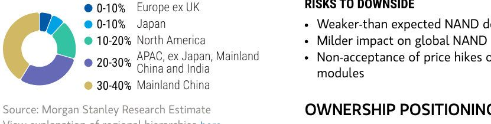

- 0-10% Europe ex UK
- 0-10% Japan
- 10-20% North America
- 20-30% APAC, ex Japan, Mainland China and India
- 30-40% Mainland China

Source: Morgan Stanley Research Estimate

View explanation of regional hierarchies here

## MS ALPHA MODELS

**1/5 MOST**　3 Month Horizon

Source: Refinitiv, FactSet, Morgan Stanley Research; 1 is the highest favored Quintile and 5 is the least favored Quintile

## RISKS TO PT/RATING

**RISKS TO UPSIDE**

- Faster-than-expected eMMC controller IC outsourcing rate
- Faster SSD market growth
- Market share gain in ultrabooks and SSDs

**RISKS TO DOWNSIDE**

- Weaker-than expected NAND demand
- Milder impact on global NAND supply
- Non-acceptance of price hikes on NAND modules

## OWNERSHIP POSITIONING

Inst. Owners, % Active　57.9%

Source: Refinitiv, Morgan Stanley Research

## MS ESTIMATES VS. CONSENSUS

FY Dec 2027e

**Sales / Revenue (NT$, mn)**　160,367　◆ 208,459　Mean 260,423　376,572

**EBITDA (NT$, mn)**　21,276　◆ 32,761　Mean 47,811　105,424

**Net income (NT$, mn)**　19,854　◆ 29,229　Mean 45,924　85,046

**EPS (NT$)**　95.37　◆ 132.63　Mean 209.55　390.48

◆ Mean　◆ Morgan Stanley Estimates

Source: Refinitiv, Morgan Stanley Research

---

<!-- 原文第 30 页 -->

# Phison: Financial Summary

## Income Statement

NT$mn (Years End Dec) | 2024 | 2025E | 2026E | 2027E | 2028E
--- | --- | --- | --- | --- | ---
Net sales | 58,936 | 72,664 | 260,963 | 208,459 | 154,119
COGS | (39,837) | (47,806) | (105,129) | (118,062) | (93,219)
Gross profit | 19,099 | 24,858 | 155,833 | 90,396 | 60,900
Operating expenses | (15,566) | (16,591) | (69,869) | (57,705) | (48,823)
Operating income | 3,533 | 8,266 | 85,965 | 32,691 | 12,077
Non-operating income | 6,216 | 1,939 | 4,950 | 2,955 | 2,955
Pre-tax income | 9,749 | 10,206 | 90,915 | 35,646 | 15,031
Income tax | 1,795 | 1,465 | 15,866 | 6,416 | 2,706
Reported net Income | 7,954 | 8,741 | 75,049 | 29,229 | 12,326
Adj.wtd.avg.shrs( m) | 204 | 207 | 221 | 221 | 221
Reported EPS (NT$) | 35.68 | 39.70 | 340.55 | 132.63 | 55.93

## Cash Flow Statement

NT$mn (Years End Dec) | 2024 | 2025E | 2026E | 2027E | 2028E
--- | --- | --- | --- | --- | ---
Cashflow from Operations | 2,094 | 1,598 | 66,200 | 33,810 | 23,139
Net profits | 7,955 | 8,743 | 75,050 | 29,229 | 12,326
Depreciation | 695 | 755 | 70 | 70 | 70
Working Capital Change | (3,895) | (9,886) | (8,920) | 4,510 | 10,743
Other adjustments | (2,661) | 1,986 | 0 | 0 | 0
Cashflow from Investing | 3,903 | (1,908) | (170) | (170) | (170)
Capex | (955) | (1,397) | (170) | (170) | (170)
Change of LT Investment | (705) | (529) | 0 | 0 | 0
Change of ST Investment | (53) | (402) | 0 | 0 | 0
Other adjustments | 5,616 | 420 | 0 | 0 | 0
Cashflow from financing | (673) | (3,109) | (4,468) | (38,329) | (14,928)
Increase in L/T debt | 5,681 | (5,701) | 0 | 0 | 0
Increase in S/T debt | 41 | (41) | 0 | 0 | 0
Cash Dividend Paid | (2,661) | (5,172) | (4,468) | (38,329) | (14,928)
Dir& Emp Bonus Paid | 0 | 0 | 0 | 0 | 0
Issuance of stock | 0 | 0 | 0 | 0 | 0
Other adjustments | (3,733) | 7,806 | 0 | 0 | 0
Exchange rate adjustment | 437 | (288) | 0 | 0 | 0
Net change in cash | 5,762 | -3,707 | 61,562 | -4,689 | 8,041

## Balance Sheet

NT$mn (Years End Dec) | 2024 | 2025E | 2026E | 2027E | 2028E
--- | --- | --- | --- | --- | ---
Cash | 19,982 | 16,275 | 77,837 | 73,148 | 81,190
Mkt Securities | 784 | 1,475 | 1,475 | 1,475 | 1,475
AR/NR | 8,011 | 13,689 | 32,634 | 26,068 | 19,273
Inventory | 24,614 | 35,609 | 29,945 | 33,629 | 26,553
Other | 649 | 1,432 | 1,432 | 1,432 | 1,432
Current Assets | 54,041 | 68,480 | 143,322 | 135,752 | 129,922
Long-term investments | 651 | 1,171 | 1,171 | 1,171 | 1,171
Fixed assets | 3,783 | 3,883 | 3,983 | 4,083 | 4,183
Deferred assets | 701 | 629 | 629 | 629 | 629
Other assets | 10,164 | 11,593 | 11,593 | 11,593 | 11,593
Total Assets | 69,339 | 85,756 | 160,698 | 153,228 | 147,497
S/T borrowings | 41 | 0 | 0 | 0 | 0
AP/NP | 1,309 | 8,878 | 13,239 | 14,867 | 11,739
Other ST liabilities | 12,870 | 16,417 | 16,417 | 16,417 | 16,417
LT debt | 6,054 | 352 | 352 | 352 | 352
Other LT liabilities | 0 | 0 | 0 | 0 | 0
Common shares | 2,058 | 2,180 | 2,180 | 2,180 | 2,180
Total Liabilities | 20,273 | 25,648 | 30,008 | 31,637 | 28,508
Additional capital | 13,054 | 19,104 | 19,104 | 19,104 | 19,104
Retained earning | 34,283 | 39,151 | 109,734 | 100,634 | 98,032
Other shareholders' equity | (329) | (327) | (327) | (327) | (327)
Total Equity | 49,066 | 60,108 | 130,690 | 121,591 | 118,989
Total Liab. & Shrhldr's Equity | 69,339 | 85,756 | 160,698 | 153,228 | 147,497

## Financial Ratios

2024 | 2025E | 2026E | 2027E | 2028E
--- | --- | --- | --- | ---
**Growth(%)** | | | | 
Turnover | 22.2 | 23.3 | 259.1 | -20.1 | -26.1
Operating profits | -2.5 | 134.0 | 939.9 | -62.0 | -63.1
Pretax profits | 137.8 | 4.7 | 790.8 | -60.8 | -57.8
Net profits | 119.5 | 9.9 | 758.6 | -61.1 | -57.8
EPS | 102.4 | 11.3 | 757.9 | -61.1 | -57.8
**Margins (%)** | | | | 
Gross Margin | 32.4 | 34.2 | 59.7 | 43.4 | 39.5
Operating Margin | 6.0 | 11.4 | 32.9 | 15.7 | 7.8
Pretax Margin | 16.5 | 14.0 | 34.8 | 17.1 | 9.8
Net Profit | 13.5 | 12.0 | 28.8 | 14.0 | 8.0
**Return (%)** | | | | 
ROAE | 17.3 | 16.0 | 78.7 | 23.2 | 10.2
ROAA | 11.8 | 11.3 | 60.9 | 18.6 | 8.2
**Gearing (%)** | | | | 
Net Debt/Equity | (28.3) | (26.5) | (59.3) | (59.9) | (67.9)
Liabilities/Equity | 41.3 | 42.7 | 23.0 | 26.0 | 24.0
**Ratios (X)** | | | | 
Current ratio | 3.8 | 2.7 | 4.8 | 4.3 | 4.6
Quick ratio | 2.0 | 1.2 | 3.7 | 3.2 | 3.6
**Others** | | | | 
AR/NR Turnover (days) | 46 | 46 | 46 | 46 | 46
Inventory Turnover (days) | 104 | 104 | 104 | 104 | 104
AP Turnover (days) | 46 | 46 | 46 | 46 | 46
Cash Conversion (days) | 104 | 104 | 104 | 104 | 104

E = Morgan Stanley Research Estimates

Source: Morgan Stanley Research, Company Data

---

<!-- 原文第 31 页 -->

## Risk Reward Reference links

1. View explanation of Options Probabilities methodology - Options_Probabilities_Exhibit_Link.pdf
2. View descriptions of Risk Rewards Themes - RR_Themes_Exhibit_Link.pdf
3. View explanation of regional hierarchies - GEG_Exhibit_Link.pdf
4. View explanation of Theme/Exposure methodology - ESG_Sustainable_Solutions_External_Link.pdf
5. View explanation of HERS methodology - ESG_HERS_External_Link.pdf

---

<!-- 原文第 32 页 -->

## Disclosure Section

The information and opinions in Morgan Stanley Research were prepared or are disseminated by Morgan Stanley & Co. LLC and/or Morgan Stanley C.T.V.M. S.A. and/or Morgan Stanley México, Casa de Bolsa, S.A. de C.V. and/or Morgan Stanley Canada Limited and/or Morgan Stanley & Co. International plc and/or Morgan Stanley Europe S.E. and/or RMB Morgan Stanley Proprietary Limited and/or Morgan Stanley MUFG Securities Co., Ltd. and/or Morgan Stanley Capital Group Japan Co., Ltd. and/or Morgan Stanley Asia Limited and/or Morgan Stanley Asia (Singapore) Pte. (Registration number 199206298Z) and/or Morgan Stanley Asia (Singapore) Securities Pte Ltd (Registration number 200008434H), regulated by the Monetary Authority of Singapore (which accepts legal responsibility for its contents and should be contacted with respect to any matters arising from, or in connection with, Morgan Stanley Research) and/or Morgan Stanley Taiwan Limited and/or Morgan Stanley & Co International plc, Seoul Branch, and/or Morgan Stanley Australia Limited (A.B.N. 67 003 734 576, holder of Australian financial services license No. 233742, which accepts responsibility for its contents), and/or Morgan Stanley Wealth Management Australia Pty Ltd (A.B.N. 19 009 145 555, holder of Australian financial services license No. 240813, which accepts responsibility for its contents), and/or Morgan Stanley India Company Private Limited having Corporate Identification No (CIN) U22990MH1998PTC115305, regulated by the Securities and Exchange Board of India ("SEBI") and holder of licenses as a Research Analyst (SEBI Registration No. INH000001105), Stock Broker (SEBI Stock Broker Registration No. INZ000244438), Merchant Banker (SEBI Registration No. INM000011203), and depository participant with National Securities Depository Limited (SEBI Registration No. IN-DP-NSDL-567-2021) having registered office at Altimus, Level 39 & 40, Pandurang Budhkar Marg, Worli, Mumbai 400018, India; Telephone no. +91-22-61181000; Compliance Officer Details: Mr. Tejarshi Hardas, Tel. No.: +91-22-61181000 or Email: tejarshi.hardas@morganstanley.com; Grievance officer details: Mr. Tejarshi Hardas, Tel. No.: +91-22-61181000 or Email: msic-compliance@morganstanley.com which accepts the responsibility for its contents and should be contacted with respect to any matters arising from, or in connection with, Morgan Stanley Research, and their affiliates (collectively, "Morgan Stanley"). Morgan Stanley India Company Private Limited (MSICPL) may use AI tools in providing research services. All recommendations contained herein are made by the duly qualified research analysts.

For important disclosures, stock price charts and equity rating histories regarding companies that are the subject of this report, please see the Morgan Stanley Research Disclosure Website at www.morganstanley.com/eqr/disclosures/webapp/generalresearch, or contact your investment representative or Morgan Stanley Research at 1585 Broadway, (Attention: Research Management), New York, NY, 10036 USA.

For valuation methodology and risks associated with any recommendation, rating or price target referenced in this research report, please contact the Client Support Team as follows: US/Canada +1 800 303-2495; Hong Kong +852 2848-5999; Latin America +1 718 754-5444 (U.S.); London +44 (0)20-7425-8169; Singapore +65 6834-6860; Sydney +61 (0)2-9770-1505; Tokyo +81 (0)3-6836-9000. Alternatively you may contact your investment representative or Morgan Stanley Research at 1585 Broadway, (Attention: Research Management), New York, NY 10036 USA.

### Analyst Certification

The following analysts hereby certify that their views about the companies and their securities discussed in this report are accurately expressed and that they have not received and will not receive direct or indirect compensation in exchange for expressing specific recommendations or views in this report: Charlie Chan; Cindy Huang; Ryan Kim; Shawn Kim; Duan Liu; Joseph Moore; Tiffany Yeh; Daniel Yen, CFA; Kazuo Yoshikawa, CFA.

### Global Research Conflict Management Policy

Morgan Stanley Research has been published in accordance with our conflict management policy, which is available at www.morganstanley.com/institutional/research/conflictpolicies. A Portuguese version of the policy can be found at www.morganstanley.com.br

### Important Regulatory Disclosures on Subject Companies

The analyst or strategist (or a household member) identified below owns the following securities (or related derivatives): Ethan Jia - Samsung Electronics(common or preferred stock).

As of May 29, 2026, Morgan Stanley beneficially owned 1% or more of a class of common equity securities of the following companies covered in Morgan Stanley Research: Fadu Inc, GigaDevice Semiconductor Beijing Inc, Isu Petasys Co. Ltd., KIOXIA Holdings, L&F Co Ltd, Leeno Industrial Inc., LG Display, LG Innotek, Macronix International Co Ltd, Micron Technology Inc., Phison Electronics Corp, Samsung Electro-Mechanics, SanDisk Corporation., Silicon Motion, SK hynix, SK Square Co Ltd., Winbond Electronics Corp.

Within the last 12 months, Morgan Stanley managed or co-managed a public offering (or 144A offering) of securities of KIOXIA Holdings, LG Electronics, Samsung Electronics, SK hynix, SK Square Co Ltd..

Within the last 12 months, Morgan Stanley has received compensation for investment banking services from KIOXIA Holdings, LG Electronics, Micron Technology Inc., Samsung Electronics, SK hynix.

In the next 3 months, Morgan Stanley expects to receive or intends to seek compensation for investment banking services from Ecopro BM, GigaDevice Semiconductor Beijing Inc, HD Hyundai Electric Co Ltd, KIOXIA Holdings, L&F Co Ltd, LG Display, LG Electronics, Macronix International Co Ltd, Micron Technology Inc., Phison Electronics Corp, Samsung Electronics, SanDisk Corporation., Shenzhen Longsys Electronics Co Ltd, Silicon Motion, SK hynix, SK Square Co Ltd., Winbond Electronics Corp.

Within the last 12 months, Morgan Stanley has received compensation for products and services other than investment banking services from Micron Technology Inc., Samsung Electronics, Silicon Motion, Winbond Electronics Corp.

Within the last 12 months, Morgan Stanley has provided or is providing investment banking services to, or has an investment banking client relationship with, the following company: Ecopro BM, GigaDevice Semiconductor Beijing Inc, HD Hyundai Electric Co Ltd, KIOXIA Holdings, L&F Co Ltd, LG Display, LG Electronics, Macronix International Co Ltd, Micron Technology Inc., Phison Electronics Corp, Samsung Electronics, SanDisk Corporation., Shenzhen Longsys Electronics Co Ltd, Silicon Motion, SK hynix, SK Square Co Ltd., Winbond Electronics Corp.

Within the last 12 months, Morgan Stanley has either provided or is providing non-investment banking, securities-related services to and/or in the past has entered into an agreement to provide services or has a client relationship with the following company: Micron Technology Inc., Samsung Electronics, Silicon Motion, SK hynix, Winbond Electronics Corp.

Morgan Stanley & Co. LLC makes a market in the securities of Silicon Motion.

The equity research analysts or strategists principally responsible for the preparation of Morgan Stanley Research have received compensation based upon various factors, including quality of research, investor client feedback, stock picking, competitive factors, firm revenues and overall investment banking revenues. Equity Research analysts' or strategists' compensation is not linked to investment banking or capital markets transactions performed by Morgan Stanley or the profitability or revenues of particular trading desks.

Morgan Stanley and its affiliates do business that relates to companies/instruments covered in Morgan Stanley Research, including market making, providing liquidity, fund management, commercial banking, extension of credit, investment services and investment banking. Morgan Stanley sells to and buys from customers the securities/instruments of companies covered in Morgan Stanley Research on a principal basis. Morgan Stanley may have a position in the debt of the Company or instruments discussed in this report. Morgan Stanley trades or may trade as principal in the debt securities (or in related derivatives) that are the subject of the debt research report.

Certain disclosures listed above are also for compliance with applicable regulations in non-US jurisdictions.

---

<!-- 原文第 33 页 -->

## STOCK RATINGS

Morgan Stanley uses a relative rating system using terms such as Overweight, Equal-weight, Not-Rated or Underweight (see definitions below). Morgan Stanley does not assign ratings of Buy, Hold or Sell to the stocks we cover. Overweight, Equal-weight, Not-Rated and Underweight are not the equivalent of buy, hold and sell. Investors should carefully read the definitions of all ratings used in Morgan Stanley Research. In addition, since Morgan Stanley Research contains more complete information concerning the analyst's views, investors should carefully read Morgan Stanley Research, in its entirety, and not infer the contents from the rating alone. In any case, ratings (or research) should not be used or relied upon as investment advice. An investor's decision to buy or sell a stock should depend on individual circumstances (such as the investor's existing holdings) and other considerations.

### Global Stock Ratings Distribution

(as of June 30, 2026)

The Stock Ratings described below apply to Morgan Stanley's Fundamental Equity Research and do not apply to Debt Research produced by the Firm.

For disclosure purposes only (in accordance with FINRA requirements), we include the category headings of Buy, Hold, and Sell alongside our ratings of Overweight, Equal-weight, Not-Rated and Underweight. Morgan Stanley does not assign ratings of Buy, Hold or Sell to the stocks we cover. Overweight, Equal-weight, Not-Rated and Underweight are not the equivalent of buy, hold, and sell but represent recommended relative weightings (see definitions below). To satisfy regulatory requirements, we correspond Overweight, our most positive stock rating, with a buy recommendation; we correspond Equal-weight and Not-Rated to hold and Underweight to sell recommendations, respectively.

| Stock Rating Category | Coverage Universe: Count | Coverage Universe: % of Total | Investment Banking Clients (IBC): Count | Investment Banking Clients (IBC): % of Total IBC | Investment Banking Clients (IBC): % of Rating Category | Other Material Investment Services Clients (MISC): Count | Other Material Investment Services Clients (MISC): % of Total Other MISC |
| --- | --- | --- | --- | --- | --- | --- | --- |
| Overweight/Buy | 1544 | 42% | 453 | 49% | 29% | 757 | 44% |
| Equal-weight/Hold | 1577 | 43% | 390 | 42% | 25% | 769 | 44% |
| Not-Rated/Hold | 3 | 0% | 1 | 0% | 33% | 1 | 0% |
| Underweight/Sell | 544 | 15% | 89 | 10% | 16% | 204 | 12% |
| Total | 3,668 |  | 933 |  |  | 1731 |  |

Data include common stock and ADRs currently assigned ratings. Investment Banking Clients are companies from whom Morgan Stanley received investment banking compensation in the last 12 months. Due to rounding off of decimals, the percentages provided in the "% of total" column may not add up to exactly 100 percent.

### Analyst Stock Ratings

Overweight (O or Over) - The stock's total return is expected to exceed the total return of the relevant country MSCI Index or the average total return of the analyst's industry (or industry team's) coverage universe, on a risk-adjusted basis over the next 12-18 months.

Equal-weight (E or Equal) - The stock's total return is expected to be in line with the total return of the relevant country MSCI Index or the average total return of the analyst's industry (or industry team's) coverage universe, on a risk-adjusted basis over the next 12-18 months.

Not-Rated (NR) - Currently the analyst does not have adequate conviction about the stock's total return relative to the relevant country MSCI Index or the average total return of the analyst's industry (or industry team's) coverage universe, on a risk-adjusted basis, over the next 12-18 months.

Underweight (U or Under) - The stock's total return is expected to be below the total return of the relevant country MSCI Index or the average total return of the analyst's industry (or industry team's) coverage universe, on a risk-adjusted basis, over the next 12-18 months.

Unless otherwise specified, the time frame for price targets included in Morgan Stanley Research is 12 to 18 months.

### Analyst Industry Views

Attractive (A): The analyst expects the performance of his or her industry coverage universe over the next 12-18 months to be attractive vs. the relevant broad market benchmark, as indicated below.

In-Line (I): The analyst expects the performance of his or her industry coverage universe over the next 12-18 months to be in line with the relevant broad market benchmark, as indicated below.

Cautious (C): The analyst views the performance of his or her industry coverage universe over the next 12-18 months with caution vs. the relevant broad market benchmark, as indicated below.

Benchmarks for each region are as follows: North America - S&P 500; Latin America - relevant MSCI country index or MSCI Latin America Index; Europe - MSCI Europe; Japan - TOPIX; Asia - relevant MSCI country index or MSCI sub-regional index or MSCI AC Asia Pacific ex Japan Index.

### Stock Price, Price Target and Rating History (See Rating Definitions)

---

<!-- 原文第 34 页 -->

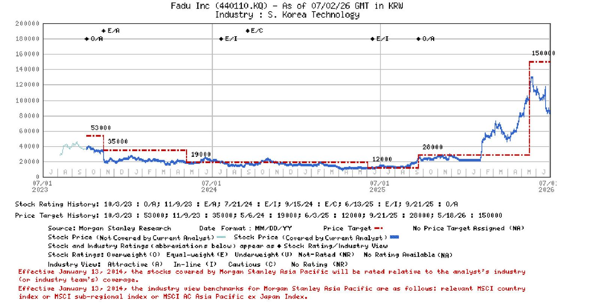

**Fadu Inc (440110.KQ) – As of 07/02/26 GMT in KRW**
Industry : S. Korea Technology

Y-axis: 0, 20000, 40000, 60000, 80000, 100000, 120000, 140000, 160000, 180000, 200000 (KRW). X-axis: 07/01 2023, 07/01 2024, 07/01 2025 and the final tick before 2026 (label clipped); monthly gridline labels J A S O N D.

Stock Rating History: 10/3/23 : O/A; 11/9/23 : E/A; 7/21/24 : E/I; 9/15/24 : E/C; 6/13/25 : E/I; 9/21/25 : O/A

Price Target History: 10/3/23 : 53000; 11/9/23 : 35000; 5/6/24 : 19000; 6/3/25 : 12000; 9/21/25 : 26000; 5/18/26 : 150000

Source: Morgan Stanley Research    Date Format : MM/DD/YY    Price Target —    No Price Target Assigned (NA)
Stock Price (Not Covered by Current Analyst) —    Stock Price (Covered by Current Analyst) —
Stock and Industry Ratings (abbreviations below) appear as ✦ Stock Rating/Industry View
Stock Ratings: Overweight (O) Equal-weight (E) Underweight (U) Not-Rated (NR) No Rating Available (NA)
Industry View: Attractive (A) In-line (I) Cautious (C) No Rating (NR)

Effective January 13, 2014, the stocks covered by Morgan Stanley Asia Pacific will be rated relative to the analyst's industry (or industry team's) coverage.

Effective January 13, 2014, the industry view benchmarks for Morgan Stanley Asia Pacific are as follows: relevant MSCI country index or MSCI sub-regional index or MSCI AC Asia Pacific ex Japan Index.

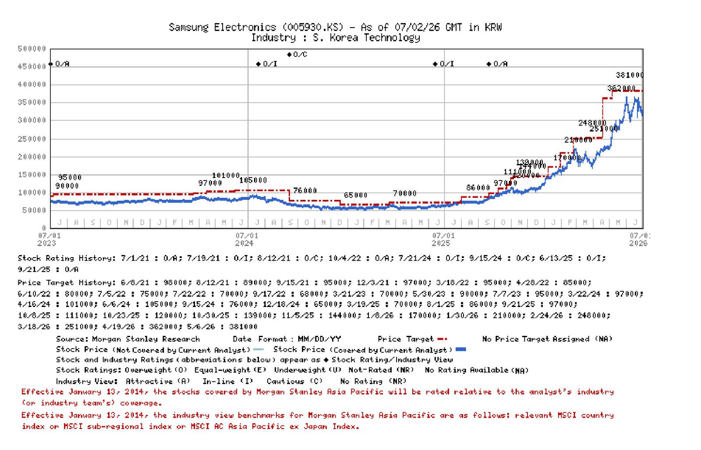

**Samsung Electronics (005930.KS) – As of 07/02/26 GMT in KRW**
Industry : S. Korea Technology

Y-axis: 0, 50000, 100000, 150000, 200000, 250000, 300000, 350000, 400000, 450000, 500000 (KRW). X-axis: 07/01 2023, 07/01 2024, 07/01 2025 and the final tick before 2026 (label clipped); monthly gridline labels J A S O N D.

Stock Rating History: 7/1/21 : O/A; 7/19/21 : O/I; 8/12/21 : O/C; 10/4/22 : O/A; 7/21/24 : O/I; 9/15/24 : O/C; 6/13/25 : O/I; 9/21/25 : O/A

Price Target History: 6/8/21 : 98000; 8/12/21 : 89000; 9/15/21 : 95000; 12/3/21 : 97000; 3/18/22 : 95000; 4/28/22 : 85000; 6/10/22 : 80000; 7/5/22 : 75000; 7/22/22 : 70000; 9/17/22 : 68000; 3/21/23 : 70000; 5/30/23 : 90000; 7/7/23 : 95000; 3/22/24 : 97000; 4/16/24 : 101000; 6/6/24 : 105000; 9/15/24 : 76000; 12/18/24 : 65000; 3/19/25 : 70000; 8/1/25 : 86000; 9/21/25 : 97000; 10/8/25 : 111000; 10/23/25 : 120000; 10/30/25 : 139000; 11/5/25 : 144000; 1/8/26 : 170000; 1/30/26 : 210000; 2/24/26 : 248000; 3/18/26 : 251000; 4/19/26 : 362000; 5/6/26 : 381000

Source: Morgan Stanley Research    Date Format : MM/DD/YY    Price Target —    No Price Target Assigned (NA)
Stock Price (Not Covered by Current Analyst) —    Stock Price (Covered by Current Analyst) —
Stock and Industry Ratings (abbreviations below) appear as ✦ Stock Rating/Industry View
Stock Ratings: Overweight (O) Equal-weight (E) Underweight (U) Not-Rated (NR) No Rating Available (NA)
Industry View: Attractive (A) In-line (I) Cautious (C) No Rating (NR)

Effective January 13, 2014, the stocks covered by Morgan Stanley Asia Pacific will be rated relative to the analyst's industry (or industry team's) coverage.

Effective January 13, 2014, the industry view benchmarks for Morgan Stanley Asia Pacific are as follows: relevant MSCI country index or MSCI sub-regional index or MSCI AC Asia Pacific ex Japan Index.

---

<!-- 原文第 35 页 -->

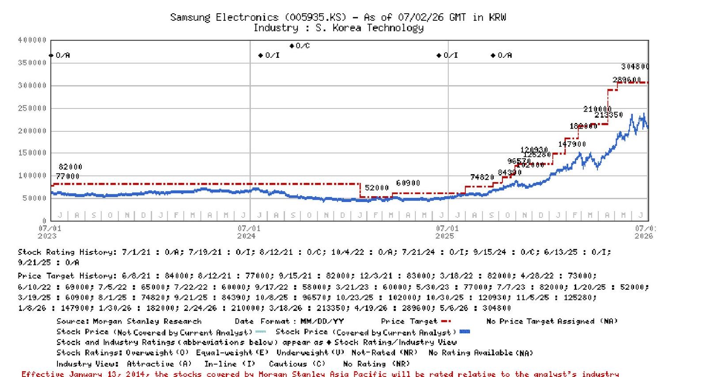

**Samsung Electronics (005935.KS) – As of 07/02/26 GMT in KRW**
Industry : S. Korea Technology

Y-axis: 0, 50000, 100000, 150000, 200000, 250000, 300000, 350000, 400000 (KRW). X-axis: 07/01 2023, 07/01 2024, 07/01 2025 and the final tick before 2026 (label clipped); monthly gridline labels J A S O N D.

Stock Rating History: 7/1/21 : O/A; 7/19/21 : O/I; 8/12/21 : O/C; 10/4/22 : O/A; 7/21/24 : O/I; 9/15/24 : O/C; 6/13/25 : O/I; 9/21/25 : O/A

Price Target History: 6/8/21 : 84000; 8/12/21 : 77000; 9/15/21 : 82000; 12/3/21 : 83000; 3/18/22 : 82000; 4/28/22 : 73000; 6/10/22 : 69000; 7/5/22 : 65000; 7/22/22 : 60000; 9/17/22 : 58000; 3/21/23 : 60000; 5/30/23 : 77000; 7/7/23 : 82000; 1/20/25 : 52000; 3/19/25 : 60900; 8/1/25 : 74820; 9/21/25 : 84390; 10/8/25 : 96570; 10/23/25 : 102000; 10/30/25 : 120930; 11/5/25 : 125280; 1/8/26 : 147900; 1/30/26 : 182000; 2/24/26 : 210000; 3/18/26 : 213350; 4/19/26 : 289600; 5/6/26 : 304800

Source: Morgan Stanley Research    Date Format : MM/DD/YY    Price Target —    No Price Target Assigned (NA)
Stock Price (Not Covered by Current Analyst) —    Stock Price (Covered by Current Analyst) —
Stock and Industry Ratings (abbreviations below) appear as ✦ Stock Rating/Industry View
Stock Ratings: Overweight (O) Equal-weight (E) Underweight (U) Not-Rated (NR) No Rating Available (NA)
Industry View: Attractive (A) In-line (I) Cautious (C) No Rating (NR)

Effective January 13, 2014, the stocks covered by Morgan Stanley Asia Pacific will be rated relative to the analyst's industry (or industry team's) coverage.

Effective January 13, 2014, the industry view benchmarks for Morgan Stanley Asia Pacific are as follows: relevant MSCI country index or MSCI sub-regional index or MSCI AC Asia Pacific ex Japan Index.

---

<!-- 原文第 36 页 -->

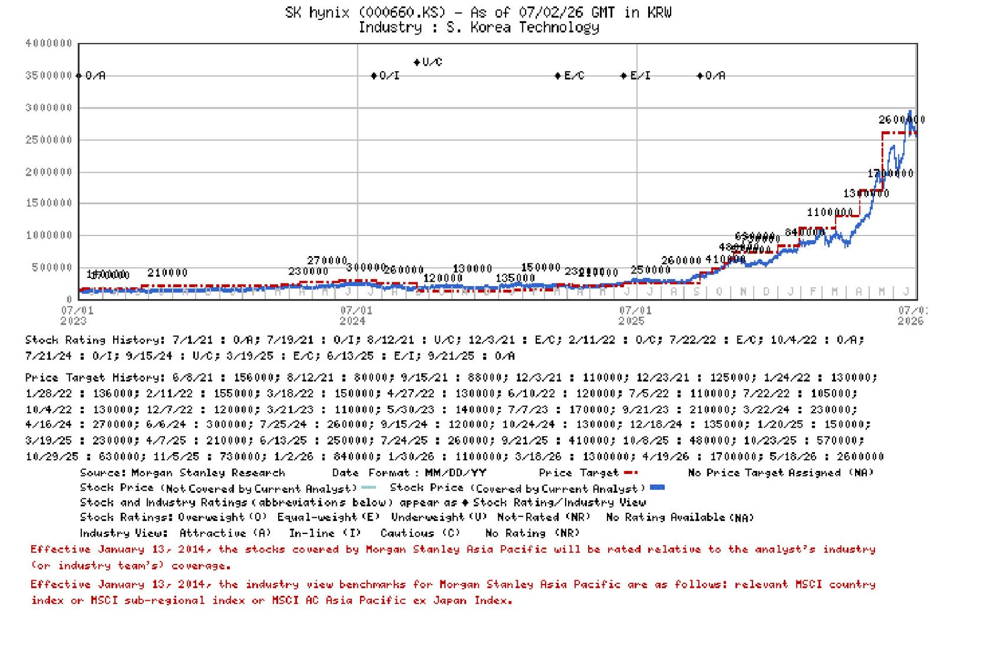

**SK hynix (000660.KS) – As of 07/02/26 GMT in KRW**
Industry : S. Korea Technology

Y-axis: 0, 500000, 1000000, 1500000, 2000000, 2500000, 3000000, 3500000, 4000000 (KRW). X-axis: 07/01 2023, 07/01 2024, 07/01 2025 and the final tick before 2026 (label clipped); monthly gridline labels J A S O N D.

Stock Rating History: 7/1/21 : O/A; 7/19/21 : O/I; 8/12/21 : U/C; 12/3/21 : E/C; 2/11/22 : O/C; 7/22/22 : E/C; 10/4/22 : O/A; 7/21/24 : O/I; 9/15/24 : U/C; 3/19/25 : E/C; 6/13/25 : E/I; 9/21/25 : O/A

Price Target History: 6/8/21 : 156000; 8/12/21 : 80000; 9/15/21 : 88000; 12/3/21 : 110000; 12/23/21 : 125000; 1/24/22 : 130000; 1/28/22 : 136000; 2/11/22 : 155000; 3/18/22 : 150000; 4/27/22 : 130000; 6/10/22 : 120000; 7/5/22 : 110000; 7/22/22 : 105000; 10/4/22 : 130000; 12/7/22 : 120000; 3/21/23 : 110000; 5/30/23 : 140000; 7/7/23 : 170000; 9/21/23 : 210000; 3/22/24 : 230000; 4/16/24 : 270000; 6/6/24 : 300000; 7/25/24 : 260000; 9/15/24 : 120000; 10/24/24 : 130000; 12/18/24 : 135000; 1/20/25 : 150000; 3/19/25 : 230000; 4/7/25 : 210000; 6/13/25 : 250000; 7/24/25 : 260000; 9/21/25 : 410000; 10/8/25 : 480000; 10/23/25 : 570000; 10/29/25 : 630000; 11/5/25 : 730000; 1/2/26 : 840000; 1/30/26 : 1100000; 3/18/26 : 1300000; 4/19/26 : 1700000; 5/18/26 : 2600000

Source: Morgan Stanley Research    Date Format : MM/DD/YY    Price Target —    No Price Target Assigned (NA)
Stock Price (Not Covered by Current Analyst) —    Stock Price (Covered by Current Analyst) —
Stock and Industry Ratings (abbreviations below) appear as ✦ Stock Rating/Industry View
Stock Ratings: Overweight (O) Equal-weight (E) Underweight (U) Not-Rated (NR) No Rating Available (NA)
Industry View: Attractive (A) In-line (I) Cautious (C) No Rating (NR)

Effective January 13, 2014, the stocks covered by Morgan Stanley Asia Pacific will be rated relative to the analyst's industry (or industry team's) coverage.

Effective January 13, 2014, the industry view benchmarks for Morgan Stanley Asia Pacific are as follows: relevant MSCI country index or MSCI sub-regional index or MSCI AC Asia Pacific ex Japan Index.

## Important Disclosures for Morgan Stanley Smith Barney LLC Customers

Important disclosures regarding any material conflict of interest that can reasonably be expected to have influenced Morgan Stanley Smith Barney LLC's choice of a third-party research provider or the subject company of a third-party research report, are available on the Morgan Stanley Wealth Management disclosure website at www.morganstanley.com/online/researchdisclosures.

For Morgan Stanley specific disclosures, you may refer to https://www.morganstanley.com/eqr/disclosures/webapp/generalresearch.

Each Morgan Stanley research report is reviewed and approved on behalf of Morgan Stanley Smith Barney LLC. This review and approval is conducted by the same person who reviews the research report on behalf of Morgan Stanley. This could create a conflict of interest.

### Other Important Disclosures

A member of Research who had or could have had access to the research prior to completion owns securities (or related derivatives) in the Micron Technology Inc.. This person is not a research analyst or a member of research analyst's household.

Morgan Stanley Research policy is to update research reports as and when the Research Analyst and Research Management deem appropriate, based on developments with the issuer, the sector, or the market that may have a material impact on the research views or opinions stated therein. In addition, certain Research publications are intended to be updated on a regular periodic basis (weekly/monthly/quarterly/annual) and will ordinarily be updated with that frequency, unless the Research Analyst and Research Management determine that a different publication schedule is appropriate based on current conditions.

Morgan Stanley is not acting as a municipal advisor and the opinions or views contained herein are not intended to be, and do not constitute, advice within the meaning of Section 975 of the Dodd-Frank Wall Street Reform and Consumer Protection Act.

Morgan Stanley produces an equity research product called a "Tactical Idea." Views contained in a "Tactical Idea" on a particular stock may be contrary to the recommendations or views expressed in research on the same stock. This may be the result of differing time horizons, methodologies, market events, or other factors. For all research available on a particular stock, please contact your sales representative or go to Matrix at http://www.morganstanley.com/matrix.

Morgan Stanley Research is provided to our clients through our proprietary research portal on Matrix and also distributed electronically by Morgan Stanley to clients. Certain, but not all, Morgan Stanley Research products are also made available to clients through third-party vendors or redistributed to clients through alternate electronic means as a convenience. For access to all available Morgan Stanley Research, please contact your sales representative or go to Matrix at http://www.morganstanley.com/matrix.

Any access and/or use of Morgan Stanley Research is subject to Morgan Stanley's Terms of Use (http://www.morganstanley.com/terms.html). By accessing and/or using Morgan Stanley Research, you are indicating that you have read and agree to be bound by our Terms of Use (http://www.morganstanley.com/terms.html). In addition you consent to Morgan Stanley processing your personal data and using cookies in accordance with our Privacy Policy and our Global Cookies Policy (http://www.morganstanley.com/privacy_pledge.html), including for the purposes of setting your preferences and to collect readership data so that we can deliver better and more personalized service and products to you. To find out more information about how Morgan Stanley processes personal data, how we use cookies and how to reject cookies see our Privacy Policy and our Global Cookies Policy (http://www.morganstanley.com/privacy_pledge.html). Please use

---

<!-- 原文第 37 页 -->

the provided link to review the Terms and Conditions and Most Important Terms and Conditions for Morgan Stanley India Company Private Limited (https://www.morganstanley.com/assets/pdfs/about-us-global-offices/india/Terms_and_conditions.pdf) and the following link to review the audit report (https://ny.matrix.ms.com/eqr/research/webapp/researchdocs/MSICPL_Morgan_Stanley_Research_Audit_Report.pdf).

If you do not agree to our Terms of Use and/or if you do not wish to provide your consent to Morgan Stanley processing your personal data or using cookies please do not access our research.

Morgan Stanley Research does not provide individually tailored investment advice. Morgan Stanley Research has been prepared without regard to the circumstances and objectives of those who receive it. Morgan Stanley recommends that investors independently evaluate particular investments and strategies, and encourages investors to seek the advice of a financial adviser. The appropriateness of an investment or strategy will depend on an investor's circumstances and objectives. The securities, instruments, or strategies discussed in Morgan Stanley Research may not be suitable for all investors, and certain investors may not be eligible to purchase or participate in some or all of them. Morgan Stanley Research is not an offer to buy or sell or the solicitation of an offer to buy or sell any security/instrument or to participate in any particular trading strategy. The value of and income from your investments may vary because of changes in interest rates, foreign exchange rates, default rates, prepayment rates, securities/instruments prices, market indexes, operational or financial conditions of companies or other factors. There may be time limitations on the exercise of options or other rights in securities/instruments transactions. Past performance is not necessarily a guide to future performance. Estimates of future performance are based on assumptions that may not be realized. If provided, and unless otherwise stated, the closing price on the cover page is that of the primary exchange for the subject company's securities/instruments.

The fixed income research analysts, strategists or economists principally responsible for the preparation of Morgan Stanley Research have received compensation based upon various factors, including quality, accuracy and value of research, firm profitability or revenues (which include fixed income trading and capital markets profitability or revenues), client feedback and competitive factors. Fixed Income Research analysts', strategists' or economists' compensation is not linked to investment banking or capital markets transactions performed by Morgan Stanley or the profitability or revenues of particular trading desks.

The "Important Regulatory Disclosures on Subject Companies" section in Morgan Stanley Research lists all companies mentioned where Morgan Stanley owns 1% or more of a class of common equity securities of the companies. For all other companies mentioned in Morgan Stanley Research, Morgan Stanley may have an investment of less than 1% in securities/instruments or derivatives of securities/instruments of companies and may trade them in ways different from those discussed in Morgan Stanley Research. Employees of Morgan Stanley not involved in the preparation of Morgan Stanley Research may have investments in securities/instruments or derivatives of securities/instruments of companies mentioned and may trade them in ways different from those discussed in Morgan Stanley Research. Derivatives may be issued by Morgan Stanley or associated persons.

With the exception of information regarding Morgan Stanley, Morgan Stanley Research is based on public information. Morgan Stanley makes every effort to use reliable, comprehensive information, but we make no representation that it is accurate or complete. We have no obligation to tell you when opinions or information in Morgan Stanley Research change apart from when we intend to discontinue equity research coverage of a subject company. Facts and views presented in Morgan Stanley Research have not been reviewed by, and may not reflect information known to, professionals in other Morgan Stanley business areas, including investment banking personnel.

Morgan Stanley Research personnel may participate in company events such as site visits and are generally prohibited from accepting payment by the company of associated expenses unless pre-approved by authorized members of Research management.

Morgan Stanley may make investment decisions that are inconsistent with the recommendations or views in this report.

To our readers based in Taiwan or trading in Taiwan securities/instruments: Information on securities/instruments that trade in Taiwan is distributed by Morgan Stanley Taiwan Limited ("MSTL"). Such information is for your reference only. The reader should independently evaluate the investment risks and is solely responsible for their investment decisions. Morgan Stanley Research may not be distributed to the public media or quoted or used by the public media without the express written consent of Morgan Stanley. Any non-customer reader within the scope of Article 7-1 of the Taiwan Stock Exchange Recommendation Regulations accessing and/or receiving Morgan Stanley Research is not permitted to provide Morgan Stanley Research to any third party (including but not limited to related parties, affiliated companies and any other third parties) or engage in any activities regarding Morgan Stanley Research which may create or give the appearance of creating a conflict of interest. Information on securities/instruments that do not trade in Taiwan is for informational purposes only and is not to be construed as a recommendation or a solicitation to trade in such securities/instruments. MSTL may not execute transactions for clients in these securities/instruments.

Certain information in Morgan Stanley Research was sourced by employees of the Shanghai Representative Office of Morgan Stanley Asia Limited for the use of Morgan Stanley Asia Limited.

Morgan Stanley is not incorporated under PRC law and the research in relation to this report is conducted outside the PRC. Morgan Stanley Research does not constitute an offer to sell or the solicitation of an offer to buy any securities in the PRC. PRC investors shall have the relevant qualifications to invest in such securities and shall be responsible for obtaining all relevant approvals, licenses, verifications and/or registrations from the relevant governmental authorities themselves. Neither this report nor any part of it is intended as, or shall constitute, provision of any consultancy or advisory service of securities investment as defined under PRC law. Such information is provided for your reference only.

Morgan Stanley Research is disseminated in Brazil by Morgan Stanley C.T.V.M. S.A. located at Av. Brigadeiro Faria Lima, 3600, 6th floor, São Paulo - SP, Brazil; and is regulated by the Comissão de Valores Mobiliários; in Mexico by Morgan Stanley México, Casa de Bolsa, S.A. de C.V which is regulated by Comision Nacional Bancaria y de Valores. Paseo de los Tamarindos 90, Torre 1, Col. Bosques de las Lomas Floor 29, 05120 Mexico City; in Japan by Morgan Stanley MUFG Securities Co., Ltd. and, for Commodities related research reports only, Morgan Stanley Capital Group Japan Co., Ltd; in Hong Kong by Morgan Stanley Asia Limited (which accepts responsibility for its contents) and by Morgan Stanley Bank Asia Limited; in Singapore by Morgan Stanley Asia (Singapore) Pte. (Registration number 199206298Z) and/or Morgan Stanley Asia (Singapore) Securities Pte Ltd (Registration number 200008434H), regulated by the Monetary Authority of Singapore (which accepts legal responsibility for its contents and should be contacted with respect to any matters arising from, or in connection with, Morgan Stanley Research) and by Morgan Stanley Bank Asia Limited, Singapore Branch (Registration number T14FC0118J); in Australia to "wholesale clients" within the meaning of the Australian Corporations Act by Morgan Stanley Australia Limited A.B.N. 67 003 734 576, holder of Australian financial services license No. 233742, which accepts responsibility for its contents; in Australia to "wholesale clients" and "retail clients" within the meaning of the Australian Corporations Act by Morgan Stanley Wealth Management Australia Pty Ltd (A.B.N. 19 009 145 555, holder of Australian financial services license No. 240813, which accepts responsibility for its contents; in Korea by Morgan Stanley & Co International plc, Seoul Branch; in India by Morgan Stanley India Company Private Limited having Corporate Identification No (CIN) U22990MH1998PTC115305, regulated by the Securities and Exchange Board of India ("SEBI") and holder of licenses as a Research Analyst (SEBI Registration No. INH000001105); Stock Broker (SEBI Stock Broker Registration No. INZ000244438), Merchant Banker (SEBI Registration No. INM000011203), and depository participant with National Securities Depository Limited (SEBI Registration No. IN-DP-NSDL-567-2021) having registered office at Altimus, Level 39 & 40, Pandurang Budhkar Marg, Worli, Mumbai 400018, India; Telephone no. +91-22-61181000; Compliance Officer Details: Mr. Tejarshi Hardas, Tel. No.: +91-22-61181000 or Email: tejarshi.hardas@morganstanley.com; Grievance officer details: Mr. Tejarshi Hardas, Tel. No.: +91-22-61181000 or Email: msic-compliance@morganstanley.com. Morgan Stanley India Company Private Limited (MSICPL) may use AI tools in providing research services. All recommendations contained herein are made by the duly qualified research analysts; in Canada by Morgan Stanley Canada Limited; in Germany and the European Economic Area where required by Morgan Stanley Europe S.E., authorised and regulated by Bundesanstalt fuer Finanzdienstleistungsaufsicht (BaFin) under the reference number 149169; in the US by Morgan Stanley & Co. LLC, which accepts responsibility for its contents. Morgan Stanley & Co. International plc, authorized by the Prudential Regulation Authority and regulated by the Financial Conduct Authority and the Prudential Regulation Authority, disseminates in the UK research that it has prepared, and research which has been prepared by any of its affiliates, only to persons who (i) are investment professionals falling within Article 19(5) of the Financial Services and Markets Act 2000 (Financial Promotion) Order 2005 (as amended, the "Order"); (ii) are persons who are

---

<!-- 原文第 38 页 -->

high net worth entities falling within Article 49(2)(a) to (d) of the Order; or (iii) are persons to whom an invitation or inducement to engage in investment activity (within the meaning of section 21 of the Financial Services and Markets Act 2000, as amended) may otherwise lawfully be communicated or caused to be communicated. RMB Morgan Stanley Proprietary Limited is a member of the JSE Limited and A2X (Pty) Ltd. RMB Morgan Stanley Proprietary Limited is a joint venture owned equally by Morgan Stanley International Holdings Inc. and RMB Investment Advisory (Proprietary) Limited, which is wholly owned by FirstRand Limited. The information in Morgan Stanley Research is being disseminated by Morgan Stanley Saudi Arabia, regulated by the Capital Market Authority in the Kingdom of Saudi Arabia, and is directed at Sophisticated investors only.

The information in Morgan Stanley Research is being communicated by Morgan Stanley & Co. International plc (DIFC Branch), regulated by the Dubai Financial Services Authority (the DFSA) or by Morgan Stanley & Co. International plc (ADGM Branch), regulated by the Financial Services Regulatory Authority Abu Dhabi (the FSRA), and is directed at Professional Clients only, as defined by the DFSA or the FSRA, respectively. The financial products or financial services to which this research relates will only be made available to a customer who we are satisfied meets the regulatory criteria of a Professional Client. A distribution of the different MS Research ratings or recommendations, in percentage terms for Investments in each sector covered, is available upon request from your sales representative.

The information in Morgan Stanley Research is being communicated by Morgan Stanley & Co. International plc (QFC Branch), regulated by the Qatar Financial Centre Regulatory Authority (the QFCRA), and is directed at business customers and market counterparties only and is not intended for Retail Customers as defined by the QFCRA.

As required by the Capital Markets Board of Turkey, investment information, comments and recommendations stated here, are not within the scope of investment advisory activity. Investment advisory service is provided exclusively to persons based on their risk and income preferences by the authorized firms. Comments and recommendations stated here are general in nature. These opinions may not fit to your financial status, risk and return preferences. For this reason, to make an investment decision by relying solely to this information stated here may not bring about outcomes that fit your expectations.

The following companies do business in countries which are generally subject to comprehensive sanctions programs administered or enforced by the U.S. Department of the Treasury's Office of Foreign Assets Control ("OFAC") and by other countries and multi-national bodies: Samsung Electronics.

The trademarks and service marks contained in Morgan Stanley Research are the property of their respective owners. Third-party data providers make no warranties or representations relating to the accuracy, completeness, or timeliness of the data they provide and shall not have liability for any damages relating to such data. The Global Industry Classification Standard (GICS) was developed by and is the exclusive property of MSCI and S&P.

Morgan Stanley Research, or any portion thereof may not be reprinted, sold or redistributed without the written consent of Morgan Stanley.

Indicators and trackers referenced in Morgan Stanley Research may not be used as, or treated as, a benchmark under Regulation EU 2016/1011, or any other similar framework.

The issuers and/or fixed income products recommended or discussed in certain fixed income research reports may not be continuously followed. Accordingly, investors should regard those fixed income research reports as providing stand-alone analysis and should not expect continuing analysis or additional reports relating to such issuers and/or individual fixed income products.

Morgan Stanley may hold, from time to time, material financial and commercial interests regarding the company subject to the Research report.

Registration granted by SEBI and certification from the National Institute of Securities Markets (NISM) in no way guarantee performance of the intermediary or provide any assurance of returns to investors. Investment in securities market are subject to market risks. Read all the related documents carefully before investing.

## INDUSTRY COVERAGE: S. Korea Technology

**Ryan Kim**

| Company (Ticker) | Rating (As Of) | Price* (07/02/2026) |
| --- | --- | --- |
| Ecopro BM (247540.KQ) | U (03/20/2023) | W125,500 |
| Fadu Inc (440110.KQ) | O (09/21/2025) | W76,000 |
| Hanmi Semiconductor Co. Ltd. (042700.KS) | O (08/16/2024) | W219,500 |
| HD Hyundai Electric Co Ltd (267260.KS) | O (03/25/2025) | W969,000 |
| Isu Petasys Co. Ltd. (007660.KS) | O (02/03/2025) | W119,800 |
| L&F Co Ltd (066970.KS) | E (04/03/2025) | W106,700 |
| Leeno Industrial Inc. (058470.KQ) | O (04/03/2025) | W75,100 |
| Lotte Energy Materials Corp (020150.KS) | U (04/03/2025) | W39,200 |
| LS Electric (010120.KS) | O (01/22/2026) | W236,500 |
| POSCO FUTURE M (003670.KS) | U (04/03/2025) | W163,600 |
| SK IE Technology (361610.KS) | U (04/03/2025) | W16,030 |
| SK Square Co Ltd. (402340.KS) | O (05/06/2026) | W1,525,000 |
| Wonik IPS Co Ltd (240810.KQ) | O (08/08/2025) | W131,600 |

**Shawn Kim**

| Company (Ticker) | Rating (As Of) | Price* (07/02/2026) |
| --- | --- | --- |
| LG Display (034220.KS) | E (06/11/2025) | W10,980 |
| LG Electronics (066570.KS) | E (04/07/2025) | W192,300 |
| LG Innotek (011070.KS) | E (03/12/2025) | W874,000 |
| Samsung Electro-Mechanics (009150.KS) | O (07/31/2025) | W1,926,000 |
| Samsung Electronics (005935.KS) | O (11/18/2019) | W188,700 |
| Samsung Electronics (005930.KS) | O (11/18/2019) | W286,000 |
| SK hynix (000660.KS) | O (09/21/2025) | W2,187,000 |

Stock Ratings are subject to change. Please see latest research for each company.

* Historical prices are not split adjusted.

---

<!-- 原文第 39 页 -->

© 2026 Morgan Stanley

---
