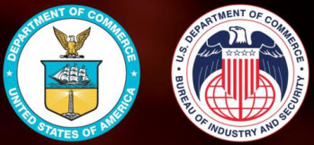
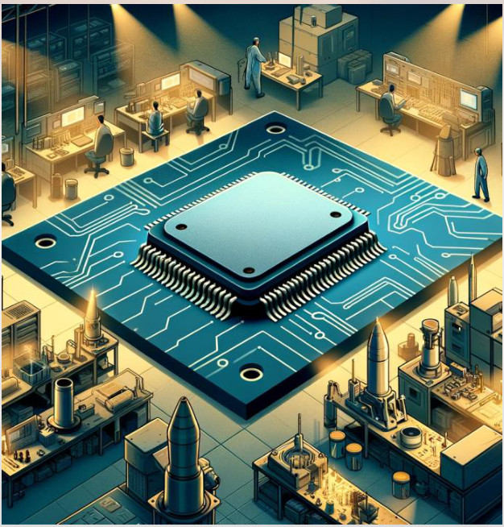
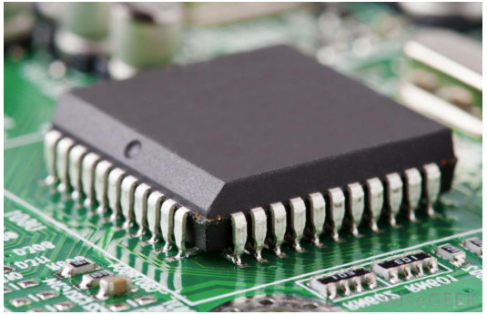
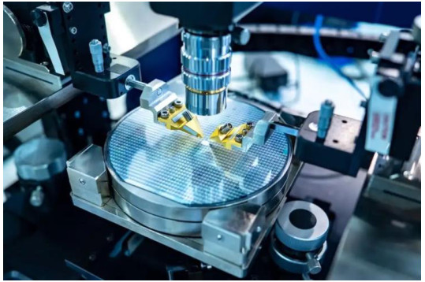
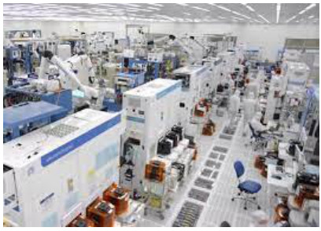
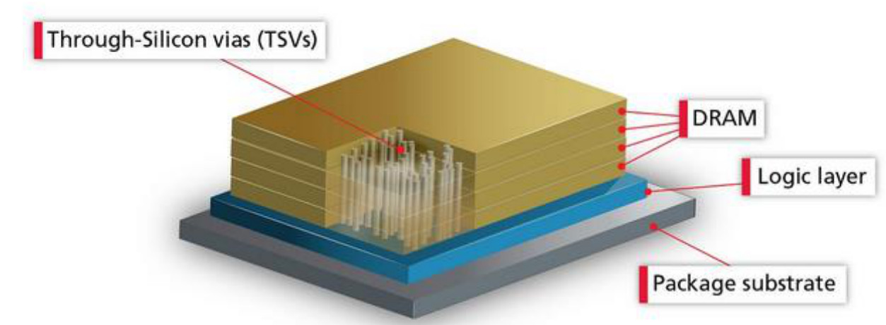

> 原文件：[33_bis.gov_updates-semiconductor-controls.pdf](https://github.com/jadennevercode/CJCC-Knowledge-Base/blob/564ab11aa9785e569e3853c8a4d7ce86f88e7535/materials/%E8%B7%A8%E9%93%BE%EF%BC%9A%E6%94%BF%E7%AD%96%E5%8F%8A%E5%A4%9A%E4%BA%8B%E4%BB%B6%E4%BA%A4%E4%BA%92/33_bis.gov_updates-semiconductor-controls.pdf)
> 转换方式：Volcengine OCRPdf v3, parse_mode=ocr

<!-- 原文第 1 页 -->

## BUREAU OF INDUSTRY AND SECURITY UPDATE CONFERENCE ON EXPORT CONTROLS AND POLICY MARCH 18-20, 2025 
 
## Updates on Semiconductor Controls 
Carlos Monroy, Director Electronics and Materials Division (EMD) Office of National Security Controls (ONSC) 
William Hunt Senior Advisor EA/PDAS 
Moderator: Chris Chamberlain 
return 
Senior Advisor ONSC/EMD Christopher Phenicie Senior Policy Advisor ONSC/EMD 
anclude nt ainint 
Sharron Cook 
Senior Export Policy Analyst Regulatory Policy Division Office of Exporter Services

---

<!-- 原文第 2 页 -->

## BUREAU OF INDUSTRY AND SECURITY UPDATE CONFERENCE ON EXPORT CONTROLS AND POLICY 
 

| Rule Title (aka) | Pub.Date | Effective and Compliance Date | End of Public Comment Period Date |
| --- | --- | --- | --- |
| mplementation of Additional Export Controls: Certain Advanced omputing Items; Supercomputer and Semiconductor End Use; pdates and Corrections; and Export Controls on Semiconductor Manufacturing Items; Corrections and Clarifications (C&C Rule) | 04/04/2024 89 FR 23876 | 4/4/2024 | 04/29/2024 |
| ommerce Control List Additions and Revisions; Implementation f Controls on Advanced Technologies Consistent with Controls mplemented by International Partners Quantum & Semiconductor Rule -Q&S rule) | 9/06/2024 89 FR 72926 | 9/6/2024 Compliance: 11/5/2024 | 11/5/2024 |
| reign-Produced Direct Product Rule Additions,and efinements to Controls for Advanced Computing and emiconductor Manufacturing ltems (FN5 Rule) | 12/05/2024 89 FR 96790 | 12/02/2024 | 03/14/2025 |
| mplementation of Additional Due Diligence Measures for dvanced Computing Integrated Circuits; Amendments and larifications; and Extension of Comment Period (FDD Rule) | 1/16/2025 90 FR 5298 | 01/16/2025 Compliance: 01/31/2025 | 3/14/2025 |

---

<!-- 原文第 3 页 -->

BUREAU OF INDUSTRY AND SECURITY UPDATE CONFERENCE ON EXPORT CONTROLS AND POLICY 
 
C&C Rule: Correction and Clarification Rule 
·740.8 Notified Advanced Computing (NAC) 
·License review policy for Gray Zone chips 
. SME S 744.23 (a)(4) new end use/user control for inorporation to 
prevent indigenous production of SME 
. Removing EUV mask substrates (3B001.j), and EUV mask making 
equipment (3B991.b.2) from the SME license requirement parenthetical exceptions 
·Clarification to BIS responses to certain public comment topics 45, 46, 47,and 49 
MARCH 18-20,2025

---

<!-- 原文第 4 页 -->

BUREAU OF INDUSTRY AND SECURITY UPDATE CONFERENCE ON EXPORT CONTROLS AND POLICY 
 
Q&S: New Semiconductor Mfg.ECCNs 
·3B903 Scanning Electron Microscope(SEM) equipment designed for imaging semiconductor devices or integrated circuits. 
·3C907 Epitaxial materials consisting of a "ubstrate" having at least one epitaxially grown layer and containing other specified materials 
·3C908 Fluorides, hydrides, chlorides, of silicon or germanium,containing other specified materials. 
·3C909 Silicon, slicon oxides, germanium or germanium oxides,containing any other specified materials. 
 
MARCH 18-20,2025

---

<!-- 原文第 5 页 -->

BUREAU OF INDUSTRY AND SECURITY UPDATE CONFERENCE ON EXPORT CONTROLS AND POLICY 
 
Q&S: New Semiconductor Mfg.ECCNs 
·3B001.c.1.a lsotropic dry etching equipment 
·3B001.c.1.cAnisotropic dry etching equipment 
·3B001.q("EUV"masks and "EUV" reticles designed for integrated circuits, not specified by 3B001.g,and having a mask "substrate blank" specified by 3B001.j). 
·3D907"Software" designed to extract"GDSI" or equivalent standard layout data and perform layer-to-layer alignment from SEM images, and generate multi-layer "GDI" data or the circuit netlist. 
·3E905"Technolog"according to the General Technology Note for the "development" or "production" of integrated circuits or devices, using "Gate all-around Field-Effect Transistor ("GAAFET") structures. 
 
MARCH 18-20,2025

---

<!-- 原文第 6 页 -->

BUREAU OF INDUSTRY AND SECURITY UPDATE CONFERENCE ON EXPORT CONTROLS AND POLICY 
 
742.4(a)(5)(i)(A) and 742.6(a)(10)(i)(A) Grandfather clausecovers existing employees - Deemed exports/reexports of all technology/software (except GAAFET 3E905) to most destinations (except D:1/D:5) 
Q&S:Summary of Exclusions and General 
·742.4(a)(5)(i)()and 742.6(a)(10)(i)(B)deemed export/reexportsgoing forward,e.g,new employees or an existing employee getting access to different technology. 
License Authorizations 
·General Licenses in General Order No.6 authorizations 
·(f)(1) Actual exports/reexports/transfers of GAAFET technology (3E905) for A:5 and A:6 countries 
(f)(2) GAAFET technology(3E905) deemed exports/reexport for D:1/5 FN existing employees (grandfather clause) 
·(f)(2) Quantum technology/software deemed exports/reexports for D:1/5 FNs going forward 
MARCH 18-20,2025

---

<!-- 原文第 7 页 -->

BUREAU OF INDUSTRY AND SECURITY UPDATE CONFERENCE ON EXPORT CONTROLS AND POLICY 
FN5 
Rule 
 
## Controls on 24 new types of tools and revisions to existing Cat. 3 Export Control Classification Numbers (ECCNs) 
·Two new Foreign Direct Product rules and related de minimis rules: FN5 FDP for fabs of concern SME FDP for Macau and D:5 Countries (including concept of "contains") 
·High Bandwidth Memory(HBM) controls 
·New Dynamic random-access memory (DRAM) integrated circuit parameters 
· National Security and Regional Stability Controls 
·New Country List - Supp. No.4 to part 742 
·740.25 License Exception High Bandwidth Memory (HBM)[AES C71] 
·$740.26 License Exception Restricted Fabrication "Facility" (RFF) [AES C72] 
·TGL Revisions [AES C65] 
·Eight new Red Flags 
·Software key access clarification 
MARCH 18-20,2025

---

<!-- 原文第 8 页 -->

BUREAU OF INDUSTRY AND SECURITY UPDATE CONFERENCE ON EXPORT CONTROLS AND POLICY 
 
## New Red Flags 
·Red flag 22 foreign government requires a license to export the item, and the nature of the end user raises questions about whether the exporter, reexporter, or transferor would have been granted a license for the item 
·Red flag 26 export, export from abroad, reexport, or transfer of a foreign-produced item described in Category 3B ECCN in FN5 or SME FDP and contains at least one IC, then there is a red flag that the foreign-produced item meets the product scope of that Entity List FDP rule. 
Red flag 27 identifies a scenario where the end user is a "facility" that is connected to a "facility"where "production"of "advance compute integrated circuits" occurs. 
"Unles the Red Flag is resolved through an Advisory Opinion,the two buildings are treated as a single "facility" for purposes of $ 744.23 of the EAR." 
MARCH 18-20,2025

---

<!-- 原文第 9 页 -->

BUREAU OF INDUSTRY AND SECURITY UPDATE CONFERENCE ON EXPORT CONTROLS AND POLICY 
 
Rule FN5 FDP technology "ubject to Input - software or the EAR" used to ("direc product") a plant or major Input- U.S.origin software or technology used to produce Product Scope foreign-produced item Output- Destination/End "knowledge" User/End Use
produce foreign- produced item OR produced commodity is contained roduces the foreign-produced component of a plant that in foreign-produced item item, or such a foreign that contains any Includes 3B SME product of the component plant/major incorporated into any "part," "component"o"euipment" 1. The FDP will be "Knowledge" that: ordered by any FNS entity or by an entity located at a produced, purchased, or
734.9(e)(3) Footnote 5 commodities),3D901(for ECCN 3D001(for3B 3B991 and 3B992), 3B903),3D991 (for ECCN 3D001 (for 3B commodities), 3E001 (for 3B commodities), 3E901 3D901,3D991(for3B991 and 3B992),3D992, 3D993,3D994, f.6,g, h, kton,p.2, p.4, r),3B002 (except 3B001.a.4,c,d,f.1,f.5, ECCN 3B001(except "facility" in Macau/D:5wher integrated circuits" occurs; OR the"production"of logco 2. A FN5 entity or an entity DRAM"advanced-node
3D993,3D994, 3E001 (for 3B commodities), (for3B903),3E991(for 3B991 and 3B992),3E992,3E993,or3E994 3B002.c),3B903,3B992 (except 3B991.b.2.a in Macau/D:5 of supplement located at a "facity" lcated no.1 to part 740 where the
3E901(for 3B903),3E991 (for 3B991 and 3B992), 3E993,or 3E994 Section 734.9(e)(3) through 3B991.b.2.b), 3B992,3B993, or 3B994 "production"of logic or DRM "advanced-node integrated circuits" occurs is party to transaction

---

<!-- 原文第 10 页 -->

 
2 1 
 
INPUT: Any product of the 3B SME 
INPUT: US-Origin ECCN 3D001(for3B commodities), 3D901(for 3B903),3D991(for3B991 and 3B992),3D993, 3D994, 3E001(for3B commodities), 3E901 (for 3B903),3E991 (for 3B991 and 3B992),3E993,or 3E994 
 
INPUT/OUTPUT: ECCN 3B001 (except 3B001.a.4,c,d,f.1,5,f6,h,kto n, p.2, p.4,r), 3B002 (except 3B002.c), 3B903, 3B991 (except 3B991.b.2.a through 3B991.b.2.b),3B992,3B993, or 3B994 
Subject to the EAR! 
 
OUTPUT: SME that contains the output of the foreign SME 
10

---

<!-- 原文第 11 页 -->

## BUREAU OF INDUSTRY AND SECURITY UPDATE CONFERENCE ON EXPORT CONTROLS AND POLICY 
## License Requirements for ltems Subject to the EAR Under FN5 FDP 
 

| Entity HQ | Reexport/Export from Abroad from Supp.4 | Reexport/Export from Abroad from A:5, not in Supp.4 | Reexport/Export from Abroad from Non-A:5 | Transfers (in-country) (D:5/Macau) |
| --- | --- | --- | --- | --- |
| upp.45 | No BIS license required for ECCNs in Lists 1-3 | List 1 ECCNs-D:5/Macau6 List 2 ECCNs -FN56 | List 1 ECCNs -D:5/Macau List 2 ECCNs-FN5 | List 1 ECCNs - All end-users List 2 ECCNs-FN5 |
| on-Supp.4 nd not :5/Macau) | No BIS license required for ECCNs in Lists 1-3 | List 1 ECCNs-D:5/Macau6 List 2ECCNs-FN56 | List 1 ECCNs -D:5/Macau List 3 ECCNs-FN5 | List 1 ECCNs - All end-users List3 ECCNs-FN5 |
| :5/Macau | List 1- D:5/Macau List3-FN5 | List 1 ECCNs - D:5/Macau List 3 ECCNs-FN5 | List 1 ECCNs-D:5/Macau List3ECCNs-FN5 | List 1 ECCNs - All end-users List3 ECCNs - FN5 |
 
ECCN List Key: 
SSupplement No. 4 to Part 742 includes: Australia, Austria, Belgium,Bulgaria, Canada, Croatia, czech Republic,Denmark, Estonia, Finland, France,Germany, Greece,Hungary, celand, lreland, taly,Japan, Latia, ihuania,Luembour, Netherlands, New Zealand, Norway, Poland, Portugal, Romania, Slovakia, Slovenia, Spain, Sweden, Switzerland, United Kingdom. 
List 1:ECCN 3B001.a.4,c,d,f.1,f.5,f.6, k to n,p.2,p.4,, 3B002.c 
List 2:ECCN 3B993 
List 3:ECCN 3B001 (except List 1 and 3B001.g and .h),3B002 (except 3B002.c), 3B611,3B903, 3B991(except 3B991.b.2.a and 3B991.b.2.b),3B992,3B993,3B994. 
7See 5742.4(a)(4)Xi)(B)and (C);5744.11(a)(2)(v)(A)(1). 
11 
MARCH 18-20,2025

---

<!-- 原文第 12 页 -->

## BUREAU OF INDUSTRY AND SECURITY UPDATE CONFERENCE ON EXPORT CONTROLS AND POLICY 
Licensing Requirements for Foreign-Produced Commodities Outside the US That Are Specific tos (i) Footnote 5 Fabs ANC (i) Unlisted Fabs in Macau/D5 That Produce "Advanced Node" Logic or DRAM 
13B001(except 3B001.a.4,,d,f.,f,s,f6,g,h,k to n,p.2, p.,r),B002(except 3B002.C),3B611, 3B903, 3B991 (except 3B991.b.2.a through 3B991.b.2.b),3B992,3B993,or 3B994 
From Argentina,India,S. Korea, or Turkiye to FN5 Singapore, or Taiwan) to FN5 Entity or From non-A5 countries (e.g, Israel, From Supp.No.4 countries (e.g,JP,NL, or DE)to FN5 Transfer within China to FN5 Entity or Advanced Fab
Entity or Advanced Fab Advanced Fab Entity or Advanced Fab
HQ'd in US or that has ultimate parent License required for all FN5 / Advanced Fab ECCNs.1 744.11(a)(2Y(v)(A)(3)() License required for all FN5/Advanced Fab ECCNs.1
Taiwan, Singapore, ultimate parent in, ultimate parent in Supp other non-Supp 4 Israel, S. Korea, India or HQ'd in, or with 4 countries HQ'd in, or with company in US subject to commodity is not License required for 744.11(a)(2)(v)(A)(2) only 3B993 (if the equivalent controls country). by the relevant License required for only 744.11(a)(2Y(v)(A)(3)0) 744.11(a)(2)(v)(A)(3)(i 3B993. Advanced Fab ECCNs.1 License required for all FN5 / provides the exclusive No EAR license for items within the license requirements scope of 734.9(e)(3)) required. (744.11(a)(2)(v)(A) License required for only FN5/Advanced Fab 744.11(a)(2)(v)(A)(4)(i License required for all 3B993. 744.11(a)(2)(v)(A)(4)0) 744.11(a)(2)(v)(A)(4)(0) ECCNs.1
countries
Macau/D5 HQ'd or
ultimate parent in License required for all FN5/Advanced Fab ECCNs.
Macau/D5 744.11(a)(2)(v)(A)(1),(4)i)

---

<!-- 原文第 13 页 -->

BUREAU OF INDUSTRY AND SECURITY UPDATE CONFERENCE ON EXPORT CONTROLS AND POLICY 
 
## Logic or DRAM Adv ICs: Ineligible for De minimis 
S734.4(a)(9) For items related to the Footnote 5 FDP rule, there is no de minimis level for an item meeting the parameters in ECCNsspecified in Category 3B (except 3B001.a.4,c,d)f.1,5,f, to n,p.2,p.4,o 3B002.c) of the Commerce Control List (CCL) in supplement no.1 to part 774 of the EAR, when the commodity contains a U.s.-origin integrated circuit specified under Category 3, 4, or 5 of the CCL, and the commodity is destined: 
·For an entity with a Footnote 5 designation in the license requirement column of the Entity List in supplement no.4 to part 744 of the EAR, or 
·To an end-user"facility" located in Macau or a destination specified in Country Group D:5 when there is "knowledge" that the commodities will be used in the "production" of logic or DRAM "advanced-node integrated circuits." 
MARCH 18-20,2025

---

<!-- 原文第 14 页 -->

BUREAU OF INDUSTRY AND SECURITY UPDATE CONFERENCE ON EXPORT CONTROLS AND POLICY 
FDD Rule: Overview 
 
 
Revises License Exceptions AIA and ACM 
Adds lists of approved IC designers and approved "OSAT" companies, as well as authorized IC designers in specified destinations 
·Adds reporting requirements for "front-end fabricators" producing advanced computing ICs for authorized IC designers, as well as a new "'Know Your Customer" (KYC) vetting form 
·Revises definition of DRAM, including revising de minimis ineligibility and FN5 FDP 
·Definitions: Revises 1, Adds 5 
·Adds Note 1 to 3A090 to clarify the scope of 3A090.a 
·Amends and clarifies the FDP IFR: adds 3B001.f.6 immersion DUV items and Revises 3B99x ECCNs to clarify scope 
MARCH 18-20,2025

---

<!-- 原文第 15 页 -->

BUREAU OF INDUSTRY AND SECURITY UPDATE CONFERENCE ON EXPORT CONTROLS AND POLICY 
 
FDD Rule: Note 1 to 3A090.a 
·Who does it apply to?"Front-end fabricators"o "OSAT" companies 
·When does it apply? Exports from abroad, reexports, and transfers of "applicable advanced logic integrated circuit" 
·What does it do? Presumption that the IC is 3A090.a and subject to license requirements for 3A090.a 
·How can this presumption be overcome? 
Applicable advanced logic integrated circuits are logic integrated circuits produced using the "16/14 nanometer node"or below,or using a non-planar transistor architecture. 
MARCH 18-20,2025

---

<!-- 原文第 16 页 -->

BUREAU OF INDUSTRY AND SECURITY UPDATE CONFERENCE ON EXPORT CONTROLS AND POLICY 
 
Ways to Overcome 3A090.a Presumption 
1. If the designer of the "applicable advanced logic integrated circuit" is an approved or authorized integrated circuit designer, then a datasheet or other attestation of the total processing performance' and the 'performance density' from the approved or authorized integrated circuit designer indicating that the IC is not specified in 3A090.a will overcome the presumption for the "front-end fabricator" or "OSAT" company that the IC is specified in ECCN 3A090.a. 
MARCH 18-20,2025

---

<!-- 原文第 17 页 -->

## BUREAU OF INDUSTRY AND SECURITY UPDATE CONFERENCE ON EXPORT CONTROLS AND POLICY 
一 $2nd$ and $3rd$ Ways to Overcome 
3A090.a Presumption 
 
2. If the integrated circuit die is: 
3. If the integrated circuit die is: 
Packaged by an approved "OSAT" company listed in supplement no.7 to part 740 of the EAR, and the attestation of either is one of the following: 
Packaged by the "frontend fabricator" at a location outside of 
·(a) The "aggregated approximated transistor count" of the final packaged IC is below 30 billion transistors, or 
Macau or a destination specified in Country Group D:5 in supplement no.1 to part 740; OR 
·(b) The final packaged IC does not contain highbandwidth memory and that the "aggreated approximated transistor count" of the final packaged IC is below 
(i) ilion transistors for any exports,reexports, or transfers (in-country) completed in 2027;or 
·(i) 40 bilion transistors for any exports, reexports,or transfers (in-country) completed in 2029 or thereafter 
MARCH 18-20,2025

---

<!-- 原文第 18 页 -->

BUREAU OF INDUSTRY AND SECURITY UPDATE CONFERENCE ON EXPORT CONTROLS AND POLICY 
 
$ 743.9 Reporting Requirements For "Front-end Fabricators" 
·Requirement."Front-end fabricators" producing any integrated circuit specified under ECCN 3A090.a or presumed to be specified under ECCN 3A090.a by Note 1 to 3A090 for any authorized integrated circuit designer must submit guarterly reports to BIS in accordance with this section, including: End-user Know Your Customer (KYC) vetting form included in supplement no.2 to 743 
MARCH 18-20,2025

---

<!-- 原文第 19 页 -->

BUREAU OF INDUSTRY AND SECURITY UPDATE CONFERENCE ON EXPORT CONTROLS AND POLICY 
 
Dynamic RandomAccess 
 
Memory 
HBM Memory Chip Architecture 
MARCH 18-20,2025

---

<!-- 原文第 20 页 -->

## BUREAU OF INDUSTRY AND SECURITY UPDATE CONFERENCE ON EXPORT CONTROLS AND POLICY 
12/2024:Away from "half pitch" def, toward HBM focus 
Oct 2022 Dynamic random-acces memory (DRAM) integrated circuits using a "production"tchnology node of 18 nanometer half-pitch or less 
Oct 2023 
Dynamic random-access memory (DRAM)integrated circuits using a "production" technology node of 18 nanometer half-pitch or less 
...published in the International Roadmap for Devices and Systems (IRDS) 
 
Dec 2024 Dynamic random-access memory (DRAM)integrated circuits having: 
(i) A memory cell area of less than $0.0019 \mu m^{2}$ ;or 
(i) A memory density greater than 0.288 gigabits per square millimeter 
MARCH 18-20,2025

---

<!-- 原文第 21 页 -->

BUREAU OF INDUSTRY AND SECURITY UPDATE CONFERENCE ON EXPORT CONTROLS AND POLICY 
 
Further align parameters with 
HBM production 

| | Cell area (um2) | Memory Density (Gb/mm2) | Best HBM die production | Export controlled to PRC via |
| --- | --- | --- | --- | --- |
| FN5 Rule (Dec '24) | 0.0019 | 0.288 | HBM3 | 3A090.c |
| FDD Rule (Jan'25) | 0.0026 | 0.20 | HBM2 | Allowed for export to PRC for cortain ond ucos |
 
Need one more parameter to differentiate 
HBM2 production from other end uses 
MARCH 18-20,2025

---

<!-- 原文第 22 页 -->

BUREAU OF INDUSTRY AND SECURITY UPDATE CONFERENCE ON EXPORT CONTROLS AND POLICY 
 
Dynamic Random-Access Memory (DRAM) 
·Revision to "Advanced-Node Integrated Circuits" 
(3) Dynamic random-access memory (DRAM) integrated circuits having: 
·(i) A memory cell area of less than $0.0026 \mu m^{2}$ ; 
·(i) memory density greater than 0.20 gigabits per square millimeter; or 
·(i More than 3,000through-silicon vias per die 
A through-silicon via TSV) or through-chip via is a vertical lectica conctio Tia hat ases completely through a silicon wafer or die. 
Consistent with Note 3 to Cat.3,SVs included filled or unfilled at the die stage 
·Effect: This revision imposes end-use and U.S. persons controls at DRAM facilities not previously controlled by the definition of DRAM in the FN5 Rule. 
MARCH 18-20,2025

---

<!-- 原文第 23 页 -->

BUREAU OF INDUSTRY AND SECURITY UPDATE CONFERENCE ON EXPORT CONTROLS AND POLICY 
 
## Contact Information 
·Technical Questions: 
SME:Carlos.Monroy@bis.doc.gov and 
Chris.Chamberlain@bis.doc.gov 
FDD:William.Hunt@bis.doc.gov 
DRAM:Christopher.Phenicie @bis.doc.gov 
. Regulatory Questions: 
Timothy.Mooney@bis.doc.gov 
Sharron.Cook@bis.doc.gov 
RPD2@bis.doc.gov 
MARCH 18-20,2025

---

<!-- 原文第 24 页 -->

BUREAU OF INDUSTRY AND SECURITY UPDATE CONFERENCE ON EXPORT CONTROLS AND POLICY 
 
? 
? 
? 
Any 
? 
? 
QUESTIONS? 
? 
?? 
? 
MARCH 18-20,2025
