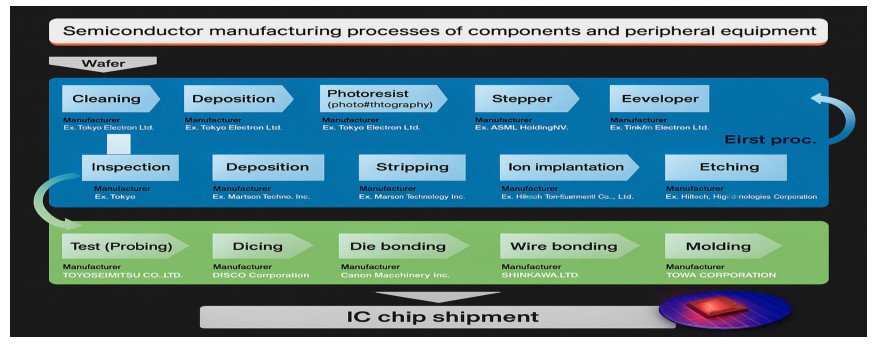
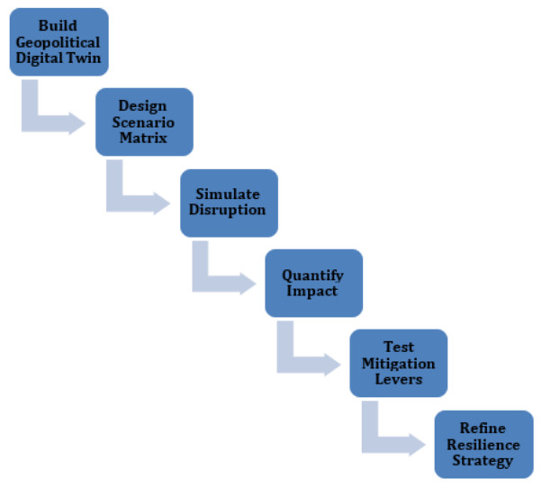
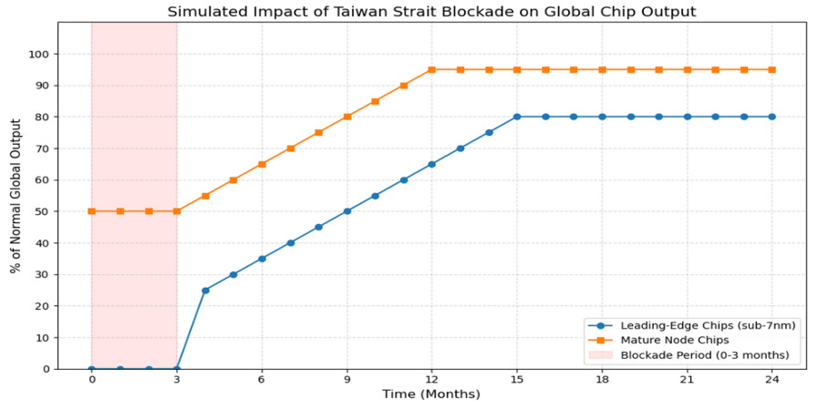

> 原文件：[44_ieomsociety.org_385.pdf](https://github.com/jadennevercode/CJCC-Knowledge-Base/blob/564ab11aa9785e569e3853c8a4d7ce86f88e7535/materials/%E8%B7%A8%E9%93%BE%EF%BC%9A%E9%87%8F%E5%8C%96%E5%8F%82%E6%95%B0%E4%B8%8E%E8%AE%A1%E7%AE%97%E6%A8%A1%E6%9D%BF/44_ieomsociety.org_385.pdf)
> 转换方式：Volcengine OCRPdf v3, parse_mode=ocr

<!-- 原文第 1 页 -->

Proceedings of the 3r GCC International Conference on Industrial Engineering and Operations Management Tabuk, Saudi Arabia, February 2-4, 2026 
Proceedings of the International Conference on Industrial Engineering and Operations Management 
Publisher: IEOM Society International, USA DOI: 10.46254/GC03.20250385 
Published:February 2, 2026 
# Building a Resilient Semiconductor Supply Chain: A Stress Testing Framework 
Jasim Alnahas, Shahbaz Khan, Khalid Awad Alataw, Hussain Ahmed Albalawi, Azzam Nasir Bazaid, Faisal maeesh alharbi and Yousaf bader aljohani 
Department of Industrial Engineering, College of Engineering University of Tabuk, Tabuk 47512, Saudi Arabia 
jalnahas@ut.cdu.sa,shan@ut.edu.sa,452009890@stu.ut.edu.sa,452009711@stu.ut.cdu.sa, 452010270@stu.ut.edu.sa, 452009955@stu.ut.edu.sa, 452010401@stu.ut.edu.sa 
## Abstract 
The global semiconductor supply chain (SSC) represents the central nervous system of the modern digital economy, yet its hyper-specialized and geographically concentrated structure renders it profoundly vulnerable to systemic disruptions. Recent events, such as the COVID-19 pandemic and escalating geopolitical tensions, have exposed the limitations of traditional, reactive risk management paradigms. This paper addresses a critical research gap by proposing a proactive methodology for resilience engineering: a stress testing framework adapted from the financial industry. The framework is built upon a high-fidelity "Geopolitical Digital Twin" of the supply chain,which allows for the simulation of severe but plausible disruption scenarios. This paper's primary contribution is a rigorous, quantitative methodology for assessing systemic vulnerabilities, quantifying the cascading impacts of disruptions,and evaluating the efficacy of various mitigation strategies. A case application simulating a 90-day geopolitical blockade of the Taiwan Strait is presented. The results quantify the catastrophic ripple effects on global industries, particularly automotive and consumer electronics, and reveal critical second-order chokepoints in raw materials and logistics. Furthermore, the analysis provides a data-driven evaluation of mitigation levers, such as strategic stockpiling and the diversification of fabrication capacity through initiatives like the U.S. and E.U. CHIPS Acts. The findings offer significant implications for both corporate strategy and public poliy, providing a robust analytical tool to navigate the trade-offs between efficiency and resilience in an era of increasing uncertainty. 
Keywords 
Disruption Stress Testng: Semiconductor Supply Chian; Resilience 
## 1. Introduction 
## 1.1 The Strategic Imperative of the Semiconductor Supply Chain 
Semiconductors are the foundational technology of the 21st century,a ritical input that underpins nearly every sector of the global economy. Often described as the "oil of the 21st century," these intricate electronic circuits are the essential components that power modemn life, from consumer electronics like smartphones and computers to the complex systems governing critical infrastructure, advanced artificial intelligence (AI), and national defense platforms (Sun et al,2011).The pervasiveness of semiconductors is such that their availability and technological sophistication directly correlate with a nation's economic competitiveness and security posture (Lamsal et al., 2023).The supply chain tha designs, manufactures, and distributes these components is not merely a commercial network, it isa lobal strategic asset, the stability of which is paramount to continued technological progress and international security. 
The modern semiconductor is a marvel of complexity. A state-of-the-art integrated circuit (C) can contain billions of transistors, with circuit patterns so fine they are nearly invisible (Rama et al, 2024).This technological intricacy necessitates a manufacturing process of unparalleled precision, involving hundreds of discrete stages that take four to 
C IEOM Society International 
1246

---

<!-- 原文第 2 页 -->

Proceedings of the 3r GCC International Conference on Industrial Engineering and Operations Management Tabuk, Saudi Arabia, February 2-4, 2026 
six months to complete.Consequently, no single company or country has mastered the entire end-to-end process, leading to the formation of a deeply specialized and globally interdependent supply chain (Penn, 2011).This global collaboration has been a powerful engine for innovation and efficiency, but it has also created a system of profound and often hidden dependencies that are now coming into sharp focus. 
## 1.2. The Paradox of Efficiency and Fragility 
For decades,the semiconductor supply chain has been optimized according to the principles of globalizatin and ean manufacturing,prioritizing cost reduction,specialization, and just-in-time inventory management (Knoblich et al, 2015).This pursuit of efficiency has resulted in a hyper-globalized network where the various inputs for a single chip may cross more than 70 international borders before the final product reaches the consumer (Thadani & Allen, 2023). While this model has successfully driven down costs and accelerated innovation, it has simultaneously engineered a system of extreme fragility. The long lead times,minimal inventory buffers, and geographic concentration of critical production stages create a network that is highly susceptible to disruption, where a single point of failure can trigger cascading effects across the entire globe (Uzsoy et al.,2018). 
The COVID-19 pandemic served as a global, real-world stress test that laid these vulnerabilities bare. As lockdowns shifted consumer demand toward work-from-home electronics and simultaneously caused automotive manufacturers to cancel chip orders, a massive supply-demand mismatch occurred (Nehrebecka, 2021).Chipmakers reallocated their capacity away from automotive-grade chips, and when vehicle demand rebounded faster than expected, the industry faced a crippling shortage (Dziczek, 2022). This disruption rippled through the global economy, affecting more than 169 industries and leading to an estimated loss of $240 billion in U.S.GDP in 2021 alone (Thadani &Allen, 2023). This event was not an anomaly but rather a stark illustration of the inherent paradox of the modern SSC: a system of breathtaking efficiency that is, by its very design, dangerously fragile. 
## 1.3. Research Gap: From Reactive Risk Management to Proactive Resilience Engineering 
The semiconductor shortage crisis has highlighted the inadequacy of conventional supply chain risk management approaches. Traditional methods often focus on managing known, high-probability operational risks (e.g,supplier delays, quality issues) based on historical data (Ivanov, 2020).However, the SSC is uniquely exposed to lowprobability, high-impact disruptions-so-called "black swan events-such as pandemics, geopolitical conflicts, and extreme weather events, for which historical precedent is a poor guide (Ivanov, 2020).The academic literature on supply chain resilience (SCR) is extensive, defining it as the capacity to anticipate, adapt to,and recover from disruptions. Yet, a significant gap exists between the conceptual understanding of resilience and the availability of rigorous, quantitative tools to operationalize it. Many existing SCR frameworks are descriptive or qualitative, offering strategic guidance but lacking the analytical power to model the dynamic, non-linear behavior of complex systems under severe stress. 
This paper argues that the field must evolve from a reactive posture of risk management, which focuses on recovery after a disruption has occurred, to a proactive discipline of "resilience engineering." This approach involves designing and managing supply chains with an explicit focus on their ability to withstand and adapt to future, unforeseen shocks. To achieve this, a new class of analytical tools is required-tools that are forward-looking, quantitative, and capable of exploring the systemic consequences of hypothetical but plausible crisis scenarios. 
## 1.4. Objective and Structure of the Paper 
The primary objective of this paper is to propose and detail a comprehensive stress testing framework, adapted from the mature risk management practices of the financial industry, as a core tool for resilience engineering in the semiconductor supply chain. This framework provides a structured methodology to proactively identify vulnerabilities, quantify the potential operational and financial impacts of severe disruptions, and systematically evaluate the effectiveness of mitigation strategies. 
To achieve this objective, the paper is structured as follows. Section 2 establishes the theoretical foundations through a systematic literature review, covering the paradigm of supply chain resilience, the intricate structure and vulnerabilities of the SSC, and the principles of stress testing. Section 3 presents the proposed framework in detail, outlining its core components, including the concept of a "Geopolitical Digital Twin," a scenario generation matrix, and key performance indicators for resilience quantification. Section 4 demonstrates the framework's practical application through a case study that simulates a major geopolitical disruption in the Taiwan Strait, analyzing its 
C IEOM Society International 
1247

---

<!-- 原文第 3 页 -->

Proceedings of the 3r GCC International Conference on Industrial Engineering and Operations Management Tabuk, Saudi Arabia, February 2-4, 2026 
cascading impacts and the utility of various mitigation levers.Section 5 discusses the broader managerial and policy implications derived from the analysis, focusing on the resilience-efficiency trade-off and strategic decision-making. Finally, Section 6 concludes the paper by summarizing its contributions, acknowledging its limitations, and suggesting avenues for future research. 
## 2. Theoretical Foundations and Literature Review 
2.1. The Paradigm of Supply Chain Resilience (SCR): Capabilities, Strategies, and Frameworks Supply chain resilience is formally defined in academic literature as a supply chain's inherent ability to anticipate, adapt to, and recover from disruptions to meet customer demand and maintain operational continuity (Kumar et al, 2024).It is a multi-faceted concept that moves beyond traditional risk management by not only preparing for known risks but also building the capacity to handle unexpected and severe events. This capacity is underpinned by a set of core capabilities that allow a supply chain to be both resistant to shocks and quick to recover.Key pillars of resilience identified in the literature include visibility, flexibility, collaboration, and contingency (Cohen et al,2022). 
·Visibility refers to the ability to monitor and rack events and materials across the entire supply chain, enabling the early detection of potential disruptions(Krantz et al, 2024). 
. Flexibility is the capacity to quickly modify operations, production schedules, or logistics in response to changing conditions, such as by switching to alternative suppliers or transportation modes (Krantz et al., 2024). Collaboration involves fostering strong,transparent relationships with both internal teams and external partners, which is critical for coordinated responses during a crisis (Krantz et al., 2024). 
Contingency relates to having backup plans and resources in plac,such as maintaining extra inventory or establishing redundant processes, to ensure business continuity (Krantz et al., 2024). 
To build these capabilities,organizations employ a range of resilience strategies.Common strategies include diversifying the supplier base across different geographical regions to mitigate concentration risk, nearshoring or onshoring production to reduce long-haul dependencies, and shifting inventory models from a lean "just-in-time" (JIT) approach to a more buffered "just-in-case"(JIC) model that prioritizes safety stock. 
## 2.2. Anatomy of a Global Nerve Center: The Semiconductor Supply Chain's Structure and Complexity 
The semiconductor supply chain is not a linear chain but a complex, globally distributed network of highly specialized activities. Understanding this structure is essential for identifying its inherent ulnerabilities. The end-to-end process can be segmented into several distinct, interdependent stages: 
1.Research & Design: This upstream stage is where the chip's architecture and functionality are conceived. It is dominated by two key sub-segments: Electronic Design Automation (EDA) software, which provides the complex tools needed to design multi-billion transistor circuits, and Core Intellectual Property (IP),which are pre-designed circuit blocks that accelerate the design process. U.S.-based firms like Synopsys, Cadence, and Arm (UK-based, but with significant U.S.influence) hold a commanding lead in these areas (Ramirez &Le, 2025). 
2. Raw Materials & Chemicals: This stage involves the production of the foundational materials for chip manufacturing. The most critical input is ultra-pure silicon wafers, the market for which is concentrated among a few companies in Japan, Taiwan, Germany, and South Korea (Thadani & Allen,2023).Other vital inputs include specialty gases like neon (historically sourced from Ukraine),high-purity chemicals,and photoresists, a lightsensitive material essential for lithography, where Japanese firms have a dominant market share (Thadani & Allen, 2023).China holds a strong position in the supply of raw critical minerals like gallium and germanium 
3. Manufacturing Equipment (SME):This segment produces the highly sophisticated and expensive machinery used in fabrication plants (fabs), The market is extremely concentrated, with a few firms from the U.S.,Japan, and the Netherlands controlling the majority of the market for critical tools like deposition, etching, and lithography systems. 
4. Wafer Fabrication (Front-End): This is the most capital-intensive stage,where the chip's circuits are meticulously built layer by layer on the silicon wafer.This process, detailed in Figure 1, takes place in highly advanced and sterile facilities known as fabs. The foundry model, where specialized companies manufacture chips designed by others, is dominant. This segment is geographically concentrated in Taiwan (led by TSMC) and South Korea (led by Samsung), which together account for the vast majority of advanced logic chip manufacturing. 
5. Assembly, Test, and Packaging (ATP) (Back-End): Once the wafers are fabricated, they are sent to ATP facilities. Here, the wafer is sliced into individual chips (dies), which are then tested, ncapsulated in protective packaging, 
C IEOM Society International 
1248

---

<!-- 原文第 4 页 -->

Proceedings of the 3rd GCC International Conference on Industrial Engineering and Operations Management Tabuk, Saudi Arabia, February 2-4, 2026 
and prepared for assembly into electronic devices. This stage is more labor-intensive and is largely concentrated in Southeast Asian countries and China (Figure 1). 
 
Figure 1.The Global Semiconductor Supply Chain Process Flow (26) 
The production of a semiconductor is a multistage,sequential process that transforms raw silicon into a functional integrated circuit. The process begins with Wafer Production, where a purified silicon ingot is grown and sliced into thin, polished wafers. The core of the manufacturing occurs during Wafer Fabrication (FrontEnd), a cyclical process repeated hundreds of times to build up the layers of the circuit. Each cycle involves several key steps: Deposition, where a thin film of conductive or insulating material is applied to the wafer; Photoresist Coating, where a light-sensitive chemical is spread evenly across the surface; Lithography, the critical step where a machine projects the circuit pattern onto the photoresist; and Etching,which removes selected material to create the 3D circuit features. This is often followed by Ion Implantation to alter the electrical properties of the silicon. Throughout this cycle, extensive Metrology and Inspection steps ensure quality control. Once al layers are complete, the wafer moves to the Back-End Process. This begins with Wafer Sort/Probing, where each individual die on the wafer is electrically tested. The wafer is then sent to Assembly & Packaging, where it is diced into individual chips, which are then packaged for protection and connection to external devices. The final stage is the Final Test, where the packaged chip is tested again to ensure it meets all performance specifications before being shipped to customers for integration into final products 
## 2.3.A Typology of Critical Vulnerabilies: Geopolitical, Environmental, and Market-Driven Chokepoints 
The hyper-specialized and geographically concentrated nature of the SSC creates numerous "chokepoints" nodes or linkswherea disruption can have disproportionately large, systemic consequences. These vulnerabilities can be categorized into several distinct types, as detailed in Table 1. This typology provides a structured understanding of the threats facing the network and serves as a foundational input for developing realistic stress test scenarios. The vulnerabilities range from deliberate geopolitical actions and random natural disasters to inherent market structures and operational risks (Table 1). 
Table 1. A Typology of Semiconductor Supply Chain Vulnerabilies 
Risk Category Geopolitical Specific Vulnerabilit Trade Restrictions & Tariffs
Military Conflict/Blockade
Critical Mineral Embargo
Natural Disaster Earthquakes & Typhoons
Droughts & Water Scarcity
Extreme Weather Events
Market/Structural Supplier Concentration Technological Complexity 
C IEOM Society International 
1249

---

<!-- 原文第 5 页 -->

Proceedings of the 3r GCC International Conference on Industrial Engineering and Operations Management Tabuk, Saudi Arabia, February 2-4, 2026 

| | Bullwhip Effect |
| --- | --- |
| Operational | Cybersecurity Threats |
| | Talent Shortages |
 
## 3. A Framework for Stress Testing the Semiconductor Supply Chain 
Building on the theoretical foundations of supply chain resilience and the established practices of financial stress testing,this section proposes a structured framework specifically designed to assess and enhance the resilience of the semiconductor supply chain. The framework consists of a cyclical process that integrates a sophisticated modeling platforn with systematic scenario analysis and quantitative impact assessment. 
## 3.1. Adapting Core Principles for Supply Chain Application 
The first step in developing the framework is to translate the core principles of financial stress testing into the language and context of supply chain management. This adaptation involves a fundamental shift in the unit of analysis, the types of risks considered, and the metrics used to measure resilience. 
From Financial Portfolio to Supply Chain Network: In finance,the object of the is typically a bank's balance sheet or a portfolio of financial assets [15].In our framework, the unit of analysis is the entire end-to-end supply chain network, represented as a complex system of interconnected nodes (suppliers, fabs, ATP facilities, logistics hubs) and links (transportation routes). 
From Market/Credit Risk to Operational/Disruption Risk: Financial stress tests focus on market risks (e.g. interest rate shocks, currency fluctuations) and credit risks (e.g, widespread defaults).38 The supply chain framework focuses on operational and disruption risks. Key risk factors include the uptime of manufacturing nodes, the capacity and transit time of transportation links, variability in lead times, and the imposition of policydriven constraints such as trade restrictions or export bans. 
From Capital Adequacy to Resilience Capacity: The primary output of a financial stress test is an assessment of capital adequacy--whether the institution has enough capital to absorb the losses from the scenario.41 In the supply chain context, the key output is an assessment of resilience capacity. This is measured through a set of operational and financial performnance indicators that quantify the supply chain's ability to withstand and recover from the shock. Instead of "capital at risk,"the focus is on metrics like "time-to-recover,""revenue at risk,"and "service level impact." 
## 3.2. The Digital Twin: A High-Fidelity Platform for Simulation 
The analytical engine of the stress testing framework is a digital twin of the semiconductor supply chain. This is not merely a static map but a dynamic, data-rich simulation model that mirrors the behavior of the real-world network.43 A robust digital twin for the SSC must contain several essential components: 
Network Topology: A comprehensive mapping of all key entties in the supply chain, including their specific geographic locations. This includes upstream material and equipment suppliers, design houses, wafer fabrication plants, ATP facilities, and major logistics hubs and distribution centers. 
Process Flows and Parameters: The model must accurately represent the manufacturing and logistics processes at each stage. This includes critical parameters such as production capacities, manufacturing cycle times, process yields, and transportation lead times between nodes. 
Inventory and Buffers: The model must incorporate data on inventory levels throughout the system, including raw materials, work-in-process (WIP) within fabs, and finished goods held at various locations. These buffers are critical determinants of the supply chain's initial ability to absorb a shock . 
Bills of Materials (BOM) and Dependencies: The model must capture the complex web of interdependencies. For example, it must specify that a particular fab requires a specific grade of silicon wafer from one supplier, a unique photoresist from another, and can only operate using equipment from a third. This allows the simulation to accurately model how a disruption at an upstream supplier propagates downstream. 
However, a standard operational digital twin is insufficient for modeling the primary vulnerabilities of the SsC. The most significant threats are not just random machine failures but are deeply intertwined with geography and geopolitics, as established in the vulnerability typology (Table 1). A simple model that treats a fab in Taiwan and a fab in Arizona as interchangeable nodes with different capacity values would fail to capture the essence of the risk. Therefore, this framework proposes an evolution of the digital twin concept into a "Geopolitical Digital Twin."This advanced model enriches the standard operational network by overlaying it with additional data layers that contextualize each node and link. These layers would include data on: 
C IEOM Society International 
1250

---

<!-- 原文第 6 页 -->

Proceedings of the 3r GCC International Conference on Industrial Engineering and Operations Management Tabuk, Saudi Arabia, February 2-4, 2026 
Geopolitical Risk: Country-level risk scores, the status of trade agreements,and exposure to potential sanctions or export controls. 
Geographic & Environmental Risk: Data on seismic activiy, weather patters (e., tphoon or huricane frequency), and water stress levels for each specific location. 
Logistical Chokepoints: Identification of critical transportation routes (e.g, the Taiwan Strait, the Strait of Malacca) and their susceptibility to disruption 
This Geopolitical Digital Twin allows for the simulation of scenarios that are not merely operational (e.g."a 10% reduction in yield at Fab X") but are systemic and context-aware (e.g,"a naval blockade prevents all shipments from leaving Taiwan," or"a drought reduces water availability for all fabs in Arizona by 30%"). This provides a far more realistic and strategically relevant platform for stress testing. 
## 3.3. Developing a Scenario Matrix: Defining Plausible but Severe Disruptive Events 
With the Geopolitical Digital Twin as the simulation platform,the next step is to design the shocks that will be appied to it. The art of effective stress testing lies in developing scenarios that are both severe enough to meaningfully test the system's limits and plausible enough to be taken seriously by decision-makers. This process should be systematic, drawing directly from the identified vulnerabilities in the typology (Table 1).The output is a scenario matrix that defines a range of tests to be performed. Table 2 provides an illustrative matrix for the SSC, translating abstract risks into concrete, parameterizable events that can be programmed into the digital twin. Each scenario is defined by its type, a clear description of the event, and the key parameters that would be adjusted in the simulation model to represent the shock (Table 2). 
Table 2. Ilusrative Stress Test Scenario Matrix for the SSC 

| Scenario Name | Scenario Type | Description | Key Parameters to Model |
| --- | --- | --- | --- |
| Taiwan Strait Blockade | Geopolitical/ Military | A naval blockade prevents all maritime and air freight from entering or leaving Taiwan for a duration of 90 days. | - Set capacity of all Taiwanese ports and airports to zero.-Reroute all global shipping around the conflict zone, increasing transit times and costs. - Halt all wafer output from Taiwanese fabs (e.g.TSMC, UMC). |
| Kanto Earthquake | Natural Disaster | A magnitude 8.0 earthquake strikes the Tokyo region, causing a 50% reduction in output for 60 days from key Japanese suppliers of silicon wafers and photoresists | Reduce output capacity of specific - Japanese supplier nodes (e.g.,Shin-Etsu, Sumco,JSR) by 50%.-Model the cascading impact on global fab inputs and subsequent production delays. |
| Rare Earth Embargo | Geopolitical/E conomic | China halts al exports of critical minerals (e.g, gallium, required for germanium) specific semiconductor manufacturing steps for a duration of 180 days. | Set export capacity of specific Chinese - material processing nodes to zero.- Model the time,cost, and capacity constraints of activating alternative,non- Chinese sources. |
| Global Cyber- Attack on Foundries | Operational/S ecurity | A coordinated cyber-attack targets the manufacturing execution systems (MES) of major foundries, reducing global leading-edge fab utilization by 30% for 30 days. | - Reduce the utilization rate parameter for all fab nodes below 10nm by 30%.- Introduce a "yield loss" factor to model quality control issues during the disruption. |
 
## Operational KPIs: 
Time-to-Survive (TTS): The maximum duration the supply chain can continue to meet 100% of customer demand after the onset of a disruption, relying solely on existing inventory and buffers. This measures the system's initial shock absorption capacity. 
C IEOM Society International 
1251

---

<!-- 原文第 7 页 -->

Proceedings of the 3rd GCC International Conference on Industrial Engineering and Operations Management Tabuk, Saudi Arabia, February 2-4, 2026 
o Time-to-Recover (TTR): The total time elapsed from the start of the disruption until the supply chain returns to its pre-disruption level of performance (e.g. 95% of its original output volume), This is a primary measure of resilience. 
o Performance Impact: The quantified reduction in key operational metrics during the disruption period, such as the percentage of on-time-in-full (OTIF) deliveries, customer fill rates, and total production output volume.7 Financial KPIs: 
o Revenue at Risk / Lost Revenu: The total value of sales lost due to the inability to meet demand during the disruption. 
o Cost-to-Recover: The total incremental costs incurred to manage the crisis and restore operations. This includes expenses like expedited freight, costs of qualifying and activating alternative suppliers, and overtime labor costs. 
o Margin Impact: The net effect of lost revenue and increased costs on the profitability of the firm or industry. By tracking these KPIs for each scenario, the stress test moves from a qualitative exercise to a quantitative asssment,providing decision-makers with concrete data on the potential magnitude of different crises (Figure 2). 
 
Figure 2. The Proposed Stress Testing Framework for Supply Chain Resilience 
The proposed framework operates as a continuous, cyclical process designed for iterative learning and improvement. The cycle begins with Step I: Build Geopolitical Digital Twin, where a high-fidelity, data-rich model of the physical supply network is created and layered with geopolitical and environmental risk data. In Step 2: Design Scenario Matrix, a portfolio of severe but plausible disruption scenarios is developed, drawing from the vulnerability typology. Step 3:Simulate Disruption involves applying these scenarios as shocks to the digital twin to observe the system's dynamic response. The results of the simulation are then measured in Step 4: Quantify Impact (KPIs),where key metrics like Time-to-Recover and financial losses are calculated. This provides a baseline assessment of the system's vulnerability. The next crucial phase is Step 5: Test Mitigation Levers, where the simulation is re-run with various resilience-building strategies (e.g., increased inventory, alternative sourcing) activated within the model to measure their effectiveness in reducing the impact of the shock. Finally, the insights from this comparative analysis are used in Step 6: Refine Resilience Strategy, where decision-makers can make data-driven choices about which resilience investments to prioritize. This refined strategy then informs updates to the digital twin, and the cycle begins anew, allowing for continuous adaptation and strengthening of the supply chain over time. 
C IEOM Society International 
1252

---

<!-- 原文第 8 页 -->

Proceedings of the 3r GCC International Conference on Industrial Engineering and Operations Management Tabuk, Saudi Arabia, February 2-4, 2026 
## 4. Case Application: Simulating a Geopolitical Disruption 
To demonstrate the practical utility of the proposed framework, this section presents a case application focused on one of the most severe and widely discussed risks facing the semiconductor industry: a major geopolitical disruption centered on Taiwan. 
## 4.1. Modeling the Global Semiconductor Network 
For this case study, a simplified but representative Geopolitical Digital Twin of the global semiconductor network was constructed. The model was populated using publicly available data on the locations, approximate capacities, and technology nodes of major semiconductor fabs, as well as the geographic centers for other key supply chain stages (Thadani & Allen,2023).The model's key nodes included: 
Fabrication Nodes: TSMC and UMC fabs in Taiwan (lading-edge and mature logic), Samsung and SK Hynix fabs in South Korea (memory and logic),and Intel and Texas Instruments fabs in the U.S. (logic and analog). 
SME & Materials Nodes: A node representing ASML in the Netherlands (EUV lithography), and aggregate nodes representing key chemical and wafer suppliers in Japan. 
ATP Nodes: Aggregate nodes representing the concentration of back-end facilities in China and Southeast Asia. Downstream Demand Nodes: Aggregate nodes representing the automotive and consumer electronics industres in North America, Europe,and Asia. 
The links between these nodes were modeled with standard sea and air freight lead times. Crucially, the model's geopolitical layer identified Taiwan as a region with high geopolitical risk, and the logistical links passing through the Taiwan Strait were flagged as potential chokepoints. 
## 4.2. Scenario Execution: A Simulated Blockade of the Taiwan Strait 
The stress test scenario executed was the "Taiwan Strait Blockade" from the illustrative matrix in Table 2.This scenario is considered a severe but plausible event, given the persistent geopolitical tensions in the region.36 The simulation was programmed with the following parameters: 
Disruption Trigger: A complete naval and air blockade of Taiwan is initiated on Day 0. 
Direct Impact: The capacity of all Taiwanese seaports and airports is set to zero,ating all inbound shipments of raw materials and equipment and all outbound shipments of finished wafers 
Duration: The blockade is assumed to last for 90 days (one quarter) 
Logistical Rerouting: All other global shipping routes that would normally transit the Taiwan Strait are rerouted, adding an average of 7-14 days to transit times and increasing shipping costs. 
This shock was applied to the digital twin to observe the dynamic, cascading consequences across the global network. 
## 4.3. Analysis of Cascading Impacts: Quantifying the Ripple Effect 
The simulatin results reveal a rapid and catastrophic degradation of the global semiconductor supply chain, demonstrating the profound "ripple effect" that propagates from a single chokepoint.10 
Immediate Impact (Weeks 1-4): The most immediate effect is the complete cessation of output from Taiwanese foundries, which account for over 60% of the global supply of semiconductor manufacturing services and over 90% of the most advanced logic chips. Companies that rely directly on these foundries see their supply of new wafers drop to zero instantly.Global logistics networks are thrown into chaos as carriers scramble to reroute vessels, causing initial delays even for supply chains not directly reliant on Taiwan. 
Mid-Term Impact (Weeks 5-12): Downstream industries that hold inventory buffers begin to exhaust their supplies. Based on typical inventory levels, the simulation projects that major automotive and consumer electronics assembly lines in North America, Europe, and Asia would begin to shut down within 4 to 6 weeks of the blockade's start. This timeline aligns with the experiences of the COVID-19 chip shortage, where production halts followed quickly after the supply disruption. 10 The simulation shows that even non-Taiwanese fabs (e.g., in South Korea or the U.S.) would begin to experience production slowdowns as their own inventories of specialized chemicals or other inputs that may be packaged or processed in Taiwan are depleted. 
Long-Term Impact (Post-90 Days):Even after the 90-day blockade is life, the system faces a prolonged recovery. A massive backlog of orders floods the reopened Taiwanese fabs, and it takes months to clear the WIP that was stalled in the production pipeline.The simulation's KPI analysis projects a Time-to-Recover (TTR) for the global supply 
C IEOM Society International 
1253

---

<!-- 原文第 9 页 -->

Proceedings of the 3rd GCC International Conference on Industrial Engineering and Operations Management Tabuk, Saudi Arabia, February 2-4, 2026 
chain to reach 95% of its pre-blockade output level of approximately 24 months. The total projected lost revenue across the global electronics and automotive sectors is estimated to exceed $S1.5 trillion. 
 
Figure 3. Simulated Impact of Taiwan Strait Blockade on Global Chip Output 
The simulated impact of the 90-day blockade on global semiconductor output is depicted as a time-series graph. The y-axis represents the percentage of normal global output capacity, and the x-axis represents time in months. Before the disruption (Month 0),output is at 100%.At the onset of the blockade, there is a precipitous drop. The output of leading-edge logic chips (sub-7nm), which are almost exclusively produced in Taiwan,plummets to near zero and stays there for the duration of the 3-month blockade. The output of mature node chips also sees a significant decline, though less severe, as some capacity exists outside Taiwan. After the blockade is lifted at Month 3, a slow recovery begins. The graph shows a gradual, S-shaped recovery curve, reflecting the time it takes to restart complex fab operations, clear backlogs, and refill the depleted global pipeline.The leading-edge capacity takes the longest to recover, only reaching approximately 80% of its pre-disruption level a full year after the event (Month 15), The overall supply chain does not return to a stable,pre-disruption state unti nearly two years have passed (Figure 3). 
## 4.4. Evaluating Mitigation Levers 
The true power of the stress testing framework lies in its ability to quantitatively evaluate the effetiveness of fiffrent resilience strategies. The simulation was re-run with several pre-existing mitigation levers in place to measure their impact on the key resilience KPls. The results, summarized in Table 3,provide a data-driven basis for strategic decision-making. 
Strategic Bufering: The first mitigation scenario assumed that major downstream industries (automotive, electronics) held a six-month strategic buffer of critical chips, a shift from JIT to a JIC strategy.19 The simulation showed this extended the Time-to-Survive for their assembly lines from 4-6 weeks to over 24 weeks. While this did not shorten the overall TR of the semiconductor supply chain itself, it significantly reduced the financial impact by allowing production to continue for much longer, reducing the total financial loss by an estimated $300 bilion. 
Alternative Sourcing (Diversification): The second scenario modeled a world where the investmnents from the U.S. and E.U. CHIPS Acts have already resulted in the creation of new, operational leading-edge fabs in North America and Europe.44 When the Taiwan blockade occurs, these fabs are able to ramp up their production. However, the simulation highlights a critical reality: even with these new fabs, their combined capacity in the initial years is a fraction of Taiwan's. While they help mitigate the worst of the shortage, they cannot fully compensate for the loss. This strategy was shown to reduce the overall TR to 18 months and the financial loss to S0.9 trillion (Table 3). Combined Strategy: A final simulation tested a combined strategy of holding a six-month buffer and havin diversified fab locations. This proved to be the most effective approach, reducing the T'TR to 15 months and cutting the projected financial loss by more than half, to $0.7 trillion. 
C IEOM Society International 
1254

---

<!-- 原文第 10 页 -->

Proceedings of the 3r GCC International Conference on Industrial Engineering and Operations Management Tabuk, Saudi Arabia, February 2-4, 2026 
Table 3. Quantitative Effectiveness of Mitigation Strategies 

| Mitigation Strategy | Impact on Time-to- Recover (TTR) | Impact on Total Financial Loss | Implementation Cost/Trade-off |
| --- | --- | --- | --- |
| Baseline (No Mitigation) | 24 months | -$1.5 Trillion | N/A (Represents current state of high efficiency, low redundancy) |
| 6-Month Strategic Buffer | 22 months | -$1.2 Trillion | High inventory carrying costs, risk of component obsolescence. |
| Activate U.S./EU Fabs | 18months (post rampup | -$0.9 Trillion | Massive capital investment (S bilions), long lead time to build talent shortages. |
| Combined Strategy | 15 months | -$S0.7 Trillion | Highest upfront cost and complexity, but provides the highest level of resilience. |
 
## 5. Discussion and Implications 
The results of the stress test simulation offer profound insights for both corporate strategists and public policymakers. By moving beyond abstract discussions of risk to a quantitative assessment of a specific, severe scenario,the framework illuminates the true nature of the SSC's vulnerabilities and provides a concrete basis for evaluating strategic choices. 
## 5.1. Insights from the Stress Test: Critical Chokepoints and Interdependencies 
The case application powerfully confirms the critical chokepoint represented by Taiwan's dominance in leading-edge fabrication. The simulation demonstrates that a disruption localized to this single geographic area can rapidly escalate into a global economic crisis. However, the analysis also reveals more subtle, second-order interdependencies that might be missed by a simpler risk assessment. For example, in the "Alternative Sourcing" scenario, the simulation showed that even with new fabs operational in the U.S., their ability to ramp up production was constrained by disruptions to the global supply of specialized chemicals and materials from Japan. These supplies were not directly impacted by the blockade, but their logistics were severely hampered by the rerouting of global maritime traffic, creating an unexpected bottleneck. This highlights a key value of the stress testing approach: its ability to uncover non-obvious, systemic interactions and reveal how a single shock can create cascading failures across seemingly unrelated parts of the supply chain. The framework forces a holistic view, demonstrating that resilience is not just about having a backup fab, but about ensuring the resilience of that backup fab's entire upstream supply network. 
## 5.2.The Resilience-Efficieney Trade-Off: A Quantitative Perspective 
For years, supply chain management has been dominated by a focus on efficieny, driving down costs and inventories. The concept of resilience often introduces an uncomfortable trade-off: building redundancy, such as holding more inventory or investing in duplicative manufacturing capacity, is expensive and runs counter to the principles of lean operations.46 The stress testing framework provides a powerful tool to navigate this trade-of not as a qualitative debate, but as a quantitative business case analysis. 
The results in Table 3 provide a clear example.The baseline "no mitigation" strategy represents the most efficient, lowest-cost state in normal times, but it results in a catastrophic $1.5 trilion loss in the crisis scenario. Investing in a six-month strategic buffer has a significant carrying cost, which negatively impacts efficiency metrics like inventory turns. However,the simulation quantifies the "return on investment" for this strategy as a S300 billion reduction in potential losses during the crisis. Similarly, the massive capital expenditure required for building new domestic fabs can be weighed against a potential loss mitigation of $600 billion. This approach allows organizations and governments to make informed, risk-based decisions. They can determine an "optimal" level of resilience by balancing the certain costs of resilience investments against the potential (but uncertain) costs of disruption, tailored to their specific risk appetite and strategic priorities. 
C IEOM Society International 
1255

---

<!-- 原文第 11 页 -->

Proceedings of the 3r GCC International Conference on Industrial Engineering and Operations Management Tabuk, Saudi Arabia, February 2-4, 2026 
## 5.3. Managerial Implications: A Roadmap for Implementation 
For corporate executives and supply chain managers, he stress testing framework offers an actionable roadmap to move from a reactive to a proactive resilience posture. The implementation of this framework can be approached in phases to manage complexity and cost: 
1. Phase I: Critical Dependency Mapping: Begin by moving beyond the Tier I supplier list and mapping the entire value chain for the most critical components. Identify the key geographic chokepoints and single-source dependencies. 
2. Phase 2:Scenario-Based Wargaming: Even without a full digital twin,conduct qualitative "wargaming" exercises. Bring together cross-functional teams from supply chain, finance,procurement, and geopolitical risk to talk through the implications of the scenarios outlined in Table 2. 
3.Phase 3: Develop a Simpified Model Build an inital, siplified simulation model in accsss ofwr even advanced spreadsheets) to begin quantifying the first-order impacts of a disruption, such as the Time-to-Survive based on current inventory levels. 
4. Phase 4: Invest in a Geopolitical Digital Twin: For organizations where supply chain continuity is a core strategic imperative, make the strategic investment in building a full-scale Geopolitical Digital Twin. This becomes a lasting corporate asset for ongoing risk assessment and strategic planning. 
Adopting this approach requires a cultural shift, breaking down silos between departments. Supply chain decisions can no longer be made in isolation; they must be integrated with financial planning and geopolitical intelligence. 
## 5.4. Policy Implications: Informing National Strategies 
The findings from the stress test have significant implications for policymakers. The framework provides a powerful analytical justification for industrial policies aimed at enhancing supply chain resilience, such as the U.S.CHIPS and Science Act and the European Chips Act.44 By quantifying the staggering economic consequences of a major disruption, the simulation makes a compelling case that the high cost of these incentive programs may be a necessary and prudent investment in economic security. 
Furthermore, the results can help guide the specific allocation of these public funds. The simulation shows that while building new leading-edge fabs is crucial for long-term technological sovereignty, it is not a panacea for short-term resilience. The analysis suggests that policymakers should also prioritize investments in less glamorous but equally critical parts of the supply chain. This includes bolstering domestic capacity in Assembly, Test, and Packaging (ATP), encouraging the production of key raw materials and chemicals, and investing heavily in the specialized workforce needed to run these facilities. The framework can be used by government agencies to run a portfolio of scenarios, identifying the most critical national vulnerabilities and targeting investments toward the interventions that provide the greatest resilience benefit for the entire economy. 
## 6. Conclusion, limitation and Future Research 
In an environment of escalating global uncertainty, ensuring the resilience of critical supply chains has become a paramount strategic objective for both corporations and nations. This paper has sought to contribute to this objective by moving beyond conceptual discussions of rsilience to propose a rigorous, quantitative, and proactive methodology for its assessment and enhancement. The primary contributions of this research are threefold: 
1. A Formnal Framework for Supply Chain Stress Testing: The paper has formally adapted the mature paradigm of stress testing from the financial industry to the context of global supply chain management. It provides a structured, cyclical framework for identifying vulnerabilitis, simulating disruptions, quantifying impacts,and evaluating mitigation strategies. 
2. The Concept of the "Geopolitical Digital Twin": The research introduces an evolution of the standard digital twin concept. The Geopolitical Digital Twin is an enriched simulation model that layers traditional operational data with crucial contextual data on geopolitical, geographic, and environmental risks,providing a more realistic platform for testing the systemic vulnerabilities of global networks like the SSC. 
3. A Quantitative Case Application: Through a detailed case study simulating a blockade of the Taiwan Strait the paper provides a tangible demonstration of the framework's utility. It quantifies the catastrophic cascading effects of a chokepoint disruption and provides a 47data-driven comparison of the effectiveness of key mitigation strategies, thereby offering a practical tool to inform strategic investment decisions. 
C IEOM Society International 
1256

---

<!-- 原文第 12 页 -->

Proceedings of the 3r GCC International Conference on Industrial Engineering and Operations Management Tabuk, Saudi Arabia, February 2-4, 2026 
While this research provides a robust foundation, it is important to acknowledge its limitations. The case application utilized a simplified,deterministic model based on publicly available data. A real-world implementation by a corporation or government agency would require proprietary, granular data on capacities, lead times, inventory levels, and specific supplier-customer relationships for higher fidelity. The current model also focuses on a single, albeit severe, scenario. The real world is stochastic,and the timing and nature of disruptions are uncertain.Finally, the model does not fully capture the complexity of human decision-making and adaptive behavior during a crisis, where actors may respond in unpredictable ways. 
The limitations of the current study point toward several promising avenues for future research. There is a significant opportunity to develop more sophisticated, stochastic stress testing models. These models could employ Monte Carlo simulations to run thousands of probabilistic scenarios, providing a richer, distribution-based view of risk rather than a point estimate from a single scenario.Integrating machine learning and agent-based modeling into the digital twin could allow for more realistic simulation of adaptive behaviors and the prediction of complex, non-linear second-order effects. Another critical area for future work is the application of this framework to other globally significant and vulnerable supply chains, such as those for pharmaceuticals (active pharmaceutical ingredients), renewable energy technologies (rare earth magnets for wind turbines), and critical food supplies. By expanding the application and sophistication of stress tetn,researchers and practitioners can build a more comprehensive toolkit for engineering the resilient supply systems required for the 21st century. 
## References 
Cohen,M,Cui,S, Doetsch,S.,Emnst,R, Huchzermeier, A., Kouvelis, P,Lee, H, Matsuo,H,& Tsay,A.A., Bespoke supply-chain resilience The gap between theory and practice.Journal of Operations Management, 68(5),515-531, 2022.https://doi.org/10.1002/J00M.1184 
Dziczek, K., Why the automotive chip crisis isn'tover (yet), Chicago Fed Letter, 2022. htps:/doon/10.2133/CFL2022-473 
Ivanov, D, Predicting the impacts of epidemic outbreaks on global supply chains: A simulation-based analysis on the coronavirus outbreak(COVID-19/SARS-CoV-2) case.Transportation Research Part E:Logistics and Transportation Review, 136, 101922, 2020.https://doi.org/10.1016/J.TRE.2020.101922 
Knoblich, K., Heavey,C,& Wiliams,P.A.,Quantitative analysis of semiconductor supply chain contracts with order flexibility under demand uncertainty: A case study. Computers and Industrial Engineering, 87, 394-406,2015. https://doi.org/10.1016/j.cie.2015.05.004 
Krantz,T,Jonker,A,&Diaz,S., IBM Think:Supply chain resiliency.IBM,October,2024. https://www.ibm.com/think/topics/supply-chain-resiliency 
Kumar, D, Soni,G,Kkumar Mangla,S. K., Liao,J, Rathore,A.P.S.& Kazancoglu,Y.,Integrating resilience and reliability in semiconductor supply chains during disruptions. International Journal of Production Economics, 276, 109376,2024.https://doi.org/10.1016/j.jpe.2024.109376 
Lamsal, R.R,Devkota, A.,.& Bhusal, M.S.,. Mavigating Global Challenges: The Crucial Role of Semiconductors in Advancing Globalization. Journal of the Institution of Engineers (India): Series B, 104(6),1389-1399,2023. https://oi.org/10.1007/s40031-023-00938-4 
Nehrebecka, NCOVID-19:tress tating on fianial copanies a maroprdential perspective. The experience of Poland. Eurasian Economic Review, 11(2), 283-319, 2021.https://doi.org/10.1007/s40822-020-00163-0 
Penn,M,Semiconductor supply chain dynamics. Electronics World, 117(1907),10-11, 2011. https://www.scopus.com/inward/record.uri7eid=2-s2.0848637136108partnerID=408md5=774144882306ceb61775619547286438 
Rama,E,Ayache,M,Buchty,R, Bauer,B,Korb,M, Berekovic,M,& Mulhem,S, Trustworthy Integrated Circuits:From Safety to Security and Beyond. IEEE Accss, 12,69603-69632,2024. https://doi.org/10.1109/ACCESS.2024.3400685 
Ramirez,Z.R.,&Le,T.V., Semiconductor supply hain resilience: Systematic review, conceptual framework, implementation challenges, and future research directions. Computers and Industrial Engineering, 210, 111518, 2025.https://doi.org/10.1016/.cie.2025.111518 
Sun,Y., Fowler,J.W.,& Shunk,D. L.,.Policies for allocating product lots to customer orders in semiconductor manufacturing supply chains. Production Planning and Control, 22(1),69-80, 2011. https://doi.org/10.1080/09537287.2010.490020 
Thadani, A,& Allen,G. C.. Mapping the Semiconductor Supply Chain: The Critical Role of the Indo-Pacific Region, 2023. 
C IEOM Society International 
1257

---

<!-- 原文第 13 页 -->

Proceedings of the 3r GCC International Conference on Industrial Engineering and Operations Management Tabuk, Saudi Arabia, February 2-4, 2026 
Uzsoy, R.M, Fowler,J.W,& Monch, L.,A survey of semiconductor supply chain models Part Il.demand planning, inventory management, and capacity planning. International Journal of Production Research, 56(13), 45464564, 2018.https://doi.org/10.1080/00207543.2018.1424363 
C IEOM Society International 
1258
