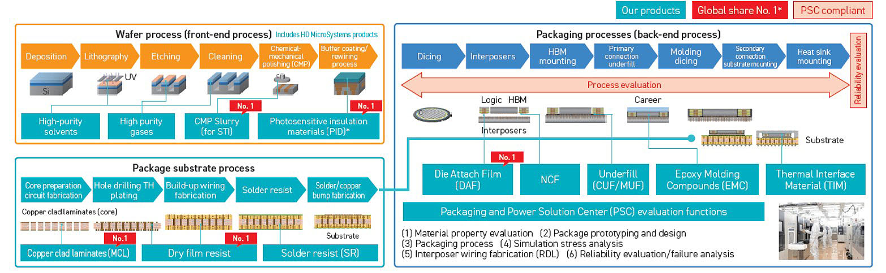
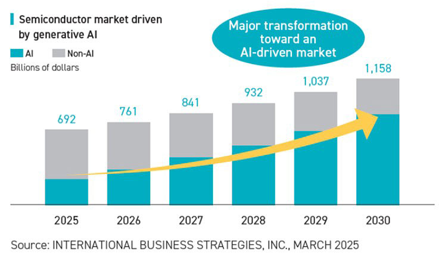
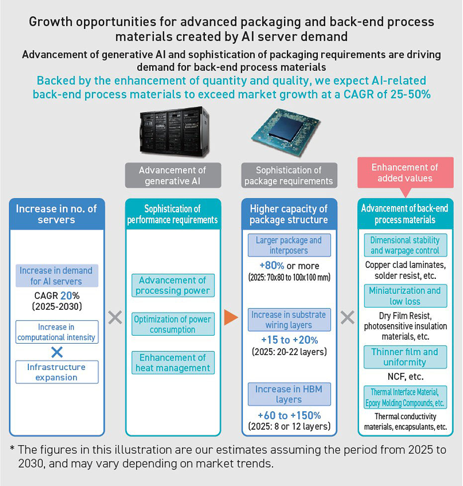

## Document Metadata

- Document ID: 60e38ba7c7ebb72b78e2acc1a307ce17ca74a5fc
- Document Title: Business Strategies - Front-end / Back-end Semiconductor Materials | レゾナック
- Document Type: HTML
- Issuing Organization: Resonac
- Publication Date: null
- Reporting Period: null
- Source File: [46_resonac.com_semi.html](https://github.com/jadennevercode/CJCC-Knowledge-Base/blob/564ab11aa9785e569e3853c8a4d7ce86f88e7535/materials/%E4%B8%8A%E6%B8%B8%EF%BC%9ACMP%E5%8F%8A%E5%B0%81%E8%A3%85%E6%A8%A1%E7%BB%84%E6%9D%90%E6%96%99/46_resonac.com_semi.html)

## Structured Content

> 原文件：[46_resonac.com_semi.html](https://github.com/jadennevercode/CJCC-Knowledge-Base/blob/564ab11aa9785e569e3853c8a4d7ce86f88e7535/materials/%E4%B8%8A%E6%B8%B8%EF%BC%9ACMP%E5%8F%8A%E5%B0%81%E8%A3%85%E6%A8%A1%E7%BB%84%E6%9D%90%E6%96%99/46_resonac.com_semi.html)
> 转换方式：HTML DOM → Markdown

# Business Strategies - Front-end / Back-end Semiconductor Materials | レゾナック

# Business Strategies - Front-end / Back-end Semiconductor Materials

## Products Line-up

“Structure-based” proposal capabilities realized through advanced semiconductor materials and evaluation foundations.  In addition to our broad lineup of products with high market share, we will leverage our World-Class packaging evaluation foundation to move toward material proposals “created proactively” starting from packaging structures

图中标示：Our products；Global share No. 1*；PSC compliant。

Wafer process (front-end process) — Includes HD MicroSystems products: Deposition；Lithography；Etching；Cleaning；Chemical-mechanical polishing (CMP)；Buffer coating/rewiring process。产品：High-purity solvents；High purity gases；CMP Slurry (for STI) [No. 1]；Photosensitive insulation materials (PID)* [No. 1]。

Package substrate process: Core preparation circuit fabrication；Hole drilling TH plating；Build-up wiring fabrication；Solder resist；Solder/copper bump fabrication。产品：Copper clad laminates (MCL) [No. 1]；Dry film resist [No. 1]；Solder resist (SR)。图中还标有 Copper clad laminates (core)、Substrate。

Packaging processes (back-end process): Dicing；Interposers；HBM mounting；Primary connection underfill；Molding dicing；Secondary connection substrate mounting；Heat sink mounting。图中标有 Process evaluation、Reliability evaluation、Logic、HBM、Career、Interposers、Substrate。产品：Die Attach Film (DAF) [No. 1]；NCF；Underfill (CUF/MUF)；Epoxy Molding Compounds (EMC)；Thermal Interface Material (TIM)。

Packaging and Power Solution Center (PSC) evaluation functions: (1) Material property evaluation；(2) Package prototyping and design；(3) Packaging process；(4) Simulation stress analysis；(5) Interposer wiring fabrication (RDL)；(6) Reliability evaluation/failure analysis。

- ※ Source: Fuji Chimera Research Institute “2024 Electronics Packaging New Materials Handbook,” Copper Clad Laminate for Package 2023 actual (value basis), Dry Film Resist 2023 actual (shipping value basis), Encapsulant 2023 actual (volume and value basis), Underfill for Primary Jisso 2023 actual (volume and value basis); Photosensitive insulation materials\*, Buffer coating materials and rewiring materials 2023 actual (volume:\* products of HD MicroSystems L.L.C., a group company)
- ※ Source:Fuji Keizai “2025 Semiconductor Materials Market: Current Status and Future Outlook”: Die bonding film, 2024 actual results (volume); CMP slurry (for STI), 2024 actual results (value)

##

## Strength of This Business (Resonac Pride Products and Services)

*Packaging and Power Solution Center (Shinkawasaki)*

・Degree of contribution to the environment through improved semiconductor package performance
・JEvolution of co-creation at JOINT3
・Business creation capability

- [Medium- to Long-Term Vision](https://www.resonac.com/corporate/strategy/semi.html#anc-01)
- [Vision for 2030 and Roadmap to Achieve It](https://www.resonac.com/corporate/strategy/semi.html#anc-02)
- [Changing Society: Specific Example](https://www.resonac.com/corporate/strategy/semi.html#anc-03)
- [Sustainability and Our Business](https://www.resonac.com/corporate/strategy/semi.html#anc-04)
- [TOPICS 2026](https://www.resonac.com/corporate/strategy/semi.html#anc-05)

## Medium- to Long-Term Vision of Front-end / Back-end Semiconductor Materials

With an eye to realizing a society in which humans and AI co-create, as a leading semiconductor materials company that proposes solutions based on deep insight into chemistry and an understanding of semiconductor devices, we will contribute to accelerating the development of advanced devices that realize a sustainable society.

Hiroyuki Yamashita — General Manager, Electronics Business Headquarters

## Vision for 2030 and Roadmap to Achieve It

| Achievements to Date | Issues | Priority Measures for Phase 2 |
| --- | --- | --- |
| - Promoted the expansion of materials and concentrated investments in strategic products for growth areas such as AI semiconductor packages and advanced logic and memory applications - Contributed to improvements in revenue and the EBITDA margin through portfolio strategies - Established US-JOINT and JOINT3 as frameworks for global co-creation activities with equipment and materials manufacturers, and accelerated the technological development of advanced semiconductor packages - Built a robust supply chain to respond to geopolitical risks in a bid to secure stable supply and strengthen our competitive edge | - *Enhancement of ability to respond to accelerating technological advancements* Amid the spread of generative AI and the advancement of digital infrastructure, the speed of semiconductor technology evolution and the level of customer demands are increasing. Strengthening our technological and product development capabilities to continue to meet these demands is a challenge. - *Continuing to provide value for next-generation semiconductors* To continuously provide value in the field of next-generation semiconductors, innovative evolution is required in all aspects of our products, supply, and business operations - *Advancement of supply chain management, which supports stable supply* Amid rising geopolitical risks, demands for supply stability are mounting, making the advancement of management that oversees the entire supply chain a key issue to be addressed | - Further deepen business operations centered on co-creation to strengthen competitiveness in the field of next-generation semiconductors - Enhance product capabilities by strengthening collaboration with partners through JOINT activities, while promoting contributions to energy conservation and reducing environmental impacts by improving material performance - In light of geopolitical risks, advance the sophistication of the supply chain management system centered on collaboration with suppliers, aiming to achieve both a stable supply and business growth |

| Plans for 2026 |
| --- |
| *Priority Measures: Growth Strategy for Next-Generation Semiconductors Field* In 2026, we will further promote product portfolio reform and aim to expand high-value-added businesses centered on the next-generation semiconductors field. We will steadily advance the growth of strategic products for growth fields while leading to medium- to long-term business growth through the continuous market introduction of new products. US-JOINT and JOINT3 will fully start initiatives leading to the creation of new technological themes and product concepts through collaboration with partners. At the same time, we will work to foster a sense of unity at the business headquarters and develop human resources through global dialogues, as well as strengthen manufacturing capabilities utilizing SPC (Statistical Process Control). Furthermore, in advancing our supply chain management system, we will improve supply stability by strengthening our collaboration with strategic suppliers and promoting multi-sourcing, as well as improve our adjustment capabilities through the visualization of supply-demand data. Additionally, we will strengthen risk resilience by diversifying our bases and establishing alternative production systems. |

### Semiconductor market driven by generative AI

The semiconductor market is expanding amid the spread of generative AI, with AI-related applications driving growth in particular. The market structure is undergoing a major shift from being traditionally non-AI-centric to being AI-driven.

Semiconductor market driven by generative AI — Billions of dollars. 图中标示 AI、Non-AI 及 “Major transformation toward an AI-driven market”。柱形总额：2025 692；2026 761；2027 841；2028 932；2029 1,037；2030 1,158。图中没有标出 AI 与 Non-AI 各自数值。

Source: INTERNATIONAL BUSINESS STRATEGIES, INC., MARCH 2025

## Changing Society: Specific Example

With the rapid expansion of generative AI, cloud computing, and data centers, society is calling for advanced information processing at an unprecedented speed. Semiconductors, which play a central role in this, not only require miniaturization and high-level integration, but also the tackling of complex challenges such as reducing power consumption, heat dissipation, and reliability. At Resonac, we have evolved our solution proposals starting from the packaging structures, leveraging our strengths in a range of materials covering front-end to back-end processes and our World- Class evaluation and analysis foundations. Through co-creation with semiconductor manufacturers, fabless companies, equipment manufacturers, and materials manufacturers, we are transforming development processes that were previously fragmented across individual companies, achieving a new development model that optimizes everything from semiconductor package design to evaluation in an integrated manner. This simultaneously enables high performance while reducing the power consumption of AI servers, contributing to improved energy efficiency across the entire digital infrastructure. By supporting the evolution of semiconductors, we are enhancing society’s information processing capabilities and fundamentally changing the way people live and industries operate. This embodies the Resonac vision of “Change Society through the Power of Chemistry,” playing a role in connecting social issues with technological innovation.

Growth opportunities for advanced packaging and back-end process materials created by AI server demand. Advancement of generative AI and sophistication of packaging requirements are driving demand for back-end process materials. “Backed by the enhancement of quantity and quality, we expect AI-related back-end process materials to exceed market growth at a CAGR of 25-50%”。

- Increase in no. of servers: Increase in demand for AI servers, CAGR 20% (2025-2030)；Increase in computational intensity；Infrastructure expansion。
- Sophistication of performance requirements: Advancement of processing power；Optimization of power consumption；Enhancement of heat management。
- Higher capacity of package structure: Larger package and interposers +80% or more (2025: 70x80 to 100x100 mm)；Increase in substrate wiring layers +15 to +20% (2025: 20-22 layers)；Increase in HBM layers +60 to +150% (2025: 8 or 12 layers)。
- Advancement of back-end process materials: Dimensional stability and warpage control — Copper clad laminates, solder resist, etc.；Miniaturization and low loss — Dry Film Resist, photosensitive insulation materials, etc.；Thinner film and uniformity — NCF, etc.；Thermal Interface Material, Epoxy Molding Compounds, etc. — Thermal conductivity materials, encapsulants, etc.

* The figures in this illustration are our estimates assuming the period from 2025 to 2030, and may vary depending on market trends.

## Contributions to Society and the Environment Strengthen Our Businesses

In December 2025, we held our first “Suppliers’Day” with the aim of further strengthening our co-creation relationships with strategic suppliers. 153 people from 64 companies participated, sharing their business policies and sustainability initiatives. We also presented awards such as the “Partner of the Year” and “Sustainability Partner Award” to suppliers that have made significant contributions to our business. Through this initiative, we are promoting the establishment of a sustainable and resilient supply chain and further deepening our co-creation relationships with strategic suppliers.

Suppliers’Day(December 2025)

## TOPICS 2026

### The “US-JOINT” Consortium Officially Kicks Off: Opening Ceremony Report

- [2026/05/12 WITH UNSUNG LEADERS/BLOG](https://www.resonac.com/corporate/unsung-leaders/20260512.html)

### Resonac’s Patent on Liquid Encapsulant for AI Semiconductor Packages Upheld

- [2026/06/17 News Release](https://www.resonac.com/news/2026/06/17/3865.html)

## Processing Notes

- 产品图中 “Career” 一词按原图保留；工序之间的连线和图形关系以原图为准。

- 自动处理未逐页核对原始文档；OCR 错字、表格与标题层级可能仍需人工复核。
- HTML 快照没有可靠的原文页码。
