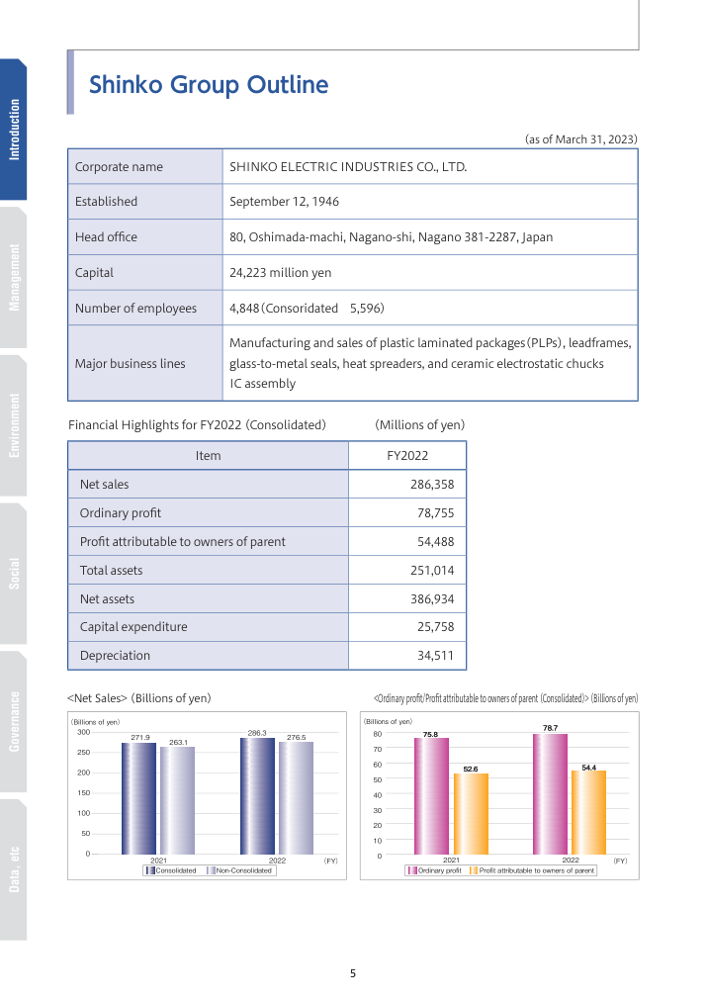
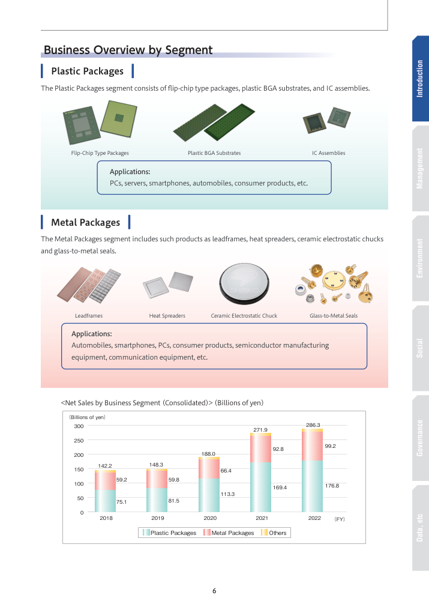
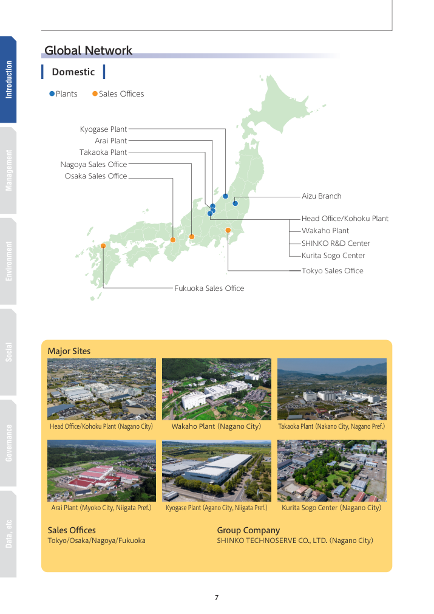
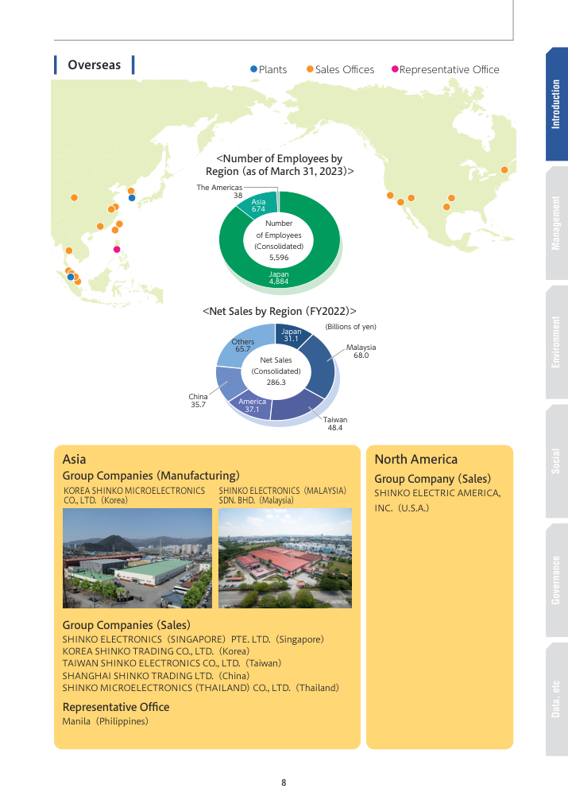

## Document Metadata

- Document ID: a1f9666b66a65f301cb03d2b9ff46896dee9c7cb
- Document Title: Shinko Group Outline
- Document Type: PDF
- Issuing Organization: SHINKO ELECTRIC INDUSTRIES CO., LTD.
- Publication Date: null
- Reporting Period: FY2022; as of March 31, 2023
- Source File: [46_shinko.co.jp_2023_05.pdf](https://github.com/jadennevercode/CJCC-Knowledge-Base/blob/564ab11aa9785e569e3853c8a4d7ce86f88e7535/materials/%E4%B8%8A%E6%B8%B8%EF%BC%9ACMP%E5%8F%8A%E5%B0%81%E8%A3%85%E6%A8%A1%E7%BB%84%E6%9D%90%E6%96%99/46_shinko.co.jp_2023_05.pdf)

## Structured Content

[Source Page: 1]

# Shinko Group Outline

(as of March 31, 2023)

| | |
| --- | --- |
| Corporate name | SHINKO ELECTRIC INDUSTRIES CO., LTD. |
| Established | September 12, 1946 |
| Head office | 80, Oshimada-machi, Nagano-shi, Nagano 381-2287, Japan |
| Capital | 24,223 million yen |
| Number of employees | 4,848 (Consoridated 5,596) |
| Major business lines | Manufacturing and sales of plastic laminated packages (PLPs), leadframes, glass-to-metal seals, heat spreaders, and ceramic electrostatic chucks; IC assembly |

## Financial Highlights for FY2022 (Consolidated)

(Millions of yen)

| Item | FY2022 |
| --- | ---: |
| Net sales | 286,358 |
| Ordinary profit | 78,755 |
| Profit attributable to owners of parent | 54,488 |
| Total assets | 251,014 [OCR_UNCERTAIN] |
| Net assets | 386,934 [OCR_UNCERTAIN] |
| Capital expenditure | 25,758 |
| Depreciation | 34,511 |

### Net Sales

(Billions of yen)

| FY | Consolidated | Non-Consolidated |
| --- | ---: | ---: |
| 2021 | 271.9 | 263.1 |
| 2022 | 286.3 | 276.5 |

### Ordinary profit/Profit attributable to owners of parent (Consolidated)

(Billions of yen)

| FY | Ordinary profit | Profit attributable to owners of parent |
| --- | ---: | ---: |
| 2021 | 75.8 | 52.6 |
| 2022 | 78.7 | 54.4 |

[Source Page: 2]

# Business Overview by Segment

## Plastic Packages

The Plastic Packages segment consists of flip-chip type packages, plastic BGA substrates, and IC assemblies.

Flip-Chip Type Packages; Plastic BGA Substrates; IC Assemblies

Applications: PCs, servers, smartphones, automobiles, consumer products, etc.

## Metal Packages

The Metal Packages segment includes such products as leadframes, heat spreaders, ceramic electrostatic chucks and glass-to-metal seals.

Leadframes; Heat Spreaders; Ceramic Electrostatic Chuck; Glass-to-Metal Seals

Applications: Automobiles, smartphones, PCs, consumer products, semiconductor manufacturing equipment, communication equipment, etc.

### Net Sales by Business Segment (Consolidated)

(Billions of yen)

| FY | Plastic Packages | Metal Packages | Total |
| --- | ---: | ---: | ---: |
| 2018 | 75.1 | 59.2 | 142.2 |
| 2019 | 81.5 | 59.8 | 148.3 |
| 2020 | 113.3 | 66.4 | 188.0 |
| 2021 | 169.4 | 92.8 | 271.9 |
| 2022 | 176.8 | 99.2 | 286.3 |

The chart also shows “Others” without numerical labels.

[Source Page: 3]

# Global Network

## Domestic

Plants; Sales Offices

Kyogase Plant; Arai Plant; Takaoka Plant; Nagoya Sales Office; Osaka Sales Office; Aizu Branch; Head Office/Kohoku Plant; Wakaho Plant; SHINKO R&D Center; Kurita Sogo Center; Tokyo Sales Office; Fukuoka Sales Office.

### Major Sites

- Head Office/Kohoku Plant (Nagano City)
- Wakaho Plant (Nagano City)
- Takaoka Plant (Nakano City, Nagano Pref.)
- Arai Plant (Myoko City, Niigata Pref.)
- Kyogase Plant (Agano City, Niigata Pref.)
- Kurita Sogo Center (Nagano City)

**Sales Offices:** Tokyo/Osaka/Nagoya/Fukuoka

**Group Company:** SHINKO TECHNOSERVE CO., LTD. (Nagano City)

[Source Page: 4]

## Overseas

Plants; Sales Offices; Representative Office

### Number of Employees by Region (as of March 31, 2023)

Number of Employees (Consolidated): 5,596

| Region | Number of employees |
| --- | ---: |
| Japan | 4,884 |
| Asia | 674 |
| The Americas | 38 |

### Net Sales by Region (FY2022)

Net Sales (Consolidated): 286.3 (Billions of yen)

| Region | Billions of yen |
| --- | ---: |
| Japan | 31.1 |
| Malaysia | 68.0 |
| Taiwan | 48.4 |
| America | 37.1 |
| China | 35.7 |
| Others | 65.7 |

### Asia

**Group Companies (Manufacturing)**

- KOREA SHINKO MICROELECTRONICS CO., LTD. (Korea)
- SHINKO ELECTRONICS (MALAYSIA) SDN. BHD. (Malaysia)

**Group Companies (Sales)**

- SHINKO ELECTRONICS (SINGAPORE) PTE. LTD. (Singapore)
- KOREA SHINKO TRADING CO., LTD. (Korea)
- TAIWAN SHINKO ELECTRONICS CO., LTD. (Taiwan)
- SHANGHAI SHINKO TRADING LTD. (China)
- SHINKO MICROELECTRONICS (THAILAND) CO., LTD. (Thailand)

**Representative Office:** Manila (Philippines)

### North America

**Group Company (Sales)**

SHINKO ELECTRIC AMERICA, INC. (U.S.A.)

## Processing Notes

- 第 1 页原表将 Total assets 列为 251,014、Net assets 列为 386,934；两项的关系看似异常，但原页确实如此，已保留并标记 [OCR_UNCERTAIN]。
- 第 2 页分部图含 “Others” 色块但未标数值；不推算该部分。地图和产品、厂房照片见原页图。
- PDF 的实际页码为 1–4，原文件印刷页码为 5–8。
