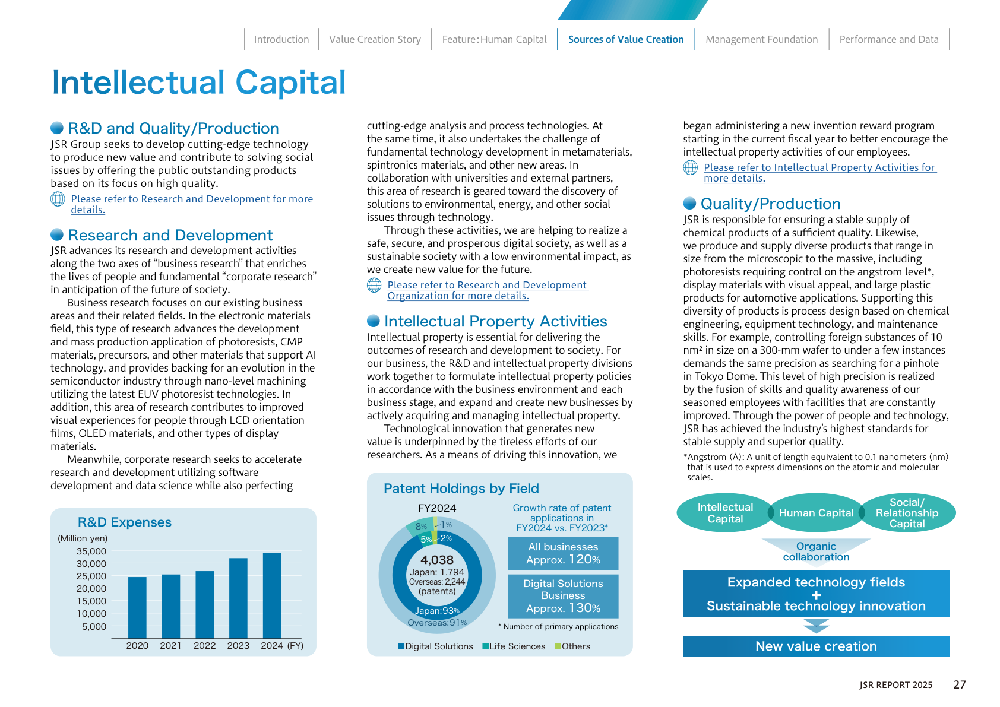

## Document Metadata

- Document ID: ebcd86078ed2cea77db3feba0539c9f71bd753af
- Document Title: Intellectual Capital
- Document Type: PDF
- Issuing Organization: JSR
- Publication Date: 2025
- Reporting Period: null
- Source File: [45_jsr.co.jp_27_Intellectual_Capital.pdf](https://github.com/jadennevercode/CJCC-Knowledge-Base/blob/564ab11aa9785e569e3853c8a4d7ce86f88e7535/materials/%E4%B8%8A%E6%B8%B8%EF%BC%9A%E5%85%89%E5%88%BB%E6%9D%90%E6%96%99/45_jsr.co.jp_27_Intellectual_Capital.pdf)

## Structured Content

[Source Page: 1]

原报告印刷页码：27

# Intellectual Capital

## R&D and Quality/Production

JSR Group seeks to develop cutting-edge technology to produce new value and contribute to solving social issues by offering the public outstanding products based on its focus on high quality.

[Please refer to Research and Development for more details.](https://www.jsr.co.jp/jsr_e/rd/)

## Research and Development

JSR advances its research and development activities along the two axes of “business research” that enriches the lives of people and fundamental “corporate research” in anticipation of the future of society.

Business research focuses on our existing business areas and their related fields. In the electronic materials field, this type of research advances the development and mass production application of photoresists, CMP materials, precursors, and other materials that support AI technology, and provides backing for an evolution in the semiconductor industry through nano-level machining utilizing the latest EUV photoresist technologies. In addition, this area of research contributes to improved visual experiences for people through LCD orientation films, OLED materials, and other types of display materials.

Meanwhile, corporate research seeks to accelerate research and development utilizing software development and data science while also perfecting cutting-edge analysis and process technologies. At the same time, it also undertakes the challenge of fundamental technology development in metamaterials, spintronics materials, and other new areas. In collaboration with universities and external partners, this area of research is geared toward the discovery of solutions to environmental, energy, and other social issues through technology.

Through these activities, we are helping to realize a safe, secure, and prosperous digital society, as well as a sustainable society with a low environmental impact, as we create new value for the future.

[Please refer to Research and Development Organization for more details.](https://www.jsr.co.jp/jsr_e/rd/org.html)

## Intellectual Property Activities

Intellectual property is essential for delivering the outcomes of research and development to society. For our business, the R&D and intellectual property divisions work together to formulate intellectual property policies in accordance with the business environment and each business stage, and expand and create new businesses by actively acquiring and managing intellectual property.

Technological innovation that generates new value is underpinned by the tireless efforts of our researchers. As a means of driving this innovation, we began administering a new invention reward program starting in the current fiscal year to better encourage the intellectual property activities of our employees.

[Please refer to Intellectual Property Activities for more details.](https://www.jsr.co.jp/jsr_e/rd/ip.html)

## Quality/Production

JSR is responsible for ensuring a stable supply of chemical products of a sufficient quality. Likewise, we produce and supply diverse products that range in size from the microscopic to the massive, including photoresists requiring control on the angstrom level*, display materials with visual appeal, and large plastic products for automotive applications. Supporting this diversity of products is process design based on chemical engineering, equipment technology, and maintenance skills. For example, controlling foreign substances of 10 nm² in size on a 300-mm wafer to under a few instances demands the same precision as searching for a pinhole in Tokyo Dome. This level of high precision is realized by the fusion of skills and quality awareness of our seasoned employees with facilities that are constantly improved. Through the power of people and technology, JSR has achieved the industry’s highest standards for stable supply and superior quality.

*Angstrom (Å): A unit of length equivalent to 0.1 nanometers (nm) that is used to express dimensions on the atomic and molecular scales.

## R&D Expenses

[TABLE_RECONSTRUCTION_UNCERTAIN]

(Million yen)

2020　2021　2022　2023　2024 (FY)

5,000　10,000　15,000　20,000　25,000　30,000　35,000

## Patent Holdings by Field

FY2024: 4,038 patents; Japan: 1,794; Overseas: 2,244.

| | Digital Solutions | Life Sciences | Others |
| --- | ---: | ---: | ---: |
| Japan | 93% | 5% | 2% |
| Overseas | 91% | 8% | 1% |

Growth rate of patent applications in FY2024 vs. FY2023*: All businesses, approximately 120%; Digital Solutions Business, approximately 130%.

*Number of primary applications.

## Intellectual Capital

Intellectual Capital; Human Capital; Social/Relationship Capital; Organic collaboration; Expanded technology fields + Sustainable technology innovation; New value creation.

## Processing Notes

- 重新核对 PDF 第 1 页专利环形图与研发费用图；后者未标柱体精确值，保留原图及不确定标记。

- 原 OCR 遗漏大量正文，已对照原 PDF 文本层和页面补全。原有 OCR 结果保留在相邻 `materials_md` 文件夹中。
- [TABLE_RECONSTRUCTION_UNCERTAIN] R&D 支出柱状图没有标示精确数值，未估算；专利环形图分类与百分比已对照原图核对。
- 已从原 PDF 核验并保留三个网页链接；原报告印刷页码为 27，本文件为单页 PDF。
