## Document Metadata

- Document ID: dfe08dcd8068e44adc230e3b0ce2a840671ae13b
- Document Title: Business Results - The Fiscal Year ended Dec. 2025
- Document Type: Business Results Presentation
- Issuing Organization: TOKYO OHKA KOGYO CO., LTD.
- Publication Date: 2026-02-09
- Reporting Period: FY2025 (2025-01 to 2025-12)
- Source File: [45_tok.co.jp_account_2512_4_en.pdf](https://github.com/jadennevercode/CJCC-Knowledge-Base/blob/564ab11aa9785e569e3853c8a4d7ce86f88e7535/materials/%E4%B8%8A%E6%B8%B8%EF%BC%9A%E5%85%89%E5%88%BB%E6%9D%90%E6%96%99/45_tok.co.jp_account_2512_4_en.pdf)

## Structured Content

> 原文件：[45_tok.co.jp_account_2512_4_en.pdf](https://github.com/jadennevercode/CJCC-Knowledge-Base/blob/564ab11aa9785e569e3853c8a4d7ce86f88e7535/materials/%E4%B8%8A%E6%B8%B8%EF%BC%9A%E5%85%89%E5%88%BB%E6%9D%90%E6%96%99/45_tok.co.jp_account_2512_4_en.pdf)
> 转换方式：Volcengine OCRPdf v3, parse_mode=ocr

[Source Page: 1]

# TOKYO OHKA KOGYO CO., LTD. Business Results

-The Fiscal Year ended Dec. 2025-  
Feb. 9, 2026  
TOKYO OHKA KOGYO CO., LTD.

[Source Page: 2]

## Table of Contents

| | Page |
| --- | --- |
| 1. Summary for FY2025 (2025.1-2025.12) | p.2 |
| 2. Consolidated Business Results for FY2025 (2025.1-2025.12) | p.3 |
| 3. Consolidated Performance Forecasts for FY2026 (2026.1-2026.12) | p.8 |
| 4. Revision of Quantitative Objectives of tok Medium-Term Plan 2027 | p.16 |
| 5. Appendix | p.26 |

[Source Page: 3]

[原始页面图像](_assets/tok-reviewed-pages/page-3.png)

## Summary for FY2025

### FY2025 Results

- Revised upward the full-year financial results forecast on January 30
- Net sales, operating income, ordinary income and profit attributable to owners of parent hit a record high for two consecutive years.
- Both net sales and operating income increased significantly by capitalizing on the expansion of the electronics market including an increase in demand for generative AI-related products.

### FY2026 Consolidated Forecasts

- Assumptions: Expect growth in advanced semiconductor materials and the launch of operations of customers’ new plants, with the continued strong demand for generative AI-related products.

  Assumed exchange rate ¥148.6/$ (FY2025 actual) ⇒ ¥150.0/$ (FY2026)

- Expect YoY growth in both net sales and operating income significantly exceeding FY2025 based on the market situation and the adoption status of our products. Expect to reach a record high for three consecutive years.

### Shareholder Returns

- Under the dividend policy targeting 4.0% of a consolidated dividend on equity ratio (DOE), the year-end dividend is forecasted to be 37 yen, bringing the annual dividend to 72 yen for FY2025. (Dividend growth for consecutive 8 years)
- For FY2026, the annual dividend is forecasted to be 80 yen.
- Maintain the consecutive dividend growth under the dividend policy targeting 4.0% of DOE.

[Source Page: 4]

## Summary (FY2025)

(Millions of yen)

| | FY2024 | FY2025 | Change | % |
| --- | --- | --- | --- | --- |
| Net sales | 200,966 | 237,029 | +36,062 | +17.9 |
| Electronic functional materials | 107,515 | 124,700 | +17,184 | +16.0 |
| High purity chemicals | 91,476 | 109,400 | +17,923 | +19.6 |
| Other | 1,974 | 2,928 | +954 | +48.3 |
| Operating income | 33,090 | 47,386 | +14,295 | +43.2 |
| Ordinary income | 34,554 | 49,274 | +14,720 | +42.6 |
| Profit attributable to owners of parent | 22,683 | 33,345 | +10,661 | +47.0 |
| EBITDA | 41,424 | 56,194 | +14,769 | +35.7 |
| ROE (%) | 11.8 | 15.6 | +3.8 | - |

Average exchange rate (US$): ¥150.8/$ (FY2024) ⇒ ¥148.6/$ (FY2025)

- Net sales: Up 17.9% YoY. Both electronic functional materials and high-purity chemicals acheived significant sales growth due to higher demand for generative AI-related products and steady growth for replacement of PCs.
- Operating income: Up 43.2% YoY. Significant YoY increase due to higher sales of high value-added products, mainly advanced materials. (Including a one-off profit recorded in connection with the recognition of inventories such as development-related materials in 4Q)
- Profit attributable to owners of parent: Up 47.0% YoY due to increased operating income. (Including extraordinary income associated with the transfer of Equipment Business in 1Q)

[Source Page: 5]

## Electronic Functional Materials Sales by Product Type

Sales (Millions of yen); YoY +16.0%

| | FY2024 | FY2025 |
| --- | --- | --- |
| Sales | 107,515 | 124,700 |
| Photoresist for semiconductor front-end processes | 70% | 70% |
| Materials for Semiconductor back-end processes | 22% | 22% |
| Display/ Other | 8% | 8% |

Growth (YoY):

| | Growth |
| --- | --- |
| Photoresist for semiconductor front-end processes | +15% |
| Advanced material | +20% |
| KrF | +15% |
| Legacy material | +15% |
| Materials for Semiconductor back-end processes | +15% |
| Display/ Other | +15% |

*1 Advanced material: ArF/EUV resist, etc.,  
*2 Legacy material: g/i-line resist, etc.,  
*3 Materials for Semiconductor back-end process: Resist for Package・MEMS material・WHS related material

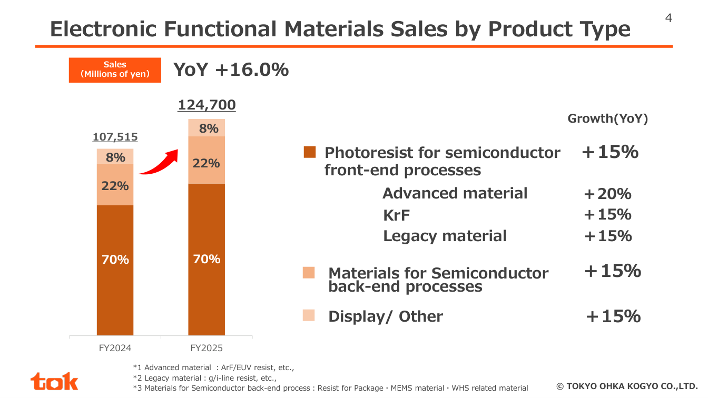

[Source Page: 6]

## Breakdown of the Change in Operating Income

FY2024 Result vs. FY2025 Result

| | |
| --- | --- |
| FY2024 Result | ¥33.1 billions |
| Impact of sales Increase, Product mix, etc. | +¥19.3 billions |
| Impact of exchange rate changes・Price adjustment | (¥1.6 billions) |
| Expenses Increase | (¥5.5 billions) |
| One-off profit in connection with the recognition of inventories such as development-related materials | +¥2.0 billions |
| FY2025 Result | ¥47.3 billions |
| Change | +¥14.2 billions |

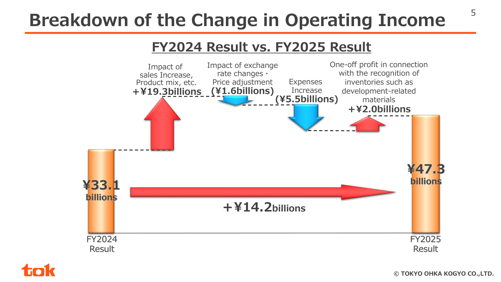

[Source Page: 7]

## Sales Breakdown/ Operating income

Millions of yen

| | 24/Q1 | 24/Q2 | 24/Q3 | 24/Q4 | 25/Q1 | 25/Q2 | 25/Q3 | 25/Q4 |
| --- | --- | --- | --- | --- | --- | --- | --- | --- |
| Sales | 45,017 | 49,718 | 51,811 | 54,418 | 54,272 | 57,351 | 61,155 | 64,250 |
| Electronic functional materials | 24,460 | 26,899 | 27,739 | 28,415 | 27,751 | 30,398 | 32,752 | 33,798 |
| High-purity chemicals | 20,065 | 22,409 | 23,440 | 25,561 | 25,595 | 26,389 | 27,884 | 29,530 |
| Other | 490 | 409 | 631 | 441 | 925 | 563 | 518 | 920 |
| Operating income | 5,793 | 7,649 | 9,800 | 9,847 | 9,801 | 10,044 | 12,047 | 15,492 |

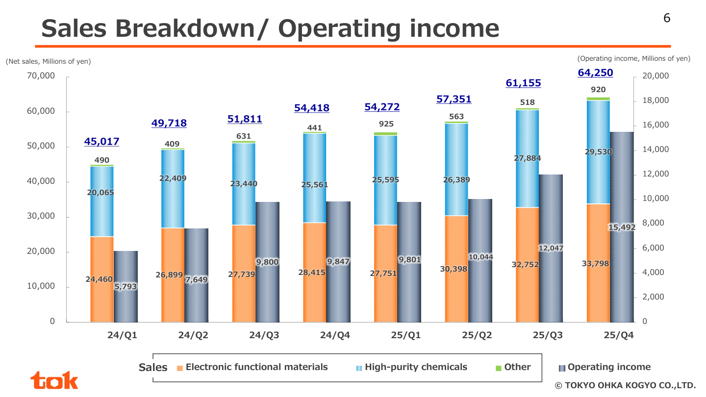

[Source Page: 8]

## Capital Investments/ Depreciation/ R&D

(Millions of yen)

| | FY2024 | FY2025 | Change | % | Against annual plan (*) |
| --- | --- | --- | --- | --- | --- |
| Capital Investments | 24,764 | 28,723 | +3,959 | +16.0 | (5,676) |
| Depreciation | 8,333 | 8,807 | +473 | +5.7 | (92) |
| R&D | 14,519 | 15,673 | +1,154 | +8.0 | (426) |

(*) Figures released on August 6, 2025

Capital Investments: some planned investments will be postponed to next year.

[Source Page: 9]

## Consolidated Performance Forecasts for FY2026 (2026.1-2026.12)

[Source Page: 10]

## Earnings Forecasts (Full-year)

(Millions of yen)

| | FY2025 | FY2026 | Change | % |
| --- | --- | --- | --- | --- |
| Net Sales | 237,029 | 261,000 | +23,970 | +10.1 |
| Electronic functional materials | 124,700 | 140,000 | +15,299 | +12.3 |
| High-purity chemicals | 109,400 | 116,000 | +6,599 | +6.0 |
| Others | 2,928 | 5,000 | +2,071 | +70.7 |
| Operating income | 47,386 | 52,200 | +4,813 | +10.2 |
| Ordinary income | 49,274 | 53,800 | +4,525 | +9.2 |
| Profit attributable to owners of parent | 33,345 | 35,000 | +1,654 | +5.0 |
| EBITDA | 56,194 | 63,500 | +7,305 | +13.0 |
| ROE (%) | 15.6 | 14.5 | (1.1) | - |

Average exchange rate (US$): ¥148.6/$ (FY2025) ⇒ ¥150.0/$ (FY2026)

- Net sales: Forecast to increase 10.1% YoY due to higher demand for advanced semiconductor materials and back-end process-related materials and steady growth of high-purity chemicals driven by an increase in generative AI-related demand and the launch of operations of customers’ new plants.
- Operating income: Forecast to increase 10.2% YoY due to an increase in net sales.
- Profit attributable to owners of parent: Forecast to increase 5.0% YoY due to an increase in operating income.

[Source Page: 11]

## Electronic Functional Materials Sales Forecast by Product Type

Sales (Millions of yen); YoY +12.3%

| | FY2025 | FY2026 Forecast |
| --- | --- | --- |
| Sales | 124,700 | 140,000 |
| Photoresist for semiconductor front-end processes | 70% | 68% |
| Materials for Semiconductor back-end processes | 22% | 25% |
| Display/ Other | 8% | 7% |

Growth (YoY):

| | Growth |
| --- | --- |
| Photoresist for semiconductor front-end processes | +10% |
| Advanced material | +10% |
| KrF | +10% |
| Legacy material | +10% |
| Materials for Semiconductor back-end processes | +30% |
| Display/ Other | (5%) |

*1 Advanced material: ArF/EUV resist, etc.,  
*2 Legacy material: g/i-line resist, etc.,  
*3 Materials for Semiconductor back-end process: Resist for Package・MEMS material・WHS related material

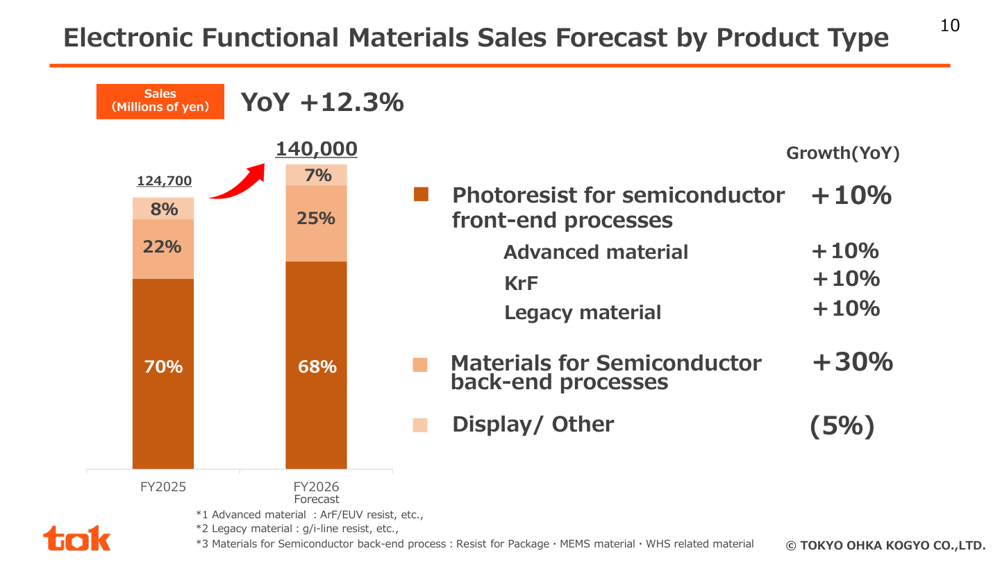

[Source Page: 12]

## Breakdown of the Change in Operating Income

FY2025 Result vs. FY2026 Forecast

| | |
| --- | --- |
| FY2025 Result | ¥47.3 billions |
| Impact of sales Increase, Product mix, etc | +¥16.9 billions |
| Impact of exchange rate changes・Price adjustment | (¥3.1 billions) |
| Expenses Increase | (¥8.9 billions) |
| FY2026 Forecast | ¥52.2 billions |
| Change | +¥4.9 billions |

Included last year’s influence of recognition of inventories such as development-related materials.

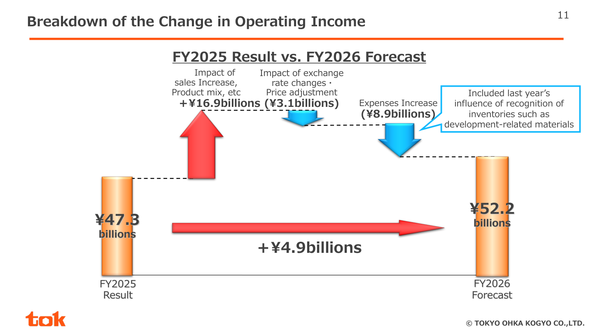

[Source Page: 13]

## Breakdown of the Change in Operating Income (in case of excluded one-off profit)

FY2025 Result vs. FY2026 Forecast

| | |
| --- | --- |
| FY2025 Result | ¥45.3 billions |
| One-off profit in connection with the recognition of inventories such as development-related materials | 2.0B |
| Impact of sales Increase, Product mix, etc | +¥16.9 billions |
| Impact of exchange rate changes・Price adjustment | (¥3.1 billions) |
| Expenses Increase | (¥6.9 billions) |
| FY2026 Forecast | ¥52.2 billions |
| Change | +¥6.9 billions |

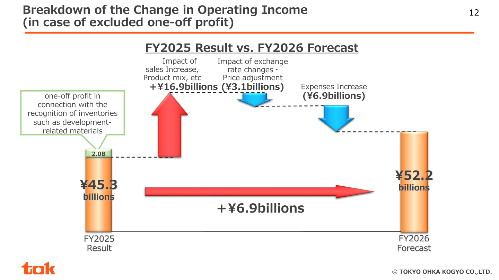

[Source Page: 14]

## Sales Breakdown (Forecast)

Net sales (Millions of yen)

| | 2024/1H | 2024/2H | 2025/1H | 2025/2H | 2026/1H Forecast | 2026/2H Forecast |
| --- | --- | --- | --- | --- | --- | --- |
| Electronic Functional Materials | 51,360 | 56,155 | 58,149 | 66,550 | 66,800 | 73,200 |
| High purity chemicals | 42,475 | 49,001 | 51,985 | 57,415 | 55,900 | 60,100 |
| Others | 900 | 1,073 | 1,488 | 1,439 | 2,300 | 2,700 |
| Net sales | 94,736 | 106,230 | 111,623 | 125,405 | 125,000 | 136,000 |

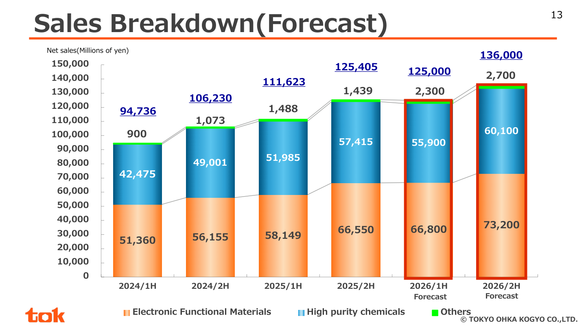

[Source Page: 15]

## Capital Investments/Depreciation/R&D

(Millions of yen)

| | FY2025 | FY2026 Forecast | Change | % |
| --- | --- | --- | --- | --- |
| Capital Investments | 28,723 | 35,800 | +7,076 | +24.6 |
| Depreciation | 8,807 | 11,300 | +2,492 | +28.3 |
| R&D | 15,673 | 18,200 | +2,526 | +16.1 |

[Source Page: 16]

## Shareholder Returns

〈Build sound and efficient management foundation to realize tok Vision 2030〉

- Dividend policy with a targeting DOE4.0%
- Share buyback: To be implemented flexibly

| FY | 17/12 | 18/12 | 19/12 | 20/12 | 21/12 | 22/12 | 23/12 | 24/12 | 25/12 | 26/12 Forecast |
| --- | --- | --- | --- | --- | --- | --- | --- | --- | --- | --- |
| Total dividend amount (million yen) | 2,743 | 3,999 | 5,003 | 6,431 | 6,386 | 6,469 | 6,797 | 7,599 | 8,391 | 9,589 |
| Dividend per share*1 (yen) | 20 | 32 | 40 | 51 | 51 | 53 | 55 | 63 | 72 | 80 |
| Interim dividend (yen) | 10 | 12 | 20 | 20 | 20 | 26 | 27 | 29 | 35 | 40 Forecast |
| Year-end dividend (yen) | 10 | 20 | 20 | 21 | 31 | 27 | 28 | 34 | 37 Planned | 40 Forecast |
| Special dividend (yen) | | | | 10 | | | | | | |

Buy Back worth 9,999 million yen (17/12); Buy Back worth 9,999 million yen (21/12); Buy Back worth 5,498 million yen (24/12)*2; Buy Back worth 1,501 million yen (25/12)*2.

Guidelines on dividend policy: tok Med-Term Plan 2018 — Consolidated payout ratio of over 40%; tok Med-Term Plan 2021 — Based on consolidated DOE of 3.5%; tok Med-Term Plan 2024 and tok Med-Term Plan 2027 — Based on consolidated DOE of 4.0%.

TOK conducted a split 3 shares for 1 share on January 1, 2024 (effective date).

*1 Prior to 2023/12, fractions less than one yen resulting from the stock split were rounded down.  
*2 Buyback period: From November 13, 2024 to January 30, 2025.

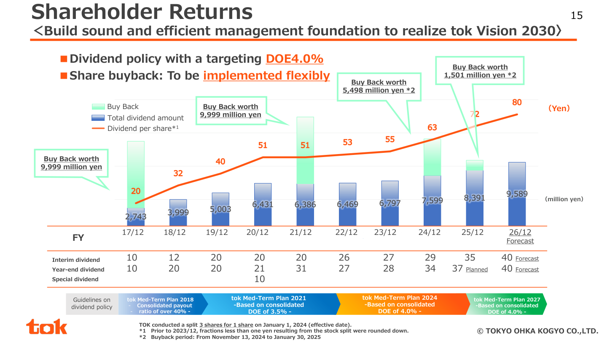

[Source Page: 17]

## Revision of Quantitative Objectives of tok Medium-Term Plan 2027

[Source Page: 18]

## Revision of Quantitative Objectives of tok Medium-Term Plan 2027

### Background of revision

(1) Changes in semiconductor market trends

Demand for tok products is growing at a pace exceeding initial forecast, driven by increasing demand for generative AI secmiconductors.

(2) Changes in exchange rate

The yen has been weaker than initially forecasted, which is expected to contribute to higher net sales and operating income.

(Average exchange rate for FY2025 to FY2027 (US$)…Initial forecast: ¥135.0/$ ⇒ After revision: ¥150.0/$)

Upwardly revised net sales, operating income, EBITDA, and ROE target. Qualitative Objectives and Key Strategies are not revised.

| | FY2025 Results | FY2027 Initial targets (announced in Jan. 2025) | FY2027 Revised targets (announced in Feb. 2026) |
| --- | --- | --- | --- |
| Net sales (billion yen) | 237.0 | 270.0 | 295.0 |
| Operating income (billion yen) | 47.3 | 48.0 | 58.0 |
| EBITDA (billion yen) | 56.1 | 60.0 | 72.0 |
| ROE | 15.6% | 13.0% | 14.0% |

[Source Page: 19]

## Net sales and EBITDA margin

| | 2019 | 2020 | 2021 | 2022 | 2023 | 2024 | 2025 | 2026 forecast | 2027 target |
| --- | --- | --- | --- | --- | --- | --- | --- | --- | --- |
| Net Sales (Billion yen) | 102.8 | 117.5 | 140.0 | 175.4 | 162.2 | 200.9 | 237.0 | 261.0 | 295.0 |
| EBITDA margin (%) | 16.2% | 19.0% | 19.4% | 21.0% | 18.7% | 20.6% | 23.7% | 24.3% | 24.4% |

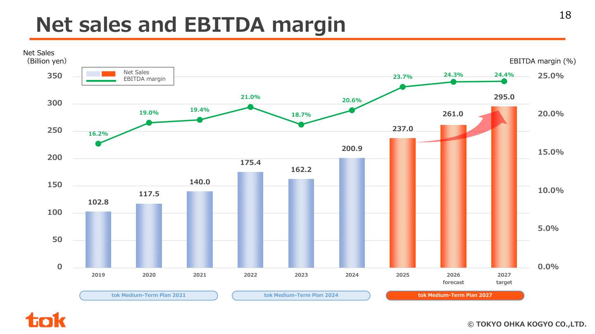

[Source Page: 20]

[原始页面图像](_assets/tok-reviewed-pages/page-20.png)

## tok Medium-Term Plan 2027: Target/Strategy/Progress by Segment

| Segment | Targets in Medium-Term Plan | Net sales growth (FY2024 → FY2027): Initial target (announced in Feb. 2025) | Net sales growth (FY2024 → FY2027): Revised target (announced in Feb. 2026) | Strategy | Progress |
| --- | --- | ---: | ---: | --- | --- |
| Semiconductor photoresist —Advanced materials —KrF resist —Legacy materials —Packaging materials | Sales increase by exceeding market growth with share expand | +37% | +42% | Expand technology portfolio Enhance quality control toward further miniaturization Differentiate through advanced production technologies and stable supply of high-quality products | Demand is growing and our market share is expanding in the innovative field (logic/memory) including generative AI semiconductors |
| Various electronic materials —MEMS materials —WHS materials —Display materials —Other | Sales expand by increasing share in existing and new markets | +20% | +143% | Uncover potential needs by anticipating technology trends | Growth of the advanced packaging market and expand customers’ base |
| High-purity chemicals —Thinners —Developer —Surface modification materials | Sales expand by demand increase and build supply system | +34% | +44% | Establish a global supply system Gain adoption of our products for cutting-edge device manufacturing process | Demand is growing due to construction of customers’ new plants Sales are expanding in the US, Taiwan, China and Japan Commenced the build-out of a supply system of high-purity chemicals in South Korea |

[Source Page: 21]

## Develop next-generation EUV photoresist for further miniaturization

Offer a full lineup of various EUV photoresists to adress diverse needs.

Practical application schedule (Company estimate): 2025–2030; see original chart for timing.

- CAR (Chemical Amplified Resist): Flexibility and stability of material design
- SMR (Small Molecular Resist): Pattern uniformity and etching resistance
- MOR (Metal Oxide Resist): Sensitivity and etching resistance

Examples of patterns formed with each resist (top-view): 14nm line/ 28nm Pitch Line & Space; 18nm Contact/ 36nm Pitch Hexagonal Hole.

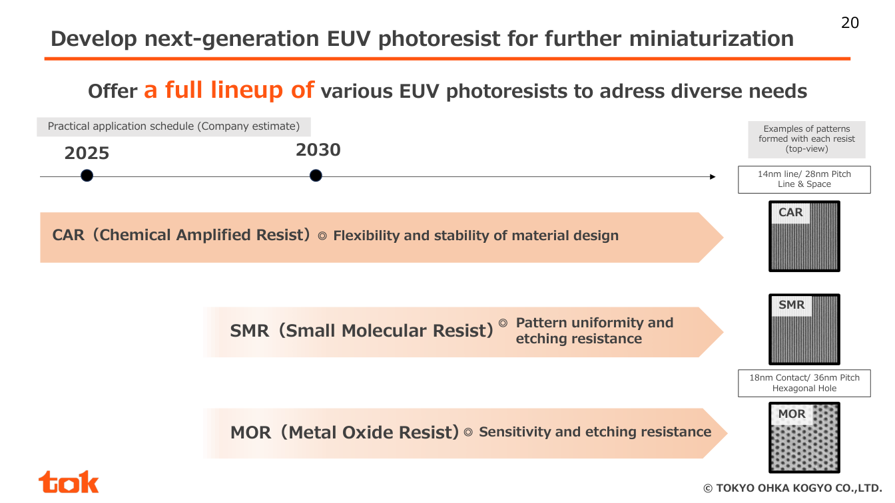

[Source Page: 22]

## R&D investment envisioning a “100-year-old company”

### Industry-academia collaboration: Joint study with Univ. of Hyogo

Concluded an agreement on promoting cooperation and collaboration with the University (2025). Working to enhance patterning resolution under the theme of “Beyond EUV” by further shortening the wavelength of light sources used in existing EUV lithography.

### Inter-industry collaboration: Participation in JOINT3

Participated in "JOINT3," a consortium to develop next-generation semiconductor packaging (2025). Accelerating the development of panel-level packaging materials through co-creation with material, equipment and design companies.

### In-house development: Create new core technology

Established “light-control technology" as a new core technology. Developing materials controlling the refractive index for AR/VR and materials for CPO (Co-Packaged Optics) technology.

### M&A: micro resist technology GmbH (Germany)

Made micro resist technology in Germany as our wholly-owned subsidiary (2025). Strengthening the customer support system in Europe and expanding our product portfolio through technological integration with MRT.

R&D efficiency (5-year moving average)*

| | 2017/3 | 2017/12 | 2018/12 | 2019/12 | 2020/12 | 2021/12 | 2022/12 | 2023/12 | 2024/12 | 2025/12 | 2026/12 Forecast |
| --- | --- | --- | --- | --- | --- | --- | --- | --- | --- | --- | --- |
| R&D efficiency | 148% | 160% | 173% | 161% | 168% | 189% | 244% | 263% | 309% | 366% | 425% |

* R&D efficiency = Operating income over the past 5 years / R&D costs over the preceding 5 years.

Amounts exceeding 400% will be added to long-term theme R&D investment.

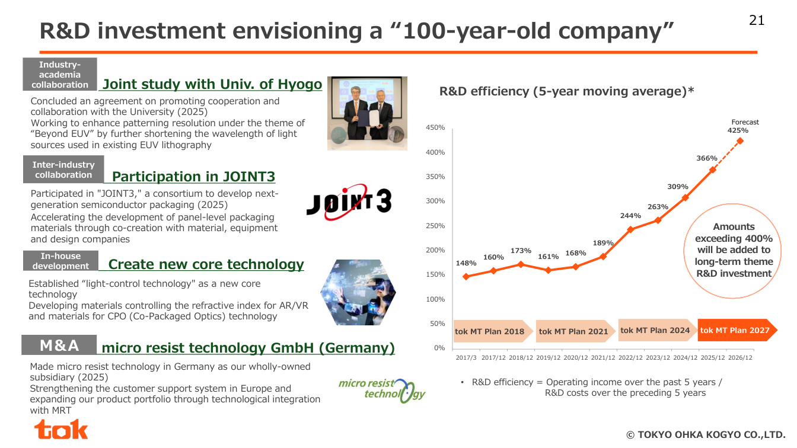

[Source Page: 23]

## Sales growth prospect of TOK products based on growing generative-AI related demand

Sales of back-end (packaging) process materials in addition to front-end process materials are growing. In high-purity chemicals, the share of high value-added products for cutting-edge device manufacturing processes is increasing.

### Examples of TOK products use in GPU for Generative AI

| Application | TOK products |
| --- | --- |
| For DRAM | EUV/ArF/KrF photoresists |
| For logic | EUV/ArF/KrF/i-Line photoresists |
| For interposer | WHS materials; Packaging materials (RDL resists); KrF photoresists |
| For 2.5D packaging (TSV) | WHS materials |
| For microbump | Packaging materials (bump formation resists) |
| For GPU die | EUV/ArF/KrF/i Line photoresists |

Diagram labels: HBM DRAM die, Logic die, Interposer substrates, Package substrates, TSV, Microbump, GPU die.

### Sales growth by product (forecast), 2024–2027

| Product | Growth |
| --- | --- |
| Semiconductor photoresists: EUV photoresists | +150% |
| Semiconductor photoresists: Packaging materials | +70% |
| Various electronic materials: WHS materials | +700% |
| High-purity chemicals: Surface modification materials | +50% |

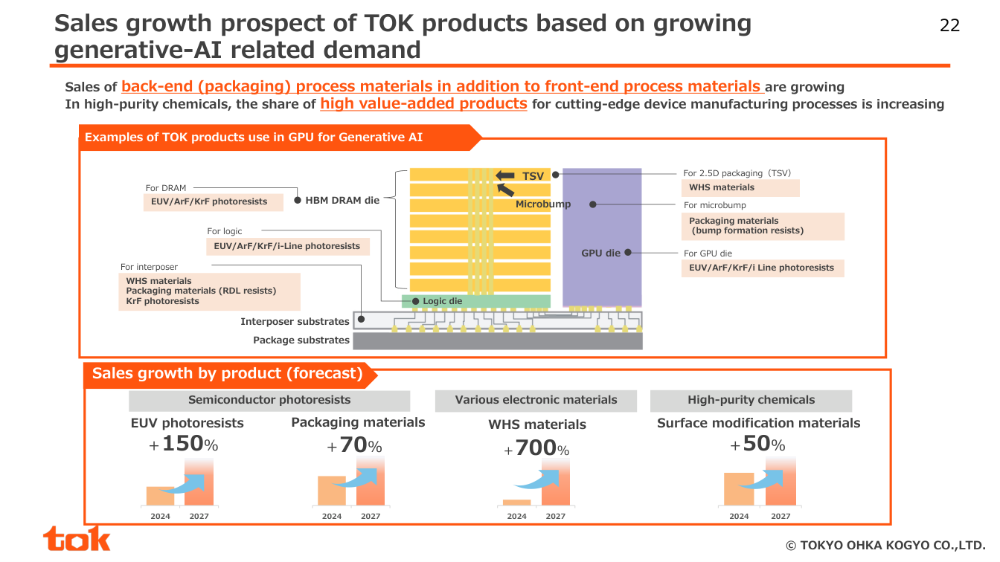

[Source Page: 24]

## Expanding Cash Generating Ability by Strengthening Manufacturing Capital

### Estimated EBITDA trends through 2030

- 2025 result: EBITDA ¥56.1 billions.
- 2027 target: EBITDA ¥72.0 billions.
- The figure labels 2026/1H, 2027/1H, 2027/2H and 2030 and includes “EBITDA generated by existing facilities + other investments.”

- TOKAM/ Incheon Plant (South Korea): Constructed a new inspection building. Investment amount: Approx. ¥7.0 billions.
- TOK/Aso Plant, Aso Kumamoto Site (Japan): Constructed a new production plant for High-purity chemicals. Investment amount: Approx. ¥13.0 billions.
- TOK/ Koriyama Plant (Japan): Construction underway on world's largest photoresist manufacturing building. Investment amount: over ¥20.0 billions.
- TOKAM/ Pyeongtaek Plant (South Korea): Construction underway on a High-purity chemical manufacturing building. Investment amount: Approx. ¥12.0 billions.

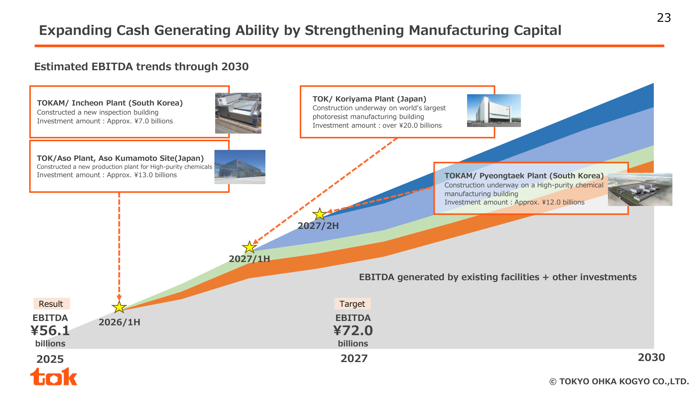

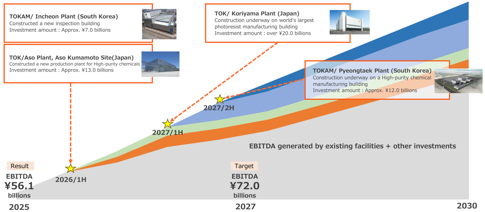

[Source Page: 25]

## Human capital investment

Create a virtuous cycle of employee engagement improvement and corporate value enhancement through human capital initiatives (human capital investment) focused on happiness.

4 human capital initiatives:

1. Form a diverse talent pool
2. Human capital development
3. Promote DE&I*
4. Improve employee engagement

* Diversity, Equity & Inclusion

Management commitment to achieving goals. Improvement of employee engagement: FY2025 +1.9 points; FY2027 +5.4 points (compared to FY2024). Achieve tok Vision 2030; enhance corporate value; reinvest the value created = Return to employees.

Use employee engagement indicators as a KPI for the officers’ remuneration system (from tok Medium-Term Plan 2024).

Examples of our measures:

- Extend the Employee Stockholding System to overseas local employees
- Grant restricted stock incentives to employees
- Globalize the award system (TOK SHINKA AWARD)
- Extend retirement age from 60 to 65 (with salaries maintained at pre-retirement levels)
- Provide base salary increases of over 5% for four consecutive years (2022 to 2025)

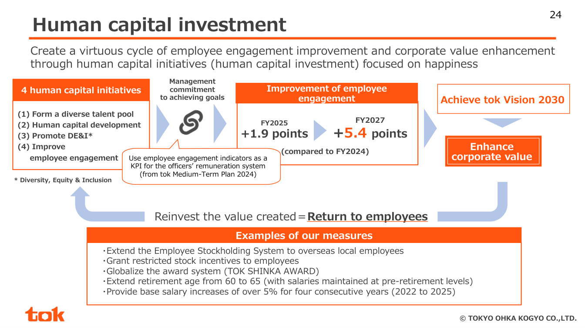

[Source Page: 26]

## Cash allocation

Generated EBITDA will be used for steady and continuous dividend payments with a target DOE ratio of 4.0%, making capital investment to prepare for demand growth in the semiconductor market and growth investment, and then, used for flexible share buyback.

### tok Medium-Term Plan 2027: Three-year cash flow plan (image)

- Cumulative EBITDA: Approx. ¥190 billion; BS adjustment; diversifying fundraising methods: corporate bond issuance (2025).
- Working capital increase and corporate income tax payment.
- Shareholder returns approximately ¥28 billion or more. Dividend on equity (DOE) ratio: About 4.0%. Share buyback: To be Implemented flexibly.
- Growth investment approximately ¥20 billion or more. Long-run R&D-driven company (Launch of new business, investments in human and intellectual capital, response to climate change and M&A).
- Capital Investment of ¥76 billion. Enhance production and R&D bases to expand the semiconductor market and stably supply in high-quality products.

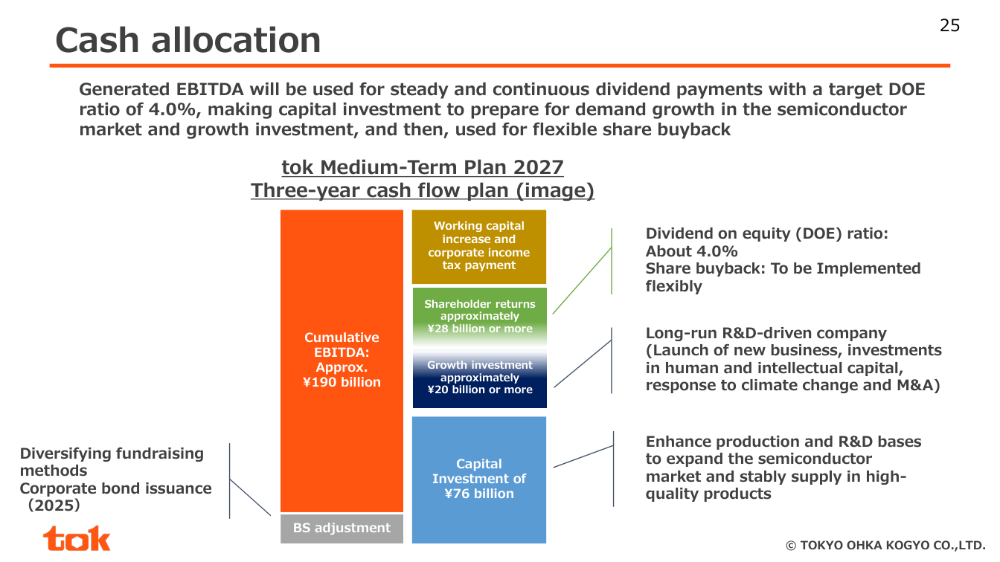

[Source Page: 27]

## Appendix

[Source Page: 28]

## Non-operating Expenses or Income/ Extraordinary Losses or Income

(Millions of yen)

| | FY2024 | FY2025 | Change |
| --- | --- | --- | --- |
| Non operating Expenses or Income | +1,463 | +1,888 | +424 |
| Interest and divided income | +977 | +1,059 | +82 |
| Share of profit of investments accounted for using equity method | (116) | +471 | +588 |
| (Foreign exchange related losses/gains) | (134) | (70) | +63 |
| Foreign exchange (Loss) gain | (98) | +289 | +388 |
| (Loss) gain on valuation of derivatives | (35) | (360) | (324) |
| Subsidy income | +328 | +403 | +75 |
| Extraordinary Losses or Income | +603 | +1,017 | +414 |
| Gain on change in equity | +198 | (12) | (211) |
| Gain on sale of investment securities | +508 | +245 | (263) |
| Gain on receipt of contingent consideration | － | +1,422 | +1,422 |
| Impairment loss | － | (283) | (283) |
| Loss on retirement of non-current assets | (122) | (364) | (242) |

[Source Page: 29]

## Balance Sheets

(Millions of yen)

| | As of December 31, 2025 | vs. December 31, 2024 |
| --- | --- | --- |
| Current Assets | 172,773 | +21,003 |
| Cash and deposits | 70,962 | +11,915 |
| Notes and accounts receivable-trade | 48,645 | +5,799 |
| Inventories | 44,006 | +7,120 |
| Property, plant and equipment | 110,193 | +20,251 |
| Intangible assets | 1,834 | +23 |
| Investments and other assets | 50,490 | +12,083 |
| Current Liabilities | 59,373 | +5,269 |
| Notes and accounts payable – trade | 29,544 | +2,674 |
| Non-current Liabilities | 33,619 | +19,266 |
| Total net assets | 242,299 | +28,826 |
| Total liabilities and net assets | 335,292 | +53,362 |

Change details (millions of yen):

- Property, plant and equipment: Construction in progress +9,255; Accumulated depreciation of Machinery, equipment and vehicles +3,133; Accumulated depreciation of Buildings and structures +3,116; Land +3,098.
- Investments and other assets: Investment securities +9,765; Retirement benefit asset +679; Deferred tax assets +302.
- Current Liabilities: Short-term borrowings (4,058); Accounts payable – other +3,085; Notes and accounts payable – trade +2,674; Income taxes payable +1,843; Provision for bonuses +1,096.
- Non-current Liabilities: Bonds payable +10,000; Long-term borrowings +10,000.
- Total net assets: Retained earnings +25,071; Treasury shares (789); Valuation difference on AFS securities +1,982.

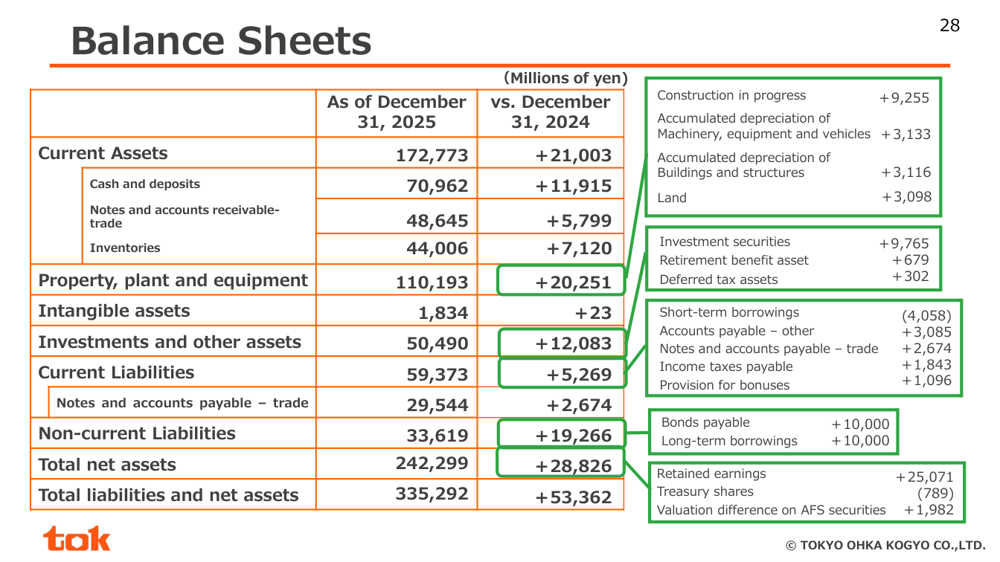

[Source Page: 30]

## Cash Flows

(Millions of yen)

| | FY2024 | FY2025 |
| --- | --- | --- |
| Cash flows from operating activities | +30,146 | +35,194 |
| Profit before income taxes | +35,158 | +50,292 |
| Depreciation | +8,333 | +8,807 |
| Increase in trade receivables | (7,842) | (5,207) |
| Increase in inventories | (3,115) | (6,809) |
| Increase in trade payables | +5,874 | +2,208 |
| Income taxes paid | (4,418) | (10,465) |
| Cash flows from investing activities | (2,733) | (25,291) |
| Cash flows from financing activities | (15,424) | +3,172 |
| Effect of exchange rate change on cash and cash equivalents | +1,585 | (208) |
| Net increase in cash and cash equivalents | +13,572 | +12,867 |
| Cash and cash equivalents at end of period | +56,361 | +69,228 |

FY2025 investing activities: Acquisition of tangible fixed assets (24,762). FY2025 financing activities: Corporate bond and long term borrowing each +10,000.

[Source Page: 31]

“The e-Material Global Company™”

Contributing to a sustainable future through Chemistry.

[Source Page: 32]

www.tok.co.jp/eng

(Note)

This presentation material contains forward-looking statements that describe future prospects of TOKYO OHKA KOGYO CO., LTD. (the Company) in terms of business planning, earnings and management strategies. Such statements are based on management’s judgement, derived from information available to it at the time such information was prepared. Readers are cautioned not to rely solely on these forward-looking statements, as actual results and strategies may differ substantially according to changes in the Company’s business environment.

## Processing Notes

- Pages 21 and 24: Project schedules and graph relationships are retained as original page images; dates or amounts not labelled in the source are not estimated.
- Page 16: Blank special-dividend cells are preserved without interpreting them as zeros.
