## Document Metadata

- Document ID: 7a3bf7d3d1a7522fac43a3f6c5654c6c729afd3c
- Document Title: FY2026 (April 2025-March 2026) Financial Announcement
- Document Type: PDF
- Issuing Organization: Tokyo Electron
- Publication Date: 2026-04-30
- Reporting Period: April 2025-March 2026
- Source File: [47_tel.com_fy26q4presentations-e.pdf](https://github.com/jadennevercode/CJCC-Knowledge-Base/blob/564ab11aa9785e569e3853c8a4d7ce86f88e7535/materials/%E4%B8%8A%E6%B8%B8%EF%BC%9A%E5%88%B6%E9%80%A0%E8%AE%BE%E5%A4%87%E4%B8%8E%E5%A4%87%E4%BB%B6/47_tel.com_fy26q4presentations-e.pdf)

## Structured Content

> 原文件：[47_tel.com_fy26q4presentations-e.pdf](https://github.com/jadennevercode/CJCC-Knowledge-Base/blob/564ab11aa9785e569e3853c8a4d7ce86f88e7535/materials/%E4%B8%8A%E6%B8%B8%EF%BC%9A%E5%88%B6%E9%80%A0%E8%AE%BE%E5%A4%87%E4%B8%8E%E5%A4%87%E4%BB%B6/47_tel.com_fy26q4presentations-e.pdf)
> 转换方式：Volcengine OCRPdf v3, parse_mode=ocr

[Source Page: 1]

# FY2026 (April 2025-March 2026) Financial Announcement

April 30, 2026

Agenda:

- Consolidated Financial Summary — Hiroshi Kawamoto, SVP & GM, Division Officer of Finance Division
- Business Environment and Financial Estimates — Toshiki Kawai, Representative Director, President & CEO

[Source Page: 2]

## Forward Looking Statements

**Disclaimer regarding forward-looking statements**

Forward-looking statements with respect to Tokyo Electron’s business plan, prospects and other such information are based on information available at the time of publication. Actual performance and results may differ significantly from the business plan described here due to changes in various external and internal factors, including political and economic situations, semiconductor market conditions, intensification of sales competition, safety and product quality management, intellectual property-related matters and impacts from infectious diseases.

**Processing of numbers**

For the amount listed, because fractions are rounded down, there may be the cases where the total for certain account titles does not correspond to the sum of the respective figures for account titles. Percentages are calculated using full amounts, before rounding.

**Foreign exchange risk**

In principle, export sales of Tokyo Electron’s products is denominated in yen. Although some sales and expenses are denominated in foreign currencies, the impact of foreign exchange rate fluctuations on profits is negligible, unless extreme fluctuations occur.

[Source Page: 3]

## FY2026 Consolidated Financial Summary

April 30, 2026

Hiroshi Kawamoto  
SVP & GM, Division Officer of Finance Division

[Source Page: 4]

### Financial Summary (Quarterly)

Billion yen, except percentages and percentage-point changes.

|  | FY2025 Q4 | FY2026 Q1 | FY2026 Q2 | FY2026 Q3 | FY2026 Q4 | vs. FY2026 Q3 | vs. FY2025 Q4 |
| --- | ---: | ---: | ---: | ---: | ---: | ---: | ---: |
| Net sales | 655.4 | 549.5 | 630.0 | 552.0 | 711.8 | +28.9% | +8.6% |
| Gross profit | 310.5 | 253.9 | 284.8 | 235.8 | 333.1 | +41.3% | +7.3% |
| Gross profit margin | 47.4% | 46.2% | 45.2% | 42.7% | 46.8% | +4.1pts | -0.6pts |
| SG&A expenses | 126.7 | 109.2 | 126.4 | 119.6 | 127.5 | +6.6% | +0.6% |
| Operating income | 183.7 | 144.6 | 158.4 | 116.1 | 205.6 | +77.1% | +11.9% |
| Operating margin | 28.0% | 26.3% | 25.1% | 21.0% | 28.9% | +7.9pts | +0.9pts |
| Income before income taxes | 185.1 | 151.9 | 161.0 | 153.3 | 281.8 | +83.8% | +52.2% |
| Net income attributable to owners of parent | 142.9 | 117.8 | 123.8 | 118.5 | 214.2 | +80.8% | +49.9% |
| R&D expenses | 72.7 | 62.1 | 72.6 | 66.2 | 76.7 | +15.9% | +5.6% |
| Capital expenditures | 34.6 | 52.8 | 91.2 | 30.3 | 41.6 | +37.3% | +20.4% |
| Depreciation and amortization | 18.3 | 17.1 | 19.1 | 21.1 | 23.5 | +11.3% | +28.2% |

1. In principle, export sales of Tokyo Electron’s products are denominated in yen. Although some sales and expenses are denominated in foreign currencies, the impact of foreign exchange rate fluctuations on profits is negligible, unless extreme fluctuations occur.
2. Profit ratios are calculated using full amounts, before rounding.
3. FY20xx refers to the financial year ending in March 20xx.

[原页财务表](../_assets/tel_fy26q4_original/page-4.png)

[Source Page: 5]

## Composition of Net Sales by Region (Quarterly)

(Billion yen)

| | FY2024 Q4 | FY2025 Q1 | FY2025 Q2 | FY2025 Q3 | FY2025 Q4 | FY2026 Q1 | FY2026 Q2 | FY2026 Q3 | FY2026 Q4 |
| --- | --- | --- | --- | --- | --- | --- | --- | --- | --- |
| Net sales | 547.2 | 555.0 | 566.5 | 654.5 | 655.4 | 549.5 | 630.0 | 552.0 | 711.8 |
| Japan | 56.7 | 38.5 | 52.6 | 45.3 | 53.4 | 64.3 | 52.9 | 39.3 | 82.8 |
| North America | 48.3 | 59.0 | 79.9 | 57.7 | 46.2 | 43.4 | 38.4 | 27.8 | 56.7 |
| Europe | 28.1 | 15.5 | 23.8 | 15.7 | 20.3 | 14.0 | 10.8 | 12.7 | 29.7 |
| South Korea | 82.0 | 67.8 | 79.5 | 114.5 | 147.0 | 88.3 | 132.5 | 149.7 | 173.1 |
| Taiwan | 55.2 | 80.0 | 75.3 | 119.3 | 135.8 | 111.5 | 119.7 | 111.9 | 156.5 |
| Southeast Asia, Others | 17.5 | 17.0 | 21.2 | 22.3 | 27.8 | 15.6 | 21.3 | 34.8 | 22.1 |
| China | 259.1 | 277.0 | 233.9 | 279.4 | 224.6 | 212.1 | 254.1 | 175.5 | 190.7 |

| | FY2024 Q4 | FY2025 Q1 | FY2025 Q2 | FY2025 Q3 | FY2025 Q4 | FY2026 Q1 | FY2026 Q2 | FY2026 Q3 | FY2026 Q4 |
| --- | --- | --- | --- | --- | --- | --- | --- | --- | --- |
| Japan | 10.4% | 7.0% | 9.3% | 6.9% | 8.1% | 11.7% | 8.4% | 7.1% | 11.6% |
| North America | 8.8% | 10.6% | 14.1% | 8.8% | 7.1% | 7.9% | 6.1% | 5.1% | 8.0% |
| Europe | 5.1% | 2.8% | 4.2% | 2.4% | 3.1% | 2.6% | 1.7% | 2.3% | 4.2% |
| South Korea | 15.0% | 12.2% | 14.1% | 17.5% | 22.4% | 16.1% | 21.1% | 27.1% | 24.3% |
| Taiwan | 10.1% | 14.4% | 13.3% | 18.3% | 20.7% | 20.3% | 19.0% | 20.3% | 22.0% |
| Southeast Asia, Others | 3.2% | 3.1% | 3.7% | 3.4% | 4.3% | 2.8% | 3.4% | 6.3% | 3.1% |
| China | 47.4% | 49.9% | 41.3% | 42.7% | 34.3% | 38.6% | 40.3% | 31.8% | 26.8% |

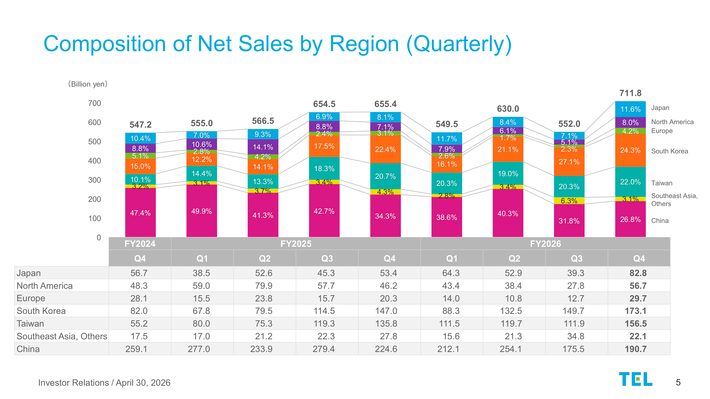

[Source Page: 6]

## Financial Summary

(Billion yen)

| | FY2025 | FY2026 | FY2026 vs FY2025 | Reference: FY2026 estimates announced on February 6, 2026 |
| --- | --- | --- | --- | --- |
| Net sales | 2,431.5 | 2,443.5 | +0.5% | 2,410.0 |
| Gross profit | 1,146.2 | 1,107.8 | -3.4% | 1,092.0 |
| Gross profit margin | 47.1% | 45.3% | -1.8pts | 45.3% |
| SG&A expenses | 448.9 | 482.9 | +7.6% | 499.0 |
| Operating income | 697.3 | 624.9 | -10.4% | 593.0 |
| Operating margin | 28.7% | 25.6% | -3.1pts | 24.6% |
| Income before income taxes | 706.1 | 748.1 | +6.0% | 714.0 |
| Net income attributable to owners of parent | 544.1 | 574.4 | +5.6% | 550.0 |
| EPS (Yen) | 1,182.40 | 1,254.57 | +6.1% | 1,200.05 |
| R&D expenses | 250.0 | 277.8 | +11.1% | 290.0 |
| Capital expenditures | 162.1 | 216.0 | +33.2% | 240.0 |
| Depreciation and amortization | 62.1 | 80.9 | +30.3% | 86.0 |

1. In principle, export sales of Tokyo Electron’s products are denominated in yen. Although some sales and expenses are denominated in foreign currencies, the impact of foreign exchange rate fluctuations on profits is negligible, unless extreme fluctuations occur.
2. Profit ratios are calculated using full amounts, before rounding.

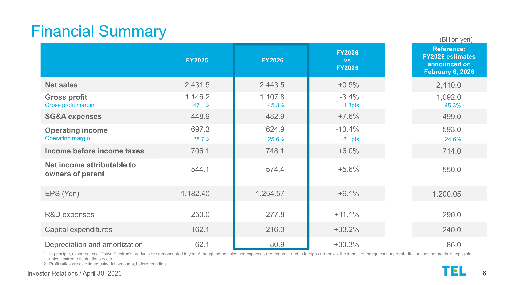

[Source Page: 7]

## Financial Trend (FY2022~FY2026)

(Billion yen)

| | FY2022 | FY2023 | FY2024 | FY2025 | FY2026 |
| --- | --- | --- | --- | --- | --- |
| Net sales | 2,003.8 | 2,209.0 | 1,830.5 | 2,431.5 | 2,443.5 |
| Gross profit | 911.8 | 984.4 | 830.2 | 1,146.2 | 1,107.8 |
| Operating profit | 599.2 | 617.7 | 456.2 | 697.3 | 624.9 |
| Net income attributable to owners of parent | 437.0 | 471.5 | 363.9 | 544.1 | 574.4 |
| Gross profit margin | 45.5% | 44.6% | 45.4% | 47.1% | 45.3% |
| Operating margin | 29.9% | 28.0% | 24.9% | 28.7% | 25.6% |
| ROE | 37.2% | 32.3% | 21.8% | 30.3% | 29.6% |

Net sales reached record high

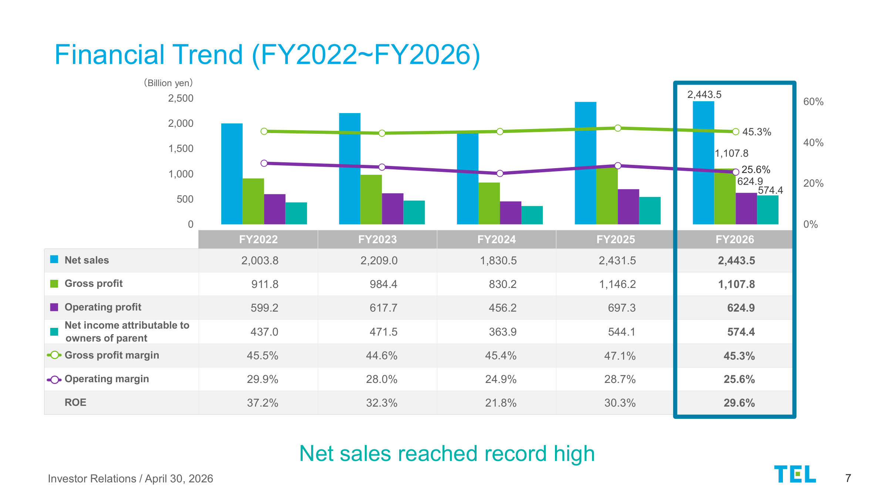

[Source Page: 8]

## SPE New Equipment Sales by Application

(Billion yen)

| | FY2024 | FY2025 | FY2026 |
| --- | --- | --- | --- |
| Total | 1,372.7 | 1,861.1 | 1,775.4 |
| DRAM | 27% | 31% | 31% |
| Non-volatile memory | 7% | 7% | 10% |
| Non-memory (Logic, foundry, others) | 66% | 62% | 59% |

- DRAM: Investment in HBM and leading-edge technologies remained strong
- Non-volatile memory: Customers’ fab utilization improved, and investments showed a gradual recovery. Both revenue and proportion increased
- Non-memory: Robust investment in leading-edge equipment

1. SPE: Semiconductor Production Equipment
2. Percentages on the graph show the composition ratio of new equipment sales. Field Solutions sales are not included.

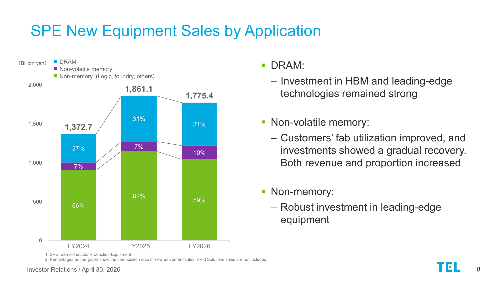

[Source Page: 9]

## Field Solutions Sales

(Billion yen)

| | FY2024 | FY2025 | FY2026 |
| --- | --- | --- | --- |
| Parts and services | 324.4 | 389.1 | 435.9 |
| Used equipment and modification | 104.0 | 149.1 | 190.0 |
| Total | 428.5 | 538.3 | 626.0 |

- Field Solutions sales for FY2026 were 626.0 billion yen, up 16.3% YoY
- Customers’ fab utilization climbed further; parts & services and modifications delivered solid growth

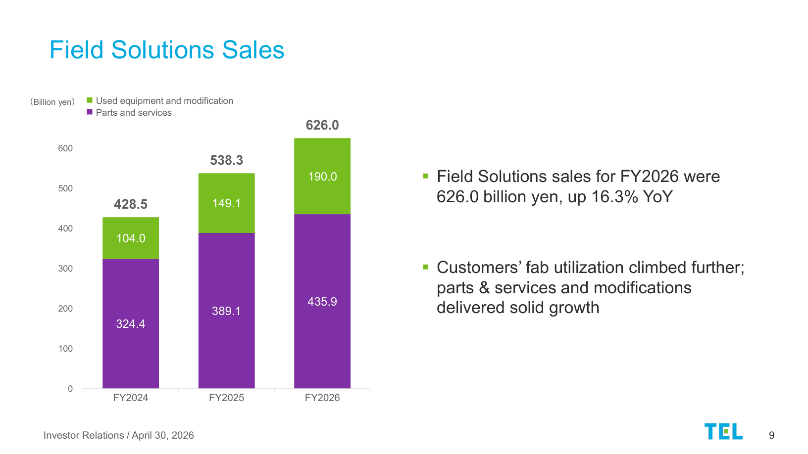

[Source Page: 10]

## Balance Sheet (Quarterly)

(Billion Yen)

| Assets | FY2025 Q4 | FY2026 Q1 | FY2026 Q2 | FY2026 Q3 | FY2026 Q4 |
| --- | --- | --- | --- | --- | --- |
| Cash and cash equivalents* | 496.2 | 367.5 | 455.2 | 418.4 | 506.2 |
| Notes and accounts receivable (trade, and contract assets) | 485.6 | 393.2 | 411.4 | 401.5 | 525.8 |
| Inventories | 749.1 | 757.1 | 720.4 | 725.3 | 713.1 |
| Other current assets | 69.7 | 75.3 | 85.4 | 90.4 | 90.1 |
| Tangible assets | 441.7 | 480.3 | 561.2 | 573.9 | 589.3 |
| Intangible assets | 35.8 | 35.5 | 35.7 | 36.4 | 37.5 |
| Investment and other assets | 347.6 | 400.2 | 397.4 | 388.8 | 398.6 |
| Total | 2,625.9 | 2,509.3 | 2,667.0 | 2,635.0 | 2,860.9 |

| Liabilities and Net Assets | FY2025 Q4 | FY2026 Q1 | FY2026 Q2 | FY2026 Q3 | FY2026 Q4 |
| --- | --- | --- | --- | --- | --- |
| Liabilities | 770.7 | 636.5 | 662.3 | 629.7 | 791.0 |
| Net assets | 1,855.2 | 1,872.7 | 2,004.6 | 2,005.2 | 2,069.9 |
| Total | 2,625.9 | 2,509.3 | 2,667.0 | 2,635.0 | 2,860.9 |

*Cash and cash equivalents: “Cash and deposits” + “Short-term investments”, etc. (“Securities” in Balance Sheet).

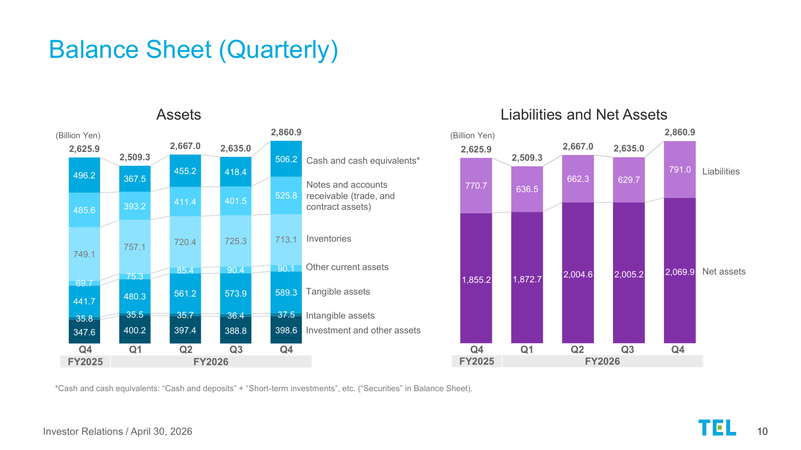

[Source Page: 11]

## Cash Flow (Quarterly)

(Billion Yen)

| | FY2024 Q4 | FY2025 Q1 | FY2025 Q2 | FY2025 Q3 | FY2025 Q4 | FY2026 Q1 | FY2026 Q2 | FY2026 Q3 | FY2026 Q4 |
| --- | --- | --- | --- | --- | --- | --- | --- | --- | --- |
| Cash flow from operating activities | 139.0 | 183.7 | 148.6 | -15.0 | 264.8 | 74.9 | 175.8 | 83.1 | 205.7 |
| Cash flow from investing activities*1 | -20.3 | -27.3 | -54.4 | -49.0 | -38.9 | -54.1 | -86.7 | 1.2 | 33.2 |
| Cash flow from financing activities | -0.6 | -194.4 | -0.6 | -170.1 | -23.5 | -151.1 | -1.0 | -122.3 | -150.8 |
| Free cash flow*3 | 118.7 | 156.4 | 94.1 | -64.1 | 225.8 | 20.7 | 89.1 | 84.3 | 239.0 |
| Cash on hand*4 | 472.5 | 438.5 | 525.5 | 295.5 | 496.2 | 367.5 | 455.2 | 418.4 | 506.2 |

Share Repurchase*2 (values labelled on chart): FY2025 Q1 -79.9; FY2025 Q3 -46.9; FY2025 Q4 -23.0; FY2026 Q4 -149.9.

*1 Cash flow from investing activities excludes changes in time deposits and short-term investments.

*2 The amount for share repurchase excludes the cost incurred to purchase odd-lot shares.

*3 Free cash flow = “Cash flow from operating activities” + “Cash flow from investing activities” (excluding changes in “Time deposits” and “Short-term investments”).

*4 Cash on hand includes “Cash and cash equivalents” + “Time deposits and short-term investments” with original maturities of more than three months.

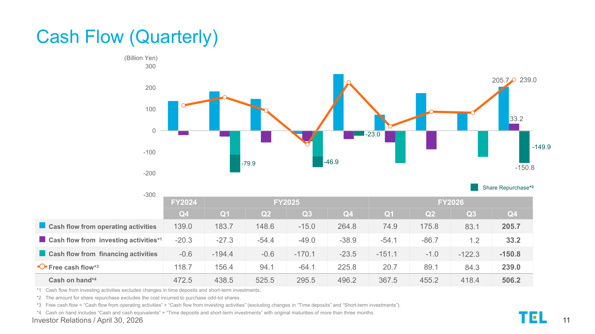

[Source Page: 12]

## Total Return Amount

(Billion yen)

| | FY2021 | FY2022 | FY2023 | FY2024 | FY2025 | FY2026 |
| --- | --- | --- | --- | --- | --- | --- |
| Dividend | 121.9 | 219.3 | 236.5 | 182.4 | 272.7 | 287.4*2 |
| Commemorative dividend |  |  | 31.3 |  |  |  |
| Share Repurchase |  |  |  | 119.9 | 149.9 | 149.9*1 |
| Total Return Amount | 121.9 | 219.3 | 267.9 | 302.4 | 422.7 | 437.4 |

*1 https://www.tel.com/news/ir/2026/kn008f00000000ho-att/20260327_002_e.pdf

*2 The year-end dividend for FY2026 is provisional and pending approval by the Board of Directors.

Combined with share buyback, total return amount is expected to be record high

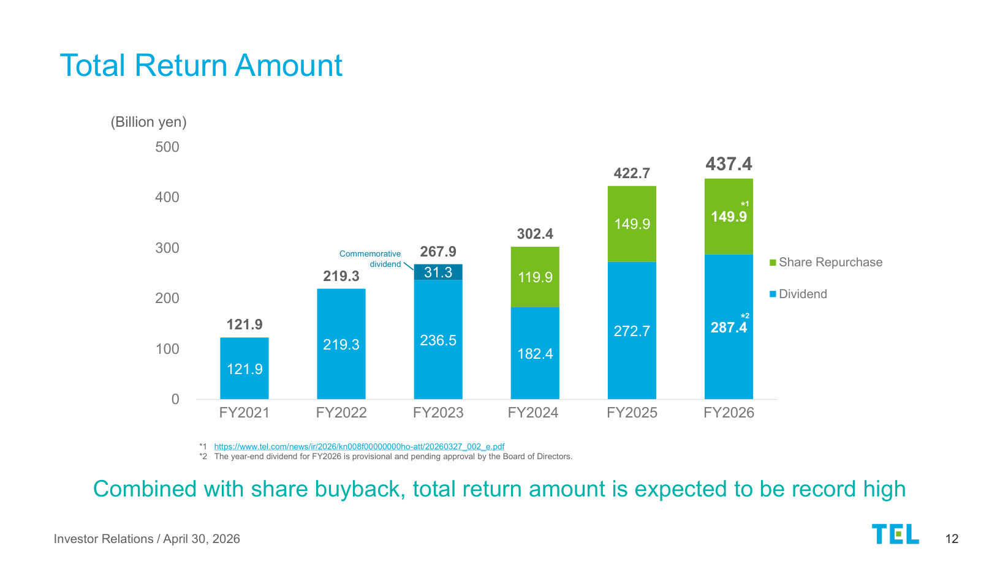

[Source Page: 13]

## Business Environment and Financial Estimates

April 30, 2026

Toshiki Kawai  
Representative Director, President & CEO

[Source Page: 14]

## Business Highlights for FY2026

### Record-high Net Sales & Net Income

- Net Sales
  - Q4: 711.8 billion yen
  - FY2026: 2,443.5 billion yen
- Net Income
  - Q4: 214.2 billion yen
  - FY2026: 574.4 billion yen

### Infrastructure Secured for Future Growth

- Construction Completed
  - R&D center: Miyagi and Kumamoto
  - Production & logistics center at Iwate
- Under Construction
  - New production building at Miyagi: implementing TEL’s Smart Production concept

### PORs in Growth Sectors

- Memory
  - Leading position in major processes such as DRAM capacitors, HBM interconnects
- Advanced Packaging
  - PORs in multiple products

[Source Page: 15]

## Business Environment (WFE Market Outlook as of April 2026)

WFE Market Trend ($B): chart for CY2024–CY2027; exact values are not labelled in the source.

- WFE Market Outlook: (CY2026-27)
  - Projected range: $150B-170B/year (20%+ growth vs CY2025)
  - Leading edge applications: 30%+ growth
  - Geopolitical risks require close monitoring

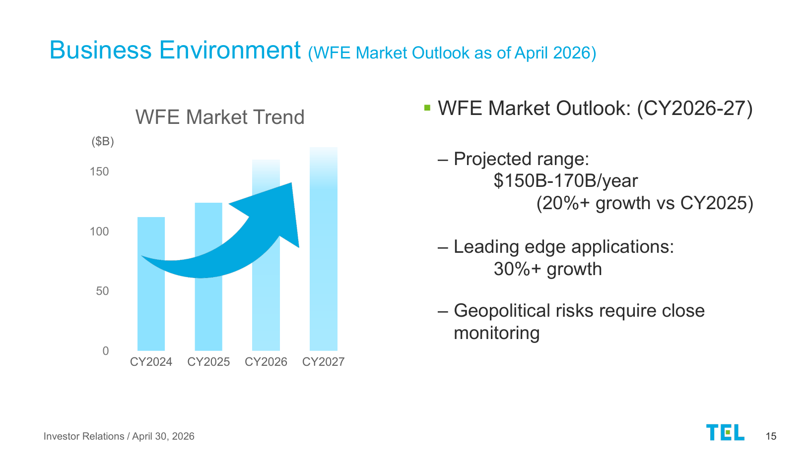

[Source Page: 16]

## FY2027 Revenue Drivers

### Coater /developers

- Market share: > 90%
- Capture large investment opportunities in DRAM and advanced logic
- FY2027 revenue > +50% YoY

### Etch Systems

- Market share: > 50% (dielectric etch)
- HARC, interconnect, and GAA processes
- FY2027 revenue: > +25% YoY

### Advanced Packaging

- Leading position in probers for leading-edge logic
- High share in bonders for HBM
- Increase the number of PORs coater/developer, etch, deposition, etc.
- FY2026 revenue: Approx. 200 billion yen; FY2027 revenue: > +60% YoY

[Source Page: 17]

## Financial Estimates for FY2027

(Billion Yen)

| | FY2026 H1 (Actual) | FY2026 H2 (Actual) | FY2026 Full Year (Actual) | FY2027 H1 (Estimate) |
| --- | --- | --- | --- | --- |
| Net sales | 1,179.6 | 1,263.8 | 2,443.5 | 1,570.0 |
| Gross profit | 538.8 | 569.0 | 1,107.8 | 715.0 |
| Gross profit margin | 45.7% | 45.0% | 45.3% | 45.5% |
| SG&A expenses | 235.7 | 247.2 | 482.9 | 284.0 |
| R&D | 134.8 | 143.0 | 277.8 | 160.0 |
| Other than R&D | 100.9 | 104.1 | 205.0 | 124.0 |
| Operating income | 303.1 | 321.7 | 624.9 | 431.0 |
| Operating margin | 25.7% | 25.5% | 25.6% | 27.5% |
| Income before income taxes | 312.9 | 435.1 | 748.1 | 437.0 |
| Net income attributable to owners of parent | 241.6 | 332.8 | 574.4 | 328.0 |
| Net income per share (Yen) | 527.31 | / | 1,254.57 | 721.12 |

- FY2027 H1: Forecast record high of net sales, gross profit and operating profit driven by AI server demand
- Incremental shipping for DRAM and leading-edge logic in latter CY2026
- Monitoring the impact of blockade in the Strait of Hormuz

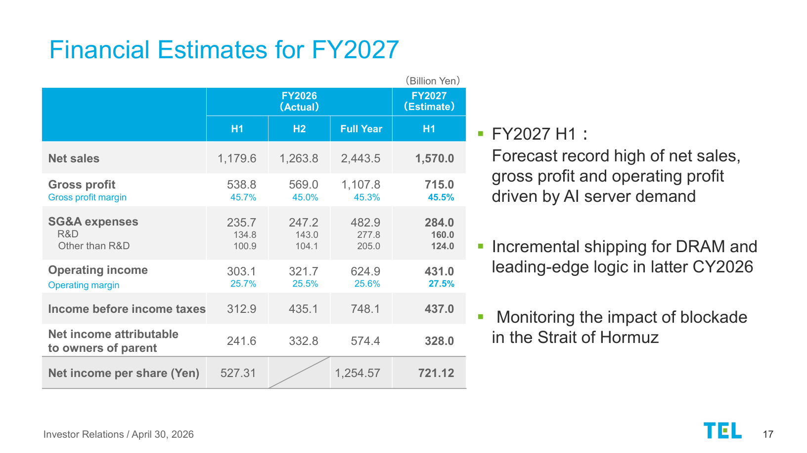

[Source Page: 18]

## FY2027 SPE New Equipment Sales Forecast

Sales by Application (Billion yen)

| | FY2026 H1 | FY2026 H2 | FY2027 H1 Estimate |
| --- | --- | --- | --- |
| Total | 850.1 | 925.3 | 1,200.0 |
| DRAM | 27% | 35% | 32% |
| Non-volatile memory | 12% | 8% | 11% |
| Non-memory (Logic, foundry, others) | 61% | 57% | 57% |

* Percentages on the graph show the composition ratio of new equipment sales. Field solutions sales are not included.

SPE new equipment sales to grow by 41% YoY

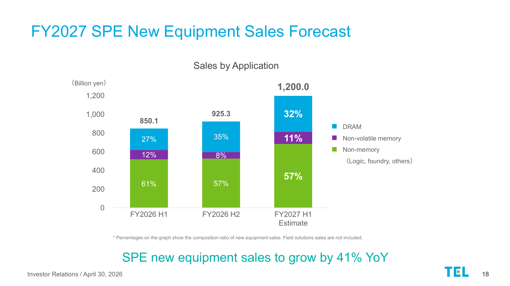

[Source Page: 19]

## FY2027 R&D Expenses and Capex Plan

- Miyagi Development Building No. 3 — Etch system; Kurokawa-gun, Miyagi Prefecture; Completed in April 2025
- Kumamoto Process Development Building — Coater/developer, cleaning system; Koshi-city, Kumamoto Prefecture; Completed in October 2025
- Tohoku Production and Logistics Center — Deposition system; Oshu-city, Iwate Prefecture; Completed in November 2025
- Miyagi Innovative Production Center — Etch system; Kurokawa-gun, Miyagi Prefecture; Completion scheduled for summer 2027

(Billion Yen)

| | FY2023 | FY2024 | FY2025 | FY2026 | FY2027 Estimate |
| --- | --- | --- | --- | --- | --- |
| R&D expenses | 191.1 | 202.8 | 250.0 | 277.8 | 330.0 |
| Capex | 74.4 | 121.8 | 162.1 | 216.0 | 190.0 |
| Depreciation | 42.9 | 52.3 | 62.1 | 80.9 | 100.0 |

Continue strengthening competitiveness with a focus on R&D investment  
Leveraging this solid infrastructure to steadily capture future gains

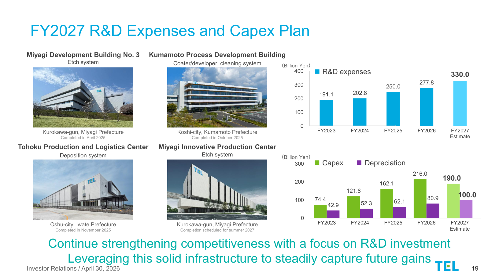

[Source Page: 20]

## Dividend Forecast

Dividend per Share (Yen)

| H1 FY2024 | H2 FY2024 | H1 FY2025 | H2 FY2025 | H1 FY2026 | H2 FY2026 | H1 FY2027 (Estimate) |
| --- | --- | --- | --- | --- | --- | --- |
| 148 | 245 | 265 | 327 | 264 | 364 | 361 |

### TEL shareholder return policy

Dividend payout ratio: 50%  
Annual DPS of not less than 50 yen

We will review our dividend policy if the company does not generate net income for two consecutive fiscal years

We will flexibly consider share buybacks

Dividend per share for H1 FY2027 (interim dividend) is expected to be 361 yen

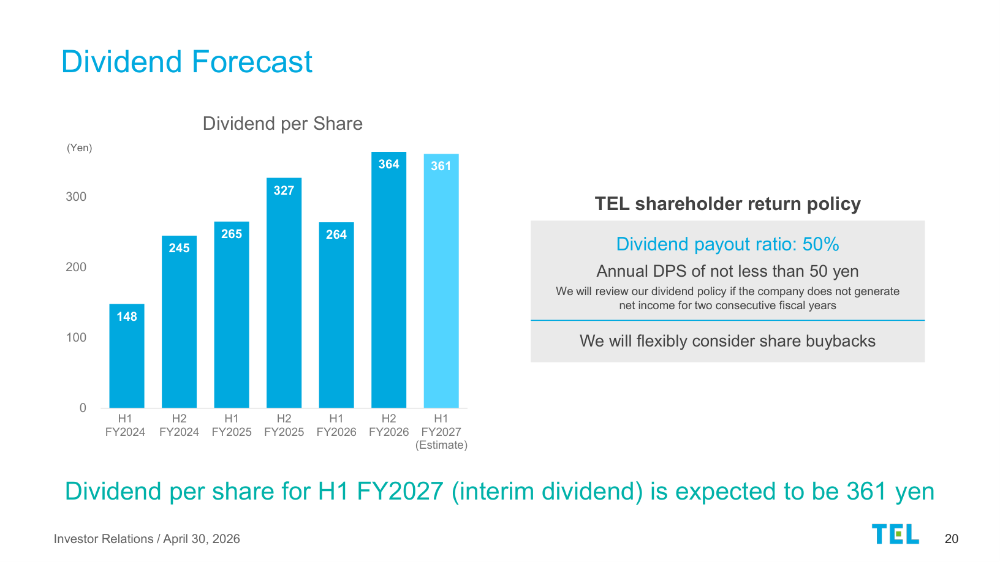

[Source Page: 21]

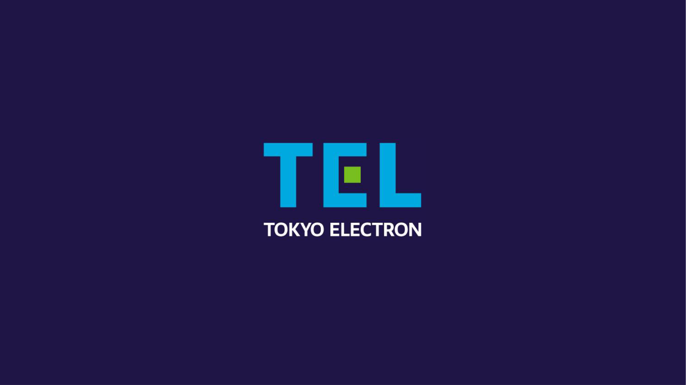

[Source Page: 22]

## Appendix

[Source Page: 23]

## Financial Performance (Quarterly)

(Billion Yen)

| | FY2025 Q4 | FY2026 Q1 | FY2026 Q2 | FY2026 Q3 | FY2026 Q4 |
| --- | --- | --- | --- | --- | --- |
| Net sales | 655.4 | 549.5 | 630.0 | 552.0 | 711.8 |
| Operating income | 183.7 | 144.6 | 158.4 | 116.1 | 205.6 |
| Net income attributable to owners of parent | 142.9 | 117.8 | 123.8 | 118.5 | 214.2 |
| Gross profit margin | 47.4% | 46.2% | 45.2% | 42.7% | 46.8% |
| Operating margin | 28.0% | 26.3% | 25.1% | 21.0% | 28.9% |

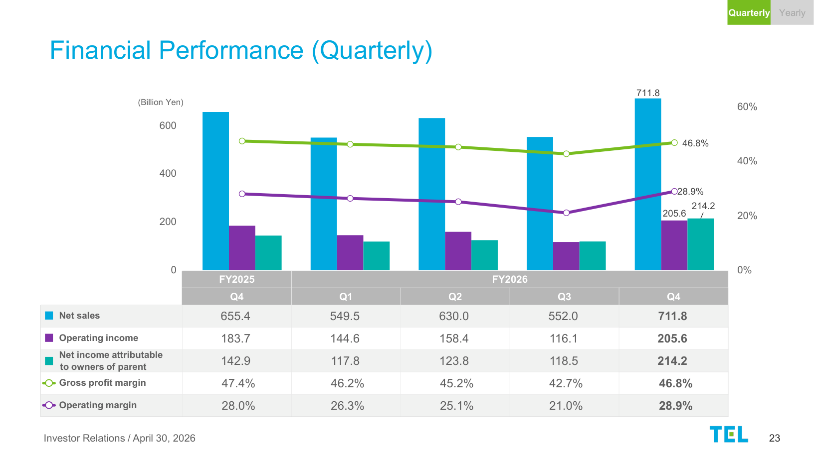

[Source Page: 24]

## SPE New Equipment Sales by Application (Quarterly)

(Billion yen)

| | FY2024 Q4 | FY2025 Q1 | FY2025 Q2 | FY2025 Q3 | FY2025 Q4 | FY2026 Q1 | FY2026 Q2 | FY2026 Q3 | FY2026 Q4 |
| --- | --- | --- | --- | --- | --- | --- | --- | --- | --- |
| Total | 417.0 | 431.5 | 415.0 | 510.6 | 503.9 | 395.0 | 455.0 | 385.1 | 540.1 |
| DRAM | 30% | 26% | 26% | 35% | 37% | 26% | 27% | 36% | 34% |
| Non-volatile memory | 7% | 2% | 3% | 8% | 12% | 10% | 14% | 8% | 8% |
| Non-memory (Logic, foundry, others) | 63% | 72% | 71% | 57% | 51% | 64% | 59% | 56% | 58% |

1. SPE: Semiconductor Production Equipment
2. Percentages on the graph show the composition ratio of new equipment sales. Field Solutions sales are not included.

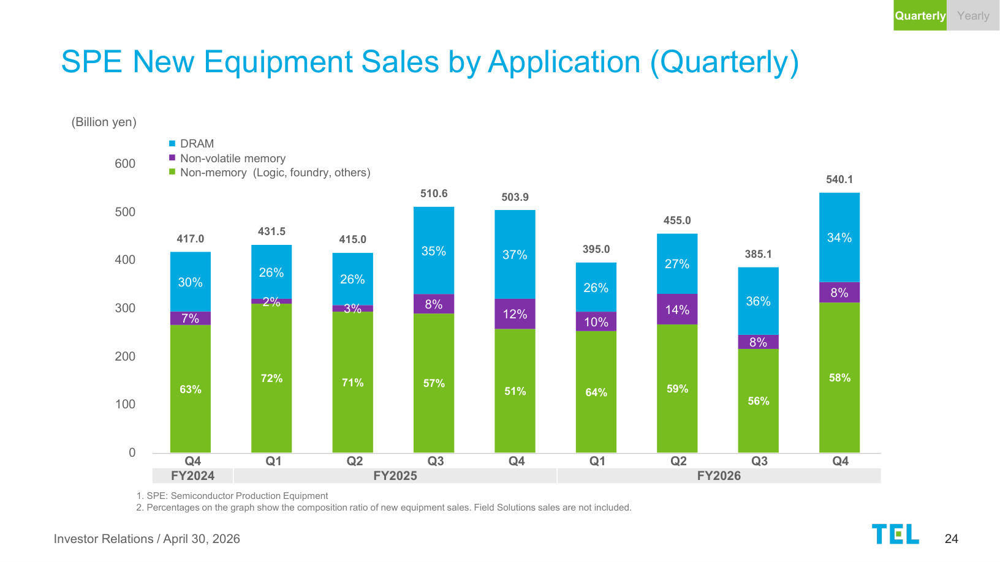

[Source Page: 25]

## Field Solutions Sales (Quarterly)

(Billion yen)

| FY2024 Q4 | FY2025 Q1 | FY2025 Q2 | FY2025 Q3 | FY2025 Q4 | FY2026 Q1 | FY2026 Q2 | FY2026 Q3 | FY2026 Q4 |
| --- | --- | --- | --- | --- | --- | --- | --- | --- |
| 119.3 | 118.1 | 139.5 | 141.5 | 138.9 | 141.2 | 160.3 | 161.6 | 162.8 |

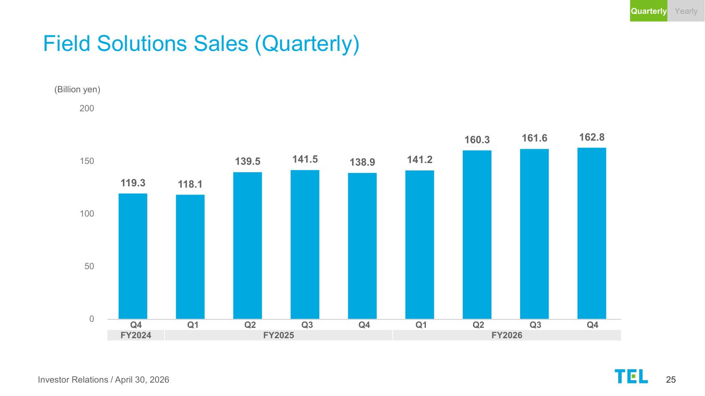

[Source Page: 26]

## SPE New Equipment Sales by Product

(Billion yen)

| | FY2022 | FY2023 | FY2024 | FY2025 | FY2026 |
| --- | --- | --- | --- | --- | --- |
| Total | 1,499.0 | 1,692.7 | 1,372.7 | 1,861.1 | 1,775.4 |
| Coater/developer | 23% | 26% | 30% | 27% | 28% |
| Etch system | 39% | 34% | 32% | 35% | 36% |
| Deposition system | 21% | 22% | 21% | 19% | 20% |
| Cleaning system | 11% | 12% | 12% | 13% | 9% |
| Wafer prober | 5% | 5% | 3% | 4% | 5% |
| Others | 1% | 1% | 2% | 2% | 2% |

1. SPE: Semiconductor Production Equipment
2. Percentages on the graph show the composition ratio of new equipment sales. Field Solutions sales are not included.

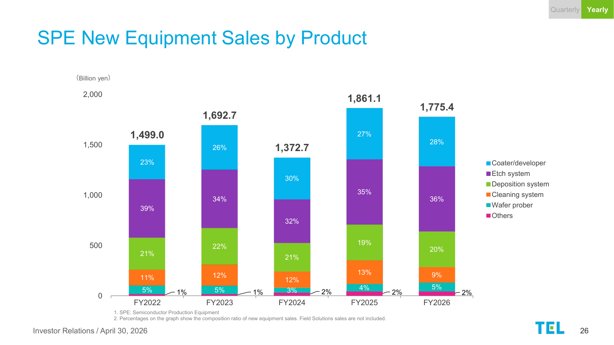

[Source Page: 27]

## Sales by Region

(Billion yen)

| | FY2022 | FY2023 | FY2024 | FY2025 | FY2026 |
| --- | --- | --- | --- | --- | --- |
| Total | 2,003.8 | 2,209.0 | 1,830.5 | 2,431.5 | 2,443.5 |
| Japan | 11.5% | 10.9% | 10.1% | 7.8% | 9.8% |
| North America | 13.4% | 15.6% | 9.2% | 10.0% | 6.8% |
| Europe | 5.4% | 8.3% | 6.5% | 3.1% | 2.8% |
| South Korea | 19.0% | 16.2% | 15.6% | 16.8% | 22.3% |
| Taiwan | 18.0% | 19.6% | 11.2% | 16.9% | 20.4% |
| South East Asia, Others | 4.4% | 5.5% | 3.0% | 3.7% | 3.8% |
| China | 28.3% | 23.9% | 44.4% | 41.7% | 34.1% |

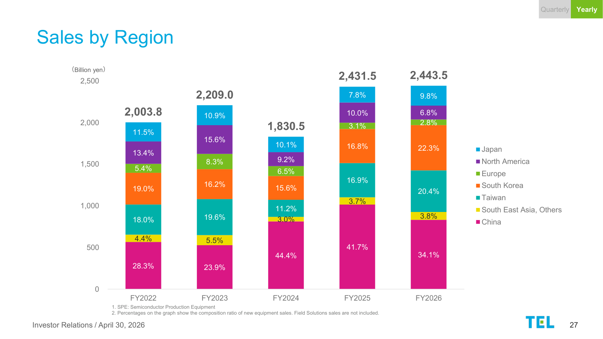

[Source Page: 28]

## World Market Share of Major Products (CY2025)

| Product | Share |
| --- | --- |
| Coater/Developer | 91% |
| Dry Etch System | 23% |
| Deposition System | 27% |
| ALD | 15% |
| CVD | 38% |
| Oxidation/Diffusion | 31% |
| Cleaning System | 20% |
| Wafer Bonder | 27% |
| Wafer Prober | 38% |

Source: Gartner®, Market Share: Semiconductor Wafer Fab Equipment, Worldwide, 2025, Bob Johnson and Menglin Cao, 2 April 2026, Revenue from Shipments basis. Chart created by TEL based on Gartner research. Gartner research. Calculations performed by TEL.

Coater/Developer: Photoresist Processing (Track), Dry Etch System: Dry Etch, Deposition System: Tube CVD + Atomic Layer Deposition Tools + Oxidation/Diffusion Furnaces + Nontube LPCVD, ALD: Atomic Layer Deposition Tools, CVD: Tube CVD + Nontube LPCVD, Oxidation/Diffusion: Oxidation/diffusion Furnaces, Cleaning System: Single Wafer Processors + Wet Stations + Batch Spray Processors + Scrubbers + Other Clean Equipment, Wafer Bonder: Wafer Bonder.

GARTNER is a trademark of Gartner, Inc. and its affiliates. Gartner does not endorse any company, vendor, product or service depicted in its publications, and does not advise technology users to select only those vendors with the highest ratings or other designation. Gartner publications consist of the opinions of Gartner’s business and technology insights organization and should not be construed as statements of fact. Gartner disclaims all warranties, expressed or implied, with respect to this publication, including any warranties of merchantability or fitness for a particular purpose. The Gartner content described herein (the “Gartner Content”) represents research opinion or viewpoints published, as part of a syndicated subscription service, by Gartner, Inc. ("Gartner"), and is not a representation of fact. Gartner Content speaks as of its original publication date (and not as of the date of this Presentation), and the opinions expressed in the Gartner Content are subject to change without notice.

Source: SPE (Wafer Prober): Auto Probers, TechInsights Inc., April 2026. Charts/graphics created by Tokyo Electron based on: TechInsights Inc.

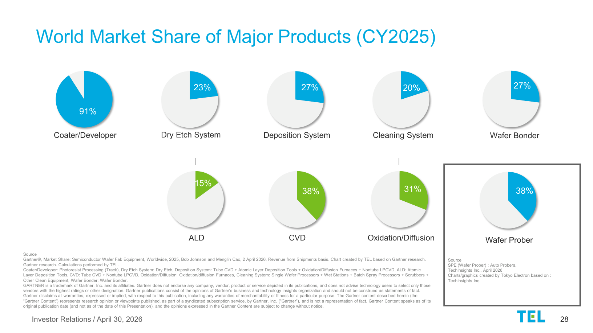

[Source Page: 29]

## Notice

You may not copy or disclose to any third party without prior written consent with TEL.

Tokyo Electron

TEL and “TEL” are trademarks of Tokyo Electron Limited.

## Processing Notes

- Page 12: Empty chart cells indicate no labelled value, without inferring zero.
- Page 15: Exact annual chart values are not labelled in the original; original chart retained.
- Page 17: The FY2026 H2 net income per share cell is crossed out in the source.
- Pages 24 and 27: Hidden PDF text contains labels not displayed in the rendered chart; the visible chart values and original page images are retained.
