## Document Metadata

- Document ID: 66731e3265e36cee828aef00e140b537375b12b8
- Document Title: 中国半导体白皮书
- Document Type: PDF
- Issuing Organization: 贝恩公司
- Publication Date: null
- Reporting Period: null
- Source File: [23_www.bain.cn_202208220536478028.pdf](https://github.com/jadennevercode/CJCC-Knowledge-Base/blob/564ab11aa9785e569e3853c8a4d7ce86f88e7535/materials/%E4%B8%8A%E6%B8%B8%EF%BC%9A%E5%8D%8A%E5%AF%BC%E4%BD%93%E7%BA%A7%E5%8E%9F%E6%9D%90%E6%96%99/23_www.bain.cn_202208220536478028.pdf)

## Structured Content

> 原文件：[23_www.bain.cn_202208220536478028.pdf](https://github.com/jadennevercode/CJCC-Knowledge-Base/blob/564ab11aa9785e569e3853c8a4d7ce86f88e7535/materials/%E4%B8%8A%E6%B8%B8%EF%BC%9A%E5%8D%8A%E5%AF%BC%E4%BD%93%E7%BA%A7%E5%8E%9F%E6%9D%90%E6%96%99/23_www.bain.cn_202208220536478028.pdf)
> 转换方式：Volcengine OCRPdf v3, parse_mode=ocr

[Source Page: 1]

# 中国半导体白皮书

BAIN & COMPANY

[Source Page: 2]

© 本册著作权归贝恩公司所有。

[Source Page: 3]

## 目录

以下页码为原报告目录中的印刷页码。

- 寄语：pg. 3
- 摘要：pg. 4
- 1. 全球半导体产业链概况：pg. 5
  - 1.1 全球半导体市场的规模、供给与下游需求分布：pg. 5
  - 1.2 半导体价值链的主要环节：pg. 6
  - 1.3 半导体价值链：各大环节的分布情况及主要玩家：pg. 8
    - 1.3.1 前端设备：pg. 8
    - 1.3.2 原材料：pg. 9
    - 1.3.3 EDA/IP：pg. 9
    - 1.3.4 设计环节：pg. 10
    - 1.3.5 代工环节：pg. 11
    - 1.3.6 封测环节：pg. 11
- 2. 中国半导体在价值链主要环节的参与：pg. 12
  - 2.1 前端设备：pg. 13
  - 2.2 原材料：pg. 14
  - 2.3 EDA/IP：pg. 14
  - 2.4 设计环节：pg. 14
  - 2.5 代工环节：pg. 14
  - 2.6 封测环节：pg. 14
- 3. 芯片设计环节中，中国半导体的市场地位：pg. 15

[Source Page: 4]

- 4. 中国半导体近期投资观察：pg. 17
  - 4.1 目前投融资情况：pg. 17
  - 4.2 投资总结、趋势：pg. 17
  - 4.3 中国协处理器玩家融资情况：pg. 20
    - 4.3.1 AI 推理：pg. 20
    - 4.3.2 AI 训练：pg. 20
    - 4.3.3 图像处理：pg. 20
  - 4.4 启示：pg. 20
    - 4.4.1 面向投资者的启示：pg. 20
    - 4.4.2 面向经营者的启示：pg. 21

[Source Page: 5]

*原报告印刷页码：3*

## 寄语

邹娟，贝恩公司全球合伙人；大中华区能源转型业务主席；中国区可持续发展业务主席、高科技和云服务业务领导团队成员。

申文燮 Moonsup Shin，贝恩公司全球合伙人；大中华区 TMT 业务联席主席。

彭弱溟，贝恩公司董事经理。

半导体芯片是数字经济的核心，是现代化产业发展的基石。近年来，全球各个国家和地区纷纷加大对于半导体产业的投入力度，中国也相继推出了一系列相关的产业发展政策，整个行业正面临前所未有的发展机遇。

值此关键时刻，本次白皮书将基于贝恩多年以来的高科技行业咨询经验，结合对于中国半导体公司的最新洞察，呈现全球半导体行业产业链概况，以及中国半导体在价值链主要环节的参与。此外，我们还聚焦芯片设计等环节中国半导体企业的市场地位，并分享中国半导体近期投资观察，为市场主体、产业新势力和广大投资者建言献策，希望助力各方致胜所关注的半导体领域。

[Source Page: 6]

*原报告印刷页码：4*

## 摘要

近年来，伴随网络化、信息化、智能化飞速发展，半导体的应用领域不断拓展，在全球经济及社会发展中的重要性与日俱增。2020 年，全球半导体市场规模已达到 3 万亿人民币，至 2025 年，整体市场预计将保持 7% 的年复合增长率。

中国在半导体的设计和制造链条中起步较晚，积累相对薄弱。但随着半导体相关的产业支持政策频频出台，配合下游的广大市场需求，将赋能中国半导体企业迎来新一轮发展。

整体上，目前，中国厂商在通讯芯片、模拟芯片与 OSD 设计、成熟制程制造与封测环节产生较多的营收，而在前端设备和原材料市场处于起步阶段，正逐步获取市场份额。值得一提的是，在芯片设计环节，中国企业正加速步入快车道，尤其在存储芯片、模拟芯片已建立起了一定的竞争力，CPU/GPU/ASIC 同样处于快速起步阶段。这其中，云计算厂商（阿里，腾讯，Baidu 等）对于计算和存储芯片有着巨量的需求，从定制化性能、成本控制等目的出发，云计算厂商也积极参与到芯片的设计，是不可忽视的力量。在颠覆性的计算芯片架构出现之前，ARM 将凭借比 RISC-V 和 MIPS, Alpha 更完善的生态系统，和相较于 X86 更开放的授权体系，以及国内大量的人才储备，成为中国 CPU 玩家的首选架构。而在存储芯片中，除了主流的 NAND 的 DRAM [OCR_UNCERTAIN]，利基市场的 NOR Flash 由于设计和制造门槛较低（专利已放开，主流制程 65nm）也吸引了众多国内公司进行探索。为了更好地展现中国半导体在芯片设计环节的市场地位，本次白皮书选取并展现了不同半导体领域的公司洞察，涵盖 CPU/GPU/ASIC、SoC 芯片、存储芯片、模拟芯片。

在时代的大背景下，贝恩建议，对于半导体市场主体，应积极开展上下游适配与协作，共同推动国产化生态圈，并打造更有韧性的本土供应体系，锻造与国际厂商差异化的服务能力，从而及时响应下游客户的需求。另外，关注潜在的收购机会，垂直整合强化现有业务。对于产业新势力，建议聚焦、主动参与和自身主营业务有着强协同效应的半导体细分领域。

而对于投资者，芯片设计仍是标的相对较多的热门赛道，中短期内，国内的 AI/ML 推理芯片需求全球领先，而产业壁垒相对较低，将迎来快速发展，但行业的优胜劣汰带来的企业沉浮也不容忽视；而 GPU/CPU 领域则有机会在中长期带来高回报。国内计算芯片设计玩家的快速发展，也给晶圆制造（Foundry）厂带来了巨大的代工业务机会，并有可能催生相对大而稳定的投资机会。同时，在摩尔定律发展放缓的行业环境下，通过先进封装技术提高系统性能的优势越发显著，导致下游封装与上游设计及晶圆代工的联动愈加紧密，而提前布局 2.5D/3D 先进封装赛道的中国封装厂商与其上游联动方也因此值得关注。

展望未来，贝恩将致力于激发半导体行业各相关方的发展潜力，从而获得竞争优势，领跑新一轮增长。

[Source Page: 7]

*原报告印刷页码：5*

## 1. 全球半导体产业链概况

### 1.1 全球半导体市场的规模、供给与下游需求分布

Gartner 和 IDC 全球半导体市场预测数据显示，2020 年，全球半导体产品营收达到约 3 万亿人民币，受到数据中心、IoT 和 NAND 存储市场的需求驱动，至 2025 年，整体市场预计将保持约 7% 的年复合增长率（图 1）。

展望未来，2020–2025 年，IoT 芯片的年复合增长率有望达到 13%，数据中心和 NAND 存储市场紧随其后。

按照企业所在地划分，在上述总量约 3 万亿元的半导体市场中，美国的芯片销售占据了近一半的市场份额，尤其以逻辑芯片为主，而韩国是存储芯片的主要供给地区（图 2）。

2020 年全年，美国的芯片销售额达到了 1.48 万亿元，逻辑芯片占比超过 60%，此后是韩国（5,600 亿元），日本（2,900 亿元），欧洲（2,500 亿元），中国台湾地区（1,900 亿元）和中国大陆（1,500 亿元）。

**图 1：**2020 年全球半导体产品营收达到约 3 万亿人民币；受数据中心、IoT 和 NAND 存储市场的需求驱动，预计将保持 ~7% 的复合年增长率至 2025 年。

全球半导体产品营收（千亿元）；图例显示年复合增长率：

| 类别 | 2019–2020 | 2020–2025 |
| --- | ---: | ---: |
| 总计 | 10% | 7% |
| 传感器 | -1% | 9% |
| 光电子 | 5% | 9% |
| 分立器件 | 0% | 8% |
| 模拟 | 6% | 6% |
| 其他存储 | 9% | -2% |
| NAND | 25% | 12% |
| DRAM | 6% | 7% |
| 其他逻辑 | 13% | 26% |
| 消费电子 | 12% | 6% |
| 智能手机 | 21% | 5% |
| 平板电脑 | 32% | 5% |
| 个人电脑–计算 | 14% | 1% |
| IoT | -3% | 13% |
| 网络 | 8% | 7% |
| 数据中心–计算 | 15% | 12% |

注：历史数据来自 Gartner；除数据中心计算芯片预测来自 IDC 外，其余预测均来自 Gartner；数据中心计算芯片 2025F 数据采用 2020–2024F 复合年增长率计算而得。

资料来源：Gartner Semiconductor Forecast Database, Worldwide，更新至 2021 年一季度；IDC 全球半导体应用预测器，更新至 2020 年 7 月。

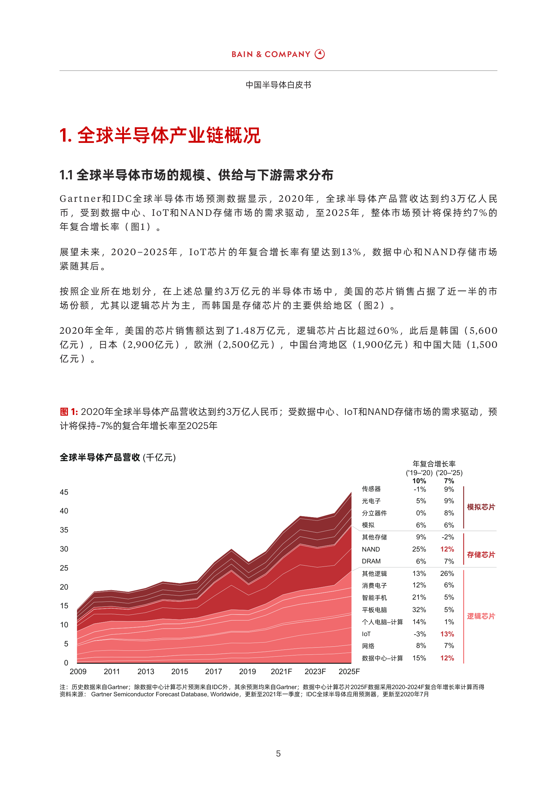

[Source Page: 8]

*原报告印刷页码：6*

**图 2：**在总约 3 万亿人民币的半导体市场中，美国芯片销售占据近一半的市场份额，其中以逻辑芯片为主；韩国是存储芯片主要供给地区。

2020 年全球半导体产品营收，按总部地区划分（千亿元）：

| 总部地区 | 营收（千亿元） |
| --- | ---: |
| 美国 | 14.8 |
| 韩国 | 5.6 |
| 日本 | 2.9 |
| 欧洲 | 2.5 |
| 台湾 | 1.9 |
| 中国大陆 | 1.5 |
| 世界其他地区 | 1.0 |
| 总计 | 30 |

图中分为逻辑芯片¹、存储芯片²、模拟芯片³；各地区分项占比未标出精确数值，保留原图，不作估算。

注：

1. 包括 Gartner 定义的显示驱动器、GPU、FPGA 和其他逻辑芯片，有线连接、无线连接、集成基带/应用处理器、分立蜂窝基带、分立应用/多媒体处理器、射频前端和收发器以及其他专用集成电路（ASIC）。
2. 包括 DRAM、NAND、新兴和其他存储芯片产品。
3. 包括 Gartner 定义的包括模拟芯片、光电子器件、非光学传感器、分立器件以及电源管理产品。

资料来源：Gartner Market Share Semiconductors by End Market 2020。

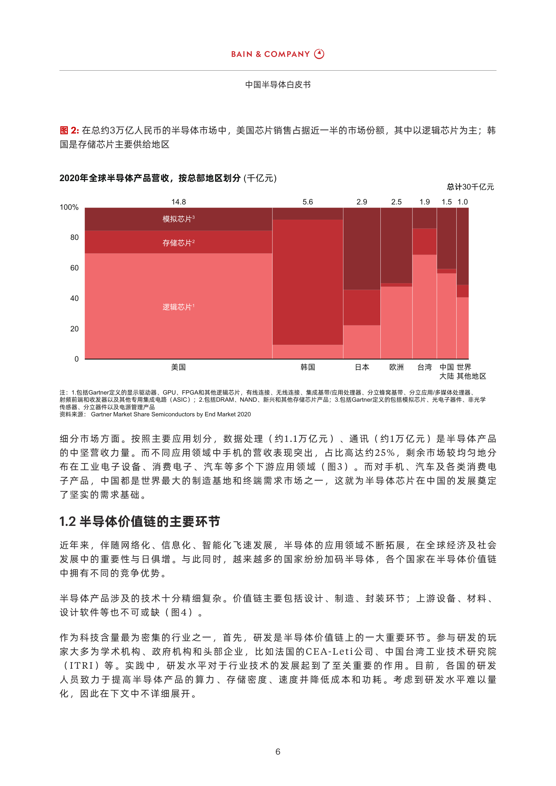

细分市场方面。按照主要应用划分，数据处理（约 1.1 万亿元）、通讯（约 1 万亿元）是半导体产品的中坚营收力量。而不同应用领域中手机的营收表现突出，占比高达约 25%，剩余市场较均匀地分布在工业电子设备、消费电子、汽车等多个下游应用领域（图 3）。而对手机、汽车及各类消费电子产品，中国都是世界最大的制造基地和终端需求市场之一，这就为半导体芯片在中国的发展奠定了坚实的需求基础。

### 1.2 半导体价值链的主要环节

近年来，伴随网络化、信息化、智能化飞速发展，半导体的应用领域不断拓展，在全球经济及社会发展中的重要性与日俱增。与此同时，越来越多的国家纷纷加码半导体，各个国家在半导体价值链中拥有不同的竞争优势。

半导体产品涉及的技术十分精细复杂。价值链主要包括设计、制造、封装环节；上游设备、材料、设计软件等也不可或缺（图 4）。

作为科技含量最为密集的行业之一，首先，研发是半导体价值链上的一大重要环节。参与研发的玩家大多为学术机构、政府机构和头部企业，比如法国的 CEA-Leti 公司、中国台湾工业技术研究院（ITRI）等。实践中，研发水平对于行业技术的发展起到了至关重要的作用。目前，各国的研发人员致力于提高半导体产品的算力、存储密度、速度并降低成本和功耗。考虑到研发水平难以量化，因此在下文中不详细展开。

[Source Page: 9]

*原报告印刷页码：7*

**图 3：**在总约 3 万亿人民币的半导体市场中，手机占比最大，高达 ~25%；剩余市场较均匀地分布在多个下游应用。

2020 年全球半导体产品营收，按主要应用划分（千亿元）：

| 应用 | 营收（千亿元） |
| --- | ---: |
| 个人电脑 | 3.6 |
| 服务器 | 2.9 |
| 存储设备¹ | 2.4 |
| 平板电脑² | 0.9 |
| 其他数据处理³ | 1.7 |
| 手机 | 7.6 |
| 其他通讯设备 | 2.4 |
| 工业⁴ | 3.2 |
| 消费电子 | 3.1 |
| 汽车 | 2.5 |
| 总计 | 30 |

图示将前五项归为数据处理（~11 千亿元），手机及其他通讯设备归为通讯（~10 千亿元）；各项内部的逻辑芯片、存储芯片和模拟芯片比例未标出精确值，不作估算。

注：1. 包括电子存储设备和计算存储领域的可移动固态存储设备；2. 包括基本型超便携平板电脑和实用型超便携平板电脑；3. 包括未计入的所有其他数据处理电子产品，如外部显示器和打印机；4. 包括工业和军事/民航电子设备。

资料来源：IDC 全球半导体应用预测器，4Q2021。

**图 4：**半导体价值链主要包括设计、制造、封装环节；上游设备、材料、生产工具也不可或缺。

| 环节 | 原图描述 | 玩家示例 |
| --- | --- | --- |
| 核心研发¹ | 半导体行业是研发最为密集的行业之一，研发推动行业技术的发展；研发人员始终致力于提高半导体产品的算力和速度且降低成本；玩家大多为学术机构或政府机构 | ITRI；SEMATECH；CEA-Leti；Semiconductor Research Corporation；IMEC |
| 设备 | 大多为单一供应源，备货周期长；需投入大量时间和金钱，打造洁净厂房，放置设备 | KLA；ASML；Applied Materials |
| 原材料 | 前端包括硅片、金属以及各类化学品和气体；后端包括封装材料或基材；大多为单一供应源 | Siltronic；GlobalWafers；SUMCO；Shin-Etsu |
| EDA/IP | EDA 是实现 IC 设计流程自动化的必备软件工具，该流程极为模块化，包含数十亿个组件；IP 是指可以授权给第三方的半导体 IP 块/核 | 新思科技；Cadence；Mentor Graphics |
| IC 设计和 IDM | 通过架构和设计，以实现芯片产品需求；芯片设计主要包括逻辑、存储和模拟芯片；IDM 兼顾设计与制造步骤 | 英特尔；恩智浦；瑞萨电子；英伟达；三星 |
| 逻辑芯片制造 | 摩尔定律驱动；按硅片尺寸（如 12 英寸、8 英寸）和制程（如 28 纳米 vs. 7 纳米）划分；研发/资本极其密集 | 台积电；三星；联华电子；GlobalFoundries |
| 封装和测试 | 通过引线键合、倒装等技术使芯片与外部电路连接；劳动密集型，通常外包给 OSAT 行业；创新活动日益活跃 | 日月光集团；安靠科技；长电科技 |

注：1. 研发是价值链上的一大重要环节，但由于无法实现量化，在下文中不作详细展开。资料来源：案头研究。

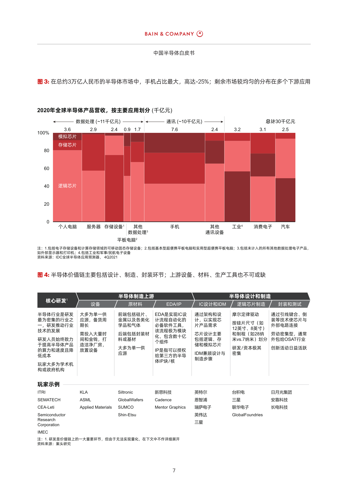

[Source Page: 10]

*原报告印刷页码：8*

#### 半导体制造的上游支撑产业

最上游的企业负责生产半导体设计制造所需的设备、原材料和EDA软件。这些设备、原材料、EDA软件被广泛应用于制造集成电路（IC）、光电子器件、分立器件、传感器等领域，是半导体产品设计制造的前道工序，也是整个价值链中不可或缺的组成部分。

具体看，半导体的生产设备备货周期长，大多为单一供应源，并且在全球范围内涌现出了一批代表性企业，比如，专注于光刻机领域的荷兰公司阿斯麦尔（ASML）、提供晶圆缺陷监测系统的美国KLA-Tencor公司。为了打造洁净的厂房并放置生产设备，这些公司通常需要投入大量的时间和金钱，属于重资产公司。

除设备以外，在制造半导体的过程中，还离不开前端及后端原材料，前端材料包括硅片、金属以及各类化学品和气体，后端则包括封装材料或基材。类似生产设备，半导体原材料大多为单一供应源。以硅晶圆为例，由于半导体级硅晶圆对于纯度的要求极高（99.999999999%），因此，行业壁垒高，当前，领先企业包括德国硅晶圆制造商世创（Siltronic）和日本信越半导体（Shin-Etsu）等。

此外，在半导体制造的上游产业中，由数十亿个组件构成的EDA（电子设计自动化）是实现半导体元器件和集成电路设计流程自动化的必备软件工具，是半导体市场的先驱和风向标。在该领域，国内企业与三大国际巨头新思科技（Synopsys）, 明导国际（Mentor Graphics）, 楷登电子（Cadence）仍存在一定差距，需要长时间与晶圆代工联动的设计数据库积累，和相关人才投入，逐步提升产品竞争力。

值得一提的是，随着集成电路技术升级，半导体行业的分工趋于细化，半导体IP核，即可以授权给第三方的知识产权核迎来新一轮增长

#### 半导体设计和代工

经过多年的发展，半导体生态逐步完善，主要包括设计、代工、封装和测试环节。

设计环节。主要有IC设计（集成电路设计）和IDM（垂直整合制造）两类企业，前者只参与芯片和集成电路的架构和设计，后者则兼顾了设计与制造步骤。代表企业有英伟达、恩智浦半导体、英特尔、三星等。

代工环节。一直以来，逻辑芯片的制造受到摩尔定律的驱动，遵循集成电路上可以容纳的晶体管数目大约每两年会增加一倍的规律演进，而在摩尔定律的推动下，半导体制造走向“更大硅片”和“更小制程”以降低制造成本和功耗。按照尺寸和制程划分，当前主流为8英寸/12英寸硅片；以及65纳米/28纳米/7纳米等不同制程。代表企业有台积电、联华电子等。

封装和测试环节。封测指的是通过引线键合、倒装等技术，使芯片与外部电路连接，是半导体价值链中必不可少的下游环节，具有劳动密集型的特征，通常由外包半导体封装测试行业（OSAT）完成。值得注意的是，贝恩观察到，封测厂商常常需要提供定制化服务，与设计厂商进行联合开发，以此保证紧跟芯片产品的需求，所以，该环节的创新活动日益活跃。代表企业有日月光集团、安靠科技等。

### 1.3 半导体价值链：各大环节的分布情况及主要玩家

#### 1.3.1 前端设备

晶圆制造通常包含沉积、光刻、刻蚀、离子注入4 大核心步骤组成。首先，使用沉积设备（如CVD、PVD、ALD）在基材表面沉积多层薄膜；其次，在晶圆表面均匀涂上光刻胶，使射强激光通过含有

[Source Page: 11]

*原报告印刷页码：9*

电路设计的光掩膜，将其设计图形刻制到晶圆表面；第三，刻蚀形成 3D 图形；最后，将离子材料、掺杂剂注入晶圆，通过带电的离子控制电流，并实现晶体管的功能。

Gartner 全球市场份额数据、半导体晶圆厂设备公司招股说明书、分析师报告综合显示，2020 年，全球半导体前端设备的市场规模已达到 4,200 亿元，基于上述制造步骤，刻蚀、光刻、沉积设备占据了约 75% 的营收份额，并且保持平稳增长。中国厂商在主要前端设备市场处于起步阶段，从沉积、刻蚀设备开始获取份额（图 5）。

#### 1.3.2 原材料

在半导体的上游产业中，不同的材料被应用于不同的生产步骤，缺一不可：硅片是半导体器件的主要载体，气体被广泛运用于掺杂、外延、离子、刻蚀、化学气相沉积等生产步骤，光掩膜可以把集成电路的图形转印到硅晶圆上，光刻胶可以将光掩膜版图案转移到光刻胶再转移到晶圆片。

贝恩结合案头研究、公司报告和券商研报发现：纵观半导体材料市场，市场较为稳定，2020 年，全球前端材料市场规模约 2,100 亿元，2018–2020 年复合增长率为 5%。硅片、气体、光刻胶、光掩膜版是主要的上游材料，占据了约 80% 的营收份额。

#### 1.3.3 EDA/IP

EDA 和 IP 贯穿芯片制造的全流程，是芯片设计的重要工具，可以缩短芯片的开发时间，并提高芯片性能。ESD Alliance 研究报告以及各个公司年报和券商研报表明，2020 年，全球 EDA 和 IP 的市场规模达到了 745 亿元，且增长稳健。

**图 5：**中国厂商在前端设备市场处于起步阶段，从沉积、刻蚀设备开始获取份额。

全球晶圆设备市场（千亿元）：2018 年 3.8，2019 年 3.6，2020 年 4.2；2018–20 CAGR 5%。

中国大陆企业市场份额⁵：

| 类别 | 2018 | 2019 | 2020 |
| --- | ---: | ---: | ---: |
| 总份额 | 1% | 1% | 2% |
| 离子注入 | 1% | 1% | 1% |
| 热处理 | 0% | 0% | 0% |
| 计量 | 0% | 0% | 0% |
| 沉积 | 2% | 3% | 3% |
| 光刻 | 1% | 1% | 1% |
| 刻蚀 | 2% | 2% | 3% |

图中 CAGR（2018–20）：

| 类别 | 全球市场增速 | 中国大陆市场增速 |
| --- | ---: | ---: |
| 其他 | 5% | 26% |
| 热处理 | 0% | 0% |
| 计量 | 6% | N/A |
| 沉积 | 3% | 32% |
| 光刻 | 9% | 8% |
| 刻蚀 | 4% | 40% |

注：1. 包括湿刻蚀、干刻蚀和 CMP；2. 包括光刻（lithography）和涂胶设备（photoresist processing）；3. 包括 ALD、CVD、PVD；4. 包括快速热处理和炉管；5. 本页分析中的中国大陆企业包括上海微电子装备集团、芯源微、北方华创、拓荆科技、中微半导体、中国电子科技集团以及精测电子。

资料来源：Gartner Wafer Fab Equipment 2020；案头研究；公司招股说明书；分析师报告。

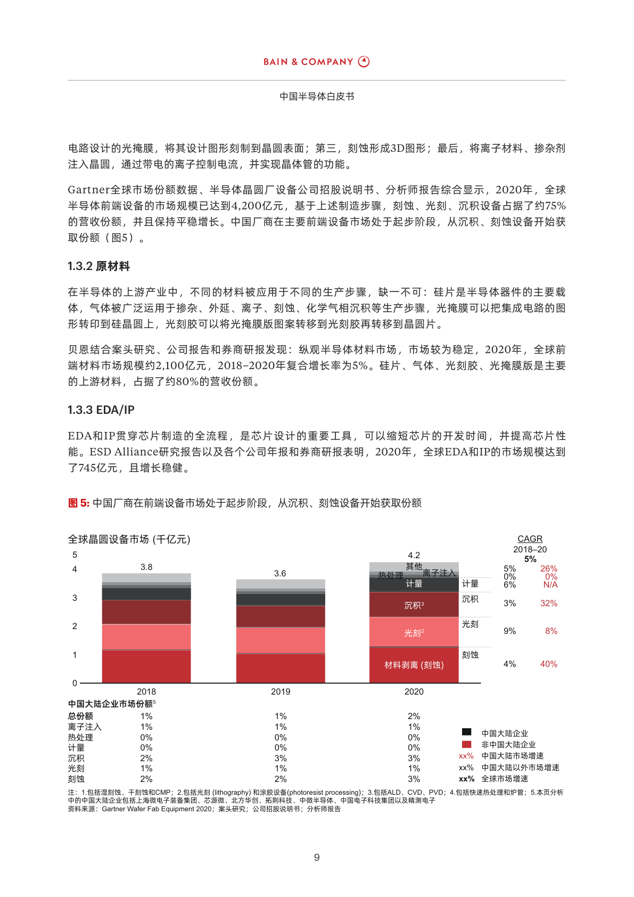

[Source Page: 12]

*原报告印刷页码：10*

- EDA（电子设计自动化）：是一套协助半导体器件的定义、规划、设计、实施、验证和后续制造的工具，包括仿真、设计、验证。
- IP：是可重复使用的具有独立功能模块的预设计电路，包括 IP 软核、IP 固核、IP 硬核，可减少设计工作量，缩短周期并提高成功率。

#### 1.3.4 设计环节

立足集成电路的不同功能，可以分为模拟芯片、存储芯片、逻辑芯片（图 6）。

2020 年，逻辑芯片贡献了约一半的销售额，大约 1.6 万亿元，但是不同细分领域有各自的领先玩家。比如，在 GPU 领域，头部企业英伟达占据了约八成的销售额；在 MPU 领域，英特尔拥有较强的优势；在应用/媒体处理器领域，苹果和联发科表现亮眼。

有别于逻辑芯片，存储芯片市场高度集中，2020 年的营收额约 8,000 亿元。无论在内存（DRAM）还是闪存（NAND）领域，三星都是主力军，SK 海力士、美光紧随其后，铠侠和西部数据则更加专注于 NAND 领域。

模拟芯片的厂商众多，在三大芯片中，格局最分散：德州仪器、亚德诺占据了模拟领域的半壁江山；分立器件、光电子领域中，各大厂商不分伯仲；传感器领域同样如此，除博世以外，其他厂商竞争激烈。

**图 6：**逻辑芯片占据半导体市场约一半的销售额，市场相对分散；存储芯片高度集中；而模拟芯片市场分散，厂商众多。

2020 年全球半导体产品营收额（千亿元），总计 30 千亿元；原图显示逻辑芯片约 16 千亿元、存储芯片约 8 千亿元、模拟芯片约 6 千亿元，其 2018–2020 CAGR 分别约 5%、约 13%、约 3%。

图中细分市场营收（千亿元）：

| 细分市场 | 营收 | 细分市场 | 营收 |
| --- | ---: | --- | ---: |
| MPU | 4.1 | GPU¹ | 0.7 |
| FPGA | 0.4 | 应用/基带 SoC | 1.0 |
| 无线 | 2.2 | 有线 | 1.5 |
| 应用/媒体处理器¹ | 1.9 | MCU | 1.1 |
| 其他逻辑 | 3.1 | DRAM | 4.3 |
| NAND | 3.5 | 其他存储 | 0.3 |
| 模拟 | 1.6 | 分立器件 | 1.5 |
| 光电子 | 2.4 | 传感器 | 0.7 |

原图厂商分布见下图；由于部分小色块文字和对应关系密集，未对具体厂商份额进行估算。

注：1. GPU 和应用/媒体处理器均为独立，而非集成到 SoC 里的；2. 逻辑芯片包括模拟 ASIC、ASSP；细分市场定义基于 Gartner；其他包括细分市场内收入 <9 亿美元的公司。图中红色代表增速跑赢细分市场平均水平的企业（CAGR 2018–20）。

资料来源：Gartner。

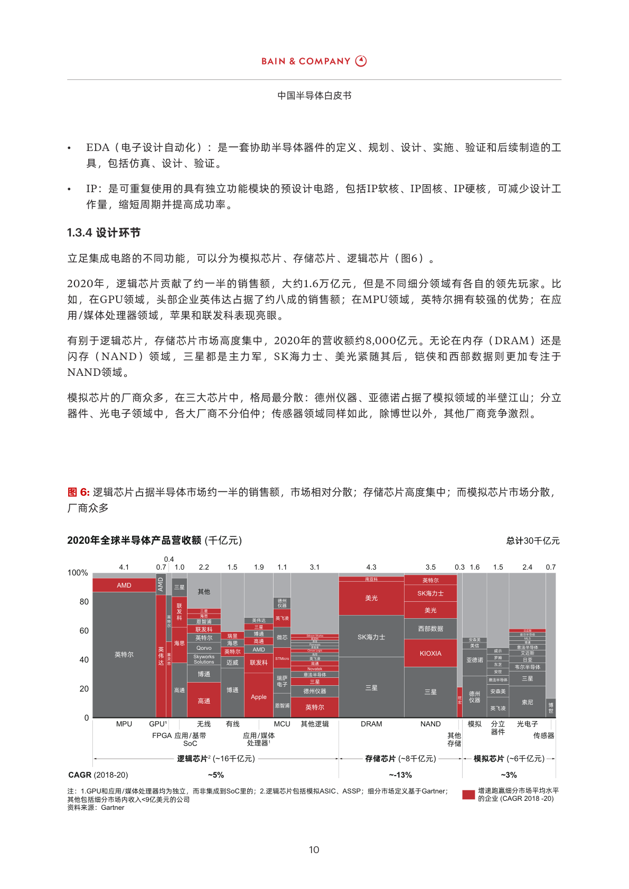

[Source Page: 13]

*原报告印刷页码：11*

#### 1.3.5 代工环节

总体上，全球晶圆制造代工市场由成熟制程（>=14nm）和先进制程（<14nm）组成。其中，成熟制程占据约 70% 的市场份额，先进制程芯片制造占据约 30%，并且高度集中于台积电和三星（图 7）。

2020 年，全球晶圆制造代工的总营收共计约 5,000 亿元。值得一提的是，作为老牌制造商，台积电积极布局各个制程，并且都取得了较高的市场份额，尤其是在 14/16–20nm 和 5nm，台积电约占据了约 9 成的份额。

#### 1.3.6 封测环节

贝恩参考各大公司年报、Yole、券商研报并进行案头研究后得到，2018–2020 年，全球半导体封测营收的年复合增长率为 3%，封装和测试的增速也均为约 3%，是一个稳定的市场。

- 封装：指的是实现芯片电路与外部器件电气连接，并为芯片提供机械物理保护，包括传统封装和先进封装。
- 测试：将封装完毕的芯片进行性能、持久性等方面的测试，包括初始测试（Initial Test，在不同环境下进行电气特性测试）和最后测试（Final test）。

**图 7：**在芯片制造中，成熟制程占据约 70% 芯片制造总市场；先进制程芯片制造高度集中在少数厂商。

2020 年全球晶圆制造代工营收，原图标题标为“千亿元”，总计标为“5 千亿元”；各制程柱顶原始数值如下：

| 制程 | 原图数值 |
| --- | ---: |
| >130nm | 941 |
| 130nm | 315 |
| 90nm | 187 |
| 65nm | 346 |
| 40/45nm | 445 |
| 32/28nm | 570 |
| 14/16–20nm | 589 |
| 10nm–6nm | 1,396 |
| 5nm | 246 |

[OCR_UNCERTAIN] 图中数值、图题单位与总计的对应口径不明确；按原页保留，不进行单位换算。厂商分项占比未标精确数值，见原图。

注：1. 不包括 IDM（例如英特尔）和 200mm wafer 营收；2. 三星半导体晶圆代工中的成熟制程营收约 360 亿元，但无法按照制程拆分，因此未包含在此图内；三星先进制程的营收是基于台积电平均售价乘以三星产能（Gartner）计算所得的；三星成熟制程营收是基于三星代工总营收（来源于 TrendForce）减去先进制程营收所得。

资料来源：IC Insights 2020；Gartner；台积电财报；中芯国际财报；TrendForce；案头研究。

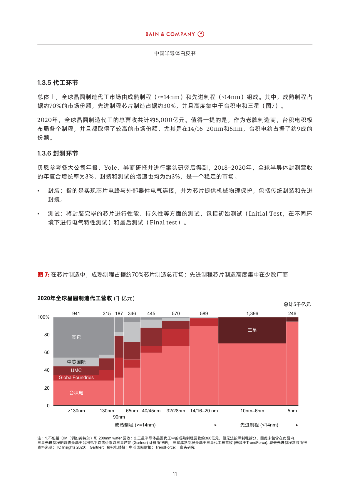

[Source Page: 14]

*原报告印刷页码：12*

## 2. 中国半导体在价值链主要环节的参与

在洞察全球半导体的概况后，我们将聚焦中国在半导体的价值链各个环节的参与情况，包括当前面临的挑战和机会、不同环节的市场地位以及主要玩家。

整体上，中国在半导体的设计和制造链条中起步较晚，积累相对薄弱。值得一提的是，在部分芯片的设计，以及封测环节，中国代表性企业正在加码追赶，并且取得了一定的成效。

值此承上启下的关键阶段，随着半导体相关的产业支持政策频频出台，和下游的广大市场需求，将促进中国半导体企业迎来新一轮发展（图 8）。

进一步分析后，我们发现，中国厂商在通讯芯片、模拟芯片与 OSD 设计、成熟制程制造与封测环节获得了较多的营收¹（图 9）。

2020 年，全球范围内，主要的中国大陆半导体企业²在封装和测试环节的市场占比约 17%，头部企业如长电科技、通富微。此外，成熟制程制造同样创造了较多的营收，中国厂商在全球市场中的占比约为 11%，代表企业有中芯国际。最后，在通讯芯片和模拟芯片设计方面，中国厂商的全球市场份额都在 10% 左右，代表企业有海思、韦尔等。

**图 8：**中国在半导体价值链各环节面临不同机会与挑战。

| 环节 | 中国大陆企业概况 | 主要中国大陆企业 |
| --- | --- | --- |
| 设备 | 目前在前端设备市场的渗透率较低；国家大基金（二期）将重点向半导体关键设备提供支持，包括刻蚀机、薄膜设备、清洁设备 | 上海微电子；北方华创；中微半导体 |
| 原材料 | 市场份额较低，尤其是 300 毫米晶圆、掩膜版和光刻胶市场；原材料也是国家大基金二期的重点投资领域 | 江丰电子；中环股份；金宏气体；沪硅产业 |
| EDA/IP | 起步较晚，远远落后于全球企业；在逻辑芯片和射频 EDA 工具等关键子行业，市场占有非常有限；由于技术能力和人才短缺，或需要 10–20 年的时间才能实现追赶 | 华大九天；国微思尔芯；概伦电子；芯原微电子 |
| IC 设计和 IDM | 地缘政治割裂局面正对国内领先的 IC 设计企业造成冲击，他们可能会失去美国公司的授权，影响产品开发；倡导下游采用国产半导体 | 海思；寒武纪；紫光展锐；合肥长鑫；瑞芯微 |
| 逻辑芯片制造 | 尽管属于卡脖子技术，中芯国际仍致力于在先进制程领域实现突破；扩大成熟制程产能，巩固市场份额并稳定主要收入来源 | 中芯国际；华虹半导体；武汉新芯 |
| 封装和测试 | 中国代表性企业正加码追赶全球封装技术龙头企业 | 长电科技；通富微电；华天科技 |

资料来源：案头研究。

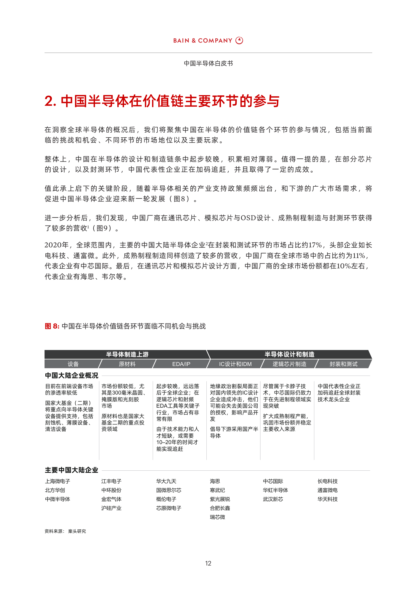

[Source Page: 15]

*原报告印刷页码：13*

**图 9：**中国厂商在通讯芯片、模拟芯片与 OSD 设计、成熟制程制造与封测环节产生较多营收。

2020 年主要的中国大陆半导体企业¹营收²，按细分市场划分（亿元）：

| 细分市场 | 营收（亿元） |
| --- | ---: |
| 前端设备 | 73 |
| 材料 | 96 |
| EDA/IP | 14 |
| CPU 相关 | 39 |
| 其他逻辑 | 178 |
| 通讯 | 659 |
| 存储 | 45 |
| 模拟 | 720 |
| 制造（先进） | 原图未给出数值；领先公司自 2021 年开始小批量生产 10nm 产品 |
| 制造（成熟） | 404 |
| 封装和测试 | 499 |

注：1. 中国大陆企业是指在各细分市场有公开信息的主要企业；2. 仅指与半导体有关的收入；3. 只展示主要玩家营收。

资料来源：2021 年、2020 年 McClean 报告；Gartner 2020 年全球半导体市场分布，按终端市场划分；ESD 联盟研究报告；Yole；公司招股说明书；公司年报；分析师报告；案头研究；CIQ；EMIS。

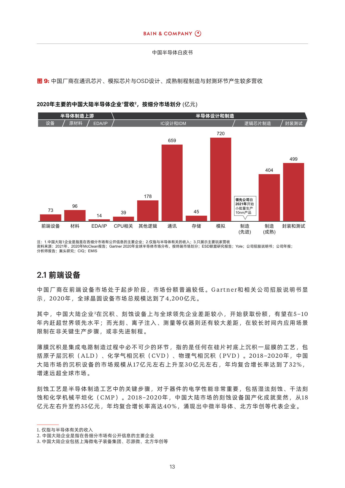

### 2.1 前端设备

中国厂商在前端设备市场处于起步阶段，市场份额普遍较低。Gartner 和相关公司招股说明书显示，2020 年，全球晶圆设备市场总规模达到了 4,200 亿元。

其中，中国大陆企业³在沉积、刻蚀设备上与全球领先企业差距较小，开始获取份额，有望在 5–10 年内赶超世界领先水平；而光刻、离子注入、测量等仪器则还有较大差距，在较长时间内应用场景限制在非关键生产步骤，或非先进制程。

薄膜沉积是集成电路制造过程中必不可少的环节，指的是任何在硅片衬底上沉积一层膜的工艺，包括原子层沉积（ALD）、化学气相沉积（CVD）、物理气相沉积（PVD）。2018–2020 年，中国大陆市场的沉积设备的市场规模从 17 亿元左右上升至 30 亿元左右，年均复合增长率达到了 32%，增速远超全球市场。

刻蚀工艺是半导体制造工艺中的关键步骤，对于器件的电学性能非常重要，包括湿法刻蚀、干法刻蚀和化学机械平坦化（CMP）。2018–2020 年，中国大陆市场的刻蚀设备国产化成就斐然，从 18 亿元左右升至约 35 亿元，年均复合增长率高达 40%，涌现出中微半导体、北方华创等代表企业。

1. 仅指与半导体有关的收入。
2. 中国大陆企业是指在各细分市场有公开信息的主要企业。
3. 中国大陆企业包括上海微电子装备集团、芯源微、北方华创等。

[Source Page: 16]

*原报告印刷页码：14*

### 2.2 原材料

2018年以来，中国半导体材料企业持续扩充自身产能，相关产品也在加速推进：中国大陆企业⁴在硅片、气体材料中逐步获取市场份额。

硅片是半导体制造的核心原材料，2018–2020年，中国大陆的硅片市场规模从约30亿元稳步上升至42亿元左右，年均复合增长率为16%，硅片赛道的领先企业有中环领先、江丰电子等。

从芯片生产到器件封装，几乎每一个步骤都离不开气体材料，因此，在所有原材料中，气体材料的市场需求仅次于硅片。在国内半导体市场蓬勃发展的背景下，2018–2020年，中国大陆气体材料的年均复合增长率达到了20%，增速约是全球市场的3倍，后者为7%。

### 2.3 EDA/IP

由于中国起步较晚，所以，EDA/IP方面的技术能力和人才短缺，市场占有有限。贝恩结合ESD联盟研究报告、公司招股说明书和分析师报告，通过案头研究后发现2020年，中国大陆⁵EDA/IP在全球市场中的占比仅为2%。类似的情况也出现在逻辑芯片和射频EDA工具等子行业，预计需要10–20年实现追赶。这背后需要长时间与晶圆制造（Foundry）厂联动的设计数据库积累，和相关人才投入，才能逐步提升产品竞争力。

### 2.4 设计环节

IC设计和IDM方面，Gartner半导体市场份额分布情况指出，中国在通讯芯片和模拟芯片设计中已获取一定的市场份额，然而，其他细分领域，诸如存储芯片、其他逻辑等市场占有非常有限。

其中，云计算厂商（阿里，腾讯，Baidu等）对于计算和存储芯片有着巨量的需求，从定制化性能、成本控制等目的出发，云计算厂商积极参与到芯片设计是大势所趋，已成为一股不可忽视的力量。

### 2.5 代工环节

McClean报告表明，当前，中国厂商在成熟制程代工市场已经建立了一定的市场份额。

2019年，中芯国际实现14纳米FinFET量产。中国厂商除了扩大成熟制程产能，如中芯国际在内的部分厂商仍致力于在先进制程领域实现突破。展望未来，中国厂商依然需要巩固成熟制程的市场份额并稳定主要收入来源。

### 2.6 封测环节

2018年以来，中国厂商在封测环节增长迅速，在全球范围内呈现出一定的竞争优势。基于Gartner报告中的全球规模数据，2020年，中国大陆企业在全球封测市场中的总份额达到了17%，其中，封装环节占比为19%，测试环节为9%。未来，国内封测企业的持续发展的同时，需要紧跟全球行业发展的趋势，例如与上游晶圆代工厂在先进封装上的紧密合作。

4. 仅指与半导体有关的收入  
5. 中国大陆企业是指在各细分市场有公开信息的主要企业

[Source Page: 17]

*原报告印刷页码：15*

## 3. 芯片设计环节中，中国半导体的市场地位

在芯片设计环节，中国企业正加速步入快车道。纵观主要的芯片类别，中国厂商在存储芯片、模拟芯片已建立起了一定的竞争力；CPU/GPU/ASIC 处于快速起步阶段，面临一些供应链及生态风险（图 10）。

**存储芯片：**从内部结构看，包括 NAND（闪存芯片）和 DRAM（内存），前者用于 SSD 固态硬盘和手机，后者用于 PC，这两种芯片的主要厂商均已实现量产。技术能力方面，NAND 在追赶全球领先水平，DRAM 与全球领先水平尚有差距，正在迅速追赶中。性能方面，NAND 性能与全球接近，DRAM 仍有一定的差距。由于存储芯片对于制程的要求较低，因此，供应链风险相对较小，对国际生态体系的依赖较少，如长江存储迭代优化自研技术体系 X-tacking [OCR_UNCERTAIN]。今后，随着中国主要厂商的产能逐步放量，预计存储芯片的市场地位还会上升，满足国内存储需求。

**图 10：**中国厂商在存储芯片、模拟芯片已建立起了一定的竞争力；CPU/GPU/ASIC 处于快速起步阶段，面临一些供应链及生态风险。

| 类型 | 市场份额（2020）栏的应用说明 | 技术能力 | 供应链安全及生态 | 未来预测 |
| --- | --- | --- | --- | --- |
| CPU | 主要应用于服务器、PC | 多家厂商已推出成熟产品实现商用；最领先产品达到 5nm；大部分厂商仍在追赶产品性能 | 先进制程的供应链面临风险；依赖 X86、Arm 架构 | 面临供应链挑战 |
| GPU | 包括图显 GPU 和计算 GPU | 少数厂商推出量产产品；仅一款产品达到最先进 7nm；初步商用阶段，性能细节暂不明确 | 先进制程的供应链面临风险；高度依赖英伟达 CUDA 软件生态，自建生态未大规模建立 | 数家新创立 GPU 公司拥有较强技术团队，支撑国内 GPU 发展；目前暂未有量产产品 |
| AI/ML ASIC | 主要应用于服务器 | 多家厂商推出量产产品，实现商用；最先进产品达到 7nm；大部分厂商仍在追赶性能 | 先进制程的供应链面临风险；生态体系多为自建，依赖较少 | CSP 积极参与 ASIC 产品研发与应用，发挥资金技术能力，明确自身定制化要求，也带来巨大自用需求 |
| 存储 | NAND 主要应用于 SSD、手机，DRAM 主要用于 PC | 主要厂商已实现量产；NAND 在不断提升；DRAM 与全球领先水平仍有差距，在迅速追赶 | 对制程要求较低；自研技术体系（如 X-tacking [OCR_UNCERTAIN]） | 随着主要厂商产能逐步放量，预计市场地位将持续上升，满足国内存储需求 |
| 模拟 | 主要应用于消费电子、汽车及工业电子 | 厂商众多已实现商用；聚焦细分品类，产品种类较全球领先厂商较少；在已进入的细分产品性能在不断提升 | 主要使用 ≥28nm 制程，供应链风险较小 | 国产模拟芯片具备价格低、服务灵活的优势，同时不断进行功能性创新，预计将持续提升，满足国内庞大需求 |

原图以饼图和箭头符号表示状态，但未给出符号对应的数值，保留原图，不推算市场份额。

资料来源：Gartner；案头研究；艾瑞咨询；IDC；券商研报。

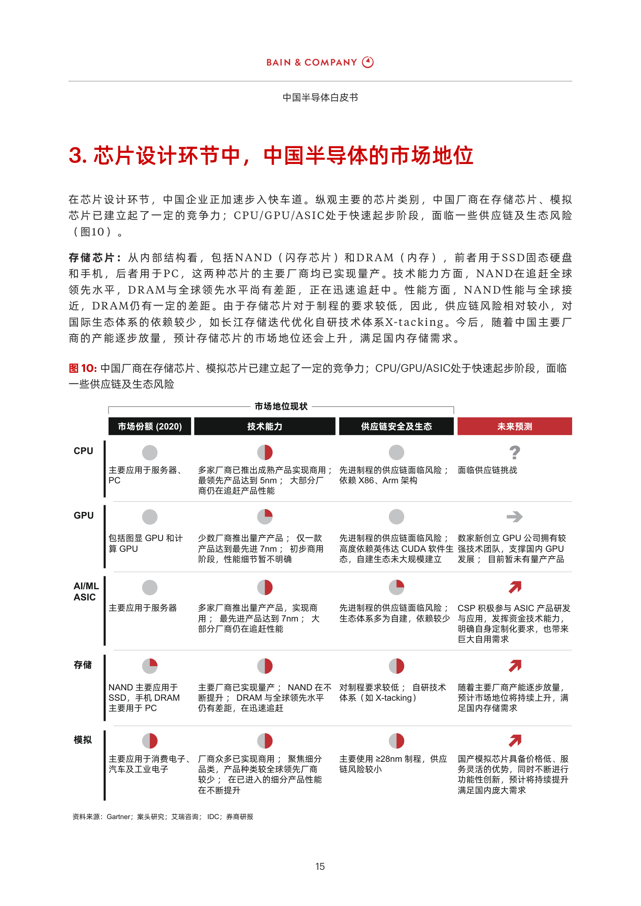

[Source Page: 18]

*原报告印刷页码：16*

除了主流的NAND的DRAM [OCR_UNCERTAIN]，利基市场的NOR Flash由于设计和制程门槛较低（专利已放开，主流制程65nm）也吸引了众多国内公司进行探索。

模拟芯片：广泛应用于消费电子、汽车及工业电子。技术能力方面，众多厂商已实现商用，大多数厂商聚焦于生产细分品类产品，所以中国市场提供的产品种类较少，但是，已经进入量产的细分产品的性能接近全球水平。模拟芯片主要使用28nm以上的制程。今后，在价格低、服务灵活的优势下，国产模拟芯片若持续开展功能性创新，预计将满足国内庞大的市场需求。

CPU（中央处理器）。CPU是电子计算机的主要配件之一，常用于服务器和PC。Gartner 2020全球半导体终端市场份额显示，2020年，全球CPU市场规模约5千亿元，中国芯片设计公司营收总占比为7%。

技术能力方面，多家中国厂商已经推出了服务器、桌面CPU等产品，并应用于政务、高性能计算、工控等商用场景。但整体国内厂商在稳定性，兼容性方面仍在追赶中。CPU生态依赖X86和ARM架构，且对于先进制成的追求较高，因此，中国厂商面临很大的供应链挑战（包括上游EDA/IP设计工具，下游代工厂的先进制成服务，以及终端软件的适配）。今后，随着国产CPU厂商的产品生态趋于完善，中国厂商有望逐步小幅度提升市场占有率。

在颠覆性的计算芯片架构出现之前，ARM将凭借比RISC-V和MIPS, Alpha更完善的生态系统，和相较于X86更开放的授权体系，以及国内大量的人才储备，成为中国CPU玩家的首选架构。

GPU（显示芯片）。包括图显GPU和计算GPU。技术能力方面，少数厂商实现量产，仅有一款产品达到最先进的7nm制程，并且仍处于初步商用阶段。GPU先进制程供应链面临一定的挑战，自建生态尚未大规模建立，依赖英伟达CUDA软件生态。贝恩观察到，新成立的数家GPU公司拥有强大的技术团队，有助于加速国内GPU发展。

AI/ML ASIC。主要运用于服务器，分为AI训练和AI推理。2020年，中国AI训练芯片市场规模约46亿元，AI推理约25亿元。技术能力方面，多家中国厂商完成量产，实现商用，其中，最先进的产品达到了7nm，少数玩家在AI训练、推理芯片领域的性能接近了全球领先水平。和GPU的情况类似，AI/ML ASIC依赖先进制程，但是，生态体系以自建为主，对于外部的依赖较少。在强大的资金、技术能力的支持下，大型云计算服务商（CSP）正积极参与ASIC产品研发和应用，贝恩建议，云计算服务商需要明确自身定制化要求，从而提升在自研芯片领域的投资效率。

从下游应用领域来看，在中国，消费电子与汽车电子是大部分芯片厂商的发力方向，展望未来，贝恩预测，2020–2025年，两大市场将保持约15–20%的高速增长态势（图11）。

[Source Page: 19]

*原报告印刷页码：17*

**图 11：**消费电子与汽车电子是大部分芯片厂商发力方向，且将保持 ~15–20% 高速增长。

原图颜色图例：深红为核心下游，浅红为次要下游；✓ 为供应信创市场，× 为暂无供应信创市场。空白单元格按原图保持空白，不推定为零或不适用。

| 下游应用 | 全球市场规模（2020 年，亿元） | 原图增长预测指标 | 全球 2020–2025 CAGR | 中国 2020–2025 CAGR |
| --- | ---: | --- | ---: | ---: |
| PC | 3614 | 台式机与笔记本出货量增长 | ~3% | ~7% |
| 平板 | 861 | 出货量增长 | ~-1% | ~7% |
| 服务器 | 2875 | 出货量增长 | ~7% | ~9% |
| 储存设备³ | 2372 | DRAM+NAND 营收增长 | ~7% | ~15% |
| 手机 | 7527 | 出货量增长 | ~1% | ~0% |
| 其他通讯² | 2358 | 以 4G+5G 基站为例，数量增长 | ~16% | ~16% |
| 消费电子 | 3142 | 智能家居设备出货量 | ~12% | ~21% |
| 汽车电子 | 2517 | 汽车半导体营收增长 | ~7%⁷ | ~14% |
| 工业电子⁴ | 3230 | 产业物联网⁵连接数增长 | ~15% | ~13% |
| 信创市场 |  | 信创生态市场⁶营收增长 | NA | ~37% |

| 公司类别 | 公司 | 核心下游 | 次要下游 | 信创市场 |
| --- | --- | --- | --- | --- |
| CPU | 海思 | 服务器、手机、其他通讯 |  | ✓ |
| CPU | 飞腾 | PC | 服务器 | ✓ |
| GPU | 景嘉微 |  |  | ✓ |
| GPU | 天数智芯 |  |  | × |
| AI/ML ASIC | 寒武纪 | 服务器 |  | ✓ |
| AI/ML ASIC | 百度 | 服务器 |  | ✓ |
| 存储 | 长江存储 | 储存设备 | PC、手机 | ✓ |
| 存储 | 长鑫存储 | PC、手机 | 服务器 | ✓ |
| 模拟 | 闻泰 | 汽车电子 | 手机、消费电子、工业电子 | × |
| 模拟 | 士兰微 | 消费电子、汽车电子、工业电子 |  | × |
| SoC | 全志科技 | 消费电子 | 平板、汽车电子 | × |
| SoC | 瑞芯微 | 消费电子、工业电子 | 平板 | × |
| SoC | 展锐 | 手机、消费电子 |  | ✓ |
| SoC | 地平线 | 汽车电子 | 消费电子 | ✓ |
| SoC | 晶晨 | 消费电子 |  | × |

注：1. 数据处理下还包括其他数据处理，如外接显示屏；2. 打印机如基站、有线通讯如宽带、光纤网络 [OCR_UNCERTAIN]；3. 仅包括数据处理中的存储电子设备（storage electronics）规模，如 SSD；4. 包括工业和军事/民用航空电子；5. 包括教育、政府、资源能源、零售、交通、通信、公共设施等物联网连接数；6. 包括底层硬件、基础设施、基础软件、平台、企业应用、解决方案和安全；7. IHS 2019–2026 汽车芯片 CAGR 预测；8. 包括该公司归属主要类别的产品的营收下游分布，部分非上市公司暂无数据披露。

资料来源：Gartner；公司年报；IDC；McClean 报告 2021；方正证券；案头研究。

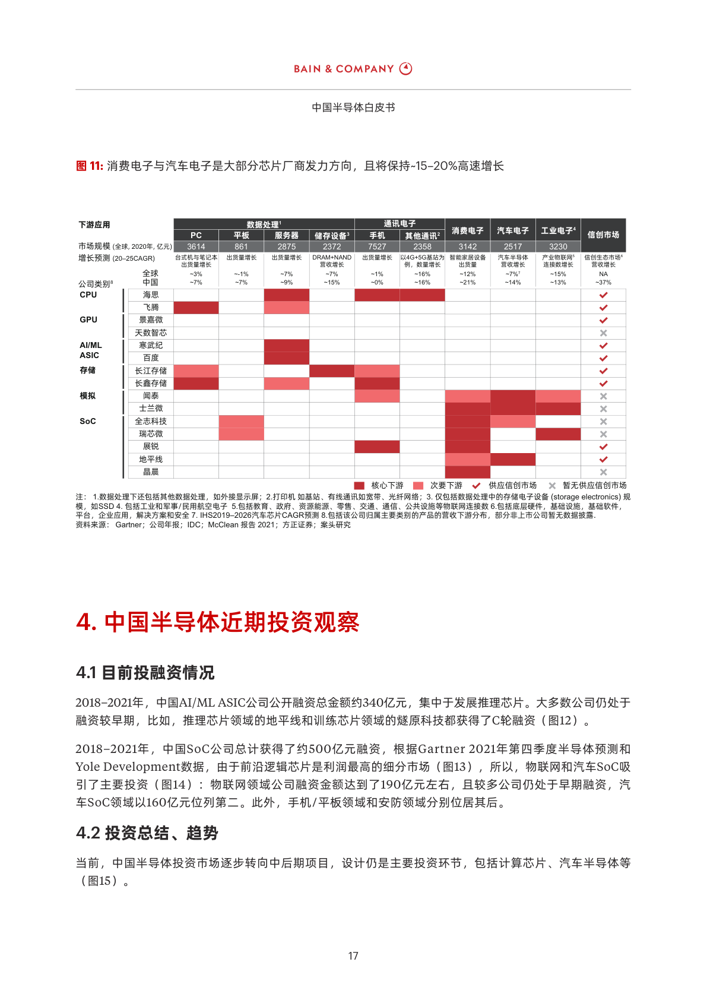

<details>
<summary>原 OCR 对矩阵的提取文本（行列错位）</summary>

```text
| 下游应用 | | 数据处理 | | | | 通讯电子 | | 消费电子 3142 智能家居设备 出货量 ~12% | 汽车电子 | 工业电子4 3230 产业物联网 连接数增长 ~15% ~13% | 信创市场 信创生态市场 营收增长 NA |
| --- | --- | --- | --- | --- | --- | --- | --- | --- | --- | --- | --- |
| | PC 3614 台式机与笔记本 出货量增长 -3% -7% | 平板 861 出货量增长 ~-1% ~7% | 服务器 2875 出货量增长 -7% -9% | 储存设备 | 手机 | 其他通讯2 | 2517 汽车半导体 营收增长 ~7% ~14% |
| 市场规模(全球,2020年,亿元 | 2372 | 7527 | 2358 以4G+5G基站为 例,数量增长 ~16% ~16% |
| 增长预测(20-25CAGR | 全球 | DRAM-NAND 营收增长 ~7% | 出货量增长 ~1% |
| 公司类别" | 中国 | ~15% | -0% | ~21% | ~37% |
| CPU | 海思 | | | | | | | | | |
| 飞腾 | | | | | | | | | | |
| GPU | 景嘉微 | | | | | | | | | | |
| 天数智芯 | | | | | | | | | | x |
| AI/ML | 寒武纪 | | | | | | | | | | |
| ASIC | 百度 | | | | | | | | | | |
| 存储 | 长江存储 | | | | | | | | | | |
| 长鑫存储 | | | | | | | | | | |
| 模拟 | 闻泰 | | | | | | | | | | |
| 士兰微 | | | | | | | | | | |
| SoC | 全志科技 | | | | | | | | | | >>>>XXXx>>x |
| 瑞芯微 | | | | | | | | | | |
| 展锐 | | | | | | | | | | |
| 地平线 | | | | | | | | | | |
| 晶晨 | | | | | | | | | | |

核心下游 次要下游 供应信创市场x暂无供应信创市场 1.数据处理下还包括其他数据处理,如外接显示屏;2.打印机如基站、有线通讯如宽带、光纤网络;3.仅包括数据处理中的存储电子设备(storag electronics)规 ,如SSD4.包括工业和军事/民用航空电子5.包括教育、政府、资源能源、零售、交通、通信、公共设施等物联网连接数6.包括底层硬件,基础设施,基础软件 平台,企业应用,解决方案和安全7.IHS2019-2026汽车芯片CAGR预测8.包括该公司归属主要类别的产品的营收下游分布,部分非上市公司暂无数据披露
资料来源:Gartner;公司年报;IDC;McClean报告2021;方正证券;案头研究

```
</details>

## 4. 中国半导体近期投资观察

### 4.1 目前投融资情况

2018–2021 年，中国 AI/ML ASIC 公司公开融资总金额约 340 亿元，集中于发展推理芯片。大多数公司仍处于融资较早期，比如，推理芯片领域的地平线和训练芯片领域的燧原科技都获得了 C 轮融资（图 12）。

2018–2021 年，中国 SoC 公司总计获得了约 500 亿元融资，根据 Gartner 2021 年第四季度半导体预测和 Yole Development 数据，由于前沿逻辑芯片是利润最高的细分市场（图 13），所以，物联网和汽车 SoC 吸引了主要投资（图 14）：物联网领域公司融资金额达到了 190 亿元左右，且较多公司仍处于早期融资，汽车 SoC 领域以 160 亿元位列第二。此外，手机/平板领域和安防领域分别位居其后。

### 4.2 投资总结、趋势

当前，中国半导体投资市场逐步转向中后期项目，设计仍是主要投资环节，包括计算芯片、汽车半导体等（图 15）。

[Source Page: 20]

*原报告印刷页码：18*

**图 12：**中国 AI/ML ASIC 公司集中于发展推理芯片；除少数头部玩家外，大部分公司仍处于融资较早期。

2018–2020 中国 AI/ML ASIC 公司公开融资金额（亿元）¹：推理约 310，训练约 31，总金额约 341 亿元。原图以颜色区分 A 轮、B 轮、C 轮、已上市和其他²，并显示企业名称；各企业的金额未标出，不作估算。

[OCR_UNCERTAIN] 本图标题写作 2018–2020，而前一页正文写作 2018–2021；保留两种原文时间范围。

注：1. 基于 CV Source 数据库，截止至 2022 年 1 月 10 日，与 AI/ML ASIC 业务相关的共有 33 公司，仅包括披露具体融资信息的 16 家公司，金额仅包括已披露的轮次的信息；分类基于各公司发家业务，部分公司逐步发展产品覆盖两个类型；2. 其他包括战略融资和（非）控制权收购。

资料来源：CV Source。

**图 13：**前沿逻辑芯片是利润最高的细分市场，但其制造难度也最大。

全球芯片制造产能（晶圆月产能，2019）：原图按 >180 纳米、100–180 纳米、55–90 纳米、28–45 纳米、10–22 纳米和 <10 纳米制程显示逻辑芯片、储存芯片及其他类别的占比。各分项未标精确值，不作估算。

注：1. 基于 2019 年等效 8 英寸晶圆月产能数据，主要发现仍然是 IFS 的产能集中在构建前沿的逻辑芯片；2. 包括一些用于汽车（如 MCU）的 <=32 纳米制程节点和用于其他领域的 <=22 纳米制程节点；计算芯片领域包括全部微型配件、3 个特定应用细分市场（独立 GPU、独立应用处理器和集成应用处理器）；网络芯片领域包括通信包括传统电话、移动基础设施、蜂窝调制解调器、企业局域网、服务提供商的骨干架构、有线和无线连接，以及射频芯片；个人电脑领域包括个人电脑、基础超级移动计算设备、超级移动设备；高效能运算包括服务器；移动和消费电子包括智能手机、可穿戴设备、数码相机和智能音箱；汽车包括归类为“汽车”、应用于 0–4 级 ADAS、信息娱乐、汽车高效能运算、安全、车身、动力总成和底盘中的计算和射频芯片。

资料来源：Gartner 2021 年第四季度半导体预测；Yole Développement；专家访谈；文献研究；贝恩分析。

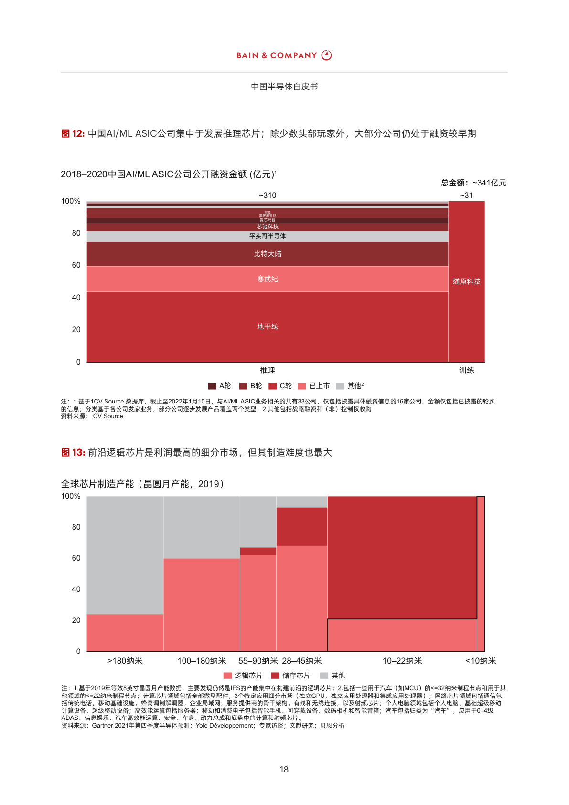

[Source Page: 21]

*原报告印刷页码：19*

**图 14：**在中国 SoC 领域，物联网与汽车 SoC 吸引了主要投资；其中物联网 SoC 投资分散且有较多公司仍处于融资早期。

2018–2021 中国 SoC 公司公开融资金额（亿元）¹：物联网²约 190，汽车²约 160，手机/平板约 75，安防 70；总金额约 500 亿元。原图以颜色区分 A 轮、B 轮、C 轮、已上市和其他⁴，并显示企业名称；各企业金额未标出，不作估算。

注：1. 截止至 2022 年 1 月 10 日，数据库中 SOC 业务相关的共有 53 家公司，仅包括披露具体融资信息的 45 家公司，金额仅包括已披露的轮次的信息；由于很多公司有跨下游业务，此图分类均基于公司主要业务；2. 部分汽车与物联网公司与 AI ASIC 重复，12 家公司分别为地平线、黑芝麻智能、爱芯元智、杭州国芯、酷芯微电子、墨芯智能、眸芯科技、耐能、齐感科技、时擎科技，总金额达到 ~190 亿元；3. 两家仅有的工业物联网公司，其余均为消费物联网；4. 其他包括天使轮、战略融资和（非）控制权收购。

[OCR_UNCERTAIN] 原图注 2 写“12 家公司”，可辨名单数量与之不一致；按原页保留。

资料来源：CV Source；Capital IQ。

**图 15：**中国半导体投资市场逐步走向中后期项目；设计仍是主要投资环节，包括计算芯片、汽车半导体等。

中国半导体融资数量和轮次比例（2018–2021）：

| 年份 | 融资数量 |
| --- | ---: |
| 2018 | 263 |
| 2019 | 284 |
| 2020 | 379 |
| 2021 | 498 |

半导体各细分市场投资数量占比（2019–2020）：图中标注 IC 设计 2019 年 74%、2020 年 67%；材料设备 2019 年 13%、2020 年 19%。其他细分色块未标出精确值，不作估算。

在设计环节中，计算芯片、汽车半导体是主要投资热点：计算芯片（主要包括 GPU、ASIC）受下游广阔应用增长和国产替代的需要成了热门赛道；汽车半导体受益于电动车的放量，及智能化、网联化趋势而得到投资市场关注。

注：1. 其它包括其他包括 Pre-IPO 轮、战略融资和（非）控制权收购；2. 天使轮包括种子轮。

资料来源：CV Source；云岫资本；创造硬科技研究院；案头研究。

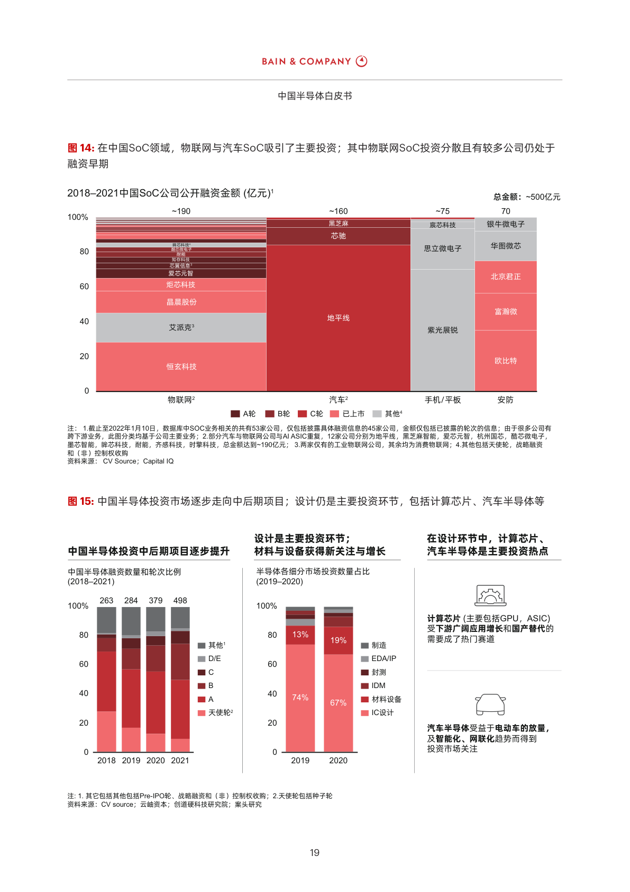

[Source Page: 22]

*原报告印刷页码：20*

新冠疫情发生以来，在国家政策加码和国产化提速的双重因素下，半导体融资数量大幅上涨，从2018年的263起到2021年的498起。在这个过程中，B轮及以后的融资比重增加，投资市场随半导体企业的成长一同成熟。

在总投资规模中，投向设计的比例约70%，位列所有细分赛道首位。在建立本土半导体产业链的政策影响下，上游材料与设备吸引了新的投资热点，从2019年的13%快速提升至2020年的19%。

在设计环节中，得益于下游广阔的应用增长和国产替代，以及电动车的放量和智能化、网联化趋势，计算芯片（主要包括GPU、ASIC）及汽车半导体成为投资热点。

### 4.3 中国协处理器玩家融资情况

#### 4.3.1 AI推理

地平线于2015年成立，迄今已累计完成13轮融资，在政府资助以外，地平线还获得了超过35家投资机构的资金，包括私募股权机构（中信产业投资基金、高瓴资本等）、投资基金（今日资本、中金资本等）、科技公司（京东方）、车企（比亚迪、长城汽车等）。

#### 4.3.2 AI训练

燧原科技于2018年成立，先后获得腾讯、上海双创、海松资本等投资方的融资。2021年，公司宣布荣获18亿元的C轮融资，由中信产业基金、中金资本旗下基金、春华资本领投。

#### 4.3.3 图像处理 (GPU)

天数智芯于2015年成立。2021年，公司获得由私募基金（大钲资本和沄柏资本）领投的C轮融资约12亿元用于AI推理芯片研发。

摩尔线程于2020年成立，去年11月公司完成20亿元A轮融资，由上海国盛资本、五源资本、中银国际旗下渤海中盛基金联合领投，建银国际、前海母基金、招商证券和湖北高质量发展产业基金等九家知名机构联合参投。

### 4.4 启示

#### 4.4.1 面向投资者的启示

在相关政策支持、广泛下游应用的培育下，中国半导体公司有望循序渐进、逐步突破整个价值链，因此，中长期来看，投资机会广阔。

设计环节仍是热门赛道，就中短期而言，尤其是AI/ML ASIC壁垒相对较低，或将涌现出大量玩家，可能实现技术弯道超车。此外，尽管GPU/CPU的开发门槛高于ASIC，但是由于市场应用广阔，GPU/CPU同样有机会在中长期带来高回报。

国内计算芯片设计玩家的快速发展，也给晶圆制造（Foundry）厂带来了巨大的代工业务机会，并有可能催生相对大而稳定的投资机会。

[Source Page: 23]

*原报告印刷页码：21*

同时，在摩尔定律发展放缓的大环境下，通过先进封装技术提高系统性能的优势越发显著，导致下游封装环节与上游设计及晶圆代工的联动愈加紧密，而提前布局2.5D/3D先进封装赛道的中国封装厂商与其上游联动方因此也值得关注。

上游设备和材料方面，伴随研发投入加大，预计有机会从各个细分领域突围，比肩世界领先水平。

#### 4.4.2 面向经营者的启示

**半导体市场主体**

首先，积极开展适配与协作，共同推动国产化生态圈，并打造更有韧性的本土供应体系。其次，基于第一点，借助本土优势，及时响应下游客户的需求，锻造与国际厂商差异化的服务能力。最后，关注潜在的收购机会，垂直整合强化现有业务，或通过横向收购，补足短板，扩大版图。

**产业新势力**

聚焦、主动参与和自身主营业务有着强协同效应的半导体细分领域，比如，IoT厂商可以进入物联网相关AI芯片设计领域，既强化了主营业务的壁垒，又通过发展半导体作为第二曲线，成长为产业新势力。

[Source Page: 24]

## Bold ideas. Bold teams. Extraordinary results.

### 贝恩公司是一家全球性咨询公司，致力于帮助世界各地有雄心、以变革为导向的商业领袖共同定义未来

目前，贝恩公司在全球38个国家设有63个分公司，我们与客户并肩工作，拥有共同的目标：取得超越对手的非凡业绩，重新定义客户所在的行业。凭借度身订制的整合性专业能力，配以精心打造的数字创新生态系统，我们为客户提供更好、更快和更持久的业绩结果。自1973年成立以来，我们根据客户的业绩来衡量自己的成功，在业内享有良好的客户拥护度。

### 是什么使我们在竞争激烈的咨询行业中脱颖而出

贝恩公司坚信管理咨询公司发挥的作用不应局限于提供建议方案的范畴。我们置身客户立场思考问题，专注于建议方案的落地。我们基于执行效果的收费模式有助于确保客户与贝恩的利益捆绑，通过与客户通力合作，以发掘客户潜力。我们的战略落地/变革管理®（Results Delivery®）流程协助客户发展自身的能力，而我们的“真北”（True North）价值观指导我们始终致力于为我们的客户、员工和社会实现目标。

### 贝恩公司大中华区

20世纪90年代初，贝恩公司进入中国，是较早进入中国市场的全球咨询公司之一。目前在北京、上海和香港设有三个分公司，大中华区员工人数近400人。多年来，凭借对中国本地市场的了解和在全球其他地区积累的丰富经验，我们持续为不同行业的跨国公司和中国本土企业提供咨询服务，度身订制企业策略和解决方案。

[Source Page: 25]

欲了解更多信息，请查询 www.bain.cn 或关注微信号：


阿姆斯特丹·亚特兰大·曼谷·北京·班加罗尔·波士顿·布鲁塞尔·布宜诺斯艾利斯·芝加哥·哥本哈根·达拉斯·迪拜·杜塞尔多夫·法兰克福·赫尔辛基·香港·休斯顿·伊斯坦布尔·雅加达·约翰内斯堡·吉隆坡·基辅·拉各斯·伦敦·洛杉矶·马德里·墨尔本·墨西哥城·米兰·莫斯科·孟买·慕尼黑·新德里·纽约·奥斯陆·帕洛阿尔托·巴黎·帕斯·里约热内卢·罗马·圣弗朗西斯科·圣地亚哥·圣保罗·首尔·上海·新加坡·斯德哥尔摩·悉尼·东京·多伦多·华沙·华盛顿·苏黎世·利雅得·多哈。

## Processing Notes

- 第 6、18 页原文“NAND 的 DRAM”表述不清，按原页保留并标记 [OCR_UNCERTAIN]。
- 第 13 页图中柱顶数字与图题单位的对应口径不明，保留原图并标记 [OCR_UNCERTAIN]。
- 第 17 页原文将技术体系写作“X-tacking”，保留原拼写并标记 [OCR_UNCERTAIN]。
- 第 19 页矩阵已按原图颜色和符号核对重建；原文注 2 的“打印机如基站、有线通讯如宽带、光纤网络”字样可辨，但表述含义不明，保留并标记 [OCR_UNCERTAIN]。
- 第 20 页图 12 的 2018–2020 与第 19 页正文的 2018–2021 时间范围不一致；第 21 页图 14 注 2 所称公司数量与可辨名单数量不一致，均按原文保留并标记 [OCR_UNCERTAIN]。
