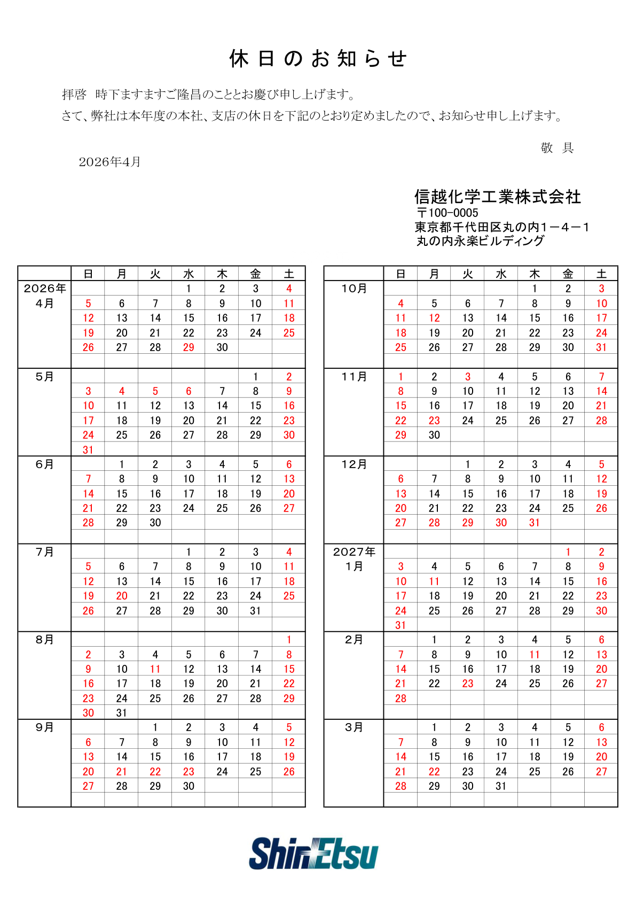

## Document Metadata

- Document ID: 23b4d11b25dcb98b775a824866827a13af619e67
- Document Title: 休日のお知らせ
- Document Type: PDF
- Issuing Organization: 信越化学工業株式会社
- Publication Date: 2026年4月
- Reporting Period: null
- Source File: [Sb9f1f4cd7755_shinetsu.co.jp_products.pdf](https://github.com/jadennevercode/CJCC-Knowledge-Base/blob/564ab11aa9785e569e3853c8a4d7ce86f88e7535/materials/%E4%B8%8A%E6%B8%B8%EF%BC%9A%E5%8D%8A%E5%AF%BC%E4%BD%93%E7%BA%A7%E5%8E%9F%E6%9D%90%E6%96%99/Sb9f1f4cd7755_shinetsu.co.jp_products.pdf)

## Structured Content

> 原文件：[Sb9f1f4cd7755_shinetsu.co.jp_products.pdf](https://github.com/jadennevercode/CJCC-Knowledge-Base/blob/564ab11aa9785e569e3853c8a4d7ce86f88e7535/materials/%E4%B8%8A%E6%B8%B8%EF%BC%9A%E5%8D%8A%E5%AF%BC%E4%BD%93%E7%BA%A7%E5%8E%9F%E6%9D%90%E6%96%99/Sb9f1f4cd7755_shinetsu.co.jp_products.pdf)
> 转换方式：Volcengine OCRPdf v3, parse_mode=ocr

[Source Page: 1]

# 休日のお知らせ

拝啓　時下ますますご隆昌のこととお慶び申し上げます。

さて、弊社は本年度の本社、支店の休日を下記のとおり定めましたので、お知らせ申し上げます。

敬具

2026年4月

信越化学工業株式会社  
〒100-0005  
東京都千代田区丸の内1－4－1  
丸の内永楽ビルディング

原 PDF 中の赤色の日付を太字で示します。色の意味は原 PDF を参照してください。

## 2026年4月

| 日 | 月 | 火 | 水 | 木 | 金 | 土 |
| --- | --- | --- | --- | --- | --- | --- |
|  |  |  | 1 | 2 | 3 | **4** |
| **5** | 6 | 7 | 8 | 9 | 10 | **11** |
| **12** | 13 | 14 | 15 | 16 | 17 | **18** |
| **19** | 20 | 21 | 22 | 23 | 24 | **25** |
| **26** | 27 | 28 | **29** | 30 |  |  |

## 2026年5月

| 日 | 月 | 火 | 水 | 木 | 金 | 土 |
| --- | --- | --- | --- | --- | --- | --- |
|  |  |  |  |  | 1 | **2** |
| **3** | **4** | **5** | **6** | 7 | 8 | **9** |
| **10** | 11 | 12 | 13 | 14 | 15 | **16** |
| **17** | 18 | 19 | 20 | 21 | 22 | **23** |
| **24** | 25 | 26 | 27 | 28 | 29 | **30** |
| **31** |  |  |  |  |  |  |

## 2026年6月

| 日 | 月 | 火 | 水 | 木 | 金 | 土 |
| --- | --- | --- | --- | --- | --- | --- |
|  | 1 | 2 | 3 | 4 | 5 | **6** |
| **7** | 8 | 9 | 10 | 11 | 12 | **13** |
| **14** | 15 | 16 | 17 | 18 | 19 | **20** |
| **21** | 22 | 23 | 24 | 25 | 26 | **27** |
| **28** | 29 | 30 |  |  |  |  |

## 2026年7月

| 日 | 月 | 火 | 水 | 木 | 金 | 土 |
| --- | --- | --- | --- | --- | --- | --- |
|  |  |  | 1 | 2 | 3 | **4** |
| **5** | 6 | 7 | 8 | 9 | 10 | **11** |
| **12** | 13 | 14 | 15 | 16 | 17 | **18** |
| **19** | **20** | 21 | 22 | 23 | 24 | **25** |
| **26** | 27 | 28 | 29 | 30 | 31 |  |

## 2026年8月

| 日 | 月 | 火 | 水 | 木 | 金 | 土 |
| --- | --- | --- | --- | --- | --- | --- |
|  |  |  |  |  |  | **1** |
| **2** | 3 | 4 | 5 | 6 | 7 | **8** |
| **9** | 10 | **11** | 12 | 13 | 14 | **15** |
| **16** | 17 | 18 | 19 | 20 | 21 | **22** |
| **23** | 24 | 25 | 26 | 27 | 28 | **29** |
| **30** | 31 |  |  |  |  |  |

## 2026年9月

| 日 | 月 | 火 | 水 | 木 | 金 | 土 |
| --- | --- | --- | --- | --- | --- | --- |
|  |  | 1 | 2 | 3 | 4 | **5** |
| **6** | 7 | 8 | 9 | 10 | 11 | **12** |
| **13** | 14 | 15 | 16 | 17 | 18 | **19** |
| **20** | **21** | **22** | **23** | 24 | 25 | **26** |
| **27** | 28 | 29 | 30 |  |  |  |

## 2026年10月

| 日 | 月 | 火 | 水 | 木 | 金 | 土 |
| --- | --- | --- | --- | --- | --- | --- |
|  |  |  |  | 1 | 2 | **3** |
| **4** | 5 | 6 | 7 | 8 | 9 | **10** |
| **11** | **12** | 13 | 14 | 15 | 16 | **17** |
| **18** | 19 | 20 | 21 | 22 | 23 | **24** |
| **25** | 26 | 27 | 28 | 29 | 30 | **31** |

## 2026年11月

| 日 | 月 | 火 | 水 | 木 | 金 | 土 |
| --- | --- | --- | --- | --- | --- | --- |
| **1** | 2 | **3** | 4 | 5 | 6 | **7** |
| **8** | 9 | 10 | 11 | 12 | 13 | **14** |
| **15** | 16 | 17 | 18 | 19 | 20 | **21** |
| **22** | **23** | 24 | 25 | 26 | 27 | **28** |
| **29** | 30 |  |  |  |  |  |

## 2026年12月

| 日 | 月 | 火 | 水 | 木 | 金 | 土 |
| --- | --- | --- | --- | --- | --- | --- |
|  |  | 1 | 2 | 3 | 4 | **5** |
| **6** | 7 | 8 | 9 | 10 | 11 | **12** |
| **13** | 14 | 15 | 16 | 17 | 18 | **19** |
| **20** | 21 | 22 | 23 | 24 | 25 | **26** |
| **27** | **28** | **29** | **30** | **31** |  |  |

## 2027年1月

| 日 | 月 | 火 | 水 | 木 | 金 | 土 |
| --- | --- | --- | --- | --- | --- | --- |
|  |  |  |  |  | **1** | **2** |
| **3** | 4 | 5 | 6 | 7 | 8 | **9** |
| **10** | **11** | 12 | 13 | 14 | 15 | **16** |
| **17** | 18 | 19 | 20 | 21 | 22 | **23** |
| **24** | 25 | 26 | 27 | 28 | 29 | **30** |
| **31** |  |  |  |  |  |  |

## 2027年2月

| 日 | 月 | 火 | 水 | 木 | 金 | 土 |
| --- | --- | --- | --- | --- | --- | --- |
|  | 1 | 2 | 3 | 4 | 5 | **6** |
| **7** | 8 | 9 | 10 | **11** | 12 | **13** |
| **14** | 15 | 16 | 17 | 18 | 19 | **20** |
| **21** | 22 | **23** | 24 | 25 | 26 | **27** |
| **28** |  |  |  |  |  |  |

## 2027年3月

| 日 | 月 | 火 | 水 | 木 | 金 | 土 |
| --- | --- | --- | --- | --- | --- | --- |
|  | 1 | 2 | 3 | 4 | 5 | **6** |
| **7** | 8 | 9 | 10 | 11 | 12 | **13** |
| **14** | 15 | 16 | 17 | 18 | 19 | **20** |
| **21** | **22** | 23 | 24 | 25 | 26 | **27** |
| **28** | 29 | 30 | 31 |  |  |  |

## Processing Notes

- 日历日期、列位置及红色标记依据 PDF 文本坐标与颜色提取，逐月检查日期和星期；原页图已保留。
- 原文件名以 products 命名，但原页是休日通知；按原页内容处理。
