## Document Metadata

- Document ID: a1cc791d89b6d70402a6829b284b23c7c26da965
- Document Title: Anthropic即将上市，黄仁勋辞去CEO等职务——人工智能行业半月报（2026年11月第2期）
- Document Type: PDF
- Issuing Organization: 国元证券股份有限公司（国元证券研究所）
- Publication Date: 2026-11-17
- Reporting Period: 2026年11月上半月（指数表现区间2026-11-01至2026-11-13，数据跟踪截至2026-11-16）
- Source File: [M176_20261117-国元证券-国元证券人工智能行业半月报（2026年11月第2期）：Anthropic即将上市，黄仁勋辞去CEO等职务.pdf](https://github.com/jadennevercode/CJCC-Knowledge-Base/blob/5ec8511eb834073c8bfbd79c94af196282d483cf/materials/%E4%B8%8B%E6%B8%B8%EF%BC%9A%E4%BA%91%E8%AE%A1%E7%AE%97%E4%B8%8EAI%E9%9C%80%E6%B1%82%E4%BC%A0%E5%AF%BC/M176_20261117-%E5%9B%BD%E5%85%83%E8%AF%81%E5%88%B8-%E5%9B%BD%E5%85%83%E8%AF%81%E5%88%B8%E4%BA%BA%E5%B7%A5%E6%99%BA%E8%83%BD%E8%A1%8C%E4%B8%9A%E5%8D%8A%E6%9C%88%E6%8A%A5%EF%BC%882026%E5%B9%B411%E6%9C%88%E7%AC%AC2%E6%9C%9F%EF%BC%89%EF%BC%9AAnthropic%E5%8D%B3%E5%B0%86%E4%B8%8A%E5%B8%82%EF%BC%8C%E9%BB%84%E4%BB%81%E5%8B%8B%E8%BE%9E%E5%8E%BBCEO%E7%AD%89%E8%81%8C%E5%8A%A1.pdf)

## Structured Content

> 原文件：[M176_20261117-国元证券-国元证券人工智能行业半月报（2026年11月第2期）：Anthropic即将上市，黄仁勋辞去CEO等职务.pdf](https://github.com/jadennevercode/CJCC-Knowledge-Base/blob/5ec8511eb834073c8bfbd79c94af196282d483cf/materials/%E4%B8%8B%E6%B8%B8%EF%BC%9A%E4%BA%91%E8%AE%A1%E7%AE%97%E4%B8%8EAI%E9%9C%80%E6%B1%82%E4%BC%A0%E5%AF%BC/M176_20261117-%E5%9B%BD%E5%85%83%E8%AF%81%E5%88%B8-%E5%9B%BD%E5%85%83%E8%AF%81%E5%88%B8%E4%BA%BA%E5%B7%A5%E6%99%BA%E8%83%BD%E8%A1%8C%E4%B8%9A%E5%8D%8A%E6%9C%88%E6%8A%A5%EF%BC%882026%E5%B9%B411%E6%9C%88%E7%AC%AC2%E6%9C%9F%EF%BC%89%EF%BC%9AAnthropic%E5%8D%B3%E5%B0%86%E4%B8%8A%E5%B8%82%EF%BC%8C%E9%BB%84%E4%BB%81%E5%8B%8B%E8%BE%9E%E5%8E%BBCEO%E7%AD%89%E8%81%8C%E5%8A%A1.pdf)
> 转换方式：多模态逐页转录（页面图像 + 文本层交叉校验）

[Source Page: 1]

# Anthropic即将上市，黄仁勋辞去CEO等职务

## ——人工智能行业半月报（2026年11月第2期）

行业研究｜信息技术　证券研究报告　2026年11月17日

**推荐｜维持**

报告要点：

● **指数表现（2026年11月上半月）**

内地指数：中证人工智能产业指数上涨2.66%，逆转上月跌势。国证AI应用指数上涨9.98%，上证科创板人工智能指数上涨10.52%。

香港指数：恒生港股通人工智能主题指数上涨1.35%，跑输恒生指数0.13个百分点。

● **数据跟踪**

OpenRouter数据显示，在刚过去的一个整周(11.09-11.15)中，按token计算的大模型周调用量为211万亿tokens，周调用量最高的编程智能体为Hermes Agent。Artificial Analysis数据显示，11月16日，以AAII为标准，Anthropic、谷歌与OpenAI的系列模型的智能水平总体上仍保持领先；当前智能水平最高的国产大模型是Kimi K3.1 Pro；OpenAI与Anthropic有多个性价比高的模型。当前总参数量最高的开源大模型是Kimi的K3.1 Pro和K3。

● **重点新闻**

大模型企业：智谱公告根据一般授权购回H股的意向；Anthropic启动IPO路演；MiniMax发布并开源H3-Image；谷歌发布Gemini 4 Hydrogen；阿里千问发布Qwen4-Max。

底层算力基础设施：谷歌推出TPU 8tx和8i Max；阿里巴巴拟将平头哥分拆至港交所主板独立上市；CoreWeave公布2026年三季报；第六代AMD EPYC上市；英伟达宣布CEO黄仁勋辞职，Colette Kress出任临时CEO。

人工智能运用：Anthropic推出新的办公组件；腾讯推出元宝搜索；DeepSeek发布全家桶应用API；OpenAI推出ChatGPT Wallet。

政策法规与安全性：《人工智能与气候信息完整性行动优先事项》正式发布。

● **投资观点**

近期，大模型企业Anthropic启动IPO路演，并将于近日上市。Anthropic将成为继智谱、MiniMax之后，首家以前沿AI实验室身份进入公开市场的企业，同时也是美股市场首家专注于人工智能核心技术与相关业务的上市企业。

我们建议近期密切跟踪Anthropic的上市进程，重点观察IPO定价、认购热度与上市后首月表现等指标，并评估其对同类人工智能企业的估值传导效应。我们也建议持续关注人工智能核心技术在应用领域的最新突破，结合相关产业实际进展与商业化兑现节奏，优选受益逻辑清晰、发行主体具备业绩验证能力的上市标的。

● **风险提示**

大模型技术迭代不及预期风险；人工智能基础设施需求不及预期风险；人工智能技术应用不及预期风险；宏观经济表现不及预期风险；行业竞争加剧的风险；相关政策落地不及预期的风险。

### 过去一年市场行情

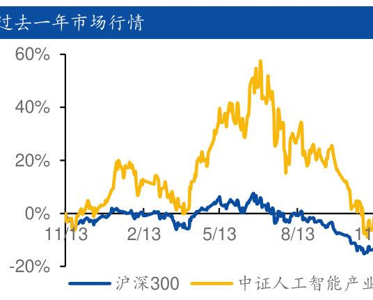

纵轴：60%、40%、20%、0%、-20%；横轴：11/13、2/13、5/13、8/13、11/13；图例：沪深300、中证人工智能产业。

资料来源：iFinD

### 相关研究报告

- 《国元证券行业研究-人工智能行业半月报（2026年11月第1期）：板块延续下跌态势，北美巨头密集发布财报》2026.11.11
- 《国元证券行业研究-人工智能行业半月报（2026年9月第2期）：大模型密集发布，商业化持续推进》2026.10.09
- 《国元证券行业研究-人工智能行业半月报（2026年9月第1期）：板块持续调整，前沿大模型快速迭代》2026.09.18

### 报告作者

分析师：耿军军
执业证书编号：S0020519070002
电话：021-51097188-1856
邮箱：gengjunjun@gyzq.com.cn

[Source Page: 2]

## 目　录

| 章节 | 页码 |
| --- | --- |
| 1.指数表现 | 3 |
| 1.1内地股票相关指数 | 3 |
| 1.2香港股票相关指数 | 4 |
| 2.数据跟踪 | 5 |
| 2.1大模型调用与测评 | 5 |
| 2.2大模型价格与参数 | 9 |
| 2.3应用软件与智能体 | 11 |
| 3.重点新闻 | 12 |
| 3.1大模型与代表企业 | 12 |
| 3.2底层算力基础设施 | 14 |
| 3.3人工智能实践应用 | 17 |
| 3.4政策法规与安全性 | 18 |
| 4.投资观点 | 19 |
| 5.风险提示 | 19 |

## 图表目录

| 图表 | 页码 |
| --- | --- |
| 图1：沪深300指数及人工智能概念指数半月度与月度涨跌幅 | 3 |
| 图2：沪深300指数及人工智能概念指数2026年初至今累计涨跌幅 | 3 |
| 图3：恒生系列核心指数及人工智能相关指数半月度与月度涨跌幅 | 4 |
| 图4：恒生系列核心指数及人工智能相关指数2026年初至今累计涨跌幅 | 4 |
| 图5：大模型调用统计（截至11月15日） | 5 |
| 图6：大模型厂商市场份额变化（以文本请求为衡量标准，截至11月15日） | 6 |
| 图7：大模型智能水平综合排名（以AAII为标准，截至11月16日） | 7 |
| 图8：前沿大模型通用能力对比与演进（截至11月16日） | 8 |
| 图9：大模型性价比对比（AAII vs.任务加权平均成本，截至11月16日） | 9 |
| 图10：开源大模型总参数量对比（十亿单位，截至11月16日） | 10 |
| 图11：编程智能体调用统计（截至11月15日） | 11 |

[Source Page: 3]

## 1.指数表现

### 1.1内地股票相关指数

2026年11月01日至13日，中证人工智能产业指数上涨2.66%，逆转了上月的跌势，跑赢沪深300指数1.88个百分点。同一时间段内，国证AI应用指数上涨9.98%，上证科创板人工智能指数上涨10.52%。

图1：沪深300指数及人工智能概念指数半月度与月度涨跌幅

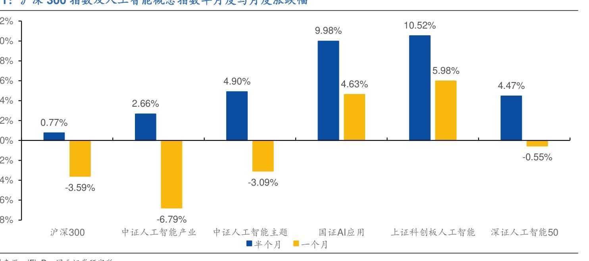

| 指数 | 半个月 | 一个月 |
| --- | --- | --- |
| 沪深300 | 0.77% | -3.59% |
| 中证人工智能产业 | 2.66% | -6.79% |
| 中证人工智能主题 | 4.90% | -3.09% |
| 国证AI应用 | 9.98% | 4.63% |
| 上证科创板人工智能 | 10.52% | 5.98% |
| 深证人工智能50 | 4.47% | -0.55% |

资料来源：iFinD，国元证券研究所

今年以来，中证人工智能产业指数累计下跌9.04%，跑赢沪深300指数4.22个百分点。国证AI应用指数累计下跌23.74%，上证科创板人工智能指数累计下跌12.01%。

图2：沪深300指数及人工智能概念指数2026年初至今累计涨跌幅

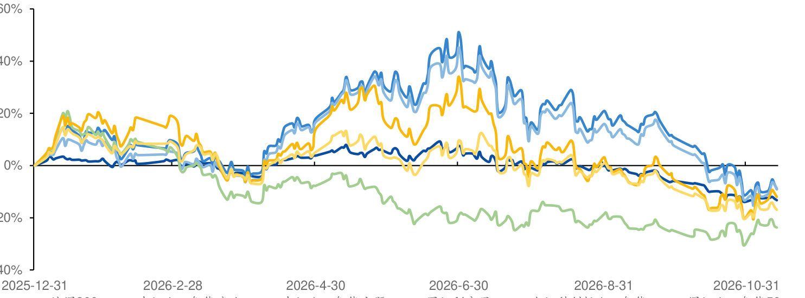

纵轴：-40%至60%；横轴：2025-12-31、2026-2-28、2026-4-30、2026-6-30、2026-8-31、2026-10-31；图例：沪深300、中证人工智能产业、中证人工智能主题、国证AI应用、上证科创板人工智能、深证人工智能50。

资料来源：iFinD，国元证券研究所

[Source Page: 4]

### 1.2香港股票相关指数

2026年11月01日至13日，恒生港股通人工智能主题指数上涨1.35%，跑输恒生指数0.13个百分点。同一时间段内，恒生港股通人工智能基础设施指数下跌2.83%，恒生港股通算力主题指数下跌4.83%。

图3：恒生系列核心指数及人工智能相关指数半月度与月度涨跌幅

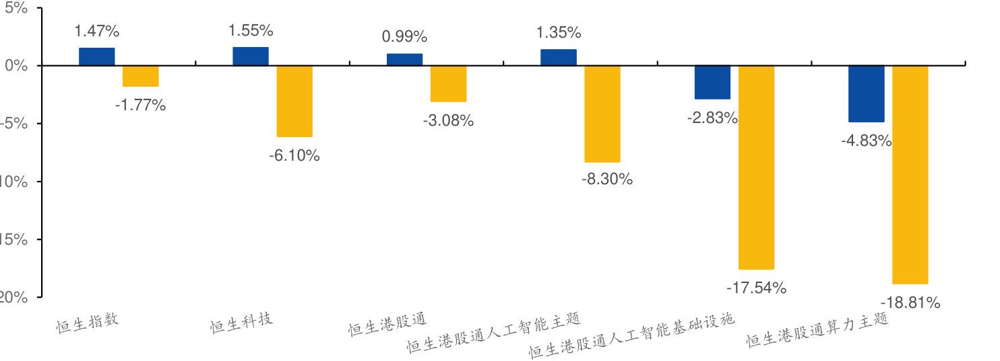

| 指数 | 半个月 | 一个月 |
| --- | --- | --- |
| 恒生指数 | 1.47% | -1.77% |
| 恒生科技 | 1.55% | -6.10% |
| 恒生港股通 | 0.99% | -3.08% |
| 恒生港股通人工智能主题 | 1.35% | -8.30% |
| 恒生港股通人工智能基础设施 | -2.83% | -17.54% |
| 恒生港股通算力主题 | -4.83% | -18.81% |

资料来源：iFinD，国元证券研究所

今年以来，恒生港股通人工智能主题指数累计下跌52.29%，跑输恒生指数44.51个百分点。恒生港股通人工智能基础设施指数累计下跌6.73%，恒生港股通算力主题指数累计上涨0.60%。

图4：恒生系列核心指数及人工智能相关指数2026年初至今累计涨跌幅

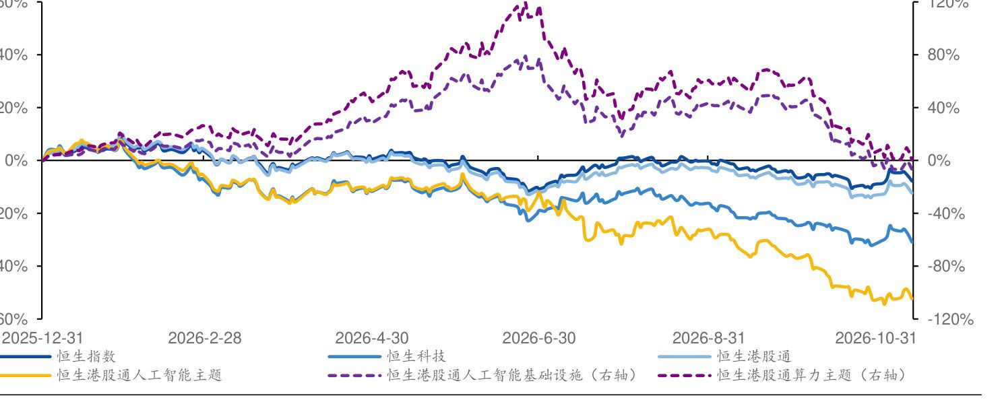

左轴：-60%至60%；右轴：-120%至120%；横轴：2025-12-31、2026-2-28、2026-4-30、2026-6-30、2026-8-31、2026-10-31；图例：恒生指数、恒生科技、恒生港股通、恒生港股通人工智能主题、恒生港股通人工智能基础设施（右轴）、恒生港股通算力主题（右轴）。

资料来源：iFinD，国元证券研究所

注：恒生港股通人工智能基础设施指数的指数基期为2022-12-30，启用日期为2026-07-31；恒生港股通算力主题指数的指数基期为2020-12-31，启用日期为2026-09-23。

[Source Page: 5]

## 2.数据跟踪

### 2.1大模型调用与测评

OpenRouter统计数据显示，按token（词元）计算的大模型周调用量在刚过去的一个整周(2026.11.09-2026.11.15)达到211万亿tokens，较上一个整周(2026.11.02-2026.11.08)的210万亿tokens小幅上升。

其中，该周调用排名前五的大模型依次为DeepSeek的DeepSeek V4.1 Flash 1017、腾讯的Hy4、DeepSeek的DeepSeek V4.1 Flash、智谱的GLM 5.3 Flash、OpenAI的GPT-6 Luna。

图5：大模型调用统计（截至11月15日）

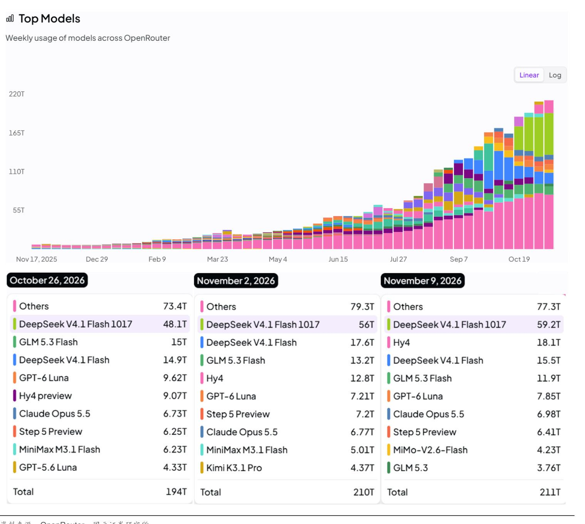

Top Models —— Weekly usage of models across OpenRouter；纵轴：55T、110T、165T、220T；横轴：Nov 17, 2025、Dec 29、Feb 9、Mar 23、May 4、Jun 15、Jul 27、Sep 7、Oct 19；右上角切换：Linear / Log。

October 26, 2026

| 模型 | 周调用量 |
| --- | --- |
| Others | 73.4T |
| DeepSeek V4.1 Flash 1017 | 48.1T |
| GLM 5.3 Flash | 15T |
| DeepSeek V4.1 Flash | 14.9T |
| GPT-6 Luna | 9.62T |
| Hy4 preview | 9.07T |
| Claude Opus 5.5 | 6.73T |
| Step 5 Preview | 6.25T |
| MiniMax M3.1 Flash | 6.23T |
| GPT-5.6 Luna | 4.33T |
| Total | 194T |

November 2, 2026

| 模型 | 周调用量 |
| --- | --- |
| Others | 79.3T |
| DeepSeek V4.1 Flash 1017 | 56T |
| DeepSeek V4.1 Flash | 17.6T |
| GLM 5.3 Flash | 13.2T |
| Hy4 | 12.8T |
| GPT-6 Luna | 7.21T |
| Step 5 Preview | 7.2T |
| Claude Opus 5.5 | 6.77T |
| MiniMax M3.1 Flash | 5.01T |
| Kimi K3.1 Pro | 4.37T |
| Total | 210T |

November 9, 2026

| 模型 | 周调用量 |
| --- | --- |
| Others | 77.3T |
| DeepSeek V4.1 Flash 1017 | 59.2T |
| Hy4 | 18.1T |
| DeepSeek V4.1 Flash | 15.5T |
| GLM 5.3 Flash | 11.9T |
| GPT-6 Luna | 7.85T |
| Claude Opus 5.5 | 6.98T |
| Step 5 Preview | 6.41T |
| MiMo-V2.6-Flash | 4.23T |
| GLM 5.3 | 3.76T |
| Total | 211T |

资料来源：OpenRouter，国元证券研究所

[Source Page: 6]

以文本请求为衡量标准，在最近过去的一个整周(2026.11.09-2026.11.15)，市场份额排名首位的是DeepSeek(31.8%)，排名第二的是OpenAI(19.0%)。

谷歌、智谱以及Anthropic在相应市场份额上排名三到五位。

图6：大模型厂商市场份额变化（以文本请求为衡量标准，截至11月15日）

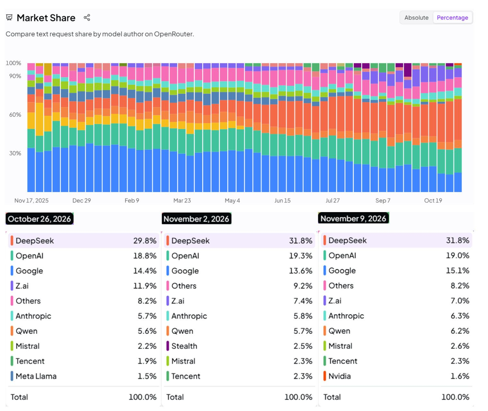

Market Share —— Compare text request share by model author on OpenRouter；纵轴：30%、60%、90%、100%；横轴：Nov 17, 2025、Dec 29、Feb 9、Mar 23、May 4、Jun 15、Jul 27、Sep 7、Oct 19；右上角切换：Absolute / Percentage。

October 26, 2026

| 厂商 | 市场份额 |
| --- | --- |
| DeepSeek | 29.8% |
| OpenAI | 18.8% |
| Google | 14.4% |
| Z.ai | 11.9% |
| Others | 8.2% |
| Anthropic | 5.7% |
| Qwen | 5.6% |
| Mistral | 2.2% |
| Tencent | 1.9% |
| Meta Llama | 1.5% |
| Total | 100.0% |

November 2, 2026

| 厂商 | 市场份额 |
| --- | --- |
| DeepSeek | 31.8% |
| OpenAI | 19.3% |
| Google | 13.6% |
| Others | 9.2% |
| Z.ai | 7.4% |
| Anthropic | 5.8% |
| Qwen | 5.7% |
| Stealth | 2.5% |
| Mistral | 2.3% |
| Tencent | 2.3% |
| Total | 100.0% |

November 9, 2026

| 厂商 | 市场份额 |
| --- | --- |
| DeepSeek | 31.8% |
| OpenAI | 19.0% |
| Google | 15.1% |
| Others | 8.2% |
| Z.ai | 7.0% |
| Anthropic | 6.3% |
| Qwen | 6.2% |
| Mistral | 2.6% |
| Tencent | 2.3% |
| Nvidia | 1.6% |
| Total | 100.0% |

资料来源：OpenRouter，国元证券研究所

[Source Page: 7]

Artificial Analysis数据显示，11月16日，Anthropic Claude、谷歌Gemini与OpenAI GPT系列模型的智能水平总体上保持领先；当前智能水平排名前三的国产大模型依次为Kimi K3.1 Pro、Qwen4 Max、Tencent Hy4。

图7：大模型智能水平综合排名（以AAII为标准，截至11月16日）

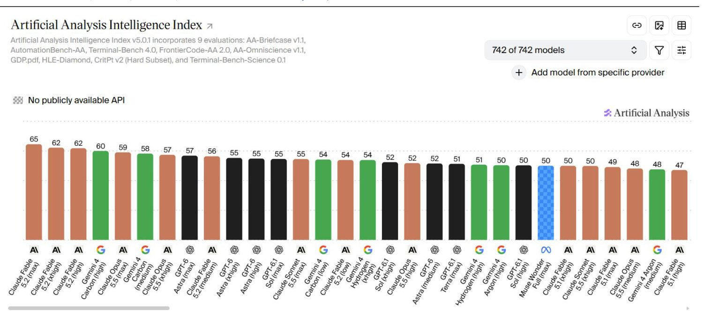

上半幅：Artificial Analysis Intelligence Index（742 of 742 models）。副标题：Artificial Analysis Intelligence Index v5.0.1 incorporates 9 evaluations: AA-Briefcase v1.1, AutomationBench-AA, Terminal-Bench 4.0, FrontierCode-AA 2.0, AA-Omniscience v1.1, GDPpdf, HLE-Diamond, CritPt v2 (Hard Subset), and Terminal-Bench-Science 0.1。标注：No publicly available API；Artificial Analysis。各模型名称纵向旋转、字号过小，未能辨读 [OCR_UNREADABLE]。

下半幅：Leading Models by Country（742 of 742 models）。副标题：Artificial Analysis Intelligence Index · Leading models。图例：United States、China、France、Singapore、United Arab Emirates、South Korea、Spain、Canada、India、Israel、Switzerland。标注：No publicly available API。各模型名称纵向旋转、字号过小，未能辨读 [OCR_UNREADABLE]。

资料来源：Artificial Analysis，国元证券研究所

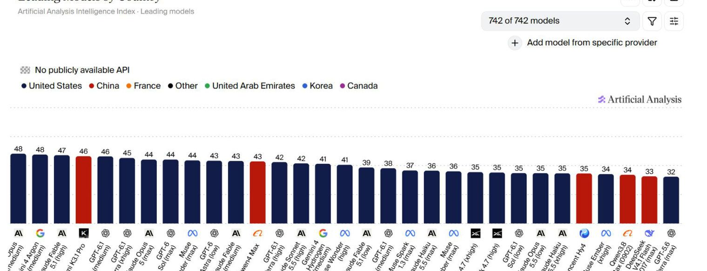

[Source Page: 8]

Artificial Analysis数据显示，以Progress Index为衡量标准，当前前沿大模型通用能力排名前五的国家依次为美国、中国、法国、新加坡、阿联酋。

图8：前沿大模型通用能力对比与演进（截至11月16日）

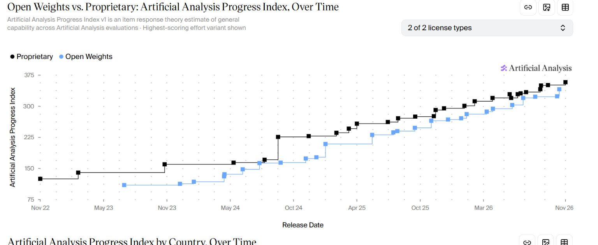

上半幅：Open Weights vs. Proprietary: Artificial Analysis Progress Index, Over Time（2 of 2 license types）。副标题：Artificial Analysis Progress Index v1 is an item response theory estimate of general capability across Artificial Analysis evaluations · Highest-scoring effort variant shown。图例：Proprietary、Open Weights。纵轴：Artificial Analysis Progress Index（75、150、225、300、375）；横轴：Release Date（Nov 22、May 23、Nov 23、May 24、Oct 24、Apr 25、Oct 25、Mar 26、Nov 26）。折线图无数据标签，未写数值。

下半幅：Artificial Analysis Progress Index by Country, Over Time（11 of 11 countries）。副标题同上。图例：United States、China、France、Singapore、United Arab Emirates、South Korea、Spain、Canada、India、Israel、Switzerland。纵轴：Artificial Analysis Progress Index（75、150、225、300、375）；横轴：Release Date（Nov 22、May 23、Nov 23、May 24、Oct 24、Apr 25、Oct 25、Mar 26、Nov 26）。折线图无数据标签，未写数值。

资料来源：Artificial Analysis，国元证券研究所

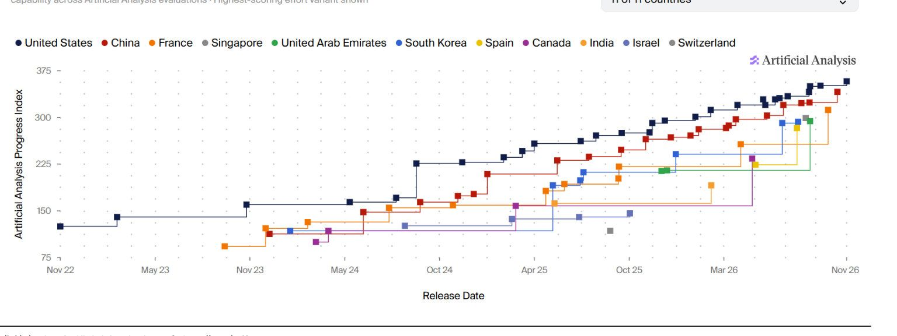

[Source Page: 9]

### 2.2大模型价格与参数

Artificial Analysis数据显示，当前AAII-任务加权平均成本帕累托线上有多个OpenAI GPT与Anthropic Claude系列模型。这些在帕累托线上的大模型在相应的价位上相比其他大模型有更高的智能水平(AAII)，即性价比更高。

图9：大模型性价比对比（AAII vs.任务加权平均成本，截至11月16日）

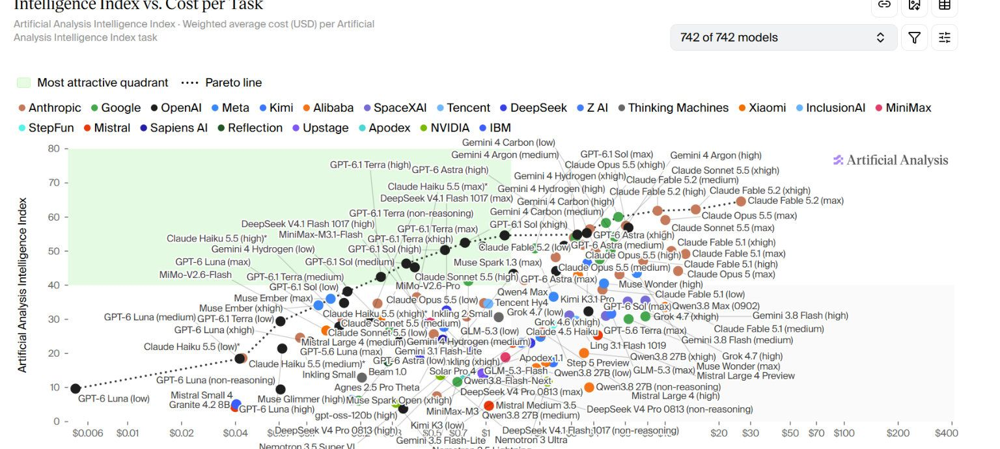

上半幅：Intelligence Index vs. Cost per Task（742 of 742 models）。副标题：Artificial Analysis Intelligence Index · Weighted average cost (USD) per Artificial Analysis Intelligence Index task。图例：Most attractive quadrant、Pareto line；厂商色标：Anthropic、Google、OpenAI、Meta、Kimi、Alibaba、SpaceXAI、Tencent、DeepSeek、Z.AI、Thinking Machines、Xiaomi、InclusionAI、MiniMax、StepFun、Mistral、Sapiens AI、Reflection、Upstage、Apodx、NVIDIA、IBM。纵轴：Artificial Analysis Intelligence Index（0、10、20、30、40、50、60、70、80）；横轴：Cost per Task (USD, Log Scale)，刻度$0.006、$0.01、$0.02、$0.04、$0.2、$0.30、$0.50、$0.70、$0.100、$0.200、$0.400。散点标签相互重叠、部分无法辨读 [OCR_UNREADABLE]。

下半幅：Intelligence Index vs. Cost per Task（742 of 742 models）。副标题：Artificial Analysis Intelligence Index · Weighted average cost (USD) per Artificial Analysis Intelligence Index task。图例同上。纵轴：Artificial Analysis Intelligence Index（0、10、20、30、40、50、60、70、80）；横轴：Cost per Task (USD, Log Scale)，刻度$0.006、$0.01、$0.02、$0.04、$0.07、$0.1、$0.2、$0.3、$0.4、$0.5、$0.7、$1、$2、$3、$4、$5、$7、$10、$20、$30、$50、$70、$100、$200、$400。散点标签相互重叠、部分无法辨读 [OCR_UNREADABLE]。

资料来源：Artificial Analysis，国元证券研究所

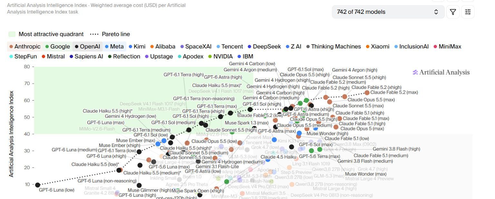

[Source Page: 10]

Artificial Analysis数据显示，开源大模型中，当前总参数量最高的大模型为Kimi的K3.1 Pro和K3，总参数量均为2.8万亿。

图10：开源大模型总参数量对比（十亿单位，截至11月16日）

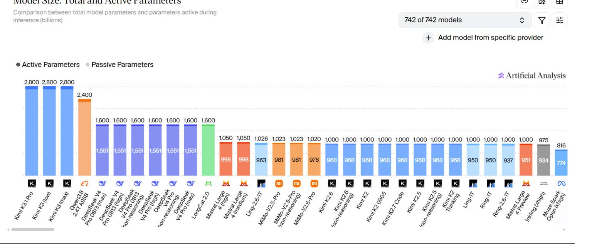

Model Size: Total and Active Parameters —— Comparison between total model parameters and parameters active during inference (billions)（742 of 742 models）。图例：Active Parameters、Passive Parameters。

| 模型 | 总参数量（十亿） |
| --- | --- |
| Kimi K3.1 Pro | 2,800 |
| Kimi K3 (low) | 2,800 |
| Kimi K3 (max) | 2,800 |
| Qwen3.8 2.4T A95B | 2,400 |
| DeepSeek V4 Pro 0813 (max) | 1,600 |
| DeepSeek V4 Pro 0813 (high) | 1,600 |
| DeepSeek V4 Pro-0813 (non-reasoning) | 1,600 |
| DeepSeek V4 Pro (high) | 1,600 |
| DeepSeek V4 Pro (non-reasoning) | 1,600 |
| DeepSeek V4 Pro (max) | 1,600 |
| LongCat-2.0 | 1,600 |
| Mistral Large 4 (high) | 1,050 |
| Mistral Large 4 (medium) | 1,050 |
| Ling-2.6-TT | 1,026 |
| MiMo-V2.5-Pro | 1,023 |
| MiMo-V2.5-Pro (non-reasoning) | 1,023 |
| MiMo-V2.6-Pro | 1,020 |
| Kimi K2.6 | 1,000 |
| Kimi K2.6 (non-reasoning) | 1,000 |
| Kimi K2 | 1,000 |
| Kimi K2-0905 | 1,000 |
| Kimi K2.7 Code | 1,000 |
| Kimi K2.5 | 1,000 |
| Kimi K2.5 (non-reasoning) | 1,000 |
| Kimi K2 Thinking | 1,000 |
| Ling-TT | 1,000 |
| Ring-TT | 1,000 |
| Ring-2.6-TT | 1,000 |
| Mistral Large 4 Preview | 1,000 |
| Inkling (xhigh) | 975 |
| Muse Spark Open (xhigh) | 816 |

资料来源：Artificial Analysis，国元证券研究所

[Source Page: 11]

### 2.3应用软件与智能体

OpenRouter统计数据显示，在最近过去的一个整周(2026.11.09-2026.11.15)中，编程智能体的调用总量为48.5万亿tokens，较上一个整周(2026.11.02-2026.11.08)的49.4万亿tokens有所下降。

其中，在最近过去的这个整周中周调用量排名前三的编程智能体依次为Nous Research的Hermes Agent、Anthropic的Claude Code、Kilo Code。

**图11：编程智能体调用统计（截至11月15日）**

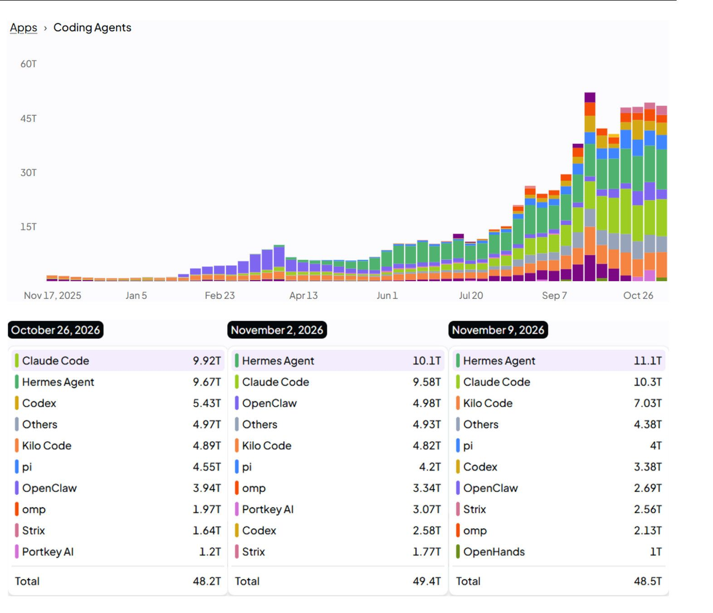

Apps › Coding Agents（纵轴刻度60T、45T、30T、15T；横轴日期标注Nov 17, 2025、Jan 5、Feb 23、Apr 13、Jun 1、Jul 20、Sep 7、Oct 26；堆叠柱状图，单位T）

**October 26, 2026**

| 智能体 | 调用量 |
| --- | --- |
| Claude Code | 9.92T |
| Hermes Agent | 9.67T |
| Codex | 5.43T |
| Others | 4.97T |
| Kilo Code | 4.89T |
| pi | 4.55T |
| OpenClaw | 3.94T |
| omp | 1.97T |
| Strix | 1.64T |
| Portkey AI | 1.2T |
| Total | 48.2T |

**November 2, 2026**

| 智能体 | 调用量 |
| --- | --- |
| Hermes Agent | 10.1T |
| Claude Code | 9.58T |
| OpenClaw | 4.98T |
| Others | 4.93T |
| Kilo Code | 4.82T |
| pi | 4.2T |
| omp | 3.34T |
| Portkey AI | 3.07T |
| Codex | 2.58T |
| Strix | 1.77T |
| Total | 49.4T |

**November 9, 2026**

| 智能体 | 调用量 |
| --- | --- |
| Hermes Agent | 11.1T |
| Claude Code | 10.3T |
| Kilo Code | 7.03T |
| Others | 4.38T |
| pi | 4T |
| Codex | 3.38T |
| OpenClaw | 2.69T |
| Strix | 2.56T |
| omp | 2.13T |
| OpenHands | 1T |
| Total | 48.5T |

资料来源：OpenRouter，国元证券研究所

[Source Page: 12]

## 3.重点新闻

### 3.1大模型与代表企业

#### 1) 智谱公告根据一般授权购回H股的意向（事件日期：2026.11.10）

11月10日，智谱董事会宣布，于接获董事长刘德兵博士的股份购回提议后，智谱拟根据公司股东于2026年6月22日举行的年度股东会上授予的购回H股的一般授权，不时于公开市场购回H股。购回授权将维持有效，直至以下较早发生者为止：(a)2026年年度股东会结束；或(b)股东于股东会上通过特别决议案撤销或修订购回授权之日。股份购回计划的预期总金额上限为40亿港元，而根据股份购回计划将予购回的H股总数不得超过于公告日期已发行股份总数的1%。

智谱认为，股份购回计划将显示其对集团长期业务展望及前景的信心，以及其对提升股东价值的承诺。就股份购回计划而言，将会考虑集团的财务状况、营运资金要求及业务发展需求，以维持充足的财务资源供其持续营运及增长。

链接：https://www1.hkexnews.hk/listedco/listconews/sehk/2026/1110/2026111000852_c.pdf

#### 2) Anthropic启动IPO路演（事件日期：2026.11.10）

当地时间11月10日，Anthropic宣布启动A类普通股IPO路演。据Anthropic介绍，已申请将其A类普通股在纳斯达克上市，股票代码为“ANT”；拟议发行共8.25亿股A类普通股，其中，801,351,354股由Anthropic出售，23,648,646股由部分现有股东出售，但Anthropic不会从出售股东出售的股份中获得任何募集资金；预计授予承销商一项30天超额配售选择权，可额外购买最多123,750,000股A类普通股；IPO价格预计在每股70至78美元之间，但最终发行价预计于11月18日（美国东部时间）确定；股票预计于11月19日（美国东部时间）开始公开交易。

Anthropic的招股说明书显示，谷歌、英伟达、AMD、博通、美光、微软和台积电七家企业将通过私募配售，按发行价合计认购260亿美元的N类普通股。N类普通股不享有表决权，其持有人主要为Anthropic的战略业务伙伴；不过，该类普通股在出售或转让给非关联第三方时，通常将转换为A类普通股。此外，Anthropic的七位联合创始人在本次发行交割之前将向一家有限责任公司Founder LLC发行一股F类普通股。对于一般提交股东表决的事项（包括选举除T类董事之外的董事），F类普通股所享有的合计表决权，将等于Anthropic已发行股本总表决权的50.1%。

链接：https://www.anthropic.com/news/roadshow-launch
https://ipo.anthropic.com/documents/us/prospectus.pdf
https://ipo.anthropic.com/us/

[Source Page: 13]

#### 3) MiniMax发布并开源H3-Image（事件日期：2026.11.10）

11月10日，MiniMax正式发布MiniMax H3-Image并开放权重。据MiniMax介绍，H3-Image是一款衍生自H3的图像生成模型，具备文本生成图像、图像参考和图像编辑能力；在H3预训练赋予的广泛图像能力基础上，H3-Image进一步强化了整个后训练链路，完成了数据、强化学习、步数压缩、PE、部署优化等方面的工作。

链接：https://mp.weixin.qq.com/s/k155NbBb4srZoJBZvlWttA

#### 4) 谷歌发布Gemini 4 Hydrogen（事件日期：2026.11.12）

当地时间11月12日，谷歌发布Gemini 4 Hydrogen。谷歌表示，前沿模型Gemini 4 Carbon与Argon擅长在最难的问题上做深入、长程的推理，而Hydrogen适合快速执行各类智能体工作流；相比于Gemini 3.8 Flash，Hydrogen在默认的high档位下完成任务的速度提升2.5倍；Hydrogen在其完整的100万token上下文窗口内实行统一价格：每百万token输入1.50美元，输出7.50美元。

链接：https://blog.google/innovation-and-ai/models-and-research/gemini-models/introducing-gemini-4-hydrogen/

#### 5) 阿里千问发布Qwen4-Max（事件日期：2026.11.16）

11月16日，阿里千问正式发布Qwen4-Max。据阿里千问介绍，Qwen4-Max基于Qwen4系列全新结构，拥有2.4万亿参数，具备原生视觉能力，支持百万token上下文窗口；Qwen4-Max具备更强的专业工具运用、长程任务执行与成果交付能力；Qwen4-Max缓存命中每百万Tokens 0.5元；Qwen4系列的中小尺寸模型将陆续开源发布。

链接：https://mp.weixin.qq.com/s/pJUt0xwD6H-WMyzd8TjZaQ

[Source Page: 14]

### 3.2底层算力基础设施

#### 1) 谷歌推出TPU 8tx和8i Max（事件日期：2026.11.09）

当地时间11月9日，谷歌宣布推出TPU 8tx和TPU 8i Max。谷歌表示，这两款TPU进一步扩充了第八代TPU产品阵容，标志着其在一年内发布了四款全新的TPU系统；在今年4月的Google Cloud Next上，其推出了同一代中的两款专用TPU——用于大规模训练的8t和用于实时推理的8i；与上一代TPU相比，TPU 8t和8i分别带来最高2.7倍的训练性能提升和80%的推理性价比提升；当天发布的两套新增系统扩展了第八代TPU产品组合：面向大规模上下文窗口和最高单机架计算密度的TPU 8i Max，以及面向安全与机密推理的TPU 8tx。

谷歌表示，TPU 8tx是第三款第八代系统，针对安全与机密推理进行了优化，适合小规模训练。TPU 8tx为受监管的企业和政府而构建，用于在最敏感数据旁运行前沿或专有模型以及自主智能体。通过采用谷歌为实时推理而创建的同一款低延迟Boardfly网络，TPU 8tx让多步骤智能体持续运行，与TPU 8t相比延迟最多降低2倍。

第四套系统TPU 8i Max则是为内存墙而构建的。谷歌将两颗低延迟TPU 8i芯片组合到单一封装上，使得TPU 8i Max以同步方式扩展计算和内存，提供两倍于TPU 8i的计算能力、两倍的SRAM和两倍的HBM带宽，使处理器始终配备关键数据，并确保大型工作负载不会停滞。此外，由于TPU 8i Max在现有单机架占地内集成了两倍的硅片，数据中心可以在每平方英尺和每瓦功耗上部署显著更多的计算能力。

链接：https://blog.google/innovation-and-ai/infrastructure-and-cloud/global-network/tpu-8i-max-and-8tx

#### 2) 阿里巴巴拟将平头哥分拆至港交所主板独立上市（事件日期：2026.11.10）

11月10日，阿里巴巴宣布，建议分拆平头哥于香港联合交易所有限公司主板独立上市。据阿里巴巴介绍，香港联交所已确认该公司可进行建议分拆，因此，于2026年9月11日，平头哥以保密形式向香港联交所递交上市申请表格（A1表格），以申请批准平头哥的H股在香港联交所主板上市及买卖。

阿里巴巴表示，平头哥为该公司全资子公司，并为中国一家领先的全栈数据中心芯片供应商，该等芯片可实现系统级算力解决方案；建议分拆完成后，预期平头哥将继续为该公司的子公司。

阿里巴巴认为，建议分拆在商业上对该公司及平头哥有利，并符合股东的整体利益，原因如下：(a)建议分拆应可让投资者更妥善评价及评估阿里巴巴的保留集团业务价值；(b)建议分拆将可更好地反映平头哥集团自身的价值，且投资者可将平头哥的表现及潜力独立且明确区别于保留集团的表现及潜力，并予以评估及评价；(c)平头哥的业务可吸引寻求专门投资于其业务的投资者，而保留集团则继续营运相对更为多元化的业务模式；及(d)预期平头哥集团的价值将透过建议分拆而得以提升，继而将使阿里巴巴及股东整体受益，原因为于香港联交所上市将（其中包括）：(i)提升平头哥在其客户、供应商及潜在战略合作伙伴中的独立形象，从而有助其在磋商及招揽更多业务时处于更有利的位置；及(ii)使平头哥在日后有需要时能以独立身份直接且独立地进入股本及债务资本市场，并进一步增强其获取银行信用融资的能力，从而可更有效地调配阿里巴巴集团的财务资源。

[Source Page: 15]

链接：https://www1.hkexnews.hk/listedco/listconews/sehk/2026/1110/2026111001062_c.pdf

#### 3) CoreWeave公布2026年三季报（事件日期：2026.11.10）

当地时间11月10日，CoreWeave公布2026年三季报。2026Q1-Q3，CoreWeave营收36.61亿美元，同比增长168.21%；营业利润2.07亿美元，同比增长298.08%；净亏损7.09亿美元，去年同期净亏损1.10亿美元。Non-GAAP业绩上，CoreWeave调整后营业利润3.79亿美元，同比增长74.65%；调整后净亏损5.29亿美元，去年同期净亏损0.41亿美元。

截至9月30日，CoreWeave的收入储备(revenue backlog)约为1325亿美元，收入储备包括剩余履约义务，以及CoreWeave估计将在未来期间根据已承诺客户合同确认收入的其他金额。CoreWeave联合创始人、董事长兼首席执行官Michael Intrator表示，公司的增长由多渠道资金支撑，包括以客户合同为担保的融资、经营现金流，以及未来三个月预计到账的约90亿美元客户预付款与保证金；这使得公司能够持续交付客户构建、运行和扩展AI所需的基础设施与软件。

业绩展望方面，CoreWeave将2026年全年收入指引上调至130亿至133亿美元区间，同时将2026年全年调整后营业利润指引上调至12.75亿至13.75亿美元区间，将以2026年末为基准的annualized run-rate revenue(ARR)指引上调至200亿至210亿美元。ARR按当季最后一个月的收入乘以12计算。

链接：https://investors.coreweave.com/news/news-details/2026/CoreWeave-Reports-Strong-Third-Quarter-2026-Results/default.aspx

#### 4) 第六代AMD EPYC上市（事件日期：2026.11.10）

当地时间11月10日，AMD宣布第六代AMD EPYC™服务器SP7处理器正式上市。AMD表示，最新的EPYC CPU为不断扩张的代理式AI(agentic AI)部署与高要求的企业级应用奠定基础；配合全新EPYC处理器家族，升级版“Zen 6”架构提供了全新设计的计算底座，其多项改进直接服务于代理式AI这类处理器密集型工作负载；AMD Helion™代理式AI机架通过一套面向代理式AI基础设施的开放蓝图，进一步拓展了第六代EPYC处理器的部署选项。

链接：https://newsroom.amd.com/press-kits/6th-gen-epyc-venice/

[Source Page: 16]

#### 5) 英伟达宣布CEO黄仁勋辞职，Colette Kress出任临时CEO（事件日期：2026.11.12）

当地时间11月12日，英伟达宣布，公司董事会已批准黄仁勋辞去公司总裁、首席执行官及董事职务，即刻生效。Colette Kress出任临时CEO，并继续担任执行副总裁和CFO，直至正式继任者确定。董事会将启动新任CEO遴选程序，同时考虑内部及外部候选人。英伟达董事会还任命Harvey C. Jones担任公司首任董事会主席。

链接：https://www.cls.cn/detail/2533313
https://nvidianews.nvidia.com/news/nvidia-announces-ceo-transition

[Source Page: 17]

### 3.3人工智能实践应用

#### 1) Anthropic推出新的办公组件（事件日期：2026.11.10）

当地时间11月10日，Anthropic推出新的办公组件，包括Claude Whiteboards和Claude Sheets的beta版，以及Claude Data，可在网页端、桌面端和移动端使用。据Anthropic介绍，Whiteboards是一块共享画板，供用户团队与Claude一起头脑风暴；Sheets是Claude与用户共同搭建、共同编辑的电子表格；Claude Data则新增了数据故事、认证查询和实时共享；以上功能在所有付费方案中均可使用。

链接：https://claude.com/resources/articles/sheets-whiteboards-data

#### 2) 腾讯推出元宝搜索（事件日期：2026.11.11）

腾讯推出AI搜索产品元宝搜索，依托千亿级索引优先呈现权威与官方来源，官网带明确标识，并设组织机构、主流媒体等频道；接入微信公众号、视频号、腾讯新闻等生态内容；广告与答案区隔并可一键收起；学术科普Tab支持回溯原文、英文引文一键翻译；结果页顶部AI总结提炼要点，可进AI模式用文字、语音、图片追问；已上线QQ浏览器首页搜索框及独立站so.qq.com。

链接：https://mp.weixin.qq.com/s/09_PR3kGSdpUrJuvOY8p0g

#### 3) DeepSeek发布全家桶应用API（事件日期：2026.11.13）

11月13日，DeepSeek正式开放全家桶应用API。据DeepSeek介绍，本次更新将DeepSeek App的各项交互功能直接整合进原有API；在原有API中开启对应参数，即可获得深度思考搜索、文件输入等对话功能；语音及相关底层能力也已开放独立接口（含OCR、ASR、TTS等），支持单独或组合调用。开发者可以在自己的应用中轻松实现复杂的对话功能，甚至1:1复刻出完整的DeepSeek App。

价格方面，DeepSeek表示，用户调用DeepSeek API使用扩展能力时，除收取Token费用外，也将收取相关工具的调用费用。

链接：https://mp.weixin.qq.com/s/78KBHc4-4N5b2vfL9SkutQ

#### 4) OpenAI推出ChatGPT Wallet（事件日期：2026.11.13）

当地时间11月13日，OpenAI推出ChatGPT Wallet。据OpenAI介绍，ChatGPT Wallet为智能体发起的支付确立了更高的安全基准，首个让智能体无需接触用户真实卡片信息即可完成付款、且每笔消费都必须经过安全校验的钱包；该产品由OpenAI与美国运通、万事达和Visa合作打造，初期将通过dots向美国的ChatGPT Pro订阅用户开放；与ChatGPT Wallet同步，OpenAI还将发布配套工具与指引，帮助商家服务好由智能体代购的客户。

链接：https://openai.com/index/introducing-chatgpt-wallet/

[Source Page: 18]

### 3.4政策法规与安全性

#### 1) 《人工智能与气候信息完整性行动优先事项》正式发布（事件日期：2026.11.13）

当地时间11月13日，在土耳其Antalya举行的COP31气候大会上，气候变化信息完整性全球倡议(Global Initiative for Information Integrity on Climate Change)正式发布《人工智能与气候信息完整性行动优先事项》(Priorities for Action on AI and Climate Information Integrity)。该倡议由联合国、联合国教科文组织以及巴西共同担任联合主席。

据联合国介绍，这份新发布的指导意见旨在确保世界各地的人们都能从人工智能(AI)获取可信的气候变化信息，并了解这项技术对环境的影响。尽管越来越多的人开始借助AI获取气候信息，但上述联合主席指出，去年由联合国大会设立的人工智能独立国际科学小组(Independent International Scientific Panel on AI)已发出警告：对于这项革命性技术而言，“生成流畅的文本比生成符合事实的文本更容易”。此外，在气候灾害期间，相关风险还可能进一步上升——此时AI生成的图像和视频可能比官方警报传播得更快。与此同时，公众被要求接受有关AI自身气候影响的种种说法，却缺乏评估其对环境影响所必需的数据。

联合国指出，这份全球优先事项力求维护问责与透明。文件呼吁AI企业评估其系统如何影响气候信息的完整性，公布评估结果，并披露其能耗以及碳、水和土地足迹。同时，文件敦促各国将信息完整性纳入国家人工智能战略和气候计划。

链接：https://news.un.org/en/story/2026/11/1168798

[Source Page: 19]

## 4.投资观点

近期，大模型企业Anthropic启动IPO路演，并将于近日上市。Anthropic将成为继智谱、MiniMax之后，首家以前沿AI实验室身份进入公开市场的企业，同时也是美股市场首家专注于人工智能核心技术与相关业务的上市企业。鉴于当前Anthropic在大语言模型领域的全球领导地位，叠加纯AI叙事已难以满足资本市场的要求，我们认为，Anthropic在纳斯达克上市后，至少中短期内将成为大模型乃至人工智能行业的重要估值锚。具体来说，Anthropic的IPO最终定价及其上市后的走势，或将直接检验当前全球主流资本是否愿意为一家身处行业顶部、却仍处于高增长与高亏损并存状态的人工智能企业买单；而这一价格的公开确立，也将成为同类企业的估值参照，进而校正其他人工智能企业的定位与估值中枢。

我们建议近期密切跟踪Anthropic的上市进程，重点观察IPO定价、认购热度与上市后首月表现等指标，并评估其对同类人工智能企业的估值传导效应。我们也建议持续关注人工智能核心技术在应用领域的最新突破，结合相关产业实际进展与商业化兑现节奏，优选受益逻辑清晰、发行主体具备业绩验证能力的上市标的。

## 5.风险提示

大模型技术迭代不及预期风险；人工智能基础设施需求不及预期风险；人工智能技术应用不及预期风险；宏观经济表现不及预期风险；行业竞争加剧的风险；相关政策落地不及预期的风险。

[Source Page: 20]

## 投资评级说明

### （1）公司评级定义

| 评级 | 定义 |
| --- | --- |
| 买入 | 股价涨幅优于基准指数15%以上 |
| 增持 | 股价涨幅相对基准指数介于5%与15%之间 |
| 持有 | 股价涨幅相对基准指数介于-5%与5%之间 |
| 卖出 | 股价涨幅劣于基准指数5%以上 |

### （2）行业评级定义

| 评级 | 定义 |
| --- | --- |
| 推荐 | 行业指数表现优于基准指数10%以上 |
| 中性 | 行业指数表现相对基准指数介于-10%~10%之间 |
| 回避 | 行业指数表现劣于基准指数10%以上 |

备注：评级标准为报告发布日后的6个月内公司股价（或行业指数）相对同期基准指数的相对市场表现，其中A股市场基准为沪深300指数，香港市场基准为恒生指数，美国市场基准为标普500指数或纳斯达克指数，新三板基准指数为三板成指（针对协议转让标的）或三板做市指数（针对做市转让标的），北交所基准指数为北证50指数。

### 分析师声明

作者具有中国证券业协会授予的证券投资咨询执业资格或相当的专业胜任能力，以勤勉的职业态度，独立、客观地出具本报告。本人承诺报告所采用的数据均来自合规渠道，分析逻辑基于作者的职业操守和专业能力，本报告清晰准确地反映了本人的研究观点并通过合理判断得出结论，结论不受任何第三方的授意、影响，特此声明。

### 证券投资咨询业务的说明

根据中国证监会颁发的《经营证券业务许可证》（Z23834000），国元证券股份有限公司具备中国证监会核准的证券投资咨询业务资格。证券投资咨询业务是指取得监管部门颁发的相关资格的机构及其咨询人员为证券投资者或客户提供证券投资的相关信息、分析、预测或建议，并直接或间接收取服务费用的活动。证券研究报告是证券投资咨询业务的一种基本形式，指证券公司、证券投资咨询机构对证券及证券相关产品的价值、市场走势或者相关影响因素进行分析，形成证券估值、投资评级等投资分析意见，制作证券研究报告，并向客户发布的行为。

### 法律声明

本报告由国元证券股份有限公司（以下简称“本公司”）在中华人民共和国境内（台湾、香港、澳门地区除外）发布，仅供本公司的客户使用。本公司不会因接收人收到本报告而视其为客户。若国元证券以外的金融机构或任何第三方机构发送本报告，则由该金融机构或第三方机构独自为此发送行为负责。本报告不构成国元证券向发送本报告的金融机构或第三方机构之客户提供的投资建议，国元证券及其员工亦不为上述金融机构或第三方机构之客户因使用本报告或报告载述的内容引起的直接或连带损失承担任何责任。本报告是基于本公司认为可靠的已公开信息，但本公司不保证该等信息的准确性或完整性。本报告所载的信息、资料、分析工具、意见及推测只提供给客户作参考之用，并非作为或被视为出售或购买证券或其他投资标的的投资建议或要约邀请。本报告所指的证券或投资标的的价格、价值及投资收入可能会波动。在不同时期，本公司可发出与本报告所载资料、意见及推测不一致的报告。本公司建议客户应考虑本报告的任何意见或建议是否符合其特定状况，以及（若有必要）咨询独立投资顾问。在法律许可的情况下，本公司及其所属关联机构可能会持有本报告中所提到的公司所发行的证券头寸并进行交易，还可能为这些公司提供或争取投资银行业务服务或其他服务，上述交易与服务可能与本报告中的意见与建议存在不一致的决策。

### 免责条款

本报告是为特定客户和其他专业人士提供的参考资料。文中所有内容均代表个人观点。本公司力求报告内容的准确可靠，但并不对报告内容及所引用资料的准确性和完整性作出任何承诺和保证。本公司不会承担因使用本报告而产生的法律责任。本报告版权归国元证券所有，未经授权不得复印、转发或向特定读者群以外的人士传阅，如需引用或转载本报告，务必与本公司研究所联系并获得许可。

网址：www.gyzq.com.cn

国元证券研究所

| 合肥 | 上海 | 北京 |
| --- | --- | --- |
| 地址：安徽省合肥市梅山路18号安徽国际金融中心A座国元证券 | 地址：上海市浦东新区民生路1199号证大五道口广场16楼国元证券 | 地址：北京市朝阳区安定路5号院3号楼中建财富国际中心5层 |
| 邮编：230000 | 邮编：200135 | 邮编：100029 |

## Processing Notes

- 转换稿第14页末尾与第15页开头的跨页断词（「……直接且独」／「立地进入……」）已接回为单句「……直接且独立地进入……」，该句尾随第14页段落一并排版，第15页的页标记保留并承接连结行。
- 全程删除中文与拉丁字母、数字之间的多余空格（如年份与「年」之间、图号与数字之间），英文词内部空格保留；转换稿中的页注释统一替换为方括号页标记，页数1–20连续无缺。
- 转换稿未出现重复页眉页脚、独立页码或水印，故无删除项；图7、图8、图9中的OCR不可辨读标记无法通过文本层确认，按规则原样保留。
