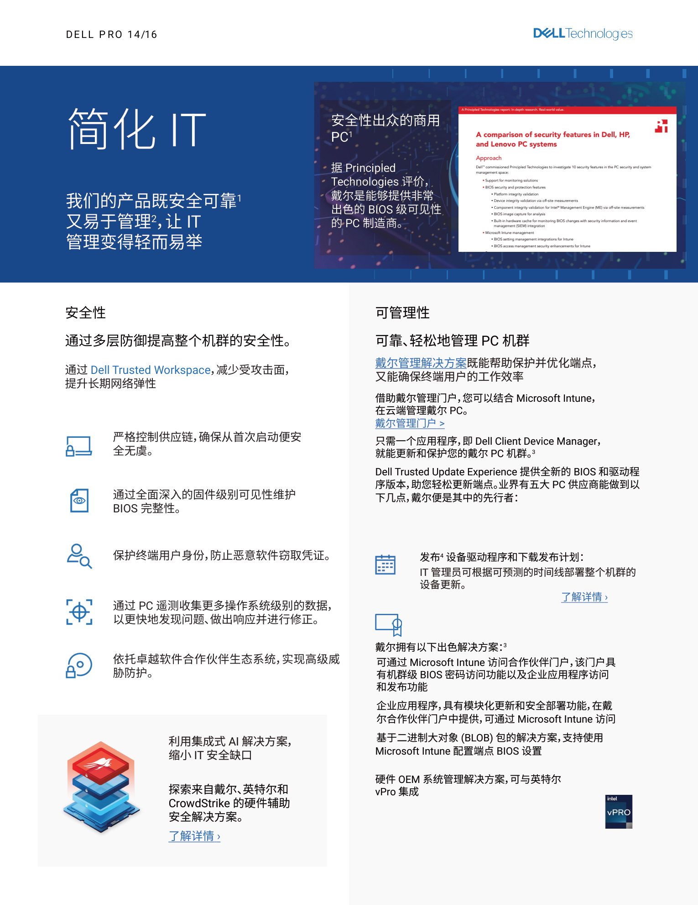

## Document Metadata

- Document ID: bbc2419e77109d7be447c30822b488ff50d027fc
- Document Title: null
- Document Type: PDF
- Issuing Organization: null
- Publication Date: null
- Reporting Period: null
- Source File: [42_delltechnologies.c_dell-pro-14-16-laptop-product-.pdf](https://github.com/jadennevercode/CJCC-Knowledge-Base/blob/564ab11aa9785e569e3853c8a4d7ce86f88e7535/materials/%E4%B8%8B%E6%B8%B8%EF%BC%9A%E6%89%8B%E6%9C%BA%E3%80%81PC%E5%92%8C%E5%B9%B3%E6%9D%BF%E9%9C%80%E6%B1%82%E4%BC%A0%E5%AF%BC/42_delltechnologies.c_dell-pro-14-16-laptop-product-.pdf)

## Structured Content

> 原文件：[42_delltechnologies.c_dell-pro-14-16-laptop-product-.pdf](https://github.com/jadennevercode/CJCC-Knowledge-Base/blob/564ab11aa9785e569e3853c8a4d7ce86f88e7535/materials/%E4%B8%8B%E6%B8%B8%EF%BC%9A%E6%89%8B%E6%9C%BA%E3%80%81PC%E5%92%8C%E5%B9%B3%E6%9D%BF%E9%9C%80%E6%B1%82%E4%BC%A0%E5%AF%BC/42_delltechnologies.c_dell-pro-14-16-laptop-product-.pdf)
> 转换方式：Volcengine OCRPdf v3, parse_mode=ocr

[Source Page: 1]

# 采用全新现代设计，可满足专业办公需求

Dell Pro 14/16  
英特尔® 酷睿™ Ultra 处理器  
PC14250  
PC16250

[Source Page: 2]

## 兼具企业级性能，支持轻松扩展

体验全新创新技术：您既可选择配备英特尔® 酷睿™ 处理器的机型，也可升级为 AI PC。后者搭载性能更强的英特尔® 酷睿™ Ultra 处理器，并集成了强大的英特尔 vPro 管理功能。

## 优质材料，高端工艺

精心打造，提供两种机身选择：铂银金属质感和磁铁矿激光纹理质感。

## 高端大气，出色视效

宽大的 16:10 显示屏，边框更窄，在相同尺寸下屏幕显示面积增加 5%，重量减轻 10%，生产力和便携性更胜一筹。⁷˒⁸˒⁹

## 经久耐用

这是戴尔首款配备模块化 USB-C 端口的商用 PC，该端口的耐用性提高了 4 倍之多，维修也更加轻松。³

## 经过精心设计，以降低对环境的影响

该设备采用多种环保材料精心设计，其中消费后回收塑料占比高达 30%⁴。

发货包装采用 100% 回收或可再生材料制成⁵。

## Windows Copilot

只需单击 Windows Copilot 键，您就可以立即访问自己的个人 AI 助手。

## 快速连接

提供丰富的连接选项，包括 Wi-Fi 6、Wi-Fi 6E 和支持 Wi-Fi 7 的无线网卡，让您保持快速连接。²

## 超长电池续航时间

更大的电池选项和可选的超低功耗显示屏可延长系统运行时间，一次充电可提供长达 10.3 小时的电池续航时间⁶。

## 每次视频通话，您都能尽展风采

采用 HDR 技术的 FHD 红外摄像头可在光线不佳的情况下准确捕捉图像细节。

## 使用摄像头挡板，保护个人隐私

配备手动控制的摄像头挡板，可保护您的隐私，让您安心无忧。

## 宏亮清晰的电话会议效果

使用两个麦克风和双立体声扬声器（配备两个底部发射扬声器），让会议音效令人惊叹。

## 高度安全的商用 PC¹，戴尔率先：

提供主机外 BIOS 验证和攻击指标，降低了未来遭遇威胁的可能性。将 PC 遥测集成到出色的软件中，以提升整个机群的安全性。

戴尔提供安全组件验证，可确保 PC 从出厂到首次启动皆安全无虞。

选配集成 ControlVault 3+ 的接触式智能卡读卡器，有助于提供更高水平的安全防护。

## 军用级耐用性

我们的笔记本电脑经过严格的 MIL-STD 810H 耐用性和可靠性测试，让您能够随时随地开展工作。

[Source Page: 3]

# AI 赋能，为工作增效

利用创新软件应用程序，实现生产力、协作能力与创造力的全面跃升。

## McAfee Smart AI

McAfee 的 AI 驱动型 Deepfake Detector 可高效识别误导性视频和音频。通过针对 AI 生成的内容发出实时警报，它可确保您轻松辨别内容真伪，从而保护您的品牌并维持信任。

## lakeside SysTrack

支持主动识别 IT 问题，可通过异常检测减少咨询台工单，并使用智能虚拟助手简化故障排除，从而获得 AI 驱动型见解，以便改善运营情况和投资回报率。

## Dell Pro AI PC

Dell AI PC 通过用于设备上 AI 任务的内置 NPU，提高了安全性和能效，从而重新定义了生产力。从内容创建到高级 AI 模型训练，Dell AI PC 解决方案简化了 AI 的采用，为工作场所提供了用于创意、协作和创新的工具。

## Promeo

借助 CyberLink 的 Promeo AI Magic Designer，您可以缩短设计时间，更多地专注于创意工作。该工具使用生成式 AI 来创建完全可编辑的自定义设计和文本，速度是以往的 1.9 倍，即使在离线状态下也能使用。⁴

[Source Page: 4]

# 可持续创新

## 采用环保材料打造而成

经过精心设计，在边框、掌托和底盖中含有高达 50% 的消费后回收塑料，在电池框架中含有 98% 的消费后回收塑料。¹

延续戴尔倡导利用回收钴的一贯策略，根据所选配置，Dell Pro Plus 笔记本电脑的电池中钴含量可能减少 80% 或采用 50% 的回收钴。²

## 卓越设计，成就长久的 PC 使用寿命

这款笔记本电脑采用模块化主板搭配 I/O 板设计，便于检修，有助于减少电子废弃物。³ 它是戴尔首款采用模块化 USB-C 端口设计的商用 PC，抗扭曲性提升多达 4 倍，抗冲击性提升多达 33 倍，不仅更加坚固耐用，而且更易于维修。⁴

戴尔还提供了便捷的部件检修和更换途径，以充分延长我们产品的使用寿命。

[部件、电池和升级 >](https://www.dell.com/en-us/shop/partsforyourdell)

## 环保包装

采用 100% 的回收材料或可再生材料⁵包装运输，提供多件包装选项，简化拆箱体验，同时减少包装和运输废弃物。⁶

## 从旧技术无缝过渡到新技术

我们可以帮助您负责任且安全地淘汰旧 IT 设备，无论设备是何品牌，同时实现您的可持续发展目标。

[Asset Recovery Services >](https://www.dell.com/en-us/lp/dt/ars?ref=cptl_sustainable-devices-tiles-wp-test_cta_primary_safelydisposeofbusinessdevices&_gl=1%252A1uaooje%252A_up%252AMQ..&gclid=Cj0KCQjwwYSwBhDcARIsAOyL0fiaROAZqXmXNkyRT-1jp6H-2L86GctO_lEG-Cl6lvZxlXuw4k65tYEaAjtmEALw_wcB&gclsrc=aw.ds&scroll=off)

[Source Page: 5]

# 利用戴尔显示器和配件提升您的 PC 体验

戴尔产品生态系统覆盖全面，配件种类丰富，并经过精心设计和测试，可与 Dell Pro 笔记本电脑彼此配合、相得益彰，助您提高工作效率和协作能力。

A. Dell Pro 24 Plus USB-C HUB 显示器 - P2425HE  
B. Dell Pro 七合一 USB-C 旅行转换器 - DA310  
C. Dell Pro 无线键盘及鼠标 - KM5221W  
D. Dell Pro 无线耳机 - WL3024  
E. Dell Pro 14-16 Plus EcoLoop 轻薄双肩背包 - CP5724S  
F. Dell Pro 智能坞站 - SD25

## Dell Display and Peripheral Manager

只需一个简单的应用程序，即可管理和优化戴尔显示器、坞站和 PC 配件生态系统的使用体验。

[探索更多戴尔桌面解决方案](https://www.dell.com/en-us/shop/accessories)

[Source Page: 6]

# 简化 IT

我们的产品既安全可靠¹又易于管理²，让 IT 管理变得轻而易举。

安全性出众的商用 PC¹：据 Principled Technologies 评价，戴尔是能够提供非常出色的 BIOS 级可见性的 PC 制造商。



原页嵌入的英文评估报告截图中可辨认的内容：

**A comparison of security features in Dell, HP, and Lenovo PC systems**

**Approach**

Dell™ commissioned Principled Technologies to investigate 10 security features in the PC security and system management space:

- Support for monitoring solutions
- BIOS security and protection features
  - Platform integrity validation
  - Device integrity validation via off-site measurements
  - Component integrity validation for Intel® Management Engine (ME) via off-site measurements
  - BIOS image capture for analysis
  - Built-in hardware cache for monitoring BIOS changes with security information and event management (SIEM) integration
- Microsoft Intune management
  - BIOS setting management integrations for Intune
  - BIOS access management security enhancements for Intune

[OCR_UNCERTAIN] 原页嵌入的评估报告截图可能截断或省略其他细项，保留原页图。

## 安全性

通过多层防御提高整个机群的安全性。

通过 Dell Trusted Workspace，减少受攻击面，提升长期网络弹性。

- 严格控制供应链，确保从首次启动便安全无虞。
- 通过全面深入的固件级别可见性维护 BIOS 完整性。
- 保护终端用户身份，防止恶意软件窃取凭证。
- 通过 PC 遥测收集更多操作系统级别的数据，以更快地发现问题、做出响应并进行修正。
- 依托卓越软件合作伙伴生态系统，实现高级威胁防护。

利用集成式 AI 解决方案，缩小 IT 安全缺口。

探索来自戴尔、英特尔和 CrowdStrike 的硬件辅助安全解决方案。

[了解详情 ›](https://www.delltechnologies.com/asset/en-us/solutions/business-solutions/briefs-summaries/dell-intel-crowdstrike-endpoint-security-solution-brief.pdf)

## 可管理性

可靠、轻松地管理 PC 机群。

戴尔管理解决方案既能帮助保护并优化端点，又能确保终端用户的工作效率。

借助戴尔管理门户，您可以结合 Microsoft Intune，在云端管理戴尔 PC。

[戴尔管理门户 >](https://www.delltechnologies.com/asset/en-us/solutions/business-solutions/educational-training/dell-management-portal-brochure.pdf)

只需一个应用程序，即 Dell Client Device Manager，就能更新和保护您的戴尔 PC 机群。³

Dell Trusted Update Experience 提供全新的 BIOS 和驱动程序版本，助您轻松更新端点。业界有五大 PC 供应商能做到以下几点，戴尔便是其中的先行者：

发布⁴设备驱动程序和下载发布计划：IT 管理员可根据可预测的时间线部署整个机群的设备更新。

[了解详情 ›](<https://www.dell.com/en-us/lp/dt/prodeploy-client-suite?hve=explore)%250D>)

戴尔拥有以下出色解决方案：³

- 可通过 Microsoft Intune 访问合作伙伴门户，该门户具有机群级 BIOS 密码访问功能以及企业应用程序访问和发布功能。
- 企业应用程序，具有模块化更新和安全部署功能，在戴尔合作伙伴门户中提供，可通过 Microsoft Intune 访问。
- 基于二进制大对象 (BLOB) 包的解决方案，支持使用 Microsoft Intune 配置端点 BIOS 设置。
- 硬件 OEM 系统管理解决方案，可与英特尔 vPro 集成。

[Source Page: 7]

# 利用 Dell Services 简化 PC 更新

支持 PC 生命周期的每个环节。

## Dell Technologies APEX

率先推出全面的¹“即服务”产品组合，涵盖了从多云到客户端设备的各类产品。以可预测的成本灵活实现 IT 转型和新技术部署工作。

Dell APEX PC-as-a-Service：全面定制化的按月订阅服务，涵盖 PC、外围设备、软件和多种服务，无需前期投资。

[Dell APEX PC-as-a-Service (PCAAS) >](https://www.dell.com/en-us/shop/apex/client-devices/sl/apex-pc-as-a-service?hve=explore+apex-pc-as-a-service)

## ProDeploy 客户端套件

PC 更新换代的第一步是使终端用户入手全新设备。Dell ProDeploy Suite 通过提供预先配置好的 PC，简化了操作流程并提高了工作效率。通过采用基于云的动态资源调配和映像技术，这些 PC 在部署第一天就可以投入使用。

在从旧技术向新技术过渡时，ProDeploy Plus 提供了使用先进工具安全擦除敏感的终端用户数据的功能，以对设备进行清理，并采用 Asset Recovery Services 确保以负责任的方式淘汰设备。

Dell ProDeploy Client Suite >

## Dell Premier

324%  
3 年期 ROI 增幅⁴

通过量身定制的在线解决方案购买您目录中的产品和服务，实现 IT 采购的现代化。控制整个 IT 生态系统，以便降低成本、实现订购过程标准化、访问分析报告等。

[Dell Premier >](https://www.dell.com/en-us/lp/dt/dell-premier)

## Asset Recovery Services

28 亿

自 2007 年以来，通过全部回收计划所回收的电子产品超过 28 亿磅³。让戴尔协助您安全、负责任地淘汰各品牌的旧 IT 设备，以便从旧技术无缝过渡到新技术，同时保护您的企业和整个地球。

[Asset Recovery Services >](https://www.dell.com/en-us/lp/dt/ars?_gl=1*80x4tt*_up*MQ..&gclid=656b52b7ef351b97f49b3b28c7b43699&gclsrc=3p.ds)

## ProSupport Suite for PCs

ProSupport Suite 不仅是一款全天候的故障修复解决方案，更是一整套工具，能够自动化和优化您的 IT 环境，且几乎不需要人工干预，也不会对终端用户造成干扰。

您可以从戴尔提供的多样化脚本库中选择合适的脚本，这些脚本能够快速解决公司范围内的常见问题，从而大幅缩短修复时间并保持系统的出色性能。ProSupport Suite 提供基于遥测技术的数据，帮助 IT 部门获取见解并进行有针对性的更新，所有这些操作都可以通过单个控制面板进行控制。

[ProSupport Suite for PCs >](https://www.dell.com/en-us/lp/dt/prosupport-client-suite)

[Source Page: 8]

型号：Dell Pro 14 (PC14250)

| 功能部件 | 技术规格 |
| --- | --- |
| 机身材料和颜色选项 | PC+ABS¹³、铁黑色和铂银色 |
| 处理器选项¹,² | 英特尔® 酷睿系列：<br>第 13 代英特尔® 酷睿 i3-1315U<br>第 13 代英特尔® 酷睿 i5-1335U<br>第 13 代英特尔® 酷睿 i5-1345U<br>英特尔® 处理器 U300E<br>英特尔® 酷睿 3 100U<br>英特尔® 酷睿 5 120U<br>英特尔® 酷睿 5 220U<br>英特尔® 酷睿 7 150U<br>英特尔® 酷睿 7 250U<br><br>英特尔® 酷睿 Ultra 系列 2 (U)：<br>英特尔® 酷睿 Ultra 5 225U<br>英特尔® 酷睿 Ultra 5 235U vPro®<br>英特尔® 酷睿 Ultra 7 255U<br>英特尔® 酷睿 Ultra 7 265U vPro® |
| 显示屏¹ | 14”16:10 FHD+ (1920 x 1200)，60Hz，IPS，非触控，防眩光，300 尼特，45% NTSC，6 位 + FRC<br>14”16:10 FHD+ (1920 x 1200)，60Hz，IPS，触摸屏（无盖板玻璃），防眩光，300 尼特，100% sRGB，6 位 + FRC<br>14”16:10 FHD+ (1920 x 1200)，60Hz，IPS，非触控，防眩光，400 尼特，100% sRGB，8 位，ComfortView Plus（低蓝光），低功耗<br>14”16:10 FHD+ (1920 x 1200)，60Hz，IPS，非触摸屏，防眩光，400 尼特，45% NTSC，6 位 + FRC<br>14”16:10 FHD+ (1920 x 1200)，60Hz，IPS，触摸屏（无盖板玻璃），防眩光，400 尼特，100% sRGB，6 位 + FRC |
| AI 加速器¹ | 这款 Dell Pro 系统配备神经处理单元 (NPU)。NPU 是一种专门用于加速机器学习任务的微处理器。处理大量视频和图像等多媒体数据时，NPU 可以有效减轻 CPU 和/或 GPU 的负担，且功耗较低，可提高资源利用率。AI 加速器支持 Windows 中的 Copilot。 |
| 芯片组¹¹ | 与处理器集成 |
| 操作系统¹ | Microsoft® Windows 11 家庭版（64 位）<br>Microsoft® Windows 11 专业版（64 位）<br>Microsoft® Windows 11 专业教育版（64 位）¹⁴<br>Ubuntu® 24.04 LTS，64 位 |
| Thin OS¹,² | ThinOS 和 Windows 11 IoT 企业版 LTSC 2024 操作系统选项 |
| 显卡¹⁷ | 英特尔® 显卡 |
| 内存¹,⁵ | 英特尔® 酷睿处理器系统：<br>8 GB DDR5，5200 MT/s，单通道<br>16 GB DDR5，5200 MT/s，单通道或双通道<br>32 GB DDR5，5200 MT/s，单通道或双通道<br>16 GB DDR5，5200 MT/s，双通道<br><br>英特尔® 酷睿 Ultra 处理器系统：<br>8 GB DDR5，5600 MT/s，单通道<br>16 GB DDR5，5600 MT/s，单通道或双通道<br>32 GB DDR5，5600 MT/s，单通道或双通道<br>64 GB DDR5，5600 MT/s，双通道 |
| 存储选项¹,⁴,⁶ | 英特尔® 酷睿处理器系统：<br>128 GB UFS（仅限搭载英特尔® U300E 处理器的铁黑色机箱配置）<br>256 GB SSD TLC M.2 2230，PCIe Gen4<br>512 GB SSD QLC M.2 2230，PCIe Gen4<br>512 GB SSD TLC M.2 2230，PCIe Gen4<br>1 TB SSD QLC M.2 2230，PCIe Gen4<br>1 TB SSD TLC M.2 2230，PCIe Gen4<br>2 TB SSD QLC M.2 2230，PCIe Gen4<br><br>英特尔® 酷睿 Ultra 处理器系统：<br>256 GB SSD TLC M.2 2230，PCIe Gen4<br>512 GB SSD QLC M.2 2230，PCIe Gen4<br>512 GB SSD TLC M.2 2230，PCIe Gen4<br>512GB 固态硬盘 TLC M.2 2230 PCIe Gen4 SED¹⁶<br>1 TB SSD QLC M.2 2230，PCIe Gen4<br>1 TB SSD TLC M.2 2230，PCIe Gen4<br>2 TB SSD QLC M.2 2230，PCIe Gen4 |
| 安全性¹ | 标准安全功能：<br>经 FIPS-140-2 和 TCG 认证的 TPM 2.0<br>机箱防盗开关 — 远程检测硬件篡改，并与 Dell SafeBIOS 攻击指标集成。<br>摄像头挡板<br>安全锁槽<br>可选安全功能：<br>符合 Windows Hello 标准的指纹读取器（在电源按钮中）<br>支持 Windows Hello 的全高清红外摄像头<br>接触式智能卡读卡器，配备经 FIPS 140-3 第 3 级认证的 ControlVault 3+ 高级身份验证功能（仅在搭载英特尔® 酷睿 Ultra 225U、235U 和 265U 的铂银色机箱上提供） |
| 坞接¹ | 可选配坞站（另售）<br>Dell USB-C 坞站 — WD19S<br>Dell Performance 坞站 — WD19DCS<br>戴尔 Thunderbolt 坞站 — WD19TBS、WD22TB4<br>Dell 通用坞站 - D6000S<br>Dell Pro 坞站 WD25（2025 年 3 月 RTS）<br>Dell Pro 智能坞站 SD25（2025 年 3 月 RTS）<br>Dell Pro Thunderbolt 4 智能坞站 SD25TB4（2025 年 3 月 RTS）<br>Dell Pro Thunderbolt 4 TAA 智能坞站 WD25TB4（2025 年 3 月 RTS）<br>Dell Pro Thunderbolt 5 智能坞站 SD25TB5（2025 年 3 月 RTS）<br>Dell Pro Thunderbolt 5 TAA 智能坞站 WD25TB5（2025 年 7 月 RTS） |
| 连接选项¹ | 英特尔® 酷睿处理器系统：<br>兼容 Microsoft Modern Standby<br>无线 LAN 选项⁷：<br>MediaTek Wi-Fi 6 MT7920、2x2、蓝牙 5.4 无线网卡<br>英特尔® AX211 Wi-Fi 6E 2x2，蓝牙 5.3 无线网卡<br>移动宽带⁸：不适用<br><br>英特尔® 酷睿 Ultra 处理器系统：<br>兼容 Microsoft Modern Standby<br>无线 LAN 选项⁷：<br>MediaTek Wi-Fi 6 MT7920、2x2、蓝牙 5.4 无线网卡<br>英特尔® AX211 Wi-Fi 6E 2x2，蓝牙 5.3 无线网卡<br>英特尔® BE200 Wi-Fi 7 2x2、蓝牙 5.4 无线网卡（不再提供 BE202）<br>移动宽带⁸：不适用 |
| 摄像头选项¹ | 英特尔® 酷睿处理器系统：<br>高清摄像头，720p 视频，时域降噪，摄像头挡板（仅限铁黑色机箱配置）<br>FHD HDR 摄像头，1080p HDR 视频，时域降噪，摄像头挡板<br>FHD + 红外 HDR 摄像头，1080p HDR 视频，时域降噪、摄像头挡板<br><br>英特尔® 酷睿 Ultra 处理器系统：<br>FHD HDR 摄像头，1080p HDR 视频，时域降噪，摄像头挡板<br>FHD + 红外 HDR 摄像头，1080p HDR 视频，时域降噪、摄像头挡板 |
| 音频和扬声器 | 2 个 2 W 扬声器、Waves MaxxAudio® Pro 音频输出处理 |


[原页规格表高清图](../_assets/dell_pro_14_16_original/page-8.png)

<details>
<summary>原页排版文字（用于核对）</summary>

```text
功能部件             技术规格                                                         技术规格

            型号         Dell Pro 14 (PC14250)

机身材料和颜色选项              PC+ABS13、铁黑色和铂银色

                       英特尔® 酷睿系列                                                    英特尔® 酷睿 Ultra 系列 2 (U)
                       第 13 代英特尔® 酷睿 i3-1315U                                       英特尔® 酷睿 Ultra 5 225U
                       第 13 代英特尔® 酷睿 i5-1335U                                       英特尔® 酷睿 Ultra 5 235U vPro® 英特尔® 酷睿 Ultra 7 255U
                       第 13 代英特尔® 酷睿 i5-1345U                                       英特尔® 酷睿 Ultra 7 265U vPro®
     处理器选项1、2          英特尔® 处理器 U300E
                       英特尔® 酷睿 3 100U
                       英特尔® 酷睿 5 120U
                       英特尔® 酷睿 5 220U
                       英特尔® 酷睿 7 150U
                       英特尔® 酷睿 7 250U

                       14”16:10 FHD+ (1920 x 1200)，60Hz，IPS，非触控，防眩光，300 尼特，45% NTSC，6 位 + FRC
                       14”16:10 FHD+ (1920 x 1200)，60Hz，IPS，触摸屏（无盖板玻璃）  ，防眩光，300 尼特，100% sRGB，6 位 + FRC
         显示屏1          14”16:10 FHD+ (1920 x 1200)，60Hz，IPS，非触控，防眩光，400 尼特，100% sRGB，8 位，ComfortView Plus（低蓝光）
                                                                                                             ，低功耗
                       14”16:10 FHD+ (1920 x 1200)，60Hz，IPS，非触摸屏，防眩光，400 尼特，45% NTSC，6 位 + FRC
                       14”16:10 FHD+ (1920 x 1200)，60Hz，IPS，触摸屏（无盖板玻璃）  ，防眩光，400 尼特，100% sRGB，6 位 + FRC

                       这款 Dell Pro 系统配备神经处理单元 (NPU)。
                                                   NPU 是一种专门用于加速机器学习任务的微处理器。           处理大量视频和图像等多媒体数据时，NPU 可以有效减轻
       AI 加速器1
                       CPU 和/或 GPU 的负担，且功耗较低，可提高资源利用率。    AI 加速器支持 Windows 中的 Copilot。

        芯片组11          与处理器集成

                       Microsoft® Windows 11 家庭版（64 位）
                       Microsoft® Windows 11 专业版（64 位）
       操作系统1
                       Microsoft® Windows 11 专业教育版（64 位）14
                       Ubuntu® 24.04 LTS，64 位

       Thin OS1.2      ThinOS 和 Windows 11 IoT 企业版 LTSC 2024 操作系统选项


          显卡17         英特尔® 显卡

                       在配备了英特尔® 酷睿处理器的系统上：                                          在配备了英特尔® 酷睿 Ultra 处理器的系统上：
                       8 GB DDR5，5200 MT/s，单通道                                      8 GB DDR5，5600 MT/s，单通道
          内存   1,5
                       16 GB DDR5，5200 MT/s，单通道或双通道                                 16 GB DDR5，5600 MT/s，单通道或双通道
                       32 GB DDR5，5200 MT/s，单通道或双通道                                 32 GB DDR5，5600 MT/s，单通道或双通道
                       16 GB DDR5，5200 MT/s，双通道                                     64 GB DDR5，5600 MT/s，双通道

                       在配备了英特尔® 酷睿处理器的系统上：                                          在配备了英特尔® 酷睿 Ultra 处理器的系统上：
                       128 GB UFS（仅限搭载英特尔® U300E 处理器的铁黑色机箱配置）                       256 GB SSD TLC M.2 2230，PCIe Gen4
                       256 GB SSD TLC M.2 2230，PCIe Gen4                            512 GB SSD QLC M.2 2230，PCIe Gen4
     存储选项1、4、6
                       512 GB SSD QLC M.2 2230，PCIe Gen4                            512 GB SSD TLC M.2 2230，PCIe Gen4
                       512 GB SSD TLC M.2 2230，PCIe Gen4                            512GB 固态硬盘 TLC M.2 2230 PCIe Gen4 SED16
                       1 TB SSD QLC M.2 2230，PCIe Gen4                              1 TB SSD QLC M.2 2230，PCIe Gen4
                       1 TB SSD TLC M.2 2230，PCIe Gen4                              1 TB SSD TLC M.2 2230，PCIe Gen4
                       2 TB SSD QLC M.2 2230，PCIe Gen4                              2 TB SSD QLC M.2 2230，PCIe Gen4

                       标准安全功能：
                       经 FIPS-140-2 和 TCG 认证的 TPM 2.0
                       机箱防盗开关 — 远程检测硬件篡改，并与 Dell SafeBIOS 攻击指标集成。
                       摄像头挡板
         安全性1          安全锁槽
                       可选安全功能：
                       符合 Windows Hello 标准的指纹读取器（在电源按钮中）
                       支持 Windows Hello 的全高清红外摄像头
                       接触式智能卡读卡器，配备经 FIPS 140-3 第 3 级认证的 ControlVault 3+ 高级身份验证功能（仅在搭载英特尔® 酷睿 Ultra 225U、235U 和 265U 的铂银色机箱上提供）

                       可选配坞站（另售）
                       Dell USB-C 坞站 — WD19S
                       Dell Performance 坞站 — WD19DCS
                       戴尔 Thunderbolt 坞站 — WD19TBS、WD22TB4
                       Dell 通用坞站 - D6000S
           坞接1         Dell Pro 坞站 WD25（2025 年 3 月 RTS）
                       Dell Pro 智能坞站 SD25（2025 年 3 月 RTS）
                       Dell Pro Thunderbolt 4 智能坞站 SD25TB4（2025 年 3 月 RTS）
                       Dell Pro Thunderbolt 4 TAA 智能坞站 WD25TB4（2025 年 3 月 RTS）
                       Dell Pro Thunderbolt 5 智能坞站 SD25TB5（2025 年 3 月 RTS）
                       Dell Pro Thunderbolt 5 TAA 智能坞站 WD25TB5（2025 年 7 月 RTS）

                                                                                    在配备了英特尔® 酷睿 Ultra 处理器的系统上：
                       在配备了英特尔® 酷睿处理器的系统上：
                                                                                    兼容 Microsoft Modern Standby
                       兼容 Microsoft Modern Standby
                                                                                    无线 LAN 选项7：
                       无线 LAN 选项7：
       连接选项1                                                                        MediaTek Wi-Fi 6 MT7920、2x2、蓝牙 5.4 无线网卡
                       MediaTek Wi-Fi 6 MT7920、2x2、蓝牙 5.4 无线网卡
                                                                                    英特尔® AX211 Wi-Fi 6E 2x2，蓝牙 5.3 无线网卡
                       英特尔® AX211 Wi-Fi 6E 2x2，蓝牙 5.3 无线网卡
                                                                                    英特尔® BE200 Wi-Fi 7 2x2、蓝牙 5.4 无线网卡（不再提供 BE202）
                       移动宽带8：不适用
                                                                                    移动宽带8：不适用

                       在配备了英特尔® 酷睿处理器的系统上：                                          在配备了英特尔® 酷睿 Ultra 处理器的系统上：
                       高清摄像头，720p 视频，时域降噪，摄像头挡板（仅限铁黑色机箱配置）                          FHD HDR 摄像头，1080p HDR 视频，时域降噪，摄像头挡板
      摄像头选项1
                       FHD HDR 摄像头，1080p HDR 视频，时域降噪，摄像头挡板                          FHD + 红外 HDR 摄像头，1080p HDR 视频，时域降噪、摄像头挡板
                       FHD + 红外 HDR 摄像头，1080p HDR 视频，时域降噪、摄像头挡板

     音频和扬声器            2 个 2 W 扬声器、Waves MaxxAudio® Pro 音频输出处理
```
</details>

[Source Page: 9]

型号：Dell Pro 14 (PC14250) — 续

| 功能部件 | 技术规格 |
| --- | --- |
| 电池选项¹,⁹,¹⁰ | 3 芯 45 瓦时，锂离子，ExpressCharge 快速充电 1.0，ExpressCharge Boost<br>3 芯 45 瓦时，锂离子，ExpressCharge 快速充电 1.0，ExpressCharge Boost，长续航时间，3 年有限硬件保修<br>3 芯 55 瓦时、锂离子、ExpressCharge 快速充电 1.0、支持 ExpressCharge Boost¹⁵<br>3 芯 55 瓦时、锂离子、ExpressCharge 快速充电 1.0、支持 ExpressCharge Boost¹⁵、持久续航时间、3 年期有限硬件保修 |
| 麦克风¹ | 2 个带 Intelligo 输入音频处理的降噪麦克风 |
| 电源选项¹ | 65 W 适配器，USB Type-C<br>65 W 适配器，4.5 毫米圆形接头<br>60 W 超轻迷你适配器，Type-C 端口，2 针（仅限日本） |
| 端口、插槽和机身¹,¹¹ | 英特尔® 酷睿处理器系统：<br>1 个 USB Type-C 雷电技术 4.0 端口，支持功率传输 3.1 和 DisplayPort 2.1<br>1 个 USB Type-C 端口，支持功率传输 3.1 和 DisplayPort 2.0<br>4.5 毫米圆形接头功率传输<br>2 个第 1 代 USB 3.2 Type-A 端口（1 个支持 PowerShare）<br>1 个 HDMI 2.1 端口<br>1 个 RJ-45 端口 (1 GbE)<br>1 个球形耳机插孔<br>1 个楔形锁插槽<br><br>英特尔® 酷睿 Ultra 处理器系统：<br>1 个 USB Type-C 雷电技术 4.0 端口，支持功率传输 3.1 和 DisplayPort 2.1<br>1 个 USB Type-C 端口，支持功率传输 3.1 和 DisplayPort 2.0<br>4.5 毫米圆形接头功率传输<br>2 个第 1 代 USB 3.2 Type-A 端口（1 个支持 PowerShare）<br>1 个 HDMI 2.1 端口<br>1 个 RJ-45 端口 (1 GbE)<br>1 个球形耳机插孔<br>1 个楔形锁插槽<br>1 个智能卡读卡器（可选，仅限铂银色机箱配置） |
| 触控板 | 支持多点触控手势的高精度触控板 |
| 输入¹ | 10 指触摸屏<br>防泼溅非背光 AI 热键键盘<br>防泼溅背光 AI 热键键盘 |
| 传感器¹ | 合盖传感器（霍尔效应传感器） |
| 尺寸与重量¹,¹⁰ | 宽：313.70 毫米/12.35 英寸<br>厚：8.87 英寸/225.3 毫米<br>高（正面）：起始高度为 0.74 英寸/18.89 毫米<br>高（背面）：起始高度为 0.80 英寸/20.37 毫米<br>屏占比：87.8%<br>起始重量：1.35 千克/2.99 磅 |
| 包装清单 | Dell Pro 14 笔记本电脑<br>电源适配器<br>电源线<br>快速入门指南 |


[原页规格表高清图](../_assets/dell_pro_14_16_original/page-9.png)

<details>
<summary>原页排版文字（用于核对）</summary>

```text
功能部件             技术规格                                                      技术规格

           型号          Dell Pro 14 (PC14250) — 续

                       3 芯 45 瓦时，锂离子，ExpressCharge 快速充电 1.0，ExpressCharge Boost
                       3 芯 45 瓦时，锂离子，ExpressCharge 快速充电 1.0，ExpressCharge Boost，长续航时间，3 年有限硬件保修
     电池选项1,9,10
                       3 芯 55 瓦时、锂离子、ExpressCharge 快速充电 1.0、支持 ExpressCharge Boost15
                       3 芯 55 瓦时、锂离子、ExpressCharge 快速充电 1.0、支持 ExpressCharge Boost15、持久续航时间、3 年期有限硬件保修

         麦克风1          2 个带 Intelligo 输入音频处理的降噪麦克风

                       65 W 适配器，USB Type-C
       电源选项1           65 W 适配器，4.5 毫米圆形接头
                       60 W 超轻迷你适配器，Type-C 端口，2 针（仅限日本）

                                                                                 在配备了英特尔® 酷睿 Ultra 处理器的系统上：
                       在配备了英特尔® 酷睿处理器的系统上：
                                                                                 1 个 USB Type-C 雷电技术 4.0 端口，支持功率传输 3.1 和 DisplayPort 2.1
                       1 个 USB Type-C 雷电技术 4.0 端口，支持功率传输 3.1 和 DisplayPort 2.1
                                                                                 1 个 USB Type-C 端口，支持功率传输 3.1 和 DisplayPort 2.0
                       1 个 USB Type-C 端口，支持功率传输 3.1 和 DisplayPort 2.0
                                                                                 4.5 毫米圆形接头功率传输
                       4.5 毫米圆形接头功率传输
                                                                                 2 个第 1 代 USB 3.2 Type-A 端口（1 个支持 PowerShare）
 端口、插槽和机身1.11          2 个第 1 代 USB 3.2 Type-A 端口（1 个支持 PowerShare）
                                                                                 1 个 HDMI 2.1 端口
                       1 个 HDMI 2.1 端口
                                                                                 1 个 RJ-45 端口 (1 GbE)
                       1 个 RJ-45 端口 (1 GbE)
                                                                                 1 个球形耳机插孔
                       1 个球形耳机插孔
                                                                                 1 个楔形锁插槽
                       1 个楔形锁插槽
                                                                                 1 个智能卡读卡器（可选，仅限铂银色机箱配置）

         触控板           支持多点触控手势的高精度触控板

                       10 指触摸屏
          输入1          防泼溅非背光 AI 热键键盘
                       防泼溅背光 AI 热键键盘

         传感器1          合盖传感器（霍尔效应传感器）

                       宽：313.70 毫米/12.35 英寸
                       厚：8.87 英寸/225.3 毫米
                       高（正面）：起始高度为 0.74 英寸/18.89 毫米
     尺寸与重量1,10
                       高（背面）：起始高度为 0.80 英寸/20.37 毫米
                       屏占比：87.8%
                       起始重量：1.35 千克/2.99 磅

                       Dell Pro 14 笔记本电脑
                       电源适配器
        包装清单
                       电源线
                       快速入门指南
```
</details>

[Source Page: 10]

型号：Dell Pro 16 (PC16250)

| 功能部件 | 技术规格 |
| --- | --- |
| 机身材料和颜色选项 | PC+ABS¹³、铁黑色和铂银色 |
| 处理器选项¹,² | 英特尔® 酷睿系列：<br>第 13 代英特尔® 酷睿 i3-1315U<br>第 13 代英特尔® 酷睿 i5-1335U<br>第 13 代英特尔® 酷睿 i5-1345U<br>英特尔® 处理器 U300E<br>英特尔® 酷睿 3 100U<br>英特尔® 酷睿 5 120U<br>英特尔® 酷睿 5 220U<br>英特尔® 酷睿 7 150U<br>英特尔® 酷睿 7 250U<br><br>英特尔® 酷睿 Ultra 系列 2 (U)：<br>英特尔® 酷睿 Ultra 5 225U<br>英特尔® 酷睿 Ultra 5 235U vPro®<br>英特尔® 酷睿 Ultra 7 255U<br>英特尔® 酷睿 Ultra 7 265U vPro® |
| 显示屏¹ | 16”16:10 FHD+ (1920 x 1200)，60Hz，IPS，非触控，防眩光，300 尼特，45% NTSC，6 位 + FRC<br>16”16:10 FHD+ (1920 x 1200)，60Hz，IPS，触摸屏（无盖板玻璃），防眩光，300 尼特，45% NTSC，6 位 + FRC<br>16”16:10 FHD+ (1920 x 1200)，60Hz，IPS，非触摸屏，防眩光，400 尼特，45% NTSC，6 位 + FRC |
| AI 加速器¹ | 这款 Dell Pro 系统配备神经处理单元 (NPU)。NPU 是一种专门用于加速机器学习任务的微处理器。处理大量视频和图像等多媒体数据时，NPU 可以有效减轻 CPU 和/或 GPU 的负担，且功耗较低，可提高资源利用率。AI 加速器支持 Windows 中的 Copilot。 |
| 芯片组¹¹ | 与处理器集成 |
| 操作系统¹ | Microsoft® Windows 11 家庭版（64 位）<br>Microsoft® Windows 11 专业版（64 位）<br>Microsoft® Windows 11 专业教育版（64 位）¹⁴<br>Ubuntu® 24.04 LTS，64 位 |
| Thin OS¹,² | ThinOS 和 Windows 11 IoT 企业版 LTSC 2024 操作系统选项 |
| 显卡¹⁸ | 英特尔® 显卡 |
| 内存¹,⁵ | 英特尔® 酷睿处理器系统：<br>8 GB DDR5，5200 MT/s，单通道<br>16 GB DDR5，5200 MT/s，单通道或双通道<br>32 GB DDR5，5200 MT/s，单通道或双通道<br>16 GB DDR5，5200 MT/s，双通道<br><br>英特尔® 酷睿 Ultra 处理器系统：<br>8 GB DDR5，5600 MT/s，单通道<br>16 GB DDR5，5600 MT/s，单通道或双通道<br>32 GB DDR5，5600 MT/s，单通道或双通道<br>64 GB DDR5，5600 MT/s，双通道 |
| 存储选项¹,⁴,⁶ | 英特尔® 酷睿处理器系统：<br>128 GB UFS（仅限搭载英特尔® U300E 处理器的铁黑色机箱配置）<br>256 GB SSD TLC M.2 2230，PCIe Gen4<br>512 GB SSD QLC M.2 2230，PCIe Gen4<br>512 GB SSD TLC M.2 2230，PCIe Gen4<br>1 TB SSD QLC M.2 2230，PCIe Gen4<br>1 TB SSD TLC M.2 2230，PCIe Gen4<br>2 TB SSD QLC M.2 2230，PCIe Gen4<br><br>英特尔® 酷睿 Ultra 处理器系统：<br>256 GB SSD TLC M.2 2230，PCIe Gen4<br>512 GB SSD QLC M.2 2230，PCIe Gen4<br>512 GB SSD TLC M.2 2230，PCIe Gen4<br>512GB 固态硬盘 TLC M.2 2230 PCIe Gen4 SED¹⁶<br>1 TB SSD QLC M.2 2230，PCIe Gen4<br>1 TB SSD TLC M.2 2230，PCIe Gen4<br>2 TB SSD QLC M.2 2230，PCIe Gen4 |
| 安全性¹ | 标准安全功能：<br>经 FIPS-140-2 和 TCG 认证的 TPM 2.0<br>机箱防盗开关 — 远程检测硬件篡改，并与 Dell SafeBIOS 攻击指标集成。<br>摄像头挡板<br>安全锁槽<br>可选安全功能：<br>符合 Windows Hello 标准的指纹读取器（在电源按钮中）<br>支持 Windows Hello 的全高清红外摄像头<br>接触式智能卡读卡器，配备经 FIPS 140-3 第 3 级认证的 ControlVault 3+ 高级身份验证功能（仅在搭载英特尔® 酷睿 Ultra 225U、235U 和 265U 的铂银色机箱上提供） |
| 坞接¹ | 可选配坞站（另售）<br>Dell USB-C 坞站 — WD19S<br>Dell 双充电坞站 — HD22Q<br>Dell Performance 坞站 — WD19DCS<br>戴尔 Thunderbolt 坞站 — WD19TBS、WD22TB4<br>Dell 通用坞站 - D6000S<br>Dell 通用坞站 — UD22<br>Dell Pro 坞站 WD25（2025 年 3 月 RTS）<br>Dell Pro 智能坞站 SD25（2025 年 3 月 RTS）<br>Dell Pro Thunderbolt 4 智能坞站 SD25TB4（2025 年 3 月 RTS）<br>Dell Pro Thunderbolt 4 TAA 智能坞站 WD25TB4（2025 年 3 月 RTS）<br>Dell Pro Thunderbolt 5 智能坞站 SD25TB5（2025 年 3 月 RTS）<br>Dell Pro Thunderbolt 5 TAA 智能坞站 WD25TB5（2025 年 7 月 RTS） |
| 连接选项¹ | 英特尔® 酷睿处理器系统：<br>兼容 Microsoft Modern Standby<br>无线 LAN 选项⁷：<br>MediaTek Wi-Fi 6 MT7920、2x2、蓝牙 5.4 无线网卡<br>英特尔® AX211 Wi-Fi 6E 2x2，蓝牙 5.3 无线网卡<br>移动宽带⁸：不适用<br><br>英特尔® 酷睿 Ultra 处理器系统：<br>兼容 Microsoft Modern Standby<br>无线 LAN 选项⁷：<br>MediaTek Wi-Fi 6 MT7920、2x2、蓝牙 5.4 无线网卡<br>英特尔® AX211 Wi-Fi 6E 2x2，蓝牙 5.3 无线网卡<br>英特尔® BE200 Wi-Fi 7 2x2、蓝牙 5.4 无线网卡（不再提供 BE202）<br>移动宽带⁸：不适用 |
| 摄像头选项¹ | 英特尔® 酷睿处理器系统：<br>高清摄像头，720p 视频，时域降噪，摄像头挡板（仅限铁黑色机箱配置）<br>FHD HDR 摄像头、1080p HDR 视频、时域降噪、摄像头挡板<br>FHD + IR HDR 摄像头、1080p HDR 视频、时域降噪、摄像头挡板<br><br>英特尔® 酷睿 Ultra 处理器系统：<br>FHD HDR 摄像头，1080p HDR 视频，时域降噪，摄像头挡板<br>FHD + IR HDR 摄像头、1080p HDR 视频、时域降噪、摄像头挡板 |


[原页规格表高清图](../_assets/dell_pro_14_16_original/page-10.png)

<details>
<summary>原页排版文字（用于核对）</summary>

```text
功能部件             技术规格                                                          技术规格

            型号         Dell Pro 16 (PC16250)

机身材料和颜色选项              PC+ABS13、铁黑色和铂银色

                       英特尔® 酷睿系列                                                     英特尔® 酷睿 Ultra 系列 2 (U)
                       第 13 代英特尔® 酷睿 i3-1315U                                        英特尔® 酷睿 Ultra 5 225U
                       第 13 代英特尔® 酷睿 i5-1335U                                        英特尔® 酷睿 Ultra 5 235U vPro® 英特尔® 酷睿 Ultra 7 255U
                       第 13 代英特尔® 酷睿 i5-1345U                                        英特尔® 酷睿 Ultra 7 265U vPro®
     处理器选项1、2          英特尔® 处理器 U300E
                       英特尔® 酷睿 3 100U
                       英特尔® 酷睿 5 120U
                       英特尔® 酷睿 5 220U
                       英特尔® 酷睿 7 150U
                       英特尔® 酷睿 7 250U

                       16”16:10 FHD+ (1920 x 1200)，60Hz，IPS，非触控，防眩光，300 尼特，45% NTSC，6 位 + FRC
         显示屏1          16”16:10 FHD+ (1920 x 1200)，60Hz，IPS，触摸屏（无盖板玻璃）  ，防眩光，300 尼特，45% NTSC，6 位 + FRC
                       16”16:10 FHD+ (1920 x 1200)，60Hz，IPS，非触摸屏，防眩光，400 尼特，45% NTSC，6 位 + FRC

                       这款 Dell Pro 系统配备神经处理单元 (NPU)。
                                                   NPU 是一种专门用于加速机器学习任务的微处理器。           处理大量视频和图像等多媒体数据时，NPU 可以有效减轻
       AI 加速器1
                       CPU 和/或 GPU 的负担，且功耗较低，可提高资源利用率。    AI 加速器支持 Windows 中的 Copilot。

        芯片组11          与处理器集成

                       Microsoft® Windows 11 家庭版（64 位）
                       Microsoft® Windows 11 专业版（64 位）
       操作系统1
                       Microsoft® Windows 11 专业教育版（64 位）14
                       Ubuntu® 24.04 LTS，64 位

       Thin OS1.2      ThinOS 和 Windows 11 IoT 企业版 LTSC 2024 操作系统选项


          显卡18         英特尔® 显卡

                       在配备了英特尔® 酷睿处理器的系统上：                                           在配备了英特尔® 酷睿 Ultra 处理器的系统上：
                       8 GB DDR5，5200 MT/s，单通道                                       8 GB DDR5，5600 MT/s，单通道
          内存1,5        16 GB DDR5，5200 MT/s，单通道或双通道                                  16 GB DDR5，5600 MT/s，单通道或双通道
                       32 GB DDR5，5200 MT/s，单通道或双通道                                  32 GB DDR5，5600 MT/s，单通道或双通道
                       16 GB DDR5，5200 MT/s，双通道                                      64 GB DDR5，5600 MT/s，双通道

                       在配备了英特尔® 酷睿处理器的系统上：                                           在配备了英特尔® 酷睿 Ultra 处理器的系统上：
                       128 GB UFS（仅限搭载英特尔® U300E 处理器的铁黑色机箱配置）                        256 GB SSD TLC M.2 2230，PCIe Gen4
                       256 GB SSD TLC M.2 2230，PCIe Gen4                             512 GB SSD QLC M.2 2230，PCIe Gen4
     存储选项1、4、6
                       512 GB SSD QLC M.2 2230，PCIe Gen4                             512 GB SSD TLC M.2 2230，PCIe Gen4
                       512 GB SSD TLC M.2 2230，PCIe Gen4                             512GB 固态硬盘 TLC M.2 2230 PCIe Gen4 SED16
                       1 TB SSD QLC M.2 2230，PCIe Gen4                               1 TB SSD QLC M.2 2230，PCIe Gen4
                       1 TB SSD TLC M.2 2230，PCIe Gen4                               1 TB SSD TLC M.2 2230，PCIe Gen4
                       2 TB SSD QLC M.2 2230，PCIe Gen4                               2 TB SSD QLC M.2 2230，PCIe Gen4

                       标准安全功能：
                       经 FIPS-140-2 和 TCG 认证的 TPM 2.0
                       机箱防盗开关 — 远程检测硬件篡改，并与 Dell SafeBIOS 攻击指标集成。
                       摄像头挡板
                       安全锁槽
         安全性1
                       可选安全功能：
                       符合 Windows Hello 标准的指纹读取器（在电源按钮中）
                       支持 Windows Hello 的全高清红外摄像头
                       接触式智能卡读卡器，配备经 FIPS 140-3 第 3 级认证的 ControlVault 3+ 高级身份验证功能（仅在搭载英特尔®
                       酷睿 Ultra 225U、235U 和 265U 的铂银色机箱上提供）

                       可选配坞站（另售）
                       Dell USB-C 坞站 — WD19S
                       Dell 双充电坞站 — HD22Q
                       Dell Performance 坞站 — WD19DCS
                       戴尔 Thunderbolt 坞站 — WD19TBS、WD22TB4
                       Dell 通用坞站 - D6000S
           坞接1         Dell 通用坞站 — UD22
                       Dell Pro 坞站 WD25（2025 年 3 月 RTS）
                       Dell Pro 智能坞站 SD25（2025 年 3 月 RTS）
                       Dell Pro Thunderbolt 4 智能坞站 SD25TB4（2025 年 3 月 RTS）
                       Dell Pro Thunderbolt 4 TAA 智能坞站 WD25TB4（2025 年 3 月 RTS）
                       Dell Pro Thunderbolt 5 智能坞站 SD25TB5（2025 年 3 月 RTS）
                       Dell Pro Thunderbolt 5 TAA 智能坞站 WD25TB5（2025 年 7 月 RTS）

                                                                                     在配备了英特尔® 酷睿 Ultra 处理器的系统上：
                       在配备了英特尔® 酷睿处理器的系统上：
                                                                                     兼容 Microsoft Modern Standby
                       兼容 Microsoft Modern Standby
                                                                                     无线 LAN 选项7：
           连接          无线 LAN 选项7：
                                                                                     MediaTek Wi-Fi 6 MT7920、2x2、蓝牙 5.4 无线网卡
           选项1         MediaTek Wi-Fi 6 MT7920、2x2、蓝牙 5.4 无线网卡
                                                                                     英特尔® AX211 Wi-Fi 6E 2x2，蓝牙 5.3 无线网卡
                       英特尔® AX211 Wi-Fi 6E 2x2，蓝牙 5.3 无线网卡
                                                                                     英特尔® BE200 Wi-Fi 7 2x2、蓝牙 5.4 无线网卡（不再提供 BE202）
                       移动宽带8：不适用
                                                                                     移动宽带8：不适用

                       在配备了英特尔® 酷睿处理器的系统上：                                           在配备了英特尔® 酷睿 Ultra 处理器的系统上：
                       高清摄像头，720p 视频，时域降噪，摄像头挡板（仅限铁黑色机箱配置）                           FHD HDR 摄像头，1080p HDR 视频，时域降噪，摄像头挡板
                       FHD HDR 摄像头、1080p HDR 视频、时域降噪、                                FHD + IR HDR 摄像头、1080p HDR 视频、时域
      摄像头选项1
                       摄像头挡板                                                         降噪、摄像头挡板
                       FHD + IR HDR 摄像头、1080p HDR 视频、时域降噪、
                       摄像头挡板
```
</details>

[Source Page: 11]

型号：Dell Pro 16 (PC16250) — 续

| 功能部件 | 技术规格 |
| --- | --- |
| 音频和扬声器 | 2 个 2 W 扬声器、Waves MaxxAudio® Pro 音频输出处理 |
| 麦克风¹ | 2 个带 Intelligo 输入音频处理的降噪麦克风 |
| 电池选项¹,⁹,¹⁰ | 3 芯 45 瓦时，锂离子，ExpressCharge 快速充电 1.0，ExpressCharge Boost<br>3 芯 45 瓦时，锂离子，ExpressCharge 快速充电 1.0，ExpressCharge Boost，长续航时间，3 年有限硬件保修<br>3 芯 55 瓦时、锂离子、ExpressCharge 快速充电 1.0、支持 ExpressCharge Boost¹⁵<br>3 芯 55 瓦时、锂离子、ExpressCharge 快速充电 1.0、支持 ExpressCharge Boost¹⁵、持久续航时间、3 年期有限硬件保修 |
| 电源选项¹ | 65 W 适配器，USB Type-C<br>65 W 适配器，4.5 毫米圆形接头<br>60 W 超轻迷你适配器，Type-C 端口，2 针（仅限日本） |
| 端口、插槽和机身¹,¹¹ | 英特尔® 酷睿处理器系统：<br>1 个 USB Type-C 雷电技术 4.0 端口，支持功率传输 3.1 和 DisplayPort 2.1<br>1 个 USB Type-C 端口，支持功率传输 3.1 和 DisplayPort 2.0<br>4.5 毫米圆形接头功率传输<br>2 个第 1 代 USB 3.2 Type-A 端口（1 个支持 PowerShare）<br>1 个 HDMI 2.1 端口<br>1 个 RJ-45 端口 (1 GbE)<br>1 个球形耳机插孔<br>1 个楔形锁插槽<br><br>英特尔® 酷睿 Ultra 处理器系统：<br>1 个 USB Type-C 雷电技术 4.0 端口，支持功率传输 3.1 和 DisplayPort 2.1<br>1 个 USB Type-C 端口，支持功率传输 3.1 和 DisplayPort 2.0<br>4.5 毫米圆形接头功率传输<br>2 个第 1 代 USB 3.2 Type-A 端口（1 个支持 PowerShare）<br>1 个 HDMI 2.1 端口<br>1 个 RJ-45 端口 (1 GbE)<br>1 个球形耳机插孔<br>1 个楔形锁插槽<br>1 个智能卡读卡器（可选，仅限铂银色机箱配置） |
| 触控板 | 支持多点触控手势的高精度触控板 |
| 输入¹ | 10 指触摸屏<br>防泼溅非背光 AI 热键键盘<br>防泼溅背光 AI 热键键盘 |
| 传感器¹ | 合盖传感器（霍尔效应传感器） |
| 尺寸与重量¹,¹⁰ | 宽：358 毫米/14.09 英寸<br>厚：9.91 英寸/251.82 毫米<br>高（正面）：起始高度为 0.74 英寸/18.89 毫米<br>高（背面）：起始高度为 0.82 英寸/20.85 毫米<br>屏占比：89.2%<br>起始重量：1.92 千克/4.23 磅 |
| 包装清单 | Dell Pro 16 笔记本电脑<br>电源适配器<br>电源线<br>快速入门指南 |


[原页规格表高清图](../_assets/dell_pro_14_16_original/page-11.png)

<details>
<summary>原页排版文字（用于核对）</summary>

```text
功能部件             技术规格                                                      技术规格

           型号          Dell Pro 16 (PC16250) - 续

     音频和扬声器            2 个 2 W 扬声器、Waves MaxxAudio® Pro 音频输出处理

         麦克风1          2 个带 Intelligo 输入音频处理的降噪麦克风

                       3 芯 45 瓦时，锂离子，ExpressCharge 快速充电 1.0，ExpressCharge Boost
                       3 芯 45 瓦时，锂离子，ExpressCharge 快速充电 1.0，ExpressCharge Boost，长续航时间，3 年有限硬件保修
     电池选项1、9、10
                       3 芯 55 瓦时、锂离子、ExpressCharge 快速充电 1.0、支持 ExpressCharge Boost15
                       3 芯 55 瓦时、锂离子、ExpressCharge 快速充电 1.0、支持 ExpressCharge Boost15、持久续航时间、3 年期有限硬件保修

                       65 W 适配器，USB Type-C
       电源选项1           65 W 适配器，4.5 毫米圆形接头
                       60 W 超轻迷你适配器，Type-C 端口，2 针（仅限日本）

                                                                                 在配备了英特尔® 酷睿 Ultra 处理器的系统上：
                       在配备了英特尔® 酷睿处理器的系统上：
                                                                                 1 个 USB Type-C 雷电技术 4.0 端口，支持功率传输 3.1 和 DisplayPort 2.1
                       1 个 USB Type-C 雷电技术 4.0 端口，支持功率传输 3.1 和 DisplayPort 2.1
                                                                                 1 个 USB Type-C 端口，支持功率传输 3.1 和 DisplayPort 2.0
                       1 个 USB Type-C 端口，支持功率传输 3.1 和 DisplayPort 2.0
                                                                                 4.5 毫米圆形接头功率传输
                       4.5 毫米圆形接头功率传输
                                                                                 2 个第 1 代 USB 3.2 Type-A 端口（1 个支持 PowerShare）
 端口、插槽和机身1.11          2 个第 1 代 USB 3.2 Type-A 端口（1 个支持 PowerShare）
                                                                                 1 个 HDMI 2.1 端口
                       1 个 HDMI 2.1 端口
                                                                                 1 个 RJ-45 端口 (1 GbE)
                       1 个 RJ-45 端口 (1 GbE)
                                                                                 1 个球形耳机插孔
                       1 个球形耳机插孔
                                                                                 1 个楔形锁插槽
                       1 个楔形锁插槽
                                                                                 1 个智能卡读卡器（可选，仅限铂银色机箱配置）

         触控板           支持多点触控手势的高精度触控板

                       10 指触摸屏
           输入1         防泼溅非背光 AI 热键键盘
                       防泼溅背光 AI 热键键盘

         传感器1          合盖传感器（霍尔效应传感器）

                       宽：358 毫米/14.09 英寸
                       厚：9.91 英寸/251.82 毫米
                       高（正面）：起始高度为 0.74 英寸/18.89 毫米
    尺寸与重量1、10
                       高（背面）：起始高度为 0.82 英寸/20.85 毫米
                       屏占比：89.2%
                       起始重量：1.92 千克/4.23 磅

                       Dell Pro 16 笔记本电脑
                       电源适配器
        包装清单
                       电源线
                       快速入门指南
```
</details>

[Source Page: 12]


[原始页面图像](_assets/dell-pro-reviewed-pages/page-12.png)

在可持续实践方面处于领先地位，减少我们的产品和包装对环境造成的影响。

了解详情：Dell.com/sustainable-devices

| 功能特性 | 技术规格 | 提供情况 |
| --- | --- | --- |
| 材料¹ | 消费后回收塑料 (PCR) | 边框、掌托和底盖含 50%<br>扬声器外壳含 30%<br>适配器框架 (65W) 含 98%² |
| 材料¹ | 回收铝 | 适配器框架 (65W) 含 95%² |
| 材料¹ | 回收钴 | 电池（55 瓦时）含 50%² |
| 材料¹ | 钴使用量减少 | 电池（45 瓦时）减少 80%² |
| 包装 | 材料 | 100% 回收或可再生材料 |
| 包装 | 戴尔多件合装¹ | 是 |
| 生态标签<br>详情因地区而异。有关更多信息，请访问生态标签网站。 | EPEATGold with Climate+ | 是 |
| 生态标签 | TCO 认证 | 是 |
| 生态标签 | 能源之星® 认证 | 是 |
| 模块化和可维修组件 | USB-C 端口 | 是 |
| 模块化和可维修组件 | 客户可更换电池 | 是 |

[Source Page: 13]

[原页声明图](../_assets/dell_pro_14_16_original/page-13.png)

# 声明

## 第 2 页

1. 基于 Principled Technologies 开展的第三方分析，该分析对比了搭载英特尔处理器的戴尔商用 AI PC 与其他同类产品的表现，2025 年 7 月。基于戴尔在 2024 年 10 月对全球 PC 市场进行的内部分析。适用于搭载英特尔处理器的 PC。并非所有 PC 都提供所有功能。某些功能需要额外购买。
2. Wi-Fi 7：Wi-Fi 7 认证产品将在 2024 年全年按照 Wi-Fi 联盟认证计划陆续推出。Wi-Fi 7 要求最新的 Wi-Fi 联盟认证、Windows HLK 认证设备驱动程序、硬件更新、受支持的 Windows 操作系统版本，以及兼容的路由器。在驱动程序可用以及硬件采用率增加之前，Windows 11 的 Wi-Fi 7/6E 连接（6 GHz）功能将受到限制，并且将在此期间利用上一代 Wi-Fi 6E/Wi-Fi 6。Ubuntu 操作系统将不支持 Wi-Fi 7，如果连接设置是基于 Wi-Fi 7，则操作系统将以 Wi-Fi 6E/6 的速度运行。路由器需要单独购买。Wi-Fi 7/6E (6 GHz) 连接功能仅在部分地区可用。要了解服务供应情况，请咨询服务提供商。蓝牙无线网卡版本可能因计算机上安装的操作系统而异。
3. 适用于 2025 年推出的 Dell Pro 笔记本。基于 2024 年 11 月进行的内部分析。全新 USB-C 端口采用螺纹连接设计，维修更轻松，耐用性更高。请阅读保修信息，了解 USB-C 端口更换说明。
4. 百分比基于系统塑料重量。基于 2025 年 2 月进行的内部分析。
5. 含有高达 94.1% 的回收材料和 6.3% 的可再生材料（环保森林纤维的形式）。不包括添加到订单并随箱交付的选购商品。
6. 基于 2025 年 3 月进行的 Mobile Mark 2025 电池续航时间基准测试。接受测试的 Dell Pro 14 配备 ARL U5-225U、16 GB RAM、512 GB PCIe SSD、Windows 11、FHD+ 400 尼特显示屏（亮度设置为 250 尼特）和 55 瓦时电池。有关此基准测试的更多信息，请访问 www.bapco.com。实际电池续航时间因产品配置和用途、软件、使用情况、运行条件、电源管理设置以及其他因素而异，可能显著低于测试结果。随着使用时间的增加，最长电池续航时间将会逐渐缩短。标明的瓦时 (Whr) 数并不表示电池续航时间。
7. Dell Pro 14 的屏幕面积比 Latitude 3450 大 5%，同时占用空间保持不变。基于内部分析（2025 年 7 月）。Dell Pro 14 的屏幕面积比 Latitude 5450 大 5%。基于内部分析（2025 年 7 月）。Dell Pro 16 的屏幕面积比 Latitude 3550 和 Latitude 5550 大 10%。基于内部分析（2025 年 7 月）。
8. 89.8% 的最大屏占比配置对应于配备 FHD+ 显示屏的 Dell Pro 16。基于戴尔在 2024 年 11 月进行的内部测试。
9. 与 Latitude 3450 相比，Dell Pro 14 (PC14250) 的起始重量减轻了 10%。基于戴尔在 2025 年 3 月进行的内部分析。

## 第 4 页

1. 基于 2024 年 12 月进行的内部分析。
2. 基于内部分析。入门级电池（45 瓦时）使用 NCM 技术，与 LCO 技术相比，钴含量减少了 80%。追加销售电池（55 瓦时）采用 50% 的回收钴制成。
3. 基于 2024 年 11 月进行的内部分析。
4. 适用于 2025 年发售的 Dell Pro、Dell Pro Plus 和 Dell Pro Premium 笔记本。基于对 Latitude 7450 上的焊接连接与 Dell Pro Premium 笔记本电脑的螺纹连接测试数据的内部比较，测试中，连接处在多个方向上重复承受标准轴向负载和标准扳手扭矩。全新 USB-C 端口采用螺纹连接设计，维修更轻松，耐用性更高。阅读保修信息，了解 USB-C 端口更换说明。
5. 含有高达 94.1% 的回收材料和 6.3% 的可再生材料（环保森林纤维的形式）。不包括添加到订单并随箱交付的选购商品。
6. 基于 2024 年 11 月进行的内部分析。
7. 基于 2024 年 11 月进行的内部分析。已在适用地区经过 EPEAT 认证。EPEAT 认证情况因国家/地区而异。有关各个国家/地区的认证状态，请访问 www.epeat.net。

## 第 6 页

1. 高度安全：基于 Principled Technologies 开展的第三方分析，该分析对比了搭载英特尔处理器的戴尔商用 AI PC 与其他同类产品的表现，2025 年 7 月。基于戴尔在 2024 年 10 月对全球 PC 市场进行的内部分析。适用于搭载英特尔处理器的 PC。并非所有 PC 都提供所有功能。某些功能需要额外购买。
2. 基于戴尔在 2025 年 1 月进行的内部分析。“非常易于管理的商用 PC”这一评价是将 Dell Update 流程的系统管理功能、戴尔可管理性解决方案的功能以及与第三方管理解决方案的集成表现，与其他厂商的更新流程、系统管理解决方案功能以及与第三方管理解决方案的集成表现相比较所得出的结果。第三方管理解决方案 Microsoft Intune 需单独购买。
3. 戴尔发布设备驱动程序和下载发布计划。来源：基于 2023 年 5 月进行的内部分析。对比前五大 PC 供应商截至 2023 年 5 月发布的向公众提供的设备驱动程序和下载发布计划。
4. Dell Update 流程的功能、戴尔管理门户和戴尔可管理性解决方案的功能以及与第三方管理解决方案的集成，与竞争对手更新流程、Microsoft Intune 系统管理解决方案中的合作伙伴门户功能以及与第三方管理解决方案的集成。第三方管理解决方案（Microsoft Intune 和 Workspace ONE）需单独购买。英特尔 vPro 是一项额外的系统配置升级，可支持带外系统管理，且戴尔率先提供：
5. a. 基于戴尔在 2024 年 10 月进行的内部分析。基于 Microsoft Intune 中戴尔管理门户的功能与竞争对手在 Microsoft Intune 中合作伙伴门户功能的比较。

[Source Page: 14]

[原页声明图](../_assets/dell_pro_14_16_original/page-14.png)

## 第 7 页

1. 基于戴尔在 2023 年 4 月进行的内部分析。
2. Payment Solutions 由 Dell Financial Services L.L.C. 或其关联方或指定方（下称“DFS”）为符合条件的客户提供并负责服务。各项服务并非在所有国家/地区均有提供，某些国家/地区所提供的服务会有所不同。在提供服务的国家/地区，各项服务如有更改，恕不另行通知；各项服务受产品供应、适用法律、信贷审批以及由 DFS 提供并获 DFS 认可的文件的限制，并可能受最低交易金额的限制。各项服务不适合个人或家庭（包括住户）使用。Dell Technologies 和 Dell Technologies 徽标是 Dell Inc. 的商标。相关限制和其他要求可能适用于与政府或公共实体的交易。At the end of the contract, the customer may renew the contract or return the equipment to DFS.
3. 自 2007 年以来，Dell Technologies 已经回收了 28 亿磅电子产品。来源：基于戴尔在 2023 年 4 月对公开数据进行的内部分析。
4. 基于 Dell Technologies 和 AMD 委托 Forrester 开展的 Total Economic Impact™ 研究《The Total Economic Impact™ Of Dell Premier》，2024 年 2 月。完整研究报告：Dell Premier 的 The Total Economic Impact™。

## 第 8-11 页

1. 供应情况可能因国家/地区和配置及操作系统而异。
2. Dell Hybrid Client 和 Wyse Management Suite 许可证另售。需要为设备配置 8 GB 内存 — 128 GB 或更高容量的 SSD，以及 Ubuntu Linux 22.04 和 Dell Client Agent Enabler (DCA-Enabler)。请参阅 dell.com/support 上的 Dell Hybrid Client 管理员指南，了解有关受支持的平台和配置的更多详细信息。
3. 英特尔® 显卡适用于搭载英特尔® 酷睿 Ultra 系列 2 和第 14 代英特尔® 酷睿处理器的系统；而英特尔® 集成锐炬® Xe 或 UHD 显卡则适用于搭载第 13 代英特尔® 酷睿处理器的系统。
4. 1 GB 代表 10 亿字节，1 TB 代表 1 万亿字节；根据系统内存大小和其他因素，可能会使用大量系统内存来支持显卡。
5. 内存速度因处理器而异。与英特尔® 酷睿 Ultra 系列 2 (U) 处理器搭配使用的内存将以 5600 MT/s 的速度运行。与第 13 代/第 14 代英特尔® 酷睿处理器搭配的内存将以 5200 MT/s 的速度运行。
6. 6 1 GB 代表 10 亿字节，1 TB 代表 1 万亿字节；实际容量因预装内容和操作环境而异，可能会有所降低。[OCR_UNCERTAIN]
7. Wi-Fi 6E（支持 6 GHz 频段）需要 Windows 11 操作系统和兼容的路由器。兼容 Wi-Fi 6E 的路由器须单独购买。Wi-Fi 6E 连接仅在特定位置可用。要了解服务供应情况，请咨询服务提供商。
8. Wi-Fi 7 要求最新的 Wi-Fi 联盟认证、经认证的设备驱动程序、硬件更新、受支持的操作系统版本，以及兼容的路由器。路由器需要单独购买。Wi-Fi 7 连接仅在部分地区提供。要了解服务供应情况，请咨询服务提供商。蓝牙无线网卡版本可能因计算机上安装的操作系统而异。
9. 标明的瓦时数 (Wh) 并不表示电池续航时间。ExpressCharge 快速充电 1.0 (EC1.0) 可在 60 分钟内将电池电量快速充至 80%，在 120 分钟内将电量充至 100%。Express Charge Boost (ECB) 可在 20 分钟内将电池电量快速充至 35%。EC1.0 和 ECB 充电模式是针对处于关机状态的系统测量的。长寿命电池选项的充电模式有助于实现更长使用寿命。长寿命电池选项可实现 3 年使用寿命或 1000 次放电/充电周期，并且戴尔为这些电池选项提供 3 年有限硬件保修。
10. 有限硬件保修：要获得有限硬件保修协议的副本，请寄信至 Dell USA LP，收信人：Warranties, One Dell Way, Round Rock, TX 78682；或访问 www.dell.com/。
11. 实际重量会因配置和制造工艺不同而有所差异。
12. 配备英特尔® 酷睿 Ultra 系列 2 处理器时支持 USB Type-C 接口的 DisplayPort 2.0；配备第 13/14 代英特尔® 酷睿处理器时支持 USB Type-C 接口的 DisplayPort 1.4。
13. PC+ABS 是两种热塑性塑料的混合物 — 聚碳酸酯 (PC) 和丙烯腈丁二烯苯乙烯共聚物 (ABS)
14. Microsoft® Windows 11 企业教育版仅支持符合条件的教育机构。
15. 确保附带 55 Wh 电池的计算机已连接到 90 W 电源适配器，以支持此功能。
16. 仅在配备了英特尔® 酷睿 Ultra 系列 2 处理器的系统上提供。
17. 具有独立显卡、配备 Linux/Thin OS、内置 4K 面板、Dolby Vision 或 CyberLink 蓝光播放器的配置支持在系统和外部显示器上播放高效视频编码 (HEVC) 内容，并支持流式传输 HEVC 内容；对于其他配置，在系统上播放 HEVC 内容需要单独购买和下载软件 HEVC 编解码器或第三方媒体播放器。

## 第 12 页

1. 供应情况可能因国家/地区和配置及操作系统而异。
2. 电源和电池选项可能会因所选技术规格和定制情况而异。

* 百分比基于系统的塑料重量计算得出根据 2025 年 2 月的内部分析。机身和电池均使用回收钴材料制成⁴。[OCR_UNCERTAIN]

技术规格如有更改，恕不另行通知。产品供应情况因国家/地区而异。有关详情，请与戴尔代表联系。版权所有 © 2025 Dell Inc. 或其子公司。保留所有权利。Dell Technologies、Dell、EMC 和 Dell EMC 是 Dell Inc. 或其子公司的商标。其他商标可能是其各自所有者的商标。

## Processing Notes

- 第 8–11 页规格表已按原页重建，并保留原页高清图与原排版文本供交叉核对。第 12 页表格及第 13–14 页声明已对照原页；第 14 页第 8–11 页注释第 6 条开头的“6 1 GB”以及星号说明中“机身和电池均使用回收钴材料制成”按原图保留并标记 [OCR_UNCERTAIN]。第 1–7 页已对照原页核验；第 6 页已补录嵌入的英文评估报告截图中可辨认的文字；截图可能截断其他细项，保留原页并标记 [OCR_UNCERTAIN]。
