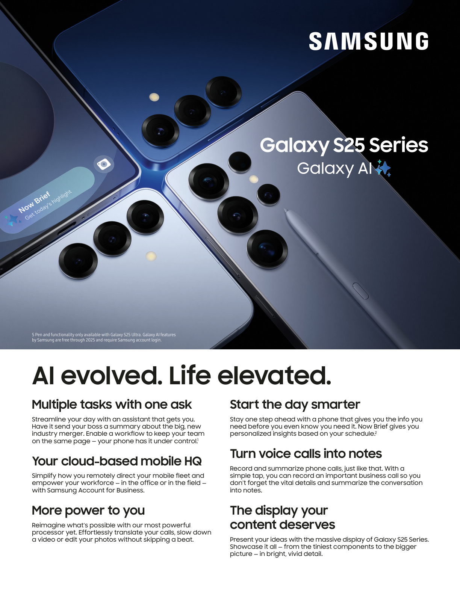
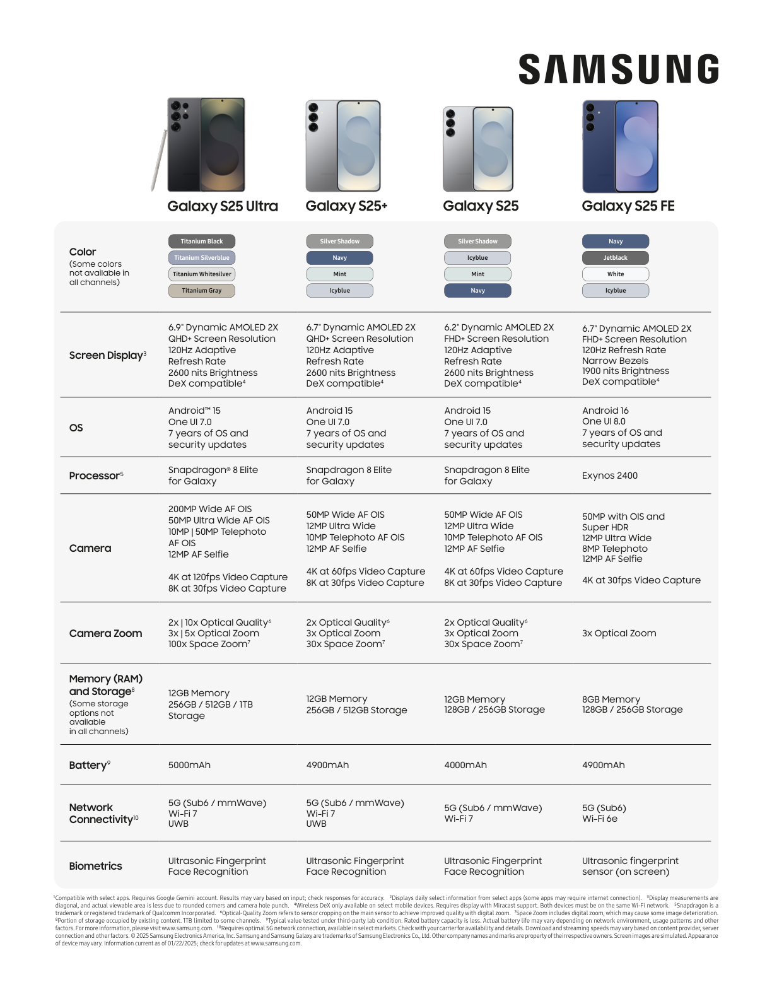

## Document Metadata

- Document ID: 11c20af50d486fc19557dcecdfbfff978be96cb7
- Document Title: Galaxy S25 Series
- Document Type: PDF
- Issuing Organization: Samsung
- Publication Date: null
- Reporting Period: null
- Source File: [42_images.samsung.com_S25_Series_B2B_spec_sheet_upda.pdf](https://github.com/jadennevercode/CJCC-Knowledge-Base/blob/564ab11aa9785e569e3853c8a4d7ce86f88e7535/materials/%E4%B8%8B%E6%B8%B8%EF%BC%9A%E6%89%8B%E6%9C%BA%E3%80%81PC%E5%92%8C%E5%B9%B3%E6%9D%BF%E9%9C%80%E6%B1%82%E4%BC%A0%E5%AF%BC/42_images.samsung.com_S25_Series_B2B_spec_sheet_upda.pdf)

## Structured Content

> 原文件：[42_images.samsung.com_S25_Series_B2B_spec_sheet_upda.pdf](https://github.com/jadennevercode/CJCC-Knowledge-Base/blob/564ab11aa9785e569e3853c8a4d7ce86f88e7535/materials/%E4%B8%8B%E6%B8%B8%EF%BC%9A%E6%89%8B%E6%9C%BA%E3%80%81PC%E5%92%8C%E5%B9%B3%E6%9D%BF%E9%9C%80%E6%B1%82%E4%BC%A0%E5%AF%BC/42_images.samsung.com_S25_Series_B2B_spec_sheet_upda.pdf)
> 转换方式：Volcengine OCRPdf v3, parse_mode=ocr

[Source Page: 1]

# Galaxy S25 Series

## AI evolved. Life elevated.

### Multiple tasks with one ask

Streamline your day with an assistant that gets you. Have it send your boss a summary about the big, new industry merger. Enable a workflow to keep your team on the same page — your phone has it under control.¹

### Your cloud-based mobile HQ

Simplify how you remotely direct your mobile fleet and empower your workforce — in the office or in the field — with Samsung Account for Business.

### More power to you

Reimagine what’s possible with our most powerful processor yet. Effortlessly translate your calls, slow down a video or edit your photos without skipping a beat.

### Start the day smarter

Stay one step ahead with a phone that gives you the info you need before you even know you need it. Now Brief gives you personalized insights based on your schedule.²

### Turn voice calls into notes

Record and summarize phone calls, just like that. With a simple tap, you can record an important business call so you don’t forget the vital details and summarize the conversation into notes.

### The display your content deserves

Present your ideas with the massive display of Galaxy S25 Series. Showcase it all — from the tiniest components to the bigger picture — in bright, vivid detail.

S Pen and functionality only available with Galaxy S25 Ultra. Galaxy AI features by Samsung are free through 2025 and require Samsung account login.

[Source Page: 2]

## Galaxy S25 Series

|  | Galaxy S25 Ultra | Galaxy S25+ | Galaxy S25 | Galaxy S25 FE |
| --- | --- | --- | --- | --- |
| Color (Some colors not available in all channels) | Titanium Black Titanium Silverblue Titanium Whitesilver Titanium Gray | Silver Shadow Navy Mint Icyblue | Silver Shadow Icyblue Mint Navy | Navy Jetblack White Icyblue |
| Screen Display³ | 6.9" Dynamic AMOLED 2X QHD+ Screen Resolution 120Hz Adaptive Refresh Rate 2600 nits Brightness DeX compatible⁴ | 6.7" Dynamic AMOLED 2X QHD+ Screen Resolution 120Hz Adaptive Refresh Rate 2600 nits Brightness DeX compatible⁴ | 6.2" Dynamic AMOLED 2X FHD+ Screen Resolution 120Hz Adaptive Refresh Rate 2600 nits Brightness DeX compatible⁴ | 6.7" Dynamic AMOLED 2X FHD+ Screen Resolution 120Hz Refresh Rate Narrow Bezels 1900 nits Brightness DeX compatible⁴ |
| OS | Android™ 15 One UI 7.0 7 years of OS and security updates | Android 15 One UI 7.0 7 years of OS and security updates | Android 15 One UI 7.0 7 years of OS and security updates | Android 16 One UI 8.0 7 years of OS and security updates |
| Processor⁵ | Snapdragon® 8 Elite for Galaxy | Snapdragon 8 Elite for Galaxy | Snapdragon 8 Elite for Galaxy | Exynos 2400 |
| Camera | 200MP Wide AF OIS 50MP Ultra Wide AF OIS 10MP \| 50MP Telephoto AF OIS 12MP AF Selfie 4K at 120fps Video Capture 8K at 30fps Video Capture | 50MP Wide AF OIS 12MP Ultra Wide 10MP Telephoto AF OIS 12MP AF Selfie 4K at 60fps Video Capture 8K at 30fps Video Capture | 50MP Wide AF OIS 12MP Ultra Wide 10MP Telephoto AF OIS 12MP AF Selfie 4K at 60fps Video Capture 8K at 30fps Video Capture | 50MP with OIS and Super HDR 12MP Ultra Wide 8MP Telephoto 12MP AF Selfie 4K at 30fps Video Capture |
| Camera Zoom | 2x \| 10x Optical Quality⁶ 3x \| 5x Optical Zoom 100x Space Zoom⁷ | 2x Optical Quality⁶ 3x Optical Zoom 30x Space Zoom⁷ | 2x Optical Quality⁶ 3x Optical Zoom 30x Space Zoom⁷ | 3x Optical Zoom |
| Memory (RAM) and Storage⁸ (Some storage options not available in all channels) | 12GB Memory 256GB / 512GB / 1TB Storage | 12GB Memory 256GB / 512GB Storage | 12GB Memory 128GB / 256GB Storage | 8GB Memory 128GB / 256GB Storage |
| Battery⁹ | 5000mAh | 4900mAh | 4000mAh | 4900mAh |
| Network Connectivity¹⁰ | 5G (Sub6 / mmWave) Wi-Fi 7 UWB | 5G (Sub6 / mmWave) Wi-Fi 7 UWB | 5G (Sub6 / mmWave) Wi-Fi 7 | 5G (Sub6) Wi-Fi 6e |
| Biometrics | Ultrasonic Fingerprint Face Recognition | Ultrasonic Fingerprint Face Recognition | Ultrasonic Fingerprint Face Recognition | Ultrasonic fingerprint sensor (on screen) |

### Notes and disclaimers

¹ Compatible with select apps. Requires Google Gemini account. Results may vary based on input; check responses for accuracy. ²Displays daily select information from select apps (some apps may require internet connection). ³Display measurements are diagonal, and actual viewable area is less due to rounded corners and camera hole punch. ⁴Wireless DeX only available on select mobile devices. Requires display with Miracast support. Both devices must be on the same Wi-Fi network. ⁵Snapdragon is a trademark or registered trademark of Qualcomm Incorporated. ⁶Optical-Quality Zoom refers to sensor cropping on the main sensor to achieve improved quality with digital zoom. ⁷Space Zoom includes digital zoom, which may cause some image deterioration. ⁸Portion of storage occupied by existing content. 1TB limited to some channels. ⁹Typical value tested under third-party lab condition. Rated battery capacity is less. Actual battery life may vary depending on network environment, usage patterns and other factors. For more information, please visit www.samsung.com. ¹⁰Requires optimal 5G network connection, available in select markets. Check with your carrier for availability and details. Download and streaming speeds may vary based on content provider, server connection and other factors. © 2025 Samsung Electronics America, Inc. Samsung and Samsung Galaxy are trademarks of Samsung Electronics Co., Ltd. Other company names and marks are property of their respective owners. Screen images are simulated. Appearance of device may vary. Information current as of 01/22/2025; check for updates at www.samsung.com.

## Processing Notes

- 参数表、脚注和第一页跨栏正文已对照原 PDF 核验。
