## Document Metadata

- Document ID: 1916628c1252df699a659fbe8d1ce8936442414f
- Document Title: 苹果产业链专题报告：创新周期共振，AI与折叠iPhone打开价值量上行通道
- Document Type: PDF
- Issuing Organization: 西南证券研究院
- Publication Date: 2026年11月
- Reporting Period: null
- Source File: [M179_20261118-西南证券-西南证券苹果产业链专题报告：创新周期共振，AI与折叠iPhone打开价值量上行通道.pdf](https://github.com/jadennevercode/CJCC-Knowledge-Base/blob/5ec8511eb834073c8bfbd79c94af196282d483cf/materials/%E4%B8%8B%E6%B8%B8%EF%BC%9A%E6%89%8B%E6%9C%BA%E3%80%81PC%E5%92%8C%E5%B9%B3%E6%9D%BF%E9%9C%80%E6%B1%82%E4%BC%A0%E5%AF%BC/M179_20261118-%E8%A5%BF%E5%8D%97%E8%AF%81%E5%88%B8-%E8%A5%BF%E5%8D%97%E8%AF%81%E5%88%B8%E8%8B%B9%E6%9E%9C%E4%BA%A7%E4%B8%9A%E9%93%BE%E4%B8%93%E9%A2%98%E6%8A%A5%E5%91%8A%EF%BC%9A%E5%88%9B%E6%96%B0%E5%91%A8%E6%9C%9F%E5%85%B1%E6%8C%AF%EF%BC%8CAI%E4%B8%8E%E6%8A%98%E5%8F%A0iPhone%E6%89%93%E5%BC%80%E4%BB%B7%E5%80%BC%E9%87%8F%E4%B8%8A%E8%A1%8C%E9%80%9A%E9%81%93.pdf)

## Structured Content

> 原文件：[M179_20261118-西南证券-西南证券苹果产业链专题报告：创新周期共振，AI与折叠iPhone打开价值量上行通道.pdf](https://github.com/jadennevercode/CJCC-Knowledge-Base/blob/5ec8511eb834073c8bfbd79c94af196282d483cf/materials/%E4%B8%8B%E6%B8%B8%EF%BC%9A%E6%89%8B%E6%9C%BA%E3%80%81PC%E5%92%8C%E5%B9%B3%E6%9D%BF%E9%9C%80%E6%B1%82%E4%BC%A0%E5%AF%BC/M179_20261118-%E8%A5%BF%E5%8D%97%E8%AF%81%E5%88%B8-%E8%A5%BF%E5%8D%97%E8%AF%81%E5%88%B8%E8%8B%B9%E6%9E%9C%E4%BA%A7%E4%B8%9A%E9%93%BE%E4%B8%93%E9%A2%98%E6%8A%A5%E5%91%8A%EF%BC%9A%E5%88%9B%E6%96%B0%E5%91%A8%E6%9C%9F%E5%85%B1%E6%8C%AF%EF%BC%8CAI%E4%B8%8E%E6%8A%98%E5%8F%A0iPhone%E6%89%93%E5%BC%80%E4%BB%B7%E5%80%BC%E9%87%8F%E4%B8%8A%E8%A1%8C%E9%80%9A%E9%81%93.pdf)
> 转换方式：多模态逐页转录（页面图像 + 文本层交叉校验）

[Source Page: 1]

# 苹果产业链专题报告

## 创新周期共振，AI与折叠iPhone打开价值量上行通道

西南证券研究院
电子团队
2026年11月

分析师：胡杨
执业证号：S1250526010001
邮箱：huyang@swsc.com.cn

分析师：周方正
执业证号：S1250526090002
邮箱：zhoufz@swsc.com.cn

[Source Page: 2]

# 核心观点

- **果链基本面：供应链重构与新周期开启。**苹果对供应链实行深度介入与严格管控，当前中国仍是核心制造基地，但“中国做组件、新兴市场做组装”的产能转移趋势明显（如印度、越南）。随着2026年iPhone 18 Pro端侧AI落地及折叠屏iPhone Duo发布，叠加高毛利服务业务扩容，果链企业有望迎来业绩上行拐点。同时，头部企业正加速向汽车电子、AI服务器等多元化转型，以对冲单一客户依赖风险。

- **创新主线：折叠屏、端侧AI与3D打印带来价值量跃升。**折叠屏形态（核心增量）：iPhone Duo入局将重塑行业格局，铰链、UTG超薄玻璃以及柔性OLED成为最核心的增量环节。端侧AI硬件：AI算力提升导致功耗增加，VC均热板由选配升级为AI旗舰标配。iPhone 18 Pro与折叠机将搭载大尺寸定制VC，单机价值量显著提升。3D打印（钛合金）：苹果率先在手表及折叠机铰链盖板实现规模化量产。随着钛粉价格大幅回落，3D打印在消费电子精密结构件领域的渗透率有望加速提升。

- **相关公司解析：**立讯精密，平台型制造龙头，深度参与iPhone整机组装及Vision Pro，多元化布局成效显著，苹果营收占比持续下降。蓝思科技，iPhone Duo的UTG玻璃独家开发与核心供应商，受益于折叠屏放量带来的高价值订单弹性。歌尔股份，果链占比持续下降，VR/AI眼镜成为第二增长曲线，折叠机中主要以声学小件配套为主，增量弹性相对有限。领益智造，折叠铰链二级核心供应商，提供精密结构件及支撑板。

- **风险提示：**终端需求不及预期风险、技术良率与产能爬坡风险、供应链竞争与客户集中风险、地缘政治与产能转移风险、新技术渗透不及预期风险。

[Source Page: 3]

# 目录

一、果链基本面拐点显现：供应链重构+新品周期打开估值修复空间

二、创新驱动投资主线：端侧AI、折叠iPhone、3D打印带来果链价值重估

三、相关公司解析：展望新品弹性+业务多元化双逻辑龙头

[Source Page: 4]

## 1.1果链格局剖析：苹果强管控下，上游零部件、中游制造、设备端孕育细分投资机会

- **产业链以苹果为核心，整合了从设计、关键零部件制造、精密组装到全球物流与销售的全过程。**苹果供应链运营涵盖业务智能与分析、业务流程管理、供需管理与新产品导入、零售与电商履约、物流与供应链、销售规划与运营、采购、制造与运营工程、质量工程、项目计划管理等核心职能团队。供应链核心活动包括需求预测、生产计划、库存控制、全球物流、供应商管理、新品量产准备等。

- **苹果对产业链及供应商实行严格的深度介入管理。**上游环节涵盖芯片、半导体、显示面板、核心元器件等关键零部件供应商；中游聚焦摄像头模组、精密结构件、功能组件、整机组装代工等配套厂商，对良品率有极高要求；下游统筹全球线下零售门店布局以及覆盖全域的售后服务体系。此外，果链专用设备供应商同样重要，其自动化生产设备、检测仪器直接支撑整条产业链的高效运转，共同维系苹果供应链的稳定性、标准化与高端制造能力。

**苹果产业链概览**

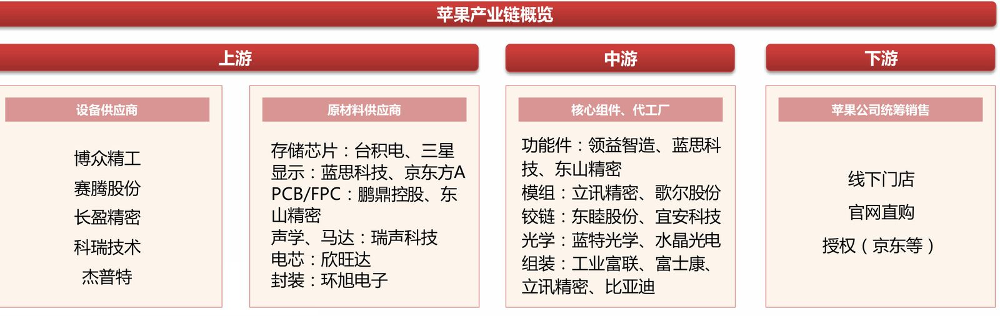

### 上游

- 设备供应商：博众精工、赛腾股份、长盈精密、科瑞技术、杰普特
- 原材料供应商：存储芯片：台积电、三星；显示：蓝思科技、京东方A；PCB/FPC：鹏鼎控股、东山精密；声学、马达：瑞声科技；电芯：欣旺达；封装：环旭电子

### 中游

- 核心组件、代工厂：功能件：领益智造、蓝思科技、东山精密；模组：立讯精密、歌尔股份；铰链：东睦股份、宜安科技；光学：蓝特光学、水晶光电；组装：工业富联、富士康、立讯精密、比亚迪

### 下游

- 苹果公司统筹销售：线下门店、官网直购、授权（京东等）

资料来源：西南证券整理

[Source Page: 5]

## 1.2果链企业核心画像：客户集中风险，重点布局多元化转型的龙头标的

- **技术和资本壁垒高**上游（芯片/面板/精密结构件）需通过苹果认证，对良率、一致性要求极高；新进入者极少，头部集中（如芯片代工台积电占90%+，组装立讯精密+工业富联主导）。

- **深度依赖苹果公司订单**议价权严重缺失，被压缩毛利（近年果链企业毛利率普遍下行）。一旦被剔除，给企业带来极大风险，倒逼厂商拓展非果业务（立讯切入AI服务器、蓝思布局新能源）。

- **精益运营与极致协同**苹果供应链库存周转天数大约为5天，要求供应商就近建厂、数据实时打通；苹果派驻工程师、开放部分产线设备，实现端到端管控。新品上市前买断航空运力、协调直送零售店，保障全球同步发售。

- **地缘驱动产能重构**中国仍为核心制造基地，但目前为中国做组件、新兴市场做组装的格局，印度2025年iPhone产量占比25%，越南承担AirPods/Watch主力组装。2026年芯片代工突破，英特尔获部分芯片订单，打破台积电独家依赖；关键零部件（屏幕、基带）持续引入第二/第三供应商降本控险。

**果链与非果链公司毛利率对比**

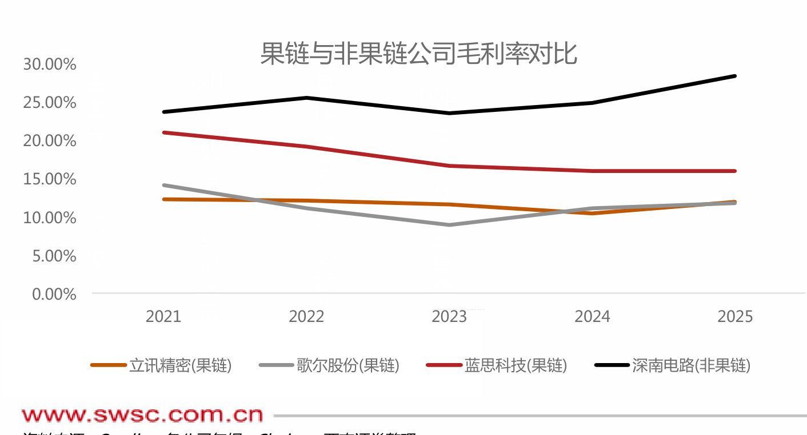

（图例：立讯精密(果链)、歌尔股份(果链)、蓝思科技(果链)、深南电路(非果链)；横轴2021—2025年，纵轴0.00%—30.00%。图中无数据标签。）

**果链公司第一大客户收入占比（%）**

| 年份 | 立讯精密 | 歌尔股份 | 蓝思科技 |
| --- | --- | --- | --- |
| 2020 | 69.02 | 48.08 | 54.97 |
| 2021 | 74.09 | 42.49 | 27.25 |
| 2022 | 73.28 | 31.12 | 28.85 |
| 2023 | 75.24 | 43.38 | 57.83 |
| 2024 | 70.74 | 31.96 | 49.45 |
| 2025 | 56.68 | 29.7 | 45.01 |

资料来源：Omdia、各公司年报、Choice、西南证券整理

[Source Page: 6]

## 1.3苹果周期复盘：硬件创新+高毛利服务+端侧AI，驱动果链新一轮业绩上行

- **2007-2011全球智能手机行业渗透率快速提升的拓量红利期。**苹果凭借初代iPhone重新定义触屏智能手机，依托iPhone 4/4S经典机型完成产品力跨越式升级，叠加全球运营商渠道规模化扩张，手机业务迅速成为公司核心基本盘。2011年公司总营收达1082亿美元，较2007年翻倍增长，iPhone业务收入占比突破50%，正式确立硬件核心支柱地位。

- **2012-2018苹果业绩高光周期，大屏化迭代兑现超额红利。**2015年公司总营收达2337亿美元，创下阶段峰值，iPhone业务收入占比维持在60%以上的高位区间。产品矩阵持续丰富，iPad mini、初代Apple Watch、初代AirPods陆续落地，第二增长曲线初步成型。iCloud、Apple Pay、App Store订阅等服务业务持续保持稳健增长，盈利结构逐步优化。

- **2019-2026存量竞争下结构优化，服务+端侧AI开启新一轮成长。**2019年后全球智能手机行业完全进入存量竞争阶段，公司正式进入结构优化、利润率优先的全新发展阶段，盈利重心由硬件销售逐步转向高毛利服务业务。App Store、云服务、订阅、广告业务等服务业务毛利率超70%，收入占比提升至20%以上，成为公司利润最大贡献来源。硬件端实现多点复苏，自研M系列芯片迭代带动Mac业务持续回暖，AirPods、Apple Watch可穿戴设备维持稳健收入贡献，硬件收入韧性凸显。2026年国行iPhone 15及后续系列端侧AI功能落地、2026年折叠屏iPhone Duo全新机型问世，皆有望带动大规模换机需求；高毛利服务业务持续扩容，叠加AI终端硬件规格升级、单机价值量提升，公司及苹果产业链有望开启新一轮业绩上行周期。

**苹果公司业务结构**

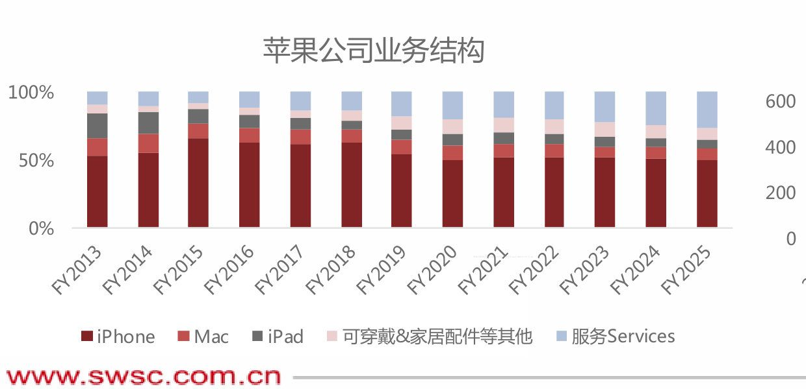

（堆叠柱图为各财年业务收入结构，图例：iPhone、Mac、iPad、可穿戴&家居配件等其他、服务Services；纵轴0%—100%。图中无数据标签。）

**苹果公司营业数据**

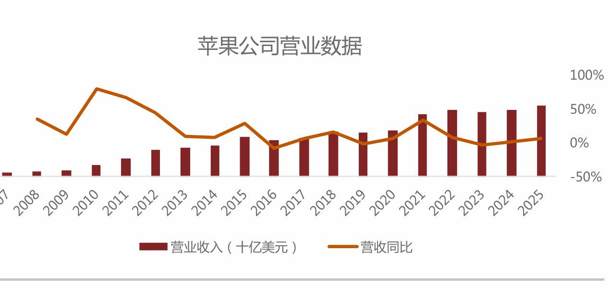

（柱状图为营业收入（十亿美元，左轴0—600），折线为营收同比（右轴-50%—100%）；横轴2007—2025年。图中无数据标签。）

注：图中年份为苹果财年（每年九月三十日）　资料来源：苹果财报官方新闻稿、Choice、雪球、西南证券整理

[Source Page: 7]

## 1.4创新赛道挖掘：端侧AI、折叠形态、Vision Pro拉动零部件单机价值量上行

- **端侧AI硬件配套升级：算力、散热与存储规格同步提升**端侧AI大模型对终端算力、功耗散热提出更高要求，成为驱动产业链升级的核心引擎。手机SoC芯片算力持续迭代，带动芯片代工及先进封装需求上行；AI运算带来整机功耗提升，促使VC均热板、散热模组单机价值量显著提升；同时，存储规格升级，更大容量、更高速度的内存与闪存成为终端标配，上游存储及模组环节深度受益。

- **折叠形态迭代：UTG与铰链成核心增量**折叠iPhone落地，UTG超薄玻璃、高精度铰链及新型防水材料迎来增量。折叠形态迭代带动柔性OLED显示面板需求提升，同时铰链结构件等方面带动MIM工艺及3D打印设备厂商增量订单。Vision Pro空间计算设备的推出，进一步带来光学镜片、Pancake透镜、传感器、精密结构件及整机组装工艺的全面升级，为果链企业打开全新硬件赛道。

- **可穿戴产品线持续迭代：健康监测功能驱动传感器需求**Apple Watch健康监测功能新增多类生物传感器，带动传感器、精密模组及电池零部件需求增长。AirPods迭代升级，空间音频、AI降噪等功能持续优化，声学模组、微型扬声器等价值量稳步提升。

- **Apple Silicon自研芯片持续外溢，Mac硬件更新周期加快**M系列自研芯片持续迭代，Mac产品力持续释放，带动PCB、电源管理、结构件及组装环节需求增长。自研芯片的供应链经验外溢，国内厂商有望切入更多芯片周边零部件环节，分享产业链红利。

- **整机细节工艺与零部件升级：单机价值量持续提升**更高规格的电池、新型连接器、无线充电升级、机身新材料(合金、复合材质)及摄像头光学升级(潜望镜头、多摄迭代)持续推动单机零部件价值量抬升，为上游零部件厂商带来增量订单。

| 年份 | 产品 | 硬件 |
| --- | --- | --- |
| 2020 | M1芯片发布（Apple Silicon自研） | PCB、电源管理、精密结构件、组装 |
| 2022 | AirPods Pro 2迭代升级 | 声学模组、MEMS麦克风、微型电池 |
| 2024 | Vision Pro正式发布、Apple Intelligence端侧AI落地 | Pancake光学镜片、传感器、精密结构件、先进封装、VC散热、存储模组 |
| 2026 | 折叠iPhone推出 | UTG超薄玻璃、高精度铰链、柔性OLED、MIM工艺、3D打印技术 |
| 2027E | iPhone搭载3D曲面玻璃 | 3D热弯玻璃、精磨加工设备 |

资料来源：西南证券整理

[Source Page: 8]

# 目录

一、果链基本面拐点显现：供应链重构+新品周期打开估值修复空间

二、创新驱动投资主线：端侧AI、折叠iPhone、3D打印带来果链价值重估

三、相关公司解析：展望新品弹性+业务多元化双逻辑龙头

[Source Page: 9]

## 2.1国产替代投资机会：制造环节高渗透，材料、芯片、高端设备是未来突围方向

- **近年来苹果供应链中，国内厂商已在整机组装、精密结构件、PCB/FPC、光学声学、电池散热模组等制造环节实现较高程度渗透，但核心芯片、高端光学感光元件、部分精密设备基材仍存在海外依赖。**伴随Vision Pro、折叠iPhone、iPhone 18 Pro等新品落地，产业链价值量迎来结构性重分配，国内厂商持续向高附加值环节突破，同时新品带来更高工艺门槛，行业竞争格局重塑。

| 环节 | 国产渗透量化数据 | 新品价值增量参考 |
| --- | --- | --- |
| 整机组装 | iPhone国内组装：立讯+工业富联 | Vision Pro整机组装单机价值高于iPhone；折叠iPhone组装工艺溢价显著 |
| 精密结构件&玻璃 | 2D/2.5D玻璃国产加工渗透率持续增长；UTG超薄玻璃国内加工处于验证放量阶段 | 折叠iPhone铰链+UTG+钛合金结构件BOM增量显著 |
| PCB/FPC | 普通FPC国内加工渗透率高；高端ABF载板国产化率不足 | 端侧AI旗舰机单机FPC价值量提升 |
| 光学声学 | 声学组件国产渗透率高；高端手机CMOS传感器国产几乎空白 | Pancake光学模组单机价值量显著高于手机光学模组 |
| 电池散热模组 | 电池Pack国产化率高；超薄VC均热板加速渗透 | AI旗舰VC散热单机价值量较传统石墨提升 |
| 设备 | 组装测试自动化设备国产化率逐渐提高；核心光刻/镀膜设备国产化率低 | 新品资本开支周期，自动化设备订单有望放量 |

- **苹果供应链国产替代呈现制造端渗透充分，材料/芯片/高端设备仍存短板的格局。**折叠iPhone、Vision Pro、端侧AI手机三大新品周期打开单机价值量上行空间，国内厂商迎来从结构件、组装向光学、散热、精密传动等高附加值环节升级机遇，但新品工艺难度提升，行业进入良率、精密制造能力的竞争阶段。

资料来源：西南证券整理

[Source Page: 10]

## 2.2折叠屏行业高增长：苹果入局重塑格局，产业链具备深度潜力

- **折叠屏手机属于高端智能手机品类，目前行业处于早期渗透阶段。**当前全球折叠屏出货量在手机大盘中占比虽然仅为2%左右，但凭借高溢价属性，收入贡献显著高于出货占比；其中书本式内折机型溢价能力突出，均价较直板旗舰机型高出数倍。成本高企是制约行业规模化普及的核心瓶颈。

- **折叠屏手机出货量增长，2026年增速有望持续走高。**2025年Q3全球折叠屏出货量同比增长14%；国内市场2025年下半年折叠屏出货量达到近五百万台，全年出货量1001万台，同比+9.2%，渗透率逐渐提升。从成本结构来看，以三星Galaxy Fold为例，三星Galaxy Fold BOM成本为636.7美元，相较于同期高端机型Galaxy S9+的376美元整体高出69.3%，成本增长体现在机械结构件、显示屏幕，具体为铰链、盖板和柔性面板三类核心组件。

- **AI功能落地、多折技术迭代叠加苹果正式入局，或将推动行业加速成熟。**根据Counterpoint Research发布的折叠屏智能手机市场预测报告，2026年全球折叠屏智能手机出货量预计将实现21%的同比增长。其中，iPhone Duo今年出货量预计能拿下全球折叠屏手机市场约25%的份额。

**全球折叠屏手机市场规模及同比**

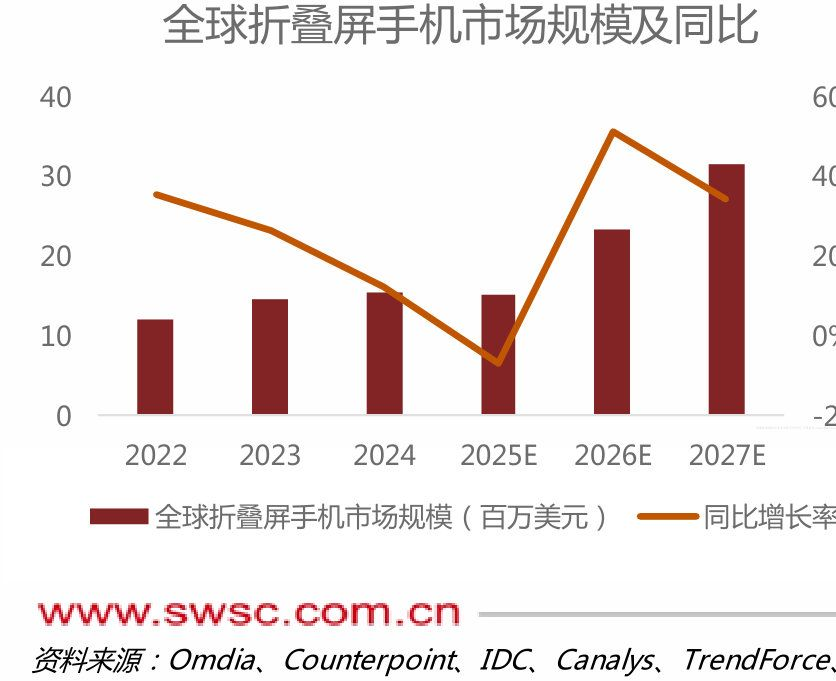

（柱状图为全球折叠屏手机市场规模（百万美元，左轴0—40），折线为同比增长率（右轴-20%—60%）；横轴2022、2023、2024、2025E、2026E、2027E。图中无数据标签。）

**中国折叠屏手机出货量及同比**

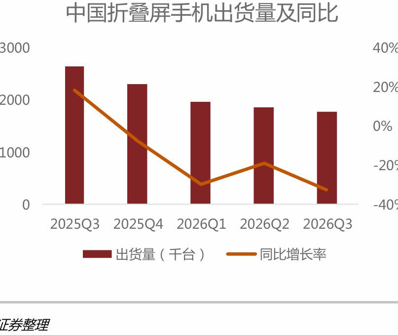

（柱状图为出货量（千台，左轴0—3000），折线为同比增长率（右轴-40%—40%）；横轴2025Q3、2025Q4、2026Q1、2026Q2、2026Q3。图中无数据标签。）

**各公司折叠屏出货占比预测**

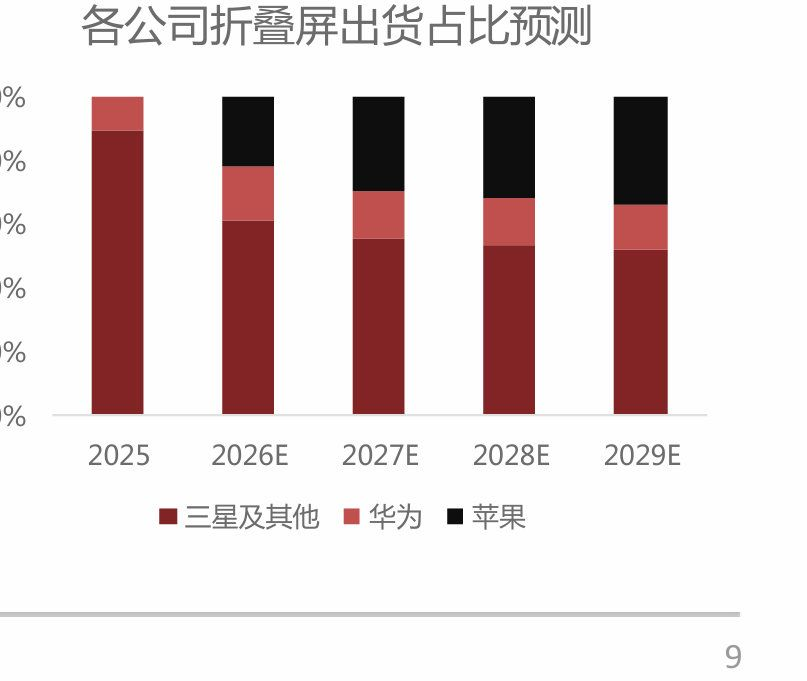

（百分比堆叠柱图，图例：三星及其他、华为、苹果；横轴2025、2026E、2027E、2028E、2029E，纵轴0%—100%。图中无数据标签。）

资料来源：Omdia、Counterpoint、IDC、Canalys、TrendForce、西南证券整理

[Source Page: 11]

## 2.3.1折叠屏铰链：高ASP核心零部件，优先布局具备多工艺复合能力国内零部件厂商

- 铰链行业当前采用MIM+CNC为主，液态金属、SLM金属3D打印为辅的复合工艺方案。MIM适合大批量制造复杂微型零件；CNC加工精度优势突出但钛材损耗高；液态金属凭借高强度特性适配长薄铰链门板，但模具成本高、专利壁垒强；SLM金属3D打印主要用于传统工艺难以成型的镂空件，不会单独制造整套铰链总成。苹果iPhone Duo采用"MIM+CNC为主、少量3D打印再生钛异形铰链盖板为辅"的组合方案
- 铰链市场规模正不断提升。根据IDC数据，2025年全球折叠屏智能手机出货量约为2060万台，同比+10%；其中中国市场出货量约1001万台，同比+9.2%。TrendForce集邦咨询研究显示，2025年全球折叠手机铰链市场产值达到约12亿美元，目前铰链在单机BOM中成本占比约为5%~8%。预计2026年苹果iPhone Duo入局后，全球折叠屏出货量有望实现进一步提升，铰链市场规模受益同步增长。

| 工艺 | 铰链主要应用零件 | 果链应用情况 |
| --- | --- | --- |
| MIM金属注射成型（主流） | 铰链内部微型齿轮、凸轮、鱼眼、微型支架 | 安卓折叠屏主力；苹果折叠铰链大量MIM零件，国内精研科技、东睦股份深度参与 |
| 精密CNC切削 | 铰链转轴、轴盖、长条形门板类构件 | 各品牌铰链普遍使用；钛合金件加工成本高 |
| 液态金属（非晶合金） | 铰链长薄支撑门板、部分翼板零件 | 安卓机型已有导入；苹果做验证，尚未大规模量产 |
| SLM金属3D打印（增材制造） | 铰链局部镂空、超薄异形转角件 | 苹果折叠iPhone试产验证，小批量应用；安卓少量机型导入 |

资料来源：TrendForce、QYResearch、西南证券整理

[Source Page: 12]

## 2.3.1铰链良率突破，迎来赛道红利

- 铰链作为折叠屏机械结构核心部件，也是当前整机量产的核心瓶颈。铰链中集成阻尼系统、MIM精密件、液态金属材料等皆对良率、精密加工提出极高要求。iPhone Duo铰链一级总成由安费诺、新日兴承接，供应铰链内部精密冲压件、支架、液态金属主轴等零部件，领益智造、精研科技、宜安科技、东睦股份等国内上市公司深度参与配套，但核心总成环节仍掌握在外资厂商手中。铰链良率短板直接约束新机初期产能。
- 折叠屏铰链赛道机遇与风险并存。折叠形态带来单机零部件价值量显著提升，苹果新品入局打开中长期成长空间，MIM、液态金属、金属3D打印等新工艺持续导入，带动国内精密制造企业实现产品升级。但行业仍面临多重挑战：铰链良率管控难度大、技术迭代节奏快，同时下游终端需求具备较强周期性波动。长期看，具备多工艺复合制造能力、能够进入头部终端供应链验证体系的零部件厂商，有望持续分享折叠屏产业扩容红利。

| 机型类型 | 核心特点 |
| --- | --- |
| 三星折叠机型 | 普通水滴铰链，MIM为主 |
| 高端安卓内折（华为Mate X系列） | 行星齿轮、多角度悬停 |
| 三折叠机型（Mate XT） | 双铰链联动，结构复杂度大幅提升 |
| iPhone Duo（苹果首款折叠） | 液态金属+再生钛3D打印盖板 |

| 供应商 | 供应层级 | 配套客户 | 产品 |
| --- | --- | --- | --- |
| 安费诺、新日兴 | 铰链总成（一级） | 苹果iPhone Duo | 全套铰链转轴模组（外资把持总成环节） |
| KH Vatec | 铰链总成（一级） | 三星折叠系列 | 三星原生铰链方案 |
| 富世达、兆利科技 | 铰链总成（一级） | 华为、荣耀 | 安卓高端水滴铰链总成 |
| 领益智造 | 二级精密结构件 | 苹果iPhone Duo | 铰链冲压支架、支撑板（不做总成） |
| 精研科技、东睦股份 | MIM粉末冶金零件 | 华为、小米、苹果 | 铰链微型MIM齿轮、结构件 |
| 宜安科技 | 液态金属零件 | 安卓旗舰+苹果验证 | 液态金属铰链组件 |

资料来源：西南证券整理

[Source Page: 13]

## 2.3.1折叠屏显示面板：三星主导，关注国内面板厂商份额提升的投资机遇

- 2025年，全球OLED智能手机面板出货量约8.9亿片，同比增长5.2%。OLED在智能手机领域的应用已实现主导地位，2025年出货面积占比在此领域中的应用已提升至近50%，预计2026年至2030年占比将持续维持。柔性OLED正在持续替代刚性OLED，2025年全球柔性OLED智能手机面板出货约6.9亿片，同比+9.6%；刚性OLED出货约2亿片，同比-7.7%。柔性OLED在智能手机面板中占比达77.5%，其中，中国厂商在柔性OLED市场份额已达57.9%。
- 2026年上半年全球折叠屏面板出货量同比下降13%，但大折叠面板逆势增长35%，翻盖式面板出货量暴跌62%。Counterpoint Research预计，2026年全年折叠屏智能手机面板出货量较2025年增长23%。2026年下半年出货量预计较上半年增长53%，较2025年下半年增长71%，并占全年总量的61%。2026年上半年，在折叠屏产业链各环节核心供应商中，三星显示、京东方、维信诺、TCL华星四家合计占约98%的份额，其中三星显示占全球约51%，京东方约30%。
- 上游材料的国产替代正迎来历史性窗口期。截至2025年，我国OLED屏全球市占率突破52%，随着终端产能持续释放及高世代产线量产进程推进，相关半导体显示材料在折叠终端、智能座舱、AR眼镜等高端应用场景的导入速度不断加快。

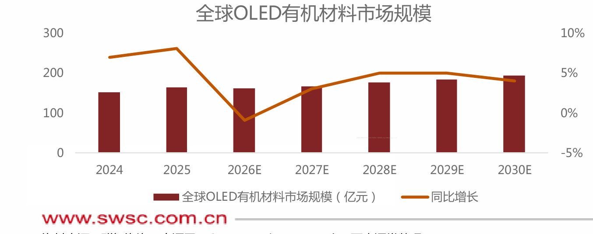

全球OLED有机材料市场规模：柱状为全球OLED有机材料市场规模（亿元，左轴0/100/200/300），折线为同比增长（右轴-5%/0%/5%/10%），横轴2024、2025、2026E、2027E、2028E、2029E、2030E；图中无数据标签。

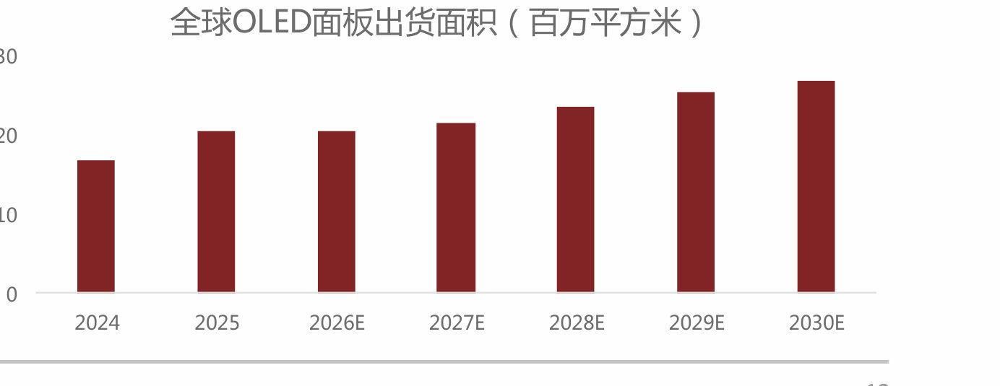

全球OLED面板出货面积（百万平方米）：纵轴0/10/20/30，横轴2024、2025、2026E、2027E、2028E、2029E、2030E；图中无数据标签。

资料来源：群智咨询、中证网、Counterpoint Research、西南证券整理

[Source Page: 14]

## 2.3.1 UTG盖板：折叠屏核心增量，苹果订单催化国产厂商加速验证放量

- UTG渗透率加速提升，市场规模持续扩容。折叠屏手机盖板材料正经历从CPI向UTG的结构性替代。Omdia数据显示，2024年全球手机UTG出货量达2464.1万片（同比+36.9%），2021-2024年CAGR达35.5%；预计2028年出货量有望达到5107.4万片，2025-2028年复合增长率为14.9%。从市场规模看，2025年全球折叠屏盖板材料市场规模已逼近48亿美元，出货量突破1.9亿片。
- 技术规格持续突破，单机价值量显著提升。UTG在透光率、硬度、耐磨性及抗折痕表现上全面优于CPI，已成为折叠屏盖板的主流材料。UTG渗透率已突破70%，逐步取代早期CPI方案。苹果iPhone Duo的UTG单机价值约175美元，是普通手机玻璃的3.5倍，也是折叠屏最核心防护部件。
- 苹果入局催化产业链升级，国产替代进程加速。2026年苹果首款折叠屏iPhone Duo发布，采用定制纳米纹理UTG玻璃，由蓝思科技独家开发，供应UTG玻璃、3D玻璃盖板等核心部件。苹果入局进一步验证UTG技术路线，带动产业链资本开支与工艺迭代。国产替代方面，凯盛科技、长信科技等国产厂商持续加码UTG产线，国产UTG良率提升，铰链成本下降。京东方与康宁合作打破三星+康宁的独家垄断，加速中高端折叠屏普及。

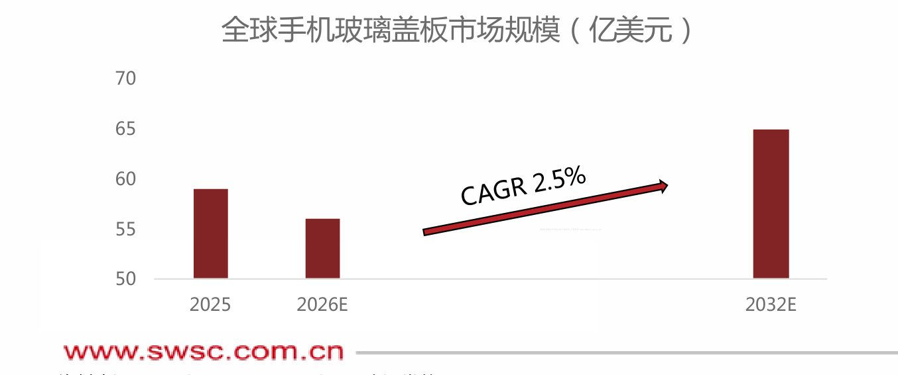

全球手机玻璃盖板市场规模（亿美元）：纵轴50/55/60/65/70，横轴2025、2026E、2032E，标注CAGR 2.5%；图中无数据标签。

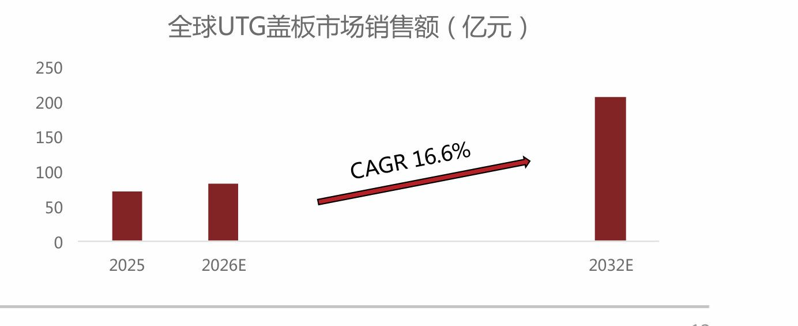

全球UTG盖板市场销售额（亿元）：纵轴0/50/100/150/200/250，横轴2025、2026E、2032E，标注CAGR 16.6%；图中无数据标签。

资料来源：Omdia、QYResearch、西南证券整理

[Source Page: 15]

## 2.3.1 VC均热板：端侧AI刚需标配，散热板块迎来量价齐升投资窗口

- 端侧AI驱动散热需求结构性升级。端侧AI算力持续迭代带动旗舰手机芯片功耗显著上行，散热性能已成为制约高端机型持续性能释放的核心瓶颈。随着端侧AI商业化落地加速，VC均热板正由高端机型选配配件升级为AI旗舰手机标配零部件，行业渗透率加速上行，精密散热板块迎来量价齐升共振周期。苹果新一代iPhone 18 Pro系列针对2nm A20 Pro芯片高负载积热问题，完成芯片封装与散热体系结构性革新；同步发布的折叠屏新机iPhone Duo进一步强化高端散热配置，搭载大尺寸定制VC均热板，复合叠加回收不锈钢、高导热石墨、纳米铜多层导热材料体系。新机整体散热效率较iPhone 17 Pro提升，精准匹配折叠设备高集成、高功耗、薄机身的散热需求。
- 瑞声科技为苹果新一代超薄大尺寸VC均热板核心主力供应商，其常州生产基地已实现大批量稳定交付。公司自iPhone 17 Pro项目起切入苹果高端VC供应链，率先完成超薄液冷散热方案的量产验证，积累了大尺寸、高稳定性、高良率VC产品规模化制造能力，构筑起苹果供应链的技术与产能壁垒。伴随新机散热规格升级，单机VC散热模组价值量较前代实现显著抬升，叠加高端机型大尺寸定制化属性，产品盈利能力持续优化。

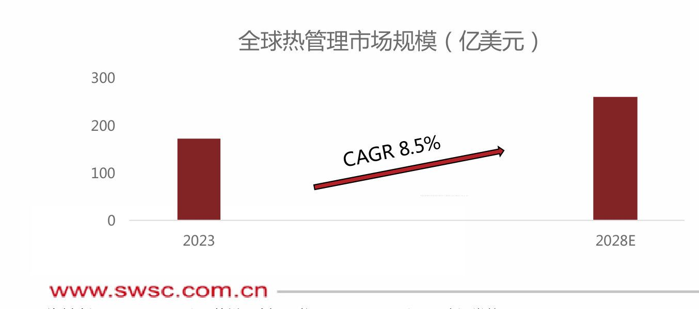

全球热管理市场规模（亿美元）：纵轴0/100/200/300，横轴2023、2028E，标注CAGR 8.5%；图中无数据标签。

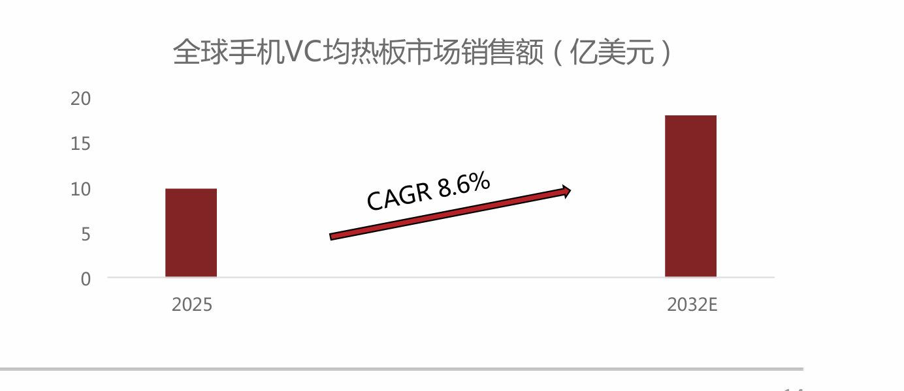

全球手机VC均热板市场销售额（亿美元）：纵轴0/5/10/15/20，横轴2025、2032E，标注CAGR 8.6%；图中无数据标签。

资料来源：QYResearch、苏州天脉招股书、BBC Research、西南证券整理

[Source Page: 16]

## 2.3.2 3D打印（钛合金）：苹果带头实现消费电子规模化落地

- 3D打印行业技术优势明确，国内市场高增速领跑全球。增材制造（又称3D打印）是以三维模型数据为基础，通过材料堆积的方式制造实物的先进制造工艺。相较于传统减材制造，3D打印在工艺、材料、产品设计及综合经济效益层面具备显著优势。全球3D打印行业维持稳健增长，2021-2025年市场规模由152亿美元增长至242亿美元，CAGR约12.3%，同时全球产业重心持续向国内转移。国内行业增长速度预计显著高于全球水平，同期测算市场规模由208亿元扩张至700亿元。目前国内在工业级SLM金属打印设备、钛合金打印材料领域持续实现技术突破，消费级打印设备出口能力全球领先，国产替代进程持续加速。
- 消费电子成为核心增量赛道，苹果落地带动钛合金3D打印大规模渗透。钛合金材料具备高比强度、耐高温、耐腐蚀的优良特性，可兼顾结构硬度与轻量化需求，此前主要应用于航空航天、高端装备等高端制造领域。3D打印钛合金构件可实现一体化成型，替代传统铸、锻、焊、机加工多道工序，在缩短生产周期、结构减重、综合降本方面具备突出优势，适配消费电子精密结构件制造需求。

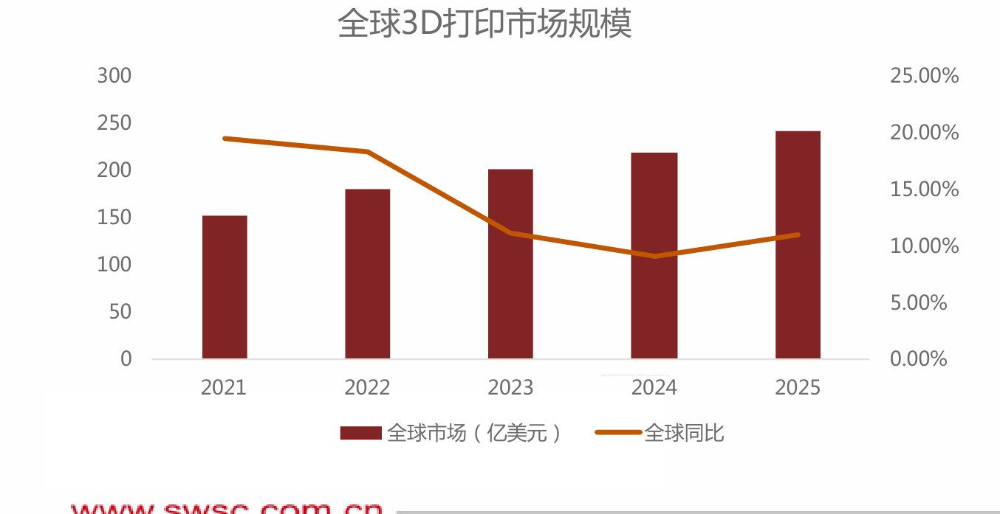

全球3D打印市场规模：柱状为全球市场（亿美元，左轴0/50/100/150/200/250/300），折线为全球同比（右轴0.00%/5.00%/10.00%/15.00%/20.00%/25.00%），横轴2021、2022、2023、2024、2025；图中无数据标签。

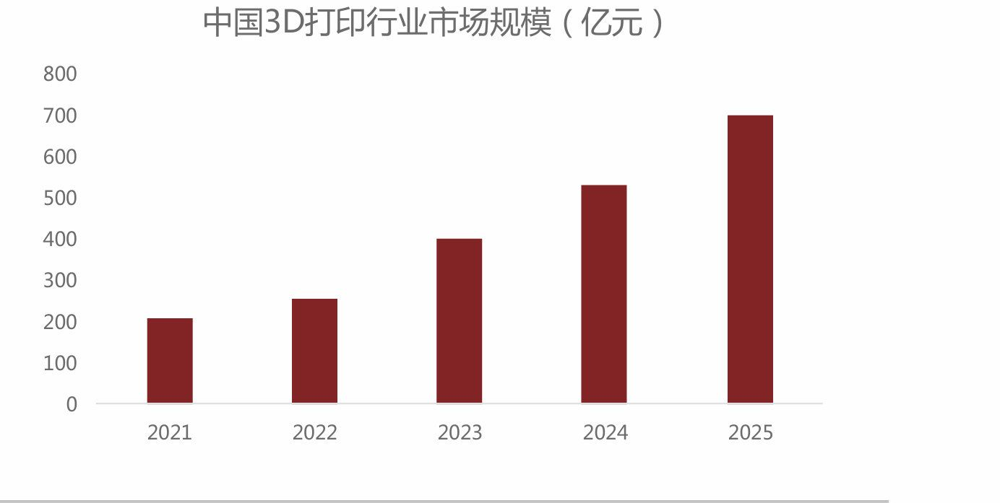

中国3D打印行业市场规模（亿元）：纵轴0/100/200/300/400/500/600/700/800，横轴2021、2022、2023、2024、2025；图中无数据标签。

资料来源：Wohlers Report、中研网、西南证券整理

[Source Page: 17]

## 2.3.2果链创新引进3D打印，设备-耗材-服务全链受益

- 消费电子已成为3D打印行业新兴高弹性赛道，2024年整体应用占比为11.9%，2025年已达12.5%，行业增量高度依赖头部终端厂商量产渗透节奏。苹果作为行业引领者，持续落地钛合金3D打印规模化应用：2025年Apple Watch Ultra3、Series11全系表壳采用再生钛合金3D打印工艺，标志技术迈入百万级量产阶段；同时iPhone Air USB-C接口采用钛合金3D打印功能件，为苹果手机首次落地功能性3D打印组件，相较传统锻造工艺可减少耗材，应用边界从可穿戴设备成功延伸至智能手机。
- 下游终端需求持续扩容，为钛合金3D打印提供坚实基本盘。2024年，我国3D打印下游应用占比最高的为航空航天，占比为16.7%；其次为医疗器械，占比为15.5%；消费电子应用占比已达到11.9%，正逐步扩大。全球消费电子终端需求持续增长，为钛合金3D打印提供了稳定的需求基本盘。今年苹果入局折叠屏，折叠屏机型对各精密件的高要求与钛合金3D打印的优势互相契合。此外，根据Omdia数据，2025年全球PC出货量达到2.8亿台，同比增长9.2%。随着更多品牌跟进，叠加未来PC市场进一步引入3D打印零部件，消费电子3D打印市场有望持续放量。

金属3D打印技术与传统精密加工技术的比较

|  | 金属3D打印技术 | 传统精密加工技术 |
| --- | --- | --- |
| 技术原理 | "增"材制造（分层制造、逐层叠加） | "减"材制造（材料去除、切削、组装） |
| 技术手段 | SLM、LSF等 | 磨削、超精细切削、精细磨削与抛光等 |
| 适用场合 | 小批量、复杂化、轻量化、定制化、功能一体化零部件制造 | 批量化、大规模制造，但在复杂零部件制造方面存在局限 |
| 使用材料 | 金属粉末、金属丝材等（受限） | 几乎所有材料（不受限） |
| 材料利用率 | 高，可超过95% | 低，材料浪费 |
| 产品实现周期 | 短 | 相对较长 |
| 零件尺寸精度 | ±0.1mm（相对于传统精密加工偏差较大） | 0.1-10μm（超精密加工精度甚至可达纳米级） |
| 零件表面粗糙度 | Ra2μm-Ra10μm之间（表面光洁程度较低） | Ra0.1μm以下（表面光洁度较高，甚至可达镜面效果） |

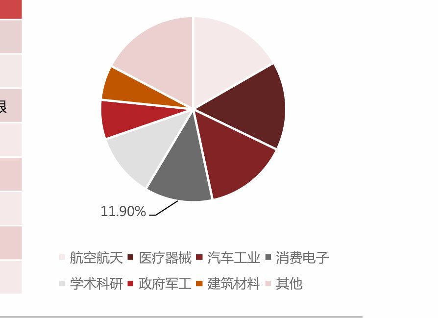

2024年我国3D打印下游应用占比（饼图）：仅消费电子扇区标注11.90%；图例为航空航天、医疗器械、汽车工业、消费电子、学术科研、政府军工、建筑材料、其他，其余扇区无数据标签。

资料来源：IDC、QYResearch、观研报告、文汇报、维科网、西南证券整理

[Source Page: 18]

## 2.3.2 3D打印国内形成成熟体系，国产替代加速渗透

- 苹果于2026年9月发布首款折叠终端iPhone Duo，在机身结构与铰链系统实现多项工艺升级。整机边框采用五级镜面抛光钛金属材质，铰链系统由超百颗微型零部件精密集成，结构复杂度、加工精度及轻量化要求大幅提升。公司首次将3D打印工艺规模化应用于折叠屏核心铰链结构，标志着增材制造在消费电子领域的应用从零散功能小件，正式迈入核心承载结构件量产阶段。
- 此次苹果验证金属3D打印在消费电子外观及结构件的落地可行性，技术应用呈现从可穿戴小件向手机核心结构、折叠屏核心铰链持续渗透的趋势。折叠屏iPhone Duo应用3D打印再生钛铰链盖板，五级镜面钛金属机身实现工艺升级；同时Apple Watch Ultra 4继续沿用100%再生钛3D打印表壳。随着设备成型效率提升、钛粉耗材价格大幅回落，3D打印工艺经济性持续优化，有望在3C精密零部件领域加速替代传统锻造、CNC工艺。
- 从供应链格局来看，苹果3D打印产业链已形成激光器、打印设备、打印服务的成熟卡位体系，国内厂商深度参与核心项目。其中铂力特、华曙高科、大族聚维等企业已进入苹果供应链并实现项目落地。我们认为，iPhone Duo核心铰链的3D打印量产落地，具备极强的行业标杆效应。苹果作为消费电子龙头，工艺验证与量产落地将有效带动安卓终端及PC厂商跟进对标，叠加设备、耗材端双重降本红利兑现，钛合金3D打印在消费电子精密结构件领域的渗透节奏有望持续提速，行业有望进入规模化、高景气的成长新阶段。

| 细分领域 | 代表企业 | 主营业务 |
| --- | --- | --- |
| 工业级3D打印设备 | 铂力特、华曙高科、大族激光等 | 核心设备商，覆盖金属3D打印全流程 |
| 钛合金粉末耗材 | 天工国际、哈森股份等 | 3D打印核心原材料，受益于钛材需求增长 |
| 消费级3D打印耗材 | 家联科技等 | FDM/光固化等消费级场景耗材供应商 |
| 消费级3D打印设备 | 创想三维、拓竹科技等 | 桌面级3D打印设备龙头，拓竹科技未上市 |
| 3D打印服务 | 汇创达等 | 提供3D打印定制化服务与解决方案 |

资料来源：西南证券整理

[Source Page: 19]

## 2.4新品周期驱动，技术迭代升级，聚焦高增量高成长性赛道

- 短期维度：新品周期驱动，聚焦高增量确定性细分赛道。2026年iPhone 18 Pro、折叠iPhone Duo集中落地，单机硬件价值量显著提升，板块迎来明确业绩修复窗口。短期优先布局VC散热、折叠铰链、UTG玻璃等高弹性细分环节。

1）VC均热板（热管理）：端侧AI拉高芯片功耗，新一代机型全面升级散热架构，Pro机型、折叠机搭载大面积超薄VC，单机价值同比大幅提升。行业良率与产能持续爬坡，2026年下半年订单量预计提升，短期可持续跟踪。

2）折叠铰链精密结构件：折叠iPhone铰链零部件数量、工艺复杂度显著高于传统手机，采用MIM+CNC+特种金属复合工艺，单机结构件价值量大幅提升。国内二级零部件厂商深度切入供应链，随折叠机型上量充分受益。

3）UTG超薄柔性玻璃：折叠新机采用UTG替代传统CPI膜，耐磨、抗折性能显著优化，为折叠形态专属增量部件，无直板机存量替代压力，增量纯粹。国内头部厂商已实现批量供货，随折叠机型渗透率提升持续放量。

| 细分赛道 | 核心投资逻辑 | 可跟踪高频数据 | 可跟踪公司 |
| --- | --- | --- | --- |
| VC均热板（热管理） | 端侧AI拉高芯片功耗，iPhone 18 Pro、折叠iPhone Duo全面升级散热架构；超薄大面积VC单机价值大幅抬升，下半年预计良率与产能持续爬坡 | 单机散热ASP、高端机型VC渗透率、龙头季度出货量、良率水平 | 瑞声科技、中石科技、思全新材 |
| 折叠铰链精密结构件 | 折叠iPhone铰链采用MIM+CNC+特种金属复合工艺，零部件数量与工艺复杂度大幅提升，单机结构件价值显著上行；国内二级零部件厂商深度切入供应链，随折叠机型上量充分受益 | 铰链单机价值、折叠机出货量、零部件交付节奏、MIM产能利用率 | 长盈精密、精研科技、立讯精密 |
| UTG超薄柔性玻璃 | 折叠新机以UTG替代CPI膜，耐磨抗折性能优化，属于折叠机型纯增量部件，无直板存量替代压力；国内头部厂商批量供货，随折叠渗透率持续放量 | UTG良率、单机配套价值、折叠机型产能爬坡进度 | 蓝思科技、凯盛科技 |
| 高弯折柔性FPC | 折叠设备开合对线路板弯折性能要求更高，折叠机FPC层数与用量大幅增加，屏幕、铰链、信号链路带来明确增量 | 折叠FPC单价、单机使用面积、高端FPC业务收入增速 | 鹏鼎控股、东山精密、弘信电子 |
| 钛合金结构件及精密加工 | 折叠新机、高端手表持续用钛合金替代不锈钢，材料与加工价值提升；钛合金异形件渗透率上行，带动精密CNC、表面处理产业链增量 | 钛合金单机ASP、高端机型材质渗透率、结构件加工毛利率 | 工业富联、领益智造、蓝思科技 |

资料来源：西南证券整理

[Source Page: 20]

## 2.4新品周期驱动，技术迭代升级，聚焦高增量高成长性赛道

- 长期维度：技术迭代持续升级，聚焦创新工艺与平台化成长赛道。长期苹果硬件形态创新、端侧AI算力升级、制造工艺革新持续推进，金属3D打印、高端硬件封装、平台型制造龙头三条主线具备持续成长空间。

1）消费电子金属3D打印：苹果已实现手表、折叠机铰链异形件规模化量产验证，3D打印适配复杂薄壁、异形结构，大幅降低加工损耗、提升精度。未来有望持续渗透手机、VR精密结构件，开启制造工艺迭代新周期。

2）端侧AI配套硬件（封装/高速互联/电磁屏蔽）：端侧AI持续迭代推动手机芯片算力、功耗上行，带动设备封装架构升级、高速互联组件、高端屏蔽件持续提价值。该升级为全高端机型普适性迭代，具备长期持续增量属性。

3）跨领域平台型制造龙头：果链头部企业持续推进业务多元化，汽车电子、AI服务器、VR硬件业务快速扩张，持续降低单一客户经营波动，依托精密制造能力实现跨品类产能复用。

| 细分赛道 | 核心投资逻辑 | 可跟踪高频数据 | 可跟踪公司 |
| --- | --- | --- | --- |
| 消费电子金属3D打印 | 苹果已完成手表、折叠铰链异形件量产验证；3D打印适配复杂薄壁异形结构，大幅降低加工损耗、提升加工精度；后续持续向手机、VR精密结构件渗透，开启制造工艺革新周期 | 单件打印成本、设备量产进度、消费电子打印零件出货规模 | 铂力特、华曙高科、大族激光、汇创达 |
| 端侧AI配套硬件（封装/高速互联/电磁屏蔽） | 端侧AI持续迭代推升芯片算力与功耗，带动芯片封装架构升级、高速互联组件、高端电磁屏蔽件价值抬升；为全高端机型普适性升级，具备长期持续增量属性 | 单机AI硬件BOM增量、高端机型新架构渗透率 | 长电科技、鹏鼎控股、中石科技 |
| 跨领域平台型制造龙头 | 果链头部企业持续多元化布局汽车电子、AI服务器、VR硬件，持续平滑单一客户业绩波动；依托精密制造能力实现跨品类产能复用，长期享有业绩稳定性与估值溢价 | 非苹果业务收入占比、新业务营收增速、整体毛利率中枢 | 立讯精密、歌尔股份、工业富联 |

资料来源：西南证券整理

[Source Page: 21]

# 目录

- 一、果链基本面拐点显现：供应链重构+新品周期打开估值修复空间
- 二、创新驱动投资主线：端侧AI、折叠iPhone、3D打印带来果链价值重估
- 三、相关公司解析：展望新品弹性+业务多元化双逻辑龙头

[Source Page: 22]

## 3.1立讯精密：平台型制造龙头，多元化对冲果链风险，折叠+AI硬件打开增长天花板

- **立讯精密是国内果链平台型精密制造龙头**，业务覆盖消费电子、汽车电子、通信与数据中心三大板块。公司从连接器零部件逐步拓展至模组、整机系统集成，是苹果供应链中覆盖品类最齐全的大陆厂商，且积极布局汽车电子、AI算力硬件，对冲消费电子周期波动。在苹果体系内，立讯精密为核心整机组装供应商，重点承接Pro系列高端机型，同时供应内部连接器、金属结构件等零部件；伴随端侧AI、3D曲面玻璃迭代，承接更多高附加值新料号。折叠iPhone落地，公司有望参与复杂整机装配。可穿戴产品方面，立讯是AirPods主力组装厂商、Vision Pro独家整机组装厂商且深度参与Apple Watch零部件与组装。
- **随着汽车电子、通信算力业务放量，苹果业务营收占比持续下行，客户集中度有所缓解。** 公司2025年实现营业收入3323.4亿元（同比+23.6%），整体毛利率11.9%（同比+1.5pp）。消费电子作为基本盘实现营收2642.7亿元，占总营收79.5%，覆盖iPhone、Apple Watch、VR/AR等，保持稳健增长；汽车电子业务高速放量，同比+185.3%；通讯及数据中心业务依托AI算力需求实现33.8%增长，高毛利业务占比持续抬升，公司多元化转型成效持续兑现。

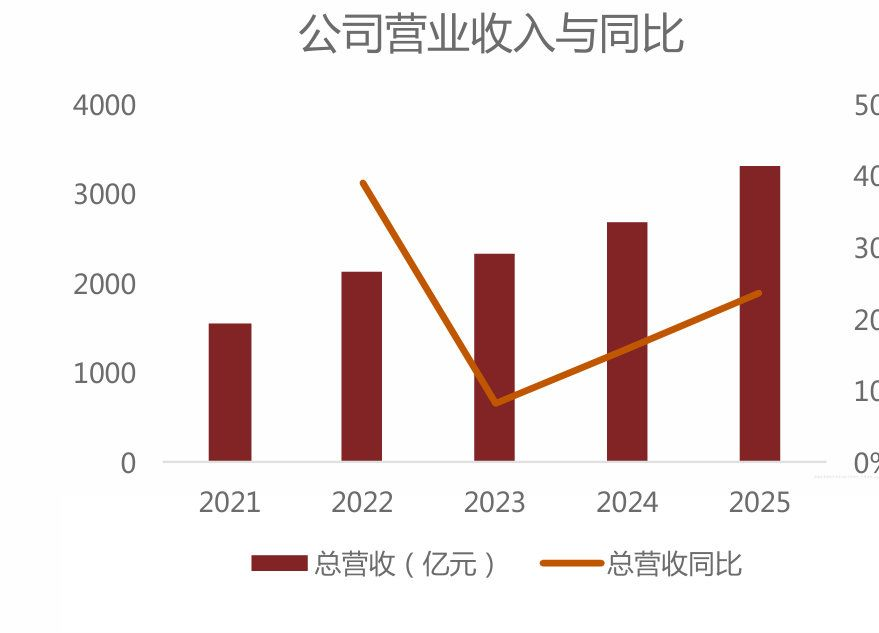

公司营业收入与同比（左轴：总营收（亿元），0–4000；右轴：总营收同比，0%–50%；横轴：2021、2022、2023、2024、2025；图例：总营收（亿元）、总营收同比）

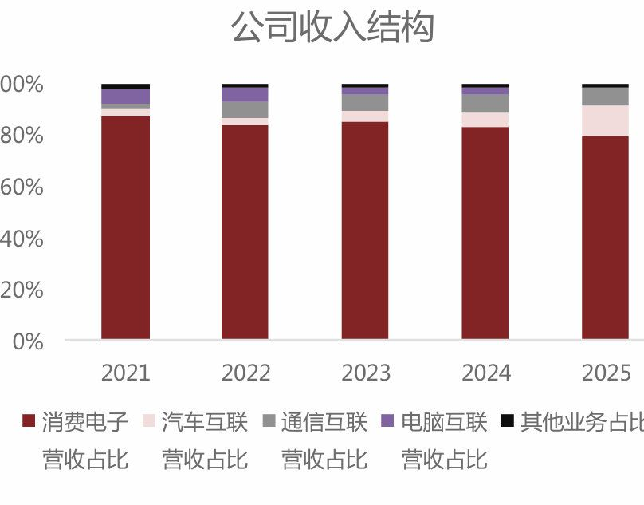

公司收入结构（左轴：营收占比，0%–50%；右轴：营收占比，0%–100%；横轴：2021、2022、2023、2024、2025；图例：消费电子营收占比、汽车互联营收占比、通信互联营收占比、电脑互联营收占比、其他业务占比）

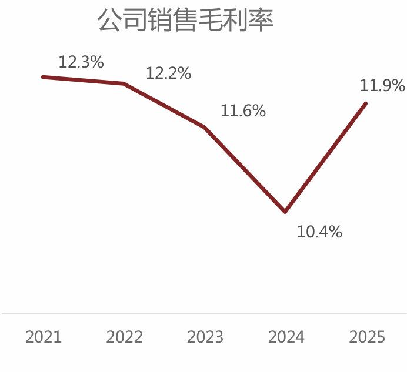

公司销售毛利率（纵轴：9%–13%；横轴：2021、2022、2023、2024、2025；数据标签：12.3%、12.2%、11.6%、10.4%、11.9%）

资料来源：公司年报、Choice、西南证券整理

[Source Page: 23]

## 3.2蓝思科技：iPhone Duo的UTG核心供应商，关注订单兑现带来业绩弹性

- **蓝思科技是全球消费电子精密结构件龙头企业**，业务覆盖消费电子、智能汽车、AI相关新兴领域。提供从核心组件(光学镜片、结构件)到整机组装的全产业链服务，深度绑定苹果、华为、特斯拉、Meta等核心客户。2025年，公司实现营业收入744.1亿元(同比+6.5%)；2025年公司毛利率为16.0%（同比+0.1pp）。2026年一季度业绩受手机需求、汇兑因素冲击出现亏损，但市场继续博弈苹果折叠iPhone带来UTG高价值订单。
- **目前蓝思科技计划发展AI智能终端业务，优化产品结构，抢占高端与创新赛道。** 公司主营业务、AI端侧、AI算力侧业务有望形成业绩共振。2026年下半年切入苹果公司折叠机供应链，供应UTG玻璃、CPI膜、支撑板、3D玻璃盖板等高价值零部件，2027年苹果公司折叠屏机型预计继续放量，前期布局的钛框、3D打印、3D玻璃等技术有望在高端机型落地，打开中长期业绩空间。蓝思科技持续加大研发投入与技术创新力度，公司2025年研发投入金额达28.7亿元（同比+3.1%），占营业收入3.9%。
- **公司持续紧跟全球头部客户产品迭代节奏，** 巩固中高端智能手机玻璃盖板、金属结构件龙头地位，重点推进折叠屏UTG、3D玻璃、钛金属中框、液态金属部件等高端产品量产，提高产品价值量；加速释放AI眼镜、XR头显、智能手表等智能穿戴产能，抓住市场渗透率增长机遇，扩大市场份额。

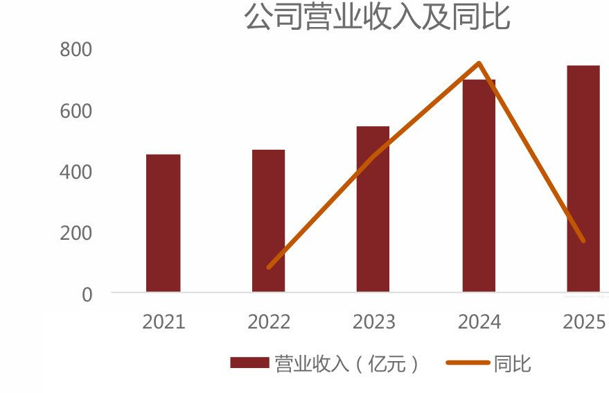

公司营业收入及同比（左轴：营业收入（亿元），0–800；右轴：同比，0%–30%；横轴：2021、2022、2023、2024、2025；图例：营业收入（亿元）、同比）

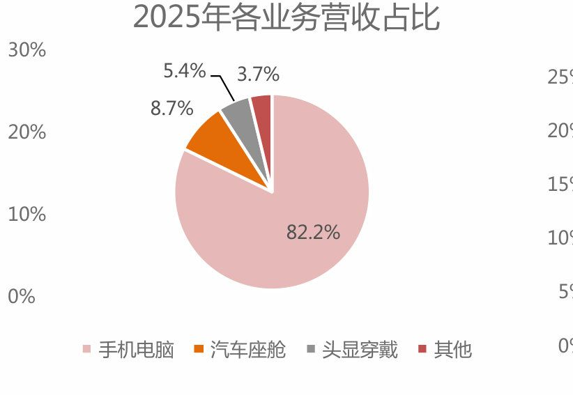

2025年各业务营收占比（饼图标签：手机电脑82.2%、汽车座舱8.7%、头显穿戴5.4%、其他3.7%）

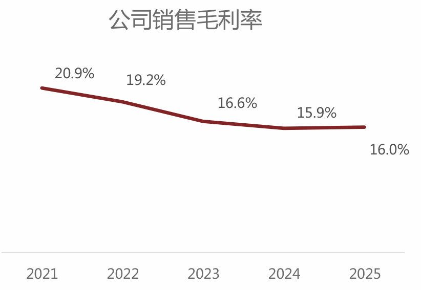

公司销售毛利率（纵轴：0%–25%；横轴：2021、2022、2023、2024、2025；数据标签：20.9%、19.2%、16.6%、15.9%、16.0%）

资料来源：公司年报、Choice、西南证券整理

[Source Page: 24]

## 3.3歌尔股份：果链占比持续下行，VR/AI眼镜为第二增长曲线，折叠机增量有限

- **歌尔股份是一家主营声学、光学、微电子、精密结构件等精密零组件研发、制造及销售的上市公司。** 2019-2021受益苹果TWS耳机迎来高速增长；2022年受AirPods Pro2整机订单调整冲击，利润大幅承压，公司推进客户多元化战略。
- **公司专注于消费电子、汽车电子等领域，目前主营业务包括精密零组件业务、智能声学整机业务和智能硬件业务。** 主营产品包括精密零组件、智能声学整机、智能硬件，电子元器件业务成为第一大收入来源（2026年上半年营业收入占比97.3%）。2026年上半年，公司积极布局端侧AI硬件产品相关的声学、传感器、系统级封装、精密光学、新材料与结构件等精密零组件领域，提高核心竞争力；并且在AI智能眼镜等新兴产品整机业务领域内具有稳固的客户关系和丰富的项目经验。目前，在VR/AR领域，Meta、苹果已成为歌尔股份的核心客户。2026年上半年公司实现营业收入400亿（同比+6.7%），电子元器件业务营业收入同比+7.4%。
- **公司当前主要向苹果供应声学零部件、可穿戴结构件。** 在苹果折叠iPhone业务中以声学小件配套为主，增量弹性有限。来自第一大客户的收入占比逐渐下降，Meta VR与AI眼镜业务构成公司最重要第二增长曲线。

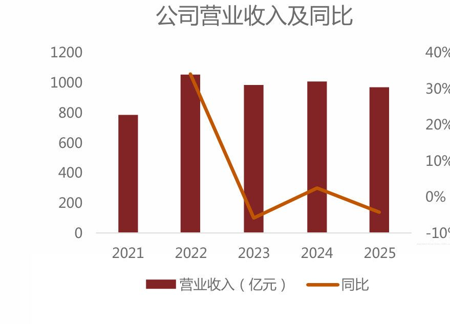

公司营业收入及同比（左轴：营业收入（亿元），0–1200；右轴：同比，-10%–40%；横轴：2021、2022、2023、2024、2025；图例：营业收入（亿元）、同比）

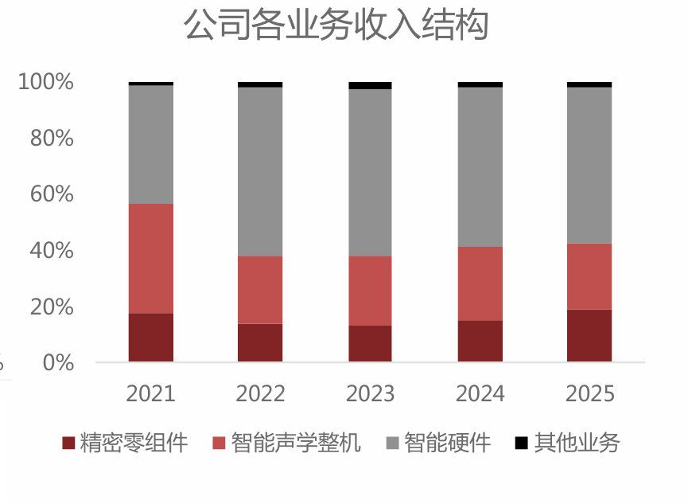

公司各业务收入结构（左轴：占比，-10%–40%；右轴：占比，0%–100%；横轴：2021、2022、2023、2024、2025；图例：精密零组件、智能声学整机、智能硬件、其他业务）

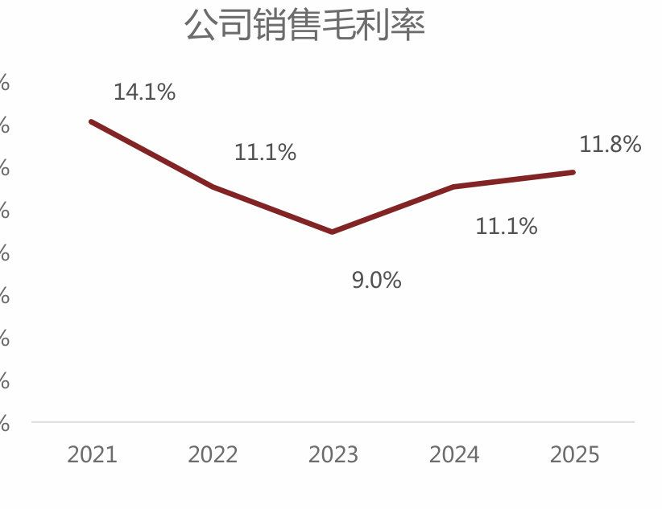

公司销售毛利率（纵轴：0%–16%；横轴：2021、2022、2023、2024、2025；数据标签：14.1%、11.1%、9.0%、11.1%、11.8%）

资料来源：公司年报、Choice、西南证券整理

[Source Page: 25]

## 3.4领益智造：折叠铰链二级核心供应商，重点跟踪良率与产能爬坡兑现情况

- **领益智造是一家AI终端硬件核心供应商**，在全球范围内为客户提供精密功能件、结构件、模组等一站式智能制造服务及解决方案，专注于新型电子元器件、手机及电脑配件研发制造。公司是苹果公司核心零部件供应商，2025年苹果贡献收入约98.5亿元，占总收入约19%，供货覆盖iPhone、iPad、Watch、Vision Pro。
- **公司2025年营业收入514.3亿（同比+16.2%），研发费用近年保持稳定。** AI终端为公司核心主业，2025年营业收入447.9亿，占比87.1%；汽车及低空经济业务高速增长，营业收入同比增长39.5%；其他业务基数较低，涨幅较大，公司第二增长曲线逐步兑现。
- **近期，公司已向苹果批量交付新一代折叠终端核心精密零部件**，覆盖铰链精密结构件、钛合金/碳纤维屏幕支撑板、折叠专用超薄均热板、带法兰超薄不锈钢电池壳模组。领益在铰链板块综合份额约80%，屏幕支撑层与铰链结构件被市场视作核心供货方，折叠机型行业测算综合单机配套价值约为传统直板iPhone的数倍。除折叠屏外，本次iPhone18 Pro系列常规机型，公司单机零部件价值量相比上代同样实现提升。

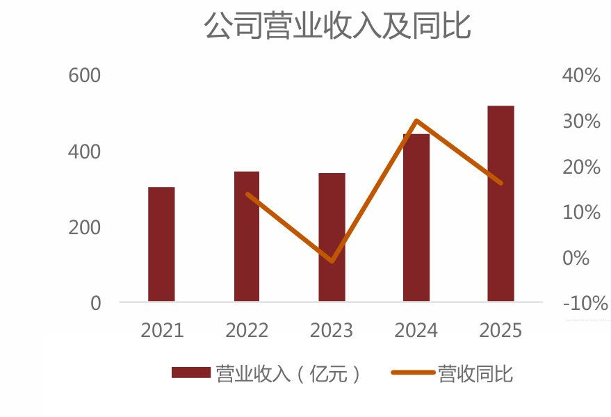

公司营业收入及同比（左轴：营业收入（亿元），0–600；右轴：营收同比，-10%–40%；横轴：2021、2022、2023、2024、2025；图例：营业收入（亿元）、营收同比）

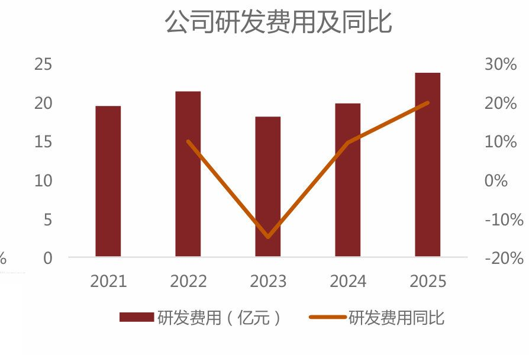

公司研发费用及同比（左轴：研发费用（亿元），0–25；右轴：研发费用同比，-20%–30%；横轴：2021、2022、2023、2024、2025；图例：研发费用（亿元）、研发费用同比）

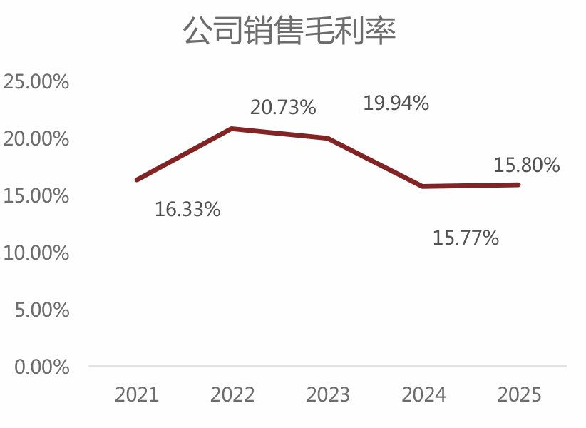

公司销售毛利率（纵轴：0.00%–25.00%；横轴：2021、2022、2023、2024、2025；数据标签：16.33%、20.73%、19.94%、15.77%、15.80%）

资料来源：公司年报、Choice、同花顺、西南证券整理

[Source Page: 26]

# 风险提示

- **终端需求不及预期风险**：全球智能手机行业已进入存量博弈阶段，若宏观经济疲软或折叠屏iPhone（iPhone Duo）因定价过高导致市场需求不及预期，将直接影响产业链相关公司的订单量及业绩兑现。
- **技术良率与产能爬坡风险**：折叠屏铰链结构极其复杂，对MIM、液态金属等工艺要求极高；同时UTG玻璃、3D打印等新工艺在大规模量产时存在良率管控难度。若良率提升不及预期或产能爬坡缓慢，将压制新机出货量并增加制造成本。
- **供应链竞争与客户集中风险**：果链企业普遍面临议价权较弱、毛利率承压的问题。折叠屏核心铰链总成环节仍由安费诺、新日兴等外资厂商把持，国内厂商多处于二级零部件供应，若无法持续切入高附加值环节或面临被剔除果链的风险，将对企业造成较大打击。此外，国内厂商还需面临行业竞争加剧导致份额被稀释的风险。
- **地缘政治与产能转移风险**：苹果持续推动供应链向印度、越南等新兴市场转移，若地缘政治摩擦加剧，或海外产能建设进度不及预期，可能导致国内供应商订单流失或增加跨国运营成本。
- **新技术渗透不及预期风险**：3D打印、液态金属等新工艺虽然前景广阔，但受制于设备成本、材料价格及下游终端厂商的跟进节奏，若行业渗透率提升缓慢，相关设备及耗材厂商的业绩弹性可能受限。

[Source Page: 27]

## 西南证券投资评级说明

报告中投资建议所涉及的评级分为公司评级和行业评级（另有说明的除外）。评级标准为报告发布日后6个月内的相对市场表现，即：以报告发布日后6个月内公司股价（或行业指数）相对同期相关证券市场代表性指数的涨跌幅作为基准。其中：A股市场以沪深300指数为基准，新三板市场以三板成指（针对协议转让标的）或三板做市指数（针对做市转让标的）为基准；香港市场以恒生指数为基准；美国市场以纳斯达克综合指数或标普500指数为基准。

| 评级类别 | 评级标准 |
| --- | --- |
| 公司评级 | 买入：未来6个月内，个股相对同期相关证券市场代表性指数涨幅在20%以上 |
| 公司评级 | 持有：未来6个月内，个股相对同期相关证券市场代表性指数涨幅介于10%与20%之间 |
| 公司评级 | 中性：未来6个月内，个股相对同期相关证券市场代表性指数涨幅介于-10%与10%之间 |
| 公司评级 | 回避：未来6个月内，个股相对同期相关证券市场代表性指数涨幅介于-20%与-10%之间 |
| 公司评级 | 卖出：未来6个月内，个股相对同期相关证券市场代表性指数涨幅在-20%以下 |
| 行业评级 | 强于大市：未来6个月内，行业整体回报高于同期相关证券市场代表性指数5%以上 |
| 行业评级 | 跟随大市：未来6个月内，行业整体回报介于同期相关证券市场代表性指数-5%与5%之间 |
| 行业评级 | 弱于大市：未来6个月内，行业整体回报低于同期相关证券市场代表性指数-5%以下 |

## 分析师承诺

报告署名分析师具有中国证券业协会授予的证券投资咨询执业资格并注册为证券分析师，报告所采用的数据均来自合法合规渠道，分析逻辑基于分析师的职业理解，通过合理判断得出结论，独立、客观地出具本报告。分析师承诺不曾因，不因，也将不会因本报告中的具体推荐意见或观点而直接或间接获取任何形式的补偿。

## 重要声明

西南证券股份有限公司（以下简称“本公司”）具有中国证券监督管理委员会核准的证券投资咨询业务资格。

本公司与作者在自身所知情范围内，与本报告中所评价或推荐的证券不存在法律法规要求披露或采取限制、静默措施的利益冲突。

《证券期货投资者适当性管理办法》于2017年7月1日起正式实施，本报告仅供本公司签约客户使用，若您并非本公司签约客户，为控制投资风险，请取消接收、订阅或使用本报告中的任何信息。本公司也不会因接收人收到、阅读或关注自媒体推送本报告中的内容而视其为客户。本公司或关联机构可能会持有报告中提到的公司所发行的证券并进行交易，还可能为这些公司提供或争取提供投资银行或财务顾问服务。

本报告中的信息均来源于公开资料，本公司对这些信息的准确性、完整性或可靠性不作任何保证。本报告所载的资料、意见及推测仅反映本公司于发布本报告当日的判断，本报告所指的证券或投资标的的价格、价值及投资收入可升可跌，过往表现不应作为日后的表现依据。在不同时期，本公司可发出与本报告所载资料、意见及推测不一致的报告，本公司不保证本报告所含信息保持在最新状态。同时，本公司对本报告所含信息可在不发出通知的情形下做出修改，投资者应当自行关注相应的更新或修改。

本报告仅供参考之用，不构成出售或购买证券或其他投资标的要约或邀请。在任何情况下，本报告中的信息和意见均不构成对任何个人的投资建议。投资者应结合自己的投资目标和财务状况自行判断是否采用本报告所载内容和信息并自行承担风险，本公司及雇员对投资者使用本报告及其内容而造成的一切后果不承担任何法律责任。

本报告及附录版权为西南证券所有，未经书面许可，任何机构和个人不得以任何形式翻版、复制和发布。如引用须注明出处为“西南证券”，且不得对本报告及附录进行有悖原意的引用、删节和修改。未经授权刊载或者转发本报告及附录的，本公司将保留向其追究法律责任的权利。

[Source Page: 28]

# 西南证券研究院

| 地区 | 地址 | 邮编 |
| --- | --- | --- |
| 上海 | 上海市浦东新区陆家嘴21世纪大厦10楼 | 200120 |
| 深圳 | 深圳市福田区益田路6001号太平金融大厦22楼 | 518038 |
| 北京 | 北京市西城区金融大街35号国际企业大厦A座8楼 | 100033 |
| 重庆 | 重庆市江北区金沙门路32号西南证券总部大楼21楼 | 400025 |

## 西南证券机构销售团队

| 区域 | 姓名 | 职务 | 手机 | 邮箱 | 姓名 | 职务 | 手机 | 邮箱 |
| --- | --- | --- | --- | --- | --- | --- | --- | --- |
| 上海 | 崔露文 | 上海公募销售主管 | 15642960315 | clw@swsc.com.cn | 毛玮琳 | 销售岗 | 18721786793 | mwl@swsc.com.cn |
| 上海 | 张方毅 | 私募销售主管 | 15821376156 | zfyi@swsc.com.cn | 张大炜 | 销售岗 | 13163027178 | zhangdaw@swsc.com.cn |
| 上海 | 戴剑箫 | 销售岗 | 13524484975 | daijx@swsc.com.cn | 张怀文 | 销售岗 | 18800275611 | zhanghuaiwen@swsc.com.cn |
| 上海 | 叶佳缘 | 销售岗 | 15800609605 | yejy@swsc.com.cn | 苏湖 | 销售岗 | 18913127448 | suhu1997@swsc.com.cn |
| 上海 | 贾文婷 | 销售岗 | 13621609568 | jiawent@swsc.com.cn |  |  |  |  |
| 北京 | 李杨 | 北京公募销售主管 | 18601139362 | yfly@swsc.com.cn | 王宇飞 | 销售岗 | 18500981866 | wangyuf@swsc.com.cn |
| 北京 | 姚航 | 北京保险销售主管 | 15652026677 | yhang@swsc.com.cn | 刘艳 | 销售岗 | 18456565475 | liuyanyj@swsc.com.cn |
| 北京 | 张岚 | 销售岗 | 18601241803 | zhanglan@swsc.com.cn | 李逸凡 | 销售岗 | 13906354066 | liyf@swsc.com.cn |
| 北京 | 杨薇 | 销售岗 | 15652285702 | yangwei@swsc.com.cn |  |  |  |  |
| 广深 | 高欣 | 广深销售主管 | 13923418464 | gaoxin@swsc.com.cn | 黄诗洁 | 销售岗 | 18817316880 | hsj@swsc.com.cn |
| 广深 | 龚之涵 | 销售岗 | 15808001926 | gongzh@swsc.com.cn | 周玥 | 销售岗 | 18580531950 | zhy1997@swsc.com.cn |
| 广深 | 文柳茜 | 销售岗 | 13750028702 | wlq@swsc.com.cn | 彭志伟 | 销售岗 | 15521604635 | pzhw@swsc.com.cn |
| 广深 | 林哲睿 | 销售岗 | 15602268757 | lzr@swsc.com.cn |  |  |  |  |

## Processing Notes

- 页码标记：转换稿用 `<!-- 原文第 N 页 -->` 注释与 `---` 分页线标记分页，已统一替换为 `[Source Page: N]`，1—28 页连续无缺页；未删除任何页内容。
- 断行/断词：原稿段落已完整，无跨页断句需要接续；主要修正为中文与拉丁字母、数字之间的多余空格（含百分号、加号一侧的空格），以及句读后、区间连字符前后的多余空格，共 97 处。
- 标点：中文语境中的半角逗号、分号统一为全角（如第 17 页「2.8亿台,同比增长9.2%」、第 11 页「复杂微型零件;CNC加工」）。
- 标题：第 21 页「目 录」与第 3、8 页目录标题统一为「目录」；其余标题层级沿用原稿，未新增或合并章节。
- 页眉页脚：原稿已无重复页眉、页脚、水印与孤立页码，无删除项；第 27 页评级标准与免责声明为实质内容，全部保留。
- 表格：原稿 13 处表格均已可确认行列关系，按原稿转为 Markdown 表格，未调整行列、未计算或补全空值（第 28 页销售团队表中空白单元格即原稿空白）；无 `[TABLE_RECONSTRUCTION_UNCERTAIN]` 残留。
- 图表：图片相对路径原样保留（`../_assets/1916628c1252df699a659fbe8d1ce8936442414f/`），对应 28 个图片文件已从 `materials_md/_assets/` 复制到清洗稿资源目录；图表多为无数据标签的柱/线/饼图，仅保留原稿的坐标轴、图例文字说明，未估读数值。
- OCR 标记：原稿无 `[OCR_UNCERTAIN]`、`[OCR_UNREADABLE]`，无需处理；未发现需在 Notes 说明的 OCR 错字纠正。
- 元数据：出版日期取文内封面「2026年11月」（文件名中亦有同一日期，与文内一致）；报告未给出明确报告期，Reporting Period 记为 null。
