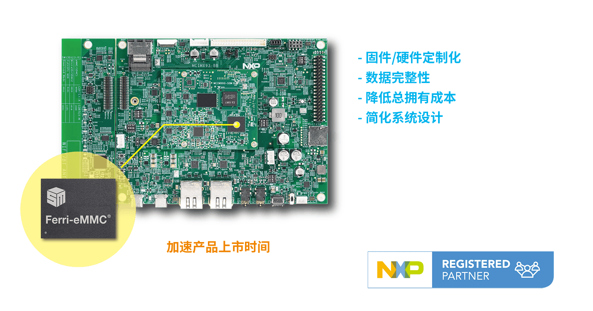

## Document Metadata

- Document ID: 18ea716b7b3ce84c327bb2d4fd438ed5ad0b44a3
- Document Title: 产品-Ferri-eMMC®-Silicon Motion
- Document Type: HTML
- Issuing Organization: Silicon Motion
- Publication Date: null
- Reporting Period: null
- Source File: [49_siliconmotion.com_detail.html](https://github.com/jadennevercode/CJCC-Knowledge-Base/blob/564ab11aa9785e569e3853c8a4d7ce86f88e7535/materials/%E4%B8%8B%E6%B8%B8%EF%BC%9A%E6%B1%BD%E8%BD%A6%E3%80%81%E5%B7%A5%E4%B8%9A%E5%8F%8A%E5%85%B6%E4%BB%96%E5%BA%94%E7%94%A8/49_siliconmotion.com_detail.html)

## Structured Content

> 原文件：[49_siliconmotion.com_detail.html](https://github.com/jadennevercode/CJCC-Knowledge-Base/blob/564ab11aa9785e569e3853c8a4d7ce86f88e7535/materials/%E4%B8%8B%E6%B8%B8%EF%BC%9A%E6%B1%BD%E8%BD%A6%E3%80%81%E5%B7%A5%E4%B8%9A%E5%8F%8A%E5%85%B6%E4%BB%96%E5%BA%94%E7%94%A8/49_siliconmotion.com_detail.html)
> 转换方式：HTML DOM → Markdown

# 产品-Ferri-eMMC®-Silicon Motion

##### Ferri 车用与物理 AI 解决方案

## Ferri-eMMC®

- [首页](https://www.siliconmotion.com/chs)
- [产品](https://www.siliconmotion.com/chs/products)
- [Ferri-eMMC®](javascript:;)

- [简介](https://www.siliconmotion.com/chs/products/Ferri-eMMC/detail#pro-0)
- [特点](https://www.siliconmotion.com/chs/products/Ferri-eMMC/detail#pro-1)
- [技术](https://www.siliconmotion.com/chs/products/Ferri-eMMC/detail#pro-2)
- [下载](https://www.siliconmotion.com/chs/products/Ferri-eMMC/detail#pro-3)
- [博客](https://www.siliconmotion.com/chs/products/Ferri-eMMC/detail#pro-4)
- [选购指南](https://www.siliconmotion.com/chs/products/Ferri-eMMC/detail#pro-997)

### 简介

随着人工智能在汽车、智能医疗、智慧城市、智能零售、工业自动化和 AIoT（智慧物联网）等领域的迅速发展，对可靠且超低功耗存储解决方案的需求显著增长，尤其是在车载信息娱乐系统 (IVI)、工业手持设备、工业 VR 和工业穿戴设备等移动和便携式设备领域。Ferri-eMMC 搭载慧荣科技独有的 IntelligentSeries™ 技术，专为满足人工智能驱动应用日益增长的需求而设计，提供数据完整性、耐用性、功率效率和安全性等功能，使其成为在苛刻环境下应用的可靠选择。

与 UFS 相比，eMMC 的功耗显著降低。UFS 的功耗范围为 400mA (UFS 2.2) 至 800mA (UFS 3.1)，而 eMMC 的功耗范围仅为 70-100mA。此外，许多传统 CPU 不支持 UFS，仅依赖于 eMMC，这使得 eMMC 成为此类系统的首选。eMMC 还提供了较高的性价比，成为入门级嵌入式产品的理想选择。


Ferri-eMMC 完全符合 JEDEC eMMC 5.1 标准，适用于广泛的嵌入式应用。它可提供 100-ball 和 153-ball BGA 封装，易于整合和生产，具备成本效益。Ferri-eMMC 采用业界认证的主控芯片技术和高品质 NAND 组件，确保关键系统的数据存储可靠性。其先进的 NAND 管理功能（包括纠错、坏块管理和运行状况监控），确保长期的耐用性和可靠性。

Ferri-eMMC 支持宽温范围，提供最高 256GB 存储容量，具备超低功耗和出色的可靠性，是在苛刻环境下使用的理想选择。它为人工智能、工业自动化和汽车应用领域提供了一个高性价比、低功耗的存储解决方案，因为在这些应用领域中，可靠性、耐用性和能效是至关重要的。

Ferri-eMMC 广泛应用于车载信息娱乐 (IVI) 系统，符合严格的汽车行业标准，如 AEC-Q100 三级认证、IATF 16949 供应链合规认证和车用维修包 (ASP) 认证。Ferri-UFS 拥有较低的 dPPM 率和较长的产品生命周期，非常适合汽车应用。其可定制的固件还为各种特定应用提供了灵活性。

#### 搭载 Ferri-eMMC® 的 NXP i.MX93 EVK - 领先的汽车平台



图中标示：固件/硬件定制化；数据完整性；降低总拥有成本；简化系统设计；加速产品上市时间；NXP REGISTERED PARTNER。

访问 SMI [生态系统合作伙伴](https://www.siliconmotion.com/partner/ecosystem-partners.html) 页面。

#### 应用

- [ AIoT（智慧物联网）和 IIoT（工业物联网）](https://www.siliconmotion.com/chs/company/blog/FrictionlessRetailStore/detail)
- [ 智慧城市和监控设备](https://www.siliconmotion.com/chs/company/blog/DigitalSurveillance/detail )
- [ 汽车和交通](https://www.siliconmotion.com/chs/download/3k7/a/FerriSSD_NAND_FLASH_for_Auto_WP_EN.pdf)
-  智慧医疗
-  通信和网络
-  工业自动化
-  工业可穿戴设备、VR（虚拟现实）和手持设备
- [ 机器人和无人机](https://www.siliconmotion.com/chs/company/blog/Revolutionizing_AI_Robotics/detail)
- [ 智慧零售和 POS](https://www.siliconmotion.com/chs/company/blog/FrictionlessRetailStore/detail)
-  Kiosk（自助服务亭）/数字标牌
-  服务器和精简型计算机
-  多功能打印机
- [ 游戏机](https://www.siliconmotion.com/chs/download/3g1/a/FerriSSD_Gaming_WP_EN.pdf)
-  智慧农业
-  智慧家庭

推动汽车创新

[更多](https://www.siliconmotion.com/application/chs/applications-automotive.html)

### 特点

##### 高效纠错

- 先进的硬件 LDPC (ECC) 引擎
- StaticDataRefresh™ 和 EarlyRetirement™ 技术确保数据可靠性

##### 功率效率

- 动态电源管理技术可提供多个省电模式

##### 先进的全区磨损均衡 (Global Wear Leveling) 技术提高可靠性

- 在所有使用的 NAND Flash 组件间，平均分布写入/删除次数
- 低 WAI，延长产品使用期限

##### 强大的数据保护

- 针对不稳定电源的高级系统级保护
- 多用户数据安全区
- PowerShield™ 和 DataPhoenix™ 技术可防止突然断电时的数据损坏

##### 车用制程和认证

- AEC-Q100 认证
- IATF 16949 供应链合规认证
- 车用维修包 (ASP)

### 技术

#### IntelligentSeries™ 技术

Ferri-eMMC 配备了一套智能数据保护机制，可满足不同应用系统的存储需求，并在各种可能发生数据丢失的环境中有效激活。

[了解更多](https://www.siliconmotion.com/chs/company/blog/Intelligent/detail)


###### IntelligentLog™

汽车/服务器智能智能检测系统（具备实时预警功能）


###### IntelligentGuard™

经验证固件保护的数据加密


###### IntelligentThermal™

HCTM / DCTM（热管理）


###### IntelligentFlush™

Power 技术提高稳定快速的写入性能


###### IntelligentImage™

图像内容预加载（SMT 回流焊）


###### IntelligentZones™

耐用性组 - 多命名空间等功能


###### IntelligentScan™

主动数据保护


###### IntelligentShield™

电源中断保护

### 下载

#### 产品目录

| 文件 | 下载 |
| --- | --- |
| [Ferri 嵌入式存储](https://www.siliconmotion.com/chs/download/DWsB/a/Ferri_Catalog_EN_202509.pdf) | [下载](https://www.siliconmotion.com/chs/download/DWsB/a/Ferri_Catalog_EN_202509.pdf) |

#### 白皮书

| 文件 | 下载 |
| --- | --- |
| [长期服役嵌入式平台的生命周期保障](https://www.siliconmotion.com/chs/download/DWwC/a/Ferri_Long_Service_WP_CHS.pdf) | [下载](https://www.siliconmotion.com/chs/download/DWwC/a/Ferri_Long_Service_WP_CHS.pdf) |
| [突破瓶颈： 高吞吐量医学成像系统的闪存设计考量](https://www.siliconmotion.com/chs/download/DWsA/a/Ferri_Medical_WP_CHS.pdf) | [下载](https://www.siliconmotion.com/chs/download/DWsA/a/Ferri_Medical_WP_CHS.pdf) |
| [Ferri 嵌入式存储解决方案 - 赋能人形机器人发展](https://www.siliconmotion.com/chs/download/DWs8/a/Ferri_Humanoid_Robots_Whitepaper_CHS.pdf) | [下载](https://www.siliconmotion.com/chs/download/DWs8/a/Ferri_Humanoid_Robots_Whitepaper_CHS.pdf) |
| [革新的人工智能机器人： Ferri 实时数据和耐久性解决方案](https://www.siliconmotion.com/chs/download/DWnw/a/Ferri_AI_Robotics_Whitepaper_CHS.pdf) | [下载](https://www.siliconmotion.com/chs/download/DWnw/a/Ferri_AI_Robotics_Whitepaper_CHS.pdf) |
| [如何解决无人售货商店数据整合的挑战](https://www.siliconmotion.com/chs/download/3oE/a/Ferri_Family_IoT_Retail_Store_WP_CHS.pdf) | [Download](https://www.siliconmotion.com/chs/download/3oE/a/Ferri_Family_IoT_Retail_Store_WP_CHS.pdf) |
| [因应现今汽车数据存储爆炸式增长的需求](https://www.siliconmotion.com/chs/download/3k7/a/FerriSSD_NAND_FLASH_for_Auto_WP_CHS.pdf) | [Download](https://www.siliconmotion.com/chs/download/3k7/a/FerriSSD_NAND_FLASH_for_Auto_WP_CHS.pdf) |
| [Ferri 产品如何为游戏设备提供安全、可靠的数据存储](https://www.siliconmotion.com/chs/download/3g1/a/FerriSSD_Gaming_WP_CHS.pdf) | [下载](https://www.siliconmotion.com/chs/download/3g1/a/FerriSSD_Gaming_WP_CHS.pdf) |
| [符合 AEC-Q100 标准的嵌入式存储](https://www.siliconmotion.com/chs/download/3fs/a/FerriSSD_AEC-Q100_WP_CHS.pdf) | [Download](https://www.siliconmotion.com/chs/download/3fs/a/FerriSSD_AEC-Q100_WP_CHS.pdf) |
| [优化车用嵌入式闪存存储器](https://www.siliconmotion.com/chs/download/3TZ/a/Ferri_Family_Optimizes_Embedded_WP_CHS.pdf) | [Download](https://www.siliconmotion.com/chs/download/3TZ/a/Ferri_Family_Optimizes_Embedded_WP_CHS.pdf) |

### 博客

### 选购指南

[TABLE_RECONSTRUCTION_UNCERTAIN] 原始 HTML 仅包含动态选购指南的模板和加载占位，未包含展开后的产品行、筛选选项或下载文件；本地无法重建具体数据。网页所引用的数据接口为 `https://www.siliconmotion.com/chs/products/Ferri-eMMC/api`，本次未能读取该接口。

原快照中可见的模板文字：

```text
Filters | {{ head.title }}
Filters
Reset All | {{ option }}
{{ item.title }} | Type | Document | {{ file.type }} | {{ file.document }} | × | {{ findOption(head.id, item.options, '--') }}
```


### SILICON MOTION COOKIES 通知

本网站使用cookies以提升您的使用体验、统计网络流量、相关数据分析及展示客制化的广告。继续使用本网站表示您同意我们使用cookies。有关更多信息，请参阅Silicon Motion 的[政策](https://www.siliconmotion.com/chs/policy)。

[同意](javascript:void(0))

## Processing Notes

- 选购指南依赖网页数据接口，本地 HTML 快照仅含模板变量且接口当前不可读取；保留原模板和不确定标记。附图已与原图核对。

- 原网页在 Ferri-eMMC 产品段落中写有“Ferri-UFS”，按原文保留；本地快照只含动态选购指南的模板，缺少展开后的产品数据。

- 自动处理未逐页核对原始文档；OCR 错字、表格与标题层级可能仍需人工复核。
- 选购指南未加载的数据不可重建，模板保留为原始文本并标记。
- HTML 快照没有可靠的原文页码。
