## Document Metadata

- Document ID: 3658cbc3ff1d979891355d1e1746ff618145db50
- Document Title: 寒武纪上半年营收高增，SK海力士投资新建DRAM/NAND晶圆厂
- Document Type: PDF
- Issuing Organization: 华鑫证券
- Publication Date: 2026-08-10
- Reporting Period: 2026-08-03 至 2026-08-07（周度行情区间）
- Source File: [M181_20260810-华鑫证券-华鑫证券半导体行业周报：寒武纪上半年营收高增，SK海力士投资新建DRAMNAND晶圆厂.pdf](https://github.com/jadennevercode/CJCC-Knowledge-Base/blob/5ec8511eb834073c8bfbd79c94af196282d483cf/materials/%E4%B8%AD%E6%B8%B8%EF%BC%9A%E4%BE%9B%E7%BB%99%E5%BD%A2%E6%88%90%E4%B8%8E%E4%BA%A7%E8%83%BD%E5%86%B3%E7%AD%96/M181_20260810-%E5%8D%8E%E9%91%AB%E8%AF%81%E5%88%B8-%E5%8D%8E%E9%91%AB%E8%AF%81%E5%88%B8%E5%8D%8A%E5%AF%BC%E4%BD%93%E8%A1%8C%E4%B8%9A%E5%91%A8%E6%8A%A5%EF%BC%9A%E5%AF%92%E6%AD%A6%E7%BA%AA%E4%B8%8A%E5%8D%8A%E5%B9%B4%E8%90%A5%E6%94%B6%E9%AB%98%E5%A2%9E%EF%BC%8CSK%E6%B5%B7%E5%8A%9B%E5%A3%AB%E6%8A%95%E8%B5%84%E6%96%B0%E5%BB%BADRAMNAND%E6%99%B6%E5%9C%86%E5%8E%82.pdf)

## Structured Content

> 原文件：[M181_20260810-华鑫证券-华鑫证券半导体行业周报：寒武纪上半年营收高增，SK海力士投资新建DRAMNAND晶圆厂.pdf](https://github.com/jadennevercode/CJCC-Knowledge-Base/blob/5ec8511eb834073c8bfbd79c94af196282d483cf/materials/%E4%B8%AD%E6%B8%B8%EF%BC%9A%E4%BE%9B%E7%BB%99%E5%BD%A2%E6%88%90%E4%B8%8E%E4%BA%A7%E8%83%BD%E5%86%B3%E7%AD%96/M181_20260810-%E5%8D%8E%E9%91%AB%E8%AF%81%E5%88%B8-%E5%8D%8E%E9%91%AB%E8%AF%81%E5%88%B8%E5%8D%8A%E5%AF%BC%E4%BD%93%E8%A1%8C%E4%B8%9A%E5%91%A8%E6%8A%A5%EF%BC%9A%E5%AF%92%E6%AD%A6%E7%BA%AA%E4%B8%8A%E5%8D%8A%E5%B9%B4%E8%90%A5%E6%94%B6%E9%AB%98%E5%A2%9E%EF%BC%8CSK%E6%B5%B7%E5%8A%9B%E5%A3%AB%E6%8A%95%E8%B5%84%E6%96%B0%E5%BB%BADRAMNAND%E6%99%B6%E5%9C%86%E5%8E%82.pdf)
> 转换方式：多模态逐页转录（页面图像 + 文本层交叉校验）

[Source Page: 1]

证券研究报告　行业周报

# 寒武纪上半年营收高增，SK海力士投资新建DRAM/NAND晶圆厂

## 半导体行业周报

投资评级：推荐（维持）

报告日期：2026年08月10日

- 分析师：庄宇
- SAC编号：S1050525120003
- 联系人：石俊烨
- SAC编号：S1050125060011

[Source Page: 2]

## 投资要点

### 寒武纪上半年营收高增，国产AI芯片龙头持续兑现业绩

8月7日晚间，国产AI芯片龙头寒武纪发布2026年半年度报告，业绩持续高增。上半年实现营业收入59.96亿元，同比增长108.13%；归属于上市公司股东的净利润23.11亿元，同比增长122.61%；扣非净利润约21.66亿元，同比增长137.30%；基本每股收益3.68元，同比提升119.05%。公司表示，营收增长主要系持续拓展市场、积极助力人工智能应用落地所致。截至2026H1，公司总资产达181.99亿元，较上年末增长35.43%；净资产135.55亿元，增长14.53%。

### SK海力士投资约54.3万亿韩元新建龙仁Y2及清州M17晶圆厂

8月7日消息，韩国存储芯片大厂SK海力士宣布，公司董事会决议通过，将投资54.3万亿韩元（约合人民币2600亿元）分别在韩国龙仁和清州新建晶圆厂。其中龙仁"Y2"晶圆厂投资35.2万亿韩元，清州"M17"晶圆厂投资19.1万亿韩元。该计划是落实公司2026年6月公布的中长期投资策略的关键进展。

龙仁Y2晶圆厂总建筑面积约113万平方米，计划2026年7月开工，2029年6月启用首个无尘室，主要生产HBM等新一代DRAM产品。清州M17晶圆厂总建筑面积约68万平方米，计划2027年2月动工，2028年12月启用首座无尘室。SK海力士此前已将龙仁半导体集群的整体竣工时间由原定的2045年大幅提前至2033年，完成四座晶圆厂的全部建设。根据市场调查机构Omdia预测，从2025年至2030年，DRAM和NAND Flash市场需求年平均增长率将达19%。SK海力士表示，存储芯片已从普通零部件升级为决定AI性能的核心基础设施，进入结构性增长阶段。

建议关注：长鑫科技、华虹宏力、兴森科技、寒武纪。

[Source Page: 3]

## 风险提示

- 半导体出口管制及制裁加码风险
- 晶圆厂扩产进度不及预期风险
- 核心技术研发进展不及预期风险
- 地缘政治环境不稳定风险
- 重点覆盖公司业绩不及预期风险

[Source Page: 4]

## 重点关注公司及盈利预测

| 公司代码 | 名称 | 2026-08-10股价 | EPS 2025 | EPS 2026E | EPS 2027E | PE 2025 | PE 2026E | PE 2027E | 投资评级 |
| --- | --- | --- | --- | --- | --- | --- | --- | --- | --- |
| 002436.SZ | 兴森科技 | 33.44 | 0.08 | 0.26 | 0.44 | 418.00 | 128.62 | 76.00 | 买入 |
| 688256.SH | 寒武纪 | 1124.00 | 5.25 | 8.05 | 12.17 | 214.10 | 139.63 | 92.36 | 买入 |
| 688347.SH | 华虹宏力 | 264.00 | 0.01 | 0.51 | 0.83 | 26400.00 | 517.65 | 318.07 | 增持 |
| 688825.SH | 长鑫科技 | 51.30 | 0.03 | 2.17 | 3.66 | 1710.00 | 23.64 | 14.02 | 买入 |

资料来源：Wind，华鑫证券研究

[Source Page: 5]

## 目录

CONTENTS

1. 半导体板块周度行情分析
2. 行业高频数据
3. 行业动态
4. 公司公告

[Source Page: 6]

## 01半导体板块周度行情分析

[Source Page: 7]

## 1.1、周涨幅排行

8月3日-8月7日当周，海外龙头总体呈震荡分化态势。其中，稳懋领涨，涨幅为24.28%，艾睿电子领跌，跌幅为6.03%。

**图表2：海外半导体龙头估值水平及周涨幅（%）**

| 证券代码 | 证券简称 | 国家/地区 | 市值（亿元） | PE(LYR) | PB(MRQ) | 周涨跌幅（%） |
| --- | --- | --- | --- | --- | --- | --- |
| INTC.O | 英特尔(INTEL) | 美国 | 5127.23 | -1920.31 | 5.86 | 12.69 |
| QCOM.O | 高通(QUALCOMM) | 美国 | 1762.53 | 31.81 | 6.37 | 13.72 |
| AMD.O | 超威半导体(AMD) | 美国 | 7890.73 | 182.02 | 11.74 | 1.51 |
| NVDA.O | 英伟达(NVIDIA) | 美国 | 54198.32 | 45.14 | 27.73 | 11.56 |
| MU.O | 美光科技(MICRON TECHNOLOGY) | 美国 | 9911.22 | 116.07 | 9.84 | 6.63 |
| TXN.O | 德州仪器(TEXAS INSTRUMENTS) | 美国 | 2612.62 | 52.54 | 14.51 | 3.75 |
| ADI.O | 亚德诺(ANALOG) | 美国 | 1899.30 | 83.77 | 5.63 | 6.13 |
| AVGO.O | 博通(BROADCOM) | 美国 | 20351.03 | 88.00 | 23.21 | 9.88 |
| NXPI.O | 恩智浦半导体(NXP SEMICONDUCTORS) | 荷兰 | 604.46 | 29.91 | 5.30 | 4.60 |
| SWKS.O | 思佳讯(SKYWORKS) | 美国 | 106.26 | 22.27 | 1.85 | 13.39 |
| QRVO.O | QORVO | 美国 | 87.41 | 25.79 | 2.52 | 9.40 |
| STM.N | 意法半导体 | 荷兰 | 500.72 | 301.64 | 2.84 | 7.08 |
| ON.O | 安森美半导体(ON SEMICONDUCTOR) | 美国 | 316.00 | 261.16 | 4.38 | -0.54 |
| IFX.DF | 英飞凌科技 | 德国 | 810.72 | 79.87 | 4.50 | 0.66 |
| 3008.TW | 大立光 | 中国台湾 | 5735.50 | 26.96 | 2.99 | 8.67 |
| AMAT.O | 应用材料(APPLIED MATERIAL) | 美国 | 4280.55 | 61.17 | 17.90 | 6.20 |
| LRCX.O | 拉姆研究(LAM RESEARCH) | 美国 | 3895.85 | 53.62 | 31.24 | 6.26 |
| KLAC.O | 科天半导体(KLA) | 美国 | 2588.40 | 53.58 | 40.76 | 8.36 |
| ASML.O | 阿斯麦 | 荷兰 | 6856.55 | 60.90 | 27.67 | 6.87 |
| 6488.TWO | 环球晶圆 | 中国台湾 | 4169.15 | 57.02 | 4.46 | 1.99 |
| 2330.TW | 台积电 | 中国台湾 | 705780.28 | 36.20 | 9.55 | -2.27 |
| GFS.O | 格芯(GLOBALFOUNDRIES) | 开曼群岛 | 295.94 | 33.44 | 2.50 | 7.88 |
| 3105.TWO | 稳懋 | 中国台湾 | 1551.62 | 91.61 | 3.79 | 24.28 |
| ASX.N | 日月光投资 | 中国台湾 | 832.64 | 64.52 | 7.62 | 6.31 |
| ARW.N | 艾睿电子(ARROW ELECTRONICS) | 美国 | 103.60 | 18.13 | 1.48 | -6.03 |
| AVT.O | 安富利(AVNET) | 美国 | 79.18 | 23.68 | 1.58 | 8.66 |

资料来源：wind，华鑫证券研究

[Source Page: 8]

## 1.2、申万一级行业估值水平

8月3日-8月7日当周，申万半导体指数整体呈现反弹态势。8月7日，申万半导体指数为10186.81，周涨幅为9.99%。

**图表3：近5年申万半导体指数**

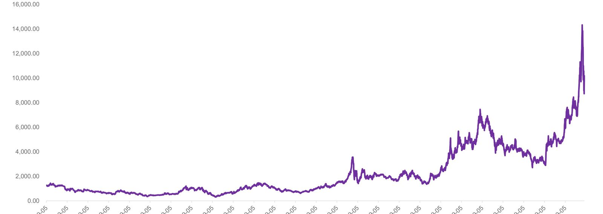

纵轴刻度：0.00 / 2,000.00 / 4,000.00 / 6,000.00 / 8,000.00 / 10,000.00 / 12,000.00 / 14,000.00 / 16,000.00；横轴：2000-09-05至2025-09-05，每半年一个刻度。

资料来源：wind，华鑫证券研究　注：按申万行业二级分类

[Source Page: 9]

## 1.3、半导体细分板块周度行情梳理

半导体细分板块比较，8月3日-8月7日当周，半导体细分板块全部上涨。其中，半导体材料板块涨幅最大，达到20.22%；数字芯片设计板块涨幅最小，达到7.30%。估值方面，半导体材料、模拟芯片设计、分立器件板块估值水平位列前三。

**图表4：8月3日-8月7日半导体主要指数周涨跌幅比较（%）**

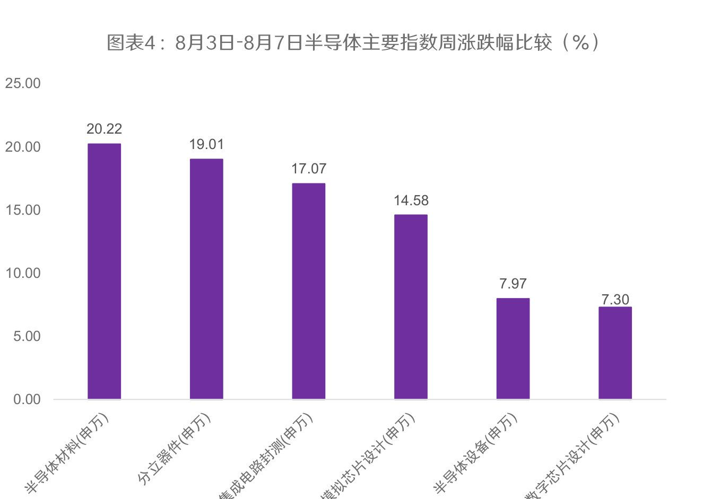

- 半导体材料(申万)：20.22
- 分立器件(申万)：19.01
- 集成电路封测(申万)：17.07
- 模拟芯片设计(申万)：14.58
- 半导体设备(申万)：7.97
- 数字芯片设计(申万)：7.30

**图表5：8月7日半导体主要指数市盈率（TTM）比较**

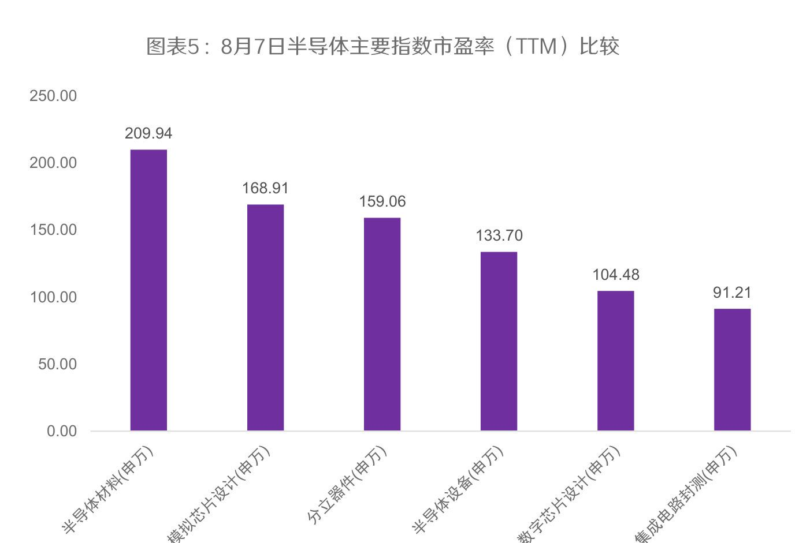

- 半导体材料(申万)：209.94
- 模拟芯片设计(申万)：168.91
- 分立器件(申万)：159.06
- 半导体设备(申万)：133.70
- 数字芯片设计(申万)：104.48
- 集成电路封测(申万)：91.21

资料来源：wind，华鑫证券研究

[Source Page: 10]

## 1.4、申万二级行业板块资金流向

上周申万行业资金流向情况：

其他电源设备Ⅱ板块主力净流入19.08亿元，主力净流入率为2.21%，在9个二级子行业中排第1名；航天装备Ⅱ板块主力净流出2.71亿元，主力净流入率为-0.86%，在9个子行业中排第9名。

**图表6：8月3日-8月7日申万行业资金流向情况**

| 行业 | 主力流入额(万元) | 主力流出额(万元) | 主力净流入额(万元) | 主力净流入率(%) | 连续流入天数 |
| --- | --- | --- | --- | --- | --- |
| SW其他电源设备Ⅱ | 2,801,443.02 | 2,610,684.37 | 190,758.65 | 2.21 | 5 |
| SW通信设备 | 47,880,745.35 | 46,087,882.82 | 1,792,862.53 | 1.82 | -1 |
| SW军工电子Ⅱ | 3,580,021.68 | 3,420,998.46 | 159,023.22 | 1.32 | 1 |
| SW电子化学品Ⅱ | 7,710,517.64 | 7,445,498.34 | 265,019.29 | 1.20 | 4 |
| SW其他电子Ⅱ | 2,730,882.59 | 2,628,445.22 | 102,437.38 | 1.15 | 1 |
| SW消费电子 | 15,119,691.51 | 14,789,208.62 | 330,482.89 | 0.83 | 1 |
| SW半导体 | 78,074,234.83 | 77,482,599.51 | 591,635.31 | 0.32 | 1 |
| SW计算机设备 | 5,742,914.22 | 5,750,216.33 | -7,302.11 | -0.04 | -2 |
| SW航天装备Ⅱ | 660,149.51 | 687,242.64 | -27,093.13 | -0.86 | -4 |

资料来源：wind，华鑫证券研究

[Source Page: 11]

## 1.5、半导体板块公司周涨幅前十股票

8月3日-8月7日当周，半导体板块公司周涨幅前十个股：科翔股份，方邦股份，腾景科技，沃格光电，富信科技，天孚通信，和林微纳，芯碁微装，菲沃泰，汇成股份，周涨幅分别为：54.62%，41.53%，38.95%，38.18%，36.85%，34.89%，33.58%，31.29%，30.21%，27.72%。

图表7：半导体板块公司周涨幅前十股票

| 证券代码 | 证券简称 | 市值（亿元） | EPS 2025 | EPS 2026E | EPS 2027E | PE 2025 | PE 2026E | PE 2027E | PB | 周涨跌幅（%） |
| --- | --- | --- | --- | --- | --- | --- | --- | --- | --- | --- |
| 300903.SZ | 科翔股份 | 314.92 | -0.59 | 0.31 | 0.82 | -118.62 | 235.61 | 88.28 | 17.25 | 54.62 |
| 688020.SH | 方邦股份 | 120.44 | -1.02 | 0.03 | 0.38 | -151.68 | 4976.87 | 387.39 | 9.15 | 41.53 |
| 688195.SH | 腾景科技 | 271.89 | 0.55 | 1.00 | 1.26 | 364.88 | 210.77 | 119.51 | 27.28 | 38.95 |
| 603773.SH | 沃格光电 | 213.68 | -0.71 | 1.45 | 0.68 | -157.33 | 66.15 | 140.58 | 20.23 | 38.18 |
| 688662.SH | 富信科技 | 103.81 | 0.45 | - | - | 254.67 | - | - | 14.76 | 36.85 |
| 300394.SZ | 天孚通信 | 2516.32 | 2.59 | 4.18 | 5.53 | 124.71 | 77.43 | 58.51 | 46.03 | 34.89 |
| 688661.SH | 和林微纳 | 164.90 | 0.20 | 0.77 | 1.66 | 553.47 | 140.94 | 65.57 | 13.71 | 33.58 |
| 688630.SH | 芯碁微装 | 609.60 | 2.20 | 3.73 | 4.88 | 210.26 | 123.90 | 94.81 | 11.41 | 31.29 |
| 688371.SH | 菲沃泰 | 95.88 | 0.09 | 0.19 | 0.30 | 317.37 | 149.81 | 94.93 | 4.95 | 30.21 |
| 688403.SH | 汇成股份 | 250.76 | 0.18 | 0.22 | 0.26 | 162.06 | 115.56 | 97.19 | 5.66 | 27.72 |

资料来源：wind，华鑫证券研究。

[Source Page: 12]

## 02行业高频数据

[Source Page: 13]

## 2.1、半导体：费城半导体指数

海外方面，8月3日-8月7日当周，费城半导体指数总体呈现震荡反弹态势，2026年8月7日下跌至12356.79。更长时间维度上来看，2023年年底开始持续上涨。2024年上半年整体处于上升态势，7月出现大幅回调，8月处于震荡下行行情，9月出现探底回升，四季度总体处于震荡的态势。2025年一季度呈现先涨后跌的走势，4月后逐渐回升，二季度三季度均呈现震荡上行的态势。2026年七月以来，指数在6月达到阶段高点后持续回落，7月下旬触底后呈现震荡回升态势。

图表8：费城半导体指数近两年走势

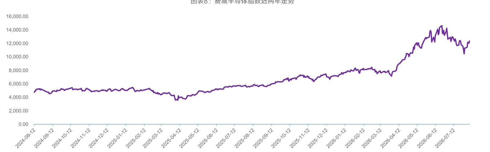

纵轴刻度：0.00至16,000.00；横轴：2024-08-12至2026-07-12。
图线无数据标签，未标注具体数值。

资料来源：wind，华鑫证券研究。

[Source Page: 14]

## 2.2、半导体：台湾半导体行业

此外，我们选取台湾半导体行业指数来观察行业整体景气。近两周来看，7月27日-8月7日两周，台湾半导体行业指数呈现震荡态势。近两年来看，2024年二季度台湾半导体指数呈现上涨的态势，随后进入震荡行情。2025年一季度台湾半导体指数进入下跌的行情，随后进入上行的趋势。2026年七月以来，指数在月初达到阶段高点后持续回落，呈现震荡下跌态势。

图表9：台湾半导体行业指数近两年走势

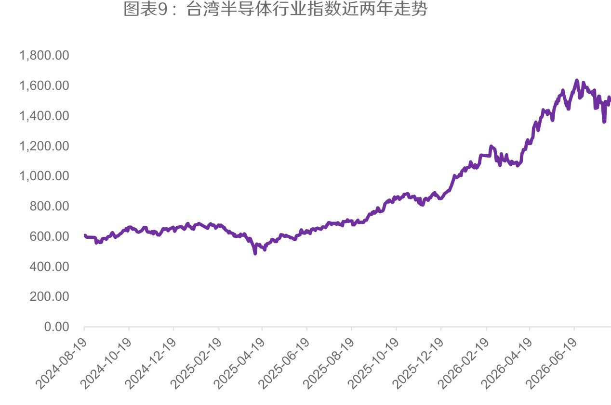

纵轴刻度：0.00至1,800.00；横轴：2024-08-19至2026-06-19。
图线无数据标签，未标注具体数值。

图表10：台湾半导体行业指数近两周走势

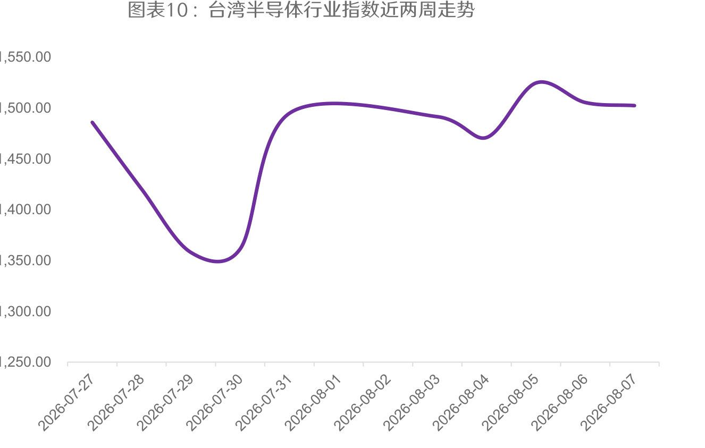

纵轴刻度：1,250.00至1,550.00；横轴：2026-07-27至2026-08-07。
图线无数据标签，未标注具体数值。

资料来源：wind，华鑫证券研究。

[Source Page: 15]

## 2.3、半导体：中国台湾IC产值同比增速

我们可以通过中国台湾IC产值同比增速，将电子各板块合在一起观察：

中国台湾IC各板块产值同比增速自2021年以来持续下降，从2023年Q2开始陆续有所反弹，各板块产值降幅均有所收窄。IC板块整体表现不佳，主要因为消费电子需求差，导致IC设计下滑，加之2021年缺货、涨价导致的2022年库存水位上升。但随着AI、5G、汽车智能化等应用领域的推动，2024年需求开始逐步回升。2025年，中国台湾IC设计、IC制造以及晶圆代工产值同比增速小幅下滑；中国台湾IC封装、测试业产值同比增速为维持平稳的增速；中国台湾存储器制造业进入下半年来，产值同比大幅提升。2026年一季度，中国台湾IC各板块产值同比增速全面上行。在AI算力需求持续旺盛及存储器行业周期复苏的推动下，2026年Q1中国台湾IC产业景气度显著上行。

图表11：中国台湾IC各板块产值当季同比变化（%）

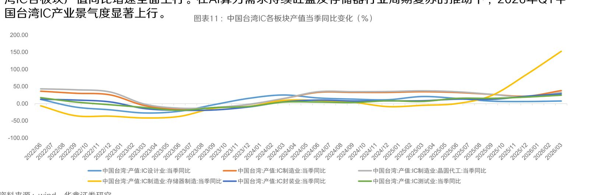

纵轴刻度：-100.00至200.00；横轴：2022/06至2026/03。
图例：中国台湾:产值:IC设计业:当季同比；中国台湾:产值:IC制造业:当季同比；中国台湾:产值:IC制造业:晶圆代工:当季同比；中国台湾:产值:IC制造业:存储器制造:当季同比；中国台湾:产值:IC封装业:当季同比；中国台湾:产值:IC测试业:当季同比。
图线无数据标签，未标注具体数值。

资料来源：wind，华鑫证券研究。

[Source Page: 16]

## 2.4、半导体：全球半导体销售额

全球半导体销售额自2024年年底出现小幅下降。2025年4月以来，全球半导体销售额呈现逐月攀升的态势，半导体行业景气度提升显著，2025年6月增速开始放缓，7-10月增速开始回升。2026年6月，全球半导体当月销售额为1344.5亿美元，同比增长123.60%。其中，中国销售额为361.10亿美元，环比增长10.39%，占比达26.86%。

图表12：全球半导体销售额（单位：十亿美元）

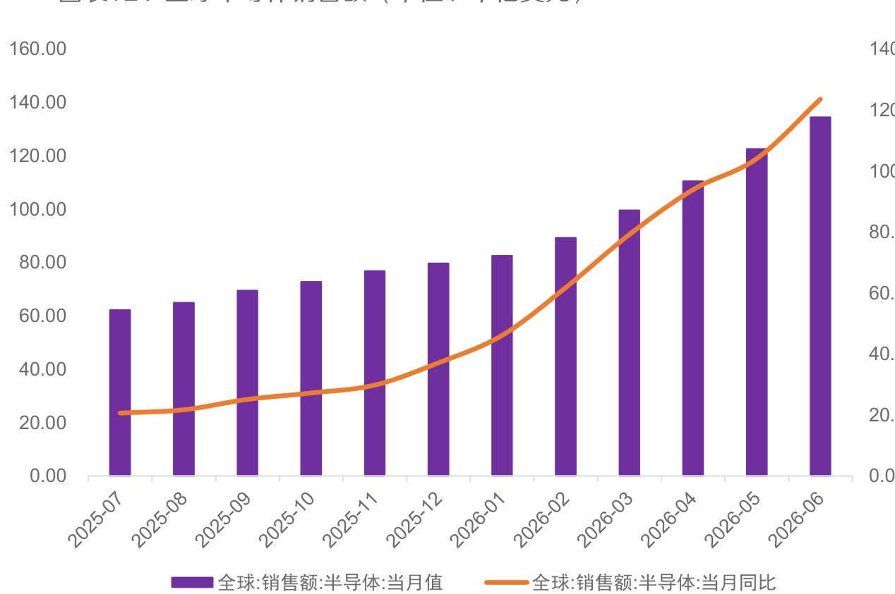

左纵轴刻度：0.00至160.00；右纵轴刻度：0.00至140.00；横轴：2025-07至2026-06。
图例：全球:销售额:半导体:当月值；全球:销售额:半导体:当月同比。
图柱与图线均无数据标签，未标注具体数值。

图表13：全球半导体销售额按地区划分（单位：十亿美元）

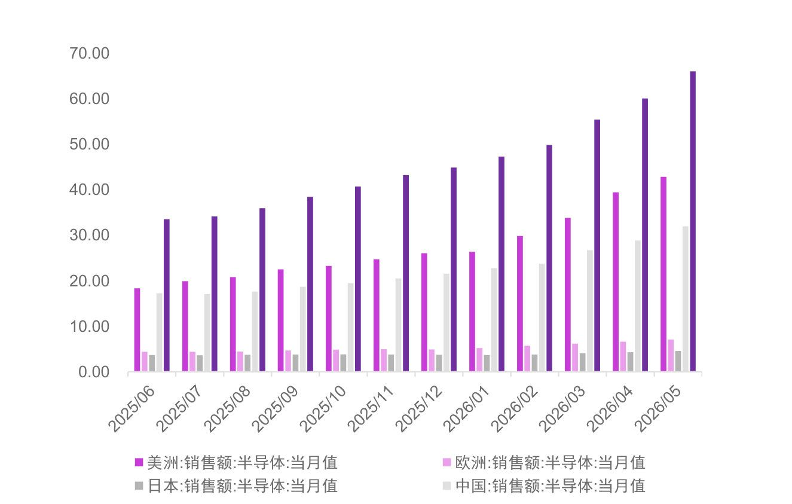

纵轴刻度：0.00至70.00；横轴：2025/06至2026/05。
图例：美洲:销售额:半导体:当月值；欧洲:销售额:半导体:当月值；日本:销售额:半导体:当月值；中国:销售额:半导体:当月值。
图柱无数据标签，未标注具体数值。

资料来源：wind，华鑫证券研究。

[Source Page: 17]

## 2.5、半导体：全球主要地区的半导体设备当季销售额

2005年以来，全球主要地区的半导体设备当季销售额呈现上升的趋势。2008~2009年，受全球金融危机等因素影响，各地区半导体设备销售额大多出现下滑。2020~2025年，随着5G、人工智能等技术发展带来的半导体需求增加，全球半导体整体呈现增长态势，中国大陆和中国台湾增长较为显著。2026年一季度，中国大陆半导体设备销售额达到109.9亿美元，同比增长7.12%，环比下降16.30%，占全球主要地区比重达34.56%。

图表14：全球半导体设备销售额（十亿美元）

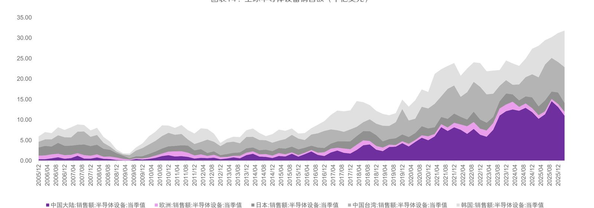

纵轴刻度：0.00至35.00；横轴：2005/12至2025/12（季频）。
图例：中国大陆:销售额:半导体设备:当季值；欧洲:销售额:半导体设备:当季值；日本:销售额:半导体设备:当季值；中国台湾:销售额:半导体设备:当季值；韩国:销售额:半导体设备:当季值。
面积图无数据标签，未标注具体数值。

资料来源：wind，华鑫证券研究。

[Source Page: 18]

## 2.6、半导体：中国进口半导体设备数量

从中国进口半导体设备数量的维度来看，2023年以来，中国的半导体设备进口数量整体呈现平稳的态势。2026年1-2月进口数量阶段性回落，3月起持续回升，6月达7583台，4-5月连续两月维持在较高水平，显示国内晶圆厂扩产需求旺盛。

图表15：中国半导体设备及制造半导体器件或集成电路用装置进口数量（台）

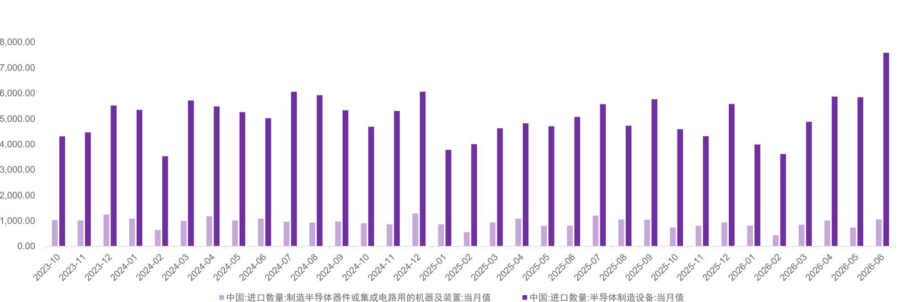

纵轴刻度：0.00至8,000.00；横轴：2023-10至2026-06。
图例：中国:进口数量:制造半导体器件或集成电路用的机器及装置:当月值；中国:进口数量:半导体制造设备:当月值。
图柱无数据标签，未标注具体数值。

资料来源：wind，华鑫证券研究。

[Source Page: 19]

## 2.7、半导体：海外市场半导体设备出口额

从海外市场半导体设备出口额的维度来看，2019年以来，韩国和中国台湾的半导体设备出口金额整体维持平稳的态势，日本半导体设备出口额整体呈现上升趋势。2026年以来，日本半导体设备出口额持续攀升并创阶段新高；韩国出口额近期大幅回升，中国台湾出口额高位有所回落。

图表16：海外市场半导体设备出口金额（百万美元）

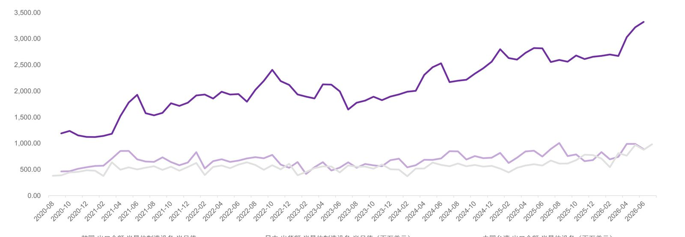

纵轴刻度：0.00至3,500.00；横轴：2020-08至2026-06。
图例：韩国:出口金额:半导体制造设备:当月值；日本:出货额:半导体制造设备:当月值（百万美元）；中国台湾:出口金额:半导体设备（百万美元）。
图线无数据标签，未标注具体数值。

资料来源：wind，华鑫证券研究。

[Source Page: 20]

## 2.8、半导体：晶圆制造

晶圆制造方面，2018年至2025年9月，国产晶圆代工厂商中芯国际8英寸晶圆月产能从约45万片稳步提升至约102.3万片，实现翻倍以上增长，并历经稳步爬升、加速扩张及快速扩产三个阶段，尤其在行业调整期间中芯仍坚持逆周期布局，为后续复苏储备了充足产能。

产能利用率清晰地映射行业周期，从2020-2022年高景气期多次超过100%，到2023年下行期下滑至68.1%，随后自2023年第三季度起强劲反弹，至2025年第三季度已恢复至95.8%的高位，接近满产状态。在产能大幅扩张与利用率快速回升的共同推动下，季度出货量规模显著跃升，2025年第三季度达到近250万片，创历史新高，即便利用率未及上轮峰值，实际产出总量已远超以往。2026年一季度8英寸晶圆出货量达到约250.9万片，维持历史高位。

整体来看，国产晶圆代工厂通过逆周期扩产把握了复苏机遇，出货规模的突破体现规模效应增强，也印证了汽车电子、工业控制、物联网等领域对成熟制程芯片需求的持续性与增长潜力。

图表17：国产晶圆代工厂产能、出货量、产能利用率数据（单位：片）

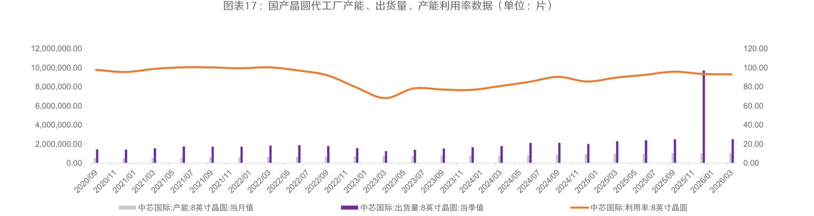

左纵轴（片）刻度：0.00至12,000,000.00；右纵轴（%）刻度：0.00至120.00；横轴：2020/09至2026/03。
图例：中芯国际:产能:8英寸晶圆:当月值；中芯国际:出货量:8英寸晶圆:当季值；中芯国际:利用率:8英寸晶圆。
图柱与图线均无数据标签，未标注具体数值。

资料来源：wind，华鑫证券研究。

[Source Page: 21]

## 2.9、半导体：存储芯片

存储芯片方面，由于AI存力需求提升以及海外大厂产能切换HBM等缘故，导致传统DRAM以及NAND类存储芯片价格大幅攀升。NAND方面：Wafer:512GbTLC现货平均价从2024年3月底进入小幅回升，10月出现小幅下跌后变化趋于平缓，2025年3月以来小幅上涨，4月后价格略有下滑，7月后价格进入加速上涨阶段。2026年8月3日价格为20.13美元。

DRAM方面：DDR5(16Gb,4800/5600Mbps)现货平均价自2025年以来呈现大幅上涨态势，2026年3月初约39.67美元，此后延续上涨，截至8月7日价格已达51.60美元。DDR4各规格产品分化运行，16Gb(2Gx8)3200Mbps现货价由6月18日的69.13美元进一步升至8月7日的86.27美元，16Gb(1Gx16)3200Mbps现货价由6月18日的66.00美元回落至8月7日的60.17美元。整体来看，在AI需求拉动及供给端产能转向HBM的背景下，DRAM价格整体延续分化上涨态势，主流规格持续走高，部分规格高位震荡回调。

图表18：DRAM价格（单位：美元）

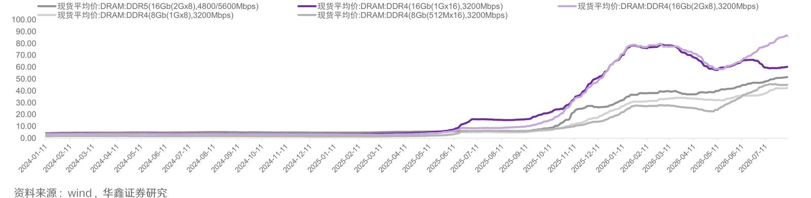

图例：现货平均价:DRAM:DDR5(16Gb(2Gx8),4800/5600Mbps)；现货平均价:DRAM:DDR4(16Gb(1Gx16),3200Mbps)；现货平均价:DRAM:DDR4(16Gb(2Gx8),3200Mbps)；现货平均价:DRAM:DDR4(8Gb(1Gx8),3200Mbps)；现货平均价:DRAM:DDR4(8Gb(512Mx16),3200Mbps)。纵轴：0.00至100.00，单位美元；横轴：2024-01-11至2026-07-11。

资料来源：wind，华鑫证券研究

[Source Page: 22]

## 2.9、半导体：存储芯片

图表19：NAND价格（单位：美元）

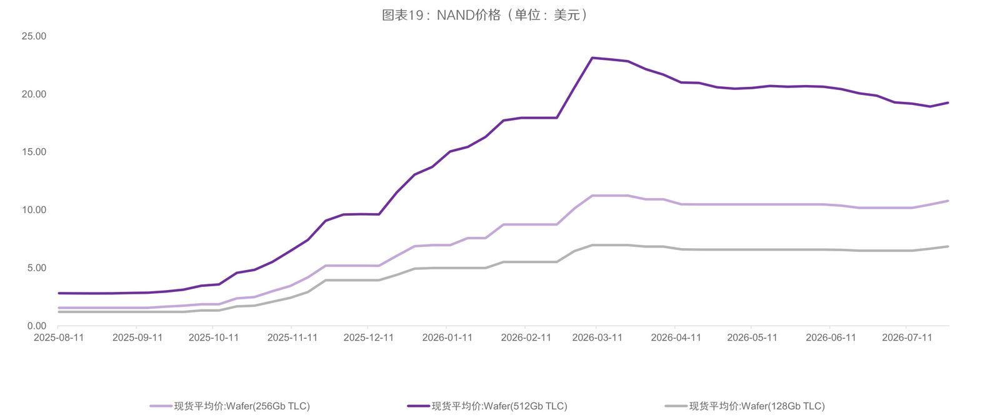

图例：现货平均价:Wafer(256Gb TLC)；现货平均价:Wafer(512Gb TLC)；现货平均价:Wafer(128Gb TLC)。纵轴：0.00至25.00，单位美元；横轴：2025-08-11至2026-07-11。

资料来源：wind，华鑫证券研究

[Source Page: 23]

## 03行业动态

[Source Page: 24]

## 3.1、行业动态整理

### 三星：年底前建泰勒二厂，存储芯片产能优先供应长约客户

三星电子在不久前的第二季财报电话会议上宣布，将于2026年底前，开始在美国德克萨斯州泰勒市（Taylor）建造第二座晶圆厂。同时，面对日益成长的AI客户需求，三星还计划将60%至70%的记忆体产能分配给长期供应合约（LTA）。

三星电子晶圆代工事业部副社长（副总裁）兼晶圆代工战略营销团队负责人Kang Seok-chae表示，泰勒一厂（Taylor Fab 1）预计于2026年内正式投产。在一厂投产后，三星将逐步扩大2nm制程产能，并预计于2027年达成全面量产的目标。至于，泰勒二厂的商业化量产目标则设定在2030年。此外，由于客户对1.4nm制程技术的询问度提高，三星正积极评估追加制造空间的可能性。

在制程资源配置上，三星正持续将产能从成熟制程转移至高毛利的先进制程。目前，8nm与17nm制程、CMOS图像传感器（CIS）以及嵌入式非易失性存储（eNVM）需求持续强劲，且8nm以下制程的产能利用率已接近满载。

Kang Seok-chae指出，随着产能利用率提高、良率改善及价格回升，晶圆代工业务的获利能力将较2025年大幅改善，并有望在近期实现转亏为盈。

针对存储芯片业务，随着AI基础建设投资加速，长期供应合约（LTA）的重要性显著提升。三星存储战略营销负责人Kim Jae-jun指出，三星已与全球五大数据中心客户签署LTA，并正与另外五家大型AI相关客户进行最后谈判。由于长约需求已超过三星目前的供应能力，三星决定将高达60%至70%的长期产能用于履行LTA承诺。

据了解，三星的LTA合约通常为期5年，并设有年度延展的滚动式更新机制。针对标准型存储产品，合约中包含最低价格条款，以降低市场低迷时的风险。此外，为加强合约约束力，合约规定了高额的前期预付款，目前三星已收到已签署合约中约四分之一的预付款。

[Source Page: 25]

## 3.2、行业动态整理

### TeraFab将制造DRAM，特斯拉已开始招聘相关人才

8月7日消息，根据特斯拉官网的资料显示，其目前正在招聘负责“DRAM与新兴内存技术的单元制程整合”的工程师，似乎是真的要涉足DRAM制造领域。

该招聘岗位对于工作职责的要求包括：制定先进DRAM制程（半间距低于20nm）的整合方案，以及随着TeraFab扩大内存技术布局，推动MRAM、RRAM或3D DRAM等新兴内存技术的制程整合开发等。

外媒评论称，TeraFab正在认真布局解决目前的内存供应短缺问题，可能对三星电子（Samsung Electronics）、SK海力士（SK hynix）及美光（Micron）三大内存厂商垄断市场的局面带来重大影响。

今年3月，马斯克（Elon Musk）正式公布了特斯拉与xAI共同投资建设“TeraFab”超级晶圆厂计划，建设地点位于得克萨斯州奥斯汀市特斯拉园区内，目的是为机器人、人工智能和太空数据中心制造自己的芯片，远期的目标是达到惊人的1太瓦（Terawatt，TW）级别的算力芯片产能，即每年产出超过相当于1太瓦功率的算力芯片，而1太瓦等于1000吉瓦，相当于100个当前最大的在建的10吉瓦的AI数据中心的规模。

按照马斯克之前的说法，这座TeraFab将采用2nm顶尖工艺制程，将芯片设计、制造、封装全流程整合在同一园区，借此将目前长6~9个月的芯片设计迭代周期缩短至仅数周。该工厂的目标是每月生产10万片晶圆，最终增长到每月100万片，这将使每年的芯片产量达到1000亿至2000亿颗。

同时，马斯克还指出，TeraFab拥有制造逻辑芯片、内存芯片、进行封装、测试、制作光罩、改进光罩并不断循环迭代所需的一切。“因此，在单一建筑内，我们就可以制作光罩、制造芯片、测试芯片、再制作新光罩，从而形成一个极快速的递归循环，不断改进芯片设计。”

从特斯拉最新的招聘信息来看，TeraFab可能确实如马斯克所说的那样，不仅仅是用于制造逻辑制程的AI芯片，还将制造内存芯片。

[Source Page: 26]

## 3.3、行业动态整理

### 斥资107亿美元，南亚科技建DRAM新厂

8月5日，DRAM大厂南亚科技召开董事会，宣布将新建一座最高投资上限为3466亿新台币（约107.34亿美元）的5A晶圆厂。这不仅是南亚科技历史上最大的一次投资，也是近20年来台湾DRAM行业最大的单项投资。

据介绍，5A晶圆厂将分阶段四年实施，目标是将第一阶段月晶圆产能提升至35,900片，并引入极紫外（EUV）光刻设备，作为下一代DRAM工艺的关键生产基地。未来还将陆续导入1B、1C、1D及1E等先进10nm级DRAM制程。总资本支出预算上限定为3466亿新台币，资金将来自自有资金、银行贷款及其他融资方式。南亚科技新建的5A晶圆厂计划于2027年下半年开始晶圆生产，2028年月产量将达到3万片，2029年达到3.59万片，逐步迈向满产。

如今，人工智能正在重塑存储器行业格局。经历多年经济周期、行业整合和技术竞争，南亚科技已投入超过3400亿新台币进行长期投资，凸显DRAM产业已进入新一轮资本竞争浪潮。

南亚科技董事会还决定授权董事长或总经理在批准配额内处理与检测厂相关的招标工作。尽管公司尚未进一步披露招标细节，但外部解读表明此举将有助于改善后续制造和测试布局，提升整体生产效率和供应能力。

同时，南亚科技董事会还决议将今年资本支出预算上限提高至697亿元新台币，较原计划的520亿元增加177亿元，增幅34%。

今年的资本支出预算包括10nm工艺技术、新建5A工厂、研发及一般资本支出。为加快5A新厂容量建设，部分设备需预付款。

[Source Page: 27]

## 3.4、行业动态整理

### 台积电2nm月产能将达10万片

随着人工智能（AI）客户开始积极转向更先进的3nm及2nm制程工艺，以追求更高的性能、更低功耗。这波需求激增已迫使全球最大的半导体制造商为其客户做出产能调整。

据台媒《经济日报》报道，供应链消息显示，在英伟达、AMD、博通等大客户的积极追单之下，原本预期台积电3nm今年底的月投片量将达到了18万片的目标，有望提前于四季度达成。

台积电已将今年的资本支出提高到600亿美元至640亿美元，其中约七到八成将用于先进工艺技术。目前，台积电正在新增三座3nm制程晶圆厂，分别位于中国台湾、美国亚利桑那州及日本熊本。并且，台积电还将持续推动原有的5nm产线转换成3nm产能。

同时，台积电2nm制程接单旺盛，也有望如期在今年底达到接近10万片的月投片量。今年二季度，台积电2nm制程在其总营收当中的占比已有3%，并且2nm工艺的流片数量已达到3nm同期的4倍。

报道指出，苹果仍将是台积电最大的2nm客户之一，其即将于今年9月发布的iPhone 18 Pro和iPhone 18 Pro Max所搭载的A20系列处理器将会采用2nm制程；高通和联发科也将会推出基于2nm制程的新一代旗舰移动SoC；AMD最新的MI455X GPU和英伟达Rubin Ultra也都将会采用台积电的2nm制程。这些旺盛的需求，可能将使得台积电2nm产能供不应求，这也迫使台积电更加积极地扩大2nm产能。

根据台积电的规划，预计2026年内将有5座2nm晶圆厂同时再建。其中，新竹宝山（Fab 20）厂规划了四期工程，其中P1和P2是2nm首发产线。高雄楠梓（Fab 22）厂共规划了六期，也是最重要的2nm基地之一，P1至P3将投入2nm及更先进工艺的布局。

[Source Page: 28]

## 3.5、行业动态整理

### 巴克莱：谷歌2028年TPU营收有望达到2520亿美元

8月4日消息，根据外资投行巴克莱银行（Barclays）最新报告指出，谷歌若调整其AI芯片业务模式，其TPU在2028年最高有望创造2,520亿美元的营收。巴克莱认为，TPU作为目前业界最广泛使用的定制化AI芯片之一，如果谷歌与资产管理公司黑石集团、Apollo Global及芯片设计公司博通合作成立合资企业，有望进一步扩大TPU生态系。

目前谷歌AI芯片业务模式并不像英伟达那样直接将AI芯片销售给CoreWeave等数据中心业者，而是通过旗下Google Cloud提供TPU算力服务。根据谷歌第二季财报显示，Google Cloud营收同比增长82%，达到了248亿美元。

事实上，在ChatGPT问世前的2015年，谷歌就开始在云顶导入了自研TPU，较亚马逊提早约三年投入相关发展，并于2018年正式对外开放TPU服务。投资机构D.A. Davidson去年9月曾指出，Google TPU业务未来潜在价值可达9,000亿美元。

巴克莱最新报告指出，如果将TPU业务从Google Cloud转型为非平台商业模式，2028年最高可创造2,520亿美元营收。不过这种模式需要谷歌与Apollo Global、黑石集团及客制化AI芯片设计商博通成立合资公司，通过外部资本共同建置TPU基础设施，再由合资企业向市场提供AI运算服务。

巴克莱估算，如果按照此模式全面推进，谷歌届时可部署约11.5GW（吉瓦）的TPU运算容量，支撑上述营收规模（以2028年为基准预估）。谷歌此前曾于5月宣布与黑石集团合作，利用TPU提供“运算即服务”（CaaS）。

巴克莱也认为，谷歌与Apollo、黑石集团的合作将成为推动TPU业务成长的主要动能。博通今年6月联手Apollo与黑石集团成立规模高达350亿美元的AI基础设施投资平台，用于部署谷歌TPU。巴克莱预期，该合作年底可望为谷歌贡献约200亿美元营收，随着TPU部署容量于2027年扩增至3.2GW，相关营收可望进一步提升至670亿美元。

[Source Page: 29]

## 3.6、行业动态整理

### 诺基亚收购恩智浦北美工厂，布局磷化铟光芯片产线

当地时间8月5日，全球通信设备大厂诺基亚（Nokia）宣布签署最终协议，收购恩智浦（NXP）位于美国亚利桑那州的半导体厂。

诺基亚计划将该厂转为磷化铟（InP）光芯片生产线，预计2029年第一季完成收购。而2027年年初将以租任部分厂房的方式先启动量产。这是通讯设备商直接买工厂自产芯片的罕见案例，显示诺基亚正加速转型为数据中心基础设施企业。

随着AI数据中心通信从传统铜线转向光纤，核心零组件的磷化铟光芯片需求暴增。其与运算储存用的硅不同，磷化铟能双向转换电信号与光信号，是光通讯设备核心。AI传输量暴增使具备超高频宽与速度的光通讯成为解决传输瓶颈的关键，根据市场调查数据显示，光收发器需求已达磷化铟供应量的两倍以上。

值得注意的是，AI芯片大厂英伟达（Nvidia）在2026年3月有向两大InP厂Coherent与Lumentum各注资20亿美元以确保磷化铟光芯片供应合约。Lumentum执行长指出，磷化铟短缺恐比內存更严重。因为相较过去电信客户数百个的订单，英伟达等AI巨头需求量高达数亿个。

因全球磷化铟工厂极稀缺且缺乏代工厂，诺基亚为稳定取得磷化铟芯片以消化设备订单，决定直接掌握产能。诺基亚新CEO Justin Hotard表示，此收购的目的在确保自身产能，并在市场供应受限下掌握更多弹性。另外，也反映英伟达自出售手机业务后的重心移转。该公司已经于2025年其并购Infinera以取得加利福尼亚州磷化铟工厂，并正将宾夕法尼亚州封装厂产能扩建10倍。

[Source Page: 30]

## 3.7、行业动态整理

### 再获头部客户批量订单，芯上微装光刻机加速放量

8月8日，国产光刻机厂商上海芯上微装科技股份有限公司（以下简称“芯上微装”或“AMIES”）通过官方微信公众号宣布，近日，该公司自主研发的350nm步进投影光刻机（AST6200）凭借卓越性能与稳定表现，快速顺利通过国内化合物半导体领域头部客户的工艺验证，并斩获批量重复订单。

据介绍，AST6200光刻机可广泛应用于功率器件、射频前端、光电子芯片及Micro LED新型显示等制程场景。设备在关键工艺效果、工艺适应性与软件自主化方面均展现出核心优势：

（1）关键工艺效果：AST6200光刻机搭载高性能投影物镜与先进照明模式，稳定实现350nm高分辨率精细图案化能力，全面满足Si、SiC、GaN、GaAs、InP、蓝宝石等多种衬底材料的光刻需求。其高精度对准系统确保多层图形之间精准套刻，显著提升器件良率。同时，通过采用高照度光源、高速基底传输系统及高动态运动台，显著提升单位时间产出，有效帮助客户降低单颗芯片的综合拥有成本（COO）。

（2）强大工艺适应性:AST6200光刻机创新调焦调平系统能够稳定测量透明、半透明、不透明及大台阶等多种基底，确保复杂衬底条件下的曝光质量。平边对准和背面对准模块的加入，可满足特殊基底晶向解理和键合片对位等复杂制程需求。设备支持从2英寸到8英寸多种规格基片，兼容平边、双平边、Notch等主流基底类型，真正实现“一机多用”，为客户产线切换带来极大灵活性。

（3）全栈自主的软件控制系统:AST6200光刻机搭载芯上微装自主研发的全栈式软件控制系统，从底层驱动到上层工艺管理实现100%自主可控。该系统具备强大的工艺扩展能力与远程运维功能，能够持续为设备全生命周期赋能，助力客户实现智能化、高效率的产线运营。

芯上微装表示，从首台AST6200光刻机交付到实现批量复购，不仅表明产品开发与产业实际需求相契合，也标志着设备的核心性能与稳定性经受住了市场的检验。

[Source Page: 31]

## 04公司公告

[Source Page: 32]

## 4.1、公司公告

### 寒武纪:2026年半年度报告

根据《中科寒武纪科技股份有限公司2026年半年度报告》。

公司业绩高速增长，AI芯片商业化进程持续推进。2026年上半年，公司实现营业收入59.96亿元，同比增长108.13%；归属于上市公司股东的净利润23.11亿元，同比增长122.61%；扣除非经常性损益后的净利润21.66亿元，同比增长137.30%。公司表示，营业收入大幅增长主要系持续拓展市场、积极助力人工智能应用落地，推动收入规模快速提升。

公司AI芯片产品商业化持续深化，与金融、互联网领域头部企业合作不断加强，产品在核心行业实现规模化商用部署。在金融领域，公司持续深化与核心金融机构合作，以稳定可扩展的算力底座支撑大模型在经营优化、服务提效等场景应用；同时，公司产品已在智慧城市、智慧矿山、智能交通等多个行业场景实现应用落地，市场认可度持续提升。报告期内，公司根据客户订单需求及未来市场需求预测制定采购计划，截至期末存货账面价值82.48亿元，占总资产45.32%，同时预付款项同比增长291.37%，主要系预付采购款增加。

此外，公司持续完善国产AI生态建设，已完成GLM、DeepSeek、Qwen、Kimi、MiniMax等国产主流开源模型适配支持，进一步提升芯片平台应用能力。

[Source Page: 33]

## 4.2、公司公告

### 中微公司:2026年半年度业绩预告的自愿性披露公告

根据《中微半导体设备（上海）股份有限公司2026年半年度业绩预告的自愿性披露公告》。

公司预计2026年上半年实现营业收入约66.91亿元，同比增长约34.89%；预计实现归属于母公司所有者的净利润27亿元至29亿元，同比增加282.48%至310.81%；预计实现扣除非经常性损益后的归母净利润10亿元至12亿元，同比增长85.61%至122.73%。公司表示，业绩增长主要受益于营业收入增长、毛利提升以及对外股权投资公允价值变动收益和投资收益增加，其中2026年上半年营业收入同比增长34.89%，毛利较去年同期增长约6.82亿元。

公司持续推进半导体设备研发与产业化应用，目前已开发54种高端半导体设备，包括26种高能和低能等离子体刻蚀机设备、24种薄膜设备、化学机械抛光设备及量检测设备，刻蚀和薄膜设备加工精度达到原子级水平。截至2026年6月底，公司累计已有超过8800个反应台在国内外220余条生产线实现量产。同时，公司持续加大研发投入，2026年上半年研发投入约20.42亿元，同比增长36.89%，占营业收入比例约30.52%；公司目前在研项目涵盖六类设备、超过二十款新设备开发，多款机型已完成客户端验证，关键性能指标达到国际先进水平。

公司表示，2026年上半年归母净利润增长主要由于营业收入增长带动毛利提升，同时研发创新持续推进，自主开发的新产品逐步进入市场；此外，公司以公允价值计量且变动计入当期损益的对外股权投资于2026年上半年产生公允价值变动收益和投资收益合计约19.82亿元，较2025年同期增加约18.15亿元。

[Source Page: 34]

## 4.3、公司公告

### 华天科技:关于收到深圳证券交易所并购重组审核委员会审核公司发行股份及支付现金购买资产并募集配套资金暨关联交易事项会议安排的公告

根据《天水华天科技股份有限公司关于收到深圳证券交易所并购重组审核委员会审核公司发行股份及支付现金购买资产并募集配套资金暨关联交易事项会议安排的公告》，公司拟通过发行股份及支付现金方式购买天水华天电子集团股份有限公司、西安后羿投资管理合伙企业（有限合伙）、西安芯天钰铂企业管理合伙企业（有限合伙）等27名交易对方合计持有的华羿微电子股份有限公司100%股份，并同步募集配套资金。本次交易若顺利实施，将进一步推动公司产业布局整合，但目前交易仍处于审核阶段，尚需深圳证券交易所审核通过以及中国证券监督管理委员会同意注册后方可实施。

根据公告，深圳证券交易所并购重组审核委员会定于2026年8月13日召开2026年第12次并购重组审核委员会审议会议，对公司本次交易事项进行审核。本次事项属于重大资本运作事项，后续审核结果及注册进展将成为市场关注重点。公司提示，本次交易能否通过审核、取得注册以及最终实施时间均存在不确定性，公司将根据事项进展依法履行信息披露义务，投资者需关注相关风险。

[Source Page: 35]

## 4.4、公司公告

### 华海清科:关于向特定对象发行A股股票申请获得中国证券监督管理委员会同意注册批复的公告

根据《华海清科股份有限公司关于向特定对象发行A股股票申请获得中国证券监督管理委员会同意注册批复的公告》，公司于近日收到中国证券监督管理委员会出具的《关于同意华海清科股份有限公司向特定对象发行股票注册的批复》（证监许可〔2026〕1927号），中国证监会同意公司向特定对象发行A股股票的注册申请。本次发行获得监管注册批复，标志着公司向特定对象发行股票事项取得重要进展，公司后续将按照批复文件、相关法律法规以及股东会授权，在规定期限内办理本次发行相关事项。

根据批复内容，公司本次发行应严格按照报送上海证券交易所的申报文件和发行方案实施，本批复自同意注册之日起12个月内有效。在同意注册日至发行结束前，如公司发生重大事项，应及时报告上海证券交易所并按照相关规定处理。

公司表示，将根据本次发行事项进展情况及时履行信息披露义务，并提示投资者关注相关风险。

[Source Page: 36]

## 4.5、公司公告

### 锴威特:发行股份及支付现金购买资产并募集配套资金暨关联交易报告书（草案）

根据《苏州锴威特半导体股份有限公司发行股份及支付现金购买资产并募集配套资金暨关联交易报告书（草案）》，公司拟通过发行股份及支付现金方式收购晶艺半导体100%股权，交易价格为165,000万元（16.5亿元），并向不超过35名特定投资者发行股份募集配套资金90,083.85万元，主要用于支付交易现金对价、中介机构费用及补充流动资金。本次交易完成后，公司将获得晶艺半导体电机驱动类和电源管理类功率IC及模块业务，进一步完善功率器件与功率IC产品矩阵，提升综合解决方案能力。

晶艺半导体具备较强客户资源和商业化基础，已通过功率控制IC与上市公司功率器件结合形成智能功率模块IPM产品，并成功导入美的、小米、格力、TCL、海信日立等家电龙头企业实现批量量产，累计积累超过500家量产客户，覆盖消费电子、家电、通信设备、服务器等多个领域。交易整合后，双方将共享客户资源与销售渠道，深化与上述头部客户合作，并借助晶艺半导体客户基础拓展浪潮、中兴等通信设备及服务器领域客户，推动SiC MOSFET及工业电源产品推广。

本次交易设置业绩承诺，成为市场关注的重要盈利催化因素。业绩承诺方承诺晶艺半导体芯片定制化量产业务2026-2027年度累计实现净利润不低于25,500万元；芯片自研业务2026-2028年度收入分别不低于33,500万元、45,200万元和56,600万元，三年累计收入不低于135,300万元。同时，双方均为Fabless模式半导体设计企业，交易完成后将在供应链、工艺平台、规模采购及量产交付等方面实现协同。公告未披露可转换公司债券相关事项。

[Source Page: 37]

## 4.6、公司公告

### 芯导科技:关于发行可转换公司债券及支付现金购买资产事项获得中国证监会同意注册批复的公告

根据《上海芯导电子科技股份有限公司关于发行可转换公司债券及支付现金购买资产事项获得中国证券监督管理委员会同意注册批复的公告》。

上海芯导电子科技股份有限公司拟通过发行可转换公司债券及支付现金购买资产的方式，收购上海吉瞬科技有限公司100%股权，并收购上海瞬雷科技有限公司17.15%股权，从而直接及间接持有瞬雷科技100%股权，实现对瞬雷科技的完全控制。

公司于2026年8月7日收到中国证券监督管理委员会出具的《关于同意上海芯导电子科技股份有限公司发行可转换公司债券购买资产注册的批复》（证监许可〔2026〕1932号），中国证监会同意公司向相关交易对方发行可转换公司债券购买资产的注册申请。本次交易获得监管注册批复，标志着公司发行可转换债券购买资产事项取得重要进展，公司后续将按照监管要求推进交易实施，并办理相关发行手续。

根据监管批复要求，公司本次发行可转换公司债券购买资产事项需按照提交上海证券交易所的申请文件实施，批复自下发之日起12个月内有效。公司董事会将根据批复文件、相关法律法规及股东会授权，在规定期限内办理本次交易相关事项，并及时履行信息披露义务。

[Source Page: 38]

## 05风险提示

[Source Page: 39]

## 风险提示

半导体出口管制及制裁加码风险

晶圆厂扩产进度不及预期风险

核心技术研发进展不及预期风险

地缘政治环境不稳定风险

重点覆盖公司业绩不及预期风险

[Source Page: 40]

## 电子通信组介绍

庄宇：清华大学硕士，金融学&工科复合背景。10年科技行业研究经验。立足产业，做深入且前瞻的研究，主要覆盖AI硬件领域。

何鹏程：悉尼大学金融硕士，中南大学软件工程学士，曾任职德邦证券研究所，2023年加入华鑫证券研究所。专注于半导体、PCB行业。

张璐：早稻田大学国际政治经济学学士，香港大学经济学硕士，2023年加入华鑫证券研究所，专注于光通信、存储等领域研究。

石俊烨：香港大学金融硕士，新南威尔士大学精算学与统计学双学位，研究方向为PCB方向。

[Source Page: 41]

# 证券分析师承诺

本报告署名分析师具有中国证券业协会授予的证券投资咨询执业资格并注册为证券分析师，以勤勉的职业态度，独立、客观地出具本报告。本报告清晰准确地反映了本人的研究观点。本人不曾因，不因，也将不会因本报告中的具体推荐意见或观点而直接或间接收到任何形式的补偿。

# 免责条款

华鑫证券有限责任公司（以下简称“华鑫证券”）具有中国证监会核准的证券投资咨询业务资格。本报告由华鑫证券制作，仅供华鑫证券的客户使用。本公司不会因接收人收到本报告而视其为客户。

本报告中的信息均来源于公开资料，华鑫证券研究部门及相关研究人员力求准确可靠，但对这些信息的准确性及完整性不作任何保证。我们已力求报告内容客观、公正，但报告中的信息与所表达的观点不构成所述证券买卖的出价或询价的依据，该等信息、意见并未考虑到获取本报告人员的具体投资目的、财务状况以及特定需求，在任何时候均不构成对任何人的个人推荐。投资者应当对本报告中的信息和意见进行独立评估，并应同时结合各自的投资目的、财务状况和特定需求，必要时就财务、法律、商业、税收等方面咨询专业顾问的意见。对依据或者使用本报告所造成的一切后果，华鑫证券及/或其关联人员均不承担任何法律责任。本公司或关联机构可能会持有报告中所提到的公司所发行的证券头寸并进行交易，还可能为这些公司提供或争取提供投资银行、财务顾问或者金融产品等服务。本公司在知晓范围内依法合规地履行披露。

本报告中的资料、意见、预测均只反映报告初次发布时的判断，可能会随时调整。该等意见、评估及预测无需通知即可随时更改。在不同时期，华鑫证券可能会发出与本报告所载意见、评估及预测不一致的研究报告。华鑫证券没有将此意见及建议向报告所有接收者进行更新的义务。

本报告版权仅为华鑫证券所有，未经华鑫证券书面授权，任何机构和个人不得以任何形式刊载、翻版、复制、发布、转发或引用本报告的任何部分。若华鑫证券以外的机构向其客户发放本报告，则由该机构独自为此发送行为负责，华鑫证券对此等行为不承担任何责任。本报告同时不构成华鑫证券向发送本报告的机构之客户提供的投资建议。如未经华鑫证券授权，私自转载或者转发本报告，所引起的一切后果及法律责任由私自转载或转发者承担。华鑫证券将保留随时追究其法律责任的权利。请投资者慎重使用未经授权刊载或者转发的华鑫证券研究报告。

# 证券投资评级说明

股票投资评级说明：

| | 投资建议 | 预测个股相对同期证券市场代表性指数涨幅 |
| --- | --- | --- |
| 1 | 买入 | >20% |
| 2 | 增持 | 10%—20% |
| 3 | 中性 | -10%—10% |
| 4 | 卖出 | <-10% |

行业投资评级说明：

| | 投资建议 | 行业指数相对同期证券市场代表性指数涨幅 |
| --- | --- | --- |
| 1 | 推荐 | >10% |
| 2 | 中性 | -10%—10% |
| 3 | 回避 | <-10% |

以报告日后的12个月内，预测个股或行业指数相对于相关证券市场主要指数的涨跌幅为标准。

相关证券市场代表性指数说明：A股市场以沪深300指数为基准；新三板市场以三板成指（针对协议转让标的）或三板做市指数（针对做市转让标的）为基准；香港市场以恒生指数为基准；美国市场以道琼斯指数为基准。

[Source Page: 42]

华鑫证券CHINA FORTUNE SECURITIES | 研究创造价值

报告编号：260810200012

## Processing Notes

- 删除每页之间的版式分隔线（`---`）与转换稿的 `<!-- 原文第 N 页 -->` 注释，改为 `[Source Page: N]` 标记，页码 1–42 连续。
- 统一删除中文与拉丁字母/数字之间的空格（如「2026-08-10 股价」→「2026-08-10股价」、「Kang Seok-chae 指出」→「Kang Seok-chae指出」、「0.00 至 16,000.00」→「0.00至16,000.00」）；英文词之间的空格保留（「EPS 2025」「PE 2025E」等）。
- 第8页「资料来源：wind，华鑫证券研究　　注：按申万行业二级分类」中的全角双空格改为单空格。
- 第20页「从2020 -2022年高景气期」中的断词空格修正为「2020-2022年」（转换稿多出空格，未改数字）。
- 第12页章节页标题「02 行业高频数据」在转换稿中为一级标题，与其他章节页（01/03/04/05）不一致，统一为二级标题。
- 转换稿无 `[OCR_UNCERTAIN]`、`[OCR_UNREADABLE]`、`[TABLE_RECONSTRUCTION_UNCERTAIN]` 标记；表格均按转换稿原样保留，未计算、未插值。
- 未增补原文没有的信息；图表纵/横轴刻度与图例说明沿用转换稿。
