## Document Metadata

- Document ID: dfb164d788a0b3f080e36d83e058cad16b23b2da
- Document Title: 半导体行业26Q2保持快速增长，国内存储厂商业绩表现亮眼——半导体行业月报
- Document Type: PDF
- Issuing Organization: 中原证券股份有限公司
- Publication Date: 2026-09-15
- Reporting Period: 2026年8月（月报，含26Q2半年报回顾）
- Source File: [M182_20260915-中原证券-中原证券半导体行业月报：半导体行业26Q2保持快速增长，国内存储厂商业绩表现亮眼.pdf](https://github.com/jadennevercode/CJCC-Knowledge-Base/blob/5ec8511eb834073c8bfbd79c94af196282d483cf/materials/%E4%B8%AD%E6%B8%B8%EF%BC%9A%E4%BE%9B%E7%BB%99%E5%BD%A2%E6%88%90%E4%B8%8E%E4%BA%A7%E8%83%BD%E5%86%B3%E7%AD%96/M182_20260915-%E4%B8%AD%E5%8E%9F%E8%AF%81%E5%88%B8-%E4%B8%AD%E5%8E%9F%E8%AF%81%E5%88%B8%E5%8D%8A%E5%AF%BC%E4%BD%93%E8%A1%8C%E4%B8%9A%E6%9C%88%E6%8A%A5%EF%BC%9A%E5%8D%8A%E5%AF%BC%E4%BD%93%E8%A1%8C%E4%B8%9A26Q2%E4%BF%9D%E6%8C%81%E5%BF%AB%E9%80%9F%E5%A2%9E%E9%95%BF%EF%BC%8C%E5%9B%BD%E5%86%85%E5%AD%98%E5%82%A8%E5%8E%82%E5%95%86%E4%B8%9A%E7%BB%A9%E8%A1%A8%E7%8E%B0%E4%BA%AE%E7%9C%BC.pdf)

## Structured Content

> 原文件：[M182_20260915-中原证券-中原证券半导体行业月报：半导体行业26Q2保持快速增长，国内存储厂商业绩表现亮眼.pdf](https://github.com/jadennevercode/CJCC-Knowledge-Base/blob/5ec8511eb834073c8bfbd79c94af196282d483cf/materials/%E4%B8%AD%E6%B8%B8%EF%BC%9A%E4%BE%9B%E7%BB%99%E5%BD%A2%E6%88%90%E4%B8%8E%E4%BA%A7%E8%83%BD%E5%86%B3%E7%AD%96/M182_20260915-%E4%B8%AD%E5%8E%9F%E8%AF%81%E5%88%B8-%E4%B8%AD%E5%8E%9F%E8%AF%81%E5%88%B8%E5%8D%8A%E5%AF%BC%E4%BD%93%E8%A1%8C%E4%B8%9A%E6%9C%88%E6%8A%A5%EF%BC%9A%E5%8D%8A%E5%AF%BC%E4%BD%93%E8%A1%8C%E4%B8%9A26Q2%E4%BF%9D%E6%8C%81%E5%BF%AB%E9%80%9F%E5%A2%9E%E9%95%BF%EF%BC%8C%E5%9B%BD%E5%86%85%E5%AD%98%E5%82%A8%E5%8E%82%E5%95%86%E4%B8%9A%E7%BB%A9%E8%A1%A8%E7%8E%B0%E4%BA%AE%E7%9C%BC.pdf)
> 转换方式：多模态逐页转录（页面图像 + 文本层交叉校验）

[Source Page: 1]

# 半导体行业26Q2保持快速增长，国内存储厂商业绩表现亮眼

## ——半导体行业月报

证券研究报告-行业月报

强于大市(维持)

发布日期：2026年09月15日

分析师：邹臣
登记编码：S0730523100001
zouchen@ccnew.com 021-50581991

半导体相对沪深300指数表现

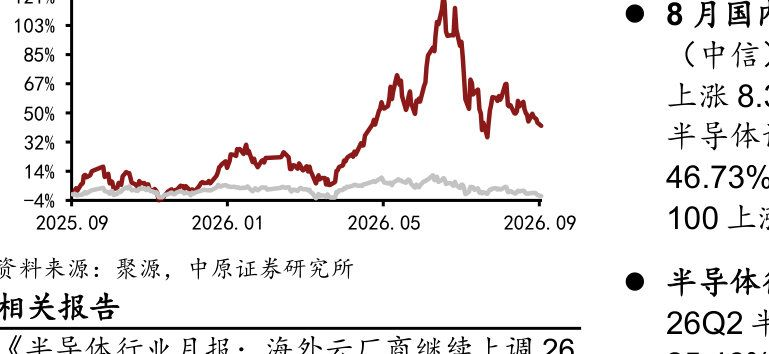

图例：半导体、沪深300；纵轴刻度：-4%、14%、32%、50%、67%、85%、103%、121%；横轴刻度：2025.09、2026.01、2026.05、2026.09。图中无数据标签。

资料来源：聚源，中原证券研究所

## 相关报告

- 《半导体行业月报：海外云厂商继续上调26年资本支出计划，服务器CPU需求旺盛》2026-08-11
- 《半导体行业月报：全球存储厂商加速扩产，关注半导体设备及零部件投资机会》2026-07-09
- 《半导体行业月报：华为发布韬定律，关注半导体产业链发展新机遇》2026-06-15

联系人：李智
电话：0371-65585629
地址：郑州郑东新区商务外环路10号18楼
地址：上海浦东新区世纪大道1788号T1座22楼

## 投资要点：

- 8月国内半导体行业表现相对较强。2026年8月国内半导体行业（中信）上涨8.93%，同期沪深300上涨0.80%，其中集成电路上涨8.33%，分立器件上涨14.90%，半导体材料上涨15.95%，半导体设备上涨7.85%；半导体行业（中信）2026年初至今上涨46.73%。2026年8月费城半导体指数上涨1.98%，同期纳斯达克100上涨4.18%，费城半导体指数2026年初至今上涨62.85%。

- 半导体行业26Q2保持快速增长，国内存储厂商业绩表现亮眼。26Q2半导体行业（中信）营收为2454.24亿元，同比增长25.46%，26Q2半导体行业（中信）归母净利润为452.83亿元，同比增长202.26%，半导体行业26Q2毛利率及净利率同环比持续回升。国内存储厂商26Q2业绩表现亮眼，存储器模组厂商大普微、佰维存储、德明利、江波龙，以及存储芯片厂商东芯股份、普冉股份、兆易创新、恒烁股份、君正股份等26Q2营收及归母净利润实现高速增长；AI及国产替代需求有望推动国内存储厂商显著受益于行业趋势，并持续提升市场份额。

- 全球半导体月度销售额继续同比高速增长，国内外云厂商持续加大资本支出。2026年7月全球半导体销售额同比增长135.1%，环比增长6.4%；根据WSTS的最新预测，预计2026年全球半导体销售额将达到1.511万亿美元，同比增长89.9%。下游需求呈现结构分化趋势，AI算力硬件基础设施需求持续旺盛，26Q2北美四大云厂商谷歌、微软、Meta、亚马逊资本支出同比增长86%，环比增长27%，并继续上调2026年资本支出计划；26Q2国内三大互联网厂商阿里巴巴、百度、腾讯资本开支同比增长102%，环比增长92%。2026年8月DRAM现货价格继续环比上涨，NAND Flash现货价格环比小幅下降，DRAM指数环比上涨约5.25%，NAND指数环比下降约0.30%。根据SEAJ的数据，全球半导体设备销售额26Q2同比增长23%，中国半导体设备销售额26Q2同比增长5%，2026年7月日本半导体设备销售额同比增长35.4%，环比增长8.3%；SEMI预计2026年全球300mm晶圆厂设备支出将增长18%至1330亿美元。全球硅片出货量26Q2同比增长7.4%，环比增长9.1%。综上所述，我们认为目前半导体行业仍处于上行周期，AI为推动半导体行业成长的重要动力。

- 投资建议。国内存储器厂商主要布局存储器模组、存储芯片等环节，26Q2主流存储器产品价格持续上涨，国内存储器模组厂商大普微、佰维存储、德明利、江波龙26Q2营收分别同比增长656.40%、269.81%、228.04%、138.75%，归母净利润分别同比增长519.17%、15177.40%、5566.72%、3930.86%；受益于利基型存储产品价格上涨，国内存储芯片厂商东芯股份、普冉股份、兆易创新、恒烁股份、君正股份26Q2营收分别同比增长406.95%、402.11%、229.18%、211.64%、101.66%，归母净利润分别同比增长1107.17%、2485.07%、1482.99%、304.72%、

[Source Page: 2]

579.96%；长鑫科技26Q2营收环比增长95.89%，归母净利润环比增长113.40%。AI驱动存储器需求旺盛，存储器周期持续上行，AI及国产替代需求有望推动国内存储厂商显著受益于行业趋势，并持续提升市场份额，建议关注国内存储芯片、存储模组厂商投资机会。

受益于AI基础设施投资的不断扩张，AI驱动对先进存储需求持续旺盛，全球存储制造商正在加速扩大产能，根据SEMI的最新预测，预计2026年全球300mm晶圆厂存储领域设备投资将达到520亿美元，同比增长29%，预计2024-2029年复合增速将达19%。AI驱动全球存储厂商加速扩产，半导体设备供给紧张程度有望逐步提升，国产半导体设备出海有望加速，同时叠加半导体设备国产替代在持续推进中，建议关注国内半导体设备及零部件厂商的投资机会。

风险提示：下游需求不及预期，市场竞争加剧风险，国内厂商研发进展不及预期，国产化进度不及预期，国际地缘政治冲突加剧风险。

[Source Page: 3]

## 内容目录

1. 2026年8月半导体行业市场表现情况 6

1.1. 8月半导体行业股票市场表现情况 6

1.2. 8月半导体行业可转债市场表现情况 8

1.3. 8月半导体行业ETF市场表现情况 9

2. 国内半导体行业2026年半年报总结 9

2.1. 半导体行业26Q2保持快速增长，盈利能力同环比持续提升 9

2.2. 国内存储厂商26Q2业绩表现亮眼，有望持续提升市场份额 11

3. 全球半导体月度销售额继续同比高速增长，国内外云厂商持续加大资本支出 12

3.1. 全球半导体月度销售额继续同比高速增长 12

3.2. 2026年全球AI眼镜出货量有望快速增长，AI算力硬件基础设施需求旺盛 15

3.2.1. 全球智能手机季度出货量同比下降，预计2026年全球智能手机市场将有所承压 16

3.2.2. 全球PC季度出货量继续同比下降，预计2026年全球PC出货量大幅下降 21

3.2.3. AI眼镜是端侧AI最佳硬件载体之一，2026年全球AI眼镜出货量有望快速增长 25

3.2.4. 国内外云厂商持续加大资本支出，推动AI算力硬件基础设施需求旺盛 30

3.2.5. 中国新能源汽车月度销量同比稳健增长 31

3.3. 全球部分芯片厂商季度库存水位环比下降，国内部分芯片厂商季度库存水位环比大幅下降 32

3.4. 国内主要晶圆厂季度产能利用率环比小幅提升 33

3.5. DRAM月度现货价格环比继续上涨，NAND Flash现货价格环比小幅下降 35

3.6. 全球半导体设备季度销售额继续同比增长，预计2026年有望持续增长 37

3.7. 全球硅片季度出货量继续同比增长，预计2026年将持续增长 39

4. 行业政策 40

5. 行业动态 41

5.1. 全球半导体行业动态 41

5.2. 河南省半导体行业动态 44

6. 估值分析与投资建议 45

6.1. 估值分析 45

6.2. 投资建议 45

7. 风险提示 46

## 图表目录

图1：2026年8月中信一级行业涨跌幅情况（%） 6

图2：中信半导体指数与沪深300涨跌幅情况（%） 6

图3：费城半导体指数与纳斯达克100涨跌幅情况（%） 7

图4：半导体行业2020-2026年营收及增速情况 10

图5：半导体行业2020-2026年归母净利润及增速情况 10

图6：半导体行业2020-2026年毛利率和净利率情况 10

图7：半导体行业21Q1-26Q2毛利率和净利率情况 10

图8：2000-2026年全球半导体市场销售额情况 12

图9：2015-2026年中国半导体市场销售额情况 13

图10：2018-2029年全球半导体销售额及预测情况（十亿美元） 13

图11：2020-2027年全球集成电路分产品市场预测情况 14

图12：2024年全球半导体下游应用领域占比情况 16

图13：23Q1-26Q2全球智能手机出货量情况 16

图14：22Q1-26Q2全球智能手机厂商市场份额情况 17

图15：手机智能化演进路线图 17

图16：AI手机带来手机全栈革新和生态重构 18

图17：AI手机生态系统及主要参与者情况 18

图18：2024-2029年全球AI手机出货量及预测情况 21

[Source Page: 4]

图19：23Q1-26Q2年全球PC季度出货量情况 21

图20：2016-2027年全球PC出货量及预测情况 22

图21：Canalys对AI PC的定义及未来演变的考量 23

图22：微软和英特尔对AI PC的定义 23

图23：23Q4-24Q4全球AI PC出货量情况 25

图24：24Q1-25Q4全球PC及AI PC出货量及预测 25

图25：2024-2028年全球PC市场总收入预测情况 25

图26：Ray-Ban Meta产品示意图 26

图27：Ray-Ban Meta产品支持耳机功能 26

图28：AI眼镜产品形态分类情况 26

图29：拍照AI眼镜为当前主流形态 26

图30：23Q4-24Q4 Ray-Ban Meta眼镜出货量情况 27

图31：小度AI眼镜产品示意图 27

图32：小度AI眼镜产品配置及功能情况 27

图33：华为智能眼镜2产品示意图 27

图34：华为智能眼镜2产品示意图 27

图35：雷鸟V3 AI眼镜产品示意图 28

图36：雷鸟X3 Pro AR眼镜产品示意图 28

图37：Oakley Meta HSTN AI眼镜产品示意图 28

图38：Oakley Meta HSTN AI眼镜产品示意图 28

图39：小米AI眼镜产品示意图 29

图40：小米AI眼镜产品示意图 29

图41：2023-2025年全球AI眼镜出货量情况 29

图42：2025年全球及中国大陆AI眼镜市场竞争格局情况 30

图43：RayBan Meta AI眼镜系统架构框图 30

图44：RayBan Meta AI眼镜成本结构图 30

图45：2020-2026年北美四大云厂商资本开支情况（亿美元） 31

图46：2021-2026年国内三大互联网厂商资本开支情况（百万元） 31

图47：2000-2026年中国汽车销量情况 32

图48：2015-2026年中国新能源汽车销量情况 32

图49：全球部分芯片厂商平均库存周转天数情况 33

图50：国内部分芯片厂商平均库存周转天数情况 33

图51：全球部分晶圆厂产能利用率情况 34

图52：2024-2028年全球晶圆产能及预测情况 34

图53：25H2-26H2晶圆代工价格涨幅变化情况 35

图54：DRAM指数走势情况 35

图55：DRAM现货价格走势情况（美元） 35

图56：NAND指数走势情况 36

图57：NAND Flash现货价格走势情况（美元） 36

图58：26Q2-26Q3 DRAM及NAND Flash产品合约价格预测情况 36

图59：26H2各类NOR Flash产品供需、价格趋势情况 37

图60：2005-2026年全球半导体设备销售额情况 37

图61：2005-2026年中国半导体设备销售额情况 37

图62：日本半导体设备月度销售额情况 38

图63：2024-2029年全球300mm晶圆厂设备支出情况及预测 38

图64：2024-2029年全球300mm晶圆厂存储领域设备投资情况及预测 39

图65：全球硅片出货量情况 39

图66：2022-2027年全球硅片出货量情况及预测 40

图67：近十年半导体（申万）PE Bands 4 5

表1：2026年8月A股中信半导体行业部分个股涨跌幅情况 6

表2：2026年8月美股主要半导体公司涨跌幅情况 8

表3：2026年8月国内半导体行业可转债涨跌幅情况（截至2026年9月4日） 8

[Source Page: 5]

表4：2026年8月国内半导体行业ETF涨跌幅情况（截至2026年9月4日） 9

表5：26Q2半导体（中信）各子板块营收及归母净利润情况 10

表6：A股半导体行业（中信）26Q2营收同比增速排名情况 11

表7：国内存储器厂商26Q2业绩情况 12

表8：全球前十五大芯片公司26Q2营收情况及26年展望 14

表9：全球部分处理器厂商发布的支持端侧AI大模型手机的SoC芯片情况 19

表10：全球部分智能手机厂商旗舰AI手机布局情况 19

表11：26Q2全球PC厂商市场份额情况 22

表12：全球主要处理器厂商发布的适用于AI PC处理器情况 23

表13：全球部分PC厂商AI PC布局情况 24

表14：近年美日荷对中国半导体产业部分制裁政策情况 40

[Source Page: 6]

## 1. 2026年8月半导体行业市场表现情况

### 1.1. 8月半导体行业股票市场表现情况

国内2026年8月半导体行业表现相对较强，走势大幅强于沪深300。2026年8月电子行业（中信）上涨12.30%，8月沪深300上涨0.80%，电子行业表现大幅强于沪深300指数。半导体行业（中信）2026年8月上涨8.93%，表现大幅强于沪深300，其中集成电路上涨8.33%，分立器件上涨14.90%，半导体材料上涨15.95%，半导体设备上涨7.85%；半导体行业（中信）2026年初至今上涨46.73%。

**图1：2026年8月中信一级行业涨跌幅情况（%）**

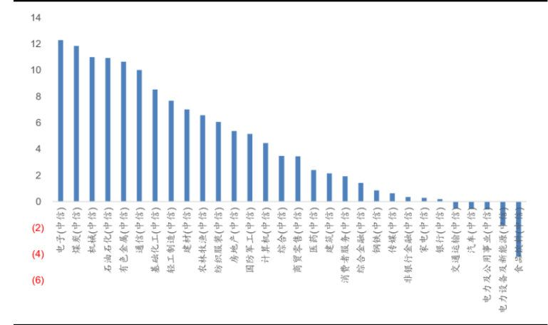

纵轴刻度：14、12、10、8、6、4、2、0、(2)、(4)、(6)；横轴为中信一级行业名称（按涨跌幅降序排列，自电子(中信)起）。图中无数据标签。

资料来源：Wind，中原证券研究所

**图2：中信半导体指数与沪深300涨跌幅情况（%）**

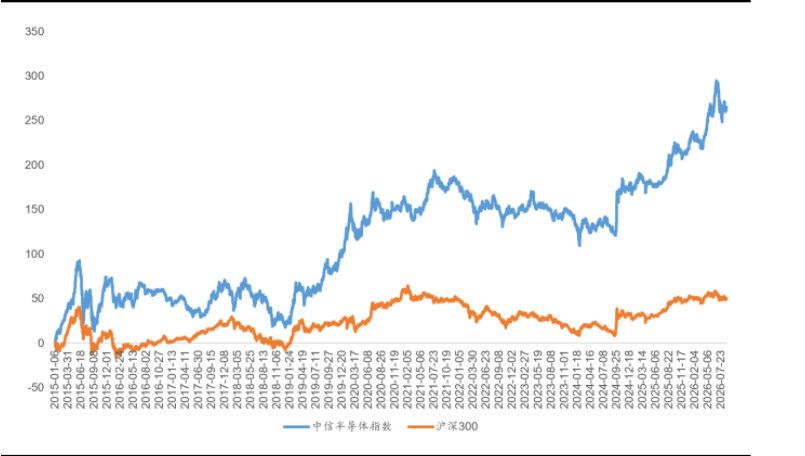

图例：中信半导体指数、沪深300；纵轴刻度：-50、0、50、100、150、200、250、300、350；横轴为日期刻度（2015-01-03起，间隔约3个月，末端刻度标签 [OCR_UNREADABLE]）。图中无数据标签。

资料来源：Wind，中原证券研究所

2026年8月半导体板块上涨家数远多于下跌家数，2026年8月涨幅排名前十的公司分别为力芯微（83%）、耐科装备（57%）、有研硅（55%）、有研新材（46%）、赛微电子（43%）、富瀚微（42%）、源杰科技（40%）、概伦电子（40%）、锴威特（39%）、思瑞浦（39%）。

**表1：2026年8月A股中信半导体行业部分个股涨跌幅情况**

| 证券代码 | 证券名称 | 总市值（亿元） | 8月涨跌幅（%） | 年初至今涨跌幅（%） | 市盈率（TTM） | 市销率（TTM） | 市净率 |
| --- | --- | --- | --- | --- | --- | --- | --- |
| 688601.SH | 力芯微 | 86 | 83 | 52 | 527 | 10 | 7 |
| 688419.SH | 耐科装备 | 61 | 57 | 91 | 69 | 18 | 6 |
| 688432.SH | 有研硅 | 565 | 55 | 265 | 239 | 48 | 12 |
| 600206.SH | 有研新材 | 438 | 46 | 156 | 138 | 4 | 10 |
| 300456.SZ | 赛微电子 | 295 | 43 | -27 | 7 | 68 | 3 |
| 300613.SZ | 富瀚微 | 186 | 42 | 74 | 39 | 8 | 6 |
| 688498.SH | 源杰科技 | 1,909 | 40 | 246 | 254 | 144 | 61 |
| 688206.SH | 概伦电子 | 224 | 40 | 28 | -1,200 | 44 | 11 |
| 688693.SH | 锴威特 | 57 | 39 | 107 | -62 | 19 | 8 |
| 688536.SH | 思瑞浦 | 427 | 39 | 93 | 103 | 15 | 6 |
| 688209.SH | 英集芯 | 125 | 38 | 45 | 54 | 7 | 5 |
| 688508.SH | 芯朋微 | 119 | 38 | 48 | 47 | 10 | 4 |
| 300672.SZ | 国科微 | 384 | 37 | 64 | -666 | 16 | 10 |
| 688052.SH | 纳芯微 | 392 | 36 | 60 | -498 | 9 | 5 |
| 688061.SH | 灿瑞科技 | 52 | 36 | 40 | -93 | 8 | 2 |
| 688381.SH | 帝奥微 | 92 | 34 | 62 | 119 | 19 | 3 |
| 688286.SH | 敏芯股份 | 40 | 34 | -8 | -412 | 7 | 4 |
| 688130.SH | 晶华微 | 30 | 34 | 17 | -140 | 15 | 2 |
| 688653.SH | 康希通信 | 61 | 33 | 19 | 711 | 8 | 4 |

[Source Page: 7]

| 证券代码 | 证券名称 | 总市值（亿元） | 8月涨跌幅（%） | 年初至今涨跌幅（%） | 市盈率（TTM） | 市销率（TTM） | 市净率 |
| --- | --- | --- | --- | --- | --- | --- | --- |
| 688135.SH | 利扬芯片 | 65 | 32 | 0 | 489 | 9 | 4 |
| 688002.SH | 睿创微纳 | 861 | 31 | 84 | 42 | 11 | 11 |
| 603061.SH | 金海通 | 298 | 30 | 254 | 110 | 30 | 16 |
| 688048.SH | 长光华芯 | 519 | 29 | 135 | 1,203 | 79 | 17 |
| 688045.SH | 必易微 | 43 | 29 | 57 | 73 | 5 | 3 |
| 688620.SH | 安凯微 | 66 | 29 | 40 | -130 | 9 | 5 |
| 688352.SH | 颀中科技 | 214 | 29 | 43 | -156 | 10 | 4 |
| 603078.SH | 江化微 | 139 | 29 | 103 | 134 | 10 | 7 |
| 300077.SZ | 国民技术 | 129 | 29 | 3 | -190 | 9 | 8 |
| 300623.SZ | 捷捷微电 | 249 | 29 | 11 | 47 | 6 | 4 |
| 688403.SH | 汇成股份 | 252 | 29 | 56 | 396 | 13 | 6 |
| 688099.SH | 晶晨股份 | 413 | 0 | 12 | 42 | 5 | 5 |
| 688008.SH | 澜起科技 | 2,523 | 0 | 74 | 81 | 41 | 12 |
| 688172.SH | 燕东微 | 707 | -1 | 71 | -73 | 33 | 4 |
| 603160.SH | 汇顶科技 | 241 | -1 | -34 | 37 | 5 | 3 |
| 002049.SZ | 紫光国微 | 539 | -2 | -19 | 35 | 8 | 4 |
| 300474.SZ | 景嘉微 | 269 | -2 | -28 | -145 | 31 | 4 |
| 688146.SH | 中船特气 | 1,376 | -2 | 544 | 267 | 44 | 23 |
| 603501.SH | 豪威集团 | 1,037 | -6 | -34 | 32 | 4 | 3 |
| 688041.SH | 海光信息 | 5,901 | -8 | 13 | 188 | 33 | 23 |
| 688608.SH | 恒玄科技 | 251 | -14 | -34 | 55 | 9 | 4 |

资料来源：Wind，中原证券研究所

2026年8月费城半导体指数表现弱于纳斯达克100。2026年8月费城半导体指数上涨1.98%，8月纳斯达克100上涨4.18%，费城半导体指数走势弱于纳斯达克100；费城半导体指数2026年初至今上涨62.85%。

**图3：费城半导体指数与纳斯达克100涨跌幅情况（%）**

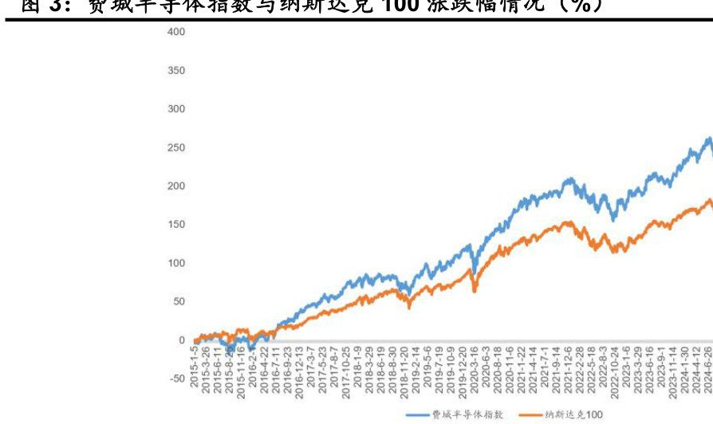

图例：费城半导体指数、纳斯达克100；纵轴刻度：-50、0、50、100、150、200、250、300、350、400；横轴为日期刻度（2015年起至2026年，刻度标签密集，末端标签 [OCR_UNREADABLE]）。图中无数据标签。

资料来源：Wind，中原证券研究所

2026年8月美股半导体板块上涨家数少于下跌家数，2026年8月涨幅排名前十的公司分别为嘉楠科技（115%）、高平电子（26%）、聪链集团（23%）、纳比特（21%）、Sequans（19%）、美光科技（16%）、Azenta（16%）、Wolfspeed（16%）、高通（15%）、南茂（15%）。

[Source Page: 8]

**表2：2026年8月美股主要半导体公司涨跌幅情况**

| 证券代码 | 证券名称 | 总市值（亿美元） | 8月涨跌幅（%） | 年初至今涨跌幅（%） | 市盈率（TTM） | 市销率（TTM） | 市净率 |
| --- | --- | --- | --- | --- | --- | --- | --- |
| CAN.O | 嘉楠科技 | 3 | 115 | (47) | (1) | 1 | 1 |
| KOPN.O | 高平电子 | 8 | 26 | 90 | 105 | 19 | 12 |
| ICG.O | 聪链集团 | 1 | 23 | (44) | (2) | 7 | 1 |
| NA.O | 纳比特 | 0.5 | 21 | (31) | (2) | 15 | 1 |
| SQNS.N | Sequans | 0.4 | 19 | (35) | (0) | 2 | 1 |
| MU.O | 美光科技 | 10828 | 16 | 236 | 21 | 12 | 11 |
| AZTA.O | Azenta | 14 | 16 | (2) | (11) | 2 | 1 |
| WOLF.N | Wolfspeed | 15 | 16 | 57 | (3) | 3 | 2 |
| QCOM.O | 高通 | 1790 | 15 | 1 | 19 | 4 | 6 |
| IMOS.O | 南茂 | 19 | 15 | 87 | 27 | 2 | 2 |
| INDI.O | indie Semiconductor | 9 | 15 | 5 | (6) | 4 | 3 |
| PXLW.O | 美国像素 | 0.4 | 14 | 8 | 1 | (3) | 1 |
| AAOI.O | 应用光电 | 91 | 14 | 209 | (160) | 15 | 5 |
| ENTG.O | 英特格 | 207 | 14 | 61 | 68 | 6 | 5 |
| VLN.N | Valens Semiconductor | 2 | 13 | 25 | (6) | 3 | 2 |
| SMTC.O | 先科电子 | 124 | 13 | 80 | 81 | 11 | 17 |
| MRVL.O | 迈威尔科技 | 1856 | 13 | 149 | 70 | 20 | 10 |
| MRAM.O | Everspin | 4 | 12 | 75 | (150) | 6 | 5 |
| DIOD.O | Diodes | 42 | 10 | 84 | 49 | 3 | 2 |
| NVDA.O | 英伟达 | 53208 | 10 | 19 | 28 | 18 | 23 |
| UCTT.O | 超科林半导体 | 31 | (19) | 168 | (131) | 1 | 5 |
| AMBA.O | 安霸 | 30 | (19) | (2) | (44) | 8 | 5 |
| ATOM.O | Atomera | 2 | (19) | 88 | (7) | 706 | 4 |
| MOBX.O | Mobix Labs | 0.2 | (21) | (51) | (0) | 4 | 3 |
| SEDG.O | Solaredge | 20 | (22) | 12 | (7) | 1 | 5 |
| AOSL.O | 阿尔法和欧米伽半导体 | 7 | (22) | 24 | (18) | 1 | 1 |
| AIP.O | Arteris | 11 | (27) | 41 | (27) | 13 | 16 |
| ICHR.O | Ichor Holdings | 20 | (29) | 191 | (50) | 2 | 2 |
| LASR.O | nLIGHT | 24 | (39) | 13 | (195) | 8 | 6 |
| SMTK.O | SmartKem | 0.02 | (71) | (94) | (0) | 3 | 0 |

资料来源：iFinD，中原证券研究所

### 1.2. 8月半导体行业可转债市场表现情况

2026年8月国内半导体行业可转债上涨家数多于下跌家数，其中微导转债（17.41%）、颀中转债（9.60%）、路维转债（9.37%）、闻泰转债（6.35%）、力合转债（4.94%）涨幅居前。

**表3：2026年8月国内半导体行业可转债涨跌幅情况（截至2026年9月4日）**

| 证券名称 | 代码 | 评级 | 余额（亿元） | 剩余期限（年） | 转股溢价率（%） | 2026年8月涨跌幅（%） | 2026年初至今涨跌幅（%） | 现价 |
| --- | --- | --- | --- | --- | --- | --- | --- | --- |
| 微导转债 | 118058.SH | AA | 11.70 | 4.92 | 12.25 | 17.41 | 4.06 | 340.18 |
| 颀中转债 | 118059.SH | AA+ | 8.50 | 5.16 | 47.72 | 9.60 | 19.46 | 176.94 |
| 路维转债 | 118056.SH | AA- | 6.14 | 4.76 | 37.40 | 9.37 | 26.27 | 246.65 |
| 闻泰转债 | 110081.SH | BBB+ | 71.70 | 0.89 | 8.61 | 6.35 | -6.99 | 107.25 |
| 力合转债 | 118036.SH | AA- | 3.80 | 2.81 | 34.50 | 4.94 | 8.53 | 143.58 |
| 富瀚转债 | 123122.SZ | A+ | 5.80 | 0.92 | 58.80 | 2.65 | 5.07 | 125.60 |
| 晶瑞转2 | 123124.SZ | A+ | 5.22 | 0.95 | 42.92 | 1.28 | -1.43 | 134.65 |
| 芯海转债 | 118015.SH | A+ | 4.10 | 1.87 | 140.23 | -1.75 | 2.67 | 126.82 |
| 南芯转债 | 118070.SH | AA+ | 15.87 | 5.78 | 88.69 | -2.38 | 15.06 | 149.58 |
| 韦尔转债 | 113616.SH | AA+ | 24.32 | 0.31 | 117.16 | -3.94 | -11.26 | 109.59 |
| 鼎龙转债 | 123255.SZ | AA | 9.10 | 4.57 | 40.61 | -5.00 | 80.78 | 328.00 |

[Source Page: 9]

| 证券名称 | 代码 | 评级 | 余额（亿元） | 剩余期限（年） | 转股溢价率（%） | 2026年8月涨跌幅（%） | 2026年初至今涨跌幅（%） | 现价 |
| --- | --- | --- | --- | --- | --- | --- | --- | --- |
| 华峰转债 | 118071.SH | AA | 7.49 | 5.80 | 81.66 | -6.77 | 91.90 | 191.90 |

资料来源：Wind，中原证券研究所

### 1.3. 8月半导体行业ETF市场表现情况

2026年8月国内半导体行业ETF全面上涨，其中华泰柏瑞上证科创板半导体材料设备主题ETF（9.61%）、华夏上证科创板半导体材料设备主题ETF（9.46%）、鹏华科创板半导体材料设备主题ETF（9.29%）、广发中证半导体材料设备主题ETF（8.32%）、万家中证半导体材料设备主题ETF（8.29%）涨幅居前。

**表4：2026年8月国内半导体行业ETF涨跌幅情况（截至2026年9月4日）**

| 代码 | 证券名称 | 上市日期 | 现有规模（亿元） | 2026年8月涨跌幅（%） | 2026年初至今涨跌幅（%） |
| --- | --- | --- | --- | --- | --- |
| 588710.SH | 华泰柏瑞上证科创板半导体材料设备主题ETF | 2025/6/4 | 108.08 | 9.61 | 79.60 |
| 588170.SH | 华夏上证科创板半导体材料设备主题ETF | 2025/4/8 | 409.40 | 9.46 | 79.80 |
| 589020.SH | 鹏华科创板半导体材料设备主题ETF | 2025/9/4 | 50.31 | 9.29 | 80.85 |
| 560780.SH | 广发中证半导体材料设备主题ETF | 2023/12/12 | 126.14 | 8.32 | 70.32 |
| 159327.SZ | 万家中证半导体材料设备主题ETF | 2024/8/5 | 30.69 | 8.29 | 71.97 |
| 562590.SH | 华夏中证半导体材料设备主题ETF | 2023/10/18 | 85.72 | 8.14 | 71.50 |
| 159558.SZ | 易方达中证半导体材料设备主题ETF | 2024/6/18 | 198.46 | 8.09 | 70.79 |
| 159516.SZ | 国泰中证半导体材料设备主题ETF | 2023/7/27 | 405.24 | 7.91 | 70.23 |
| 588200.SH | 嘉实上证科创板芯片ETF | 2022/10/26 | 478.21 | 7.09 | 41.51 |
| 512480.SH | 国联安中证全指半导体ETF | 2019/6/12 | 200.16 | 6.65 | 33.33 |
| 159325.SZ | 南方中证半导体行业精选ETF | 2024/11/8 | 11.11 | 5.00 | 34.27 |
| 159665.SZ | 工银瑞信国证半导体芯片ETF | 2023/1/6 | 5.91 | 4.94 | 28.41 |
| 513310.SH | 华泰柏瑞中证韩交所中韩半导体ETF | 2022/12/22 | 104.03 | 4.70 | 80.48 |
| 159995.SZ | 华夏国证半导体芯片ETF | 2020/2/10 | 268.50 | 4.47 | 25.36 |
| 159813.SZ | 鹏华国证半导体芯片ETF | 2020/5/25 | 64.89 | 4.47 | 25.52 |
| 159801.SZ | 广发国证半导体芯片ETF | 2020/2/18 | 49.67 | 4.33 | 25.79 |
| 159582.SZ | 博时中证半导体产业ETF | 2024/4/16 | 8.02 | 4.32 | 58.67 |
| 512760.SH | 国泰CES半导体芯片ETF | 2019/6/12 | 101.68 | 4.19 | 28.06 |
| 561980.SH | 招商中证半导体产业ETF | 2023/9/1 | 55.90 | 3.71 | 58.07 |

资料来源：Wind，中原证券研究所

## 2. 国内半导体行业2026年半年报总结

### 2.1. 半导体行业26Q2保持快速增长，盈利能力同环比持续提升

半导体行业26Q2营收及归母净利润保持快速增长。2026年上半年半导体行业（中信）营业收入为4487.86亿元，同比增长22.58%，26Q2半导体行业（中信）营收为2454.24亿元，同比增长25.46%，其中集成电路、分立器件、半导体设备和半导体材料板块分别同比+36.13%、-42.26%、+28.61%、+28.49%；2026年上半年半导体行业（中信）归母净利润为677.64亿元，同比增长173.51%，26Q2半导体行业（中信）归母净利润为452.83亿元，同比增长202.26%，其中集成电路、分立器件、半导体设备和半导体材料板块分别同比+327.10%、-43.17%、+76.19%、+41.17%。

[Source Page: 10]

**图4：半导体行业2020-2026年营收及增速情况**

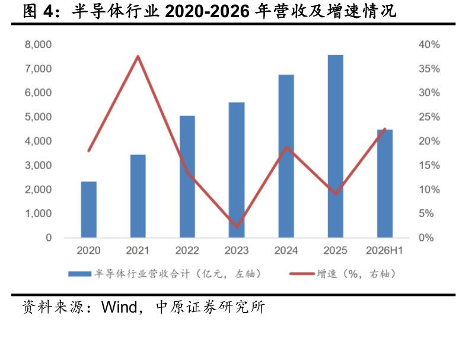

图例：半导体行业营收合计（亿元，左轴）、增速（%，右轴）；左轴刻度：0、1,000、2,000、3,000、4,000、5,000、6,000、7,000、8,000；右轴刻度：0%、5%、10%、15%、20%、25%、30%、35%、40%；横轴：2020、2021、2022、2023、2024、2025、2026H1。图中无数据标签。

资料来源：Wind，中原证券研究所

**图5：半导体行业2020-2026年归母净利润及增速情况**

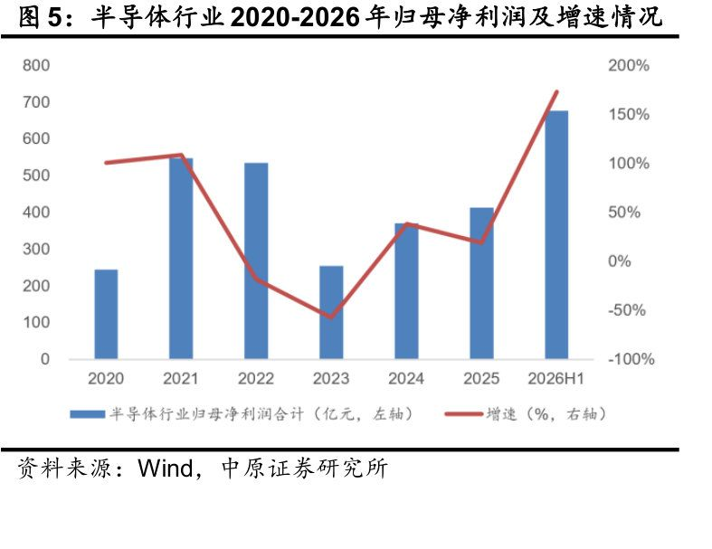

图例：半导体行业归母净利润合计（亿元，左轴）、增速（%，右轴）；左轴刻度：0、100、200、300、400、500、600、700、800；右轴刻度：-100%、-50%、0%、50%、100%、150%、200%；横轴：2020、2021、2022、2023、2024、2025、2026H1。图中无数据标签。

资料来源：Wind，中原证券研究所

**表5：26Q2半导体（中信）各子板块营收及归母净利润情况**

| 子板块 | 营业收入（亿元） | 营收同比增速 | 归母净利润（亿元） | 归母净利润同比增速 | 毛利率 | 净利率 |
| --- | --- | --- | --- | --- | --- | --- |
| 集成电路 | 1,765.08 | 36.13% | 353.88 | 327.10% | 33.68% | 21.14% |
| 分立器件 | 129.40 | -42.26% | 7.68 | -43.17% | 22.78% | 5.12% |
| 半导体材料 | 223.62 | 28.49% | 11.62 | 41.17% | 17.59% | 5.18% |
| 半导体设备 | 336.13 | 28.61% | 79.64 | 76.19% | 40.51% | 23.37% |

资料来源：Wind，中原证券研究所

半导体行业26Q2毛利率及净利率同环比持续回升。2026年上半年半导体行业毛利率为31.75%，同比提升5.75%，26Q2毛利率为32.58%，同比提升6.28%，环比提升1.89%；2026年上半年半导体行业净利率为15.47%，同比提升8.66%，26Q2净利率为19.15%，同比提升11.66%，环比提升8.25%。

**图6：半导体行业2020-2026年毛利率和净利率情况**

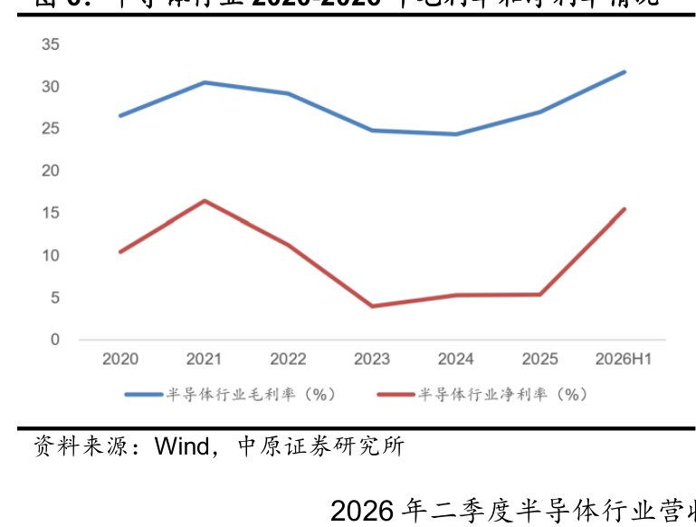

图例：半导体行业毛利率（%）、半导体行业净利率（%）；纵轴刻度：0、5、10、15、20、25、30、35；横轴：2020、2021、2022、2023、2024、2025、2026H1。图中无数据标签。

资料来源：Wind，中原证券研究所

**图7：半导体行业21Q1-26Q2毛利率和净利率情况**

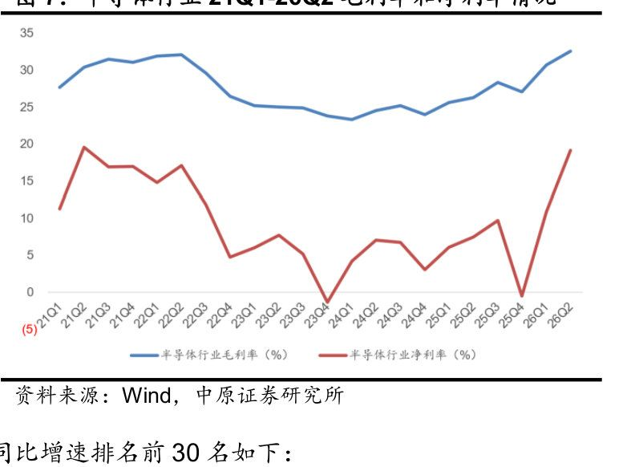

图例：半导体行业毛利率（%）、半导体行业净利率（%）；纵轴刻度：0、5、10、15、20、25、30、35；横轴：21Q1、21Q2、21Q3、21Q4、22Q1、22Q2、22Q3、22Q4、23Q1、23Q2、23Q3、23Q4、24Q1、24Q2、24Q3、24Q4、25Q1、25Q2、25Q3、25Q4、26Q1、26Q2。图中无数据标签。

资料来源：Wind，中原证券研究所

2026年二季度半导体行业营收同比增速排名前30名如下：

[Source Page: 11]

**表6：A股半导体行业（中信）26Q2营收同比增速排名情况**

| 序号 | 证券代码 | 证券名称 | 26Q2营收（亿元） | 26Q2营收同比增速（%） | 26Q2归母净利润（亿元） | 26Q2归母净利润同比增速（%） |
| --- | --- | --- | --- | --- | --- | --- |
| 1 | 301666.SZ | 大普微-UW | 34.13 | 656.40 | 9.64 | 519.17 |
| 2 | 688110.SH | 东芯股份 | 10.18 | 406.95 | 5.21 | 1107.17 |
| 3 | 688766.SH | 普冉股份 | 25.13 | 402.11 | 5.76 | 2485.07 |
| 4 | 688498.SH | 源杰科技 | 5.70 | 372.73 | 4.28 | 1238.70 |
| 5 | 688525.SH | 佰维存储 | 87.61 | 269.81 | 42.67 | 15177.40 |
| 6 | 603986.SH | 兆易创新 | 73.78 | 229.18 | 53.96 | 1482.99 |
| 7 | 001309.SZ | 德明利 | 93.72 | 228.04 | 26.71 | 5566.72 |
| 8 | 688478.SH | 晶升股份 | 0.38 | 228.02 | (0.03) | 10.22 |
| 9 | 688416.SH | 恒烁股份 | 3.09 | 211.64 | 0.91 | 304.72 |
| 10 | 688801.SH | C燧原-U | 8.33 | 200.50 | (1.88) | 34.86 |
| 11 | 688535.SH | 华海诚科 | 2.46 | 158.42 | 0.26 | 298.39 |
| 12 | 300613.SZ | 富瀚微 | 9.04 | 144.65 | 2.65 | 3057.19 |
| 13 | 688795.SH | 摩尔线程-U | 9.99 | 141.88 | (0.41) | 74.17 |
| 14 | 688146.SH | 中船特气 | 12.03 | 129.49 | 2.47 | 170.52 |
| 15 | 301536.SZ | 星宸科技 | 16.64 | 125.59 | 6.43 | 834.79 |
| 16 | 688048.SH | 长光华芯 | 2.61 | 117.97 | 0.26 | 56.97 |
| 17 | 688620.SH | 安凯微 | 2.86 | 115.91 | 0.60 | 320.63 |
| 18 | 301200.SZ | 大族数控 | 30.30 | 113.07 | 6.34 | 332.73 |
| 19 | 688368.SH | 晶丰明源 | 8.44 | 108.36 | 0.50 | 121.86 |
| 20 | 688107.SH | 安路科技 | 2.66 | 104.69 | (0.34) | 58.95 |
| 21 | 300223.SZ | 君正股份 | 23.97 | 101.66 | 8.79 | 579.96 |
| 22 | 300671.SZ | 富满微 | 4.09 | 90.95 | 0.70 | 754.42 |
| 23 | 688262.SH | 国芯科技 | 1.57 | 88.01 | (0.33) | 35.74 |
| 24 | 603061.SH | 金海通 | 3.17 | 77.17 | 0.89 | 76.12 |
| 25 | 688521.SH | 芯原股份 | 10.28 | 75.95 | (2.71) | (172.63) |
| 26 | 688256.SH | 寒武纪 | 31.11 | 75.83 | 12.98 | 90.11 |
| 27 | 688002.SH | 睿创微纳 | 24.52 | 74.22 | 7.81 | 280.43 |
| 28 | 688052.SH | 纳芯微 | 13.99 | 73.45 | 1.03 | 487.41 |
| 29 | 688536.SH | 思瑞浦 | 9.04 | 71.33 | 2.02 | 303.72 |
| 30 | 300672.SZ | 国科微 | 7.44 | 70.66 | 1.41 | 548.68 |

资料来源：Wind，中原证券研究所

### 2.2. 国内存储厂商26Q2业绩表现亮眼，有望持续提升市场份额

**26Q2存储器产品价格持续上涨，国内存储厂商业绩表现亮眼。** 国内存储器厂商主要布局存储器模组、存储芯片等环节，26Q2主流存储器产品价格持续上涨，国内存储器模组厂商大普微、佰维存储、德明利、江波龙26Q2营收分别同比增长656.40%、269.81%、228.04%、138.75%，归母净利润分别同比增长519.17%、15177.40%、5566.72%、3930.86%；受益于利基型存储产品价格上涨，国内存储芯片厂商东芯股份、普冉股份、兆易创新、恒烁股份、君正股份26Q2营收分别同比增长406.95%、402.11%、229.18%、211.64%、101.66%，归母净利润分别同比增长1107.17%、2485.07%、1482.99%、304.72%、579.96%；长鑫科技26Q2营收环比增长95.89%，归母净利润环比增长113.40%。AI驱动存储器需求旺盛，存储器周期持续上行，AI及国产替代需求有望推动国内存储厂商显著受益于行业趋势，并持续提升市场份额，建议关注国内存储芯片、存储模组厂商投资机会。

[Source Page: 12]

**表7：国内存储器厂商26Q2业绩情况**

| 证券代码 | 证券名称 | 26Q2营收（亿元） | 同比增速（%） | 环比增速（%） | 26Q2归母净利润（亿元） | 同比增速（%） | 环比增速（%） |
| --- | --- | --- | --- | --- | --- | --- | --- |
| 301666.SZ | 大普微-UW | 34.13 | 656.40 | 160.55 | 9.64 | 519.17 | 160.64 |
| 688525.SH | 佰维存储 | 87.61 | 269.81 | 28.56 | 42.67 | 15177.40 | 47.18 |
| 001309.SZ | 德明利 | 93.72 | 228.04 | 24.33 | 26.71 | 5566.72 | (20.18) |
| 301308.SZ | 江波龙 | 141.80 | 138.75 | 43.10 | 67.15 | 3930.86 | 73.85 |
| 688110.SH | 东芯股份 | 10.18 | 406.95 | 112.31 | 5.21 | 1107.17 | 276.74 |
| 688766.SH | 普冉股份 | 25.13 | 402.11 | 73.66 | 5.76 | 2485.07 | 129.23 |
| 603986.SH | 兆易创新 | 73.78 | 229.18 | 76.16 | 53.96 | 1482.99 | 269.24 |
| 688416.SH | 恒烁股份 | 3.09 | 211.64 | 40.77 | 0.91 | 304.72 | 87.11 |
| 300223.SZ | 君正股份 | 23.97 | 101.66 | 53.71 | 8.79 | 579.96 | 175.44 |
| 688825.SH | 长鑫科技 | 995.10 |  | 95.89 | 528.43 |  | 113.40 |

资料来源：Wind，中原证券研究所

## 3. 全球半导体月度销售额继续同比高速增长，国内外云厂商持续加大资本支出

### 3.1. 全球半导体月度销售额继续同比高速增长

**2026年7月全球半导体销售额同比增长135.1%，环比增长6.4%。** 根据美国半导体行业协会（SIA）的数据，2026年7月份全球半导体销售额约为1468亿美元，同比增长135.1%，连续33个月实现同比增长，环比增长6.4%。2026年7月，从区域表现来看，同比增长上，美洲同比增长171.3%，亚太及其他地区增长134.9%，中国增长123.6%，欧洲增长85.2%，日本增长50.8%；环比增长上，日本市场环比增长9.2%，美洲增长8.7%，亚太及其他地区增长6.8%，欧洲增长5.2%，中国增长2.9%。

**图8：2000-2026年全球半导体市场销售额情况**

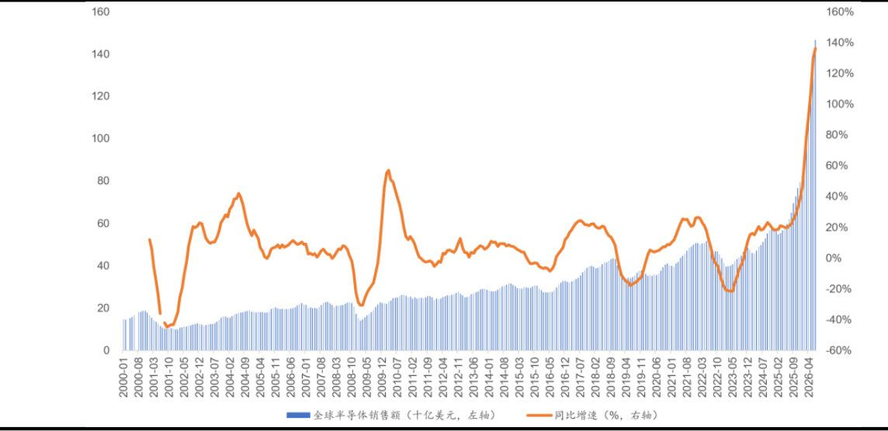

图例：全球半导体销售额（十亿美元，左轴，蓝色柱）、同比增速（%，右轴，橙色折线）；左轴刻度：0、20、40、60、80、100、120、140、160；右轴刻度：-60%、-40%、-20%、0%、20%、40%、60%、80%、100%、120%、140%、160%；横轴为月度刻度（2000-01起至2026-04，按双月标注）。图中无数据标签。

资料来源：SIA，Wind，中原证券研究所

**2026年7月中国半导体销售额同比增长123.6%，环比增长2.9%。** 根据美国半导体行业协会（SIA）的数据，2026年7月中国半导体行业销售额为382亿美元，同比增长123.6%，连续33个月实现同比增长，环比增长2.9%。

[Source Page: 13]

**图9：2015-2026年中国半导体市场销售额情况**

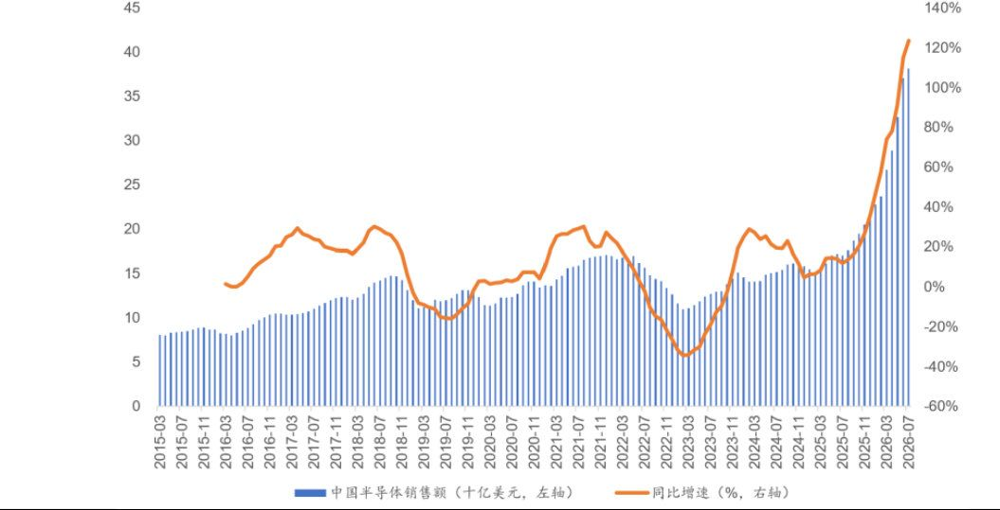

图例：中国半导体销售额（十亿美元，左轴，蓝色柱）、同比增速（%，右轴，橙色折线）；左轴刻度：0、5、10、15、20、25、30、35、40、45；右轴刻度：-60%、-40%、-20%、0%、20%、40%、60%、80%、100%、120%、140%；横轴为月度刻度（2015-03、2015-07、2015-11起，每隔4个月标注，至2026-07）。图中无数据标签。

资料来源：SIA，Wind，中原证券研究所

**WSTS预计2026年全球半导体销售额将同比增长89.9%。** 根据WSTS的最新预测，预计2026年全球半导体市场规模将达到1.511万亿美元，同比增幅高达89.9%；预计半导体市场2027年将继续增长26.6%，市场规模达1.914万亿美元。

**图10：2018-2029年全球半导体销售额及预测情况（十亿美元）**

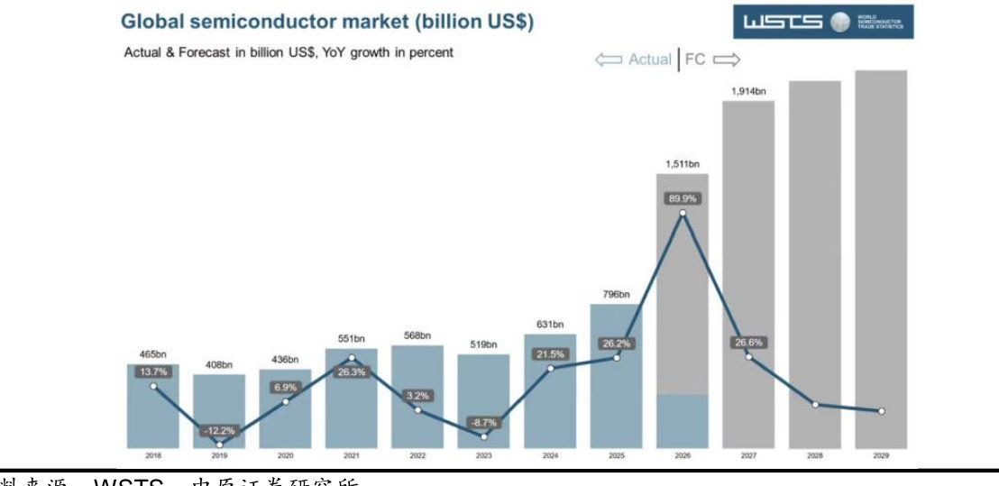

图内标题：Global semiconductor market (billion US$)；副标题：Actual & Forecast in billion US$, YoY growth in percent；图例：Actual、FC。

柱上标注的销售额与同比增速：2018年465bn（13.7%）、2019年408bn（-12.2%）、2020年436bn（6.9%）、2021年551bn（26.3%）、2022年568bn（3.2%）、2023年519bn（-8.7%）、2024年631bn（21.5%）、2025年796bn（26.2%）、2026年1,511bn（89.9%）、2027年1,914bn（26.6%）；2028、2029年柱体无数据标签。

资料来源：WSTS，中原证券研究所

**WSTS预计2026年全球存储器销售额同比增长249.5%。** 根据WSTS的最新预测，WSTS预计存储器细分领域2026年销售额同比增幅将达到惊人的249.5%，市场规模突破8000亿美元，一举超越2025年整体半导体市场规模；而逻辑芯片2026年也将实现37.3%增幅；微处理器、模拟、分立、传感、光电子增幅则在19.8%~2.7%区间。2027年，存储器预计将继续以32.1%的增速引领市场，此后是逻辑的27.1%和微处理器的20.0%。

[Source Page: 14]

**图11：2020-2027年全球集成电路分产品市场预测情况**

| 项目 | 2020CY | 2021CY | 2022CY | 2023CY | 2024CY | 2025CY | 2026CY | 2027CY |
| --- | --- | --- | --- | --- | --- | --- | --- | --- |
| Total IC(M$) | 361,226 | 463,002 | 474,402 | 428,442 | 539,505 | 700,975 | 1,412,326 | 1,808,533 |
| Analog | 55,658 | 74,105 | 88,983 | 81,225 | 79,588 | 86,519 | 95,358 | 101,662 |
| Micro | 69,678 | 80,221 | 79,073 | 76,340 | 78,633 | 84,867 | 101,655 | 121,966 |
| Logic | 118,408 | 154,837 | 176,578 | 178,589 | 215,768 | 299,547 | 411,371 | 522,820 |
| Memory | 117,482 | 153,839 | 129,767 | 92,288 | 165,516 | 230,042 | 803,941 | 1,062,085 |

| Growth Rate(%) | 2020CY | 2021CY | 2022CY | 2023CY | 2024CY | 2025CY | 2026CY | 2027CY |
| --- | --- | --- | --- | --- | --- | --- | --- | --- |
| Total IC(M$) | +8.4% | +28.2% | +2.5% | -9.7% | +25.9% | +29.9% | +101.5% | +28.1% |
| Analog | +3.2% | +33.1% | +20.1% | -8.7% | -2.0% | +8.7% | +10.2% | +6.6% |
| Micro | +4.9% | +15.1% | -1.4% | -3.5% | +3.0% | +7.9% | +19.8% | +20.0% |
| Logic | +11.1% | +30.8% | +14.0% | +1.1% | +20.8% | +38.8% | +37.3% | +27.1% |
| Memory | +10.4% | +30.9% | -15.6% | -28.9% | +79.3% | +39.0% | +249.5% | +32.1% |

资料来源：WSTS，中原证券研究所

**全球存储器厂商26Q2业绩继续表现亮眼，服务器CPU需求旺盛。** 近期部分全球15大芯片厂商公布了26Q2季报，受益于AI推理对于存储用量大幅提升，推动HBM、DDR5及企业级SSD需求增长，存储器厂商三星、SK海力士、美光、铠侠26Q2业绩继续实现同环比高速增长；目前DRAM、NAND供应紧张，预计2026年存储需求将继续快速增长。随着AI工作负载从训练转向推理、智能体，CPU在AI数据中心中的地位逐步提升，英特尔与AMD服务器CPU出货量26年实现强劲增长。TI、NXP、ST、英飞凌受益于数据中心需求加速，工业、汽车等领域需求恢复，模拟芯片行业26Q2继续复苏。

**表8：全球前十五大芯片公司26Q2营收情况及26年展望**

| 序号 | 公司 | 26Q2营收（亿美元） | 26Q2同比增速 | 26Q2环比增速 | 26Q3环比增速指引 | 2026年展望 |
| --- | --- | --- | --- | --- | --- | --- |
| 1 | 英伟达 | 962 | 106% | 18% | +12% | 英伟达预计26Q3公司营收将达1080亿美元，上下浮动2%，中位值同比增长89%，环比增长12%，毛利率约为74%。AI需求激增推动全球持续加大基础设施建设，公司预计2028财年营收同比增长约70%，并且该预期受到供给约束。 |
| 2 | 三星半导体 | 906 | 357% | 56% | - | 三星预计26H2服务器DRAM与SSD需求预计持续强劲，智能体AI加速需求增长，持续提升DDR5、SOCAMM2等高附加值AI产品占比，以高性能产品主导PCIe Gen6企业级SSD市场，聚焦KV缓存。 |
| 3 | SK海力士 | 555 | 257% | 51% | - | 海力士预计26Q3 DRAM出货量环比增长约10%，NAND出货量环比增长低个位数。公司已与约10家客户签订LTA，合同期限通常约为五年，不同客户、不同产品对应不同的定价机制。 |
| 4 | 美光 | 415 | 346% | 74% | +21% | 美光预计26Q3营收为490-510亿美元，中位值同比+342%、环比+21%，毛利率预计为86%。公司预计DRAM与NAND的供需紧张格局将持续至2027年之后，预计2026年DRAM位元出货量将增长低到中20%，NAND位元出货量将增长约20%，预计2026年供应将持续紧张。预计2026财年资本支出将达270亿美元，预计2027年资本支出将继续增长。 |
| 5 | 博通 | 296 | 86% | 33% | +18% | 博通预计26Q3营收约为348亿美元，同比增长93%，环比增长18%。公司将2026财年AI收入指引上调至580亿美元，预计2027财年将达1150亿美元，预计2028财年继续增长至2300亿美元。 |
| 6 | 英特尔 | 161 | 25% | 19% | +% | 英特尔预计26Q3营收158-168亿美元，中值同比+19%、环比+1%。随着AI工作负载从训练转向推理、智能体，CPU在AI基础设施中的结构性地位更加重要，26Q2公司签署多份LTA；公司预计服务器CPU出货量今明两年将实现强劲增长，景气周期将延续至2028年。 |

[Source Page: 15]

| 序号 | 公司 | 26Q2营收（亿美元） | 26Q2同比增速 | 26Q2环比增速 | 26Q3环比增速指引 | 2026年展望 |
| --- | --- | --- | --- | --- | --- | --- |
| 7 | AMD | 115 | 50% | 13% | +41% | AMD预计26Q3营收为127-133亿美元，中位值同比+41%、环比+13%，毛利率约为56%。AMD预计数据中心销售将在2026年下半年进一步加速，推动整体收入增长和利润扩张；预计2027年数据中心销售将翻倍，并计划推出配备MI500 GPU、Verano CPU及Pensando网络技术的机架级产品。 |
| 8 | 铠侠 | 111 | 416% | 76% | +35% | 铠侠预计26Q3营收为2.39万亿日元，环比增长35.3%。AI数据中心NAND需求是核心驱动力，2026财年产能已基本售罄，供需紧张支撑高位价格。NAND市场已脱离传统周期性，转向更稳定的增长轨道，公司目标将约50%出货量通过多年LTA锁定。 |
| 9 | 高通（IC） | 85 | -5% | -6% | +2% | 高通26Q2汽车业务强劲，但手机业务疲软拖累整体表现。预计26Q3 QCT芯片业务营收84–90亿美元，中位值环比增长2%，手机芯片业务受秋季新机备货启动导致需求边际改善，汽车及IoT业务持续增长，但内存供应短缺和成本压力仍影响公司整体增速。 |
| 10 | TI | 55 | 23% | 13% | +% | TI预计26Q3营收56.5-61.5亿美元，中值同比+33%、环比+8%。26Q2数据中心业务营收同比翻倍、环比增长约20%，工业业务营收同比增长约30%、环比增长约10%，汽车业务营收实现同比中双位数增长。公司预计工业和汽车市场的复苏势头有望在26H2延续，AI数据中心相关需求将继续成为重要增长动力。 |
| 11 | 联发科 | 48 | 2% | 3% | +3% | 联发科预计26Q3营收为1522 -1598亿元新台币，中位值同比+9.8%、环比+2.5%，毛利率为46%；26Q2呈现AI数据中心需求强劲、手机芯片需求疲软的分化格局；公司正通过涨价应对成本压力，并将数据中心AI ASIC作为公司核心增长引擎。 |
| 12 | 英飞凌 | 48 | 13% | 9% | +13% | 英飞凌预计26Q3营收约47亿欧元，环比+13%。展望2026财年，AI数据中心电源业务处于供不应求状态，成为最核心的增长引擎，上调全年营收目标至163亿欧元。 |
| 13 | ADI | 40 | 40% | 11% | +7% | ADI预计26Q3营收42-44亿美元，中值同比+49.5%、环比+6.9%。26Q2所有终端市场均实现增长，数据中心和工业领域表现尤为突出，AI基础设施投资将是未来数年增长的核心驱动力。 |
| 14 | 恩智浦 | 35 | +19% | +10% | +7% | 恩智浦预计26Q3营收为36.5-38.5亿美元，中值同比+18%、环比+7%，毛利率为58.5%。26Q2公司所有终端市场和区域均实现增长，人工智能正从云端走向汽车、工业和机器人，而这些应用场景正是恩智浦长期保持领先地位的核心市场。 |
| 15 | 意法半导体 | 35 | 26% | 13% | +6% | ST预计26Q3营收中值为37亿美元，中值同比+16%、环比+6%；毛利率约为37%。26Q2通信设备与计算机外设业务营收同比+50%，工业业务营收同比+34%，个人电子产品营收同比+20%，汽车业务营收同比+16%。公司看好后续市场需求，多个品类出现供应趋紧迹象。 |

资料来源：各公司公告，中原证券研究所

### 3.2. 2026年全球AI眼镜出货量有望快速增长，AI算力硬件基础设施需求旺盛

全球半导体下游需求呈现结构性特征，消费类需求占比较高。根据SIA的数据，2024年全球半导体下游应用领域中计算机占比34.9%、通信占比33.0%、汽车占比12.7%、消费电子占比9.9%、工业占比8.4%、政府占比1%。消费类下游占比较高，目前AI算力硬件需求持续旺盛，工业市场需求开始复苏。

[Source Page: 16]

**图12：2024年全球半导体下游应用领域占比情况**

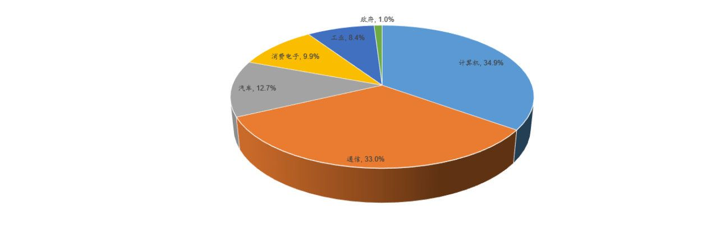

饼图标注：计算机34.9%、通信33.0%、汽车12.7%、消费电子9.9%、工业8.4%、政府1.0%。

资料来源：SIA，中原证券研究所

#### 3.2.1. 全球智能手机季度出货量同比下降，预计2026年全球智能手机市场将有所承压

**26Q2全球智能手机出货量同比下降6%。** 根据Omdia的数据，2026年第二季度全球智能手机出货量同比下降6%，降至2.72亿部。2026年第一季度受提前备货需求带动，市场表现较强，而第二季度则进入存储器成本周期的调整阶段。持续高企的存储价格扰乱了供应，推高了元器件成本，迫使厂商重新思考定价策略、产品组合和渠道战略。

**图13：23Q1-26Q2全球智能手机出货量情况**

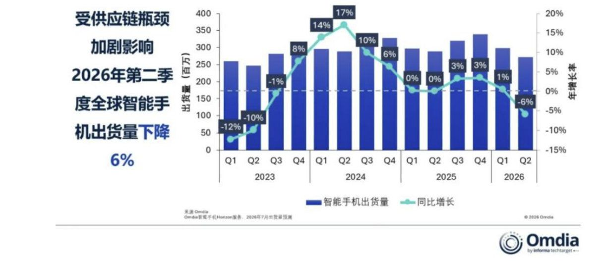

图例：智能手机出货量（百万，左轴，柱状，深蓝色）、同比增长（%，右轴，折线，浅蓝色）；左轴刻度：0、50、100、150、200、250、300、350、400；右轴刻度：-15%、-10%、-5%、0%、5%、10%、15%、20%；横轴：按年分组标注2023、2024、2025、2026，每组内为Q1、Q2、Q3、Q4（2026年仅Q1、Q2）。

折线上标注的同比增长率：23Q1 -12%、23Q2 -10%、23Q3 -1%、23Q4 8%、24Q1 14%、24Q2 17%、24Q3 10%、24Q4 6%、25Q1 0%、25Q2 0%、25Q3 3%、25Q4 3%、26Q1 1%、26Q2 -6%。柱状出货量无数据标签。

图左侧标注文字：受供应链瓶颈加剧影响2026年第二季度全球智能手机出货量下降6%。

资料来源：Omdia，中原证券研究所

**26Q2三星、苹果、小米、OPPO、vivo市场份额位列前五位。** 根据Omdia的数据，2026年第二季度，三星保持全球份额第一地位，出货量达6050万部，同比增长5%，市场份额为22%；苹果实现了有史以来最强劲的第二季度表现，出货量达5510万部，同比增长23%，在传统淡季创下20%的市场份额纪录；小米以3120万部出货量保持第三位，同比下降26%，连续第二个季度下滑，小米是前五大厂商中受存储成本上涨影响最大的，特别是在亚太和拉丁美洲新兴市场，入门级产品涨价严重影响了需求；OPPO排名第四，出货量为2840万部，同比下降17%，OPPO精简了旗下三个子品牌的市场组合，并减少了入门级SKU以提高盈利能力；vivo以2150万部出货量位列第五，同比下降18%。

[Source Page: 17]

**图14：22Q1-26Q2全球智能手机厂商市场份额情况**

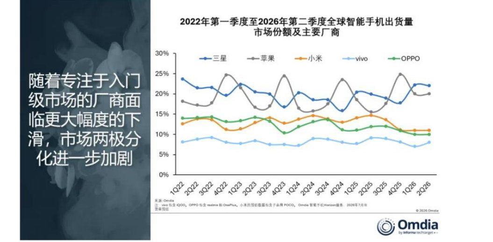

图内标题：2022年第一季度至2026年第二季度全球智能手机出货量市场份额及主要厂商；图例：三星、苹果、小米、vivo、OPPO；纵轴刻度：0%、5%、10%、15%、20%、25%、30%；横轴：1Q22、2Q22、3Q22、4Q22、1Q23、2Q23、3Q23、4Q23、1Q24、2Q24、3Q24、4Q24、1Q25、2Q25、3Q25、4Q25、1Q26、2Q26。

图左侧标注文字：随着专注于入门级市场的厂商面临更大程度的下滑，市场两极分化进一步加剧。图中无数据标签，图内来源小字字号过小 [OCR_UNREADABLE]。

资料来源：Omdia，中原证券研究所

受益于AI大模型的赋能，智能手机将迎来AI新时代。通过AI技术赋能智能手机可以追溯至2017年，安卓厂商开始在其SoC平台中加入独立的AI计算单元，用于运行和影像增强相关的深度学习模型，随后AI技术逐渐被手机厂商用于更多方面，如强化安全、优化续航、提升网络性能等，但计算、摄影一直是其最主要的应用领域，直到大模型被装进智能手机，手机AI应用从中小模型时代跨越至大模型时代。有了大模型的加持，在人机交互层面，新的多模态交互将取代传统的触控屏交互，用户可以更自然的与手机沟通；多模态输入和输出能力相结合，可以极大强化智能手机的生产力工具属性，既可以基于多种形式的输入信息，生成用户需要的图表、文本、音乐、图片甚至是视频，也可以对输入的图片、视频进行编辑。

**图15：手机智能化演进路线图**

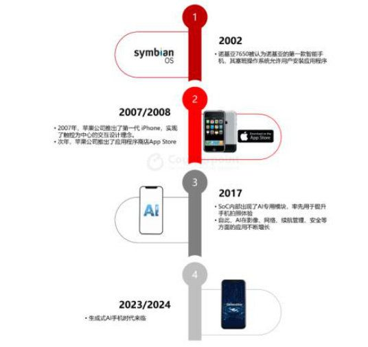

图中四个演进阶段：

1. 2002：symbian OS；诺基亚7650被认为诺基亚的第一款智能手机，其塞班操作系统允许用户安装应用程序。
2. 2007/2008：2007年，苹果公司推出了第一代iPhone，实现了触控为中心的交互设计理念；次年，苹果公司推出了应用程序商店App Store。
3. 2017：SoC内部出现了AI专用模块，率先用于提升手机拍照体验；自此，AI在影像、网络、续航管理、安全等方面的应用不断增长。
4. 2023/2024：生成式AI手机时代来临。

资料来源：生成式AI手机产业白皮书（Counterpoint，联发科等），中原证券研究所

AI手机可以通过端侧部署AI大模型实现多模态内容生成、情境感知，能更自然的进行交互，并内嵌专属智能体。AI手机应具有创作能力、自学习能力、真实世界感知能力、算力高效利用能力。

[Source Page: 18]

**图16：AI手机带来手机全栈革新和生态重构**

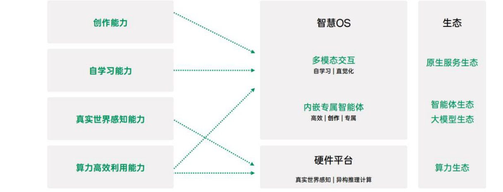

图示结构：左侧四项能力——创作能力、自学习能力、真实世界感知能力、算力高效利用能力，通过箭头指向中间与右侧的「智慧OS」「硬件平台」「生态」：

- 智慧OS：多模态交互（自学 | 直观化）；内嵌专属智能体（高效 | 创作 | 专属）
- 硬件平台：真实世界感知 | 异构推理计算
- 生态：原生服务生态；智能体生态；大模型生态；算力生态

资料来源：AI手机白皮书（IDC，OPPO），中原证券研究所

生成式AI将成为智能手机厂商的重要战略，行业领导者引领AI技术。随着三星发布全新的Galaxy S24智能手机，三星将生成式AI作为长期的产品策略，同时中国厂商小米、vivo、OPPO和荣耀等也已发布具备生成式AI能力的旗舰机型。AI逐步从最初的产品层面的差异化上升至运营及公司层面的整体战略，各智能手机厂商均涉及其中。苹果、谷歌和三星等全球主要厂商以及荣耀、OPPO、小米和vivo等中国领先厂商都走在将生成式AI功能集成到其设备的前列；其战略各不相同，从开发专用AI芯片到加强利用AI的生态系统集成来提升用户体验。

**图17：AI手机生态系统及主要参与者情况**

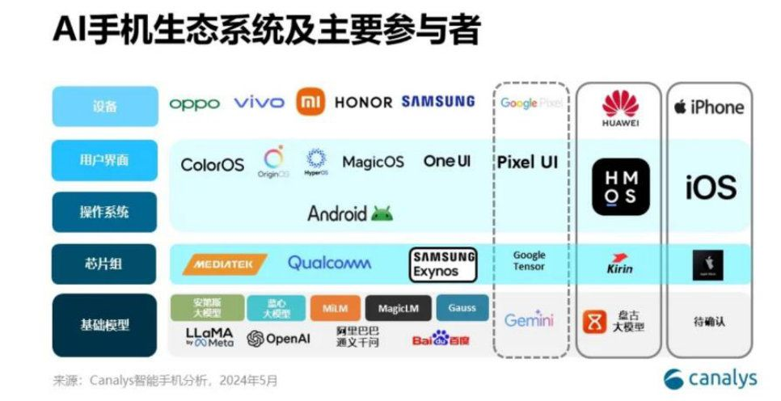

图内标题：AI手机生态系统及主要参与者。按层级与阵营列出：

- 设备：oppo、vivo、mi（小米）、HONOR、SAMSUNG；Google Pixel；HUAWEI；iPhone
- 用户界面：ColorOS、OriginOS、HyperOS、MagicOS、One UI；Pixel UI；HarmonyOS（HMOS）；iOS
- 操作系统：Android；Android（Pixel）；HMOS；iOS
- 芯片组：MediaTek、Qualcomm、Samsung Exynos；Google Tensor；Kirin（麒麟）；苹果自研芯片（图标 [OCR_UNCERTAIN]）
- 基础模型：安卓AI大模型、蓝心大模型、MiLM、MagicLM、Gauss、LLaMA（Meta）、OpenAI、阿里云通义千问、百度；Gemini；盘古大模型；待确认

图内来源：Canalys智能手机分析，2024年5月。

资料来源：Canalys，中原证券研究所

高通、联发科不断迭代支持端侧AI大模型手机的SoC芯片，NPU算力不断提升。2025年9月25日，高通正式发布新一代旗舰芯片骁龙8 Elite Gen 5，延续2+6核心架构，两个Prime核心频率提升至4.6GHz，六个性能核心运行于3.62GHz；比前代产品，CPU性能提升20%，能效提升35%，整体功耗降低16%；图形处理方面，新一代Adreno GPU采用切片式架构，整体GPU性能提升23%，功耗降低20%；AI性能显著增强，Hexagon NPU速度提升37%，支持INT2精度量化，可在设备端运行更复杂的大语言模型。2025年9月22日，联发科正式发布天玑9500旗舰手机处理器，天玑9500全大核CPU架构包含1个主频高达4.21GHz的C1-Ultra超大核、3个C1-Premium超大核和4个C1-Pro大核，物体侦测运算性能提升57%、运行编解码模型功耗下降50%；搭载新一代旗舰GPU G1-Ultra，

[Source Page: 19]

其峰值性能相较上一代提升33%，功耗相较上一代峰值性能下降低42%，光线追踪渲染性能相较上一代提升119%；集成全新超性能和超能效双NPU，超性能NPU 990峰值性能相较上一代提升111%，在大语言模型摘要输出能力、多模态理解能力皆有大幅跃进，并率先实现4K高清画质文生图，同时NPU 990相较上一代在峰值性能下的功耗降低56%。

**表9：全球部分处理器厂商发布的支持端侧AI大模型手机的SoC芯片情况**

| 厂商 | 处理器 | 发布时间 | CPU | GPU | NPU AI算力 | 存储器 | 制程 |
| --- | --- | --- | --- | --- | --- | --- | --- |
| 高通 | 骁龙8 Gen 3 | 2023.10 | 骁龙8 Gen 3 | Adreno750 GPU | 支持100亿参数的AI大模型 | LPDDR5X | 4nm |
| 高通 | 骁龙8 Elite | 2024.10 | Oryon CPU | Adreno 830 | 80 TOPS | LPDDR5X | 3nm |
| 高通 | 骁龙8 Elite Gen 5 | 2025.9 | Oryon CPU，8核心（2+6） | Adreno 840 | - | LPDDR5X | 3nm |
| 联发科技 | 天玑9300 | 2023.11 | 8核心，4个Cortex-X4、4个Cortex-A720，最高主频5.2GHz | 12核Arm Immortalis-G720 MC12 GPU | 支持330亿参数的AI大模型 | LPDDR5T | 4nm |
| 联发科技 | 天玑9400 | 2024.9 | 8核心，1个Cortex-X925，3个Cortex-X4、4个Cortex-A720 | 12核Arm Immortalis-G925 GPU | MediaTek NPU 890 | LPDDR5X | 3nm |
| 联发科技 | 天玑9500 | 2025.9 | 8核心，1个C1-Ultra超大核、3个C1-Premium超大核，4个C1-Pro大核 | G1-Ultra | 集成全新超性能和超能效双NPU，NPU 990 | LPDDR5X | 3nm |
| 苹果 | A18 | 2024.9 | 6核心，2个性能核心和4个效率核心，主频分别为4.05GHz和2.42GHz | 5核GPU | 35 TOPS | LPDDR5X | 3nm |
| 苹果 | A19/Pro | 2025.9 | 6核心 | 6核GPU | - | LPDDR5X | 3nm |

资料来源：各公司官网，中原证券研究所

手机厂商持续迭代AI手机。随着三星发布全新的Galaxy S24智能手机，三星将生成式AI作为长期的产品策略，同时中国厂商华为、小米、vivo、OPPO和荣耀等也陆续发布并持续迭代AI手机。目前安卓手机厂商旗舰机型的AI功能主要支持通话实时翻译、通话及会议摘要、语音识别与文本生成、AI写作、AI修图等，AI功能仍为基础性应用。

**表10：全球部分智能手机厂商旗舰AI手机布局情况**

| 厂商 | 型号 | 发布时间 | 处理器 | 存储器 | 大模型 | 参数量 | AI功能 |
| --- | --- | --- | --- | --- | --- | --- | --- |
| 苹果 | iPhone16/Pro/ Max | 2024.9 | 苹果A18/Pro | 8GB LPDDR5X，最高1TB存储空间 | 自有模型及第三方模型 | - | 支持Apple Intelligence。 |
| 苹果 | iPhone17/Air / Pro/ Max | 2025.9 | 苹果A19/Pro | 12GB LPDDR5X，最高1TB存储空间 | 自有模型及第三方模型 | - | 支持Apple Intelligence。 |
| 三星 | Galaxy S24/Plus/Ultra | 2024.1 | 骁龙8 Gen 3 | 12GB LPDDR5X，最高1TB存储空间 | 谷歌Gemini Nano | 1.8B/3.25B | 支持通话实时翻译、写作助手、转录助手、智能修图、利用AI改善成像效果的AI图像处理器等。 |
| 三星 | Galaxy S25/Plus/Ultra | 2025.1 | 骁龙8至尊版 | 16GB LPDDR5X，最高1TB存储空间 | 谷歌Gemini Nano，DeepSeek-R1 | - | 支持深度思考与联网搜索；搭载升级的Galaxy AI，支持即圈即搜、写作助手和更为智能的翻译功能，支持AI影像优化等。 |

[Source Page: 20]

| 厂商 | 型号 | 发布时间 | 处理器 | 存储器 | 大模型 | 参数量 | AI功能 |
| --- | --- | --- | --- | --- | --- | --- | --- |
| 华为 | Mate70/ Pro | 2024.11 | 麒麟9010/9020 | 16GB LPDDR5X，最高1TB存储空间 | - | - | 支持AI运动轨迹、AI主角时刻、AI时空穿越、AI智控键、AI隔空传送、AI通话摘要、AI消息随身、AI降噪通话、AI静谧通话。 |
| 华为 | Mate80/ Pro | 2025.11 | 麒麟9020/9030 | 16GB LPDDR5X，最高1TB存储空间 | - | - | 支持全新小艺智能助手，支持自主学习与技能生成、任务自动化、购物场景优化、系统级整合等功能；支持AI魔法系列的图像视频创作等。 |
| 小米 | 小米15 | 2024.10 | 骁龙8 Elite | 16GB LPDDR5X，最高1TB存储空间 | 小米MiLM2 | 0.3B-30B | 支持超级小爱助手、AI写作、AI字幕、AI妙画、语音识别与文本生成、全局实时翻译等。 |
| 小米 | 小米15 Ultra | 2025.2 | 骁龙8至尊版 | 16GB LPDDR5X，最高1TB存储空间 | - | - | 支持AI影像系统，可实现AI动态人像壁纸、AI融合变焦、智能拍摄优化功能；支持AI绘画与文本生成功能、AI助手与语音识别等。 |
| 小米 | 小米17/Pro/ Max | 2025.9 | 第五代骁龙8至尊版 | 16GB LPDDR5X，最高1TB存储空间 | - | - | 以 "AI生态融合" 为核心定位，依托澎湃OS 3.0与硬件级AI算力支撑，构建了覆盖交互、影像、创作、跨设备协同等多场景的AI功能体系。 |
| OPPO | Find X8 | 2024.10 | 天玑9400 | 16GB LPDDR5X，最高1TB存储空间 | OPPO AndesGPT | 7B | 支持SenseNow智慧框架、AI私密计算云、AI修图功能、AI超清像素、AI千里长焦、全局语音摘要功能等。 |
| OPPO | Find X9 | 2025.10 | 天玑9500 | 16GB LPDDR5X，最高1TB存储空间 | - | - | 小布AI智能助手支持一键闪记、主动智能建议、系统级AI集成等；影像AI功能支持AI人像补光、AI灵感成片、Live图AI消除等。 |
| vivo | X200 | 2024.10 | 天玑9400 | 16GB LPDDR5X、最高1TB存储空间 | vivo蓝心大模型 | 1B/7B | 支持超能问答、超能创作、超能搜索、超能管理、超能交互、原子岛、小V电话助手、小V写作等。 |
| vivo | X300 | 2025.10 | 天玑9500 | 16GB LPDDR5X、最高1TB存储空间 | - | - | 影像AI功能包括AI电影分镜、灵动人像算法、AI定制美颜、Live Photo路人消除等，系统AI功能包括小V圈搜2.0等。 |
| 荣耀 | Magic 7/pro | 2024.10 | 骁龙8 Elite | 16GB LPDDR5X，最高1TB存储空间 | 光影人像大模型/荣耀魔法大模型 | 1.3B/7B | 支持AI智能体验，包括一键生成会议纪要、AI辅助高效阅读、AI辅助高效写作等，以及AI换脸检测、AI魔法修图等。 |
| 谷歌 | Pixel 9/Pro | 2024.8 | 谷歌Tensor G4 | 16GB LPDDR5X、最高1TB存储空间 | 谷歌Gemini Nano | 1.8B/3.25B | 支持Add Me功能、Pixel Studio、Pixel Screenshots、魔法编辑器、Gemini Live语音助手、询问此屏幕/视频等。 |

资料来源：各公司官网，中原证券研究所

**Canalys预计2026年AI手机渗透率将达到45%，端侧模型的精简以及芯片算力的升级将进一步助推AI手机向中端价位段渗透。** 2025年芯片厂商发布的新款次旗舰SoC，如

[Source Page: 21]

Snapdragon 8s Gen4, Dimensity 9400e已经具备了流畅运行端侧大模型的能力，Deepseek的出现也在很大程度上降低了大模型对于芯片算力的开销，在这两大因素的共同作用下，2025-2026年AI手机仍预计会保持高速渗透的趋势。根据Canalys的预测，2024年全球智能手机出货量中18%为AI手机，预计2025年渗透率将快速提升至34%，预计2026年将达到45%。

**图18：2024-2029年全球AI手机出货量及预测情况**

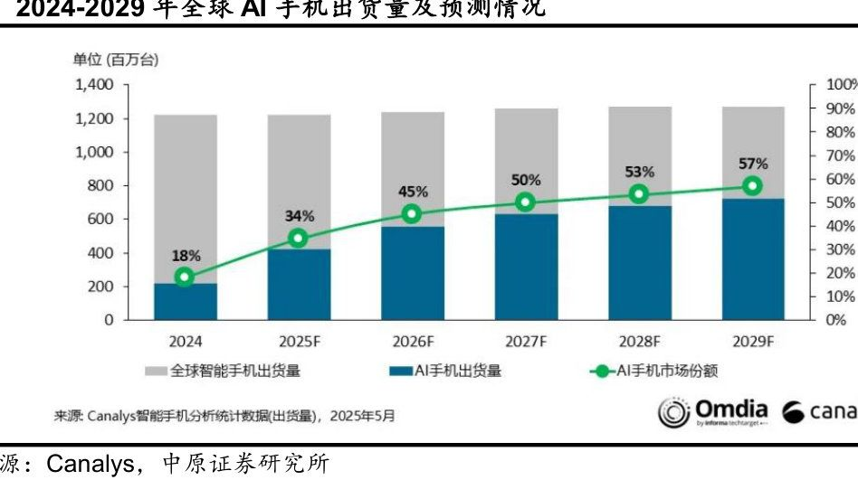

图内标注：纵轴（左）单位（百万台），0–1,400；纵轴（右）市场份额，0%–100%；图例：全球智能手机出货量、AI手机出货量、AI手机市场份额。AI手机市场份额：2024年18%，2025F 34%，2026F 45%，2027F 50%，2028F 53%，2029F 57%。

资料来源：Canalys，中原证券研究所

#### 3.2.2. 全球PC季度出货量继续同比下降，预计2026年全球PC出货量大幅下降

全球PC出货量26Q2同比下降3.6%。根据Omdia的数据，2026年第二季度全球台式电脑、笔记本电脑及工作站出货量同比下降3.6%，降至6570万台；其中，台式电脑（含台式工作站）出货量为1390万台，同比下降1.3%；笔记本电脑（含移动工作站）出货量为5170万台，同比下降4.2%。Omdia预计2026年下半年存储器和存储产品的成本涨幅将明显放缓，但PC整机售价仍将受到2026年第二季度上游零部件成本上涨的持续影响。Omdia研究显示，今年内存储器和存储产品价格均无明显回落的迹象，同时MLCC、PCB等其他关键零部件价格也在持续上涨。因此，PC厂商预计仍将把不断增加的成本压力转嫁给终端市场，这将进一步抑制2026年下半年的市场需求。

**图19：23Q1-26Q2年全球PC季度出货量情况**

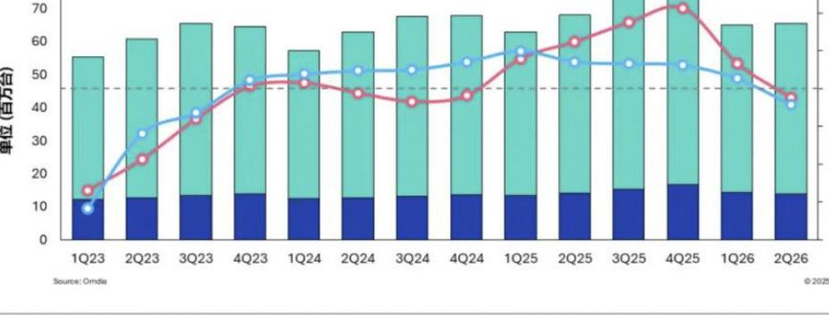

图内标注：纵轴（左）单位（百万台），0–80；纵轴（右）增长率，-40%–30%；图例：台式机、笔记本、台式机（增长率）、笔记本（增长率）；横轴：1Q23、2Q23、3Q23、4Q23、1Q24、2Q24、3Q24、4Q24、1Q25、2Q25、3Q25、4Q25、1Q26、2Q26。

资料来源：Omdia，中原证券研究所

26Q2全球PC市场厂商前五名分别为联想、惠普、戴尔、苹果和华硕。根据Omdia的数据，2026年第二季度，联想继续稳居全球PC市场第一，出货量达到1662万台，同比下降

[Source Page: 22]

2%，仍保持25%的市场份额；惠普以1300万台的出货量位居第二，但受市场环境影响，出货量同比下降9%；戴尔排名第三，在供应持续紧张的市场环境下展现出较强韧性，出货量达到929万台，市场份额维持在14%；苹果成为前五大厂商中增长最快的品牌，受MacBook Neo上市以及市场需求持续向好的带动，第二季度出货量达到725万台，市场份额较2025年第二季度提升2%；华硕位列第五，出货量为501万台，整体表现与去年同期基本持平。

**表11：26Q2全球PC厂商市场份额情况**

| 公司 | 26Q2出货量（百万台） | 26Q2市场份额（%） | 25Q2出货量（百万台） | 25Q2市场份额（%） | 26Q2同比增速（%） |
| --- | --- | --- | --- | --- | --- |
| 联想 | 16.6 | 25.3 | 17.0 | 24.9 | -2.1 |
| 惠普 | 13.0 | 19.8 | 14.3 | 21.0 | -9.0 |
| 戴尔 | 9.3 | 14.1 | 9.8 | 14.3 | -4.9 |
| 苹果 | 7.3 | 11.1 | 6.3 | 9.2 | 15.9 |
| 华硕 | 5.0 | 7.6 | 5.0 | 7.3 | 0.9 |
| 其他 | 14.5 | 22.0 | 15.8 | 23.2 | -8.5 |
| 合计 | 65.7 | 100 | 68.1 | 100 | -3.6 |

资料来源：Omdia，中原证券研究所

Omdia预计2026年全球PC出货量下降12%。根据Omdia的预测，2026年全球台式机、笔记本及工作站出货量预计下降12%，至2.45亿台；这一预测基于内存与存储价格的急剧上涨——特别是预计2026年第一季度将至少上涨60%；预计全年剩余季度仍将面临进一步的价格上涨压力，但后续涨幅可能更加温和；自2025年第一季度以来，主流内存与存储配置的成本已上涨90至165美元，对PC厂商造成重大财务压力，迫使其减少促销、提高产品售价并调整配置；各类PC产品受影响的程度预计大体一致，台式机出货量预计下降10%至5320万台，笔记本出货量预计下降12%至1.922亿台。

**图20：2016-2027年全球PC出货量及预测情况**

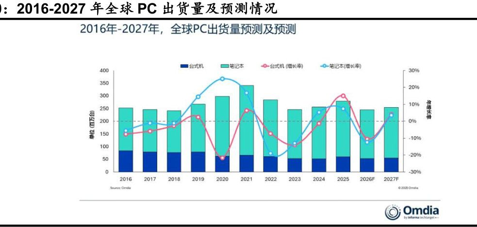

图内标注：标题“2016年-2027年，全球PC出货量预测及预测”；纵轴（左）单位（百万台），0–400；纵轴（右）增长率，-30%–30%；图例：台式机、笔记本、台式机（增长率）、笔记本（增长率）；横轴：2016-2027年。

资料来源：Omdia，中原证券研究所

AI PC是端侧AI落地的重要应用场景，将推动PC产业生态加速迭代。具备AI功能的个人电脑（AI PC）的问世有望重振市场并改变用户体验，将专用的AI加速硬件集成到PC中，可以在效率、生产力、协作和创造力方面实现惊人的创新。Canalys提出AI PC需要具备专用芯片组/块以承载端侧的AI运行负载。微软和英特尔联合提出AI PC的定义，即AI PC需要配备NPU、CPU和GPU，并支持微软的Copilot，且键盘上直接配有Copilot物理按键（该键取代了键盘右侧第二个Windows键）。AI PC是终端、边缘计算和云技术的颠覆性混合体，它不仅重新定义生产力，也将推动PC产业生态加速迭代。

[Source Page: 23]

**图21：Canalys对AI PC的定义及未来演变的考量**

对端侧AI体验持续演变的考量

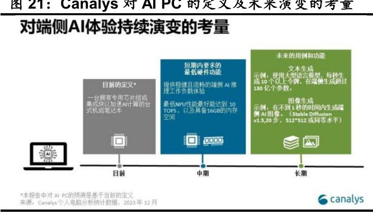

图内标注：
- 目前的定义*：一台拥有专用芯片组或集成块以加速AI计算的台式机或笔记本。
- 短期内要求的最低硬件功能：提供稳健且流畅的端侧AI推理工作负载体验；最低NPU性能最好能达到10 TOPS，以及具备16GB的内存空间。
- 未来的用例和功能：文本生成——示例：使用大语言模型，每秒生成10个以上令牌，在端侧生成超过130亿个参数。图像生成——示例：在不到1秒的时间内生成端侧AI图像。（Stable Diffusion v1.5,20步，512*512或同等水平）
- 时间轴：目前 / 中期 / 长期
- 脚注：*本报告中对AI PC的预测是基于当前的定义；来源：Canalys个人电脑分析统计数据，2023年12月

资料来源：Canalys，中原证券研究所

**图22：微软和英特尔对AI PC的定义**

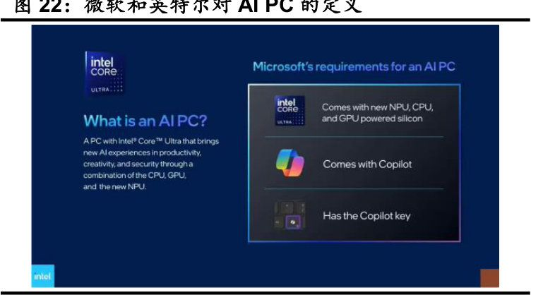

图内标注：“What is an AI PC?”；Microsoft's requirements for an AI PC：Comes with new NPU, CPU, and GPU powered silicon；Comes with Copilot；Has the Copilot key。

资料来源：微软，英特尔，IT之家，中原证券研究所

英特尔、AMD等芯片厂商持续迭代适用于AI PC的处理器芯片，NPU算力不断提升。2024年9月4日，英特尔发布超高能效的x86处理器家族——英特尔酷睿Ultra 200V系列处理器，CPU、NPU和GPU的整体平台算力高达120 TOPS，在实现跨模型和引擎的同时提供极具兼容和性能的AI体验，整体功耗降低了50%，使搭载该处理器为AI PC带来超前的低功耗表现。2024年6月4日，AMD为下一代AI PC推出锐龙AI 300系列处理器，采用全新的“Zen 5”架构，配备高达12颗高性能CPU核心和24个线程；采用基于全新AMD XDNA 2架构的专用AI引擎，NPU拥有50 TOPS的AI处理能力；采用全新的AMD RDNA 3.5图形架构，配备最新的AMD Radeon 800M系列显卡，带来流畅的帧速率和3A游戏体验。英特尔、AMD、高通和苹果等芯片厂商持续迭代适用于AI PC的处理器芯片，联想、惠普等PC厂商陆续发布AI PC新品。

**表12：全球主要处理器厂商发布的适用于AI PC处理器情况**

| 厂商 | 处理器 | 发布时间 | CPU | GPU | NPU AI算力 | 存储器 | 制程 |
| --- | --- | --- | --- | --- | --- | --- | --- |
| 英特尔 | 酷睿Ultra 9 | 2023.12 | 16核心（6+8+2）/22线程，最高主频5.1GHz | Intel Arc GPU，8个Xe核显 | 34TOPS | 支持最多64GB的LPDDR5/5X-7467和96GB DDR5-5600 | Intel 4 |
| 英特尔 | 酷睿Ultra 200V | 2024.9 | 8核8线程，最高主频5.1GHz | Intel Arc 100V GPU | NPU算力最高48TOPS，整体算力120TOPS | 支持最大32GB的LPDDR5X-8533 | 3nm |
| AMD | 锐龙8040 | 2023.12 | Zen 4架构，8核心/16线程，最高主频5.2GHz | RDNA 3架构，12个计算单元 | NPU算力16TOPS，整体算力39TOPS | - | 4nm |
| AMD | 锐龙AI 300 | 2024.6 | Zen 5架构，12核心/24线程，最高主频5.1GHz | RDNA 3.5架构，16个计算单元 | 50 TOPS | - | 4nm |
| 高通 | 骁龙X Elite | 2023.10 | Oryon CPU，12核，最高主频3.8GHz | Adreno GPU，算力达4.6TFlops | NPU算力45TOPS，整体算力75TOPS | 支持LPDDR5X 8533MHz，最大容量64GB | 4nm |
| 苹果 | M3 | 2023.10 | 8个CPU核心 | 10个GPU核心 | 18TOPS | 支持内存容量最高达128GB | 3nm |
| 苹果 | M4 | 2024.5 | 10个CPU核心 | 10个GPU核心 | 38TOPS | 支持内存容量最高达128GB | 3nm |

资料来源：各公司官网，中关村在线，IT之家，中原证券研究所

联想、惠普等PC厂商陆续发布AI PC新品。AI PC是终端、边缘计算和云技术的颠覆性

[Source Page: 24]

混合体，它不仅重新定义生产力，也将推动PC产业生态加速迭代。头部PC厂商视AI PC为重要的创新机会，PC行业迎来iPhone时刻。随着英特尔、AMD等芯片厂商陆续推出适用于AI PC的计算芯片，以及Windows向Windows11过渡，头部PC厂商联想、惠普、戴尔、苹果、宏基、华硕、三星、荣耀、华为等都陆续推出全新的AI PC产品。

**表13：全球部分PC厂商AI PC布局情况**

| 厂商 | 型号 | 处理器 | 内存 | 硬盘 | 软件 |
| --- | --- | --- | --- | --- | --- |
| 联想 | Thinkpad X1 Carbon AI | 英特尔酷睿Ultra 7 | 32GB LPDDR5x 6400Mhz | 2TB PCIe NVMe Gen4高速固态硬盘 | 内置了全新的AI智能会议助手，可以通过AI完成会议邮件撰写、发送会议邀请，撰写会议纪要等工作，实现AI智能降噪等；实现一秒之内完成图片创作。 |
| 联想 | 小新Pro AI超能本2024 | 英特尔酷睿Ultra 9 | 32GB LPDDR5x 7467MT/s | 1TB PCIe 4.0高性能固态硬盘 | 通过智能语音助手、智能图像识别等技术，为用户提供更便捷、高效的使用体验；支持智能家居控制，可以通过语音指令实现对家中各种设备的远程控制。 |
| 惠普 | 星Book Pro 14 | 英特尔酷睿Ultra 7 | 32GB LPDDR5X | 1TB PCIe 4.0固态硬盘 | 支持智能语音助手，支持实时翻译，更精准，可收录来自系统声音，支持中英文互译，可译文或原译文同时显示字幕。 |
| 惠普 | Spectre x360商务本 | 英特尔酷睿Ultra 7 | 32GB LPDDR5x 7467Mhz | 2TB PCIe 4.0高性能固态硬盘 | 支持AI智能降噪功能，智能追焦取景，AI智能字幕翻译，支持语音输入和会议笔记功能，能够实时记录语音并翻译，支持中英/英中互译。 |
| 戴尔 | 灵越16Plus | 英特尔酷睿Ultra 7 | 32GB LPDDR5X | 1TB PCIe 4.0固态硬盘 | 与100多个AI APP加速合作；AI智能降噪、AI眼神锁定和AI背景虚化等智能功能的全面覆盖。 |
| 戴尔 | XPS 16 | 英特尔酷睿Ultra 9 | 64GB LPDDR5X | 2TB PCIe 4.0固态硬盘 | 搭载Windows 11系统，支持200亿参数大模型运行，能够实现本地生图。 |
| 苹果 | MacBook Air | M3 | 24GB 100GB/s | 2TB固态硬盘 | 实时语音转文本、翻译、文本预测、视觉理解、辅助功能等。 |
| 宏基 | 非凡Go 14 | 英特尔酷睿Ultra 7 | 32GB LPDDR5X | 1TB PCIe 4.0高速固态硬盘 | 支持智能视频会议，自动取景、眼神接触、物理防窥、AI降噪。 |
| 华硕 | 灵耀14 2024 | 英特尔酷睿Ultra 7 | 32GB LPDDR5x | 1TB PCIe 4.0高速固态硬盘 | 支持200亿参数的大模型，即使不联网也能实现问答、文本创作、摘要生成、编程、翻译等多种功能。 |
| 三星 | Galaxy Book 4 Ultra | 英特尔酷睿Ultra 9 | 64GB LPDDR5X | 2TB PCIe 4.0固态硬盘 | 与100多个软件供应商加速合作，支持Galaxy AI功能，支持智能搜索和翻译，利用AI技术对照片进行智能编辑。 |
| 荣耀 | MagicBook Pro 16 | 英特尔酷睿Ultra 7 | 32GB LPDDR5X | 1TB PCIe 4.0固态硬盘 | 配备YOYO AI超级助理凭借其先进的AI语义理解能力，实现了智慧搜索、文档总结以及智能推荐等多项功能。 |
| 华为 | Matebook X Pro | 英特尔酷睿Ultra 9 | 32GB LPDDR5X | 2TB PCIe 4.0固态硬盘 | 内置华为盘古大模型，搭载AI空间功能，支持100+个智能体，为用户提供从代码编写、文档处理到创意设计、信息检索等；能从音视频或实时纪要的海量信息中，快速精准地提炼关键点，生成摘要；支持AI字幕，实时翻译等功能。 |

资料来源：各公司官网，中原证券研究所

预计AI PC渗透率将持续快速提升。根据Canalys的数据，2024年第四季度，AI PC出货量达到1540万台，占季度PC总出货量的23%；2024年AI PC占PC总出货量的17%；其中苹果以54%的市场份额领跑，联想和惠普各占12%。受Windows 10服务停止带来的换机潮，预计AI PC的市场渗透率将在2025年继续提升。展望未来，受商用需求的推动，PC市场将加速增长，企业正为Windows 10系统结束做准备；目前PC市场正致力于将AI PC打造成明星类别，根据Canalys的预测，预计2025年AI PC将占全球PC出货量的35%。

[Source Page: 25]

**图23：23Q4-24Q4全球AI PC出货量情况**

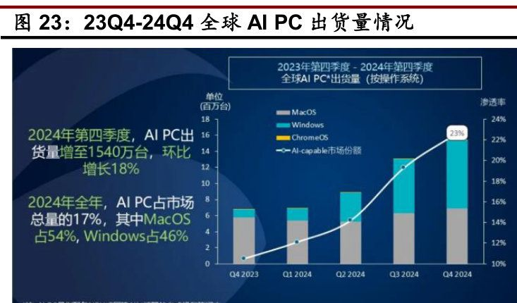

图内标注：标题“2023年第四季度- 2024年第四季度 全球AI PC出货量（按操作系统）”；纵轴（左）单位（百万台），0–18；纵轴（右）渗透率，0%–24%；图例：Windows、MacOS、ChromeOS、AI-capable市场份额；横轴：Q4 2023、Q1 2024、Q2 2024、Q3 2024、Q4 2024。文本标注：2024年第四季度，AI PC出货量增至1540万台，环比增长18%；2024年全年，AI PC占市场总量的17%，其中MacOS占54%，Windows占46%。

资料来源：Canalys，中原证券研究所

**图24：24Q1-25Q4全球PC及AI PC出货量及预测**

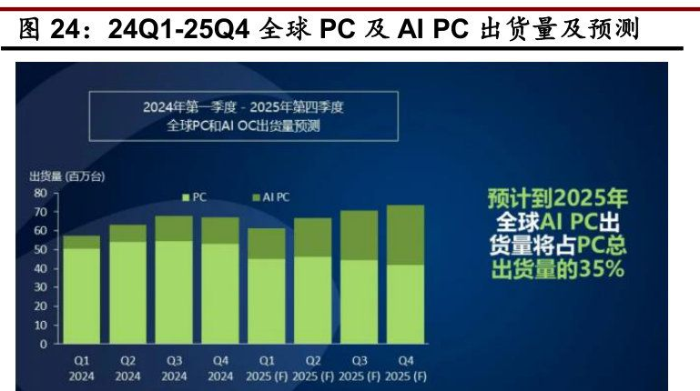

图内标注：标题“2024年第一季度- 2025年第四季度 全球PC和AI PC出货量预测”；纵轴 出货量（百万台），0–80；图例：PC、AI PC；横轴：Q1 2024、Q2 2024、Q3 2024、Q4 2024、Q1 2025(f)、Q2 2025(f)、Q3 2025(f)、Q4 2025(f)。文本标注：预计到2025年全球AI PC出货量将占PC总出货量的35%。

资料来源：Canalys，中原证券研究所

AI PC有望推动高端PC市场收入增长。AI PC集成了专用于AI的加速器，将释放出高生产力、个性化及能效方面的新功能，颠覆整个PC市场，并为厂商及其合作伙伴带来显著的价值收益。根据Canalys的预测，与未集成NPU的传统PC相比，AI PC将溢价10%-15%；随着采用率的激增，到2025年底，价格在800美元及以上的PC将有一半以上是AI PC，到2028年，这一比例将增至80%以上。因此，800美元及以上的PC出货量将在短短四年内增长到市场的一半以上，这将有助于推动PC出货的整体价值从2024年的2250亿美元增长到2028年的2700亿美元以上。

**图25：2024-2028年全球PC市场总收入预测情况**

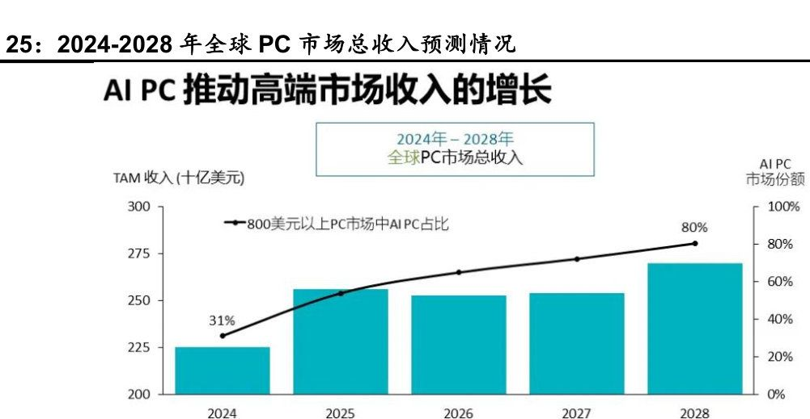

图内标注：标题“AI PC推动高端市场收入的增长”“2024年- 2028年 全球PC市场总收入”；纵轴（左）TAM收入（十亿美元），200–300；纵轴（右）AI PC市场份额，0%–100%；折线“800美元以上PC市场中AI PC占比”：2024年31%，2028年80%。

资料来源：Canalys，中原证券研究所

#### 3.2.3. AI眼镜是端侧AI最佳硬件载体之一，2026年全球AI眼镜出货量有望快速增长

AI眼镜是端侧AI最佳硬件载体之一。嘴巴、耳朵和眼睛是人体三大重要感官器官，嘴巴是语言输出器官，耳朵是语音接受的器官，眼睛则是人类最重要的信息摄入器官，人80%的信息来源于视觉。眼镜是最靠近人体三大重要感官的穿戴设备，是端侧AI最佳硬件载体之一，可以非常直接和自然的实现声音、语言、视觉的输入和输出。

[Source Page: 26]

**图26：Ray-Ban Meta产品示意图**

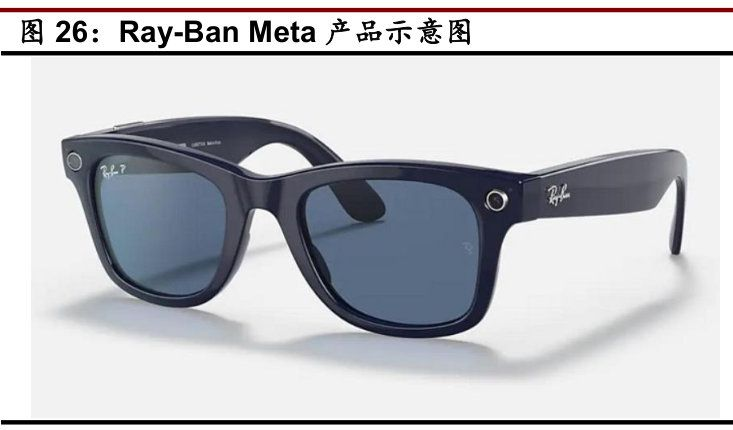

资料来源：腾讯，中原证券研究所

**图27：Ray-Ban Meta产品支持耳机功能**

资料来源：腾讯，中原证券研究所

AI眼镜是在普通眼镜的基础上，增加AI功能，拍照AI眼镜为当前主流形态。AI眼镜的产品形态包括音频AI眼镜、拍照AI眼镜、AR+AI眼镜；传统蓝牙音频眼镜接入AI大模型，是AI眼镜的基础形态，AI大模型通过语音交互方式提供基础的智能服务；拍照AI眼镜是在音频AI眼镜的基础上增加摄像头，AI大模型可通过摄像头感知周边环境，提供与当下环境具备交互能力的智能服务；AR+AI眼镜是具备AR显示功能、并且接入大模型的眼镜，部分眼镜具备拍照、空间定位等多模态感知能力，AI大模型可通过AR显示实现实时信息输出，实现更简便的信息交互。根据wellsenn XR的数据，2024年全球AI眼镜销量中94%为拍照AI眼镜，4%为AR+AI眼镜，2%为音频AI眼镜。

**图28：AI眼镜产品形态分类情况**

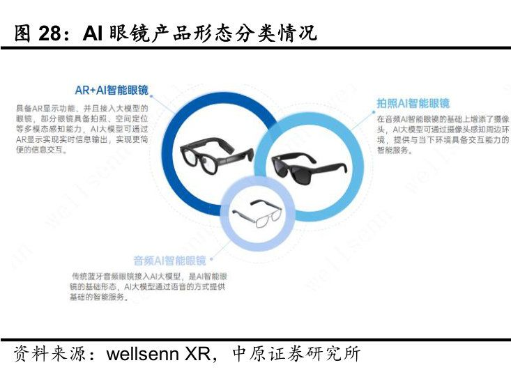

图内标注：
- AR+AI智能眼镜：具备AR显示功能、并且接入大模型的眼镜，部分眼镜具备拍照、空间定位等多模态感知能力，AI大模型可通过AR显示实现实时信息输出，实现更简便的信息交互。
- 拍照AI智能眼镜：在音频AI智能眼镜的基础上增添了摄像头，AI大模型可通过摄像头感知周边环境，提供与当下环境具备交互能力的智能服务。
- 音频AI智能眼镜：传统蓝牙音频眼镜接入AI大模型，是AI智能眼镜的基础形态，AI大模型通过语音的方式提供基础的智能服务。

资料来源：wellsenn XR，中原证券研究所

**图29：拍照AI眼镜为当前主流形态**

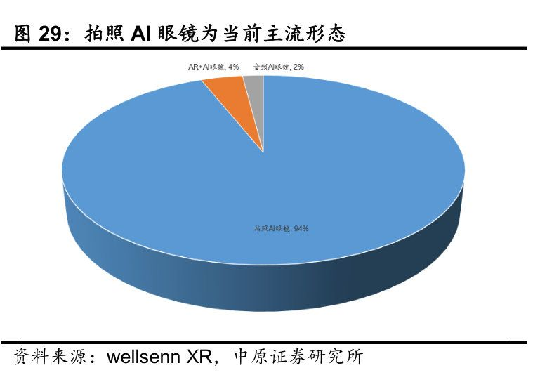

图内标注：拍照AI眼镜94%，AR+AI眼镜4%，音频AI眼镜2%。

资料来源：wellsenn XR，中原证券研究所

Ray-Ban Meta发布后热销，带动大量厂商加速进入AI眼镜市场。2023年9月，Meta联合雷朋推出Ray-Ban Meta智能眼镜，Ray-Ban Meta为眼镜增加了摄像、耳机，以及AI功能。用户可以通过语音与Meta AI进行互动，获取各种信息和服务；支持英语、西班牙语、意大利语、法语和德语之间的互译，能够翻译所拍摄到的标识和文字，并以对应的语言念出来。根据wellsenn XR的数据，2024年Ray-Ban Meta眼镜出货量达142万台。Ray-Ban Meta智能眼镜发布后热销，带动百度、华为、小米、三星、雷鸟等厂商加速进入AI眼镜市场。

[Source Page: 27]

**图30：23Q4-24Q4 Ray-Ban Meta眼镜出货量情况**

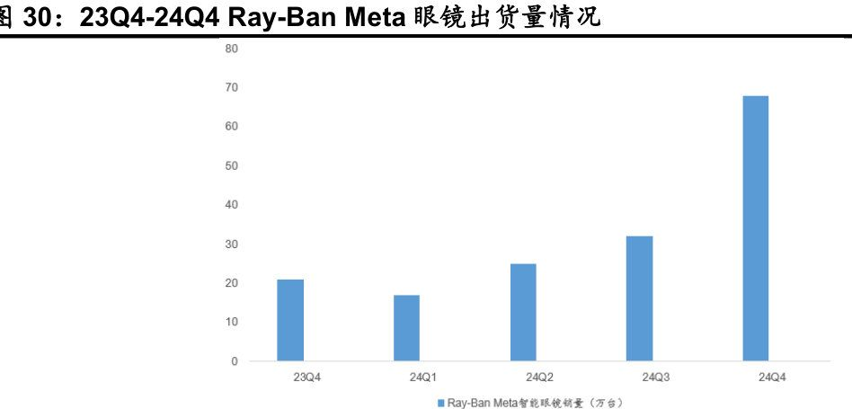

图内标注：纵轴0–80，图例“Ray-Ban Meta智能眼镜销量（万台）”；横轴：23Q4、24Q1、24Q2、24Q3、24Q4。

资料来源：wellsenn XR，中原证券研究所

百度发布全球首款搭载中文大模型的原生AI眼镜。2024年11月12日，百度正式发布小度AI眼镜，称该产品为“全球首款搭载中文大模型的原生AI眼镜”。小度AI眼镜具备第一视角拍摄、边走边问、卡路里识别、识物百科、视听翻译、智能备忘等功能。小度AI眼镜支持文心大模型，对接百度地图、搜索、百科等百度应用生态。

**图31：小度AI眼镜产品示意图**

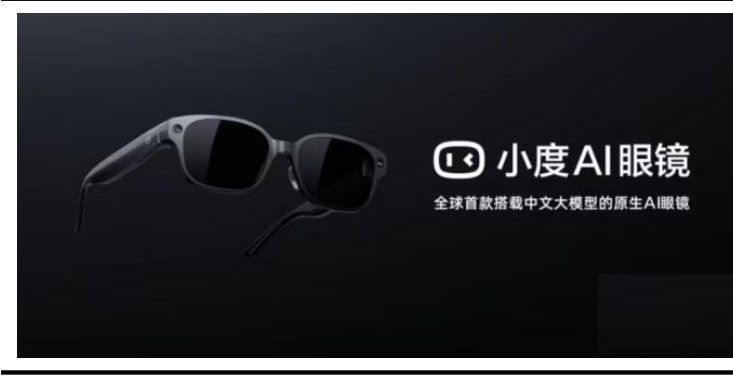

资料来源：百度，IT之家，中原证券研究所

**图32：小度AI眼镜产品配置及功能情况**

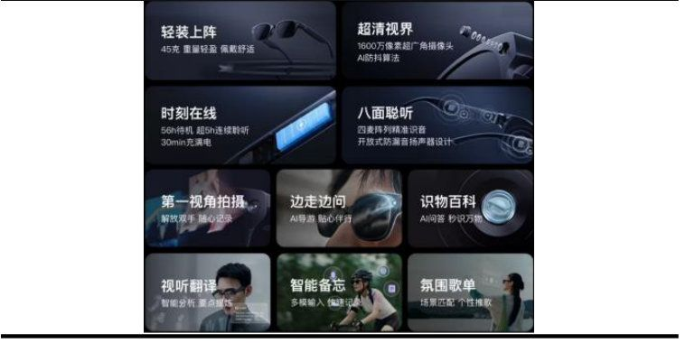

图内标注：
- 轻装上场：45克 重量轻盈 佩戴舒适
- 超清视界：1600万像素超广角摄像头AI防抖算法
- 时刻在线：56h待机 超5h连续聆听30min充满电
- 八面聪听：四麦阵列精准识音 开放式防漏音扬声器设计
- 第一视角拍摄：解放双手 随心记录
- 边走边问：AI导游 贴心伴行
- 识物百科：AI问答 秒识万物
- 视听翻译：智能分析 重点提炼
- 智能备忘：多模输入 快速记录
- 氛围歌单：场景匹配 个性推歌

资料来源：百度，IT之家，中原证券研究所

华为发布智能眼镜2——钛空圆框光学镜。2025年4月16日消息，华为正式发布智能眼镜2——钛空圆框光学镜；华为智能眼镜2设计整体风格时尚，眼镜的“鸢尾”雕花设计精致高雅，钛金属镜框不仅轻巧坚固，还经过33道工序精雕细琢，确保了产品的耐用性和美观性；华为智能眼镜2配备小艺翻译、头部控制等功能，支持面对面翻译、同声传译、全天候智慧播报，续航为11小时，售价2299元。

**图33：华为智能眼镜2产品示意图**

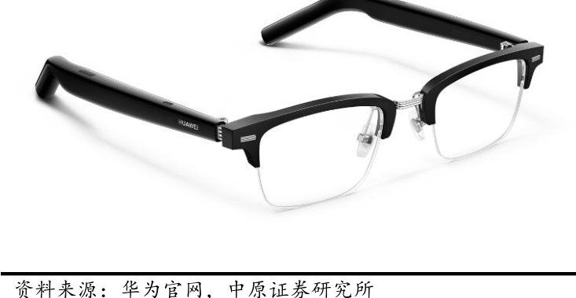

资料来源：华为官网，中原证券研究所

**图34：华为智能眼镜2产品示意图**

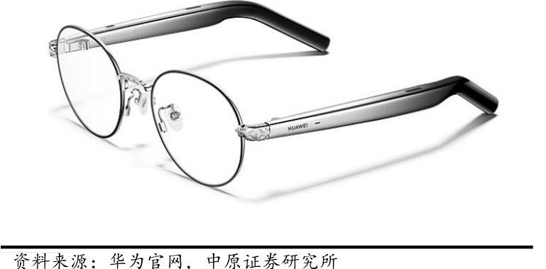

资料来源：华为官网，中原证券研究所

雷鸟发布AI拍摄智能眼镜及全彩光波导AR眼镜。2025年1月7日，雷鸟V3 AI拍摄

[Source Page: 28]

智能眼镜正式发布，售价1799元起；雷鸟V3搭载第一代高通骁龙AR1平台，采用台积电4nm工艺；搭载与TCL联合调教的“猎鹰影像”，采用5层镀膜光学镜片，搭载索尼IMX681背照式CMOS；雷鸟AI支持全景式智能搜索，覆盖海量知识领域；电池容量159mAh，40分钟可充满，可用7小时；重量为39g（不含镜片），采用钛合金金属转轴、肤感鼻托，专为亚洲人脸型设计。2025年5月27日，雷鸟X3 Pro旗舰AR眼镜正式发布；雷鸟X3 Pro为全彩光波导AR眼镜，采用新一代二维扩瞳衍射光波导镜片，搭载新一代萤火光引擎，采用三色合色全彩方案，内置JBD定制红绿蓝三原色屏幕，配合0.1cc超小聚合Cube棱镜，实现1670万色全彩显示输出，峰值入眼亮度6000nits，平均入眼亮度3500nits，光引擎大小0.36cc；雷鸟X3 Pro推出安卓虚拟机功能，可将手机App搬到眼镜中使用；持语音翻译、同声传译、图像翻译等多种翻译模式，以及高德地图AR导航、AI助手连续对话等功能。

**图35：雷鸟V3 AI眼镜产品示意图**

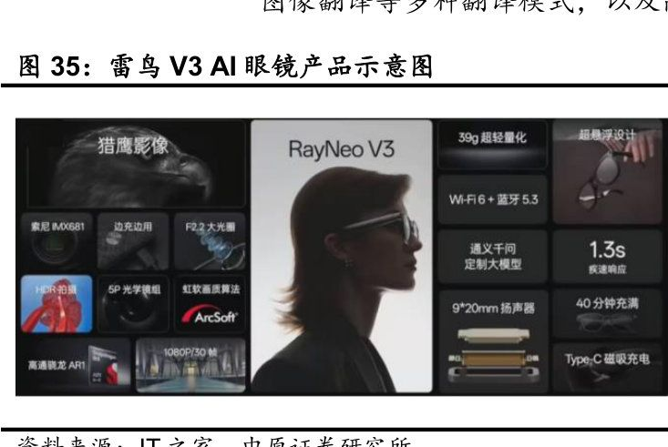

资料来源：IT之家，中原证券研究所

**图36：雷鸟X3 Pro AR眼镜产品示意图**

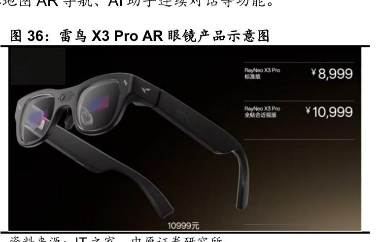

资料来源：IT之家，中原证券研究所

Meta与欧克利联合发布新款AI眼镜Oakley Meta HSTN。2025年6月21日，Meta与美国知名运动品牌欧克利（Oakley）联合发布了新款AI眼镜Oakley Meta HSTN，其定位为“高性能AI眼镜（Performance AI Glass）”，主打运动场景。Oakley Meta HSTN支持POV视频拍摄、Meta AI助理，常规使用状态下续航时间可达8小时，待机续航时间长达19小时，并且支持快充；这款眼镜采用最先进的Oakley PRIZM镜片，结合Oakley的PRIZM Lens技术，旨在帮助运动员在不断变化的光线和天气条件下获得更清晰的视野；该产品将于7月11日开始预售，起售价399美元（约2868元人民币），限量版499美元（约3587元人民币）。

**图37：Oakley Meta HSTN AI眼镜产品示意图**

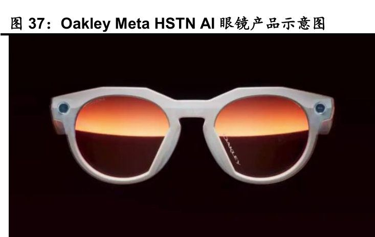

资料来源：IT之家，中原证券研究所

**图38：Oakley Meta HSTN AI眼镜产品示意图**

资料来源：IT之家，中原证券研究所

小米发布首款AI眼镜。2025年6月26日，小米首款AI眼镜发布，小米AI眼镜是面向

[Source Page: 29]

下一代的个人智能设备，售价1999元起，电致变色版本2699元，彩色版本2999元。小米AI眼镜采用经典威灵顿式D型方框设计，12度外翻转轴解决传统智能眼镜夹头痛点，40克裸框重量搭配黑、玳瑁棕、鹦鹉绿三色半透明镜架，支持线下400家门店验光与线上定制处方镜片；1200万像素IMX681传感器实现0.8秒疾速拍摄与2K视频录制；四麦克风阵列结合骨传导技术提升复杂环境收音效果；通过HyperOS系统，眼镜可替代手机摄像头用于微信、QQ视频通话，还与B站、抖音等平台打通直播推流功能；内置小爱同学支持十语种同声传译、卡路里识别等AI应用，可呼唤小爱同学开启第一人称视角拍摄录像。

**图39：小米AI眼镜产品示意图**

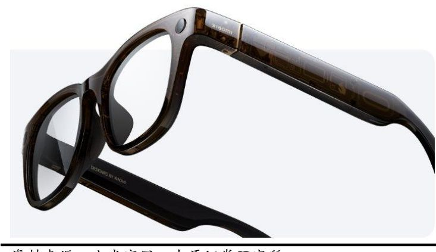

资料来源：小米官网，中原证券研究所

**图40：小米AI眼镜产品示意图**

资料来源：小米官网，中原证券研究所

多款AI眼镜新品放量在即，有望推动全球AI眼镜出货量快速增长。根据Omdia的数据，2025年全球AI眼镜出货量达到870万台，同比大幅增长322%；预计2026年全球AI眼镜出货量将超过1500万台，这一增长将由多方面因素推动，包括主要设备厂商和科技巨头进入市场、Meta提高产量并拓展新区域市场，以及印度、日本和韩国本土厂商的崛起。目前中国大陆市场占全球AI眼镜市场10.9%的份额，出货量接近100万台，成为仅次于美国的全球第二大市场。

**图41：2023-2025年全球AI眼镜出货量情况**

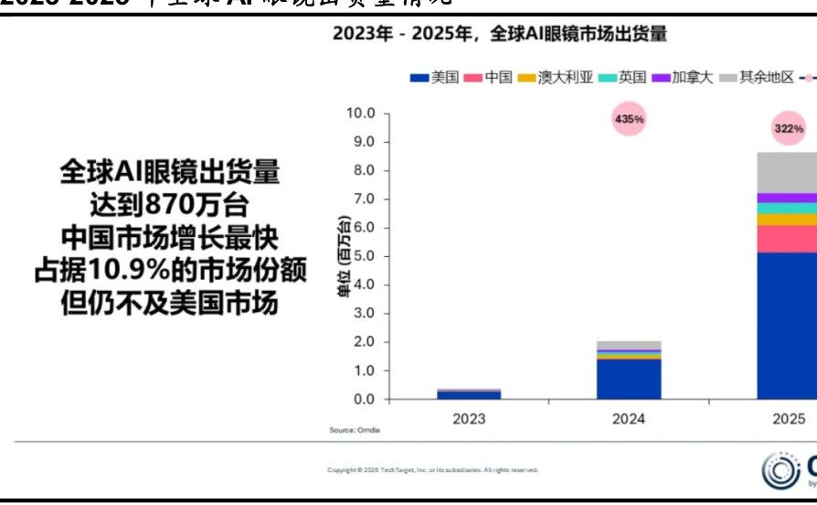

图内标注：标题“2023年- 2025年，全球AI眼镜市场出货量”；纵轴 单位（百万台），0.0–10.0；图例：美国、中国、澳大利亚、英国、加拿大、其余地区、--增长率；数据标签：2024年435%，2025年322%；文本标注：全球AI眼镜出货量达到870万台，中国市场增长最快，占据10.9%的市场份额，但仍不及美国市场。

资料来源：Omdia，中原证券研究所

Meta在全球AI眼镜市场占据绝对领先地位，国内厂商快速崛起。根据Omdia的数据，2025年Meta的AI眼镜出货量达到740万台，同比增长281.3%，市场份额达85.2%，这一增长主要得益于Oakley和第二代Ray-Ban品牌AI眼镜的强劲表现，同时Meta也在积极

[Source Page: 30]

拓展新市场，包括印度、墨西哥、巴西等国家；中国厂商Rokid以及智能手机厂商小米快速崛起，分别位列第二和第三位。

**图42：2025年全球及中国大陆AI眼镜市场竞争格局情况**

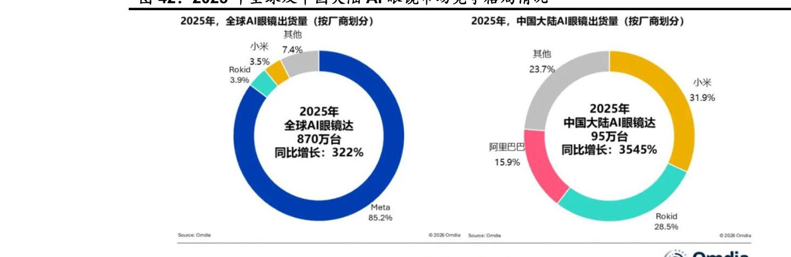

图内标注：左图“2025年，全球AI眼镜出货量（按厂商划分）”：Meta 85.2%、Rokid 3.9%、小米3.5%、其他7.4%，图心文字“2025年 全球AI眼镜达870万台 同比增长：322%”；右图“2025年，中国大陆AI眼镜出货量（按厂商划分）”：小米31.9%、Rokid 28.5%、阿里巴巴15.9%、其他23.7%，图心文字“2025年 中国大陆AI眼镜达95万台 同比增长：3545%”。

资料来源：Omdia，中原证券研究所

芯片占AI眼镜成本大部分，关注AI眼镜产业链核心环节投资机会。根据wellsenn XR的数据，RayBan Meta AI眼镜成本总计174美元，主板芯片的成本约99.1美元，占比约56.95%，成本占比超一半；眼镜充电盒的成本约17.5美元，占比约10.06%；结构件的成本约16.9美元，占比约9.71%；OEM的成本约15美元，占比约8.62%。AI眼镜主要芯片包括SoC、MCU、存储器、电源、射频等，建议关注SoC、存储器、光学、电池、镜片、OEM等产业链核心环节投资机会。

**图43：RayBan Meta AI眼镜系统架构框图**

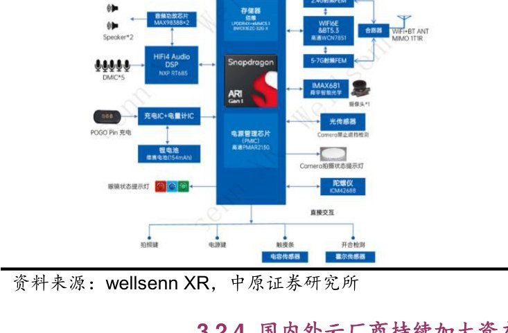

资料来源：wellsenn XR，中原证券研究所

**图44：RayBan Meta AI眼镜成本结构图**

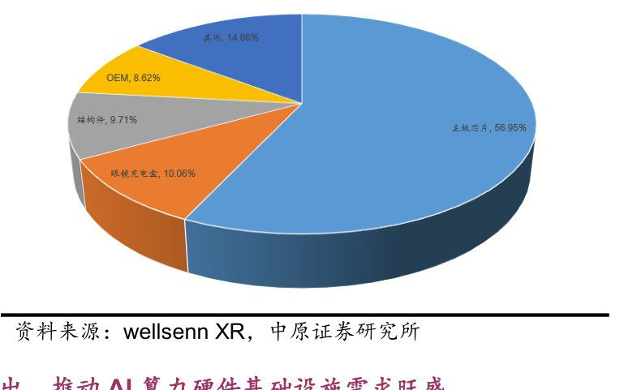

图内标注：主板芯片56.95%、眼镜充电盒10.06%、结构件9.71%、OEM 8.62%、其他14.66%。

资料来源：wellsenn XR，中原证券研究所

#### 3.2.4. 国内外云厂商持续加大资本支出，推动AI算力硬件基础设施需求旺盛

北美四大云厂商受益于AI对核心业务的推动，持续加大资本支出。受益于AI对于公司核心业务的推动，北美四大云厂商谷歌、微软、Meta、亚马逊2023年开始持续加大资本支出，2026年第二季度四大云厂商的资本开支合计约为1639亿美元，同比增长86%，环比增长27%，推动AI算力硬件基础设施需求旺盛。

北美四大云厂商继续上调2026年资本支出计划。目前北美四大云厂商的资本支出增长主要用于AI基础设施的投资，并从AI投资中获得了积极回报，谷歌预计2026年资本支出将增加至1950-2050亿美元（原值为1800-1900亿美元），并预计2027年资本支出将进一步

[Source Page: 31]

上升；Meta预计2026年资本支出为1300-1450亿美金（原值为1250-1450亿美元）；微软受数据中心使用寿命会计政策变更影响，预计2026年资本支出约为1750亿美元；亚马逊预计2026年资本支出约为2200亿美元（原值为2000亿美元），持续加大AI基础设施的投资力度。

图45：2020-2026年北美四大云厂商资本开支情况（亿美元）

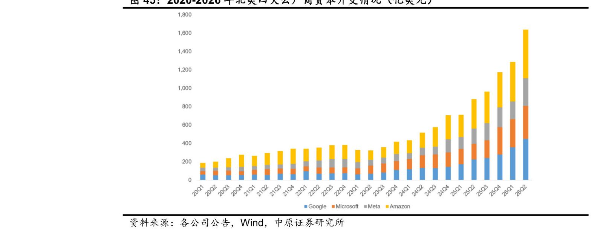

资料来源：各公司公告，Wind，中原证券研究所

国内三大互联网厂商不断提升资本开支。国内三大互联网厂商阿里巴巴、百度、腾讯2023年也开始不断加大资本开支，2026年二季度三大互联网厂商的资本开支合计约为1243亿元，同比增长102%，环比增长92%；预计2026年国内三大互联网厂商将继续加大用于AI基础设施建设的资本开支。

图46：2021-2026年国内三大互联网厂商资本开支情况（百万元）

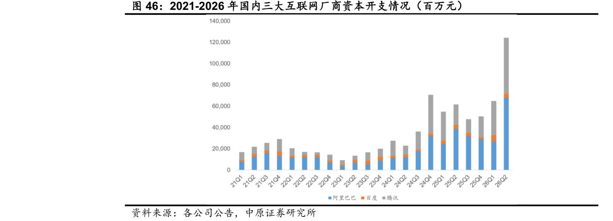

资料来源：各公司公告，中原证券研究所

#### 3.2.5. 中国新能源汽车月度销量同比稳健增长

**2026年8月中国汽车销量同比下降5.1%。** 根据中国汽车工业协会的统计数据，2026年8月，中国汽车销量达到271.2万辆，同比下降5.1%，环比增长4.9%。8月多地汽车消费补贴持续升级，车企促销活动活跃，国内市场继续承压，出口保持高速增长，成为稳定行业大盘的关键增量。近期，有关政府部门在规范账款支付、质量提升、车企出海行为等方面积极开展行动，汽车行业治理工作持续深化，将推动行业从追求规模和速度转向质量和安全，助力产业

[Source Page: 32]

健康可持续发展。

图47：2000-2026年中国汽车销量情况

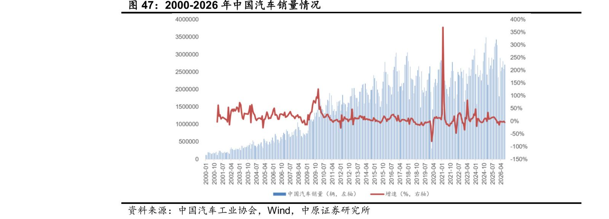

资料来源：中国汽车工业协会，Wind，中原证券研究所

**2026年8月中国新能源汽车销量同比增长17.8%。** 根据中国汽车工业协会统计数据，2026年8月，中国新能源汽车销量164.3万辆，同比增长17.8%，环比增长5.3%，新能源汽车新车销量达到汽车新车总销量的60.6%。

图48：2015-2026年中国新能源汽车销量情况

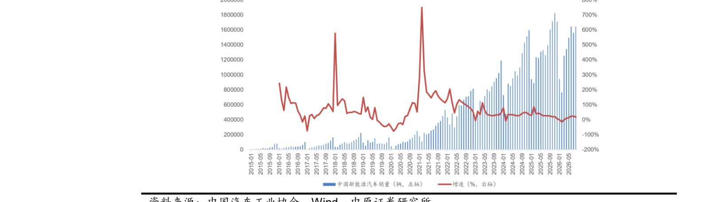

资料来源：中国汽车工业协会，Wind，中原证券研究所

### 3.3. 全球部分芯片厂商季度库存水位环比下降，国内部分芯片厂商季度库存水位环比大幅下降

**全球部分芯片厂商26Q2库存水位环比下降。** 根据Wind的数据，全球部分芯片厂商包括英特尔、AMD、英伟达、高通、博通、美光、TI、ADI、恩智浦、微芯、安森美23Q1的平均库存周转天数为139天，23Q4下降至133天，随后开始环比提升，24Q2提升至148天，随后开始逐步下降，25Q4小幅下降至141天，26Q1小幅提升至145天，26Q2下降至139天；由于工业市场需求开始复苏，AI数据中心需求旺盛，模拟厂商TI、ADI、微芯科技等库存有望逐步下降。

[Source Page: 33]

图49：全球部分芯片厂商平均库存周转天数情况

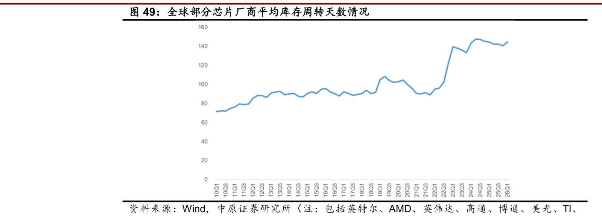

资料来源：Wind，中原证券研究所（注：包括英特尔、AMD、英伟达、高通、博通、美光、TI、ADI、恩智浦、微芯、安森美）

**国内部分芯片厂商26Q2库存水位环比大幅下降。** 国内部分芯片厂商包括兆易创新、卓胜微、韦尔股份、澜起科技、晶晨股份、瑞芯微、北京君正、圣邦股份、紫光国微23Q1的平均库存周转天数达到351天，随后逐步下降，24Q4继续下降到210天，25Q1提升至232天，25Q2大幅下降至206天，随后逐步提升，26Q1提升至245天，26Q2大幅下降至219天，环比下降26天。26Q2国内部分芯片厂商库存水位环比大幅下降，目前部分芯片设计厂商库存仍偏高，预计后续有望逐步回到健康水平。

图50：国内部分芯片厂商平均库存周转天数情况

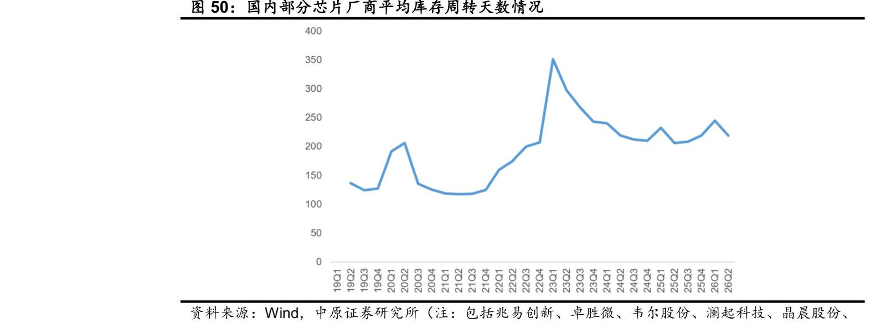

资料来源：Wind，中原证券研究所（注：包括兆易创新、卓胜微、韦尔股份、澜起科技、晶晨股份、瑞芯微、北京君正、圣邦股份、紫光国微）

### 3.4. 国内主要晶圆厂季度产能利用率环比小幅提升

**国内主要晶圆厂产能利用率26Q2环比小幅提升。** 半导体市场需求自2022年三季度大幅下跌，导致芯片原厂流片意愿不强，晶圆厂的产能利用率也出现下滑；国内晶圆代工龙头中芯国际23Q1的产能利用率从22Q4的79.5%大幅下降至68.1%，随后开始逐步回升，23Q2至23Q4产能利用率在76%-78%区间波动，24Q1至24Q4产能利用率在80%-90%区间波动，25Q1至25Q4产能利用率从89.60%提升至95.7%，26Q1产能利用率为93.1%，26Q2提升至93.70%。华虹23Q2产能利用率从23Q1的103.5%略微下降至102.7%，随后开始大幅下降，23Q4下滑至84.1%，随后逐步提升至24Q3的105.3%，24Q4至25Q1小幅回落至

[Source Page: 34]

102.70%，25Q2至25Q3继续提升至109.5%，25Q4至26Q1逐步回落至99.7%，26Q2提升至102.80%；26Q2中芯国际、华虹产能利用率环比小幅提升，处于满负荷运行状态。

图51：全球部分晶圆厂产能利用率情况

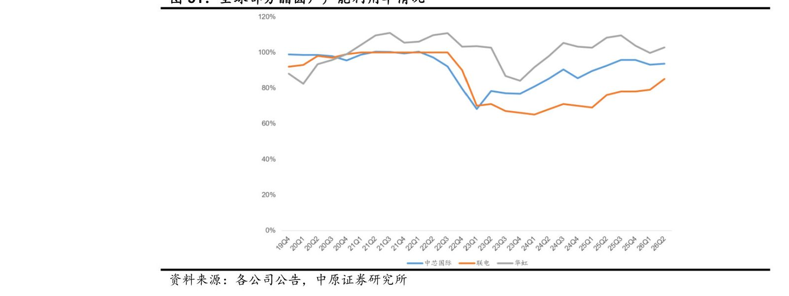

资料来源：各公司公告，中原证券研究所

**AI推动全球先进制造产能加速扩张。** 根据SEMI发布最新的《300毫米晶圆厂展望报告（300mm Fab Outlook）》，全球半导体制造行业预计将保持强劲增长势头，预计从2024年底到2028年，产能将以7%的复合年增长率增长，达到创纪录的每月1110万片晶圆；推动这一增长的关键因素是先进工艺产能（7纳米及以下）的持续扩张，预计将从2024年的每月85万片晶圆增长到2028年的历史新高140万片晶圆，增长约69%，复合年增长率约为14%，是行业平均水平的两倍；AI继续成为全球半导体行业的变革力量，推动全球先进制造产能加速扩张。

图52：2024-2028年全球晶圆产能及预测情况

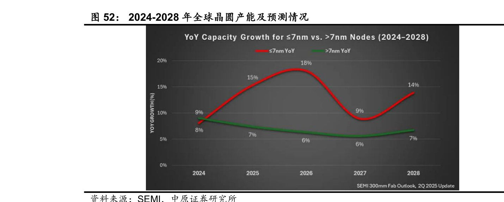

资料来源：SEMI，中原证券研究所

**TrendForce预计晶圆代工成熟制程涨价效应有望延伸至2027年。** 根据TrendForce集邦咨询最新调查，随着AI服务器、通用服务器与边缘AI周边需求持续升温，晶圆代工产能配置明显朝AI相关产品倾斜，加速改变成熟制程供需结构；8英寸制程受益于AI相关电源订单增量及台积电、三星电子减产，产能利用率与代工价格强势拉升；12英寸成熟制程则因台积电启动减产，有望带动中长期转单效应；加上55nm（含）以上Power IC订单强劲，引发台系晶圆厂减产High Voltage（HV）制程、订单流向大陆系厂供应链等效应，以及AI相关新兴

[Source Page: 35]

应用增量排挤、原物料通膨等因素，导致12英寸成熟制程代工涨价氛围，预计涨势将延伸至2027年。

图53：25H2-26H2晶圆代工价格涨幅变化情况

**2H25-2H26晶圆代工价格涨幅变化**

| Process Node | 2H25 | 1H26 | 2H26 |
| --- | --- | --- | --- |
| 8-inch Processes | 5-10% (specific processes only) | 5-15% | 0-10% |
| 12-inch Mature Nodes | Flat | Flat | 0-10% |
| 12-inch Advanced Nodes | Flat | 5-10% | Flat |

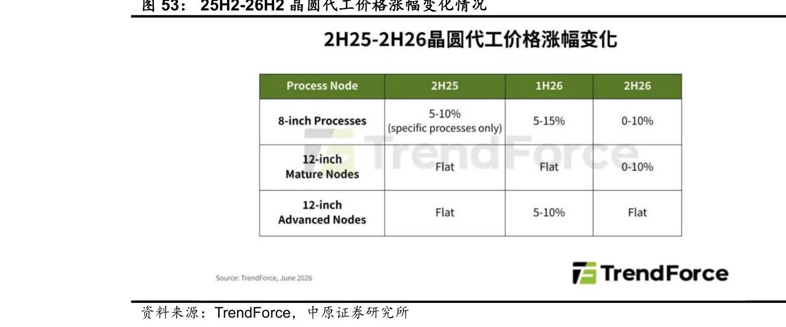

资料来源：TrendForce，中原证券研究所

### 3.5. DRAM月度现货价格环比继续上涨，NAND Flash现货价格环比小幅下降

**2026年8月DRAM现货价格继续环比上涨。** 根据中国闪存市场的数据，2026年8月DRAM指数环比上涨约5.25%，2025年3月至2026年8月DRAM指数上涨约844%。根据DRAMexchange的数据，2026年8月，DDR4 8Gb(512Mx16)3200的现货价格环比上涨0.16%，DDR4 16Gb(1Gx16)3200的现货价格环比上涨3.30%，DDR5 16G(2Gx8)4800/5600的现货价格环比上涨5.79%。

图54：DRAM指数走势情况

图55：DRAM现货价格走势情况（美元）

资料来源：中国闪存市场，iFinD，中原证券研究所
资料来源：DRAMexchange，iFinD，中原证券研究所

**2026年8月NAND Flash现货价格环比小幅下降。** 根据中国闪存市场的数据，2026年8月NAND指数环比下降约0.30%，2025年3月至2026年8月NAND指数上涨约395%；其中TLC闪存256Gb的现货价格环比持平，512Gb的现货价格环比持平。

[Source Page: 36]

图56：NAND指数走势情况

图57：NAND Flash现货价格走势情况（美元）

资料来源：中国闪存市场，iFinD，中原证券研究所
资料来源：InSpectrum，中国闪存市场，中原证券研究所

**TrendForce预计26Q3 DRAM及NAND Flash合约价格分别环比增长13-18%及10-15%。** 根据TrendForce集邦咨询最新调查，2026年第三季度整体DRAM格局持续极度紧缺，但因消费级应用需求下修及高基期作用，合约价涨幅收敛，预计26Q3将环比增长13-18%；NAND Flash主要需求仍由AI推理与大型数据中心建设支撑，但因合约价格已达历史高点，消费端客户在需求放缓的情况下，对价格承受力已达极限，预估26Q3整体NAND Flash合约价将环比增长10-15%，幅度较前几季明显缩减。

图58：26Q2-26Q3 DRAM及NAND Flash产品合约价格预测情况

**2Q26-3Q26 DRAM、NAND Flash合约价格预测**

| | 2Q26 | 3Q26E |
| --- | --- | --- |
| Total DRAM | Conventional DRAM: up 58~63% HBM Blended: up 53~58% | Conventional DRAM: up 13~18% HBM Blended: up 8~13% |
| Total NAND Flash | up 55~60% | up 10~15% |

资料来源：TrendForce，中原证券研究所

**TrendForce预计26H2 NOR Flash价格走势分化，高容量产品涨幅预计达90-110%。** 根据TrendForce集邦咨询的调查，尽管新增供给有限，NOR Flash需求持续成长；除了传统的ADAS、数字座舱及工控应用，2026年新增需求主力为AI与航天通信领域；以AI Server为例，单台对NOR的需求量为传统Server的三至五倍，且AI Server内部配备大量Retimer芯片，每颗Retimer均需要独立NOR Flash加载微码，推升高容量及Octal SPI NOR需求；此外，Edge-AI、AI PC与机器人等本地推理设备带动模型固件规模数倍膨胀，也提升高密度NOR Flash需求。TrendForce指出，2026年上半年NOR Flash合约价平均累计涨幅达100-120%，预估26H2不同容量产品价格走势将分化，256Mb及以上高容量产品有AI Server、车用等强劲需求，加上供给主力厂商的新增位元有限，预估下半年平均价格仍有90-110%的上涨空间；在128Mb及以下的中低容量市场，随着部分供应商产能逐步释出，消费类产品价

[Source Page: 37]

格涨势趋缓，后续将进入高位盘整，预估2026年第四季度涨幅落在10-20%之间。

图59：26H2各类NOR Flash产品供需、价格趋势情况

| 产品类别 | 2H26供给状况 | 核心需求驱动力 | 2H26价格趋势 |
| --- | --- | --- | --- |
| 高容量（≥256Mb） | 严重供不应求 | AI Server, ADAS, Edge-AI | 持续上涨，涨幅90-110% |
| Octal/xSPI高端规格NOR | 供应偏紧 | AI芯片、高速数据传输 | 持续上涨 |
| 车规/航太高可靠度NOR | 供给紧张 | 车用智能化、低轨卫星 | 持续上涨 |
| 通用型/中低容量NOR（≤128Mb） | 供需相对平衡 | 消费电子、小家电、TWS | 高档震荡/盘整 |

资料来源：TrendForce，中原证券研究所

### 3.6. 全球半导体设备季度销售额继续同比增长，预计2026年有望持续增长

**26Q2全球半导体设备销售额同比增长23%，中国半导体设备销售额同比增长5%。** 根据日本半导体制造装置协会（SEAJ）的数据，2026年第二季度全球半导体设备销售额为405.3亿美元，同比增长23%，环比增长11%；2026年第二季度中国半导体设备销售额为119.1亿美元，同比增长5%，环比增长8%。

图60：2005-2026年全球半导体设备销售额情况

图61：2005-2026年中国半导体设备销售额情况

资料来源：SEAJ，iFinD，中原证券研究所
资料来源：SEAJ，iFinD，中原证券研究所

**2026年7月日本半导体设备销售额同比增长35.4%。** 根据日本半导体制造装置协会的数据，2026年7月日本半导体设备销售额为5562.20亿日元，同比增长35.4%，环比增长8.3%；2025年日本半导体设备销售额达5.0585万亿日元，同比增长14%；日本半导体设备全球市场占有率达三成，仅次于美国位居全球第2。

[Source Page: 38]

图62：日本半导体设备月度销售额情况

资料来源：SEAJ，iFinD，中原证券研究所

**SEMI预计2026年全球300mm晶圆厂设备支出将同比增长18%。** 根据SEMI的最新预测，全球300mm晶圆厂设备支出预计2026年将增长18%至1330亿美元，2027年将增长14%至1510亿美元，2028年将继续增长3%至1550亿美元，2029年再增长11%至1720亿美元；这一强劲增长反映了数据中心和边缘设备对AI芯片需求的激增，以及各主要地区通过本地化产业生态系统和供应链重组来加强半导体自给自足能力的坚定承诺。

SEMI总裁兼首席执行官Ajit Manocha表示：“AI正在重塑半导体制造投资的规模，随着全球300mm晶圆厂设备支出预计在2027年首次突破1500亿美元，行业正以史无前例的持续性的投入，着力构建AI时代所需的先进产能与韧性供应链。”

图63：2024-2029年全球300mm晶圆厂设备支出情况及预测

资料来源：SEMI，中原证券研究所

**SEMI预计2026年全球300mm晶圆厂存储领域设备投资将同比增长29%。** 根据SEMI的最新预测，受AI基础设施、数据中心及下一代计算系统投资增加的支撑，2026年全球300mm晶圆厂存储领域设备投资预计将达到520亿美元，同比增长29%，预计2027年再增11%至570亿美元，预计2024-2029年复合增速将达19%。

SEMI总裁兼首席执行官Ajit Manocha表示：“对HBM及其他先进存储技术的强劲需求正在重塑整个半导体供应链的投资优先级，随着AI基础设施的扩张，存储制造商正在加速

[Source Page: 39]

产能和技术迁移方面的投资，以支持下一波数据密集型应用。”

图64：2024-2029年全球300mm晶圆厂存储领域设备投资情况及预测

资料来源：SEMI，中原证券研究所

### 3.7. 全球硅片季度出货量继续同比增长，预计2026年将持续增长

**26Q2全球硅片出货量同比增长7.4%。** 硅片是半导体产业链中最重要的材料之一，也是价值含量最高的半导体材料，占整个晶圆制造材料超过33%。根据SEMI的数据，2026年第二季度全球硅晶圆出货量达到3573百万平方英寸，同比增长7.4%，环比增长9.1%。SEMI SMG主席、胜高株式会社（SUMCO）销售与市场事业部总经理矢田银次（Ginji Yada）表示：“第二季度硅晶圆出货量保持稳健增长，强劲且不断增长的AI相关需求已从先进逻辑和存储领域扩展至功率器件、光电子及其他市场；此外，工业和汽车需求正在复苏，而存储器价格压力则限制了PC和智能手机需求；器件制造商正大力投资扩产，硅晶圆需求增长预计将持续。”

图65：全球硅片出货量情况

资料来源：SEMI，Wind，中原证券研究所

**SEMI预计2025-2028年全球硅晶圆出货量将持续增长。** 根据SEMI的预测，预计2026年全球硅晶圆出货量预计将增长5.2%，并将在2028年前持续增长，届时市场有望达到15485百万平方英寸的新行业纪录。2025年硅晶圆出货量的增长主要受益于人工智能相关需求的强劲推动，包括用于先进逻辑器件的高端外延晶圆，以及用于高带宽存储器（HBM）的抛光晶圆；非AI应用领域的晶圆出货量则刚刚开始从近期的下行周期中逐步恢复；预计随着

[Source Page: 40]

AI在数据中心及边缘计算领域的持续扩展，这一稳步增长趋势将延续至2028年。

图66：2022-2027年全球硅片出货量情况及预测

资料来源：SEMI，中原证券研究所

## 4. 行业政策

外部环境对中国半导体产业限制不断加剧。近年来美日荷不断加大对中国半导体产业的限制，主要针对半导体先进制造、先进制程半导体设备、先进存储器、先进计算芯片、EDA工具等环节。

**表14：近年美日荷对中国半导体产业部分制裁政策情况**

| 时间 | 具体事件及制裁政策情况 |
| --- | --- |
| 2018年10月 | 美国商务部将福建省晋华集成电路有限公司列入出口管制“实体清单”。 |
| 2019年7月 | ASML中止向中国交付EUV光刻机。 |
| 2020年5月 | 美国商务部限制华为使用美国技术和软件在海外设计和制造半导体。 |
| 2020年9月 | 美国商务部对华为实施严格的芯片禁令正式生效，台积电停止为华为代工生产麒麟芯片，高通、三星及SK海力士、美光等都将不再供应芯片给华为。 |
| 2020年12月 | 美国商务部将中芯国际列入出口管制“实体清单”。 |
| 2022年8月 | 美国总统拜登签署《2022芯片与科学法案》，该法案将为美国半导体研发、制造以及劳动力发展提供527亿美元，获得补贴的半导体企业将禁止在中国扩大或新增14纳米及以下先进制程芯片产业的投资。 |
| 2022年8月 | 美国芯片厂商英伟达和AMD收到美国政府通知，要求停止向中国出口用于人工智能的高端计算芯片，该禁令影响的芯片分别为英伟达的GPU A100与H100，以及AMD的GPU MI200。 |
| 2022年10月 | 美国商务部公布一系列针对中国的出口管制新规，BIS这项新的半导体出口限制政策涉及到对中国的先进计算、半导体先进制造进行出口管制；具体要限制美国的半导体设备在国内应用到16/14nm及以下工艺节点（非平面架构）的逻辑电路制造、128层及以上的3D NAND工艺制造、18nm及以下的DRAM工艺制造；对中国超级计算机或半导体开发或生产最终用途的项目进行限制；限制美国公民支持中国半导体制造或者研发。 |
| 2022年12月 | 美国商务部将长江存储、上海微电子、寒武纪等36家中国实体加入出口管制“实体清单”。 |
| 2023年5月 | 日本政府正式发布针对先进芯片制造所需的23种半导体制造设备的出口管制措施，这些设备包括3项清洗设备、11项薄膜沉积设备、1项热处理设备、4项光刻设备、3项蚀刻设备、1项测试设备。 |
| 2023年6月 | 荷兰政府正式发布针对先进的芯片制造技术，包括先进的沉积设备和浸润式DUV光刻机实施出口管制。 |
| 2023年10月 | 美国商务部公布针对先进计算芯片、半导体制造设备出口管制的更新规则，并将13家中国GPU企业列入实体清单，主要为壁仞科技和摩尔线程及其子公司。 |
| 2024年12月 | 美国商务部修订了《出口管理条例》，这次制裁主要涉及半导体制造设备、存储芯片等物项的对华出口管制，并且扩展了对华出口管制的范围，包括了24种半导体制造设备、3种软件工具和HBM芯片出口的限制，将140个中国半导体行业相关实体添加到“实体清单”。新进入“实体清单”的企业包括北方华创、盛美上海、芯源微、拓荆科技、华峰测控、中科飞测、精测电子、华海清科、凯世通、至纯科技、武汉新芯、华大九天、沪硅产业、南大光电、闻泰科技、建广资本、智路资本等。 |
| 2025年1月 | 美国商务部修订了《出口管理条例》，将中国11个实体加入实体清单，包括中国科学院长春光学精密机械与物理研究所、中国科学院上海光学精密机械研究所、苏州超纳精密光电技术有限公司、南京施密特光学仪器有限公司等，自1月6日起生效。 从2025年1月2日起，包括美国公民、持有“绿卡”的合法永久居民在内的美国人士，在美国设立的实体及其外国分支机构，以及在美国境内的任何个人或实体，都禁止投资或需要申报才能投资中国的半导体和微电子、量子信息技术以及人工智能三个行业。 |

[Source Page: 41]

| 时间 | 具体事件及制裁政策情况 |
| --- | --- |
| 2025年1月 | 美国国防部发布最新版的“中国涉军企业”清单（根据美国法律正式规定为“第1260H条名单”），将腾讯控股、宁德时代、长鑫存储、长江存储、华为控股、中芯国际、奇虎360公司、中国移动、中国联通、中国电信、华大基因等134家中国企业新增列入该清单。 |
| 2025年1月 | 美国政府推出《人工智能扩散规则》，公布对AI芯片出口的新限制措施，这份新规将出口目的地分为三类，美国对18个关键盟友与合作伙伴的芯片销售无任何限制；对中国、伊朗等实施了严格的AI芯片销售限制；对其他国家，大多数国家则将面临总算力限制，每个国家在2025年至2027年期间最多可获得约5万个AI GPU。 |
| 2025年1月 | 美国商务部修订了《出口管制条例》，共增加了25个中国实体，主要包括智谱旗下10个实体、算能旗下约11个实体，以及哈勃投资的光刻机企业科益虹源等；BIS还更新先进计算半导体的出口管制，针对于先进逻辑集成电路是采用“16nm/14nm节点”及以下工艺、或采用非平面晶体管架构生产的逻辑集成电路，采取更多审查和规范，并且细化了多个物项信息如DRAM行业18纳米半间距节点的生产标准等。 |
| 2025年5月 | 美国商务部宣布废除拜登政府此前推出的《人工智能扩散规则》（AI Diffusion Rule），并同时宣布三项旨在加强海外AI芯片出口管制的新举措：全球禁用华为Ascend芯片，明确在世界任何地区使用华为Ascend芯片均被视为违反美国出口管制条例；限制AI芯片用于中国AI模型，若美国AI芯片被用于训练或干扰中国人工智能模型，相关企业将面临严重后果；供应链反制指南，要求美国企业重新审视供应链合作伙伴，强化审查机制，防范技术转移风险。 |

资料来源：中华人民共和国商务部官网，美国商务部官网，美国政府官网，人民网，央视网，芯智讯，日经新闻，中芯国际公司公告，半导体产业纵横，腾讯，芯榜，中原证券研究所

## 5. 行业动态

### 5.1. 全球半导体行业动态

#### 1、SK海力士计划重启中国大连NAND生产基地2号工厂的投资建设

2026年8月12日消息，据《首尔经济日报》报道，SK海力士计划重启中国大连NAND闪存生产基地2号工厂的建设，将产能提高约50%。

据了解，大连2号工厂于4年前动工，但受到存储行业低迷的影响，工程长期处于停滞状态。

随着AI数据中心扩张推动企业级固态硬盘需求增长，SK海力士决定恢复投资。

据悉，新生产线的晶圆投片量约为每月5万片，加上大连1号工厂现有的每月10万片产能，大连当地总产能将增加约50%。

2021年，SK海力士收购英特尔的NAND业务并成立了Solidigm，接手了大连1号工厂及相关厂区，于2022年5月启动2号工厂的建设。（首尔经济日报，SEMI）

#### 2、闪迪在2026年投资者日公布长期财务模型

2026年8月14日消息，闪迪在2026年投资者日公布长期财务模型，提出一系列2028财年至2030财年将要达到的财务目标，包括这期间内，公司营收将保持中高双位数增长。闪迪还澄清市场对比特增长的疑虑，提出可供销售比特量将根据盈利优化需要调整，同时承诺，在完成业务投资后，将把100%的剩余现金返还股东。

公司预计在2028至2030财年期间，营收将保持中高双位数增长，增速与比特出货量增长相匹配；与此同时，非GAAP口径下，毛利率预计维持在约80%，营业利润率约为75%。

[Source Page: 42]

闪迪首席财务官Luis Visoso表示，在完成支持业务增长所需的投资之后，公司预计将把100%的超额现金返还给股东。

公司披露，目前已经与8家客户签署新商业模式（NBM）协议；这些协议包括承诺采购量、具有约束力的合同框架、最低财务保障以及结构化定价机制，可以加强客户需求与公司产能规划之间的匹配，并降低传统存储行业周期性波动的影响。更重要的是，这些协议覆盖的规模已经相当可观：目前签署的NBM协议约覆盖FY2027比特出货量的50%，以及FY2028比特出货量的约三分之二。闪迪认为，这种模式能够带来更加可预测的营收、更高的现金流可见度以及更加持久的盈利增长。

公司表示，AI推理工作负载正在推动Token使用量快速增长，KV Cache正在重塑数据中心的内存层级。随着AI推理规模扩大，AI数据中心将变得更加依赖存储，闪迪预计，到2030年企业数据中心闪存的总可用市场（TAM）将达到1.2ZB。（华尔街见闻）

#### 3、英伟达全面投产Spectrum-X交换机

2026年8月15日消息，英伟达官方账号 @NVIDIAAIInfra在X平台发布推文，官宣已全面投产Spectrum-X以太网光子交换机，成为全球首款量产的200G/lane共封装光器件（CPO）以太网交换机系统。

应用场景方面，英伟达表示该交换机主要面向大规模AI训练与推理集群。随着AI工厂扩大，密集部署GPU的服务器需要在高带宽下频繁交换数据。

传输方面，传统网络通常把独立光模块插入交换机面板，光模块先将电信号转为光信号，经光纤传输后再转回电信号，这种方案会增加功耗、热量和潜在故障点。

Spectrum-X Ethernet Photonics在同一模块内封装光学引擎与交换芯片。光信号的生成与转换靠近负责数据包转发的交换ASIC，缩短电信号传输路径。

与采用传统可插拔光模块的网络相比，英伟达称功耗降低至1/5，AI应用无中断运行时间可延长5倍，平均事件间隔时间可提高10倍。

硬件方面，SN6810可在2U液冷机箱内配置128个800 Gb/s端口，总交换能力为102.4 Tb/s。

更大的SN6800在5U系统中堆叠4颗ASIC，可提供409.6 Tb/s交换能力，支持512个800 Gb/s端口，或超过2,000个200 Gb/s端口。

制造环节中，光学引擎直接焊接到模块基板上，工艺可纳入常规量产流程。顶部光纤连接器用于高精度连接光纤。

台积电负责硅光子技术，SPIL负责芯片级封装与测试，Lumentum与TFC供应激光器组件，富士康负责整机交换机系统开发。英伟达在自有设施完成交换机出货前的最终测试，目前已启动全面生产。（英伟达，IT之家）

[Source Page: 43]

#### 4、谷歌订购Marvell产品用于TPU

2026年8月19日消息，光通信公司Marvell Technology发布公告，与谷歌签订了一项商业协议，Marvell将为谷歌开发定制半导体产品。

Marvell为谷歌定制的产品，包括AI推理加速器、存储控制器、网络接口控制器、内存接口控制器及近存储计算产品，将接入谷歌的AI芯片——TPU生态系统。

此外，Marvell向谷歌发行了一份认股权证，谷歌可据此以每股206.58美元的行权价格，购买合计最多5897.09万股Marvell的普通股票，以121.82亿美元的价格投资Marvell。（财新网）

#### 5、长江存储申请科创板IPO获上交所受理

2026年8月24日消息，长江存储控股股份有限公司科创板IPO申请获上交所受理，拟募资330亿元，成为科创板开板以来拟募资规模最大的IPO。

根据招股书，2023-2025年及2026年一季度，长江存储实现营收分别为187.44亿元、452.03亿元、631.85亿元、470.42亿元；归母净利润分别为-191.81亿元、67.71亿元、142.11亿元、333.79亿元。

根据TrendForce数据，2026年1-3月公司在全球NAND Flash厂商中按销售金额和出货量排名，均位列全球第三、中国第一。（网易）

#### 6、铠侠与闪迪宣布联合投资超过310亿美元

2026年8月27日消息，铠侠与闪迪宣布，计划到2032年在日本投资超过310亿美元，但具体投资取决于日本政府支持。两家公司将继续加强长期合资合作，投资将用于扩建四日市工厂和北上市工厂的基础设施及相关技术，以提高闪存产能并满足AI和数据驱动业务增长带来的需求。

铠侠表示，双方各自承诺推动未来数年的闪存位增长并确保稳定供应。铠侠首席执行官太田裕雄表示，此次联合投资将进一步巩固与闪迪的长期合作，并支持AI社会发展对高容量、高性能和高能效闪存的需求。（财联社）

#### 7、长鑫科技正式宣布LPDDR6量产

2026年8月29日消息，长鑫科技正式宣布自主研发的最新一代低功耗内存LPDDR6实现量产，并将首批搭载于小米18 Fold折叠旗舰手机。这是全球LPDDR6产品首次落地商用。

在AI需求爆发的趋势下，LPDDR6被视为端侧AI算力释放的关键支柱，应用场景涵盖智能手机、PC等设备，并延伸至智能座舱、AI数据中心等。

LPDDR6是当前国际最新一代LPDDR产品，2025年7月国际标准组织JEDEC首次

[Source Page: 44]

发布LPDDR6标准。

长鑫表示，LPDDR6量产商用为国产手机等终端厂商抢占AI机遇奠定关键基础。长鑫与小米最新旗舰等高端机型的合作，体现了前沿存储与顶级终端生态的协同创新，共同驱动产业向高端价值链迈进，实现在AI时代的关键战略卡位。（新浪）

### 5.2. 河南省半导体行业动态

#### 1、金刚石—半导体产业链对接会举行

2026年8月28日消息，金刚石—半导体产业链对接会在苏州举行。作为即将启幕的“2026金刚石产业大会”首个配套活动，本次对接会立足郑州超硬材料产业优势，精准对焦苏州半导体产业集群，通过实地参访、技术分享、供需洽谈等方式，推动豫苏两地产业资源深度握手。

产业是发展的根基，也是新质生产力的核心载体。一个地方要在未来发展和区域竞争中赢得主动，既离不开坚实的产业支撑，更不可满足于“有什么就发展什么”的路径依赖。构建兼具完整性、先进性、安全性的现代化产业体系，既要把传统优势产业做优做强，也要推动产业向高端化、智能化、绿色化跃升，更要主动融入更大的产业分工版图，在产业链、创新链、供应链等深度协同中持续锻造竞争力。

郑州超硬材料产业家底殷实。2024年，全市超硬材料产业规模近200亿元；2023年，郑州生产金刚石28.65亿克拉，约占全国总产量的20%，立方氮化硼产量约占全国的80%……历经多年深耕，郑州已形成涵盖研发、装备、合成、制品等全环节的产业体系。

过去，人们提起金刚石，更多想到磨料、刀具、切割等传统应用。如今，随着人工智能、先进计算、半导体等产业加速崛起，金刚石正打开全新的应用想象。尤其在芯片散热、电子热管理等领域，其优异性能正让这块“硬材料”叩开更高端产业链的大门。

此次把对接会办到苏州，实质上是一次主动“向链而行”。苏州集聚晶圆制造、芯片设计、封装测试、半导体设备等丰富资源，郑州则手握超硬材料这一产业长板。一方有材料优势，一方有应用场景，两地之间天然存在产业连接点。

当今的产业竞争，早已不是单个企业之间的角力，也不是简单的规模比拼。产业链、创新链、供应链的协同能力，越来越成为城市产业竞争力的关键内核。因此，产业发展不能只盘自家账本，更要主动寻觅自己在更大产业链中的坐标。

一家超硬材料企业，若能通过产业链对接找到头部半导体企业，进入其供应链体系，收获的不只是一个订单，更可能是一套新的技术标准、一批稳定的客户资源，以及持续迭代产品的宝贵契机。

因此，郑州发展超硬材料产业，在把产业规模做大的同时，更要着力把产业链条做长、把技术含量做高、把应用场景做广。要让这颗“钻石”真正嵌入半导体等高端产业链，首先要把

[Source Page: 45]

企业自身的硬实力做得更硬。紧扣半导体、新能源、人工智能等产业需求，加大关键材料、核心工艺和装备研发，推动企业、高校、科研院所与下游应用企业开展联合攻关，让更多技术成果从实验室走向产线。同时，也要把产业对接做深做实，如建立持续对接机制，围绕企业进入供应链过程中的技术验证、标准认证、市场拓展等问题，精准提供服务，让一次握手变成长期合作，让一个订单串起一条产业链。

把长板锻得更长，把链条连得更紧，把郑州的产业优势主动嵌入全国乃至全球产业版图，我们一定能让这颗“钻石”真正从“硬实力”化为“硬竞争力”，在更大的产业舞台上释放更大能量。（郑州日报）

## 6. 估值分析与投资建议

### 6.1. 估值分析

目前半导体行业PE估值高于近十年中位值及平均值。目前申万半导体行业PE（TTM）约为77倍，近十年申万半导体行业PE（TTM）最大值约为165倍、最小值约为32倍，申万半导体行业PE（TTM）近十年中位值约为75倍、平均值约为79倍，目前半导体行业PE估值低于近十年平均值、高于近十年中位值。

图67：近十年半导体（申万）PE Bands

图例：收盘点位（折线）、31.92x、53.62x、75.32x、97.02x、118.72x；纵轴刻度：0、2,500、5,000、7,500、10,000、12,500、15,000、17,500；横轴刻度：17-01-01、18-01-01、19-01-01、20-01-01、21-01-01、22-01-01、23-01-01、24-01-01、25-01-01、26-01-01。图中无数据标签。

资料来源：Wind，中原证券研究所（截至2026年9月4日）

### 6.2. 投资建议

国内存储器厂商主要布局存储器模组、存储芯片等环节，26Q2主流存储器产品价格持续上涨，国内存储器模组厂商大普微、佰维存储、德明利、江波龙26Q2营收分别同比增长656.40%、269.81%、228.04%、138.75%，归母净利润分别同比增长519.17%、15177.40%、5566.72%、3930.86%；受益于利基型存储产品价格上涨，国内存储芯片厂商东芯股份、普冉股份、兆易创新、恒烁股份、君正股份26Q2营收分别同比增长406.95%、

[Source Page: 46]

402.11%、229.18%、211.64%、101.66%，归母净利润分别同比增长1107.17%、2485.07%、1482.99%、304.72%、579.96%；长鑫科技26Q2营收环比增长95.89%，归母净利润环比增长113.40%。AI驱动存储器需求旺盛，存储器周期持续上行，AI及国产替代需求有望推动国内存储厂商显著受益于行业趋势，并持续提升市场份额，建议关注国内存储芯片、存储模组厂商投资机会。

受益于AI基础设施投资的不断扩张，AI驱动对先进存储需求持续旺盛，全球存储制造商正在加速扩大产能，根据SEMI的最新预测，预计2026年全球300mm晶圆厂存储领域设备投资将达到520亿美元，同比增长29%，预计2024-2029年复合增速将达19%。AI驱动全球存储厂商加速扩产，半导体设备供给紧张程度有望逐步提升，国产半导体设备出海有望加速，同时叠加半导体设备国产替代在持续推进中，建议关注国内半导体设备及零部件厂商的投资机会。

## 7. 风险提示

下游需求不及预期；

市场竞争加剧风险；

国内厂商研发进展不及预期；

国产化进度不及预期；

国际地缘政治冲突加剧风险。

[Source Page: 47]

## 行业投资评级

强于大市：未来6个月内行业指数相对沪深300涨幅10%以上；

同步大市：未来6个月内行业指数相对沪深300涨幅－10%至10%之间；

弱于大市：未来6个月内行业指数相对沪深300跌幅10%以上。

## 公司投资评级

买入：未来6个月内公司相对沪深300涨幅15%以上；

增持：未来6个月内公司相对沪深300涨幅5%至15%；

谨慎增持：未来6个月内公司相对沪深300涨幅－10%至5%；

减持：未来6个月内公司相对沪深300涨幅－15%至－10%；

卖出：未来6个月内公司相对沪深300跌幅15%以上。

## 证券分析师承诺

本报告署名分析师具有中国证券业协会授予的证券分析师执业资格，本人任职符合监管机构相关合规要求。本人基于认真审慎的职业态度、专业严谨的研究方法与分析逻辑，独立、客观的制作本报告。本报告准确的反映了本人的研究观点，本人对报告内容和观点负责，保证报告信息来源合法合规。

## 重要声明

中原证券股份有限公司具备证券投资咨询业务资格。本报告由中原证券股份有限公司（以下简称“本公司”）制作并仅向本公司客户发布，本公司不会因任何机构或个人接收到本报告而视其为本公司的当然客户。

本报告中的信息均来源于已公开的资料，本公司对这些信息的准确性及完整性不作任何保证，也不保证所含的信息不会发生任何变更。本报告中的推测、预测、评估、建议均为报告发布日的判断，本报告中的证券或投资标的价格、价值及投资带来的收益可能会波动，过往的业绩表现也不应当作为未来证券或投资标的表现的依据和担保。报告中的信息或所表达的意见并不构成所述证券买卖的出价或征价。本报告所含观点和建议并未考虑投资者的具体投资目标、财务状况以及特殊需求，任何时候不应视为对特定投资者关于特定证券或投资标的的推荐。

本报告具有专业性，仅供专业投资者和合格投资者参考。根据《证券期货投资者适当性管理办法》相关规定，本报告作为资讯类服务属于低风险（R1）等级，普通投资者应在投资顾问指导下谨慎使用。

本报告版权归本公司所有，未经本公司书面授权，任何机构、个人不得刊载、转发本报告或本报告任何部分，不得以任何侵犯本公司版权的方式使用。未经授权的刊载、转发，本公司不承担任何刊载、转发责任。获得本公司书面授权的刊载、转发、引用，须在本公司允许的范围内使用，并注明报告出处、发布人、发布日期，提示使用本报告的风险。

若本公司客户（以下简称“该客户”）向第三方发送本报告，则由该客户独自为其发送行为负责，提醒通过该种途径获得本报告的投资者注意，本公司不对通过该种途径获得本报告所引起的任何损失承担任何责任。

## 特别声明

在合法合规的前提下，本公司及其所属关联机构可能会持有报告中提到的公司所发行的证券头寸并进行交易，还可能为这些公司提供或争取提供投资银行、财务顾问等各种服务。本公司资产管理部门、自营部门以及其他投资业务部门可能独立做出与本报告意见或者建议不一致的投资决策。投资者应当考虑到潜在的利益冲突，勿将本报告作为投资或者其他决定的唯一信赖依据。

## Processing Notes

- 页码标记：转换稿以 `<!-- 原文第 N 页 -->` 注释与 `---` 分页线标记分页，已统一替换为 `[Source Page: N]`；1—47 页连续、不重不漏，无空页。
- 断行断词：修复 6 处被版面跨页切断的词（第 18/19 页「其峰|值」、第 27/28 页「拍摄智|能」、第 29/30 页「积极拓|展」、第 30/31 页「进一步上|升」、第 38/39 页「加速产|能」、第 43/44 页「首次发|布」），修补后完整词落在后一页页首，词序与用字未改。第 40/41 页表 14「2025年1月」一行原先被分页切断（第 40 页行末止于「任何个人或实」），已把跨页的「体，都禁止投资…三个行业。」接回该行单元格。其余跨页断句（第 1/2、20/21、21/22、23/24、28/29、31/32、33/34、34/35、39/40、44/45、45/46 页）按原文顺序接续，未增删文字。
- 空格：中文与拉丁字母、数字之间的多余空格（含加号、百分号一侧及句读后的空格）共删除约 3837 处，英文词内部空格保留；目录页（第 3—5 页）条目末尾的页码前保留一个空格，避免与标题文字黏连。
- 页眉页脚：原稿无重复页眉、页脚、水印与孤立页码，无删除项；各页「资料来源」为图表署名，属实质内容，全部保留；第 1 页联系人/地址、第 47 页行业与公司投资评级、分析师承诺、重要声明与特别声明均保留。
- 标题：第 21 页「3.2.2.」、第 25 页「3.2.3.」、第 30 页「3.2.4.」原稿为 `##`，已改为与 3.2.1、3.2.5 同级的 `####`；「内容目录」「图表目录」原稿为 `#`，已改为 `##`，与正文各章同级（`#` 只用于报告标题）；其余标题层级沿用原稿，未新增或合并章节。
- OCR 字符修正：第 36 页小标题「预计 262H NOR Flash 价格走势分化」按正文（「预估 26H2 不同容量产品价格走势将分化」）改为「26H2」；第 43 页小标题「长鑫科技式宣布 LPDDR6 量产」按正文（「长鑫科技正式宣布…实现量产」）改为「长鑫科技正式宣布 LPDDR6 量产」。
- 标点：中文语境中的 5 处半角逗号改为全角——第 39 页标题（…同比增长, 预计…，与目录一致）、第 14 页表 8 英伟达行（12%,毛利率）、第 24 页表 13 联想行（视频会议,自动取景）、第 26 页 Ray-Ban Meta 段落（热销,带动）、第 37 页图 59 表格（持续上涨, 涨幅），其余半角逗号均为数字千分位或英文词之间的标点，未改。
- 表格：原稿 14 张表均能确认行列关系，已按原稿转为 Markdown 表格，保留表头、单位、报告期与空值；跨页表格（表 1、表 3、表 8、表 10、表 14）保留重复表头。表 7 长鑫科技「同比增速」两列为原稿空白，保持空白，未补算；表 8 英特尔、TI 的「26Q3 环比增速指引」原稿为「+%」，信息不完整，按原样保留。未做计算、插值或补全。
- 图表：图片相对路径原样保留（`../_assets/dfb164d788a0b3f080e36d83e058cad16b23b2da/`），对应的 67 个图片文件已从 `materials_md/_assets/` 复制到清洗稿资源目录，未改名、未重编码。第 35—37 页转换稿中图 53、图 54、图 55、图 58、图 59、图 60、图 61 的图片与图题错位（图 53、图 58、图 59 的表格图片被排到后续段落之后），已按图片自身标注与图题归位到对应图表旁，图片内容与图内说明文字未改。
- OCR 标记：保留原稿 4 处不确定标记（第 6 页图 2、第 7 页图 3 末端横轴刻度标签 `[OCR_UNREADABLE]`；第 17 页图 14 图内来源小字 `[OCR_UNREADABLE]`；第 18 页图 17「苹果自研芯片」图标 `[OCR_UNCERTAIN]`），未作猜测性补全；原稿无 `[TABLE_RECONSTRUCTION_UNCERTAIN]`。
- 元数据：Document ID 沿用转换稿；出版日期取封面「发布日期：2026年09月15日」；发行机构为中原证券股份有限公司（中原证券研究所）；报告期为 2026年8月月报，正文含 26Q2/2026年半年报回顾，故报告期一并注明。
