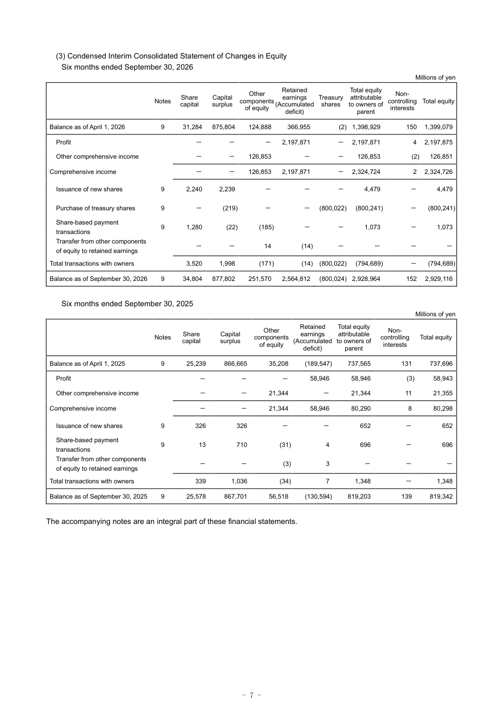
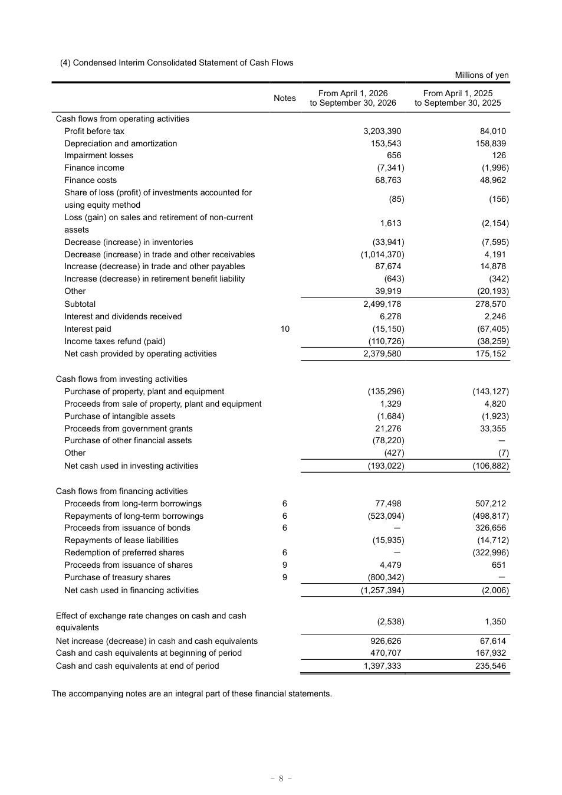
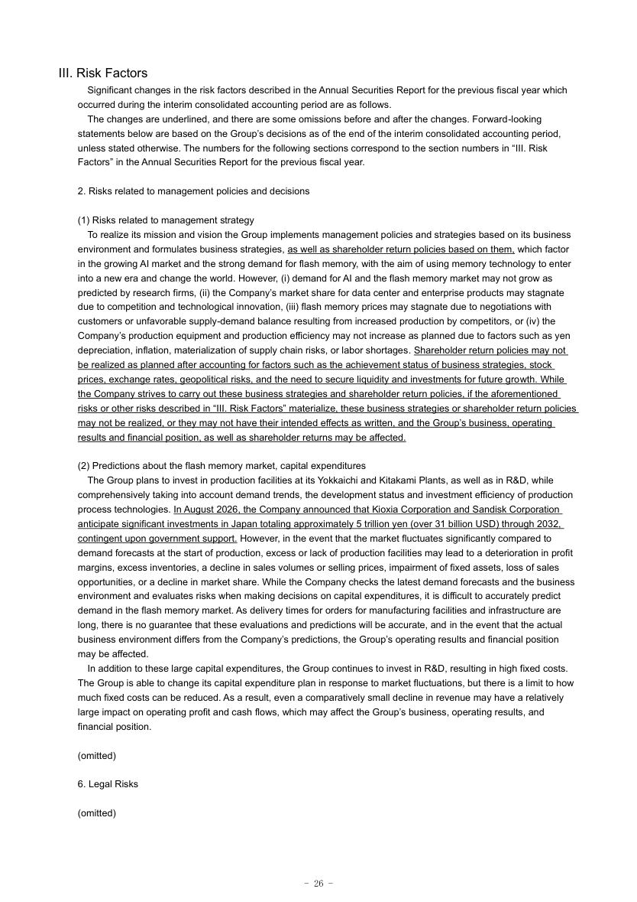
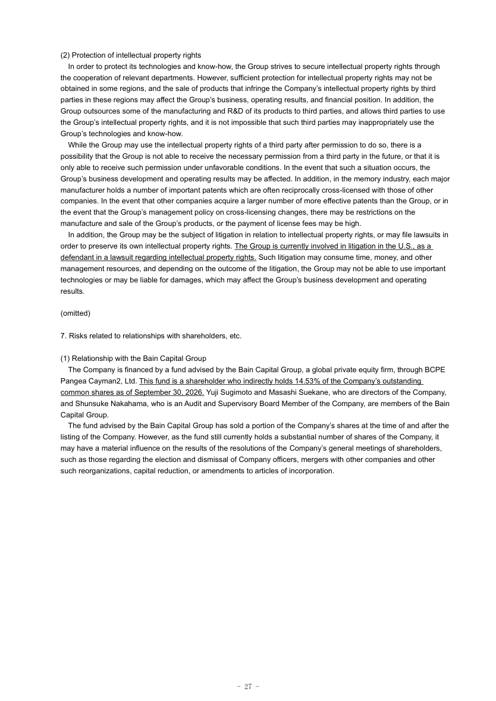
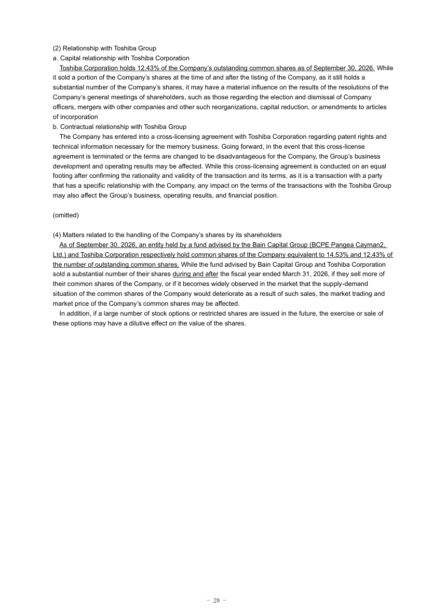

## Document Metadata

- Document ID: 410943f7f8918885a48e77a9b0a0af859aebb496
- Document Title: Semi-annual Securities Report, 9th Period
- Document Type: Semi-annual Securities Report
- Issuing Organization: Kioxia Holdings Corporation
- Publication Date: 2026-11-06
- Reporting Period: 2026-04-01 to 2026-09-30
- Source File: [S66945ba64724_kioxia-holdings.co_Semi-Annual-Securities-Report-.pdf](https://github.com/jadennevercode/CJCC-Knowledge-Base/blob/564ab11aa9785e569e3853c8a4d7ce86f88e7535/materials/%E4%B8%AD%E6%B8%B8%EF%BC%9A%E4%BE%9B%E7%BB%99%E5%BD%A2%E6%88%90%E4%B8%8E%E4%BA%A7%E8%83%BD%E5%86%B3%E7%AD%96/S66945ba64724_kioxia-holdings.co_Semi-Annual-Securities-Report-.pdf)

## Structured Content

> 原文件：[S66945ba64724_kioxia-holdings.co_Semi-Annual-Securities-Report-.pdf](https://github.com/jadennevercode/CJCC-Knowledge-Base/blob/564ab11aa9785e569e3853c8a4d7ce86f88e7535/materials/%E4%B8%AD%E6%B8%B8%EF%BC%9A%E4%BE%9B%E7%BB%99%E5%BD%A2%E6%88%90%E4%B8%8E%E4%BA%A7%E8%83%BD%E5%86%B3%E7%AD%96/S66945ba64724_kioxia-holdings.co_Semi-Annual-Securities-Report-.pdf)
> 转换方式：Volcengine OCRPdf v3, parse_mode=ocr

[Source Page: 1]

This document is a partial translation of the original Japanese document filed by Kioxia Holdings Corporation (the “Company”) and is provided for reference purposes only. In the event of any discrepancy between this document and the original Japanese document, the original Japanese document shall prevail.

# 9th Period Semi-annual Securities Report

From April 1, 2026 to September 30, 2026

Kioxia Holdings Corporation  
3-1-21 Shibaura, Minato-ku, Tokyo

[Source Page: 2]

## Index

| | Page |
| --- | --- |
| I. Financial Status | 2 |
| Condensed Interim Consolidated Financial Statements and Related Notes | 3 |
| Notes to Condensed Interim Consolidated Financial Statements | 9 |
| Other Information | 21 |
| II. Management’s Discussion and Analysis of Financial Position, Results of Operations, and Cash Flows | 22 |
| III. Risk Factors | 26 |
| Independent Auditor’s Report | |

[Source Page: 3]

[原始页面图像](../_assets/kioxia_semi_original/page-3.png)

## Cover

| | |
| --- | --- |
| Document Name | Semi-annual Securities Report |
| Basis | Item 1 of the table in Article 24-5, Paragraph 1 of the Financial Instruments and Exchange Act |
| Date | November 6, 2026 |
| Fiscal Year | April 1, 2026 to September 30, 2026 |
| Company Name | Kioxia Holdings Corporation |
| Representative | Representative Director, President and CEO Hiroo Ota |
| Location of Head Office | 3-1-21 Shibaura, Minato-ku, Tokyo, Japan |
| Phone Number | 03-6478-2539 |
| Administrative Contact | General Manager of Disclosure Division Makoto Sonoda |
| Location of Nearest Contact | 3-1-21 Shibaura, Minato-ku, Tokyo, Japan |
| Phone Number | 03-6478-2539 |
| Administrative Contact | General Manager of Disclosure Division Makoto Sonoda |

[Source Page: 4]

## I. Financial Status

### 1. Method of Preparing Condensed Interim Consolidated Financial Statements

The condensed interim consolidated financial statements of the Company have been prepared in accordance with International Accounting Standards (IAS) 34 Interim Financial Reporting pursuant to Article 312 of the Ordinance on Terminology, Forms, and Preparation Methods of Consolidated Financial Statements (Ordinance of the Ministry of Finance No. 28 of 1976).

The condensed interim consolidated financial statements of the Company are Type 1 interim consolidated financial statements.

### 2. Audit Certification

The condensed interim consolidated financial statements of the Company for the current interim fiscal period (from April 1, 2026 to September 30, 2026) have been reviewed by PricewaterhouseCoopers Japan LLC in accordance with the provisions of Article 193-2, Paragraph 1 of the Financial Instruments and Exchange Act.

[Source Page: 5]

## Condensed Interim Consolidated Financial Statements and Related Notes

### (1) Condensed Interim Consolidated Statement of Financial Position

Millions of yen

| Assets | Notes | As of September 30, 2026 | As of March 31, 2026 |
| --- | --- | --- | --- |
| Current assets: Cash and cash equivalents | | 1,397,333 | 470,707 |
| Trade and other receivables | | 1,648,356 | 660,559 |
| Other financial assets | 13 | 23,005 | 7,191 |
| Inventories | 14 | 446,026 | 412,612 |
| Other current assets | | 81,991 | 66,760 |
| Total current assets | | 3,596,711 | 1,617,829 |
| Non-current assets: Property, plant and equipment | 15 | 1,109,724 | 1,055,255 |
| Right-of-use assets | | 171,264 | 178,092 |
| Goodwill | | 395,550 | 395,585 |
| Intangible assets | | 11,772 | 11,192 |
| Investments accounted for using equity method | | 8,180 | 8,097 |
| Other financial assets | 13 | 470,216 | 219,230 |
| Other non-current assets | | 24,163 | 27,285 |
| Deferred tax assets | | 96,305 | 177,506 |
| Total non-current assets | | 2,287,174 | 2,072,242 |
| Total assets | | 5,883,885 | 3,690,071 |

[Source Page: 6]

Millions of yen

| Liabilities and equity | Notes | As of September 30, 2026 | As of March 31, 2026 |
| --- | --- | --- | --- |
| Current liabilities: Bonds and borrowings | 6 and 13 | 60,678 | 175,452 |
| Trade and other payables | 7 | 777,408 | 594,917 |
| Lease liabilities | | 42,619 | 43,911 |
| Other financial liabilities | 6 and 13 | 2,889 | 28,338 |
| Income taxes payable | | 974,689 | 104,516 |
| Provisions | | 9,385 | 3,876 |
| Other current liabilities | | 169,863 | 146,998 |
| Total current liabilities | | 2,037,531 | 1,098,008 |
| Non-current liabilities: Bonds and borrowings | 6 and 13 | 543,231 | 872,116 |
| Lease liabilities | | 156,201 | 161,710 |
| Retirement benefit liability | | 42,223 | 42,871 |
| Provisions | 8 | 62,308 | 12,840 |
| Other non-current liabilities | | 113,231 | 102,725 |
| Deferred tax liabilities | | 44 | 722 |
| Total non-current liabilities | | 917,238 | 1,192,984 |
| Total liabilities | | 2,954,769 | 2,290,992 |
| Equity: Share capital | 9 | 34,804 | 31,284 |
| Capital surplus | 9 | 877,802 | 875,804 |
| Other components of equity | | 251,570 | 124,888 |
| Retained earnings | | 2,564,812 | 366,955 |
| Treasury shares | 9 | (800,024) | (2) |
| Total equity attributable to owners of parent | | 2,928,964 | 1,398,929 |
| Non-controlling interests | | 152 | 150 |
| Total equity | | 2,929,116 | 1,399,079 |
| Total liabilities and equity | | 5,883,885 | 3,690,071 |

The accompanying notes are an integral part of these financial statements.

[Source Page: 7]

### (2) Condensed Interim Consolidated Statement of Profit or Loss and Condensed Interim Consolidated Statement of Comprehensive Income

Six months ended September 30, 2026 and 2025

#### Condensed Interim Consolidated Statement of Profit or Loss

Millions of yen except per share amounts

| | Notes | From April 1, 2026 to September 30, 2026 | From April 1, 2025 to September 30, 2025 |
| --- | --- | --- | --- |
| Revenue | 11 | 4,247,152 | 791,145 |
| Cost of sales | | 813,923 | 597,828 |
| Gross profit | | 3,433,229 | 193,317 |
| Selling, general and administrative expenses | | 128,714 | 66,082 |
| Other income | | 2,139 | 5,490 |
| Other expenses | 8 | 41,927 | 1,905 |
| Operating profit | | 3,264,727 | 130,820 |
| Finance income | | 7,341 | 1,996 |
| Finance costs | 10 | 68,763 | 48,962 |
| Share of profit of investments accounted for using equity method | | 85 | 156 |
| Profit before tax | | 3,203,390 | 84,010 |
| Income tax expense | | 1,005,515 | 25,067 |
| Profit | | 2,197,875 | 58,943 |
| Profit attributable to: Owners of parent | | 2,197,871 | 58,946 |
| Non-controlling interests | | 4 | (3) |
| Profit | | 2,197,875 | 58,943 |
| Basic earnings per share in yen | 12 | 1,349.33 | 36.42 |
| Diluted earnings per share in yen | 12 | 1,337.97 | 36.13 |

The accompanying notes are an integral part of these financial statements.

[Source Page: 8]

#### Condensed Interim Consolidated Statement of Comprehensive Income

Millions of yen

| | Notes | From April 1, 2026 to September 30, 2026 | From April 1, 2025 to September 30, 2025 |
| --- | --- | --- | --- |
| Profit | | 2,197,875 | 58,943 |
| Items that will not be reclassified to profit or loss: Net change in financial assets measured at fair value through other comprehensive income | 13 | 126,765 | 18,085 |
| Remeasurements of defined benefit plans | | － | 3 |
| Total of items that will not be reclassified to profit or loss | | 126,765 | 18,088 |
| Items that may be reclassified to profit or loss: Exchange differences on translation of foreign operations | | (426) | 2,236 |
| Effective portion of cash flow hedges | | 514 | 1,033 |
| Share of other comprehensive income of investments accounted for using equity method | | (2) | (2) |
| Total of items that may be reclassified to profit or loss | | 86 | 3,267 |
| Other comprehensive income, net of tax | | 126,851 | 21,355 |
| Comprehensive income | | 2,324,726 | 80,298 |
| Comprehensive income attributable to: Owners of parent | | 2,324,724 | 80,290 |
| Non-controlling interests | | 2 | 8 |
| Comprehensive income | | 2,324,726 | 80,298 |

The accompanying notes are an integral part of these financial statements.

[Source Page: 9]

### (3) Condensed Interim Consolidated Statement of Changes in Equity

Six months ended September 30, 2026; Millions of yen

| | Notes | Share capital | Capital surplus | Other components of equity | Retained earnings (Accumulated deficit) | Treasury shares | Total equity attributable to owners of parent | Non-controlling interests | Total equity |
| --- | --- | --- | --- | --- | --- | --- | --- | --- | --- |
| Balance as of April 1, 2026 | 9 | 31,284 | 875,804 | 124,888 | 366,955 | (2) | 1,398,929 | 150 | 1,399,079 |
| Profit | | － | － | － | 2,197,871 | － | 2,197,871 | 4 | 2,197,875 |
| Other comprehensive income | | － | － | 126,853 | － | － | 126,853 | (2) | 126,851 |
| Comprehensive income | | － | － | 126,853 | 2,197,871 | － | 2,324,724 | 2 | 2,324,726 |
| Issuance of new shares | 9 | 2,240 | 2,239 | － | － | － | 4,479 | － | 4,479 |
| Purchase of treasury shares | 9 | － | (219) | － | － | (800,022) | (800,241) | － | (800,241) |
| Share-based payment transactions | 9 | 1,280 | (22) | (185) | － | － | 1,073 | － | 1,073 |
| Transfer from other components of equity to retained earnings | | － | － | 14 | (14) | － | － | － | － |
| Total transactions with owners | | 3,520 | 1,998 | (171) | (14) | (800,022) | (794,689) | － | (794,689) |
| Balance as of September 30, 2026 | 9 | 34,804 | 877,802 | 251,570 | 2,564,812 | (800,024) | 2,928,964 | 152 | 2,929,116 |

Six months ended September 30, 2025; Millions of yen

| | Notes | Share capital | Capital surplus | Other components of equity | Retained earnings (Accumulated deficit) | Total equity attributable to owners of parent | Non-controlling interests | Total equity |
| --- | --- | --- | --- | --- | --- | --- | --- | --- |
| Balance as of April 1, 2025 | 9 | 25,239 | 866,665 | 35,208 | (189,547) | 737,565 | 131 | 737,696 |
| Profit | | － | － | － | 58,946 | 58,946 | (3) | 58,943 |
| Other comprehensive income | | － | － | 21,344 | － | 21,344 | 11 | 21,355 |
| Comprehensive income | | － | － | 21,344 | 58,946 | 80,290 | 8 | 80,298 |
| Issuance of new shares | 9 | 326 | 326 | － | － | 652 | － | 652 |
| Share-based payment transactions | 9 | 13 | 710 | (31) | 4 | 696 | － | 696 |
| Transfer from other components of equity to retained earnings | | － | － | (3) | 3 | － | － | － |
| Total transactions with owners | | 339 | 1,036 | (34) | 7 | 1,348 | － | 1,348 |
| Balance as of September 30, 2025 | 9 | 25,578 | 867,701 | 56,518 | (130,594) | 819,203 | 139 | 819,342 |

The accompanying notes are an integral part of these financial statements.

[Source Page: 10]

### (4) Condensed Interim Consolidated Statement of Cash Flows

Millions of yen

| | Notes | From April 1, 2026 to September 30, 2026 | From April 1, 2025 to September 30, 2025 |
| --- | --- | --- | --- |
| Cash flows from operating activities: Profit before tax | | 3,203,390 | 84,010 |
| Depreciation and amortization | | 153,543 | 158,839 |
| Impairment losses | | 656 | 126 |
| Finance income | | (7,341) | (1,996) |
| Finance costs | | 68,763 | 48,962 |
| Share of loss (profit) of investments accounted for using equity method | | (85) | (156) |
| Loss (gain) on sales and retirement of non-current assets | | 1,613 | (2,154) |
| Decrease (increase) in inventories | | (33,941) | (7,595) |
| Decrease (increase) in trade and other receivables | | (1,014,370) | 4,191 |
| Increase (decrease) in trade and other payables | | 87,674 | 14,878 |
| Increase (decrease) in retirement benefit liability | | (643) | (342) |
| Other | | 39,919 | (20,193) |
| Subtotal | | 2,499,178 | 278,570 |
| Interest and dividends received | | 6,278 | 2,246 |
| Interest paid | 10 | (15,150) | (67,405) |
| Income taxes refund (paid) | | (110,726) | (38,259) |
| Net cash provided by operating activities | | 2,379,580 | 175,152 |
| Cash flows from investing activities: Purchase of property, plant and equipment | | (135,296) | (143,127) |
| Proceeds from sale of property, plant and equipment | | 1,329 | 4,820 |
| Purchase of intangible assets | | (1,684) | (1,923) |
| Proceeds from government grants | | 21,276 | 33,355 |
| Purchase of other financial assets | | (78,220) | － |
| Other | | (427) | (7) |
| Net cash used in investing activities | | (193,022) | (106,882) |
| Cash flows from financing activities: Proceeds from long-term borrowings | 6 | 77,498 | 507,212 |
| Repayments of long-term borrowings | 6 | (523,094) | (498,817) |
| Proceeds from issuance of bonds | 6 | － | 326,656 |
| Repayments of lease liabilities | | (15,935) | (14,712) |
| Redemption of preferred shares | 6 | － | (322,996) |
| Proceeds from issuance of shares | 9 | 4,479 | 651 |
| Purchase of treasury shares | 9 | (800,342) | － |
| Net cash used in financing activities | | (1,257,394) | (2,006) |
| Effect of exchange rate changes on cash and cash equivalents | | (2,538) | 1,350 |
| Net increase (decrease) in cash and cash equivalents | | 926,626 | 67,614 |
| Cash and cash equivalents at beginning of period | | 470,707 | 167,932 |
| Cash and cash equivalents at end of period | | 1,397,333 | 235,546 |

The accompanying notes are an integral part of these financial statements.

[Source Page: 11]

[原始页面图像](../_assets/kioxia_semi_original/page-11.png)

## Notes to Condensed Interim Consolidated Financial Statements

### 1. Reporting Entity

Kioxia Holdings Corporation (the “Company”) is a corporation located in Japan. The registered address of the Company’s headquarters is 1-21, Shibaura 3-chome, Minato-ku, Tokyo, Japan. The condensed interim consolidated financial statements as of, and for the six months ended September 30, 2026 are comprised of the Company and its subsidiaries (collectively the “Group”) and interests in associates and joint arrangements.

The Group engages in research and development activities, manufacturing, sales, and other services of memory and related products.

### 2. Basis of Preparation

#### (1) Compliance with IFRS

The condensed interim consolidated financial statements of the Group satisfy the requirements of "specified company complying with designated international accounting standards" as provided in Article 1-2 of the Regulation on the Terminology, Forms, and Preparation Methods of Consolidated Financial Statements. Therefore, the condensed interim consolidated financial statements for the six months ended September 30, 2026 have been prepared in accordance with International Accounting Standards 34 "Interim Financial Reporting" ("IAS 34"). Since the condensed interim consolidated financial statements do not include all the information required for consolidated financial statements, they should be read in conjunction with the Group’s consolidated financial statements for the fiscal year ended March 31, 2026.

The condensed interim consolidated financial statements were approved by Hiroo Oota, President, Representative Director and Chief Executive Officer, and Yoshihiro Kawamura, Vice President and Executive Officer on November 6, 2026.

#### (2) Measurement basis

The condensed interim consolidated financial statements of the Group are prepared on a historical cost basis except for financial instruments, etc. which are measured at fair value.

#### (3) Functional and presentation currencies

The condensed interim consolidated financial statements of the Group are presented in Japanese yen, which is the functional currency of the Company. Amounts are rounded to the nearest million yen.

### 3. Material Accounting Policies

The material accounting policies presented in the consolidated financial statements for the fiscal year ended March 31, 2026 are applied consistently in the preparation of these condensed interim consolidated financial statements. Income tax expense is calculated using the estimated average annual effective tax rate.

[Source Page: 12]

### 4. Significant Accounting Estimates and Judgements

Preparation of condensed interim consolidated financial statements in accordance with IFRS requires management to make judgements, estimates and assumptions that have significant effects on adopting accounting policies and the amounts of assets, liabilities, revenues and expenses. Actual results may differ from those estimates.

These estimates and underlying assumptions are continuously reviewed. The effects of a change in accounting estimates are recognized in the period of the change and future periods.

In principle, significant accounting estimates and judgments used in the condensed interim consolidated financial statements are the same as those used in the preceding fiscal year.

### 5. Segment Information

Information about reportable segment

Segment information is omitted as the Group operates as a single reportable segment, the Memory business.

### 6. Bonds, Borrowings and Other Financial Liabilities

The components of bonds, borrowings and other financial liabilities are as follows:

Millions of yen

| | As of September 30, 2026 | As of March 31, 2026 |
| --- | --- | --- |
| Current liabilities: Financial liabilities measured at amortized cost: Current portion of long-term borrowings (Note 1 and 2) | 60,678 | 175,452 |
| Accrued interest | 2,153 | 2,350 |
| Financial liabilities measured at fair value through profit or loss: Derivative liabilities | 736 | 25,988 |
| Subtotal | 63,567 | 203,790 |
| Non-current liabilities: Financial liabilities measured at amortized cost: Bonds (Note 3 and 4) | 342,249 | 347,474 |
| Long-term borrowings (Note 1 and 2) | 200,982 | 524,642 |
| Subtotal | 543,231 | 872,116 |
| Total | 606,798 | 1,075,906 |

Note 1: Following a resolution by the Board of Directors on July 17, 2025, the Company entered into a new agreement with financial institutions repaid existing loans, and obtained new unsecured term loans on July 25, 2025. On April 27, 2026, the Company also repaid 127,500 million yen of term loans under the agreement, in advance of their original maturity. On May 25, 2026, the Company repaid the remaining term loans and terminated the agreement. The financial covenants that existed as of March 31, 2026 no longer exist as of September 30, 2026.

Note 2: The Group raises funds through the sale and leaseback of some property, plant and equipment. Sale and leaseback transactions executed after the adoption of IFRS 16 “Leases” (“IFRS 16”) are not accounted for as sales and leases since they do not meet the conditions for revenue recognition under IFRS 15 “Revenue from Contracts with Customers” (“IFRS 15”). Accordingly, funds raised through such transactions are

[Source Page: 13]

accounted for as long-term borrowings. Borrowings associated with such transactions included in the current portion of long-term borrowings as of September 30 and March 31, 2026 are 60,678 million yen and 95,575 million yen, respectively. Borrowings associated with such transactions included in long-term borrowings as of September 30 and March 31, 2026 are 130,982 million yen and 192,765 million yen, respectively.

Note 3: The contractual terms of the bonds are as follows:

The Company has the right to redeem 5-year senior notes on or after July 24, 2027 and 8-year senior notes on or after July 24, 2028. This redemption right constitutes an embedded derivative. These embedded derivatives are not accounted for separately from the host contracts because they are closely related to the host contracts. Therefore, the Company classifies all of the bonds as financial liabilities measured at amortized cost.

Millions of yen

| | As of September 30, 2026 | As of March 31, 2026 | Interest rate (%) | Maturity date |
| --- | --- | --- | --- | --- |
| USD-denominated unsecured 5-year senior notes (Note 4) | 163,328 | 163,328 | 6.25 | July 24, 2030 |
| USD-denominated unsecured 8-year senior notes (Note 4) | 163,328 | 163,328 | 6.625 | July 24, 2033 |

Note 4: The Company utilizes currency swaps to hedge risk of changes in foreign currency risk associated with USD-denominated unsecured senior notes. The above amounts are based on the principal amount of the hedged bond issuance converted at the swap’s rate. For the currency swaps, the USD-denominated fixed interest rates are exchanged with a JPY-denominated fixed interest rates. The effective interest rates after the currency swaps are as follows:

- USD-denominated unsecured 5-year senior notes (1,100 million USD) 3.2934% per year
- USD-denominated unsecured 8-year senior notes (1,100 million USD) 3.6638% per year

[Source Page: 14]

### 7. Trade and Other Payables

The Group has entered into supplier finance arrangements with third-party financial institutions. Under these arrangements, the Group makes payments to the third-party financial institutions 120 to 180 days after the invoice date, based on agreements with each supplier. These due dates are similar to those of comparable trade payables that are not part of a supplier finance arrangement. Suppliers may, at their discretion, receive early payment at a discount from a third-party financial institution. The Group has not pledged any assets or provided any third-party guarantees for supplier finance arrangements.

The carrying amounts of financial liabilities related to supplier finance arrangements as of September 30 and as of March 31, 2026 are 215,943 million yen and 156,851 million yen, respectively, of which 109,341 million yen and 60,547 million yen, respectively, relate to amounts for which suppliers had already received payment from the finance providers.

### 8. Provisions

(Provisions for losses on litigation)

The Group records an estimated amount of reasonably calculated losses, considering individual risks, for losses on litigation which could be incurred in the future from lawsuits and disputed cases.

In July 2026, a judgment was issued in patent infringement litigation involving Viasat, Inc. in the United States, awarding damages of 229 million USD. The Group has appealed the judgment, and the litigation remains pending. However, the Group has determined that an outflow of resources embodying economic benefits has become probable. Accordingly, as of September 30, 2026, the Group recognized a provision for litigation losses of 36,037 million yen, using the damages awarded as the best estimate of the amount required to settle the obligation, and recognized the expense in other expenses.

The ultimate outcome of the litigation and the timing of payment are uncertain, and the actual amount paid may differ from the estimated amount.

[Source Page: 15]

[原始页面图像](_assets/kioxia-semi-reviewed-pages/page-15.png)

## 9. Share Capital and Other Equity Items

Total number of authorized shares, number of issued shares, and balances of share capital, etc. are as follows:

Six months ended September 30, 2026 (From April 1, 2026 to September 30, 2026)

| | Series of shares | Total number of authorized shares | Number of issued shares | Share capital in millions of yen | Capital surplus in millions of yen |
| --- | --- | ---: | ---: | ---: | ---: |
| As of April 1, 2026 | Ordinary shares | 2,070,000,000 | 546,086,290 | 31,284 | 875,804 |
| Additions (reductions) (Note 1, 2, 3) | Ordinary shares | − | 2,682,944 | 3,520 | 1,998 |
| As of September 30, 2026 | Ordinary shares | 2,070,000,000 | 548,769,234 | 34,804 | 877,802 |

Note 1: As a result of the exercise of subscription rights to shares, the total number of issued shares increased by 2,620,920 shares, and both share capital and capital surplus increased by 2,332 million yen.

Note 2: As a result of the continuous service stock-based remuneration plan and performance-linked share-based remuneration plan, the total number of issued shares increased by 62,024 shares, share capital increased by 1,188 million yen, and capital surplus decreased by 334 million yen.

Note 3: As of October 1, 2026, the Company executed a three-for-one share split of its ordinary shares. The number of shares in the table above is presented on a pre-share-split basis.

Six months ended September 30, 2025 (From April 1, 2025 to September 30, 2025)

原表的 authorized shares 数字和变动项为每组三行合并单元格，下表为保持列对应关系而重复显示。

| | Series of shares | Total number of authorized shares | Number of issued shares | Share capital in millions of yen | Capital surplus in millions of yen |
| --- | --- | ---: | ---: | ---: | ---: |
| As of April 1, 2025 | Ordinary shares | 2,070,000,000 | 539,355,180 | 25,239 | 866,665 |
| As of April 1, 2025 | Preferred shares | 2,070,000,000 | 3,000 | − | − |
| As of April 1, 2025 | Total | 2,070,000,000 | 539,358,180 | 25,239 | 866,665 |
| Additions (reductions) (Note 1, 2, 3) | Ordinary shares | − | 391,320 | 339 | 1,036 |
| Additions (reductions) (Note 1, 2, 3) | Preferred shares | − | (3,000) | − | − |
| Additions (reductions) (Note 1, 2, 3) | Total | − | 388,320 | 339 | 1,036 |
| As of September 30, 2025 | Ordinary shares | 2,070,000,000 | 539,746,500 | 25,578 | 867,701 |
| As of September 30, 2025 | Preferred shares | 2,070,000,000 | − | − | − |
| As of September 30, 2025 | Total | 2,070,000,000 | 539,746,500 | 25,578 | 867,701 |

Note 1: As a result of the exercise of subscription rights to shares, the total number of issued shares increased by 391,320 shares, and both share capital and capital surplus increased by 339 million yen.

Note 2: As a result of granting units under the continuous service and performance-linked share-based remuneration plans, capital surplus increased by 697 million yen.

Note 3: The Company repurchased and canceled non-convertible preferred shares on July 25, 2025.

[Source Page: 16]

[原始页面图像](_assets/kioxia-semi-reviewed-pages/page-16.png)

The number and balance of treasury shares are as follows.

| | From April 1, 2026 to September 30, 2026: Number of shares (Shares) | From April 1, 2026 to September 30, 2026: Amount (Millions of yen) | From April 1, 2025 to September 30, 2025: Number of shares (Shares) | From April 1, 2025 to September 30, 2025: Amount (Millions of yen) |
| --- | ---: | ---: | ---: | ---: |
| Opening balance | 161 | 2 | − | − |
| Changes during the period (Note) | 16,133,895 | 800,022 | − | − |
| Closing balance | 16,134,056 | 800,024 | − | − |

Note: Changes during the six months ended September 30, 2026 are due to the acquisition of treasury shares (16,133,500 shares, 799,998 million yen) and the repurchase of shares less than one unit (395 shares, 24 million yen). The number of shares in the table above is presented on a pre-share-split basis.

## 10. Dividends

Six months ended September 30, 2026 (From April 1, 2026 to September 30, 2026)

(1) The amount paid as dividends

Not applicable.

(2) Dividends whose record date is during the six months ended September 30, 2026, whereas the effective date is after September 30, 2026

| Date of resolution | Series of shares | Total amount of dividends | Dividends per share | Record date | Effective date |
| --- | --- | ---: | ---: | --- | --- |
| October 30, 2026 the Board of Directors Meeting | Ordinary shares | 47,937 million yen | 90 yen | September 30, 2026 | December 8, 2026 |

Note: As of October 1, 2026, the Company executed a three-for-one share split of its ordinary shares. Dividends per share are presented on a pre-share-split basis.

Six months ended September 30, 2025 (From April 1, 2025 to September 30, 2025)

(1) The amount paid as dividends

| Date of resolution | Series of shares | Total amount of dividends | Dividends per share | Record date | Effective date |
| --- | --- | ---: | ---: | --- | --- |
| May 15, 2025 the Board of Directors Meeting | Series 1 (Kou) Preferred shares | 9,286 million yen | 7,738,453 yen | March 31, 2025 | June 30, 2025 |
| May 15, 2025 the Board of Directors Meeting | Series 2 (Otsu) Preferred shares | 14,475 million yen | 8,041,552 yen | March 31, 2025 | June 30, 2025 |

Note: Series 1 (Kou) and Series 2 (Otsu) preferred shares are recognized as financial liabilities under IFRS. Dividends are recognized as “Finance costs” in the condensed interim consolidated statement of profit or loss.

(2) Dividends whose record date is during the six months ended September 30, 2025, whereas the effective date is after September 30, 2025

Not applicable.

[Source Page: 17]

### 11. Revenue

Disaggregation of revenue from contracts with customers

The Group mainly provides memory and related products used for applications such as SSD & Storage and Smart Devices, and recognizes consideration received from customers for the products as revenue. Information on the main types of goods and services is as follows:

Millions of yen

| | From April 1, 2026 to September 30, 2026 | From April 1, 2025 to September 30, 2025 |
| --- | --- | --- |
| SSD & Storage | 2,790,716 | 461,970 |
| Smart Devices | 1,314,513 | 236,340 |
| Other | 141,923 | 92,835 |
| Total | 4,247,152 | 791,145 |

### 12. Earnings per Share

The basis for the calculation of basic earnings per share and diluted earnings per share are as follows:

Six months ended September 30, 2026 and 2025

| | From April 1, 2026 to September 30, 2026 | From April 1, 2025 to September 30, 2025 |
| --- | --- | --- |
| Profit attributable to owners of parent in millions of yen | 2,197,871 | 58,946 |
| Weighted average number of ordinary shares | 1,628,862,141 | 1,618,459,659 |
| Increase in the number of ordinary shares: Exercise of subscription rights to shares | 7,862,760 | 1,173,960 |
| Delivery through restricted stock units | 186,072 | － |
| Dilutive effect in shares: Subscription rights to shares | 10,881,699 | 12,043,437 |
| Restricted stock unit (RSU) | 1,007,840 | 343,724 |
| Performance share unit (PSU) | 1,939,063 | 479,726 |
| Number of shares after dilutive effect | 1,642,690,743 | 1,631,326,546 |
| Basic earnings per share in yen | 1,349.33 | 36.42 |
| Diluted earnings per share in yen | 1,337.97 | 36.13 |

Note 1: There were none and 1,738,800 potential shares not factored into the calculation of diluted earnings per share because they had no dilutive effect for the six months ended September 30, 2026 and 2025, respectively.

Note 2: As of October 1, 2026, the Company executed a three-for-one share split of its ordinary shares. Basic earnings per share and diluted earnings per share are calculated on the assumption that the share split was executed at the beginning of the fiscal year ended March 31, 2026.

[Source Page: 18]

[原始页面图像](_assets/kioxia-semi-reviewed-pages/page-18.png)

## 13. Fair Value of Financial Instruments

The carrying amount and the fair value of financial instruments are as follows. If the carrying amount of the instruments represents a reasonable approximation of their fair value, disclosure is omitted.

Millions of yen

| | As of September 30, 2026: Carrying amount | As of September 30, 2026: Fair value | As of March 31, 2026: Carrying amount | As of March 31, 2026: Fair value |
| --- | ---: | ---: | ---: | ---: |
| Bonds and borrowings (non-current): | | | | |
| Bonds | 342,249 | 348,969 | 347,474 | 359,175 |
| Total | 342,249 | 348,969 | 347,474 | 359,175 |

Note: The fair value hierarchy of bonds is Level 2.

The fair value of financial instruments is calculated as described below:

(Cash and cash equivalents, trade and other receivables, trade and other payables)

The fair value is determined at the carrying amount which approximates their fair value, as they are settled in a short period of time.

(Other financial assets, other financial liabilities)

The fair value of listed shares is the market price at the end of the period.

The fair value of unlisted shares is calculated based on appropriate valuation techniques such as comparable company analysis.

The fair value of debt instruments is calculated based on the net assets method.

The fair value of accrued interest is determined as the carrying amount which approximates its fair value, as it is settled in a short period of time.

The fair value of derivatives is determined by referring to valuations provided by financial institutions, which use observable market data, such as futures prices, at the end of the period.

(Bonds and borrowings)

The fair value of short-term borrowings is determined as the carrying amount which approximates its fair value, as it is settled in a short period of time.

The fair value of long-term borrowings is determined as the carrying amount which approximates its fair value, as long-term borrowings mainly have variable interest rates that regularly reflect market rates.

The fair value of bonds is calculated by referring to a market price.

The fair value measurements of financial instruments are categorized into Levels 1, 2 or 3 according to the market observability of the inputs used in the fair value measurement. Transfers between levels of the fair value hierarchy are recognized on the date of the event or change in the circumstances that caused the transfer.

- Level 1: Fair value is measured at quoted prices in active markets for identical assets or liabilities.
- Level 2: Fair value is calculated based on directly or indirectly observable market data, other than Level 1 prices.
- Level 3: Fair value is calculated based on a valuation technique that includes an unobservable input.

Level categories based on the fair value hierarchy of financial assets and financial liabilities measured at fair value on a recurring basis in the condensed interim consolidated statement of financial position are as follows:

[Source Page: 19]

As of September 30, 2026; Millions of yen

| | Level1 | Level2 | Level3 | Total |
| --- | --- | --- | --- | --- |
| Assets: Financial assets measured at fair value through profit or loss: Derivative assets: Foreign exchange forward contracts | - | 22,370 | - | 22,370 |
| Currency swaps | - | 24,710 | - | 24,710 |
| Debt instruments | - | - | 1,731 | 1,731 |
| Financial assets measured at fair value through other comprehensive income: Equity instruments | 429,093 | - | 8,881 | 437,974 |
| Total | 429,093 | 47,080 | 10,612 | 486,785 |
| Liabilities: Financial liabilities measured at fair value through profit or loss: Derivative liabilities: Foreign exchange forward contracts | - | 736 | - | 736 |
| Total | - | 736 | - | 736 |

Note: Certain stocks held by the Group were reclassified from Level 3 to Level 1 due to a public listing for the six months ended September 30, 2026.

[Source Page: 20]

As of March 31, 2026; Millions of yen

| | Level1 | Level2 | Level3 | Total |
| --- | --- | --- | --- | --- |
| Assets: Financial assets measured at fair value through profit or loss: Derivative assets: Foreign exchange forward contracts | - | 7,025 | - | 7,025 |
| Currency swaps | - | 37,325 | - | 37,325 |
| Debt instruments | - | - | 1,706 | 1,706 |
| Financial assets measured at fair value through other comprehensive income: Equity instruments | 165,972 | - | 8,992 | 174,964 |
| Total | 165,972 | 44,350 | 10,698 | 221,020 |
| Liabilities: Financial liabilities measured at fair value through profit or loss: Derivative liabilities: Foreign exchange forward contracts | - | 25,988 | - | 25,988 |
| Total | - | 25,988 | - | 25,988 |

Note: There were no significant transfers between Level 1, 2 and 3 of the fair value hierarchy for the fiscal year ended March 31, 2026.

The reconciliation of financial instruments categorized in Level 3 from the opening balance to the closing balance is as follows:

Millions of yen

| | From April 1, 2026 to September 30, 2026 | From April 1, 2025 to September 30, 2025 |
| --- | --- | --- |
| Opening balance | 10,698 | 4,256 |
| Gains and losses: Other comprehensive income (Note 1) | (76) | 175 |
| Transfer from Level 3 (Note 2) | (35) | － |
| Other | 25 | 14 |
| Closing balance | 10,612 | 4,445 |

Note 1: Gains and losses included in other comprehensive income are recorded in ”Net change in financial assets measured at fair value through other comprehensive income” in the Condensed Interim Consolidated Statement of Comprehensive Income.

Note 2: Certain stocks held by the Group were reclassified from Level 3 to Level 1 due to the public listing.

Assets categorized in Level 3 are evaluated at the reporting date and valuation results are analyzed by management according to internal policies. The appropriateness of valuation results is ensured through a defined review and approval process.

[Source Page: 21]

Assets categorized in Level 3 consist of equity instruments and debt instruments. Significant unobservable inputs for equity instruments primarily include illiquidity discounts of 20%. Fair value decreases (increases) due to an increase (decrease) in the illiquidity discount. Changing unobservable inputs to reflect reasonably possible alternative assumptions would not materially affect fair value. The debt instruments are mainly investments in funds and fair value is calculated based on the net assets method as a valuation technique.

### 14. Inventories

The amounts of inventory write-downs to net realizable value are as follows:

Millions of yen

| | From April 1, 2026 to September 30, 2026 | From April 1, 2025 to September 30, 2025 |
| --- | --- | --- |
| Write-down of inventories | 12,809 | 12,917 |

Note: “Cost of sales” consists primarily of the cost of inventories sold during the period, as the main business of the Group is manufacturing and marketing of memory and related products used for applications such as SSD & Storage and Smart Devices.

### 15. Property, Plant and Equipment

Six months ended September 30, 2026 (From April 1, 2026 to September 30, 2026)

(1) Acquisition, sale and disposal

The carrying amount of property, plant and equipment acquired is 248,805 million yen, and the carrying amount of property, plant and equipment sold and disposed of is 2,106 million yen.

(2) Commitments

The total amount of commitments for the purchase of property, plant and equipment is 357,153 million yen.

Six months ended September 30, 2025 (From April 1, 2025 to September 30, 2025)

(1) Acquisition, sale and disposal

The carrying amount of property, plant and equipment acquired is 153,266 million yen, and the carrying amount of property, plant and equipment sold and disposed of is 1,263 million yen.

(2) Commitments

The total amount of commitments for the purchase of property, plant and equipment is 111,286 million yen.

### 16. Contingent Liabilities

The Group is involved in several pending lawsuits.

Based on currently available information, the Company does not believe that the results of pending lawsuits will have a significant adverse impact on the financial position and operating results of the Group.

[Source Page: 22]

### 17. Subsequent Events

(Share split)

Based on the resolution adopted at the Board of Directors meeting held on July 31, 2026, the Company executed a three-for-one share split on October 1, 2026.

(1) Purpose

The purpose of the share split is to increase the liquidity of the Company's shares and expand its investor base.

(2) Method of the share split

Ordinary shares of the Company held by shareholders registered in the shareholder registry as of September 30, 2026 shall be split at a ratio of three to one, with September 30, 2026 as the record date.

(3) Number of shares resulting from the share split

| | |
| --- | --- |
| Total issued shares before share split | 548,769,234 shares |
| Shares added as a result of this share split | 1,097,538,468 shares |
| Total issued shares after share split | 1,646,307,702 shares |
| Total authorized shares after share split | 6,210,000,000 shares |

(4) Schedule

| | |
| --- | --- |
| Announcement of record date | September 10, 2026 |
| Record date | September 30, 2026 |
| Effective date | October 1, 2026 |

(5) Other

There is no change in the amount of share capital as a result of this share split.

[Source Page: 23]

## Other Information

### (1) Interim Dividend

On October 30, 2026, the Board of Directors resolved the following concerning the interim dividend.

(i) Total amount of the dividend: 47,937 million yen  
(ii) Dividends per share: 90 yen  
(iii) Effective date: December 8, 2026

Note: As of October 1, 2026, the Company executed a three-for-one share split of its ordinary shares. Dividends per share are presented on a pre-share-split basis.

### (2) Litigation

Please refer to “8. Provisions”.

[Source Page: 24]

### II. Management’s Discussion and Analysis of Financial Position, Results of Operations, and Cash Flows

 Analysis of the financial position, operating results, and cash flows (“operating results, etc.”) of the Group and management’s discussion and analysis of operating results, etc. for the six months ended September 30, 2026 (April 1, 2026 to September 30, 2026) are as follows. The forward-looking statements herein are based on judgments as of September 30, 2026, unless stated otherwise.

### 1. Overview of Interim Operating Results

 An overview of the operating results, etc. of the Group, and interests in associates and joint arrangements is as follows. As the Group operates as a single reportable segment, the Memory business, it does not provide segment information. However, the Group provides revenue by the application of each product, in accordance with its purpose of use. “SSD & Storage” primarily includes solid-state drives (SSDs) and memory products for PCs, data centers, and enterprises. “Smart Devices” include embedded memory products with control functions which are used in consumer devices such as smartphones, tablets, and televisions, as well as in automotive and industrial devices. “Other” includes retail products such as SD memory cards and USB flash drives, as well as sales to the Sandisk group recorded through its three manufacturing joint ventures. The Group discloses consolidated operating results in the form of measures based on International Financial Reporting Standards (IFRS), as well as internal measures used by management when making decisions (“non-GAAP measures”). Non-GAAP measures exclude non-recurring items and other specific items from IFRS-based figures to more easily evaluate the Group’s fundamental profitability. Management believes that disclosing non-GAAP measures makes it easier for stakeholders to compare the Group’s performance with that of other companies in the same industry and against previous fiscal years. In doing so, the Group intends to provide useful information for understanding its regular operating results and business outlook. Non-GAAP measures are used internally by management and are not accounting items based on IFRS and have not been audited or reviewed by auditors. Therefore, such non-GAAP measures may not accurately reflect the Group’s financial condition or operating results. “Non-recurring items” are temporary gains and losses that the Group deems should be excluded for non-GAAP measures, including the impact of purchase price allocation (PPA) arising from mergers and acquisitions, provisions for losses on litigation, and the impact of significant changes to tax policies. “Other specific items” are gains and losses that the Group deems difficult to compare with other companies due to factors such as different accounting standards, including costs for the fiscal year recorded under the Group’s continuous service and performance-linked stock-based remuneration plans.

In regard to the global economy for the six months ended September 30, 2026, in developed countries, while the price of goods trended upwards, a favorable labor market, stable consumer spending, and steady capital investments resulting from high demand for AI contributed to an overall strong economy. In developing countries, while exports increased, investment fell as the real estate market continued to struggle, consumer spending dragged, and overall economic indicators continued to be weak. Heightened geopolitical risks, particularly in the Middle East and Ukraine, contribute to an uncertain outlook for the global economy. During the six months ended September 30, 2026, the yen depreciated against the US dollar compared to the six months ended September 30, 2025. In the flash memory industry, while demand from smartphone and PC customers is seeing a downward trend, demand for AI servers at data centers and enterprise customers is increasing, and the overall market is continuing to grow.

[Source Page: 25]

### Year on Year Comparison Table

(JPY in billions unless indicated otherwise)

| | Six months ended September 30, 2026 | Six months ended September 30, 2025 | Year on year change |
| --- | --- | --- | --- |
| Revenue | 4,247.2 | 791.1 | +3,456.0 |
| SSD & Storage | 2,790.7 | 462.0 | +2,328.7 |
| Smart Devices | 1,314.5 | 236.3 | +1,078.2 |
| Other | 141.9 | 92.8 | +49.1 |
| Non-GAAP operating profit | 3,314.5 | 132.4 | +3,182.2 |
| PPA impact (loss) | (0.2) | (0.6) | +0.3 |
| Stock-based remuneration costs (loss) | (13.0) | (1.0) | -12.0 |
| Provisions for losses on litigation (loss) | (36.6) | ー | -36.6 |
| Operating profit | 3,264.7 | 130.8 | +3,133.9 |
| Non-GAAP profit before tax | 3,252.7 | 85.6 | +3,167.2 |
| Profit before tax | 3,203.4 | 84.0 | +3,119.4 |
| Profit | 2,197.9 | 58.9 | +2,138.9 |
| Non-GAAP profit attributable to owners of parent | 2,235.6 | 60.2 | +2,175.4 |
| Profit attributable to owners of parent | 2,197.9 | 58.9 | +2,138.9 |
| Non-GAAP basic earnings per share | 1,372.48 yen | 37.18 yen | +1,335.30 yen |
| Basic earnings per share | 1,349.33 yen | 36.42 yen | +1,312.91 yen |
| Average USD to yen exchange rate | 160 yen | 146 yen | +14 yen |

Note 1: Figures in this table are rounded to the nearest billion yen from the figures in “I. Financial Status; Condensed Interim Consolidated Financial Statements and Related Notes”, excluding non-GAAP figures, PPA impact, stock-based remuneration costs, and provisions for losses on litigation. Note 2: The Company executed a 3-to-1 stock split for its common shares on October 1, 2026. Non-GAAP basic earnings per share and basic earnings per share are calculated as if the stock split was effective at the beginning of the fiscal year ended March 31, 2026. Revenue for the six months ended September 30, 2026 was 4,247.2 billion yen, an increase of 3,456.0 billion yen from the six months ended September 30, 2025. This was primarily due to a significant increase in ASPs resulting from strong demand from data center customers focusing on generative AI, as well as an increase in bit shipment and the positive effect of exchange rates. Operating profit was 3,264.7 billion yen, an increase of 3,133.9 billion yen from the six months ended September 30, 2025. This was primarily due to the aforementioned increase in revenue, partially offset by a recording of provisions for losses on litigation, special profit-sharing for employees, and an increase in stock-based remuneration costs. Profit before tax was 3,203.4 billion yen, an increase of 3,119.4 billion yen from the six months ended September 30, 2025. Profit attributable to owners of parent was 2,197.9 billion yen, an increase of 2,138.9 billion yen from the six months ended September 30, 2025. Non-GAAP operating profit (which excludes PPA impact of 0.2 billion yen, stock-based remuneration costs of 13.0 billion yen, and provisions for losses on litigation of 36.6 billion yen) was 3,314.5 billion yen, an increase of 3,182.2 billion yen from the six months ended September 30, 2025. Non-GAAP profit before tax was 3,252.7 billion yen, an increase of 3,167.2 billion yen from the six months ended September 30, 2025. Non-GAAP profit attributable to owners of parent was 2,235.6 billion yen, an increase of 2,175.4 billion yen from the six months ended September 30, 2025.

[Source Page: 26]

### 2. Overview of Interim Financial Position

(JPY in billions unless indicated otherwise)

| | As of September 30, 2026 | As of March 31, 2026 | Change from the end of the previous fiscal year |
| --- | --- | --- | --- |
| Total assets | 5,883.9 | 3,690.1 | +2,193.8 |
| Total liabilities | 2,954.8 | 2,291.0 | +663.8 |
| Total equity | 2,929.1 | 1,399.1 | +1,530.0 |
| Equity attributable to owners of parent | 2,929.0 | 1,398.9 | +1,530.0 |
| Ratio of equity attributable to owners of parent | 49.8% | 37.9% | +11.9 percentage points |

Note: Figures in this table are rounded to the nearest billion yen from the figures in “I. Financial Status; Condensed Interim Consolidated Financial Statements and Related Notes”. (Assets) Assets as of September 30, 2026 were 5,883.9 billion yen, an increase of 2,193.8 billion yen from the end of the previous fiscal year. This was primarily due to an increase in trade and other receivables of 987.8 billion yen and an increase in cash and cash equivalents of 926.6 billion yen. (Liabilities) Liabilities as of September 30, 2026 were 2,954.8 billion yen, an increase of 663.8 billion yen from the end of the previous fiscal year. This was primarily due to an increase of 870.2 billion yen in income taxes payable. (Equity) Equity as of September 30, 2026 was 2,929.1 billion yen, an increase of 1,530.0 billion yen from the end of the previous fiscal year. This was primarily due to profit for the six months ended September 30, 2026 of 2,197.9 billion yen, partially offset by a decrease of 800.0 billion yen from the purchase of treasury shares. As a result, the ratio of equity attributable to owners of parent was 49.8%, up 11.9 percentage points from the end of the previous fiscal year.

### 3. Overview of Interim Cash Flows

(JPY in billions unless indicated otherwise)

| | Six months ended September 30, 2026 | Six months ended September 30, 2025 | Year on year change |
| --- | --- | --- | --- |
| Net cash provided by (used in) operating activities | 2,379.6 | 175.2 | +2,204.4 |
| Net cash provided by (used in) investing activities | (193.0) | (106.9) | -86.1 |
| Net cash provided by (used in) financing activities | (1,257.4) | (2.0) | -1,255.4 |

Note: Figures in this table are rounded to the nearest billion yen from the figures in “I. Financial Status; Condensed Interim Consolidated Financial Statements and Related Notes”. The balance of cash and cash equivalents as of September 30, 2026 was 1,397.3 billion yen, an increase of 926.6 billion yen from the end of the previous fiscal year. Details of each cash flow are as follows.

[Source Page: 27]

### (Operating Activities)

 The Group recorded 2,379.6 billion yen in cash inflow as a result of its operating activities (compared to 175.2 billion yen in cash inflow in the six months ended September 30, 2025). This included profit before tax of 3,203.4 billion yen (compared to 84.0 billion yen in the six months ended September 30, 2025), partially offset by a cash outflow of 1,014.4 billion yen (compared to a cash inflow of 4.2 billion yen in the six months ended September 30, 2025) due to an increase in trade and other receivables. The primary reason for the 2,204.4 billion yen increase in cash inflow year on year was growth in profit before tax compared to the six months ended September 30, 2025.

### (Investing Activities)

 The Group recorded 193.0 billion yen in cash outflow as a result of its investing activities (compared to 106.9 billion yen in cash outflow in the six months ended September 30, 2025). This included 135.3 billion yen for the purchase of property, plant and equipment (compared to 143.1 billion yen in the six months ended September 30, 2025). The primary reason for the 86.1 billion yen increase in cash outflow year on year was the use of 78.2 billion yen for the purchase of other financial assets representing the acquisition of shares of Nanya Technology Corporation.

### (Financing Activities)

 The Group recorded 1,257.4 billion yen in cash outflow as a result of its financing activities (compared to 2.0 billion yen in cash outflow in the six months ended September 30, 2025). This included 800.3 billion yen used for the purchase of treasury shares (compared to none in the six months ended September 30, 2025) and 523.1 billion yen used in the repayment of long-term borrowings (compared to 498.8 billion yen in the six months ended September 30, 2025), primarily for early repayments. The primary reason for the 1,255.4 billion yen increase in cash outflow year on year was the aforementioned purchase of treasury shares and an increase in cash outflow from the aforementioned early repayment of long-term borrowings. This was despite the amount of liabilities remaining primarily unchanged from the six months ended September 30, 2025 due to the restructuring of capital structure carried out in July 2025.

### 4. Business and financial issues to be addressed

 Not applicable.

### 5. Capital expenditures

 Capital expenditures made during the six months ended September 30, 2026 amounted to 137.0 billion yen (payment basis; includes intangible assets). Segment information is omitted as the Group operates as a single reportable segment: the Memory business. While the amount of capital expenditures (payment basis; includes intangible assets) for the fiscal year ending March 2027 was planned to be approximately 450.0 billion yen at the time of submission of the Annual Securities Report for the previous fiscal year, as of the submission of this Semi-annual Securities Report it is planned to be approximately 470.0 billion yen.

### 6. Research & development activities

 The Group’s research & development (R&D) expenses for the six months ended September 30, 2026 were 97.1 billion yen. There were no significant changes to the Group’s R&D policies or main R&D structure during the six months ended September 30, 2026.

[Source Page: 28]

### III. Risk Factors

 Significant changes in the risk factors described in the Annual Securities Report for the previous fiscal year which occurred during the interim consolidated accounting period are as follows. The changes are underlined, and there are some omissions before and after the changes. Forward-looking statements below are based on the Group’s decisions as of the end of the interim consolidated accounting period, unless stated otherwise. The numbers for the following sections correspond to the section numbers in “III. Risk Factors” in the Annual Securities Report for the previous fiscal year.

### 2. Risks related to management policies and decisions

### (1) Risks related to management strategy

 To realize its mission and vision the Group implements management policies and strategies based on its business environment and formulates business strategies, as well as shareholder return policies based on them, which factor in the growing AI market and the strong demand for flash memory, with the aim of using memory technology to enter into a new era and change the world. However, (i) demand for AI and the flash memory market may not grow as predicted by research firms, (ii) the Company’s market share for data center and enterprise products may stagnate due to competition and technological innovation, (iii) flash memory prices may stagnate due to negotiations with customers or unfavorable supply-demand balance resulting from increased production by competitors, or (iv) the Company’s production equipment and production efficiency may not increase as planned due to factors such as yen depreciation, inflation, materialization of supply chain risks, or labor shortages. Shareholder return policies may not be realized as planned after accounting for factors such as the achievement status of business strategies, stock prices, exchange rates, geopolitical risks, and the need to secure liquidity and investments for future growth. While the Company strives to carry out these business strategies and shareholder return policies, if the aforementioned risks or other risks described in “III. Risk Factors” materialize, these business strategies or shareholder return policies may not be realized, or they may not have their intended effects as written, and the Group’s business, operating results and financial position, as well as shareholder returns may be affected.

### (2) Predictions about the flash memory market, capital expenditures

 The Group plans to invest in production facilities at its Yokkaichi and Kitakami Plants, as well as in R&D, while comprehensively taking into account demand trends, the development status and investment efficiency of production process technologies. In August 2026, the Company announced that Kioxia Corporation and Sandisk Corporation anticipate significant investments in Japan totaling approximately 5 trillion yen (over 31 billion USD) through 2032, contingent upon government support. However, in the event that the market fluctuates significantly compared to demand forecasts at the start of production, excess or lack of production facilities may lead to a deterioration in profit margins, excess inventories, a decline in sales volumes or selling prices, impairment of fixed assets, loss of sales opportunities, or a decline in market share. While the Company checks the latest demand forecasts and the business environment and evaluates risks when making decisions on capital expenditures, it is difficult to accurately predict demand in the flash memory market. As delivery times for orders for manufacturing facilities and infrastructure are long, there is no guarantee that these evaluations and predictions will be accurate, and in the event that the actual business environment differs from the Company’s predictions, the Group’s operating results and financial position may be affected. In addition to these large capital expenditures, the Group continues to invest in R&D, resulting in high fixed costs. The Group is able to change its capital expenditure plan in response to market fluctuations, but there is a limit to how much fixed costs can be reduced. As a result, even a comparatively small decline in revenue may have a relatively large impact on operating profit and cash flows, which may affect the Group’s business, operating results, and financial position.

(omitted)

### 6. Legal Risks

(omitted)

[Source Page: 29]

### (2) Protection of intellectual property rights

 In order to protect its technologies and know-how, the Group strives to secure intellectual property rights through the cooperation of relevant departments. However, sufficient protection for intellectual property rights may not be obtained in some regions, and the sale of products that infringe the Company’s intellectual property rights by third parties in these regions may affect the Group’s business, operating results, and financial position. In addition, the Group outsources some of the manufacturing and R&D of its products to third parties, and allows third parties to use the Group’s intellectual property rights, and it is not impossible that such third parties may inappropriately use the Group’s technologies and know-how. While the Group may use the intellectual property rights of a third party after permission to do so, there is a possibility that the Group is not able to receive the necessary permission from a third party in the future, or that it is only able to receive such permission under unfavorable conditions. In the event that such a situation occurs, the Group’s business development and operating results may be affected. In addition, in the memory industry, each major manufacturer holds a number of important patents which are often reciprocally cross-licensed with those of other companies. In the event that other companies acquire a larger number of more effective patents than the Group, or in the event that the Group’s management policy on cross-licensing changes, there may be restrictions on the manufacture and sale of the Group’s products, or the payment of license fees may be high. In addition, the Group may be the subject of litigation in relation to intellectual property rights, or may file lawsuits in order to preserve its own intellectual property rights. The Group is currently involved in litigation in the U.S., as a defendant in a lawsuit regarding intellectual property rights. Such litigation may consume time, money, and other management resources, and depending on the outcome of the litigation, the Group may not be able to use important technologies or may be liable for damages, which may affect the Group’s business development and operating results.

(omitted)

### 7. Risks related to relationships with shareholders, etc.

### (1) Relationship with the Bain Capital Group

 The Company is financed by a fund advised by the Bain Capital Group, a global private equity firm, through BCPE Pangea Cayman2, Ltd. This fund is a shareholder who indirectly holds 14.53% of the Company’s outstanding common shares as of September 30, 2026. Yuji Sugimoto and Masashi Suekane, who are directors of the Company, and Shunsuke Nakahama, who is an Audit and Supervisory Board Member of the Company, are members of the Bain Capital Group. The fund advised by the Bain Capital Group has sold a portion of the Company’s shares at the time of and after the listing of the Company. However, as the fund still currently holds a substantial number of shares of the Company, it may have a material influence on the results of the resolutions of the Company’s general meetings of shareholders, such as those regarding the election and dismissal of Company officers, mergers with other companies and other such reorganizations, capital reduction, or amendments to articles of incorporation.

[Source Page: 30]

### (2) Relationship with Toshiba Group

 

### a. Capital relationship with Toshiba Corporation

 Toshiba Corporation holds 12.43% of the Company’s outstanding common shares as of September 30, 2026. While it sold a portion of the Company’s shares at the time of and after the listing of the Company, as it still holds a substantial number of the Company’s shares, it may have a material influence on the results of the resolutions of the Company’s general meetings of shareholders, such as those regarding the election and dismissal of Company officers, mergers with other companies and other such reorganizations, capital reduction, or amendments to articles of incorporation 

### b. Contractual relationship with Toshiba Group

 The Company has entered into a cross-licensing agreement with Toshiba Corporation regarding patent rights and technical information necessary for the memory business. Going forward, in the event that this cross-license agreement is terminated or the terms are changed to be disadvantageous for the Company, the Group’s business development and operating results may be affected. While this cross-licensing agreement is conducted on an equal footing after confirming the rationality and validity of the transaction and its terms, as it is a transaction with a party that has a specific relationship with the Company, any impact on the terms of the transactions with the Toshiba Group may also affect the Group’s business, operating results, and financial position.

(omitted)

### (4) Matters related to the handling of the Company’s shares by its shareholders

 As of September 30, 2026, an entity held by a fund advised by the Bain Capital Group (BCPE Pangea Cayman2, Ltd.) and Toshiba Corporation respectively hold common shares of the Company equivalent to 14.53% and 12.43% of the number of outstanding common shares. While the fund advised by Bain Capital Group and Toshiba Corporation sold a substantial number of their shares during and after the fiscal year ended March 31, 2026, if they sell more of their common shares of the Company, or if it becomes widely observed in the market that the supply-demand situation of the common shares of the Company would deteriorate as a result of such sales, the market trading and market price of the Company’s common shares may be affected. In addition, if a large number of stock options or restricted shares are issued in the future, the exercise or sale of these options may have a dilutive effect on the value of the shares.

[Source Page: 31]

### Independent Auditor’s Interim Review Report on Interim Consolidated Financial Statements

 (English Translation*) November 6, 2026

To the Board of Directors of Kioxia Holdings Corporation

PricewaterhouseCoopers Japan LLC Tokyo office

Soichiro Hayashi, CPA Designated limited liability Partner Engagement Partner

Hiroyuki Sawayama, CPA Designated limited liability Partner Engagement Partner

Masashi Ogawa, CPA Designated limited liability Partner Engagement Partner

### Auditor’s Conclusion

We have reviewed, pursuant to Article 193-2, Paragraph 1 of the Financial Instruments and Exchange Act of Japan, the condensed interim consolidated financial statements of Kioxia Holdings Corporation (the “Company”) provided in the “Financial Information” section, which comprise the condensed interim consolidated statement of financial position, the condensed interim consolidated statements of profit or loss, comprehensive income, changes in equity, cash flows and notes to the interim consolidated financial statements for the six-month period from April 1, 2026 to September 30, 2026 of the consolidated fiscal year from April 1, 2026 to March 31, 2027.

Based on our interim review, nothing has come to our attention that causes us to believe that the condensed interim consolidated financial statements do not present fairly, in all material respects, the consolidated financial position of the Company and its consolidated subsidiaries (collectively referred to as the “Group”) as at September 30, 2026, and the consolidated results of their financial performance and cash flows for the six- month period then ended in accordance with International Accounting Standard 34, “Interim Financial Reporting” prescribed in Article 312 of “the Regulation on Terminology, Forms, and Preparation Methods of Consolidated Financial Statements”.

### Basis for Auditor’s Conclusion

We conducted our review in accordance with interim review standards generally accepted in Japan. Our responsibilities under those standards are further described in the 

### Auditor’s Responsibilities for the Interim Review of the Condensed Interim Consolidated Financial Statements

 section of our report. We are independent of the Group in accordance with the ethical requirements that are relevant to audits of financial statements of public interest entities in Japan, and we have fulfilled our other ethical responsibilities in accordance with these requirements. We believe that we have obtained the evidence to provide a basis for our conclusion.

### Responsibilities of Management and Those Charged with Governance for the Condensed Interim Consolidated Financial Statements

Management is responsible for the preparation and fair presentation of the condensed interim consolidated financial statements in accordance with International Accounting Standard 34, “Interim Financial Reporting”, and for such internal control as management determines is necessary to enable the preparation of the condensed interim consolidated financial statements that are free from material misstatement, whether due to fraud or error.

[Source Page: 32]

In preparing the condensed interim consolidated financial statements, management is responsible for assessing the Group’s ability to continue as a going concern and disclosing, as applicable, matters related to going concern in accordance with International Accounting Standard 1, “Presentation of Financial Statements” paragraph 4.

Those charged with governance are responsible for overseeing the directors’ execution of their duties in designing and operating the Group’s financial reporting process.

### Auditor’s Responsibilities for the Interim Review of the Condensed Interim Consolidated Financial Statements

Our objective is to express a conclusion on these condensed interim consolidated financial statements in our independent auditor’s interim review report based on our review.

As part of a review in accordance with interim review standards generally accepted in Japan, we exercise professional judgment and maintain professional skepticism throughout the interim review. We also:

- Make inquiries, primarily of management and persons responsible for financial and accounting matters, and apply analytical and other interim review procedures. A review is substantially less in scope than an audit conducted in accordance with auditing standards generally accepted in Japan. - Conclude on whether anything has come to our attention that causes us to believe that matters related to going concern are not appropriately disclosed in the condensed interim consolidated financial statements in accordance with International Accounting Standard 1, “Presentation of Financial Statements” paragraph 4, based on the evidence obtained, if, in the auditor’s judgment, there exists a material uncertainty related to events or conditions that may cast significant doubt on the Group’s ability to continue as a going concern. If we conclude that a material uncertainty exists, we are required to draw attention in our auditor’s interim review report to the related disclosures in the condensed interim consolidated financial statements or, if such disclosures are inadequate, to express a qualified or adverse conclusion. Our conclusions are based on the evidence obtained up to the date of our auditor’s interim review report. However, future events or conditions may cause the Group to cease to continue as a going concern. - Evaluate whether anything has come to our attention that causes us to believe that the presentation and disclosures of the condensed interim consolidated financial statements are not in accordance with International Accounting Standard 34, “Interim Financial Reporting”, and that the overall presentation, structure and content of the condensed interim consolidated financial statements, including the disclosures, and the condensed interim consolidated financial statements do not represent the underlying transactions and events in a manner that achieves fair presentation. - Obtain evidence regarding the financial information of the Group as a basis for expressing a conclusion on the condensed interim consolidated financial statements. We are responsible for the direction, supervision and review of the interim review of the condensed interim consolidated financial statements. We remain solely responsible for our review conclusion.

We communicate with those charged with governance regarding, among other matters, the planned scope and timing of the interim review and significant review findings.

We also provide those charged with governance with a statement that we have complied with relevant ethical requirements regarding independence, and to communicate with them all relationships and other matters that may reasonably be thought to bear on our independence, and where applicable, actions taken to eliminate threats or safeguards applied to reduce threats to an acceptable level.

### Interest required to be disclosed by the Certified Public Accountants Act of Japan

Our firm and its designated engagement partners do not have any interest in the Group which is required to be disclosed pursuant to the provisions of the Certified Public Accountants Act of Japan.

* Notes to the Readers of Independent Auditor’s Interim Review Report This is an English translation of the Independent Auditor’s Interim Review Report as required by the Financial Instruments and Exchange Act of Japan for the conveniences of the reader. The original was prepared in Japanese. All possible care has been taken to ensure that the translation is an accurate

[Source Page: 33]

representation of the original, however, in all matters of interpretation of information, views or opinions, the original language version of the report takes precedence over the translated version.

(Notes) 1. The original of the Independent Auditor’s Interim Review Report above is kept separately by the Company (the filing company of the Semi-annual Securities Report). 2. XBRL data is not included in the scope of the interim review.

## Processing Notes

- Page 2: The index does not give a page number for the Independent Auditor’s Report.
- Pages 3 and 11: The source uses the spellings “Hiroo Ota” and “Hiroo Oota” respectively; both are retained as printed. [OCR_UNCERTAIN]
- Pages 28–30: The source uses underlining to identify changes in risk factors; original page images are retained for the exact extent of underlining.
