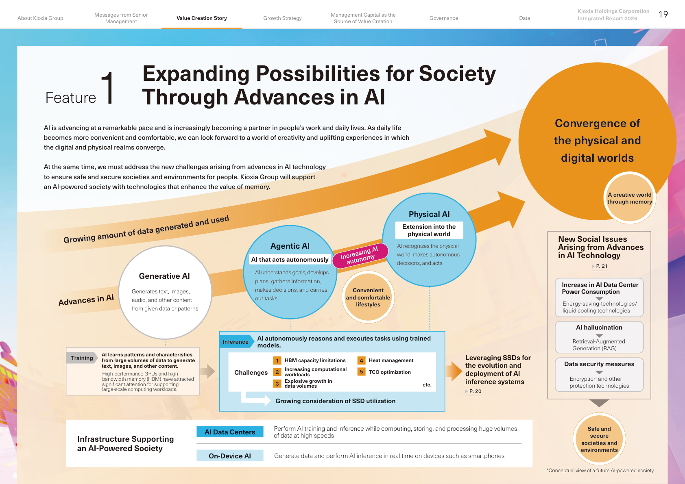
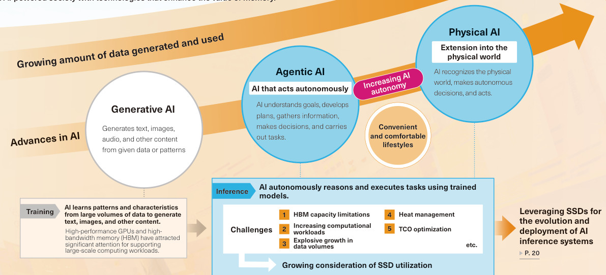
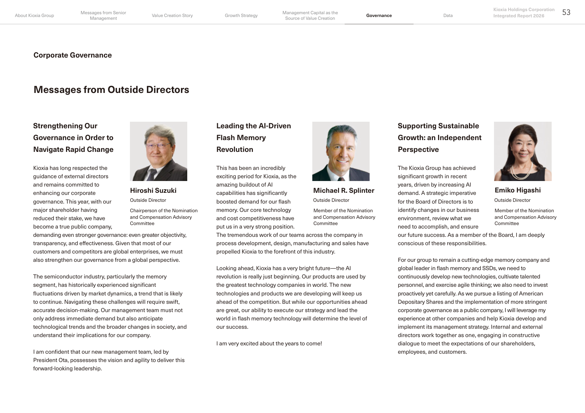

## Document Metadata

- Document ID: a390c9686fc6f881cd80368822826d738e882ecd
- Document Title: Integrated Report 2026
- Document Type: PDF
- Issuing Organization: Kioxia Holdings Corporation
- Publication Date: null
- Reporting Period: FY2025 (April 1, 2025–March 31, 2026); also includes certain information from other periods and recent activities
- Source File: [26_www.kioxia-holdings._Integrated-Report-2026-all-en.pdf](https://github.com/jadennevercode/CJCC-Knowledge-Base/blob/564ab11aa9785e569e3853c8a4d7ce86f88e7535/materials/%E4%B8%AD%E6%B8%B8%EF%BC%9A%E9%87%8D%E7%82%B9%E5%B7%A5%E5%8E%82%E4%B8%8E%E5%88%B6%E9%80%A0%E5%9F%BA%E5%9C%B0/26_www.kioxia-holdings._Integrated-Report-2026-all-en.pdf)

## Structured Content

> 原文件：[26_www.kioxia-holdings._Integrated-Report-2026-all-en.pdf](https://github.com/jadennevercode/CJCC-Knowledge-Base/blob/564ab11aa9785e569e3853c8a4d7ce86f88e7535/materials/%E4%B8%AD%E6%B8%B8%EF%BC%9A%E9%87%8D%E7%82%B9%E5%B7%A5%E5%8E%82%E4%B8%8E%E5%88%B6%E9%80%A0%E5%9F%BA%E5%9C%B0/26_www.kioxia-holdings._Integrated-Report-2026-all-en.pdf)
> 转换方式：Volcengine OCRPdf v3, parse_mode=ocr

[Source Page: 1]

[原始页面图像](../_assets/kioxia_integrated_original/page-1.png)

# Integrated Report 2026

Kioxia Holdings Corporation

Uplifting the world with “memory”

[Source Page: 2]

[原始页面图像](../_assets/kioxia_integrated_original/page-2.png)

### Contents

1. About Kioxia Group: 3 Mission & Vision; 4 A Global Leader in Flash Memory and SSDs; 5 Our History; 6 At a Glance.
2. Messages from Senior Management: 8 Message from the President and Chief Executive Officer; 11 Message from the Executive Chairman; 13 Message from the Chief Financial Officer.
3. Value Creation Story: 16 Value Creation Process; 18 Feature | Social Value Created by Kioxia Group for an AI-Powered Society.
4. Growth Strategy: 23 Market and Social Environment; 25 Our Strengths; 26 Growth Strategy in the AI Inference Era; 27 Business Activities.
5. Management Capital as the Source of Value Creation: 32 Flash Memory Production Scale; 36 Technology; 40 Partnerships; 43 Human Resources.
6. Governance: 48 Corporate Governance; 55 Risk Management and Compliance; 57 Sustainability Management.
7. Data: 62 Financial Highlights; 63 Non-Financial Highlights; 64 Company Outline.

### Key Points of This Report

1. Senior management and executive officers from business, sustainability, and other areas, explain Kioxia Group’s growth strategy and competitive advantages in the AI inference era, and share their respective commitments.
2. The Group’s value creation process is explained from overall and time-based perspectives, clarifying the relationship between the social value the Group creates and its mission and vision.
3. Concise explanations are provided for the Group’s four forms of management capital that serve as the foundation for value creation, its sustainability initiatives, and the governance that supports its corporate activities.

### Editorial Policy

**Scope of the Report:** Kioxia Group (Kioxia Holdings Corporation and consolidated subsidiaries). For matters where the reporting scope differs, the applicable scope is stated separately.

**Reporting Period:** FY2025 (April 1, 2025–March 31, 2026). This report also includes certain information from periods before and after FY2025, as well as recent activities.

**Accounting Standard:** International Financial Reporting Standards (IFRS).

**Reference Guidelines:** The International Integrated Reporting Framework compiled by the IFRS Foundation, the Guidance for Collaborative Value Creation provided by the Ministry of Economy, Trade and Industry, the GRI Standards of the Global Reporting Initiative, and the SASB Standards of the Sustainability Accounting Standards Board, etc.

**Disclaimer Regarding Forward-Looking Statements:** This report contains historical and current information about Kioxia Group, as well as forward-looking statements, including strategies, forecasts, and other projections. These statements are based on information available at the time of the report’s preparation and involve risks and uncertainties. Accordingly, actual business results and financial performance may differ materially from those expressed or implied in the forward-looking statements due to various factors.

**Disclosure System:** Financial Information; Non-financial Information; Strategies; Measures and Results; Integrated Report; Annual Securities Report; Corporate Governance Report; Sustainability Report. See original page for the diagram.

Other company names, product names, and service names in this report may be trademarks of their respective companies.

[Source Page: 3]

[原始页面图像](../_assets/kioxia_integrated_original/page-3.png)

## Section 1: About Kioxia Group

- 3 Mission & Vision
- 4 A Global Leader in Flash Memory and SSDs
- 5 Our History
- 6 At a Glance

[Source Page: 4]

[原始页面图像](../_assets/kioxia_integrated_original/page-4.png)

### Mission & Vision

**Mission**

Uplifting the world with “memory”

By evolving “memory,” we create uplifting experiences and change the world.

**Vision**

With progressive memory technology at the core, we offer products, services, and systems that create choice and define the future.

### Origin of the Name “Kioxia”

The name KIOXIA is a combination of the Japanese word kioku meaning “memory” and the Greek word axia meaning “value.”

The concept of kioku, which underpins our mission and vision, goes beyond the notion of memory as mere data to more broadly encompass experiences, emotions and ideas.

[Source Page: 5]

[原始页面图像](../_assets/kioxia_integrated_original/page-5.png)

### A Global Leader in Flash Memory and SSDs

Flash memory is semiconductor memory that can record and store large amounts of digital data. The most important feature of flash memory is that it is non-volatile, meaning that it retains data even when the power is turned off.

Kioxia invented NAND flash memory in 1987. Building on this technological innovation, in 2007 we announced the world’s first 3D flash memory technology, “BiCS FLASH™.” We also began developing SSDs built with BiCS FLASH™. With nearly 40 years of experience in developing advanced technologies, we have established a position as a leading company in the field of flash memory and SSDs.

Kioxia Group’s flash memory and SSDs are used in digital devices such as smartphones and PCs, as well as in data centers that support cloud services and in other applications, helping to drive the development of the digital society. As AI is increasingly adopted and becomes part of the infrastructure of society, flash memory and SSDs are becoming ever more important as essential foundational technologies.

#### Kioxia Group Products

**Memory:** We offer a diverse lineup of flash memory products to meet a broad range of needs, with applications in smartphones, tablets, and automotive and industrial equipment. We also offer flash memory-based storage-class memory that features low latency and high performance.

**SSDs (Solid State Drives):** We focus on SSD products for AI data centers and enterprise applications. We offer SSD products for a wide range of markets, from client PCs to enterprise servers and cloud data centers, as well as for consumers.

**SD Memory Cards and Other Retail Products:** Our retail lineup includes microSD and SD memory cards for applications such as digital cameras, smartphones, and dash cams, as well as USB flash drives available in a variety of capacities and designs.

[Source Page: 6]

[原始页面图像](../_assets/kioxia_integrated_original/page-6.png)

### Our History

Since inventing NAND flash memory in 1987, Kioxia Group has cultivated flash memory and SSD technology and the people who support it. Building on this foundation, we have pursued our mission as a company supporting society’s digitalization and the advancement of information technology. Kioxia Group has grown since then. It currently employs approximately 15,000 people worldwide and had consolidated revenue exceeding 2 trillion yen in FY2025.

We will continue to pursue advances in technology with the aim of contributing to the sustainable development of an information society underpinned by AI and enriching our lives by promoting more abundant and convenient lifestyles.

- 1987: Invention of NAND flash memory (World’s First).
- 1991: Commercialization of NAND flash memory (World’s First).
- 1992: Establishment of Yokkaichi Plant.
- 2000: Commercialization of SD memory card.
- 2005: Start of 300 mm-wafer fab operation.
- 2007: Announcement of BiCS FLASH™ 3D flash memory technology (World’s First).
- 2008: SATA SSDs with MLC NAND adopted in laptop PCs (World’s First).
- 2015: Commercialization of 48-layer BiCS FLASH™ (World’s First).
- 2017: Establishment of Toshiba Memory Corporation.
- 2018: Spun off from Toshiba Group.
- 2019: March, establishment of Toshiba Memory Holdings Corporation; October, company name changed to Kioxia Holdings Corporation.
- 2020: Acquisition of LITE-ON Technology’s SSD business; start of production at Kitakami Plant.
- 2022: Acquisition of Chubu Toshiba Engineering Corporation.
- 2023: Start of operation of Flagship Building at Yokohama Technology Campus and Shin-Koyasu Technology Front.
- 2024: Listed on the Prime Market of the Tokyo Stock Exchange.
- 2025: Announcement of 10th-generation BiCS FLASH™; revenue 2,337.6 billion yen.

Changes in Society: 1980s, start of digitalization; 1990s, spread of the internet; 2000s–2010s, advancement of digital society; 2020s, development of an AI-powered society.

Note on Revenue: FY2016 and earlier: Revenue of Toshiba Corporation’s memory business; FY2017: Revenue of former Toshiba Memory Corporation; FY2018: The sum of the revenue of former Toshiba Memory Corporation and Toshiba Memory Holdings Corporation. Other revenue bars are not individually labelled.

[Source Page: 7]

[原始页面图像](../_assets/kioxia_integrated_original/page-7.png)

### At a Glance

Kioxia Group will contribute to the development of a digital society underpinned by AI as a leader in flash memory and SSDs, leveraging its technology, production scale, partnerships, and the talent that supports them as sources of competitive strength. In the highly competitive flash memory market, where technological innovation is rapid, we will capture growth opportunities and strive to enhance corporate value over the medium to long term.

#### Flash Memory Production Scale

**Revenue:** 2,337.6 billion yen (FY2025, consolidated basis). Revenue and operating profit reached record highs as Kioxia Group captured expanding demand for flash memory driven by AI applications and enterprise data centers.

**Global share of flash memory production volume on a storage capacity basis:** 28% (FY2025). Kioxia Group, together with its manufacturing joint venture with Sandisk Group, accounts for one of the world’s largest shares of global production volume. Source: TechInsights Inc. NAND Market Report Q1 2026.

**Smart Factories:** Coordination between the Yokkaichi Plant and the Kitakami Plant. The two plants coordinate closely using AI and big data, achieving high production efficiency to meet growing demand for flash memory.

#### Partnerships

**Global network:** Business operations in 9 countries/regions. We have sales and customer support centers in Japan, the United States, Europe, and Asia. Our bases in Japan and overseas work closely together to deliver products that meet market needs.

**Overseas sales ratio:** 88.7% (FY2025). Kioxia Group has established strong relationships with leading companies in the data center, smartphone, and PC fields, as well as with business partners around the world.

**Strong Partnerships with customers, R&D partners, and suppliers:** We will further strengthen our partnerships, develop products and services that anticipate the needs of society, ensure a stable supply of high-quality products, and continuously deliver value to society.

#### Technology

**R&D expenses:** 141.1 billion yen (FY2025). We are strengthening advanced development for applications including AI systems to maintain our technology leadership.

**Selected for Clarivate Top 100 Global Innovators 2026:** Recognized for its continuous intellectual property (IP) initiatives, Kioxia Group has been named to the list for five consecutive years, placing it among the world’s most innovative companies and organizations.

**Number of registered patents:** Approx. 15,000 (As of December 2025, Kioxia Corporation). The Group focuses on strengthening its IP portfolio and IP intelligence capabilities. We also place importance on filing patent applications overseas, where many of our customers and competitors are located.

#### Human Resources

**Number of employees:** 15,218 (As of March 31, 2026, consolidated). Employees from various backgrounds leverage their individual strengths and thrive.

**New graduate recruits:** 476 (Joining Kioxia Corporation and Group companies in Japan on April 1, 2026). We actively recruit diverse talent and focus on employee development in an environment that enables each individual to fully demonstrate their abilities.

**Ratio of mid-career recruits:** 63.6% (FY2025, Kioxia Corporation, share of total recruits). We are focused on creating an environment that welcomes diverse knowledge and fosters innovative ideas.

[Source Page: 8]

[原始页面图像](../_assets/kioxia_integrated_original/page-8.png)

## Section 2: Messages from Senior Management

- 8 Message from the President and Chief Executive Officer
- 11 Message from the Executive Chairman
- 13 Message from the Chief Financial Officer

[Source Page: 9]

[原始页面图像](../_assets/kioxia_integrated_original/page-9.png)

### Message from the President and Chief Executive Officer

Capturing Growth Opportunities in the Era of AI to Continuously Create Value Through the Power of Memory

Hiroo Ota

Representative Director President and Chief Executive Officer Kioxia Holdings Corporation

### Seize the Moment: Turning Change into the Catalyst for Growth

I assumed the role of President and Chief Executive Officer in April 2026. Since joining Toshiba, Kioxia’s predecessor, in 1985, I have built my career in applied technology, within the semiconductor memory division. Since 2001, my focus has been on market development for our NAND business. By standing at the forefront of technology marketing and engaging in direct dialogue with our customers, I have dedicated myself to driving our business expansion.

As President, my primary focus is to continuously put into practice the Kioxia Group’s mission of “uplifting the world with ‘memory.’” We aim to enhance our corporate value by helping advance our AI-driven digital society and resolve increasingly complex and sophisticated social issues through our technological innovations.

The flash memory market has always been defined by rapid technological progress and dynamic changes in market conditions and the competitive landscape. To succeed, we must accurately anticipate these changes and translate them into decisive action. A guiding principle for me is to “seize the moment.” We must never let an inflection point pass us by. By swiftly identifying customer challenges and market trends, and rallying our technology, product, manufacturing, and sales capabilities, we transform shifts into tangible value. It is the accumulation of these relentless efforts that has supported the growth of our Group.

[Source Page: 10]

[原始页面图像](../_assets/kioxia_integrated_original/page-10.png)

### Message from the President and Chief Executive Officer

### Becoming a Go-to Memory Storage Company

The applications for NAND flash memory have expanded across smartphones, PCs, automotive systems, and data centers, supporting our digital society, and making everyday life more convenient and enriching. As AI evolves from generative and agentic models to physical AI, the demand for memory storage capable of rapidly and efficiently processing massive volumes of data is growing exponentially.

Our roots trace back to NAND flash memory, invented by our predecessor, Toshiba, in 1987. Since then, we have proudly led the market, driven by our core strengths: technology development capabilities, manufacturing scale, and strong customer engagement. Moving forward, we will sharpen these competitive advantages, anticipate evolving market needs, and expand the potential of the memory solutions that empower more effective data utilization. Our ambition is clear: to make Kioxia the go-to memory storage company for customers and partners.

### Capturing AI Demand to Drive Business Growth

Our financial performance in fiscal 2025 achieved record-high revenue and profit. This success was driven by growing demand for memory solutions fueled by data centers, particularly for generative AI applications, alongside favorable pricing and increased shipment volumes.

As AI transitions from training to inference, we are entering an era where data is utilized in real-time across a broad range of scenarios. Hyperscaler investments in AI data centers remain robust, and demand for enterprise and data center SSDs is poised for continued growth. At the same time, foundational markets like smartphones and PCs remain vital. Rather than over-indexing on specific applications, we will take a holistic view of market trends, ensure stable yet agile production, and meet the soaring demand for AI infrastructure.

### Driving Competitiveness Through Technology, Scale, and Customer Engagement

The foundation of Kioxia Group’s competitiveness rests on three pillars: our technology development capabilities, manufacturing scale, and customer engagement. As a provider of flash memory and SSDs, technology development is our most critical driver. We are committed to continuously pioneering cutting-edge technologies and products that deliver superior value to our customers and the market.

While we operate on a global scale, our major production bases remain in Japan. Our manufacturing foundation—anchored by the Yokkaichi Plant and the Kitakami Plant—combined with robust partnerships with leading global companies, constitutes a compelling operational strength. Looking ahead, we will deepen collaboration across our Memory and SSD Divisions, integrating Research and Development, Manufacturing, and Sales. By strengthening this end-to-end system, we can swiftly deliver products that anticipate and meet dynamic market needs.

As AI evolves, so do data center architectures. To rapidly and efficiently process massive data sets, storage performance must continuously advance. In lockstep with our partners, Kioxia Group will refine the storage technologies enabling this AI paradigm shift and strategically execute growth investments. We are positioned to capture future market opportunities and deliver highly competitive solutions.

[Source Page: 11]

[原始页面图像](../_assets/kioxia_integrated_original/page-11.png)

### Message from the President and Chief Executive Officer

### Accelerating Value Creation Through Our People and Teamwork

For Kioxia Group to secure sustainable growth, the people who drive our technology development, manufacturing, and customer engagement are our most invaluable asset. We are united by a strong team spirit inherited from our predecessors. Our history proves that close collaboration across these core functions is what built us into an industry leader. As the business environment accelerates, we also recognize that increasing our speed-to-market—from initial development to final delivery—is a critical imperative.

One of my most important duties as CEO is to strengthen the teamwork we have cultivated, ensuring our entire organization is aligned around a shared vision and embraces challenges, even in a continuously evolving environment. To maximize our organizational strength, every employee must strive to deliver value for their colleagues, continuously reinforcing a culture of mutual trust.

I constantly encourage our teams to keep their “antenna high”—staying attuned to the evolving needs of our customers and society. Fostering a mindset that takes ownership of technological evolution, market shifts, and social issues, while driving cross-departmental collaboration, is the catalyst that turns change into growth.

I firmly believe that aligning the individual ambitions of our employees with tangible business results—and further strengthening our collective teamwork—will be a driving force behind the Kioxia Group’s value creation in the AI era.

### Contributing to a Sustainable Digital Society

As a semiconductor memory provider, we aim to advance a sustainable society through our products and technologies. While the increasing capacity and performance of our flash memory and SSDs support growth across various industries, the rising power consumption of data centers has become a significant global challenge. Kioxia Group views the energy efficiency of our products as a critical priority, and we will aggressively pursue technological developments that contribute to energy conservation.

Addressing climate change is also a top management priority. Kioxia Group has committed to achieving net-zero greenhouse gas emissions by fiscal 2050. We are actively reducing our environmental footprint by implementing emission reduction measures in our manufacturing processes, advancing energy conservation, and adopting renewable energy sources. Furthermore, by building a robust supply chain with our partners and maintaining a resilient production system, we will achieve both sustainable business growth and meaningful societal impact.

### Enhancing Corporate Value Through Transparent Management and Dialogue

To realize sustainable growth and enhance our corporate value, effective and transparent governance is an indispensable foundation. Our management team is committed to maintaining open and diligent communication, while executing our strategies with agility and speed. We deeply value dialogue with our stakeholders—including shareholders, investors, customers, business partners, and local communities—and we will actively incorporate their insights into our management decisions.

This Integrated Report is a vital tool for sharing our approach to value creation, our strategic vision, and our ongoing initiatives, while also serving as a bridge to deepen our dialogue with our stakeholders, including you. The Kioxia Group views the paradigm shifts of the AI era not as challenges, but as profound opportunities for growth. Through the power of memory, we will continue to make society more convenient, enriching, and uplifting. We remain dedicated to transforming ourselves, exceeding stakeholder expectations, and maintaining our position as a highly trusted company.

[Source Page: 12]

[原始页面图像](../_assets/kioxia_integrated_original/page-12.png)

### Message from the Executive Chairman

Pioneering the AI Frontier: Kioxia’s Heritage of Innovation and Sustainable Growth

Stacy J. Smith

Director Executive Chairman Kioxia Holdings Corporation

### Reimagining Memory for the AI Age

Today, our society stands at the threshold of a period of profound transformation. At the heart of advances in artificial intelligence lies semiconductor technology. Semiconductors are no longer merely electronic components; they have become critical infrastructure that underpins economic growth, industrial innovation, and societal progress.

Looking ahead, the widespread adoption of AI inference will drive unprecedented growth in computing power and data volumes, further increasing demand for high-performance semiconductor solutions that balance performance with power consumption. At the same time, our industry is expected to contribute to a more sustainable future by reducing environmental impact across the value chain. Kioxia supports this goal through multiple avenues, including energy-efficient manufacturing, optimized production processes, and flash memory technologies engineered for lower power consumption. At hyperscale, these innovations can significantly enhance the energy efficiency of AI infrastructure, enabling more sustainable operations for our customers.

AI is only as powerful as the data behind it. Handling data at scale requires advanced memory solutions. Flash memory is the indispensable foundation of the AI age, enabling the storage, accessibility, and intelligence that will shape our future for decades to come.

[Source Page: 13]

[原始页面图像](../_assets/kioxia_integrated_original/page-13.png)

### Message from the Executive Chairman

At the heart of the AI evolution, the memory hierarchy itself is being fundamentally redefined. Flash memory is evolving beyond its traditional role as a data storage medium to become a critical enabler of system performance, optimizing data movement and off-loading computational burdens across AI infrastructure.

In the era of AI inference, data is becoming essential infrastructure for society, and flash memory provides the foundation needed to store and use it efficiently. As data volume continues to grow rapidly, meeting this unprecedented demand for AI infrastructure requires partners who can combine cutting-edge technology with unmatched manufacturing scale and supply chain reliability.

### Innovating for the Future

Since inventing NAND flash memory in 1987, Kioxia has continued to innovate with a long-term vision and an unwavering commitment to creating value for society through technology. Our breakthrough in flash memory has helped transform industries, enabling the rise and evolution of smartphones, mobile computing, enterprise systems, and hyperscale data centers. This legacy is built on a proven track record of relentlessly improving our flash memory technologies—a foundation that enables us to sustain our technological leadership today and well into the future. We advance this leadership through industry-defining advancements applied to BiCS FLASH™ technology, including groundbreaking new architectures such as CBA (CMOS Bonded to Array) technology, as well as next-generation SSD solutions.

While our history of delivering many world firsts reflects our technological leadership, it is only one of our strengths. Over the decades, we have reinforced this foundation with unmatched manufacturing scale, a deep commitment to customer-centricity and the exceptional talent of our dedicated employees around the world.

These strengths have enabled us to navigate industry cycles while continuing to invest in advanced technologies, manufacturing capabilities, and human talent. We believe that maintaining a long-term view and investing consistently through both favorable and challenging market conditions are essential to sustaining innovation and strengthening competitiveness.

Today, the rapid adoption of AI for inference is transforming industries and accelerating the growth of data at an unprecedented scale. As a result, high-capacity, high-performance, and energy- efficient memory and storage solutions are becoming increasingly critical to the digital economy. We believe flash memory will play an even more central role in the AI era, not only as a storage technology but also as a key enabler of system performance, efficiency, and innovation.

Building on our heritage of innovation, Kioxia will continue working closely with customers and partners to address the evolving needs of society. By leveraging our technology leadership, manufacturing scale, strategic partnerships, and talented workforce, we aim to drive sustainable growth, contribute to the advancement of our digital society, and deliver long-term value for shareholders and stakeholders.

### New Leadership Driving Our Shared Future

The formation of our new management team represents an important step in Kioxia’s evolution and prepares us for the next stage of growth. What gives me great confidence is the depth of experience and diversity of perspectives this team brings.

President Ota has built his career across technology development, business leadership, and corporate management, gaining a comprehensive understanding of both our industry and our customers’ needs. His leadership, combined with the expertise of the broader management team, provides a strong foundation for driving innovation, strengthening competitiveness, and delivering sustainable growth.

Kioxia has always been defined by a pioneering spirit. Since the invention of NAND flash memory, we have continuously pushed the boundaries of innovation and contributed to the advancement of the digital society. Today, we stand at the dawn of another transformational era. The rapid adoption of AI is reshaping industries, accelerating data creation, and increasing the strategic importance of flash memory.

In this new environment, our ambition is clear: to make Kioxia the go-to memory storage company for customers and partners. Achieving this vision requires technological leadership, unmatched manufacturing scale and supply chain reliability, as well as excellence in product quality, customer trust, and speed of execution. Fundamentally, our goal is to create long-term value by delivering innovative, energy-efficient technologies that address society’s evolving data needs and enable a sustainable future where technological progress and environmental responsibility go hand in hand.

With a highly capable management team, a world-class technology portfolio, unmatched manufacturing scale, and a clear strategic direction, I am confident that Kioxia is well positioned to capture the opportunities of the AI era and deliver sustainable growth for our shareholders for decades to come.

[Source Page: 14]

[原始页面图像](../_assets/kioxia_integrated_original/page-14.png)

### Message from the Chief Financial Officer

The Solid Financial Foundations That Will Deliver Sustainable Growth and Profit to Enhance Shareholder Value

Yoshihiko Kawamura

Executive Vice President and Executive Officer Chief Financial Officer Kioxia Holdings Corporation

### Financial Strategies That Drive Sustainable Growth and Corporate Value

I assumed the role of Chief Financial Officer in April 2026. My aim is to formulate financial strategies that will maximize the value of the Kioxia Group as a whole and ensure sustainable growth. Instead of focusing solely on the short-term, I devise medium- to long-term strategies that leverage our unique business strengths. Linking these perspectives enhances our ability to execute these strategies.

### Consecutive Years of Record Financial Performance Leveraging AI Demand as a Core Growth Driver to Exceed Capital Market Expectations

In fiscal 2025, our consolidated revenue was 2,337.6 billion yen, with non-GAAP operating profit of 876.2 billion yen, the second consecutive year of record highs for both metrics. Growing demand from the AI inference market has significantly boosted our financial performance and is driving expectations for further growth.

Following our strong performance, expectations for our growth continue to rise. There is keen interest among investors and analysts in the potential contribution of long-term agreements (LTAs) with our customers, in the competitiveness of our technology and products with BiCS FLASH™ at the core, in our financial strategy, and in shareholder returns. We will be sure to clearly communicate this potential to the markets and ensure it is firmly reflected in our management strategy.

### Strategic Portfolio Transformation and Accelerated Investment Execution

Concentrating on High-Growth Areas Helps Ensure High-Quality Profit

Within the growing flash memory market, demand is shifting from the consumer sector to the industrial and enterprise sectors. Driven by investment in hyperscale infrastructure, demand for AI and data centers remains exceptionally robust. Few companies globally can provide a stable supply of flash memory, so we anticipate this positive trend will continue through 2027.

Kioxia Group is seizing the opportunities this structural shift provides. We are shifting our portfolio mix, aiming for data center and enterprise business to account for at least 60% of our total sales. We will maintain our focus on the smartphone and PC sectors—our bedrock—while making inroads into the edge AI market. Furthermore, we will leverage LTAs to increase the predictability of our revenues and stabilize our profits.

[Source Page: 15]

[原始页面图像](../_assets/kioxia_integrated_original/page-15.png)

### Message from the Chief Financial Officer

While market cycles will persist, we believe the AI-driven flash memory growth curve will flatten significantly, making cyclical troughs much shallower. This stabilization will allow us to make capital investment and invest in R&D and the human capital we need to exploit profitable high- growth business areas.

Beyond mere growth, Kioxia Group is pursuing the kinds of high-quality profit that lead to sustainable growth by deploying technology when launching new products, and by leveraging the potential of new markets. Our 10th-generation BiCS FLASH™, which began sample shipments from the Kitakami Plant Fab2 this past July, exemplifies this commitment. Designed to address AI demand with high capacity, high performance, and low power consumption, it demonstrates how we translate our technological advantages into competitive product strength. Our products’ technological superiority directly boosts our competitiveness; we therefore plan to invest 230 billion yen annually in R&D, an increase of over 60% from fiscal 2025, in order to maintain our technological leadership.

A company can continue to grow in any environment as long as its talent pool is deep. We will accelerate investment in our human capital, focusing on the recruitment of a diverse range of skills and the specialists who underpin our technological development.

### Capital Strategy for Accelerating Growth

### Enhancing Return on Invested Capital (ROIC) and Maximizing Free Cash Flow

We devise our investment strategy by formulating our long-term vision and working back from that. We will continue to observe strict investment criteria as we transition to a structurally high-ROIC model, aiming for industry-leading levels of capital efficiency.

As a listed company that engages with the capital markets, we prioritize the maximization of free cash flow, a key indicator of profitability and an important basis when deciding which investments and financing methods are most strategically aligned. We will enhance our earning power and prioritize investments that generate growth, while strengthening our finances and boosting shareholder returns. This will allow us to capture growing markets and sustainably enhance our corporate value.

### Reflecting Feedback from the Capital Markets in Our Business Strategy

I strongly feel the rising expectations of the capital markets. My most important responsibility as CFO is to engage proactively with market participants and to reflect our dialogue with investors, financial analysts and shareholders in our business strategy. We will wield our world-class technological capabilities and talent to enhance our corporate value sustainably, building a business model that ensures the quality of our profitability.

Note: As of Investor Day 2026 (June 2026)

Enhancing profitability quality through capital expenditure, R&D, and human capital investments that support high-growth, high-margin sectors:

- Market / Portfolio: Percentage of overall revenue generated by our data center business: over 60% (~FY28).
- Technology Leadership / R&D: focused on advanced development; over 60% (vs. FY25).
- Capital Expenditure: Efficient Capital Expenditure, 470 billion yen/year (FY26–FY28 Average).
- Cost Competitiveness / Migration: Percentage of overall product base accounted for by BiCS FLASH™ Generation 8: over 80% (end of FY26, production GB base).

Balancing growth investments with financial strength to drive sustainable value creation (billions of yen):

Assets, FY25: total 3,690.1; Cash and Cash Equivalents 470.7; PP&E 1,055.3. Illustrative FY26 trajectory based on Q1 run-rate: total assets 2x+ growth; liquidity for future Capex and R&D; Capex for next-generation BiCS FLASH™. Enhancing Asset Efficiency: FY26 Capex ¥450 billion (+60% YoY, FY26 Q1 plan); FCF maximization.

Liabilities and Equity, FY25: total 3,690.1; Corporate Bonds and Borrowings 1,047.6; Equity 1,399.1; Equity Ratio 38%. Illustrative FY26 trajectory based on Q1 run-rate: 550.0; Equity Ratio High 50%s. Transformational Financial Strengthening: FY26Q1 achieving net cash position. [OCR_UNCERTAIN] The 550.0 bar segment is not further labelled in the source.

Note: As of Investor Day 2026 (June 2026).

[Source Page: 16]

[原始页面图像](../_assets/kioxia_integrated_original/page-16.png)

## Section 3: Value Creation Story

- 16 Value Creation Process
- 18 Feature | Social Value Created by Kioxia Group for an AI-Powered Society

[Source Page: 17]

[原始页面图像](../_assets/kioxia_integrated_original/page-17.png)

### Value Creation Process

Based on its mission of “uplifting the world with ‘memory,’” Kioxia Group contributes to society by providing products and services, and building infrastructure for data utilization together with its partners. Demand for flash memory and SSDs is expected to continue growing as use of AI inference rapidly expands. In this market environment, we will pursue a growth strategy that leverages our management capital and industry-leading strengths, which are the source of our competitiveness, with the aim of achieving sustainable growth through our business activities and enhancing corporate value.

**Kioxia Group’s Mission:** Uplifting the world with “memory”.

**Market and Social Environment:** Expansion of the flash memory and SSD market driven by rapid advances in AI. Increasingly sophisticated and diverse requirements driven by the growing use of AI inference; growing social issues such as climate change.

**Inputs / Growth Strategy:** Strategically shift business portfolio toward the AI infrastructure market; strengthen capital investment and cost competitiveness to capture opportunities for sustainable growth; invest in and accelerate R&D to firmly maintain technology leadership.

**Management Capital:** Source of competitiveness for medium- to long-term growth: flash memory production scale, technology, partnerships, human resources.

**Business Activities:** Memory business; provision of high-capacity, high-performance, and environmentally conscious flash memory and SSD products. Kioxia Group’s Strengths: strong position in high-growth markets driven by AI; technological competitiveness for leading the AI inference era; cost competitiveness and a stable supply enabled by production scale and efficiency.

**Governance:** Corporate governance; risk management and compliance; sustainability management.

**Outputs/Outcomes / Social Value Created with Partners:** Expanding the potential of products and services through memory technology and creating value for society together with our partners.

**Value Provided to Customers:** Contributing to customers’ value creation through the provision of products and services based on cutting-edge memory technology.

**Enhancing Corporate Value:** Financial—revenue 2,337.6 billion yen; non-GAAP operating profit 876.2 billion yen (FY2025, consolidated basis). Non-Financial—results of activities based on Sustainability Materiality, including reduction of greenhouse gas emissions and improvement in product power efficiency.

**Our Aspiration:** Contributing to society by providing a foundation for data utilization; building a creative world through memory technology; contributing to convenient and comfortable lifestyles; creating safe and secure societies and environments. Sustainable growth.

[Source Page: 18]

[原始页面图像](../_assets/kioxia_integrated_original/page-18.png)

### Long-Term Strategy for Increasing Corporate Value

To achieve sustainable growth and enhance corporate value, we will anticipate changes in the needs of society and our customers and steadily implement our growth strategy from a long-term perspective. We will also enhance our ability to execute this strategy by strengthening our management capital.

**Past:** Track record of creating world firsts; track record of sustainable growth amid market changes.

**Sustainable Growth Strategy:** Expansion of the flash memory and SSD market driven by rapid advances in AI. Strategic shift in business portfolio; strengthen capital investment and cost competitiveness; invest in and accelerate R&D. Our strengths supporting our growth strategy. Implement inorganic investments; turning R&D results into businesses.

**Governance:** Resource allocation and risk management.

**Enhancement of Effectiveness:** Target best-in-class ROIC among manufacturing companies. Drive strategy execution by strengthening management capital. Initiatives to strengthen management capital and KPI-based progress management. Management Capital: flash memory production scale, technology, partnerships, human resources.

**Changes in society:** Energy management as the foundation in many areas; diversification of AI applications (coexistence of people and AI); increasing importance of cybersecurity.

Through continued innovation in memory technology, we will evolve the foundations of a data-driven society and pioneer a creative future.

As the inventor of flash memory,* Kioxia will contribute to society together with its partners:

- Realize a creative society in which individuals can make the most of their ideas and experiences through memory technology.
- Contribute to the development of data infrastructure for the general public, as flash memory has contributed to the development of today’s society.
- Contribute to a sustainable society that accommodates growing data demand while reducing environmental impact by pursuing lower power consumption and efficient use of resources.

*Kioxia invented NAND flash memory in 1987.

Past → Present → Future. Kioxia Group’s Mission: Uplifting the world with “memory”.

[Source Page: 19]

[原始页面图像](../_assets/kioxia_integrated_original/page-19.png)

### Feature | Social Value Created by Kioxia Group for an AI-Powered Society

Uplifting the world with “memory”

1. Expanding Possibilities for Society Through Advances in AI
2. AI Infrastructure: Kioxia Group Technologies Supporting AI Data Centers
3. Using Memory Technology to Address Social Issues Arising from Technological Advances

[Source Page: 20]

## Feature 1｜Expanding Possibilities for Society Through Advances in AI

AI is advancing at a remarkable pace and is increasingly becoming a partner in people’s work and daily lives. As daily life becomes more convenient and comfortable, we can look forward to a world of creativity and uplifting experiences in which the digital and physical realms converge.

At the same time, we must address the new challenges arising from advances in AI technology to ensure safe and secure societies and environments for people. Kioxia Group will support an AI-powered society with technologies that enhance the value of memory.

### Advances in AI

- Generative AI: Generates text, images, audio, and other content from given data or patterns.
- Agentic AI: AI that acts autonomously. AI understands goals, develops plans, gathers information, makes decisions, and carries out tasks.
- Physical AI: Extension into the physical world. AI recognizes the physical world, makes autonomous decisions, and acts.

The figure also labels “Growing amount of data generated and used,” “Increasing AI autonomy,” “Convenient and comfortable lifestyles,” “Convergence of the physical and digital worlds,” “A creative world through memory,” and “Safe and secure societies and environments.”

### Training and Inference

Training: AI learns patterns and characteristics from large volumes of data to generate text, images, and other content. High-performance GPUs and high-bandwidth memory (HBM) have attracted significant attention for supporting large-scale computing workloads.

Inference: AI autonomously reasons and executes tasks using trained models.

Challenges:

1. HBM capacity limitations
2. Increasing computational workloads
3. Explosive growth in data volumes
4. Heat management
5. TCO optimization

The figure also labels “Growing consideration of SSD utilization” and “Leveraging SSDs for the evolution and deployment of AI inference systems” (P. 20).

### New Social Issues Arising from Advances in AI Technology

- Increase in AI Data Center Power Consumption: Energy-saving technologies/liquid cooling technologies.
- AI hallucination: Retrieval-Augmented Generation (RAG).
- Data security measures: Encryption and other protection technologies.

The original figure references P. 21.

### Infrastructure Supporting an AI-Powered Society

- AI Data Centers: Perform AI training and inference while computing, storing, and processing huge volumes of data at high speeds.
- On-Device AI: Generate data and perform AI inference in real time on devices such as smartphones.

*Conceptual view of a future AI-powered society.

[Source Page: 21]

[原始页面图像](../_assets/kioxia_integrated_original/page-21.png)

### Feature 2: AI Infrastructure: Kioxia Group Technologies Supporting AI Data Centers

The emergence of autonomous AI, such as agentic AI and physical AI, is driving exponential growth in inference workloads. Kioxia Group will support AI data infrastructure with its flash memory and SSD technologies.

**AI Data Center (Overview):** GPU servers (Computation): perform AI training and inference. High-speed storage (Memory): store and supply data and models. Network (Communication); power supply equipment; cooling equipment.

**Challenges in the Evolution and Deployment of AI Inference Systems:** 1 HBM capacity limitations; 2 increasing computational workloads; 3 explosive growth in data volumes; 4 heat management; 5 TCO (Total Cost of Ownership) optimization.

**Expanding SSD Adoption and the Value Created by Kioxia Group Technologies:** SSDs are evolving from data storage devices into core infrastructure that enhances AI performance and efficiency. Kioxia Group supports the evolution of AI with products and solutions that address diverse needs, powered by flash memory technologies delivering high capacity, high performance, and low power consumption.

1. High-Performance SSDs: Resolving HBM capacity bottlenecks.
2. High-Bandwidth SSDs: Efficient storage of GPU computation results and more efficient data transfer.
3. High-Capacity SSDs: Storing growing volumes of data as inference complexity increases. KIOXIA AiSAQ™: Improving AI response accuracy by using SSDs in RAG; Open-Source Vector Search Software.
4. Certain SSD products support liquid cooling, which is increasingly being adopted in AI data centers as an alternative to air cooling, enabling efficient heat dissipation in high-performance AI server environments.
5. Kioxia Group provides SSDs and solutions for diverse next-generation AI infrastructure applications, helping to optimize TCO by reducing computational workloads, improving power efficiency, and saving space.

Contributing to the Evolution of AI; Expanding the Value of Memory.

[Source Page: 22]

[原始页面图像](../_assets/kioxia_integrated_original/page-22.png)

### Feature 3: Using Memory Technology to Address Social Issues Arising from Technological Advances

While advances in AI are making people’s lives more convenient, they are also giving rise to new challenges, including technical issues and increasing power consumption. Kioxia Group is supporting the growth of a sustainable AI-powered society by delivering added value through flash memory and SSDs that achieve higher capacity, higher performance, and lower power consumption.

#### Social Issues and Kioxia Group Technologies Helping to Address Social Issues

**Increase in AI Data Center Power Consumption:** Power consumption is increasing as the number of AI data centers grows.

**Improving Product Power Efficiency:** We developed the KIOXIA CM10 Series of enterprise SSDs equipped with 10th-generation BiCS FLASH™ TLC flash memory, achieving significant improvements in power efficiency and cooling flexibility, including support for direct liquid cooling.

**Contributing to Greater Energy Efficiency in Data Centers:** We are enabling next-generation green data centers by developing high-bandwidth optical SSDs that optimize computing performance and improve power efficiency. P. 42.

**AI Hallucination:** A phenomenon in which AI generates plausible but factually incorrect information.

**Contribution to Advances in Retrieval-Augmented Generation (RAG) Technology:** RAG creates dedicated databases from the vast amounts of data held by individual companies and organizations, enabling more accurate and up-to-date responses. The ability to utilize non-public information within an organization helps reduce hallucinations. Kioxia Group contributes to advances in RAG technology through the integration of SSDs and software technologies.

**Cyber Security:** As data use becomes more advanced, information security is becoming an increasingly important issue.

**SSD Security and Encryption Options for Diverse Needs:** We are addressing the need to protect personal and business data through products such as enterprise-, data center-, and client SSDs.

Note: Optional security feature-compliant drives are not available in all countries due to export and local regulations.

[Source Page: 23]

[原始页面图像](../_assets/kioxia_integrated_original/page-23.png)

## Section 4: Growth Strategy

- 23 Market and Social Environment
- 25 Our Strengths
- 26 Growth Strategy in the AI Inference Era
- 27 Business Activities

[Source Page: 24]

[原始页面图像](../_assets/kioxia_integrated_original/page-24.png)

### Market and Social Environment

#### Expansion of the Flash Memory Market Driven by Rapid Advances in AI

**Increase in Worldwide Digital Data Generation**

With the advancement of a digital society driven by AI, the volume of digital data continues to grow. The total volume of data generated worldwide is projected to reach 718.5 zettabytes (ZB) annually in 2030.

Global Data Generation: 2030 forecast, 718.5 ZB. A zettabyte (ZB) is 10²¹ bytes, and is a unit that indicates the volume of data. Source: IDC, Worldwide IDC Global DataSphere Forecast, 2025–2030, #US53425426. Individual bars for 2025–2029 are not numerically labelled.

**Soaring Flash Memory Demand Driven by AI Inference**

The main applications in the flash memory market are data centers, smartphones, and PCs. We believe that the market will continue to grow through a virtuous cycle of increasing data volumes, driven by expanding AI server storage capacity, and technological advances in flash memory.

The NAND flash memory market is expected to grow at a compound annual growth rate (CAGR) of 22% from 2025 to 2028. Compared with the overall volume of data generated, approximately 0.25% is recorded on flash memory.

Focusing on demand for flash memory in data centers, the market is expected to grow at a CAGR of 46% from 2025 to 2028. Within this market, AI inference applications are projected to grow at a CAGR of 86%, making them a major driver of flash memory market growth.

Flash Memory Market (EB): 2025, 997; 2028, 1,807; CAGR 22%. Data center segment: 2025, 295; 2028, 909; CAGR 46%. PC/Smartphone market: 8%; same level or slight decrease. Data Center Flash Memory Market: inference 86%, training 16%, traditional 16%. Intermediate bars are not numerically labelled.

*An exabyte (EB) is 10¹⁸ bytes. Source: TechInsights Inc., NAND Market Report Q2, 2026. As of Investor Day 2026 (June 2026).

[Source Page: 25]

[原始页面图像](../_assets/kioxia_integrated_original/page-25.png)

### Market and Social Environment

#### Changing Role of Storage in the AI Ecosystem

**Rapid Increase in Inference Workload**

Since the second half of 2025, AI has been shifting from a focus on training to inference for real- world applications. Moreover, AI is evolving from a tool used by people, such as generative AI, into an autonomous agent, typified by agentic and physical AI, that uses a wide range of data to achieve its objectives. Explosive growth in the volume of information processing required for AI inference is driving rapid evolution in technologies such as Retrieval-Augmented Generation (RAG), which leverages external knowledge, and key-value (KV) caching, which stores past inference results.

**Storage as Key Determinant of AI System Performance**

Traditionally, storage in AI systems has functioned primarily as a storage repository for large volumes of training data and computation results. As AI use expands, the importance of high-speed, energy-efficient storage is increasing. Furthermore, rapid advances in AI inference are prompting discussion across the AI ecosystem about redefining AI systems as a whole. Within this context, storage is expanding beyond its traditional role as a data repository to become a core component that, alongside GPUs and HBM, plays a key role in determining the performance of AI systems.

**New Uses for SSDs Created by AI Inference Systems (Conceptual Illustration):** Inference GPU server; improved inference efficiency (KV cache), storage of previous computation results; complementing HBM capacity; high-bandwidth SSDs for KV cache; high-performance SSDs. RAG server: improving answer accuracy by retaining knowledge; database generation and database retrieval; high-capacity SSDs. Storage server: storing the rapidly growing volumes of generated output; high-capacity SSDs.

#### Increase in Electricity Consumption by Data Centers

As data centers proliferate globally with the advance of AI, their growing electricity consumption is becoming a social issue.

According to the Energy and AI report released by the International Energy Agency (IEA) in April 2025, electricity consumption by data centers worldwide is projected to double from 2024 to 2030 to approximately 945 TWh, slightly exceeding Japan’s current total electricity consumption. The report also notes that the rise of AI is accelerating the adoption of high-performance, high-speed servers, increasing the power density of data centers.

Kioxia Group is working to reduce the power consumption and increase the capacity of flash memory and SSDs, thereby contributing to the development of a sustainable society underpinned by AI.

Global Data Center Electricity Consumption in the Base Case, 2020–2030 (Historical and Forecast), TWh: accelerated servers; conventional servers; other IT equipment; cooling; other infrastructure. Chart axis 0–1,000 TWh; component values are not individually labelled. Source: IEA, Energy and AI, 2025, https://www.iea.org/reports/energy-and-ai/, License: CC BY 4.0.

[Source Page: 26]

[原始页面图像](../_assets/kioxia_integrated_original/page-26.png)

### Our Strengths

In the rapidly growing storage market driven by the spread of AI, Kioxia Group has secured a strong position by building solid relationships with customers and suppliers. For nearly 40 years since the invention of NAND flash memory, we have cultivated industry-leading technological competitiveness. By supplying products from cost-competitive plants, we aim to achieve sustainable growth and enhance corporate value.

#### Strong Position in High-Growth Markets Driven by AI

**Driving Innovation Through Co-Creation with Key Players in the AI Ecosystem**

As a specialist in flash memory and SSDs, which play a central role in next-generation AI systems, we are working with partners to lead the AI paradigm shift through a range of technologies and solutions.

**Network for Capturing Business Opportunities**

Through our global sales, technology, and support network, we will work with customers to capture business opportunities as the use of AI inference expands, thereby growing our business.

**Strong Relationships with Leading Global Companies**

We do business with global industry leaders in smartphones, PCs, and data centers, and have built strong relationships with many customers.

Relevant Management Capital: Partnerships, P. 40; Human Resources, P. 43.

#### Technological Competitiveness for Leading the AI Inference Era

**Pursuit of High-Capacity, High-Performance, and Low-Power-Consumption Flash Memory Technologies**

We will drive the development of competitive BiCS FLASH™ 3D flash memory, delivering added value through high capacity, high performance, and low power consumption to address the exponential growth in data volumes in an AI-powered society.

**Creating New Memory and Solutions for the AI Era**

Looking ahead to a future in which agentic AI and physical AI are put into practical use, we are pursuing research and technology development of semiconductor memory and solutions based on new concepts that address diverse needs.

**Technologies That Maximize the Value of Memory**

As a pioneer in flash memory, we have supported the foundation of our information society with memory technologies refined over nearly 40 years. Going forward, we will continue to accurately identify changing social needs and create new value.

Relevant Management Capital: Technology, P. 36; Human Resources, P. 43.

#### Cost Competitiveness and a Stable Supply Enabled by Production Scale and Efficiency

**World-Class Flash Memory Production System to Meet Growing Demand**

The Yokkaichi Plant has one of the world’s largest flash memory production volumes, while the Kitakami Plant supports growing demand. Together, their flash memory output on a storage capacity basis, including production by the manufacturing joint venture between Kioxia Group and Sandisk Group, accounted for approximately 28% of global production in FY2025, placing it among the largest shares worldwide.

Source: TechInsights Inc., NAND Market Report Q1 2026.

**High Productivity Enabled by Smart Factories**

The Yokkaichi Plant and the Kitakami Plant operate as smart factories, utilizing cutting-edge AI and big data to achieve advanced control of production equipment, higher productivity and rigorous quality control.

**Stable Supply Through a Resilient Supply Chain**

Through co-creation with suppliers of materials, manufacturing equipment, and other inputs, we have built a resilient supply chain, enabling a stable supply of high-performance, high-quality products.

Relevant Management Capital: Flash Memory Production Scale, P. 32; Partnerships, P. 40.

[Source Page: 27]

[原始页面图像](../_assets/kioxia_integrated_original/page-27.png)

### Growth Strategy in the AI Inference Era

As the use of AI inference enters the phase of full-scale adoption, Kioxia Group will support the core of AI infrastructure with state-of-the-art flash memory and SSD products optimized for AI inference. Leveraging our strengths, we will further enhance corporate value through growth investments centered on the AI market and by strengthening our financial position.

#### Strategic Shift in Business Portfolio

—Shift the focus to the AI infrastructure market—

By focusing on the data center and enterprise business, we aim to increase the percentage of revenue from this business to over 60% in the medium to long term. As well as increasing the competitiveness of existing products, we will develop high-value-added products that contribute directly to greater efficiency in AI systems, thereby improving profitability. In smartphones and PCs, the main markets for flash memory, we will maintain our current scale of sales as a solid business foundation. We will also expand our efforts to develop the edge AI market segment.

Sales Portfolio (Excluding Sandisk sales): percentage of revenue from products for the data center and enterprise markets, 60% or higher.

#### Strengthen Capital Investment and Cost Competitiveness

—Capture opportunities for sustainable growth—

In response to the expansion of the NAND market, which is driven by AI and data center demand, we currently plan capital expenditures averaging approximately 470.0 billion yen per year over the next three years. Through disciplined and efficient capital investment and production that leverages our world-class economies of scale, we will maintain gigabyte costs below the industry average. We will also focus on ensuring a stable supply system by strengthening supply chain resilience, as well as on investing in human capital to support growth.

Planned Annual Capex: Approx. 470 billion yen (three-year average); FY2025 283.7 billion yen; FY2026–FY2028 average 470.0 billion yen; +66%. Categories: manufacturing equipment, buildings/interiors, others. Expansion of existing products; mass production of next-generation products; expedite building infrastructure development; back-end processes.

Achieving High Capital Investment Efficiency: Five-Year Cumulative Capex / Annual GB Output ($/GB), KIOXIA and industry average, CY2015–2025. Values are not individually labelled. Source: TechInsights Inc. NAND Market Report Q2 2026.

#### Invest In and Accelerate R&D

—Maintain technology leadership—

We plan to increase annual R&D investment by 63% from FY2025 to 230.0 billion yen over the next three years. We are developing a diverse range of products tailored to the needs of AI and data centers. Specifically, we are allocating R&D resources to the development of next-generation BiCS FLASH™ products and, in our key focus area of SSDs, to accelerating the introduction of Super High IOPS SSDs. We will also focus on recruiting and developing researchers and engineers to maintain our technology leadership.

Annual R&D Investment: 230 billion yen (three-year average); FY2025 141.1 billion yen; FY2026–FY2028 average 230.0 billion yen; +63%. New Memory Technologies Including OCTRAM; Device Development BiCS FLASH™ Gen. 10/Gen. 11; Strengthening SSD Development, Including in New Areas. Technology P. 36.

As a core company underpinning the AI inference era and driving the next technology paradigm shift, we aim to further enhance our corporate value through growth investments and a stronger financial position.

Note: As of Investor Day 2026 (June 2026).

[Source Page: 28]

[原始页面图像](../_assets/kioxia_integrated_original/page-28.png)

### Business Activities

#### Supporting an AI-Powered Society Through Flash Memory and SSDs

Kioxia Group develops, manufactures, and sells flash memory and SSDs. Since inventing NAND flash memory in 1987, we have spent nearly 40 years leading the industry in making technological innovations that increase the capacity, enhance the performance, and reduce the power consumption of flash memory and SSDs. Growing alongside the development of a digital society, we have continued to expand our business. Underpinned by AI, society continues to advance, and we aim to achieve medium- to long-term growth as a corporate group supporting this transformation.

#### Breakdown of Revenue by Application

Our products are used in a variety of applications, with revenue classified into three categories by application. “SSD & Storage” primarily comprises SSD and memory products for PCs, data centers, and enterprises. “Smart Devices” comprises embedded memory products with control functions, used in consumer devices such as smartphones, tablets, and televisions, as well as in automotive and industrial devices. “Others” comprises retail products such as SD memory cards and USB flash drives, as well as sales to the Sandisk Group recorded through our manufacturing joint venture.

In FY2025, we achieved record-high revenue across all applications, supported by a favorable external environment with growth in demand, mainly for AI inference applications, and higher selling prices, as well as beneficial effects from productivity gains and the successful strengthening of our business foundation, including an improved capital structure.

Breakdown of Revenue by Application (FY2025); total revenue 2,337.6 billion yen:

| Application | Share | Description |
| --- | --- | --- |
| SSD & Storage | 58.3% | Primarily SSD and memory products for PCs, data centers, and enterprises |
| Smart Devices | 32.5% | Embedded memory products with control functions, used in consumer devices such as smartphones, tablets, and televisions, as well as in automotive and industrial devices |
| Others | 9.2% | Retail products such as SD memory cards and USB flash drives, as well as sales to the Sandisk Group recorded through our manufacturing joint venture |

#### Creating Market Value Through Cross-Divisional Collaboration and Co-Creation with Partners

Kioxia Group has built robust partnerships with leading companies across markets, and has a track record of business relationships with major global customers in the data center, smartphone, and PC sectors. We also collaborate with server and GPU manufacturers to further expand our AI-related business opportunities. The Research and Technology Development Division, Manufacturing Division, and Sales and Marketing Division coordinate closely to respond swiftly to increasingly sophisticated and diverse market needs by providing products that address those requirements.

[Source Page: 29]

[原始页面图像](../_assets/kioxia_integrated_original/page-29.png)

### Business Activities

#### Development of High-Capacity, High-Performance 3D Flash Memory

Four technologies enable high-capacity 3D flash memory: vertical memory cell stacking, lateral shrinking of memory cells, multi-level cell technology,* which logically increases the amount of data that can be stored, and the introduction of new architectures. By using a combination of all of these technologies, not just vertical stacking technology, Kioxia Group is increasing bit density (the amount of information stored per unit area) and promoting the development of cost-competitive high-capacity products.

* A technology that increases the amount of data stored in a single memory cell. Depending on the number of bits per cell, memory is classified as SLC (Single-Level Cell: 1 bit/cell), MLC (Multi-Level Cell: 2 bits/cell), TLC (Triple-Level Cell: 3 bits/cell), or QLC (Quad-Level Cell: 4 bits/cell).

#### Dual-Axis Strategy: A Development Roadmap for 3D Flash Memory BiCS FLASH™

Kioxia Group is pursuing a Dual-Axis Strategy: one axis focuses on increasing the number of layers in 3D flash memory to deliver a line of higher-capacity, higher-performance products, while the other leverages CBA technology to achieve high performance with lower per-layer investment. Through these approaches, we will provide competitive products that meet increasingly sophisticated and diverse needs.

**Starting Point: 8th-Generation BiCS FLASH™ with CBA Technology**

CMOS directly Bonded to Array (CBA) technology involves separately manufacturing the CMOS circuit wafer and the memory cell array wafer under their respective optimal processes and temperature conditions, then bonding the wafers together. This approach achieves high performance while reducing the surface area of the chip, thereby increasing bit density and enabling the delivery of cost-competitive products.

We plan to transition around 80% of our output to 8th-generation products on a GB basis by the end of FY2026.

**First Axis: 10th-Generation BiCS FLASH™ Combining High Capacity, High Performance, and Low Power Consumption**

Along the first development axis, we combine increased vertical stacking technology with lateral shrink technology, as in previous generations, to achieve products with higher bit density and higher capacity. Development along this axis primarily targets the enterprise and data center SSD markets.

In July 2026, we began sample shipments of 10th-generation BiCS FLASH™, which delivers the high capacity, high performance, and low power consumption required for the next-generation AI inference market. This generation provides higher interface performance using CBA and OPS* technologies, as well as increased bit density through the combination of a 332-layer architecture and lateral shrink technology optimized for power efficiency and reliability.

*On Pitch Select Gate Drain: A design technology that makes it possible to shorten the bit line and reduce word line capacitance by removing unused memory holes.

**Second Axis: Pursuing Higher Performance Through CBA Technology**

Along the second development axis, we focus on achieving high performance by combining cell technology featuring a lower layer count and the latest CMOS technology. This approach is used in our 9th-generation BiCS FLASH™, for which sample shipments began in July 2025. We are developing products for the low- to medium-capacity range, primarily targeting the market for AI-enabled PCs and mobile devices.

**BiCS FLASH™ Development Roadmap:** Utilizing CBA; high performance through combination of optimal cell technology and optimal CMOS circuit; large capacity through continuous process migration. Gen. 5, Gen. 6, Gen. 8, Gen. 9, Gen. 10, Gen. Y, Gen. 11; 4.8Gbps; 8th-generation BiCS FLASH™ 2 Tb QLC; 8 TB per package, 32-die stacking; 245 TB large capacity SSD. CBA (CMOS directly Bonded to Array): bonding, memory cell array and CMOS circuit.

[Source Page: 30]

[原始页面图像](../_assets/kioxia_integrated_original/page-30.png)

### Business Activities

#### SSD Product Development

SSDs are storage devices that use flash memory to store data. They feature resistance to vibration and shock, are lightweight, and boast low power consumption. Kioxia Group’s SSD products combine BiCS FLASH™ with a controller and firmware. We will combine the latest flash memory and SSD technologies to provide products that meet increasingly advanced and diverse needs as AI evolves.

#### Kioxia Group SSD Products for the AI Inference Market

The Group views advances in AI as an important growth opportunity and will support the AI inference market through cutting-edge products that address increasingly advanced and diverse market needs and respond to emerging market trends. As industry players advance the development of next- generation infrastructure for AI inference, SSDs are taking on an increasingly critical role that goes beyond storage, becoming key to improving AI performance and cost efficiency.

**1 Addressing System Memory Shortages**

In AI inference, insufficient GPU memory capacity, particularly high-bandwidth memory (HBM) is an issue. SSDs are used as an extension of the KV cache that stores previous computation results, helping to improve inference efficiency. We are also developing SSDs designed for direct interaction with GPUs, complementing HBM capacity.

**2 Enabling Larger Databases and Faster Generation and Retrieval**

As the databases used by RAG servers continue to grow larger, DRAM capacity becomes a constraint in conventional systems. High-performance, high-capacity SSDs that can replace DRAM help achieve both scalability and cost efficiency.

**3 Storing Large Volumes of Data and Enabling High-Speed Access**

The continued spread of generative AI is driving a rapid increase in data volumes. We are actively developing high-capacity SSDs that underpin high storage density and high throughput.

#### KIOXIA CM Series: High-Bandwidth SSDs with TLC Flash Memory

The CM Series can efficiently store and utilize the growing volume of data generated by long-duration, multi-step inference in agentic AI, enabling high power efficiency. Furthermore, it supports liquid cooling systems and delivers stable performance even in environments with high heat loads.

#### KIOXIA GP Series: High-Performance SSDs with XL-FLASH™

Combining dedicated XL-FLASH™ NAND-type flash memory with a dedicated controller, the KIOXIA GP Series delivers exceptional processing performance to support next-generation AI systems. Designed for direct interaction with GPUs, the GP Series complements HBM capacity.

#### KIOXIA LC Series: High-Capacity SSDs with QLC Flash Memory

The KIOXIA LC Series is suitable for efficiently storing the large volumes of data generated by AI. Products incorporate 32 stacked 2 Tb QLC dies of 8th-generation BiCS FLASH™ in a single package, enabling an ultra-high capacity of 245 TB. The LC Series also contributes to greater overall data center efficiency and optimization of total cost of ownership (TCO).

[Source Page: 31]

[原始页面图像](../_assets/kioxia_integrated_original/page-31.png)

### The Evolution of BiCS FLASH™: Meeting the Diverse Needs of the AI Era

Atsushi Inoue, Executive Officer, Vice President of Memory Division, Kioxia Corporation.

As AI continues to evolve, flash memory performance requirements are becoming increasingly sophisticated and diverse. High performance and power efficiency have emerged as critical specifications across a broad spectrum of applications, from AI infrastructure to edge devices. The rapid expansion of generative AI has created a surge in demand for higher-capacity solutions, particularly in the data center and enterprise segments. Recognizing these market dynamics as a growth opportunity, the Kioxia Group is accelerating the development of our cutting- edge three-dimensional flash memory “BiCS FLASH™” in order to address the evolving needs of our customers.

Our development roadmap is based on a dual-axis strategy: pursuing both high capacity and high density alongside high performance. The 8th-generation BiCS FLASH™—our roadmap’s foundation—incorporates CBA technology ( P. 28), achieving exceptional levels of performance, bit density, and power efficiency. We are expanding mass production, with plans to transition approximately 80 percent of our memory output to 8th-generation products by the end of fiscal 2026.

Our first strategic axis targets high-capacity and high-density products designed for large- capacity storage in data centers and enterprise markets. The 10th-generation BiCS FLASH™, sample shipments of which commenced in July, is optimized for next-generation AI inference applications across multiple dimensions, offering higher layer counts, lower cost, enhanced reliability, and greater power efficiency. By continuing to develop CBA technology, we will maintain this performance advantage and deliver highly competitive solutions to the market.

The second strategic axis focuses on high-performance products. Leveraging CBA technology allows us to minimize our investment costs and to target the AI-enabled PC and mobile device markets, where fast processing and power efficiency are increasingly important.

This dual-axis strategy is a key strength of Kioxia Group, enabling us to provide products optimized for a wide range of applications.

We are strengthening internal collaboration between our Memory Division and SSD Division in order to continue developing more advanced flash memory technology, the foundation underpinning AI-era data infrastructure. By integrating our comprehensive technical capabilities— from front-end technologies such as stacking and CBA to back-end processes—we are demonstrating clear technological leadership. We remain committed to solving our customers’ challenges and making our contribution to the development of a sustainable AI society.

### SSDs That Create New Value in the AI Ecosystem

Masashi Yokotsuka, Managing Executive Officer, Vice President of SSD Division, Kioxia Corporation.

The Kioxia Group provides a broad range of SSD products designed for diverse applications, including client PCs, enterprise, and data centers. As the practical application and widespread adoption of inference AI continue to advance, SSDs are evolving beyond their role as mere storage devices for data. They have now become a critical foundational technology that determines the overall performance and efficiency of AI systems; a major expansion of their scope of application.

Looking back on fiscal 2025, our SSD business made significant progress by capitalizing on growing demand driven by advances in AI. Noteworthy achievements include the introduction of our Ultra High-Capacity SSD products designed to support evolving AI functionality, and the technological advancement of KIOXIA AiSAQ™, our proprietary open- source software that enhances the precision and speed of AI inference in RAG (Retrieval- Augmented Generation).

In the emerging ecosystem of inference AI, SSDs transcend their traditional role as auxiliary storage devices and assume critical, core functions. New demand has emerged for a diverse range of advanced capabilities: memory expansion through direct integration with GPUs, the storage of exponentially increasing data volumes, and high-speed data access and processing. Kioxia Group has developed a diverse product lineup that supports these SSD applications; these boost AI system performance and operational efficiency while helping our customers address their various challenges. Additionally, we are helping to optimize power consumption across entire data centers by improving the power efficiency of our products, and we are promoting the development of a sustainable AI ecosystem through our deployment of liquid cooling technology.

Kioxia Group possesses a competitive advantage: the ability to rapidly integrate our cutting-edge flash memory technology into SSD products and provide solutions that maximize storage utilization within AI systems. Through collaborative innovation with our customers and partners, we continue to embrace the challenge of developing new applications and opening up new markets for them.

Going forward, we remain committed to anticipating the evolution of our markets and to creating new value for the AI era through the further enhancement of SSD functionality.

[Source Page: 32]

# Section 5 — Management Capital as the Source of Value Creation

- 32 Flash Memory Production Scale
- 36 Technology
- 40 Partnerships
- 43 Human Resources

[Source Page: 33]

*Integrated Report 2026, printed page 32*

## Flash Memory Production Scale (Manufactured Capital)

### Achieving Scale and Cost Competitiveness with State-of-the-Art Flash Memory Plants

**Key Points**

| Capital investment (FY2025) | Global share of flash memory production volume on a storage capacity basis (including joint venture with Sandisk Group, FY2025) |
| --- | --- |
| 283.7 billion yen | 28% |

Source: TechInsights Inc., NAND Market Report Q1, 2026.

- Smart factories maximizing performance through an integrated production system combining the Yokkaichi Plant and the Kitakami Plant
- High cost competitiveness through disciplined capital investment and world-class flash memory production scale

### One of the World’s Largest Flash Memory Production Volumes

The combined flash memory production volume on a storage capacity basis of the Yokkaichi Plant and the Kitakami Plant, including that of the manufacturing joint venture between Kioxia Group and Sandisk Group, accounts for one of the world’s largest shares at 28%.*

Fab7 of the Yokkaichi Plant started operation in October 2022, and Fab2 of the Kitakami Plant started operation in September 2025. These facilities will continue to meet expected growth in demand for flash memory going forward.

Global Share of Flash Memory Production Volume on a Storage Capacity Basis (FY2025): 28%.*

* Source: TechInsights Inc., NAND Market Report Q1, 2026.

### Cost Competitiveness Based on Production Scale and Efficiency

Kioxia Group achieves high production efficiency through close coordination between the Yokkaichi Plant and the Kitakami Plant, which operate as smart factories utilizing AI and big data. These facilities meet growing flash memory demand with high cost competitiveness, supporting our sustainable growth.

One of the world’s largest production capacities × High production efficiency → High cost competitiveness.

### Manufacturing Leadership That Drives Our Joint Venture

Approximately 80% of the production capacity of the Yokkaichi Plant and the Kitakami Plant is shared equally with Sandisk Group through a manufacturing joint venture, while the remaining 20% is held exclusively by Kioxia Group. Accordingly, approximately 60% of the flash memory produced at the two plants is allocated to Kioxia Group. Kioxia Group manages and operates both plants, and possesses advanced manufacturing expertise.

[Source Page: 34]

*Integrated Report 2026, printed page 33*

## Flash Memory Production Scale

### Systems and Technologies That Enable Production at Scale

The flash memory manufacturing process can be broadly divided into a front-end process, in which circuits are formed on silicon wafers, and a back-end process, in which the wafers are cut into tiny chips that are stacked and packaged. As the rapid adoption of AI drives demand for higher-capacity flash memory, we are responding through advances in both stages of the manufacturing process: increasing capacity per chip at the front end and increasing capacity per package at the back end.

### Smart Factories

#### Increased Production Scale and Efficiency Driven by AI and Big Data

At our plants, manufacturing, inspection and metrology equipment generate a substantial amount of manufacturing-related data every day. At the Yokkaichi Plant, the production lines generate approximately 3 billion data points per day. AI is used to analyze data in real time for various purposes, including to help prevent product defects and automatically identify likely causes when defects do occur.

**Amount of Manufacturing-Related Data Generated per Day at the Yokkaichi Plant**

We are working to improve yields amid plant expansion and an exponential rise in the amount of data handled.

| Through 2019: Up to Fab6 in operation | 2025: Up to Fab7 in operation |
| --- | --- |
| Approx. 2 billion data points/day | Approx. 3 billion data points/day |

#### A Digital Twin Enabling Close Coordination between the Yokkaichi Plant and the Kitakami Plant

The data obtained from manufacturing equipment and systems at both plants is replicated in a virtual environment in real time. Leveraging this “digital twin” technology, we optimize manufacturing conditions based on large amounts of data and apply them to the manufacturing processes at both plants, enabling the plants to effectively share expertise and achieve high productivity.

This approach enabled us to rapidly ramp up the Kitakami Plant, which commenced mass production of flash memory products in 2020, and to achieve higher yields more smoothly than in the past. As a recent milestone, we successfully completed a rapid production ramp-up for 10th-generation BiCS FLASH™ products at the Kitakami Plant, leading to sample shipments in July 2026.

Digital Plant — Design and development; Manufacturing; Evaluation. Digital Twin — A data platform for replicating a plant in virtual space. Physical Plant — Design and development; Manufacturing; Evaluation.

### Advancement of Assembly Process Technologies

Kioxia Group has enhanced production efficiency by outsourcing the majority of the semiconductor and SSD assembly processes to contract manufacturers overseas, and is working to strengthen its supply chain. At the Yokkaichi Plant, we are also focusing on developing and enhancing assembly technologies for advanced products.

**TOPICS — Advanced Assembly Technology for Stacking 32 Memory Dies in a 2 mm-High Package**

Kioxia Corporation has successfully developed large-capacity 8-terabyte flash memory by stacking thirty-two 2-terabit memory dies into a package less than 2 mm in height. Kioxia has optimized advanced technologies across multiple assembly processes to support higher-capacity flash memory. These include wafer thinning technology for grinding wafers from a thickness of 0.8 mm down to 30–40 μm, molding resin technology that enables precise control and formation of ultra-thin sections and narrow spaces of less than 100 μm, and wire bonding technology for electrically connecting stacked dies to a substrate.

Schematic cross section: 2mm; Memory die; Adhesive film; Wire; Molding resin; Substrate; Solder ball.

[原页流程图与截面示意图](../_assets/kioxia_integrated_2026_section5/page-3.png)

[Source Page: 35]

*Integrated Report 2026, printed page 34*

## Flash Memory Production Scale

### Yokkaichi Plant (Yokkaichi City, Mie Prefecture)

Since its establishment in 1992, the Yokkaichi Plant has developed as a state-of-the-art manufacturing site for memory products. There are six Fabs and an assembly facility on the expansive 694,000 m² site. Fab7 started operation in October 2022. Production efficiency has been increased through the use of a production system that integrates the six Fabs, as well as AI and big data. Moreover, through close coordination with the onsite research and technology development departments, there is a smooth transition from new product development to mass production.

**Message — Kazuhiro Shimizu, General Manager of Yokkaichi Plant, Kioxia Corporation**

The Yokkaichi Plant engages in both development and mass production as one of the world’s largest flash memory plants. Leveraging AI and big data to achieve high production efficiency, we deliver both production scale and quality as a smart factory. As a corporate citizen rooted in a region with an excellent industrial foundation, we also engage in social contributions and environmental conservation activities and contribute to the sustainable development of society.

### Kitakami Plant (Kitakami City, Iwate Prefecture)

The Kitakami Plant was established as a mass production site to meet growing demand for flash memory. Fab1 started operation in 2020 and Fab2 started operation in September 2025. Production capacity of the plant will be continuously expanded in line with growth in demand. Specialized in mass production, the plant has increased yields and productivity. Through close digital coordination with the Yokkaichi Plant using digital technologies and by building on its expertise, the Kitakami Plant contributes to highly efficient production of high-quality products.

**Message — Koichiro Shibayama, President and Chief Executive Officer, Kioxia Iwate Corporation**

Aiming to contribute to further increases in Kioxia Group’s production capacity, the Kitakami Plant is expanding its production scale in line with market growth. In July 2026, we commenced production of 10th-generation BiCS FLASH™ products on a newly launched manufacturing line at Fab2, marking another milestone. As we continue to expand and develop, we will contribute to the local economy and community as a company trusted by both our customers and local stakeholders.

### History of Yokkaichi Plant and Kitakami Plant

| Year | Plant | Event |
| --- | --- | --- |
| 1992 | Yokkaichi Plant | Establishment |
| 1993 | Yokkaichi Plant | Started Fab1 operation; Started production of DRAM in a 200 mm clean room |
| 1996 | Yokkaichi Plant | Started Fab2 operation |
| 1999 | Yokkaichi Plant | Started mass production of NAND flash memory |
| 2002 | Yokkaichi Plant | Transferred JV equipment from Dominion Semiconductor in the US to the Yokkaichi Plant |
| 2005 | Yokkaichi Plant | Started Fab3 operation; Started 300 mm-wafer operation |
| 2007 | Yokkaichi Plant | Started Fab4 operation |
| 2010 | Yokkaichi Plant | Discontinued 200 mm wafer production line |
| 2011 | Yokkaichi Plant | Started Fab5 Phase 1 operation |
| 2014 | Yokkaichi Plant | Started Fab5 Phase 2 operation |
| 2016 | Yokkaichi Plant | Started New Fab2 operation |
| 2018 | Yokkaichi Plant | Started Fab6 operation |
| 2019 | Kitakami Plant | Started Fab1 operation [OCR_UNCERTAIN] |
| 2022 | Yokkaichi Plant | Started Fab7 operation |
| 2025 | Kitakami Plant | Started production at Fab2 |

[OCR_UNCERTAIN] 时间轴上 Kitakami Plant 的 Fab1 标注对齐 2019，但同页正文称 Fab1 于 2020 年投运；保留原页两种表述。时间轴另显示 2000、2020、2024 年刻度。

[原页时间轴及厂区图片](../_assets/kioxia_integrated_2026_section5/page-4.png)

[Source Page: 36]

*Integrated Report 2026, printed page 35*

## Flash Memory Production Scale

### Challenges and Measures for Sustainable Production

#### Preparedness for Business Continuity

For Kioxia Group, which supplies memory products to society, its manufacturing sites are crucial to business continuity. Under our BCM framework (▼ P. 56), we implement disaster-prevention and emergency response measures and develop systems for rapid recovery at our two manufacturing sites in Japan, the Yokkaichi Plant and the Kitakami Plant.

For example, as an earthquake countermeasure we have adopted seismic isolation structures that absorb building vibrations.* Furthermore, we have installed equipment that protects key facilities from power outages and momentary voltage drops. In addition, we take into account natural disasters, as well as geopolitical and other risks, and are working to strengthen supply chain resilience through measures such as supplier diversification, and standardization and reduction of components.

* At the Yokkaichi Plant, all Fabs from Fab4 onward (beginning with its completion in September 2007) are seismically isolated. At the Kitakami Plant, both Fab1 and Fab2 are seismically isolated.

Plant seismic isolation device.

### Initiatives for the Environment

#### Environment

Kioxia Group promotes sustainable business activities that take environmental impact into account, including initiatives to address climate change, reduce waste, manage chemical substances and control wastewater quality.

#### Climate Change Countermeasures

Kioxia Group will contribute to the realization of a decarbonized society by reducing greenhouse gas emissions and promoting the use of renewable energy at its manufacturing sites. We have set a target of achieving net-zero greenhouse gas emissions¹ from our business activities by FY2050 (net zero means reducing net emissions to zero by subtracting greenhouse gas removals from emissions), and we will expand our use of renewable energy through measures such as installing solar panels. Furthermore, in the wafer manufacturing process we have installed abatement equipment on all applicable facilities to break down PFCs² and other gases with high global warming potential before they are discharged.

Solar power generation system installed at the New Fab2 of Yokkaichi Plant.

1. Direct emissions from business sites (Scope 1) and indirect emissions resulting from the use of purchased energy (Scope 2).
2. Gases with high global warming potential used in semiconductor manufacturing. The substances used by Kioxia Group are CF4, C4F8, CHF3, SF6, NF3, CH2F2, CH3F, CH4, N2O, and CO2.

#### Effective Use of Water Resources

We continually strive to reduce water withdrawal and wastewater volumes and encourage water recycling at our manufacturing sites. To support business continuity and conserve water resources, we have set voluntary standards that are stricter than legal requirements and are working to reduce environmental impact and recycle water. In addition, we have assessed water-related risks at our manufacturing sites in Japan and overseas through 2040 using specialized tools provided by the World Resources Institute and the Worldwide Fund for Nature, and are working to understand their potential impact on our business activities. Based on investigations into water supply-demand risks, water-related disaster risks, and watershed vulnerability to pollution at our manufacturing sites through 2040, we identified no water risks that could have a material financial or strategic impact on our business.

#### Resource Recycling

Kioxia Group considers the effective use of resources and waste reduction in its manufacturing processes to be important issues, and we are working to achieve both efficient production and reduced environmental impact. For example, we are taking steps to improve resource circulation by rigorous sorting and reprocessing the daily waste we produce, with a particular focus on maintaining a high recycling rate of 90% or more for plastic waste. We are also promoting initiatives to reuse packaging materials used to transport wafers, products, and semi-finished products and to reduce the amount of resources used, helping to lower our CO2 emissions.

#### Natural Capital and Biodiversity

Kioxia Group promotes biodiversity conservation activities, recognizing that biodiversity is a foundation for a sustainable society and an extremely important form of capital in addressing global issues such as climate change and resource constraints. In addition, we analyze risks and opportunities, conduct scenario assessments, consider metrics and targets, and perform monitoring based on the Taskforce on Nature-related Financial Disclosures (TNFD) recommendations. Through these efforts we are exploring ways to build a sustainable business foundation that enables us to coexist with nature. From FY2024 through FY2025, we conducted initiatives in line with the LEAP approach,* focusing on the direct operations of Kioxia Corporation. In the “Locate” phase, we identified ecologically sensitive areas, and in the “Evaluate” phase, we identified and evaluated dependencies and impacts on natural capital. We are currently in the “Assess” phase, identifying the risks and opportunities these dependencies and impacts pose for our business.

* An integrated approach for assessing nature-related issues, such as interfaces with nature, dependencies and impacts on nature, and nature-related risks and opportunities.

▼ P. 57 Sustainability Management.

[Source Page: 37]

*Integrated Report 2026, printed page 36*

## Technology (Intellectual Capital)

### Supporting an AI Society with Advanced Memory Technology

**Key Points**

| R&D expenses (FY2025) | Number of registered patents (As of December 2025, Kioxia Corporation) |
| --- | --- |
| 141.1 billion yen | Approx. 15,000 |

- Created a number of world firsts, such as the invention of NAND flash memory
- Promoting advanced and diverse research and technology development as a leader in memory technologies

### Innovating Flash Memory Technologies that Power Value Creation in the AI Era

Hideshi Miyajima, Managing Executive Officer, Chief Technology Officer, Kioxia Corporation

AI is evolving at an unprecedented pace, transforming the way industries and society operate. Flash memory and SSD storage are no longer merely media for storing data; they have become essential technology foundations that directly influence the performance and efficiency of AI systems as a whole. Through innovation in flash memory technologies, Kioxia Group is helping to drive this transformation and create new value.

Kioxia Group has long anticipated the needs of our changing times and continued to pursue technological innovation—first by inventing NAND flash memory, and later by becoming the first company in the world to propose the basic structure of three-dimensional flash memory, BiCS FLASH™. Today, in addition to further increasing the capacity, performance, and power efficiency of BiCS FLASH™, we are focusing on the development of next-generation memory, storage systems, software, and high-density packaging technologies designed for the future AI market.

At the same time, semiconductor technology is becoming increasingly challenging and complex to develop. For Kioxia Group to continue demonstrating technology leadership, it is essential that we not only invest in research and development, but also strengthen the core foundations of our innovation—our human resources, intellectual property, and partnerships. Through close collaboration between our research laboratories, development center, and business divisions, we are working to improve development efficiency by leveraging AI and digital transformation. We are also building a robust development foundation that continuously generates innovation by incorporating new insights through co-creation with external partners.

The true source of Kioxia Group’s technological competitiveness is our people. To cultivate talent capable of taking on challenges with fresh ideas and creating value in a rapidly changing era, we are strengthening our technical education initiatives and promoting personal exchange. As one example, we are planning to establish “Kioxia College” (tentative name) as an internal initiative to further develop our R&D professionals. By creating an environment where people with diverse expertise can inspire one another and grow together, we aim to become a world-class technology organization.

Kioxia Group will continue to expand the possibilities of flash memory as a technology leader that creates new standards through innovation. We will keep challenging ourselves to create new value that supports the advancement of an AI-driven society.

[Source Page: 38]

*Integrated Report 2026, printed page 37*

## Technology

### Strengths and Policy in Research and Technology Development

#### Research and Technology Development Policy: Steadfastly Maintain Technology Leadership Centered on Advanced Memory Technology Innovation

Kioxia Group has achieved a number of world firsts, such as the invention of NAND flash memory, and has contributed to innovation in society. We will focus on investment in R&D, as well as on talent recruitment and development, and partnerships, and steadfastly maintain our technology leadership by leveraging the memory technologies we have cultivated to address increasingly sophisticated and diverse market needs driven by advances in AI.

**(1) Continuous Strategic Investment in R&D**

We will continue to invest in research and technology development focused on growth areas, including the further evolution of BiCS FLASH™ and the development of next-generation memory devices and storage systems.

**(2) Recruitment and Development of High-Caliber Engineers**

We will recruit and develop highly skilled engineering professionals to advance cutting-edge technology development. We will create systems and frameworks that enable them to fully leverage their capabilities, enabling us to respond to increasingly sophisticated and diverse market needs.

**(3) Generating Innovation Through Collaboration with Partners**

Through open innovation in collaboration with customers and R&D partners in various fields, we will generate new ideas and innovations and deliver value to society together.

By addressing increasingly sophisticated and diverse market needs driven by advances in AI, we will expand business opportunities and steadfastly maintain our technology leadership.

**Creating Industry-Leading Cutting-Edge Technologies in the Field of Memory**

- Continuous Strategic Investment in R&D
- Recruitment and Development of High-Caliber Engineers
- Generating Innovation Through Collaboration with Partners

**Our View of the Business Environment**

Rapid development of AI; Market expansion:

- Increasingly sophisticated and diverse needs
- Increased complexity and intensifying competition in technology development
- Competition for engineering talent

### Research and Technology Development Structure for Leading Memory Technology

#### R&D Structure for Turning Research into Products

Kioxia Group has established a research and technology development structure that supports industry-leading memory technology. We create new products through collaboration within our research and technology development structure. This structure consists of a research institute, which studies future technologies from a long-term perspective, development centers, which develop technologies to be applied to products, and business divisions, which develop commercial products.

**Kioxia Group’s Research and Technology Development Structure**

[原页组织和时间结构示意图](../_assets/kioxia_integrated_2026_section5/page-7.png)

- Research Institute — Frontier Technology R&D Institute
- Development Center — Advanced Memory Development Center
- Business Divisions — Memory Division; SSD Division
- The future; Three years from now; Present

| Organization | Role |
| --- | --- |
| Frontier Technology R&D Institute | Promotes research and development of technologies to support AI and its applications, high-capacity and high-speed memory system technologies utilizing new principles and new materials, and new process technologies for cost-effective semiconductor memory manufacturing |
| Advanced Memory Development Center | Serves as a bridge between research and development of BiCS FLASH™ 3D flash memory and mass production |
| Memory Division and SSD Division | Plan, develop, and market memory and SSD products that address increasingly sophisticated and diverse needs |

#### Research and Technology Development Sites for Advanced Research

Kioxia Corporation conducts research and technology development primarily at the Yokohama Technology Campus (Yokohama City, Kanagawa Prefecture) and the Memory R&D Center at the Yokkaichi Plant (Yokkaichi City, Mie Prefecture). Our overseas research and technology development sites are located in countries/regions where many advanced IT companies are based, providing us with rapid access to cutting-edge technologies and enabling us to respond flexibly to markets and customer needs.

#### Using AI in R&D

The Group is using AI for applications including manufacturing data analysis in product development, process condition optimization, fault detection and predictive maintenance at plants, image recognition-based defect inspection, and yield analysis and identification of defect causes.

▼ P. 33 Smart Factories.

[Source Page: 39]

*Integrated Report 2026, printed page 38*

## Technology

### Recent Research and Technology Development

Kioxia Group is committed to the research and technology development of semiconductor memory, which is indispensable for a rapidly evolving digital society, including the advancement of AI. We are advancing development across the memory hierarchy in line with the requirements of AI and data centers, including BiCS FLASH™ 3D flash memory. We presented the results of our research at major academic conferences in the semiconductor field, including the 2025 International Electron Devices Meeting (IEDM), the 2025 Symposium on VLSI Technology and Circuits, and the 2026 International Solid-State Circuits Conference (ISSCC).

The Group is also conducting a wide range of research and technology development aimed at generating new value in memory technology through creative ideas.

[Technology Topics](https://www.kioxia.com/en-jp/rd/technology/topics.html).

### Aligning R&D with the Evolution of the Memory Hierarchy Driven by Advances in AI

Memory hierarchy illustration: DRAM; XL-FLASH™; TLC; QLC. Axes: Performance and Cost; Capacity.

- New Memory Technologies — Including OCTRAM
- Device Development — BiCS FLASH™ Gen. 10/Gen. 11
- SSD Development — New areas including Super High IOPS

#### New Memory Devices: Accelerating Development to Improve OCTRAM Device Characteristics

We have developed highly stackable oxide-semiconductor channel transistors as a foundational technology for the practical implementation of high-density, low-power 3D DRAM. This technology has the potential to achieve lower power consumption in a wide range of applications, including AI servers and IoT products.

#### Development of BiCS FLASH™ Devices

We are developing next-generation devices for our current core products to address the AI inference market, combining increased layer stacking with horizontal scaling to pursue greater capacity and higher density.

#### Development of SSDs for AI Systems

We are developing SSDs for AI systems, led by the KIOXIA GP Series Super High IOPS SSD, which helps achieve low latency and high IOPS (read/write operations) in AI inference systems.

[原页存储层级及研发方向图](../_assets/kioxia_integrated_2026_section5/page-8.png)

[Source Page: 40]

*Integrated Report 2026, printed page 39*

## Technology

### Intellectual Property Initiatives

To enable Kioxia Group to continuously launch highly competitive flash memory and SSD products and achieve stable business growth, the Group works to appropriately protect and effectively utilize its intellectual property (“IP”). Specifically, we focus on strengthening our IP portfolio, managing confidential information, and enhancing our IP intelligence capabilities. Since many of the Group’s customers and competitors are located outside Japan, we also place importance on filing patent applications overseas.

#### Structure for Promoting Intellectual Property Initiatives

The Group has established a system for creating and utilizing strong IP through close communication among the research and development, corporate planning, legal, sales departments, and the intellectual property department.

#### Patent Activities

As of December 2025, Kioxia Corporation holds approximately 15,000 registered patents worldwide. In FY2025, approximately 390 patent applications were published in Japan, while in the United States approximately 630 were published and approximately 540 were registered.

**TOPICS — Kioxia Selected in Clarivate Top 100 Global Innovators 2026**

Kioxia Corporation has been recognized as one of the “Clarivate Top 100 Global Innovators 2026.” The award is presented to the world’s most innovative companies and organizations by Clarivate Plc. (headquartered in the United Kingdom), based on Clarivate’s proprietary analysis of intellectual property and patent trends. This is the fifth consecutive year that the Company has received the award. The award evaluates companies based on multiple indicators, including not only volume but also influence, success rate, geographical investment, and rarity. Kioxia Corporation scored particularly highly for success rate and geographical investment.

### Initiatives for Generating Innovation

Kioxia Group aims to create an environment in which new ideas and technologies are continuously generated, thereby laying the groundwork for future businesses. We are pursuing this through two key approaches: building structures and fostering a culture that support innovation, and proactively collaborating with a wide range of partners in industry, government, and academia.

### Academic Collaboration

Kioxia Group collaborates with universities, technology organizations, and research institutes in Japan and overseas on a diverse range of research themes, incorporating ideas from outside the Group to further enhance its research and technology development activities.

**TOPICS — BuzzCam: Contributing to Advances in Ecological Research through Storage Technology in Collaboration with the MIT Media Lab**

Through collaborative research with the MIT Media Lab, Kioxia Corporation contributed to the development of a large-scale dataset of bumblebee buzzes for ecological monitoring. Compiled from acoustic recordings collected in Patagonia using BuzzCam devices, the dataset is described in an article published in Scientific Data, a Nature Portfolio journal.

BuzzCam is an outdoor acoustic monitoring device equipped with microphones, environmental sensors, a battery, a solar panel, and KIOXIA micro SD memory cards for storage. Designed for long-term operation in harsh field conditions, BuzzCam enables passive collection of acoustic and environmental data while minimizing disturbance to natural habitats. This publicly available dataset can support a wide range of research applications, including conservation of endangered native bumblebee species, assessment of the ecological impacts of invasive species, and development of machine learning models for ecological monitoring.

Image labels: Environmental Sensors; Solar Panel; Electret Microphone with Windshields. Photo Credit: Marie Kuronaga. Copyright: © MIT Media Lab. [About the BuzzCam collaborative research project](https://www.kioxia.com/en-jp/rd/collaboration/memory-topics02.html).

### Fostering the Next Generation of Semiconductor Specialists and Engineers

Kioxia Group is committed to promoting a range of initiatives for the sustainable development of the semiconductor and flash memory industry.

In 2024, Kioxia Corporation entered a cross-appointment agreement with Kyoto Institute of Technology. Together they aim to promote R&D related to the design of large-scale integrated circuits (LSIs) that operate at cryogenic temperatures and to develop talent in the semiconductor industry. Furthermore, to contribute to the advancement of science and engineering, we conduct an annual research grant program for researchers affiliated with academic and research institutions in Japan. In FY2026, we invited proposals under the priority theme of “Memory × AI Technology” and are providing funding for selected original and compelling research themes.

[Source Page: 41]

*Integrated Report 2026, printed page 40*

## Partnerships (Social and Relationship Capital)

### Co-Creation with Customers, R&D Partners, and Suppliers

**Key Points**

- Business operations in 9 countries/regions
- Timely response to global market needs
- Strong Partnerships with Customers, R&D Partners, and Suppliers

Kioxia Group builds strong relationships with customers, R&D partners, and suppliers. We aim to further strengthen these partnerships, develop products and services that anticipate the needs of society, ensure a stable supply of high-quality products, and continuously deliver value to society.

**Customers: Leading global companies in the data center, smartphone, and PC fields**

We have established global sales, technical support, and supply chain networks, and co-create value to society together with customers all over the world.

**R&D Partners: Technology organizations, universities, research institutes, and other companies in Japan and overseas**

We incorporate a wide range of cutting-edge knowledge and ideas to foster innovation, with the aim of further evolving our products and technologies.

**Suppliers: Equipment manufacturers, materials manufacturers, OSATs,* and others**

We work with suppliers to build resilient supply chains that ensure a stable supply of high-quality products, while strengthening our competitiveness by creating new manufacturing technologies.

* Outsourced Semiconductor Assembly and Test.

### Kioxia Group’s Global Locations

Kioxia Group operates globally, with sites in nine countries/regions. We have established strong relationships with leading companies in the data center, smartphone, and PC fields through our sales and support centers in the United States, Europe, and Asia.

[Source Page: 42]

*Integrated Report 2026, printed page 41*

## Partnerships

### Strong Customer Relationships and Collaboration

Through its collaboration with leading global companies, such as hyperscalers, Kioxia Group will realize products and services that anticipate the needs of the growing AI market.

#### Examples of Co-Creation with Partners

**Building a Flash-Based Platform for High-Capacity, High-Performance, and Power-Efficient Data Centers for AI Applications**

Kioxia Corporation and Dell Technologies built a system incorporating 40 KIOXIA LC9 Series 245 TB enterprise SSDs, enabling a 2U server configuration capable of scaling up to 9.8 petabytes (PB) for AI applications. The two companies have a long history of developing scalable infrastructure for data-driven applications. This latest milestone underscores a shared commitment to advancing high-density systems that enhance performance, reduce energy consumption, and maximize data center efficiency.

#### Deepening Engagement Through Dialogue with Customers: Communication Activities at Trade Fairs

Kioxia Group participates in various trade fairs and other events to help partners gain a better understanding of its latest products, services, and technological capabilities, and to deepen dialogue with them.

At FMS: the Future of Memory and Storage 2025, the world’s largest event for flash memory and storage, we showcased the Group’s AI solutions through a keynote address and products and technology demonstrations under the theme “Scale AI Without Limits.” In addition, the high-capacity KIOXIA LC9 Series SSD for generative AI won the Best of Show Award in the Most Innovative Technology category.

We also exhibited at major industry events hosted by leading companies in the AI and data center fields, including NVIDIA GTC, COMPUTEX, and Interop Tokyo, to highlight the critical role played by the Group’s high-performance storage solutions.

A live technology demonstration of KIOXIA AiSAQ™ at NVIDIA GTC 2025. The KIOXIA LC9 series enterprise SSD received the Best of Show Award at FMS 2025.

**TOPICS — KIOXIA Innovation Lab Bridging Customers with Research**

KIOXIA Innovation Lab provides customers with an environment for testing and evaluating the company’s new products, technologies, and software. We aim to enhance value for customers and the market by quickly and effectively incorporating customer feedback into new products and technologies.

[Source Page: 43]

*Integrated Report 2026, printed page 42*

## Partnerships

### Generating Innovation with R&D Partners

We incorporate ideas from outside the Kioxia Group, from academic institutions and partners across industries, generating innovation through close collaboration to deliver new value to society.

#### Joint Development: Next-Generation Green Data Center Technology Development (Broadband Optical SSDs)

Kioxia Corporation is working together with Fujitsu Limited, 1FINITY Inc., AIO Core Co., Ltd., Furukawa FITEL Optical Components Co., Ltd., Kyocera Corporation, and NEC Corporation on the “Next-Generation Green Data Center Technology Development Project” (JPNP21029). This project, subsidized by the New Energy and Industrial Technology Development Organization (NEDO), is part of the “Green Innovation Fund Project: Construction of Next-Generation Digital Infrastructure.” Each company is contributing to the development of technologies for improving energy efficiency, increasing capacity, and reducing latency in data centers, including photoelectric fusion technologies that enable more efficient data transfer. By applying these technologies, the project aims to achieve energy savings of at least 35% compared with data centers at the start of technology development.

Kioxia Corporation is responsible for developing broadband optical SSDs that use photoelectric fusion technology, and has confirmed the operation of a PCIe® 5.0-compatible prototype.

To support the realization of next-generation green data centers, we will continue developing technologies to improve compatibility with advanced applications that require high-speed processing of large amounts of data, such as generative AI. We also plan to apply these technologies in proof-of-concept (PoC) testing toward the practical implementation of data center systems that use photoelectric fusion technology.

Note: PCIe is a registered trademark of PCI-SIG.

Image labels: KIOXIA enterprise SSD; Photoelectric conversion module; U.2 connector; Optical connector; Photoelectric conversion bridge board.

▼ P. 39 Academic Collaboration.

### Building Robust Supply Chains Through Co-Creation with Suppliers

Kioxia Group’s products depend on supply chains involving suppliers in a wide range of fields, including semiconductor manufacturing equipment manufacturers, materials manufacturers, and OSATs. Cooperation with suppliers is essential to improving product quality, ensuring a stable supply of products, and minimizing the impact of geopolitical risks and natural disasters on supply chains. In addition to the Group’s own initiatives, such as diversifying procurement sources and standardizing components, we actively work to create robust supply chains by promoting mutual understanding and building trust with suppliers.

#### Deepening Dialogue with Suppliers through Partners Day

In November 2025, Kioxia Corporation held Partners Day, inviting over 100 suppliers from Japan and overseas. The company provided detailed explanations of market trends and Kioxia Group’s business strategies and policies, and presented awards to outstanding suppliers. We will continue to enhance supply chain resilience by fostering mutual understanding and enhancing engagement with suppliers through dialogue.

Business policy presentation at Partners Day. Product display booth.

[Source Page: 44]

*Integrated Report 2026, printed page 43*

## Human Resources (Human Capital)

### Professionals Supporting the Realization of Our Mission

**Key Points**

| Indicator | Value | Scope |
| --- | --- | --- |
| Number of Employees | 15,218 | As of March 31, 2026, Kioxia Group |
| New graduate recruits | 476 | Joining Kioxia Corporation and Group companies in Japan on April 1, 2026 |
| Ratio of mid-career recruits | 63.6% | FY2025, Kioxia Corporation, share of total recruits |
| Number of female managers | 111 | As of March 31, 2026, Kioxia Corporation; calculated based on Japan’s Act on the Promotion of Women’s Participation and Advancement in the Workplace |

People with diverse experience and skills contribute across a wide range of fields.

We will further strengthen the human capital we have cultivated to support Kioxia Group’s sustainable development and realize its mission.

### Our Diverse Talent and Human Capital—the Key to Sustainable Growth

Kyota Okishiro, Managing Executive Officer, General Manager, Human Resources and Administration Division, Kioxia Holdings Corporation.

Guided by our mission of “uplifting the world with ‘memory,’” Kioxia Group aims to continuously create new value for society through our memory technology. The efforts of every single employee are essential if we are to accomplish this mission. Accordingly, we see our human resources as the foundation for sustainable growth and the source of our future value creation.

The rapid advancement of AI is drastically transforming our business environment. Expectations of our Group as a provider of flash memory and SSDs indispensable to this AI-driven world are rising, and the competition to acquire technical talent is intensifying. To turn these challenges into opportunities for sustainable growth, we must ensure our organization embodies our mission and vision. This means cultivating an environment where diverse talent with whom these ideals resonate can best showcase their respective strengths.

Securing and developing the human resources who will support our future growth is therefore one of our key management priorities. We are striving to convey the appeal of the semiconductor industry and Kioxia to a wide range of generations, including young people. Simultaneously, we are boosting our hiring of new graduates and experienced professionals, welcoming individuals from diverse backgrounds. In addition, we are developing our management personnel and establishing opportunities for diverse talent to take on new challenges and thrive.

At the same time, we are increasingly focused on creating an environment where every employee can perform at their best without undue stress. To this end, we are making sure our employees stay in good physical and mental health, seeing employee well-being as a core business driver. We are also improving our workplace environments, identifying and resolving issues through employee surveys, and fostering a corporate culture where employees respect one another and proactively embrace challenges.

We believe that maximizing the potential of our human resources directly enhances our corporate value. Kioxia Group accordingly aims to be a company where every employee can grow professionally and take pride in their work. By leveraging the wisdom and experience of our diverse talent to enhance human capital, we will achieve sustainable growth and continue to be a company that is essential to society.

[Source Page: 45]

*Integrated Report 2026, printed page 44*

## Human Resources

### Kioxia Group’s Approach to Human Capital Management

At Kioxia Group, a wide range of people contribute across all processes, including R&D, production, sales, and administration. As the market expands and needs become increasingly sophisticated and diverse amid the rapid development and adoption of AI, the Group is working to strengthen its human capital by securing and developing talent and bolstering its organization. Under its Human Capital Management Policy, Kioxia Group identifies key issues and translates them into specific initiatives, while promoting talent development and building an organizational foundation to support technological innovation, business growth, and the realization of its mission, “uplifting the world with ‘memory.’”

### Human Capital Management Map

#### Our Aspiration

**Organization Embodying Our Mission and Vision**

We will provide products and services that create new value for society through memory technology, based on our mission of “uplifting the world with ‘memory.’”

**Ideal Employees for Our Organization — Behavioral Guidelines**

- Share inspiring images of the future
- Explore possibilities without constraints
- Think for yourself, be active, cooperative, and flexible
- Be inclusive, respect others
- Act with integrity and transparently

#### Our View of the Business Environment

- AI-driven market expansion and evolution of applications
- Advances and diversification in digital technologies
- Intensifying competition for engineering talent

#### Key Issues

- Increasing recognition of the semiconductor industry and Kioxia among younger generations to secure future talent
- Enhancing employee skills and operational efficiency to keep pace with increasingly advanced and diverse technologies
- Enhancing organizational management capabilities to enable value creation
- Developing global talent to help build and strengthen partnerships
- Building an organizational foundation that enables diverse talent to thrive

#### Initiatives

**Recruitment Activities**

- Raise awareness of the semiconductor industry and highlight its appeal among the general public and younger generations
- Actively recruit new graduates and experienced professionals
- Recruit talent with diverse backgrounds

**Human Resource and Organizational Capability**

- Develop talent with advanced expertise
- Strategically develop management talent capable of leading value creation
- Create opportunities, an environment, and a culture that enable diverse talent to thrive

**Corporate Culture**

- Embed the behavioral guidelines based on our mission and vision

**Foundation Enabling Employees to Thrive**

| Systems | Health and Safety | Engagement |
| --- | --- | --- |
| Appropriate evaluation systems Promotion of digital transformation to enhance operational efficiency Flexible work arrangements | Ensuring employee health and safety Promoting health management Safety net to support employees during illness or injury | Conducting and analyzing engagement surveys Implementing improvement measures based on survey results |

Talent and organization supporting the realization of our mission and vision.

[原页人力资本管理图](../_assets/kioxia_integrated_2026_section5/page-14.png)

[Source Page: 46]

*Integrated Report 2026, printed page 45*

## Human Resources

### Recruitment Activities

To respond swiftly to growing market needs and increasingly advanced and diversified technologies, Kioxia Group regards the recruitment and development of people with diverse backgrounds as a key priority. As such, it actively recruits new graduates and mid-career talent, including through referral and alumni recruitment.

Kioxia Corporation has established a Training and Development Committee to further enhance the development and effective utilization of its personnel. Based on the business plan, the committee reviews the results of in-house training programs each fiscal year, deliberates on measures for improvement and policies for the following fiscal year, and provides feedback for training activities. In FY2025, the committee deliberated on enhancing management training and rolling out company-wide digital transformation training.

**Numbers of New Graduate and Mid-Career Recruits (Kioxia Corporation)**

|  | FY2023 | FY2024 | FY2025 |
| --- | ---: | ---: | ---: |
| New graduate recruits¹ | 511 | 276 | 119 |
| Mid-career recruits² | 25 | 63 | 208 |

1. Number of new graduates recruited each fiscal year starting on April 1 (high school, technical college, university, and graduate school).
2. Number of mid-career recruits each fiscal year.

### Organizational and Talent Development

#### Technical Training

Kioxia Group is focusing on the development of engineers capable of meeting increasingly advanced technical needs and leading the industry in the years ahead. For new employees of Kioxia Group in Japan,* we provide basic training to strengthen their foundational skills in the semiconductor field, and from their second year onward, we offer more advanced specialized technical courses. At each workplace, we have also established a framework for employees to acquire practical skills through on-the-job training. In addition, we provide an environment that enables engineers to proactively develop their own careers. We foster generalists who bridge business and technology, as well as professionals who integrate different technologies to create new value.

* Kioxia Corporation and Group companies in Japan.

#### Passing Technical Skills on to Future Generations

The Group has Senior Fellows—professionals who are active in wide-ranging fields including architecture, memory design, and memory development. They are committed to passing on advanced specialist knowledge and expertise in research and technology development and product development to the next generation, as well as contributing to the development of semiconductor technologies.

[Talent Development](https://www.kioxia-holdings.com/en-jp/sustainability/social/talent-development.html).

#### [Diversity Promotion](https://www.kioxia-holdings.com/en-jp/sustainability/social/diversity.html)

Kioxia Group believes that enabling diverse talent to thrive will encourage new ideas, greater diversity in approaches to issues, and innovation, ultimately leading to corporate growth and the creation of new value for society. The Group is committed to creating opportunities, an environment, and a culture that enable diverse talent to fully express their individuality and realize their potential. In particular, we regard women’s participation in management as a key priority.

Kioxia Corporation set a target in FY2021 of doubling the number of female managers compared with FY2019, and achieved this target by the end of FY2025. In March 2026, it set the following higher targets and is taking steps to achieve them.

- Ratio of female managers: 7% (by FY2030)
- Ratio of female new graduate recruits: At least 45% for administrative positions and at least 15% for technical positions

These targets are also stipulated in our General Employers Action Plan under Japan’s Act on the Promotion of Women’s Participation and Advancement in the Workplace.

**Achievements in the Number of Female Managers and Recruitment of Female New Graduates at Kioxia Corporation**

| Year | Number of Female Managers¹ |
| --- | ---: |
| 2022 | 78 |
| 2023 | 89 |
| 2024 | 94 |
| 2025 | 101 |
| 2026 | 111 |

|  | FY2022 | FY2023 | FY2024 | FY2025 | FY2026 |
| --- | ---: | ---: | ---: | ---: | ---: |
| Ratio of Female New Graduate Recruits² — Administrative positions | 53.3% | 37.5% | 30.4% | 71.4% | 59.3% |
| Ratio of Female New Graduate Recruits² — Technical positions | 13.2% | 8.7% | 9.7% | 14.3% | 7.2% |

1. Female managers (section manager level and above) at Kioxia Corporation as of March 31 each year, including those seconded to Kioxia Holdings Corporation. From 2025, the calculation is based on the Act on the Promotion of Women’s Participation and Advancement in the Workplace. Personnel seconded to other Kioxia companies are included in the calculation, while those seconded to companies outside Kioxia, as well as secondees from other companies, are excluded.
2. Annual hiring records for regular employees with undergraduate or postgraduate degrees at Kioxia Corporation. Kioxia Holdings Corporation does not hire new graduates.

#### Developing Future Managers

Kioxia Group in Japan provides training at every level, from new recruits to management, to enhance the competitiveness of the overall Group. In training and development based on levels of responsibility (level-specific education), we provide training for leaders and managers to acquire the knowledge and skills needed for their roles, as well as practical education programs to strengthen their management capabilities. For managers in particular, we provide ongoing training to help them demonstrate leadership within the organization and improve performance.

[原页招聘数据及图表](../_assets/kioxia_integrated_2026_section5/page-15.png)

[Source Page: 47]

*Integrated Report 2026, printed page 46*

## Human Resources

### Corporate Culture

#### Embedding the Mission, Vision, and Behavioral Guidelines

Kioxia Group regularly provides level-specific education and e-learning programs designed to deepen employees’ understanding of the mission and vision. We have also established our Behavioral Guidelines to express the values that each employee should embrace based on the mission and vision, and are working to foster a corporate culture around them.

At Kioxia Group in Japan, various initiatives are underway to share senior management’s perspectives on the mission and vision with employees. These initiatives include management policy briefings led by senior management and the publication of interview articles on the internal communications portal site.

Moreover, Kioxia Corporation has incorporated specific initiatives aligned with the Behavioral Guidelines into employees’ target management and performance evaluations. It aims to connect each employee’s work with these values so that the organization as a whole can work toward the mission with a shared sense of purpose and continue to grow.

### Foundation Enabling Employees to Thrive

#### Promoting Work-Life Balance

The Group is working to create systems and foster a corporate culture that together enable each employee to work in their own way while achieving both high productivity and work-life balance.

For example, Kioxia Corporation aims to maintain a childcare leave utilization rate of 100% among female employees and achieve a rate of 85% or higher among eligible male employees. To this end, it has established systems such as hourly-unit annual leave and nursing leave to support employees in balancing their careers with childcare. It also works to increase awareness in the workplace, including through roundtable discussions for employees who have taken childcare leave. In FY2025, the childcare leave utilization rate was 100% among female employees. Among eligible male employees, the rate was 69.8% (Number of male employees who took childcare leave, etc. divided by the number of male regular employees whose spouse gave birth) and has been increasing year by year.

Roundtable discussion among employees who have taken childcare leave at Yokkaichi Plant.

#### Health and Safety

The Group recognizes the vitality and mental and physical well-being of each employee are an important foundation supporting its business activities. Accordingly, we are working to create a safe and comfortable working environment for all employees and others involved in our business activities. We have acquired certification for occupational health and safety management systems under ISO 45001:2018, mainly at our manufacturing and R&D sites. Based on these systems, we continuously conduct risk assessments, confirm compliance with relevant laws and regulations, and increase the visibility of health and safety management. In March 2026, Kioxia Holdings Corporation and Kioxia Corporation were recognized for the third consecutive year as Outstanding Organizations of KENKO Investment for Health (Large Enterprise Category) by the Ministry of Economy, Trade and Industry and the Japan Health Conference.

[Health and Safety](https://www.kioxia-holdings.com/en-jp/sustainability/social/health-and-safety.html).

#### Employee Engagement

Kioxia Group regularly conducts employee engagement surveys, identifies issues, and implements measures to address them.

In FY2025, we conducted an anonymous worldwide survey of about 14,500 Kioxia Group employees, asking about the Group’s strong points and areas for improvement, as well as their levels of satisfaction with their company, their work, their supervisors, and their workplaces. We received responses from 92% of those targeted. Analysis of the results identified the issue of communicating the Company’s vision and the rationale behind management decisions to employees in a more understandable manner as one to be addressed. In response, members of senior management regularly visit business sites to engage in direct dialogue with employees. Going forward, we will enhance corporate value by continuing to strengthen employee engagement through a cycle of surveys, analysis, and measures.

Dialogue between senior management and employees.

[Diversity Promotion](https://www.kioxia-holdings.com/en-jp/sustainability/social/diversity.html); [Health and Safety](https://www.kioxia-holdings.com/en-jp/sustainability/social/health-and-safety.html).

[Source Page: 48]

[原始页面图像](../_assets/kioxia_integrated_original/page-48.png)

## Section 6: Governance

- 48 Corporate Governance
- 55 Risk Management and Compliance
- 57 Sustainability Management

[Source Page: 49]

[原始页面图像](../_assets/kioxia_integrated_original/page-49.png)

### Corporate Governance

#### Basic Views

The aim of Kioxia Group’s governance is to enhance the transparency and efficiency of management through the establishment of an internal control system for the Group, ensure risk management and compliance with laws and regulations, and continuously increase corporate value as one of the world’s largest flash memory players by accelerating the speed of management through cooperation from supervision to execution. The Group strives to ensure the rights and equality of shareholders and investors by appropriately disclosing information and engaging in constructive dialogue, and the Group will continue to maintain and improve its governance system in order to promote appropriate cooperation through similar information disclosure and dialogue for the mutual benefit of all stakeholders related to the Company, including employees, customers, business partners, creditors, and local communities.

#### Corporate Governance Structure (As of July 2, 2026)

Kioxia Holdings Corporation is a company with an Audit and Supervisory Board which audits the duties of the directors.

The Board of Directors is the main body of governance at the Company. In order to clarify the separation of management supervisory functions and executive functions, execution functions are performed by the executive officers to whom authority has been delegated by the Board of Directors, together with the relevant departments that assist them.

The original page contains a governance structure diagram identifying the General Meeting of Shareholders, Board of Directors, Nomination and Compensation Advisory Committee, Audit and Supervisory Board, Representative Director, President and CEO, Internal Audit Division, Risk Management and Compliance Committee, Internal Management Reinforcement Division, Accounting Auditor, and various departments and companies in the Group. See original image for the labelled relationships.

**Board of Directors**

The Board of Directors consists of seven directors, including three outside directors. To clarify management responsibilities and enable prompt responses to changes in the business environment, the term of office for directors is set at one year.

**Representative Director, President and CEO**

The representative director and president, who also serves as president and CEO, makes decisions on important matters for the Company, generates synergies through the optimal deployment of management resources at the Company and its group companies, and bears responsibility to shareholders for execution of the Company’s business.

**Executive Officers**

The Company has nine executive officers: one President and CEO, one Executive Chairperson, two Executive Vice President and Executive Officers, two Managing Executive Officers, and three Executive Officers.

**Audit and Supervisory Board**

The Audit and Supervisory Board consists of three members, including two outside members. Working with the accounting auditor and the Internal Audit Division, the Audit and Supervisory Board helps ensure sound management.

**Voluntary Nomination and Compensation Advisory Committee**

The Company established a voluntary Nomination and Compensation Advisory Committee as an advisory body to the Board of Directors on November 22, 2024. The committee consists of at least three directors or Audit and Supervisory Board Members, the majority of whom are independent officers as stipulated by the Tokyo Stock Exchange. The chairperson is selected from among the committee’s independent officers by resolution of the committee. The committee deliberates primarily on matters related to nomination, including policies and standards for the appointment and dismissal of directors, the representative director, the president and CEO and the executive chairperson, as well as matters related to remuneration, including drafts of policies for determining the individual remuneration of directors, the president and CEO, and the executive chairperson, which are submitted to the Board of Directors. These matters are then reported to the Board of Directors. Through this framework, the Company works to strengthen the fairness, transparency, and objectivity of procedures related to the nomination and remuneration of directors, thereby enhancing corporate governance.

[Source Page: 50]

[原始页面图像](../_assets/kioxia_integrated_original/page-50.png)

### Corporate Governance

#### Nomination and Compensation Advisory Committee Members

| Role | Member |
| --- | --- |
| Chairperson | Hiroshi Suzuki (Independent officer) |
| Committee Member | Michael R. Splinter (Independent officer) |
| Committee Member | Emiko Higashi (Independent officer) |
| Committee Member | Hiroo Ota (Representative Director, President and CEO) |

#### Appointment Process for President and CEO

The Company’s President and CEO is selected after assessing candidates from around the world and from inside and outside the Company and conducting interviews with the Nomination and Compensation Advisory Committee.

Hiroo Ota was appointed as President and CEO of the Company in April 2026. The Nomination and Compensation Advisory Committee resolved unanimously that he was the most suitable person for the role. The reasons for this resolution are that Mr. Ota possesses extensive technical knowledge regarding the development and production of memory and SSDs, as well as deep insight into semiconductor memory and AI ecosystems. The committee believed that, by leveraging these strengths and demonstrating strong leadership, Mr. Ota would enable Kioxia Group to achieve further growth and enhance its corporate value amid changes in the business environment.

#### Analysis and Evaluation of the Effectiveness of the Board of Directors

The Company decided to conduct self-assessments and analyses of its Board of Directors starting in FY2025, with the aim of improving the function of the Board of Directors, and in turn, corporate value.

The method and a summary of the results of the self-assessments and analyses are as follows.

**Method of Evaluation**

In January 2026, the Company conducted a survey via an external organization for all directors and auditors serving on the Board of Directors, and the board subsequently analyzed, discussed, and evaluated the results.

**Summary of Results for FY2025**

Responses to the survey were generally positive with regard to matters such as shared understanding of the roles of the Board of Directors, discussions that take into account sustainable profitability and capital costs, the operation of the Nomination and Compensation Advisory Committee, and discussions on the succession plans for the CEO, which indicates that both the Board of Directors and the Nomination and Compensation Advisory Committee are functioning effectively.

On the other hand, respondents identified issues for further improvement, such as diversity of the Board of Directors and the ratio of independent outside directors, discussions on management strategies and plans at board meetings, and dialogue with shareholders and investors in the context of how to further improve the function of the Board of Directors and its discussions.

**Initiatives Going Forward**

Based on this assessment, the Board of Directors of the Company will discuss issues and work quickly to improve them to continue its efforts to improve the function of the Board of Directors.

#### Activities of Outside Officers in FY2025

Overview of Duties Performed Regarding the Roles Expected of Outside Officers:

**Hiroshi Suzuki Director**

Mr. Suzuki actively makes statements at Board of Directors meetings and other meetings based on his broad knowledge of the manufacturing industry. In addition, through his role as Chairperson of the Nomination and Compensation Advisory Committee, he fulfills his duties as an outside director.

**Michael R. Splinter Director**

Mr. Splinter actively makes statements at Board of Directors meetings and other meetings based on his extensive experience and expertise in the global semiconductor industry. In addition, through his role as a member of the Nomination and Compensation Advisory Committee, he fulfills his duties as an outside director.

**Isao Morita Audit and Supervisory Board Member**

Mr. Morita has made statements mainly from the perspective of verifying the soundness of governance, leveraging his expertise in memory and storage as well as management.

**Koichi Hatano Audit and Supervisory Board Member**

Mr. Hatano has made statements mainly from the perspective of verifying the soundness of governance, utilizing his extensive knowledge in the field of human resources and general affairs.

[Source Page: 51]

[原始页面图像](../_assets/kioxia_integrated_original/page-51.png)

### Corporate Governance

#### Management Team (As of June 25, 2026)

**Directors**

**Hiroo Ota — Representative Director, President and Chief Executive Officer**

Status of Important Concurrent Positions Representative Director, President and Chief Executive Officer of Kioxia Corporation

Reasons for appointment: Since joining the Company, Mr. Ota has helped lead the expansion of the market in the NAND business with the technical marketing department for semiconductor memory. As Vice President of Memory Division from 2021 he led the memory business to achieve further growth, and as Executive Vice President and Executive Officer from 2024 he oversaw the business, sales, and technology development departments. He became President and Chief Executive Officer in April 2026 and thus now manages the entire company. In light of his extensive operational experience and his knowledge of management, the Company has appointed him as a director.

**Stacy J. Smith — Director**

Status of Important Concurrent Positions Executive Chairman and Director of Kioxia Corporation Non-Executive Chair of the Board of Autodesk Inc. Director of Intel Corporation

Reasons for appointment: Mr. Smith has served as CFO at Intel Corporation and possesses advanced financial knowledge and extensive experience in the semiconductor industry. As the Company expands as a global enterprise, his high-level expertise, deep knowledge of the semiconductor industry, and global management experience are deemed essential for providing valuable guidance and recommendations. Therefore, the Company has appointed him as a director.

**Yuji Sugimoto — Director**

Status of Important Concurrent Positions Partner Head of Japan and Asia Pacific of Bain Capital (Japan), LLC

Reasons for appointment: As the Partner Head of Japan and Asia Pacific at a private equity firm, Mr. Sugimoto has been involved in the management of numerous companies and possesses extensive knowledge of corporate management. Given his experience and insight, he is expected to provide valuable advice and oversight regarding the Company’s management, and thus the Company has appointed him as a director.

**Masashi Suekane — Director**

Partner of Bain Capital (Japan), LLC

Reasons for appointment: As a partner at a private equity firm, Mr. Suekane has been involved in the management of numerous companies and possesses extensive knowledge of corporate management. Given his experience and insight, he is expected to provide valuable advice and oversight regarding the Company’s management, and thus the Company has appointed him as a director.

**Hiroshi Suzuki — Independent Outside Director**

Status of Important Concurrent Positions Not applicable

Reasons for appointment: Mr. Suzuki served for many years as Director, President & CEO of HOYA Corporation, and possesses deep expertise in management strategy and global business as a corporate executive, as well as specialized knowledge of the semiconductor industry. As he is expected to apply this insight to the Company’s management and provide supervision from an independent standpoint, the Company has appointed him as an outside director.

**Michael R. Splinter — Independent Outside Director**

Status of Important Concurrent Positions Lead Independent Director of Nasdaq, Inc. Director of Taiwan Semiconductor Manufacturing Co., Ltd. Director of Tigo Energy, Inc.

Reasons for appointment: Mr. Splinter has long served as an executive of global companies listed overseas and has extensive experience in international business in the semiconductor industry. Having served as the Chairman of Nasdaq, Inc., he also possesses supervisory knowledge of overseeing listed companies. As he is expected to contribute to the deliberation of the Company’s basic strategies and supervise management from an independent standpoint, the Company has appointed him as an outside director.

**Emiko Higashi — Independent Outside Director**

Status of Important Concurrent Positions Managing Director of Tohmon Capital Partners, LLC Director of Rambus Inc.

Reasons for appointment: Ms. Higashi has been involved with mergers and acquisitions for semiconductor and high-tech companies based in the U.S. and has experience co-founding a strategic consulting firm in Silicon Valley. She also has extensive knowledge and experience regarding the financial sector, the semiconductor industry, and data technology. As she is expected to utilize this knowledge to formulate strategies to increase the Company’s corporate value and supervise management from an independent standpoint, the Company has appointed her as an outside director.

[Source Page: 52]

[原始页面图像](../_assets/kioxia_integrated_original/page-52.png)

### Corporate Governance

#### Management Team (As of June 25, 2026)

**Audit and Supervisory Board Members**

**Isao Morita**

Outside Audit and Supervisory Board Member (Full-time)

Status of Important Concurrent Positions Audit and Supervisory Board Member of Kioxia Corporation Outside Audit & Supervisory Board Member of NIHON DEMPA KOGYO CO., LTD.

**Shunsuke Nakahama**

Audit and Supervisory Board Member (Part-time)

Status of Important Concurrent Positions Partner of Bain Capital (Japan), LLC Non-Executive, Non-Outside Director of ECHOMARKETING Co., Ltd.

**Chizuko Yamamoto**

Outside Audit and Supervisory Board Member (Part-time)

Status of Important Concurrent Positions Principal of Chizuko Yamamoto Certified Public Accountant Office Outside Audit & Supervisory Board Member of Ozu Corporation Outside Director of TOKYO ROPE MFG. CO., LTD. Outside Audit & Supervisory Board Member of TDK Corporation

**Executive Officers**

- Hiroo Ota: President and Chief Executive Officer
- Stacy J. Smith: Executive Chairman
- Yoshihiko Kawamura: Executive Vice President and Executive Officer (Chief Financial Officer)
- Tomoharu Watanabe: Executive Vice President and Executive Officer
- Kyota Okishiro: Managing Executive Officer (General Manager, Human Resources and Administration Division)
- Junichiro Yaguchi: Managing Executive Officer (Chief Strategy Officer)
- Toshiaki Kawabata: Executive Officer (Chief Information and Security Officer)
- Toshiaki Fujikawa: Executive Officer (General Manager, Corporate Communication Division)
- Kayoko Yasutomi: Executive Officer (General Manager, Legal Affairs Division)

#### Dialogue with Shareholders and Investors

Kioxia Holdings Corporation places emphasis on engagement with shareholders and investors through constructive dialogue and strives to foster trust through highly transparent communications. In addition to financial results presentations and the general meeting of shareholders, we host events such as Investor Day for institutional investors and analysts to provide clear explanations of our business and management strategies.

We also engage proactively in dialogue with institutional investors through conferences and one-on-one IR meetings. Conferences include participation by the CEO, CFO, and other management as appropriate, ensuring that senior management engages directly with investors. Through these opportunities, we strive to provide an even deeper understanding of such aspects of Kioxia Group as its business strategy, financial strategy and performance, sustainability efforts, and governance.

Feedback and insights obtained through dialogues with investors are regularly shared with senior management and directors in reports at meetings and other appropriate opportunities. Senior management appropriately considers investor perspectives and market feedback, incorporating them into the development of management strategies and initiatives to enhance corporate value.

#### Use of the Integrated Report

Kioxia Group uses its Integrated Report as a key tool for deepening constructive dialogue with investors and other stakeholders. Through the Integrated Report, we strive to present information on the Group’s growth strategy, business activities, financial and non-financial information, and sustainability initiatives in a clear and accessible manner. Feedback from inside and outside the Company together with the results of expert evaluations and other assessments is used not only to improve the Integrated Report but also to identify management issues and enhance management initiatives. Through this cycle of dialogue and feedback, we enhance the transparency and effectiveness of management and support sustainable growth and the enhancement of corporate value.

[Source Page: 53]

[原始页面图像](_assets/kioxia-integrated-reviewed-pages/page-53.png)

## Corporate Governance

### Skill Matrix

Each director is expected to contribute to the medium- to long-term enhancement of profit and sustainable improvement of corporate value by demonstrating the following skills determined by the voluntary Nomination and Compensation Advisory Committee and the Board of Directors.

| | Hiroo Ota | Stacy J. Smith | Yuji Sugimoto | Masashi Suekane | Hiroshi Suzuki | Michael R. Splinter | Emiko Higashi |
| --- | --- | --- | --- | --- | --- | --- | --- |
| Date of appointment as director | June 2026 | March 2019 | March 2019 | August 2024 | March 2019 | June 2020 | June 2026 |
| Attendance at Board of Directors Meetings (FY2025) | — | 18/20 times | 15/20 times | 19/20 times | 20/20 times | 16/20 times | — |
| Research & Development | ✓ | ✓ |  |  |  | ✓ |  |
| Supply Chain Management (Procurement/Logistics) | ✓ | ✓ |  |  | ✓ |  |  |
| Global | ✓ | ✓ | ✓ | ✓ | ✓ | ✓ | ✓ |
| Finance/Capital Policy | ✓ | ✓ | ✓ | ✓ | ✓ |  | ✓ |
| M&A/Strategic Alliances | ✓ | ✓ | ✓ | ✓ | ✓ | ✓ | ✓ |
| Semiconductors (Including Materials/Equipment Manufacturers) | ✓ | ✓ |  |  | ✓ | ✓ | ✓ |
| IT/DX/Information Security |  | ✓ |  |  | ✓ |  | ✓ |
| Capital Market Insight |  | ✓ | ✓ | ✓ |  | ✓ | ✓ |
| Global Intelligence | ✓ | ✓ | ✓ |  |  | ✓ | ✓ |
| Manufacturing/Production Operations | ✓ | ✓ |  | ✓ | ✓ | ✓ |  |
| Sales/Marketing | ✓ | ✓ |  | ✓ |  | ✓ |  |
| Corporate Management (Execution) | ✓ | ✓ | ✓ |  | ✓ | ✓ | ✓ |
| Human Resource Management | ✓ | ✓ | ✓ | ✓ | ✓ | ✓ |  |
| Finance/Accounting |  | ✓ | ✓ | ✓ | ✓ |  | ✓ |
| Corporate Legal Affairs/Compliance |  |  |  |  |  | ✓ | ✓ |
| Governance (Supervision) |  | ✓ | ✓ | ✓ | ✓ | ✓ | ✓ |
| Corporate Strategy | ✓ | ✓ | ✓ | ✓ | ✓ | ✓ | ✓ |

Note: The check marks in the chart do not represent the full extent of each director’s knowledge, experience, or expertise.

[Source Page: 54]

## Corporate Governance

### Messages from Outside Directors

#### Strengthening Our Governance in Order to Navigate Rapid Change

**Hiroshi Suzuki** — Outside Director; Chairperson of the Nomination and Compensation Advisory Committee

Kioxia has long respected the guidance of external directors and remains committed to enhancing our corporate governance. This year, with our major shareholder having reduced their stake, we have become a true public company, demanding even stronger governance: even greater objectivity, transparency, and effectiveness. Given that most of our customers and competitors are global enterprises, we must also strengthen our governance from a global perspective.

The semiconductor industry, particularly the memory segment, has historically experienced significant fluctuations driven by market dynamics, a trend that is likely to continue. Navigating these challenges will require swift, accurate decision-making. Our management team must not only address immediate demand but also anticipate technological trends and the broader changes in society, and understand their implications for our company.

I am confident that our new management team, led by President Ota, possesses the vision and agility to deliver this forward-looking leadership.

#### Leading the AI-Driven Flash Memory Revolution

**Michael R. Splinter** — Outside Director; Member of the Nomination and Compensation Advisory Committee

This has been an incredibly exciting period for Kioxia, as the amazing buildout of AI capabilities has significantly boosted demand for our flash memory. Our core technology and cost competitiveness have put us in a very strong position. The tremendous work of our teams across the company in process development, design, manufacturing and sales have propelled Kioxia to the forefront of this industry.

Looking ahead, Kioxia has a very bright future—the AI revolution is really just beginning. Our products are used by the greatest technology companies in world. The new technologies and products we are developing will keep us ahead of the competition. But while our opportunities ahead are great, our ability to execute our strategy and lead the world in flash memory technology will determine the level of our success.

I am very excited about the years to come!

#### Supporting Sustainable Growth: an Independent Perspective

**Emiko Higashi** — Outside Director; Member of the Nomination and Compensation Advisory Committee

The Kioxia Group has achieved significant growth in recent years, driven by increasing AI demand. A strategic imperative for the Board of Directors is to identify changes in our business environment, review what we need to accomplish, and ensure our future success. As a member of the Board, I am deeply conscious of these responsibilities.

For our group to remain a cutting-edge memory company and global leader in flash memory and SSDs, we need to continuously develop new technologies, cultivate talented personnel, and exercise agile thinking; we also need to invest proactively yet carefully. As we pursue a listing of American Depositary Shares and the implementation of more stringent corporate governance as a public company, I will leverage my experience at other companies and help Kioxia develop and implement its management strategy. Internal and external directors work together as one, engaging in constructive dialogue to meet the expectations of our shareholders, employees, and customers.

[Source Page: 55]

[原始页面图像](../_assets/kioxia_integrated_original/page-55.png)

### Corporate Governance

#### Officer Remuneration

**Basic Policy**

Based on its Basic Policy on Corporate Governance, the Company has established a remuneration system for officers designed to realize the continuous enhancement of corporate value, and to ensure that the functions of business execution and management supervision are appropriately fulfilled. This remuneration plan for officers will be updated periodically to reflect the Company’s business growth and the market environment.

**Remuneration Level**

The level of remuneration is designed to ensure appropriate remuneration competitiveness as a global company to attract and retain highly capable executive talent who drive the Company’s business. Specifically, the level is determined by referencing the remuneration levels of domestic and global companies in the semiconductor industry and other related industries.

**Remuneration Structure**

Remuneration for directors who concurrently serve as executive officers is structured as follows, to reflect their responsibility for medium- to long-term performance and for enhancing corporate value. Fixed remuneration: Monetary remuneration paid as the fundamental component of remuneration for officers in accordance with the responsibilities and roles to be fulfilled Performance-linked remuneration: Monetary remuneration that varies based on the degree to which performance targets are achieved for each fiscal year Continuous service stock-based remuneration: Deferred compensation stock-based remuneration plan paid subject to continued service for a certain consecutive period Performance-linked stock-based remuneration: Deferred compensation stock-based remuneration plan paid based on the degree of achievement of performance targets over a certain consecutive period

Remuneration for directors who do not concurrently serve as executive officers is structured as follows, considering their role in overseeing business execution. Fixed remuneration: Monetary remuneration paid as the fundamental component of remuneration for officers in accordance with the responsibilities and roles to be fulfilled Continuous service stock-based remuneration: Deferred compensation stock-based remuneration plan paid subject to continued service for a certain consecutive period

**Method of Determining Remuneration for Directors**

To ensure objectivity and transparency, the Board of Directors delegates the determination of individual remuneration amounts for directors to the Nomination and Compensation Advisory Committee, which is a voluntary committee chaired by an independent director and composed of at least three directors, the majority of whom are independent officers.

**Malus and Clawback Provisions**

The Company has established, by resolution of the Board of Directors, a “malus provision” under which all or a portion of the units of performance-linked remuneration and continuous service/ performance-linked stock-based remuneration may be forfeited, and a “clawback provision” under which the Company may request the return of all or a portion of money or shares paid in the event of serious misconduct or violation of laws and regulations on the part of a director.

**Officer Remuneration Structure** (At standard value for performance-linked remuneration and with a 100% distribution rate for performance-linked stock-based remuneration):

| Remuneration | Representative Director, President and Chief Executive Officer; Executive Chairman and Director | Outside directors |
| --- | --- | --- |
| Fixed remuneration | 6% | 31% |
| Performance-linked remuneration | 6% | — |
| Continuous service stock-based remuneration | 18% | 69% |
| Performance-linked stock-based remuneration | 70% | — |

The chart has no segments for the dashes. Annual Securities Report; Corporate Governance Report.

[Source Page: 56]

[原始页面图像](../_assets/kioxia_integrated_original/page-56.png)

### Risk Management and Compliance

#### Basic Approach and Structure

In Kioxia Group, the President and CEO of Kioxia Holdings Corporation oversees and promotes risk management and compliance activities as the responsible officer in accordance with the Risk Management and Compliance Regulations (“RC Regulations”). Moreover, the Risk Management and Compliance Committee, which has complete authority and responsibility with regard to all risk management and compliance-related issues of Kioxia Group, convenes at least once every six months to deliberate on, formulate, and promote necessary matters, in addition to addressing and resolving cases of crisis risk.*

Kioxia Group defines risk as an uncertainty affecting business operations that could escalate into a crisis if not effectively managed. For risks requiring priority attention, especially business risks, financial and accounting risks, and information security risks, we delegate authority in accordance with the RC Regulations, establish specific rules and committees, and conduct detailed analysis and management according to the characteristics of the risk, as follows.

For business risks, the President and CEO of Kioxia Holdings Corporation is responsible for group-wide management in accordance with the Business Risk Management Regulations. The President and CEO identifies risks associated with matters requiring decisions by the Management Meeting, the Board of Directors, or other such bodies, determines and oversees items to be monitored for risk (such as market trends and geopolitical impacts), and implements necessary measures.

For financial and accounting risks, the President and CEO is the Company’s Chief Accounting Compliance Officer in accordance with the Accounting Risk Management and Compliance Regulations. We have also established an Accounting Compliance Committee, which meets once every six months in principle. Based on the risk information it has gathered, assessment results, and internal audit findings, the committee discusses the establishment, implementation, assessment (including an assessment of internal controls related to the Company’s financial reporting), and improvement of the Company’s accounting compliance system.

For information security risks, we have established an Information Security Committee under the Chief Information Security Officer appointed by the President and CEO.

The committee meets once every six months. Trends in cyber-attacks that may affect the Company, the status of countermeasures, and activity plans are discussed and approved by management, resulting in the implementation of necessary measures and continuous improvement.

Risks are managed in accordance with the RC Regulations, with responsibility assigned to the Internal Management Reinforcement Division, the Human Resources and Administration Division, the Legal Affairs Division, or the Corporate Strategy Division. The division responsible for each risk monitors relevant laws and regulations, including their content and any amendments or repeal, as well as newly applicable social norms, and revises the risk table as necessary.

* Serious and immediate risk that cannot be addressed through usual decision-making channels and is of a severity that has the potential to escalate into a crisis that could significantly endanger the value of the Company due to factors such as reputational damage, loss of credibility, or loss of management resources

**Kioxia Group’s Risk Management and Compliance Committee Structure:** Officer Responsible for Risk Management and Compliance: President and CEO. Vice-officers Responsible for Risk Management and Compliance: Officer in charge of Human Resources & Administration, Officer in charge of Legal Affairs and Designated Officers. Risk Management and Compliance Committee; related committees; Board of Directors; Audit and Supervisory Board members. The diagram’s reporting and delegation relationships are retained in the original page.

Details of business and other risks: Annual Securities Report for the Fiscal Year Ended March 2026.

#### How Compliance Supports the Sustainable Growth of Kioxia Group

Kayoko Yasutomi, Executive Officer and General Manager, Legal Affairs Division, Kioxia Holdings Corporation.

Driven by the AI-led evolution of a society that is hungry for data, the deployment of our flash memory and SSDs is expanding. As our business continues to grow, there is increasing public interest in and expectations for our Group and greater focus on our corporate social responsibilities.

Compliance is a vital management function: a foundation on which we build trust, achieve sustainable growth, and enhance our corporate value. Guided by the Kioxia Group Standards of Conduct, we are helping to create a sustainable society through business activities that emphasize fairness, integrity, and transparency. The management communicates its commitment to these principles internally to boost individual employee awareness of them. We also ensure our whistleblowing systems identify and address compliance risks early.

We will continue to respond appropriately to evolving laws, regulations, and social expectations, growing our business while maintaining the highest ethical standards, in order to sustainably enhance our corporate value and make our contribution to society.

[Source Page: 57]

[原始页面图像](../_assets/kioxia_integrated_original/page-57.png)

### Risk Management and Compliance

#### Internal Audits

Kioxia Holdings Corporation has established an Internal Audit Division under the direct control of the President and CEO to conduct audits, primarily of accounting and operations, with the aim of strengthening internal controls.

Based on an internal audit plan, the Internal Audit Division carries out audits through on-site visits or by reviewing submitted materials and conducting remote interviews, then reports its findings to the President and CEO approximately once each quarter and to the Board of Directors once a year. For audit findings, the Internal Audit Division monitors the progress and verifies the results of corrective actions as necessary until those actions have been completed.

The Internal Audit Division strives to enhance the effectiveness of its various audit functions, including accounting and operational audits, by strengthening collaboration with the Audit and Supervisory Board members and the Accounting Auditor through the mutual exchange of information on audit plans, progress, and results, among other initiatives. Specifically, the Audit and Supervisory Board members, the Accounting Auditor, and the Internal Audit Division hold regular meetings approximately once each quarter to exchange information on the status of audits and other matters. The Audit and Supervisory Board members and the Internal Audit Division also hold regular meetings approximately once each quarter for the same purpose. The Internal Audit Division also explains the status of internal audits and other matters to departments responsible for internal controls at Accounting Compliance Committee meetings, which are held approximately once every six months.

#### Whistleblower System

Kioxia Group encourages day-to-day communication within each workplace in order to foster an open work environment. We also operate a whistleblower system to prevent misconduct and facilitate its early detection. All employees are informed about this system through the company intranet, including that whistleblowers’ anonymity is protected and that they will not be treated disadvantageously. Additionally, Kioxia Group in Japan* accepts reports from employees within one year of their retirement. The number of reports and consultations received through the whistleblower system in FY2025 was 110. Kioxia Holdings Corporation has also established a system that allows the company’s officers or employees to provide information directly to an external lawyer in the event they become aware of any suspected legal violations (including those related to accounting) by the company or by its officers or employees.

*Kioxia Holdings Corporation and its subsidiaries in Japan

#### Information Security

As advances in AI drive rapid digitalization, data breaches and other risks associated with more sophisticated and targeted cyber-attacks are increasing, making information security a critical management issue for companies.

Guided by its policy on information management, including the handling of personal information, Kioxia Group rigorously manages personal information and customer and business partner information as confidential information, and has established systems to prevent improper disclosure or leakage. Initiatives conducted under these systems include regular employee training, addressing external cyber-attacks, and the establishment of a framework for managing assets and vulnerabilities.

The Group’s efforts to strengthen information security also extend to suppliers and other stakeholders. In FY2025, Kioxia Corporation used a security risk rating tool to evaluate approximately 200 items, including website and server configurations and the presence of vulnerabilities, for business partners in areas including component supply, outsourcing, and cloud services, and provided guidance on improvements to those whose security capabilities were found to be inadequate.

#### Business Continuity Management

Kioxia Group has formulated a Basic Policy on Business Continuity Management (BCM) and established a framework for minimizing the risk of damage to corporate value resulting from unforeseen events such as natural disasters, accidents, pandemics, and regional conflicts by ensuring the safety of employees and their families, minimizing human casualties, and facilitating the continuation or rapid resumption of business operations.

Under this BCM framework, we have formulated a Business Continuity Plan (BCP) and implement disaster preparedness measures, practical drills, and periodic reviews of the plan at each of the Group’s business sites during normal operations. Specific initiatives include disaster prevention measures at our business sites and factories ( P. 35) and the implementation of a safety confirmation system for employees in Japan. We have also formulated action plans for emergencies in countries and regions that are critical to the Group’s business. In FY2025, we revised our action plans for a potential major earthquake and conducted drills based on those plans.

Risk Management and Compliance.

[Source Page: 58]

[原始页面图像](../_assets/kioxia_integrated_original/page-58.png)

### Sustainability Management

#### Sustainability—a Core Kioxia Management Focus Aimed at Boosting our Corporate Value

Tomoharu Watanabe, Executive Vice President and Executive Officer in Charge of Sustainability, Kioxia Holdings Corporation.

At Kioxia Group, we are implementing sustainability management that balances business growth with the resolution of social issues. Our “Sustainability Materiality”—a list of our sustainability priorities— summarizes the various critical initiatives we are taking in this space, all aimed at enhancing our corporate value.

In terms of our response to climate change, we are steadily reducing CO₂ emissions and making increasing use of renewable energy as we strive to meet our 2050 net-zero goals, while accelerating highly effective initiatives such as the acquisition of SBT certification.

Our inclusion in the FTSE4Good Index Series, our selection as an “A List Company”—the highest rating in the Water Security Category 2025—by the CDP, and our recognition as an SX-Nominated Company within the SX Brands 2026 program attest to the effectiveness of these efforts (

Moving forward, we will accelerate implementation of our sustainability initiatives by means of transparent disclosure, dialogue, and co-creation with our customers, partners, employees, local communities, shareholders, and investors. We are committed to acting with strong resolve across our entire value chain to continuously enhance our corporate value and make a positive contribution to society.

#### Sustainability Materiality: Priority Areas for Growing with Society and Increasing Corporate Value

Kioxia Group has identified its Sustainability Materiality—priority areas for advancing its sustainable development with society, enhancing its corporate value, and realizing its mission. Our Sustainability Materiality comprises three domains: “Requirements from Stakeholders,” which refers to societal expectations that we recognize as being of particular importance; “Foundation of Value Creation,” the Group’s driving force for continuing to provide value to society; and “Creating Social Value,” which involves working with partners to provide society with a foundation for data utilization through memory technologies, thus creating value over the medium to long term. These domains comprise 11 elements.

Through its business activities, Kioxia Group is working to reduce negative impacts on society and aims to create value for society with its partners by leveraging the driving forces behind its sustainable growth.

Kioxia’s Mission: Uplifting the world with “memory”. The world that Kioxia Group seeks to realize, and the Group’s purpose.

Creating Social Value: The value we create for society over the medium to long term together with our partners by using memory technology to expand the possibilities of our current and future products and services based on its mission of “uplifting the world with ‘memory.’” Building a creative world through memory technology; contributing to convenient and comfortable lifestyles; creating safe and secure societies and environments.

Foundation of Value Creation: The driving force behind the Group’s continual provision of value to society, and an important foundation that we will continue to strengthen. Human resources; technology; partnerships.

Requirements from Stakeholders: Societal expectations that we recognize as particularly important when conducting business activities as a member of a global society. Respect for human rights; sustainable supply chains; climate change; environmental consideration; health and safety.

#### Establishment and Identification Process

Background and Business Environment Global scale environmental issues such as climate change and environmental impacts and various forms of social inequality are becoming more serious. Meanwhile, new needs and challenges are emerging with the rapid development of a digital society centered on AI. Recognizing its growing role in the sustainable development of society, Kioxia Group has established its Sustainability Materiality to clearly set out its direction for sustainability management.

Determination Process In determining its Sustainability Materiality, and taking into account the characteristics of its business, the Group has 1) referred to the Integrated Reporting Framework of the IFRS Foundation, the Guidance for Collaborative Value Creation of the Ministry of Economy, Trade and Industry, the GRI Standards of the Global Reporting Initiative, ISO 26000 (the international standard on the social responsibility of organizations), and other materials; 2) assessed stakeholder concerns and considered their importance to the Group; 3) selected candidate material themes through interviews with the management team and verification by external experts; and 4) finalized the selection following lively discussions at the Sustainability Committee, which includes participants from various divisions including corporate staff, research and technology development, sales, and manufacturing, and at the Sustainability Strategy Meeting, from the perspectives of trends in the international community, relevance to the Group’s business, and enhancing competitiveness to increase corporate value.

The finalized themes are reported to the Board of Directors for deliberation as part of the non- financial medium-term management plan, thereby increasing their effectiveness.

[Source Page: 59]

[原始页面图像](../_assets/kioxia_integrated_original/page-59.png)

### Sustainability Management

#### Approaches to Material Issues: Realizing Our Aspiration for FY2030

For each element of our Sustainability Materiality, we have identified issues based on our aspiration for FY2030 and the targets to be achieved, and set out specific action guidelines. We have set a total of 31 KPIs, which we review annually in light of factors such as changes in the social and business environments.

**Requirements from Stakeholders**

- Respect for human rights (P. 60): Respect the human rights of all people involved in our business activities, including those in our supply chain.
- Sustainable supply chains (P. 60): Conduct business with due regard for human rights, occupational health and safety, and the environmental issues in our supply chain.
- Climate change (P. 59): Reduce GHG emissions during manufacturing; improve the energy efficiency of our products during use.
- Environmental consideration (P. 59): Conserve water resources; conserve biodiversity; reduce waste and manage chemical substances.
- Health and safety (P. 46): Create safe and comfortable workplaces.

**Foundation for Value Creation**

- Human resources (P. 43): Recruit and develop talent to respond to growing and diversifying market needs; recruit and develop high-caliber engineers to advance cutting-edge technologies.
- Technology (P. 36): Conduct continuous, strategic R&D investment and IP activities; generate innovation through partnerships.
- Partnerships (P. 40): Co-create with customers, research institutes, and suppliers.

**Creating Social Value** (P. 18)

- Building a creative world through memory technology: Contribute to the creation of value for society through diverse experiences, creative expression, and communication.
- Contributing to convenient and comfortable lifestyles: Contribute to convenient and comfortable lifestyles by making every bit of data more widely available.
- Creating safe and secure societies and environments: Create new approaches through memory technology to contribute to safe and secure lifestyles.

#### Main KPIs

For each theme of our Sustainability Materiality, we have analyzed its impact on the Group and its stakeholders and identified themes and KPIs of particular importance.

| KPI | Targets |
| --- | --- |
| Reduction in greenhouse gas (GHG) emissions | Net-zero greenhouse gas emissions (Scopes 1 and 2) by FY2050; 100% renewable energy usage ratio by FY2040 |
| Contribution to the environment through products | 30% reduction in energy consumed by products per GB of data processed¹ (by FY2030, compared with FY2025) |
| Promoting the career advancement of female employees | Increase the ratio of female managers to 7%² (by FY2030). Women comprise at least 45% of new graduate hires for administrative positions, and at least 15% for technical positions (every fiscal year).² |

1. Reduction in energy consumed per GB of data processed by products sold in FY2030, compared with products sold in FY2025.
2. Kioxia Corporation.

#### Sustainability Management Structure (As of July 1, 2026)

Kioxia Group strengthens and advances sustainability management mainly through two deliberative bodies: the Sustainability Strategy Meeting and the Sustainability Committee.

Sustainability Strategy Meeting: This body is chaired by the Representative Director and President, with executive officers serving as committee members. It discusses and decides on Kioxia Group’s sustainability strategies, policies, and targets, regularly reviews progress, and reports any significant issues to the Board of Directors.

Sustainability Committee: This body is chaired by the Executive Officer in Charge of Sustainability. Based on the strategies and policies formulated at the Sustainability Strategy Meeting, the heads of corporate divisions and Kioxia Corporation’s business divisions discuss sustainability issues and KPIs and check the progress of activities.

In addition, where necessary, we have set up appropriate task forces under the Sustainability Committee to tackle important themes, promote measures to address issues, and manage progress. These deliberative bodies are managed by the Sustainability Division, which is responsible for promoting Kioxia Group’s sustainability activities. Furthermore, we have established sustainability secretariats at Kioxia Corporation’s Yokkaichi Plant, Yokohama Technology Campus, and Kioxia Iwate Corporation and are working to embed sustainability management practices across all sites and affiliated companies.

Sustainability Management Structure: Board of Directors (Kioxia Holdings Corporation); Sustainability Strategy Meeting (Chairperson: Representative Director and President; Members: Executive officers; Secretariat: Sustainability Division); Sustainability Committee (Chairperson: Executive Officer in Charge of Sustainability; Members: Business/Corporate Section Managers; Secretariat: Sustainability Division); Task Forces for Key Issues.

#### Main Achievements in FY2025

In FY2025, the Sustainability Strategy Meeting met twice, and the Sustainability Committee four times. They discussed measures to address priority areas in light of changes in the business environment. In particular, stakeholder expectations regarding climate change countermeasures have continued to grow. Recognizing the need for a timely response, the Group reviewed various initiatives, including measures to further enhance the effectiveness of greenhouse gas emission reductions. We also reviewed important activities and measures related to the Group’s human capital strategy, recognizing the urgent need to recruit and develop talent as a source of competitive advantage. Regarding the KPIs for each theme of our Sustainability Materiality, we reviewed progress and revised targets for some themes to reflect changes in the external environment. In addition, to more clearly present our process for creating value with our stakeholders, we established new KPIs for “Creating Social Value” and set out measures for visualizing and communicating our results internally and externally.

[Source Page: 60]

[原始页面图像](../_assets/kioxia_integrated_original/page-60.png)

### Sustainability Management

#### Inclusion in ESG Indexes, External Evaluations, and Certifications

FTSE4Good; FTSE JPX Blossom Japan Index; FTSE JPX Blossom Japan Sector Relative Index; SX nominated company 2026; CDP Water A List 2025; CDP Supplier Engagement Leader 2025; Science Based Targets.

#### Initiatives for the Environment

**Addressing Climate Change**

Recognition of Issues Given that it owns and operates large-scale flash memory plants, Kioxia Group has positioned climate change countermeasures as a key sustainability issue. We aim to reduce greenhouse gas emissions across the product lifecycle through our business activities and throughout the value chain. Demonstrating accountability through climate-related disclosures and communication with stakeholders, we also aim for sustainable growth.

Targets and Initiatives The Group has set a goal of achieving net-zero greenhouse gas emissions from business activities by FY2050. As a part of this goal, we aim to reduce Scope 1 (direct emissions) and Scope 2 (indirect emissions) to net-zero. We have additionally set a target of achieving a 100% renewable energy usage ratio by FY2040 and are introducing solar power generation systems for on-site consumption. As an interim milestone, we aim to reduce greenhouse gas emissions (Scope 1 and Scope 2) by 63.0% by FY2035 compared with FY2024. In addition, over the same period the Group also aims to reduce Scope 3 greenhouse gas emissions from purchased goods and services and capital goods (Category 1 and Category 2) by 67.0% per GB of products sold. These targets through FY2035 were certified by the Science Based Targets initiative (SBTi).*

* An international initiative that certifies science-based greenhouse gas reduction targets in line with the Paris Agreement.

Disclosures Aligned with TCFD Recommendations The Group has endorsed the recommendations of the Task Force on Climate-Related Financial Disclosures (TCFD) and is promoting initiatives in line with the recommendations. Specifically, we analyze the impact of climate change on our operations and use the 1.5°C, 2°C, and 4°C scenarios provided by the International Energy Agency (IEA) to consider its effects on stakeholders, business activities, and our value chain.

We also assess future risks and opportunities from short-term and medium- to long-term perspectives. As transition risks, we assume such impacts as increased electricity costs due to the introduction of carbon taxes and higher costs for installing environmental protection equipment as the Group expands production. As physical risks, we assume such impacts as increased air-conditioning costs to control cleanroom temperatures due to rising outdoor temperatures.

As opportunities, we assume business expansion through the provision of products with improved energy efficiency, as well as reduced environmental impact and manufacturing costs through the introduction of energy-saving equipment.

Based on these analyses, the Group is promoting specific initiatives in governance and strategy formulation, risk management, and measures based on metrics and targets to maximize opportunities and minimize risks.

**Environmental Consideration**

Amid worsening worldwide water shortages, Kioxia Group has identified the stable operation of flash memory plants and the conservation of water resources as one of its priorities. We strive to identify regional water risks from both short-term and medium- to long-term perspectives and promote appropriate water resource management.

Moreover, we engage in efficient manufacturing that considers environmental impact and resource circulation, while recognizing the importance of natural capital and ecosystem services. We are also working to provide disclosures based on the recommendations of the Taskforce on Nature- related Financial Disclosures (TNFD).

Flash Memory Production Scale: Initiatives for the Environment, P. 35. Our approach to the environment: Environment.

[Source Page: 61]

[原始页面图像](../_assets/kioxia_integrated_original/page-61.png)

### Sustainability Management

#### Respect for Human Rights

**Basic Philosophy**

Kioxia Group believes that human rights are a prerequisite for the sustainable development of companies and of society. We are working to fulfill our responsibility to respect the human rights of all people involved in our business activities, including those in our supply chain. In 2021, we formulated the Kioxia Human Rights Policy to clarify our responsibilities. This policy stipulates that we must fully respect the human rights recognized in the International Bill of Human Rights and other documents, and that we will promote initiatives in accordance with international standards such as the United Nations Guiding Principles on Business and Human Rights (UNGPs). The Kioxia Human Rights Policy constitutes one of our most important sets of rules, and has been endorsed by the Board of Directors of Kioxia Holdings Corporation.

Furthermore, we are committed to conducting business activities that are in line with the Responsible Business Alliance (RBA)1 Code of Conduct. Examples include promoting our own sustainability initiatives and requesting our suppliers to respect human rights.

1 Corporate alliance that promotes social responsibility within global supply chains

**Human Rights Due Diligence**

Kioxia Group is promoting initiatives to respect the human rights of those impacted by its business activities and across its supply chain. To minimize human rights risks, we conduct human rights due diligence in accordance with the UNGPs and have established a cycle of activities that includes identifying and assessing human rights risks, constructing a framework for the prevention and mitigation of these risks and implementing appropriate countermeasures, tracking and investigating any identified situations, and disclosing relevant information.

**Main Activities in FY2025**

Kioxia Corporation joined the Japan Center for Engagement and Remedy on Business and Human Rights (JaCER)2 as an official member, and established a third-party hotline utilizing JaCER’s Engagement and Remedy Platform. The hotline receives reports and consultations from a wide range of stakeholders, helping to enhance the fairness and transparency of the grievance process and promote dialogue and remedy, thereby strengthening our response to human rights issues in the supply chain.

2 An organization that provides a non-judicial grievance redress platform in line with the UNGPs, with the aim of supporting and promoting grievance handling by member companies through its professional expertise

#### Sustainability Initiatives in the Value Chain

**Basic Philosophy**

The Group identifies the stakeholders and analyzes the sustainability issues associated with each process, from raw material mining to the disposal of products at the end of their life, and strives to avoid and mitigate risks based on the results of that analysis (See figure below).

**Main Activities in FY2025**

Obtained “Supplier Engagement Leader,” the Highest Rating in the CDP “Supplier Engagement Assessment” Kioxia Holdings Corporation was named a “Supplier Engagement Leader,” the highest rating in the CDP’s 2025 Supplier Engagement Assessment (SEA), in recognition of its efforts to address climate change throughout the supply chain.

Achieved Platinum Status, the Highest Level of Certification under the RBA Validated Assessment Program In an RBA audit conducted at Yokkaichi Plant in May 2025, Kioxia Corporation was recognized for appropriate management in the areas of labor, safety, environment, ethics, and management systems. It scored the maximum possible 200 points and achieved Platinum Status, the highest level of certification under the RBA Validated Assessment Program.

**Kioxia Group’s Value Chain — Examples of issues**

| Supply chain stage | Examples of issues |
| --- | --- |
| Mining of raw materials | Child labor, forced labor; occupational health and safety; resource depletion |
| Manufacture of components and materials | Child labor, forced labor; occupational health and safety; environmental pollution; greenhouse gas emissions |
| R&D, planning and design | Labor management; occupational health and safety; workforce diversity; IP protection; information security; product safety |
| Product manufacture | Occupational health and safety; labor management; workforce diversity; environmental pollution; greenhouse gas emissions; quality control |
| Sales | Fair competition; information management; export control; labor management; workforce diversity |
| Distribution | Occupational health and safety; greenhouse gas emissions |
| Use | Reducing environmental impact; response to product accidents |
| Disposal | Reducing environmental impact; recycling |

The original figure marks R&D, product manufacture and sales as Kioxia’s business activities.

[Source Page: 62]

[原始页面图像](../_assets/kioxia_integrated_original/page-62.png)

## Section 7: Data

- 62 Financial Highlights
- 63 Non-Financial Highlights
- 64 Company Outline

[Source Page: 63]

[原始页面图像](../_assets/kioxia_integrated_original/page-63.png)

### Financial Highlights (IFRS and Non-GAAP, Consolidated)

Amounts in billions of yen except ratios and percentages. Parentheses indicate negative amounts.

| Metric | FY2021 | FY2022 | FY2023 | FY2024 | FY2025 |
| --- | ---: | ---: | ---: | ---: | ---: |
| Revenue | 1,526.5 | 1,282.1 | 1,076.6 | 1,706.5 | 2,337.6 |
| Non-GAAP operating profit (loss) | 346.4 | (67.4) | (254.0) | 453.0 | 876.2 |
| Operating profit margin (%) | 22.7 | (5.3) | (23.6) | 26.5 | 37.5 |
| Non-GAAP profit (loss) attributable to owners of parent | 196.9 | (116.4) | (244.6) | 266.0 | 559.6 |
| Core free cash flow* | 148.8 | (148.5) | (79.7) | 303.4 | 395.5 |
| Capital expenditures | 400.9 | 510.4 | 305.1 | 225.6 | 283.7 |
| Non-GAAP depreciation and amortization | 334.3 | 387.7 | 342.1 | 311.0 | 311.8 |
| Net interest-bearing debt | 939.6 | 1,122.9 | 1,246.5 | 931.0 | 552.1 |
| Net D/E ratio (times) | 1.18 | 1.71 | 2.77 | 1.26 | 0.39 |

*Core free cash flow equals cash flow from operating activities minus net capital expenditures.

[Source Page: 64]

[原始页面图像](../_assets/kioxia_integrated_original/page-64.png)

### Non-Financial Highlights

#### Greenhouse Gas Emissions (Scope 1 and Scope 2), t-CO₂

| Metric | FY2021 | FY2022 | FY2023 | FY2024 | FY2025 |
| --- | ---: | ---: | ---: | ---: | ---: |
| Scope 1 (Direct emissions) | 854,447 | 816,858 | 651,826 | 799,160 | 813,307 |
| Scope 2 (Indirect emissions: market basis) | 1,740,000 | 1,899,400 | 1,870,400 | 1,951,275 | 1,477,027 |
| Total | 2,594,447 | 2,716,258 | 2,522,226 | 2,750,435 | 2,290,334 |

Boundary: Kioxia Corporation, Kioxia Iwate Corporation and Solid State Storage Technology Corporation. For FY2025, Kioxia Etoile Corporation is also included.

[Scope 1] Direct emissions from in-house fuel use and our business processes. This includes CF₄, C₄F₈, CHF₃, SF₆, NF₃, CH₂F₂, CH₃F, CH₄, N₂O, and CO₂. HTF and refrigerant leaks are also included.

[Scope 2] Indirect emissions from the production of electricity, heat and steam purchased by the Company (market basis).

#### Electric Power Usage, MWh

| Metric | FY2021 | FY2022 | FY2023 | FY2024 | FY2025 |
| --- | ---: | ---: | ---: | ---: | ---: |
| Non-carbon-free energy | 4,599,700 | 4,814,300 | 4,664,300 | 4,787,495 | 3,731,819 |
| Carbon-free energy | 1,000 | 5,556 | 12,200 | 237,905 | 1,256,142 |
| Total | 4,600,700 | 4,819,856 | 4,676,500 | 5,025,400 | 4,987,961 |

Note: Carbon-free energy refers to purchased electricity that generates no CO₂ emissions during power generation or is effectively regarded as having zero CO₂ emissions, including electricity covered by renewable energy certificates. Boundary: Kioxia Corporation, Kioxia Iwate Corporation, and Solid State Storage Technology Corporation. For FY2025, Kioxia Etoile Corporation is also included.

#### Water Intake, thousand m³

| Metric | FY2021 | FY2022 | FY2023 | FY2024 | FY2025 |
| --- | ---: | ---: | ---: | ---: | ---: |
| Industrial water | 24,417 | 25,153 | 24,673 | 27,614 | 28,811 |
| City water | 71 | 122 | 112 | 141 | 121 |
| Total | 24,488 | 25,275 | 24,785 | 27,755 | 28,932 |

Note: Excludes conserved water. Boundary: Kioxia Corporation, Kioxia Iwate Corporation, and Solid State Storage Technology Corporation.

#### Number of Employees (Consolidated) and Ratio of Female Managers

| Metric | FY2021 | FY2022 | FY2023 | FY2024 | FY2025 |
| --- | ---: | ---: | ---: | ---: | ---: |
| Number of employees | 14,199 | 15,231 | 15,249 | 15,042 | 15,218 |
| Ratio of female managers (%) | 4.3 | 4.5 | 4.6 | 4.9 | 5.1 |

Employee number as of end of March each fiscal year. Boundary for female managers: female ratio in managers (section manager level and above) of Kioxia Corporation, as of end of March each fiscal year.

[Source Page: 65]

[原始页面图像](../_assets/kioxia_integrated_original/page-65.png)

### Company Outline

| Item | Description |
| --- | --- |
| Name | Kioxia Holdings Corporation |
| Head Office Address | Tamachi Station Tower S, 3-1-21, Shibaura, Minato-ku, Tokyo 108-0023, Japan |
| Establishment | March 1, 2019. Kioxia Holdings Corporation was established as the holding company for our corporate group by means of a share transfer from Toshiba Memory Corporation (now Kioxia Corporation). |
| President and CEO | Hiroo Ota |
| Capital | 31,284 million yen (As of March 31, 2026) |
| Business | Group strategy formulation and management oversight |
| Number of Employees | Non-consolidated: 140; Consolidated: 15,218 (As of March 31, 2026) |
| Listed Stock Exchange | Tokyo Stock Exchange Prime Market (Securities code: 285A) |

#### Kioxia Group

“Kioxia Group” refers to Kioxia Holdings Corporation and its 22 consolidated subsidiaries (7 in Japan and 15 overseas). Kioxia Holdings Corporation; Kioxia Corporation.

**Consolidated subsidiaries in Japan:** Kioxia Iwate Corporation; Kioxia Systems Co., Ltd.; Kioxia Engineering Corporation; Kioxia Etoile Corporation; Kioxia Energy Management Corporation.

**Consolidated subsidiaries overseas:** Kioxia America, Inc.; Kioxia Europe GmbH; Kioxia Singapore Pte. Ltd.; Kioxia Taiwan Corporation; Kioxia Semiconductor Taiwan Corporation; Kioxia Korea Corporation; Kioxia (China) Co., Ltd.; Kioxia Israel Ltd.; Kioxia Technology UK Ltd.; Solid State Storage Technology Corporation.

Note: Certain consolidated subsidiaries have been omitted.

[Source Page: 66]

[原始页面图像](../_assets/kioxia_integrated_original/page-66.png)

Kioxia Holdings Corporation  
Corporate Communication Division

Tamachi Station Tower S, 3-1-21, Shibaura, Minato-ku, Tokyo 108-0023, Japan  
https://www.kioxia-holdings.com

## Processing Notes

- 第 15 页资产负债示意图中 550.0 对应的具体项目未标注，按原样保留并标记 [OCR_UNCERTAIN]。
- 第 35 页 Kitakami Plant 的 Fab1 投运年份在原页时间轴与正文之间存在差异，保留两种表述并标记 [OCR_UNCERTAIN]。
- 图表未标注的中间数值未估算；原页图像及原有可用图像予以保留。第 32–47 页与同版本报告节选原页核对后复用对应结果。
