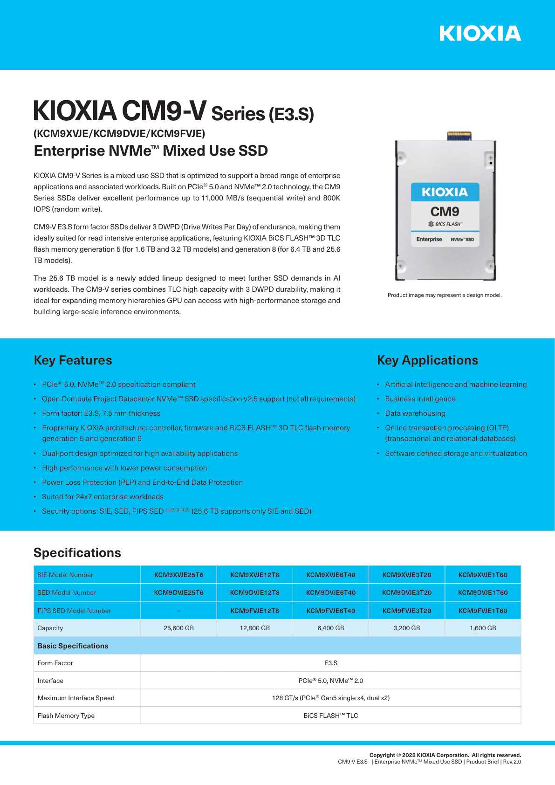
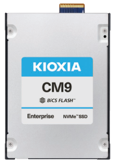
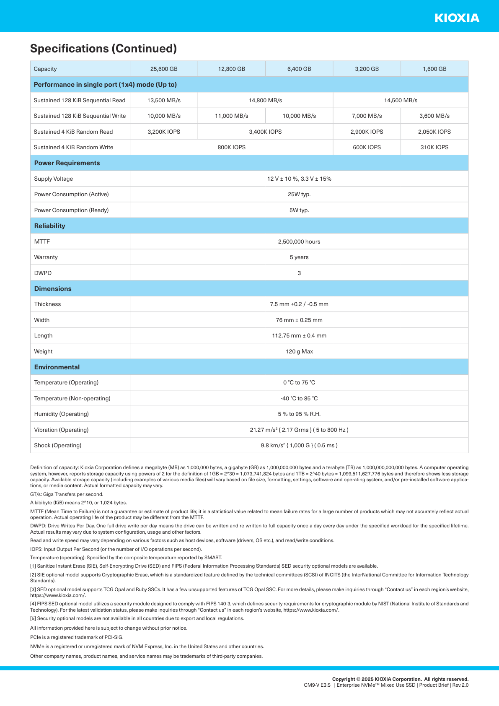

## Document Metadata

- Document ID: 1fa88bd3f6aa227576c0e95f981b3a5e9aedec90
- Document Title: KIOXIA CM9-V Series (E3.S)
- Document Type: PDF
- Issuing Organization: KIOXIA Corporation
- Publication Date: null
- Reporting Period: null
- Source File: [27_apac.kioxia.com_eSSD-CM9-V-E3.S-Product-brief.pdf](https://github.com/jadennevercode/CJCC-Knowledge-Base/blob/564ab11aa9785e569e3853c8a4d7ce86f88e7535/materials/%E4%BA%A7%E5%93%81%EF%BC%9ANAND%E5%88%B0%E6%88%90%E5%93%81%E7%9A%84%E6%98%A0%E5%B0%84/27_apac.kioxia.com_eSSD-CM9-V-E3.S-Product-brief.pdf)

## Structured Content

> 原文件：[27_apac.kioxia.com_eSSD-CM9-V-E3.S-Product-brief.pdf](https://github.com/jadennevercode/CJCC-Knowledge-Base/blob/564ab11aa9785e569e3853c8a4d7ce86f88e7535/materials/%E4%BA%A7%E5%93%81%EF%BC%9ANAND%E5%88%B0%E6%88%90%E5%93%81%E7%9A%84%E6%98%A0%E5%B0%84/27_apac.kioxia.com_eSSD-CM9-V-E3.S-Product-brief.pdf)
> 转换方式：Volcengine OCRPdf v3, parse_mode=ocr

[Source Page: 1]

# KIOXIA CM9-V Series (E3.S)

(KCM9XVJE/KCM9DVJE/KCM9FVJE)

## Enterprise NVMe™ Mixed Use SSD

KIOXIA CM9-V Series is a mixed use SSD that is optimized to support a broad range of enterprise applications and associated workloads. Built on PCIe® 5.0 and NVMe™ 2.0 technology, the CM9 Series SSDs deliver excellent performance up to 11,000 MB/s (sequential write) and 800K IOPS (random write).

CM9-V E3.S form factor SSDs deliver 3 DWPD (Drive Writes Per Day) of endurance, making them ideally suited for read intensive enterprise applications, featuring KIOXIA BiCS FLASH™ 3D TLC flash memory generation 5 (for 1.6 TB and 3.2 TB models) and generation 8 (for 6.4 TB and 25.6 TB models).

The 25.6 TB model is a newly added lineup designed to meet further SSD demands in AI workloads. The CM9-V series combines TLC high capacity with 3 DWPD durability, making it ideal for expanding memory hierarchies GPU can access with high-performance storage and building large-scale inference environments.

Product image may represent a design model.

## Key Features

- PCIe® 5.0, NVMe™ 2.0 specification compliant
- Open Compute Project Datacenter NVMe™ SSD specification v2.5 support (not all requirements)
- Form factor: E3.S, 7.5 mm thickness
- Proprietary KIOXIA architecture: controller, firmware and BiCS FLASH™ 3D TLC flash memory generation 5 and generation 8
- Dual-port design optimized for high availability applications
- High performance with lower power consumption
- Power Loss Protection (PLP) and End-to-End Data Protection
- Suited for 24x7 enterprise workloads
- Security options: SIE, SED, FIPS SED [1][2][3][4][5] (25.6 TB supports only SIE and SED)

## Key Applications

- Artificial intelligence and machine learning
- Business intelligence
- Data warehousing
- Online transaction processing (OLTP) (transactional and relational databases)
- Software defined storage and virtualization

## Specifications

|  | 25,600 GB | 12,800 GB | 6,400 GB | 3,200 GB | 1,600 GB |
| --- | --- | --- | --- | --- | --- |
| SIE Model Number | KCM9XVJE25T6 | KCM9XVJE12T8 | KCM9XVJE6T40 | KCM9XVJE3T20 | KCM9XVJE1T60 |
| SED Model Number | KCM9DVJE25T6 | KCM9DVJE12T8 | KCM9DVJE6T40 | KCM9DVJE3T20 | KCM9DVJE1T60 |
| FIPS SED Model Number | - | KCM9FVJE12T8 | KCM9FVJE6T40 | KCM9FVJE3T20 | KCM9FVJE1T60 |
| Capacity | 25,600 GB | 12,800 GB | 6,400 GB | 3,200 GB | 1,600 GB |

### Basic Specifications

|  | Value |
| --- | --- |
| Form Factor | E3.S |
| Interface | PCIe® 5.0, NVMe™ 2.0 |
| Maximum Interface Speed | 128 GT/s (PCIe® Gen5 single x4, dual x2) |
| Flash Memory Type | BiCS FLASH™ TLC |

[Source Page: 2]

## Specifications (Continued)

### Performance in single port (1x4) mode (Up to)

| Capacity | 25,600 GB | 12,800 GB | 6,400 GB | 3,200 GB | 1,600 GB |
| --- | --- | --- | --- | --- | --- |
| Sustained 128 KiB Sequential Read | 13,500 MB/s | 14,800 MB/s | 14,800 MB/s | 14,500 MB/s | 14,500 MB/s |
| Sustained 128 KiB Sequential Write | 10,000 MB/s | 11,000 MB/s | 10,000 MB/s | 7,000 MB/s | 3,600 MB/s |
| Sustained 4 KiB Random Read | 3,200K IOPS | 3,400K IOPS | 3,400K IOPS | 2,900K IOPS | 2,050K IOPS |
| Sustained 4 KiB Random Write | 800K IOPS | 800K IOPS | 800K IOPS | 600K IOPS | 310K IOPS |

### Power Requirements

|  | Value |
| --- | --- |
| Supply Voltage | 12 V ± 10 %, 3.3 V ± 15% |
| Power Consumption (Active) | 25W typ. |
| Power Consumption (Ready) | 5W typ. |

### Reliability

|  | Value |
| --- | --- |
| MTTF | 2,500,000 hours |
| Warranty | 5 years |
| DWPD | 3 |

### Dimensions

|  | Value |
| --- | --- |
| Thickness | 7.5 mm +0.2 / -0.5 mm |
| Width | 76 mm ± 0.25 mm |
| Length | 112.75 mm ± 0.4 mm |
| Weight | 120 g Max |

### Environmental

|  | Value |
| --- | --- |
| Temperature (Operating) | 0 °C to 75 °C |
| Temperature (Non-operating) | -40 °C to 85 °C |
| Humidity (Operating) | 5 % to 95 % R.H. |
| Vibration (Operating) | 21.27 m/s² { 2.17 Grms } ( 5 to 800 Hz ) |
| Shock (Operating) | 9.8 km/s² { 1,000 G } ( 0.5 ms ) |

### Notes and disclaimers

Definition of capacity: Kioxia Corporation defines a megabyte (MB) as 1,000,000 bytes, a gigabyte (GB) as 1,000,000,000 bytes and a terabyte (TB) as 1,000,000,000,000 bytes. A computer operating system, however, reports storage capacity using powers of 2 for the definition of 1GB = 2^30 = 1,073,741,824 bytes and 1TB = 2^40 bytes = 1,099,511,627,776 bytes and therefore shows less storage capacity. Available storage capacity (including examples of various media files) will vary based on file size, formatting, settings, software and operating system, and/or pre-installed software applications, or media content. Actual formatted capacity may vary. GT/s: Giga Transfers per second. A kibibyte (KiB) means 2^10, or 1,024 bytes. MTTF (Mean Time to Failure) is not a guarantee or estimate of product life; it is a statistical value related to mean failure rates for a large number of products which may not accurately reflect actual operation. Actual operating life of the product may be different from the MTTF. DWPD: Drive Writes Per Day. One full drive write per day means the drive can be written and re-written to full capacity once a day every day under the specified workload for the specified lifetime. Actual results may vary due to system configuration, usage and other factors. Read and write speed may vary depending on various factors such as host devices, software (drivers, OS etc.), and read/write conditions. IOPS: Input Output Per Second (or the number of I/O operations per second). Temperature (operating): Specified by the composite temperature reported by SMART. [1] Sanitize Instant Erase (SIE), Self-Encrypting Drive (SED) and FIPS (Federal Information Processing Standards) SED security optional models are available. [2] SIE optional model supports Cryptographic Erase, which is a standardized feature defined by the technical committees (SCSI) of INCITS (the InterNational Committee for Information Technology Standards). [3] SED optional model supports TCG Opal and Ruby SSCs. It has a few unsupported features of TCG Opal SSC. For more details, please make inquiries through “Contact us” in each region’s website, https://www.kioxia.com/. [4] FIPS SED optional model utilizes a security module designed to comply with FIPS 140-3, which defines security requirements for cryptographic module by NIST (National Institute of Standards and Technology). For the latest validation status, please make inquiries through “Contact us” in each region’s website, https://www.kioxia.com/. [5] Security optional models are not available in all countries due to export and local regulations. All information provided here is subject to change without prior notice. PCIe is a registered trademark of PCI-SIG. NVMe is a registered or unregistered mark of NVM Express, Inc. in the United States and other countries. Other company names, product names, and service names may be trademarks of third-party companies.

## Processing Notes

- 产品型号、合并表格、性能上限、测试条件与免责声明均按原页核验；跨列共有值已按覆盖范围重复。
