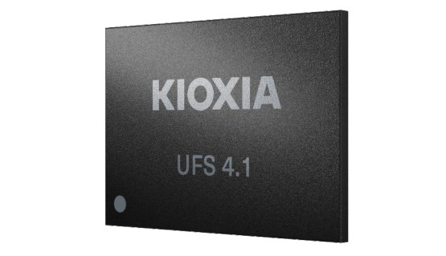

## Document Metadata

- Document ID: a29d0fa30349a9ce9d2f300f2a634ff6aa5ef2dd
- Document Title: KIOXIA Sampling UFS Ver. 4.1 Embedded Flash Memory Devices
- Document Type: PDF
- Issuing Organization: KIOXIA Europe GmbH
- Publication Date: 9 July 2025
- Reporting Period: null
- Source File: [27_europe.kioxia.com_KIE_PR_20250709-1_EN.pdf](https://github.com/jadennevercode/CJCC-Knowledge-Base/blob/564ab11aa9785e569e3853c8a4d7ce86f88e7535/materials/%E4%BA%A7%E5%93%81%EF%BC%9ANAND%E5%88%B0%E6%88%90%E5%93%81%E7%9A%84%E6%98%A0%E5%B0%84/27_europe.kioxia.com_KIE_PR_20250709-1_EN.pdf)

## Structured Content

[Source Page: 1]

# Press Release

## KIOXIA Sampling UFS Ver. 4.1 Embedded Flash Memory Devices

New UFS Devices with KIOXIA’s 8th-Gen BiCS FLASH™(1) Boost Speed and Power Efficiency

Düsseldorf, Germany, 9 July 2025 – KIOXIA Europe GmbH, today announced that it has begun sampling new Universal Flash Storage(2) (UFS) Ver. 4.1 embedded memory devices, reinforcing its leadership in high-performance storage. Engineered to meet the demands of next-generation mobile applications, including advanced smartphones with on-device AI, the new devices offer improved performance with greater power efficiency(3), in a small BGA package.

UFS Ver. 4.1 devices from KIOXIA integrate the company’s innovative BiCS FLASH™ 3D flash memory and a controller in a JEDEC®-standard package. These new UFS devices are built with KIOXIA’s 8th generation BiCS FLASH™ 3D flash memory(1). This generation introduces CBA (CMOS directly Bonded to Array) technology - an architectural innovation that marks a step-change in flash memory design. By directly bonding the CMOS circuitry to the memory array, CBA technology enables major gains in power efficiency, performance, and density.

With a blend of speed and low power use, KIOXIA UFS Ver. 4.1 devices are built to enhance user experiences—enabling faster downloads and smoother app performance.

[Source Page: 2]

Key features include:

- Available in capacities of 256, 512 gigabytes (GB) and 1 terabyte (TB)
- Performance improvement over previous generation(3):
  - Random writes: 512 GB/1 TB approx. +30%
  - Random reads: 512 GB approx. +45%, 1 TB approx. +35%
- Power efficiency improvement over previous generation(3):
  - Reads: 512 GB/1 TB approx. +15% improvement
  - Writes: 512 GB/1 TB approx. +20% improvement
- Host Initiated Defragmentation enables delayed garbage collection for uninterrupted fast performance during critical times
- WriteBooster buffer resizing provides better flexibility for optimal performance
- Supports the UFS Ver. 4.1 standard
- Reduced package height for the 1 TB model compared to the prior generation(4)
- Uses KIOXIA’s 8th generation BiCS FLASH™ 3D flash memory(1)

“KIOXIA's new UFS Ver. 4.1 embedded memory devices signify a notable advancement, reinforcing KIOXIA’s leadership in high-performance storage and its commitment to leading flash storage innovation,” says Axel Störmann, Vice President and Chief Technology Officer for Memory and SSD products, KIOXIA Europe GmbH. “Engineered with 8th generation BiCS FLASH™ and CBA technology, these devices meet the demands of tomorrow's next-generation mobile applications, including on-device AI, marking a significant leap forward from predecessors.”

### Notes:

(1) 512 GB / 1 TB models only.

(2) Universal Flash Storage (UFS) is a product category for a class of embedded memory products built to the JEDEC UFS standard specification. Due to its serial interface, UFS supports full duplexing, which enables both concurrent reading and writing between the host processor and UFS device.

(3) Compared to the previous generation 512GB device “THGJFMT2E46BATV” and 1TB device “THGJFMT3E86BATZ” respectively (512 GB / 1 TB models only).

(4) The previous generation 1TB device “THGJFMT3E86BATZ”.

[Source Page: 3]

\*In every mention of a KIOXIA product: Product density is identified based on the density of memory chip(s) within the Product, not the amount of memory capacity available for data storage by the end user. Consumer-usable capacity will be less due to overhead data areas, formatting, bad blocks, and other constraints, and may also vary based on the host device and application. For details, please refer to applicable product specifications. The definition of 1 KB = 2^10 bytes = 1,024 bytes. The definition of 1 Gb = 2^30 bits = 1,073,741,824 bits. The definition of 1 GB = 2^30 bytes = 1,073,741,824 bytes. 1 Tb = 2^40 bits = 1,099,511,627,776 bits. 1 TB = 2^40 bytes = 1,099,511,627,776 bytes.

\*Read and write speeds are the best values obtained in a specific test environment at KIOXIA Corporation and KIOXIA Corporation warrants neither read nor write speeds in individual devices. Read and write speed may vary depending on device used and file size read or written.

\*The following trademarks, service and/or company names – JEDEC, JEDEC Solid State Technology Association - are not applied, registered, created and/or owned by KIOXIA Europe GmbH or by affiliated KIOXIA group companies. However, they may be applied, registered, created and/or owned by third parties in various jurisdictions and, therefore, protected against unauthorised use. All other company names, product names and service names may be trademarks of third-party companies.

## About KIOXIA Europe GmbH

KIOXIA Europe GmbH (formerly Toshiba Memory Europe GmbH) is the European-based subsidiary of KIOXIA Corporation, a leading worldwide supplier of flash memory and solid-state drives (SSDs). From the invention of NAND flash memory to today’s breakthrough BiCS FLASH™ , KIOXIA continues to pioneer innovative memory solutions and services that enrich people’s lives and expand society’s horizons. The company’s innovative BiCS FLASH™ 3D flash memory technology is shaping the future of storage in high-density applications, including advanced smartphones, PCs, SSDs, automotive and data centers.

Visit our KIOXIA website

**Contact details for publication:**  
KIOXIA Europe GmbH, Hansaallee 181, 40549 Düsseldorf, Germany  
Tel: +49 (0)211 368 77-0  
E-mail: KIE-support@kioxia.com

**Contact details for editorial enquiries:**  
Lena Hoffmann, KIOXIA Europe GmbH  
Tel: +49 (0) 211 36877 382  
E-mail: lena1.hoffmann@kioxia.com

**Issued by:**  
Birgit Schöniger, Publitek  
Tel: +49 (0)4181 968098-13  
E-mail: birgit.schoeniger@publitek.com  
Web: www.publitek.com

## Processing Notes

None
