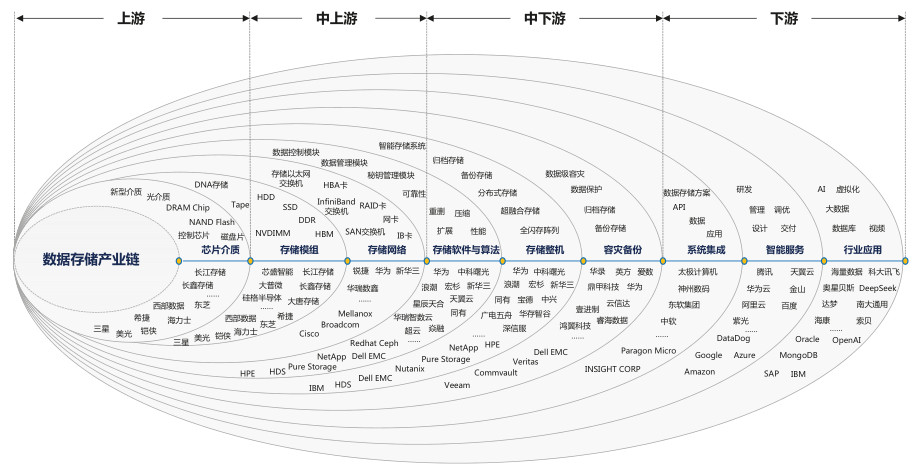

## Document Metadata

- Document ID: 35c8195fec353e475b1cf1e32f236cfde30decad
- Document Title: 数据存储产业发展研究报告（2025年）
- Document Type: PDF
- Issuing Organization: 中国电子工业标准化技术协会数据存储专业委员会
- Publication Date: 2025-11
- Reporting Period: null
- Source File: [20_showfile.cesa.cn_014a616907b1437594f2f27cf20d20ed数据存储产业发展.pdf](https://github.com/jadennevercode/CJCC-Knowledge-Base/blob/564ab11aa9785e569e3853c8a4d7ce86f88e7535/materials/%E5%9F%BA%E7%A1%80%EF%BC%9ANAND%E4%BA%A7%E5%93%81%E4%B8%8E%E6%8A%80%E6%9C%AF%E8%B0%B1%E7%B3%BB/20_showfile.cesa.cn_014a616907b1437594f2f27cf20d20ed%E6%95%B0%E6%8D%AE%E5%AD%98%E5%82%A8%E4%BA%A7%E4%B8%9A%E5%8F%91%E5%B1%95.pdf)

## Structured Content

> 原文件：[20_showfile.cesa.cn_014a616907b1437594f2f27cf20d20ed数据存储产业发展.pdf](https://github.com/jadennevercode/CJCC-Knowledge-Base/blob/564ab11aa9785e569e3853c8a4d7ce86f88e7535/materials/%E5%9F%BA%E7%A1%80%EF%BC%9ANAND%E4%BA%A7%E5%93%81%E4%B8%8E%E6%8A%80%E6%9C%AF%E8%B0%B1%E7%B3%BB/20_showfile.cesa.cn_014a616907b1437594f2f27cf20d20ed%E6%95%B0%E6%8D%AE%E5%AD%98%E5%82%A8%E4%BA%A7%E4%B8%9A%E5%8F%91%E5%B1%95.pdf)
> 转换方式：Volcengine OCRPdf v3, parse_mode=ocr

[Source Page: 1]

[原始页面图像](../_assets/data_storage_report_original/page-1.png)

# 数据存储产业发展研究报告（2025年）

RESEARCH REPORT ON THE DEVELOPMENT OF THE DATA STORAGE INDUSTRY

中国电子工业标准化技术协会数据存储专业委员会

[Source Page: 2]

[原始页面图像](../_assets/data_storage_report_original/page-2.png)

原文件此页为空白。

[Source Page: 3]

[原始页面图像](../_assets/data_storage_report_original/page-3.png)

# 数据存储产业发展研究报告（2025年）

RESEARCH REPORT ON THE DEVELOPMENT OF THE DATA STORAGE INDUSTRY

中国电子工业标准化技术协会数据存储专业委员会

2025年11月

[Source Page: 4]

[原始页面图像](../_assets/data_storage_report_original/page-4.png)

### 主编单位

- 中国电子工业标准化技术协会数据存储专业委员会
- 华为技术有限公司
- 曙光信息产业股份有限公司
- 中国电子技术标准化研究院
- 中国移动通信集团有限公司
- 中国工商银行数据中心

### 参编单位（排名不分先后）

- 北京大道云行科技有限公司
- 北京星辰天合科技股份有限公司
- 北京焱融科技有限公司
- 成都华瑞数鑫科技有限公司
- 电子科技大学
- 富士胶片（中国）投资有限公司
- 国家电子计算机质量检验检测中心（北京尊冠科技有限公司）
- 杭州宏杉科技股份有限公司
- 合肥大唐存储科技有限公司
- 华瑞指数云科技（深圳）有限公司
- 平头哥（上海）半导体技术有限公司
- 赛迪顾问股份有限公司
- 上海霄云信息科技有限公司
- 深圳大普微电子股份有限公司
- 深圳市硅格半导体有限公司
- 深圳忆联信息系统有限公司
- 英韧科技股份有限公司
- 郑州大学国家超级计算郑州中心
- 中兴通讯股份有限公司
- 中研益企（北京）信息技术研究院有限公司
- 中移动信息技术有限公司

### 版权声明

本报告版权属于中国电子工业标准化技术协会数据存储专业委员会，并受法律保护。转载、摘编或利用其他方式使用本报告文字或者观点的，应注明“来源：《数据存储产业发展研究报告（2025年）》”。违反上述声明者，将追究其相关法律责任。

[Source Page: 5]

[原始页面图像](../_assets/data_storage_report_original/page-5.png)

### 顾问指导组

史惠康　金　磊　张宏图　董　建　王旭东　张新凤　张　昊  
曾繁雄

### 编写组（按姓名首字母排序）

安万全　曹莎莎　陈　灿　陈　飞　陈　海　陈庆帅　储琴琴  
戴裕昇　翟　爽　杜　松　傅佳莉　龚　钧　郭　楠　郭　文  
何昌军　黄　昆　黄　永　金　笛　雷延钊　黎　超　李　根  
李锦虹　李　军　李丽娜　李玲君　李　响　刘云皓　罗　挺  
梅学哲　彭佳琪　邱全伟　裘方佳　任焕文　阮冠春　申　珅  
石　静　舒　帆　苏东明　孙　钢　孙学山　佟小川　涂晓东  
王佳鑫　王晋强　王　爽　王　先　王　振　魏　杨　吴　波  
吴海成　吴媛媛　许博文　许争明　薛　轶　闫　晗　杨利进  
于　嘉　于在宇　于　哲　袁　钰　张广彬　张淏楠　张劲松  
张　委　张文涛　张晓雯　张亚茹　张　震　章海龙 赵　磊  
郑彩平　周冠锋　邹博引

[Source Page: 6]

[原始页面图像](../_assets/data_storage_report_original/page-6.png)

## 核心观点摘要

### AI 高质量发展需存力先行

AI 应用爆发驱动数据基础设施建设要求快速提升，网络带宽增长约十倍，算力增长约百倍，而数据量正面临千倍增长。数据存储成为AI记忆与思考的“基石”，其存取效能直接定义了大模型的训练速度与智能上限。AI高质量发展需存力先行。

### 中国数据存储产业正从“跟跑”向“并跑”迈进

中国企业在3D NAND 闪存、DRAM 内存及全闪存存储系统等关键领域，已形成自主能力并取得关键突破，专利数量全球领先, 正在逐步重塑全球产业格局。但在机械硬盘（HDD）等技术领域，国际标准话语权、生态繁荣等方面仍需持续突破。

### 数据存储边界向“AI 数据平台”跃升

AI 时代，数据存储的角色与边界正经历根本性重塑：从数据的“保险箱”，通过与计算、网络的深度协同, 跃升为主动参与人工智能全流程的“AI 数据平台”。这一转变是数据存储产业在技术架构与商业模式上的核心演进。

[Source Page: 7]

[原始页面图像](../_assets/data_storage_report_original/page-7.png)

### 多维多元化发展驱动产品形态重塑

数据存储产业正在向多维多元化演进：智能分层管理实现多种介质间的融合，多元备份构建体系化的韧性，技术架构随场景变化重构。这些趋势共同驱动产业从单一设备形态，向提供智能、融合、弹性的数据基础设施的平台化服务转型。

### 安全与韧性成为数据存储系统的内生能力

在网络攻击手段不断升级的背景下，国家法规与行业应用安全要求持续提高，不可变存储、零信任、合规审计等能力深度融入数据存储软硬件底层，推动存储系统实现从“被动防护”到“主动免疫”的范式转变。安全与韧性由此成为数据存储系统的内生能力。

[Source Page: 8]

[原始页面图像](../_assets/data_storage_report_original/page-8.png)

## 引言

当前，全球数字经济正以前所未有的速度演进，数据作为新型生产要素的核心地位日益凸显。在人工智能（AI）技术迅猛发展的浪潮推动下，数据的生成、处理与存储需求呈现指数级增长。大模型训练、智能推理、边缘计算等新兴应用场景对数据存储系统提出了更高性能、更强可靠性、更优能效比和更大规模扩展能力的要求。在此背景下，数据存储产业不仅面临技术架构的深刻变革，也迎来了从传统基础设施向智能化、云原生、软硬协同方向转型升级的关键窗口期。为全面把握这一历史性机遇，厘清产业发展脉络与未来趋势，中国电子工业标准化技术协会数据存储专业委员会组织产业相关资深专家编写了《数据存储产业发展研究报告（2025 年）》。

本报告定位为前瞻性与实践性兼具的产业深度研究文献，旨在系统梳理全球及中国数据存储产业的发展现状，深入分析技术演进趋势、市场格局变化与行业实践，结合AI 时代的新需求，提出具有战略指导意义的发展建议。报告由来自产学研用等领域的20 余家单位共同参与编写，涵盖主流存储厂商、科研机构、行业用户及标准化组织，确保内容的专业性、广泛性与代表性。

[Source Page: 9]

[原始页面图像](../_assets/data_storage_report_original/page-9.png)

本报告基于“全景式”与“多维度”的研究视角：一方面，全面覆盖技术趋势研判，包括先进存力、AI 存储、新介质、内生安全等前沿方向；另一方面，通过典型案例剖析、年度热点事件回顾、专利布局多维度分析研究，深入揭示应用场景与产业态势。在AI 驱动的数据密集型应用 (Data-Intensive Application)背景下，报告重点探讨了存储如何支撑算力释放、实现数据高效流转，为构建新型数据基础设施提供支撑与实践参考。

本报告系统梳理我国数据存储产业的发展现状，客观呈现产业进步与创新成果，为准确把握产业脉搏、科学规划未来发展提供参考。目标读者既包括政府主管部门与政策制定者，为其在数据要素市场化配置、新型基础设施建设、科技自立自强等战略部署中提供决策依据；也面向企业高管、技术负责人与投资机构，助力其把握技术方向、优化产品布局、识别投资机会；同时，也为科研人员、高校师生及行业从业者提供一份系统、权威的参考资料，推动产业共识形成与生态协同发展。

我们期待本报告能够成为推动我国数据存储产业高质量发展的重要智力支撑，助力构建自主创新、安全高效、绿色智能的现代化数据基础设施体系。

[Source Page: 10]

[原始页面图像](../_assets/data_storage_report_original/page-10.png)

## 目录

核心观点摘要 
IV  
引言 
VI  
01
数据存储产业定位  
◎　1.1 
迈向智能时代，数据存储成为数字世界的基石 
02  
◎　1.2 
有数据即有存储，数据存储产业是战略性基础产业 
03  
◎　1.3 
AI 成为最大增量引擎，数据存储市场规模持续扩大 
04  
02
数据存储产业发展现状  
◎　2.1 
产业进展：从跟跑到并跑，中国成为全球数据存储产业关键力量 
06  
◎　2.2 
产业环境：政策与市场双轮驱动，产业生态格局轮廓更清晰 
06  
◎　2.3 
技术体系：技术架构体系持续演进，核心创新加速涌现 
07  
◎　2.4 
标准体系：国内标准体系初步建成，系统化能力积厚成势 
09  
◎　2.5 
专利布局：专利数量实现全球领先，专利结构向高质量迈进 
11  
◎　2.6 
人才培养：人才梯队初具规模，产教融合模式加快构建 
13  
◎　2.7 
正视挑战：关键瓶颈与深层次问题亟待突破 
14  
03
数据存储产业发展趋势  
◎　3.1 
存力驱动智能经济发展，各地加速布局先进存力中心 
16  
◎　3.2 
企业加速构建AI 数据湖，以统一数据基座驱动智能化落地 
17

[Source Page: 11]

[原始页面图像](../_assets/data_storage_report_original/page-11.png)

◎　3.3 
AI 存储关键能力成型，提升大模型训练推理效率 
18  
◎　3.4 
AI 数据平台概念兴起，存储系统边界持续扩张 
19  
◎　3.5 
互联网行业落地Diskless 架构，智能盘框快速发展 
20  
◎　3.6 
QLC SSD 介质普及，推动大容量高性能存储普惠  
20  
◎　3.7 
融合介质创新，有效支撑数据升温及温冷数据激活 
21  
◎　3.8 
多元备份成为主流，系统性构建适应AI 时代的数据韧性体系 
22  
◎　3.9 
存储内生安全加速演进，构建数据安全的最后一道防线 
23  
◎　3.10 存储网络迈向全IP 化融合，无损以太网构建高速数据基座 
24  
04
数据存储应用实践  
◎　4.1 
智慧金融：安全高效的数据存储，承载智慧金融合规业务开展 
27  
◎　4.2 
信息通信：稳定可靠的数据基础设施，驱动智能运维与业务创新 
29  
◎　4.3 
智能制造：AI 存储赋能数字化转型，打造现代制造体系 
31  
◎　4.4 
智慧医疗：从医疗数据共享到大模型工具链，提升病理诊断速度与准确性 33  
05
数据存储产业发展倡议  
◎　5.1 
强化顶层设计，促进产业升级 
37  
◎　5.2 
深化产业协同，构建现代化数据存储产业体系 
37  
◎　5.3 
聚焦前沿技术，把握人工智能发展机遇 
37  
◎　5.4 
推动标准建设与生态繁荣，掌握发展主动权 
38  
◎　5.5 
强化人才培育与引进，筑牢创新根基 
38  
附录：数据存储2025 年度事件总结盘点 
39  
附录：术语和缩略语表 
49  
参考文献  
51

[Source Page: 12]

[原始页面图像](../_assets/data_storage_report_original/page-12.png)

原文件此页为空白。

[Source Page: 13]

[原始页面图像](../_assets/data_storage_report_original/page-13.png)

## 01 数据存储产业定位

[Source Page: 14]

[原始页面图像](../_assets/data_storage_report_original/page-14.png)

数据存储是数据资源的物理载体，是数字时代的“粮仓”，是数字世界的基石。当前，随着人工智能、物联网、云计算等新一代信息技术在新一轮科技革命和产业变革中的大量应用，数据已成为数字经济时代的核心生产要素，数字化和智能化以数据为纽带，相互促进、深度融合，逐渐走向两者相结合的数智化。全球主要国家和经济体均在制定数据战略和人工智能战略，数据存储已经成为数字基础设施的关键一环，数据存储的能力将直接影响到社会经济发展的质量。

数据存储产业已全面迈入由AI 定义的“存力时代”。2025 年，AI 为数据存储产业带来结构性拐点，市场规模不仅快速增长，更将在产品结构、技术路线、市场格局、价值链分布上发生根本性重塑。

### 1.1 迈向智能时代，数据存储成为数字世界的基石

数据存储产业围绕数据的存储、管理、保护与应用，提供硬件设备、软件技术、解决方案和应用服务，是信息技术领域少有的横跨材料、物理、芯片、硬件、软件、系统、网络、协议、算法、安全等多个高技术维度的综合性产业。其价值已远超简单的“数据存放”，而是深度渗透并支撑着整个IT 架构的稳定与高效运行。随着AI 应用对超大规模、超高速数据访问需求的爆发，数据存储的角色正发生着结构性的改变，从计算系统的配套角色，升级为与计算并重的核心支柱，它不再仅是数据的“保险箱”，更成为数据的加速器，支撑AI 普惠的关键基础设施，并深刻影响AI 大模型训练与推理效能。

存储产品是信息技术架构的核心基础设施之一，承担数据持久化、可靠性和高效访问的底层支撑功能，存储能力已从单纯容量扩展到效率、经济性、可靠性和节能维度，为数字经济和智能化提供基础支撑。其作用体现在：

1） 加速数字化转型：支撑政府治理、企业服务、民生等场景的数据资产化，每1 元存力可带动30-40 元经济社会价值1。

2） 数据生命周期管理：覆盖数据从产生、传输、处理到归档的全流程，支撑数据库、云计算、大数据、AI 等技术的底层数据存储需求。

3） 算力协同：存储与计算、网络构成数据中心基础设施的三大核心支柱，通过存算分离/融合架构优化资源利用率，提升数据处理效率。

4） 安全与合规：通过加密、容灾备份等技术保障数据安全，满足《数据安全法》等法规要求。

1　 来源：华为& 罗兰贝格，《数据存力：高质量发展的数字基石》

[Source Page: 15]

[原始页面图像](../_assets/data_storage_report_original/page-15.png)

### 1.2 有数据即有存储，数据存储产业是战略性基础产业

数据存储作为数据的物理载体与管理基石，其产业能力直接决定了数据要素能否安全存得住、高效流得动、价值挖得深。因此，数据存储产业已超越传统IT 范畴，上升为支撑数字中国建设、保障数字经济安全、争夺人工智能时代制高点的战略性基础产业。

为清晰洞察这一庞大产业，我们将其划分为以下四个关键环节，如图：

图1 数据存储产业构成：原图包含大量细小标签及跨环节连接，保留原页面图像与 OCR 提取图像供核验；不推断连接关系。



（上游）介质与芯片：产业的“原料”，包括NAND Flash（闪存颗粒）、DRAM（动态随机存取存储器）等存储介质，以及主控、接口等核心芯片，是自主创新的源头。

（中上游）部件与模组：产业的“核心部件”，将上游的介质与芯片组合成为SSD（固态硬盘）、HDD（机械硬盘）、内存条（含HBM（高带宽内存））等功能明确的标准化产品，是技术集成与供应链的关键组成。

（中下游）整机与系统：产业的“设备与方案”，通过软硬件协同，将部件与模组集成为全闪存储阵列、分布式存储等企业级存储系统，提供高可靠、高性能的数据存储服务，是数据存储技术的最终产品化体现。

（下游）应用与服务：产业的“价值释放端”，面向金融、通信、医疗等千行百业，提供定制化解决方案与存储即服务（STaaS），是驱动技术持续迭代的最终场景。

这四个环节环环相扣，构成了从底层物理介质到顶层业务应用的完整生态。其中，中游（部件与整机）是产业的主体与价值体现，它直接决定了数据基础设施的性能、可靠性与安全水平。下游蓬勃发展的数字经济与AI 应用，则不断对中游提出更高要求，驱动全产业领域持续创新与迭代升级。

[TABLE_RECONSTRUCTION_UNCERTAIN] 原图可提取的文字（按原始版面提取，行列和连接关系未重建）：

```text
上游            中上游            中下游               下游


                                           智能存储系统
                             数据控制模块
                                   数据管理模块        归档存储
                             存储以太网       秘钥管理模块      备份存储       数据级容灾
                              交换机                       DNA存储                                              HBA卡                                                                   数据保护                                                                                        研发                                                                                                                                                                                                     AI                                                                                                     虚拟化                                                       分布式存储                                                                               数据存储方案                                              可靠性         新型介质 光介质                                    HDD                                                                        InfiniBand                                         Tape                                                           RAID卡                                                                                                                                                     API                                                SSD                    DRAM                                   Chip                                                                                                    大数据                                                                     归档存储                                                                                          管理                                                                                             调优                                                          超融合存储                                    交换机                                                 重删                                                    压缩
                                           网卡                                             DDR                                                                                  数据                        NAND                                             Flash
                                                                      备份存储                                                                                          设计                                                                                              交付                                                                                                    数据库                                                                                                         视频                                                             全闪存阵列                                                  扩展                                                      性能                                             SAN交换机                                    NVDIMM                                                                                    应用                                            HBM                 控制芯片                                                                      IB卡                       磁盘片
                 芯片介质    存储模组     存储网络   存储软件与算法   存储整机    容灾备份     系统集成    智能服务    行业应用
数据存储产业链
                   长江存储     芯盛智能 长江存储  锐捷 华为 新华三  华为 中科曙光   华为 中科曙光   华录 英方 爱数   太极计算机     腾讯  天翼云  海量数据 科大讯飞
                                                           浪潮                                                              宏杉                                                                 新华三                  长鑫存储                            大普微                                                      新华三                                                   宏杉                                 长鑫存储                                                                     鼎甲科技                                                                          华为                                                浪潮                                       华瑞数鑫                                                                                                                               奥星贝斯DeepSeek                                                                                          华为云                                                                                 神州数码                                                                                               金山                          ……                         硅格半导体                                                    天翼云                                                 ……                                                               中兴                                                            宝德                                                         同有                               大唐存储                                                                        云信达                                               星辰天合                                                                                                   达梦                                                                                                        南大通用                                                                                东软集团                   东芝                                                                                         阿里云                                                                                              百度              西部数据                                  ……                                                                    壹进制                                                    同有                                                             华存智谷                                                                     Mellanox                                                        广电五舟                              希捷                                             华瑞智数云            希捷                       西部数据                                                                                                  海康                                                                      睿海数据                海力士                                                                                                       索贝                                                                                        紫光                                                                               中软                            东芝                                                          Broadcom                                                                  鸿翼科技                                                                                                                           ……                                                           深信服                                                 焱融                                                                                                              ……                                              超云            铠侠                                                                   ……      三星 美光                                                                Cisco                                                                                                ……                    铠侠海力士                                                                                  ……                                                                                                                                             DataDog                                                                                                                                                                                           Oracle                                                         ……                                                                                                                                                                      OpenAI              三星美光                                                                     Redhat                                                                     Ceph                                                                                       HPE                                                                                   NetApp                                                                                                                                 Paragon                                                                                                                                             Micro                                                                                                                                      Dell                                                                                        EMC                                                                                                                                      MongoDB                                                                                                                                               Google                                                                                                                                                               Azure                                                                                     Dell                                                         EMC                                                        NetApp                                                                                         Pure                                                                                               Storage                                                                                                                                Veritas
                                                         Pure                                                               Storage                                                                                    Nutanix                                                                                                                       INSIGHT                                                                                                           CORP                                         HDS                                                                                                                             Amazon                                                                                          Commvault                                                                                                                                                  SAP                                       HPE                                                                                                                                                      IBM                                                                                      Dell                                                          EMC
                                                      IBM  HDS                  Veeam
```

[Source Page: 16]

[原始页面图像](../_assets/data_storage_report_original/page-16.png)

展望未来，拥有自主可控、技术先进、生态完整的数据存储产业，是确保国家数字主权、发展新质生产力的战略基石。为便于后文论述，我们将以上环节简称为：介质、部件、整机、应用。

### 1.3 AI 成为最大增量引擎，数据存储市场规模持续扩大

人工智能（AI）的浪潮正在将数据从静态资源转变为驱动社会发展的核心动力，并从根本上重塑数据存储产业。《全国数据资源调查报告（2024 年）》显示，2024 年全国数据生产总量达41.06ZB，同比增长25%。IDC（国际数据公司）预测，2023 年至2028 年全球数据量年复合增长率（CAGR）将高达24.4%1，而中国数据圈预计在2025 年增至48.6ZB，占全球总量的27.8%，跃居世界第一。数据规模的指数级膨胀，是AI 驱动下存储需求爆发的直观体现。

在数据洪流的驱动下，全球数据存储市场迎来了规模扩张与结构升级并行的新阶段。若以“介质- 部件- 整机- 应用”的产业框架审视，中游市场（部件与整机）构成了产业的价值主体与增长核心。它不仅规模庞大，更是承接上游技术创新、支撑下游业务赋能的关键枢纽。

综合Gartner、集邦咨询、IDC 多方数据，2025 年上游“介质”全球市场规模约1900 亿美元，包括DRAM（含HBM）约1300 亿美元，NAND Flash 约600 亿美元。

中上游“部件”市场（如SSD、HDD、内存模组）2025 年全球市场规模约1580 亿美元，其中内存模组约900 亿美元，SSD 约540 亿美元，HDD 约140 亿美元。

中下游“整机”市场 2025 全球市场规模达 3390 亿美元，包括内置存储（随服务器销售）1760 亿美元，ODM Direct（互联网定制存储）1280 亿美元，企业级外置存储（如企业级存储阵列、分布式存储系统）约 350 亿美元。其中，企业级外置存储直接服务于金融、通信、医疗、制造、政务等复杂业务场景，是存储厂商技术与品牌竞争的核心市场，具有技术密集、专利壁垒高、高附加值等特点，是整个产业中持续快速演进的高价值专业市场。

下游“应用”市场全球企业级数据存储市场规模约1800 亿美元，主要面对金融、通信、制造、医疗等行业数据中心应用领域。

聚焦于全球产业价值核心的中游环节，中国市场的表现尤为突出，已成为全球增长的关键引擎。在核心“部件”领域，中国市场规模约4580 亿元人民币，占全球同类市场约32%；在体现最终解决方案价值的“整机”领域，仅企业级外置存储这一高价值细分市场，规模就达约510 亿元人民币，占全球22%。这两大关键领域的份额清晰地表明，中国存储产业在全球产业链中的影响力与竞争力仍在持续提升。

AI 技术和应用的快速发展，促进存储技术加快迭代，架构创新活跃。HBM 代次快速演进, 近存计算、AI 数据平台等新范式涌现，针对AI 优化和设计的存储系统开始应用，这些变化成为数据存储产业快速发展的强大引擎。

1　 来源：IDC DataSphere 趋势预测

[Source Page: 17]

[原始页面图像](../_assets/data_storage_report_original/page-17.png)

## 02 数据存储产业发展现状

[Source Page: 18]

[原始页面图像](../_assets/data_storage_report_original/page-18.png)

如前所述，全球正加速迈向以数据为核心生产要素的智能经济时代。在人工智能浪潮的推动下，数据存储在信息技术产业中的定位正在发生深刻的结构性变革，其战略价值与基础支撑作用日益凸显。随着存力与算力、运力共同构成数字经济发展的核心基石，我国数据存储产业展现出蓬勃的发展活力与巨大的创新潜力。

### 2.1 产业进展：从跟跑到并跑，中国成为全球数据存储产业关键力量

全球数据存储产业格局呈现高度集中态势，主要厂商分布于美国、中国、韩国与日本。在这一竞争格局中，中国数据存储企业依托持续的技术投入、完善的产业环境与蓬勃的市场需求，实现了从“跟跑者”向全球供应链核心参与者的重要转变。中国企业在3D NAND 闪存、DRAM 内存及全闪存存储系统等关键领域，已形成自主能力并取得关键突破，正逐步重塑全球产业格局，成为支撑全球数字经济发展的重要力量，但在部分尖端技术领域仍需持续突破。

在产业链上游的存储介质领域，长江存储通过其创新的Xtacking（晶栈）架构，成功突破了高密度、高性能与低功耗难以协同的技术瓶颈，为全球3D NAND 闪存技术演进提供了新的思路。相关资料2024 年数据显示，长江存储在NAND Flash 全球产能中占比约8%，长鑫存储在DRAM领域占比约10%，标志着中国企业在核心技术自主创新与产能爬坡方面取得实质性进展。与此同时，在企业级固态硬盘（SSD）市场，大普微、忆联、忆恒创源等国内企业积极投入，在产品研发与市场拓展方面表现活跃，共同推动国内存储生态不断完善。

根据IDC报告，在企业级外置存储市场，2024年全球格局呈现“总量稳增、结构优化、中美双强”的态势。DELL、NetApp 等美国厂商仍占据全球一半以上市场份额，而华为、曙光、浪潮等中国厂商凭借超20% 的全球市场份额，已成长为不可忽视的重要力量。随着AI 大模型对高吞吐、低延迟存储需求的持续提升，中国厂商在技术创新与市场拓展方面的表现将深刻影响全球存储产业的未来走向。

### 2.2 产业环境：政策与市场双轮驱动，产业生态格局轮廓更清晰

当前，数据作为新型生产要素¹的战略价值已成为全社会的普遍共识，数据存储产业的基础性地位得到前所未有的重视。随着数字中国建设的深入推进，存储产业在政策支持、市场投入与生态构建等方面均呈现出积极的发展态势，为产业创新与升级创造了有利条件。

1　如何理解数据是新型生产要素,http://theory.people.com.cn/n1/2022/1220/c40531-32590134.html

[Source Page: 19]

[原始页面图像](../_assets/data_storage_report_original/page-19.png)

#### 2.2.1 政策环境：存力战略地位提升，支持体系持续完善

国家层面已将数据存力明确为数字基础设施的重要组成部分，并推出一系列举措支持产业发展。工信部等部委在产业政策中多次强调存储关键技术攻关与自主体系建设，例如《电子信息制造业2023—2024年稳增长行动方案》¹中明确提出加快存储芯片与先进存储系统研发与产业化；《算力基础设施高质量发展行动计划》²则设立“强化存力高效灵活保障”专项任务，推动存储闪存化升级与先进存储技术规模化应用，共同促进存力与算力、运力协同发展。2023年国家数据局的成立，为统筹数据基础制度建设与数据资源开发利用提供了重要的组织保障。

在地方层面，多个省份已在数字经济规划中明确提出“存力”发展目标并设定量化指标，鼓励在数据中心建设中实现存储闪存化升级、提升先进存储容量占比，推动存储技术升级与基础设施现代化。

#### 2.2.2 投资与市场：规模持续扩大，创新领域投入增强

数据存储产业的经济价值正在得到市场的充分验证。研究表明，每投入1GB先进数据存力能带动约60元GDP增长，显示出强大的经济赋能效应。2021-2023年间，中国数据存力投资容量复合增长率保持在24.4%的较高水平³，反映出市场对存储基础设施的持续投入信心。

中国作为全球最具潜力的数据存储市场之一，正迎来重要的发展机遇。在保持投资规模稳步增长的同时，产业投资结构也在不断优化，对全闪存化等先进存储架构等创新领域的关注度与投入强度持续提升。这些积极变化为产业技术进步与竞争力增强提供了坚实支撑，推动中国数据存储产业在全球价值链中向上攀升。通过持续聚焦技术创新与产业升级，中国数据存储产业正稳步迈向更高质量的发展阶段。

### 2.3 技术体系：技术架构体系持续演进，核心创新加速涌现

数据存储已从计算机系统的附属部件，演进为技术密集、体系完整的独立产业门类。其技术栈覆盖从底层物理介质到上层业务应用的完整生态，形成了层次清晰、模块耦合的技术体系，同时也是一个依赖全产业链协同、技术与生态深度绑定的系统工程。

1. 关于印发电子信息制造业2023—2024年稳增长行动方案的通知，https://www.miit.gov.cn/zwgk/zcwj/wjfb/tz/art/2023/art_6ec44841d92a49729b9c04a91b5f89f9.html%5Breference:0
2. 工业和信息化部等六部门关于印发《算力基础设施高质量发展行动计划》的通知，https://www.miit.gov.cn/jgsj/txs/wjfb/art/2023/art_ed448f60021741729f7ee8e36aaafdd7.html
3. 数据来源：华为罗兰贝格，《先进数据存力：加速智能经济涌现的高性能引擎》。

[Source Page: 20]

[原始页面图像](../_assets/data_storage_report_original/page-20.png)

#### 2.3.1 技术体系架构

数据存储技术体系构建起从基础到应用的金字塔结构。如图2 所示，数据存储技术体系可概括为以系统级能力为枢纽，连接底层硬件资源与顶层业务需求的有机整体。该体系由基础介质与芯片、部件与模块、软件与算法、协议标准构成技术创新基石；系统级关键技术通过软硬件结合方式，将基础能力转化为数据管理、性能优化、数据保护与高可用等通用服务；最终，这些能力被整合成多样化的整机系统与方案，以支撑从核心交易业务到云计算/ 大数据、数据保护与容灾、人工智能等应用场景。这一架构清晰地表明，数据存储技术的竞争焦点与价值重心，已从单部件性能，转向整个系统架构的效率、智能与韧性。

图2 数据存储产业技术图谱：原图包含多层级表格、协议和技术标签。原页面图像保留完整布局；标签过密而无法可靠重建行列关系，标记 [TABLE_RECONSTRUCTION_UNCERTAIN]。

图 2 中可可靠辨认的应用场景层：

| 核心交易业务 | 云计算/大数据 | 数据保护与容灾 | 人工智能 |
| --- | --- | --- | --- |
| OLTP交易库 | 虚拟化/私有云 | 备份 | AI训推 |
| OLAP分析仓 | 大数据平台 | 归档 | 向量检索与RAG |
| ERP系统 | 容器化/云原生应用 | 容灾 |  |

该表按原图各栏列出项目；同一行不表示项目之间存在额外关联。空白单元格表示原图该栏无对应项目。其余层级仍保留原页及未重建文字。

图 2 中介质与芯片层可可靠辨认的电介质条目：

| NAND Flash | DRAM Chip |
| --- | --- |
| 3D NAND堆叠 | 制程微缩 |
| Xtacking/CuA工艺 | 晶体管架构 |
| QLC/PLC颗粒 | 堆栈设计 |

同一行只用于排版，不表示两个条目之间存在额外关联。

图 2 中其余可辨认的栏目及条目（按原图栏目排列）：

**整机系统**

- 主存储：
  - 集中式存储：双控/多控架构；企业级高可用；纵向扩展(Scale-up)。
  - 分布式存储：横向扩展(Scale-out)；一致性哈希；元数据集群。
- 超融合基础设施：超融合存储；存算一体、软硬一体；横向扩展(Scale-out)；虚拟机感知存储。
- 备份与归档存储：
  - 备份存储：增量备份；重复数据删除；备份数据生命周期管理。
  - 归档存储：WORM特性；合规性存储；冷数据分层。
  - 磁光电存储：多介质融合管理/自动分层；WORM与防篡改技术；超低功耗设计。
- 新型架构存储（AI）：
  - AI存储系统：GPU/NPU直通；KV-Cache缓存；向量检索加速。
  - 智能存储设备：智能盘框；近数据处理；可编程硬件；异构资源池化。

**系统级关键技术**

- 高可靠/高可用性：
  - 冗余与容错：多副本机制；纠删码；RAID；链路聚合与冗余。
  - 高可用与故障切换：双活/多活架构；故障自动检测与转移（Failover）；多路径I/O；冗余控制器。
  - 数据一致性保障：强一致性协议（如Paxos、Raft）；分布式事务；MVCC。
  - 数据保护与恢复：快照、克隆；远程复制（同步/异步）；增量备份；重复数据删除；备份生命周期管理；CDP。
- 性能优化：
  - 缓存与加速：全局缓存；智能预取；读/写缓存优化。
  - I/O调度与管理：服务质量（QoS）；I/O优先级调度；队列管理。
  - 资源分配与效率：智能数据分层/分级；存储资源池化；自动负载均衡。
- 数据管理：多协议互通（块/文件/对象/S3）；存储池；元数据管理；数据迁移；生命周期管理。
- 系统架构：
  - 扩展模式：纵向扩展（Scale-Up）；横向扩展（Scale-Out）。
  - 核心互联架构：全交换无阻塞架构；并行系统架构；存算分离。
  - 软件定义：软件定义存储（SDS）；控制面/数据面分离。
- 数据缩减：实时/后处理数据压缩；重复数据删除；零块检测；数据稀疏化。
- 安全与合规：静态/传输中加密；访问控制列表与RBAC；审计日志；WORM；数据脱敏。
- 智能运维：智能监控与告警；根因分析；性能/容量分析；AI辅助调优与自愈。
- AI存储增强：
  - 计算近端加速：GPU/NPU直通；KV-Cache卸载与管理；向量检索专用缓存。
  - 数据与模型加速：高性能并行文件系统；检查点优化；模型参数/梯度聚合优化；高性能共享存储池。

**部件与模组**

- 处理与计算单元：
  - CPU：多核架构；硬件虚拟化；高速缓存一致性。
  - DPU：数据面加速；资源虚拟化；安全隔离。
  - FPGA/专用加速器：计算存储；压缩/去重算法硬件化；定制计算。
  - 外部计算加速单元：*通用计算加速器如GPU/NPU，通常作为外部计算资源通过直通等方式接入，用于特定负载加速，详见“AI存储增强”。
- 物理结构与集成盘框：
  - 控制框：多控互联与冗余；缓存镜像；IO模块化设计。
  - 磁盘框/闪存框：JBOD/JBOF技术；热插拔背板；级联扩展仲裁。
  - 磁带库/光盘柜：机械手精准定位；介质抓取机构；驱动器调度。
  - 机架与互联：高速背板；电源冗余；冷却系统；线缆管理。
- 存储介质单元：
  - SSD：LDPC纠错；磨损均衡；缓存分级；闪存通道管理。
  - HDD：叠瓦式/垂直记录；热辅助磁录(HAMR)；氦气密封。
  - 磁带：线性磁带技术；高密度磁道；自动磁带装载。
  - DRAM：DDR带宽与时序；模块封装；错误校正码(ECC)。
  - HBM：3D堆叠；硅通孔(TSV)；宽位内存接口。
  - 存储级内存（如NVDIMM）：字节寻址；持久化；低延迟介质集成。
- 存储网络单元：
  - 主机适配与接口单元：HBA；智能网卡；IB卡。
  - 网络交换单元：SAN交换机；InfiniBand交换机；存储以太网交换机。

**介质与芯片**

- 磁介质：
  - 磁盘片：高密度磁记录介质；超平滑保护层；润滑剂技术。
  - 磁带磁性材料：超细磁粉；纳米级涂层；耐久性技术。
- 光介质：光盘记录层；相变材料；多层记录技术；超分辨率刻录。
- 新型介质：DNA存储/玻璃介质等；生物信息编码算法；合成与测序技术；纠错与数据重构；飞秒激光三维刻写；相变/阻变材料工程。
- 存储芯片：
  - 控制芯片：闪存转换层；纠错引擎；垃圾回收算法；固件架构。
  - 接口芯片：编解码器；信号完整性处理；电源管理。

**协议**

- 文件协议：POSIX/NFS/SMB；对象协议(S3)；大数据文件与格式；块协议(iSCSI)；文件锁机制；权限控制；分布式文件协议；RESTful API；桶管理；多版本控制；HDFS。
- 网络协议：IB/RDMA/ROCE；FC/NVMe-oF；零拷贝；内核旁路；远程直接内存访问；光纤通道交换；NVMe over Fabric。
- 管理协议：SNMP/RESTful API；容器存储接口(CSI)；设备监控；配置管理；自动化运维；卷管理、快照、克隆；扩展接口。
- 总线协议：NVMe/PCIe/CXL；多队列；并行处理；内存语义；缓存一致性；内存池化。
- 接口协议：Toggle/ONFI；闪存接口标准；异步/同步传输。

[TABLE_RECONSTRUCTION_UNCERTAIN] 原图可提取的文字（按原始版面提取，行列和连接关系未重建）：

```text
应        核心交易业务                云计算/大数据               数据保护与容灾                人工智能              协议
用           OLTP交易库                 虚拟化/私有云                 备份                         AI训推
场          OLAP分析仓                大数据平台                  归档                   向量检索与RAG
景                                                                                          文件协议
             ERP系统                容器化/云原生应用                容灾                                                   POSIX/NFS/SMB
           主存储           超融合基础设施              备份与归档存储                     新型架构存储（AI）             对象协议(S3)
                                                                                         大数据文件与格式
整   集中式存储      分布式存储      超融合存储      备份存储       归档存储      磁光电存储       AI存储系统     智能存储设备         块协议(iSCSI)
机
系   双控/多控架构     横向扩展(Scale-out)  存算一体、软硬一体    增量备份      WORM特性     多介质融合管理/     GPU/NPU直通     智能盘框       文件锁机制
统   企业级高可用     一致性哈希      横向扩展(Scale-out)   重复数据删除     合规性存储      自动分层        KV-Cache缓存     近数据处理       权限控制
                                                          WORM与防篡改技术                                                                               可编程硬件      分布式文件协议    纵向扩展(Scale-up)    元数据集群     虚拟机感知存储  备份数据生命周期管理   冷数据分层                                                                    向量检索加速
                                                         超低功耗设计               异构资源池化           RESTful API
                                                                                            桶管理
                    高可靠/高可用性                               性能优化                 数据管理       多版本控制
    冗余与容错    高可用与故障切换   数据一致性保障    数据保护与恢复     缓存与加速      I/O调度与管理    资源分配与效率                           HDFS

                                    快照、克隆
                                                                               多协议互通       网络协议               双活/多活架构                远程复制
    多副本机制                         强一致性协议                                                                                                 （块/文件/对象/S3）    IB/RDMA/ROCE             故障自动检测与转移                                       （同步/异步）     全局缓存     服务质量（QoS）   智能数据分层/分级
系    纠删码           （Failover）     （如Paxos、Raft）    增量备份       智能预取       I/O优先级调度    存储资源池化      存储池          FC/NVMe-oF
         RAID                  分布式事务                                                元数据管理
统                   多路径I/O                重复数据删除     读/写缓存优化     队列管理      自动负载均衡
   链路聚合与冗余                                    MVCC                                                                               数据迁移                                                                                            零拷贝               冗余控制器                                   备份生命周期管理级                                                                              生命周期管理                                                                                           内核旁路                                                       CDP关
键                                                                                        远程直接内存访问
技              系统架构                 数据缩减      安全与合规      智能运维              AI存储增强           光纤通道交换
术    扩展模式      核心互联架构      软件定义                                      计算近端加速    数据与模型加速     NVMe over Fabric
                                                 静态/传输中加密                                      管理协议
                                    实时/后处理数据压缩                                                        智能监控与告警                                                                             高性能并行文件系统    SNMP/RESTful API  纵向扩展（Scale-Up） 全交换无阻塞架构                                                   访问控制列表与RBAC                                                                                          GPU/NPU直通
                         软件定义存储（SDS）   重复数据删除                                                          根因分析                                                                               检查点优化      容器存储接口(CSI)    横向扩展（Scale-    并行系统架构                                               审计日志                                                                                        KV-Cache卸载与管理
                         控制面/数据面分离    零块检测                 性能/容量分析              模型参数/梯度聚合优化
        Out）       存算分离                                 WORM                向量检索专用缓存
                                    数据稀疏化                                                               AI辅助调优与自愈             高性能共享存储池      设备监控                                               数据脱敏
                                                                                           配置管理
                   处理与计算单元                                   物理结构与集成盘框                     自动化运维
                                                                                        卷管理、快照、克隆
        CPU           DPU       FPGA/专用加速器   外部计算加速单元     控制框      磁盘框/闪存框    磁带库/光盘柜     机架与互联       扩展接口

                                    *通用计算加速器如
                                         GPU/NPU，通常作为                                    高速背板
     多核架构      数据面加速      计算存储                多控互联与冗余     JBOD/JBOF技术   机械手精准定位
                                  外部计算资源通过直通                                    电源冗余
    硬件虚拟化      资源虚拟化    压缩/去重算法硬件化               缓存镜像      热插拔背板     介质抓取机构
                                  等方式接入，用于特定                                                                               冷却系统部   高速缓存一致性     安全隔离       定制计算                                                     IO模块化设计     级联扩展仲裁     驱动器调度                                                                                           总线协议                                     负载加速，详见“AI存                                                                               线缆管理件                                                                                                                                           NVMe/PCIe/CXL                                  储增强”
与
模                                                                                          多队列
组                             存储介质单元                                     存储网络单元            并行处理
                                                         存储级内存                             内存语义
         SSD           HDD        磁带          DRAM         HBM                主机适配与接口单元   网络交换单元
                                                                              (如NVDIMM)                           缓存一致性
                                                                                           内存池化
      LDPC纠错
               叠瓦式/垂直记录    线性磁带技术    DDR带宽与时序      3D堆叠       字节寻址           HBA        SAN交换机
     磨损均衡
                热辅助磁录(HAMR)    高密度磁道      模块封装         硅通孔(TSV)      持久化       智能网卡        InfiniBand交换机
     缓存分级
               氦气密封      自动磁带装载     错误校正码(ECC)    宽位内存接口    低延迟介质集成          IB卡      存储以太网交换机
    闪存通道管理

           电介质                  磁介质             光介质       新型介质            存储芯片
介   NAND Flash      DRAM Chip      磁盘片      磁带磁性材料     光盘记录层    DNA存储/玻璃介质等    控制芯片       接口芯片        接口协议
质                                                       生物信息编码算法                                           Toggle/ONFI
与    3D NAND堆叠     制程微缩     高密度磁记录介质     超细磁粉       相变材料     合成与测序技术     闪存转换层      编解码器
芯  Xtacking/CuA工艺    晶体管架构     超平滑保护层     纳米级涂层     多层记录技术    纠错与数据重构     纠错引擎     信号完整性处理     闪存接口标准
片    QLC/PLC颗粒     堆栈设计      润滑剂技术      耐久性技术     超分辨率刻录    飞秒激光三维刻写    垃圾回收算法      电源管理       异步/同步传输
                                                                     固件架构
                                                           相变/阻变材料工程
```

[Source Page: 21]

[原始页面图像](../_assets/data_storage_report_original/page-21.png)

#### 2.3.2 核心发展趋势

在系统架构层面，为应对数据中心对资源弹性独立扩展的迫切需求，存算分离已成为主流架构。这一趋势依赖于NVMe-oF、RDMA 等高速网络技术的成熟，实现了存储资源的池化与高效调度。与此同时，在超融合及边缘场景中，存算一体架构因其部署简便性依然保有生命力，形成了“分离”与“一体”依据场景共存的务实格局。

技术路径的演进体现出强烈的需求牵引特征。面对人工智能，特别是大模型训练与推理带来的海量参数和独特I/O 模式，AI 存储这一新兴领域正推动“以存强算、以存代算”范式的形成。其核心在于将存储与计算流程深度耦合，例如通过构建KV-Cache 缓存体系显著降低推理延迟与成本，或利用RAG（检索增强生成）技术将外挂向量知识库作为大模型的“外部记忆”，有效解决了模型的记忆缺失与知识更新难题。

核心部件的发展同样服务于系统级目标。为应对数据面处理对性能与效率的极致要求，DPU（数据处理单元）正加速取代部分通用CPU 的功能，专职负责数据压缩、加密及网络存储协议卸载。同时，CXL（计算快速链接）等新一代高速互联协议的出现，使得内存和存储级内存资源的池化与跨节点共享成为可能，正在从根本上重塑系统内外的协同架构。

#### 2.3.3 关键技术创新举例

数据稀疏化优化技术：源于百亿、千亿参数大模型对存储与传输的巨大压力。该技术通过专用算法，在基本保证模型精度的前提下，智能识别并剔除神经网络中的冗余参数。其价值不仅在于极大降低了模型对存储容量的占用，更关键的是大幅减少了推理时所需加载的数据量和I/O 流量，从而直接加快了模型响应速度。

智能分层存储技术：本质是应对数据价值密度不均与存储成本控制之间的矛盾。该技术已从早期基于简单规则的冷热数据划分，发展为能够动态学习并预测数据访问模式的智能系统。其核心是通过构建由SCM（存储级内存）、NVMe SSD 乃至HDD 组成的多层次存储池，并利用机器学习算法，实现数据在不同性能层间的自动、无损迁移，从而在有限的总体拥有成本（TCO）内，为活跃数据提供近似高速缓存的性能体验。

近存计算架构：为了从根本上突破“数据搬运”带来的功耗与延迟瓶颈。其理念是将计算单元尽可能靠近数据所在的存储介质，甚至在存储设备内部集成轻量级处理核心，使之能够直接执行数据筛选、聚合等预处理任务。这种“计算靠近数据”的范式转变，特别适用于大数据分析和AI 场景，能够成倍提升特定计算任务的数据处理吞吐量。

当前，数据存储技术体系正展现出强劲的创新活力，从底层介质到系统架构的全方位革新，共同推动产业向高性能、智能化方向快速发展，为数字经济奠定坚实的数据基石。

[Source Page: 22]

[原始页面图像](../_assets/data_storage_report_original/page-22.png)

### 2.4 标准体系：国内标准体系初步建成，系统化能力积厚成势

随着数据存储产业进入高速发展期，标准体系的建设已成为保障产业健康、有序发展的关键一环。当前，我国存储标准体系建设正呈现出系统化推进、快速发展的良好态势。

在标准体系的顶层设计方面，我国正积极构建适应产业发展需求的新型框架。2022 年发布的《存储产业标准化白皮书（2022 版）》创新性地提出了涵盖基础共性、关键技术、产品服务及应用场景的多层次标准体系框架。这一框架不仅明确了闪存化、分布式融合架构等技术发展方向，还为建立专家资源池、完善共研机制等实施路径提供了具体指引，为产业标准化发展奠定了坚实基础。

标准组织建设方面展现出积极的演进态势。2025 年初，全国信息技术标准化技术委员会信息交换和存储用数字记录媒体分技术委员会（SAC/TC28/SC23）与信息设备互联分技术委员会（SAC/TC28/SC25），办公机器、外围设备和耗材分技术委员会（SAC/TC28/SC28），全国集成电路标准化技术委员会（SAC/TC599），全国网络安全技术标准化委员会（SAC/TC260）等机构紧密协作，共同构建起涵盖存储芯片、存储媒体、存储部件、存储设备与系统、存储协议、存储管理以及存储安全等多个维度的国家标准体系。同时，全国金融标准化技术委员会（SAC/TC180）、中国通信标准化协会（CCSA）、中国电子工业标准化技术协会（CESA）等行业标准组织和联盟也在各自领域积极推进存储标准制定工作，为国家标准体系提供了有力的补充和技术储备。

在标准实施层面，各项制修订工作正在有序推进。交换和存储用数字记录媒体分技术委员会已陆续启动SSD 盘技术要求、测试规范，HBA 卡、RAID 卡等多项国家标准的制修订工作，超融合一体机、数据备份一体机、AI 存储等新兴产品品类的标准研制也在同步进行。信息设备互联分技术委员会已发布信息技术存储管理系列标准8 项，并正在开展《信息技术存储网络设备发现要求》、《信息技术分布式存储协议融合技术要求》等存储协议类标准的制定工作。为适应网络安全新形势，全国网络安全技术标准化委员会也启动了《网络安全技术　网络存储安全技术要求》的修订工作，进一步规范存储产品的安全服务能力。面向AI 应用场景，中国电子工业标准化技术协会《面向人工智能应用的存储能力要求》、《大模型推理存储系统技术要求》两项团体标准已立项并启动标准编制工作。标准研制工作正系统化推进，形成了覆盖整机、部件、介质与协议的技术标准梯队，并重点面向AI 应用、先进存储架构等前沿方向开展专项标准制定，以引领产业升级。

面对智能化时代的到来，标准体系正朝着更加协同、智能的方向发展。人工智能相关标准的制定备受关注，业界正积极推进AI推理存储、AI SSD等关键标准及配套测试评估标准的研制。同时，随着AI 技术发展对数据安全和个人隐私保护提出的更高要求，“主动安全”、“端到端防勒索”等安全能力正成为标准制定的重要方向。在绿色低碳方面，存储设备全生命周期的能耗指标也正被纳入标准考量。更为重要的是，标准体系正从“存储单体”向“算存网协同”转变，存算比、数据流动接口、一体化运维管理等新型协同标准的需求日益凸显。

[Source Page: 23]

[原始页面图像](../_assets/data_storage_report_original/page-23.png)

总体而言，我国存储产业标准体系建设正迎来重要的发展机遇期。通过聚焦AI 存储等前沿领域，加强跨领域协同，我国有望在存储技术标准领域取得更多自主创新成果，推动中国标准走向世界，实现从国际标准跟随者到引领者的跨越。

### 2.5 专利布局：专利数量实现全球领先，质量结构向高质量迈进

全球数据存储领域的专利创新活动日趋活跃，展现出蓬勃发展的产业态势。截止2023年底，全球数据存储领域已累计公开专利达99万族，涵盖193万件¹，充分体现了产业发展的技术密集特征和创新活力。

#### 2.5.1 全球专利趋势：技术创新与产业演进同步

全球数据存储专利申请呈现出与技术演进和产业发展紧密关联的特征。从早期的机械存储技术专利积累，到互联网时代存储架构的网络化转型，再到当前人工智能驱动的智能存储创新，专利申请始终与技术创新保持同步。特别是在2010 年之后，随着云计算与人工智能技术的快速发展，对象存储、软件定义存储、AI 存储等新兴领域成为专利布局的重点方向，推动全球专利申请量达到历史新高，2023 年全球新申请量达到4.3 万件，展现出强劲的创新动能。

图3 全球专利申请趋势：横轴1978–2023，纵轴0–60000。原图标注个人电脑普及、磁存储和硬盘兴起、日本半导体产业繁荣；日本半导体产业出现危机；韩国半导体企业发展、HDD突破TB级别、SSD走向消费者市场、SAN&NAS相继推出；金融危机、HDD到达瓶颈、企业转型、SSD尚未普及；企业级SSD普及、SAN走向全闪化、介质厂商增多、SDS和超融合等架构兴起。曲线上未标注的逐年数值不估算。

#### 2.5.2 中国专利态势：创新规模领先，发展质量持续提升

中国在数据存储领域的专利创新表现尤为突出。近十年来，中国存储领域专利申请呈现快速增长态势，年新申请专利已超过2 万件，已成为全球最大的专利申请地域，充分彰显了中国在存储领域的创新活力与研发投入。

1. 数据检索来源：incoPat 专利数据库，https://www.incopat.com/

[Source Page: 24]

[原始页面图像](../_assets/data_storage_report_original/page-24.png)

在专利质量建设方面，中国存储产业正呈现出积极的发展趋势。国内创新主体在保持专利申请规模优势的同时，正持续优化专利结构与质量。随着产业技术的不断成熟和创新能力的提升，国内企业在存储架构、核心算法等基础技术领域的专利布局正在加强，专利价值创造能力稳步提高。这种从规模增长到质量提升的转变，为中国存储产业的高质量发展奠定了坚实基础。

图4 主要国家与地区专利申请趋势：2023年中国 24,595、美国 11,186、韩国 2,544、欧洲 1,737、日本 1,450。其余各年未标注的数值不估算。

#### 2.5.3 技术热点分布：介质创新与系统优化协同并进

当前全球数据存储专利布局呈现出“存储介质（含部件）创新”（如固态存储介质、光学存储介质、磁性存储介质、DRAM 等）与“存储系统优化”（如存储系统与架构、存储效率与优化、数据管理及保护等）双轮驱动的发展格局。

图5 存储介质和系统专利申请趋势：图例包括存储介质申请量、存储系统申请量；图中标注“2023, 18894”。其他未标注的逐年数值不估算。

[Source Page: 25]

[原始页面图像](../_assets/data_storage_report_original/page-25.png)

在存储介质领域：技术创新重点正从传统机械存储向固态存储加速转型。PCIe 接口与NVMe协议、3D NAND 堆叠等先进技术成为近年的创新焦点。中国本土存储企业通过自主技术创新，在介质架构、工艺制程等方面取得显著进展，正在全球存储介质技术领域构建起自身的知识产权体系。

在存储系统领域：专利布局呈现出持续活跃的态势。随着云计算、人工智能等技术的深入应用，对象存储、软件定义存储、分布式架构以及智能数据管理等新兴领域成为专利创新的热点。国内整机厂商和云服务商在这些领域展现出强大的研发实力，推动存储系统技术向智能化、云原生化方向快速发展，形成了具有竞争力的专利组合。

#### 2.5.4 知识产权运用：积极参与全球创新生态建设

随着中国存储企业技术创新能力的不断提升，国内企业正更加积极地参与全球知识产权生态建设。通过在国际市场开展专利布局、参与标准必要专利建设等方式，中国存储企业正在全球范围内构建知识产权体系。

在国际舞台上，中国企业专利影响力逐步显现。在全球存储产业竞争格局中，知识产权正成为技术创新和价值创造的重要体现。中国存储企业通过持续加强研发投入、优化专利质量、参与国际竞争，正在为全球存储产业发展注入新的活力，推动产业创新生态的不断完善。

### 2.6 人才培养：人才梯队初具规模，产教融合模式加快构建

随着数据存储产业的蓬勃发展，专业人才培养体系正在稳步构建，为产业创新注入持续动力。当前，我国已在数据存储相关领域人才培养方面奠定了一定的基础，并通过不断深化产学研合作，为产业长远发展提供人才支撑。

在人才培养方面，我国已建立起初步的体系。目前全国已有10余所高校系统开展数据存储领域的教学与科研工作，凝聚了10余位领军教授的专业力量，形成了包括百余位博士和近300名硕士的人才梯队，为产业输送了一批高素质专业人才¹。这些人才正在成为推动产业创新发展的重要力量。

面向未来产业发展的更高要求，北美和西欧等地区的先进经验为我们提供了重要参考。如北美地区在存储领域经过长期积累，已形成了包括60多所高校、500多人博士队伍的人才培养规模²。借鉴这些经验，我国需要在扩大人才培养规模、加强顶尖人才引进与培养等方面加快步伐，特别是在构建多层次人才培养体系、促进产学研深度融合等方面需要进一步加强。

在创新成果转化方面，我国正在探索更有效的机制。当前高校和科研院所的创新成果转化具

1. 人民号，https://www.peopleapp.com/rmharticle/30002445169
2. CGTN，https://news.cgtn.com/news/2024-03-18/Expert-urges-talent-cultivation-for-breakthroughs-in-storage-capacity-1s4hwpOO97W/p.html

[Source Page: 26]

[原始页面图像](../_assets/data_storage_report_original/page-26.png)

有巨大潜力，随着转化机制的不断完善和创新环境的持续优化，产学研协同创新效能有望得到进一步提升。国际经验表明，通过建立更紧密的产学研合作网络，可以显著促进技术创新与产业应用的深度融合，这也是我们正在积极推进的方向。

总体而言，我国数据存储产业的人才培养生态正处于快速发展的上升通道。通过持续扩大培养规模、深化产教融合、优化培养结构，产业的人才基石将愈发稳固，为支撑数据存储产业的长远高质量发展提供坚实保障。

### 2.7 正视挑战：关键瓶颈与深层次问题亟待突破

在肯定发展成就的同时，必须清醒认识到，中国数据存储产业在由大向强迈进的关键阶段，仍面临一系列核心技术、产业生态与创新体系上的深层次挑战，这些瓶颈是产业实现高质量发展必须攻克的课题。

核心技术与关键部件自主化任重道远。 在存储介质等基础领域，自主能力仍存在显著短板。例如，大容量机械硬盘（HDD） 的核心技术仍由国际巨头主导，且技术与专利壁垒高，是我国产业中自主化难度最大、供应链风险最集中的环节之一。同时，尽管国产固态硬盘（SSD） 在技术上取得重大突破，但仍面临先进产能爬坡、市场生态构建等挑战，在全球市场份额上仍处个位数区间，从技术突破到市场主导的路径依然漫长。

标准与专利质量需实现从“量”到“质”的根本性跨越。 当前，国内标准体系虽已初步建成，但在国际标准中的话语权与贡献度依然较弱。专利方面，尽管申请数量已全球领先，但代表尖端创新的高价值专利比例、核心专利的全球布局仍有不足，专利转化率有待提升，创新质量亟待实现结构性突破。

高端人才储备与产业需求存在结构性差距。 相比北美等地区在存储领域长达数十年的积累所形成的人才规模（如超过60 所高校、约500 名博士的持续研究队伍），我国在存储基础研究、架构设计等高端人才的梯队厚度和原始创新能力上仍有差距，产教融合的深度与成果转化效率亦有待加强。

这些挑战相互关联，共同构成了产业升级必须面对的客观现实。正视这些问题，也是产业迈向成熟、建立可持续全球竞争力的必经之路。

综上所述，我国数据存储产业正处在由政策与市场共同驱动的战略机遇期，技术体系日趋独立和成熟，专利实力在数量上已实现全球领先。同时，在提升标准话语权、优化专利价值结构、壮大高端人才队伍等方面，也迎来了关键的提升窗口期。下一步，产业需持续拓展优势领域，同时积极推进核心技术创新与高价值专利转化，着力构建产学研用协同的创新生态与先进标准体系，并强化从关键部件到整机系统再到行业应用的产业链协同。通过技术突破与应用场景的深度融合，持续夯实智能经济的底层数据基石，在全球竞争中赢得长远主动。

[Source Page: 27]

[原始页面图像](../_assets/data_storage_report_original/page-27.png)

## 03 数据存储产业发展趋势

[Source Page: 28]

[原始页面图像](../_assets/data_storage_report_original/page-28.png)

2025 开始，整个产业面临数据爆炸与算力需求激增，AI 大模型训练参数量达万亿级，单次训练需PB 级数据读取，存力中心的需求也越来越突出。

本章节的趋势预测基于“技术-市场”二维动态模型，识别未来1-3年十大核心趋势（如AI存储、QLC SSD、温冷数据激活等），覆盖存力中心、存算协同、介质革新、原生安全等关键领域。

图6 数据存储产业未来1-3年发展趋势“技术-市场”双驱动阶段模型：

| 区域 | 市场价值潜力 | 技术成熟度 | 原图所列方向 |
| --- | --- | --- | --- |
| 加速落地区 | 高 | 高 | 先进存力中心；内生安全；QLC SSD；全IP化无损以太网；Diskless架构智能盘框 |
| 战略储备区 | 高 | 低 | AI数据湖；AIDP概念；多元备份；融合介质；AI存储 |
| 观望优化区 | 低 | 高 | 3D XPoint |
| 风险警示区 | 低 | 低 | FRAM |

### 3.1 存力驱动智能经济发展，各地加速布局先进存力中心

近年来，我国高度重视数字经济发展，国务院等多部门出台《“十四五”数字经济规划》《数字中国建设规划》等政策文件，明确数据要素战略地位，推进基础设施建设和产业融合。存力建设仍面临数据产量激增（年增25%）与存储增速滞后（20.81%）、数据留存率低（2.80%）、先进存力占比低（28%）¹等问题（注：数据截止2024年底）。需强化存力规模、优化存储结构，构建安全高效的数字基础设施，以支撑数字经济可持续发展。

随着数据量的爆发式增长和数据应用的日益复杂，数据要素规模与质量逐渐成为推动数字经济发展的关键因素。因此，先进存力中心不仅是汇聚数据要素的载体，也是突破人工智能、数据科学等领域发展瓶颈的有效方式，对带动传统行业数字化、智能化转型有积极影响。

先进存力中心是集先进存储设备、数据资源管理和数据安全防护等于一体的新型信息基础设施，具备高可靠、高性能、高安全、绿色低碳等特征。先进存力中心利用先进存储技术，实现海量数据的高效汇聚，保障数据安全存储；运用数据治理手段，确保数据在存储、处理和应用过程中的一致性与完整性；结合数据开发与加工平台，对海量多源数据进行标注、管理，将数据资源转化为高质量的行业数据资产；联合数据供需方构建合规数据交易平台，支持数据在不同主体之间的安全、高效流通。先进存力中心以“采、存、治、管、用”全生命周期服务能力为核心，通

1. 来源：中国信通院，《先进存力中心研究报告（2025年）》。

[Source Page: 29]

[原始页面图像](../_assets/data_storage_report_original/page-29.png)

过“规模聚数—高效治数—安全供数—产业用数”，打造数据可信托管中心、数据治理中心、数据开发与加工中心、数据流通与供给中心，实现数据资源到数据资产的有效闭环。构建起面向政务、行业、企业的数据要素供给枢纽，实现从原始数据到合规流通的高价值转化。未来，先进存力中心将与算力中心、数据传输网络协同发展，共同形成新型信息基础设施体系。

目前贵州已建成全国一体化算力枢纽国家（贵州）主枢纽中心- 数算一体化存力中心。除贵州之外西藏、宁夏等还建成了西藏存力中心、宁夏存力中心等关键数据枢纽节点，有效推动了海量数据资源的汇聚、开发与共享利用，最大化地释放数据作为生产要素的潜力与价值，加速我国从数据大国到数据强国的发展进程。

2025年6月，大湾区（韶关）集群存力中心正式启动。这一省级先进存力中心依托韶关数据中心集群进行建设，秉持“存得下、存得好、存得安全”理念，立足数据储备与流通基地、AI语料中心、数据开发基地、产业聚集高地、人才创新平台“五大定位”，围绕“存—聚—算—产—育”闭环，打造覆盖数据全生命周期的产业链，实现数据高效治理与市场化应用，通过安全可信的存储体系与跨域复用机制，建设异构数据治理工厂和AI资源目录，支撑人工智能发展¹。

先进存力是数智时代新质生产力，通过以存强算，促进智算底座的训练、推理、安全全面升级。正在全国各地加速建设的存力中心通过数据汇聚和统一治理，充分发挥数据的规模效应，使其成为真正的生产要素。

### 3.2 企业加速构建AI数据湖，以统一数据基座驱动智能化落地

当前，企业智能化转型的核心瓶颈已从“算力不足”转向“数据之困”。数据普遍散落于异构、多协议的孤立存储系统中，形成难以打通的“数据孤岛”，导致高质量数据供给匮乏、管理成本高昂，严重制约了AI 模型的训练效率与应用落地。为破解这一困局，建设AI 数据湖已成为企业的战略共识。它并非传统数据仓库的简单升级，而是一套 “存好、管好、用好” 海量数据的完整解决方案，旨在构建服务于AI 的统一数据智能基座。

AI 数据湖解决方案是面向新型数据中心场景的综合性解决方案，满足客户对海量数据高效存储、实时分析、跨域管理、绿色节能的要求，打造“全栈协同、融合高效”的全栈解决方案；引领应用加速引擎和全局数据管理新产业方向；引领面向数据应用加速、全栈协同的新型基础设施建设。

一个完整的AI 数据湖采用分层解耦、协同统一的架构：

1. 存储层（存好）：作为基座，采用全闪分布式存储等先进技术，提供EB 级线性扩展能力，以极致性能、极致韧性支撑海量多模态数据（文本、图像、视频、传感器数据）的并发存取，同时通过高密度设计实现极致的能耗比（最低TCO）与绿色节能。

1. 韶关市人民政府，https://www.sg.gov.cn/xw/xwzx/bdxw/content/post_2752054.html

[Source Page: 30]

[原始页面图像](../_assets/data_storage_report_original/page-30.png)

2. 管理层（管好）：通过统一数据管理引擎与智能元数据平台，实现跨异构资源的全局数据目录、自动化血缘追溯与智能治理。这确保了数据在整个湖内的可发现、可理解、可信与可管理，将原始数据转化为高质量的“AI 燃料”。

3. 服务层（用好）：集成AI 工具链与计算框架，并借助统一的数据协同服务进行资源调度，直接向上层应用提供高效的数据准备，如：模型训练/ 推理、资产发布、与可信共享等能力，使数据价值得以快速释放。

未来1-3 年，AI 数据湖将从技术集成平台演进为业务价值引擎。其核心价值不仅是打破数据孤岛，更在于通过统一智能基座，使数据湖从成本中心转变为驱动业务创新的直接生产力，在药物研发、自动驾驶仿真、金融风控等场景中发挥核心作用，领航AI 时代。

### 3.3 AI存储关键能力成型，提升大模型训练推理效率

当前，AI 应用已经渗透到各个领域，随着其迅速发展，数据量呈指数级增长，数据的应用升级为“语料库+ 知识库”，对存储架构则提出了新要求。如：AI 训练模型参数量增长万亿级别，单次训练数据读取量可达PB 级，要求存储系统带宽达到TB/s 级（传统企业存储通常为GB/s 级）；AI 推理场景要求存储延迟低于100 微秒（μs）（如：自动驾驶决策），且需支持数据预处理、模型加载。除此之外，面向AI 应用的存储架构也需要高效处理海量数据的整合和跨域数据流动，同时兼顾训推规模巨大和有限成本之间的矛盾。

AI存储是专为人工智能应用和服务设计的数据存储系统。是AI基础架构不可或缺的组成部分。AI存储具备极致性能、大模型数据范式、数据安全、高扩展性、数据编织和绿色节能6大关键特征¹：

极致性能：可以加速数据供给，缩短训练数据的归集和预处理、CheckPoint 数据的保存以及断点续训等造成的算力等待，提升AI 全流程效率；

大模型数据范式：支持向量、张量、KV-Cache 等大模型范式，能显著加速数据的融合检索，更好的支持推理应用；

数据安全：AI 存储99.9999% 的可靠性提升AI 基础设施的持续服务时间，防勒索和存储加密进一步保障数据安全；

高扩展性：跨域跨集群的AI 数据湖支撑异构计算，近存计算的扩展；

数据编织：提供全局视图可视、可管，实现数据流动效率的倍数提升，并通过数据版本管理和数据血缘管理，保证数据质量不被破坏；

绿色节能： 绿色的AI 存储可降低每TB 数据的能耗和占用空间。

1. 来源：中国信息通信研究院、中国人工智能产业发展联盟，《新型人工智能存储研究报告（2025年）》。

[Source Page: 31]

[原始页面图像](../_assets/data_storage_report_original/page-31.png)

AI 存储架构将成为适配当前大模型的发展趋势。AI 存储是大模型数据收集、预处理、训练、推理的关键一环，决定了能保存利用的数据量、训练及推理的数据存取效率、基础设施可用度以及数据安全。一是AI 存储与大模型数据处理效率紧密相关，直接影响数据访问速度，从而影响大模型训练和推理速度。二是AI 存储是模型规模和数据量激增时平衡成本的重要因素。模型参数增大会伴随训练数据集规模的指数级增长，从而大幅增加数据存储成本。三是大模型行业落地需要依托AI 存储来加速数据在各环节的自动流转，保护数据安全，并形成统一的数据管理。

案例：蚂蚁集团大模型基础设施实践（摘自中国信息通信研究院《高质量大模型基础设施研究报告(2024 年)》）

蚂蚁集团构建面向绿色计算的大模型基础设施技术体系，用于支撑蚂蚁百灵大模型（千亿规模参数）的训练和推理。存储方面，利用KV-Cache 技术解决大模型推理显存容量瓶颈与访存密集问题。一是提出并实现全新的KV-Cache 显存虚拟- 物理映射分配，实现了注意力机制计算过程与显存分配的解耦，使注意力机制核心模块的开发- 调试效率从周缩短到小时，最多可减少71% 的显存占用。二是提出并实现对于KV-Cache 的分批显存分配管理（LayerKV），显著降低请求等待时间。

### 3.4 AI数据平台概念兴起，存储系统边界持续扩张

当前，我们正见证一个根本性的转变：AI 驱动存储系统架构向支撑人工智能全流程的AI 数据平台方向演进。AI 数据平台（AI Data Platform）是面向AI 工作负载、实现存储能力与计算、网络协同的参考架构。它以数据为中心，通过融合存储、处理、治理与加速能力，高效管理海量多模态数据，用统一的存储架构支撑数据归集- 训练- 推理- 增强学习的人工智能处理全流程，确保数据在全链路流动中的质量、安全与效率。这一演进趋势的核心，是存储系统边界的实质性扩张，体现在三个关键维度：

纵向融合：从“存”到“算”的深度融合。 为应对万亿参数模型的海量数据供给需求，存储不再是计算管道末端的被动单元，而是通过存算一体、近存储计算等技术，将数据处理能力前移，直接在数据存储位置进行预处理、筛选和标注，极大减轻了CPU/GPU 的负载，消除了I/O 瓶颈。

横向扩展：贯穿AI 全生命周期的数据流。 存储系统的职责覆盖了从数据采集、清洗、标注，到模型训练、推理、归档的每一个环节。它需要管理多版本数据集、中间检查点、不断迭代的模型文件，成为一个统一的、可流动的数据供应链，确保数据在整个生命周期内的高效、一致与可追溯。

范式重构：以数据为中心的系统设计。 传统的以计算为中心的设计范式正在被颠覆。未来的AI 基础设施，其架构将围绕数据如何被最高效地流动、管理和服务来构建。存储系统成为这个新

[Source Page: 32]

[原始页面图像](../_assets/data_storage_report_original/page-32.png)

范式的核心调度层，它需要智能地感知计算任务的需求，动态分配性能与容量资源，实现数据在异构介质（如高速NVMe、大容量硬盘、归档存储）间的自动分层与流动。

总结而言，“AI 数据平台”的兴起，标志着存储从底层资源跃升为AI 的核心竞争力。其边界的扩张，不仅是功能的叠加，更是角色的重塑――
 它正从一个被动的静态“保险箱”，演变为参与AI 过程的重要部件，直接决定了AI 的效率与规模。构建具备这种平台化能力的存储体系，已成为赢得AI 时代先机的关键。

### 3.5 互联网行业落地 Diskless 架构，智能盘框快速发展

在数据洪流与算力集约化的双重驱动下，存储产业正迎来一个结构性变革点：以“存算分离”为核心理念的Diskless 架构正在互联网行业大规模落地，并直接催生了智能盘框新硬件形态的迅猛发展。这一趋势正在重构数据中心的算力与存储资源布局。

互联网行业普遍采用的服务器内置直连存储（DAS）架构，导致存储与计算资源在物理上紧耦合造成资源利用率不均、扩展性受限、运维复杂。Diskless 架构 通过将硬盘从计算服务器中剥离，使CPU/GPU 计算节点实现“无盘化”和“轻量化”，而存储资源则全部汇聚到由智能盘框组成的独立存储资源池中。这种彻底的解耦带来了根本性优势：

• 
 资源池化与弹性扩展：计算和存储可以独立按需扩展，大幅提升资源利用率和采购灵活性。

• 
 运维简化与成本优化：计算节点实现高度标准化，故障维修像更换“零件”一样简单，极大降低了运维复杂度与人力成本。

• 
 硬件载体：从“硬盘盒子”演变为“智能平台”。

Diskless 架构的普及，使得承载硬盘的“盘框”角色发生了质变，向智能盘框方向演进：集成算力芯片，具备数据冗余处理、压缩加密、协议转换等功能，将存储管理、数据搬运等任务从主机下卸，释放核心算力。

需要说明的是，存算分离（Diskless）与存算一体（如近存计算、忆阻器）并非互斥。前者适用于云数据中心、资源池化场景，强调弹性与运维简化；后者适用于AI 推理、边缘计算等对延迟极度敏感的场景，强调计算与数据的紧耦合。未来存储架构将呈现“分离与一体并存、按场景优化”的混合范式。

### 3.6 QLC SSD 介质普及，推动大容量高性能存储普惠

在AI 驱动的数据爆炸时代，数据处理（如采集、清洗、标注、验证等）速度影响AI 训练、推理速度和效率，存储介质正面临三重挑战：大容量（单服务器需 PB 级存储）、高读取性能（GPU需高带宽/高IOPS（每秒读写次数）/低时延访问训练数据）、低成本（海量数据存储的经济性要求）。

[Source Page: 33]

[原始页面图像](../_assets/data_storage_report_original/page-33.png)

在AI 驱动的数据爆炸时代，数据处理（如采集、清洗、标注、验证等）速度影响AI 训练、推理速度和效率，存储介质正面临三重挑战：大容量（单服务器需 PB 级存储）、高读取性能（GPU需高带宽、高IOPS（每秒读写次数）、低时延访问训练数据）、低成本（海量数据存储的经济性要求）。

QLC（Quad-Level Cell）SSD 以大容量、低成本实现在PCIe 5.0 下顺序读取性能14GB/s，延迟10-100 微秒，读取性能已接近 TLC，且通过技术创新弥补了写入与耐用性短板，逐步成为AI 时代替代 TLC 与 HDD 的主流选择。

技术突破：行业通过不断提升擦写次数（长江存储新一代QLC NAND 的擦写次数已突破四千次），软硬件协同创新，已构建起成熟的优化体系，使其综合性能与可靠性足以满足企业级需求。

场景适配：存储介质的价值最终由应用场景评估。QLC 的特性与AI 时代主流场景的需求高度匹配，更贴合实际业务诉求，拓宽了SSD 介质应用的新领域。

产业生态：国内云厂商陆续在AI、大数据、数据仓库等场景探索QLC SSD 的部署，系统架构、软硬件、技术生态等方面正在进行快速演进和优化。

QLC SSD 成为趋势，并非技术颠覆，而是需求驱动的必然。在 AI时代，存储的核心矛盾已从“如何更快写入”转向“如何用更低成本存更多数据，并保证读取效率”。随着技术优化持续深化，QLC 的短板将进一步缩小，而其高密度、低成本的核心优势将愈发凸显。未来 3-5 年，QLC SSD将主导企业级存储(ESS) 市场，成为下一代数据中心的主流介质。

QLC SSD 的普及，为AI 时代提供了大容量、低成本的存储基础，但其最佳效能发挥仍依赖智能分层与介质融合技术。正是通过将QLC SSD 与高速缓存层（如HBM）、备份归档层（如HDD、磁带）智能协同，才能实现数据从“热”到“冷”的全生命周期高效管理，推动“数据升温”与“温冷数据激活”成为可能。

### 3.7 融合介质创新，有效支撑数据升温及温冷数据激活

生成式AI 与大模型技术的深入应用，催生了对海量数据资源进行深度挖掘与实时利用的爆炸性需求。在这一背景下，数据不再仅仅是静态的记录，而成为需要被持续激活、参与价值创造的核心生产要素。过去，超过60% 的企业数据在产生后迅速降温，长期沉睡于磁带库等归档系统中，仅用于满足合规性要求。如今，随着模型训练的规模与推理应用场景适用范围越来越大，对历史温冷数据进行快速回溯分析、关联挖掘与再利用，已成为提升模型智能、优化运营决策的关键要素。“数据升温”与“温冷数据激活”的趋势，直接导致了企业数据总量的激增，并对其存储架构在性能、容量、功耗和总体拥有成本（TCO）方面提出了前所未有的、且相互矛盾的复合型需求。

面对这一挑战，任何单一的存储介质――
 无论是追求极致性能的固态硬盘（SSD）、具备大

[Source Page: 34]

[原始页面图像](../_assets/data_storage_report_original/page-34.png)

容量成本优势的机械硬盘（HDD）与磁带（TAPE），还是适于长期封存的光介质（如蓝光盘）――均无法独立满足AI 数据生命周期全阶段的差异化需求。采用多种不同介质技术构建，同时满足性能、成本、效率需求的温数据融合介质技术将成为必然趋势。

融合介质技术基于智能算法，智能识别/ 预测数据的访问频率和时机，动态无感的将热、温、冷数据移动到电、磁、光等不同存储介质上，实现数据资源生命周期访问性能与存储成本的最优。同时还能智能识别/ 学习数据资源读写的模式和时机，如顺序、随机，以及数据的关联性等，根据读写模式选择调度最适宜的存储介质，实现数据资源的访问性能与介质磨损寿命的最优。

当前，产业界已经出现融合介质存储的技术路径，如系统级融合方案：将高性能SSD 与大容量HDD 介质融合在同一存储池内，通过“智能数据分级”算法，自动将热数据置于SSD，温冷数据沉降至HDD；设备级融合介质创新：典型的如磁电融合存储技术，在AI 数据中心、边缘计算、政务金融等多类场景中，实现数据长期保存与激活利用的均衡利用。

### 3.8 多元备份成为主流，系统性构建适应AI时代的数据韧性体系

AI 规模化应用正在根本性重塑数据保护的规则与逻辑。面对大模型训练数据集的高重建成本、业务对恢复速度的极致要求，以及网络威胁的工业化趋势，数据备份体系已从辅助功能升级为企业核心竞争力。这一转变推动多种备份技术从独立发展走向系统整合，“多元备份”正是在此背景下应运而生的核心趋势，其本质并非多种备份工具的简单堆砌，而是通过多维度（场景、介质、策略、范围、能力）的交叉组合与智能协同，构建一个能够应对复杂、不确定威胁的数据安全保护体系，其核心价值在于从“保证数据不丢”的朴素目标，升级为 “确保业务随时可用”的韧性能力。具体体现为：

**1. 备份场景多元化：构建纵深防御体系**

为应对定向攻击，企业正采用多层防护策略构建纵深防御：不可变存储通过“一次写入，不可篡改”技术特性，确保备份数据在保留期内抵御勒索软件加密，即使攻击者获得系统权限也无法篡改数据；物理/ 逻辑隔离通过严格的身份认证、网络隔离和多因子认证，使其与生产环境在逻辑上“断开”，有效切断攻击链，极大增加黑客访问难度；预恢复扫描在数据恢复前启动恶意软件检测，通过AI 行为分析确保备份数据洁净，避免“带毒恢复”风险。

**2. 备份介质多元化：分层优化恢复效率与成本**

恢复时间目标驱动备份介质架构革新：全闪存阵列服务于核心数据库与AI 模型参数备份，专注于实现分钟级“恢复快”而非“备份快”，将传统数小时恢复过程压缩至分钟级；磁电混合架构作为大容量归档层，通过智能分层技术自动迁移冷热数据，在保持在线存取能力的同时优化存储成本，成为温冷数据保护的理想方案。

[Source Page: 35]

[原始页面图像](../_assets/data_storage_report_original/page-35.png)

**3. 备份策略多元化：实现智能自治管理**

数据量激增推动备份策略向动态优化演进：预测性分析通过AI 算法监控存储容量与备份任务健康度，提前预警风险或自动扩容，实现从被动响应到主动预防的转变；智能策略引擎依据数据变化率与业务价值自动调整备份频率和保留策略，对高频变化数据实施密集备份，对稳定数据延长备份间隔，基于业务场景设置备份数据的保留期限，实现安全与成本精平衡；合成备份技术将全备份与增量备份智能合并，生成等效全备份文件，简化恢复流程，提升备份效率50% 以上。

**4. 保护范围多元化：覆盖新型工作负载**

业务架构演进要求数据保护范围同步扩展：AI 与云、数据紧密结合，数据保护范围从传统应用扩展到云上的对象存储、托管数据库等超过20 类云服务，训练/ 推理数据通过统一策略确保云上/ 云下的数据的一致性保护；Kubernetes 原生备份通过标准API 接口捕获完整应用拓扑，确保容器化应用的持久化数据与状态得到一致性保护。

**5. 恢复能力多元化：保障业务连续性**

备份价值最终通过恢复效率体现：即时挂载恢复允许从备份中直接启动应用，业务先行接入，数据后台同步，将RTO 从小时级压缩至分钟级；灾难恢复即服务通过平台化容灾能力，实现一键式故障切换与业务重建，大幅降低灾备复杂性与成本；AI 不仅需要稳定的数据备份，更期望在意外发生时能批量快速拉起业务，因此自动化灾难恢复演练能力成为检测系统韧性的有效手段。定期在隔离环境中自动启动恢复演练，验证备份数据的有效性和恢复流程的完备性，并生成合规报告。这解决了“备份了但无法恢复”的最大痛点。

综上所述，产业实践正从传统“3-2-1”法则，向更为严谨、健壮、适应AI 时代的数据韧性体系的“3-2-1-1-0”架构演进，即：

• 
3 份数据副本：生产数据+ 本地备份+ 异地容灾，构建数据存活基线
• 
2 种不同介质：全闪存与磁电混合协同，平衡性能与成本
• 
1 份异地备份：地理分散部署，防范区域级灾难
• 
1 份不可变：1 份防篡改的不可变副本/ 离线副本，确保数据完整性
• 
0 误差恢复：通过自动化验证确保恢复可靠性

多元备份趋势标志着数据保护从采用孤立技术点，转向构建一个多维协同、智能弹性、以业务连续性保障为终极目标的系统性韧性工程，是企业应对AI 时代高阶威胁的必然架构响应。

### 3.9 存储内生安全加速演进，构建数据安全的最后一道防线

随着数据成为推动经济社会发展的关键生产要素以及AI 应用的普及，数据安全面临前所未有的挑战。新一代存储架构需满足《网络安全法》、《数据安全法》和《个人信息保护法》等法规的严格要求，确保数据全生命周期的安全、完整和可信。这一迫切需求，正推动“存储内生安全”

[Source Page: 36]

[原始页面图像](../_assets/data_storage_report_original/page-36.png)

加速成为产业刚需。

其核心是将安全能力深度融入存储的硬件、软件及管理流程，形成原生、不可剥离的主动防御体系，构建独立于外部环境的“最后一道防线”。其核心理念在于安全与存储的一体化共生，而非事后附加。相比传统模式，内生安全实现了三大根本转变：从外部“检查点”变为系统内部“免疫基因”；从路径拦截变为数据存储内部的近身保护；从被动响应规则威胁变为可主动感知、预警未知风险的 “主动免疫”。

具体实践聚焦四大核心能力：

1. 原生数据加密与机密性保障：内生安全要求加密能力内置于存储控制器，实现对数据静态（At-Rest）、传输（In-Transit） 乃至部分使用（In-Use） 状态的全生命周期、自动化的透明加密。例如，通过自加密硬盘（SED）与存储系统密钥管理的深度集成，即使硬盘被物理窃取，数据也无法被读取。这不仅是功能，更是存储系统的基本属性。

2. 防勒索的终极屏障：当网络和主机层防护失效后，内生安全成为最后堡垒。其通过 “不可变快照”（Immutable Snapshot） 和 “写一次读多次”（WORM） 技术，从存储系统底层逻辑上确保指定时间窗口内的备份副本不可被加密、删除或篡改。同时，结合基于AI 的异常I/O 模式检测（如文件突然被大规模加密式重写），能在攻击发生时实时告警并自动触发保护机制，实现主动兜底。

3. 支持数据安全流转的可信环境：为促进数据要素安全流通，内生安全提供“数据方舱”式的可信执行环境。它能在存储系统内部为敏感数据的计算与分析划出安全隔离域，确保数据“可用不可见”，计算结果可审计可追溯。这使存储系统从被动保管箱，升级为支持数据价值安全释放的主动式保险库。

4. 内生于存储架构的韧性能力：容灾、备份与归档不再是独立于存储的上层应用，而是其原生能力。通过将双活同步复制、持续数据保护（CDP）、多中心多活等技术与存储微码深度耦合，实现故障切换的秒级RTO 与零数据丢失（RPO=0）。这种韧性是系统设计的一部分，而非额外附加的服务。

总结而言，存储内生安全的加速落地，标志着数据安全从“围绕存储建防护”向“存储即安全”的根本转变。它使存储系统自身成为一个具备感知、决策和响应能力的智能安全实体，不仅是数据的存放地，更是数据资产最可靠的守护者。这不仅是满足合规的必需，更是构建AI 时代可信数据基础设施的战略基石。

### 3.10 存储网络向全IP化融合演进，无损以太网构建高速数据基座

面向AI 训练、实时分析等数据密集型应用，计算与存储间的数据传输瓶颈日益凸显。基于光纤通道（FC）的专用存储网络，尽管在关键业务场景中历经考验，但其相对封闭的生态、高昂

[Source Page: 37]

[原始页面图像](../_assets/data_storage_report_original/page-37.png)

的复杂度与成本，难以弹性适应云化与大规模扩展的需求。与此同时，以太网技术在带宽（已进入800Gbps 时代）、无损传输（通过RoCEv2 等协议实现）及网络融合管理方面取得决定性突破。在此背景下，存储网络正经历一场深刻的模式转变：从专有的FC 网络向全IP 化、融合统一的无损以太网架构演进，旨在构建一个高性能、高效率、易于扩展的现代化数据通道。

这一趋势的核心驱动力在于 “协议与硬件的协同革新” 。在协议层，NVMe over Fabrics 取代了传统的SCSI 协议，充分发挥了NVMe 固态存储的低延迟、高队列深度优势。而NVMe overRoCE 成为这一协议在以太网上的最佳实现，它完美契合NVMe 语义，实现了计算节点与存储系统间的高效远程直接内存访问（RDMA）。在硬件层，支持流量控制（如PFC）和拥塞管理（如ECN）的无损以太网 ，消除了传统以太网因丢包导致的性能抖动，为存储流量提供了可与FC媲美的稳定低延迟环境。二者的结合，使得基于标准以太网的存储网络在性能上比肩甚至超越FC，同时在成本、可扩展性和与云计算/AI 计算网络的无缝融合方面展现出压倒性优势。

当前，产业生态正在快速成熟。主流存储厂商、云计算服务商及芯片企业正共同推动基于无损以太网的NVMe-oF（NoF）解决方案的标准化与规模化部署。这一融合架构不仅简化了数据中心网络拓扑，降低了运维复杂度，更重要的是：它为存算分离、池化提供了理想的网络基础，使得存储资源能够像计算资源一样被灵活调度、按需供给，从而直接支撑起AI 训练、数据分析等业务对数据高速流动的刚性需求。

总结而言，存储网络向全IP 化无损以太网的演进已成为确定性的技术方向。它标志着未来数据中心的存储网络将从专用的“独立公路”时代，驶入开放、融合、智能的“高速数据网络”新阶段。这并非简单的技术替代，而是面向云与AI 时代的数据基础设施结构性升级，旨在构建一个高性能、高效率、易于扩展的现代化数据通道，从而成为释放存力潜能、实现存算协同的关键一环。

[Source Page: 38]

[原始页面图像](../_assets/data_storage_report_original/page-38.png)

## 04 数据存储应用实践

[Source Page: 39]

[原始页面图像](../_assets/data_storage_report_original/page-39.png)

### 4.1 智慧金融：安全高效的数据存储，承载智慧金融合规业务开展

#### 4.1.1 高效AI数据基础设施和智能体平台，驱动数字金融智能化升级

近年来，在全球经济增长缓慢，贸易战和地区冲突持续的背景下，金融行业的营收压力增大，资产规模增长显著放缓。借助科技的力量，金融机构的数字化进程在后疫情时代持续深化。一方面，金融机构利用数字化技术持续为客户提供无所不在的智能化体验，以满足多样性的客户需求；另一方面，金融机构也在积极利用智能化技术构建敏锐的业务洞察力，以快速应对各种市场变化。金融服务正从数字化时代走向智能化时代。

中国人民银行、工业和信息化部、国家发展改革委、财政部等多部委《关于金融支持新型工业化的指导意见》提出，金融机构应加快转型创新，提高服务实体经济和自身稳健发展能力，营造良好的货币金融环境，建立高端化、智能化、绿色化发展的成熟金融服务体系，通过优质金融服务，支撑经济结构转型升级和高质量发展。

金融监管总局发布《银行保险机构数据安全管理办法》明确要求：金融数据必须建立备份恢复与定期验证机制，对敏感数据加密存储并实施容灾备份，同时关键操作日志需留存1-3 年。这些条款强化了存储的安全性与合规性。

业务发展需求正推动金融机构从传统封闭系统，转向更具韧性、灵活的云原生与存算分离架构。这一转变旨在构建高可靠、高可扩展的基础设施，以支持金融服务体验升级与业务敏捷创新。面向未来的金融基础设施核心目标呈现高可用、高安全、合规可信与绿色低碳等特点。

金融数据存储架构呈现以下关键趋势：

架构分层与资源适配：依据业务重要性对系统进行科学分级。关键交易系统采用高可靠专用设备与存算分离架构，保障稳定与低时延；非关键场景则综合考量成本与扩展性，采用相应配置。

高韧性的数据保护体系：容灾方面，从传统两地三中心模式向云原生单元化多活架构演进。备份与归档形成多层次策略，结合全闪存、海量对象存储、及磁带等介质，实现从热备到冷归档的全覆盖，并采用混合多云模式强化数据集中保护，形成“多元备份”机制。

支撑数据智能与AI 融合：通过存算分离、湖仓一体等技术打通数据仓库、数据湖与AI 训练基础设施，促进数据与智能融合。致力于构建高并发、高性能的存算网络以支撑高效AI 训练，并通过云边端协同实现全域数据采集与推理。

存储平台核心能力要求：数据中心存储平台作为重要支撑，需具备稳定可靠、高性能、弹性扩展与统一运维管理等特性。具体设计侧重于：匹配业务需求的容灾保障能力；针对不同业务与数据模型的高吞吐、低时延I/O 处理能力；实现存储资源服务化、可视化调度的高效运维能力；以及应对互联网业务突发流量的弹性扩展能力。

综上所述，金融行业数据存储产业正朝着云原生、存算分离、多层次数据保护以及深度支撑

[Source Page: 40]

[原始页面图像](../_assets/data_storage_report_original/page-40.png)

数据智能融合的方向快速发展，其核心是以灵活、可靠、智能的存储基础设施，赋能金融业务的持续创新与安全稳健运营。

#### 4.1.2 典型案例：某大型国有商业银行基于 RoCE-SAN 技术方案完成金融高性能存储网络体系重构

案例背景：为适应业务发展、应对关键基础设施及单一来源国供应链安全问题，保障金融业务安全可控，某大型国有商业银行着眼于国芯集中式存储和高性能无损网络RoCE-SAN 网络替换FC-SAN 存储网络的技术研究，开展金融高性能存储网络体系重构，建设基于高性能智能无损网络的新型集中存储体系。

方案创新：面对高性能、高可用、安全可靠和运维监控等多重挑战，该方案推动芯片级关键部件全面国产化的集中存储产品应用。采用以太网智能无损传输技术，在传统拥塞控制策略的基础上引入NPCC 远距流控技术，在网络设备上智能识别拥塞状态，主动发送CNP 报文，准确控制源端发送RoCE 报文的速率，快速减缓网络拥塞带来的链路质量下降问题，确保数据中心长距场景中RoCE 业务的低时延和高吞吐，实现RoCE 远距离无损传输。通过建设基于RoCE 的同城高可用传输网络和具备数据压缩能力的异地灾备网络，适配金融业两地三中心高可靠数据灾备架构。在集中存储网络智能运维配套体系建设方面，针对RoCE 网络不同粒度的测量需求，从流、队列、端口以及芯片各个级别制定详细的运维方案，实现对时延、丢包、Qos 统计、吞吐、带宽利用率等高精度流量信息的实时观察，全网流量可视化。

应用实效：该方案相较配置相当的传统FC-SAN 存储，存储I/O 吞吐能力提升20%，平均I/O延时由0.79ms下降至0.5ms左右。支持金融业信息系统同城双活和异地灾备的典型高可用架构，采用远距拥塞控制技术提升同城双活数据复制效率达30%。向上全面支持国芯和非国芯服务器，国产和非国产化操作系统、数据库和中间件等，解决数据存储层自主可控的同时，为银行信息系统全栈国产化提供坚实的“数据存储”支撑。

#### 4.1.3 典型案例：某金融监管机构 AI 推理加速方案规模化应用

某金融监管机构在“AI+ 支付”领域积极探索，项目计划用时三年，构建一个算力底座、两大平台及六大中心的技术体系，并重点在金融普惠、风控合规、质效提升等领域推动示范场景落地。

在具体落地过程中，机构面临两大技术瓶颈：一是长文本场景下模型上下文窗口有限，序列超过一定长度即无法启动推理；二是在企业级问答场景中, 在高并发情况下，响应速度显著下降，严重影响用户体验与实际业务效率。

针对上述问题，该机构引入AI 推理加速优化方案，实现技术突破与场景化适配。

在舆情分析系统中，业务痛点体现为单次客户对话的端到端推理时延长达15 分钟以上。通过部署AI 存储推理加速方案，系统将长文本分类知识库提前预热60KB 至KV-Cache Pool 中存储，

[Source Page: 41]

[原始页面图像](../_assets/data_storage_report_original/page-41.png)

避免每次推理时重复计算，从而将整体推理时延缩短近90%，显著提升客户反馈的分析与响应效率。

在会议纪要生成等长文档处理场景中，为突破模型上下文窗口限制，方案采用了KV-Cache稀疏去噪技术，将原始80K 上下文信息压缩至16K 进行加载，在不影响关键信息的前提下突破原有窗口限制，完全满足客户对会议纪要准确性与完整性的要求。

在智能问答助手场景中，通过融合多轮对话记忆机制与“以查代算”的高命中缓存策略，系统在8 卡部署环境下实现30 路并发首Token 时延降至9 秒，降幅达66%，集群吞吐提升43%。该方案不仅突破了模型在叠加多轮对话时的窗口限制，更通过事实记忆与工作记忆的结合，使助手能够准确理解对话历史，实现从“伪助手”到“真助手”的体验跃升。

以上技术方案的落地，实现了该机构推理性能、响应速度与输出质量的大幅提升，为“AI+支付”的规模化应用奠定了技术基础。此方案为解决“推不动、推得慢”的行业共性难题提供了创新实践。

### 4.2 信息通信：稳定可靠的数据基础设施，驱动智能运维与业务创新

#### 4.2.1 数据基础设施支撑通信业务多样化创新与效率提升

随着5G、物联网、云计算及AI 技术的深度融合，电信运营商正经历数据规模的爆炸性增长、业务场景的多元化拓展，以及服务连续性与数据安全要求的空前提升。作为覆盖全国、连接万物的重要基础设施，运营商所生成和管理的数据具有海量、多维、实时分布的鲜明特征，数据存储已从底层支撑走向前台，成为驱动业务创新、保障运营稳定、释放数据价值的关键引擎。

**1、数据存储赋能通信业务创新与效率提升**

数据存储不仅是通信业务的基础支撑，更在驱动业务智能化转型和运营效率提升方面发挥着核心作用：

AI 驱动的业务创新：从智能客服到智能网络运营，AI 应用的爆发式增长高度依赖高质量、高性能的数据存储。运营商正积极与存储厂商合作，构建能够加速AI 模型训练与推理的存储底座。通过多模态数据存储与智能分析，运营商得以优化网络运维策略，提升用户体验，并开拓全新的业务增长点。

大数据与智能运营：依托强大的数据存储与分析平台，运营商能够汇聚并深入挖掘全网用户行为、设备状态、业务质量等海量数据，构建精准的用户画像与网络洞察，为精准营销、网络优化及资源动态调度提供决策支持。例如，基于大数据存储平台实现基站负载预测与自动扩容，显著提升了网络资源利用效率。

5G 与边缘计算：5G 网络切片与边缘应用的兴起，催生了海量实时数据的处理需求。存储系统必须满足低延迟、高并发的严苛要求。全闪存阵列与分布式存储方案正助力运营商在边缘节点高效处理数据，有力支撑了智能制造、智慧城市等前沿场景的落地。

[Source Page: 42]

[原始页面图像](../_assets/data_storage_report_original/page-42.png)

**2、灾备建设保障业务连续性与数据安全**

电信行业作为社会运行的关键基础设施，其业务连续性与数据安全不容有失。任何服务中断或数据丢失都可能产生广泛的社会影响。因此，构建高可靠的灾备体系已成为数据存储战略的重中之重。

近年来，运营商普遍采用“两地三中心”、“多活数据中心”等先进架构，以应对自然灾害、设备故障乃至网络攻击等潜在风险。例如，某大型运营商部署的同城双活数据中心，依托高性能全闪存存储与同步复制技术，实现了关键业务的实时数据备份与故障自动切换，将业务恢复时间目标（RTO）缩短至分钟级，数据恢复点目标（RPO）趋近于零，为5G 核心网、计费系统等高敏感业务提供了坚实保障。

尤其值得注意的是，AI 技术的快速发展使得数据的价值激增，电信运营商因其掌握的海量高价值数据与广泛连接性，已成为勒索软件等高级别网络威胁的重点目标。因此，数据保护的重要性被提升到前所未有的战略高度，防勒索能力已深度融入灾备体系的顶层设计。现代灾备系统正朝着内生安全的方向演进：通过WORM（一次写入，多次读取）和不可变快照技术确保备份数据不可篡改；利用Air Gap（空间隔离）实现备份存储与生产环境的物理或逻辑隔离；并引入智能检测技术主动识别“洁净”的恢复副本，从而构建起“事前预防、事中阻隔、事后验证”的纵深防御体系。

#### 4.2.2 典型案例：某电信运营商打造领先的AI智算中心存储底座

案例背景：为抢占AI 发展制高点，某电信运营商着力构建万卡级算力、50PB 级存储规模的AI 智算平台，旨在为ChatGPT 类大模型提供高性能计算、存储、网络等云服务。然而，由于原分布式存储系统带宽不足，导致模型训练中CheckPoint 耗时过长，GPU 利用率低下，严重制约了业务发展。

案例详述与创新：面对性能与可用性的双重挑战，采用基于开源Lustre 自研HPFS 作为AI并行文件系统，与智能盘框相结合的创新方案。该方案基于DPU 的超高性能全闪盘框，通过Diskless 架构创新将本地盘从服务器中分离，重构为高性能、低时延、可管理的SSD 资源池被多台服务器共享，实现了无缝对接。该方案在2U 空间内提供了高达50GB/s 的带宽，并具备五个九的高可用性。其创新点在于：通过软硬件协同优化实现极致性能；采用Active-Active（双活）架构实现故障秒级切换；具备硬盘亚健康预测能力，可提前14 天预警故障；引入全局数据重构技术，将1TB 数据重构时间从小时级大幅压缩至分钟级。

应用实效：存储性能实现4 倍提升，单次CheckPoint 时间从分钟级降至秒级，GPU 训练效率提升10%。系统稳定性提升10 倍，有力保障了AI 业务的连续性，使用户文件存储性能达到业界领先水平，为其AI 战略实施提供了强大的系统架构支撑。

[Source Page: 43]

[原始页面图像](../_assets/data_storage_report_original/page-43.png)

#### 4.2.3 典型案例：某运营商集团IT云构建统一、韧性的数据保护体系

案例背景：随着数字经济深化与国家监管趋严，某运营商集团IT 云平台因承载众多核心业务与海量用户数据，面临备份系统分散、管理复杂、成本高企及安全风险加剧的严峻挑战，亟需构建集约化、高可靠的统一备份体系。

案例详述与创新：项目成功部署了统筹管理层、数据保护层、数据存储层和存储介质层的统一备份资源池，创新性地实现了本地备份与异地容灾能力的深度融合。其核心创新体现在：采用全域兼容的集约化架构，一套设备即可满足从虚拟化、大数据到各类数据库的全场景备份需求；深度融合重删压缩与带宽优化技术，显著降低存储成本与网络压力；构建纵深防御安全体系，集成防勒索机制与跨域副本复制，并基于全自研的专用备份硬件与Active-Active（双活）高可靠架构，筑牢数据恢复的最终防线。

应用实效：该方案实现了对核心业务的全面、可靠保护，将业务连续性风险降至最低。通过高效的数据处理技术，有效控制了存储成本与带宽占用。分钟级的恢复能力确保了业务快速上线，而内置的防勒索与跨域容灾机制，则为海量用户数据构建了坚实的安全屏障，全面提升了集团的数据安全治理与合规能力。

电信行业的数据存储实践正向着“更高效”、“更安全”两大核心展开。通过构建高性能、AI 就绪的存储架构，以及具备内生安全能力、覆盖全域的韧性保护体系，电信运营商不仅能够有效应对当下的数据洪流与安全威胁，更能在数字化竞争的浪潮中持续挖掘新的价值增长点，为数字经济发展筑牢基石。

### 4.3 智能制造：AI存储赋能数字化转型，打造现代制造体系

#### 4.3.1 数据存储驱动制造业数字化转型与价值链提升

在现代制造业的数字化转型中，数据存储系统已成为智能制造的神经中枢和工业互联网生产数据的核心载体。作为世界制造业规模最大的国家，中国正依托数字化与智能化推动产业转型与高质量发展，在设计、生产、物流、质检等全环节广泛应用5G、人工智能、大数据、物联网等技术，更加依赖高质量、大规模的数据支撑。数据存储已成为高端制造企业的必备核心竞争力。

随着智能制造成为制造业数字化转型升级的主要方向，诸如工业AI质检（包括AOI、AVI、X-RAY检测等）因其精度高、效率快，已在半导体、PCB、锂电池、光伏、汽车等行业广泛部署；同时，自动驾驶云智算中心通过AI 训练系统处理数据并反馈至车辆，支撑起 L3-L4 级智能驾驶通用场景。制造业所产生的海量结构化数据（如传感器、仪器仪表数据）与非结构化数据（如语音、图片、视频、日志等），也给数据存储带来了多重挑战：

• 
数据采集规模与处理效率：数据采集规模、存储容量持续攀升，对加载与处理效率的

[Source Page: 44]

[原始页面图像](../_assets/data_storage_report_original/page-44.png)

实时性提出更高要求，需同时满足海量数据处理与低时延访问。

• 
存储周期与成本平衡：不同业务场景，如设计数据、测试数据、生产数据等对数据保存期限要求差异显著，并且数据的存取和调用也提出了更高的要求。传统存储方案难以兼顾高效性与经济性。

• 
数据检索效率与业务快速响应需求：在客诉追溯或数据抽检时，需从千万甚至百亿级数据中快速定位目标文件，传统数据检索缓慢、操作复杂，无法支持实时业务需求。

• 
数据利用率与AI 应用的差距：质检等数据需高效对接AI 训练平台以优化模型，但传统存储存在数据冗余、拷贝成本高、缺乏自动化标签与多维度分析能力等问题，不能直接用于AI 应用。

• 
数据安全与隐私保护要求提升：以自动驾驶为例，需遵循数据生命周期实施分级分权限管理，并做好数据的匿名化处理，确保各环节数据访问的安全性与合规性。

• 
系统管理复杂，协同能力弱：多条产线、多种设备（AOI/AVI/UVI/SPI 等）数据格式不统一、分散存储，推高管理成本，且难以支持 MES 系统协同、多租户权限管控等集成需求。

#### 4.3.2 典型案例：工业AI质检助力企业实现数据要素赋能、降本增效

某PCB 厂通过 “工业AI 质检数据管理方案”，打通质检数据 “汇- 存- 管- 用”全生命周期，助力制造企业实现数据要素赋能、降本增效。该方案采用“三层一体” 全流程管控的架构设计。采集层通过代理端采集、目录直写的方式统一接入多产线数据，存储层采用“存储一体机+ 对象存储+ 归档存储”分层架构，应用层提供元数据管理、多维度检索、批量处理等对接AI 训练与MES 系统，实现“数据- 业务-AI 联动”。

**1. 技术创新：突破“存储-管理-利用”关键瓶颈**

• 
智能数据存储架构：采用分布式+ 微服务架构，支持EB 级容量、千亿级小文件管理，弹性扩展无节点数限制；通过“冷热数据分层流动”技术，将热数据存于高性能介质、冷数据转存归档层，降低80% 以上长周期存储成本。

• 
自动化标签与秒级检索：解析文件路径（机台号、SN 号、OK/NG 状态等）自动生成标签，支持按产线、批次、日期等多维度组合查询，基于优化的元数据索引技术，实现“百亿级数据秒级定位”，且支持百兆大图在线预览（放大缩小、上下页切换）。

• 
零拷贝数据共享：支持S3/NFS/CIFS/FTP/HDFS 等多协议互通，生产数据可直接共享至AI 训练平台，无需额外拷贝，降低数据冗余与维护成本；无缝对接MES 系统，可在MES 端直接调用存储接口查询、下载数据。

**2. 产品创新：打造“统一化+开放化”数据管理工具**

• 
统一管理平台：整合“数据采集、标签管理、检索预览、批量下载”功能，提供全GUI

[Source Page: 45]

[原始页面图像](../_assets/data_storage_report_original/page-45.png)

可视化操作，支持150+ 用户同时在线使用，打破多机台、多格式数据的“信息孤岛”。

• 
开放内容平台：基于容器化技术，支持插件式接入（内置图片处理、解压缩插件，可自定义OCR、AI 分析等插件），企业可按需开发业务功能，开发效率提升50% 以上。

**3. 模式创新：数据要素驱动“业务-AI”协同**

• 
全生命周期自动化管理：自动完成“数据采集（代理端实时增量采集+ 目录直写）→标签生成（规则引擎自动打标）→生命周期调度（自动压缩、归档、清理）”，无需人工干预，降低运维成本60%。

#### 4.3.3 典型案例：自动驾驶仿生数据存储资源池

采用“云+ 车”架构构建的基于人工智能大模型的智能驾驶系统中，汽车自动驾驶智算中心采用对象存储技术的仿生数据存储资源池技术，通过分级存储解决方案，实现低延迟无损以太网接入云智算中心，支撑日均 20TB 数据脱敏处理；

采用NVMe、SSD、HDD 等多种介质实现仿生数据分级存储，可在小于0.5ms 时延内完成近40PB 海量数据高效检索，同时具备EB 级扩展能力，满足数据归档与长期保存需求；采用STS数据安全访问接口，为数据脱敏、训练、推理等全生命周期环节提供安全的访问接入环境，匹配各环节安全访问要求。

该案例方案解决有效解决了数据规模激增、低时延检索及隐私安全问题，支撑业务扩张并增强用户信任，为汽车行业同类智能驾驶数据存储项目提供技术范式与数据安全实践借鉴。

### 4.4 智慧医疗：从医疗数据共享到大模型工具链，提升病理诊断速度与准确性

#### 4.4.1 医疗数据存储面临的独特挑战与需求

在医疗行业数字化进程中，数据存储系统已成为保障医疗服务连续性、支持临床决策和推动医学创新的核心支柱。PACS 数据，如影像、切片等医疗数据的爆炸式增长及其在诊断治疗、医院管理、医学研究中的关键作用，对数据存储提出了前所未有的需求。另一方面，医共体、医联体等方式需要医疗影像、患者记录和临床试验数据得以安全存储和易于共享，这对于提高，诊断的准确性、促进医学研究以及实现个性化医疗服务至关重要。

医疗行业数据存储面临数据类型复杂、保存周期长和安全合规要求高等独特挑战：

数据多样性：医疗数据包括结构化数据（如患者基本信息、医疗费用）、半结构化数据（如电子健康记录EHR）和非结构化数据（如医学影像、病理切片图像等）。这些多类型数据需要多样化处理能力，对存储系统的兼容性和处理能力提出更高要求。

连续性要求高：比如基因测序的整个过程不允许被中断，一旦出现中断整个测序项目就要中断，甚至整个的测序项目要重新进行，这就要求支撑测序计算的存储系统具备极致的稳定性和可

[Source Page: 46]

[原始页面图像](../_assets/data_storage_report_original/page-46.png)

靠性。

AI 就绪存储系统：为支持AI 在医疗影像分析、临床决策支持等应用，存储系统需要优化数据管道，提供高吞吐量和低延迟数据访问。AI 与医疗大数据分析的结合，正在帮助医疗行业解锁更多生命科学的秘密。

吞吐量要求高：医疗诊断分析过程数据存取量大，且对实时性要求非常高。尤其是对存储系统的小文件处理能力要求高，需要能够针对几十KB 的小文件提供几十万的读写I/O 性能，在有限时间内将海量小文件写入存储系统。

长期保存需求成本：医疗数据通常需要保存数十年甚至更久，以满足医疗责任鉴定、疾病追踪和医学研究需要，海量医疗数据长期、完整、安全保存带来巨大压力。

严格合规要求：医疗数据涉及患者隐私，受《个人信息保护法》、《医疗数据安全管理办法》等法规严格监管。存储系统必须提供加密、访问控制、审计日志等安全功能，确保数据隐私和保护。

#### 4.4.2 某医疗公司基因测序平台数据解决方案

某医疗公司为全球前沿的癌症精准医疗公司，专注癌症基因组学研究和应用，拥有5 家医学检验实验室，提供癌症早期筛查、诊断与监测、药物研发服务等覆盖癌症全周期的产品与服务，致力于将创新基因组学技术，应用于与癌症相关的诊断、治疗，最终战胜癌症。

在基因测序的场景，面临多个技术挑战：业务连续性高、数据吞吐量大、IOPS 要求高、海量基因数据长期、完整、安全保存成本高等。

针对该场景，本案例采用全闪文件存储系统+NVMe SSD+SATA HDD 构建分布式混闪存储集群，平衡性能与容量的特性。NVMe SSD 层用来保存热数据，随时应对数据的高频读写需求。SATA HDD 层用于结果数据的长期保存。由于全闪文件存储系统支持元数据独立存储的方式，使得数据读取效率较传统方式提升40%以上；采用EC 4+2数据冗余保护方式，做到容量与性能兼顾；全闪文件存储系统支持高速RDMA 网络访问，配置双口25GE 网络，其中一个25GE 网口用于业务端数据传输，另一个25GE 网口用于存储内部数据均衡。

本项目建成后，为基因测序业务提供可用容量1PB、集群聚合带宽20GB/s、IOPS 60 万次/s 以及毫秒级延迟，实现高可靠、高带宽、高IOPS、低延时的文件存储服务。

性能优异：全闪文件存储系统支持端到端RDMA 高效通信；元数据分离部署，文件数据与元数据分别存储和管理，实现高效数据读取的能力。通过NVMe 盘提供极致I/O 性能，结合高性能的软件层设计，可达到百万级IOPS、毫秒级延迟，全面满足基因测序应用对大量小文件读写的性能需求，将业务处理性能提升近30%。

智能调度：支持混闪模式下数据在SSD 与HDD 间流动，做到性能与容量兼顾。

安全可靠：提供多种冗余机制：副本和EC（纠删码），可以保障在任意磁盘或集群节点发生故障时，不会造成数据丢失，仍然支持持续的数据访问。快速的故障切换，任意网络/ 节点故障，

[Source Page: 47]

[原始页面图像](../_assets/data_storage_report_original/page-47.png)

对业务影响时间<5 秒。

全面适配：对x86、ARM 架构的全面支持。

#### 4.4.3 典型案例：某医院R病理大模型提升诊断效率，重塑病理诊断未来

病理阅片时，尤其面对疑难病例，医生需要反复验证，甚至召集多方专家会诊。中国目前仅有不足2 万名病理医生，远远无法满足日益增长的诊断需求。基层医院初诊符合率低，患者难以获得及时、精准的诊断。在病理领域，医生短缺、工作负荷繁重、诊断难度高，是长期存在的痛点。某医院尝试通过构建AI 病理阅片方式，项目初期面临如下困难：

数据存储与传输挑战：病理切片单个病人数据量达35GB-100GB，传统存储方案难以高效处理海量数据，网络传输困难。

AI 落地效率低：传统路径需大量标注数据和算力资源，模型训练周期长（月级到年级），难以快速响应临床需求。

诊断能力薄弱：初级病理诊断符合率不足30%，且缺乏统一的数据格式与共享平台。

该方案基于新一代高性能AI 存储技术，结合存算协同架构（NPU 直通存储技术+vNPU 池化调度技术+KV-Cache 多级缓存技术），通过AI 工具链软件，实现了数据准备、模型训推、应用编排全流程的工具化、标准化和自动化。让R 病理大模型的训练过程从逐条标注变为批量审核，效率翻数倍，并保证了标注的专业性和准确性。单病种AI 诊断应用上线周期从10 天到2 天。医生不再是“标注工”，而是“审核官”。

方案价值：

高效存储与流动：分布式存储通过全局文件系统实现数据底层自动压缩流动，降低带宽需求45%，支持区域内及分院间数据高效传输。

极致性能体验：存储系统支持全院级1000+ 切片1 秒阅片，提升调阅性能80 倍，满足临床、科研实时需求。

统一数据格式：提供中华医学会推荐的CSP 病理格式，解决数据兼容性问题，促进医联体内数据互通。

AI 全流程优化：通过AI 工具链，缩短数据准备周期至原时间的1/10，模型训练周期减少30%，并支持训推共池调度，降低成本50%。

存算协同：结合GPU 算力与分布式存储，实现2 个月训练百万切片，仅需16 张国产算力卡即可快速部署，算力利用率大幅提升。

分级诊疗架构：通过“牵头医院建设数据湖+ 边缘侧前置存储”的模式，构建省市县三级病理诊断体系，推动优质资源下沉。

[Source Page: 48]

[原始页面图像](../_assets/data_storage_report_original/page-48.png)

## 05 数据存储产业发展倡议

[Source Page: 49]

[原始页面图像](../_assets/data_storage_report_original/page-49.png)

数据存储产业是数字经济的基石。需通过优化产业环境、强化科技创新与标准体系建设、推动生态协同与应用落地、加强人才培育等举措，凝聚产业各方力量，共同打造高效协同、自主创新、生态繁荣的中国数据存储产业，构建先进、自主、安全、可持续的数据基础设施体系。

### 5.1 强化顶层设计，促进产业升级

紧抓国家政策导向和重大工程带来的战略机遇，推动自主先进的存储技术在人工智能基础设施、算力中心等国家级项目中实现规模化部署与深度融合。把握数据要素市场化的历史性窗口，夯实数据基础设施底座，扩大高质量数据留存规模，加快构建供给高效、治理有序的高质量数据体系。鼓励企业积极探索涵盖数据保存、处理到价值变现的全链条服务模式，通过提供一体化解决方案，开辟新增长曲线，全面赋能产业升级。

### 5.2 深化产业协同，构建现代化数据存储产业体系

发挥长江存储、长鑫存储、华为、中科曙光等龙头企业的引领作用，带动上下游中小企业共同进步，形成包括存储芯片、控制器、固态硬盘、存储系统、数据库和AI 等应用在内的业态协同机制。全面梳理中长期演进路线中的产业卡点、堵点与薄弱领域，集中产业力量攻克先进存储芯片、主控芯片及高端存储介质等核心技术难题，增强产业链的整体协同效率和抗风险能力。

结合产业优势的创新技术和优秀实践，鼓励创建跨行业、跨领域的产业联盟，促进资源共享、产能协作和供应链互补。支持龙头企业发起成立国家实验室和国家级科技创新平台，推动共性技术研发与成果转化。通过创新协同、供需匹配、软硬一体化及安全控制策略，打造具备完整技术迭代、供应链安全、产业高效协同、产业发展成果普惠共享的现代化数据存储产业体系。

### 5.3 聚焦前沿技术，把握人工智能发展机遇

汇聚学术、科研、产业、用户等多方力量，集中突破新型AI存储架构、创新介质、数据内生安全、EB 级存储等数据存储领域前沿领域的底层技术。围绕龙头企业用户诉求，建立“以用促研、以用促产”的良性迭代机制，引进市场机制，加大对国产存储产品在关键信息基础设施和国家重大工程项目中的示范应用支持力度，利用内部需求拉动产业升级。培育具有国际竞争力的创新型企业和产业集群，建立健全政产学研用相结合的数据存储产业创新体系。

针对AI 发展的中长期重点创新研究方向，统筹资源支持数据存储产业创新攻关，通过专项工作组运作，协同国内外学术专家，产业技术专家，有规划、有步骤、有组织的系统性推动研究工作。同时，以“沿途下蛋”方式，不断推进阶段性成果产业化。

[Source Page: 50]

[原始页面图像](../_assets/data_storage_report_original/page-50.png)

### 5.4 推动标准建设与生态繁荣，掌握发展主动权

加快建立完善、开放的数据存储标准体系。按照共性先立、急用先行的原则，重点研制关键基础通用标准和行业应用标准。围绕先进存力、训推应用AI 存储、新协议、新介质等方向，联合介质、大模型、算力等厂商，广泛汇聚政、产、学、研、用各方力量，达成开放、协同、繁荣的国产存储技术共识。加速形成一批构建涵盖硬件、软件、接口到行业应用具有自主知识产权的技术标准与规范。

充分发挥标准对产业创新的引领作用，加快产品品类标准制定和检测认证能力建设。构建安全可信的数据存储产品与服务评估体系，提升国产产品的市场信任度和国际影响力。强化标准引导，提高产业竞争力。

### 5.5 强化人才培育与引进，筑牢创新根基

在具备条件的高校试点“存储科学与工程”学科或专业方向，设计覆盖存储硬件架构、存储系统软件、数据存储理论的核心课程体系与教材。加强产业界和学术界的互动，鼓励龙头企业与高校、科研机构共建联合实验室、开展专项协同研究课题、创新技术大赛等方式，在解决产业实际问题过程中培养产业复合型人才。由龙头企业提供实际课题、实验数据及研发平台，与高校共建联合培养基地和实践课程，推行“校内导师+ 企业导师”双导师制，培养数据存储硕士、博士等高端人才。

优化人才引进措施，吸引海外存储架构、芯片设计、新材料等领域的顶尖科学家和领军工程师、顶尖专家在中国数据存储产业发展中贡献价值。以有竞争力的科研经费和生活保障措施，设置数据存储技术专项，支持产学研联合攻关。

[Source Page: 51]

[原始页面图像](../_assets/data_storage_report_original/page-51.png)

## 附录：数据存储2025年度事件总结盘点

数字经济时代，数据作为新型的生产要素，已经成为基础性资源和战略性资源。2025 年，随着人工智能技术从Generative AI 向 Agentic AI 的纵深发展，全球数据量持续呈指数级爆发，对数据存储的架构、性能、安全与成本提出了前所未有的挑战，也催生了产业发展的新格局与新机遇。

数据存储专委会盘点了2025 年存储产业最具有代表性的年度热点事件，与产业同仁一同回顾过去这不平凡的一年，共迎2026 年产业发展机遇新篇章。

### 1. 欧美密集推出数据与AI战略法案，并出现标志性重大投资计划

**事件回顾：**

2025 年1 月21 日，美国总统特朗普宣布，OpenAI、软银（SoftBank）和甲骨文（Oracle）公司将共同投资5000 亿美元建立“Stargate”新公司，推动美国人工智能基础设施建设。

2025 年4 月9 日，欧盟委员会公布《人工智能大陆行动计划》，重点部署五大领域以提升人工智能竞争力，其中增加高质量数据获取途径成为核心举措。欧盟将推出数据联盟战略，打破成员国间数据壁垒，构建统一数据市场。通过在欧洲各地人工智能工厂内设立数据实验室（data labs），整合医疗、工业、科研等领域的高质量数据集，建立标准化数据池。

2025 年7 月23 日，美国白宫宣布了一项名为《赢得竞赛：美国的人工智能行动计划》的全新综合政策倡议。该计划以加速AI 创新、构建美国AI 基础设施以及引领国际外交和安全三大支柱为基础，目标实现AI 领域的全球主导地位。在计划中明确提出要构建世界一流的科学数据集，加大AI 赋能的科研发展。

2025 年9 月12 日，《欧盟数据法案》正式实施，该法案是欧盟在数据访问和流通共享领域的重大立法，旨在构建一个公平、开放、安全且高效的欧盟数据经济环境，通过打破数据访问和使用的壁垒，促进数据在企业、消费者和公共部门之间的合理流动，从而最大化数据的价值，推动创新和经济增长。

2025 年10 月2 日，美国国务院发布《企业数据与人工智能战略》旨在将数据与人工智能技术深度融入外交工作核心，以应对21 世纪的全球挑战。美国国务院将为其全球外交团队部署统一的AI 资源平台“AI.State”，并提供包括实时危机响应系统、“北极星”数字分析工具在内的定制化智能工具。战略还推行“默认开放，例外限制”的数据政策，计划与国防部等关键部门实现数据互通。

2025 年11 月24 日，美国白宫最新发布《创世纪计划》，推动AI 变革科研、加速科学发现。“创世纪计划”将构建一个集成的人工智能平台，利用联邦科学数据集来训练科学基础模型并创建人工智能Agent 应用，以检验新的假设、自动化研究工作流程并加速科学突破，要求在90 天内，

[Source Page: 52]

[原始页面图像](../_assets/data_storage_report_original/page-52.png)

确定用于支持该任务的计算、存储和网络资源。

**数据存储专委会观点：**

数据资源已超越技术范畴，成为大国数字竞争与战略博弈的核心领域。这一趋势必然传导至其基础设施，对数据存储的规模、性能与安全提出战略级要求。

### 2. NVIDIA与存储头部企业加速定义下一代存储与AI数据平台，产业联盟竞速标准制定

**事件回顾：**

2025 年3 月18 日，在GTC 大会上，NVIDIA 公开Storage NEXT 项目最新进展，联合15 家存储芯片/ 介质厂商和9 家主流存储厂商，共同设计以GPU 为中心的Scada fabric 架构。

与此同时，NVIDIA 联合头部存储厂商共同推出NVIDIA AIDP（AI 数据平台），将企业存储与NVIDIA 加速计算技术相集成，以提高AI 工作流的性能和精度。DDN、DELL、HPE、HitachiVantara、IBM、NetApp、Nutanix、Pure Storage、VAST Data 和 WEKA 等头部存储提供商均选择与 NVIDIA 合作，基于自身存储优势能力，打造可定制化的AI 数据平台，帮助企业充分挖掘数据价值。

2025 年8 月4 日，SNIA（全球存储网络行业协会）宣布启动Storage.AI 倡议，联合全球巨头共同制定AI 存储标准。会员包括AMD、DELL、NetApp、Pure Storage、IBM、DDN、思科、英特尔、美光等14 家科技巨头，为人工智能驱动的存储生态提供统一框架与规范，共同解决AI工作负载中的数据效率难题。

**数据存储专委会观点：**

AI 正驱动存储技术栈深度重构，生态与标准主导权成为竞争新高地。中国存储产业需主动拥抱变革，在开放合作中构建自主、先进的技术生态，以期在全球产业格局重塑中占据引领地位。

### 3. 中国密集出台数据存储产业基础性、制度性文件，产业根基持续巩固

**事件回顾：**

2025 年1 月7 日，国家发展改革委、国家数据局、工业和信息化部发布《国家数据基础设施建设指引》。国家数据基础设施包括数据流通利用设施，以及与其紧密相关的网络设施、算力设施、存储设施、安全设施。据测算，数据流动量每增加10%，将带动GDP 增长0.2%，数据流动对各行业利润增长的平均促进率为10% 左右。

2025 年2 月13 日，国家发改委联合国家数据局、教育部、财政部、金融监管总局、中国证监会等部门发布了《关于促进数据产业高质量发展的指导意见》。《指导意见》要求加快数据技术创

[Source Page: 53]

[原始页面图像](../_assets/data_storage_report_original/page-53.png)

新，加强新型存储技术研发，支撑规模化、实时性跨域数据存储和流动，提高智能存储使用占比。

2025 年3 月，多位代表在全国两会递交9 篇数据存储提案，并得到交办，覆盖存力中心、AI 存储、数据资源储备、数据灾备、数据安全、先进存力等方向，引发热议与广泛报道。

2025 年3 月，工业和信息化部印发《开展算力态势感知监测试点工作的通知》，提出“逐步通过系统对接实现自动化信息采集、记录和报告”。存力建设指标常态化监测，发布存力规模和先进存力指标。

2025 年4 月29 日，国家数据局发布《数字中国发展报告（2024 年）》和《全国数据资源调查报告》。报告显示，我国数据总量达41.06 ZB，同比增长25%，展现出强劲的增长势头。

2025 年4 月29 日，《数字中国发展指标体系》和数字中国发展指数在第八届数字中国建设峰会上发布。2024 年数字中国发展指数为150.51，数据留存率纳入数字中国发展指数，数字中国建设呈现稳中提质、稳中蓄势的发展态势。

2025 年5 月16 日，国家数据局综合司印发《数字中国建设2025 年行动方案》，对“人工智能+”与基础设施提升等方面进行工作部署，加快培育全国一体化数据市场。

2025 年5 月28 日，李强总理签署国务院令，公布《政务数据共享条例》，自2025 年8 月1 日起正式施行。《条例》的出台，标志着我国政务数据共享工作迈入法治化、规范化的新阶段，为政务数据的高效共享与安全利用夯实了基础，对于打通政府部门间数据共享壁垒，加快数字政府建设、提升政府治理效能具有重要的实践意义。

2025 年5 月30 日，工信部印发了《算力互联互通行动计划》。在数据存储方面，《行动计划》特别要求，要提升数据与存储的互通能力。推动全局文件系统、智能分层存储、数据压缩与去重等存储技术应用，提升海量非结构化数据的高效承载水平。促进数据调度引擎、数据调用接口、隐私计算等数据流动技术标准化，完善跨主体、跨地域数据流动机制，提高数据多池共享与流动效率。

2025 年7 月21 日，全国数标委召开《可信数据空间标准化研究报告》评审会，推进可信数据空间标准体系建设。

2025 年9 月16 日，工信部发布《场景化、图谱化推进重点行业数字化转型的参考指引（2025版）》，加快构建高质量数据集。

2025 年10 月23 日，中国共产党第二十届中央委员会第四次全体会议通过《中共中央关于制定国民经济和社会发展第十五个五年规划的建议》。规划要求深入推进数字中国建设，健全数据要素基础制度，建设开放共享安全的全国一体化数据市场，深化数据资源开发利用。加快人工智能等数智技术创新，突破基础理论和核心技术，强化算力、算法、数据等高效供给。全面实施“人工智能+”行动，抢占人工智能产业应用制高点，全方位赋能千行百业。推进数据高效便利安全跨境流动，加强网络、数据、人工智能、生物、生态、核、太空、深海、极地、低空等新兴领域国家安全能力建设。

[Source Page: 54]

[原始页面图像](../_assets/data_storage_report_original/page-54.png)

**数据存储专委会观点：**

系列基础制度的集中落地，标志着数据存储产业的规范化与市场化进入了由顶层设计驱动的全新阶段，为产业从设备供应向数据基础设施服务升级构筑了坚实的制度底座。

### 4. “存力”建设获国家层面推动部署，多地加速布局存力中心

**事件回顾：**

2025 年6 月13 日，在第四届粤港澳大湾区（广东）算力产业大会上，省级先进存力中心-大湾区（韶关）集群存力中心正式启动。

2025 年6 月，辽宁省出台《建设和运营数据基础设施三年行动计划（2025-2027 年）》，以数据基础设施运营拉动数据要素价值释放助力全省产业转型升级，推动数据汇聚。

2025 年7 月2 日，由中国信息通信研究院主办的“存力中国行”在广东正式启动并举行首站活动。中国信通院、工信部新闻宣传中心、地方管局、运营商、科技企业及媒体代表多方共探存力高质量发展新路径。2025 年11 月4 日，“存力中国行”第二站在北京举行。

2025 年8 月，中国信息通信研究院发布《先进存力中心研究报告（2025 年）》、《先进存力中心建设指南（2025 年）》暨典型案例。报告指出，建设先进存力中心是破解当前我国数据“应存未存”困局的有效途径之一。先进存力中心可将数据资源有效转化为行业高质量数据集，为打造人工智能强国夯实数据基础。

2025 年8 月，在2025 中国算力大会期间，第三届“华彩杯”存力赛道举办颁奖仪式，四川乐山存力中心、重庆存力中心获一等奖，广东省先进存力中心、广西桂林存力中心获二等奖。

2025 年8 月14 日，国家数据局局长刘烈宏在国新办新闻发布会上表示，今年国家数据局计划部署一批数据产业集聚区建设试点，以此为抓手，不断优化产业布局，加快形成产业生态和规模优势。

**数据存储专委会观点：**

“存力”与“算力”协同已成为关键新型基础设施，其布局关乎区域数字经济的核心竞争力。真正的挑战在于超越规模堆砌，实现与本地算力特征、产业数据需求的精准匹配与高效调度，实现“有存且有力”。

### 5. 中国产业界密集推出AI存储创新方案，实测性能与标准共建并进

**事件回顾：**

2025 年4 月25 日，信通院人工智能所印发《新型人工智能存储研究报告》，重点对新型人工智能存储的概念范围、面临挑战、关键技术和最佳实践进行了梳理和分析。报告指出，新型人工智能存储具备极致性能、数据安全、大模型数据范式、高扩展性、数据编织和绿色节能6 大关键特征。

[Source Page: 55]

[原始页面图像](../_assets/data_storage_report_original/page-55.png)

2025 年4 月，焱融科技发布YRCloudFile KVCache 技术，为AI 推理提供PB 级缓存扩展能力，AI推理效率最高提升13倍，通过存储资源扩展突破传统算力瓶颈，实现存储换计算的经济效益。2025 年5 月，焱融科技正式发布DataInsight 产品，并与主流RAG 平台FastGPT 达成深度合作，共同推出面向AI 推理场景的存储- 推理协同解决方案。

2025 年8 月5 日，全球权威AI 性能评测组织公布最新MLPerf®Storage v2.0 基准测试结果，华为OceanStor A 系列存储联合济南超级计算技术研究院（简称“JNIST”）斩获佳绩，在本次测试中获得多项全球排名第一，再度登顶单存储设备、每U 存储设备及单客户端性能榜首。

2025年8月，中国信息通信研究院联合华为数据存储、科大讯飞、浪潮、曙光、沐曦、清微智能、中国移动、中国电信、中国联通等企业，共同成立“先进存力AI 推理工作组”，标志着我国AI推理领域进入“存算协同、生态共建”的新阶段。

2025 年9 月25 日，2025 人工智能产业及赋能新型工业化大会上，中国信通院与中国人工智能产业发展联盟联合华为等63 家单位，共同发布了《大模型推理平台技术能力成熟度》标准。该标准旨在系统化地规范大模型推理平台的技术能力，为产业界构建高性能、可扩展的推理基础设施提供明确指引。华为已在魔擎社区正式开源UCM（推理记忆数据管理器）技术，与产学研共建，实现推理加速技术迭代与应用创新，推动形成标准架构。

2025 年10 月，曙光存储推出面向金融的可信AI 存储，助力金融行业高效、安全、稳定地使用关键业务敏感数据。

**数据存储专委会观点：**

国产存储厂商面向AI 的集体创新，正推动产业从单点突破走向生态共建。以智库研究、标准发布与联合工作组为标志的协同实践已经展开。当务之急，是将包括产品创新、性能验证与协同尝试在内的各类开创性努力，系统性地凝聚为广泛认可的产业标准与统一规范，从而完成从“百家争鸣”到“产业合力”的关键跃升。

### 6. 互联网行业引领存储架构革新，智能盘框、AI SSD等引领技术前沿

**事件回顾：**

2025 年2 月28 日，DeepSeek 团队宣布开源其3FS（Fire-Flyer File System）系统，这是通过存储实现大模型推理性能提升和性价比提升的有力应用实践，DeepSeek 带动推理需求爆发，通过外置存储进行推理加速成为新的参考架构。

2025 年3 月13 日，平头哥半导体宣布其自研SSD 主控芯片镇岳510 已在阿里云的EBS 服务规模化上线，大幅提升了整体系统的IOPS 和吞吐带宽，大幅优化I/O 延迟。

2025 年3 月22 日，Pure Storage 宣布与Meta 达成重要合作，为其提供专有DirectFlash 模块（DFM）定制服务，加速QLC SSD 盘落地。

[Source Page: 56]

[原始页面图像](../_assets/data_storage_report_original/page-56.png)

2025 年7 月15 日，开放闪存平台架构Open Flash Platform（OFP）倡议正式发布。该倡议的首批成员包括：Hammerspace、Linux 社区、洛斯阿拉莫斯国家实验室（LANL）、ScaleFlux、SK Hynix 以及Xsight Systems。

2025 年8 月19 日，中国台湾存储厂商AIC 发布智能盘框F2026 JBOF。F2026 为AIC 最新一代的AI 储存创新方案，兼具扩展性和能源效率。

2025 年8 月27 日，华为召开AI SSD 新品发布会，正式推出面向AI 时代的三款OceanDisk系列SSD 产品：EX 560、SP 560 与LC 560。9 月12 日，华为宣布发布面向Diskless 架构的拉远型智能盘框OceanDisk 1800。

2025 年9 月，在2025 开放数据中心委员会（ODCC）年度峰会上，华为联合中国信息通信研究院、业界多家客户及产业伙伴，共同发布《大容量SSD 技术要求及评价指标》标准，首次系统性定义了大容量SSD 的关键指标，有力推动其标准化进程。

**数据存储专委会观点：**

超大规模互联网公司正从技术应用方转变为架构定义者，其对极致性能与效率的需求，正驱动整个存储产业加速范式迁移。智能盘框、AI SSD 等创新技术，不仅重塑了产品形态，更在重新定义存储系统的设计逻辑与评价标准，对传统厂商的技术吸收与快速迭代能力构成了核心考验。

### 7. 数据安全法规向关键行业与数据流通等新领域深化，驱动产业方案升级

**事件回顾：**

政策法规方面：

2024 年12 月27 日，国家金融监督管理总局发布《银行保险机构数据安全管理办法》。

2025 年1 月1 日，《网络数据安全管理条例》正式施行。该条例是网络安全法、数据安全法和个人信息保护法最重要的配套规定，也是我国网络数据安全领域首个基础性行政法规。

2025 年5 月9 日，中国人民银行发布《中国人民银行业务领域数据安全管理办法》。《办法》共七章五十六条，明确了制定依据、适用范围、管理原则、工作机制等内容，对数据资源目录、分类分级、制度建设、操作规程等方面作出规定，并从数据存储保护、数据备份、数据传输安全、算法风险防控等方面明确了安全技术规定。

2025 年6 月11 日，国家密码管理局会同国家互联网信息办公室、公安部，研究制定了《关键信息基础设施商用密码使用管理规定》，自2025 年8 月1 日起施行。规定明确数据安全保护、个人信息保护要求，强调关键信息基础设施应当使用商用密码对其存储、使用、传输的核心数据、重要数据和个人信息进行保护。

2025 年6 月30 日，GB/T 20988-2025《网络安全技术信息系统灾难恢复规范》正式发布，确立了信息系统灾难恢复工作原则，给出了信息系统灾难恢复生命周期，规定了信息系统灾难恢

[Source Page: 57]

[原始页面图像](../_assets/data_storage_report_original/page-57.png)

复应遵循的基本要求，描述了灾难恢复能力等级划分和测试评价方法，并将于2026 年1 月1 日起正式实施。

2025 年7 月1 日，由可信数据空间发展联盟（TDSA）组织制定的团体标准TDSA/A-001-2025《可信数据空间能力要求》正式发布实施。这是首部系统化定义可信数据空间框架及其核心能力要求的指导性文件，为数据要素可信流通提供标准化支撑。

2025 年10 月28 日，全国人民代表大会常务委员会关于修改《中华人民共和国网络安全法》的决定，将于2026 年1 月1 日起正式施行。这是该法自2017 年施行以来的首次重大修订。此次修订聚焦人工智能治理、法律责任强化、多法协同保护等理念，旨在应对AI 时代的新型安全挑战，“AI 赋能安全”与“AI 自身安全”正式纳入国家网络安全体系。

厂商动态方面：

2025 年3 月5 日，MWC25 巴塞罗那期间，华为“云存联动”多层勒索防护解决方案（以下简称“C-MRP”）获得国际权威测试机构Tolly Group 认证。

2025 年6 月26 日，全球IT 研究与顾问咨询机构Gartner 发布了2025 年Magic Quadrantfor Backup and Data Protection Platforms 报告，Commvault、Veeam、Rubrik 等厂商处于领导者象限，华为成功跻身挑战者象限，同时也是唯一进入该魔力象限的中国厂商。

2025年7月5日，中国通信学会正式公布“2024年度网络和数据安全重大科技进展”遴选结果，深信服凭借“AI 赋能攻防实战场景下的网络安全运营关键技术及应用实践”成功入选。

2025 年8 月20 日，新华三推出可信数据空间安全解决方案，为多元化数据流通共享场景提供技术支持。10 月发布新一代AI SOC 安全运营管理平台，安全管理人员可通过自然语言交互的方式，实现更全面的资产智能排查、更高效精准的安全威胁识别与拦截。

**数据存储专委会观点：**

安全已从 “保障选项” 变为 “发展前提” ，深度融入产品设计与服务。年内，法规从金融等行业细则，向可信数据空间、AI 治理与密码应用等新领域快速延伸。这正推动存储与安全产业加速融合，“内生安全”（如防勒索、商用密码）与 “隐私计算友好” 已成为重要的市场准入标准和差异化竞争力。

### 8. QLC闪存技术确立主流地位，产业在持续创新中应对供应链波动

**事件回顾：**

2025 年2 月27 日，三星与长江存储正式官宣合作，三星计划在其未来的NAND 闪存芯片中采用长江存储的“Xtacking”混合键合封装专利技术，此次合作预示着中国企业在封装技术方面实现了部分领先。

2025 年3 月19 日，在NVIDIA GTC 大会上，Solidigm 宣布推出创新的企业级液冷固态硬盘。

2025 年7 月23 日，Kioxia 发布全球容量最大的企业级SSD，单盘245.76 TB。

[Source Page: 58]

[原始页面图像](../_assets/data_storage_report_original/page-58.png)

2025 年8 月8 日，闪迪与SK 海力士签署谅解备忘录（MOU），共推高带宽闪存（HBF）技术规范，为下一代人工智能推理提供突破性存储容量与性能。

2025 年8 月12 日，在2025 全球闪存峰会上，英韧科技宣布推出首款兼具SLC+QLC 混合架构的企业级SSD 主控芯片，联手长江存储实现4K 随机写入性能破100K IOPS，PE 寿命从500增至5000，功耗显著下降。

2025 年8 月20 日，铠侠Kioxia 发布面向边缘服务器的高带宽闪存（HBF）原型，为边缘AI服务器提供突破性存储方案。

2025 年8 月25 日，SK 海力士宣布其321 层2Tb QLC NAND 闪存产品已完成开发并开始量产，此举标志着全球首次实现超过300 层QLC 技术的实现，树立了NAND 密度的新标杆。

2025 年9 月23 日，Solidigm 宣布推出全球首款适用于无风扇服务器设计的液冷企业级SSD D7-PS1010 E1.S，该产品为全球最快的PCIe 5.0 SSD 之一，适用于直接连接存储 (DAS) AI 工作负载。

2025 年10 月9 日，SK 海力士旗下固态硬盘供应商Solidigm 公布了其产品路线图，确认将继续在高容量SSD 领域保持领先。公司计划在2026 年底前推出容量高达245TB 的固态硬盘，该产品将采用超过200 层的NAND 闪存技术。

2025 年10 月20 日，存储厂商江波龙推出业内首款集成封装mSSD（Micro SSD），通过创新的系统级封装技术与“Offi  ce is Factory”商业模式，实现了存储产品在质量、效率与交付灵活性上的突破。

2025 年12 月，行业分析显示，受AI 与大模型需求爆发式拉动，全球NAND Flash 市场呈现供不应求态势，企业级SSD 等产品价格出现显著上涨。与此同时，超大规模AI 基础设施计划（如OpenAI 的扩展）对未来产能提出了巨大需求，进一步凸显了供应链的紧张态势。

**数据存储专委会观点：**

QLC 确立主流地位，核心在于其大容量、高读性能特性精准契合AI 时代数据范式，正加速触发全闪存对HDD 的替代拐点。年度供应链波动则凸显，QLC 产能已成为关乎AI 基础设施韧性的战略要素。

### 9. 磁盘与磁带厂商推出更大容量产品，巩固海量温冷数据存储市场

**事件回顾：**

2025 年3 月25 日，全球最大机架式磁带库厂商BDT 联合数麟存储、GRAU DATA 在京发布全新品牌“LT Zero”及首款产品Orion S3 云磁带库解决方案，正式加码中国冷存储市场。该方案深度融合分布式存储与磁带库硬件技术，支持S3 Glacier 协议，存储密度超50PB，具备模块化设计及高扩展性，可满足金融、医疗等行业的海量冷数据长期归档需求。

[Source Page: 59]

[原始页面图像](../_assets/data_storage_report_original/page-59.png)

2025 年7 月15 日，希捷宣布推出28TB/30TB HAMR 硬盘, 进军边缘AI 和NAS 市场。

2025 年7 月23 日，根据LTO 与HPE、IBM、Quantum 联合发布的年度报告，2024 年全球LTO 磁带出货量创纪录达176.5 EB，同比增长15.4%，终结了疫情后三年（2021-2023）的低速增长期。这一反弹主要受AI/ML 时代非结构化数据归档需求激增驱动，企业级低成本、高安全性的离线存储方案需求显著回升。

2025 年8 月12 日，富士胶片（中国）在北京发布新一代LTO Ultrium 10 数据流磁带，正式推出单盘压缩后最大75 TB（未压缩前原始容量30 TB）、非压缩传输速率1000 MB/s 的新一代磁带产品。

2025 年10 月14 日，Toshiba 宣布成功验证了业界首创的3.5 英寸HDD 12 碟片堆叠技术。目标2027 年实现40TB 以上容量。该技术在标准10 盘配置的基础上增加了两张碟片，使容量提升了20%。它采用了更薄的玻璃基板，以增强耐用性、机械稳定性和存储密度，并结合了MAMR技术。Toshiba 的目标是到2027 年实现40TB 以上的容量（单盘片3.3TB），同时也在探索HAMR 技术。

**数据存储专委会观点：**

面对海量温冷数据存储，磁介质凭借不可替代的容量成本与离线安全优势，仍是关键选择。年内大容量产品的推出与市场复苏（如LTO 磁带出货量反弹），印证了这一需求。然而，其极高的技术壁垒与迫近的物理极限，也使之成为我国产业自主化中亟待破解的长期战略性课题。

### 10. 多种新型存储介质技术并行发展，从研发走向规范与实践

**事件回顾：**

2025 年2 月20 日，芝加哥大学研究团队宣布，其开发的新型晶体存储技术取得突破性进展――
 在仅1 毫米大小的氧化钇晶体中实现数TB 数据存储，刷新了数据存储密度的极限。这项成果发表于《纳米光子学》期刊，为未来超轻薄、超大容量存储设备的商业化铺平道路。

2025 年3 月25 日，德国数据存储初创公司Cerabyte 获得美国风投In-Q-Tel 的战略投资；5月13 日， Cerabyte 宣布获得西部数据的战略投资。这些投资将加速其陶瓷数据存储技术的研发与商业化。Cerabyte 公司利用飞秒激光在陶瓷涂层玻璃介质上生成纳米点，实现数据永久保存（超1000 年），且性能与成本优于传统磁带，适用于政府及企业的长期冷数据存储需求。

2025 年4 月16 日，《自然》主刊刊发复旦大学周鹏- 刘春森团队重大科研成果，其研制的破晓(PoX)皮秒闪存器件实现存储技术革命性突破。该器件擦写速度达400 皮秒（0.4 纳秒），每秒可执行25 亿次操作，刷新半导体电荷存储速度纪录。此项技术成功突破了传统闪存介质的物理极限，其理论具有指导意义。

[Source Page: 60]

[原始页面图像](../_assets/data_storage_report_original/page-60.png)

2025 年5 月13 日，天津大学应用数学中心吴华明教授团队在DNA 存储领域取得新突破，在国际期刊《自然- 计算科学》（Nature Computational Science）上发表了题为《DNA datastorage for biomedical images using HELIX》（使用HELIX 进行生物医学图像的DNA 数据存储）的研究论文。该研究提出了一种全新的DNA 存储系统――
 HELIX，专门用于存储生物医学数据，并成功实现了60MB 的时空组学图像的存储与恢复。

2025 年7 月22 日，华中科技大学武汉光电国家研究中心、湖北光谷实验室双聘研究员、博导张静宇宣布自主可控的玻璃硬盘年底将在武汉一尧科技洁净产线投产。

**数据存储专委会观点：**

新型存储介质正推动技术革命，预示未来十年的标准与规范将面临深刻变革。为应对数据的长期保存与终极密度等根本挑战，产业需进行超越当前商业周期的前沿探索。当前的标准化与实践试点，正是在为十年后的需求超前布局，是争夺未来产业话语权的 “隐形赛道”。

[Source Page: 61]

[原始页面图像](../_assets/data_storage_report_original/page-61.png)

## 附录：术语和缩略语表

| 术语或缩略语 | 原文释义 |
| --- | --- |
| AIDP | AI数据平台，AI Data Platform |
| Air Gap | 空间隔离 |
| CDP | 持续数据保护，Continuous Data Protection |
| CheckPoint | 检查点 |
| CNP | 拥塞通知报文，Congestion Notification Packet |
| CXL | 计算快速链接，Compute Express Link |
| DDR | 双倍数据率同步动态随机存储器，Double Data Rate |
| DPU | 数据处理单元，Data Processing Unit |
| DRAM | 动态随机存取存储器，Dynamic Random Access Memory |
| EC | 纠删码，Erasure Coding |
| ESS | 企业级存储系统，Enterprise Storage System |
| GDS | GPU直接存储，GPU Direct Storage |
| GFS | 全局文件系统，Global File System |
| HBM | 高带宽内存，High Bandwidth Memory |
| HDD | 机械硬盘，Hard Disk Drive |
| HPFS | 高性能文件系统，High Performance File System |
| Immutable Snapshot | 不可变快照 |
| IOPS | 每秒读写操作次数，Input/Output Operations Per Second |
| KV-Cache | 键值缓存，Key-Value Cache |
| MLC | 多层单元，Multi-Level Cell |
| NAND Flash | 闪存颗粒 |
| NPCC | 基于网络的主动拥塞控制，Network-based Proactive Congestion Control |
| NVMe | 非易失性内存主机控制器接口规范，NVM Express |
| NVMe-oF | 基于光纤通道的NVMe，NVMe over Fabrics |
| PLC | 五层单元，Penta-Level Cell |
| QLC | 四层单元，Quad-Level Cell |
| RAG | 检索增强生成，Retrieval-Augmented Generation |
| RDMA | 远程直接内存访问，Remote Direct Memory Access |
| RoCE | 基于融合以太网的RDMA，RDMA over Converged Ethernet |

[Source Page: 62]

[原始页面图像](../_assets/data_storage_report_original/page-62.png)

| 术语或缩略语 | 原文释义 |
| --- | --- |
| RPO | 恢复点目标，Recovery Point Objective |
| RTO | 恢复时间目标，Recovery Time Objective |
| SCM | 存储级内存，Storage Class Memory |
| SLC | 单层单元，Single-Level Cell |
| SSD | 固态硬盘，Solid State Drive |
| STS | 安全令牌服务，Security Token Service |
| TAPE | 磁带 |
| TEE | 可信执行环境，Trusted Execution Environment |
| TLC | 三层单元，Triple-Level Cell |
| WORM | 单写多读，Write Once Read Many |

[Source Page: 63]

[原始页面图像](../_assets/data_storage_report_original/page-63.png)

## 参考文献

[1] 华为，罗兰贝格. 数据存力：高质量发展的数字基石. 2022. https://e.huawei.com/topic/data-storage-power-mega/cn/index.html

[2] 工业和信息化部等六部门. 算力基础设施高质量发展行动计划. 2023. https://www.gov.cn/zhengce/zhengceku/202310/content_6907900.htm.

[3] 2024中国算力大会. 中国存力发展报告（2024年）. 2024.

[4] 全国数据资源统计调查工作组. 全国数据资源调查报告（2024年）. 2025.

[5] 华为，罗兰贝格. 先进数据存力：加速智能经济涌现的高性能引擎. 2024.

[6] 中国电子技术标准化研究院，存储产业技术创新战略联盟. 存储产业标准化白皮书（2022）. http://www.allstor.org.cn/sys-nd/63.html

[7] 中国计算机学会（CCF）信息存储技术专业委员会. 数据中心Diskless架构白皮书.

[8] 中国信息通信研究院. 先进存力中心研究报告（2025年）.

[9] 华为. 数据存储2030. 2024.

[10] 李广乾. 如何理解数据是新型生产要素. 2022. http://theory.people.com.cn/n1/2022/1220/c40531-32590134.html

[11] 国家数据局. 数字中国发展报告（2024年）. 2025. https://www.nda.gov.cn/sjj/ywpd/sjzg/0530/20250530151342718164521_pc.html

[Source Page: 64]

[原始页面图像](../_assets/data_storage_report_original/page-64.png)

原文件此页为空白。

[Source Page: 65]

[原始页面图像](../_assets/data_storage_report_original/page-65.png)

原文件此页为空白。

[Source Page: 66]

[原始页面图像](../_assets/data_storage_report_original/page-66.png)

数据存储产业发展研究报告（2025年）

RESEARCH REPORT ON THE DEVELOPMENT OF THE DATA STORAGE INDUSTRY

聚力、合作、创新，引领产业未来

北京市海淀区复兴路65号电信实业大厦  
www.cesa-dsc.com  
公共邮箱 datastorage@cesa-dsc.cn  
成员服务 members@cesa-dsc.cn

## Processing Notes

- 第 15、20 页复杂图表已再次对照原图；第 20 页补录各栏可辨识条目，保留原始文字、原页图和未能可靠恢复的关系标记。

- 第 20 页技术图谱已补录可辨认的应用场景层；其余层级行列关系和小字密集，未在文字中推断完整关系，保留原页并标记 [TABLE_RECONSTRUCTION_UNCERTAIN]。
- 第 15 页产业链图包含密集连接与细小标签，保留原页、原图及可提取文字，未推断连接关系；第 23–24 页曲线未标注的年度数值未估算。
- 原文件第 2、12、64、65 页为空白；跨页断句按原有页面标记保留。术语表按原文保留，包括 NVMe-oF 的原文释义。
