## Document Metadata

- Document ID: e11911eb9b351b3939358fbf97c80aa0edf1656e
- Document Title: Next-Generation DRAM 2025 – Focus on HBM and 3D DRAM
- Document Type: PDF
- Issuing Organization: Yole Group
- Publication Date: 2025（封面与页脚仅标 ©Yole Group 2025 / March 2025；文件名日期为 2025-04-08）
- Reporting Period: null
- Source File: [M185_20250408-Yole-Next-Generation+DRAM+2025+Focus+on+HBM+and+3D+DRAM.pdf](https://github.com/jadennevercode/CJCC-Knowledge-Base/blob/5ec8511eb834073c8bfbd79c94af196282d483cf/materials/%E5%9F%BA%E7%A1%80%EF%BC%9ANAND%E4%BA%A7%E5%93%81%E4%B8%8E%E6%8A%80%E6%9C%AF%E8%B0%B1%E7%B3%BB/M185_20250408-Yole-Next-Generation%2BDRAM%2B2025%2BFocus%2Bon%2BHBM%2Band%2B3D%2BDRAM.pdf)

## Structured Content

> 原文件：[M185_20250408-Yole-Next-Generation+DRAM+2025+Focus+on+HBM+and+3D+DRAM.pdf](https://github.com/jadennevercode/CJCC-Knowledge-Base/blob/5ec8511eb834073c8bfbd79c94af196282d483cf/materials/%E5%9F%BA%E7%A1%80%EF%BC%9ANAND%E4%BA%A7%E5%93%81%E4%B8%8E%E6%8A%80%E6%9C%AF%E8%B0%B1%E7%B3%BB/M185_20250408-Yole-Next-Generation%2BDRAM%2B2025%2BFocus%2Bon%2BHBM%2Band%2B3D%2BDRAM.pdf)
> 转换方式：多模态逐页转录（页面图像 + 文本层交叉校验）

[Source Page: 1]

# Next-Generation DRAM 2025

## Focus on HBM and 3D DRAM

FROM TECHNOLOGY TO MARKET

YINTR25484 | www.yolegroup.com | ©Yole Group 2025

[Source Page: 2]

# TABLE OF CONTENTS

## Next-Generation DRAM 2025 – Focus on HBM and 3D DRAM

- Glossary and definitions — 3
- Report objectives — 6
- Scope of the report — 7
- Methodology & definitions — 9
- About the authors — 10
- Companies cited in this report — 11
- What we got wrong, what we got right — 12
- 2025 vs 2024 forecast comparison — 13
- 3-page summary — 14
- Executive summary — 18
- Market forecasts — 41
  - DRAM market overview — 42
    - *Revenue, bit shipments, ASP, wafers (incl. CBA), and more*
  - HBM market forecast — 51
- Introduction to DRAM technology & business — 66
  - Brief history of DRAM technology — 67
  - DRAM business – a historical overview — 71
- Market drivers and trends — 76
- Players and market shares — 82
  - M&As and noteworthy news — 88
- Memory business in China – focus on DRAM — 94
- DRAM technology trends — 105
  - DRAM scaling: challenges and solutions — 110
  - Technology roadmaps and key trends — 117
- High Bandwidth Memory (HBM) — 126
- Leading-edge DRAM manufacturing — 137
  - DRAM fabs and wafer production — 139
  - Equipment and materials for DRAM manufacturing — 145
- Advanced Packaging for DRAM — 157
  - 3D stacking – focus on bonding technologies — 162
  - Memory-logic heterogenous integration — 167
- 3D DRAM — 175
  - R&D activities for 3D DRAM — 181
  - IP landscape — 195
  - Long-term market evolution scenario — 199
- Processing in memory – overview — 203
- Conclusions — 208
- Related products — 212
- How to use our data — 216
- Yole Group Corporate presentation — 217

[Source Page: 3]

# GLOSSARY AND DEFINITIONS

| Term | Definition |
| --- | --- |
| 1T-1C: | DRAM cell with 1 transistor and 1 capacitor |
| 2T-0C: | Capacitorless DRAM cell with 2 transistors |
| ASIC: | Application-Specific Integrated Circuit |
| ASSP: | Application-Specific Standard Product |
| ASP: | Average Selling Price |
| APU: | Application Processor Unit |
| BEOL: | Back End of Line |
| CAGR: | Compound Annual Growth Rate |
| CBA: | CMOS Bonded Array |
| CMOS: | Complementary-Metal-Oxide-Semiconductor |
| CoWoS | Chip on Wafer on Substrate |
| CXL: | Compute Express Link |
| DDR: | Double Data Rate |
| DIMM: | Dual In-Line Memory Module |
| DRAM: | Dynamic Random-Access Memory |
| ECC: | Error Code Correction |
| EUV: | Extreme Ultra-Violet |
| F²: | Memory-cell size unit (F is the smallest feature size) |
| FC-BGA: | Flip-Chip Ball Grid Array |
| FEOL: | Front End of Line |
| FFET: | Ferroelectric Field-Effect Transistor |
| FOWLP: | Fan-Out Wafer-Level Packaging |
| FPGA: | Field-Programmable Gate Array |
| GDDR: | Graphics DDR (used in GPU) |
| HBM: | High Bandwidth Memory |
| IGZO: | Indium-Gallium-Zinc-Oxide |
| IOPS: | Input/Output Operations Per Second |
| LLW: | Low Latency Wide I/O |
| LPCAMM | Low Power Compression Attached Memory Module |
| LPDDR: | Low-Power DDR (used in mobile applications) |
| LPW: | Low-Power Wide I/O |
| MCP: | Multi-Chip Package |
| MRAM: | Magnetic Random-Access Memory |
| MR-MUF: | Mass Reflow-Molded Underfill |
| NA | Numerical Aperture (e.g., High NA EUV lithography) |
| NAND: | Flash memory with logical NAND-type structure |
| NCF-TCB | Non-Conductive Film-Thermocompression Bonding |
| NOR: | Flash memory with logical NOR-type structure |
| NRAM: | Nanotube RAM |
| NV: | Non-Volatile |
| PCIe: | Peripheral Component Interconnect Express |
| PCM: | Phase-Change Memory |
| PCB: | Printed Circuit Board |
| QLC: | Quad-Level Cell |
| RCD: | Register Clock Driver |
| RRAM: | Resistive Random-Access Memory |
| SAM: | Serviceable Available Market |
| SADP: | Self-Aligned Double Patterning |
| SAQP: | Self-Aligned Quadruple Patterning |
| SiP: | System in Package |
| SLC: | Single-Level Cell |
| SoC: | System on Chip |
| SRAM: | Static Random-Access Memory |
| SSD: | Solid-State Drive |
| TAM: | Total Accessible Market |
| TSV: | Through Silicon Via |
| WLCSP: | Wafer-Level Chip-Scale Packaging |
| WB-BGA: | Wire Bond Ball Grid Array |
| x, y, z, a, b… | These letters indicate the technology generation in each class, e.g., 1y denotes the 2nd gen. of the "10nm class". Note: Micron uses Greek letters. |

[Source Page: 4]

# DEFINITIONS – MEMORY DENSITY

## Mind the unit!

| Name of the unit | Abbreviation | Size |
| --- | --- | --- |
| bit | b | "0 or 1" |
| byte | B | 8 bits |
| Kilobit | Kb | 10³ bits |
| Kilobyte | KB | 10³ bytes (8 Kb) |
| Megabit | Mb | 10⁶ bits |
| Megabyte | MB | 10⁶ bytes (8 Mb) |
| Gigabit | Gb | 10⁹ bits |
| Gigabyte | GB | 10⁹ bytes (8 Gb) |
| Terabit | Tb | 10¹² bits |
| Terabyte | TB | 10¹² bytes (8 Tb) |
| Petabit (million of Gb) | Pb | 10¹⁵ bits |
| Petabyte (million of GB) | PB | 10¹⁵ bytes (8 Pb) |
| Exabit (billion of Gb) | Eb | 10¹⁸ bits |
| Exabyte (billion of GB) | EB | 10¹⁸ bytes (8 Eb) |
| Zettabit (trillion of Gb) | Zb | 10²¹ bits |
| Zettabyte (trillion of GB) | ZB | 10²¹ bytes (8 Zb) |

[Source Page: 5]

# DEFINITIONS – MEMORY TECHNOLOGIES

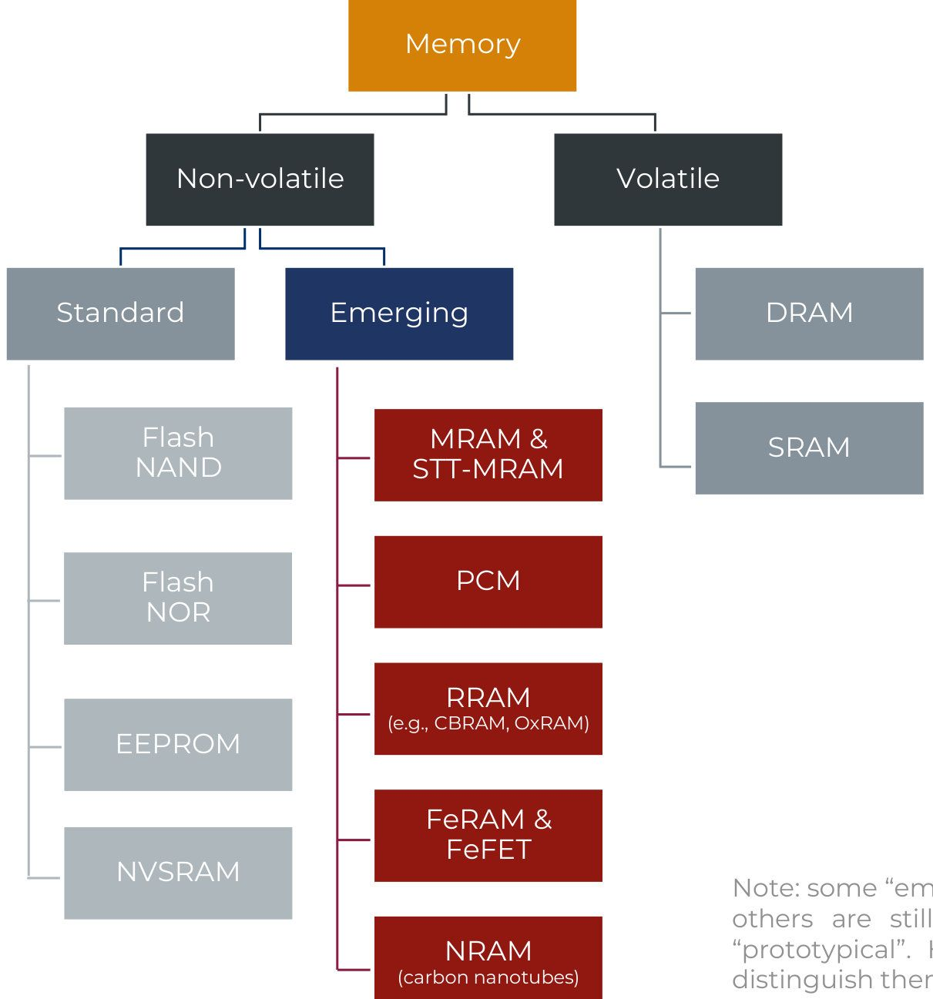

- Memory
  - Non-volatile
    - Standard
      - Flash NAND
      - Flash NOR
      - EEPROM
      - NVSRAM
    - Emerging
      - MRAM & STT-MRAM
      - PCM
      - RRAM (e.g., CBRAM, OxRAM)
      - FeRAM & FeFET
      - NRAM (carbon nanotubes)
  - Volatile
    - DRAM
    - SRAM

Volatile memory

- Requires power supply to retain information.
- Examples: DRAM, SRAM.

Non-volatile memory

- Retains stored information even when unpowered. Mainstream NVM technologies are based on electrical charge storage.
- Examples: flash NAND and NOR.

Random access memory

- Data can be read and written in the same amount of time, irrespective of the physical location inside the memory.

Emerging non-volatile memory

- Based on principles other than retention of charges.
- Some products are already available on the market, and mass production has started. Certain newly emerging memories are still under development.

Note: some "emerging" memories have already emerged and are now in mass production, whereas others are still in R&D or pre-production and could be more appropriately referred to as "prototypical". Here, the term "emerging" is used to indicate all recent technologies and to distinguish them from their mainstream counterparts.

[Source Page: 6]

# REPORT OBJECTIVES

Yole is pleased to provide you with the 2025 update of the "Next-Generation DRAM" report, which provides a detailed analysis of the DRAM market and technology trends with a focus on DRAM scaling, high-bandwidth memory, and 3D DRAM. The main objectives of this report are as follows:

## (1) Provide a comprehensive analysis of the DRAM market

- Description of the memory market, outlining the DRAM market cyclicality throughout history (from the early 1980s to the present).
- DRAM business overview, with market forecasts in terms of revenue, bit shipments, bit demand, and average selling prices.
- DRAM supply analysis, with capex and wafer production forecast with details on the adoption of CBA* DRAM architectures.
- High-Bandwidth Memory (HBM) business: market drivers, player dynamics, bit shipments, wafer production, and more.
- Long-term 3D DRAM market evolution (2030-2035) and impact of the 2D-to-3D transition on the DRAM equipment business.

## (2) Present the latest DRAM technology trends

- Technology roadmaps by DRAM supplier for next-generation DRAM devices, such as DDR5 and HBM.
- Technical solutions for DRAM scaling in terms of equipment (including EUV lithography), novel cell structures, and materials.
- Advanced packaging for memory: technical trends and roadmaps for high-performance DRAM devices.
- Adoption of hybrid bonding for CBA* DRAM, HBM, as well as for emerging AI devices based on logic-DRAM stacks.
- Emerging technologies, such as 3D DRAM and processing-in-memory (PiM).

## (3) Describe the supply chain and the DRAM ecosystem

- DRAM supply chain with a focus on wafer-fab equipment and material suppliers.
- China's DRAM business with analysis of the main technology developments by Chinese players.

*CMOS Bonded Array (CBA) – An Xtacking™-like approach used for stacking the DRAM array wafer and the "periphery-circuit" wafer via hybrid bonding (wafer-to-wafer).

[Source Page: 7]

# SCOPE OF THE REPORT

Your needs are out of the report's scope?

Contact us for a customized inquiry

## DRAM Market Dynamics

- DRAM market revenue and bit shipments
  (with details on DDR5 and HBM)
- DRAM wafer production by node
- Market adoption of CBA* DRAM
- Market scenario for 3D DRAM

## Next-gen. DRAM via Advanced Packaging

HBM and logic-DRAM integration

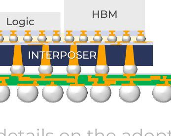

CBA* DRAM

(with details on the adoption of hybrid bonding)

## Next-gen. 2D DRAM technology

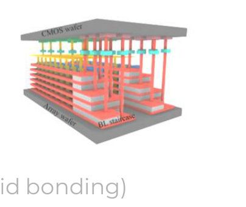

6F² → 4F²

Vertical Channel Transistors

CMOS bonding

2D DRAM generations along the timeline: 1c(γ), 1d(δ), 1ε, 0a, 0b, 0c (timeline axis: 2025, 2027, 2029, 2031)

## 3D DRAM

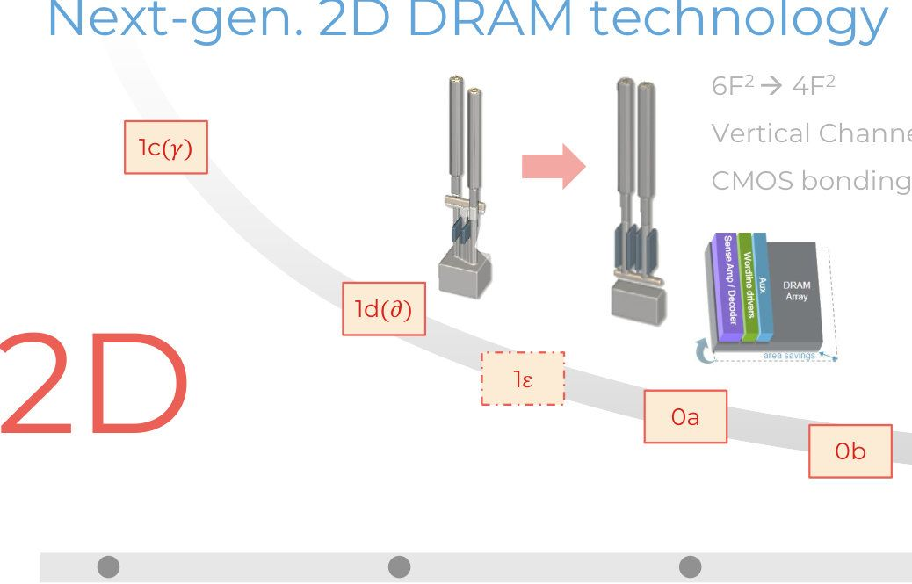

Multiple possibilities under investigation

- 1T-1C DRAM with flipped capacitors
- 2T-0C DRAM
- 1T DRAM with 3D flash architecture

*CBA: CMOS Bonded Array

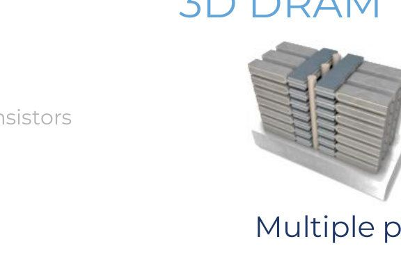

[Source Page: 8]

# IDENTITY CARD

## What will you find in this report?

### Main Markets

- Automotive & Mobility
- Defense & Aerospace
- Industrial
- Medical
- Mobile & Consumer
- Telecom & Infrastructure

### Main Systems tracked

Servers

Personal Computers

Cell phones and tablets

Wearables

Smart home appliances

Vehicles

and more.

### Technology

DRAM

- DDR5
- HBM
- 3D DRAM

### Key metrics

2020-2025-2030 Timeframe

Units

Value

Wafer

Players

Market shares

Supply chain

Strategy

Financial analysis

Trends

Business news

Technology status

Technology Roadmap

### Depth analysis

System

Module

Sub-module

Device

Process

Wafer

Material

Equipment

### Frequency update

Quarterly

Yearly

## Quick Summary

- The "Next-Generation DRAM 2025" report provides a detailed analysis of the leading-edge DRAM technology and market trends. It describes the technical challenges and the potential solutions for continuous DRAM device scaling; it offers details on DDR5, HBM, processing-in-memory (PiM), memory packaging, and other emerging technologies, including 3D DRAM.

## Key Features

- Overview of the semiconductor memory market with a focus on DRAM.
- Description of key technology trends and R&D activities by suppliers, such as CBA and 4F2 DRAM, 3D DRAM, processing-in-memory (PiM) and HBM.
- Market forecast for DRAM in terms of wafer production, bit shipments, bit demand, capex, and more.
- Analysis of ongoing and future DRAM technology transitions, such as DDR4-to-DDR5, 3D DRAM, HBM with hybrid bonding, etc.
- Technology roadmaps by DRAM suppliers and detailed analysis of the competitive landscape.
- Description of the DRAM ecosystem and analysis of the WFE and material for DRAM manufacturing.

## What's new?

- Analysis of DRAM bit shipments by technology – DDR, LPDDR, GDDR, HBM – and by generation (e.g., DDR3, DDR4, DDR5, DDR6)
- Breakdown of the HBM market by generation – including HBM4, HBM4E, HBM5, and beyond – and by stack height (4Hi, 8Hi, 12HI, 16Hi and 20Hi).
- Revised HBM ASP model with breakdown by interface.
- Detailed analysis of the HBM supply chain highlighting key equipment and materials vendors.
- Update on the Chinese HBM business: China's reactions to US export controls, technology roadmaps for CXMT, recent investments, and player dynamics.

[Source Page: 9]

# METHODOLOGIES & DEFINITIONS

Yole's market forecast model is based on the matching of several sources:

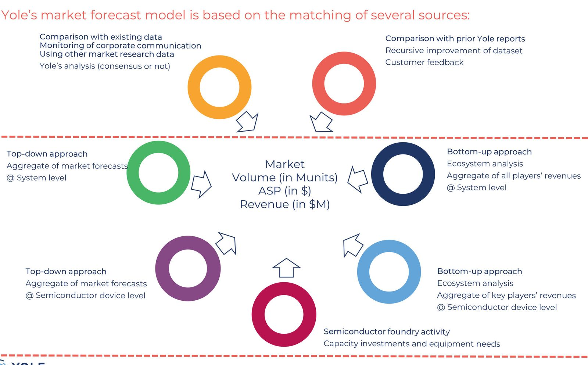

Comparison with existing data
Monitoring of corporate communication
Using other market research data
Yole's analysis (consensus or not)

Comparison with prior Yole reports
Recursive improvement of dataset
Customer feedback

Preexisting information

Top-down approach
Aggregate of market forecasts @ System level

Bottom-up approach
Ecosystem analysis
Aggregate of all players' revenues @ System level

Market
Volume (in Munits)
ASP (in $)
Revenue (in $M)

Primary data

- Reverse costing
- Patent analysis
- Annual reports
- Direct interviews

Secondary data

- Press releases
- Industry organization reports
- Conferences

Top-down approach
Aggregate of market forecasts @ Semiconductor device level

Bottom-up approach
Ecosystem analysis
Aggregate of key players' revenues @ Semiconductor device level

Semiconductor foundry activity
Capacity investments and equipment needs

Information Aggregation

[Source Page: 10]

# ABOUT THE AUTHORS – MEMORY ACTIVITY

## Simone BERTOLAZZI, PhD

Principal Analyst, Memory

**Experience**

- 15+ years in emerging semiconductors and devices

**At Yole Group**

- Memory

**Education**

- PhD in nanoelectronics
- MSc in micro & nanotechnology
- MSc in engineering physics

## John LORENZ

Principal Analyst, Memory

**Experience**

- 20+ years in advanced semiconductor devices

**At Yole Group**

- Memory and computing

**Education**

- Bachelor of Mechanical Engineering

## Thibault GROSSI

Senior Technology & Market Analyst, Memory

**Experience**

- 15+ years in electronics industry

**At Yole Group**

- Memory

**Education**

- MSc in electronic and computing science

## Josephine LAU

Senior Technology & Market Analyst, Memory

**Experience**

- 10+ years in memory and storage industry

**At Yole Group**

- Memory

**Education**

- Bachelor of Business Marketing
- Passed CFA level 1

## Belinda DUBE

Senior Technology & Cost Analyst, Memory

**Experience**

- 6+ years in semiconductor industry

**At Yole Group**

- Memories, ICs, advanced packaging

**Education**

- Master's degree in instrumentation & nanotechnology engineering

## Daniel NIU

Market Researcher

**Experience**

- 3+ years in memory and processor industry

**At Yole Group**

- Memory, computing and AI

**Education**

- Master's degree in chemical engineering

[Source Page: 11]

# COMPANIES CITED* IN THIS REPORT

ACM Research, Adata, Advantest, Alibaba DAMO Academy, Alliance Memory, Alphabet, AMEC, AP Memory, Apacer, Apple, Applied Materials, ASE, ASML, Avalanche, BeSang, Buffalo, Canon, CXMT, Cisco, Dell, Dosilicon, Etron, ESMT, Everspin, Ferroelectric Memory Company, Fujitsu, GigaDevice, GlobalFoundries, HHGrace, Hikstor, Hitachi, HLMC, HP, Huawei, IBM, ICLeague, IMEC, IMECAS, Infineon, Innostar, Intel, ISSI, Jasminer, JHICC, Kingston, KLA, Lam Research, Lenovo, Longsys, Liteon, Macronix, Materion, Micron, MonolithIC 3D, Montage Technology, Nano Labs, Nantero, Nanya, Naura, Neo Semiconductor, Nikon, Nuvoton, NXP, onsemi, Powerchip, Powertech, ProMOS Technologies, Qualcomm, Rambus, Reliance, Realtek, Renesas, Rohm, Samsung, SanDisk, Seagate, Semtech, Silicon Motion, SK hynix, SK Materials, Smart Modular Technologies, SMEE, SMIC, Sony, SPIL, SST, Spin Memory, STMicroelectronics, STEC, SunLune, Sunrise, Texas Instruments, Tokyo Electron, Toshiba, TowerJazz, TPSCo, Transcend, Tsinghua Unigroup, TSMC, UMC, UniIC Semiconductors, Unimos Microelectronics, Unisantis Electronics, Viking, Violin Memory, Winbond, XFab, XMC, YMTC, and more.

*non-exhaustive list

[Source Page: 12]

# WHAT WE GOT WRONG, WHAT WE GOT RIGHT

## The HBM market is growing faster than expected, driven by aggressive GPU and AI ASIC commercialization roadmaps

### What we got wrong

- In the previous edition of this report, we anticipated a gradual decline in the average price of HBM starting in 2025, driven by increasing volumes and intensifying competition among the three leading suppliers. While competitive pressure continues to push prices downward, the blended average price of HBM across multiple generations is now projected to rise with a CAGR24-30 of 2%. This shift is primarily due to the complexity of next-generation HBM4, HBM4E, and HBM5 devices, which may include premium, customized options.
- The ramp-up of 4F²+CBA DRAM has been delayed by approximately 2 years. Top memory makers are likely to implement their 0d node with "conventional" 6F² technology.
- Due to stringent pitch/alignment requirements, CBA DRAM is expected to be implemented with fusion bonding, not hybrid bonding.
- The adoption of collective die-to-wafer hybrid bonding for HBM manufacturing has also been postponed from HBM4 (2026) to HBM5 with 20 dies per stack (2029). However, we currently expect a wafer-to-wafer hybrid to be used in HBM4E (late 2027) to stack the first DRAM layer and the logic IC.
- CXMT has ramped up DDR4 DRAM production to higher levels than expected and introduced DDR5 DRAM (16nm process) ahead of schedule.

### What we got right

- In early 2024, Yole Group was the first market research firm to project impressive HBM revenue growth from $5.4B in 2023 to over $14B in 2024. While this bold forecast was initially met with skepticism by several industry insiders, actual data not only confirmed it but even surpassed expectations.
- The transition to 4F²+CBA is set to occur before 2029, though the exact timeline remains uncertain. We currently anticipate ramp-up beginning with the 0a node. To address the needs of different vertical markets, DRAM manufacturers will likely offer a mix of 6F² and 4F²+CBA products.
- As expected, China continues to move aggressively toward self-sufficiency in advanced semiconductor technologies, including HBM. The U.S. curbs on AI chips have triggered significant investments and numerous initiatives for producing leading-edge memory within China. Reportedly, the first HBM2 products by Chinese companies are getting ready for commercialization.
- Samsung, SK hynix, and Micron continue investing in the development of 3D DRAM for long-term DRAM scaling. The first prototypes have been presented / discussed at technical conferences: 5, 8, and 16 layers for SK hynix, Micron, and Samsung, respectively.

[Source Page: 13]

# 2025 VS 2024 HBM FORECAST COMPARISON

## The HBM market is growing faster than expected, driven by aggressive GPU and AI ASIC commercialization roadmaps

### HBM Revenue ($B)

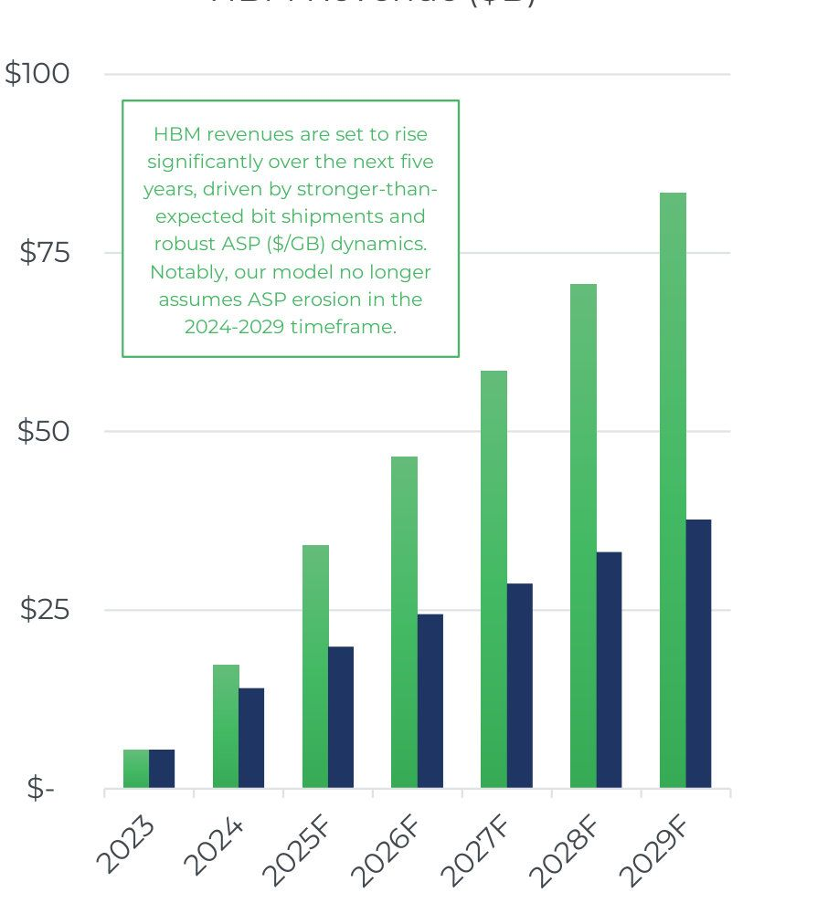

- Y-axis: $100 / $75 / $50 / $25 / $-
- X-axis: 2023, 2024, 2025F, 2026F, 2027F, 2028F, 2029F

> HBM revenues are set to rise significantly over the next five years, driven by stronger-than-expected bit shipments and robust ASP ($/GB) dynamics. Notably, our model no longer assumes ASP erosion in the 2024-2029 timeframe.

### HBM Bit Shipments (EB)

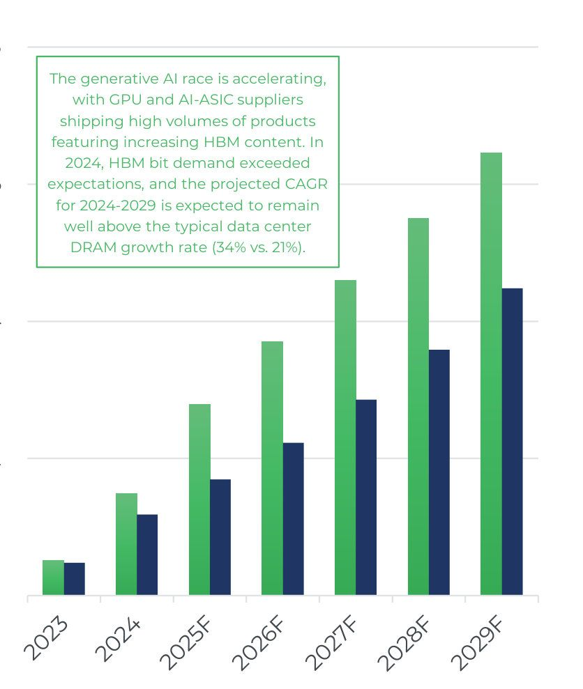

- Y-axis: 8 / 6 / 4 / 2 / -
- X-axis: 2023, 2024, 2025F, 2026F, 2027F, 2028F, 2029F

> The generative AI race is accelerating, with GPU and AI-ASIC suppliers shipping high volumes of products featuring increasing HBM content. In 2024, HBM bit demand exceeded expectations, and the projected CAGR for 2024-2029 is expected to remain well above the typical data center DRAM growth rate (34% vs. 21%).

### HBM Wafer Production (K WPM)

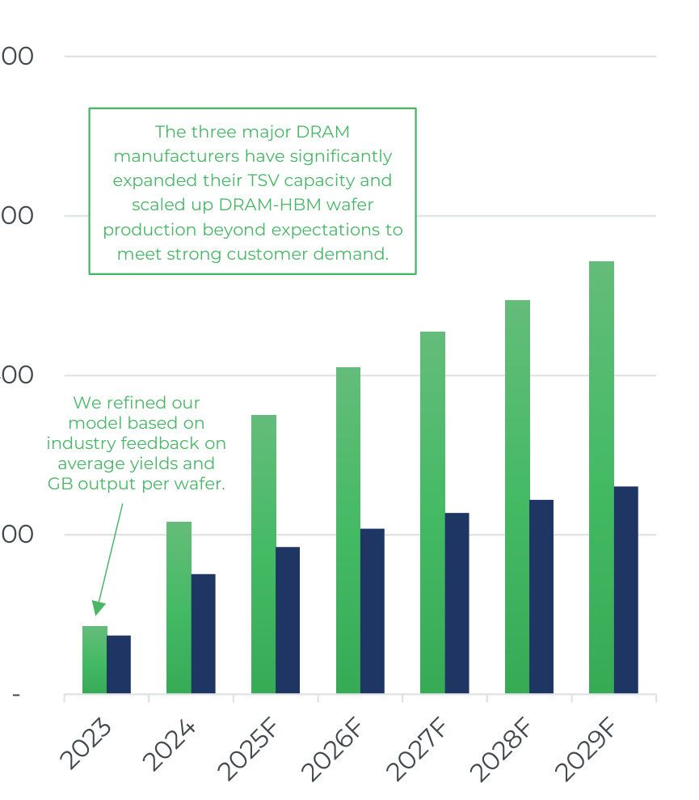

- Y-axis: 800 / 600 / 400 / 200 / -
- X-axis: 2023, 2024, 2025F, 2026F, 2027F, 2028F, 2029F

> The three major DRAM manufacturers have significantly expanded their TSV capacity and scaled up DRAM-HBM wafer production beyond expectations to meet strong customer demand.

> We refined our model based on industry feedback on average yields and GB output per wafer.

Legend (all three charts): "Next-Generation DRAM" Report – 2024 Edition (Analysis in November 2023); "Next-Generation DRAM" Report – 2025 Edition (Analysis in March 2025)

[Source Page: 14]

# 3-PAGE SUMMARY

[Source Page: 15]

# NEXT-GENERATION DRAM – MARKET OVERVIEW

## HBM shipments expand rapidly with over 190% YoY growth in 2024, and revenue is on track to hit $98 billion by 2030

- The High-Bandwidth Memory (HBM) market is experiencing exponential growth, primarily driven by the proliferation of artificial intelligence (AI) workloads and high-performance computing (HPC) applications. The generative AI boom, catalyzed by the introduction of ChatGPT in late 2022, resulted in an unprecedented 187% year-over-year (YoY) increase in HBM bit shipments in 2023, followed by an additional 193% surge in 2024. This trajectory is expected to persist, with HBM bit shipments forecasted to grow at a 31% compound annual growth rate (CAGR) through 2030.
- HBM is significantly outpacing the broader DRAM market. Global HBM revenue is projected to increase from $17B in 2024 to $98B by 2030, reflecting a 33% CAGR. Consequently, HBM's revenue share within the DRAM market is expected to increase from 18% in 2024 to 50% by 2030.
- The market will see another significant inflection point in 2025, with HBM revenues projected to double to ~$34B. Current supply constraints underscore the strategic importance of HBM in AI data centers and advanced computing platforms, as evidenced by reports from SK hynix and Micron indicating that their HBM production capacity is fully allocated through 2025. These supply-side limitations reinforce the need for investments in capacity expansion to meet the escalating demand.
- By contrast, conventional DRAM – including DDR, LPDDR, and GDDR – was valued at $80B in 2024 but is expected to grow at a modest 3% CAGR between 2024 and 2030, constrained by inherent price fluctuations and market cyclicality (as detailed in the DRAM Market Monitor by Yole Group). The combined growth of HBM and conventional DRAM translates to an overall DRAM market CAGR of 12%, with revenues increasing from $97B in 2024 to $194.5B in 2030.
- From a bit shipment perspective, HBM represented 5% of total DRAM bits in 2024, equivalent to 11.9Eb (1.49M GB) out of 254Eb (31.7M GB), and is projected to reach 9% by 2030. As a premium-tier product, HBM's average selling price (ASP) is currently estimated to be up to four times higher than the blended DRAM ASP in 2024. While competition among the three dominant HBM suppliers is expected to exert downward pricing pressure, blended HBM ASPs are projected to remain stable due to sustained demand.
- The introduction of next-generation HBM architectures – including HBM4, HBM4E, and HBM5 – will drive further improvements in bit density and stacking technology, enabling greater memory capacity per package. These technological advancements will not only enhance performance metrics but also sustain premium pricing structures. Current market projections indicate that HBM ASP per gigabyte (GB) will increase at a 2% CAGR from 2024 to 2030.
- To capitalize on the AI-driven demand surge and accelerate market recovery, leading suppliers – including Samsung, SK hynix, and Micron – have increased their wafer allocations for HBM production. In 2024, HBM wafer output expanded by more than 150% YoY, reaching approximately 216K wafer starts per month (KWPM). This upward trajectory is expected to continue in 2025, with average monthly production projected to reach ~350 KWPM. By 2030, HBM wafer capacity is expected to scale to 590 KWPM, reflecting a 9% CAGR2024-2030.
- In parallel with the industry's strong focus on HBM, the slowdown in planar DRAM scaling is prompting memory manufacturers to investigate alternative approaches to maintain progress in bit density, performance, and cost efficiency. Among these, 3D DRAM is emerging as a leading candidate, currently in the pathfinding stage. It is widely regarded as the most promising long-term solution for achieving high-density DRAM architectures in the coming decade. Initial commercial deployment of 3D DRAM is anticipated around 2033–2034, with revenue growth expected to accelerate significantly in the latter half of the 2030s.

[Source Page: 16]

# NEXT-GENERATION DRAM – PLAYER DYNAMICS

## HBM leaders intensify the race, while China steadily progresses in AI and advanced memory technologies

- The global battle for HBM leadership has accelerated sharply, driven by the explosive demand for AI computing. This reflects the strategic importance of memory bandwidth and energy efficiency for AI.
  - SK hynix currently leads the market. The company began mass production of 12Hi HBM3E in September 2024 and has already started sampling 12Hi HBM4 (36GB) to customers as of March 2025, with mass production expected in 2H 2025. A notable collaboration with TSMC, announced in April 2024, is helping SK hynix strengthen its position in both advanced packaging and next-generation HBM technologies. This momentum culminated in a record quarterly operating profit of $5.6B in Q4-2024, overtaking Samsung for the first time.
  - Samsung, traditionally a dominant memory player, has fallen behind in the HBM segment and is now pushing hard to catch up. After facing yield and thermal challenges with its design for HBM3E, the company is now refining its DRAM design and working on 4nm logic dies for HBM4. Trial production has begun, with sample shipments expected in 2025. Internally, Samsung restructured its HBM operations in July 2024, forming a dedicated team to enhance its competitiveness across HBM3, HBM3E, and HBM4.
  - Micron, having skipped HBM3, entered the race with HBM3E in 2024. It began mass production of 8Hi and 12Hi HBM3E in 2024, with integration into Nvidia's H200 GPUs. However, Micron's current production capacity is limited – less than 20% of that of SK hynix and Samsung combined – but is scaling up rapidly, targeting 60,000 units/month by the end of 2025. Mass production of HBM4 is planned for 2026, with HBM4E to follow.
- China, which consumed over 25% of global DRAM in 2024, is accelerating efforts to localize memory production amid tightening U.S. sanctions.
  - Changxin Memory Technologies (CXMT), the country's leading DRAM maker, skipped its G2 node and ramped up G3 (~18.5nm) production in 2024, significantly boosting DDR4 shipments and contributing to price decreases. In December 2024, KingBank and Gloway launched the first domestic DDR5 memory modules using CXMT G4 DRAM chips (16nm process), marking a supply chain milestone for China.
  - In response to U.S. restrictions on AI chips and HBM, Chinese companies have launched large-scale investments to build domestic alternatives. Huawei is reportedly leading a consortium – including XMC, SJSemi, TFME, and JCET – to establish HBM capabilities. Meanwhile, CXMT is sampling HBM2 and actively developing HBM2E, supported by a $2.4B investment in advanced packaging. Despite the technological gap with industry leaders (~6 years), Chinese players can leverage strong domestic demand for locally developed AI accelerators, supported by significant government backing and a well-established industry network. These factors are expected to help them gain a foothold in the HBM market in the coming years.
  - China is increasingly focusing its R&D on (1) advanced packaging for DRAM-logic integration and (2) alternative scaling approaches beyond traditional lithography, including 4F² cells, CBA-DRAM, and 3D DRAM. These innovations allow Chinese players to develop high-performance AI chips without relying on restricted technologies like EUV lithography.
- With 2D DRAM scaling expected to reach its limit by 2033–2034, the industry is preparing for a shift to 3D DRAM architectures. This transition will ease dependence on advanced lithography and drive demand for deposition (ALD, CVD), HAR etching, and bonding tools – creating new opportunities, particularly for players without access to EUV, like China. Though still in early R&D, 3D DRAM has the potential to reshape industry dynamics and offer a pathway for latecomers to close the gap.

[Source Page: 17]

# NEXT-GENERATION DRAM – OVERVIEW BY TECHNOLOGY

## As scaling challenges grow, new designs, CMOS bonding, and 3D architectures are redefining DRAM development

- Despite increasing scaling challenges, planar DRAM is expected to continue evolving through the 0c/0d nodes (2033–2034), leveraging a combination of architectural and process innovations. The industry is currently reliant on the 6F² DRAM cell structure, which dominates all commercial products as of 2025. However, further miniaturization will eventually necessitate a transition to 4F² cells based on vertical transistors (VT), integrated within a CMOS Bonded Array (CBA) architecture.
- CBA enables higher bit density by separating the periphery circuit and memory array onto different wafers, which are subsequently bonded. This transition, expected around the 0a node (~2029), is anticipated to deliver up to a 30% increase in bit density. Despite the technical complexity and cost, CBA paves the way for the use of advanced logic (e.g., FinFETs) for improved performance and reliability and is seen as a crucial step in the DRAM roadmap and a precursor to full 3D DRAM.
- While 4F²+CBA offers significant advantages in density and logic integration, cost and yield challenges may continue to pose major obstacles. Under these conditions, DRAM manufacturers are likely to extend 6F² scaling as far as economically viable, supported by broader adoption of EUV lithography – including High-NA EUV – to maintain density and performance scaling. According to our current model, starting in 2029, the top three DRAM suppliers are expected to implement a mixed-fab strategy, producing both 6F² and 4F²+CBA DRAM to address diverse performance and cost segments. Beyond 2030, CBA integration is anticipated to become a standard requirement – even for 6F² architectures – to sustain the industry's long-term scaling trajectory.
- CMOS bonding is becoming a cornerstone technology for next-generation DRAM, particularly with CBA integration. Due to sub-200nm alignment and pitch constraints, fusion bonding is expected to be the preferred technique for wafer-to-wafer (W2W) stacking in DRAM starting from the 0a node. This bonding approach, although more costly than hybrid alternatives, enables precise alignment essential for high-density DRAM.
- Hybrid bonding is being regarded as a key enabler for future HBM generations, particularly for high-stack configurations. However, due to yield and throughput challenges, HBM suppliers have extended microbump-based approaches – such as fluxless TCB and advanced MR-MUF – for HBM4 and HBM4E. Hybrid bonding is now projected to enter the market with HBM5 (around 2029), particularly for premium 20Hi–24Hi stacks, where gapless bonding and die thinning (down to ~20µm) are required to adhere to the existing JEDEC standard on total stack thickness. Note: In March 2024, JEDEC relaxed the HBM4 thickness requirements from 720µm to 775µm, enabling the use of TSV/microbumps for manufacturing 16Hi products.
- After the 0c/0d nodes, the transition to a 3D DRAM architecture is expected to be inevitable. As of 2025, all major DRAM manufacturers – including Samsung, SK hynix, Micron, and CXMT – are actively exploring multiple architectural pathways to enable 3D DRAM integration. Among the leading candidates are 1T-1C cell architectures with horizontally oriented capacitors, as well as capacitor-less alternatives such as gain cells (2T0C) and floating-body-based 1T-DRAM designs. In parallel, leading semiconductor equipment suppliers – such as Applied Materials, Lam Research, and Tokyo Electron – are investing in tooling solutions to address the unique challenges associated with 3D DRAM manufacturing.
- The shift to 3D DRAM is likely to mirror the transformational leap observed in NAND flash memory and will require a retooling of front-end process flows. While lithography constraints are expected to ease – allowing relaxed nodes around 20nm and minimizing reliance on EUV – the demand for advanced deposition and etch solutions will drive capital intensity. These include high-aspect-ratio (HAR) etching, advanced gap-fill processes, and atomic-layer deposition (ALD) for conformal films. Additionally, the implementation of selective removal techniques and precise doping strategies will be essential to realize viable 3D DRAM structures at scale.

[Source Page: 18]

# EXECUTIVE SUMMARY

[Source Page: 19]

# DRAM MARKET OVERVIEW

Note: HBM is included

## 2024 DRAM Market Shares

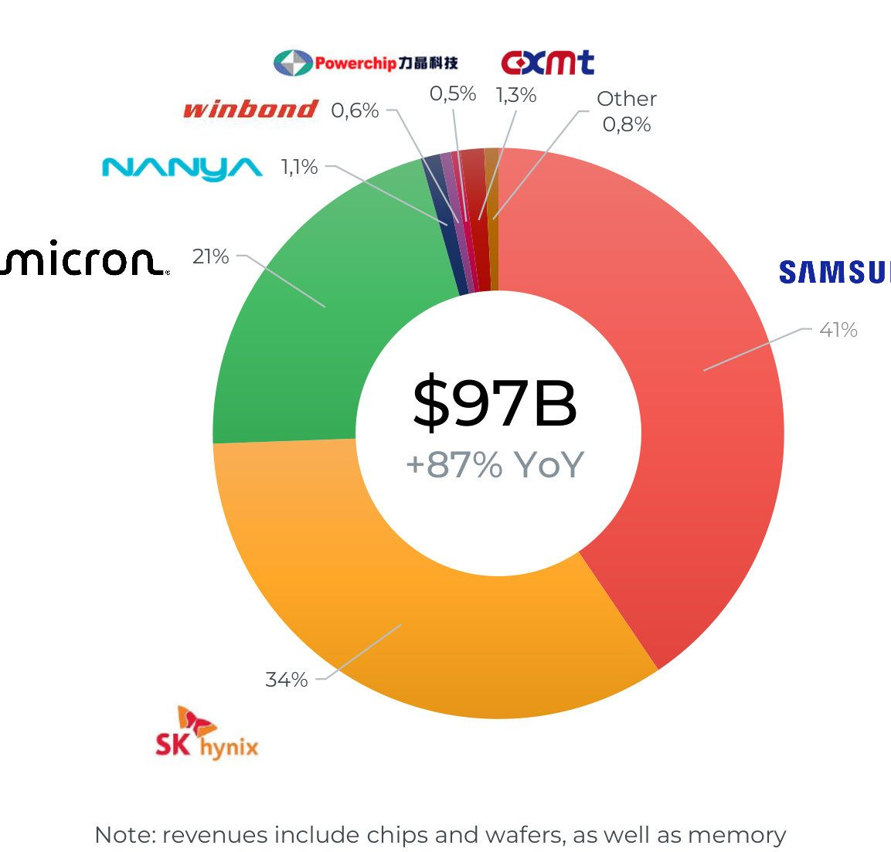

Center label: $97B, +87% YoY

| Company | Share |
| --- | --- |
| SAMSUNG | 41% |
| SK hynix | 34% |
| Micron | 21% |
| NANYA | 1,1% |
| winbond | 0,6% |
| Powerchip力晶科技 | 0,5% |
| CXMT | 1,3% |
| Other | 0,8% |

Note: revenues include chips and wafers, as well as memory modules and HBM stacks sold by IDM memory companies.

## DRAM Market Revenue

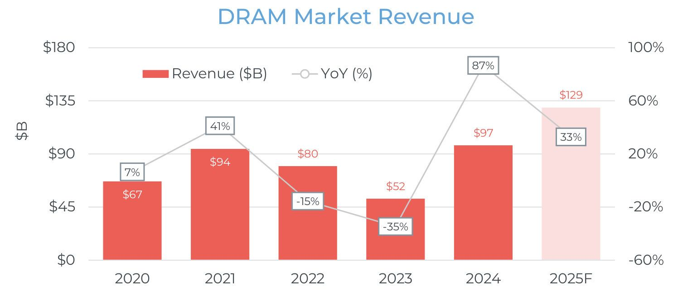

- Left axis: Revenue ($B) — $180 / $135 / $90 / $45 / $0
- Right axis: YoY (%) — 100% / 60% / 20% / -20% / -60%
- X-axis: 2020, 2021, 2022, 2023, 2024, 2025F

| Year | Revenue ($B) | YoY (%) |
| --- | --- | --- |
| 2020 | $67 | 7% |
| 2021 | $94 | 41% |
| 2022 | $80 | -15% |
| 2023 | $52 | -35% |
| 2024 | $97 | 87% |
| 2025F | $129 | 33% |

## DRAM Average Selling Price

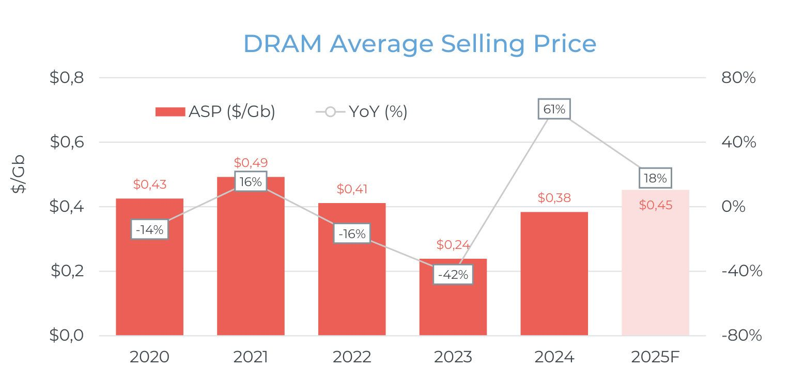

- Left axis: ASP ($/Gb) — $0,8 / $0,6 / $0,4 / $0,2 / $0,0
- Right axis: YoY (%) — 80% / 40% / 0% / -40% / -80%
- X-axis: 2020, 2021, 2022, 2023, 2024, 2025F

| Year | ASP ($/Gb) | YoY (%) |
| --- | --- | --- |
| 2020 | $0,43 | -14% |
| 2021 | $0,49 | 16% |
| 2022 | $0,41 | -16% |
| 2023 | $0,24 | -42% |
| 2024 | $0,38 | 61% |
| 2025F | $0,45 | 18% |

Source: DRAM Market Monitor Q1-2025 by Yole Group

[Source Page: 20]

# DRAM MARKET FORECAST – BIT SHIPMENTS

## DRAM Bit Shipments (in Exabits)

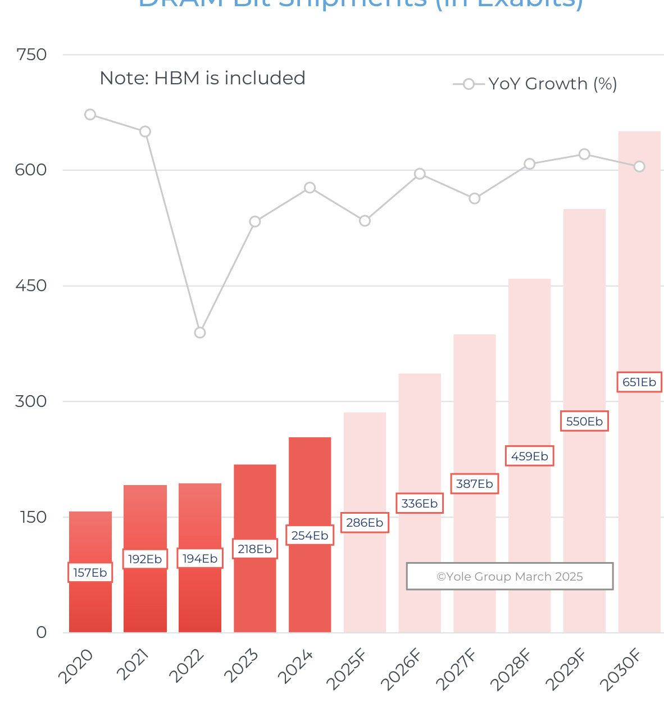

Note: HBM is included

- Left axis: 0 / 150 / 300 / 450 / 600 / 750
- Right axis: YoY Growth (%) — 30% / 20% / 10% / 0% / -10% / -20% / -30%
- X-axis: 2020, 2021, 2022, 2023, 2024, 2025F, 2026F, 2027F, 2028F, 2029F, 2030F

| Year | DRAM Bit Shipments |
| --- | --- |
| 2020 | 157Eb |
| 2021 | 192Eb |
| 2022 | 194Eb |
| 2023 | 218Eb |
| 2024 | 254Eb |
| 2025F | 286Eb |
| 2026F | 336Eb |
| 2027F | 387Eb |
| 2028F | 459Eb |
| 2029F | 550Eb |
| 2030F | 651Eb |

YoY Growth (%) is plotted as a line series and carries no data labels on the page.

## DRAM Bit Shipments – Breakdown by Technology

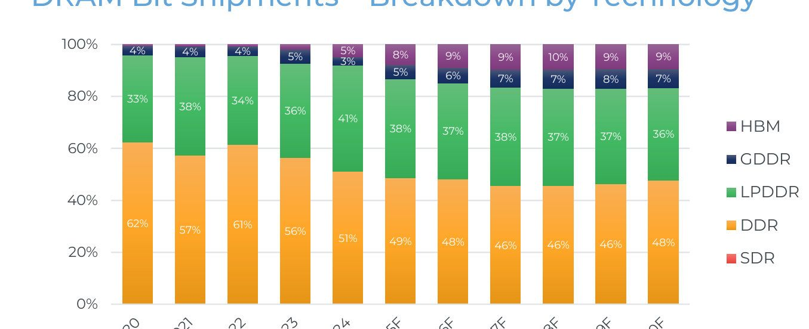

| Year | DDR | LPDDR | GDDR | HBM | SDR |
| --- | --- | --- | --- | --- | --- |
| 2020 | 62% | 33% |  | 4% |  |
| 2021 | 57% | 38% |  | 4% |  |
| 2022 | 61% | 34% |  | 4% |  |
| 2023 | 56% | 36% |  | 5% |  |
| 2024 | 51% | 41% | 3% | 5% |  |
| 2025F | 49% | 38% | 5% | 8% |  |
| 2026F | 48% | 37% | 6% | 9% |  |
| 2027F | 46% | 38% | 7% | 9% |  |
| 2028F | 46% | 37% | 7% | 10% |  |
| 2029F | 46% | 37% | 8% | 9% |  |
| 2030F | 48% | 36% | 7% | 9% |  |

## DDR Bit Shipments – Breakdown by Generation

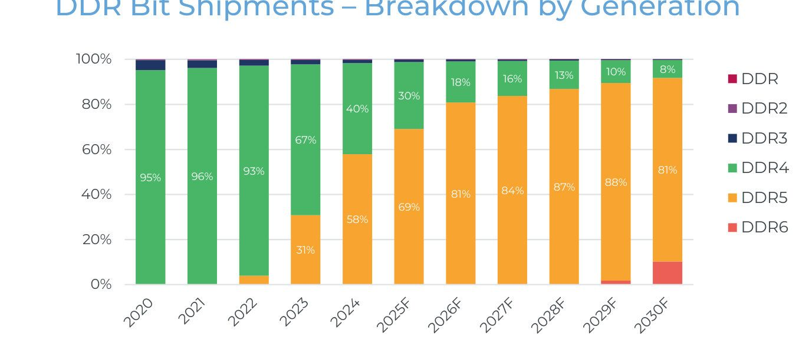

| Year | DDR | DDR2 | DDR3 | DDR4 | DDR5 | DDR6 |
| --- | --- | --- | --- | --- | --- | --- |
| 2020 |  |  |  | 95% |  |  |
| 2021 |  |  |  | 96% |  |  |
| 2022 |  |  |  | 93% |  |  |
| 2023 |  |  |  | 67% | 31% |  |
| 2024 |  |  |  | 40% | 58% |  |
| 2025F |  |  |  | 30% | 69% |  |
| 2026F |  |  |  | 18% | 81% |  |
| 2027F |  |  |  | 16% | 84% |  |
| 2028F |  |  |  | 13% | 87% |  |
| 2029F |  |  |  | 10% | 88% |  |
| 2030F |  |  |  | 8% | 81% |  |

DDR3, DDR2, DDR and DDR6 segments are drawn without data labels on the page.

Source: DRAM Market Monitor Q4-2024 by Yole Group

[Source Page: 21]

## DRAM MARKET FORECAST – BIT DEMAND BY END MARKET

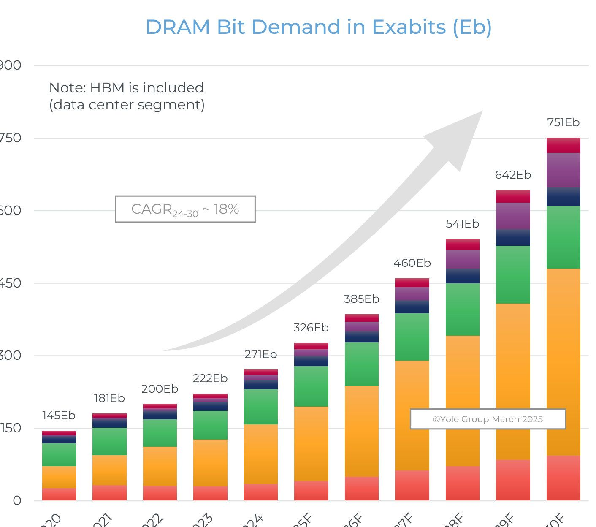
**DRAM Bit Demand in Exabits (Eb)**

Note: HBM is included (data center segment)

纵轴（左）：0、150、300、450、600、750、900
横轴：2020、2021、2022、2023、2024、2025F、2026F、2027F、2028F、2029F、2030F
堆叠柱顶部数据标签（按上述年份顺序）：145Eb、181Eb、200Eb、222Eb、271Eb、326Eb、385Eb、460Eb、541Eb、642Eb、751Eb
图中标注：CAGR24-30 ~ 18%

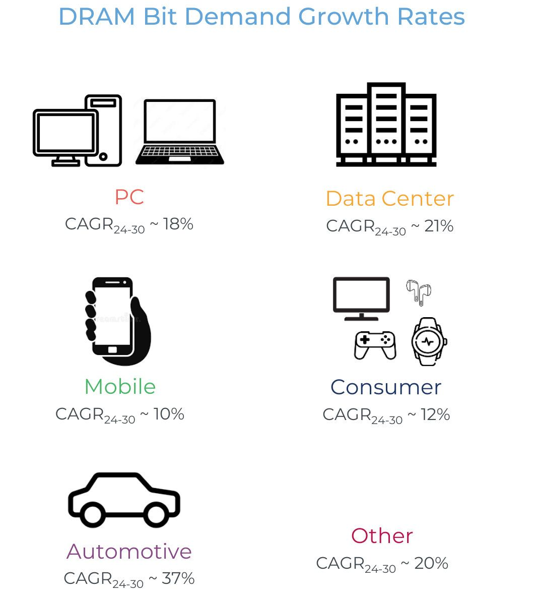
**DRAM Bit Demand Growth Rates**

- PC：CAGR24-30 ~ 18%
- Data Center：CAGR24-30 ~ 21%
- Mobile：CAGR24-30 ~ 10%
- Consumer：CAGR24-30 ~ 12%
- Automotive：CAGR24-30 ~ 37%
- Other：CAGR24-30 ~ 20%

Source: DRAM Market Monitor Q1-2025 by Yole Group

[Source Page: 22]

## DRAM BIT DEMAND – FOCUS ON DATA CENTERS

### Generative AI and HPC are fueling DRAM growth in data centers

- The rise of generative AI – initiated by the release of ChatGPT in November 2022 – and the continuous expansion of data-intensive AI/HPC applications in data centers led to a significant surge in DRAM shipments in 2023. These trends will induce continuous market growth throughout the next five years.

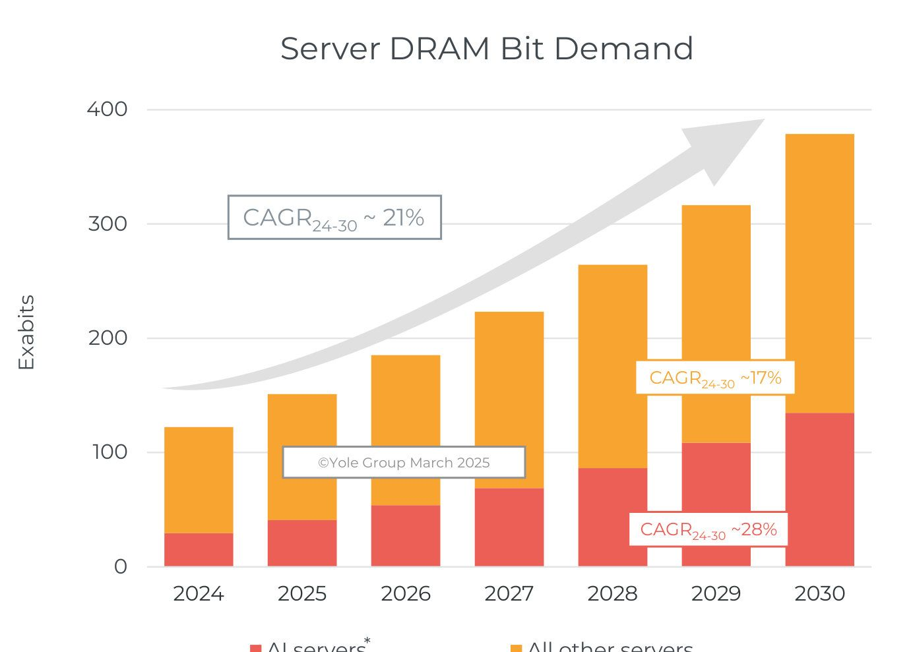
**Server DRAM Bit Demand**

纵轴：Exabits，刻度0、100、200、300、400
横轴：2024、2025、2026、2027、2028、2029、2030
图例：AI servers*（红色）、All other servers（橙色）
图中标注：CAGR24-30 ~ 21%（整体）；CAGR24-30 ~17%（All other servers）；CAGR24-30 ~28%（AI servers）
堆叠柱本身无数据标签，未写各段数值。

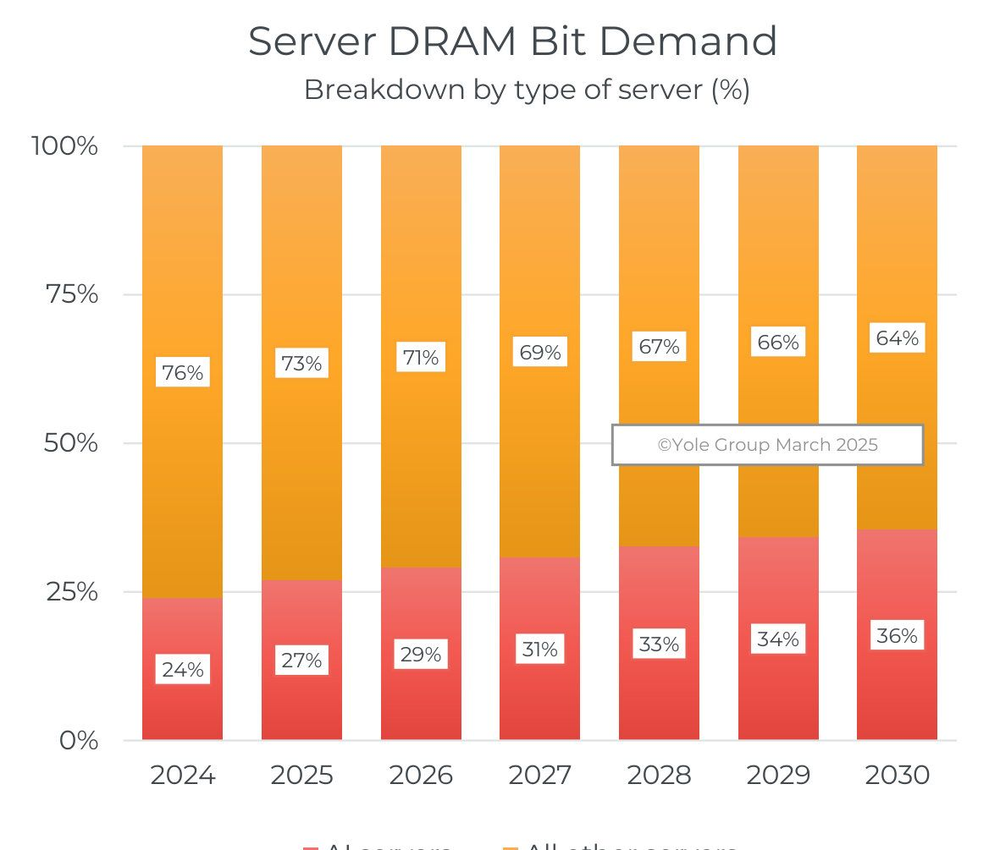
**Server DRAM Bit Demand — Breakdown by type of server (%)**

纵轴：0%、25%、50%、75%、100%
横轴：2024、2025、2026、2027、2028、2029、2030
AI servers占比标签（按年份顺序）：24%、27%、29%、31%、33%、34%、36%
All other servers占比标签（按年份顺序）：76%、73%、71%、69%、67%、66%、64%
图例：AI servers（粉红色）、All other servers（橙色）

*AI server systems dedicated to computing for AI

[Source Page: 23]

## HIGH-BANDWIDTH MEMORY (HBM) — Product Development Overview (1/2)

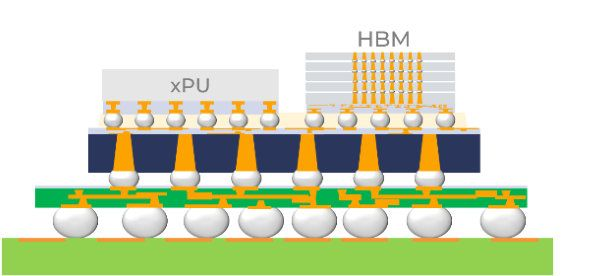
**HBM与xPU的3D堆叠结构示意图**

图内文字：xPU、HBM

| HBM generation | HBM | HBM2 | HBM2E | HBM3 | HBM3E | HBM4 |
| --- | --- | --- | --- | --- | --- | --- |
| Players with market products | SK hynix | SAMSUNG（Flarebolt、Aquabolt、Aquabolt-XL (PIM)）；SK hynix | SAMSUNG（Flashbolt）；SK hynix；micron | SAMSUNG（Icebolt）；SK hynix | SAMSUNG（Shinebolt）；SK hynix；micron | SAMSUNG；SK hynix；micron |
| Year of first product release | 2014 | 2018 | 2020 | 2022 - 2023 | 2024 | 2026 |
| Typical number of dies per stack (Main packaging approach) | 4Hi (TSV & microbumps) | 4-8Hi (TSV & microbumps) | 4-8Hi (TSV & microbumps) | 8-12Hi (TSV & microbumps) | 8-12Hi (16Hi)NEW (TSV & microbumps) | 12-16Hi (TSV & microbumps) |
| Max capacity per stack | 1GB | 4-8GB | 8-16GB | 16-24GB | 24-36GB (48GB)NEW | 36-48GB |
| Die density (Typical process) | 2Gb (2x) | 8-16Gb (2y, 2z) | 16Gb (1y, 1z)(2) | 16Gb (1z) | 24Gb (1a, 1b/1β) | 24Gb (32Gb)* (1b/1β, 1c/1γ) |
| Max data rate | 1Gbps | 2-2.4Gbps | 3.2-3.6Gbps | 5.6-6.4Gbps | 8.0-9.8Gbps | ≥ 6.4Gbps |
| Effective bus width | 1,024 | 1,024 | 1,024 | 1,024 | 1,024 | 2,048 |
| Max bandwidth per stack | 128GB/s | 205-307GB/s | 460GB/s | 819GB/s | 1.2TB/s | ≥ 2TB/s |

*Note: we expect that 32Gb dies will be adopted in HBM4 with 12Hi configurations (48GB)

[Source Page: 24]

## HIGH-BANDWIDTH MEMORY (HBM) — Product Development Overview (2/2)

| | | HBM3E 8Hi / 12Hi / 16HiNEW | HBM4 12Hi / 16Hi (Expected in 2026) | HBM4E 12Hi / 16Hi (Expected in 2027-2028) | HBM5 16Hi / 20Hi (Expected in 2029) |
| --- | --- | --- | --- | --- | --- |
| DRAM Die Process | SAMSUNG | 1a /1b DRAM(1) | 1b /1c DRAM(1) | 1c DRAM | 1d DRAM |
| DRAM Die Process | SK hynix | 1b DRAM | 1b DRAM | 1c DRAM | 1d DRAM |
| DRAM Die Process | micron | 1b DRAM | 1b DRAM | 1c DRAM | 1d DRAM |
| Base Die Process | SAMSUNG | 1a /1b DRAM | 4nm Samsung Foundry | 4nm / 2nm Samsung Foundry | ≤ 2nm Samsung Foundry |
| Base Die Process | SK hynix | 1b DRAM | 3nm / 5mn TSMC | 3nm TSMC | ≤ 3nm TSMC |
| Base Die Process | micron | 1b DRAM | 1b DRAM | 3nm TSMC | ≤ 3nm TSMC |
| Bonding Technology(2) | SAMSUNG | TC-NCF | TC-NCF | TC-NCF | TC-NCF / HB |
| Bonding Technology(2) | SK hynix | MR-MUF / Adv. MR-MUF | Adv. MR-MUF | Adv. MR-MUF | Adv. MR-MUF / HB (D2W) |
| Bonding Technology(2) | micron | TC-NCF | TC-NCF | TC-NCF | TC-NCF / HB (D2W) |

MR-MUF: Mass Reflow Molded Underfill　NCF-TCB: Non-Conductive Film Thermo-Compression Bonding　HB: Hybrid Bonding (collective die to wafer)

Notes: (1) Reportedly, Samsung faced yield and thermal issues with its 1b DRAM for HBM3E, prompting a shift back to the more stable 1a node while considering skipping 1b entirely for HBM4. However, due to Nvidia's preference, Samsung has been refining its 1b design. (2) Starting from HBM4E/HBM5 (≥16Hi), wafer-to-wafer hybrid bonding is likely to be adopted to stack the first DRAM layer on top of the base/logic layer. Die-to-Wafer (D2W) hybrid bonding will be used from the HBM5 generation to enable more than 20 dies per stack.

[Source Page: 25]

## HIGH-BANDWIDTH MEMORY (HBM) FOR GPUs AND AI ASICs

### Examples of products and roadmaps by GPU and AI ASIC players

Non-Exhaustive List!

| Company | Model | Type of (x)PU | Technology | Content (GB) | Capacity/Stack (GB) | Die Density (Gb) | Stack Height (# Dies) | Number of Stacks | Launch Date |
| --- | --- | --- | --- | --- | --- | --- | --- | --- | --- |
| aws | Inferentia 2 | AI ASIC | HBM3 | 32 | 16 | 16 | 8 | 2 | 2022-Q4 |
| aws | Trainium 2 | AI ASIC | HBM3E | 96 | 24 | 24 | 8 | 4 | 2024-Q4 |
| aws | Inferentia 2.5 | AI ASIC | HBM3 | 32 | 16 | 16 | 8 | 2 | 2024-Q2 |
| aws | Trainium 2.5 | AI ASIC | HBM3E | 144 | 36 | 24 | 12 | 4 | 2025-Q2 |
| aws | Trainium 3 | AI ASIC | HBM3E | 144 | 36 | 24 | 12 | 4 | 2025-Q4 |
| AMD | MI200 | GPU | HBM2E | 128 | 16 | 16 | 8 | 8 | 2021-Q4 |
| AMD | MI300 | GPU | HBM3 | 192 | 24 | 16 | 12 | 8 | 2023-Q4 |
| AMD | MI325 | GPU | HBM3E | 288 | 36 | 24 | 12 | 8 | 2024-Q4 |
| AMD | MI355 | GPU | HBM3E | 288 | 36 | 24 | 12 | 8 | 2025-Q4 |
| AMD | MI400 | GPU | HBM4 | 384 | 48 | 24 | 16 | 8 | 2026-Q1 |
| Google | TPU v5e | AI ASIC | HBM2 | 16 | 16 | 16 | 8 | 1 | 2023-Q2 |
| Google | TPU v5p | AI ASIC | HBM2E | 96 | 16 | 16 | 8 | 6 | 2023-Q4 |
| Google | TPU v6e | AI ASIC | HBM3E | 32 | 16 | 16 | 8 | 2 | 2024-Q3 |
| Google | TPU v6p | AI ASIC | HBM3E | 192 | 24 | 24 | 8 | 8 | 2025-Q2 |
| Google | TPU v7p | AI ASIC | HBM4 | 288 | 36 | 24 | 12 | 8 | 2026-Q1 |
| Google | TPU v7e | AI ASIC | HBM4 | 216 | 36 | 24 | 12 | 6 | 2026-Q3 |
| intel | Gaudi2 | GPU | HBM2E | 96 | 16 | 16 | 8 | 6 | 2022-Q2 |
| intel | Gaudi3 | GPU | HBM2E | 128 | 16 | 16 | 8 | 8 | 2024-Q4 |
| Microsoft | Maia | AI ASIC | HBM3 | 64 | 16 | 16 | 8 | 4 | 2025-Q3 |
| NVIDIA | A100 | GPU | HBM2E | 80 | 16 | 16 | 8 | 5 | 2020-Q3 |
| NVIDIA | H100 | GPU | HBM3 | 80 | 16 | 16 | 8 | 5 | 2022-Q4 |
| NVIDIA | H200 | GPU | HBM3 | 144 | 24 | 16 | 12 | 6 | 2024-Q2 |
| NVIDIA | B200/GB200 | GPU | HBM3E | 192 | 24 | 24 | 8 | 8 | 2025-Q1 |
| NVIDIA | B300/GB300 | GPU | HBM3E | 288 | 36 | 24 | 12 | 8 | 2025-Q3 |
| NVIDIA | GB300A | GPU | HBM3 | 144 | 36 | 24 | 12 | 4 | 2025-Q3 |
| NVIDIA | R100 | GPU | HBM4 | 288 | 36 | 24 | 12 | 8 | 2026-Q1 |
| TESLA | Dojo | AI ASIC | HBM2E, HBM3 | 160 | 32 | 16 | 16 | 5 | 2023-Q3 |

Note: For products with launch date in 2025 and 2026 we report the expected technical characteristics. They may be subject to change.

[Source Page: 26]

## HIGH-BANDWIDTH MEMORY (HBM) – ROADMAPS (TIME TO MARKET)

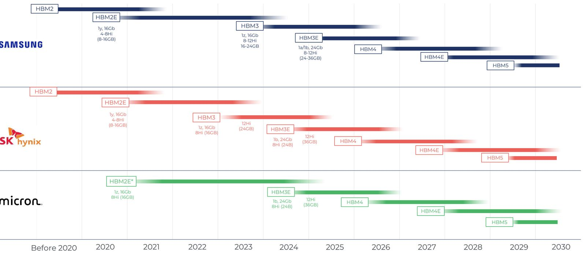
**HBM世代路线图（时间轴：Before 2020、2020、2021、2022、2023、2024、2025、2026、2027、2028、2029、2030）**

三行分别为SAMSUNG、SK hynix、micron的世代演进条带；每个世代以标签框标注，标签框下方为该世代的工艺节点、堆叠层数与容量标注。

**SAMSUNG**（自左至右）

- HBM2
- HBM2E：1y, 16Gb；4-8Hi（8-16GB）
- HBM3：1z, 16Gb；8-12Hi；16-24GB
- HBM3E：1a/1b, 24Gb；8-12Hi（24-36GB）
- HBM4
- HBM4E
- HBM5

**SK hynix**（自左至右）

- HBM2
- HBM2E：1y, 16Gb；4-8Hi（8-16GB）
- HBM3：1z, 16Gb；8Hi（16GB）
- HBM3延伸段标注：12Hi（24GB）
- HBM3E：1b, 24Gb；8Hi (24B)
- HBM3E延伸段标注：12Hi（36GB）
- HBM4
- HBM4E
- HBM5

**micron**（自左至右）

- HBM2E*：1z, 16Gb；8Hi（16GB）
- HBM3E：1b, 24Gb；8Hi (24B)
- HBM3E延伸段标注：12Hi（36GB）
- HBM4
- HBM4E
- HBM5

Note: Prior to HBM, Micron was involved in Hybrid Memory Cubes (HMC). The company started shipping HBM2E in 2020 and skipped the HBM3 generation to catch up with Korean competitors.

[Source Page: 27]

## HBM MARKET FORECAST – OVERVIEW

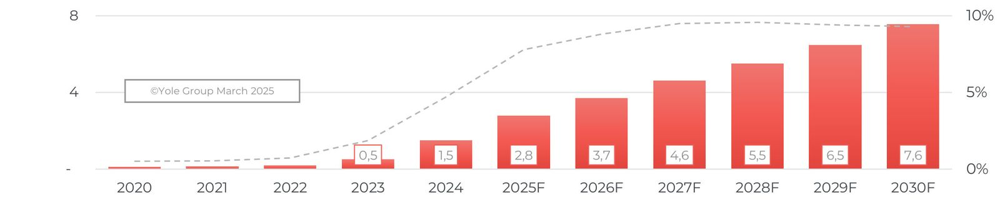
**Bit shipments (B GB)**

图例：HBM bit shipments (B GB)（红色柱）；HBM share of DRAM market (%)（灰色虚线）
标注：CAGR24-30 ~31%
纵轴（左）：0（图中显示为“-”）、4、8；纵轴（右）：0%、5%、10%
横轴：2020、2021、2022、2023、2024、2025F、2026F、2027F、2028F、2029F、2030F
柱上数据标签：0,5（2023）、1,5（2024）、2,8（2025F）、3,7（2026F）、4,6（2027F）、5,5（2028F）、6,5（2029F）、7,6（2030F）；2020–2022柱无数据标签

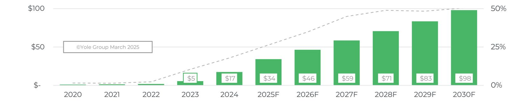
**Revenue ($B)**

图例：HBM revenue ($B)（绿色柱）；HBM share of DRAM market (%)（灰色虚线）
标注：CAGR24-30 ~33%
纵轴（左）：$0（图中显示为“$-”）、$50、$100；纵轴（右）：0%、25%、50%
横轴：2020、2021、2022、2023、2024、2025F、2026F、2027F、2028F、2029F、2030F
柱上数据标签：$5（2023）、$17（2024）、$34（2025F）、$46（2026F）、$59（2027F）、$71（2028F）、$83（2029F）、$98（2030F）；2020–2022柱无数据标签

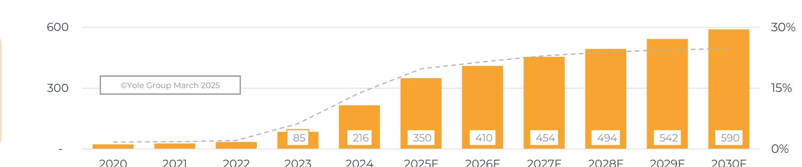
**Wafer Production (K WPM)**

图例：HBM wafer production (KWPM)（橙色柱）；HBM share of DRAM market (%)（灰色虚线）
标注：CAGR24-30 ~18%
纵轴（左）：0（图中显示为“-”）、300、600；纵轴（右）：0%、15%、30%
横轴：2020、2021、2022、2023、2024、2025F、2026F、2027F、2028F、2029F、2030F
柱上数据标签：85（2023）、216（2024）、350（2025F）、410（2026F）、454（2027F）、494（2028F）、542（2029F）、590（2030F）；2020–2022柱无数据标签

图内均含“©Yole Group March 2025”水印。

[Source Page: 28]

## 2024 HBM MARKET SHARES

### 2024 DRAM Revenue Shares

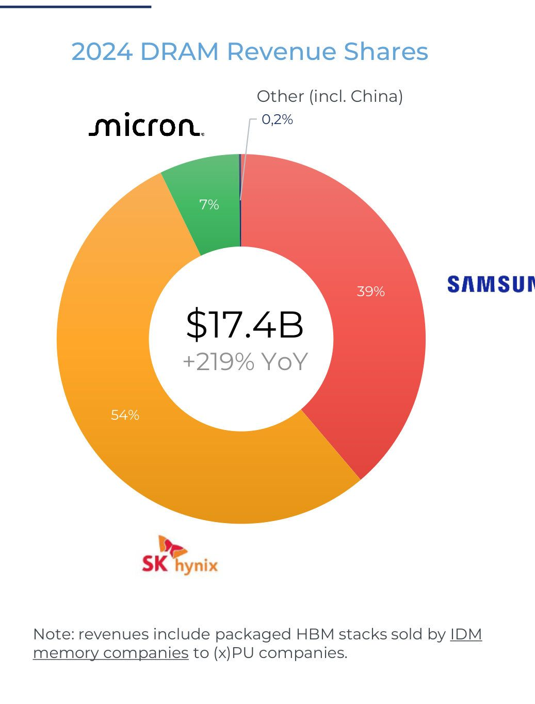
**2024 DRAM Revenue Shares（甜甜圈图）**

中心文字：$17.4B；+219% YoY
分部标签：SAMSUNG 39%、SK hynix 54%、micron 7%、Other (incl. China) 0,2%

Note: revenues include packaged HBM stacks sold by IDM memory companies to (x)PU companies.

### DRAM players are investing heavily in HBM:

| Company | Investment / Activity Details | Location |
| --- | --- | --- |
| Samsung | Expansion of advanced packaging facility in Cheonan, aiming to boost HBM production. The company is reportedly exploring additional capacity at its Cheonan Samsung Display plan. | South Korea |
| Samsung | The company is expanding its Samsung Electronics Suzhou Semiconductor (SESS) plant in China to bolster HBM competitiveness | China |
| SK hynix | Construction of new TSV packaging lines at Icheon, significantly increasing HBM packaging capacity | Icheon, South Korea |
| SK hynix | In April 2024, SK hynix announced plans to invest $3.87B to build an advanced packaging facility for next-generation HBM in a move expected to create around 1,000 jobs. The company plans to break ground on the first fab in March 2025, with plans for completion in early 2027. | West Lafayette, Indiana, USA |
| Micron | The company will invest $7B in the facility adjacent to its existing plant “through the end of the decade and beyond”, creating around 1,400 jobs. Micron said the new facility will package its latest HBM3E products. Operations are slated to begin in 2026, while “meaningful expansion” of the company’s total advanced packaging capacity will begin in 2027 to meet demand from AI growth. | Singapore |
| CXMT / TFME | Chinese companies developed initial sample HBM chips with substantial R&D investments, filing several patents related to HBM packaging technologies. | China |

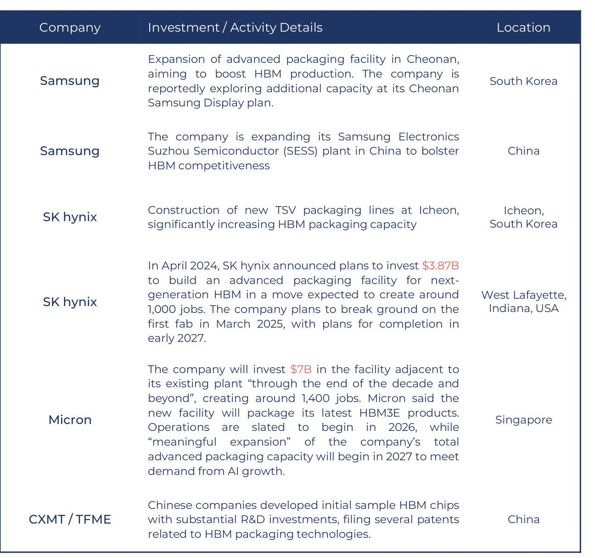

[Source Page: 29]

## HIGH-BANDWIDTH MEMORY – DETAILED SUPPLY CHAIN

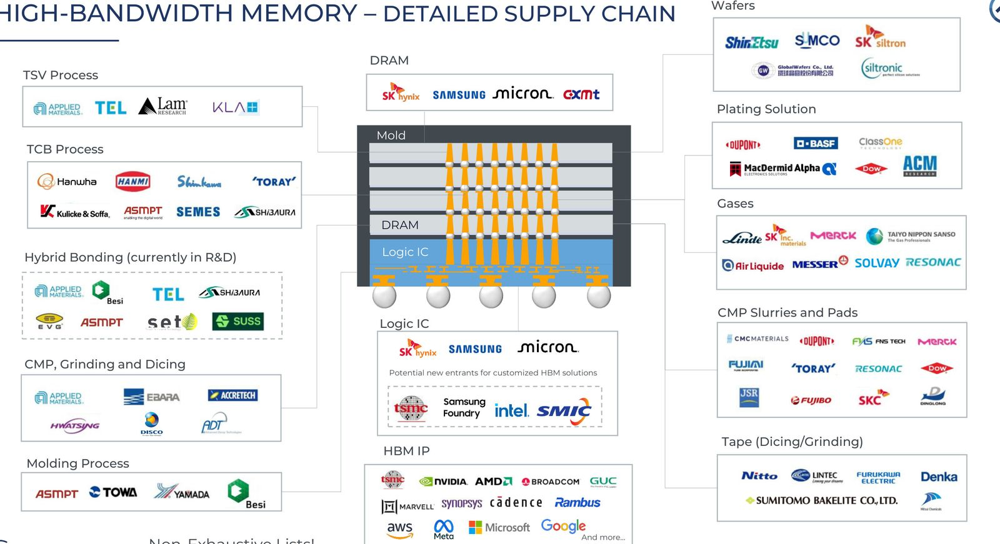
**HBM供应链示意图（含3D堆叠结构，Non-Exhaustive Lists!）**

**封装结构（自上而下）**：Mold、DRAM、Logic IC

**DRAM供应商**：SK hynix、SAMSUNG、micron、cxmt
**Logic IC供应商**：SK hynix、SAMSUNG、micron
**Potential new entrants for customized HBM solutions**：tsmc、Samsung Foundry、intel、SMIC

### TSV Process

APPLIED MATERIALS、TEL、Lam RESEARCH、KLA

### TCB Process

Hanwha、HANMI、Shinkawa、TORAY、Kulicke & Soffa、ASMPT、SEMES、SHIBAURA

### Hybrid Bonding (currently in R&D)

APPLIED MATERIALS、Besi、TEL、SHIBAURA、EVG、ASMPT、SET、SUSS

### CMP, Grinding and Dicing

APPLIED MATERIALS、EBARA、ACCRETECH、HWATSING、DISCO、ADT

### Molding Process

ASMPT、TOWA、YAMADA、Besi

### HBM IP

tsmc、NVIDIA、AMD、BROADCOM、GUC、MARVELL、SYNOPSYS、cadence、Rambus、aws、Meta、Microsoft、Google，And more…

### Wafers

Shin-Etsu、SUMCO、SK siltron、GlobalWafers Co., Ltd.（環球晶圓股份有限公司）、siltronic

### Plating Solution

DUPONT、BASF、ClassOne TECHNOLOGY、MacDermid Alpha ELECTRONICS SOLUTIONS、DOW、ACM RESEARCH

### Gases

Linde、SK Inc. materials、MERCK、TAIYO NIPPON SANSO（The Gas Professionals）、Air Liquide、MESSER、SOLVAY、RESONAC

### CMP Slurries and Pads

CMC MATERIALS、DUPONT、FNS TECH、MERCK、FUJIMI、TORAY、RESONAC、DOW、JSR、FUJIBO、SKC、DINGLONG

### Tape (Dicing/Grinding)

Nitto、LINTEC、FURUKAWA ELECTRIC、Denka、SUMITOMO BAKELITE CO.,LTD.、Mitsui Chemicals

[Source Page: 30]

## LEADING-EDGE MEMORY – A HIGHLY CAPITAL-INTENSIVE BUSINESS

- The rapid growth of AI and high-performance computing (HPC) is driving a surge in memory capital expenditures (CapEx) and wafer fab equipment (WFE), particularly in the DRAM business.
- DRAM bit growth is becoming more expensive as lithography shrinks become more difficult. Multi-patterning requirements are increasing with each node migration, resulting in additional processing steps and, therefore, more cleanroom space per wafer out. The adoption of EUV is replacing multi-patterning but requires significant investments in expensive leading-edge tools.
- DRAM suppliers – Samsung, SK hynix, and Micron – are prioritizing HBM investments, focusing on advanced lithography (including EUV), TSV fabrication, and advanced packaging technologies such as wafer bonding. The transition to higher-stack HBM (e.g., 12Hi, 16Hi) and finer process nodes (e.g., 1b, 1c) further amplifies WFE spending, particularly in front-end wafer processing and back-end assembly.

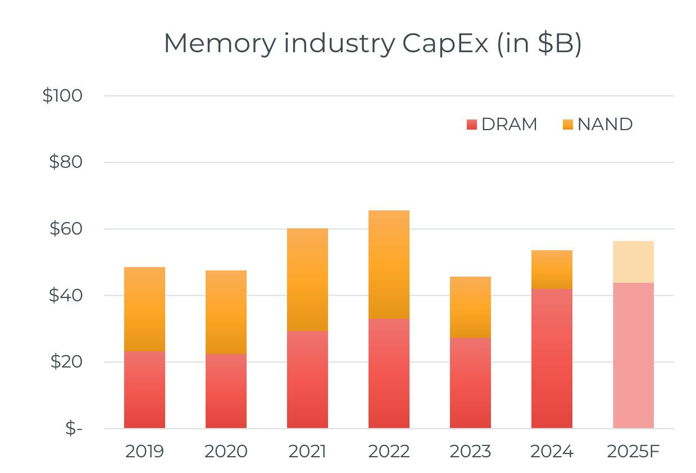
**Memory industry CapEx (in $B)**

纵轴：$0（图中显示为“$-”）、$20、$40、$60、$80、$100
横轴：2019、2020、2021、2022、2023、2024、2025F
图例：DRAM（红色）、NAND（橙色）
堆叠柱本身无数据标签，未写数值；2025F柱为浅色（预计值）。

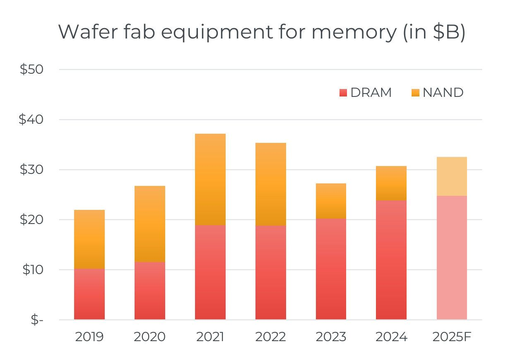
**Wafer fab equipment for memory (in $B)**

纵轴：$0（图中显示为“$-”）、$10、$20、$30、$40、$50
横轴：2019、2020、2021、2022、2023、2024、2025F
图例：DRAM（红色）、NAND（橙色）
堆叠柱本身无数据标签，未写数值；2025F柱为浅色（预计值）。

Source: WFE, NAND and DRAM Market Monitors (Q4-2024) by Yole Group

[Source Page: 31]

# 2020-2030 DRAM TECHNOLOGY ROADMAPS*

*A new generation is said to start when its production exceeds 10 M Gb per quarter.

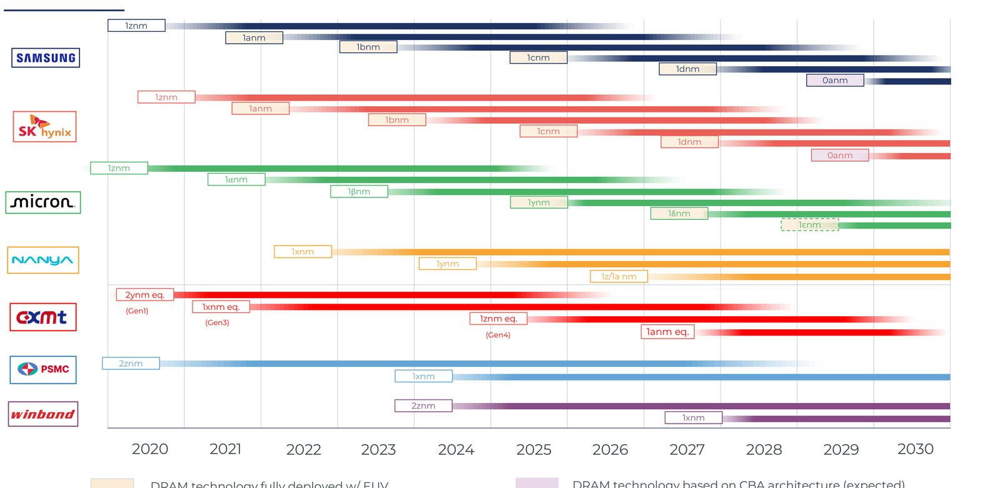

| Company | DRAM technology nodes (in order of appearance along the 2020–2030 axis) |
| --- | --- |
| SAMSUNG | 1znm, 1anm, 1bnm, 1cnm, 1dnm, 0anm |
| SK hynix | 1znm, 1anm, 1bnm, 1cnm, 1dnm, 0anm |
| micron | 1znm, 1anm, 1bnm, 1γnm, 1δnm, 1εnm |
| NANYA | 1xnm, 1ynm, 1z/1a nm |
| CXMT | 2ynm eq. (Gen1), 1xnm eq. (Gen3), 1znm eq. (Gen4), 1anm eq. |
| PSMC | 2znm, 1xnm |
| winbond | 2znm, 1xnm |

Horizontal axis: 2020, 2021, 2022, 2023, 2024, 2025, 2026, 2027, 2028, 2029, 2030

Legend:
- DRAM technology fully deployed w/ EUV
- DRAM technology based on CBA architecture (expected)

Note: Samsung started manufacturing DRAM with EUV from the 1x node (test vehicle)

[Source Page: 32]

# DRAM MARKET FORECAST – WAFER PRODUCTION

Note: HBM is included

## DRAM Wafer Production (in M WPY)

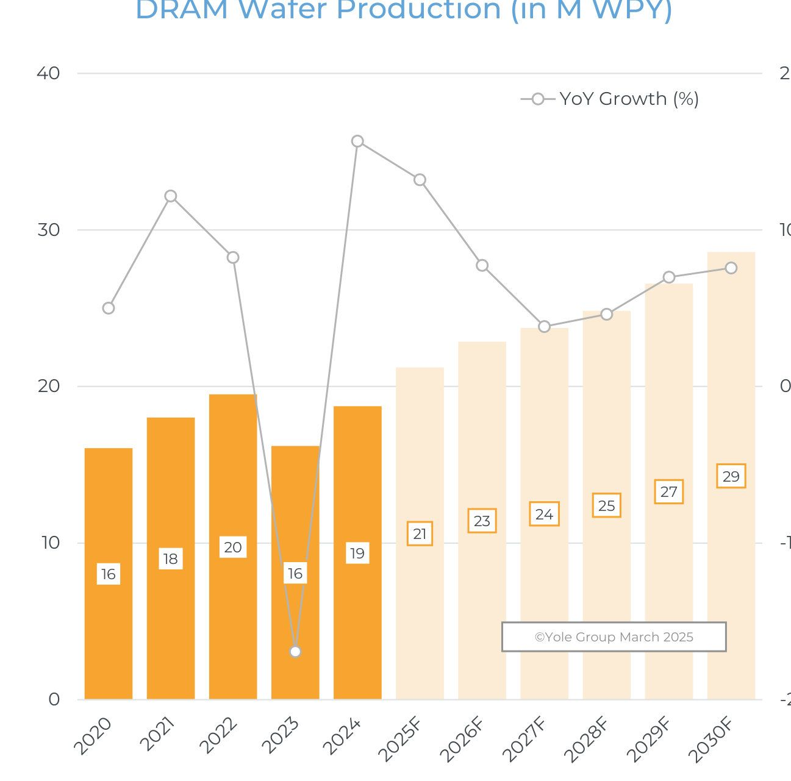

| Year | DRAM Wafer Production (M WPY) |
| --- | --- |
| 2020 | 16 |
| 2021 | 18 |
| 2022 | 20 |
| 2023 | 16 |
| 2024 | 19 |
| 2025F | 21 |
| 2026F | 23 |
| 2027F | 24 |
| 2028F | 25 |
| 2029F | 27 |
| 2030F | 29 |

Left axis: DRAM Wafer Production (in M WPY), 0 to 40
Right axis: YoY Growth (%), -20% to 20%
Legend: YoY Growth (%) (line; no data labels)
In-chart credit: ©Yole Group March 2025
Source: DRAM Market Monitor Q4-2024 by Yole Group

## Wafer Production Breakdown by Process Node

| Year | ≤1dnm | 1cnm | 1bnm | 1anm | 1znm | 1ynm | 1xnm | >1xnm |
| --- | --- | --- | --- | --- | --- | --- | --- | --- |
| 2020 | – | – | – | – | 6% | 34% | 36% | 24% |
| 2021 | – | – | – | n.a. | 20% | 37% | 24% | 17% |
| 2022 | – | – | – | 11% | 36% | 26% | 12% | 15% |
| 2023 | – | – | n.a. | 27% | 35% | 15% | 7% | 15% |
| 2024 | – | – | 9% | 34% | 26% | 11% | 9% | 11% |
| 2025F | – | n.a. | 27% | 35% | 13% | 5% | 12% | 7% |
| 2026F | – | 12% | 36% | n.a. | 6% | 11% | 5% | 5% |
| 2027F | 4% | 31% | 31% | 11% | 4% | 13% | 2% | 4% |
| 2028F | 22% | 36% | 15% | 5% | 7% | 9% | 2% | 4% |
| 2029F | 45% | 27% | 5% | 5% | 12% | 2% | 1% | 3% |
| 2030F | 63% | 12% | 2% | 6% | 11% | 2% | 1% | 3% |

– : no such segment in the stacked bar
n.a. : segment present in the chart but without a data label

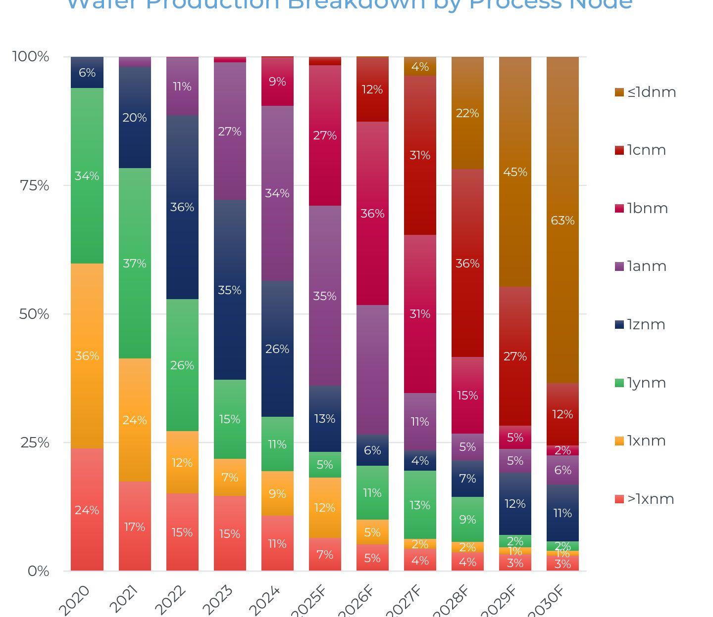

[Source Page: 33]

# EXTREME ULTRAVIOLET (EUV) LITHOGRAPHY FOR DRAM MANUFACTURING
## Overview of DRAM suppliers

- Samsung, leveraging its foundry expertise, was the first to adopt EUV lithography for DRAM, implementing a single EUV layer in its 1z node in 2020. Before that, Samsung had used its 1x DRAM as a test vehicle for EUV integration. SK hynix followed in February 2021, completing its first EUV-equipped fabrication line and commencing mass production of 1a DRAM in the second half of the year.
- Micron took a more cost-conscious approach, delaying EUV adoption to avoid the high depreciation costs of the equipment. Instead, the company relied on self-aligned multiple patterning techniques (e.g., SAQP) through its 1β node, achieving a bit-cell size comparable to its Korean rivals. However, as process nodes shrink beyond 1β, maintaining process control and production stability with multiple patterning becomes increasingly challenging. In February 2025, Micron announced the first shipments of DDR5 DRAM produced with its 1γ node – its first to incorporate EUV lithography.
- Looking ahead, Korean DRAM makers are exploring High-NA EUV for sub-10nm DRAM. As of Q1 2025, SK hynix is collaborating with ASML at the High-NA Joint Lab at imec (Belgium) to validate process technology and stability. Meanwhile, Micron has yet to announce its plans for High-NA EUV but is likely to evaluate ASML's pilot systems alongside its competitors.

### Estimated # of EUV layers

| DRAM Node | SAMSUNG | SK hynix | micron |
| --- | --- | --- | --- |
| 1z | 1 | 0 | 0 |
| 1a / 1α | 3-5 | 1 | 0 |
| 1b / 1β | 5-6 | 3-4 | 0 |
| 1c / 1γ | 6-7 | 5-6 | 1 |

### EUV Lithography 0.33NA Exposure (weighted average)

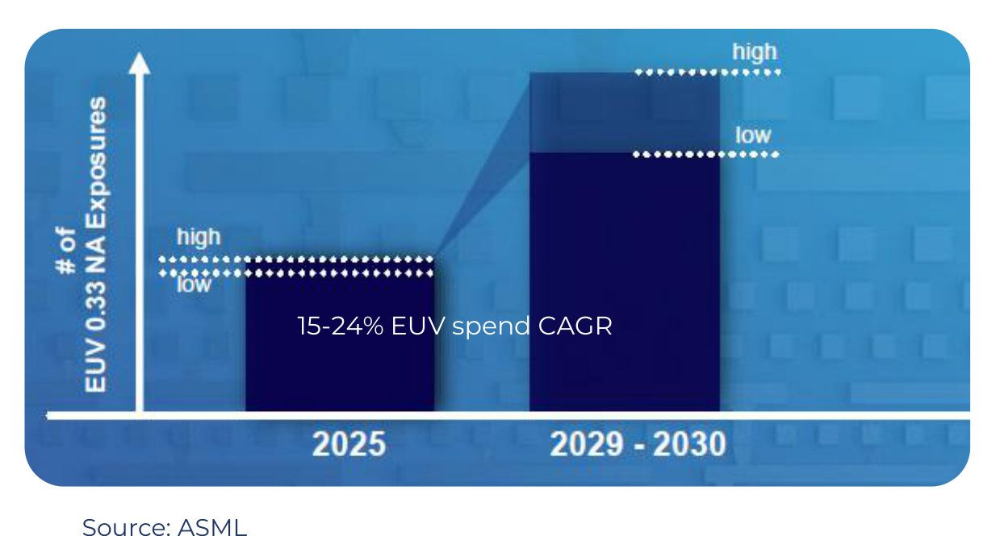

Vertical axis: # of EUV 0.33 NA Exposures
Time buckets: 2025, 2029 - 2030, each shown with a high and a low value
Annotation: 15-24% EUV spend CAGR
Source: ASML

[Source Page: 34]

# LONG-TERM DRAM TECHNOLOGY ROADMAP

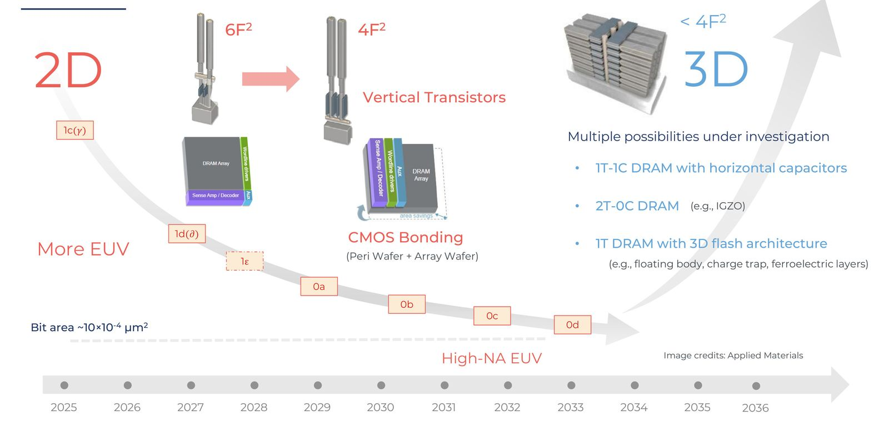

Roadmap labels along the 2D path: 1c(γ) → 1d(δ) → 1ε → ? → 0a → 0b → 0c → 0d
Roadmap labels along the 3D branch: < 4F², "Multiple possibilities under investigation"
2D / 3D
More EUV
High-NA EUV
6F² → 4F²: Vertical Transistors
CMOS Bonding (Peri Wafer + Array Wafer)
Bit area ~10 × 10⁻⁴ µm²
Multiple possibilities under investigation
- 1T-1C DRAM with horizontal capacitors
- 2T-0C DRAM (e.g., IGZO)
- 1T DRAM with 3D flash architecture (e.g., floating body, charge trap, ferroelectric layers)

Timeline: 2025, 2026, 2027, 2028, 2029, 2030, 2031, 2032, 2033, 2034, 2035, 2036
Image credits: Applied Materials

Our model projects that starting in 2029, the top three memory manufacturers will produce a mix of 6F² and 4F² + CBA DRAM products, each tailored for specific end markets.

[Source Page: 35]

# DRAM MARKET FORECAST – WAFER PRODUCTION
## Conventional vs. CMOS-Bonded Array (CBA) DRAM architecture

- Compared to the previous edition of this report, the ramp-up of CBA DRAM has been delayed by approximately 2 years. During the most recent interview campaign, we became aware that the top memory makers will implement their 0d node with "conventional" 6F² technology.
- Starting from the 0a node (>2028), some DRAM makers are now expected to shift to 4F²+CBA for premium memory products to enable higher density and better performance through advanced CMOS logic circuits in the peri wafers.
- Due to stringent pitch and alignment requirements, CBA DRAM is expected to be implemented using fusion bonding, which involves three wafers – one of which is sacrificial. This approach is likely to have a greater cost impact compared to hybrid bonding.
- Our current model assumes that in 2029 and beyond, the top 3 memory makers will produce a mix of both 6F² and 4F²+CBA DRAM products targeting different end markets.

Notes
- In the CMOS-Bonded Array (CBA) DRAM architecture, the periphery circuit and the memory array are processed on different wafers and then bonded together through wafer-to-wafer CMOS bonding.
- Another common way to refer to CBA DRAM is "cell-on-peri" (COP). The wafer containing the array of DRAM cells is stacked on top of the wafer containing the periphery circuit via wafer-to-wafer hybrid bonding.
- In our memory market model, we count only DRAM wafers (CMOS logic wafers are not included).

## DRAM wafer production (M WPY)

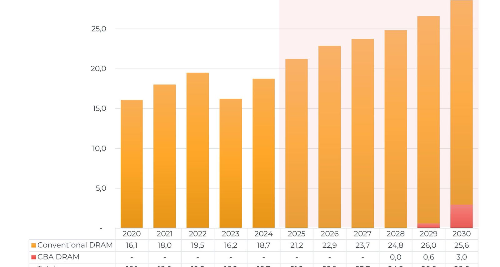

| Year | Conventional DRAM | CBA DRAM | Total | % of CBA |
| --- | --- | --- | --- | --- |
| 2020 | 16,1 | - | 16,1 | 0% |
| 2021 | 18,0 | - | 18,0 | 0% |
| 2022 | 19,5 | - | 19,5 | 0% |
| 2023 | 16,2 | - | 16,2 | 0% |
| 2024 | 18,7 | - | 18,7 | 0% |
| 2025 | 21,2 | - | 21,2 | 0% |
| 2026 | 22,9 | - | 22,9 | 0% |
| 2027 | 23,7 | - | 23,7 | 0% |
| 2028 | 24,8 | 0,0 | 24,8 | 0% |
| 2029 | 26,0 | 0,6 | 26,6 | 2% |
| 2030 | 25,6 | 3,0 | 28,6 | 10% |

Vertical axis: DRAM wafer production (M WPY) — ticks: -, 5,0, 10,0, 15,0, 20,0, 25,0, 30,0
Legend: Conventional DRAM, CBA DRAM

[Source Page: 36]

# BONDING TECHNOLOGIES FOR NEXT-GENERATION DRAM – ROADMAPS

## High Bandwidth Memory

- Hybrid bonding will be needed to continue improving data-transfer speed, heat dissipation, and power efficiency, as well as to minimize the HBM stack thickness.
- Reportedly, hybrid bonding will be first used to stack the first DRAM layer and the base/logic layer. In this case, the HBM assembly process will require a wafer-to-wafer (W2W) hybrid bonding step. The first technologies using this approach are likely to be HBM4E/HBM5 (≥16Hi), particularly in customized HBM solutions.
- Die-to-Wafer (D2W) and Die-to-Die (D2D) bonding schemes will be used in subsequent generations. We currently model die-bonding approaches to start from the HBM5 generation from 20Hi (~2029).

## Planar DRAM with CMOS Bonded Array (CBA) Architecture

- DRAM makers are expected to use fusion W2W bonding from the 0a DRAM node (~2029) to stack the DRAM array wafer and the CMOS logic wafer. More details in the "DRAM scaling: challenges and solutions" chapter of this report.

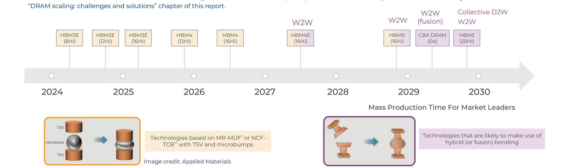

Mass Production Time For Market Leaders
Timeline: 2024, 2025, 2026, 2027, 2028, 2029, 2030

Technologies, in order along the timeline:
- HBM3E (8Hi)
- HBM3E (12Hi)
- HBM3E (16Hi)
- HBM4 (12Hi)
- HBM4 (16Hi)
- HBM4E (16Hi)
- HBM5 (16Hi)
- CBA DRAM (0a)
- HBM5 (20Hi)

Bonding annotations shown above the boxes:
- W2W (above HBM4E (16Hi))
- W2W (above HBM5 (16Hi))
- W2W (fusion) (above CBA DRAM (0a))
- Collective D2W / W2W (above HBM5 (20Hi))

Legend:
- Technologies based on MR-MUF* or NCF-TCB** with TSV and microbumps (illustration: TSV / microbump / TSV stack)
- Technologies that are likely to make use of hybrid (or fusion) bonding (illustration: two dies bonded face-to-face)

Image credit: Applied Materials

*MR-MUF: Mass Reflow Molded Underfill
**NCF-TCB: Non-Conductive Film Thermo-Compression Bonding

[Source Page: 37]

# A LONG JOURNEY TO 3D DRAM… but the "peak" is on the horizon!

- Multiple solutions will enable continuous planar DRAM scaling over the next 8–9 years.
- Starting with the 0a node (~2029), some DRAM manufacturers are expected to adopt a 4F² CMOS Bonded Array (CBA) architecture. This approach aims to achieve increased density and enhanced performance, enabling scaling for at least two subsequent nodes. Advanced logic technologies, such as FinFET transistors integrated onto dedicated CMOS wafers, will be instrumental in sustaining ongoing performance improvements after 2030.
- However, if manufacturing costs and yield challenges make high-volume 4F² DRAM production economically prohibitive, memory makers may extend 6F² scaling as far as possible. This extended scaling would leverage additional EUV layers and potentially introduce High-NA EUV lithography. In the long term (post-2030), CBA technology is anticipated to become essential to maintain density and performance progression.
- Overall, planar DRAM scaling is likely to persist until the 0c/0d nodes. Beyond this point, the transition to a challenging but necessary 3D architecture will begin.

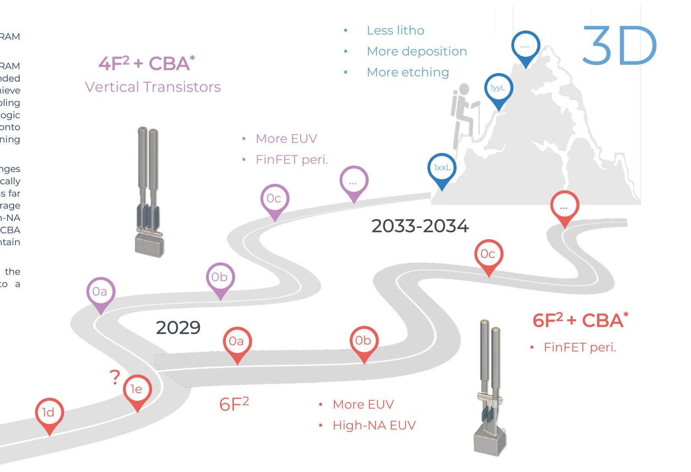

2D / 3D
More EUV (near 2025)
2025
1c, 1d, 1e, ?
4F² + CBA*
Vertical Transistors
0a, 0b, 0c
2029
6F²
More EUV
High-NA EUV
6F² + CBA*
FinFET peri.
1xxL, 1yyL, …
2033-2034
3D: Less litho, More deposition, More etching

*CBA: CMOS Bonded Array

[Source Page: 38]

# CHINA-UNITED STATES COMMERCIAL WAR – HIGHLIGHTS
## Focus on AI chips and HBM

- Due to U.S. trade restrictions, Chinese companies are barred from accessing high-end AI accelerators from Western suppliers. Even Nvidia's AI chips tailored for China – such as the A800 (40GB HBM2) and H800 (80GB HBM3) – were banned from export in October 2023.
- In response, Nvidia released the H20 GPUs, designed with adjusted performance specifications to comply with U.S. regulations. These modified models enable Nvidia to maintain its presence in the Chinese market while adhering to export controls.
  - Example: H20 has 96GB HBM3 memory, and the bandwidth is up to 4.0 Tb/s, all higher than the H100, but the computing power is only 296 TFLOPs, and the performance density is far inferior to the H100.
- In December 2024, the U.S. government implemented new export controls restricting the sale of HBM chips to China without special authorization. These memory components are crucial for AI applications, and the restrictions aim to limit China's access to technologies that could enhance its AI and military capabilities. Additionally, the U.S. Department of Commerce added ~140 Chinese entities to its trade blacklist, further tightening controls over China's semiconductor industry.
- In early 2025, as the Chinese AI firm DeepSeek emerged as a major competitor in the AI landscape, Tencent, Alibaba, and ByteDance significantly increased their orders for Nvidia's H20 GPUs. Meanwhile, the Trump administration has been discussing the possibility of expanding export controls to include the H20, given its capability to develop and power major AI applications. (Note: As of March 2025, Nvidia is still permitted to ship the H20 to China.)
- The Chinese government encourages local cloud service providers (CSPs) to procure at least 20% of their AI hardware from domestic (x)PU or AI ASIC manufacturers to support the development of China's semiconductor industry. However, due to domestic hardware and software limitations – including a lack of CUDA support and inferior performance in key computational tasks – Chinese CSPs continue to favor Nvidia's GPUs, particularly the H20 model. Amid escalating U.S. restrictions on GPU exports, CSPs are actively stockpiling as many Nvidia GPUs as they can source to maintain competitiveness and efficiency.
- Huawei's AI ASICs (Ascend™ chips) are widely recognized as China's foremost alternative to Nvidia's hardware. While there are reports suggesting that DeepSeek R1 utilizes Huawei's latest Ascend 910C chips for inference workloads, these accelerators are predominantly deployed by Chinese government agencies, state-owned enterprises, and entities engaged in national security sectors.
  - Initially launched in 2019, the original Ascend 910 integrated HBM2E stacks sourced from global suppliers, a technology retained in subsequent iterations, including the Ascend 910B and 910C.
  - Researchers from DeepSeek indicate that the Ascend 910C chip achieves approximately 60% of the inference performance of Nvidia's H100 GPU.
  - Market speculation suggests that Huawei may be indirectly accessing TSMC's advanced foundry services through other Chinese semiconductor intermediaries to manufacture its cutting-edge Ascend chips. In response to these developments, the U.S. Department of Commerce reportedly issued a directive to TSMC, mandating the cessation of supplies of AI chips manufactured at the 7nm process node or below to customers in mainland China, effective November 11, 2024. Notably, as of today, the Chinese foundry SMIC can provide 7nm-node manufacturing services.

[Source Page: 39]

# CHINA MEMORY BUSINESS – FOCUS ON DRAM
## Summary and Outlook

- Companies headquartered in China purchase over 25% of the DRAM products manufactured by global memory IDMs. The high level of memory consumption in China is fueling the country's intense desire to produce more DRAM and NAND devices locally. However, China's self-sufficiency in semiconductor memory is estimated to be below 15%.
- U.S. trade restrictions pose a significant challenge to China's memory industry, which relies heavily on imported technologies. In turn, China is reacting to sanctions by increasing its semiconductor investments and establishing strong collaborative networks of local companies, including equipment suppliers, foundries, and OSATs with advanced packaging capabilities.
- Changxin Memory Technologies (CXMT) is the leading DRAM maker in China. Its first-generation DRAM (~27nm equivalent) is available domestically since 2019 (DDR4, LPPDDR4). After skipping its second-generation (G2) technology, CXMT ramped up production of G3 (~18.5nm equivalent) and significantly increased its DDR4 shipments in 2024, triggering price declines in the DDR4 DRAM market. Looking ahead, CXMT aims to introduce an updated HKMG G4 technology (H2-2025) and develop 15nm DRAM technology in 2025 (G5), with commercialization targeted for the second half of 2026. Note: In January 2025, the U.S. Department of Commerce tightened export restrictions on memory manufacturing equipment to China, subjecting equipment purchases for processes <25nm to additional controls. These restrictions could slow down CXMT's G3 and G4 production growth, as well as its G5 R&D.
- Chinese companies have increasingly focused their R&D efforts on two key approaches: (1) advanced packaging techniques for DRAM-logic integration and (2) DRAM scaling methods beyond conventional lithography shrinks, such as 4F² cells, CBA-DRAM, and 3D DRAM. These innovations enable Chinese players to develop high-performance AI chips without relying on restricted leading-edge equipment like EUV lithography. By leveraging More-than-Moore solutions that integrate logic and memory, China aims to stay competitive in the race for technological leadership, particularly in the critical field of AI computing.
- The U.S. curbs on AI chips and HBM have triggered significant investments and numerous initiatives for producing such chips within China. Huawei is reportedly building a consortium of companies – including XMC, SJSemi, TFME, and JCET – to build HBM, an essential building block of AI computing systems.
- CXMT is reportedly sampling HBM2 to customers and is currently working on HBM2E development. The company announced a CNY 17.1 billion ($2.4B) investment in an advanced packaging plant in Shanghai, aiming for a monthly capacity of 30,000 units by the second half of 2026.
- At this stage, Chinese memory companies lag significantly behind memory leaders in technological development (~6 years). Despite their technological gap, Chinese players can leverage strong domestic demand for locally developed AI accelerators, supported by significant government backing and a well-established industry network. These factors are expected to help them gain a foothold in the market in the coming years.

[Source Page: 40]

# 3D DRAM – BUSINESS OVERVIEW

- 2D DRAM scaling is likely to persist until the 0c/0d nodes (2033-2034). Beyond this point, the transition to a challenging but necessary 3D architecture will be necessary.
- 3D DRAM is being considered by all DRAM manufacturers as a potential solution for long-term DRAM scaling at sub-10nm nodes.
  - Top memory makers – such as Samsung, SK hynix, and Micron – will likely invest more and more resources in the coming years, and we expect new solutions will be found, no matter how complex the technical challenges are.
- Equipment suppliers – such as Applied Materials, Tokyo Electron, and Lam Research – have also begun to develop solutions related to 3D DRAM. Significant R&D work has been carried out to develop suitable equipment and processes – deposition and etching – for implementing 3D architectures, as well as new process solutions to deposit high-mobility materials through epitaxial growth, PVD, and ALD. 3D DRAM is also expected to require advanced gap-fill, selective removal, and advanced doping capabilities.
- The transition from 2D to 3D DRAM will drive significant changes within the industry, paralleling the evolution recently observed in NAND flash technology. Like the shift toward 3D NAND, the adoption of 3D DRAM will demand substantial investments to establish and scale the new manufacturing processes.
  - Extensive retooling will be critical, particularly increasing expenditures for deposition systems such as Atomic Layer Deposition (ALD) and Plasma-Enhanced Chemical Vapor Deposition (PE-CVD), as well as high-aspect-ratio (HAR) etching equipment. Collectively, deposition and etching systems could account for over 70% of the total DRAM equipment investments.
    - Furthermore, 3D DRAM will leverage more "relaxed" lithography nodes around 20nm, eliminating the need for costly EUV lithography systems.
- 3D DRAM could be favorable for Chinese memory companies that, at this stage, have no access to leading-edge equipment (e.g., EUV lithography) due to U.S. trade restrictions. The availability of new 3D-DRAM manufacturing schemes could bring China back into the race and allow it to close the technology gap with global suppliers.
- If the U.S. restrictions hamper DRAM planar shrinking, then the only way for China to succeed is to build 3D structures. For this reason, multiple leading Chinese companies are intensely exploring the 3D pathway: both CXMT and the NAND company YMTC are active in this area (note: YMTC's 3D NAND know-how and Xtacking™ technology could become key enablers for Chinese 3D DRAM); Huawei is also developing 3D DRAM through its design center in Yokohama, Japan.

[Source Page: 41]

# MARKET FORECASTS

[Source Page: 42]

# DRAM Market Overview

[Source Page: 43]

# MEMORY MARKET OVERVIEW

## 2024 Memory Market – Breakdown by Technology

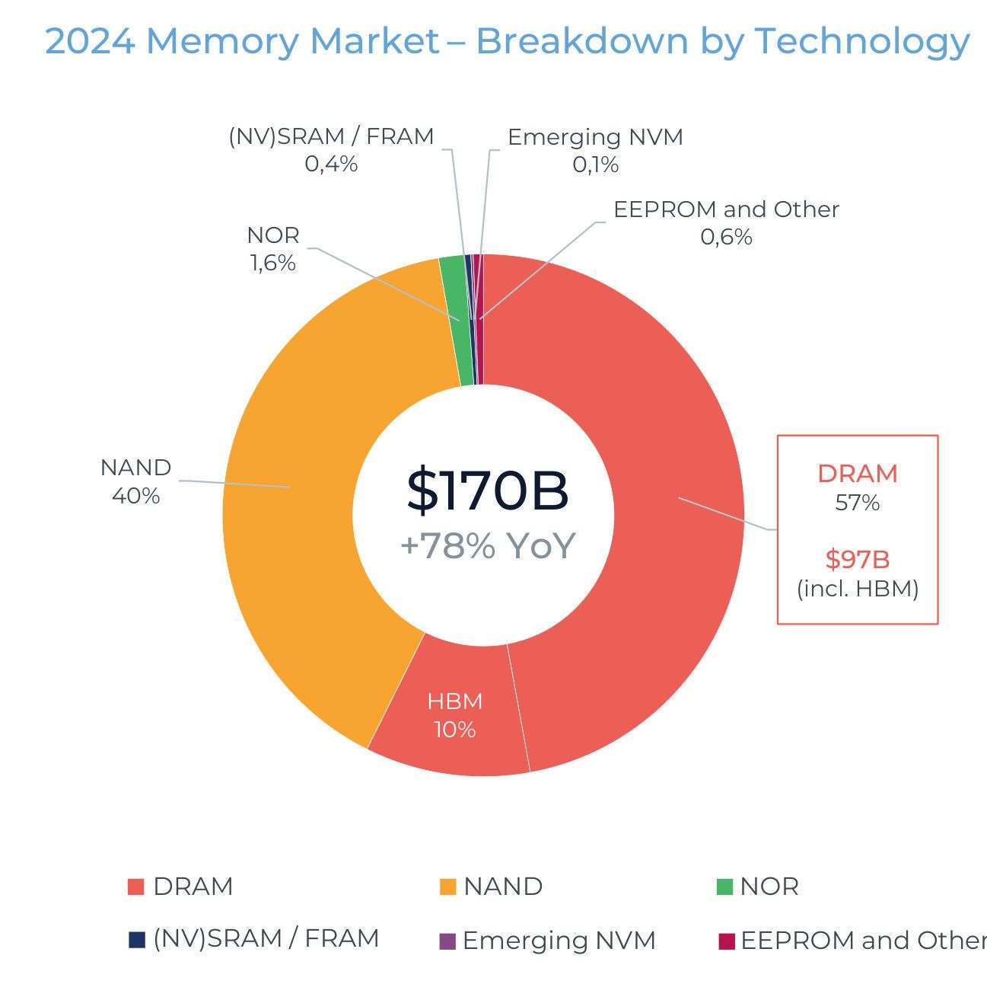

Center label: $170B, +78% YoY

| Segment | Share |
| --- | --- |
| DRAM | 57% |
| HBM | 10% |
| NAND | 40% |
| NOR | 1,6% |
| (NV)SRAM / FRAM | 0,4% |
| Emerging NVM | 0,1% |
| EEPROM and Other | 0,6% |

Callout attached to the DRAM segment: DRAM 57%, $97B (incl. HBM)

Legend: DRAM, NAND, NOR, (NV)SRAM / FRAM, Emerging NVM, EEPROM and Other

## Memory Market Evolution (2020 – 2024)

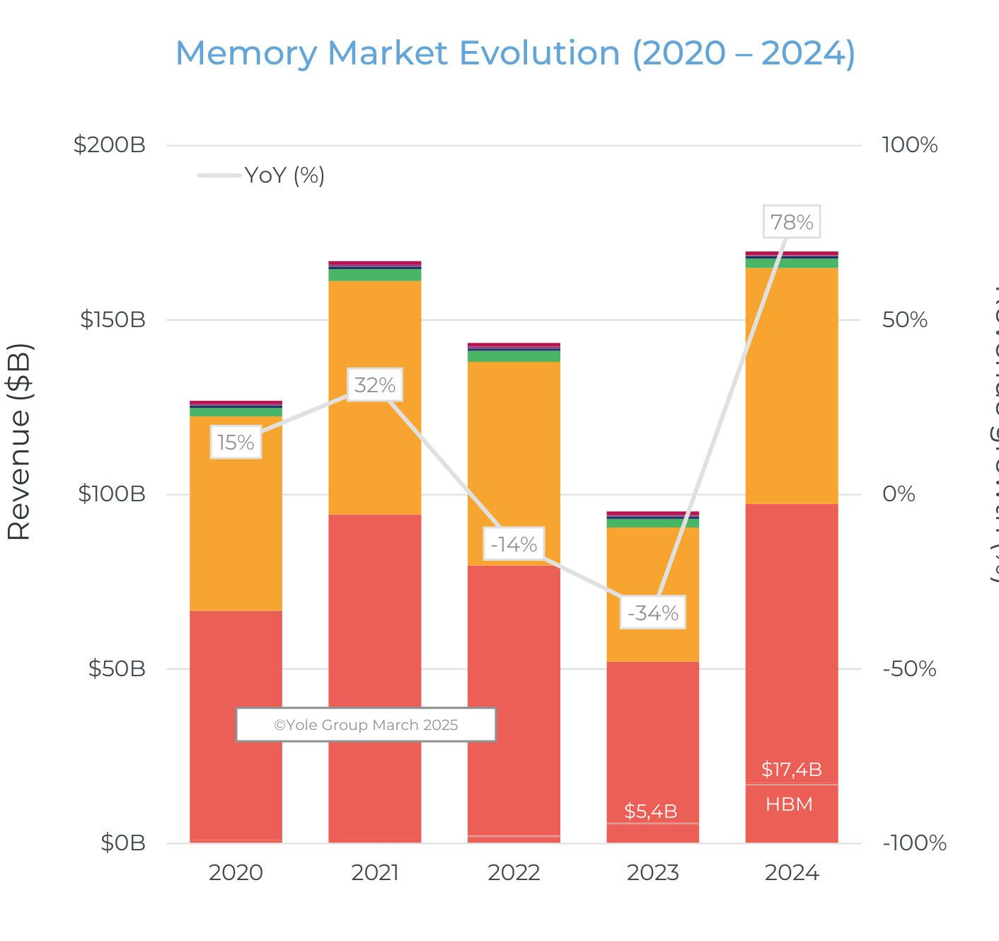

- Left axis: Revenue ($B) — $200B / $150B / $100B / $50B / $0B
- Right axis: Revenue growth (%) — 100% / 50% / 0% / -50% / -100%
- X-axis: 2020, 2021, 2022, 2023, 2024
- Stacked bars by technology (same legend as the left chart); only the HBM segment carries data labels: 2023 $5,4B, 2024 $17,4B
- YoY (%) line data labels: 2020 15%, 2021 32%, 2022 -14%, 2023 -34%, 2024 78%

[Source Page: 44]

# DRAM MARKET OVERVIEW

Note: HBM is included

## 2024 DRAM Market Shares

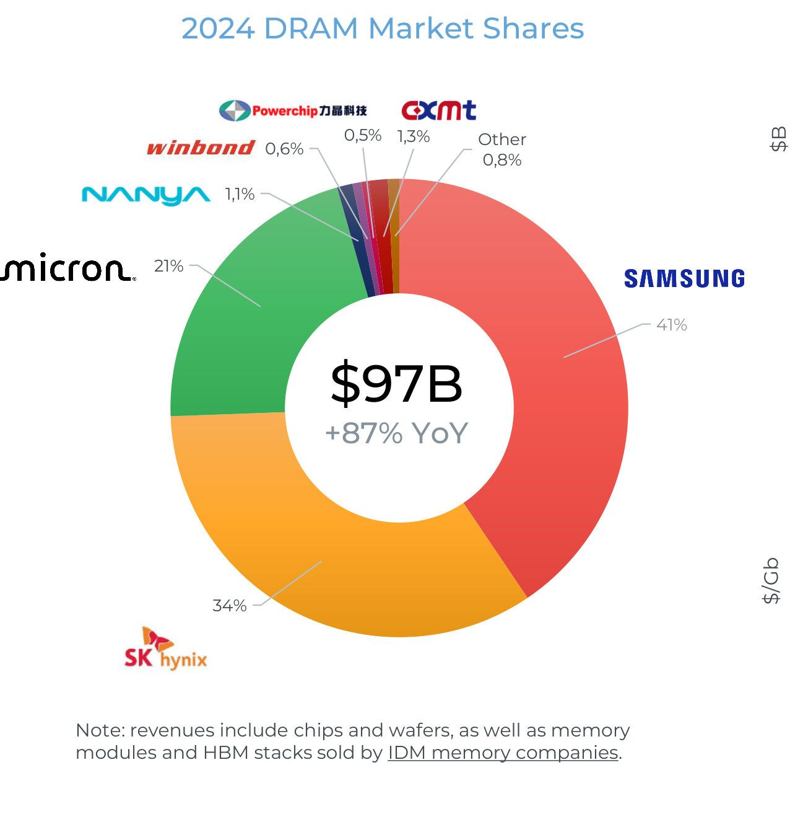

Center label: $97B, +87% YoY

| Company | Share |
| --- | --- |
| SAMSUNG | 41% |
| SK hynix | 34% |
| Micron | 21% |
| NANYA | 1,1% |
| winbond | 0,6% |
| Powerchip力晶科技 | 0,5% |
| CXMT | 1,3% |
| Other | 0,8% |

Note: revenues include chips and wafers, as well as memory modules and HBM stacks sold by IDM memory companies.

## DRAM Market Revenue

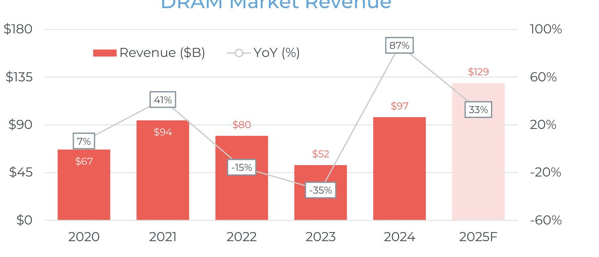

- Left axis: Revenue ($B) — $180 / $135 / $90 / $45 / $0
- Right axis: YoY (%) — 100% / 60% / 20% / -20% / -60%
- X-axis: 2020, 2021, 2022, 2023, 2024, 2025F

| Year | Revenue ($B) | YoY (%) |
| --- | --- | --- |
| 2020 | $67 | 7% |
| 2021 | $94 | 41% |
| 2022 | $80 | -15% |
| 2023 | $52 | -35% |
| 2024 | $97 | 87% |
| 2025F | $129 | 33% |

## DRAM Average Selling Price

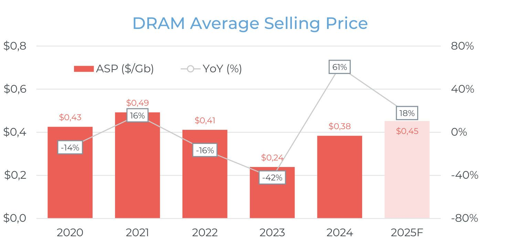

- Left axis: ASP ($/Gb) — $0,8 / $0,6 / $0,4 / $0,2 / $0,0
- Right axis: YoY (%) — 80% / 40% / 0% / -40% / -80%
- X-axis: 2020, 2021, 2022, 2023, 2024, 2025F

| Year | ASP ($/Gb) | YoY (%) |
| --- | --- | --- |
| 2020 | $0,43 | -14% |
| 2021 | $0,49 | 16% |
| 2022 | $0,41 | -16% |
| 2023 | $0,24 | -42% |
| 2024 | $0,38 | 61% |
| 2025F | $0,45 | 18% |

Source: DRAM Market Monitor Q1-2025 by Yole Group

[Source Page: 45]

# DRAM MARKET SHARES BY APPLICATION

## 2024 DRAM Market – Breakdown by Application

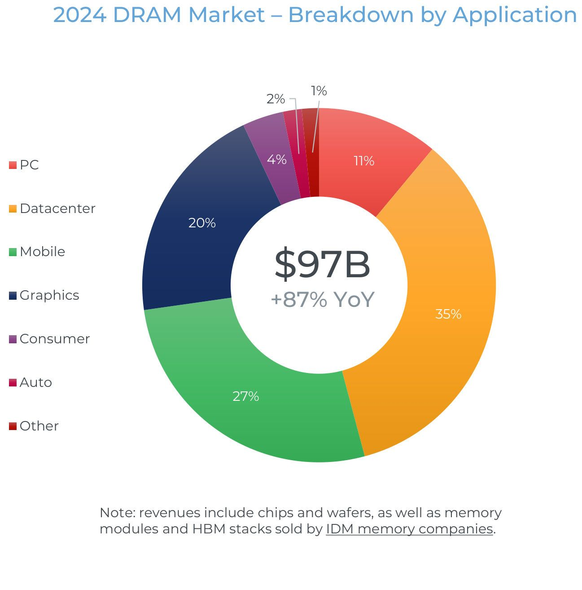

Center label: $97B, +87% YoY

| Application | Share |
| --- | --- |
| PC | 11% |
| Datacenter | 35% |
| Mobile | 27% |
| Graphics | 20% |
| Consumer | 4% |
| Auto | 2% |
| Other | 1% |

Note: revenues include chips and wafers, as well as memory modules and HBM stacks sold by IDM memory companies.

## 2024 DRAM Market Shares by Revenue

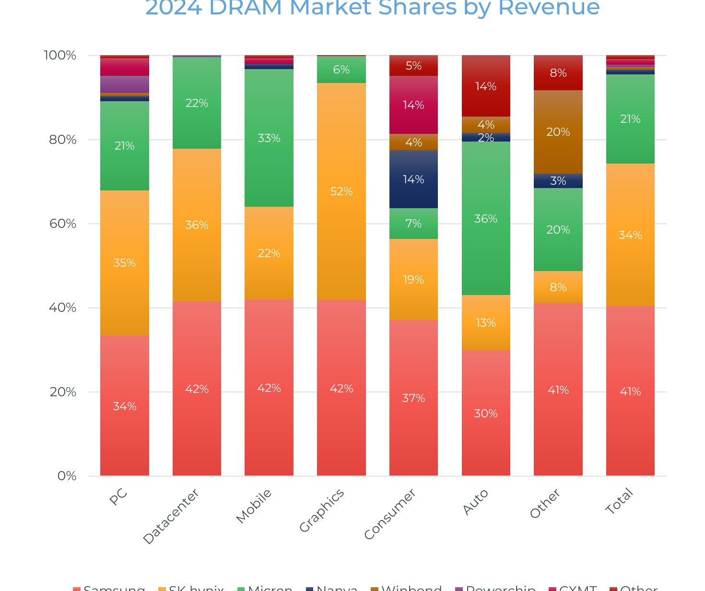

- Y-axis: 0% / 20% / 40% / 60% / 80% / 100%
- X-axis: PC, Datacenter, Mobile, Graphics, Consumer, Auto, Other, Total
- Legend (stack order bottom to top): Samsung, SK hynix, Micron, Nanya, Winbond, Powerchip, CXMT, Other

Data labels printed on each stacked bar:

- PC: Samsung 34%, SK hynix 35%, Micron 21%; the remaining shares carry no data labels
- Datacenter: Samsung 42%, SK hynix 36%, Micron 22%
- Mobile: Samsung 42%, SK hynix 22%, Micron 33%; the remaining shares carry no data labels
- Graphics: Samsung 42%, SK hynix 52%, Micron 6%
- Consumer: Samsung 37%, SK hynix 19%, Micron 7%, Nanya 14%, Winbond 4%, CXMT 14%, Other 5%
- Auto: Samsung 30%, SK hynix 13%, Micron 36%, Nanya 2%, Winbond 4%, Other 14%; the remaining shares carry no data labels
- Other: Samsung 41%, SK hynix 8%, Micron 20%, Nanya 3%, Winbond 20%, Other 8%
- Total: Samsung 41%, SK hynix 34%, Micron 21%; the remaining shares carry no data labels

Source: DRAM Market Monitor Q1-2025 by Yole Group

[Source Page: 46]

# DRAM MARKET FORECAST – BIT DEMAND BY END MARKET

## DRAM Bit Demand in Exabits (Eb)

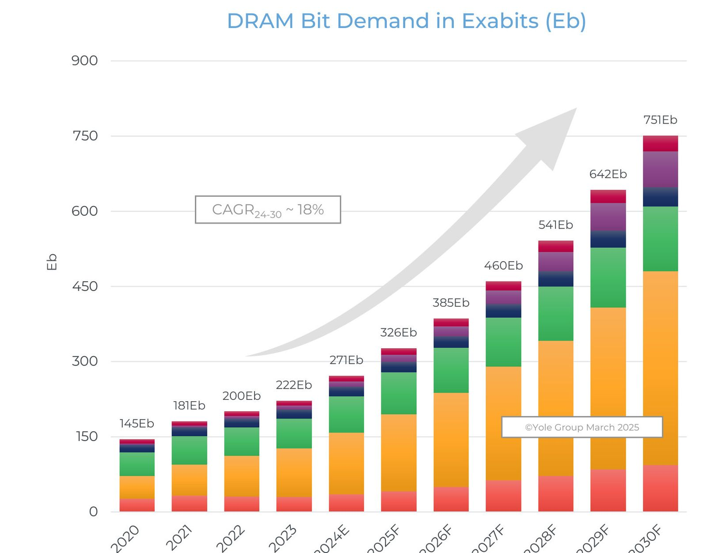

- Y-axis: 0 / 150 / 300 / 450 / 600 / 750 / 900 (Eb)
- X-axis: 2020, 2021, 2022, 2023, 2024E, 2025F, 2026F, 2027F, 2028F, 2029F, 2030F
- Stacked bars by end market (no per-segment labels); arrow annotation rising from 2020 towards 2030F

Data labels on top of the stacked bars:

| Year | DRAM Bit Demand |
| --- | --- |
| 2020 | 145Eb |
| 2021 | 181Eb |
| 2022 | 200Eb |
| 2023 | 222Eb |
| 2024E | 271Eb |
| 2025F | 326Eb |
| 2026F | 385Eb |
| 2027F | 460Eb |
| 2028F | 541Eb |
| 2029F | 642Eb |
| 2030F | 751Eb |

In-chart annotation: CAGR24-30 ~ 18%

## DRAM Bit Demand Growth Rates

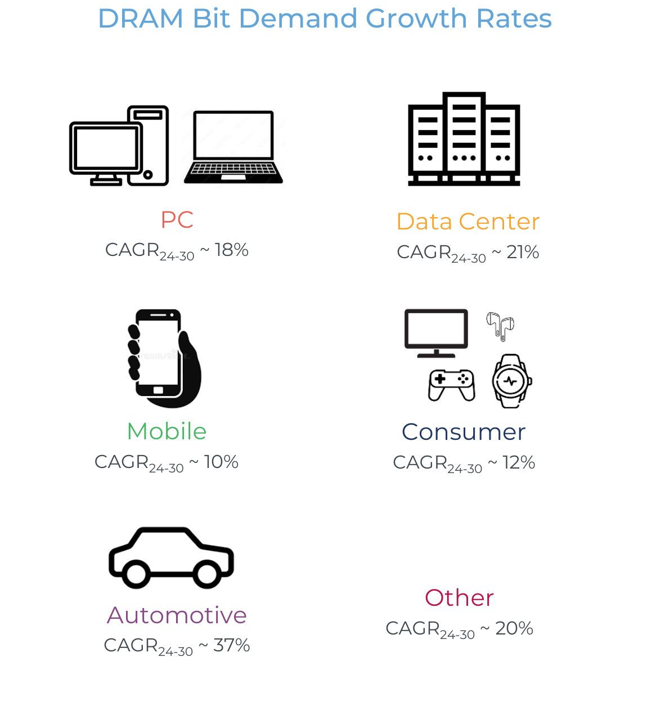

- PC: CAGR24-30 ~ 18%
- Data Center: CAGR24-30 ~ 21%
- Mobile: CAGR24-30 ~ 10%
- Consumer: CAGR24-30 ~ 12%
- Automotive: CAGR24-30 ~ 37%
- Other: CAGR24-30 ~ 20%

Source: DRAM Market Monitor Q1-2025 by Yole Group

[Source Page: 47]

# DRAM MARKET FORECAST – REVENUE AND AVERAGE SELLING PRICE

## DRAM Market Revenue (in $B)

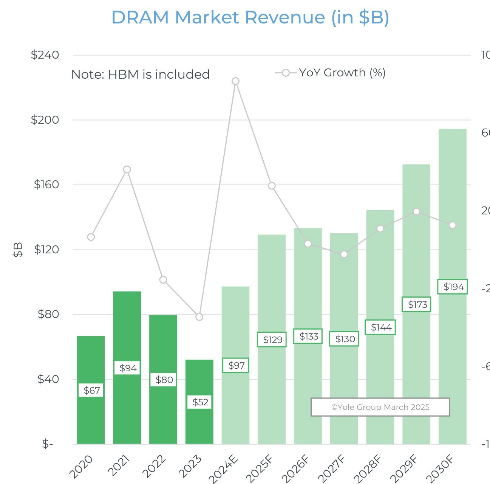

- Y-axis: $B — $- / $40 / $80 / $120 / $160 / $200 / $240
- Right axis: YoY Growth (%) — -100% / -60% / -20% / 20% / 60% / 100%
- X-axis: 2020, 2021, 2022, 2023, 2024E, 2025F, 2026F, 2027F, 2028F, 2029F, 2030F
- Note: HBM is included
- YoY Growth (%) is plotted as a line series and carries no data labels on the page

| Year | DRAM Market Revenue ($B) |
| --- | --- |
| 2020 | $67 |
| 2021 | $94 |
| 2022 | $80 |
| 2023 | $52 |
| 2024E | $97 |
| 2025F | $129 |
| 2026F | $133 |
| 2027F | $130 |
| 2028F | $144 |
| 2029F | $173 |
| 2030F | $194 |

## DRAM ASP in $/Gb

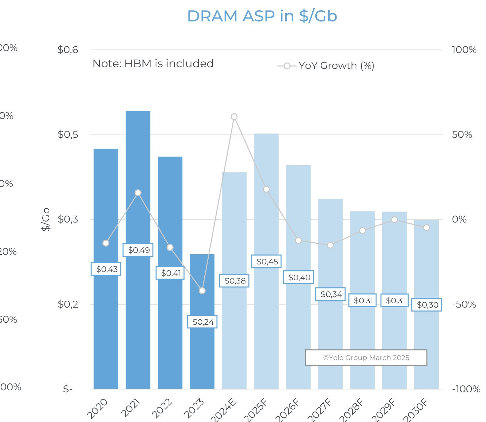

- Y-axis: $/Gb — $- / $0,2 / $0,3 / $0,5 / $0,6 (axis labels as printed on the page)
- Right axis: YoY Growth (%) — -100% / -50% / 0% / 50% / 100%
- X-axis: 2020, 2021, 2022, 2023, 2024E, 2025F, 2026F, 2027F, 2028F, 2029F, 2030F
- Note: HBM is included
- YoY Growth (%) is plotted as a line series and carries no data labels on the page

| Year | DRAM ASP ($/Gb) |
| --- | --- |
| 2020 | $0,43 |
| 2021 | $0,49 |
| 2022 | $0,41 |
| 2023 | $0,24 |
| 2024E | $0,38 |
| 2025F | $0,45 |
| 2026F | $0,40 |
| 2027F | $0,34 |
| 2028F | $0,31 |
| 2029F | $0,31 |
| 2030F | $0,30 |

Source: DRAM Market Monitor Q4-2024 by Yole Group

[Source Page: 48]

# DRAM MARKET FORECAST – BIT SHIPMENTS

## DRAM Bit Shipments (in Exabits)

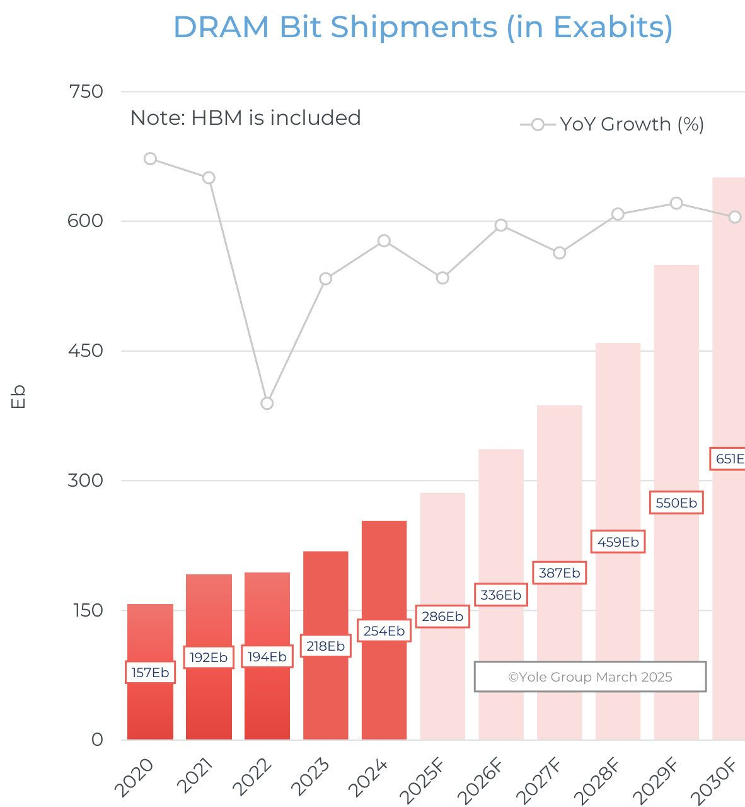

- Y-axis: 0 / 150 / 300 / 450 / 600 / 750 (Eb)
- Right axis: YoY Growth (%) — 30% / 20% / 10% / 0% / -10% / -20% / -30%
- X-axis: 2020, 2021, 2022, 2023, 2024, 2025F, 2026F, 2027F, 2028F, 2029F, 2030F
- Note: HBM is included
- YoY Growth (%) is plotted as a line series and carries no data labels on the page

| Year | DRAM Bit Shipments |
| --- | --- |
| 2020 | 157Eb |
| 2021 | 192Eb |
| 2022 | 194Eb |
| 2023 | 218Eb |
| 2024 | 254Eb |
| 2025F | 286Eb |
| 2026F | 336Eb |
| 2027F | 387Eb |
| 2028F | 459Eb |
| 2029F | 550Eb |
| 2030F | 651Eb |

## DRAM Bit Shipments – Breakdown by Technology

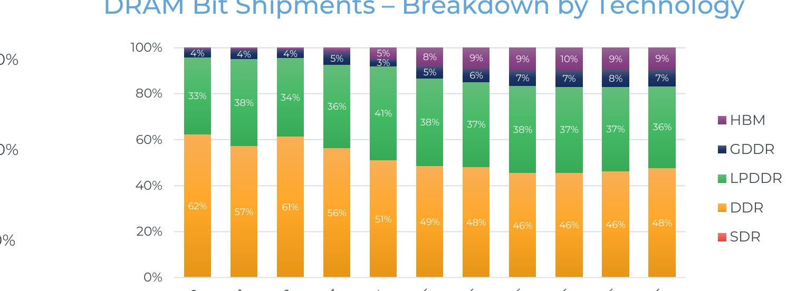

- Y-axis: 0% / 20% / 40% / 60% / 80% / 100%
- X-axis: 2020, 2021, 2022, 2023, 2024, 2025F, 2026F, 2027F, 2028F, 2029F, 2030F
- Legend (stack order bottom to top): SDR, DDR, LPDDR, GDDR, HBM

| Year | DDR | LPDDR | GDDR | HBM | SDR |
| --- | --- | --- | --- | --- | --- |
| 2020 | 62% | 33% |  | 4% |  |
| 2021 | 57% | 38% |  | 4% |  |
| 2022 | 61% | 34% |  | 4% |  |
| 2023 | 56% | 36% |  | 5% |  |
| 2024 | 51% | 41% | 3% | 5% |  |
| 2025F | 49% | 38% | 5% | 8% |  |
| 2026F | 48% | 37% | 6% | 9% |  |
| 2027F | 46% | 38% | 7% | 9% |  |
| 2028F | 46% | 37% | 7% | 10% |  |
| 2029F | 46% | 37% | 8% | 9% |  |
| 2030F | 48% | 36% | 7% | 9% |  |

## DDR Bit Shipments – Breakdown by Generation

- Y-axis: 0% / 20% / 40% / 60% / 80% / 100%
- X-axis: 2020, 2021, 2022, 2023, 2024, 2025F, 2026F, 2027F, 2028F, 2029F, 2030F
- Legend (stack order bottom to top): DDR6, DDR5, DDR4, DDR3, DDR2, DDR

| Year | DDR | DDR2 | DDR3 | DDR4 | DDR5 | DDR6 |
| --- | --- | --- | --- | --- | --- | --- |
| 2020 |  |  |  | 95% |  |  |
| 2021 |  |  |  | 96% |  |  |
| 2022 |  |  |  | 93% |  |  |
| 2023 |  |  |  | 67% | 31% |  |
| 2024 |  |  |  | 40% | 58% |  |
| 2025F |  |  |  | 30% | 69% |  |
| 2026F |  |  |  | 18% | 81% |  |
| 2027F |  |  |  | 16% | 84% |  |
| 2028F |  |  |  | 13% | 87% |  |
| 2029F |  |  |  | 10% | 88% |  |
| 2030F |  |  |  | 8% | 81% |  |

Segments without a printed data label are left blank in both tables above (the DDR3 segments in 2020-2025F, the DDR5 sliver in 2022, the DDR/DDR2 segments, and the DDR6 segments in 2029F-2030F).

Source: DRAM Market Monitor Q4-2024 by Yole Group

[Source Page: 49]

# DRAM MARKET FORECAST – WAFER PRODUCTION

Note: HBM is included

## DRAM Wafer Production (in M WPY)

| Year | DRAM Wafer Production (M WPY) |
| --- | --- |
| 2020 | 16 |
| 2021 | 18 |
| 2022 | 20 |
| 2023 | 16 |
| 2024 | 19 |
| 2025F | 21 |
| 2026F | 23 |
| 2027F | 24 |
| 2028F | 25 |
| 2029F | 27 |
| 2030F | 29 |

Left axis: DRAM Wafer Production (in M WPY), 0 to 40
Right axis: YoY Growth (%), -20% to 20%
Legend: YoY Growth (%) (line; no data labels)
In-chart credit: ©Yole Group March 2025
Source: DRAM Market Monitor Q4-2024 by Yole Group

## Wafer Production Breakdown by Process Node

Vertical axis: 0% / 25% / 50% / 75% / 100%
Legend (stack order bottom to top): >1xnm, 1xnm, 1ynm, 1znm, 1anm, 1bnm, 1cnm, ≤1dnm

| Year | ≤1dnm | 1cnm | 1bnm | 1anm | 1znm | 1ynm | 1xnm | >1xnm |
| --- | --- | --- | --- | --- | --- | --- | --- | --- |
| 2020 | – | – | – | – | 6% | 34% | 36% | 24% |
| 2021 | – | – | – | n.a. | 20% | 37% | 24% | 17% |
| 2022 | – | – | – | 11% | 36% | 26% | 12% | 15% |
| 2023 | – | – | n.a. | 27% | 35% | 15% | 7% | 15% |
| 2024 | – | – | 9% | 34% | 26% | 11% | 9% | 11% |
| 2025F | – | n.a. | 27% | 35% | 13% | 5% | 12% | 7% |
| 2026F | – | 12% | 36% | n.a. | 6% | 11% | 5% | 5% |
| 2027F | 4% | 31% | 31% | 11% | 4% | 13% | 2% | 4% |
| 2028F | 22% | 36% | 15% | 5% | 7% | 9% | 2% | 4% |
| 2029F | 45% | 27% | 5% | 5% | 12% | 2% | 1% | 3% |
| 2030F | 63% | 12% | 2% | 6% | 11% | 2% | 1% | 3% |

– : no such segment in the stacked bar
n.a. : segment present in the chart but without a data label

[Source Page: 50]

# DRAM MARKET FORECAST – Conventional vs. CMOS-Bonded Array (CBA) DRAM architecture

- Compared to the previous edition of this report, the ramp-up of CBA DRAM has been delayed by approximately 2 years. During the most recent interview campaign, we became aware that the top memory makers will implement their 0d node with "conventional" 6F² technology.
- Starting from the 0a node (>2028), some DRAM makers are now expected to shift to 4F²+CBA for premium memory products to enable higher density and better performance through advanced CMOS logic circuits in the peri wafers.
- Due to stringent pitch and alignment requirements, CBA DRAM is expected to be implemented using fusion bonding, which involves three wafers – one of which is sacrificial. This approach is likely to have a greater cost impact compared to hybrid bonding.
- Our current model assumes that in 2029 and beyond, the top 3 memory makers will produce a mix of both 6F² and 4F²+CBA DRAM products targeting different end markets.

Notes

- In the CMOS-Bonded Array (CBA) DRAM architecture, the periphery circuit and the memory array are processed on different wafers and then bonded together through wafer-to-wafer CMOS bonding.
- Another common way to refer to CBA DRAM is "cell-on-peri" (COP). The wafer containing the array of DRAM cells is stacked on top of the wafer containing the periphery circuit via wafer-to-wafer hybrid bonding.
- In our memory market model, we count only DRAM wafers (CMOS logic wafers are not included).

## DRAM wafer production (M WPY)

| Year | Conventional DRAM | CBA DRAM | Total | % of CBA |
| --- | --- | --- | --- | --- |
| 2020 | 16,1 | - | 16,1 | 0% |
| 2021 | 18,0 | - | 18,0 | 0% |
| 2022 | 19,5 | - | 19,5 | 0% |
| 2023 | 16,2 | - | 16,2 | 0% |
| 2024 | 18,7 | - | 18,7 | 0% |
| 2025 | 21,2 | - | 21,2 | 0% |
| 2026 | 22,9 | - | 22,9 | 0% |
| 2027 | 23,7 | - | 23,7 | 0% |
| 2028 | 24,8 | 0,0 | 24,8 | 0% |
| 2029 | 26,0 | 0,6 | 26,6 | 2% |
| 2030 | 25,6 | 3,0 | 28,6 | 10% |

Vertical axis: DRAM wafer production (M WPY) — ticks: -, 5,0, 10,0, 15,0, 20,0, 25,0, 30,0
Legend: Conventional DRAM, CBA DRAM
Chart area for 2025 to 2030 is shaded (forecast years)

[Source Page: 51]

# HBM Market Forecast

[Source Page: 52]

# HBM MARKET FORECAST – OVERVIEW

## Bit shipments (B GB)

Legend: HBM bit shipments (B GB); HBM share of DRAM market (%)
CAGR24-30 ~31%

| Year | HBM bit shipments (B GB) |
| --- | --- |
| 2020 | n.a. |
| 2021 | n.a. |
| 2022 | n.a. |
| 2023 | 0,5 |
| 2024 | 1,5 |
| 2025F | 2,8 |
| 2026F | 3,7 |
| 2027F | 4,6 |
| 2028F | 5,5 |
| 2029F | 6,5 |
| 2030F | 7,6 |

Left axis: Bit shipments (B GB), ticks: -, 4, 8
Right axis: HBM share of DRAM market (%), ticks: 0%, 5%, 10% (dashed line, no data labels)
In-chart credit: ©Yole Group March 2025

## Revenue ($B)

Legend: HBM revenue ($B); HBM share of DRAM market (%)
CAGR24-30 ~33%

| Year | HBM revenue ($B) |
| --- | --- |
| 2020 | n.a. |
| 2021 | n.a. |
| 2022 | n.a. |
| 2023 | $5 |
| 2024 | $17 |
| 2025F | $34 |
| 2026F | $46 |
| 2027F | $59 |
| 2028F | $71 |
| 2029F | $83 |
| 2030F | $98 |

Left axis: Revenue ($B), ticks: $-, $50, $100
Right axis: HBM share of DRAM market (%), ticks: 0%, 25%, 50% (dashed line, no data labels)
In-chart credit: ©Yole Group March 2025

## Wafer Production (K WPM)

Legend: HBM wafer production (KWPM); HBM share of DRAM market (%)
CAGR24-30 ~18%

| Year | HBM wafer production (KWPM) |
| --- | --- |
| 2020 | n.a. |
| 2021 | n.a. |
| 2022 | n.a. |
| 2023 | 85 |
| 2024 | 216 |
| 2025F | 350 |
| 2026F | 410 |
| 2027F | 454 |
| 2028F | 494 |
| 2029F | 542 |
| 2030F | 590 |

Left axis: Wafer Production (K WPM), ticks: -, 300, 600
Right axis: HBM share of DRAM market (%), ticks: 0%, 15%, 30% (dashed line, no data labels)
In-chart credit: ©Yole Group March 2025

[Source Page: 53]

# HBM MARKET FORECAST – OVERVIEW
## HBM share of the total DRAM market

Legend: HBM, Other DRAM (stacked bars from 2020 to 2030F, 0% to 100%)

## Bit-shipments share (%)

| Year | HBM share (%) |
| --- | --- |
| 2020 | n.a. |
| 2021 | 1% |
| 2022 | 1% |
| 2023 | 2% |
| 2024 | 5% |
| 2025F | 8% |
| 2026F | 9% |
| 2027F | 9% |
| 2028F | 10% |
| 2029F | 9% |
| 2030F | 9% |

## Revenue share (%)

| Year | HBM share (%) |
| --- | --- |
| 2020 | n.a. |
| 2021 | 1% |
| 2022 | 2% |
| 2023 | 10% |
| 2024 | 18% |
| 2025F | 26% |
| 2026F | 35% |
| 2027F | 45% |
| 2028F | 49% |
| 2029F | 48% |
| 2030F | 50% |

## Wafer share (%)

| Year | HBM share (%) |
| --- | --- |
| 2020 | n.a. |
| 2021 | 2% |
| 2022 | 2% |
| 2023 | 6% |
| 2024 | 14% |
| 2025F | 20% |
| 2026F | 22% |
| 2027F | 23% |
| 2028F | 24% |
| 2029F | 24% |
| 2030F | 25% |

Vertical axis: 0%, 50%, 100%
Only the HBM portion of each stacked bar carries a data label; the Other DRAM share is not labeled on the chart.
In-chart credit: ©Yole Group March 2025

[Source Page: 54]

# MEMORY PLAYERS 2024 HBM MARKET SHARES

## Bit Shipments Shares (%)

| Player | Share |
| --- | --- |
| SAMSUNG | 40% |
| SK hynix | 54% |
| micron | 7% |
| Other (incl. China) | 0,2% |

Center of the donut: 1.49 B GB, +193% YoY

## Revenue Shares (%)

| Player | Share |
| --- | --- |
| SAMSUNG | 39% |
| SK hynix | 54% |
| micron | 7% |
| Other (incl. China) | 0,2% |

Center of the donut: $17.4B, +219% YoY

## Wafer Production Shares (%)

| Player | Share |
| --- | --- |
| SAMSUNG | 41% |
| SK hynix | 53% |
| micron | 6% |
| Other (incl. China) | 0,3% |

Center of the donut: 216 KWPM, +155% YoY

Legend: SAMSUNG, SK hynix, micron, Other (incl. China)

[Source Page: 55]

# HBM BIT SHIPMENTS FORECAST

## HBM bit shipments by generation (M GB*)

The generative AI market wave – initiated by the release of ChatGPT in November 2022 – led to an impressive YoY surge in HBM bit shipments in 2023 (+187%) and 2024 (+193%). The HBM bit growth is expected to continue in the next 5 years, with CAGR24-30~31%.

| Generation | 2020 | 2021 | 2022 | 2023 | 2024 | 2025F | 2026F | 2027F | 2028F | 2029F | 2030F | CAGR 24-30 |
| --- | --- | --- | --- | --- | --- | --- | --- | --- | --- | --- | --- | --- |
| HBM2 | 97 | 80 | 75 | 79 | 87 | 74 | 57 | 51 | 51 | - | - | |
| HBM2E | 4 | 50 | 94 | 186 | 197 | 228 | 244 | 161 | 73 | 65 | - | |
| HBM3 | - | - | 8 | 243 | 922 | 533 | 254 | 152 | 48 | 45 | 38 | -41% |
| HBM3E | - | - | - | - | 283 | 1 782 | 1 259 | 477 | 219 | 194 | 76 | -20% |
| HBM4 | - | - | - | - | - | 167 | 1 889 | 2 860 | 2 254 | 1 421 | 605 | |
| HBM4E | - | - | - | - | - | - | - | 894 | 2 565 | 3 701 | 3 287 | |
| HBM5 (and beyond) | - | - | - | - | - | - | - | - | 288 | 1 033 | 3 552 | |
| Total | 101 | 130 | 177 | 508 | 1 489 | 2 784 | 3 703 | 4 596 | 5 497 | 6 458 | 7 556 | 31% |
| YoY (%) | 26% | 29% | 36% | 187% | 193% | 87% | 33% | 24% | 20% | 18% | 17% | |

Vertical axis: M GB, ticks: 0, 1 000, 2 000, 3 000, 4 000, 5 000, 6 000, 7 000, 8 000
Legend: HBM2, HBM2E, HBM3, HBM3E, HBM4, HBM4E, HBM5 (and beyond)
In-chart credit: ©Yole Group March 2025
*Note: 1GB = 8Gb

[Source Page: 56]

# HBM REVENUE FORECAST

## HBM revenue by generation ($B)

HBM will outgrow the overall DRAM market. Revenues are expected to grow from ~$17B in 2024 to ~$98B in 2030, corresponding to 18% and 50% – respectively – of the overall DRAM revenue.

| Generation | 2020 | 2021 | 2022 | 2023 | 2024 | 2025F | 2026F | 2027F | 2028F | 2029F | 2030F | CAGR 24-30 |
| --- | --- | --- | --- | --- | --- | --- | --- | --- | --- | --- | --- | --- |
| HBM2 | $1,0 | $0,8 | $0,7 | $0,8 | $0,8 | $0,7 | $0,6 | $0,5 | $0,5 | $- | $- | |
| HBM2E | $0,0 | $0,5 | $1,0 | $1,9 | $2,1 | $2,4 | $2,6 | $1,7 | $0,8 | $0,7 | $- | |
| HBM3 | $- | $- | $0,1 | $2,7 | $10,9 | $6,2 | $2,9 | $1,7 | $0,5 | $0,5 | $0,4 | -42% |
| HBM3E | $- | $- | $- | $- | $3,6 | $22,5 | $15,7 | $5,8 | $2,6 | $2,2 | $0,9 | -21% |
| HBM4 | $- | $- | $- | $- | $- | $2,2 | $24,7 | $36,8 | $28,3 | $17,4 | $7,2 | |
| HBM4E | $- | $- | $- | $- | $- | $- | $- | $12,0 | $33,9 | $48,5 | $42,0 | |
| HBM5 (and beyond) | $- | $- | $- | $- | $- | $- | $- | $- | $4,0 | $14,1 | $47,6 | |
| Total | $1,0 | $1,3 | $1,8 | $5,4 | $17,4 | $34,1 | $46,4 | $58,5 | $70,6 | $83,4 | $98,1 | 33% |
| YoY (%) | 26% | 30% | 37% | 201% | 219% | 96% | 36% | 26% | 21% | 18% | 18% | |

Vertical axis: $B, ticks: $0, $20, $40, $60, $80, $100
Legend: HBM2, HBM2E, HBM3, HBM3E, HBM4, HBM4E, HBM5 (and beyond)
In-chart credit: ©Yole Group March 2025

[Source Page: 57]

# HBM WAFER PRODUCTION FORECAST

## 12'' DRAM wafer-start volume by generation (K WPM)

During the 2022-2023 DRAM downturn, HBM suppliers increased their HBM production by shifting their capacity from low-profitability products to HBM. The HBM production ramp-up is expected to continue in the coming years to meet the rising demand from AI chip suppliers.

| Generation | 2020 | 2021 | 2022 | 2023 | 2024 | 2025F | 2026F | 2027F | 2028F | 2029F | 2030F | CAGR 24-30 |
| --- | --- | --- | --- | --- | --- | --- | --- | --- | --- | --- | --- | --- |
| HBM2 | 22 | 18 | 16 | 17 | 19 | 16 | 12 | 11 | 11 | - | - | |
| HBM2E | 1 | 9 | 17 | 32 | 33 | 37 | 40 | 26 | 12 | 10 | - | |
| HBM3 | - | - | 1 | 35 | 130 | 73 | 34 | 20 | 6 | 6 | 5 | -42% |
| HBM3E | - | - | - | - | 34 | 207 | 142 | 52 | 23 | 20 | 8 | -21% |
| HBM4 | - | - | - | - | - | 16 | 182 | 271 | 209 | 129 | 54 | |
| HBM4E | - | - | - | - | - | - | - | 75 | 211 | 299 | 261 | |
| HBM5 (and beyond) | - | - | - | - | - | - | - | - | 22 | 77 | 261 | |
| Total | 23 | 27 | 34 | 85 | 216 | 350 | 410 | 454 | 494 | 542 | 590 | 18% |
| YoY (%) | 20% | 17% | 27% | 146% | 155% | 62% | 17% | 11% | 9% | 10% | 9% | |

Vertical axis: K WPM, ticks: 0, 100, 200, 300, 400, 500, 600
Legend: HBM2, HBM2E, HBM3, HBM3E, HBM4, HBM4E, HBM5 (and beyond)
In-chart credit: ©Yole Group March 2025
*Note: our model does not take into account R&D and test wafers.

[Source Page: 58]

# HBM PACKAGE VOLUME FORECAST (1/2)

## HBM package* volume by generation (Munits)

The total volume of HBM packages will reach more than 110 million units in 2026. Thereafter, the total package volume is expected to remain stable because of the fast-growing average capacity per package (GB/pkg).

| Generation | 2020 | 2021 | 2022 | 2023 | 2024 | 2025F | 2026F | 2027F | 2028F | 2029F | 2030F | CAGR 24-30 |
| --- | --- | --- | --- | --- | --- | --- | --- | --- | --- | --- | --- | --- |
| HBM2 | 12,7 | 10,2 | 9,5 | 9,9 | 10,9 | 9,3 | 7,1 | 6,4 | 6,4 | - | - | |
| HBM2E | 0,3 | 3,5 | 6,1 | 11,8 | 12,4 | 14,3 | 15,2 | 10,1 | 4,6 | 4,0 | - | |
| HBM3 | - | - | 0,4 | 11,6 | 40,9 | 22,8 | 10,7 | 6,3 | 2,0 | 1,9 | 1,6 | -42% |
| HBM3E | - | - | - | - | 9,4 | 54,4 | 36,4 | 13,5 | 6,1 | 5,4 | 2,1 | -22% |
| HBM4 | - | - | - | - | - | 4,1 | 43,4 | 62,4 | 47,9 | 29,8 | 12,6 | |
| HBM4E | - | - | - | - | - | - | - | 16,6 | 44,2 | 60,6 | 52,4 | |
| HBM5 (and beyond) | - | - | - | - | - | - | - | - | 4,2 | 14,7 | 48,3 | |
| Total | 13,0 | 13,7 | 16,0 | 33,3 | 73,6 | 104,8 | 113,0 | 115,3 | 115,4 | 116,4 | 116,9 | 8% |
| YoY (%) | 15% | 5% | 17% | 108% | 121% | 42% | 8% | 2% | 0% | 1% | 0% | |

Vertical axis: Mu, ticks: 0, 30, 60, 90, 120, 150
Legend: HBM2, HBM2E, HBM3, HBM3E, HBM4, HBM4E, HBM5 (and beyond)
In-chart credit: ©Yole Group March 2025
* 1 pkg = 1 stack of logic and DRAM dies

[Source Page: 59]

# HBM PACKAGE VOLUME FORECAST (2/2)

## HBM package* volume by stack height (Munits)

| Year | 4Hi | 8Hi | 12Hi | 16Hi | 20Hi |
| --- | --- | --- | --- | --- | --- |
| 2020 | 13 | - | - | - | - |
| 2021 | 11 | 3 | - | - | - |
| 2022 | 10 | 6 | - | - | - |
| 2023 | 10 | 16 | 7 | - | - |
| 2024 | 11 | 24 | 38 | - | - |
| 2025F | 9 | 31 | 64 | n.a. | - |
| 2026F | 7 | 21 | 79 | 6 | - |
| 2027F | 6 | 11 | 60 | 37 | - |
| 2028F | 6 | 5 | 31 | 72 | - |
| 2029F | - | n.a. | 19 | 87 | 6 |
| 2030F | - | - | 9 | 79 | 29 |

Vertical axis: Mu, ticks: 0, 30, 60, 90, 120
In-chart credit: ©Yole Group March 2025

## Breakdown by stack height (%)

| Year | 4Hi | 8Hi | 12Hi | 16Hi | 20Hi |
| --- | --- | --- | --- | --- | --- |
| 2020 | 99% | n.a. | - | - | - |
| 2021 | 80% | 20% | - | - | - |
| 2022 | 62% | 37% | n.a. | - | - |
| 2023 | 31% | 48% | 22% | - | - |
| 2024 | 15% | 33% | 52% | - | - |
| 2025F | 9% | 30% | 61% | n.a. | - |
| 2026F | 6% | 18% | 70% | 5% | - |
| 2027F | n.a. | 10% | 52% | 32% | - |
| 2028F | n.a. | 4% | 27% | 62% | n.a. |
| 2029F | - | 4% | 17% | 75% | n.a. |
| 2030F | - | - | 7% | 68% | 25% |

Vertical axis: 0%, 25%, 50%, 75%, 100%
In-chart credit: ©Yole Group March 2025

Legend (both charts): 4Hi, 8Hi, 12Hi, 16Hi, 20Hi
* 1 pkg = 1 stack of logic and DRAM dies

[Source Page: 60]

# HBM MARKET BREAKDOWN BY GENERATION (1/2)

## Revenue breakdown (%)

| Year | HBM2 | HBM2E | HBM3 | HBM3E | HBM4 | HBM4E | HBM5 and beyond |
| --- | --- | --- | --- | --- | --- | --- | --- |
| 2020 | 96% | 4% | - | - | - | - | - |
| 2021 | 61% | 39% | - | - | - | - | - |
| 2022 | 41% | 54% | 5% | - | - | - | - |
| 2023 | 14% | 36% | 50% | - | - | - | - |
| 2024 | 5% | 12% | 63% | 21% | - | - | - |
| 2025F | n.a. | 7% | 18% | 66% | 6% | - | - |
| 2026F | n.a. | 6% | 6% | 34% | 53% | - | - |
| 2027F | n.a. | 3% | 3% | 10% | 63% | 20% | - |
| 2028F | n.a. | n.a. | n.a. | 4% | 40% | 48% | 6% |
| 2029F | - | n.a. | n.a. | n.a. | 21% | 58% | 17% |
| 2030F | - | - | - | n.a. | 7% | 43% | 49% |

Vertical axis: 0%, 25%, 50%, 75%, 100%
In-chart credit: ©Yole Group March 2025

## Bit shipments breakdown (%)

| Year | HBM2 | HBM2E | HBM3 | HBM3E | HBM4 | HBM4E | HBM5 and beyond |
| --- | --- | --- | --- | --- | --- | --- | --- |
| 2020 | 96% | 4% | - | - | - | - | - |
| 2021 | 62% | 38% | - | - | - | - | - |
| 2022 | 43% | 53% | 4% | - | - | - | - |
| 2023 | 16% | 37% | 48% | - | - | - | - |
| 2024 | 6% | 13% | 62% | 19% | - | - | - |
| 2025F | n.a. | 8% | 19% | 64% | 6% | - | - |
| 2026F | n.a. | 7% | 7% | 34% | 51% | - | - |
| 2027F | n.a. | 4% | 3% | 10% | 62% | 19% | - |
| 2028F | n.a. | n.a. | n.a. | 4% | 41% | 47% | 5% |
| 2029F | - | n.a. | n.a. | n.a. | 22% | 57% | 16% |
| 2030F | - | - | - | n.a. | 8% | 44% | 47% |

Vertical axis: 0%, 25%, 50%, 75%, 100%
In-chart credit: ©Yole Group March 2025

Legend (both charts): HBM2, HBM2E, HBM3, HBM3E, HBM4, HBM4E, HBM5 and beyond
* 1 pkg = 1 stack of logic and DRAM dies

[Source Page: 61]

# HBM MARKET BREAKDOWN BY GENERATION (2/2)

## Package Volume Breakdown (%)

Y-axis: 0%, 25%, 50%, 75%, 100%
X-axis: 2020, 2021, 2022, 2023, 2024, 2025F, 2026F, 2027F, 2028F, 2029F, 2030F

| Year | Printed segment labels (bottom to top) |
| --- | --- |
| 2020 | 97% |
| 2021 | 74% / 26% |
| 2022 | 59% / 38% |
| 2023 | 30% / 35% / 35% |
| 2024 | 15% / 17% / 56% / 13% |
| 2025F | 9% / 14% / 22% / 52% / 4% |
| 2026F | 6% / 13% / 9% / 32% / 38% |
| 2027F | 9% / 6% / 12% / 54% / 14% |
| 2028F | 5% / 41% / 38% / 4% |
| 2029F | 5% / 26% / 52% / 13% |
| 2030F | 11% / 45% / 41% |

## Wafer Production Breakdown (%)

Y-axis: 0%, 25%, 50%, 75%, 100%
X-axis: 2020, 2021, 2022, 2023, 2024, 2025F, 2026F, 2027F, 2028F, 2029F, 2030F

| Year | Printed segment labels (bottom to top) |
| --- | --- |
| 2020 | 97% / 3% |
| 2021 | 65% / 35% |
| 2022 | 47% / 49% / 3% |
| 2023 | 20% / 38% / 42% |
| 2024 | 9% / 15% / 60% / 16% |
| 2025F | 5% / 11% / 21% / 59% / 5% |
| 2026F | 10% / 8% / 35% / 45% |
| 2027F | 6% / 4% / 11% / 60% / 16% |
| 2028F | 5% / 42% / 43% / 4% |
| 2029F | 4% / 24% / 55% / 14% |
| 2030F | 9% / 44% / 44% |

Legend: HBM2 | HBM2E | HBM3 | HBM3E | HBM4 | HBM4E | HBM5 and beyond

[Source Page: 62]

# HBM AVERAGE SELLING PRICE (ASP) EVOLUTION

Although competition among the three leading HBM suppliers is exerting downward pressure on pricing, average (blended) HBM prices are projected to increase over the next five years. Notably, next-generation HBM4/4E/5 devices – potentially featuring premium, customized options – are expected to be highly challenging to manufacture and will likely be positioned at higher price points in terms of $/GB.

## HBM ASP per GB ($/GB)

Y-axis: $8, $9, $10, $11, $12, $13, $14, $15 ($/GB)
X-axis: 2020, 2021, 2022, 2023, 2024, 2025F, 2026F, 2027F, 2028F, 2029F, 2030F

| | 2020 | 2021 | 2022 | 2023 | 2024 | 2025F | 2026F | 2027F | 2028F | 2029F | 2030F | CAGR 24-30 |
| --- | --- | --- | --- | --- | --- | --- | --- | --- | --- | --- | --- | --- |
| HBM2 | $10,0 | $10,0 | $9,9 | $9,8 | $9,8 | $9,8 | $9,8 | $9,8 | $9,8 | | | |
| HBM2E | $10,3 | $10,4 | $10,4 | $10,4 | $10,5 | $10,5 | $10,5 | $10,5 | $10,5 | $10,5 | | |
| HBM3 | | | $11,1 | $11,2 | $11,8 | $11,7 | $11,4 | $11,3 | $11,1 | $11,0 | $10,8 | -1% |
| HBM3E | | | | | $12,6 | $12,6 | $12,5 | $12,2 | $11,9 | $11,6 | $11,3 | -2% |
| HBM4 | | | | | | $13,2 | $13,1 | $12,9 | $12,6 | $12,3 | $11,9 | |
| HBM4E | | | | | | | | $13,4 | $13,2 | $13,1 | $12,8 | |
| HBM5 (and beyond) | | | | | | | | | $13,7 | $13,6 | $13,4 | |
| Blended | $10,0 | $10,1 | $10,2 | $10,7 | $11,7 | $12,2 | $12,5 | $12,7 | $12,8 | $12,9 | $13,0 | 2% |
| YoY (%) | 0% | 1% | 1% | 5% | 9% | 5% | 2% | 2% | 1% | 1% | 0% | |

*Blended: Weighted average across all generations

[Source Page: 63]

# HBM AVERAGE SELLING PRICE (ASP) EVOLUTION

*1 pkg = 1 stack of logic and DRAM dies

The ASP per package is projected to grow at a 24% CAGR24-30, primarily driven by capacity-per-stack growth (see next slide). Note: For comparison, the ASP per GB is expected to grow at CAGR24-30 of 2% (see previous slide).

## HBM ASP per package* ($/pkg)

Y-axis: $-, $200, $400, $600, $800, $1 000, $1 200 ($/pkg)
X-axis: 2020, 2021, 2022, 2023, 2024, 2025F, 2026F, 2027F, 2028F, 2029F, 2030F

| | 2020 | 2021 | 2022 | 2023 | 2024 | 2025F | 2026F | 2027F | 2028F | 2029F | 2030F | CAGR 24-30 |
| --- | --- | --- | --- | --- | --- | --- | --- | --- | --- | --- | --- | --- |
| HBM2 | $77 | $79 | $79 | $78 | $78 | $78 | $78 | $78 | $78 | | | |
| HBM2E | $124 | $147 | $160 | $165 | $167 | $167 | $167 | $168 | $168 | $168 | | |
| HBM3 | | | $212 | $236 | $266 | $274 | $272 | $271 | $267 | $264 | $260 | 0% |
| HBM3E | | | | | $378 | $414 | $431 | $433 | $425 | $416 | $405 | 1% |
| HBM4 | | | | | | $534 | $567 | $589 | $592 | $584 | $569 | |
| HBM4E | | | | | | | | $724 | $767 | $801 | $802 | |
| HBM5 (and beyond) | | | | | | | | | $930 | $960 | $987 | |
| Average | $78 | $96 | $113 | $164 | $236 | $325 | $411 | $507 | $612 | $717 | $839 | 24% |

[Source Page: 64]

# HBM PACKAGE CAPACITY EVOLUTION

*1 pkg = 1 stack of logic and DRAM dies

Each new HBM generation expands capacity by increasing bit density (Gb/die) and stack height (dies/package). Note: Capacity growth within each generation is driven by the evolving mix of products with varying capacities.

## HBM average capacity per package* (GB/pkg)

Y-axis: 0, 10, 20, 30, 40, 50, 60, 70, 80 (GB/pkg)
X-axis: 2020, 2021, 2022, 2023, 2024, 2025F, 2026F, 2027F, 2028F, 2029F, 2030F

| | 2020 | 2021 | 2022 | 2023 | 2024 | 2025F | 2026F | 2027F | 2028F | 2029F | 2030F | CAGR 24-30 |
| --- | --- | --- | --- | --- | --- | --- | --- | --- | --- | --- | --- | --- |
| HBM2 | 7,7 | 7,9 | 8,0 | 8,0 | 8,0 | 8,0 | 8,0 | 8,0 | 8,0 | | | |
| HBM2E | 12,0 | 14,1 | 15,3 | 15,8 | 15,9 | 16,0 | 16,0 | 16,0 | 16,0 | 16,0 | | |
| HBM3 | | | 19,0 | 21,0 | 22,5 | 23,4 | 23,8 | 23,9 | 24,0 | 24,0 | 24,0 | 1% |
| HBM3E | | | | | 30,0 | 32,8 | 34,6 | 35,4 | 35,8 | 35,9 | 36,0 | 3% |
| HBM4 | | | | | | 40,5 | 43,5 | 45,8 | 47,1 | 47,6 | 47,9 | |
| HBM4E | | | | | | | | 54,0 | 58,0 | 61,1 | 62,8 | |
| HBM5 (and beyond) | | | | | | | | | 67,7 | 70,4 | 73,6 | |
| Blended | 7,8 | 9,5 | 11,1 | 15,3 | 20,2 | 26,6 | 32,8 | 39,9 | 47,6 | 55,5 | 64,6 | 21% |
| YoY (%) | 10% | 22% | 16% | 38% | 32% | 31% | 23% | 22% | 19% | 17% | 16% | |

*Blended: Weighted average across all generations

[Source Page: 65]

# BIT OUTPUT PER WAFER START

For each HBM generation, our model considers a combination of DRAM process nodes utilized by HBM suppliers and the evolution of process yields during mass production.

## Bit output per DRAM wafer start (GB/wafer)

Y-axis: -, 200, 400, 600, 800, 1 000, 1 200, 1 400 (GB/wafer)
X-axis: 2020, 2021, 2022, 2023, 2024, 2025F, 2026F, 2027F, 2028F, 2029F, 2030F

| | 2020 | 2021 | 2022 | 2023 | 2024 | 2025F | 2026F | 2027F | 2028F | 2029F | 2030F | CAGR 24-30 |
| --- | --- | --- | --- | --- | --- | --- | --- | --- | --- | --- | --- | --- |
| HBM2 | 360 | 376 | 385 | 388 | 390 | 390 | 390 | 390 | 390 | | | |
| HBM2E | 432 | 443 | 460 | 480 | 497 | 508 | 514 | 517 | 519 | 519 | | |
| HBM3 | | | 562 | 573 | 590 | 610 | 627 | 638 | 644 | 647 | 649 | 2% |
| HBM3E | | | | | 700 | 717 | 740 | 763 | 780 | 790 | 795 | 2% |
| HBM4 | | | | | | 852 | 863 | 880 | 900 | 917 | 928 | |
| HBM4E | | | | | | | | 997 | 1 011 | 1 030 | 1 049 | |
| HBM5 (and beyond) | | | | | | | | | 1 110 | 1 119 | 1 132 | |
| Average | 362 | 399 | 428 | 500 | 576 | 664 | 753 | 843 | 927 | 993 | 1 068 | 11% |
| YoY (%) | 5% | 10% | 7% | 17% | 15% | 15% | 13% | 12% | 10% | 7% | 8% | |

*Note: our model does not consider R&D and test wafers.

[Source Page: 66]

# INTRODUCTION TO DRAM TECHNOLOGY & BUSINESS

[Source Page: 67]

# Brief history of DRAM technology

[Source Page: 68]

# DRAM TECHNOLOGY – HISTORICAL OVERVIEW

DRAM is the workhorse working memory technology with almost 60 years of history!

- 1966 – DRAM patent by Robert H. Dennard
- 1970 – First commercial products (1Kb) by Intel
- 1980 – Evolution to stack capacitor
- 1990 – 1Mb/4Mb DRAM 800nm Technology
- 1993 – First SDRAM at JEDEC
- 1998 – First 64Mb DDR Product
- 2003 – 3D Cell Structure
- 2025 – R&D on 3D DRAM

Source: Samsung
Source: Intel
Source: Samsung
Image credit: Applied Materials

Sources: SK hynix (IEDM 2024), Samsung and Neumonda

[Source Page: 69]

# HISTORY OF DRAM TECHNOLOGY – TIMELINE (1/2)

## 1960

- Invention of the DRAM cell – In the late 1960s, researchers at IBM, including Robert Dennard, invented the concept of the DRAM cell, which consists of a capacitor to store charge and a transistor to read and write data. In 1968, Dennard received the first DRAM patent (US3387286A): “Field-effect transistor memory”.

## 1970

- First commercial DRAM – In 1970, Intel introduced the first commercial DRAM, the Intel 1103 device with a capacity of 1Kb and an operating speed of 60ns. This is the chip that replaced magnetic core memory, making Intel a world leader in memory for a decade.

## 1980

- Dramatic increase in density – Over time (1970s-1980s), DRAM technology advanced rapidly, leading to an increase in memory density. The introduction of improved lithography techniques and circuit designs allowed for higher-capacity chips. In 1976, Dr. Koyanagi (Tohoku University) devised the stacked capacitor cell (US4151607A), the dominant DRAM cell since the 1-Mb generation came into being. As density increased to 64Kb in the early 1980s, U.S. manufacturers were overtaken by Japanese DRAM manufacturers, which dominated during the 1980s and 1990s.

- Introduction of Mb-class DRAM – In 1984, multiple Japanese companies introduced 1Mb DRAM chips to the market, marking a significant milestone in memory capacity. These devices were manufactured with a 1µm/800nm process and were widely used in PCs and other computing devices. In 1986, NEC and Toshiba started manufacturing 4Mb DRAM with an 800nm manufacturing process.

Patent drawing annotations: BIT LINE 26, WORD LINE 24, CAPACITOR GROUND LINE 140, INVENTOR ROBERT H. DENNARD, ATTORNEY

Intel 1103
First DRAM IC
1Kb, 60ns

DRAM Density (Mb)
Y-axis: 0,001, 0,01, 0,1, 1, 10, 100, 1000, 10000
X-axis: 1970, 1980, 1990, 2000, 2010
Reference lines labeled: 1Kb, 1Mb, 1Gb

[Source Page: 70]

# HISTORY OF DRAM TECHNOLOGY – TIMELINE (2/2)

- Evolution to Synchronous DRAM (SDRAM) – In the early 1990s, SDRAM technology entered the market and progressively became the dominant form of memory in PCs and other systems. SDRAM synchronizes the memory’s operations with the computer's bus speed, resulting in improved performance.

- Introduction of Double Data Rate (DDR) SDRAM – in the late 1990s, DRAM companies introduced DDR SDRAM, which offered higher data transfer rates than traditional SDRAM. DDR SDRAM allowed for data to be transferred twice per clock cycle, increasing overall memory performance. The following generations – DDR2 and DDR3 – were introduced in 2003 and 2007, respectively, and provided higher speeds and reduced power consumption.

- Introduction of the 6F² cell structure – In 2007, Micron was the first company to switch from an 8F² to 6F² cell layout at 9x nm node, followed by Samsung at 80 nm node and, finally, SK hynix, which adopted the 6F² cell layout at 3x nm node.

- The rise of DDR4 SDRAM – DDR4 SDRAM was first released in Q2-2014. The primary advantages of DDR4 over its predecessors include higher module density and lower voltage requirements coupled with higher bandwidth.

- Introduction of HBM and 3DS DRAM – In 2013, SK hynix was the first player to succeed in developing and mass-producing High Bandwidth Memory (HBM) with a TSV structure. In the same year, the first 3DS DRAM products were developed targeting high-capacity memory modules.

- Launch of 1x nm DRAM production – At the end of 2016, Samsung started mass producing 1xnm DRAM (18nm equivalent). They were followed in Q4-2017 by SK hynix and in Q1-2018 by Micron.

- Ramp up of 1b/1β DRAM - In 2024, the three major memory players (Samsung, SK hynix, and Micron) were all shipping 1b/1β (5th 10nm-class generation) DRAM in high volume. While SK hynix and Samsung had already adopted EUV lithography for DRAM manufacturing, Micron would finally start using it from the 1γ node in 2025.

- R&D on 3D DRAM – 3D DRAM is being investigated by all major DRAM manufacturers as a potential solution for long-term DRAM scaling and has been included in the roadmaps of major equipment suppliers. We are confident that 3D DRAM is set to happen, but it will not be within the next five years.

[Source Page: 71]

# DRAM business – A historical overview

[Source Page: 72]

# DRAM MARKET OVERVIEW

## Historical evolution of DRAM revenue on a quarterly basis

- The DRAM industry is well-known for its pronounced cyclical nature, characterized by sharp upturns and downturns, leading to significant fluctuations in revenue and profitability for companies. Such cycles are an inherent feature of capital-intensive industries producing commodity products.

### Memory Cycles throughout the DRAM market history

Memory Revenue (in $B) by Quarter

- Revenue ($B): 0 to 45
- Quarterly timeline: Q1-76 to Q1-24
- Legend: «Downturn period» (shaded columns)
- Source: ©Yole Group March 2025

| # | Downturn period | Duration | Revenue | ASP |
|---|---|---|---|---|
| 1 | 80-81 | 5Q | Rev: -48% | ASP: -64% |
| 2 | 85 | 3Q | Rev: -72% | ASP: -73% |
| 3 | 89-90 | 5Q | Rev: -36% | ASP: -63% |
| 4 | 96-98 | 10Q | Rev: -71% | ASP: -94% |
| 5 | 00-03 | 11Q | Rev: -79% | ASP: -89% |
| 6 | 07-09 | 9Q | Rev: -67% | ASP: -87% |
| 7 | 10-12 | 9Q | Rev: -41% | ASP: -45% |
| 8 | 14-15 | 6Q | Rev: -31% | ASP: -60% |
| 9 | 18-20 | 6Q | Rev: -41% | ASP: -60% |
| 10 | 22-23 | 8Q | Rev: -57% | ASP: -58% |

[Source Page: 73]

# DRAM BUSINESS – HISTORICAL OVERVIEW (1/2)

## US Era (1970s)

- In the 1970s, Intel developed the 1Kb DRAM product with the mainframe market growing. Intel's 1K DRAM became the industry standard due to its cost-effectiveness, small size, and performance. Following Intel's success, many other U.S. companies, such as Advanced Micro Devices (AMD), Motorola, and Texas Instruments (TI), joined the DRAM industry. U.S. companies dominated with almost 90% of the market share of 4K DRAM.

## Japanese Era (Late 1970s – 1980s)

- Japanese companies such as Hitachi, Matsushita, NEC, Toshiba, Mitsubishi, and Fujitsu challenged the DRAM dominance by U.S. companies. Japanese players could manufacture high-quality DRAM devices and sell them globally at very competitive prices. In early 1985, Gordon Moore decided to withdraw Intel from producing DRAM, and by the end of the 1980s, only two U.S. companies – Micron and Texas Instruments – remained in the DRAM market.

- There are multiple factors behind the success of Japanese companies in the DRAM market, among which are strong government support, easy capital accessibility, solid local demand, and rapid progress in manufacturing yield. Note: at that time, Japanese DRAM providers were vertically integrated into large electronics companies, and this structure allowed Japanese DRAM providers to easily get funds from banks and pursue a long-run strategy. As a result of this, in 1987 seven of the companies among the top ten DRAM providers were Japanese.

### 4Kb DRAM Market Shares in 1975

| Company | Share |
|---|---|
| Intel | 46% |
| TI | 25% |
| Mostek | 14% |
| NEC | 4% |
| National Semi. | 3% |
| Other | 8% |

### DRAM Market Ranking in 1987

| Rank | Company | Revenue (000) | Market Share |
|---|---|---|---|
| 1 | Toshiba | $452,755 | 17.3% |
| 2 | NEC | $368,800 | 14.1% |
| 3 | Mitsubishi | $313,780 | 12.0% |
| 4 | Texas Instruments | $286,575 | 11.0% |
| 5 | Hitachi | $278,662 | 10.7% |
| 6 | Fujitsu | $240,431 | 9.2% |
| 7 | Samsung | $186,275 | 7.1% |
| 8 | Oki Electric | $122,152 | 4.7% |
| 9 | Micron Technology | $109,743 | 4.2% |
| 10 | Sharp | $47,190 | 1.9% |

Other 7.6%

Source: Dataquest

[Source Page: 74]

# DRAM BUSINESS – HISTORICAL OVERVIEW (2/2)

## The Korean Era (1990s-present)

- Since the mid-1980s, three Korean companies (Samsung, Hyundai, and GoldStar)*, which enjoyed a unique corporate structure (Chaebol), invested heavily with the help of government subsidies to enter the DRAM business. *Note: after AT&T sold its share in GoldStar, the latter changed its name to LG Electronics in 1995; later, in October 1999, LG Semicon merged with Hyundai Electronics to form hynix Semiconductor.

- When Japan was hit by a recession in the early 1990s, these three companies gained leadership in the DRAM business. Samsung became the leading DRAM supplier in 1991 with a 13% share. In 1995, Samsung reached a 16% share, and the three Korean companies accounted for 32% of the market. Many Taiwanese companies, such as Nanya, ProMos, Powerchip, and Winbond, entered the market following the success of the Korean companies.

- Since then, Samsung has retained its number-one position in the DRAM market, and Korean DRAM providers together held more than 50% of the market in 2009. In the same year, only one Japanese company –Elpida – entered the top-10 DRAM ranking.

### 1995 DRAM Market Shares

| Company | Share |
|---|---|
| Samsung | 16% |
| NEC | 12% |
| Hitachi | 11% |
| Hyundai | 9% |
| Toshiba | 9% |
| TI | 8% |
| LG Semicon | 7% |
| Micron | 6% |
| Mitsubishi | 5% |
| Fujitsu | 5% |
| Others | 12% |

### 2009 DRAM Market Shares

| Company | Share |
|---|---|
| Samsung | 34% |
| Hynix | 22% |
| Micron | 15% |
| Elpida | 14% |
| Nanya | 5% |
| Qimonda | 5% |
| ProMOS | 1% |
| Powerchip | 1% |
| Etron | 1% |
| Winbond | 1% |
| Others | 1% |

With the financial crisis in 2008, the memory industry entered a challenging downturn cycle. In 2009, Qimonda (Germany) was the first company to go bankrupt, and in 2012, Elpida was acquired by Micron after filing for bankruptcy.

After decades of turmoil, the current DRAM market is dominated by Samsung, hynix, and Micron, which account together for more than 95% of revenues.

[Source Page: 75]

# DRAM MARKET TRENDS – SUPPLIER CONSOLIDATION

## The DRAM market has experienced major consolidation since the late 1990s

### History of Active DRAM Vendors (1985-2004)

- Left axis: Number of active DRAM vendors, 0 to 25
- Right axis: Herfindahl-Hirschman Index (HHI), 0 to 1800
- X axis: years 1985 to 2000
- Legend: bars = Number of active DRAM vendors; solid line = Herfindahl-Hirschman Index (HHI)
- Data source: Ralph Siebert, "The Impact of Horizontal Mergers on Market Structure: Evidence from the Semiconductor Industry", 2016

- The HHI is calculated by squaring the market share of each firm competing in a market and then summing the resulting numbers. It can range from close to 0 to 10,000, with lower values indicating a less concentrated market.

- The DRAM-market HHI increased strongly after 1998, when several M&As occurred.

### DRAM Consolidation from 1998 to 2001 (Excluding pure foundry players)

1998:

- Samsung (Korea)
- Micron (US)
- Hyundai (Korea)
- NEC (Japan)
- LG Semicon (Korea)
- Infineon (Germany)
- Mitsubishi (Japan)
- Hitachi (Japan)
- Toshiba (Japan)
- Fujitsu (Japan)
- IBM (US)
- Mosel - Vitelic (US)
- Vanguard (Taiwan)
- OKI (Japan)
- Nanya (Taiwan)
- Matsushita (Japan)
- Powerchip (Taiwan)
- Sanyo (Japan)
- Nippon Steel (Japan)
- Winbond (Taiwan)
- ProMOS (Taiwan)

2001:

- Samsung (Korea)
- Micron (US)
- hynix (Korea)
- Infineon (Germany)
- Elpida (Japan)
- Toshiba (Japan)
- Nanya (Taiwan)
- Winbond (Taiwan)
- ProMOS (Taiwan)
- Powerchip (Taiwan)
- Mitsubishi (Japan)

Suggested reading: "The Great Escape (Part I and Part II): How These Companies Exited the DRAM Business" – Source: Cadence Blog.

[Source Page: 76]

# MARKET DRIVERS AND TRENDS

[Source Page: 77]

# SEMICONDUCTOR MEMORY – DRIVERS AND MEGATRENDS

## Following the 2022-2023 downturn, generative AI and HPC are driving the recovery of the memory industry

- The memory market is critical in modern data-centric societies and is driven by crucial megatrends, among which are cloud computing, artificial intelligence (AI), and the Internet of Things (IoT). Driven by these megatrends, the long-term demand will result in memory continuing to increase its share of the overall semiconductor market.

- Increasingly demanding workloads in a host of data center applications (e.g., cloud computing, artificial intelligence, real-time analytics) drive the need for faster data processing and higher memory capacity and bandwidth.

- The rise of generative AI – initiated by the release of ChatGPT in November 2022 – and the continuous expansion of data-intensive AI/HPC applications in data centers led to a significant surge in bit shipments in 2023. These trends will propel continuous market growth throughout the next five years.

### Data-intensive applications

- Generative AI
- Big Data
- E-Commerce
- Search
- Security
- Social Networking & Collaboration
- Content Delivery
- Analytics
- Databases
- Deep Learning & Machine Learning

Courtesy of Marvell Technology Group (adapted by Yole)

### Data generation trend

- 2023: 132ZB
- 2028: 394ZB
- Trend arrow: +24%
- Source: IDC, May 2024

[Source Page: 78]

# DRAM BIT DEMAND – FOCUS ON DATA CENTERS

## AI applications are fueling DRAM growth in data centers

- The rise of generative AI – initiated by the release of ChatGPT in November 2022 – and the continuous expansion of data-intensive AI/HPC applications in data centers led to a significant surge in DRAM shipments in 2023. These trends will induce continuous market growth throughout the next five years.

### Server DRAM Bit Demand

- Y axis: Exabits, 0 to 400
- X axis: 2024, 2025, 2026, 2027, 2028, 2029, 2030
- Legend: AI servers*; All other servers
- CAGR24-30 ~ 21% (total), CAGR24-30 ~ 28% (AI servers*), CAGR24-30 ~17% (All other servers)
- Source: ©Yole Group March 2025

### Server DRAM Bit Demand – Breakdown by type of server (%)

| Year | AI servers* | All other servers |
|---|---|---|
| 2024 | 24% | 76% |
| 2025 | 27% | 73% |
| 2026 | 29% | 71% |
| 2027 | 31% | 69% |
| 2028 | 33% | 67% |
| 2029 | 34% | 66% |
| 2030 | 36% | 64% |

- Source: ©Yole Group March 2025

\*AI server systems dedicated to computing for AI

[Source Page: 79]

# MEMORY AND COMPUTING TECHNOLOGY LANDSCAPE

## Memory is struggling to keep pace with fast-growing data generation and computing demand

- Generative AI and high-performance computing applications require ever-increasing memory bandwidth. In recent years, the explosion in core count per (x)PU socket has further exacerbated this need. Despite progress in DDR speeds, the available bandwidth per core has not seen a corresponding scaling. New system-level solutions are needed to overcome the so-called "memory bottleneck," namely the performance limitation associated with data transfer between processors and memory.

- Continuous DRAM scaling is essential to increase the density of memory chips and reduce the cost-per-bit, enabling memory-content growth for a variety of end systems spanning servers to smartphones. Although the memory content per system keeps growing, the scaling of DRAM technology has significantly slowed down due to increasing manufacturing complexity.

### Compute demand is accelerating

- Left axis: Bandwidth (GB/s), 0 to 800
- Right axis: # of cores, 0 to 120
- X axis: 2009 to 2024
- Legend: Bandwidth (GB/s); # of cores

### Bandwidth per core is decreasing

- Y axis: Bandwidth (GB/s per core), 0 to 10
- X axis: 2007, 2010, 2013, 2016, 2019, 2022, 2025

### Memory content is growing but DRAM scaling has slowed down

- Y axis: DRAM Die Density
- X axis: 1980 to 2025
- Density nodes shown: 1Mb, 4Mb, 16Mb, 64Mb, 128Mb, 256Mb, 512Mb, 1Gb, 2Gb, 4Gb, 8Gb, 16Gb, 32Gb
- Phase 1: Density increase ×4 every 3 years
- Phase 2: Density increase ×2 every 2 years
- Phase 3: Density increase ×2 every 4 years

Sources: Intel, Micron, Yole

[Source Page: 80]

# APPROACHES TO OVERCOME THE MEMORY WALL – OVERVIEW

**Memory** (left, database icon) ←→ **Computing** (right, gears icon)

### HBM, Chiplets, Near- or In-Memory Computing

- Diagram: xPU and HBM stacked on an interposer/package
- Low latency is the most important feature. Mainly for applications requiring high bandwidth.

→ **Memory moves towards computing**

← **Computing moves towards memory or storage**

### DRAM-based processing in memory

- Samsung AXDIMM solution (SAMSUNG, SK hynix)

### Computational storage

- Samsung computational storage drive solution (SAMSUNG)
- Data is more important for the application. Mainly for data-intensive applications.

[Source Page: 81]

# WHAT IS DRIVING SEMICONDUCTOR TECHNOLOGY PROGRESS TODAY?

## A continuous improvement in performance, power, area, and cost (PPAC), as well as time-to-market

- For decades, technology progress in the semiconductor industry was driven by simultaneous improvements in chip performance, power, area, and cost (PPAC). These improvements were all made possible by 2D scaling – as outlined by Moore's Law – as well as monolithic semiconductor integration.

- In recent years, Moore's Law for 2D scaling has slowed down, and scaling costs have increased. Thus, chipmakers are increasingly shifting towards heterogeneous integration techniques based on advanced packaging to accelerate PPAC (i.e., Power, Performance, Area-Cost) improvements and reduce the time-to-market for new technology generations.

- In computing devices, cost-per-transistor scaling has reached a plateau. However, each new generation of computing chips offers higher performance, lower power consumption, and a reduced footprint via heterogeneous integration solutions.

- DRAM manufacturers need to provide their customers with continuous bandwidth and capacity improvements to cope with demanding workloads, particularly from data center applications and generative artificial intelligence. There are currently various options for high-speed memory serving such applications, such as DDR5 DRAM and HBM. The latter provides the highest possible bandwidth enabled by advanced packaging (e.g., 3D stacking) and heterogeneous integration.

- Future DRAM technology will have to provide ever-growing speed and bit density. In the long term, conventional planar scaling of DRAM technology will be unable to meet such requirements. New approaches, materials, and device architectures are being explored to this end, among which is 3D DRAM.

### Memory BW Challenge

- "Bottle-neck of System Performance is Memory Bandwidth"
- Chart title: Performance Growth Compute vs. DDR Bandwidth
- Y axis: no unit label, ticks 0, 5, 10, 15, 20, 25
- X axis: 2004, 2006, 2008, 2010, 2012, 2014, 2016, 2018, 2020
- Legend: Peak Compute; DDR Bandwidth
- Annotation on chart: Performance Gap
- Source: Yole

### Bandwidth Improvement

- Path 1 (top): "HBM stack on Logic" — inset labels "~mm signal path"; arrow → HBM stack, labels "~um pitch", "Without buffer die", "Stacked logic"
- Path 2 (bottom): "High Volume Memory stack" — stack labelled "SRAM on Logic"; arrow → "LLC DRAM die stacked logic"; note "*LLC: Last Level Cache design by Samsung"

Source: Samsung Electronics

[Source Page: 82]

# PLAYERS AND MARKET SHARES

[Source Page: 83]

# MEMORY BUSINESS – MAIN PLAYERS

|  | NAND | DRAM | NOR | 3D XPoint |
|---|---|---|---|---|
| 1 | SAMSUNG |  |  |  |
| 2 | SK hynix |  |  |  |
| 3 | micron | micron |  | micron |
| 4 | Western Digital + SanDisk |  |  |  |
| 5 | KIOXIA | Alliance: Kioxia-WD |  |  |
| 6 | intel + SOLIDIGM |  |  | intel |
| 7 | winbond | winbond |  |  |
| 8 | MXIC | NANYA | MXIC |  |
| 9 | SkyHigh Memory | Powerchip力晶科技 | Infineon + CYPRESS |  |
| 10 | YMTC, XMC, 紫光集团TSHINGHUA UNIGROUP | 紫光集团TSHINGHUA UNIGROUP, UniIC西安紫光国芯半导体有限公司 | XMC |  |
| 11 | GigaDevice, SMIC | CXMT | SMIC, GigaDevice, HLMC |  |

- On February 24, 2025, Western Digital completed the planned separation of its flash memory business, resulting in the formation of SanDisk Corporation as an independent public company. (arrow → Western Digital / SanDisk row)
- In January 2022, SK hynix launched Solidigm Technology to manage the newly acquired Intel NAND business. (arrow → intel / SOLIDIGM row)
- In March 2025, SK hynix finalized its acquisition of Intel's NAND business, completing a transaction valued at $8.844B. (arrow → intel / SOLIDIGM row)
- In 2018, SK hynix and Cypress formed a JV company – SkyHigh Memory – which focuses on SLC NAND. (arrow → SkyHigh Memory row)
- In March 2021, Micron announced its intention to cease all 3D XPoint activities. The Lehi fab dedicated to 3D XPoint manufacturing was sold to Texas Instruments in June 2021. (arrow → micron 3D XPoint cell)
- In July 2022, Intel announced the winding down of the Optane memory business. (arrow → intel 3D XPoint cell)
- In 2019, Cypress was acquired by Infineon. (arrow → Infineon + CYPRESS row)

[Source Page: 84]

# TOP MEMORY PLAYERS, BY TECHNOLOGY – SALES RANKINGS IN 2023*

| Company | DRAM | NAND | NOR | HDD | SRAM / FRAM |
|---|---|---|---|---|---|
| SAMSUNG | ✓ 1 | ✓ 1 |  |  |  |
| SK hynix | ✓ 2 | ✓ 4 |  |  |  |
| micron | ✓ 3 | ✓ 5 | ✓ 5 |  |  |
| WD Western Digital |  | ✓ 3 |  | ✓ 2 |  |
| SEAGATE |  |  |  | ✓ 1 |  |
| KIOXIA TOSHIBA |  | ✓ 2 (Kioxia) |  | ✓ 3 (Toshiba) |  |
| SOLIDIGM |  | ✓ 6 (tie) |  |  |  |
| YMTC |  | ✓ 6 (tie) |  |  |  |
| NANYA | ✓ 4 |  |  |  |  |
| winbond | ✓ 6 | ✓ 7(tie) | ✓ 1 |  | (pseudo-SRAM) |
| MXIC |  | ✓ 7(tie) | ✓ 2 |  |  |
| Infineon + CYPRESS |  | ✓ | ✓ 3 |  | ✓ |
| Powerchip力晶科技 | ✓ 7 | ✓ | ✓ |  |  |
| GigaDevice |  | ✓ | ✓ 4 |  |  |
| CXMT | ✓ 5 |  |  |  |  |

*Note: The 2024 rankings will be released in the “Status of the Memory Industry 2025” report by Yole Group

[Source Page: 85]

# MEMORY PLAYERS – INTEGRATED DEVICE MANUFACTURERS (IDMs)

The leading memory manufacturers are based in Korea, the U.S., and Japan. The Chinese memory business is growing, with two key players: YMTC (NAND) and CXMT (DRAM).

- Map: world map with company logos placed by headquarters/manufacturing location
- North America: micron, SOLIDIGM, SANDISK
- Europe: CYPRESS, Infineon
- China: CXMT, YMTC
- Japan: KIOXIA
- Korea: SAMSUNG, SK hynix
- Taiwan: NANYA, Powerchip力晶科技, MXIC, winbond

[Source Page: 86]

# MEMORY PLAYERS – 2023 DRAM MARKET SHARES

## 2024 DRAM Market Shares

- Center label: $97B, +87% YoY
- Slices: SAMSUNG 41%, SK hynix 34%, micron 21%, NANYA 1,1%, winbond 0,6%, Powerchip力晶科技 0,5%, CXMT 1,3%, Other 0,8%

Note: revenues include chips and wafers, as well as memory modules and HBM devices sold by IDM memory companies.

Source: DRAM Market Monitor Q1-2025 by Yole Group

## 2024 DRAM Market Shares by Application

- Y axis: 0% to 100%
- X axis: PC, Datacenter, Mobile, Graphics, Consumer, Auto, Other
- Legend: Samsung; SK hynix; Micron; Nanya; Winbond; Powerchip; CXMT; Other

Labeled values by application:

- PC: Samsung 34%, SK hynix 35%, Micron 21%
- Datacenter: Samsung 42%, SK hynix 36%, Micron 22%
- Mobile: Samsung 42%, SK hynix 22%, Micron 33%
- Graphics: Samsung 42%, SK hynix 52%, Micron 6%
- Consumer: Samsung 37%, SK hynix 19%, Micron 7%, Nanya 14%, Winbond 4%, CXMT 14%
- Auto: Samsung 30%, SK hynix 13%, Micron 36%, Nanya 2%, Winbond 4%
- Other: Samsung 41%, SK hynix 8%, Micron 20%, Nanya 3%, Winbond 20%

[Source Page: 87]

# MEMORY PLAYERS – 2024 HBM MARKET SHARES

## 2024 DRAM Market Shares

- Center label: $17.4B, +219% YoY
- Slices: Samsung 39%, SK hynix 54%, Micron 7%, Other (incl. China) 0.2%

Note: revenues include packaged HBM stacks sold by IDM memory companies to (x)PU companies.

## DRAM players are investing heavily in HBM:

| Company | Investment / Activity Details | Location |
|---|---|---|
| Samsung | Expansion of advanced packaging facility in Cheonan, aiming to boost HBM production. The company is reportedly exploring additional capacity at its Cheonan Samsung Display plant. | South Korea |
| Samsung | The company is expanding its Samsung Electronics Suzhou Semiconductor (SESS) plant in China to bolster HBM competitiveness | China |
| SK hynix | Construction of new TSV packaging lines at Icheon, significantly increasing HBM packaging capacity | Icheon, South Korea |
| SK hynix | In April 2024, SK hynix announced plans to invest $3.87B to build an advanced packaging facility for next-generation HBM in a move expected to create around 1,000 jobs. The company plans to break ground on the first fab in March 2025, with plans for completion in early 2027. | West Lafayette, Indiana, USA |
| Micron | The company will invest $7B in the facility adjacent to its existing plant “through to the end of the decade and beyond”, creating around 1,400 jobs. Micron said the new facility will package its latest HBM3E products. Operations are slated to begin in 2026, while “meaningful expansion” of the company’s total advanced packaging capacity will begin in 2027 to meet demand from AI growth. | Singapore |
| CXMT / TFME | Chinese companies developed initial sample HBM chips with substantial R&D investments, filing several patents related to HBM packaging technologies. | China |

[Source Page: 88]

# M&As and noteworthy news

[Source Page: 89]

# NOTEWORTHY NEWS 2024

## January 2024

- Micron Technology begins volume shipments of 8Hi HBM3E (24GB) to major customers. Note: Nvidia adopted Micron's 24GB HBM3E for the H200 Hopper GPU in 2024.
- Samsung gears up for the development of next-generation DRAM by establishing a new research lab in the U.S. focusing on 3D structures for sub-10nm DRAM.
- SK hynix starts mass production of HBM3E with 36 GB 12Hi stacks, shipping to customers like NVIDIA for H100/H200 accelerators.
- Montage Technology launches 4th-generation DDR5 RCD chips supporting speeds up to 7200 MT/s.

## February 2024

- SK hynix signs an MOU with TSMC to co-develop HBM4 technology, targeting 2025–26. Moreover, they announced the intention to build a state-of-the-art fabrication plant in the state of Indiana as a part of the Biden administration's plans to be self-sufficient in manufacturing AI chips.
- Micron Technology ships 1γ DDR5 samples designed for next-generation CPUs to ecosystem partners and select customers.
- Samsung announces that it has developed HBM3E 12Hi with bandwidth up 1,280 GB/s and an industry-leading capacity of 36 GB (12 × 24Gb dies).
- Winbond starts mass production of specialty DRAM memory using 20nm process technology, with plans to transition to a newer 16nm process within two years.

## March 2024

- SK hynix begins volume production of HBM3E (8Hi, 24GB) and reaches full booking of its 2024 production of HBM3/3E, signaling strong demand.
- Samsung announces plans to ship HBM3E to major clients by early 2025. It also forms a dedicated HBM team to fast-track HBM3E and HBM4 development.

## April 2024

- Samsung develops 10.7Gbps LPDDR5X DRAM optimized for AI applications leveraging 12nm-class (1b) process technology.
- Powertech Technology Inc. (PTI) raises 2024 capex by 50% to boost HBM packaging capacity.
- Nanya Technology begins small-scale production of DDR5 DRAM, aiming for 6400 MT/s speed with its upcoming second DDR5 design.
- SK hynix announces plans to construct the M15X fab in Cheongju, South Korea, with an investment of approximately ₩5.3 trillion (around $4.7B). The facility aims to bolster HBM production capacity, with construction expected to be completed by November 2025 and mass production commencing in the third quarter of 2026.
- CXMT raises CNY10.8 billion ($1.5B) from several investors, including GigaDevice, in a financing round.
- Korean media reports that Samsung has signed a 4.134 trillion Won ($3 billion) agreement with AMD to supply 12Hi HBM3E stacks.

## May 2024

- Nanya Technology begins small-scale production of DDR5 DRAM, aiming for 6400 MT/s speed with its upcoming second DDR5 design.
- Renesas introduces Gen3 DDR5 RCD for server DIMMs and client DIMM clock drivers (CKD).
- Micron Technology launches the first Crucial® LPCAMM2 modules based on LPDDR5X DRAM. Lenovo's ThinkPad P1 Gen 7 laptops are the first to use the new technology.
- Powertech Technology (PTI) raises its 2024 capital expenditure by 50% (to NT$15 billion), with 60% earmarked for HBM packaging capacity. PTI invested in TSV bonding equipment, mold/underfill, and high-speed testers to boost its throughput of HBM2E/HBM3 assembly, which major memory makers outsource.

## June 2024

- Micron Technology starts trial production on 1γ DRAM node using EUV lithography at its Hiroshima fab.
- At Computex, Kingston unveils new Fury Impact DDR5 CAMM2 modules. MSI and Asus showcase the first motherboards that support the new modules.
- SK hynix shares its latest breakthrough on 5-layer 3D DRAM at VLSI. Reportedly, Samsung is working on a 16-layer technology (VS-CAT) and Micron on an 8-layer model.

[Source Page: 90]

# NOTEWORTHY NEWS 2024-2025

## July 2024

- Innotron, the controlling firm of CXMT, announced that it will invest CNY17.1 billion ($2.4B) in an advanced packaging plant in Shanghai that could be used to make HBM.
- SK hynix reveals it is readying 32Gb DDR5 1b DRAM and plans to launch Multiplexer Combined Ranks (MCR) DIMMs for high-performance computing.
- Micron Technology begins sampling 12Hi HBM3E (36 GB). To expand capacity, Micron set up a pilot HBM line in the U.S. and considered adding HBM assembly in Malaysia.
- SK hynix commits to investing $75B in AI-related technologies, allocating 80% of this investment to HBM development and production.
- Samsung reveals that the ongoing development of 48GB HBM4 that is expected to use a 4nm advanced process to produce the HBM4 logic die.
- SK hynix commits to 103 trillion won ($74.5B) investment over five years, with 80% (82 trillion won or $60B) directed towards AI-related business areas such as HBM.

## August 2024

- PSMC unveils multi-layer "Logic+DRAM" wafer stacking technology for AI, partnering with AMD and a Japanese GPU firm.
- The U.S. Commerce Department plans to grant SK hynix up to $450M to support the establishment of an advanced packaging and R&D facility in Indiana (US). SK hynix pledges to invest $3.87B in this project, which includes a production line for next-generation HBM chips. Mass production is expected to begin in 2028.
- Samsung begins mass production of its 12 nm-class LPDDR5X in ultra-thin packages (as slim as 0.65 mm) to enable on-device AI in smartphones (12/16GB).
- SK hynix completes development of 16Gb DDR5 DRAM built using its 1c node, the sixth generation of the 10nm process.

## September 2024

- SK hynix begins volume production of HBM3E (36 GB) with twelve vertically stacked 24Gb DRAM chips.

## October 2024

- Samsung announces 24 Gb GDDR7 graphics DRAM, running at 40 Gbps, with mass production set for the first half of 2025.
- Montage Technology starts sampling a 5th-gen RCD (RCD05), aiming for DDR5-8000+ modules.

## November 2024

- SK hynix reveals 16Hi HBM3E (48GB) with ~18% higher AI performance than the 12Hi version manufactured using advanced thermocompression bonding.
- Winbond increases wafer capacity to 14k wafers/month at its Kaohsiung fab, running near full capacity by Q3.
- Samsung's officials have stated that it will enhance its semiconductor packaging facilities in South Chungcheong Province to increase the production of HBM.

## December 2024

- KingBank and Gloway (China) launch first domestic DDR5 memory modules using CXMT DDR5 chips (16nm process), marking a supply chain milestone for China.
- SK hynix announces "1c" DDR5 development, introducing a 16 Gb chip on its 1c node and planning volume production ahead of peers.
- Micron Technology secured up to $6.1B in U.S. CHIPS Act incentives to build new leading-edge DRAM fabs in New York and expand its Boise, Idaho facility. This funding jump-starts Micron's plan to invest $100B over 20 years in U.S. memory manufacturing.
- Samsung's 8Hi HBM3E memory passes Nvidia's tests and is approved for use in Nvidia's AI GPUs targeting the Chinese market.

## January- March 2025

- At CES, SK hynix showcases HBM3E 16Hi (48GB), LPCAMM2 modules for laptops, and Multiplexer Combined Ranks (MCR) DIMMs for servers.
- Micron Technology announces shipments of DDR5 DRAM manufactured with 1γ node – Micron's first node leveraging EUV lithography combined with high-K metal gate CMOS technology – to ecosystem partners and select customers.
- In March, SK hynix begins shipping the world's first 12-layer 36GB HBM4 samples to customers.

[Source Page: 91]

# SIGNIFICANT MERGERS & ACQUISITIONS

## March 2024

- Chinese OSAT firm JCET acquired an 80% stake in SanDisk Semiconductor (Shanghai) for RMB 4.5 billion ($620M). This gave JCET control of a local fab and expanded its packaging capacity for memory chips. Shortly thereafter, JCET itself underwent a change of control – state-owned China Resources Group (CRC) purchased a majority stake for RMB 11.7 billion ($1.6B).

## June 2024

- Japan's state-backed fund JIC completed a takeover of JSR Corporation, a top photoresist maker for chip manufacturing, in a deal worth about $6.4B. The move aimed to secure domestic control and drive consolidation in critical chip materials and is expected to strengthen Japan's semiconductor supply chain for lithography materials used in memory production.

## July 2023

- California-based Aehr Test Systems, a supplier of semiconductor test & burn-in equipment, acquired Incal Technology for $23.1M. The deal broadens Aehr's portfolio to include Incal's ultra-high-power burn-in solutions, which are critical for testing AI accelerators and HBM-equipped processors.

## November 2024

- GigaDevice (China) acquired a 70% stake in analog chipmaker Xysemi for RMB 580 million (~$79M). Xysemi specializes in power management and analog ICs. This move allows GigaDevice to broaden its product lineup beyond memory into power/control chips, achieving synergies in its supply chain.

## December 2024

- Taiwan's GlobalWafers – a major silicon wafer supplier – acquired a 10.34% minority stake in Germany's Siltronic AG. By buying this stake, GlobalWafers gains partial access to Siltronic's advanced wafer technology and strengthens its influence in the 300mm wafer supply critical for DRAM production.

## Other M&A activity in China

- China saw a broader semiconductor M&A boom in late 2024, with 31 deals disclosed by year-end. Notably, several Chinese semiconductor materials firms and suppliers pursued acquisitions to localize the semiconductor supply chain. For example, upstream silicon wafer manufacturers like Li-On Microelectronics, TCL Zhonghuan, and Grinm Semiconductor Materials each undertook M&A deals to expand wafer production or critical raw materials capacity. These moves, though smaller in scale, were strategically aimed at self-sufficiency in semiconductors (wafers, chemicals) – including memory – amid global supply tensions.

## Ongoing Trends into 2025

- Surging demand for AI and HBM is driving both strategic partnerships and M&A as firms secure technology and capacity. For instance, memory makers are investing heavily in new fabs and packaging facilities (often with government incentives) while EDA/IP vendors continue to snap up niche players (e.g., Cadence's planned 2025 acquisition of Secure-IC in embedded security to bolster chip design IP). Overall, the DRAM/HBM supply chain is expected to see consolidation in materials and tooling, ensuring that manufacturers can deliver the ever-increasing performance and volume of memory that next-gen computing requires.

[Source Page: 92]

# DRAM TECHNOLOGY DEVELOPMENTS WORTH WATCHING (1/2)

## List of relevant R&D effort presented at technical conferences in 2024

### IEEE International Memory Workshop – Seoul, May 2024

- Applied Material and Besi provided a comprehensive overview of the challenges and progress toward a die-to-wafer hybrid bonding process for HBM.
- Macronix presented a stacked 4F² DRAM with circuit under array (CuA) architecture. To avoid new channel material complexities, an annealed poly-Si channel access transistor is implemented with an additional auxiliary gate (AG) to minimize the GIDL leakage current. The company also introduced an enhanced 3D DRAM based on gate-controlled thyristors (GCTs) with vertical Bit Lines and horizontal Word Lines.
- Micron Technology showed new details of its ferroelectric NVDRAM (32Gb) based on zirconium-doped hafnium oxide with via materials engineering.
- Samsung discussed advancements in IGZO-based DRAM cell architectures, including VCT (vertical channel transistor), VS-CAT (vertically stacked cell array transistor), and 2T0C (2 transistors, 0 capacitors), and recent advances in key technologies, including IGZO deposition and gate stack engineering.
- Neo Semiconductor showed TCAD simulations on 3D X-DRAM, a novel capacitorless 3D DRAM floating body cell using a 3D NAND-like cell structure. The new DRAM cell uses a dual-gate, thin-body structure and a new operation mechanism that uses a back gate voltage to modulate the channel current.

### IEEE Symposium on VLSI Technology and Circuits – Honolulu, June 2024

- Micron Technology described the methodology used to enable a stackable 4F² polysilicon thin film transistor (TFT) for its ultra-dense 32 Gb NVDRAM. Moreover, in collaboration with imec and ASM, Micron reported on a Replacement Metal Gate (RMG) FinFET platform for DRAM-periphery beyond the 10nm node.
- Samsung presented several R&D works, including: (1) a-IGZO channel FET for VCT / 3D DRAM applications; (2) DRAM cell transistors with a metal dual work function gate (MDWG) based on an oxide/La (Lanthanum) /TiN structure; (3) 2T0C IGZO gain cells based on one gate-around (GA) FET and one channel-around (CA) FET for bit-cost scalable 3D DRAM; (4) Cell to Core-Periphery Overlap (C20) architecture based on Buried Channel Array Transistors (BCATs) with a wafer bonding technique; (5) High-k Hafnium Zirconium Oxide (HZO) capacitors with record-low equivalent oxide thickness (EOT) of 2.4Å obtained through a low-damage deposition process; (6) BCAT process technology for high purity and low resistance cell Word Line (WL) with minimized Row Hammer bit fail.
- SK hynix introduced 3D DRAM with vertical bit line (BL) architecture and demonstrated full chip integration for 5-layer 1T1C 3D DRAM through a novel process integration scheme based on Si/SiGe sacrificial multilayers and a hybrid wafer bonding technique.

The full list of relevant R&D papers is available in the Excel file associated with this report ("Technical Papers" tab).

[Source Page: 93]

# DRAM TECHNOLOGY DEVELOPMENTS WORTH WATCHING (2/2)

## List of relevant R&D effort presented at technical conferences in 2024-2025

### IEEE International Electron Device Meeting – San Francisco, December 2024

- IMECAS (China) proposed and experimentally demonstrated a 4F² vertical-channel IGZO multi-bit dual-gate (DG) 2T0C DRAM where the write and read transistors are integrated simultaneously by adopting a self-aligned single-step (SASS) process. In a separate paper in collaboration with Beijing Superstring, IMECAS demonstrated a 4-layer stacked Planar Channel-All-Around (P-CAA) IGZO FET for high-density 1T1C 3D DRAM.
- Kioxia and Nanya demonstrated a 4F² gate-all-around (GAA) Oxide-semiconductor Channel Transistor DRAM (OCTRAM) with IGZO Vertical Channel Transistors (VCT). A 275Mbit OCTRAM array was fabricated with WL 54nm / BL 63nm pitches and operated successfully.
- SK hynix presented an Accelerator-in-Memory (AiM) device and an AiM-based Large Language Model (LLM) inference acceleration system. The company also provided a comprehensive review of the key innovations in DRAM technology & design for sub-10nm and beyond.
- Tsinghua University presented a complementary oxide semiconductor (OS)-based 2T0C DRAM macro with CFET peripherals. This was accomplished using top-gate TeOx-PFET (read transistor) and back-gate IGZO-NFET (write transistor) via an ultra-low-temperature (≤150 °C) backend-of-the-line (BEOL) process.
- TSMC and Stanford University demonstrated a Complementary Gain Cell (CGC) memory utilizing an n-type oxide semiconductor transistor (OSFET) as the write and a p-type OSFET as the read transistor. The CGC achieves a retention of 10,000 seconds and can mitigate WL capacitive coupling, while the n-type and p-type OSFETs enable multilayer monolithic 3D integrated memory.

### IEEE International Solid-State Circuits Conference

#### San Francisco, February 2024

- SK hynix showcased an extended version of HBM3 – namely HBM3E – achieving 1280GB/s bandwidth with a stack density of 48GB (16Hi, 24Gb/die).
- Samsung presented its new 24Gb GDDR7 DRAM (42.5Gb/s) with low-power Write Clock (WC) distribution, Read Clock (RC) optimizations, and voltage/time margin-enhanced power reduction. The company also showcased a 16Gb LPDDR5-Ultra-Pro DRAM (12.7Gb/s/pin) 5th-Generation 10nm DRAM process.

#### San Francisco, February 2025

- Samsung presented a monolithic 32Gb DDR5 DRAM die achieving 8Gb/s/pin. A 10% power reduction is achieved, and a maximum of 1TB (8-stack) DIMM can be supported using the 3D Stacking (3DS) option. Moreover, Samsung unveiled a 16Gb GDDR7 DRAM @37Gps with PAM3-optimized TRX equalization.

The full list of relevant R&D papers is available in the Excel file associated with this report ("Technical Papers" tab).

[Source Page: 94]

# MEMORY BUSINESS IN CHINA
## – FOCUS ON DRAM

[Source Page: 95]

# MEMORY BUSINESS IN MAINLAND CHINA – OVERVIEW

## China is a key market for all leading memory suppliers

- China is a key market for memory devices and continues to grow rapidly thanks to high demand in the mobile/wireless, automotive, and data center markets.
- Currently, China must import most of its memory chips from foreign suppliers, leading to an enormous trade gap. This is why the Chinese government – in partnership with private players – has been investing billions of dollars in developing local memory manufacturing.
- DRAM sales to China were worth around ~$25B in 2024, corresponding to around 26% of overall DRAM sales worldwide.
- ChangXin Memory Technologies (CXMT) is the workhorse DRAM player in China and accounted for around ~4.5% (~8%) of the total DRAM bit (wafer) production in 2024. CXMT is currently targeting the local Chinese market in client PC and consumer applications and aims to expand to mobile (e.g., smartphones).

### 2024 DRAM Market - Geographic Breakdown

| Region | Share of 2024 DRAM market |
|---|---|
| Americas | 52% |
| China | 26% |
| Europe | 3% |
| Japan | 5% |
| ROW | 14% |

Total: $97B in 2024

### 2024 DRAM Sales - Geographic Breakdown

Bar chart, left axis $B from $0 to $40 (steps of $10), right axis 0% to 100% (steps of 25%). Categories: Samsung, SK hynix, Micron, Nanya, Winbond, PSMC, CXMT. Legend: Sales in Mainland China (orange bars), Sales in Other Countries (red bars), % Sales in Mainland China (line with markers).

\*This geographic breakdown of memory sales is obtained considering the HQ country of the companies purchasing DRAM products.

Source: DRAM Market Monitor Q1-2025 by Yole Group

[Source Page: 96]

# MEMORY BUSINESS IN MAINLAND CHINA – KEY PLAYERS

## China has long been investing in its domestic IC industry. It has also lured various multinational chipmakers into building memory and foundry fabs.

Non-exhaustive!

| Company | Location (activity) |
|---|---|
| Micron | Xi'an (Assembly & test) |
| Samsung | Xi'an (3D NAND) |
| UniIC (西安紫光国芯半导体有限公司, Xi'an UniIC Semiconductors Co., Ltd.) | Xi'an (DRAM) |
| TMC致真存储(Truth Memory Corporation) | Beijing and Qingdao (MRAM / SOT-MRAM) |
| Innovation Memory | Beijing (RRAM) |
| SMIC | Beijing (Foundry) |
| GigaDevice | Beijing (NOR, NAND) |
| AMT | Beijing (HQ) and Jiangsu — PCM project halted |
| Solidigm | Dalian (3D NAND) |
| SK hynix | Wuxi (DRAM) |
| United Memory Technology | Wuxi (DRAM, SLC NAND) |
| NVM至讯创新 | Wuxi (SLC/MLC NAND) |
| 舜铭存储(Smart Memories) | Wuxi (FRAM) |
| 聚辰半导体(Giantec Semiconductor) | Shanghai (NOR, EEPROM) |
| dosilicon东芯半导体 | Shanghai (NOR, NAND, DRAM) |
| 昕原半导体(INROSTAR) [OCR_UNCERTAIN] | Shanghai (RRAM) |
| Shanghai Ciyu | Shanghai (MRAM) |
| Fudan Micro | Shanghai (NOR, EEPROM) |
| Puya | Shanghai (NOR, EEPROM) |
| JHICC晋华 | Fujian (DRAM) |
| 驰拓科技(HISTOR Technology) | Hangzhou (MRAM) |
| INSTON凌存 | Suzhou (VC-MRAM) |
| 亿铸科技 | Suzhou (AI chip, RRAM) |
| 后摩智能(HOUMO.AI) | Nanjing (AI chip, RRAM) |
| HFC Semiconductor | Hangzhou MRAM) |
| YMTC | Wuhan (3D NAND) |
| XMC | Wuhan (Foundry) |
| YXSC | Wuhan (DRAM, NAND) |
| Nexchip | JV Powerchip & Hefei City (Foundry) |
| CXMT | Hefei (DRAM) |
| Changxin Xinqiao长鑫新桥 | Hefei (DRAM) |
| XTX | Shenzhen (NOR,NAND) |
| Smartnvy [OCR_UNCERTAIN] | Shenzhen (MRAM) |
| HLMC | Shanghai and Wuxi (Foundry / NOR) |
| HHiGrace | Shanghai and Wuxi (Foundry / NOR) |

[Source Page: 97]

# CHINA MEMORY'S LANDSCAPE – FOREIGN AND LOCAL PLAYERS

## Foreign memory players - SK hynix, Samsung, and Solidigm are the major foreign chip manufacturers

- SK hynix maintains a significant presence in China, operating three production facilities: the Wuxi DRAM plant, the Dalian NAND plant (Solidigm), and a packaging plant in Chongqing. SK hynix's DRAM fabs in Wuxi produced more than 170,000 wafers per month (WPM) on average in 2024, accounting for ~38% of its total DRAM production (mostly 1z and 1y). In 2024, SK hynix upgraded some of the DRAM production equipment at its Wuxi plant to manufacture 1a DRAM.
- U.S. restrictions prevent SK hynix from upgrading its Wuxi fab with EUV scanners for sub-1z nodes. In October 2023, SK hynix received an indefinite waiver to ship U.S. chip equipment to its factories in China. More recently, in February 2025, SK hynix conducted a comprehensive review of its internally used Chinese EDA software, anticipating future U.S. restrictions on Korean companies' use of Chinese software.
- In 2023, SK hynix initiated the liquidation of its Shanghai sales office as part of a strategic restructuring aimed at enhancing operational efficiency. In 2024, SK hynix further adjusted its operations by selling a 49.9% stake in its Wuxi subsidiary to a local investment firm, indicating a strategic reevaluation of its manufacturing footprint in China.
- Samsung's NAND fabs in Xi'an (X1 and X2) together produced ~206 kWPM. In 2025, Samsung is upgrading its Xi'an, China plant to a 286-layer (V9) NAND flash process to navigate the market downturn. In January, the company opted to cut NAND flash production, primarily at the Xi'an facility, anticipating further price declines. The company is also expanding its Samsung Electronics Suzhou Semiconductor (SESS) plant in China to bolster HBM's competitiveness.
- In 2024, Micron announced a 4.3-billion-yuan (approximately $602M) investment to expand its packaging and testing plant in Xi'an, China. The expansion includes the construction of a new production line to enhance the facility's capabilities, with completion anticipated in 2025 and production expected to commence in the latter half of that year.

## Local memory players – YMTC and CXMT – are the workhorse players for NAND and DRAM, respectively

### DRAM

- CXMT
- UniIC西安紫光国芯半导体有限公司(Xi'an UniIC Semiconductors Co., Ltd.)
- JHICC晋华

### NAND

- YMTC

### NOR

- GigaDevice
- Fudan Micro
- XTX
- XMC
- ISSI
- 聚辰半导体(GIANTEC SEMICONDUCTOR)
- dosilicon东芯半导体
- Puya

Non-exhaustive list!

[Source Page: 98]

# CHANGXIN MEMORY TECHNOLOGIES (CXMT)

## China's leading DRAM manufacturer

- CXMT is the leading DRAM maker in China. Its first-generation DRAM (~27nm equivalent) has been available domestically since 2019 (DDR4, LPPDDR4). After skipping second-generation (G2) technology, CXMT ramped up production of G3 (~18.5nm equivalent) and significantly increased its DDR4 shipments in 2024, triggering price declines in the DDR4 DRAM market.
- Since late 2023, CXMT has been shipping LPDDR5 products, including 12Gb LPDDR5 dies, 6GB LPDDR5 mobile DRAM, and 12GB LPDDR5 mobile DRAM. The 12GB LPDDR5 package-on-package (PoP) chip marked CXMT's first foray into PoP assembly and has been validated by customers such as Xiaomi and Transsion. In December 2024, KingBank and Gloway (China) launched the first domestic DDR5 memory modules using CXMT DDR5 chips (16nm process), marking a supply chain milestone for China.
- Looking ahead, CXMT aims to introduce an updated HKMG G4 technology (H2-2025) and develop 15nm DRAM technology in 2025 (G5), with commercialization targeted for the second half of 2026. Note: In January 2025, the U.S. Department of Commerce tightened export restrictions on memory manufacturing equipment to China, subjecting purchases of equipment for processes <25nm to additional controls. These restrictions could slow down CXMT's G3 and G4 production growth, as well as its G5 R&D.
- Changxin Xinqiao, a company founded in 2021 by the Hefei city government, together with Naura, and other venture capital companies, is currently expanding DRAM manufacturing capacity with a second fab in Hefei. The first phase of Fab 2 began production in early 2024 and reached full capacity (~50K WPM) by early 2025.
- Xinpu Tianying, a wholly-owned subsidiary of CXMT and founded in February 2024, is constructing a new production line in Tangzhen, Pudong District, Shanghai, with an investment of RMB 13.78 billion. The facility, covering 280,000 m² (with ~180,000 m² allocated for Phase I), benefits from proximity to major Chinese semiconductor equipment suppliers, including AMEC, ACM Research (Shanghai), Naura, Piotech, and Kingsemi. The strong local supply chain was a key factor in CXMT's decision to establish its new facility in Shanghai. This site will also focus on advanced packaging technologies, such as through-silicon vias (TSVs), to support HBM manufacturing.

| Production Lines | Target Capacity [KSPM] | Beginning of Mass Production | Comments |
|---|---|---|---|
| Hefei Fab 1 | 120 | Q3-2019 | Node: G 1 and G3 |
| Hefei Fab 2 (Changxin Xinqiao) | 100 | H1-2024 |  |
| Phase I | 50 | H1-2024 | Nodes: G3 and G4 |
| Phase II | 50 | H2-2025 |  |
| Beijing Fab | 100 | H1-2023 | DDR4,LPDDR4/5 |
| Phase I | ~30 | H1-2023 |  |
| Phase II | 40 | H1-2024 |  |
| Phase III | 30 | N.A. |  |
| Shanghai Fab (Xinpu Tianying) | N.A. | H2-2026 | Adv. Pkg capacity: 30 Ku/month |

### CXMT G4 DDR5 DRAM

Capacitor cross-section - SEM

### CXMT G4 DDR5 DRAM

Package Opening – Optical Microscope

Source: "CXMT G4 DDR5 DRAM" report by Yole Group (to be released soon)

[Source Page: 99]

# FUJIAN JINHUA INTEGRATED CIRCUIT CO. (JHICC)

- JHICC is a state-owned high-tech enterprise founded on February 26, 2016. The company is jointly funded by Fujian Electronics Information Group, Quanzhou Financial Holding Group, and Fujian Jinjiang Industrial Development Investment Group. JHICC focuses on developing 12-inch memory wafer fabrication in Jinjiang, Fujian, specializing in DRAM technology, manufacturing processes, and product sales. As of 2024, the company employs more than 1,600 people.
- JHICC's small-scale trial production of DDR4 memory chips first surfaced in 2021, with limited appearances of DDR4 8GB memory products in the market. Currently, JHICC operates at a monthly production capacity of 60,000 wafers, primarily using a 25nm process, with a small portion produced at 19nm.

## Legal Dispute with Micron Technology and Global Settlement

- Litigation Origins (2017-2018): In 2017, Micron Technology accused JHICC of stealing DRAM technology through its Taiwanese partner UMC, initiating legal action in the U.S., Taiwan, and other jurisdictions. In January 2018, JHICC counterclaimed that Micron's products sold in China infringed its patents, seeking RMB 196 million in damages. Later that year, the U.S. Department of Commerce placed JHICC on the Entity List, citing national security concerns and restricting its access to U.S. technology.
- Settlement Agreement (2023): On December 24, 2023, JHICC and Micron reached a global settlement, withdrawing all lawsuits and concluding their six-year legal battle. This resolution marked a significant milestone for Chinese semiconductor firms in international intellectual property (IP) disputes.

## JHICC's production strategy was structured into four phases

- Phase I: A $5.3B investment, with production from Q3 2018, targeting a monthly capacity of 60,000 wafers, producing 25nm 4Gb DDR4/DDR3.
- Phases II, III, IV: Planned expansion to a total capacity of 240,000 wafers per month, with an overall investment exceeding $20B. However, due to U.S. sanctions, subsequent phases were stalled, significantly limiting JHICC's ability to expand its production capabilities.

Notes:

- Following U.S. sanctions, the company has shifted to using mainly domestic equipment, except for photolithography tools.
- Huawei is rumored to be a key customer, and in the second half of 2024, JHICC, alongside CXMT, expanded DDR4 production to initiate a price war, aiming to push foreign competitors out of the Chinese DDR4 market.
- Looking ahead, JHICC is ramping up production in 2025. It's fab, built in 2018, has the capacity to expand by another 60,000 wafers per month. Tracking its recent equipment purchases could provide further insights into its expansion strategy.

[Source Page: 100]

# CHINA-UNITED STATES COMMERCIAL WAR – HIGHLIGHTS

## Focus on AI chips and HBM

- Due to U.S. trade restrictions, Chinese companies are barred from accessing high-end AI accelerators from Western suppliers. Even Nvidia's AI chips tailored for China – such as the A800 (40GB HBM2) and H800 (80GB HBM3) – were banned from export in October 2023.
- In response, Nvidia released the H20 GPUs, designed with adjusted performance specifications to comply with U.S. regulations. These modified models enable Nvidia to maintain its presence in the Chinese market while adhering to export controls.
  - Example: H20 has 96GB HBM3 memory, and the bandwidth is up to 4.0 Tb/s, all higher than the H100, but the computing power is only 296 TFLOPs, and the performance density is far inferior to the H100.
- In December 2024, the U.S. government implemented new export controls restricting the sale of HBM chips to China without special authorization. These memory components are crucial for AI applications, and the restrictions aim to limit China's access to technologies that could enhance its AI and military capabilities. Additionally, the U.S. Department of Commerce added ~140 Chinese entities to its trade blacklist, further tightening controls over China's semiconductor industry.
- In early 2025, as the Chinese AI firm DeepSeek emerged as a major competitor in the AI landscape, Tencent, Alibaba, and ByteDance significantly increased their orders for Nvidia's H20 GPUs. Meanwhile, the Trump administration has been discussing the possibility of expanding export controls to include the H20, given its capability to develop and power major AI applications. (Note: As of March 2025, Nvidia is still permitted to ship the H20 to China.)
- The Chinese government encourages local cloud service providers (CSPs) to procure at least 20% of their AI hardware from domestic (x)PU or AI ASIC manufacturers to support the development of China's semiconductor industry. However, due to domestic hardware and software limitations – including a lack of CUDA support and inferior performance in key computational tasks – Chinese CSPs continue to favor Nvidia's GPUs, particularly the H20 model. Amid escalating U.S. restrictions on GPU exports, CSPs are actively stockpiling as many Nvidia GPUs as they can source to maintain competitiveness and efficiency.
- Huawei's AI ASICs (Ascend™ chips) are widely recognized as China's foremost alternative to Nvidia's hardware. While there are reports suggesting that DeepSeek R1 utilizes Huawei's latest Ascend 910C chips for inference workloads, these accelerators are predominantly deployed by Chinese government agencies, state-owned enterprises, and entities engaged in national security sectors.
  - Initially launched in 2019, the original Ascend 910 integrated HBM2E stacks sourced from global suppliers, a technology retained in subsequent iterations, including the Ascend 910B and 910C.
  - Researchers from DeepSeek indicate that the Ascend 910C chip achieves approximately 60% of the inference performance of Nvidia's H100 GPU.
  - Market speculation suggests that Huawei may be indirectly accessing TSMC's advanced foundry services through other Chinese semiconductor intermediaries to manufacture its cutting-edge Ascend chips. In response to these developments, the U.S. Department of Commerce reportedly issued a directive to TSMC, mandating the cessation of supplies of AI chips manufactured at the 7nm process node or below to customers in mainland China, effective November 11, 2024. Notably, as of today, the Chinese foundry SMIC can provide 7nm-node manufacturing services.

[Source Page: 101]

# HBM DEVELOPMENTS IN MAINLAND CHINA

- The U.S. curbs on AI chips and HBM have triggered significant investments and numerous initiatives within China aimed at producing such chips. Huawei is reportedly forming a consortium of companies to develop HBM, aiming to circumvent U.S. sanctions. It is rumored that they are partnering with SJSemi and XMC. In addition, major Chinese OSAT companies – such as JCET and TFME – are also planning to provide advanced packaging services for HBM integration. Examples:
  - JCET and TFME already possess HBM packaging technology; however, their manufacturing capabilities for this technology lack maturity and remain in the early stages of development.
  - XMC is equipping fabs with back-end tools to offer HBM stacking/packaging services (target capacity: 3 KWPM).
  - Longforce, a subsidiary of Longsys, is reportedly exploring entry into the HBM market, potentially utilizing its Suzhou R&D center for trial production. However, it currently lacks mass production capabilities.
- CXMT is reportedly developing HBM2 and has announced a CNY 17.1 billion ($2.4B) investment in an advanced packaging plant in Shanghai, aiming for a monthly capacity of 30,000 units by the second half of 2026. TFME is rumored to be its OSAT partner. CXMT's HBM2 samples are currently being tested by key customers, and the company is now developing HBM2E.
- China's first HBM2 products are reportedly reaching maturity, with samples undergoing evaluation by select customers or being used internally for the development of server-grade processing units. Meanwhile, leading IDMs are already mass-producing 5th-generation HBM (HBM3E) and advancing to the development and sampling of 6th-generation HBM (HBM4). Given that HBM2 entered the market in 2018, Chinese companies are currently more than six years behind.
  - Manufacturing HBM remains highly complex, requiring cutting-edge DRAM designs and advanced packaging technologies for DRAM/logic stacking and heterogeneous integration. While leading global players have moved to ≤12nm DRAM nodes (1b or 1c), China's most advanced DRAM technology is still at 16nm (1z equivalent), a process node that has been in mass production since 2019.
- Despite their technological gap, Chinese companies can leverage strong domestic demand for locally developed AI accelerators, supported by significant government backing and a well-established industry network. These factors are expected to help them gain a foothold in the market in the coming years.

## Key Chinese players active in HBM development

- HUAWEI
- XMC
- SMIC
- SJSEMI盛合晶微半导体（江阴）有限公司
- CXMT
- TFME通富微电
- JCET
- Longsys
- Longforce

[Source Page: 102]

# MEMORY PACKAGING BUSINESS IN MAINLAND CHINA

## IDMs and OSATs involved in memory packaging

Non-exhaustive!

- Micron – Xi'an (Assembly & test)
- SAMSUNG – Xi'an (3D NAND)
- Powertech Technology Inc. – Xi'an (OSAT) DRAM packaging
- HUA TIAN – Gansu, (OSAT)
- XMC – Wuhan (Foundry with adv. packaging capabilities)
- SOLIDIGM – Dalian (3D NAND)
- SK hynix – Wuxi (DRAM)
- SJSEMI盛合晶微半导体（江阴）有限公司 – Jiangyin (OSAT)
- hitech semiconductor – Wuxi (OSAT)
- 宏茂微UNIMOS – Shanghai (OSAT)
- ASE GROUP – Shanghai (OSAT)
- Amkor Technology – Shanghai (OSAT)
- ATX GROUP – Suzhou (OSAT)
- TAIJI太极半导体(TAIJI SEMICONDUCTOR) – Suzhou (OSAT)
- JCET – Jiangsu, (OSAT)
- TFME通富微电 – Jiangsu, (OSAT)
- BIWIN – Shenzen (OSAT)
- 沛顿科技Payton Technology – Shenzen (OSAT)

Top Chinese Memory OSATs

Note: YMTC and CXMT outsource the packaging of their NAND and DRAM devices.

[Source Page: 103]

# EUV EXPORT RESTRICTIONS – IMPACT ON THE DRAM BUSINESS

- The U.S. government restricts the shipment of EUV lithography equipment to China, preventing SK hynix from upgrading its Wuxi fab with EUV scanners for sub-1z nodes. Wuxi accounts for ~38% of SK hynix's DRAM wafer production and ~10% of the total DRAM output.
- SK hynix currently ships wafers to South Korea for EUV processing before returning them to Wuxi. However, this workaround will become increasingly challenging as more EUV layers are required in advanced nodes—1a requires a single EUV layer, while 1b is expected to need 3-4 layers.
- Without changes to EUV export policies, SK hynix will need to scale down DRAM production in China and expand further in Korea. The company is developing a new manufacturing base in Yongin, South Korea, which will host four fabs, with the first expected to be completed in 2027. Additionally, in May 2024, SK hynix sold a 49.9% stake in its Wuxi foundry to Wuxi Industrial Development Group Corp. for $349.3M.
- Chinese DRAM manufacturer CXMT has made notable advancements in its technology and product offerings. The company has transitioned from its Gen 3 technology, comparable to the 1x nodes of other DRAM producers, to a more advanced Gen 4 process. This Gen 4 technology utilizes a 16nm process node (1z), enabling the production of DDR5 memory chips. In response to export restrictions on advanced lithography equipment, CXMT is exploring alternative approaches for future DRAM development. One such approach involves the potential adoption of 3D device architectures, which could provide a pathway to continue scaling memory technologies without relying on extreme ultraviolet (EUV) lithography.

## 2024 Wafer Production by DRAM Manufacturer

Breakdown by Location (%)

- Samsung: 38%
- SK hynix - Korea: 17%
- SK hynix - China: 10%
- Micron: 20%
- Nanya: 3%
- CXMT: 8%
- Winbond / Powerchip / Other: 图例中列出，扇区未标注数值
- 合计（圆心标注）：1,560 KWPM

## 2024 SK hynix Wafer Production

Breakdown by Location (%)

- SK hynix - Wuxi: 38%
- SK hynix - Icheon: 62%
- 合计（圆心标注）：430 KWPM

[Source Page: 104]

# CHINA MEMORY BUSINESS – FOCUS ON DRAM

## Summary and Outlook

- Companies headquartered in China purchase over 25% of the DRAM products manufactured by global memory IDMs. The high level of memory consumption in China is fueling the country's intense desire to produce more DRAM and NAND devices locally. However, China's self-sufficiency in semiconductor memory is estimated to be below 15%.
- U.S. trade restrictions pose a significant challenge to China's memory industry, which relies heavily on imported technologies. In turn, China is reacting to sanctions by increasing its semiconductor investments and establishing strong collaborative networks of local companies, including equipment suppliers, foundries, and OSATs with advanced packaging capabilities.
- Changxin Memory Technologies (CXMT) is the leading DRAM maker in China. Its first-generation DRAM (~27nm equivalent) is available domestically since 2019 (DDR4, LPPDDR4). After skipping its second-generation (G2) technology, CXMT ramped up production of G3 (~18.5nm equivalent) and significantly increased its DDR4 shipments in 2024, triggering price declines in the DDR4 DRAM market. In December 2024, KingBank and Gloway launched the first domestic DDR5 memory modules using CXMT G4 DRAM chips (16nm process), marking a supply chain milestone for China. Looking ahead, CXMT aims to introduce an updated HKMG G4 technology (H2-2025) and develop 15nm DRAM technology in 2025 (G5), with commercialization targeted for the second half of 2026. Note: In January 2025, the U.S. Department of Commerce tightened export restrictions on memory manufacturing equipment to China, subjecting equipment purchases for processes <25nm to additional controls. These restrictions could slow down CXMT's G3 and G4 production growth, as well as its G5 R&D.
- Chinese companies have increasingly focused their R&D efforts on two key approaches: (1) advanced packaging techniques for DRAM-logic integration and (2) DRAM scaling methods beyond conventional lithography shrinks, such as 4F² cells, CBA-DRAM, and 3D DRAM. These innovations enable Chinese players to develop high-performance AI chips without relying on restricted leading-edge equipment like EUV lithography. By leveraging More-than-Moore solutions that integrate logic and memory, China aims to stay competitive in the race for technological leadership, particularly in the critical field of AI computing.
- The U.S. curbs on AI chips and HBM have triggered significant investments and numerous initiatives for producing such chips within China. Huawei is reportedly building a consortium of companies – including XMC, SJSemi, TFME, and JCET – to build HBM, an essential building block of AI computing systems.
- CXMT is reportedly sampling HBM2 to customers and is currently working on HBM2E development. The company announced a CNY 17.1 billion ($2.4B) investment in an advanced packaging plant in Shanghai, aiming for a monthly capacity of 30,000 units by the second half of 2026.
- At this stage, Chinese memory companies lag significantly behind memory leaders in technological development (~6 years). Despite their technological gap, Chinese players can leverage strong domestic demand for locally developed AI accelerators, supported by significant government backing and a well-established industry network. These factors are expected to help them gain a foothold in the market in the coming years.

[Source Page: 105]

# DRAM TECHNOLOGY TRENDS

[Source Page: 106]

# INTRODUCTION TO DRAM TECHNOLOGY – BASIC BUILDING BLOCKS

- A conventional DRAM structure consists of four basic elements:
  - Bitline: A conductive path that provides the carriers (current) to be injected into a transistor
  - Transistor: The gate that can be opened (turned on) or closed (turned off) to keep or stop the current traveling within the capacitor
  - Capacitor: The device that stores the "bit" information in the form of electrical charge
  - Wordline: A conductive path that is used to apply a voltage bias to modulate the transistor state
- During a read/write operation, the wordline is set to a high-voltage state; the transistor connects the capacitor to the bitline enabling the current to flow. The value on the bitline ("1" or "0") gets stored or retrieved from the capacitor.
- Maintaining sufficient storage capacitance and adequate cell transistor performance are required to maintain the retention time in the future. In addition, if the efficiency of node-over-node cost scaling becomes poor, new device architectures (e.g., 3D DRAM) will become necessary.

## Schematics of the basic DRAM structure

- 左图（剖面示意）：Capacitor、Dielectric film、Bottom electrode、Bit-line、Transistor
- 右图（电路示意）：Bit line、Word line、T、C

Image Source: K.H. Ahn, Vacuum Magazine 2016

## Notes

- During retention, electrical charges tend to leak out from the capacitor, so DRAM cells must be refreshed every 64 ms at normal temperature (<85 °C).
- The act of reading from the bitline forces the charge to flow out of the capacitor. Thus, in DRAM, reads are destructive.
- The capacitor has a high aspect ratio (HAR) structure. In early DRAM generations, the capacitor was embedded into the silicon substrate, while today, it is processed on top of the transistor.
- The charge stored in each capacitor is typically too small and a circuit called a sense amplifier is needed for a correct measurement.

[Source Page: 107]

# INTRODUCTION TO DRAM TECHNOLOGY – BIT DENSITY SCALING

- Since the early 1970s, each new DRAM generation has enabled continuous scaling of the bit density, which refers to the number of bits that can be stored per unit of silicon surface (i.e., bits/mm²). Another common metric is the average area per bit, which has reached ~13×10⁻⁴ µm² (or 1,300 nm²) in today's 1b(β) DRAM technology.
- Continuous reduction of the area per bit has been pursued by reducing the footprint of the capacitors – i.e., by making them taller and narrower – but this will not be possible in the long term because etch and deposition processes for capacitor fabrication cannot handle extremely high aspect ratios.
- The DRAM industry is expected to be able to maintain 2D DRAM until reaching an area of ~10×10⁻⁴ µm² per bit, which is likely to occur by the end of the decade. By then, DRAM shrinking will inevitably hit unsurmountable barriers, such as sub-10 nm patterning issues, ultra-high aspect ratio (HAR) capacitors, narrow sensing margins, etc.

## DRAM Cell Size Evolution

- 图例：Samsung、SK hynix、Micron
- 纵轴：×10⁻⁴ µm²，刻度0/20/40/60/80/100
- 横轴：3x、2x、2y、1x、1y、1z、1a(α)、1b(β)、1c(γ)
- 另有黑色虚线趋势线

## DRAM Node Scaling Trend (nm)

- 纵轴：nm，刻度0/5/10/15/20/25/30/35
- 横轴：3x、2x、2y、1x、1y、1z、1a(α)、1b(β)、1c(γ)
- 另有黑色虚线趋势线

Note: the first products based on 1c(γ) DRAM will hit the market in 2025.

[Source Page: 108]

# DRAM TEARDOWN REPORTS BY YOLE GROUP

## Examples of technology, process, and cost reports released in the last three years

- CXMT G4 DDR5 DRAM^NEW (report to be released in Q2-2025)
- LPDDR5 Memory Comparison 2024
  - Samsung's 8GB LPDDR5X (1a EUV, 16Gb/die, 0.43 Gb/mm²)
  - Micron's 8GB LPDDR5 (1β, 16Gb/die, 0.5 Gb/mm²)
  - SK hynix's 16GB LPDDR5X (1a EUV, 16Gb/die, 0.39 Gb/mm²)
- 16Gb DDR5 DRAM Memory from Micron (1z, 16Gb/die, 0.24 Gb/mm²)
- Samsung 16Gb DDR5 DRAM Memory (1y, 16Gb/die, 0.22 Gb/mm²)
- LPDDR5 Memory Comparison 2022
  - Samsung's 8GB LPDDR5 (1z EUV, 16Gb/die, 0.26 Gb/mm²)
  - Micron's 12GB LPDDR5 (1y, 12Gb/die, 0.18 Gb/mm²)
  - SK hynix's 8GB LPDDR5 (1y, 8Gb/die, 0.22 Gb/mm²)
- Samsung 16Gb LPDDR5 1z DRAM Memory (1z EUV, 16Gb/die, 0.26 Gb/mm²)

**Are you interested in technology, process, and cost analyses of leading-edge memory devices?** Contact us for details.

## Example: Micron's 1β 16Gb die

source: "LPDDR5 Memory Comparison 2024" report by Yole Group

- ©Yole Group
- SEM标注：37 nm、39 nm

[Source Page: 109]

# LONG-TERM DRAM TECHNOLOGY ROADMAP

**2D → 3D**

- 2D侧节点序列（沿曲线）：1c(γ) → 1d(∂) → 1ε → 0a → 0b → 0c → 0d
- 2D侧标注：More EUV、High-NA EUV、Bit area ~10×10⁻⁴ µm²
- 晶体管结构：6F² → 4F²（Vertical Transistors）
- 集成方式：CMOS Bonding (Peri Wafer + Array Wafer)，标注area savings
- 单元示意标注：DRAM Array、Wordline drivers、Sense Amp / Decoder、Aux
- 3D侧标注：< 4F²
- 时间轴：2025、2026、2027、2028、2029、2030、2031、2032、2033、2034、2035、2036

## Multiple possibilities under investigation

- 1T-1C DRAM with horizontal capacitors
- 2T-0C DRAM (e.g., IGZO)
- 1T DRAM with 3D flash architecture (e.g., floating body, charge trap, ferroelectric layers)

Image credits: Applied Materials

Our model projects that starting in 2029, the top three memory manufacturers will produce a mix of 6F² and 4F² + CBA DRAM products, each tailored for specific end markets.

[Source Page: 110]

# DRAM scaling: challenges and solutions

[Source Page: 111]

# DRAM TECHNOLOGY SCALING – OVERVIEW

## New solutions are needed for long-term DRAM scaling

- DRAM bit densities per unit surface (Gb/mm²) increased on average by about 25-35% node-over-node until ~2014. However, due to the challenges with scaling the cell size, the node-over-node increase in bit density is now down to less than 15%.
- Overall, DRAM scaling is very challenging and is slowing down compared to the past – both in terms of bit density (Gb/mm²) and cost-per-bit ($/Gb) – but it continues to move forward!
- Multiple technical solutions (see next slide) enabled continuous planar scaling until the recent 6th 10nm-class generation, namely 1c (or 1γ), which is now entering early-stage production.
- The increasing costs of patterning and fundamental physics limitations make scaling in two dimensions increasingly challenging for DRAM manufacturers. New materials, new device architectures, and new process technologies will be necessary to extend DRAM scaling in the long term. A potential transition to 3D DRAM – as happened in 2014-2015 for NAND – could enable long-term scaling in the 2030s.

**DRAM bit density scaling**

- 纵轴：Density (Gb/mm²)，对数刻度，网格线0.0010、0.0100、0.1000、1.0000
- 横轴：Year，刻度1990、2000、2010、2020、2030
- 图内标注：DRAM bit density scaling has slowed since ~2014；1.35×/yr；1.13×/yr
- 图例：Micron Act、Micron FCST、SK Hynix Act、SK Hynix FCST、Samsung Act、Samsung FCST、Previous trend（实线）、New trend（虚线）
- Source: IC Knowledge

**Key parameters that should be maintained/improved upon scaling**

| Features | Key Factors | Performance |
| --- | --- | --- |
| Data Retention Time | Leakage Current / Cell Capacitance | Refresh Interval / Power |
| Sensing Margin | Cell Capacitance / Bit-Line Capacitance / Sense Amplifier Offset | Mat Size (or Net die) |
| Data Write Time Margin | Cell Transistor Current / Contact Resistance | Time Margin |

[Source Page: 112]

# DRAM TECHNOLOGY SCALING – HISTORICAL TRENDS

**DRAM scaling and key technology innovations**

- 横轴：年份2000、2002、2004、2006、2008、2010、2012、2014、2016、2018、2020、2022、2024
- 节点标注（沿红色下降曲线）：150nm、130nm、110nm、9x、8x、6x、5x、4x、3x、2x、2y、2z、1x、1y、1z、1a(α)、1b(β)、1c(γ)
- 结构与世代对应标注：150nm (Planar Cell)、90nm (STAR)、80nm (RCAT)、60nm (Sphere RCAT)、40nm (Saddle Fin)、30nm (Buried Gate)、20nm (DWG Buried Gate)
- 右上单元剖面图标注：SN、Cell Capacitor、SNC、BL、Cell Transistor

**DRAM capacitor technical trends**

- Technology分栏：150~80nm、60~30nm、~20nm、~10nm、nm~
- 电容结构演进：Concave → Cylinder → Pillar
- 结构与工艺标注：Planar Cap（Bit Line、Gate、Plate、Node）、Stack Cap、Trench Cap、COB、CUB、Deep Trench；下方俯视为圆形/环形电极剖面示意
- Source: SK hynix (IEDM 2024)

**Die density scaling throughout DRAM history**

- 纵轴：Bits / Die - Log Scale（100、1000、10000、100000、1000000、10000000、100000000、1E+09、1E+10、1E+11、1E+12、1E+13）
- 横轴：1965、1975、1985、1995、2005、2015、2025
- 数据点标注：1Kb、4Kb、16Kb、64Kb、256Kb、1Mb、4Mb、16Mb、64Mb、256Mb、1Gb、4Gb、8Gb、16Gb、32Gb
- 图内文本框：2× / 18 months；2× / 40 months

[Source Page: 113]

# DRAM-CELL SCALING – TECHNICAL CHALLENGES

- The DRAM capacitance value must be maintained approximately constant node-over-node, even if the area of the DRAM cell capacitor is reduced. This is one of the most significant challenges for continuous DRAM scaling as it requires implementing capacitors with a high aspect ratio (HAR), bringing considerable manufacturing challenges.
- To meet the requirements for future DRAM-cell capacitors, memory manufacturers are also developing ultra-thin dielectric layers with a high dielectric constant (κ) and low leakage currents. For instance, SK hynix's Revolutionary Technology Center (RTC) has been working on fused ultra-thin (anti)ferroelectric materials. More details available at this link.
- Note: Shrinking the Si active area of a DRAM cell leads to lower drive current and increased variability. To prevent cell-to-cell variations, it is necessary to adopt advanced manufacturing solutions (e.g., EUV) with HAR etching and minimize damage from the implant and Silicon loss due to oxidation.

*The aspect ratio of the DRAM capacitor is poised to grow dramatically in the coming years without new solutions in terms of materials and cell architecture.*

**How to increase the capacitance of a cylindrical capacitor?**

C = 2πε₀ × K × L / ln(1 + (b − a)/a)

- 标注：Use high-K dielectrics（指向K）、Make deep capacitors（指向L）、Use thin dielectric layers（指向(b − a)/a）
- 圆柱示意标注：b（外径）、a（内径）、L（高度）

**Cell capacitor material selection**

- 左侧薄膜叠层：ZrO2 / Al2O3，Tox < 6Å
- 右侧薄膜叠层：ZrO2 / HfO2 / Al2O3，Tox < 5Å
- 右上剖面图标注：Dielectric
- Source: SK hynix, 2024

**Example of DRAM cell roadmap (TEL)**

| Year of HVM (20k/month) | 2023-24 | 2025 | 2026 | 2027 | 2028 | 2029 | 2030 | 2031 | 2032 | 2033 | 2034 | 2035 |
| --- | --- | --- | --- | --- | --- | --- | --- | --- | --- | --- | --- | --- |
| Node | 1b | 1c | 1d | 0a | 0b | 0c | 0d |  | 0e |  |  |  |
| F [nm] in 6F² | 13~12.5 | 12~11 | 10 | 9 | 8 | 7 | (3D ~1xxL) |  | (3D >1yyL) |  |  |  |
| Cap. pitch [nm] | 39~37.5 | 36~33 | 30 | 27 | 24 | 21 |  |  |  |  |  |  |
| Cap. A.R. | >50 | >55 | >65 | >70 | >75 | >80 |  |  |  |  |  |  |

表格下半部分的Cap. Mat.、WL、Peri. CMOS三行为跨列色带/箭头，未按列给出逐年取值：

- Cap. Mat.：ZrAlHfO → Alternative (HfZrO Anti Ferro. etc)
- WL：TiN → Low R metal
- Peri. CMOS：HKMG → Bonding → FinFET

- 表内另附单元结构示意，标注A.R、Capacitor、WL，以及HKMG剖面示意（标注Poly-Si、HfO2、HKMG、pMOS）
- Source: Tokyo Electron 2025

[Source Page: 114]

# DRAM TECHNOLOGY TRENDS – 4F² AND CMOS BONDING

## The implementation of 4F² cells and CMOS bonding are the next major steps in the technology scaling trajectory

- 左上：BCAT / 6F²与VT / 4F²结构对比，标注drain、source、U-shaped channel、vertical channel source、Vertical transistor
- 左下：CMOS at the Periphery（Monolithic Solution）与CMOS Bonding（CMOS + DRAM Array Wafer）对比，标注DRAM Array、Wordline drivers、Sense Amp / Decoder、Aux、area savings
- Source: Applied Materials, SEMICON West Technology Breakfast 2024

- Micron was the first company to switch from an 8F² to a 6F² cell layout at 9x nm, followed by Samsung at 80 nm and SK hynix at 3x nm.
- The 6F² cell was developed by filling the empty spaces of 8F² by positioning the transistors – e.g., Buried Channel Array Transistors (BCAT) – diagonally to reduce the interruption by the BL. 4F² cells are based on vertical transistors (VT). Connecting the WL and BL will result in their dimensions being 2F and 4F, respectively.
- In 2025, all commercial products will be manufactured using the 6F² DRAM cell design. However, due to process and layout limitations, all major DRAM makers established dedicated R&D teams to develop 4F² structures for DRAM to be manufactured at sub-10nm nodes.
- Reportedly, the introduction of 4F² cells with vertical transistors will require adopting a CMOS-Bonded Array (CBA) architecture, where the periphery circuit and the memory array are processed on different wafers and then bonded together. CBA will enable further density growth thanks to the area savings resulting from the repositioning of the CMOS circuit on a different wafer. Note: DRAM manufacturers expect a ~30% increase in bit density from the combination of CBA and 4F².
- Due to stringent pitch/alignment requirements (<200nm), CBA DRAM is expected to be implemented with fusion bonding, which is likely to have a higher impact on cost than hybrid bonding.
- Starting from the 0a node (>2028), some DRAM makers are expected to shift to 4F²+CBA for premium memory products to enable higher density and better performance through the implementation of advanced logic circuits in a dedicated CMOS wafer, such as HKMG and FinFET(>2030).
- Based on industry feedback, our current model projects that from 2029 onward, the top three memory makers will manufacture a mix of 6F² DRAM and 4F²+CBA DRAM, catering to different end markets.
- Warning: Moving to 4F² DRAM will require advanced deposition, etching, and integration techniques (e.g., CMOS bonding), increasing both cost and process complexity. If manufacturing costs become prohibitive and yields remain low for high-volume production, DRAM makers will likely extend 6F² scaling as much as possible – leveraging additional EUV layers and potentially High-NA EUV. In the long term (>2030), CBA will likely become essential, even with 6F² architectures, to sustain performance and density advancements.

[Source Page: 115]

# DRAM SCALING ROADMAPS BEYOND 10nm

## Examples of DRAM roadmaps shared by SK hynix and Samsung

**Prospects for DRAM cells beyond 10nm**

- 纵轴：Design Rule [nm]
- 横轴：'20、'25、'30、'35
- 数据点与节点标注：16nm、D1a、D1b
- 三段单元结构对比：~6F² BCAT（标注Capacitor、Bit Line、Word Line；单元示意标注CAP、S、D、Ch）、4F² VCT（标注Capacitor、Word Line、Bit Line）、<4F² VS-CAT（标注CAP、S、D、Ch；结构示意标注Capacitor、Bit Line、Word Line）
- 脚注：※ BCAT : Buried Cell Array Transistor, VCT : Vertical Channel Transistor, VS-CAT : Vertically Stacked Cell Array Transistors
- Source: Samsung, presented at IMW 2024

**Proposed Candidates for Next-Generation DRAM**

|  | IGZO-VCT (Single-Gated) | Si-VCT (S2CAT) | 3D (VS-DRAM) | Double-Pillar Capacitor |
| --- | --- | --- | --- | --- |
| Alternative Candidate | 单元结构示意 | 单元结构示意 | 单元结构示意 | 单元结构示意（标注2nd、1st） |
| 文献 | Daewon Ha, 2023 IEDM | Seokhan Park, 2023 IEDM | J.W. Han, 2023 VLSI | Kinam Kim, 2021 IEDM |
| Challenges | Reliability | Floating Body | Patterning | Cost |

**Future DRAM Technology**

- 图内说明：With scaling limit of 6F2 BG, 4F2 VG is next candidate, / With scaling limit of vertical capacitor, 3D DRAM will be the next candidate.
- 节点序列（EUV斜向时间线）：1anm、1bnm、1cnm、1dnm、0anm、0bnm；时间轴起点标注2024
- 路线标注：6F2 BG [SW Ryu, IEDM, 2023]、4F2 VG [SH Park, IEDM, 2023]、3D DRAM [JW Han, VLSI, 2023]、Scaling Limit by Vertical Capacitor、2D、3D、+New material
- Source: SK hynix, presented at IEDM 2024 (adapted from Yole's "Next-Generation DRAM 2024" report)

**Structure of the 4F² cell with Vertical Gate (VG) transistors highlighting the use of CMOS Wafer Bonding**

- 图内标注：Capacitor、Channel、Back Gate、Main Gate、Bit line、Cell Wafer、Wafer Bonding、Peri. GT、Peri. Wafer
- Source: SK hynix, presented at IEDM 2024

At VLSI 2024, Samsung also presented a work entitled Cell-to-Core Overlap based on BCAT for next generation DRAM that demonstrates the possibility to scale density via CMOS wafer bonding changing the type of array transistors.

[Source Page: 116]

# DRAM SCALING – FOCUS ON THE PERIPHERAL CIRCUIT

- With DRAM scaling, it is more challenging to maintain the required off-current and wordline resistance. Peripheral circuits based on polysilicon gate technology with SiON oxide have been a cost-effective solution for decades. However, it now faces several challenges in scaling the equivalent oxide thickness (EOT) to meet the growing power and performance requirements.
- In this context, High-K Metal Gate (HKMG) is one of the innovations that enable further DRAM scaling. Besides being compatible with existing DRAM processes, it enables low power consumption, low leakage current, and more speed.
- HKMG has been developed for logic devices since the early 2000s. Today, it is used in multiple products by leading DRAM manufacturers.
  - Samsung started using HKMG in 2018 with its GDDR6 (1x) products and, later, in 2021, the company also used it for DDR5 (1y).
  - SK hynix and Micron also introduced HKMG-based DRAM products, such as GDDR6 (1z) and LPDDR5X (1a and 1b nodes for SK hynix and Micron, respectively).
  - In the coming years, we believe that most new leading-edge DRAM products will feature HKMG peripheral circuits.
- In the long term, it is likely that more advanced forms of transistors – such as FinFETs – will be used in the peripheral circuits. FinFETs enable improved control over leakage currents, higher performance, reduced short-channel effects, and faster switching speed.
- The implementation of CMOS-Bonded Array (CBA) DRAM architectures will open new opportunities for scaling and optimizing the peripheral circuit. In fact, in CBA DRAM, two distinct processes/wafers are used for manufacturing the DRAM array and the peripheral circuit. Hence, the latter can be more conveniently manufactured with a dedicated advanced logic process (e.g., FinFET).

- 上：DRAM Integration Flow拼图示意，标注FEOL [Cell]、Gate poly/SiON Plug-out、Gate HKMG Plug-in、FEOL [Contact]、Memory [Cell]、BEOL [Metal]
- 右上公式：Iₒₙ = μeff C / 2 × W/L (Vgs − VT)²；Cᵢₙᵥ = K'ε₀ μeff A / tᵢₙᵥ，标注High-K、Metal Gate、tᵢₙᵥ
- 中：Poly-Si Gate / SiON Oxide / Source / Drain / Si Substrate → Metal Gate / High-k Oxide / Source / Drain / Si Substrate对比
- 下：Gate / SiO₂ / Silicon substrate → Gate / High-k / Silicon substrate对比，标注Physical Tox increases but electrical Tox decreases
- Source: IBM, presented at Flash Memory Summit 2023

[Source Page: 117]

# Technology roadmaps and key trends

[Source Page: 118]

# DRAM TECHNOLOGY – OVERVIEW BY PLAYER

## Technology processes and main products of leading suppliers

- 纵轴：Cell Size (×10⁻⁴ µm²)，刻度0、20、40、60、80、100（三家各自一个纵轴）
- 柱状图共有三组：SAMSUNG（红）、SK hynix（橙）、micron（绿）；每根柱对应一个工艺世代，柱顶竖排文字为该世代主要产品列表
- 各柱无数据标签，故未转录柱高数值

| Node | SAMSUNG | SK hynix | micron |
| --- | --- | --- | --- |
| 3x | （图上无产品标注） | （图上无产品标注） | （图上无产品标注） |
| 2x | LPDDR3 – DDR3 | HBM – LPDDR4 – DDR3/4 | LPDDR3/4 – DDR3/4 |
| 2y | HBM2 – GDDR5 – LPDDR3/4/4X – DDR4 | HBM2 – GDDR5 – LPDDR4/4X – DDR4 | GDDR5/5X/6 – LPDDR4 – DDR4 |
| 2z | （无此世代柱） | HBM2 – GDDR5 – LPDDR4/4X – DDR4 | （无此世代柱） |
| 1x | GDDR6 – LPDDR4X - DDR4；柱内标注EUV (test vehicle) | HBM2E – GDDR6 – LPDDR4/4X – DDR4 | GDDR6/6X – LPDDR4 – DDR4 |
| 1y | HBM2E – GDDR6 – LPDDR4/4X/5 – DDR4 | HBM2E – GDDR6 – LPDDR5 – DDR4 | GDDR6X – LPDDR4/5 – DDR4 |
| 1z | HBM3 – GDDR6 – LPDDR5/5X – DDR4/5 | HBM3 – GDDR6 – LPDDR5/5X – DDR5 | HBM2E – GDDR6X – LPDDR5 – DDR4/5 |
| 1a / 1α | HBM3E – GDDR6 – LPDDR5/5X – DDR5；柱内标注EUV | GDDR6 – LPDDR5X/5T – DDR5；柱内标注EUV | GDDR6X – LPDDR5X – DDR5 |
| 1b / 1β | GDDR6 – LPDDR5/5X – DDR5 | HBM3E – HBM4 – GDDR6 – LPDDR5/5X – DDR5；柱内标注EUV | HBM3E – HBM4 – GDDR6X – LPDDR5/5X – DDR5 |

Non-exhaustive lists!

[Source Page: 119]

# 2020-2030 DRAM TECHNOLOGY ROADMAPS*

*A new generation is said to start when its production exceeds 10 M Gb per quarter.

- 横轴：2020、2021、2022、2023、2024、2025、2026、2027、2028、2029、2030
- 每家公司一行，节点标签位于条带起点，条带渐隐表示世代后续延续

| Player | 节点世代（按图上出现顺序，左→右） | 方框填色/线型（依图例） |
| --- | --- | --- |
| SAMSUNG | 1znm、1anm、1bnm、1cnm、1dnm、0anm | 1znm白框；1anm、1bnm、1cnm、1dnm浅米色；0anm浅紫色 |
| SK hynix | 1znm、1anm、1bnm、1cnm、1dnm、0anm | 1znm白框；1anm、1bnm、1cnm、1dnm浅米色；0anm浅紫色 |
| micron | 1znm、1αnm、1βnm、1γnm、1δnm、1εnm | 1znm、1αnm、1βnm白框；1γnm、1δnm、1εnm浅米色；1εnm为虚线框 |
| NANYA | 1xnm、1ynm、1z/1a nm | 白框 |
| CXMT | 2ynm eq.（Gen1）、1xnm eq.（Gen3）、1znm eq.（Gen4）、1anm eq. | 白框 |
| PSMC | 2znm、1xnm | 白框 |
| winbond | 2znm、1xnm | 白框 |

图例：

- DRAM technology fully deployed w/ EUV（浅米色）
- DRAM technology based on CBA architecture (expected)（浅紫色）

Note: Samsung started manufacturing DRAM with EUV from the 1x node (test vehicle)

[Source Page: 120]

# DDR5 DRAM – HISTORICAL TIMELINES OF LEADING PLAYERS

- 横轴：2Q-22、3Q-22、4Q-22、1Q-23、2Q-23、3Q-23、4Q-23、1Q-24、2Q-24、3Q-24、4Q-24、1Q-25、2Q-25、3Q-25、4Q-25
- 每家公司一行，方框内标注节点、容量与速率；方框位置表示时间

| Player | 时间线标注（按图上由早到晚） |
| --- | --- |
| SAMSUNG | 1y, 16Gb（4,800-5,600 Mbps）→ 1a, 24Gb (EUV)（4,800 Mbps）→ 1a, 16Gb (EUV)（5,600-6,400 Mbps）→ 1a, 24Gb (EUV)（5,600-6,400 Mbps）→ 1b, 16Gb (EUV) / 1a, 24Gb (EUV)（5,600-7,200 Mbps）→ 1b, 32Gb (EUV)（5,600-6,400 Mbps） |
| SK hynix | 1y, 16Gb（4,800 Mbps）→ 1a, 16Gb and 24 (EUV)（4,800-5,600 Mbps）→ 1a, 16Gb / 24Gb (EUV) / 1b, 16Gb (EUV)（5,600-6,400 Mbps）→ 1b, 32Gb (EUV)（5,600-6,400 Mbps） |
| micron | 1z*, 16Gb（4,800-5,600 Mbps）→ 1α, 24Gb（4,800-6,400 Mbps）→ 1β, 16Gb（4,800-6,400 Mbps）→ 1β, 32Gb（5,600-6,400 Mbps）→ 1β, 24Gb（6,400 Mbps） |

Note: Samsung and SK hynix manufactured the first DDR5 products using the 1y node, while Micron started from the 1z node.

[Source Page: 121]

# HIGH-BANDWIDTH MEMORY (HBM) – ROADMAPS (TIME TO MARKET)

**横轴**：Before 2020、2020、2021、2022、2023、2024、2025、2026、2027、2028、2029、2030

**SAMSUNG**

- HBM2
- HBM2E：1y, 16Gb, 4-8Hi (8-16GB)
- HBM3：1z, 16Gb, 8-12Hi, 16-24GB
- HBM3E：1a/1b, 24Gb, 8-12Hi (24-36GB)
- HBM4
- HBM4E
- HBM5

**SK hynix**

- HBM2
- HBM2E：1y, 16Gb, 4-8Hi (8-16GB)
- HBM3：1z, 16Gb 8Hi (16GB)、12Hi (24GB)
- HBM3E：1b, 24Gb 8Hi (24B)、12Hi (36GB)
- HBM4
- HBM4E
- HBM5

**micron**

- HBM2E\*：1z, 16Gb, 8Hi (16GB)
- HBM3E：1b, 24Gb 8Hi (24B)、12Hi (36GB)
- HBM4
- HBM4E
- HBM5

Note: Prior to HBM, Micron was involved in Hybrid Memory Cubes (HMC). The company started shipping HBM2E in 2020 and skipped the HBM3 generation to catch up with Korean competitors.

[Source Page: 122]

# IMPACT OF AI ON MOBILE AND CONSUMER DEVICES

Smartphones and PCs with on-device generative AI are now hitting the market. Due to the substantial size of large-language-models (LLM), these devices require large memory/storage and will drive further bit-demand growth from the mobile & consumer market segment.

## 2024

### Conventional PCs

Typical configurations:

| DRAM | NAND |
| --- | --- |
| >8GB | 256GB / 512GB / 1TB / 2TB（刻度上512GB处圆点较大） |

Main DRAM technologies: DDR5 SO-DIMMs and LP DRAM (soldered)
Main NAND technologies: PCIe 3.0/4.0 SSDs

### Smartphones with basic AI functionalities

Use of a specific AI inference for targeted applications.
Models with less than 150M parameters

Typical content:

| DRAM | NAND |
| --- | --- |
| ≥6GB | ≥64GB |

Main DRAM technologies: LPDDR5/5X/5T DRAM (Pop Top)
Main NAND technologies: UFS3 and UFS 4.0

## 2025 and beyond

### AI PCs

New devices with embedded Gen AI integrated in OS, software and games.

Typical configurations:

| DRAM | NAND |
| --- | --- |
| ≥16GB | 256GB / 512GB / 1TB / 2TB（刻度上512GB、1TB处圆点较大） |

Main DRAM technologies: LP DRAM (soldered) and LPCAMM2 (≥LPDDR5X)
Main NAND technologies: PCIe 4.0, PCIE5.0 to come

### AI Smartphones

New devices that use LLM multimodal AI inference to assist the user in all tasks.

Typical content:

| DRAM | NAND |
| --- | --- |
| ≥12GB | ≥256GB |

Main DRAM technologies: LPDDR5/5X/5T DRAM (Pop Top), LLW/LPW DRAM.
Main NAND technologies: UFS 4.0 , ZUFS 4.0 and beyond.

Note: LLW: Low latency wide IO – LPW: Low power wide IO.
LPCAMM DRAM could be based on stacked LPDDR, e.g., Vertical Cu Post Stack (VCS) by Samsung.

[Source Page: 123]

# TECHNOLOGY TRENDS – DRAM FOR ON-DEVICE AI APPLICATIONS

- The development of Low-Power Wide I/O (LPW) and Low-Latency Wide I/O (LLW) DRAM technologies reflects the semiconductor industry's commitment to enhancing memory bandwidth for mobile and consumer applications, particularly in artificial intelligence (AI) and augmented reality (AR).

- LPW DRAM: Designed to offer high bandwidth while maintaining low power consumption, LPW DRAM integrates wide I/O interfaces to facilitate rapid data transfer, making it ideal for mobile and on-device AI applications.

  - Samsung is reportedly collaborating with Apple to develop next-generation LPW DRAM, targeting mass production by 2028. This partnership aims to bring high-performance, low-power memory to future mobile and wearable devices, improving on-device AI capabilities.

  - A key technological advancement in LPW DRAM is fan-out packaging, which enables thinner, more power-efficient memory solutions, supporting compact and energy-sensitive devices such as AI-enabled smartphones. Samsung's devices are expected to be based on the Vertical Cu-Post Stack (VCS) architecture.

  - SK hynix has also been actively advancing LPW DRAM technologies, focusing on enhancing performance while maintaining energy efficiency for mobile and AI applications. A notable development in this area is their work on Vertical Fan-Out (VFO) technology. VFO aims to improve memory performance by vertically stacking DRAM chips, thereby increasing data bandwidth and reducing latency, which is crucial for on-device AI processing.

- LLW DRAM: Designed to minimize access latency, which is critical for real-time computing applications such as AI inference and edge computing. One notable implementation of LLW DRAM is Apple's Vision Pro AR headset, which integrates SK hynix's LLW DRAM (H5EA1A56MWA, 1 Gb) alongside the R1 APL1W08 sensor processing unit. This combination enhances the device's ability to process real-time sensor data with minimal latency, delivering a more immersive AR experience.

**右图1（Samsung）**：Fan-Out PKG Technology for Low Power Wide I/O Memory

- FOPKG with Vertical Interconnection of multi die stacks enables to increase I/O density & BW.
- Wire Bonding：FBGA（WB: Wire Bonding）
- Vertical Interconnection：VWB（VCS: Vertical Cu Post）
- Samsung's New Architecture & Process：Cu Post（High AR Cu Post ≥6:1 (24)）· RDL/Bumping（Wafer Level Fine Pitch RDL & Bump Process (MP Ready)）
- Advantages of VCS (AVP)
  - I/O Density, Band Width：Up to **x8 ↑** vs FBGA；Up to **x2.6 ↑** vs FBGA
  - High Productivity：Up to **x9.0 ↑** vs VWB
  - Finer pitch (<60μm)；High AR Cu Post (≥6:1)
  - Shorter process time (> I/O x256)；Wire bond → Cu Post
  - VCS FS (24.12)；[PR_AR ≥ 6:1] [Cu Post <60μm]²
- 图内标注：2024 Heterogeneous Integration Roadmap (HIR)

Source: Samsung, 2024 – Heterogeneous Integration Roadmap (HIR)

**右图2**：DRAM Die – Optical View

- 尺寸标注：4.5 mm（横向）；1.06 mm（纵向）；0.6 mm；18 μm
- 标注区域：Low latency wide I/O area、Dummy pattern、CPU/GPU/Others

Source: Yole Group, 2024 – SK hynix LLW DRAM dedicated to XR computing

More details in the report "Apple – APU Co-Processor R1 from Apple Vision Pro" 2024 by Yole Group

[Source Page: 124]

# TECHNOLOGY TRENDS – DRAM MODULES FOR AI PCs

## LPCAMM2 hit the market in early 2024 and is poised to replace SODIMMs in AI PCs

- Compression Attached Memory Modules (CAMM) debuted in 2022 as a proprietary technology in Dell's Precision 7670 notebooks. Later, in 2023, Dell donated its CAMM intellectual property to JEDEC, which in turn developed and introduced the new CAMM2 standard that defines the technical specifications for both DDR- and LPDDR-based CAMM modules.
  Reference: JESD318: Compression Attached Memory Module (CAMM2) Common Standard.

- Since Q3-2023, the three leading DRAM manufacturers have been gearing up to launch low-power (LP) CAMM products to replace SODIMMs in laptops:

  - In September 2023, Samsung announced the development of the first LPCAMM2 technology and validated its operation at 7.5 Gbps on Intel platforms. The company is currently conducting validations for major customers.

  - SK hynix unveiled LPCAMM2 in November 2023 at the SK Technology Summit. More recently, they showcased LPCAMM2 at several industry events, including CES 2025 and GTC 2025, highlighting their commitment to advancing AI memory solutions.

  - Micron presented LPCAMM2 samples at CES in January 2024. A few months later, Lenovo was the first company to use Micron's LPCAMM2 in its ThinkPad P1 Gen 7 laptops.
    Note: Crucial is currently selling 64GB and 32GB LPCAMM2 modules at $330 and $175, respectively.

- LPDDR is significantly more power-efficient than mainstream DDR DRAM used in SODIMMs. However, LPDDR chips must be soldered directly to the mainboard – as close as possible to the processor – to avoid signal integrity (SI) losses, and, therefore, memory cannot be upgraded or repaired. The introduction of LPDDR DRAM modules – such as LPCAMM2 – is now opening sound alternatives to both SODIMMs and soldered LPDDR DRAM.

- LPCAMM2 is user-upgradeable – like SODIMM – and its circuit board is designed with very short traces to maximize signal integrity. It offers multiple advantages:

  - LPCAMM2 occupies 64% less space than SODIMM

  - LPCAMM2 based on LPDDR5X uses up to 60% less active power

  - LPCAMM2 offers a 128-bit wide memory bus (vs. 64-bit for SODIMM), maximizing bandwidth for AI PCs.

  - LPCAMM2 based on LPDDR5X enables speeds of 7.5 Gbps, which is 1.3 times faster than DDR5 SODIMMs

- Overall, the adoption of LPCAMM2 is poised to accelerate the penetration of LPDDR technology in personal computers at the expense of mainstream DDR DRAM (more details in the chapter: "Mobile and consumer – Focus on computing").

- Notes:

  - To assess the replacement rate of SODIMMs, we are currently investigating the impact of LPCAMM2 on the total bill of materials of notebooks, which includes the cost of replaceable compression connectors.

  - Besides the DRAM chips, LPCAMM modules also contain Serial Presence Detect (SPD) and a power management IC (PMIC).

  - We expect that solutions based on soldered LPDDR DRAM will remain popular. Although upgrades and repairs are not possible, such solutions are very competitive in terms of cost and speed.

**右图：Micron LPCAMM2模块照片**（标签文字：LPDDR5X CAMM2；32GB 2RX16 PC5-7500-FED-0100-NT；SN 802C0F2348454ED72C；PRODUCT OF CHINA；DPAXPFP001；ENG SAMPLE；PN MTD16C20325N4FN026CY KC）

Source: Micron

[Source Page: 125]

# TECHNOLOGY TRENDS – DRAM MODULES FOR AI SERVERS

## Small Outline Compression Attached Memory Module

- In March 2025, Micron announced the availability of SOCAMM (Small Outline Compression Attached Memory Module), a new memory standard aimed at enhancing performance and efficiency in computing systems, particularly those handling artificial intelligence (AI) workloads. At GTC 2025, SK hynix also unveiled SOCAMM with speeds of up to 7.5 Gbps. Note: Micron announced that its 128GB SOCAMM modules are designed for the Nvidia GB300 Grace Blackwell Ultra Superchip.

- Micron, SK hynix, and Samsung have been collaborating with Nvidia to create the SOCAMM standard. This initiative seeks to deliver a compact, high-performance memory solution tailored for AI applications. The SOCAMM module is expected to be used for Nvidia's next-generation successor to its Project Digits AI computers, which was announced at CES 2025.

- SOCAMM is designed to offer a significant increase in I/O ports compared to existing memory modules. Specifically, it provides up to 694 I/O ports, exceeding the 644 ports of LPCAMM and the 260 ports found in traditional DRAM modules. This enhancement supports higher data transfer rates essential for AI workloads.

- Compact and Modular Design: The SOCAMM form factor is notably compact. Its detachable design facilitates straightforward upgrades and maintenance, aligning with the industry's move towards modular and serviceable components.

- These developments underscore the commitment to advancing memory technologies that meet the evolving demands of AI computing, offering enhanced performance, scalability, and energy efficiency.

## Key features of SOCAMM

- It provides over 2.5 times higher bandwidth at the same capacity as RDIMMs
- It occupies one-third of the size of the industry-standard RDIMM
- Leveraging LPDDR5X memory, SOCAMM consumes one-third the power of standard DDR5 RDIMMs
- SOCAMM uses four placements of 16-die stacks of LPDDR5X memory to enable a 128GB memory module
- SOCAMM's modular design and innovative stacking technology improve serviceability and aid the design of liquid-cooled servers

**右图：Micron's SOCAMM product**（模块标签：micron SOCAMM）

Source: Micron, March 2025

[Source Page: 126]

# HIGH-BANDWIDTH MEMORY (HBM)

[Source Page: 127]

# HIGH-BANDWIDTH MEMORY – OVERVIEW

- High-Bandwidth Memory (HBM) is a high-value, high-performance memory product with multiple DRAM dies interconnected vertically, providing faster data processing than traditional DRAM products.

- HBM is the ideal memory technology to meet the demanding performance requirements of generative AI applications. Advanced packaging approaches are needed for stacking multiple dies and integrating the resulting HBM stack in a computing system based on a GPU, CPU, or an AI ASIC accelerator.

- HBM enables fast data transfer thanks to its wide I/O interface with 1,024 data bits (for comparison, DDR5 has an interface of "only" 64 data bits). HBM systems typically have a base/logic die that includes an HBM controller, a basic/fixed test engine provided by the DRAM vendor, and Direct Access (DA) ports.

- HBM3E is the fifth-generation product (succeeding HBM, HBM2, HBM2E and HBM3), and hit the market in 2024. The same year, in July, JEDEC announced it is nearing completion of the HBM4 standard, which is set to introduce a doubled channel count (i.e., 2,048) compared to HBM3, with a larger physical footprint. To support device compatibility, the standard ensures that a single controller can work with both HBM3 and HBM4 if needed. HBM4 will specify both 24Gb and 32Gb DRAM dies, with options for supporting up to 16-high TSV stacks and speed up to 6.4 Gbps, with discussions ongoing for higher frequencies.

**右上图：2.5D SIP(CoWoS)** —— HBM（Memory Maker，含Core / Core / Core / Core）与GPU（SoC + Foundry，Processor）通过Silicon Interposer与Base/Logic Die、PCB Substrate连接；右侧标注Si Interposer / PCB Substrate（SoC + Foundry → OSAT）。

Source: SK hynix

**左下图：DRAM Capacity vs. Bandwidth**（纵轴Capacity (GB, Log Scale)，10/100/1,000/10,000；横轴Bandwidth (GBps)，1,000/2,000/3,000/4,000/5,000）——图中标注DDR5、LPDDR5、GDDR6、HBM3四个区域与 "Key advantage of HBM"；公式：Bandwidth = (# I/F) × (I/F width) × (Speed-per-data-pin)

Source: Synopsys

## Example of bandwidth and capacity calculations

| | # I/F* | I/F Width (DQ bits) | Max. capacity per I/F (GB) | Speed per data pin (Mbps) | Capacity (GB) | Bandwidth (GB/s) | Comments |
| --- | --- | --- | --- | --- | --- | --- | --- |
| DDR5 | 8 | 64 | 512 | 5,600 | 4,096 | 350 | Dual 256GB LRDIMMs |
| LPDDR5 | 12 | 32 | 16 | 7,500 | 192 | 352 | 16Gb dies, 8 dies/package |
| GDDR6 | 12 | 32 | 2 | 18,000 | 24 | 844 | 16Gb dies |
| HBM3 | 6 | 1,024 | 16 | 4,800 | 96 | 3,600 | 16Gb dies, 8 dies/stack |

\*I/F = memory interface channel

[Source Page: 128]

# HIGH-BANDWIDTH MEMORY (HBM)

## Product Development Overview (1/2)

| HBM generation | HBM | HBM2 | HBM2E | HBM3 | HBM3E | HBM4 |
| --- | --- | --- | --- | --- | --- | --- |
| Players with market products | SK hynix | SAMSUNG（Flarebolt、Aquabolt、Aquabolt-XL (PIM)）、SK hynix | SAMSUNG（Flashbolt）、SK hynix、Micron | SAMSUNG（Icebolt）、SK hynix | SAMSUNG（Shinebolt）、SK hynix、Micron | SAMSUNG、SK hynix、Micron |
| Year of first product release | 2014 | 2018 | 2020 | 2022 - 2023 | 2024 | 2026 |
| Typical number of dies per stack (Main packaging approach) | 4Hi (TSV & microbumps) | 4-8Hi (TSV & microbumps) | 4-8Hi (TSV & microbumps) | 8-12Hi (TSV & microbumps) | 8-12Hi (16Hi)NEW (TSV & microbumps) | 12-16Hi (TSV & microbumps) |
| Max capacity per stack | 1GB | 4-8GB | 8-16GB | 16-24GB | 24-36GB (48GB)NEW | 36-48GB |
| Die density (Typical process) | 2Gb (2x) | 8-16Gb (2y, 2z) | 16Gb (1y, 1z)(2) | 16Gb (1z) | 24Gb (1a, 1b/1β) | 24Gb (32Gb)\* (1b/1β, 1c/1γ) |
| Max data rate | 1Gbps | 2-2.4Gbps | 3.2-3.6Gbps | 5.6-6.4Gbps | 8.0-9.8Gbps | ≥ 6.4Gbps |
| Effective bus width | 1,024 | 1,024 | 1,024 | 1,024 | 1,024 | 2,048 |
| **Max bandwidth per stack** | 128GB/s | 205-307GB/s | 460GB/s | 819GB/s | 1.2TB/s | ≥ 2TB/s |

\*Note: we expect that 32Gb dies will be adopted in HBM4 with 12Hi configurations (48GB)

**右上角小图**：CoWoS封装示意（xPU、HBM堆叠、硅中介层与基板）。

[Source Page: 129]

# HIGH-BANDWIDTH MEMORY (HBM)

## Product Development Overview (2/2)

|  |  | HBM3E 8Hi / 12Hi / 16HiNEW | HBM4 12Hi / 16Hi (Expected in 2026) | HBM4E 12Hi / 16Hi (Expected in 2027-2028) | HBM5 16Hi / 20Hi (Expected in 2029) |
| --- | --- | --- | --- | --- | --- |
| DRAM Die Process | SAMSUNG | 1a / 1b DRAM(1) | 1b / 1c DRAM(1) | 1c DRAM | 1d DRAM |
| DRAM Die Process | SK hynix | 1b DRAM | 1b DRAM | 1c DRAM | 1d DRAM |
| DRAM Die Process | Micron | 1b DRAM | 1b DRAM | 1c DRAM | 1d DRAM |
| Base Die Process | SAMSUNG | 1a / 1b DRAM | 4nm Samsung Foundry | 4nm / 2nm Samsung Foundry | ≤ 2nm Samsung Foundry |
| Base Die Process | SK hynix | 1b DRAM | 3nm / 5nm TSMC | 3nm TSMC | ≤ 3nm TSMC |
| Base Die Process | Micron | 1b DRAM | 1b DRAM | 3nm TSMC | ≤ 3nm TSMC |
| Bonding Technology(2) | SAMSUNG | TC-NCF | TC-NCF | TC-NCF | TC-NCF / HB |
| Bonding Technology(2) | SK hynix | MR-MUF / Adv. MR-MUF | Adv. MR-MUF | Adv. MR-MUF | Adv. MR-MUF / HB (D2W) |
| Bonding Technology(2) | Micron | TC-NCF | TC-NCF | TC-NCF | TC-NCF / HB (D2W) |

MR-MUF: Mass Reflow Molded Underfill  NCF-TCB: Non-Conductive Film Thermo-Compression Bonding  HB: Hybrid Bonding (collective die to wafer)

Notes: (1) Reportedly, Samsung faced yield and thermal issues with its 1b DRAM for HBM3E, prompting a shift back to the more stable 1a node while considering skipping 1b entirely for HBM4. However, due to Nvidia's preference, Samsung has been refining its 1b design. (2) Starting from HBM4E/HBM5 (≥16Hi), wafer-to-wafer hybrid bonding is likely to be adopted to stack the first DRAM layer on top of the base/logic layer. Die-to-Wafer (D2W) hybrid bonding will be used from the HBM5 generation to enable more than 20 dies per stack.

[Source Page: 130]

# HIGH-BANDWIDTH MEMORY (HBM) FOR GPUs AND AI ASICs

## Examples of products and roadmaps by GPU and AI ASIC players

Non-Exhaustive List!

| Company | Model | Type of (x)PU | Technology | Content (GB) | Capacity/Stack (GB) | Die Density (Gb) | Stack Height (# Dies) | Number of Stacks | Launch Date |
| --- | --- | --- | --- | --- | --- | --- | --- | --- | --- |
| AWS | Inferentia 2 | AI ASIC | HBM3 | 32 | 16 | 16 | 8 | 2 | 2022-Q4 |
| AWS | Trainium 2 | AI ASIC | HBM3E | 96 | 24 | 24 | 8 | 4 | 2024-Q4 |
| AWS | Inferentia 2.5 | AI ASIC | HBM3 | 32 | 16 | 16 | 8 | 2 | 2024-Q2 |
| AWS | Trainium 2.5 | AI ASIC | HBM3E | 144 | 36 | 24 | 12 | 4 | 2025-Q2 |
| AWS | Trainium 3 | AI ASIC | HBM3E | 144 | 36 | 24 | 12 | 4 | 2025-Q4 |
| AMD | MI200 | GPU | HBM2E | 128 | 16 | 16 | 8 | 8 | 2021-Q4 |
| AMD | MI300 | GPU | HBM3 | 192 | 24 | 16 | 12 | 8 | 2023-Q4 |
| AMD | MI325 | GPU | HBM3E | 288 | 36 | 24 | 12 | 8 | 2024-Q4 |
| AMD | MI355 | GPU | HBM3E | 288 | 36 | 24 | 12 | 8 | 2025-Q4 |
| AMD | MI400 | GPU | HBM4 | 384 | 48 | 24 | 16 | 8 | 2026-Q1 |
| Google | TPU v5e | AI ASIC | HBM2 | 16 | 16 | 16 | 8 | 1 | 2023-Q2 |
| Google | TPU v5p | AI ASIC | HBM2E | 96 | 16 | 16 | 8 | 6 | 2023-Q4 |
| Google | TPU v6e | AI ASIC | HBM3E | 32 | 16 | 16 | 8 | 2 | 2024-Q3 |
| Google | TPU v6p | AI ASIC | HBM3E | 192 | 24 | 24 | 8 | 8 | 2025-Q2 |
| Google | TPU v7p | AI ASIC | HBM4 | 288 | 36 | 24 | 12 | 8 | 2026-Q1 |
| Google | TPU v7e | AI ASIC | HBM4 | 216 | 36 | 24 | 12 | 6 | 2026-Q3 |
| intel | Gaudi2 | GPU | HBM2E | 96 | 16 | 16 | 8 | 6 | 2022-Q2 |
| intel | Gaudi3 | GPU | HBM2E | 128 | 16 | 16 | 8 | 8 | 2024-Q4 |
| Microsoft | Maia | AI ASIC | HBM3 | 64 | 16 | 16 | 8 | 4 | 2025-Q3 |
| NVIDIA | A100 | GPU | HBM2E | 80 | 16 | 16 | 8 | 5 | 2020-Q3 |
| NVIDIA | H100 | GPU | HBM3 | 80 | 16 | 16 | 8 | 5 | 2022-Q4 |
| NVIDIA | H200 | GPU | HBM3 | 144 | 24 | 16 | 12 | 6 | 2024-Q2 |
| NVIDIA | B200/GB200 | GPU | HBM3E | 192 | 24 | 24 | 8 | 8 | 2025-Q1 |
| NVIDIA | B300/GB300 | GPU | HBM3E | 288 | 36 | 24 | 12 | 8 | 2025-Q3 |
| NVIDIA | GB300A | GPU | HBM3 | 144 | 36 | 24 | 12 | 4 | 2025-Q3 |
| NVIDIA | R100 | GPU | HBM4 | 288 | 36 | 24 | 12 | 8 | 2026-Q1 |
| TESLA | Dojo | AI ASIC | HBM2E, HBM3 | 160 | 32 | 16 | 16 | 5 | 2023-Q3 |

Note: For products with launch date in 2025 and 2026 we report the expected technical characteristics. Technical characteristics are subject to change.

[Source Page: 131]

# HBM ACTIVITIES BY PLAYERS – HIGHLIGHTS

**SK hynix**

In 2014, SK hynix was the first company to introduce HBM products, and since then, it has had to defend its leadership in HBM. In 2023, they announced the development of a novel HBM3 product with the highest capacity (24GB, 12Hi) and provided samples of HBM3E for AI applications to Nvidia for performance evaluation. It continues to advance rapidly to maintain its leadership in HBM technology. In April 2024, SK hynix and TSMC signed a memorandum of understanding (MoU) to collaborate on HBM4 development and next-generation packaging technologies, aiming to strengthen their positions in the high-performance memory market. In September 2024, SK hynix began mass production of 12Hi HBM3E. The surge in demand for HBM products, particularly for AI applications, propelled SK hynix to achieve a record quarterly operating profit of 8.1 trillion won ($5.6B) in the fourth quarter of 2024, surpassing Samsung for the first time. Responding to industry demands, notably from Nvidia, SK hynix accelerated its HBM4 development timeline, achieving a 70% yield in 12Hi HBM4 testing ahead of mass production. In March 2025, the company started shipping samples of 12Hi HBM4 (36GB) to selected customers.

**SAMSUNG**

Samsung fell behind SK hynix in the HBM race and is now working aggressively to regain momentum and secure its share of the market. In 2023, the company acquired a plant and equipment from Samsung Display in Tanjeong, South Korea, for approximately KRW 10.5 billion, and announced plans to invest an additional KRW 700 billion to KRW 1 trillion to increase HBM production capacity to 150,000–170,000 units per month. In February 2024, Samsung announced the development of 12Hi HBM3E, offering a capacity of 36GB and bandwidth of up to 1,280 GB/s. In July 2024, Samsung established a dedicated HBM development team within its Device Solutions Division to enhance its competitiveness in HBM technologies, including HBM3, HBM3E, and the forthcoming HBM4. In December 2024, Samsung's 8Hi HBM3E memory passed Nvidia's tests and was approved for use in Nvidia's AI GPUs targeting the Chinese market. Reportedly, Samsung faced yield and thermal issues with its 1b DRAM for HBM3E, prompting a shift back to the more stable 1a node and consideration of skipping 1b entirely for HBM4. However, due to Nvidia's preference, Samsung has been refining its 1b design. As of early 2025, Samsung has reportedly initiated trial production of logic dies for HBM4 using 4nm process technology (Samsung Foundry). The company plans to provide HBM4 samples to customers for testing after completing performance verifications, with mass production anticipated in the latter half of 2025.

**micron**

Micron, having previously focused on the Hybrid Memory Cube (HMC) until discontinuing the project in 2018, entered the HBM market in late 2020 with 4- and 8-layer HBM2E designs (8GB and 16GB, respectively). To expedite its presence in the HBM sector, Micron opted to bypass the HBM3 generation and instead directed its efforts toward developing HBM3E. In February 2024, Micron commenced mass production of its 24GB 8Hi HBM3E memory stacks, which were integrated into NVIDIA's H200 Tensor Core GPUs starting in the second quarter of 2024. By September 2024, Micron introduced its 12Hi HBM3E memory stacks, offering a 36GB capacity. As of late 2024, the company's HBM capacity was less than 20% of that of its leading competitors, such as SK hynix and Samsung. Plans are underway to increase this capacity to 60,000 units per month by the end of 2025. Micron has collaborated with TSMC as part of TSMC's 3DFabric Alliance, aiming to enhance semiconductor and system innovations. The company plans to commence mass production of HBM4 in 2026, with HBM4E expected to follow in 2027 or 2028. The forthcoming HBM4E will introduce the option to customize the logic base die for specific customers.

[Source Page: 132]

# HIGH-BANDWIDTH MEMORY FOR ADVANCED (X)PUs

## Device structure and supply chain

**结构示意（自上而下）**：xPU与HBM通过凸点键合在2.5D INTERPOSER之上，INTERPOSER经凸点连至IC Substrate，IC Substrate再经BGA球连至PCB Board；紫色虚线框涵盖HBM、xPU、interposer、interposer on PCB、passives与BGA balls，即Final Assembly范围。

**Final Assembly: OSAT | Foundry | IDM**
The final assembly (HBM, GPU, interposer, interposer on PCB, passives assembly and BGA balls) is performed by the OSAT and foundry (possibly IDM).

**xPU Supplier: Foundry | IDM**
The CPU or GPU die is manufactured by the wafer foundry.

**2.5D Interposer: Foundry | IDM**
The Interposer die is manufactured by the wafer foundry.

**HBM Packaging: IDM | Memory Supplier**
The HBM stack (memory dies, logic die) is made by memory manufacturers. In the coming years, customized HBM will require DRAM suppliers to outsource the design and manufacturing of the logic die (more details later in this chapter).

（HBM Packaging说明旁并列的厂商标识：micron、SAMSUNG、SK hynix）

**IC Substrate: Substrate Supplier**
The PCB package substrate is made by a substrate maker.

Source: "High-End Performance Packaging 2024" Report

[Source Page: 133]

# HIGH-BANDWIDTH MEMORY – DETAILED SUPPLY CHAIN

**中央剖面示意**：Mold包封的HBM堆栈（多层DRAM裸片 + 底部Logic IC，TSV垂直互连，下方凸点；DRAM层与Logic IC分别由供方对应左右两侧工序）

**DRAM**：SK hynix、SAMSUNG、micron、CXMT

**Logic IC**：SK hynix、SAMSUNG、micron

Potential new entrants for customized HBM solutions：TSMC、Samsung Foundry、intel、SMIC

**HBM IP**：TSMC、NVIDIA、AMD、BROADCOM、GUC、MARVELL、SYNOPSYS、cādence、Rambus、aws、Meta、Microsoft、Google（图内另注And more...）

**TSV Process**：APPLIED MATERIALS、TEL、Lam RESEARCH、KLA

**TCB Process**：Hanwha、HANMI、Shinkawa、TORAY、Kulicke & Soffa、ASMPT、SEMES、SHIBAURA

**Hybrid Bonding (currently in R&D)**（该框为灰色虚线框）：APPLIED MATERIALS、Besi、TEL、SHIBAURA、EVG、ASMPT、set、SUSS

**CMP, Grinding and Dicing**：APPLIED MATERIALS、EBARA、ACCRETECH、HWATSING、DISCO、ADT

**Molding Process**：ASMPT、TOWA、YAMADA、Besi

**Wafers**（右上，供DRAM晶圆）：Shin-Etsu、SUMCO、SK siltron、GlobalWafers Co., Ltd.（環球晶圓股份有限公司）、siltronic

**Plating Solution**：DUPONT、BASF、ClassOne TECHNOLOGY、MacDermid Alpha ELECTRONICS SOLUTIONS、Dow、ACM RESEARCH

**Gases**：Linde、SK materials Inc.、MERCK、TAIYO NIPPON SANSO (The Gas Professionals)、Air Liquide、MESSER、SOLVAY、RESONAC

**CMP Slurries and Pads**：CMC MATERIALS、DUPONT、FNS TECH、MERCK、FUJIMI、TORAY、RESONAC、Dow、JSR、FUJIBO、SKC、DINGLONG

**Tape (Dicing/Grinding)**：Nitto、LINTEC (Linking your dreams)、FURUKAWA ELECTRIC、Denka、SUMITOMO BAKELITE CO., LTD.、Mitsui Chemicals

Non-Exhaustive Lists!

[Source Page: 134]

# HBM MANUFACTURING – PROCESS FLOW

## The HBM process comprises fab process, bumping/stacking processes, and testing

**左侧工艺总量标注**：>700 steps；DRAM nodes, e.g. 1A, 1B, 1C. Steps common for standard and HBM。流程从DRAM Wafer与Blank Wafer键合开始，正反面交替加工（Frontside ↔ Flip, backside）。

**Frontside**

- TSV Formation：TSV Etch → CVD Liner → PVD Barrier-Seed → Cu Plating → CMP
- Bump (frontside)：Bond Pad Formation → PVD → Cu Plating → Resist Strip → Under-Bump Etch

**Flip, backside**

- TSV Reveal：Silicon Polish → Recess Etch → PVD Passivation → Cu & Oxide Polish
- Bump (backside)：Cu Expose-Develop → PVD → Cu Plating → Resist Strip → Under-Bump Etch

Source: Applied Materials, SEMICON West Technology Breakfast 2024

For more details on stacking approaches by different players see the chapter "Advanced Packaging for DRAM"

[Source Page: 135]

# CUSTOMIZED HIGH-BANDWIDTH MEMORY – TECHNICAL TRENDS

- Traditional HBM architectures, standardized by JEDEC, consist of memory stacks provided entirely by DRAM vendors (Samsung, SK hynix, Micron), including a base die that manages the interface between the memory and processor. While effective, this standardized approach can limit design flexibility and optimization opportunities for system-on-chip (SoC) designers.

- The advent of customized HBM (cHBM) addresses these limitations by providing SoC designers with enhanced flexibility to develop solutions that are more closely aligned with their specific workload requirements, leading to higher performance, efficiency, and scalability in next-generation computing environments. In cHBM, the logic die can be designed and manufactured separately – often by the SoC vendor – while the DRAM vendor focuses on the stacked memory. Such customization necessitates close collaboration with DRAM manufacturers.

- The logic die in customized HBM plays a crucial role in memory management, interface optimization, and overall system efficiency. One of the key technical trends in this space is the shift to advanced logic nodes to enhance performance while reducing power consumption. Traditionally, standard HBM solutions use logic dies fabricated on older nodes, such as 28nm or 14nm, to strike a balance between cost and reliability. However, with customized HBM, there is a growing demand for logic dies manufactured using sub-10nm technologies (e.g., 7nm, 5nm, and even lower).

- TSMC and Samsung Foundry are becoming key players in manufacturing logic dies for customized HBM, leveraging their advanced process nodes. Moreover, technologies like TSMC's CoWoS and Samsung's I-Cube are gaining traction for assembling customized HBM solutions.

- Companies like Nvidia, AMD, Marvell, and Broadcom are actively working on co-designing logic dies with foundries instead of relying solely on DRAM vendors. This shift enables chipmakers to integrate custom accelerators, power management features, and proprietary interconnects into their logic die.

- Hyperscale companies (e.g., Google, Amazon, Microsoft) are increasingly designing their own custom HBM logic dies to optimize AI workloads. This trend is leading to more direct partnerships between hyperscalers and foundries, bypassing traditional DRAM vendors in certain aspects of the supply chain.

- For instance, in December 2024, Marvell introduced a custom HBM compute architecture that demonstrated up to a 25% increase in the area available for compute resources, a 33% enhancement in memory capacity, and a 70% reduction in memory interface power.

**右上：标准HBM堆栈结构**——AI Compute Die四周排布HBM栈；左侧标注 "GPUs / Custom AI accelerators"（AI server机箱示意），右侧标注 "Interface standardized by JEDEC" 的剖面（DRAM Die逐层堆叠于Base Die之上，Base Die内含HBM PHY）。

Base die: HBM PHY, 3D DRAM PHY, TSVs

**右中：Standard HBM integration with interposer**——Main AI Compute Chiplet(s)与两侧HBM置于Interposer之上，Interposer下方经凸点连至Substrate。

**右下：XPU with Marvell custom HBM architecture**——中央AI compute die，左右各3个Custom HBM单元（右上角以橙色圆圈标出互连区域）。

Source: Marvell, December 2024

[Source Page: 136]

# HIGH-BANDWIDTH MEMORY – FUTURE TRENDS AND INSIGHTS

## Larger I/O buses, hybrid bonding and optical interconnects are being investigated for future HBM generations

- DRAM manufacturers are actively developing HBM4, aiming for initial shipments to processor companies (CPU/GPU/APU) by late 2025. HBM4 is expected to double the interface width up to 2,048 bits while simultaneously doubling interconnection density without significantly increasing the HBM module footprint. Looking further ahead to HBM5 and subsequent generations, manufacturers are exploring options to expand the interface width further, enabling continued bandwidth growth.

- In the next generation of products, which could feature up to 20 layers (e.g., HBM5), the adoption of hybrid copper bonding (HCB) is expected to be necessary to enable stacking architectures of 20Hi or even 24Hi while maintaining a package thickness of approximately 775 µm. HCB is a bonding technology that uses copper conductor and oxide film insulator instead of conventional solder to minimize the distance between DRAM devices as well as enable smaller bumps required for a 2,048-bit (or larger) interface.

- As HBM continues to evolve, silicon photonics is being regarded as a potential solution to addressing performance scaling and heat-dissipation challenges in the long term. Major companies, including Intel, Samsung, AMD, TSMC, Nvidia, and Broadcom, have all actively engaged in photonics research in recent years (more details are available in the "Silicon Photonics 2024" report by Yole Group).

- Samsung and Broadcom have entered into a partnership to develop silicon photonics technology. The collaboration began in early 2024, positioning Samsung to compete with TSMC in next-generation foundry capabilities. At IEDM 2024, Nvidia provided insights into its vision for future AI chip designs, which may incorporate silicon photonics I/O interconnects. These interconnects are crucial for optimizing data flow between multiple GPU tiles, significantly enhancing scalability and performance. In March 2025, the American startup Celestial AI – which is developing photonics solutions to create links between AI computing chips and memory chips – raised an additional $250M in venture capital, bringing its total raised to date to $515M.

- However, integrating silicon photonics at scale presents notable challenges:

  - Scaling up the capacity to produce silicon photonics interconnects – over 1 million connections per month may be needed for the commercial deployment of AI accelerators in data centers.

  - Implementing effective thermal management solutions, considering that multi-tier GPU architectures have very complex cooling requirements.

- The commercialization of such designs is not expected to occur before 2028. Once introduced, they could pave the way for optically-connected HBMs.

- The industry is exploring two different approaches for integrating photonics and HBM. The first is based on a photonic interposer serving as the communication layer, which requires both logic and HBM to be configured with expensive photonics I/O. The second consists of decoupling the HBM stacks from the logic chip package and connecting them via an optical connector. This could simplify chip manufacturing and packaging costs for both HBM and logic, reducing the need for local conversion from digital to optical.

**左下图：Optical Interconnects could be a promising approach**

- Exceptionally high bandwidth densities
- Ultra low power consumption per bit or per distance

左示意：HBM与Logic之间以Photonic interposer互连——Development trend: Optical interface between HBM and Logic

右示意：Logic与HBM封装之间以optical光路连接——Development trend: Optical connection between logic and HBM packages

Source: Samsung's Advanced Packaging Team

[Source Page: 137]

# LEADING-EDGE DRAM MANUFACTURING

[Source Page: 138]

# LEADING-EDGE MEMORY – A HIGHLY CAPITAL-INTENSIVE BUSINESS

- The rapid growth of AI and high-performance computing (HPC) is driving a surge in memory capital expenditures (CapEx) and wafer fab equipment (WFE), particularly in the DRAM business.

- DRAM bit growth is becoming more expensive as lithography shrinks become more difficult. Multi-patterning requirements are increasing with each node migration, resulting in additional processing steps and, therefore, more cleanroom space per wafer out. The adoption of EUV is replacing multi-patterning but requires significant investments in expensive leading-edge tools.

- DRAM suppliers – Samsung, SK hynix, and Micron – are prioritizing HBM investments, focusing on advanced lithography (including EUV), TSV fabrication, and advanced packaging technologies such as wafer bonding. The transition to higher-stack HBM (e.g., 12Hi, 16Hi) and finer process nodes (e.g., 1b, 1c) further amplifies WFE spending, particularly in front-end wafer processing and back-end assembly.

**左图：Memory industry CapEx (in $B)**

纵轴：$-、$20、$40、$60、$80；横轴：2020、2021、2022、2023、2024、2025F；图例：DRAM（红）、NAND（橙）。堆叠柱状图，柱上无数据标签。

**右图：Wafer fab equipment for memory (in $B)**

左纵轴：$-、$20、$40、$60、$80；右纵轴：0%、25%、50%、75%、100%；横轴：2020、2021、2022、2023、2024、2025F；图例：DRAM（红）、NAND（橙）、% of CapEx（灰色折线）。堆叠柱 + 折线，柱与折线点上均无数据标签。

Source: WFE, NAND and DRAM Market Monitors (Q4-2024) by Yole Group

[Source Page: 139]

# DRAM Fabs and Wafer Production

[Source Page: 140]

# DRAM WAFER PRODUCTION – WORLDWIDE FAB LOCATIONS

**世界地图标注（按区域）**

- 美国：micron — Boise(~2025)（图中红字标注New）；Manassas (legacy fab)（既有厂）；Clay, New York (~2028)（红字标注New）
- 中国大陆：CXMT — Hefei、Beijing、Shanghai；SK hynix — Wuxi
- 韩国（东亚放大框）：SAMSUNG — Hwaesong、Pyeongtaek；SK hynix — Icheon、Cheongju、Yongin
- 日本：micron — Hiroshima
- 台湾（东亚放大框）：micron — Taoyuan、Taichung；NANYA（南亚）— Taishan；Powerchip力晶科技 — Hsinchu；winbond（华邦）— Taichung、Kaohsiung

See next slide for fab production data

[Source Page: 141]

# DRAM WAFER PRODUCTION – BREAKDOWN BY FABS

## 2024 DRAM Production – Wafers Out per Month

Y-axis: Thousands WPM, 0–200 with gridlines every 20. Values are printed above the bars. Fabs that have no bar are marked on the x-axis with a vertical label "Expected to enter production in 20XX".

### SAMSUNG

| Fab | Wafers out per month (thousands WPM) |
|---|---|
| Line 13 | 45 |
| Line 15 | 189 |
| Line 16 | 59 |
| Line 17 | 101 |
| P1 | 81 |
| P2 | 94 |
| P3 | 30 |
| P4 | Expected to enter production in 2025 |
| P5 | Expected to enter production in 2027 |

### SK hynix

| Fab | Wafers out per month (thousands WPM) |
|---|---|
| Wuxi | 162 |
| M14 | 154 |
| M16 | 71 |
| M15X | Expected to enter production in 2026 |

### Micron

| Fab | Wafers out per month (thousands WPM) |
|---|---|
| Manassas | 31 |
| Taoyuan | 92 |
| Hiroshima | 112 |
| Taichung | 73 |
| Boise | Expected to enter production in 2027 |

### NANYA

| Fab | Wafers out per month (thousands WPM) |
|---|---|
| Fab 3A | 57 |
| TNTP* | Expected to enter production in 2025 |

### Winbond

| Fab | Wafers out per month (thousands WPM) |
|---|---|
| CTSP* | 18 |
| STSP* | 1 |

### Powerchip力晶科技

| Fab | Wafers out per month (thousands WPM) |
|---|---|
| P3 | 19 |

### CXMT

| Fab | Wafers out per month (thousands WPM) |
|---|---|
| Fab 1 (Hefei) | 93 |
| Fab 2 (Hefei) | 31 |
| Fab 1 (Beijing) | 20 |
| Fab 2 (Beijing) | 3 |
| Fab 3 (Hefei) | Expected to enter production in 2028 |
| Fab 3 (Beijing) | Expected to enter production in 2028 |

*Notes:

TNTP = New fab in Taishan Nanlin Technology Park
CTSP = Central Taiwan Science Park (Taichung)
STSP = Southern Taiwan Science Park (Kaohsiung)

[Source Page: 142]

# DRAM PRODUCTION WORLDWIDE – FOCUS ON SAMSUNG

## Pyeongtaek site, South Korea

Satellite view of the Pyeongtaek site, with the areas labelled: EUV Fab, P1, P2, P3, P4 & P5.

## Hwaesong site, South Korea

Satellite view of the Hwaesong site, with the areas labelled: Line 15, Line 16, Line 17, Line 17 EUV Expansion.

### Notes:

- Pyeongtaek is the super-site that could eventually accommodate >1M wpm. The P1 fab is used for a mix of NAND and DRAM and produced an average ~80k DRAM wafers per month throughout 2024. P2 was completed in 2020 and produced ~94k wpm in 2024. P3 started production in 2023 (currently producing ~30k wpm), while P4 and P5 are expected to kick off mass production in 2025 and 2027, respectively. Construction of P5 was initially halted in early 2024 but resumed in mid-2024 due to soaring demand for HBM driven by AI accelerators. The foundational construction is underway, with timelines adjusted to align with market conditions.
- In the Hwaesong site, the fab expansion south of Line 17 will accommodate EUV tools to enable advanced process nodes.
- Notes: Samsung plans to expand its semiconductor packaging facility in Cheonan, South Chungcheong Province, with completion slated for end 2027.
- Samsung's IC packaging capacities are located at its Cheonan and Onyang industrial parks. The Onyang campus has reached saturation due to continuous facility investments, prompting Samsung to consider establishing a new packaging line for HBM mass production in Cheonan. The new line in Cheonan is expected to produce the latest HBM, including 5th generation (HBM3E) and 6th generation (HBM4).

[Source Page: 143]

# DRAM PRODUCTION WORLDWIDE – FOCUS ON SK HYNIX

## Icheon, South Korea

Satellite view of the Icheon site, with the areas labelled: M10, M14, Package and Test, M16 EUV-capable.

## Wuxi, China

Satellite view of the Wuxi site, with the areas labelled: Wuxi C2, Wuxi C2F.

### Notes:

- In Icheon, the M10 facility, originally dedicated to DRAM production, is currently dedicated to CMOS image sensors (~100k wpm). The other fabs produce NAND and DRAM.
- SK hynix is investing over 20 trillion won to construct the M15X fab in Cheongju, aiming to bolster HBM production capabilities. Construction began in April 2024, with completion expected by November 2025.
- The future site for SK hynix's DRAM expansion will be Yongin. Announced in 2019, this cluster is set to become a major manufacturing base for next-generation DRAM technologies, encompassing four fabs constructed in stages. The construction of the first fab commenced in late February 2025, ahead of the initially planned March start, with completion targeted for mid 2027. This facility will focus on producing next-generation DRAMs, including HBM.
- To enhance HBM capacity, SK hynix plans to establish new TSV packaging lines at its Icheon site. The company is also constructing a packaging and research facility in Indiana, USA, with an investment of approximately $3.87B. This facility is expected to commence operations in the second half of 2028, focusing on next-generation HBM products.
- Due to export controls, SK hynix cannot currently install EUV tools in its Wuxi, China fab. As a workaround, the company has been processing wafers in South Korea before returning them to Wuxi. However, this approach may become increasingly challenging as more EUV layers are incorporated in advanced process nodes.

[Source Page: 144]

# DRAM PRODUCTION WORLDWIDE – FOCUS ON MICRON

## Taoyuan, Taiwan

Satellite view of the Taoyuan site, with the areas labelled: Fab 11 (Inotera), Expansion. Date printed on the image: January 2018.

## Taichung, Taiwan

Satellite view of the Taichung site, with the areas labelled: Fab 16, New fab space (A3/A5) EUV capable, Rexchip, A1/A2 Non-EUV capable. Date printed on the image: July 2021.

## Hiroshima, Japan

Satellite view of the Hiroshima site, with the areas labelled: Fab 15, Expansion. Date printed on the image: August 2017.

### Notes:

- In October 2022, Micron announced plans to invest up to $100B over the next 20-plus years to construct a megafab in Clay, New York. The facility is designed to house four fabs, each with 600,000 square feet of cleanroom space. The first phase involves a $20 billion investment by the end of this decade.
- In May 2023, Micron announced plans to invest up to $3.6B over the next few years to bring 1γ DRAM process technology based on EUV lithography to its wafer fab in Hiroshima, Japan, with mass production expected to begin in 2025. Micron also has an EUV manufacturing plant in Taichung (Taiwan).
- In September 2023, Micron disclosed plans for its Taichung facility to become the hub of advanced packaging for HBM. Additionally, Micron is constructing a new HBM packaging facility in Singapore, adjacent to its existing 3D NAND and DRAM fabs. This facility represents an investment of approximately $7B and is scheduled to commence operations in 2026.
- In October 2023, Micron initiated construction on its leading-edge memory manufacturing fab in Boise. As of June 2024, significant progress has been made, with the project employing thousands of workers and involving substantial infrastructure development. The fab is projected to begin meaningful DRAM production in 2027
- Micron does not produce memory chips in China but has vast packaging operations in the country. In June 2023, Micron announced plans to invest more than $600M in its packaging and test facility in Xi'an, China. In March 2024, Micron commenced construction of a new semiconductor assembly and testing plant in Xi'an. This facility, part of the company's ongoing investment strategy, was expected to create 500 jobs and further strengthen Micron's presence in the Chinese market.

[Source Page: 145]

# Equipment and materials for DRAM manufacturing – overview

[Source Page: 146]

# WAFER FAB EQUIPMENT (WFE) – MARKET OVERVIEW

## Wafer Fab Equipment Market ($B)

Stacked bars for 2019, 2020, 2021, 2022, 2023, 2024, 2025F. Left axis: $B ($0, $30, $60, $90, $120). Right axis: % (0%, 15%, 30%, 45%, 60%). No data labels are printed on the bars or on the line.

Series:
- DRAM ($B)
- NAND ($B)
- Other Memory ($B)
- Non-Memory ($B)
- Memory WFE / Total WFE (%) — line

More details are available in the “Wafer Fab Equipment Market Monitor” by Yole Group

Source: Wafer Fab Equipment Market Monitor (Q4-2024) by Yole Group

## WFE Investment for 100k WSPM (greenfield)

Source: Tokyo Electron

Two panels:
- DRAM: bars for the nodes 1Y, 1Z, 1a, 1b; the last bar is annotated ~$9B. An illustration of the DRAM cell/array structure is placed above the bars.
- 3D NAND: bars for the nodes 9X, 12X, 17X, 2XX; the last bar is annotated ~$9B. An illustration of the 3D NAND stack structure is placed above the bars.

No axis values are printed on these panels.

## DRAM WFE Mix by Node

Stacked bars for DRAM nodes D1a, D1b, D1c, D1d, VT 4F2, 3D DRAM. Legend: Litho/Track (grey), Materials Engineering (blue).

| Node | D1a | D1b | D1c | D1d | VT 4F2 | 3D DRAM |
|---|---|---|---|---|---|---|
| Materials engr % of incremental WFE* | — | >60% | >70% | >40% | >100% | >100% |

[Source Page: 147]

# MEMORY WAFER FAB EQUIPMENT (WFE) MARKET

## Memory* WFE Revenue – Estimated Breakdown by Process Type (%)

*All memory technologies are included in the analysis

Stacked bars for 2022, 2023, 2024 (E); y-axis 0%–100% with gridlines every 20%. Segments are labelled with their percentage.

| Process type | 2022 | 2023 | 2024 (E) |
|---|---|---|---|
| Deposition Equipment | 27% | 27% | 30% |
| Patterning | 22% | 29% | 26% |
| Etch and Clean | 32% | 23% | 25% |
| Metrology & Inspection | 12% | 12% | 10% |
| Thinning and CMP Equipment | 4% | 5% | 5% |
| Ion Implant | no label | no label | no label |
| Wafer Bonders | no label | no label | no label |
| Other Equipment | no label | no label | no label |

## Notes

- DRAM is a lithography-intensive technology that requires advanced and costly patterning systems, such as EUV lithography tools.
- In 2024, DRAM manufacturers made significant investments in capacity expansion to meet the growing demand for high-performance memory, particularly HBM.
- Unlike DRAM, 3D NAND does not rely on advanced lithography but is instead heavily dependent on etching and deposition processes. Future 3D DRAM devices could shift the business landscape toward a WFE mix more like that of NAND.
- In 2024, NAND manufacturers limited their investments to mitigate the risk of oversupply.

More details are available in the “Wafer Fab Equipment Market Monitor” by Yole Group

[Source Page: 148]

# WAFER FAB EQUIPMENT (WFE) FOR MEMORY

Top 5 memory WFE suppliers have more than 80% of the market.

## Memory* WFE Market Shares (%)

(*incl. all memory technologies)

Stacked bars for 2022, 2023, 2024 (E); y-axis 0%–100% with gridlines every 20%. No data labels are printed on the bars.

Legend – Top-5 Equipment Suppliers:
- ASML
- Applied Materials
- Lam Research
- Tokyo Electron
- KLA
- Kokusai
- Semes
- ASM
- Wonik IPS
- SCREEN
- Other

More details are available in the “Wafer Fab Equipment Market Monitor” by Yole Group

Source: Wafer Fab Equipment Market Monitor (Q4-2024) by Yole Group

### Deposition

3 main competitors: Applied Materials, TEL (Tokyo Electron), Lam Research

### Etch & Clean

3 main competitors: Lam Research, Applied Materials, TEL (Tokyo Electron)

### Lithography

1 leading player in this area: ASML

Others: Nikon, Canon…

### Metrology & Inspection

1 leading player in this area: KLA

Others: AMAT, Onto…

[Source Page: 149]

# WAFER FAB EQUIPMENT SUPPLIERS

## Key players, by process type

Non-exhaustive lists!

| Process type | Key players (logos) |
|---|---|
| Patterning | ASML, TEL (Tokyo Electron), Canon, Nikon, NUFLARE, IMS Nanofabrication, SÜSS MicroTec, KINGSEMI芯源, SEMES, SMEE |
| Deposition | Applied Materials, Lam Research, ASM Pacific Technology, TEL (Tokyo Electron), Kokusai Electric, RIXTRON, ULVAC, WONIK IPS, 拓荆科技Piotech, NAURA北方华创 |
| Etch and Clean | Lam Research, TEL (Tokyo Electron), Applied Materials, SCREEN, NAURA北方华创, AMEC, Mattson Technology, SEMES, ACM Research, SHIBAURA, HITACHI |
| Thinning and CMP | Applied Materials, EBARA, DISCO, HWATSING华海清科, Okamoto, ACCRETECH, KCTECH, JSG, TEL (Tokyo Electron) |
| Bonding (incl. diffusion furnaces) | TEL (Tokyo Electron), EVG, Besi, ASM International, SÜSS MicroTec, HANMI, Hanwha Precision Machinery, SET (Smart Equipment Technology), PVA TePla |
| Metrology & Inspection | KLA, Applied Materials, Lasertec, ZEISS, Onto Innovation, ASML, HITACHI, NOVA, Camtek, BRUKER |
| Memory Testing | ADVANTEST, EXICON, KTII (KingTiger Technology), TERADYNE, UniTest, YIKC |

[Source Page: 150]

# EQUIPMENT FOR DRAM MANUFACTURING – FOCUS ON LITHOGRAPHY

- Increasing DRAM density by reducing cell dimensions is driving changes in lithography. Since the 1x node, bit-contact layers have been implemented with a honeycomb pattern to increase density within a given line spacing, as well as with self-aligned multiple patterning.
    - SADP combines one photolithography step and one spacer deposition, aiming to halve the pitch during the patterning step (see figure below). SADP with 193nm immersion lithography works well for DRAM fabrication at the 1x, 1y, and 1z nodes.
- As DRAM shrinks and defect probability rises, it becomes convenient – in terms of cost and yield – to switch from self-aligned multiple patterning to single patterning with EUV lithography systems, which are currently supplied by only one company, the Dutch ASML.
- EUV lithography uses light with a wavelength of 13.5nm and a numerical aperture (NA) of 0.33. This represents a wavelength reduction of almost 15 times compared to the next most advanced lithography solution – deep ultraviolet (DUV) ArF lithography – which utilizes 193nm light. ASML has also started to build the next generation of EUV lithography systems with a higher NA of 0.55.

## Cost positioning – EUV vs. other patterning methods

Chart title: Cost Compared to Immersion. Y-axis: Cost Multiple (0.5, 1.5, 2.5, 3.5, 4.5, 5.5, 6.5). X-axis: DRAM Node (1γ, 1β, 1α, 1Z, 1Y, 1X). Blue blocks mark cost ranges on the node axis, annotated:
- EUV Double Patterning
- Immersion Quad Patterning Limit
- EUV Limit
- Immersion Double Patterning Limit
- Shaded area: Region for Future Critical Level Processing

Source: Micron

## Lithography Layer Count

Stacked bars for D1b, D1c, D1d, D0a, VCT, 3D DRAM. Legend: EUV MOR (cyan), EUV CAR (purple), Non EUV Lithography (green). An arrow labelled Structural Change points from the D0a/VCT columns to the 3D DRAM column.

MOR: Metal Oxide Resist
CAR: Chemically Augmented Resist

[Source Page: 151]

# EXTREME ULTRAVIOLET (EUV) LITHOGRAPHY FOR DRAM MANUFACTURING

## Overview of DRAM suppliers

- Samsung, leveraging its foundry expertise, was the first to adopt EUV lithography for DRAM, implementing a single EUV layer in its 1z node in 2020. Before that, Samsung had used its 1x DRAM as a test vehicle for EUV integration. SK hynix followed in February 2021, completing its first EUV-equipped fabrication line and commencing mass production of 1a DRAM in the second half of the year.
- Micron took a more cost-conscious approach, delaying EUV adoption to avoid the high depreciation costs of the equipment. Instead, the company relied on self-aligned multiple patterning techniques (e.g., SAQP) through its 1β node, achieving a bit-cell size comparable to its Korean rivals. However, as process nodes shrink beyond 1β, maintaining process control and production stability with multiple patterning becomes increasingly challenging. In February 2025, Micron announced the first shipments of DDR5 DRAM produced with its 1γ node – its first to incorporate EUV lithography.
- Looking ahead, Korean DRAM makers are exploring High-NA EUV for sub-10nm DRAM. As of Q1 2025, SK hynix is collaborating with ASML at the High-NA Joint Lab at imec (Belgium) to validate process technology and stability. Meanwhile, Micron has yet to announce its plans for High-NA EUV but is likely to evaluate ASML’s pilot systems alongside its competitors.

**Estimated # of EUV layers**

| DRAM Node | SAMSUNG | SK hynix | micron |
| --- | --- | --- | --- |
| 1z | 1 | 0 | 0 |
| 1a / 1α | 3-5 | 1 | 0 |
| 1b / 1β | 5-6 | 3-4 | 0 |
| 1c / 1γ | 6-7 | 5-6 | 1 |

**EUV Lithography 0.33NA Exposure (weighted average)**

- 纵轴：# of EUV 0.33 NA Exposures（无刻度数值）
- 横轴：两组柱，分别为2025、2029 - 2030
- 每组柱以high / low虚线标出上下区间，柱体未标注具体数值
- 柱间标注：15-24% EUV spend CAGR
- Source: ASML

[Source Page: 152]

# EQUIPMENT AND MATERIALS FOR DRAM MANUFACTURING

## Novel opportunities are emerging beyond advanced lithography systems

Examples of new materials, processes and systems that will enable continuous technology progress

**FOUNDATIONAL (6F²)** — Lam Research

- Patterning/EUV：Kiyo® etch
- Tungsten fill：ALTUS®
- HBM：Syndion® TSV etch、SABRE® electroplating

**NEW (6F² → 4F²)** — Lam Research

- +EUV patterning：Aether® dry systems（New etch system）
- +Si HAR etch（New etch system）
- +ALD fill：Striker® ALD
- +Mo metal（New ALD system）
- +CMOS bonding：SABRE® plating

**FUTURE (3D DRAM)** — Lam Research

- +New HAR etch（New etch system）
- +3D HAR ALE：Prevox® lateral ALE
- +3D HAR ALD：Striker® lateral ALD
- +Mo contact（New ALD system）

Source: Lam Research, Investor Day, 2025

**DRAM: DDR5, 3D DRAM**

- EUV Coater/Developer
- Capacitor Mold Etch (major monopoly)
- Batch High-k Capacitor deposition
- PVD Metal Hardmask
- Supercritical Cleaning
- Backside/bevel cleaning
- Wafer Bonder
- Laser Tool

**HBM Packaging**

- Polyimide, PR Coater/Developer
- Metal Etch for HBM
- Aerosol Cleaning
- Temporary Bonder/Debonder

Source: Tokyo Electron, Investor Day, 2025

- Molybdenum (Mo) is expected to replace tungsten in DRAM bitline contacts to reduce resistance and enhance speed. As DRAM moves toward stacked transistor architectures (3D DRAM), Mo could also play a role in gate and wordline materials to enhance performance.
- ALD is the best technique for depositing Mo in DRAM manufacturing, as it provides conformal, uniform films, even in high-aspect-ratio structures. It also enables precise control of film thickness and composition, offering better etch selectivity and patterning compatibility than tungsten.

[Source Page: 153]

# IMPACT OF THE 2D-TO-3D DRAM TRANSITION ON THE DRAM WFE BUSINESS

## 3D DRAM will reshuffle the DRAM WFE mix in favor of etching and depositions

- Currently, multiple key aspects of the monolithic 3D-DRAM development are still unknown. Different options – in terms of device architecture and process flow – are currently being worked on in the labs of major memory manufacturers (see the chapter dedicated to “3D DRAM”), but the “way-to-go” strategy has not yet been defined.
- Samsung and SK hynix expect that a clearer development direction on 3D DRAM will emerge in the next few years. Given the lack of details, it is premature at this stage to develop a market model to quantify the impact of the 2D-to-3D DRAM transition on the WFE business.
- However, we can make a few preliminary considerations based on the following plausible scenario:
  - 3D DRAM will be based on stacked layers of interconnected capacitors lying horizontally.
  - A relatively high number of layers (>>20) would be necessary from the very first 3D-DRAM generation to achieve a competitive bit-density level.
  - CMOS bonding approaches will be used to connect periphery circuits and memory arrays.
- Under these conditions, 3D-DRAM manufacturing will bring complex process challenges and very aggressive specifications in terms of etching and deposition requirements. However, it will enable the use of “relaxed” lithography nodes (20-25nm), opening new competitive pathways for those players that have no access to advanced EUV lithography (e.g., China).
- 3D DRAM will lead to increased deposition, etch, and gas chemical etch processes, and a significant retooling of DRAM fabs will be necessary. Equipment spending for deposition systems (ALD, PE-CVD) and high-aspect-ratio (HAR) etching systems will grow significantly. More than 70% of the equipment spending for DRAM manufacturing could be focused on deposition and etching systems; the share of lithography spending could shrink below 20%.
- The use of CMOS bonding (hybrid/fusion) for 3D DRAM will be the next major growth wave for the wafer-to-wafer bonding equipment market.
- As in the case of 3D NAND, significant investments will be needed to implement the new 3D-DRAM process flows in high-volume manufacturing. We expect a substantial capex increase by DRAM manufacturers to ramp up 3D DRAM generations, a more than 50% increase in the first year of 3D-DRAM production.

- 右上：3D DRAM堆叠结构剖面示意（编号1、2、3、4对应右下四张工艺图）
- 图1：>100 Layer Mold Stack，Si + SiGe epitaxy
- 图2：High Aspect Ratio Etch，>100:1 aspect ratio
- 图3：Lateral Recess，>100:1 selectivity
- 图4：Form Lateral Junction，Selective deposition

Image Source: Applied Materials ‘Engineering Capabilities for 3D DRAM presented at the SEMICON West Technology Breakfast 2024

[Source Page: 154]

# DEVICE AND MATERIAL CHALLENGES FOR NEXT-GENERATION DRAM

## Summary of major device and material challenges

- Besides patterning/lithography challenges, there are three other major hurdles:
  - Storage capacitor scaling – numerous detrimental phenomena, such as the so-called Row Hammer effect, arise when decreasing capacitor dimensions. Moreover, the sense margin decreases with the cell capacitance, driving manufacturers to increase the aspect ratio and introduce new geometries and materials (see next slide).
  - Interconnects – improvements are needed in bitline and wordline resistance/capacitance for increased speed. Logic copper interconnects – instead of aluminum – can minimize RC delays associated with peripheral circuit minimization.
  - Peripheral transistor scaling – with decreasing cell size, it is more difficult to maintain the required off-current and wordline resistance. Polysilicon gate technology with SiON oxide has been a cost-effective solution for decades. However, it now faces several challenges in scaling the equivalent oxide thickness (EOT) to meet the growing power and performance requirements. In this context, the high-K metal gate (HKMG) process - which replaces the SiON gate oxide material in the transistor gate with a thin high-k film – has emerged as a potential solution.
    - The HKMG process was initially adopted by Samsung in 2018 for GDDR6 memory, and later, in 2022, the company also used HKMG for DDR5 DRAM.
    - SK hynix and Micron have also begun using HKMG. In November 2022, SK hynix announced 1αnm LPDDR5X DRAM with HKMG, while Micron began shipping its 1β DRAM with HKMG transistors.

## Summary of major material challenges

- At each new technology generation, DRAM makers narrow the diameter of the capacitor and elongate it to maximize its surface area, thereby pushing the aspect ratio to its extreme. The higher the aspect ratio, the greater the risk that the ‘hard mask’ – which is used as a stencil for patterning – is eroded before the capacitor hole is fully formed. However, a thick hard mask and narrow capacitor make it difficult to complete the etch by removing all byproducts, which can cause twisting, bending, under-etching, and other defects. Hence, there is currently a quest for new hard mask materials to pattern high-aspect-ratio (HAR) capacitors.
- Each metal line needs to be surrounded by an insulating dielectric material to prevent interference between electrical signals. However, thinning the dielectrics brings the metal lines so close together that capacitive coupling increases the degradation of the device performance metrics. Besides looking for novel low-k dielectric materials to replace silicon oxide, one solution can be taken from the logic IC world, namely copper low-k interconnects. In DRAM, the time is now for a new metal-line material!

[Source Page: 155]

# MATERIALS FOR DRAM MANUFACTURING – DEVELOPMENT OPPORTUNITIES

## Focus on the Metal-Insulator-Metal Capacitor (MIMCAP)

- Objective: reduce the equivalent oxide thickness and minimize the leakage of the DRAM capacitor.
- Options: (1) use high band gap dielectrics to reduce leakage; (2) avoid tunneling current by choice of dielectric thickness; (3) optimize dopants and anneals and template bottom electrode to crystallize dielectric to high K phases; (4) use high work function electrodes to minimize leakage.

MIMCAP叠层（自上而下）：Top Electrode / Top Interface / Dielectric / Interlayers or Dopants / Bottom Interface / Bottom Electrode

- Top Electrode：PVD and ALD of new electrode materials with appropriate work function and resistivity
- Dielectric: High-k with low defect density
  1. ALD of alternative dielectrics/precursor screening
  2. Interlayers such as ZAZ, HAH, etc.
  3. Dopants to promote the high k phase
  4. Dopants that reduce defects
- Top Interface：Ending surface that promotes proper phase/WF of TEL
  1. Ending surface
  2. PDA treatments
  3. Protection layers
- Electrode/Dielectric Interface
  1. BEL treatments or anneals
  2. Protection layer
  3. In-vacuum deposition
  4. In-vacuum crystallization
- Bottom Electrode：PVD and ALD of new electrode materials with appropriate work function and resistivity

Source: Merck, Intermolecular

[Source Page: 156]

# SUPPLIERS OF MATERIALS FOR MEMORY MANUFACTURING

## By manufacturing process

Non-exhaustive!

| Process | Materials | Suppliers（图内logo，按版面由上至下） |
| --- | --- | --- |
| Lithography & patterning | Photoresist | MERCK、Dow、DUPONT、JSR Corporation、SUMITOMO BAKELITE CO., LTD.、Shin-Etsu、TOK、NIPPON KAYAKU |
| CVD/ALD | Precursors | ADEKA、SK materials、DUPONT、AIR LIQUIDE、MERCK、VERSUM MATERIALS、Entegris、Denka、Linde、FUJIFILM、PRAXAIR、Shin-Etsu |
| PVD | Targets/sources | Heraeus、Honeywell、MATERION、PRAXAIR、MITSUBISHI MATERIALS |
| Etching | Etching chemicals | SK materials、AIR LIQUIDE、AIR PRODUCTS、Entegris、DUPONT、ZEON、Linde |
| Electroplating | Plating chemistries | DOW（DOW CORNING）、TECHNIC INC、UYEMURA International Corporation、EBARA、株式会社JCU（JCU CORPORATION）、MITSUBISHI MATERIALS、entegris enthone、mks \| Atotech |
| CMP | CMP slurries | AGC、DUPONT、JSR、CABOT、FUJIFILM、Hitachi Chemical（HITACHI） |

Wafer Suppliers: Shin-Etsu, GlobalWafer, Siltronic, SK Siltron
IC Substrates: Unimicron, Ibiden, Semco, Simmtech, AT&S, and more

[Source Page: 157]

# ADVANCED PACKAGING FOR DRAM

[Source Page: 158]

# MEMORY PACKAGING TECHNOLOGY – SUMMARY

## Advanced packaging is a key enabler of performance improvement and bit density growth

- Wirebond is the most common memory packaging approach, accounting for over half of the total memory packaging revenue. It is widely used for mobile memory and storage applications. Flip-chip packaging is the second largest segment in terms of revenue as it continues its expansion in the DRAM business.
- The adoption of flip-chip packaging with short interconnects is essential to enable high bandwidth per pin, which is why all leading-edge GDDR devices use flip-chip packages. Since the mid-2010s, PC and server DRAM packaging has been progressively migrating from wirebond to flip-chip.
- Fan-out packaging is emerging as a key enabler for Low-Latency Wide I/O and Low-Power Wide I/O (LPW) DRAM technologies to be used in next-generation portable devices with on-device AI functionalities. It offers compact integration, reduced interconnect lengths, and improved electrical efficiency.
  - Samsung and SK hynix are working on Vertical Cu-Post Stack (VCS) and Vertical Fan-Out (VFO), respectively, to improve memory performance by stacking DRAM chips, thereby increasing data bandwidth and reducing latency, which is crucial for on-device AI processing.
- Among the various advanced packaging approaches, CMOS bonding has emerged as the most promising solution for manufacturing denser and more performant memory devices.
  - Reportedly, Wafer-to-Wafer (W2W) hybrid bonding will be used to stack the first DRAM layer and the base/logic layer. The first technologies utilizing this approach are likely to be HBM4E/HBM5 (≥16Hi), particularly in customized HBM solutions.
  - SK hynix, Samsung, and Micron – in partnership with equipment suppliers – are conducting intense R&D activities to enable the next generations of HBM with ≥20 dies/stack through Die-to-Wafer (D2W) and Die-to-Die (D2D) hybrid bonding processes. We currently model die-bonding approaches to start with the HBM5 generation from 20Hi (~2028).
  - Wafer-to-Wafer CMOS bonding is also expected to be part of the DRAM scaling path for the implementation of CMOS Bonded Array (CBA) DRAM devices. Leading IDMs are expected to ramp up CBA-DRAM production using wafer-to-wafer stacking approaches from the 0a technology process (>2028). Due to stringent pitch/alignment requirements (<200nm), CBA DRAM is expected to be implemented using fusion bonding, which is likely to have a higher impact on cost than hybrid bonding.
- Chiplet architectures enabled by novel stacking/bonding solutions – such as AMD’s 3D-Vcache with hybrid bonded SRAM and Intel’s RAMBO (random-access memory bandwidth optimized) chiplets – have become essential for increasing the performance of computing units such as CPUs and GPUs via a tight integration of logic and memory.

[Source Page: 159]

# MAIN MEMORY PACKAGING PLATFORMS

## Memory devices use a wide variety of packages

**Standard packaging**

- Leadframe：SOT / TSOP、TSOP-SD2 (2+0) staircase
- Wirebond (Organic substrate)：可multi-chip

**Advanced packaging**

- Flip-chip：Die / IC Substrate / PCB叠层
- TSV & micro bumps (3DS/HBM)：3DS、HBM叠层
- Hybrid Bonding (3D NAND / HBM)：3D NAND based on hybrid bonding（Source: YMTC）、HBM based on hybrid bonding
- FAN-IN：WLCSP（Die / PCB）
- FAN-OUT WLP：FOWLP、Stacked FOWLP（Die / Die / PCB）

[Source Page: 160]

# MEMORY PACKAGING EVOLUTION AND ROADMAP

- 左侧弧带文字：Memory packaging technology has evolved from leadframe packaging to advanced packaging based on TSV and hybrid bonding.
- 箭头文字：Evolution driven by higher bandwidth requirements, higher density, smaller form factors
- 横轴年代刻度：1970s、1980s、1990s、2000s、2010s、2020s、2030s

**Conventional Packaging Technologies**

- 1970s：DIP
- 1980s：SOJ
- 1990s：TSOP
- 2000s：BOC、WB BGA、WLCSP、SiP

**Advanced Packaging Technologies**

- 2010s：MC、Flip-Chip、TSV DRAM (3DS)、TSV HBM
- 2020s：Hybrid Bonding – NAND、Hybrid Bonding – HBM、Stacked FOWLP、Chiplet / SoIC（Image credit: Intel）
- 2030s：Fan-Out SiP

图内标注：3D NAND based on hybrid bonding与Hybrid Bonding – HBM图附Image credit: YMTC；堆叠结构标注Die、PCB

[Source Page: 161]

# MEMORY PACKAGING, ASSEMBLY, AND TESTING

## Key players

Non-exhaustive!

**OSATs**

- ASE Technology Holding Co., Ltd.；Powertech（PTI Technology Inc.）；Amkor Technology；JCET；TF通富微电；HUA TIAN
- FATC；OSE（A partner you can count on）；SFA SEMICON；WALTON；LINGSEN；uTAC
- SJSEMI盛合晶微半导体（江阴）有限公司；LB Semicon；沛顿科技Payton Technology；HANA MICRON；nepes
- 紫光宏茂微电子（上海）有限公司Unimos Microelectronics (Shanghai) Co.,Ltd. (1)；ChipMOS；ht MICRON；unsem；Sigurd；KYEC

**IDMs involved in memory packaging (2)**

- SAMSUNG；SK hynix；Micron；SOLIDIGM；Western Digital；KIOXIA
- NANYA；Powerchip力晶科技；MXIC；winbond；infineon

(1) Unimos Microelectronics is a JV between ChipMos (Shanghai), originally a wholly-owned subsidiary of Taiwan's ChipMos Technologies, and Tsinghua Unigroup. Tsinghua is the largest shareholder of the JV, with a 48% stake.

(2) Most IDM memory suppliers have their own in-house assembly capability.

[Source Page: 162]

# 3D Stacking – Focus on bonding technologies

[Source Page: 163]

# BONDING TECHNOLOGIES FOR NEXT-GENERATION DRAM – ROADMAPS

## High Bandwidth Memory

- Hybrid bonding will be needed to continue improving data-transfer speed, heat dissipation, and power efficiency, as well as to minimize the HBM stack thickness.
- Reportedly, hybrid bonding will be first used to stack the first DRAM layer and the base/logic layer. In this case, the HBM assembly process will require a wafer-to-wafer (W2W) hybrid bonding step. The first technologies using this approach are likely to be HBM4E/HBM5 (≥16Hi), particularly in customized HBM solutions.
- Die-to-Wafer (D2W) and Die-to-Die (D2D) bonding schemes will be used in subsequent generations. We currently model die-bonding approaches to start from the HBM5 generation from 20Hi (~2029).

## Planar DRAM with CMOS Bonded Array (CBA) Architecture

- DRAM makers are expected to use fusion W2W bonding from the 0a DRAM node (~2029) to stack the DRAM array wafer and the CMOS logic wafer. More details in the "DRAM scaling: challenges and solutions" chapter of this report.

**Mass Production Time For Market Leaders**

- 2024：HBM3E (8Hi)
- 2025：HBM3E (12Hi)；HBM3E (16Hi)
- 2026：HBM4 (12Hi)
- 2027：HBM4 (16Hi)
- 2028：HBM4E (16Hi)，W2W
- 2029：HBM5 (16Hi)，W2W；CBA DRAM (0a)，W2W (fusion)
- 2030：HBM5 (20Hi)，Collective D2W、W2W

方框配色区分两类技术：
- Technologies based on MR-MUF* or NCF-TCB** with TSV and microbumps
- Technologies that are likely to make use of hybrid (or fusion) bonding

Image credit: Applied Materials

*MR-MUF: Mass Reflow Molded Underfill
**NCF-TCB: Non-Conductive Film Thermo-Compression Bonding

[Source Page: 164]

# BONDING TECHNOLOGIES FOR NEXT-GENERATION DRAM

## Hybrid Bonding for High-Bandwidth Memory

- Hybrid bonding enables higher bandwidth thanks to the bumpless die-to-die interconnects, smaller inter-die spacing and lower HBM stack thickness, improved power efficiency, and better thermal dissipation across the stack.
- However, hybrid bonding is challenging to implement – yields and throughputs are reportedly low – and expensive, so memory makers are trying to extend their existing bonding solutions – such as flux-less TC-NCF or Advanced MR-MUF – to HBM4 and HBM4E with up to 16 layers.
- To adhere to the existing JEDEC standards*, the thickness of individual DRAM dies and the microbump gaps must be minimized. 8Hi stacks typically have a die thickness of 50-55µm and a microbump height of 14.5µm, while products featuring a 12Hi stack have a reduced die thickness in the 30-40µm range.
- Looking ahead, further reductions to approximately 20µm die thickness and the implementation of gapless stacking via hybrid bonding are necessary to enable architectures of 20Hi or even 24Hi while maintaining the package thickness at approximately 775 µm.
- In the previous edition of this report, we indicated that hybrid bonding could have started with the HBM4 generation. As of today (March 2025), all HBM suppliers have implemented advanced versions of their microbump-based packaging approaches (e.g., flux-less TCB or advanced MR-MUF), and we expect they will delay the introduction of hybrid bonding to HBM5 (≥ 20Hi stacks).
- Note: HBM manufacturers are currently considering using Wafer-to-Wafer (W2W) hybrid bonding to stack the first DRAM layer and the base/logic layer. The first technologies using this approach are likely to be HBM4E/HBM5 (≥16Hi), particularly in customized HBM solutions.

**DRAM**

- VCT DRAM：Si Substrate / Peripheral + Cell / Si Substrate；Wafer to Wafer (CHB/Fusion)；R&D
- 3D DRAM：Si Substrate / Peripheral + Cell / Si Substrate；Wafer to Wafer (CHB/Fusion)；R&D

Source: Tokyo Electron, 2025

## CMOS Bonding for Next-Generation DRAM Technologies

- DRAM manufacturers are also expected to introduce CMOS Bonded Array (CBA) architectures following an approach like the one developed by YMTC for its Xtacking™ 3D NAND technology. Peripheral circuits and DRAM arrays are manufactured on different wafers, which are then stacked atop each other using wafer-to-wafer bonding.
- Due to stringent pitch/alignment requirements (<200nm), CBA DRAM is expected to be implemented with fusion bonding, which is likely to have a higher impact on cost than hybrid bonding.
- Leading IDMs are expected to ramp up CBA-DRAM production with wafer-to-wafer stacking approaches from the 0a technology process (~2029). The use of CBA DRAM is expected to improve the DRAM-array efficiency, triggering further density growth in terms of bits per wafer. Multiple players consider CBA the next step in the DRAM scaling roadmap and a necessary development towards 3D DRAM (more details in the "3D DRAM" chapter).

*Note: In March 2024, JEDEC relaxed the HBM4 thickness requirements from 720µm to 775µm, enabling the use of TSV/microbumps for manufacturing 16Hi products

[Source Page: 165]

# BONDING TECHNOLOGIES FOR HBM – OVERVIEW

- Microbumping technology is widely used in HBM devices. The three primary HBM manufacturers currently utilize stacking architectures, such as Thermocompression with Non-Conductive Film (TC-NCF), Mass Reflow-Molded Underfill (MR-MUF), or Advanced MR-MUF for their HBM3 and HBM3E products which feature 8Hi or 12Hi stacks.
- SK hynix started using MR-MUF from the HBM2E generation, while Samsung and Micron continued using TC-NCF. MR-MUF involves placing multiple dies on the lower substrate and bonding them through reflow, and then simultaneously filling the gap between the chips/substrate with a mold material. Compared to TC-NCF – where film-type material is applied after each chip is stacked – MR-MUF is claimed to be a more efficient process, offering effective heat dissipation.
- While 16Hi configurations may still utilize MR-MUF or TC-NCF methods with thin DRAM dies (30-50µm), it is expected that stacks of 20Hi or greater will require the adoption of hybrid bonding technology to overcome limitations related to stack height, I/O density, and thermal management.

**TC-NCF**

- Non-gapfill molding
- Thermo-Compression w/High Stress (300°C/310N)
- NCF
- 👍 Less sensitive to dies warpage
- 👎 Low productivity, high thermal resistivity

**MR-MUF**

- Gapfill molding
- Low stress (10N/Room-Temp.)
- Air
- 👍 High productivity, low thermal resistivity
- 👎 More sensitive to chip warpage, narrow gap fill

**Advanced MR-MUF**

To address challenges in stacking more layers, such as increased chip warpage and heat generation, SK hynix introduced chip control technology, applying a momentary burst of high heat to each chip during stacking to fuse bumps and prevent warpage. Additionally, a new generation of epoxy molding compound with 1.6 times greater thermal conductivity was utilized, further enhancing heat dissipation. These advancements enabled the production of 12-layer HBM3/HBM3E products.

Source: SK hynix

[Source Page: 166]

# BONDING TECHNOLOGIES FOR HBM – KEY PLAYERS

## Why is equipment vendor collaboration useful?

| 组合（图面logo） | 四象限着色 | 说明 |
| --- | --- | --- |
| Besi + Applied Materials | Die handling and bonding绿；Wafer/frame handling and processing蓝；W2W bonding灰；Cluster automation蓝 | Die-to-Wafer (D2W) cluster: Besi brings die handling capabilities and Applied Materials brings wafer handling capabilities |
| ASMPT + EVG | Die handling and bonding绿；Wafer/frame handling and processing蓝；W2W bonding蓝；Cluster automation蓝 | Die-to-Wafer (D2W) and Wafer-to-Wafer (W2W) cluster machines can be standalone: ASM PT brings die handling capabilities and EV Group brings wafer handling capabilities and wafer bonder. |
| SET + SUSS MicroTec | Die handling and bonding绿；Wafer/frame handling and processing蓝；W2W bonding蓝；Cluster automation蓝 | D2W and W2W bonding systems are available as standalone units or integrated clusters. SET brings die handling capabilities, SUSS MicroTec brings wafer handling capabilities, and wafer bonder. Companies offer all-rounder solutions (W2W, D2W, c-D2W). |
| SHIBAURA + TEL | Die handling and bonding绿；Wafer/frame handling and processing绿；W2W bonding蓝；Cluster automation绿 | D2W and W2W bonding systems are available as standalone units or integrated clusters. Shibaura brings die handling capabilities, wafer/frame handling and processing as well as automation. TEL brings wafer handling capabilities and wafer bonding. |
| HANMI + Hanwha + SEMES | Die handling and bonding绿；Wafer/frame handling and processing蓝；W2W bonding灰；Cluster automation蓝（象限上叠加问号） | Other possible collaborations can be between Korean vendors for local chipmakers. SEMES, a provider of wafer and die processing equipment, might cooperate with local die bonder providers, Hanmi or Hanwha. Another possibility is that SEMES will develop its own D2W HBI bonder. Finally, W2W bonding might be done in-house by local chipmakers. |
| ACCURACY + Piotech + U-Precision | Die handling and bonding浅绿；Wafer/frame handling and processing浅蓝；W2W bonding蓝；Cluster automation浅蓝（象限上叠加问号） | Other possible collaborations in Mainland China might be between new entrants in the W2W bonder space – Piotech or established W2W bonder supplier U-precision and local supplier ACCURACY |

More details in the forthcoming "High-End Performance Packaging 2025" report by Yole Group

[Source Page: 167]

# Memory-logic heterogeneous integration

[Source Page: 168]

# HBM-LOGIC INTEGRATION – ADVANCED PACKAGING APPROACHES

**Advanced Packaging for HBM-(x)PU Integration**

- Embedded Si Bridge
  - Embedded in mold compound → Si Bridge → TSMC: InFO-LSI, CoWoS-L；Samsung: I-CubeE；ASE: FoCoS-Bridge；SPIL: FOEB；JCET: XDFOI-EB；Amkor: S-Connect
  - Embedded in IC substrate → EMIB → Intel: e.g., Sapphire Rapids
- Si Interposer
  - Interposer die + TSVs + Microbumps + FC Bumps + IC substrate
    - Active → Co-EMIB → Intel: e.g., Ponte Vecchio
    - Passive → TSMC: CoWoS-S；Samsung: H-Cube, I-CubeS；UMC

Non-Exhaustive List!

Source: “High-End Performance Packaging 2024” Report by Yole

## Example: Chip-on-Wafer-on-Substrate (CoWoS) by TSMC

3D Fabric / Advanced Packaging结构图：SoC、HBM经Interposer连接至Substrate（CoWoS® Chip-on-Wafer-on-Substrate）

## Example: I-Cube by Samsung

**I-Cube S（Silicon Interposer）／I-Cube E/R（Panel-level RDL Interposer）**

- 纵轴：Bandwidth
- 图例：In development / Developed / Product
- 1xHBM（2018，In Mass Production('20)）
- 2xHBM（2020，In Mass Production('20)）
- 4xHBM（Production Planned (MP '24)）
- 8xHBM（Production Planned (MP '25)）
- 12xHBM
- 16xHBM

| Interposer Size (Reticle) | 2x | 3.3x | 4x | 6x |
| --- | --- | --- | --- | --- |
| PKG Size | 65x65 mm² | 85x85 mm² | 100x100 mm² | 130x130 mm² |
| ISC Cap density | 1500nF/mm² | 2200nF/mm² | 2750nF/mm² | 4400nF/mm² |

2024 Heterogeneous Integration Roadmap (HIR)

[Source Page: 169]

# HBM-LOGIC INTEGRATION – SAMSUNG'S I-CUBE AND H-CUBE

## 2.5D Interposer-Based Packaging Technology

### I-CUBE4/ I-CUBE S

- Mold-free structure to improve efficiency of heat removal
- Enhanced yield using a pre-screening test to filter out defective products during the fabrication process
- Reduced costs & shorter turnaround time
- Interposer material & thickness configuration to reduce warpage & thermal expansion
- Improved reliability

### H-CUBE

- Improved reliability
- Minimized single loss or distortion
- Lower cost

**I-Cube4™ Package Structure - Source: Samsung**

封装俯视图与interposer细节图；剖面标注：Logic、HBM、Interposer、Substrate

**H-Cube™ Package Structure Concept - Source: Samsung**

**2.5D Package**（自上而下）：Logic Chip、6 HBMs、Si Interposer、Fine-Pitch Substrate、HDI Substrate；右侧竖排标注Hybrid substrate

**Package Structure剖面**：HBM / Logic / HBM置于Interposer之上，其下为Fine-pitch Substrate，最底层为HDI Substrate

[Source Page: 170]

# HBM-LOGIC INTEGRATION – NVIDIA & TSMC

## From TSMC's CoWoS-S to CoWoS-L for greater reticle size (HPC & AI)

- The Blackwell B100 GPU was released in late 2024 and is the first NVIDIA product to use a chiplet design. It combines two GPU chips and eight HBM3e memory stacks and uses TSMC's 4NP process node. This design is paired with TSMC's CoWoS-L packaging technology. Therefore, it is the first GPU from Nvidia to use a chiplet approach and CoWoS-L packaging technology.
- In contrast, the Hopper H200, released earlier the same year and built on TSMC's N4 node, continues NVIDIA's use of a monolithic design combined with CoWoS-S packaging. It features six HBM3e memory stacks, delivering 2.4 times the speed of the A100 and faster inference performance than its predecessor, the H100.
- The successor to the B100 is expected to be the B200 and B300 in 2025, representing an improved Blackwell version that utilizes the same packaging technology (CoWoS-L).
- The next step in NVIDIA's future AI GPU roadmap includes Rubin R100, which is expected to be launched in late 2025 or early 2026, incorporating HBM4 and using CoWoS-L packaging technology from TSMC.

**CoWoS-S package architecture**

- Die / HBM经SILICON INTERPOSER连接到IC Substrate
- TSMC's CoWoS-S packaging used for Hopper GPU where a passive Si Interposer is used to connect the GPU and HBM dies.
- 对应实物图：Nvidia H100

Source: TSMC

**CoWoS-L package architecture**

- HBM / SoC / HBM经RDL、LSI（silicon bridge）、IPD、TIV、Molding连接至Substrate
- TSMC's CoWoS-L packaging is used for the Blackwell GPU where silicon bridge (LSI) is added to mold-interposer to connect the GPU chiplets and the HBM dies.
- 对应实物图：Nvidia B100

Source: TSMC

DGX H100与DGX B200的AI训练性能对比柱状图：纵轴0X–3X，DGX H100 = 1X，DGX B200 = 3X

B200 is set up to deliver 3 times more AI training performance than the H100.
Source: Nvidia

More details in the forthcoming “High-End Performance Packaging 2025” report by Yole Group

[Source Page: 171]

# DRAM-LOGIC INTEGRATION – DEVICE TRENDS

## Bufferless / Interposer-less HBM and Cache DRAM

- The shift to heterogeneous integration and advanced packaging has triggered new developments in computing devices to leverage the benefits of processing closer to the source of data. For instance, Samsung publicly discussed bufferless HBM and SK hynix interposer-less HBM.
- In 2024, Samsung and TSMC announced a collaboration to develop bufferless HBM4 memory chips, marking their first partnership in the AI chip segment. Traditional HBM designs incorporate buffers to manage electrical issues and voltage distribution. The bufferless HBM4 architecture aims to eliminate these buffers, resulting in higher integration and reduced power consumption.
- Intel and SK hynix have been investigating glass substrates as a promising alternative to silicon interposers. Additionally, SK hynix has been recruiting logic semiconductor design engineers since late 2023, with the aim of integrating HBM directly onto processors. This strategy could further streamline memory integration and enhance performance by removing the interposer layer.
- Samsung and Intel have been jointly developing “cache DRAM” to go beyond HBM solutions in terms of latency and power efficiency. Unlike HBM, cache DRAM is stacked directly on top of the processor. Intel is expected to adopt cache DRAM for its processors – likely an answer to AMD 3D V-Cache – and could offer it to third parties as a foundry service. Compared to bufferless HBM – for which Samsung has already obtained customer engagement – cache DRAM is likely to be a long-term project for the Korean company.

**Future High B/W Memory Integration Platform** (SAMSUNG)

- Memory and Logic in highly integrated SIP for next generation of HPC applications
- Conventional 2.5D: Logic die / HBM3 C-Die / Interposer / HBM3 B-Die
- Bufferless HBM: Buffer die inside logic / HBM3 C-Die / Logic die (u-die); 40% Power Efficiency*, 10% Latency
- Cache DRAM: Logic die (+B-die) / Cache DRAM; 60% Power Efficiency*, 50% Latency
- Current → (trend arrow)

Source: “Heterogeneous Integration Platform for Next Generation Computing (Beyond Moore)”, Samsung Electronics, February 2023

**SK hynix**

- DRAM Core (x4) / Base/Logic Die / Silicon Interposer / PCB Substrate
- Buffer [OCR_UNREADABLE]
- Base die with various IPs: Computing functionality, Memory controller, Cache, Network of memory etc.
- Adv. Interface & Interposer-less HBM: Chiplet interface (e.g. UCIe), Interposer-less → Cost reduction, More HBMS → Better performance, Better thermal integrity

Source: SK hynix, New Opportunities with HBM4/4E

[Source Page: 172]

# DRAM-LOGIC INTEGRATION – DEVICE TRENDS

## Winbond’s Customized Ultra-Bandwidth Element (CUBE) Technology

- In September 2023, Winbond officially introduced its CUBE architecture for edge AI computing, targeting specific markets such as wearable devices, edge servers, surveillance equipment, and advanced driver assistance systems (ADAS).
- The technical requirements for AI computing depend strongly on the targeted application (edge or cloud). The edge-computing space served by Winbond does not require high-density leading-edge DRAM but needs bandwidth levels in the range of 32-256 GB/s, as illustrated in the chart below.
- CUBE devices are currently manufactured with 1-8Gb DRAM dies based on Winbond’s D20 process (D16 from 2025).

### Memory Density (Gb/package) and Bandwidth (GB/s) Requirements

- Y axis: B/W(GB/s) – 8, 32, 64, 128, 256, 512, 1024, 2048
- X axis: Density – 1Gb, 4Gb, 16Gb, 64Gb
- eSRAM: 100~200GB/s
- CUBE(KGD 2.0) (Single die): 16GB/s~256GB/s, 0.06GB~0.5GB
- Edge Computing (Smart Camera, AR/VR, AI-NMC); Scalable by 2.5D/3D
- LPDDR4/4x: 17~34GB/s (x32/x64 I/O), 0.125GB~8GB/package
- LPDDR5: 34GB/s (x32 I/O), 2GB~8GB/package
- DDR3: 4.2GB/s (x16 I/O), 0.125GB~0.5GB/package
- DDR4: 6.4GB/s (x16 I/O), 0.5GB~4GB/package
- GDDR6: 96GB/s (x32 I/O), 1GB~2GB/package
- Gaming
- HBM2: 256GB/s per package, 8GB~16GB/package
- HBM3: 819GB/s per package, 16GB~24GB/package
- Cloud Computing (ChatGPT, Generative AI); AIoT

Source: Winbond DRAM Promotion Flyer 2023

### CUBE Device Architecture

- SoC Die / Front Side / Micro bumps
- CUBE Die / IPD / TSV
- C4 bumps / Package Substrate / Solder ball
- (Example of CUBE application, schematic diagrams are not drawn to the scale.)

**CUBE benefit:**

- SoC on top die, better power dispassion
- SoC w/o TSV, better system cost
- 3D stacking for small form factor on Edge AI device
- Value-added:
  - CUBE acts as DRAM + Si-Cap + Si-Interposer

Note:
- SoC: System on Chip
- IPD: Integrated passive Device like Si-Cap (Silicon Capacitor)
- TSV: Through Silicon Via
- C4: Controlled Collapse of Chip Connection

- CUBE is a cost-effective, power-efficient, and compact solution for edge applications. According to Winbond, CUBE architecture can enhance the performance of front-end 3D structures such as chip-on-wafer (CoW) and wafer-on-wafer (WoW), as well as back-end 2.5D/3D chip on Si-interposer on the substrate and fan-out solutions.
- The device includes TSVs that further enhance performance, improving signal integrity, power integrity, and heat dissipation if SoC is on the top of the die and CUBE on the bottom die.
- Winbond has also been engaging with partner companies to establish a 3DCaaS (3D CUBE-as-a-service) platform, which will leverage CUBE capabilities in product designs.

[Source Page: 173]

# DRAM-LOGIC INTEGRATION – EMERGING RESEARCH DEVICES

## Bumpless Build Cube 3D (BBCube 3D)

- Researchers at the Tokyo Institute of Technology developed a form of stacked DRAM called Bumpless Build Cube 3D (BBCube 3D), which relies on TSVs to connect the DRAM dies and does not use microbumps to connect the different layers.
- This bumpless wafer-on-wafer (WoW) process consists of bonding, wafer thinning, and then the formation of TSV interconnects. A permanent adhesive layer with a thickness of 1 to 5 µm was used for wafer stacking.
- Full details available here: “Review of Bumpless Build Cube (BBCube) Using Wafer-on-Wafer (WOW) and Chip-on-Wafer (COW) for Tera-Scale Three-Dimensional Integration (3DI)”, Electronics 2022, 11(2), 236. Link to the article.
- The BBCube 3D approach is claimed to enable better cooling, as the TSVs can channel heat from the DRAM dies down into the substrate. Moreover, bumpless interconnect technology can improve the transmission speed – thanks to short TSV connections – and increase the density of TSVs per chip due to the finer TSV pitch and the lower impedance of bumpless TSV interconnects.
- Note: at this stage, we are not aware of any plans for the commercialization of BBCube 3D.

### Chip-on-Chip vs. Bumpless Wafer-on-Wafer processes

- COC / WOW stacks; x, y, z axes
- Chip Pitch ~100μm / Chip Pitch ~10μm
- Support Si / Device Wafer / Thinning-Easy Process / BEOL
- <1/10 Impedance
- <1/10 Thermal Resistance

### BBCube 3D – Device Architecture

- xPU die / Cache die / DRAM die / Base die
- Si interposer
- TSV / Si / SiO2
- 110 µm / 10 µm

### Comparison with other technologies

- Y axis: TSV I/O Buffer Power (W) – 0, 0.5, 1, 1.5, 2, 2.5, 3, 3.5
- X axis: Data Bandwidth (TB/s) – 0.1, 1.0, 10.0, 100.0
- HBM2E / HBM2 / BBCube Gen2 High Speed x32 / BBCube Gen1 Low Power 13%
- Number of TSV and Transmission speed:
  - HBM2: 1024 TSV, 2.6 Gb/s/TSV
  - HBM2E: 1024 TSV, 5.0 Gb/s/TSV
  - BBCube Gen1: 1024 x 16 TSV, 800-Mb/s/TSV
  - BBCube Gen2: 1024 x 128 TSV, 800-Mb/s/TSV
- Number of stacking levels is 8
- HBM I/O power is estimation

Source: Tokyo Institute of Technology

[Source Page: 174]

# DRAM-LOGIC INTEGRATION – TEARDOWN OF A COMMERCIAL PRODUCTS

## Jasminer X4-Q Mining ASIC with Direct bond interconnect (DBI) Process

- SunLune introduced an innovative ASIC chip based on a 3D IC technology platform. This incorporates a logic die and DRAM die bonded together through copper-to-copper hybrid bonding to increase chip bandwidth. More details are in the chapter “China Memory Business”.
- With its leading 3D integrated high-throughput ASIC, SunLune designed this chip specifically for the crypto world. This chip enables high throughput, high computing power, and low power consumption in crypto mining applications thanks to its new 3D IC architecture.

**Die Cross-Section - SEM View** ©Yole SystemPlus 2023

- logic Wafer / CMOS & metal layers
- Bonding interface
- Bonding metal layers
- Logic - M8 (Cu) / DRAM - M4 (Cu)
- DRAM Memory Wafer
- Yole System Plus

DRAM Die:

- Process:
  - 2y (~25nm)

Logic Die:

- Process:
  - CMOS 40 nm
- Placement: bumped to package substrate

SUNLUNE中科声龙

Logic die & DRAM die

Source: “Jasminer X4-Q Mining ASIC with DBI” report by Yole Group

[Source Page: 175]

# 3D DRAM

[Source Page: 176]

# PREMISE – A LONG JOURNEY TO 3D DRAM... but the “peak” is on the horizon!

- Multiple solutions will enable continuous planar DRAM scaling over the next 8-9 years.
- Starting with the 0a node (~2029), some DRAM manufacturers are expected to adopt a 4F² CMOS Bonded Array (CBA) architecture. This approach aims to achieve increased density and enhanced performance, enabling scaling for at least two subsequent nodes. Advanced logic technologies, such as FinFET transistors integrated onto dedicated CMOS wafers, will be instrumental in sustaining ongoing performance improvements after 2030.
- However, if manufacturing costs and yield challenges make high-volume 4F² DRAM production economically prohibitive, memory makers may extend 6F² scaling as far as possible. This extended scaling would leverage additional EUV layers and potentially introduce High-NA EUV lithography. In the long term (post-2030), CBA technology is anticipated to become essential to maintain density and performance progression.
- Overall, planar DRAM scaling is likely to persist until the 0c/0d nodes. Beyond this point, the transition to a challenging but necessary 3D architecture will begin.

Roadmap of DRAM scaling (2D → 3D):

- 2D: 2025 → 1c → 1d → 1e → ? (More EUV)
- 6F²: 0a → 0b → 0c (More EUV, High-NA EUV), 2029
- 4F² + CBA*: 0a → 0b → 0c → 1xyl → 1xxl → 3D (2033-2034); Vertical Transistors; Less litho, More deposition, More etching; More EUV, FinFET peri.
- 6F² + CBA*: FinFET peri.

*CBA: CMOS Bonded Array

[Source Page: 177]

# 3D DRAM – INTRODUCTION

- Since the 1970s, DRAM scaling has been successfully achieved through the continuous miniaturization of the DRAM-cell building blocks, namely transistors and capacitors. However, planar DRAM scaling has significantly slowed down in the last decade and is expected to hit insurmountable barriers at technology nodes <10nm, such as process and reliability challenges (e.g., narrow sensing margins) and the need for ultra-high aspect ratio (HAR) capacitors.
- Following the example of NAND flash technology – which made a pivotal and successful transition from 2D to 3D NAND – DRAM technology is also expected to go 3D to enable further scaling of the bit density on a die by increasing the number of DRAM-cell layers.
- Note: 3D DRAM is a different concept from HBM, which is produced by stacking multiple dies atop each other. Here, the term 3D refers to a multi-layer configuration that can count on a single lithographic and etching step to pattern many layers as opposed to the sequential integration where each layer is processed separately before bonding.
- Unlike NAND flash, DRAM is a high-speed memory technology that requires the use of high-mobility channel materials. DRAM has less flexibility because the memory cells are constantly being used, and new material and process innovations are required to enable high-mobility, ultra-low defect channels in 3D architectures.
- At this stage, all leading DRAM companies – including CXMT – are exploring multiple pathways to implement 3D-DRAM, among which are 1T-1C cells with horizontal capacitors and other capacitor-less options, such as gain cells (2T0C) or 1T-DRAM (e.g., based on the floating-body effect).
- As of today, R&D efforts are primarily centered on 1T-1C cells with horizontal capacitors, despite significant technical challenges (detailed in subsequent slides). Major DRAM manufacturers are actively pursuing this approach. At VLSI 2024, SK hynix presented its latest advancements in 5-layer 3D DRAM technology. Samsung is reportedly developing a 16-layer architecture (VS-CAT), while Micron focuses on an 8-layer model. Prototypes featuring even higher layer counts are rumored to exist already.
- Capacitor-less DRAM cells and other cell architectures are also under intense investigation, but the type of cell to be used has not yet been decided. Samsung Electronics and SK hynix stated their expectations that a “more clear development direction” on 3D DRAM will emerge in the next 2 years.

3D DRAM must operate 1,000X faster than NAND

|  | NAND cell | DRAM cell |
| --- | --- | --- |
| Purpose | Storage memory | Working memory |
| Write speed | 50,000 ns | 10 ns |
| Endurance | 1e4 cycles | 1e18 cycles |
| Channel mobility | Low (poly Si) | High (Si) |
| Storage discharge | Slow (charge trap) | Quick (capacitor) |

Source: Applied Materials

[Source Page: 178]

# 3D DRAM OVERVIEW – CHALLENGES AND PLAYERS

## The 2D-to-3D transition is expected to be more challenging than in the case of NAND

Many challenges need to be addressed for the successful implementation of 3D DRAM:

- DRAM capacitors are too long and are not convenient to be oriented in-plane, and capacitor-less bit cells have been tough to build. Several new bit cells are in the works but are not yet mature – e.g., cell-flipping, floating bodies, and gain cells.
- Building a capacitor suitable for stacking while minimizing interference with adjacent bit cells.
- The back-end-of-line (BEOL) requires low-temperature processing (note: stacked layers are processed in the BEOL).
- Different from NAND, DRAM requires low latency and virtually infinite endurance. These characteristics cannot be compromised.

### Schematics of the cell-flipping approach

- Staircase bit-line
- Size of storage capacitor
- x / y / z axes

Source: Monolithic 3D

### List of key players tackling 3D DRAM challenges

SAMSUNG, SK hynix, micron, CXMT, MXIC, YMTC, HUAWEI, TSMC, TEL TOKYO ELECTRON, APPLIED MATERIALS, Lam RESEARCH, neo semiconductor, Monolithic 3D, unisantis ELECTRONICS, BeSang Inc.

Non-exhaustive list!

[Source Page: 179]

# CHALLENGES FOR 3D DRAM WITH HORIZONTAL CAPACITORS

> Given the complex challenges associated with 1T-1C 3D DRAM, capacitorless architectures are also being explored to enable the vertical stacking of DRAM cells.

- While in conventional DRAM, vertically-standing capacitors occupy minimal chip footprint, in 3D DRAM, the horizontal capacitor consumes a significant portion of the chip area. Horizontal capacitors must be shortened to increase the quantity of bits per unit area.
- 3D DRAM architectures with more than 100 layers of horizontal capacitor cells are expected to be needed to meet the density level of 2D DRAM at the 0b/0c nodes (>2032). Despite the industry having already gained significant know-how with 3D NAND, it is extremely challenging to implement the first 1xxL 3D DRAM generation (i.e., >100 layers) with yields sufficient for mass production.
- The natural move to advance DRAM scaling by putting the 2D DRAM components on their side and stacking them also presents significant manufacturing challenges.
  - The horizontal orientation necessitates lateral etching, which is challenging because recess sizes vary greatly (lateral cavities must be etched and filled to varying depths in the Si Active Area).
  - Different materials are needed in the stack etching and filling process, making fabrication difficult. Moreover, integration challenges emerge when trying to connect the 3D components (e.g., long cylindrical capacitors and access transistors).
- Considering all the complex challenges listed above – which need to be optimally solved for implementing high-performance DRAM devices – several companies are exploring alternative solutions to implementing 3D DRAM. Currently, most efforts are focused on the development of capacitorless DRAM cells.

### Overview of technical proposals for capacitor-less DRAM cells

| Option | Floating body cell (FBC) on PD SOI | Single-gate thyristor (Z²-FET) | 2T0C DRAM |
| --- | --- | --- | --- |
| Structure | Impact ionization for PGM / BTBT for PGM; Gate (on) / Gate (off); N+ S / N+ D; BOX | Positive feedback for PGM; Gate; N+ S / P- / P+ D; BOX; Back gate | Write WL / Write BL / SN / Read BL / Read WL |
| Issues | I-V curve with “1” / “0”, <10µA, V_G; Limited current window < 10µA; Floating body potential sensitive to parasitic coupling; Poor endurance by hot carrier induced damage | I-V curve with “1” / “0”, <1V, V_D; Very difficult junction doping control; Small hysteresis window (<1V); Difficult array selection | Waveform with write / read, WWL, SN, time; * The SN node suffers strong signal coupling during switching; * Need 1 more transistor for better array selection; * Not really 3D stackable |

Source: Macronix, IEDM 2022

[Source Page: 180]

# 3D DRAM – BUSINESS OVERVIEW

- 2D DRAM scaling is likely to persist until the 0c/0d nodes (2033-2034). Beyond this point, the transition to a challenging but necessary 3D architecture will be necessary.
- 3D DRAM is being considered by all DRAM manufacturers as a potential solution for long-term DRAM scaling at sub-10nm nodes.
  - Top memory makers – such as Samsung, SK hynix, and Micron – will likely invest more and more resources in the coming years, and we expect new solutions will be found, no matter how complex the technical challenges are.
- Equipment suppliers – such as Applied Materials, Tokyo Electron, and Lam Research – have also begun to develop solutions related to 3D DRAM. Significant R&D work has been carried out to develop suitable equipment and processes – deposition and etching – for implementing 3D architectures, as well as new process solutions to deposit high-mobility materials through epitaxial growth, PVD, and ALD. 3D DRAM is also expected to require advanced gap-fill, selective removal, and advanced doping capabilities.
- The transition from 2D to 3D DRAM will drive significant changes within the industry, paralleling the evolution recently observed in NAND flash technology. Like the shift toward 3D NAND, the adoption of 3D DRAM will demand substantial investments to establish and scale the new manufacturing processes.
  - Extensive retooling will be critical, particularly increasing expenditures for deposition systems such as Atomic Layer Deposition (ALD) and Plasma-Enhanced Chemical Vapor Deposition (PE-CVD), as well as high-aspect-ratio (HAR) etching equipment. Collectively, deposition and etching systems could account for over 70% of the total DRAM equipment investments.
  - Furthermore, 3D DRAM will leverage more “relaxed” lithography nodes around 20nm, eliminating the need for costly EUV lithography systems.
- 3D DRAM could be favorable for Chinese memory companies that, at this stage, have no access to leading-edge equipment (e.g., EUV lithography) due to U.S. trade restrictions. The availability of new 3D-DRAM manufacturing schemes could bring China back into the race and allow it to close the technology gap with global suppliers.
- If the U.S. restrictions hamper DRAM planar shrinking, then the only way for China to succeed is to build 3D structures. For this reason, multiple leading Chinese companies are intensely exploring the 3D pathway: both CXMT and the NAND company YMTC are active in this area (note: YMTC’s 3D NAND know-how and Xtacking™ technology could become key enablers for Chinese 3D DRAM); Huawei is also developing 3D DRAM through its design center in Yokohama, Japan.

[Source Page: 181]

# R&D activities for 3D DRAM

[Source Page: 182]

# SAMSUNG'S VERTICALLY STACKED DRAM (VS-DRAM)

- At the 2023 IEEE Symposium on VLSI Technology and Circuits, Samsung presented a work entitled "Ongoing Evolution of DRAM Scaling via Third Dimension – Vertically Stacked DRAM". Here, 1T1C DRAM cells are flipped by 90 degrees and then multiple cell layers are stacked on the same wafer.
- Unlike NAND, DRAM needs high-mobility transistor channels based on single-crystal silicon, so the layer-to-layer materials used to implement the 3D architecture are different. For its VS-DRAM technology, Samsung employs an epitaxially-grown Si/SiGe super-lattice structure (SiGe is the sacrificial layer).
- Moreover, DRAM requires a seed layer for the growth of the epitaxial silicon channel. For this reason, combined with the need for optimizing the cell-area efficiency, Samsung decided to adopt a wafer-to-wafer hybrid bonding approach like YMTC's Xtacking™: the DRAM-cell array and the periphery circuit are fabricated on two different wafers and then combined using wafer-to-wafer hybrid bonding technology.

## Two different orientations are possible

- 左：Horizontal WL, Vertical BL —— 标注Hor. WL、Capacitor、Ver. BL
- 右：Horizontal BL, Vertical WL —— 标注Hor. BL、Ver. WL

## Stacking cell-array and periphery circuit via hybrid bonding

- 左上插图：cell与peri两片晶圆堆叠（堆叠后cell在上、peri在下）
- 主图标注：WL、Cell WF、BL、Core/Peri. WF
- 右下插图标注：S/A、SWD、WL、BL

Source: IEEE Symposium on VLSI Technology and Circuits, Samsung R&D Center

[Source Page: 183]

# SK HYNIX' 3D DRAM TECHNOLOGY FOR THE NEXT DECADE

- At IMW 2024, SK hynix introduced 3D DRAM with vertical bit line (BL) architecture and demonstrated full chip integration for 5-layer 1T1C 3D DRAM through a novel process integration scheme based on Si/SiGe sacrificial multilayers and a hybrid wafer bonding technique.

图内为SK hynix幻灯片，标题 **3D DRAM**：

- Si/SiGe multilayer stack to form multi-level channel enabled 3D DRAM!
- Capacitor area & WL landing Pad area should be minimized for the cost reduction
- Floating Body effect should be address

左侧结构剖面标注：Channel、SN、Gate、BL、Cell Wafer、Peri Wafer、Wafer Bonding

**Major Challenges of 3D DRAM**

- Multi-Layer Single Crystal Si Channel (Vertical BL)：标注BLC、Channel、Word-line (Horizontal)、Cap；[JD Park, VLSI, 2024]
- Landing Pad：Staircase like contact、(b)；[JW Han, VLSI, 2023]
- Hybrid boding of Peri Wafer：Bonding interface

Source: SK hynix, slide presented at IEDM 2024

[Source Page: 184]

# CXMT'S 3D STACKABLE DRAM TECHNOLOGY

## 3D DRAM technology based on flipping and stacking 1T-1C cells

- At the 2023 IEEE International Memory Workshop, CXMT presented a research work entitled "A 3D Stackable 1T-1C DRAM: Architecture, Process Integration and Circuit Simulation". CXMT's 3D DRAM technology is based on flipping and stacking 1T-1C cells with vertical-channel access transistors for a compact unit cell area (4F²).
- The authors described a possible integration scheme and process flow that make use of epitaxially-grown Si/SiGe layers (like Samsung's VS-DRAM).
- They estimate that 61 layers of horizontal DRAM cells are needed to match the bit density of future 0α DRAM technology based on conventional 6F² cells.
- Circuit simulation studies showed that the wordline structure of 3D DRAM has a clear advantage in terms of RC delay and coupling noise with the potential for DRAM core timing optimization.
- Note: Wafer-to-wafer hybrid bonding is used to stack the periphery circuit and the DRAM-array wafers using an approach similar to YMTC's Xtacking™.

## 3D DRAM array architecture

- 标注：WL1、WL2、WL3、BL1、BL2、BL3、Bit-line、Capacitor

## Bird's eye view of Xtacking-like 3D DRAM

- 标注：CMOS wafer、WL、WL Contact、BL、Array wafer、BL staircase

## Equivalent Node by Layer Number

- 纵轴：Equivalent Tech. node（无刻度数值）；横轴：Stacked Layer number，刻度0/20/40/60/80/100
- 图例：1x、1z、1a、1b、1c、1d、0a、0b、0c
- 标注框：0α 2D DRAM ~ 61-layer 3D DRAM，虚线对应横轴约60层与0a数据点

Source: 2023 IEEE International Memory Workshop, ChangXin Memory Technologies & Beijing Superstring Academy of Memory

[Source Page: 185]

# CXMT'S 3D STACKABLE DRAM TECHNOLOGY

## Example of a simplified process flow for manufacturing 3D DRAM with flipped 1T-1C cells

工艺步骤（按箭头顺序，共12步）：

1. Epitaxial deposition of Si/SiGe multilayers on Si substrate
2. Patterning and etching (RIE) of active regions
3. Formation of SiN and low-k materials frames
4. Removal of SiGe sacrificial layers
5. Oxide and SiN deposition
6. BL and transistor formation (GAA or dual gate)
7. Capacitor area opening and TiN deposition (bottom electrode)
8. Sacrificial layer (low-k) removal
9. Bottom electrode sidewall removal
10. Filling the removed sacrificial-layer area with SiN
11. Capacitor opening
12. High-k and top electrodes deposition

图例：Si、SiGe、Oxide、SiN、SiCON、High k、TiN、W、Poly

## Notes

- 3D DRAM technology will relieve the challenge of lithography, limiting the use of advanced lithography systems based on EUV light.
- However, it will significantly increase the number of low-throughput deposition steps (e.g., PECVD epitaxy and ALD), as well as high-aspect-ratio (HAR) etching.
- The number of critical lithography and etch processes can be shared for multiple layers, which is favorable for reducing the cost per bit.

Source: 2023 IEEE International Memory Workshop, ChangXin Memory Technologies & Beijing Superstring Academy of Memory

Source: CXMT & Beijing Superstring Academy of Memory

[Source Page: 186]

# LAM RESEARCH'S SIMULATION STUDIES

## A possible way to build 3D DRAM with 1T-1C cells and horizontal capacitors

- In a recent blog article entitled "3D DRAM Is Coming. Here's a Possible Way to Build It" (July 14th, 2023), Lam Research presented the results of a study conducted with their SEMulator3D computer software, which allows it to fabricate devices virtually by mimicking actual wafer fabrication processes.
- In its blog article, Lam investigates a 3D DRAM architecture based on a 1T-1C cell with horizontal capacitors and proposes a set of design changes to solve scaling and layer-stacking challenges and enable further capacitor and transistor shrinking. The company also lays down the process requirements that enable the fabrication of their proposed design.
- The first implementation consists of 28 layers and would be two nodes (~13×10 µm² per bit) ahead of 1z DRAM technology. Various aspects are analyzed below:

1. Architecture – A list of design changes is described in the schematics below:

- 最左：From rotated DRAM D1Z design...，标注CAP、BL、WL
- Change #1：-Moves bitline to the opposite side of the nanosheet；-Introduce Gate Forksheet design；-Reduce Active Area length
- Change #2：-Introduce Gate-All-Around nanosheet transistors；-Introduce wider and shorter capacitances
- Change #3：Design optimization by increasing quantity of transistors/capacitors per bitline

2. Connections – Lam suggests a set of novel approaches, among which is a stack of gate-all-around (GAA) nanosheet silicon transistors, a stack of bitline layers in between two rows of transistors, vertical wordlines, multibridge connections, as well as an array of horizontal MIM (metal-isolation-metal) capacitors.
3. Via arrays – To avoid the limitations of a staircase construction as used in 3D NAND, Lam inserts the contact inside the memory cell by introducing an array of vias that goes through the silicon stack and can stop at each level (one via per level).
4. Process requirements – Lam's experiments result in very aggressive specifications to the point that "etch and deposition experts may be shocked at what our simulations propose" (source: Lam's blog). For example, trenches with 30nm critical dimensions and 2µm depth need to be etched and filled in such a 3D structure.

- Overall, 3D DRAM is a cutting-edge design that demands unprecedented processes. It's the only way to move from concept to prototype.

Source: Lam Research

[Source Page: 187]

# CAPACITOR-LESS DRAM – REVIEW OF A HISTORICAL ATTEMPT

## Zero Capacitor RAM (Z-RAM) technology by Innovative Silicon (2003-2010)

- Z-RAM is a "Zero Capacitor" high-density memory technology that leverages the floating body effect and makes use of silicon on insulator (SOI) substrates.
- Z-RAM was developed by Innovative Silicon (ISi), a venture-funded start-up company founded by chief scientist Serguei Okhonin and chairman and CTO Pierre Fazan.
- Since 2003, the company has closed three funding rounds totaling $47M, received dozens of patents on the technology, developed test chips in multiple technologies from 90nm to 32nm, and established global R&D, engineering, and support centers in Europe, Asia, and North America.
- Z-RAM memory technology has been licensed by hynix Semiconductor for use in its DRAM chips and by AMD for use in microprocessors.
- The use of SOI substrates was expected to significantly increase the cost of Z-RAM over conventional DRAM, which limited the adoption of the technology (note: an SOI substrate can be ~5 times more expensive than bulk silicon substrates, leading to more than 15% cost increase for a complete DRAM wafer).
- In March 2010, Innovative Silicon announced that it would develop a second generation of Z-RAM memory based on CMOS technology that would be much cheaper to produce, but soon after the announcement, the company went bankrupt. Its patents were transferred to Micron Technology.

- 左：Z-RAM芯片实物照片，芯片上可见Z-RAM与hynix字样
- 中：SOI晶体管剖面示意，标注Gate、Source、Drain、Buried Oxide、Silicon Substrate，浮体区绘有三个正电荷符号

## Z-RAM working principle

- The functionality of the first-generation ZRAM is based on the ability to store the majority of the carriers in the floating body of the SOI transistor.
- The carriers are generated by impact ionization caused by the minority carriers close to the drain.
- The threshold voltage is modified because of the charge accumulated in the body, thus guaranteeing the two states of a MOSFET channel, open and closed, for a gate voltage chosen between the two thresholds.

Suggested reading: "Overview and Future Challenges of Capacitor-less DRAM Technologies for High Density Memory Applications" by Pierre Fazan, 2009 International Conference on Solid State Devices and Materials

[Source Page: 188]

# CAPACITOR-LESS DRAM BASED ON 2T-0C GAIN CELLS

- A 2T-0C gain cell is a capacitor-less DRAM cell based on two transistors: a write transistor that is used to write the bitline (BL) signal into the storage node (SN). It also acts as the gate of a read transistor, whose states can then be determined by sensing the current of the BL.
- This is a relatively simple concept that was proposed in the early 2010s for eDRAM applications. However, due to the non-negligible leakage from the Si-based write transistor, the SN node voltage can only be retained for 110 µs, failing to meet the 64 ms refresh time criterion.
- For this reason, such a design has not received widespread attention until recently, with the introduction of novel low-leakage transistors.
- imec has been working on 2T-0C gain cells based on indium-gallium-zinc-oxide (IGZO) thin-film transistors (TFT) with extremely low off-current (Ioff) and high electron mobility (retention > 1000s and endurance >10¹¹). According to imec, IGZO DRAM cells can be fabricated at a relatively low temperature; they are compatible with BEOL processing and could, therefore, enable the stacking of multiple DRAM cells in the back-end of the line.
- Despite being more convenient than the 1T-1C DRAM cell with a horizontal capacitor, the 2T-0C bit-cell size has a relatively large footprint of about 20F² in a planar FET structure. The Institute of Microelectronics of the Chinese Academy of Sciences (IMECAS), in collaboration with a Huawei-Heisi team, proposed research work on "Novel Vertical Channel-All-Around(CAA) IGZO FETs for 2T0C DRAM with High Density beyond 4F² by Monolithic Stacking". More recently, at VLSI 2024, Samsung demonstrated 2T0C IGZO gain cells based on one gate-around (GA) FET and one channel-around (CA) FET for a bit-cost scalable 3D array process. More details here.
- At VLSI 2023, SK hynix demonstrated a crystalline IGZO transistor with high thermal stability for memory applications. Due to its well-controlled crystalline structure, the device can be processed at temperatures above 550 °C and remains immune to the hydrogen atmosphere, showing a higher current (Ion) than amorphous IGZO.
- Remarks – Although the 2T-0C gain cell is attractive due to its relative simplicity, significant challenges need to be addressed for the implementation of high-density DRAM. Among them: (1) the integration of IGZO materials in high-volume production lines, and (2) device reliability concerns due to strong signal coupling of SN node and read disturbances. (3) Moreover, the 3D-stacking capability of this architecture is limited; notice that multiple layers of 2T-0C gain cells are embedded in the BEOL and require multiple metal lines and multiple process steps for each layer.

## 2T-0C cell structure

- 上方电路图标注：WWL、WBL、RBL、RWL、TwL、Tw、SN、Tr、write、read
- 下方版图标注：4F（纵向）、5F（横向）、20F²（红色虚线框）

## CAA IGZO DRAM

- 堆叠结构右侧标注：2nd layer、1st layer、logic@FEOL；红框标出单层单元区域

Source: IMECAS

[Source Page: 189]

# INDIUM-GALLIUM-ZINC-OXIDE (IGZO) TRANSISTORS FOR HIGH-DENSITY DRAM

- In 2024, many R&D works focused on the implementation of high-density DRAM devices leveraging the unique features of Indium-Gallium-Zinc-Oxide (IGZO), among which are high ON current and ultra-low leakage. The successful implementation of IGZO-based transistors would pave the way to high-density DRAM, including 3D DRAM architectures.
- In 2024, Samsung presented various relevant research work focusing on the use of IGZO:
  - IGZO gain cells based on one gate-around FET and one channel-around FET for bit-cost scalable 3D DRAM (VLSI 2024, link);
  - IGZO-based DRAM cell architectures, including VCT, vertically stacked cell array transistor (VS-CAT), and 2T0C, as well as recent advances in key technologies, including IGZO deposition and gate stack engineering (IMW 2024, link).
- At IEDM 2024, IMECAS (China) proposed and experimentally demonstrated a 4F² vertical-channel IGZO multi-bit dual-gate (DG) 2T0C DRAM, where the write and read transistors are integrated simultaneously by adopting a self-aligned single-step (SASS) process. In a separate paper in collaboration with Beijing Superstring, IMECAS demonstrated a 4-layer stacked Planar Channel-All-Around (P-CAA) IGZO FET for high-density 1T1C 3D DRAM. At the same conference, Kioxia and Nanya demonstrated a promising 4F² gate-all-around (GAA) Oxide-semiconductor Channel Transistor DRAM (OCTRAM) with IGZO Vertical Channel Transistors (VCT). A 275Mbit OCTRAM array was fabricated with WL 54nm / BL 63nm pitches and operated successfully.
- Overall, IGZO is emerging as a promising transistor material for high-density DRAM, including 3D DRAM architectures. However, it presents significant integration challenges as uniformity on the wafer scale remains difficult to achieve with CVD approaches. Optimizing IGZO for display technologies required roughly a decade, and similar complexities are anticipated when adapting IGZO for high-volume DRAM manufacturing.

## OCTRAM: A new type of 4F² DRAM

- 左剖面标注：BEOL、Vertical channel transistor、High aspect-ratio capacitor、CMOS
- 中器件标注：Gate-all-around InGaZnO VCT、InGaZnO；特性列表High electron mobility（High ON current、Large band-gap、Ultra-low leakage）、Low hole mobility（Immunity to floating-body effect）、Junction-less structure（Robust against variable retention time）
- 下方logo：KIOXIA、NANYA

## DRAM access transistor requirements

- On current > 1µA/cell
- Low leakage < 1fA/cell
- Small variability
- Stability against BEOL process especially in H₂ ambient
- 器件标注InGaZnO
- 蓝色底框文字：Gate-all-around InGaZnO vertical transistor is promising because of excellent gate controllability

Source: Kioxia and Nanya, presented at IEDM 2024

[Source Page: 190]

# UNISANTIS ELECTRONICS

## Dynamic Flash Memory (DFM)

- Unisantis Electronics is a Singapore- and Japan-based company founded by NAND inventor Dr. Fujio Masuoka in 2004. Between 2004 and 2007, Professor Masuoka and his team investigated all aspects of three-dimensional semiconductors through sophisticated simulation techniques and laid the foundation to produce prototypes in a semiconductor facility.
- Unisantis' team focuses on capacitor-less DRAM, which has been studied extensively for more than three decades(1-2). However, various reliability issues hampered its adoption and productization. To address such challenges, Dr. Koji Sakui and Dr. Nozomu Harada from Unisantis introduced a new type of memory device, namely Dynamic Flash Memory (DFM).3
- DFM was unveiled for the first time at the 2021 IEEE International Memory Workshop (IMW). The device had a dual-gate Surrounding Gate Transistor (SGT) and capacitor-less 4F² cell design. However, it suffered from limited retention and electrical disturbances.
- Unisantis implemented DFM in a variety of base processes, such as SOI, FinFET, and SGTs. More recently, the company has shown a structure named 3G-DFM, which consists of a single SGT with three gates: SG1, PL, and SG2. 3G-DFM has a long hole retention time and robust disturbance shield; it is also suitable for 2-bit/cell operation4 and for 3D stacking. The stacked 3G-DFM has a substantial potential to realize a much smaller equivalent cell than 6F² with 3~4 tiers.

## DFM with dual gate SGT

- 标注：BL、WL、PL、SL、N⁺、P

## 3G DFM

- 标注：BL、SG2、PL、SG1、Holes、N⁺

## Stacked DFM (Horizontal Gates)

- 标注：BL0、BL1、SG1/SG2 can shield the disturbances、SG21、SL1、PL1、SG11、SG20、SL0、PL0、SG10

- 右侧折线图（页面无标题）：纵轴Equivalent Cell Size (F²)，刻度0–16；横轴No. of Stacks，刻度1/2/4/8
- 两条曲线标注3G_DFM、2G_DFM；水平点划线标注6F² 2D DRAM

Source: Unisantis

References:

1. K. Sakui et al. (Toshiba), "A New Static Memory Cell Based on Reverse Base Current (RBC) Effect of Bipolar Transistor", IEDM 1988.
2. K. Sakui (Toshiba), "Semiconductor Storage Device", Japanese Patent, Filed on Nov. 30, 1989.
3. K. Sakui and N. Harada., "Dynamic Flash Memory with Dual Gate Surrounding Gate Transistor (SGT)", IMW 2021.
4. K. Sakui et al., "2 bit/cell Dynamic Flash Memory with Three Gates", SSDM 2023.

[Source Page: 191]

# NEO SEMICONDUCTOR

## 3D X-DRAM™ based on capacitor-less floating body cell technology

- Founded in 2012 in San Jose, California, the fabless IP company Neo Semiconductor focuses on advancing 3D NAND and DRAM technologies and holds more than 23 U.S. patents. In 2020, the company introduced a 3D NAND architecture named X-NAND™ that can achieve SLC performance from TLC and QLC memory.
- In May 2023. Neo Semiconductor launched 3D X-DRAM™ based on capacitor-less floating body cell (FBC) technology using (poly-)silicon materials. Relevant patent applications were published with the U.S. Patent Application Publication in April 2023. Compared to the 2D FBC technology, which has limited possibilities for increasing the capacitor size, the 3D FBC's size (diameter > 100 nm) is significantly larger and provides sufficient capacitance for charge storage.
- Neo Semiconductor's 3D X-DRAM can be manufactured using today's 3D NAND-like processes. In its basic form, only one lithography mask is needed to define the bit-line holes and form the cell structure inside the holes. This cell structure simplifies the process steps and is expected to provide a high-speed, high-density, low-cost, and high-yield solution leveraging 3D-NAND industry know-how.
- At IMW 2024, Neo Semiconductor presented compelling TCAD simulations of its innovative 3D X-DRAM technology. This DRAM cell employs a dual-gate, thin-body architecture, combined with a novel operation mechanism that utilizes back-gate voltage modulation to precisely control channel current. In the same year, Neo Semiconductor received the "Best of Show" award at the Future of Memory and Storage event for its 3D X-AI technology, which was recognized as the "Most Innovative AI Application." The groundbreaking 3D X-AI simulates artificial neural networks (ANNs) by integrating synapses for weight data storage and neurons for data processing, positioning it as an ideal solution to enhance performance and accelerate the development of next-generation AI chips and applications.
- The company is currently collaborating with a leading research foundry in Taiwan to develop a Proof of Concept (POC) device, with results anticipated in the second half of the year. Additionally, new simulations are underway to demonstrate that their technology meets critical DRAM specifications regarding endurance, retention, and power efficiency. The company is also actively engaging with equipment vendors to facilitate the implementation of their advanced 3D architecture that features more than 100 layers.

### 3D X-DRAM: cell structure, array architecture, and process flow

- Cell schematic labels: Floating Body, Source Line, Word Line, Bit Line, Drain, Gate Oxide, 100 nm
- Key features: Non-destructive Read; Dual-Gate Structure; Increase Data Retention Time
- 3D NAND-like Array labels: Vertical Bit Line, Word Line Layer, Source Line Layer
- 3D NAND-like Process steps: 1 Deposit Multiple Layers; 2 Deep Trench Bit Line Holes; 3 Plasma Doping for Floating Body; 4 Deposit Polysilicon Layer; 5 Metal Fill Bit Line Hole; 6 Wet Etch Nitride Layers; 7 Deposit Gate Oxide Layer; 8 Deposit Metal Word Lines

Data are written into the cell through impact ionization. Reads are non-destructive. A dual-gate structure is used for increased retention.

Source: Neo Semiconductor

[Source Page: 192]

# MACRONIX' 3D STACKABLE DRAM TECHNOLOGY

## Capacitor-less 3D DRAM technology based on Gate-Controlled Thyristors (GCT)

- Macronix's 3D DRAM proposal relies on a capacitor-less cell structure, which is very attractive for DRAM scaling as it avoids the large area overhead of capacitors.
- The company uses a three-wordline (3-WL) gate-controlled thyristor (GCT) RAM structure, which consists of a vertical-channel gate-all-around (GAA) device with three wordline transistors (G1, G2, and G3). The architecture shares similarities with stacked nanosheet CMOS and 3D-stackable NAND flash.
- According to Macronix, multilayer stacking in the Z direction and aggressive X/Y scaling can pave the way for high-density 3D DRAM.
- Relevant research papers by Macronix (2022-2023):
  - "A 3D Stackable DRAM: Capacitor-less Three-Wordline Gate-Controlled Thyristor (GCT) RAM with >40 μA Current Sensing Window, >10^10 Endurance, and 3-second Retention at Room Temperature" (IEDM, 2022)
  - "A Simulation Study of Scaling Capability toward 10nm for the 3D Stackable Gate-Controlled Thyristor (GCT) DRAM Device" (IMW 2023)
- Note: More recently, at IMW 2024, Macronix also presented a stacked 4F² DRAM with circuit under array (CuA) architecture. To avoid new channel material complexities, an annealed poly-Si channel access transistor is implemented with an additional auxiliary gate (AG) to minimize the GIDL leakage current. The company also introduced an enhanced version 3D DRAM based on GTC with vertical Bit Lines and horizontal Word Lines (link).

### Schematics of the 3-WL GCT device

Schematic labels: Vertical channel, Si contact, Staircase WL contact, G1, G2, G3, N+ SL.

### Major manufacturing steps

- N⁺ implant for SL
- Sequential dep of poly (G1) & twice oxide/nitride stack
- Vertical channel hole etching
- Selective epitaxy growth of Si
- P⁺ implant for top BL
- Slit process and nitride removal
- GOX growth on SEG sidewall
- Metal gate replacement (G2 & G3)

### Si channel grown by selective epitaxy (Cross-sectional TEM)

The gate-controlled thyristor operates by applying suitable gate voltages of G1, G2 and G3, which can induce different virtual junctions (N or P type) depending on the gate bias polarity.

Source: Macronix, IEDM 2022

[Source Page: 193]

# OTHER COMPANIES WORTH WATCHING (NON-EXHAUSTIVE LIST!)

SunRise Memory (San Jose, Calif.) was founded in 2016 by Eli Harari, founder of SanDisk and a highly regarded expert in non-volatile memory technology and business. The company has recently emerged from stealth mode. It currently has ~60 engineers in the US, Japan, and Israel. Several memory IC design engineers joined the company in 2019, including some who came from a design group belonging to YMTC in California. SunRise raised $74.8 million in a Series C round of financing in October 2019 to develop high-speed 3D memory using transistors based on ferroelectric channel materials, likely doped HfO2 or similar high-K oxides.

SunRise's memory technology is based on a 3D-NOR architecture. Eli Harari had filed multiple patents on this subject, and one of the most relevant is "Three-dimensional vertical NOR flash thin film transistor strings" (US20170148517A1, filed on November 25, 2015). SunRise's engineers designed ferroelectric RAM to be manufacturable on existing high-volume memory fabs that have previously mastered 3D process flows, such as 3D NAND fabs. Kioxia is rumored to be the primary manufacturing partner of SunRise.

Note: there is currently a concern with the limited endurance of ferroelectric materials (10^5 cycles, while the endurance of DRAM should be virtually infinite). We expect it will take a long time to optimize the material for high-volume manufacturing (>> 2 years).

MonolithIC 3D (San Jose, Calif.) is an IP company with operations in Silicon Valley, Romania, and Israel. It invented and developed a practical path to monolithic 3D Integrated circuits, which includes multiple derivatives for logic, memory, and electro-optic devices. The company was founded and incorporated in 2009 by semiconductor industry veteran Zvi Or-Bach under the name NuPGA. The mission of NuPGA was to develop programmable logic technology with density, speed, and power approaching that of ASICs. While developing improved FPGA technology, the NuPGA team discovered a path for practical monolithic 3D-ICs, and the company was renamed MonolithIC 3D Inc.

MonolithIC plans to use 3D-NOR architecture, possibly in combination with W2W stacking approaches that enable a different configuration of the bit lines to improve latency and density. While SunRise plans to use ferroelectric materials – which are more complex to deal with in high-volume manufacturing environments – MonolithIC 3D plans to use charge trap materials that have already been adopted for 3D NAND. The tunneling oxide could be reduced from 3nm to ~0.5nm, enabling low latencies in the range of 5ns with a retention time of the order of 1s. Note: charge-trap materials are well established in the industry, and they will be the preferred choice over more exotic materials such as IGZO or ferroelectrics.

BeSang (Hillsboro, Oregon) – which in Korean means "flying high" – is a fabless semiconductor company founded in 2003 by Dr. Sang-Yun Lee, a former executive at Samsung, IDT, and Motorola. The current board of directors consists of Dr. Sang-Yun Lee (Founder and CEO) and Dr. Choonsik Oh (former CTO and EVP of hynix Semiconductor).

Using a combination of vertical Gate-All-Around (GAA) transistors and monolithic 3D ICs, BeSang is developing its so-called "3D Super Memories" that aim to achieve high density at ultra-low costs. In the case of DRAM, BeSang presented a solution to increase DRAM density through the implementation of a periphery-under-cells (PUC) scheme together with vertical surrounded gate transistors (SGTs) for 4F² design and vertically-standing capacitors. Note: BeSang has not disclosed details on multilayer 3D DRAM technology.

[Source Page: 194]

# R&D ACTIVITIES ON 3D DRAM – SUMMARY AND PERSPECTIVES

- Based on technical papers and patent filings – which are reported in the next chapter – it appears that all major DRAM companies are exploring multiple pathways to implement 3D DRAM. At the same time, leading equipment suppliers (Applied Materials, Lam Research, Tokyo Electron) are developing solutions to address the complex challenges of manufacturing next-generation 3D-DRAM devices.
- Currently, R&D efforts are primarily centered on 1T-1C cells with horizontal capacitors and major DRAM manufacturers are actively pursuing this approach: at VLSI 2024, SK hynix presented its latest advancements in 5-layer 3D DRAM technology. Samsung is reportedly developing a 16-layer architecture (VS-CAT), while Micron focuses on an 8-layer model. Prototypes featuring even higher layer counts are rumored to exist already.
- In the 1T-1C flipped architecture, horizontal capacitors consume a significant portion of the chip area, so a relatively high number of layers would be necessary from the very first 3D-DRAM generation to achieve a bit-density gain over leading-edge 2D DRAM. Examples:
  - CXMT estimated that ~61 layers of horizontal-capacitor cells would be needed to match the density level of 2D DRAM at the 0a node.
  - More than 100 layers are expected to be necessary if 3D DRAM is introduced after the 0c technology node.
- Manufacturing 3D DRAM with flipped 1T-1C cells brings complex process challenges and sets very aggressive specifications in terms of etching and deposition requirements. Hence, alternative solutions are highly desired.
- Multiple options are currently in development. Most efforts are centered around the development of capacitor-less DRAM cells, among which are gain cells (2T0C) or 1T-DRAM (e.g., based on the floating-body effect).
- Options based on IGZO gain cells are less likely since it will be hard to integrate the new materials in high-volume manufacturing. Moreover, the 3D-stacking capability of this architecture is limited as the gain-cell layers are embedded in the BEOL and require several metal lines and process steps for each layer.
- Overall, IGZO is emerging as a promising transistor material for high-density DRAM, including 3D DRAM architectures. However, it presents significant integration challenges as uniformity on the wafer scale remains difficult to achieve with CVD approaches. Optimizing IGZO for display technologies required roughly a decade, and similar complexities are anticipated when adapting IGZO for high-volume DRAM manufacturing.
- Capacitor-less 1T-DRAM has been investigated for decades, but its commercialization has been hampered by reliability issues (e.g., parasitic capacitive couplings and read disturbances) and economic barriers. Different solutions have been proposed by various IP companies, as well as by memory manufacturers; however, at this stage, it is still too early to identify the winning approach.
- The industry will be eager to adopt a capacitor-less solution that is compatible with 3D NAND manufacturing schemes and does not require new exotic materials. However, working prototypes satisfying the DRAM performance requirements are still missing, and we expect >5 years of R&D will be necessary for high-density fully-functional capacitor-less 3D DRAM prototypes.

[Source Page: 195]

# IP landscape – list of relevant patents

[Source Page: 196]

# 3D DRAM – RELEVANT PATENTS (1/3)

## Non-exhaustive lists of patents and players

| Current Assignee | Patent ID | Title | Publication date (mm/dd/yyyy) |
| --- | --- | --- | --- |
| Applied Materials | US-20250063716-A1 | Storage node contact (SNC) junction formation for 3D DRAM | 2/20/2025 |
| Applied Materials | WO-2023055771-A1 | Three-color 3D DRAM stack and methods of making | 4/6/2023 |
| Applied Materials | US-20230055158-A1 | Semiconductor isolation bridge for 3D DRAM | 2/23/2023 |
| Applied Materials | US-20220344339-A1 | 3D DRAM gate all-around (GAA) design using stacked Si/Sige | 10/27/2022 |
| Applied Materials | US-20220285362-A1 | Methods and structures for 3D DRAM | 9/8/2022 |
| Applied Materials | US-20220285364-A1 | Methods and apparatus for hierarchical bitline for 3D DRAM | 9/8/2022 |
| Applied Materials | US-20230029344-A1 | Methods of formation of a SiGe/Si superlattice | 7/21/2022 |
| Applied Materials | US-20220199627-A1 | Replacement channel process for 3D DRAM | 6/23/2022 |
| Applied Materials | KR-20210102094-A | 3D DRAM structures and methods of manufacture | 8/19/2021 |
| Applied Materials | TW-202046491-A | 3D DRAM structure with high mobility channel | 12/16/2020 |
| Beijing Superstring Ac. of Mem. Tech. | CN-118250997-B | Semiconductor device, method of manufacturing the same, and electronic apparatus | 09/06/2024 |
| BeSang | US-20220189515-A1 | 3D Memory with 3D sense amplifier | 6/16/2022 |
| BeSang | US-20220139918-A1 | Novel 3D DRAM structures | 5/5/2022 |
| ChangXin Memory Technologies | CN119486169-A | Semiconductor structure and method for manufacturing the same | 2/18/2025 |
| ChangXin Xinrui Storage Tech. Beijing | CN-119403436-A | Semiconductor structure and method for manufacturing semiconductor structure | 2/7/2025 |
| ChangXin Memory Technologies | CN-118647209-A | Semiconductor device, dynamic random-access memory and selection control circuit | 09/12/2024 |
| ChangXin Memory Technologies | US-20230011180-A1 | Method for manufacturing semicon. structure, semicon. structure and semicon. memory | 1/12/2023 |
| ChangXin Memory Technologies | CN-115188666-A | Three-dimensional semiconductor structure and preparation method thereof | 10/14/2022 |
| ChangXin Memory Technologies | CN-115020351-A | Method for forming semiconductor device | 9/6/2022 |
| ChangXin Memory Technologies | CN-207302640-U | A kind of 3D dynamic random-access memory | 5/1/2018 |
| Huazhong University | CN-11948613-2A | A three-dimensional dynamic memory and its preparation method | 02/18/2025 |

[Source Page: 197]

# 3D DRAM – RELEVANT PATENTS (2/3)

## Non-exhaustive lists of patents and players

| Current Assignee | Patent ID | Title | Publication date (mm/dd/yyyy) |
| --- | --- | --- | --- |
| Intel | US-20220068931-A1 | Three-dimensional nanoribbon-based dynamic random-access memory | 3/3/2022 |
| Lam Research | WO-2023164717-A1 | Surface inhibition atomic layer deposition | 8/31/2023 |
| Macronix | US-20230240062-A1 | Memory structure | 7/27/2023 |
| Micron Technology | US-11690210-B2 | 3D dynamic random-access memory array | 6/27/2023 |
| Micron Technology | US-2021143055-A1 | Methods of forming high aspect ratio (HAR) openings and methods of forming HAR features | 5/13/2021 |
| Micron Technology | US-10672456-B2 | Three-dimensional memory devices | 6/2/2020 |
| MonolithIC 3D | US-2025070091-A1 | 3d semiconductor device and structure with metal layers | 02/27/2025 |
| MonolithIC 3D | US-20230253296-A1 | 3D semiconductor device and structure with metal layers and a connective path | 8/10/2023 |
| MonolithIC 3D | US-20230223469-A1 | 3D semiconductor device and structure with oxide bonding | 7/13/2023 |
| MonolithIC 3D | US-11094576-B1 | Methods for producing a 3D semiconductor memory device and structure | 8/17/2021 |
| MonolithIC 3D | US-10991675-B2 | 3D semiconductor device and structure | 4/27/2021 |
| MonolithIC 3D | US-8754533-B2 | Monolithic three-dimensional semiconductor device and structure | 6/17/2014 |
| MonolithIC 3D | US-8642416-B2 | Method of forming three-dimensional integrated circuit devices using layer transfer technique | 2/4/2014 |
| MonolithIC 3D | US-8581349-B1 | 3D memory semiconductor device and structure | 11/12/2013 |
| NEO Semiconductor | US-2023269926-A1 | 3D memory cells and array architectures | 8/24/2023 |
| NEO Semiconductor | US-2023269927-A1 | 3D memory cells and array architectures and processes | 8/24/2023 |
| NEO Semiconductor | US-2023106561-A1 | 3D memory cells and array architectures | 4/6/2023 |
| NEO Semiconductor | WO-2023056476-A1 | 3D memory cells and array architectures | 4/6/2023 |
| NEO Semiconductor | US-2022351790-A1 | Methods and apparatus for a novel memory array | 11/3/2022 |

[Source Page: 198]

# 3D DRAM – RELEVANT PATENTS (3/3)

## Non-exhaustive lists of patents and players

| Current Assignee | Patent ID | Title | Publication date (mm/dd/yyyy) |
| --- | --- | --- | --- |
| NEO Semiconductor | WO-2020097098-A2 | Methods and apparatus for a 3D array having aligned deep-trench contacts | 5/14/2020 |
| NEO Semiconductor | US-10008265-B2 | Method and apparatus for providing 3D integrated (NVM) and DRAM memory device | 6/26/2018 |
| Samsung Electronics | US-20180190619-A1 | 3D semiconductor device and structure | 2/25/2018 (MonolithIC 3D)* |
| Samsung Electronics | KR-102237739-B1 | Dynamic random-access memory having three-dimensional vertical cell structure | 4/8/2021 |
| SK hynix | US-20220399340-A1 | Semiconductor memory device | 12/15/2022 |
| SK hynix | US-2021242210-A1 | Memory device | 8/5/2021 |
| SK hynix | KR-20210007737-A | Vertical memory device | 1/20/2021 |
| Tokyo Electron | US-20230261113-A1 | 3D UFET device for advanced 3D integration | 8/17/2023 |
| Tokyo Electron | US-20230262956-A1 | 3D horizontal DRAM with in-situ bridge | 8/17/2023 |
| Tokyo Electron | US-2021249430-A1 | Architecture design and process for 3D logic and 3D memory | 8/12/2021 |
| TSMC | US-20230240066-A1 | Vertical DRAM structure and method of formation | 7/27/2023 |
| TSMC | KR-20210098834-A | High-density 3D-DRAM cell with scaled capacitors | 8/11/2021 |
| Unisantis Electronics | US-20230284433-A1 | Semiconductor-element-including memory device | 9/7/2023 |
| Unisantis Electronics | US-20230269925-A1 | Method for manufacturing memory device including pillar-shaped semiconductor element | 8/24/2023 |
| Unisantis Electronics | TW-20224058-1A | Memory device including semiconductor element related applications | 10/16/2022 |
| Unisantis Electronics | JP-7057034-B1 | Semiconductor memory cells and semiconductor memory devices | 8/11/2022 |

*Samsung is the current assignee of several patents originally filed by MonolithIC 3D focusing on three-dimensional memory structures

[Source Page: 199]

# Long-term market evolution scenario

[Source Page: 200]

# 3D DRAM LONG-TERM MARKET EVOLUTION SCENARIO

## Modeling the market evolution with a Fischer-Pry model calibrated using NAND historical data

- At this stage, there are still major unknown aspects regarding 3D DRAM, its device structure, and manufacturing process, as well as its potential adoption for continuous bit-density scaling.
- Leading companies mentioned that development trajectories will start becoming clearer in the next few years, and the rise of 3D DRAM could occur at the end of this decade.
- In this chapter, we present a basic market evolution scenario that assumes that from 2033-2034 – at a first level of approximation – the 2D-to-3D DRAM transition will mimic its NAND counterpart, which started back in 2015. For this to happen, 3D DRAM needs to provide both density and performance improvement (which at this stage remains to be demonstrated) before becoming a replacement for planar DRAM in mainstream applications.
- We used the Fischer-Pry market penetration model to predict the 3D DRAM bits and wafer production volume using data available in the "DRAM Market Monitor" by Yole Group. The model parameters (A and Rs, see table below) were obtained by fitting the 3D NAND historical data available in the "NAND Market Monitor" by Yole Group.

| Fisher-Pry Model Parameters | 3D DRAM penetration rate (%) | |
| --- | --- | --- |
| Unit | Bits | Wafers |
| Adoption rate (A) | 125% | 105% |
| Penetration rate at saturation (Rs) | 98% | 85% |
| Time (year) to reach 50% of saturation (t0) | ~2037 | ~2037 |

### Modeled 3D DRAM penetration rate (%)

Chart axes: Y axis 0% / 20% / 40% / 60% / 80% / 100%; X axis 2015 / 2020 / 2025 / 2030 / 2035 / 2040. Legend: Model (% of DRAM bits); Model (% of DRAM wafers).

Annotation in chart: "Our model assumes that sampling to selected customer will begin in 2033."

Fisher-Pry equation: R(%) = Rs / (1 + exp(−A · (time − t0)))

[Source Page: 201]

# 3D DRAM LONG-TERM MARKET EVOLUTION SCENARIO

## 2031-2037 DRAM bit production (Eb)

- 纵轴：0、400、800、1200、1600、2000（Eb）；横轴：2031、2032、2033、2034、2035、2036、2037
- 箭头标注：CAGR31-37 ~ 16%
- 3D DRAM段标注数值：2035年68、2036年243、2037年704
- 其余年份/分段无数据标签

## 2031-2037 DRAM wafer production (M WPY)

- 纵轴：0、10、20、30、40、50（M WPY）；横轴：2031、2032、2033、2034、2035、2036、2037
- 箭头标注：CAGR31-37 ~ 4%
- 3D DRAM段标注数值：2035年2、2036年4、2037年10
- 其余年份/分段无数据标签

## 2031-2037 DRAM bit production mix (%)

- 纵轴：0%、20%、40%、60%、80%、100%；横轴：2031、2032、2033、2034、2035、2036、2037
- 3D DRAM占比标注：2035年5%、2036年16%、2037年39%
- 其余年份/分段无数据标签

## 2031-2037 DRAM wafer production mix (%)

- 纵轴：0%、20%、40%、60%、80%、100%；横轴：2031、2032、2033、2034、2035、2036、2037
- 3D DRAM占比标注：2035年5%、2036年12%、2037年27%
- 其余年份/分段无数据标签

图例：红色 = Planar (2D) DRAM；橙色 = 3D DRAM

[Source Page: 202]

# 3D DRAM LONG-TERM MARKET EVOLUTION SCENARIO

Estimated evolution of DRAM revenues generated by 3D-DRAM

Note: Given the strong uncertainty on the long-term DRAM pricing environment, to estimate the revenues that will be generated by 3D DRAM we used a simple ASP model that assumes a constant price-per-Gb decay of ~-6% in the time range 2031-2035.

## 2031-2037 3D DRAM revenue ($B)

- 左纵轴：$-、$30、$60、$90、$120、$150；右纵轴：0%、6%、12%、18%、24%、30%；横轴：2031、2032、2033、2034、2035、2036、2037
- 图例：绿色柱 = 3D DRAM revenue ($B)；灰色折线 = % of DRAM revenue generated by 3D DRAM
- 折线标注：2034年1%、2035年5%、2036年13%、2037年28%
- 绿色柱无数据标签，未写数值

左侧深蓝色块内文字：

After hitting the market in 2033-2034, 3D DRAM will grow rapidly. Our model predicts that it will account for up to 28% of the total DRAM revenues in 2037.

Our model assumes that DRAM manufacturers will ramp up 3D DRAM production from ~2034

[Source Page: 203]

# PROCESSING IN MEMORY – OVERVIEW

[Source Page: 204]

# APPROACHES TO OVERCOME THE MEMORY WALL – OVERVIEW

左栏：Memory（数据库图标）

上方方框（橙色边框）：**HBM & 3D packaging**

- 左侧剖面示意图标注：Known Good Stack Die (KGSD)、Through Silicon Via (TSV) technology、HBM DRAM Die（4层）、Logic Die、Bump pitch of 55 µm、Interposer、Package Substrate、GPU/CPU SoC Die、HBM PHY I/F、HBM Controller I/F
- 中部3D封装示意图下方文字：Memory-Logic Heterogenous Integration
- 右侧浅橙色框文字：Low latency is the most important feature. Mainly for applications requiring high bandwidth.

橙色箭头（自左向右）：Memory moves towards computing

红色箭头（自右向左）：Computing moves towards memory or storage

下方方框（红色边框）：

1. DRAM-based processing in memory
   Focus of this chapter
   图：Samsung AXDIMM solution
2. Computational storage
   图：Samsung computational storage drive solution
   右侧浅红色框文字：Data is more important for the application. Mainly for data-intensive applications.

右栏：Computing（齿轮图标）

[Source Page: 205]

# DRAM-BASED PROCESSING IN MEMORY (PIM)

- The first HBM-PIM solution (Aquabolt-XL) was announced by Samsung in February 2021. It incorporates the AI processing function into Samsung's HBM2 Aquabolt to enhance high-speed data processing in supercomputers and AI applications. SK hynix went in a slightly different direction and, in 2022, showcased AiM (accelerator in memory), a GDDR6-based PIM implemented to accelerate AI/ML, high-performance computing, big data computation, and storage applications.

- At Hot Chips 2023, Samsung presented new results on HBM-PIM as part of its efforts to focus on the AI sector. HBM-PIM was integrated on the commercial MI-100 GPU by AMD to enable more than double the performance and power efficiency than existing HBMs. Samsung also introduced the LPDDR-PIM, which combines mobile DRAM with PIM to enable direct processing and computing within edge devices.

- At the same event, SK hynix unveiled a prototype of AiMX – a generative AI accelerator card based on GDDR6-AiM – and demonstrated Meta's generative AI Open Pretrained Transformer (OPT) 13B model on a server system equipped with the AiMX prototype. The latter was shown to reduce data processing time by more than 10 times compared to systems with GPUs while consuming 20% of the power.

## HBM-PIM concept by Samsung

- 左侧示意：GPU四周环绕8颗HBM-PIM，下方标注8 HBM-PIMs
- 右侧剖面示意标注：DRAM Cell、PIM、PIM-DRAM die、TSVs、Buffer Die

## HBM-PIM die by Samsung

- 版图标注：Bank Array、PIM Execution Unit、TSVs & periphery，以及Even / Odd / PIM重复单元行

## AiM GDDR6 die and AiMX card by SK hynix

- 左侧die版图标注：BANK 0、BANK 3、BANK 1、BANK 2、BANK 8、BANK 11、BANK 9、BANK 10，Processing Unit (PU) / PU带
- 右侧AiMX卡标注：QSFP、FPGA、GDDR6-AiM、SK hynix

Source: Hot Chips 2023

[Source Page: 206]

# DRAM-BASED PROCESSING IN MEMORY (PIM)

## The computing function is integrated in the module controller – Examples

### DDR5-based acceleration DIMMs (AXDIMMs)

- In August 2021, at the Hot Chips 33 conference, Samsung unveiled AXDIMM (acceleration DIMM) – a brand-new DDR5 memory module featuring processing-in-memory (PIM) functionality. The aim is to boost the energy efficiency of AI accelerator systems through better management of data movement between the CPU and DRAM.

- The AI engine that drives the process is built into the AXDIMM buffer IC. This enables the AXDIMM to perform parallel processing of multiple memory ranks or sets of DRAM chips rather than being limited to accessing them one at a time.

- As AXDIMM retains its traditional DIMM form factor, it facilitates drop-in replacement without requiring system modifications. Moreover, according to Samsung, AXDIMM can offer approximately twice the performance in AI-based recommendation applications and a 40% decrease in system-wide energy usage. The technology has been tested in combination with Xilinx Zynq Ultrascale+ FPGA chips and in partnership with SAP. It is expected to provide significant performance improvements for in-memory database management system tasks.

右图：Samsung's AXDIMM，模块中央标注AXDIMM Buffer

### CXL-based processing-near-memory (PNM) solutions

- In October 2022, at its Memory Tech Day (October 5th), Samsung introduced the first CXL-based processing-near-memory (PNM) technology for use in database-based applications and recommendation systems, as well as high-capacity AI model processing.

- CXL (more details in the chapter "Compute Express Link – Overview") can be utilized in conjunction with other technologies, such as processing near memory (PNM), to facilitate memory capacity expansion and improve performance.

- PNM reduces the memory bottleneck phenomenon between the processor and memory and improves the system performance by having the memory feature within the memory module.

- According to Samsung, the implementation of PNM technology enhances performance by at least a factor of three in database-based applications and almost a factor of two in recommendation systems.

- In the initial prototypes, the CLX-PNM compute functions are implemented within the CXL controller. However, Samsung also mentioned plans to introduce AI-acceleration modules where the compute functions are integrated within the DRAM chips, for instance, by making use of LPDDR-PIM devices.

右图：Samsung's CXL-PNM Module，卡上标注CXL Controller与DRAM阵列

[Source Page: 207]

# DRAM-BASED PROCESSING IN MEMORY – HISTORICAL TIMELINE

时间轴：2020 → 2021 → 2022 → 2023 → 2024

## 2020（轴线上方）UPMEM

The French startup company UPMEM releases the first silicon-based PIM benchmarks. UPMEM's DIMMs are DDR4-compatible and embed UPMEM's PIM DRAM chips

## 2021（轴线上方）Samsung

At Hot Chips, Samsung unveils the first successful integration of its HBM-PIM into a commercialized accelerator system (MD instinct™ Mi100). They also showcase AXDIMM – a brand-new DDR5 memory module with PIM functionality.

## 2021（轴线下方）Samsung

In February 2021, Samsung announces the world's first HBM-PIM solution, Aquabolt-XL, which incorporates AI processing in Samsung's HBM2 Aquabolt to enhance high-speed data processing in supercomputers and AI applications.

## 2022（轴线上方）SK hynix

At ISSCC 2022, SK hynix showcases AiM (accelerator in memory), a GDDR6-based PIM implemented to accelerate AI/ML, high-performance computing, big data computation, and storage applications.

## 2022（轴线下方）Samsung

At its Memory Tech Day (October 5th), Samsung unveils the industry first CXL-based processing near memory (PNM) technology for use with high-capacity AI model processing.

## 2023（轴线上方）Samsung

At Hot Chips, Samsung presents new research results on HBM-PIM and low power DDR (LPDDR)-PIM as part of its efforts to focus on the AI sector.

## 2023（轴线下方）SK hynix

At the AI Hardware & Edge AI Summit, SK hynix demonstrates a prototype of AiMX, a generative AI accelerator card based on GDDR6-AiM.

## 2024（轴线上方）SK hynix

At CES, SK hynix presents a Computational Memory Solution (CMS) test product leveraging the CXL interface. Note: CMS was first introduced at the OCP Summit in 2022.

[Source Page: 208]

# CONCLUSIONS

[Source Page: 209]

# NEXT-GENERATION DRAM – MARKET OVERVIEW

## HBM shipments expand rapidly with over 190% YoY growth in 2024, and revenue is on track to hit $98 billion by 2030

- The High-Bandwidth Memory (HBM) market is experiencing exponential growth, primarily driven by the proliferation of artificial intelligence (AI) workloads and high-performance computing (HPC) applications. The generative AI boom, catalyzed by the introduction of ChatGPT in late 2022, resulted in an unprecedented 187% year-over-year (YoY) increase in HBM bit shipments in 2023, followed by an additional 193% surge in 2024. This trajectory is expected to persist, with HBM bit shipments forecasted to grow at a 31% compound annual growth rate (CAGR) through 2030.

- HBM is significantly outpacing the broader DRAM market. Global HBM revenue is projected to increase from $17B in 2024 to $98B by 2030, reflecting a 33% CAGR. Consequently, HBM's revenue share within the DRAM market is expected to increase from 18% in 2024 to 50% by 2030.

- The market will see another significant inflection point in 2025, with HBM revenues projected to double to ~$34B. Current supply constraints underscore the strategic importance of HBM in AI data centers and advanced computing platforms, as evidenced by reports from SK hynix and Micron indicating that their HBM production capacity is fully allocated through 2025. These supply-side limitations reinforce the need for investments in capacity expansion to meet the escalating demand.

- By contrast, conventional DRAM—including DDR, LPDDR, and GDDR—was valued at $80B in 2024 but is expected to grow at a modest 3% CAGR between 2024 and 2030, constrained by inherent price fluctuations and market cyclicality (as detailed in the DRAM Market Monitor by Yole Group). The combined growth of HBM and conventional DRAM translates to an overall DRAM market CAGR of 12%, with revenues increasing from $97B in 2024 to $194.5B in 2030.

- From a bit shipment perspective, HBM represented 5% of total DRAM bits in 2024, equivalent to 11.9Eb (1.49M GB) out of 254Eb (31.7M GB), and is projected to reach 9% by 2030. As a premium-tier product, HBM's average selling price (ASP) is currently estimated to be up to four times higher than the blended DRAM ASP in 2024. While competition among the three dominant HBM suppliers is expected to exert downward pricing pressure, blended HBM ASPs are projected to remain stable due to sustained demand.

- The introduction of next-generation HBM architectures—including HBM4, HBM4E, and HBM5—will drive further improvements in bit density and stacking technology, enabling greater memory capacity per package. These technological advancements will not only enhance performance metrics but also sustain premium pricing structures. Current market projections indicate that HBM ASP per gigabyte (GB) will increase at a 2% CAGR from 2024 to 2030.

- To capitalize on the AI-driven demand surge and accelerate market recovery, leading suppliers – including Samsung, SK hynix, and Micron – have increased their wafer allocations for HBM production. In 2024, HBM wafer output expanded by more than 150% YoY, reaching approximately 216K wafer starts per month (KWPM). This upward trajectory is expected to continue in 2025, with average monthly production projected to reach ~350 KWPM. By 2030, HBM wafer capacity is expected to scale to 590 KWPM, reflecting a 9% CAGR 2024-2030.

- In parallel with the industry's strong focus on HBM, the slowdown in planar DRAM scaling is prompting memory manufacturers to investigate alternative approaches to maintain progress in bit density, performance, and cost efficiency. Among these, 3D DRAM is emerging as a leading candidate, currently in the pathfinding stage. It is widely regarded as the most promising long-term solution for achieving high-density DRAM architectures in the coming decade. Initial commercial deployment of 3D DRAM is anticipated around 2033–2034, with revenue growth expected to accelerate significantly in the latter half of the 2030s.

[Source Page: 210]

# NEXT-GENERATION DRAM – PLAYER DYNAMICS

## HBM leaders intensify the race, while China steadily progresses in AI and advanced memory technologies

- The global battle for HBM leadership has accelerated sharply, driven by the explosive demand for AI computing. This reflects the strategic importance of memory bandwidth and energy efficiency for AI.

  - SK hynix currently leads the market. The company began mass production of 12Hi HBM3E in September 2024 and has already started sampling 12Hi HBM4 (36GB) to customers as of March 2025, with mass production expected in 2H 2025. A notable collaboration with TSMC, announced in April 2024, is helping SK hynix strengthen its position in both advanced packaging and next-generation HBM technologies. This momentum culminated in a record quarterly operating profit of $5.6B in Q4-2024, overtaking Samsung for the first time.

  - Samsung, traditionally a dominant memory player, has fallen behind in the HBM segment and is now pushing hard to catch up. After facing yield and thermal challenges with its design for HBM3E, the company is now refining its DRAM design and working on 4nm logic dies for HBM4. Trial production has begun, with sample shipments expected in 2025. Internally, Samsung restructured its HBM operations in July 2024, forming a dedicated team to enhance its competitiveness across HBM3, HBM3E, and HBM4.

  - Micron, having skipped HBM3, entered the race with HBM3E in 2024. It began mass production of 8Hi and 12Hi HBM3E in 2024, with integration into Nvidia's H200 GPUs. However, Micron's current production capacity is limited – less than 20% of that of SK hynix and Samsung combined – but is scaling up rapidly, targeting 60,000 units/month by the end of 2025. Mass production of HBM4 is planned for 2026, with HBM4E to follow.

- China, which consumed over 25% of global DRAM in 2024, is accelerating efforts to localize memory production amid tightening U.S. sanctions.

  - Changxin Memory Technologies (CXMT), the country's leading DRAM maker, skipped its G2 node and ramped up G3 (~18.5nm) production in 2024, significantly boosting DDR4 shipments and contributing to price decreases. In December 2024, KingBank and Gloway launched the first domestic DDR5 memory modules using CXMT G4 DRAM chips (16nm process), marking a supply chain milestone for China.

  - In response to U.S. restrictions on AI chips and HBM, Chinese companies have launched large-scale investments to build domestic alternatives. Huawei is reportedly leading a consortium – including XMC, SJSemi, TFME, and JCET – to establish HBM capabilities. Meanwhile, CXMT is sampling HBM2 and actively developing HBM2E, supported by a $2.4B investment in advanced packaging. Despite the technological gap with industry leaders (~6 years), Chinese players can leverage strong domestic demand for locally developed AI accelerators, supported by significant government backing and a well-established industry network. These factors are expected to help them gain a foothold in the HBM market in the coming years.

  - China is increasingly focusing its R&D on (1) advanced packaging for DRAM-logic integration and (2) alternative scaling approaches beyond traditional lithography, including 4F² cells, CBA-DRAM, and 3D DRAM. These innovations allow Chinese players to develop high-performance AI chips without relying on restricted technologies like EUV lithography.

- With 2D DRAM scaling expected to reach its limit by 2033–2034, the industry is preparing for a shift to 3D DRAM architectures. This transition will ease dependence on advanced lithography and drive demand for deposition (ALD, CVD), HAR etching, and bonding tools – creating new opportunities, particularly for players without access to EUV, like China. Though still in early R&D, 3D DRAM has the potential to reshape industry dynamics and offer a pathway for latecomers to close the gap.

[Source Page: 211]

# NEXT-GENERATION DRAM – OVERVIEW BY TECHNOLOGY

## As scaling challenges grow, new designs, CMOS bonding, and 3D architectures are redefining DRAM development

- Despite increasing scaling challenges, planar DRAM is expected to continue evolving through the 0c/0d nodes (2033–2034), leveraging a combination of architectural and process innovations. The industry is currently reliant on the 6F² DRAM cell structure, which dominates all commercial products as of 2025. However, further miniaturization will eventually necessitate a transition to 4F² cells based on vertical transistors (VT), integrated within a CMOS Bonded Array (CBA) architecture.

- CBA enables higher bit density by separating the periphery circuit and memory array onto different wafers, which are subsequently bonded. This transition, expected around the 0a node (~2029), is anticipated to deliver up to a 30% increase in bit density. Despite the technical complexity and cost, CBA paves the way for the use of advanced logic (e.g., FinFETs) for improved performance and reliability and is seen as a crucial step in the DRAM roadmap and a precursor to full 3D DRAM.

- While 4F²+CBA offers significant advantages in density and logic integration, cost and yield challenges may continue to pose major obstacles. Under these conditions, DRAM manufacturers are likely to extend 6F² scaling as far as economically viable, supported by broader adoption of EUV lithography – including High-NA EUV – to maintain density and performance scaling. According to our current model, starting in 2029, the top three DRAM suppliers are expected to implement a mixed-fab strategy, producing both 6F² and 4F²+CBA DRAM to address diverse performance and cost segments. Beyond 2030, CBA integration is anticipated to become a standard requirement – even for 6F² architectures – to sustain the industry's long-term scaling trajectory.

- CMOS bonding is becoming a cornerstone technology for next-generation DRAM, particularly with CBA integration. Due to sub-200nm alignment and pitch constraints, fusion bonding is expected to be the preferred technique for wafer-to-wafer (W2W) stacking in DRAM starting from the 0a node. This bonding approach, although more costly than hybrid alternatives, enables precise alignment essential for high-density DRAM.

- Hybrid bonding is being regarded as a key enabler for future HBM generations, particularly for high-stack configurations. However, due to yield and throughput challenges, HBM suppliers have extended microbump-based approaches – such as fluxless TCB and advanced MR-MUF – for HBM4 and HBM4E. Hybrid bonding is now projected to enter the market with HBM5 (around 2029), particularly for premium 20Hi–24Hi stacks, where gapless bonding and die thinning (down to ~20µm) are required to adhere to the existing JEDEC standard on total stack thickness. Note: In March 2024, JEDEC relaxed the HBM4 thickness requirements from 720µm to 775µm, enabling the use of TSV/microbumps for manufacturing 16Hi products.

- After the 0c/0d nodes, the transition to a 3D DRAM architecture is expected to be inevitable. As of 2025, all major DRAM manufacturers – including Samsung, SK hynix, Micron, and CXMT – are actively exploring multiple architectural pathways to enable 3D DRAM integration. Among the leading candidates are 1T-1C cell architectures with horizontally oriented capacitors, as well as capacitor-less alternatives such as gain cells (2T0C) and floating-body-based 1T-DRAM designs. In parallel, leading semiconductor equipment suppliers – such as Applied Materials, Lam Research, and Tokyo Electron – are investing in tooling solutions to address the unique challenges associated with 3D DRAM manufacturing.

- The shift to 3D DRAM is likely to mirror the transformational leap observed in NAND flash memory and will require a retooling of front-end process flows. While lithography constraints are expected to ease – allowing relaxed nodes around 20nm and minimizing reliance on EUV – the demand for advanced deposition and etch solutions will drive capital intensity. These include high-aspect-ratio (HAR) etching, advanced gap-fill processes, and atomic-layer deposition (ALD) for conformal films. Additionally, the implementation of selective removal techniques and precise doping strategies will be essential to realize viable 3D DRAM structures at scale.

[Source Page: 212]

# RELATED PRODUCTS

[Source Page: 213]

# YOLE GROUP OF COMPANIES RELATED PRODUCTS

## Reports

**Contact our Sales Team for more information**

- Status of the Memory Industry 2024
  - 2025 edition coming soon
- Generative AI 2024
  - 2025 edition coming soon
- Emerging Non-Volatile Memory 2024
  - 2025 edition coming soon
- Status of the Microcontroller Industry 2024
  - 2025 edition coming soon
- High-End Performance Packaging 2024
  - 2025 edition coming soon
- Status of the Processor Industry 2024
  - 2025 edition coming soon
- Memory-Processor Interface 2023 - Focus on Compute Express Link (CXL)
- Neuromorphic Computing, Memory and Sensing 2024

[Source Page: 214]

# YOLE GROUP OF COMPANIES RELATED PRODUCTS

## Reports

**Contact our Sales Team for more information**

- HBM Comparison 2025 — AVAILABLE IN Q2 2025
- GH200 HBM3e — AVAILABLE IN Q2 2025
- NVIDIA GPU GH200 Hopper — AVAILABLE IN Q2 2025
- CXMT G4 DDR5 DRAM — AVAILABLE IN Q3 2025
- YMTC 232-Layer 3D NAND Memory
- 16Gb DDR5 DRAM Memory from Micron
- Samsung 176-layer 3D NAND Memory
- Everspin Technologies Latest STT-MRAM in 28nm

[Source Page: 215]

# YOLE GROUP RELATED PRODUCTS

## Monitors

**Contact our Sales Team for more information**

- DRAM Market Monitor
- NAND Market Monitor
- Microcontroller (MCU) Market Monitor
- Processor Market Monitor
- Wafer Fab Equipment Market Monitor
- Semiconductor Equipment Subsystems Market Monitor
- Advanced Packaging Market Monitor
- Wafer Data Monitor

[Source Page: 216]

# HOW TO USE OUR DATA?

Yole Group is pleased to provide you a glimpse of our accumulated knowledge.

Please note that the entire document and its data is copyrighted © Yole Group 2025.

To share our data with your own network, within your presentations, press releases, dedicated articles and more, please contact our Public Relations department to make sure you get up-to-date, licensed materials.

We will be more than happy to provide you our latest results and appropriate formats of our approved content.

Public Relations & External Communications
publicrelations@yolegroup.com

Visit our website: www.yolegroup.com

[Source Page: 217]

# FROM TECHNOLOGIES TO MARKET

Corporate Presentation

2025

yolegroup.com

©Yole Group 2025

[Source Page: 218]

# YOLE GROUP

We provide industrial companies, financial investors, and R&D organizations, with market research, technology, supply chain, and cost analysis, along with performance evaluation. Our services support informed decision-making on business and manufacturing strategies in the semiconductor, photonic, and electronic sectors.

## 3 CORE ACTIVITIES BASED ON DEEP SYNERGIES

### Market & technology

- Market, technology and supply chain analysis
- Markets trends and forecasts

### Teardown reverse engineering and costing

- Technology, process and cost analysis
- Teardown and reverse engineering
- Performance analysis

### Custom project

- Strategy consulting
- M&A, due diligence and evaluation of companies

[Source Page: 219]

# OUR PRODUCTS & SERVICES

## REPORTS

### INSIGHT

- Yearly published reports
- Market, technology and strategy analysis
- Reverse costing and reverse engineering
- Performance analysis

### FORMAT

- PDF files with analyses
- Excel files with graphics and data
- Web access

### TOPICS

- All thematic

115+ reports per year

## QUARTERLY MONITORS

### INSIGHT

- Quarterly analysis with market data and technology trends in units, value at wafer level
- Direct access to the analyst (except for Wafer Data Monitor)

### FORMAT

- Excel files with data
- PDF files with analyses graphs and key facts
- Web access

### TOPICS

- Advanced Packaging
- Compound semiconductor: SiC, GaN and RF GaN
- Computing: Processor and µcontroller
- Memory: DRAM, NAND
- Semiconductor Manufacturing and Test Equipment
- Wafer Data

15 different monitors quarterly updated

## TEARDOWN TRACKS

### INSIGHT

- Teardowns of phones, smart home, wearables and automotive modules and systems
- Bill-of-Materials
- Block diagrams
- Interactive zooming

### FORMAT

- Web access
- PDF and Excel files
- High-resolution photos

### TOPICS

- Consumer
- Automotive
- Telecom

315+ Single Teardowns Tracks per year - Daily updates

## CUSTOM SERVICES

### INSIGHT

- Specific and dedicated projects
- Strategic, financial, technical, supply chain, market and other semiconductor-related fields
- Reverse costing & reverse engineering

### FORMAT

- Direct work with the analyst team
- PDF files with analyses
- Excel files with graphics and data

190 custom projects per year

[Source Page: 220]

# RESEARCH PRODUCTS

## REPORTS

### Annually with data and 5-yr forecast

Market and technology trends analysis

Reverse engineering & reverse costing

## MONITORS

### Quarterly data and analysis

## TEARDOWN TRACKS

### Full BOM costing

- Dismantling photos from A to Z
- Detailed PCB
- Block diagram interactive
- Bill of materials

[Source Page: 221]

# OUR EXPERTISE

## SEMICONDUCTOR INDUSTRY

- Battery
- Memory
- Compound Semiconductor
- Photonics and Lighting
- Computing and Software
- Power Electronics
- Display
- Radio Frequency
- Electronic Systems
- Semiconductor Equipment
- Global Semiconductor Trends
- Semiconductor Packaging
- Imaging
- Sensing and Actuating

[Source Page: 222]

# ACROSS THE SEMICONDUCTOR SUPPLY CHAIN & MARKETS

Figure: two-tier diagram linked by red arrows. Top tier (end markets, each with an icon): MOBILE & CONSUMER; AUTOMOTIVE & MOBILITY; TELECOM & INFRASTRUCTURE; MEDICAL; DEFENSE & AEROSPACE; INDUSTRIAL. Bottom tier (supply chain, each with an icon): Academic/research; Design & engineering; Material & equipment; Front-end manufacturing; Back-end manufacturing; OEMs & system integrator; Consulting & finance.

[Source Page: 223]

# YOLE GROUP – KEY FIGURES

- **26+** Years in the semiconductor industry
- **900+** Products
- **10+** Fields of expertise
- **5,000+** Interactions with the industry
- **180+** Worldwide collaborators
- **160+** Worldwide trade shows & conferences
- **125,000+** Contacts in our database
- **16,000+** Mentions in Media (EETIMES, Forbes, Thomson Reuters...)

[Source Page: 224]

# YOLE GROUP – A WORLDWIDE PRESENCE

180+ collaborators in 8 different countries

Figure: world map with country/city callouts. North America: United States of America. Europe: United Kingdom, Germany, Nantes, Lyon. Asia: China, South Korea, Japan, Taiwan.

[Source Page: 225]

# CONTACTS

## REPORTS, MONITORS & TRACKS

**NORTH AMERICA**
sales.us@yolegroup.com
+1 833 338 4999

**EMEA**
sales.emea@yolegroup.com
+49 69 9621 7675

**JAPAN, KOREA, REST OF ASIA**
sales.japan@yolegroup.com
sales.korea@yolegroup.com
sales.restofasia@yolegroup.com
+81 3 4405 9204

**GREATER CHINA**
sales.gc@yolegroup.com
+886 922 408 282

## GLOBAL OPERATIONS

**CUSTOM SERVICES**
custom@yolegroup.com

**MARKETING**
marketing@yolegroup.com

**PUBLIC RELATIONS & EXTERNAL COMMUNICATIONS**
publicrelations@yolegroup.com
communication@yolegroup.com

**GENERAL INQUIRIES**
contact@yolegroup.com | +33 4 72 83 01 80

## FOLLOW U.S. ON

Figure: three circular social media icons only, no readable text.

General terms and conditions of sales

Copyright © Yole Group 2025.
All rights reserved | www.yolegroup.com

## Processing Notes

- 幻灯片式 PDF：225 页各自独立，跨页断句 0 处；页码标记 1–225 连续。
- 页内断词修复 3 处：p114 `–leveraging` → `– leveraging`；p179 `Not really3D stackable` → `Not really 3D stackable`；p209 `9% CAGR2024-2030` → `9% CAGR 2024-2030`。
- 删除重复版权/水印行（`©Yole Group March 2025` 等）及重复页脚；正文与图表说明保留。
- 中英文交界空格统一删除（正文、表格单元格、图片 alt 与中文图注），英文词内空格保留；中文图注为转换稿自撰说明，只做空格规范，未改写措辞。
- 保留原标记：p96 `昕原半导体 (INROSTAR)`、`Smartnvy` 的 OCR 不确定；全文无 `[TABLE_RECONSTRUCTION_UNCERTAIN]`。
- 表格共 30 余张，均保持 Markdown，行列数与转换稿一致；p61 两表按图面段标签顺序记录，部分年份加总为 101%，系图面标签本身，未归并或插值；p200 Fisher-Pry 表原为跨列标题，转 3 列后第三列表头留空。
- p196 专利号体例不一（`CN-11948613-2A`、`TW-20224058-1A`），属数据，未改动。
- 第 19/44、20/48、21/46、32/49 页为同一批图表在报告不同章节的重复出现，属原报告结构，保留。
