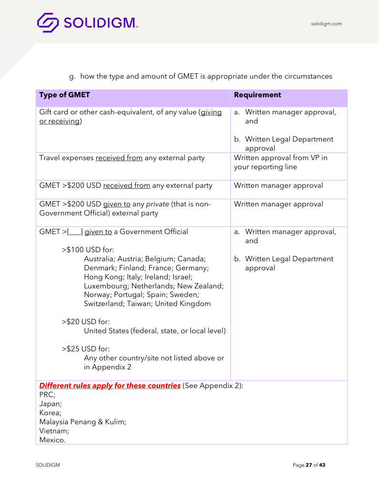

## Document Metadata

- Document ID: a29f2b085863405e6d7ea9f3fca5d6198b931d29
- Document Title: Solidigm Code of Conduct
- Document Type: Code of Conduct
- Issuing Organization: Solidigm
- Publication Date: null
- Reporting Period: null
- Source File: [S0cece11bd156_solidigm.com_value-of-data-storage-for-ai-e.pdf](https://github.com/jadennevercode/CJCC-Knowledge-Base/blob/564ab11aa9785e569e3853c8a4d7ce86f88e7535/materials/%E5%9F%BA%E7%A1%80%EF%BC%9ANAND%E4%BA%A7%E5%93%81%E4%B8%8E%E6%8A%80%E6%9C%AF%E8%B0%B1%E7%B3%BB/S0cece11bd156_solidigm.com_value-of-data-storage-for-ai-e.pdf)

## Structured Content

> 原文件：[S0cece11bd156_solidigm.com_value-of-data-storage-for-ai-e.pdf](https://github.com/jadennevercode/CJCC-Knowledge-Base/blob/564ab11aa9785e569e3853c8a4d7ce86f88e7535/materials/%E5%9F%BA%E7%A1%80%EF%BC%9ANAND%E4%BA%A7%E5%93%81%E4%B8%8E%E6%8A%80%E6%9C%AF%E8%B0%B1%E7%B3%BB/S0cece11bd156_solidigm.com_value-of-data-storage-for-ai-e.pdf)
> 转换方式：Volcengine OCRPdf v3, parse_mode=ocr

[Source Page: 1]

# Solidigm Code of Conduct

Owner: General Counsel

No changes of any kind without written permission from the General Counsel

[Source Page: 2]

## Table of Contents

| | Printed page |
| --- | --- |
| Part One: Our Code of Conduct | 2 |
| Part Two: Your Responsibilities | 3 |
| Part Three: A Discussion of the Five Specific Elements of the Code of Conduct | 5 |
| 1. Conduct Business with Honesty and Integrity | 5 |
| 2. Follow the Law | 6 |
| 3. Treat all people with fairness, dignity, and respect. | 12 |
| 4. Act in the Best Interests of Solidigm and Avoid Conflicts of Interest. | 14 |
| 5. Protect Solidigm’s Assets. | 16 |
| Part Four: Addendums and Appendices | 18 |
| Addendum 1: Solidigm Antitrust Policy | 18 |
| Addendum 2: Government Relations Policy | 22 |
| Addendum 3: “GMET” Policy: Business Gifts, Meals, Entertainment and Travel | 25 |
| Appendix 1: Sample Compliance Transparency Statements | 28 |
| Appendix 2: Special GMET Thresholds for Select Countries/Sites | 30 |
| PRC: Chengdu | 30 |
| PRC: Dalian | 30 |
| Rest of PRC | 31 |
| Japan | 31 |
| Korea | 32 |
| Malaysia: Penang & Kulim | 32 |
| Mexico | 33 |
| Vietnam | 33 |
| Addendum 4: Global Human Rights Policy | 34 |
| Addendum 5: Insider Trading Policy | 37 |
| Addendum 6: Signature Authority for Solidigm and its Subsidiaries | 41 |
| Addendum 7: How Solidigm Conducts Internal Investigations | 41 |

[Source Page: 3]

## Part One: Our Code of Conduct

1. We conduct business with honesty and integrity.
2. We follow the law.
3. We treat all people with fairness, dignity, and respect.
4. We act in the best interest of Solidigm and avoid conflicts of interest.
5. We protect Solidigm’s assets.

If you do not understand any part of this Code of Conduct either generally, or in a particular situation, contact your manager or the Legal Department or both. When in doubt, ask.

[Source Page: 4]

## Part Two: Your Responsibilities

1. You must follow the Code. This Code of Conduct applies to all:

   a. employees,

   b. members of the Board of Directors who are not employees, and

   c. our business partners who do business with Solidigm, such as contractors, consultants, or suppliers.

But no code or policy can address every situation or issue. At all times, you are expected to exercise your sound, honest, good judgment in all that you do for Solidigm. When in doubt, ask for help.

2. Consequence for non-compliance. Employees who violate the Code can be subject to discipline, which may include termination of their employment. Independent parties that do business with Solidigm – such as contractors, consultants, or suppliers – may lose their business if they violate the Code of Conduct. Violators may also be subject to civil and criminal penalties.

3. You must report violations. You must report possible violations of the law, the Code of Conduct, or other Solidigm policies. You do not need to be certain that a violation has occurred to report it.

If you are an employee, report your concern to:

a. the Solidigm Legal site to “Report an Ethical Concern”; or,

b. your direct manager or another manager, up to and including the Chief Executive Officer; or,

c. the Legal Department; or,

d. depending on the particular issue: Human Resources, Finance, Corporate Security, and/or Information Security.

If you are not an employee, report your concern to:

a. Solidigm’s Legal Department at askethics@solidigm.com; or,

b. your primary business contact at Solidigm, up to and including their leaders.

[Source Page: 5]

4. You must cooperate fully with internal investigations of alleged violations unless some countervailing law or rule provides otherwise. Further information about how Solidigm conducts investigations is found in Addendum 7.

5. There is, and will be, no retaliation. Solidigm prohibits retaliation against anyone who in good faith raises, questions, and/or reports possible violations of law, the Code, or other company policies, or who participates in an internal investigation concerning the same. Retaliation – or the threat of retaliation – is itself a violation of this Code.

6. If you have questions on how the Code of Conduct may apply, please contact your manager, or the Solidigm Legal Department. Seek guidance whenever you are unsure what to do.

7. Specifics regarding this Code of Conduct may differ by subsidiary and/or country and are subject to local laws.

8. Waivers. In a particular circumstance, Solidigm may waive a provision of this Code. To seek a waiver, speak with your manager, who will consider your request in consultation with others, such as the Legal Department or Human Resources. Waivers require express permission of Solidigm’s Chief Financial Officer and/or General Counsel. Directors and executive officers who seek a waiver should address the Board of Directors or a designated committee of the Board.

9. Changes. Solidigm may amend this Code and its other policies from time to time in its discretion.

[Source Page: 6]

## Part Three: A Discussion of the Five Specific Elements of the Code of Conduct

### 1. Conduct Business with Honesty and Integrity

We act with honesty and high ethical standards in all business dealings. We do this by:

a. Treating our co-workers and business partners the way we want them to treat us. We treat customers, suppliers, and other business partners with fairness and respect. We recognize that success in business is based on strong relationships of mutual respect and trust. We likewise expect our business partners to conduct business the same way.

b. Acting as a responsible corporate citizen. We do business in a way that respects the planet, the environment, and its inhabitants. We strive to enhance the communities in which we live and work. We consider how our decisions and actions have impact both in the short-term and in the long-term.

c. Keeping records that are accurate and clear. We are responsible for ensuring that Solidigm’s books and records accurately and clearly reflect the company’s operations and business activities. Do not, under any circumstances, prepare false documents or false records of any kind. This is true, for example, of internal reporting, external reporting, public statements, and public filings.

d. Communicating clearly, accurately, respectfully, and professionally. What you say, and how you say it, matters. Ambiguous or otherwise unprofessional communications can confuse your audience and harm Solidigm. Even well- intentioned communications can be misinterpreted if they are not clear. This applies to both oral and written communication, including voicemails, emails, text messages, and social media.

[Source Page: 7]

### 2. Follow the Law

We follow the laws of each of the numerous countries where we do business.

Each of us is responsible for knowing and following the laws and regulations that may be relevant to our work.

We also must act in a manner that upholds the spirit of the law. If Solidigm policies differ from laws or regulations, follow the higher standard. In all cases, Solidigm conducts business with integrity and according to ethical business practices.

Violating the law can result in profound consequences, including prison time, large fines or financial penalties, and reputational damage.

Some areas of law that are crucial to our business:

a. Antitrust. Antitrust laws are meant to protect fair competition, promote innovation, and protect fair trade. We compete fairly and lawfully by:

- Being truthful when we communicate about our products and our competitor’s products.

- Growing our business through innovation, hard work, and fair play, not through harming our competitors or competition.

We do not make communications or enter agreements – explicit or implicit – that might limit trade, innovation, or competition. Attached as Addendum 1 is Solidigm’s Antitrust Policy. All of us are responsible for reading, understanding, and following Solidigm’s Antitrust Policy.

b. Anti-corruption. We must not participate in or facilitate corrupt activity of any kind. We must avoid corruption and also the appearance of corruption.

We follow all applicable anti-corruption laws, including the US Foreign Corrupt Practices Act (FCPA) and similar laws in other countries. As with this entire Code of Conduct, this policy also applies to third parties who do business with Solidigm.

[Source Page: 8]

- We must never offer, or accept, bribes or kickbacks. A bribe is anything of value or benefit of any kind that is intended to secure an improper advantage or influence. A bribe can take many forms. For example, a bribe can be in the form of a payment, a charitable donation made on someone’s behalf, a kickback, a gift (including meals, entertainment, or travel), a promise, or a favor. A bribe can also include the “facilitation of expediting payments” made to facilitate non- discretionary, routine government actions and approvals.

Often, merely offering a bribe is illegal, even if the offer is rejected.

- We must keep complete and accurate books and records. This applies to our formal Finance documents (for example, financial statements and the general ledger) and also to ordinary records like purchase orders, invoices, expense reports, and receipts. Anti- corruption enforcement actions often focus on inaccurate recordkeeping or weak internal controls, for example: (a) off-the-books payments, (b) circumventing Solidigm’s internal accounting controls, (c) improper payments characterized as commissions, fees, or grants, or (d) discounts or rebates in sales/purchasing contracts.

- We must look-out for corrupt activity by third parties who act on our behalf, even if we lack direct knowledge of their misconduct. Therefore, it is the responsibility of Solidigm employees managing third parties to ensure that they too follow all these rules.

- The one exception to these rules is if there is a threat to the personal safety or liberty of yourself or another person. If this happens, you may make an otherwise improper payment, and you must immediately report the details to your manager and to the Legal Department.

- You are also expected to review and understand:

i. Government Relations Policy attached as Addendum 2.

ii. Policy on GMET (gifts, meals, entertainment, travel), attached as Addendum 3.

[Source Page: 9]

c. Anti-money laundering

Solidigm will take all reasonable measures to detect and prevent money laundering. For example, we have limitations on the forms of payment that are acceptable for Solidigm’s product and services, and we pay particular attention to payments that are received not directly from our customers but rather from third parties purportedly acting on behalf of our customers. All Solidigm employees whose work is associated or related to receiving payments for Solidigm’s product and services must receive special training, and the Solidigm Finance and Accounts Receivable organizations have compliance protocols which must be understood and followed by all relevant employees.

d. Environment, Health, & Safety (EHS) We are committed to:

- Creating a culture of safety at Solidigm, and providing a safe and injury free workplace; and,

- Operating and growing Solidigm in a way that sustains and protects the environment and mitigates climate change.

We have a responsibility to understand and follow the EHS rules, regulations, and laws that apply to our products and our business operations around the world. This includes, for example: conserving energy and natural resources (like water and raw materials), properly handling materials and waste, and operating in accordance with the necessary permits and licenses.

Our suppliers and other business partners should similarly comply with all applicable EHS laws and standards in their operations.

e. Product Safety. We are committed to making products that comply with regulations including safety regulations, and that are as safe as possible for people, property, and the environment.

Solidigm’s Quality & Reliability team (“QNR”) handles safety and regulatory concerns and incidents.

[Source Page: 10]

f. Trade Compliance. Every country where we do business has laws that cover the movement of physical goods and components, as well as the movement of electronic goods like software, information, or technology. In some cases, a license or other specific authorization may be required for such movement.

Some laws restrict with whom we can do business or may set certain limits or rules for how to engage.

Customs laws require accurate product information and payment of duties, if applicable.

Because these laws and regulations are complex, we provide specific training.

g. No Insider Trading. All employees, directors, and business partners are expected to avoid insider trading. Solidigm’s policy against insider trading is in Addendum 5.

h. Respect the intellectual property (IP) of others. You may not use the IP of another person or company—such as patents, trade secrets, confidential information, trademarks, or works of authorship (including software)—without first obtaining legally sufficient permission. Solidigm’s products should be designed using only the ideas, research, and development of our own employees, or by using technology that Solidigm has licensed or that is in the public domain.

Do not search-for or study the IP of a third party without permission from your manager and the Legal Department.

If you are properly in possession of the confidential information of another person or company, use that confidential information only according to proper business purposes for which it has come into your possession.

Do not use Solidigm equipment to copy, play, or distribute unauthorized copies of any copyrighted material.

i. Privacy. Solidigm is committed to protecting the reasonable privacy expectations of our employees and all those with whom we do business. Many countries have privacy laws that govern the collection and use of personal information and Solidigm complies with those laws. Compliance protocols are

[Source Page: 11]

implemented and monitored by Solidigm’s Chief of Information Security in conjunction with the Legal Department.

Some additional points regarding privacy:

The exposure of Private Information (defined as information that identifies or can be used to identify or authenticate an individual; or, other sensitive information such as political affiliation, criminal record, sexual orientation, religious affiliation, trade-union membership, medical information) can cause substantial harm to individuals, including embarrassment, inconvenience, and fraudulent use of the information. It is crucial that you protect the confidentiality and integrity of Private Information at all times.

You may only collect, access, or use Private Information under Solidigm’s compliance protocols and proper legal notices, and the Personal Information collected must be limited to that which is reasonably necessary to accomplish Solidigm’s legitimate business purposes, or as necessary to comply with law.

You must secure Private Information in accordance with Solidigm IT protocols and promptly report any exposures or leaks.

You must delete the Private Information when it is no longer needed for the required business purpose, or otherwise to comply with Solidigm’s document retention rules.

j. Public Communications, including statements to Investment Professionals. Although Solidigm is not a publicly traded company, Solidigm still must comply with a variety of regulations that govern public communications and governmental filings.

Only authorized spokespersons may make public statements on behalf of Solidigm to the public, the media, investors, or investment professionals.

If you are contacted by anyone – for example, a reporter, blogger, analyst, investment professional, or the public – requesting comments on behalf of Solidigm, do not respond unless you have been expressly authorized to do

[Source Page: 12]

so on that specific topic by Solidigm’s Office of Corporate Affairs. Instead of responding, refer the inquiry to the Office of Corporate Affairs.

k. Document Retention and Information Management.

Solidigm requires all employees to comply with legal obligations to retain or discard Solidigm information and documents. In particular, every Solidigm employee must comply with a Solidigm Legal instruction – typically in the form of a Legal Event Hold Notice (LEHN) – to retain specified Solidigm information and documents due to an anticipated or pending litigation, investigation, or audit.

In all other instances, employees should retain Solidigm information and documents – including routine emails and other correspondence, presentations, and draft documents – only for so long as the information or documents continue to have a legitimate business value to Solidigm. For most such Solidigm Information, that is probably one year or less.

Solidigm has issued Record Retention Schedules to identify Solidigm information and documents that are subject to a statutory or regulatory retention obligation, or as to which Solidigm has made a business decision that the documents and information should be kept for more than a year. Solidigm employees should familiarize themselves with the schedules and comply with the applicable retention periods.

The Record Retention Schedules may not cover all possible document types; if you have doubt whether particular information or documents are subject to a legal, statutory, regulatory or business obligation to retain or discard it should contact the Legal Department before destroying or archiving the information or documents.

[Source Page: 13]

### 3. Treat all people with fairness, dignity, and respect.

We work together with candor and trust. We celebrate diversity. We protect employees from discrimination, harassment, and unsafe practices. We do this by:

a. Truthful and transparent communication. We value and encourage the free flow of thoughts, ideas, questions, and concerns.

b. Equal employment opportunities. We value diversity in our workforce as well as in the workforce of our business partners.

We provide equal employment opportunity for all applicants and employees. We do not discriminate on the basis of race, color, religion, religious creed, sex, national origin, ancestry, age, physical or mental disability, medical condition, genetic information, military and veteran status, marital status, pregnancy, gender, gender expression, gender identity, sexual orientation, or any other characteristic protected by local law, regulation, or ordinance.

We make reasonable accommodations for the disabilities of employees and applicants, as required by law.

We make reasonable accommodations for the religious beliefs and practices of employees and applicants, as required by law.

We follow these principles in all areas of employment including recruitment, hiring, training, promotion, compensation, benefits, transfer, and social and recreational programs.

c. Anti-harassment. We strive to treat everyone with whom we interact with dignity and respect. We do not tolerate harassment of employees or other business partners by managers or co-workers.

We strive to provide a workplace free of harassment, including based on personal characteristics such as race, color, religion, religious creed, sex, national origin, ancestry, age, physical or mental disability, medical condition, genetic information, military and veteran status, marital status, pregnancy, gender, gender expression, gender identity, sexual orientation, as required by law.

[Source Page: 14]

d. Respect for human rights. Our policy on Global Human Rights formalizes Solidigm’s commitment to respect human rights and is attached as Addendum 4.

e. Safety. Solidigm is committed to providing a safe workplace, including by complying with the safety laws and rules that apply to our business. Do not begin or continue any work activity that is contrary to safety or health requirements.

In keeping with our commitment to safety, Solidigm does not tolerate – whether explicit or implicit – threats, threatening behavior, stalking, or acts of violence.

f. Honest marketing. We market our products and services honestly and fairly. All statements about our products and services must be true and not misleading with appropriate notices, disclaimers, and substantiation of claims, including performance-related claims. Sweepstakes and contests can raise additional legal and regulatory issues, so you should consult with legal before using any sweepstakes or contest as a promotion for Solidigm products or services.

[Source Page: 15]

### 4. Act in the Best Interests of Solidigm and Avoid Conflicts of Interest.

When acting as an employee, you must (a) always act in the best interest of Solidigm, and (b) avoid conflicts of interest. The question: can you always do what’s best for Solidigm**, or is something actually or potentially in the way?

**Remember that “what’s best for Solidigm” includes following the law, acting ethically, and otherwise following this Code of Conduct.

A “conflict of interest” arises if you have an interest of any kind (i) which might lead you to *not* put Solidigm’s interests first, or (ii) which might create the appearance to a neutral person that you might not put Solidigm’s interests first.

For example, a conflict of interest can be any interest which, viewed by a neutral person, would actually or potentially:

a. Compete with Solidigm.

b. Use Solidigm assets or information for a purpose other than doing what’s best for Solidigm.

c. Interfere with your ability to faithfully perform your duties for Solidigm, for example by making you unavailable to Solidigm during working hours.

d. Divide your loyalties between Solidigm and someone or something else.

e. Interfere with your ability to make sound decisions for Solidigm.

This interest could be something that relates: personally to you; to an acquaintance; to a family member; or, to an outside business/financial interest or activity of you, a family member, or an acquaintance.

Additionally, you must immediately disclose any conflict or appearance of conflict in writing to: (1) for employees, your manger, or, (2) for non-employees, your Solidigm primary point of contact, and work-through with your manager or Solidigm primary point of contact an acceptable course of conduct in view of the situation.

You and your manager are welcome and encouraged to contact the Legal Department as needed.

[Source Page: 16]

You are responsible for (a) making sure that the matter is resolved with your manager in writing, and (b) keeping and not deleting the entire written record of what the matter is, how the issue was raised, and how the matter is resolved, including any updates that occur over time.

In evaluating your notice, your manager will consider:

a. your ability to influence Solidigm’s decisions,

b. any benefit you (or a relative or acquaintance) may receive and/or that Solidigm may lose,

c. how the situation appears, or would appear, to a neutral person,

d. whether and how the situation might be modified or mitigated short of a flat “acceptance” or “rejection,” and

e. what actions are required to ensure compliance going forward.

If something changes, immediately re-contact your manager and go through the process again.

A good reference point for this analysis is to consider how a neutral person who was aware of all the relevant facts would respond to the situation.

Would it appear to that neutral person that your influence over Solidigm in this situation could be motivated by any factor other than what is in Solidigm’s best interests? Do you have any interest that a neutral person might perceive to be at odds – or potentially at odds – with Solidigm? If so, what course of conduct would the neutral person recommend to ensure compliance and avoid an actual or apparent conflict?

Common examples that give rise to this process are: (a) additional jobs or consultant- engagements outside Solidigm (“moonlighting”); (b) participation in Board of Directors outside Solidigm, (c) receiving gifts, meals, entertainment, or travel benefits (GMET), (d) hiring or otherwise doing business with friends or family.

[Source Page: 17]

### 5. Protect Solidigm’s Assets.

Every employee is responsible to protect Solidigm’s assets, which include for example physical assets (like facilities and equipment), confidential information, other intellectual property, brand, name, and reputation.

a. Protect Solidigm’s physical assets. Follow applicable security procedures to protect Solidigm’s physical assets from theft, loss, damage, misuse, or unauthorized access. Promptly report incidents to Corporate Security as soon as possible.

b. Protect Solidigm’s confidential information. Confidential information gives Solidigm a competitive advantage, and helps maintain the trust of our customers, suppliers, and other business partners.

Confidential information includes information about technical engineering matters, unreleased products, product roadmaps, R&D projects, manufacturing dates, and much more.

Each of us has a responsibility to protect and not to leak confidential information.

Be particularly careful with social media.

Disclosure of Solidigm information without proper permission is a terminable offense, subject to applicable local law.

Similarly, Solidigm must likewise protect and not disclose or otherwise misuse the confidential information of others that is lawfully in our possession.

If you become aware of unauthorized disclosure or loss of confidential information, you must contact Information Security or the Legal Department.

c. Protect Solidigm Intellectual Property (IP). Intellectual Property—such as patents, trade secrets, trademarks, or works of authorship (including software)— is very valuable to Solidigm and you must protect it at all times. Intellectual Property includes items like product designs and layouts, schematics, software, firmware, testers and test protocols, and tool configurations. It also includes business-side IP like roadmaps, product development plans, and strategies around product development, sales, and marketing. Do not disclose such information without proper permission. Do not license or otherwise grant

[Source Page: 18]

permission to third parties to use any Solidigm IP without proper permission and full legal review.

d. Do not attempt to bind Solidigm unless you have proper authority. Solidigm has specific rules for who may sign binding contracts and other obligations. Following these rules is important to protect Solidigm and its assets. See Addendum 6.

e. Protect Solidigm’s brand, trademarks, and good name. We must uphold the value of our reputation and name whenever we represent our company. Do not speak for the company in areas where you are not authorized to do so.

f. Do not attempt to join organizations on Solidigm’s behalf without proper permission. It may be in Solidigm’s interest to join industry groups, standards- setting organizations, or other bodies that will help Solidigm conduct business and otherwise promote Solidigm’s values. But joining such groups can have significant legal implications, for example, implications related to competition laws or IP licensing. Accordingly, we do not join any such outside groups without proper business approvals and full legal review.

[Source Page: 19]

### Part Four: Addendums and Appendices

### Addendum 1: Solidigm Antitrust Policy

This addendum addresses Solidigm’s antitrust policy in greater depth. If you have any questions about antitrust law or application, please contact the Legal Department.

1. Who is a “competitor”?

Competitors are companies that buy and/or sell the same kinds of products or services, including employment services. A company can be both a customer and a competitor at the same time.

2. Competitors may be prohibited from agreeing, communicating, or coordinating on certain topics. As a general rule, competitors should not agree with each other to restrict competition.

Therefore, all meetings or communications with competitors must have a legitimate business purpose that promotes fair competition. If you cannot articulate what that legitimate business purpose is – and how it promotes fair competition – then do not engage in the meeting or communication at issue.

If a competitor tries to communicate about topics unrelated to fair competition, you must (a) stop the conversation or leave the meeting immediately, and (b) report it to the Legal Department. It is not enough to merely stay silent.

Thus, for example, you may not communicate or agree with a Solidigm competitor about the following items related to their (or Solidigm’s) products or services:

a. price.

b. capacity, volume, output levels, or input levels.

c. the geographic areas or market segments in which either company buys or sells.

d. the identity of either company’s customers or suppliers, or terms that are set with them.

[Source Page: 20]

e. non-public information about product roadmaps or R&D.

If you believe that doing any of the foregoing could help promote competition or innovation, then such action could be lawful. In that case, please contact the Legal Department, and of course do so before you have any communication with the competitor.

If a competitor is also an Solidigm customer or supplier, you may discuss pricing and other sales terms, but only to the extent necessary to do business with that customer or supplier.

You must get Legal Department approval before:

a. agreeing with another company to limit recruitment or hiring of employment candidates.

b. refusing a request from a competitor to buy Solidigm products or services or license Solidigm’s Intellectual property.

c. entering into a joint venture or collaboration with another company.

Part of fair competition is being truthful. So when speaking about a Solidigm product or a competitor’s product, do so truthfully.

Also, you may not knowingly help customers, distributors, or suppliers that compete with each other to engage among themselves in communications or agreements that would violate any of the foregoing guidance.

3. Trade Associations, Standards-Setting Organizations, and other business groups.

Trade associations, consortiums, special interest groups, and standard-setting organizations are examples of groups that can bring together competitors for a lawful purpose. You must get Legal Department approval before representing Solidigm in one of these groups.

4. Government Investigations.

Solidigm cooperates fully with all properly authorized government investigations about alleged antitrust practices.

[Source Page: 21]

5. Additional rules regarding Compensation and Benefits.

Any company that competes with Solidigm for employees is a competitor at least in that sense, which affects communications that you may engage in that relate to compensation and benefits (C&B).

Generally, without express Legal Department approval, you may not discuss or enter into any agreement with other companies relating to either Solidigm’s or any other company’s present, contemplated, or planned C&B. In this context, you may:

a. Use C&B information from publicly available sources.

b. Share Solidigm’s public C&B information with another company.

c. Participate in a benchmarking survey or blind polling activity that enable us to understand the price or cost of compensation and benefits, but only when using third parties that meet the following criteria:

i. The information collection and reporting activity is performed by a third party that is not an industry participant (e.g., Radford, Mercer, Towers Watson, US Department of Labor);

ii. The information that the third party will report is at least three months old.

iii. Each statistic disseminated by the third party is based on data collected from at least five participants, and no individual company’s data represents more than 25% of any statistic disseminated: and

iv. Any data disseminated by the third party is sufficiently aggregated such that it is not feasible to reverse engineer any individual company’s data. Survey results should be reported using averages, means, and ranges so that the exchange of information describes the overall market and not individual participants’ information.

d. Discuss public C&B policies, philosophies, and management practices at a high level, and without disclosing the price or cost of a program.

e. Speak with current Solidigm employees or job applicants to understand the pay and benefits package they received while working for a former employer or as part of an employment offer from another company, so long as doing so does not violate a confidentiality obligation of that person to their former

[Source Page: 22]

employer. Retain your records of the discussion to prove the source of the information.

[Source Page: 23]

### Addendum 2: Government Relations Policy

Special rules regarding anti-corruption, lobbying, disclosures, gifts, and procurement may apply when you are interacting with the Government or undertaking Government Relations Activities on Solidigm’s behalf.

1. What are “Government Relations Activities”?

“Government Relations Activities” means work undertaken on Solidigm’s behalf (whether face-to-face or indirectly) for the purpose of influencing a policy, strategy, legislation, regulation, rule, permit, zoning regulation, or other official decision of a Government** or a Government Official***.

“Government Relations Activity” may include communications with Government Officials which are made by a third party or to a third party, for example a consultant working for Solidigm or a consultant working for the Government.

“Government Relations Activity” does not include: (a) preparation of written responses to Government requests for proposals or requests for information, (b) ordinary course communications that are necessary during the administration of a contract, or (c) interactions with Government that various legal groups may have in connection with litigation, patent, and government enforcement matters.

**”Government” means any government department, agency, or instrumentality, including state-owned or state-controlled companies-at any level in any locality, state, or country-as well as public international organizations (e.g., the United Nations, World Bank, or regional development banks).

“Government” also means a political party, political official, or candidate for political office.

“Government” also includes any government-funded institution such as a public university, public school, public hospital, or government-sponsored research institutes or laboratories.

***”Government Official” means any officer, employee, or person acting in an official capacity for any Government. These include, for example:

a. employee of a Government.

b. member of a royal family who acts on behalf of a Government.

[Source Page: 24]

c. a person acting for, or on behalf of, the Government, even if that person is not a government employee. This includes an entity hired to review and accept bids for a government agency, or an honorary (but uncompensated) official with ceremonial duties.

2. Overview

a. Coordination with the Office of Corporate Affairs

Any activity related to influencing legislative, regulatory, or policy decisions or positions of a Government or Government Official must be coordinated through the Office of Corporate Affairs.

b. Complying with Lobbyist-Registration and Reporting Requirements

Government Relations Activity by Solidigm or its consultants may be subject to registration and reporting requirements with the relevant Government, including, in the United States, the Foreign Agents Registration Act. Such requirements may apply even if the contact is made by someone other than a traditional “lobbyist,” and even if the contact is made on an issue other than legislation, such as a contract or a permit request.

Any business group involved in Government Relations Activities is responsible for establishing procedures to ensure that its employees and third parties comply with applicable lobbying registration and reporting requirements. The Legal Department will provide support in establishing and maintaining the appropriate procedures.

c. Due Diligence on Government Relations Consultants. Lobbyists. and Business Development Firms

When engaging a third-party consultant, lobbyist, business development firm, or any other entity or individual to perform Government Relations Activities on Solidigm’s behalf you must:

i. Due Diligence Review. Prior to signing any agreement, notify the Legal Department of the proposed engagement. The Legal Department will perform a due diligence review that will include a third-party questionnaire, a background screening, and additional compliance measures if deemed appropriate.

[Source Page: 25]

ii. Retention Agreement. Regardless of the method of payment, there should be a stand-alone retention agreement with the third party that states the compensation structure, specifies the expected deliverables, and includes an anti-corruption clause. In most cases, the agreement should have a term of no longer than one year.

iii. Record keeping. Collect and maintain proof of performance from the third party, in accordance with Solidigm’s document retention policies.

d. Employees Joining Solidigm from Government Positions

Contact Solidigm Human Resources for country-specific guidance on hiring former Government Officials.

Governments place certain restrictions on what kind of private employment a person can take after they leave Government service, which are often referred to as “Revolving Door” rules or restrictions.

These rules may limit the activities that a Solidigm employee who is a former Government Official may perform on behalf of the Company.

These restrictions include, for example: (a) representing Solidigm in front of any Government or Government Official; and (b) advising Solidigm on its interactions with any the Government.

[Source Page: 26]

### Addendum 3: “GMET” Policy: Business Gifts, Meals, Entertainment and Travel

The following rules apply if you give or receive gifts, meals, entertainment, or travel** to or from anyone outside of Solidigm (including for example, customers, suppliers, business partners, or government officials). This policy does not usually apply to purely personal GMET that you exchange with friends or family, but you must be aware of the appearances that such exchanges may create, so please seek guidance from your Manager or from the Legal Department if you have any questions.

**For these purposes, “travel” does not include travel for short, local distances, or for in-city transportation, that is undertaken to further otherwise lawful and ethical business.

The purpose of these rules is to ensure that we do business based on mutual trust in a way that upholds integrity, follows the law, and avoids even the appearance of bribery, improper influence, conflicts of interest, or other potential corruption.

The Terms “Government” and “Government Official” used herein are defined in this Code of Conduct in Addendum 2 (Government Relations Policy).

Solidigm’s Legal Department oversees this policy and may grant policy exceptions on a case-by-case basis.

1. The basic rules for GMET.

a. Legitimate Business Purpose. The GMET must have a legitimate business purpose that you can clearly articulate, which can include building or sustaining business relationship. The question: what legitimate business interests of Solidigm does the GMET advance?

b. No Improper Influence. The GMET must not place, or appear to place, the recipient under any obligation. For example, the GMET must not compromise, or even appear to compromise, the recipient’s objectivity in making business decisions on behalf of their employer.

c. Reasonable and Appropriate. The proposed GMET must be reasonable in value, consistent with local customs, appropriate and proportional to reasonably advance the legitimate business interest at issue, and consistent with Solidigm values. For example, the following may not be appropriate: repeated GMET to the same recipient, or GMET during a sensitive time period (such as during an important negotiation or evaluation). Certain kinds of GMET are never consistent with our values; for example, adult entertainment is never

[Source Page: 27]

appropriate. If you are aware of limits on what someone can accept from Solidigm, offering or providing GMET above that limit would not be appropriate.

d. No Cash. You may never give or receive cash gifts.

e. Open and Transparent. The GMET must be given or received in an open and transparent manner. Sample transparency statements for different scenarios are provided below in Appendix l.

f. Accurately Recorded. The GMET must be accurately recorded, including information submitted in your request for approval, in expenses reports, and in related third-party quotes and invoices. When submitting an expense report for GMET to a Government Official, you must designate it as an expense for a “Government Official.”

g. Third parties acting on Solidigm’s behalf may not give GMET to Government Officials without written approval from the Legal Department.

2. Approval requirements.

Some GMET requires approval, which is shown in the chart that follows. If approval is required, you are responsible for keeping and not deleting the entire written record (email is sufficient) of your request to give or receive GMET and its resolution, including any updates that occur over time.

When seeking approval, you must make a written request and you must include at least the following information in your written request:

a. the type of GMET at issue

b. the country and city at issue

c. the amount of the GMET

d. whether you are proposing to give or to receive

e. whether the counterparty is a Government Official (defined at Addendum 2 (Government Relations Policy)), or a private party

f. the business purpose of the GMET

[Source Page: 28]

g. how the type and amount of GMET is appropriate under the circumstances

| Type of GMET | Requirement |
| --- | --- |
| Gift card or other cash-equivalent, of any value (giving or receiving) | a. Written manager approval, and b. Written Legal Department approval |
| Travel expenses received from any external party | Written approval from VP in your reporting line |
| GMET >$200 USD received from any external party | Written manager approval |
| GMET >$200 USD given to any private (that is non-Government Official) external party | Written manager approval |
| GMET >[___] given to a Government Official: >$100 USD for Australia; Austria; Belgium; Canada; Denmark; Finland; France; Germany; Hong Kong; Italy; Ireland; Israel; Luxembourg; Netherlands; New Zealand; Norway; Portugal; Spain; Sweden; Switzerland; Taiwan; United Kingdom; >$20 USD for United States (federal, state, or local level); >$25 USD for any other country/site not listed above or in Appendix 2 | a. Written manager approval, and b. Written Legal Department approval |

Different rules apply for these countries (See Appendix 2): PRC; Japan; Korea; Malaysia Penang & Kulim; Vietnam; Mexico.

[Source Page: 29]

### Appendix 1: Sample Compliance Transparency Statements

Event registration website:

Solidigm is funding the following items at the event: [list everything Solidigm is paying for- e.g., hotel room, meals, etc.]. Solidigm is committed to compliance with all applicable laws, regulations, policies, and ethics rules. Solidigm seeks no promises or favoritism for itself or any of its affiliates in exchange for the items of value listed above. By registering for this event, you agree that your receipt of the items of value above does not violate any law, regulation or policy applicable to you.

Speaker invitations

Solidigm is funding the following items in connection with this speaker invitation: [list everything Solidigm is paying for- e.g., speaker fee/honorarium, hotel room, meals, etc.]. Solidigm is committed to compliance with all applicable laws, regulations, policies, and ethics rules. Solidigm seeks no promises or favoritism for itself or any of its affiliates in exchange for the items of value listed above. By accepting this invitation, you agree that your receipt of the items of value above does not violate any law, regulation, or policy applicable to you.

Raffle table:

Solidigm seeks no promises or favoritism for itself or any of its affiliates in exchange for the opportunity to participate in the [name of raffle]. We ask session attendees to exclude themselves from the [name of raffle] if your employer prohibits participation in the random drawing.

Product giveaway:

Solidigm is committed to compliance with all applicable laws, regulations, policies, and ethics rules. Solidigm seeks no promises or favoritism for itself or any of its affiliates in exchange for this giveaway. By your acceptance, you agree that the giveaway does not violate any law, regulation, or policy applicable to you.

Event invitation letter:

Date: Dear [invitee]:

We look forward to receiving you as a representative of [name of organization] to the [name of Solidigm event] on [date of event] in [location of event].

[Source Page: 30]

The [name of Solidigm event and description of purpose, etc.]

Solidigm is pleased to arrange for [name of invitee]’s travel expenses as listed below. Please note that Solidigm will not be providing reimbursement for any other expenses related to the event. [NOTE: Edit the details below as needed.]

- Economy class airfare to/from [____]

- Lodging at the [name of event hotel for [X] nights

- Meals during the course of the event as described in the attached agenda [NOTE· Attach agenda if possible]

- Airport transfer to/from [____] [NOTE· Add other ground transportation as appropriate]

- [Specify any nominal, promotional gifts as appropriate]

Solidigm is committed to compliance with all applicable laws, regulations, policies, and ethics rules. Solidigm seeks no promises or favoritism for itself or any of its affiliates in exchange for the items of value listed above. By accepting this invitation, you agree that you receipt of the items of value above does not violate any law, regulation, or policy applicable to you.

If you have any questions, please feel free to contact [enter Solidigm contact details]. We look forward to welcoming you at [event].

Sincerely,

[Source Page: 31]

[原始页面图像](_assets/solidigm-policy-reviewed-pages/page-31.png)

## Appendix 2: Special GMET Thresholds for Select Countries/Sites

As noted above, all requests must be submitted and approved in writing.

### PRC: Chengdu

| | Gifts | Meals | Entertainment | Travel |
| --- | --- | --- | --- | --- |
| **To and from Government** | | | | |
| Manager approval | All >$0 USD | All >$0 USD | Not allowed | All > $0 |
| Legal Department approval and Manager approval | >$100 USD | >$100 USD | Not allowed | >$100 USD |
| **To and from non-Government** | | | | |
| Manager approval | All >$0 USD | All >$0 USD | Not allowed | Not allowed |

Follow the GMET Policy in all other respects.

### PRC: Dalian

| | Gifts | Meals | Entertainment | Travel |
| --- | --- | --- | --- | --- |
| **To Government** | | | | |
| Site GM approval | RMB 0-150 | RMB 0-350** | Not allowed | All >RMB 0 |
| Legal Department approval and Site-GM or Site-Controller approval | >RMB 150 | >RMB 350 | Not allowed | All >RMB 0 |
| **To non-Government** | | | | |
| Site-GM approval | Not allowed | Only on-site is allowed; All >RMB 0** | Not allowed | Not allowed |
| **From Government** | | | | |
| Site-GM approval | Not allowed | RMB 0-350 with pre-approval; >RMB350 Not Allowed | Not allowed | Not allowed |
| **From non-Government** | Not allowed | Not allowed | Not allowed | Not allowed |

[Source Page: 32]

[原始页面图像](_assets/solidigm-policy-reviewed-pages/page-32.png)

\*\*Non-alcoholic beverages for onsite meetings to government or non-government participants are allowed without Dept Manager or GM approval.

Follow the GMET Policy in all other respects.

### Rest of PRC

| | Gifts | Meals/Entertainment/Travel |
| --- | --- | --- |
| **To Government** | | |
| Legal Department approval and Manager approval | >$25 USD | >$100 USD |
| **To non-Government** | | |
| Manager approval | >$200 USD | >$200 USD |
| Group Director & Finance Controller/Manager approval | >$1000 USD | >$5000 USD |
| **From any external party** | | |
| Manager approval | >$200 USD | >$200 USD |

Travel Stipends for journalists are subject to special rules. Check with the Legal Department. Follow the GMET Policy in all other respects.

### Japan

| | Gifts | Meals | Entertainment | Travel |
| --- | --- | --- | --- | --- |
| **To Government** | | | | |
| Legal Department approval and Manager approval | >$100 USD | >$100 USD | >$100 USD | >$100 USD |
| **To non-Government** | | | | |
| Manager approval | >$200 USD | >$200 USD | >$200 USD | >$200 USD |
| Business unit GM/VP approval | | | >100K JPY (~$900 USD) | |
| **From any external party** | | | | |
| Manager approval | >$200 USD | >$200 USD | >$200 USD | >$200 USD |

原表中 Japan 的 Gifts、Meals 和 Travel 的 >$200 USD 单元格跨 Manager approval 和 Business unit GM/VP approval 两行；上表未将跨行单元格解释为额外门槛。

Follow the GMET Policy in all other respects.

[Source Page: 33]

### Korea

| | Gifts | Meals | Entertainment/Travel |
| --- | --- | --- | --- |
| **To Korea Fair Trade Commission** | | | |
| Legal Department approval and Manager approval | All >$0 USD | All >$0 USD | All >$0 USD |
| **To other Government or to School, University or Media Entity (public or private)** | | | |
| Legal Department approval and Manager approval | >$25 USD | >$25 USD | All >$0 USD |
| **To or from any other external party** | | | |
| Manager approval | >$100 USD | >$200 USD | >$200 USD |

If the GMET concerns condolence money, special rules may apply. Check with the Legal Department. Follow the GMET Policy in all other respects.

### Malaysia: Penang & Kulim

| | Gifts | Meals | Entertainment | travel |
| --- | --- | --- | --- | --- |
| **To Government:** | | | | |
| Legal Department approval and Manager approval, and Department Head approval | >$25 USD | >$25 USD | >$25 USD | All |
| **To non-Government, or from any external party:** | | | | |
| Manager approval and Department head approval | >$25 USD | >$100 USD | >$100 USD | >$100 USD |

Follow the GMET Policy in all other respects.

[Source Page: 34]

[原始页面图像](_assets/solidigm-policy-reviewed-pages/page-34.png)

### Mexico

| | Gifts | Meals | Entertainment | Travel |
| --- | --- | --- | --- | --- |
| **To Government:** | | | | |
| Legal Department approval and Manager approval, and Department Head approval | All | All | All | All |
| **To non-Government, or from any external party:** | | | | |
| Manager approval and Department Head approval | >$200 USD | >$200 USD | >$200 USD | >$200 USD |

Follow the GMET Policy in all other respects.

### Vietnam

| | Gifts | Meals | Entertainment | Travel |
| --- | --- | --- | --- | --- |
| **To Government:** | | | | |
| Manager written approval | All | On-site: >$15 USD** Off-site: All | Not allowed | All |
| Manager written approval, and Legal Department approval | >$25 USD | >$25 USD** | Not allowed | All |
| **To non-Government, or from any external party:** | | | | |
| Manager written approval | All | On-site: >$15 USD** Off-site: All | Not allowed | All |
| Manager approval and Legal Department approval | >$25 USD | >$100 USD** | Not allowed | All |

\*\*Taxi or shuttle bus to/from meal in the local area is considered part of meal cost

Follow the GMET Policy in all other respects.

[Source Page: 35]

### Addendum 4: Global Human Rights Policy

Solidigm is committed to Human Rights, which are the fundamental rights and freedoms which all people inherently possess. We expect the same from our business partners.

Common principles are reflected, for example, in the United Nations (UN) Global Compact, the Universal Declaration of Human Rights, the UN Guiding Principles on Business and Human Rights, core International Labor Organization Conventions, the Organization for Economic Co-operation and Development Guidelines for Multinational Enterprises, and the laws of the countries in which we do business.

If you believe that Solidigm, our employees, or our business partners are not meeting this commitment, please let us know by reporting your concerns:

If you are an employee, report your concern to:

a. the Solidigm Legal site to “Report an Ethical Concern”;

If you are an External Partner, report your concern to:

a. Solidigm’s Legal Department at askethics@solidigm.com; or,

b. your primary business contact at Solidigm, up to and including their leaders.

We will promptly investigate allegations.

We have also established a Management Review Committee—with oversight by the Board of Directors—to ensure that Solidigm delivers on this commitment.

Our commitment to Human Rights is reflected in the body of our Code of Conduct, which contains specific rules and guidance related to, for example, diversity, nondiscrimination, anti-harassment, worker safety, and environmental stewardship. Additionally:

1. Prevention of Human Trafficking, Forced Labor, and Child Labor.

Solidigm will not use or tolerate the use of forced labor, debt-bonded labor, indentured labor, involuntary prison labor, slavery, or human trafficking. We forbid harsh or inhumane treatment, including corporal punishment or its threat. Solidigm will not employ anyone under the age of 16 in any position, and workers under the age of 18 should not perform hazardous work, overtime, or night-shift work.

[Source Page: 36]

2. Working Hours and Minimum Wages.

Working hours are not to exceed the maximum set by local law or 60 hours per week, whichever is stricter. Workers should not work longer than 6 consecutive days without at least one day off. Employee-compensation must comply with applicable wage laws, for example those concerning minimum wages, overtime hours, and mandated benefits.

3. Freedom of Association.

In many of the locations where we operate, employees have the legal right to freely associate (or not associate) with third party organizations such as labor organizations, as well as the right to bargain (or not bargain) collectively. We respect those laws. Separately, we seek to create an environment in which employees can openly speak with their managers about their ideas, concerns, and problems, and work together to address workplace issues.

4. Responsible Technology.

Technology products can be used to infringe Human Rights. Our products are, for the most part, general-purpose computing products. We do not always know-nor can we control-the use of our products by our customers. If we become aware that our products are being used to violate Human Rights, we will restrict or cease business with the offending party.

5. Privacy and Freedom of Expression.

We do not design any of our products in a way that would enable anyone to circumvent security features, in ways that could be used to infringe on privacy, limit the freedom of expression, or violate Human Rights We support global policies and standards that build trust for technology infrastructure and protect data privacy and data security.

6. No Conflict Minerals.

Minerals and other materials (for example, tantalum, tin, tungsten, and gold) are sometimes mined and sold under the control of armed groups to finance conflicts that are characterized by extreme violence. These minerals can make their way into the supply chain. Our goal is to use minerals and other materials that do not directly or indirectly finance or help such groups, and more generally to support responsible sourcing. We expect our suppliers to implement policies (and to collaborate with others in the supply chain) to assure us that what we buy is “conflict free.” We expect

[Source Page: 37]

our suppliers to comply with {the Electronic Industry Citizenship Coalition (EICC) Code of Conduct and the OECD Due Diligence Guidance for Responsible Supply Chains of Minerals from Conflict Affected and High-Risk Areas.

[Source Page: 38]

### Addendum 5: Insider Trading Policy

You are responsible for making sure that you comply with both the letter and the spirit of this Policy. You are also responsible for ensuring that persons related to you or subject to your influence also comply with this Policy.

This Policy continues to apply after you terminate your service with Solidigm.

The consequences for Insider Trading can be severe, including criminal liability.

1. General Policy.

If you are aware of material, non-public information regarding a company-including SK Hynix or any SK affiliate-you must not:

a. Trade in that company’s stock or other Securities;

b. Recommend any Trade of those Securities;

c. Disclose that information to others who may trade in securities because of the information;

d. Otherwise use the information for your advantage or the advantage of others; or

e. Assist anyone engaged in the above activities.

“Material, non-public information” is any information that is (a) not generally known to the public, and (b) that a reasonable investor would find significant in executing transactions to buy or sell securities in a company.

Information is generally “non-public” until one full business day has passed after such information has been widely disseminated, such as through: a press release on a newswire service or a Solidigm or SK hynix public website; publication or broadcast via a widely available source of public news; or through a public filing with a government agency such as the US SEC.

“Securities” include common stock, stock options, notes and other debt instruments, preferred stock, convertible stock, mutual funds or exchange-traded funds whose holdings are more than 10% in the security at issue, put options, call options, and

[Source Page: 39]

“derivative securities” which represent a right to acquire or dispose of, or have a value based on, a company’s stock or other securities.

“Trade” is broadly defined to include, for example, buying, selling, shorting, hedging, pledging, or margining.

2. Prohibited Transactions.

Certain transactions relating to the Securities of Solidigm, SK Hynix, and affiliates of SK Hynix (“Company Securities”) can present heightened legal risk and/or the appearance of inappropriate conduct. As a result:

| Type of transaction in Company Securities | Restrictions for Employees who are not Vice Presidents | Restrictions for Vice Presidents, Officers, or Directors |
| --- | --- | --- |
| Short Sales | Prohibited | Prohibited |
| Publicly-Traded Options and Other Derivatives not issued directly by Solidigm. | Prohibited | Prohibited |
| Hedging and Monetization Transactions, including through prepaid variable forwards, equity swaps, collars and exchange funds. | Prohibited | Prohibited |
| Margin Accounts and Pledged Company Securities. These transactions include holding Solidigm Securities in a margin account as collateral for a margin loan or pledging (or hypothecating) Company Securities as collateral for a loan. | Permitted, though you are strongly cautioned to consider the insider trading risks of these transactions.  If you hold Company Securities in a margin account, you may not use them to meet a broker’s margin call if you are aware of material non-public information at the time. | Prohibited with certain exceptions related to sell-to-cover or sell-to-exercise which have been expressly approved in writing by the General Counsel. |

3. Special Rules for Directors, Officers, Vice Presidents, Personnel with regular access to significant financial data, and their Assistants, including trading windows.

Any trades in Company Securities by Directors, Officers, Vice Presidents, personnel with regular access to significant financial data**, and their assistants (including the adoption of a 10b5-1 plan to the extent they become relevant) must be pre-cleared by the General Counsel and Chief Financial Officer. If the General Counsel is or becomes a Section 16 officer, then his or her proposed trade must be pre-cleared by

[Source Page: 40]

the Chief Financial Officer and Corporate Secretary. The Chief Financial Officer’s proposed trade must be pre-cleared by the General Counsel.

**This means persons with regular access to actual or forecasted quarterly or annual financial results, or to data that strongly correlates to those actual or forecasted results, such as product demand data.

The General Counsel may also designate additional personnel who are subject to these special rules.

For these persons, Solidigm will adopt trading windows and, as appropriate and necessary, assist in the development of 10b5-1 trading plans.

These special rules also apply to:

a. Spouses, dependents, and anyone who lives in your home.

b. Anyone whose transactions in Company Securities are directed or influenced by you.

c. An investment manager or other third-party trading on your behalf.

d. A trust or estate for which you or any of the foregoing family members serve as trustee or executor, or for which you have influence over investment decisions.

e. Corporations, partnerships, and other business entities over which you or any of the foregoing family members have or share control (as an officer, director, significant stockholder or otherwise).

4. Event-Specific Trade Restrictions.

From time to time, a potentially material event may be known only to certain personnel, whom we refer to as “knowers.” Examples of this kind of event can include a major pending M&A transaction or product recall. At any time, the General Counsel or their designee may impose trading restrictions on Company Securities that apply to all knowers.

Knowers will be notified when trading restrictions are imposed and lifted.

Even if event-specific trade restrictions have been lifted, you may not trade if you are aware of any other material non-public information.

[Source Page: 41]

5. Trading in SK Group Securities.

Policies issued by SK Group, SK hynix, or another SK affiliate might impose additional restrictions on trading in publicly traded SK hynix Securities. You must comply with all of those policies. If you have any questions about how those policies might apply to a potential trade, please consult with the Legal Department.

[Source Page: 42]

### Addendum 6: Signature Authority for Solidigm and its Subsidiaries

 [Revised by General Counsel, August 27, 2025]

1. Policy.

As a baseline, contracts of the company must be executed by the Chairman of the Board, the Chief Executive Officer, the President, or the Secretary, or by any Vice President or any Fellow (but only such contracts that pertain to or relate to such Vice President’s or Fellow’s job or business function).

Signature authority may be delegated in writing by someone who already has signature authority for Solidigm. The delegation can be to a named individual(s) or to a particular job, function, or title.

The coCEOs have approved a more detailed Signature Policy which includes (among other elements) delegations of authority to employees with certain grade levels or titles, subject to specific authorization limits. If you are an employee, the Signature Policy can be found at this link. This more detailed Signature Policy or the location of the link (or both) may change without notice. It is your responsibility to read and understand this document.

Each individual with signature authority has a certain authorization limit under the Signature Policy. You are expected to know your signature authority and not exceed it.

The dollar-limit is an internal control measure and does not eliminate the individual’s apparent authority externally to potentially bind the company.

From time-to-time, the Board may pass resolutions that dictate who has signature authority for certain types of contracts and what their dollar limit is. These limits are Board-mandated and must be followed unless revised by the Board.

2. Delegation of Contract Signing Authority.

Delegation of signing authority must meet the criteria set forth in the Signature Policy. These include, among other requirements, that the delegation must be in writing (which may include an email) and that only certain individuals are permitted to delegate their authority.

3. Signature Authority for Solidigm Subsidiaries.

[Source Page: 43]

Only a limited number of individuals are authorized to sign contracts on behalf of Solidigm subsidiaries. These typically include members of the subsidiary’s board of directors (or equivalent) and its appointed officers (if any).

As with Solidigm itself, signature authority on behalf of a Solidigm subsidiary may be delegated.

Refer to the Signature Policy for additional information on requirements for signing subsidiary contracts.

4. Electronic Signatures.

Solidigm authorizes the use of e-signatures (for example, DocuSign) to the extent permitted by law.

[Source Page: 44]

### Addendum 7: How Solidigm Conducts Internal Investigations

Solidigm conducts all investigations in a neutral, competent, timely, and consistent manner, irrespective of the people involved or which group conducts the investigation.

All investigations will be directed by an authorized investigator-meaning a person(s) chosen by the General Counsel, the Chief Financial Officer, the Chief Human Resources Officer, the Chief Information Officer, or their designee), the Board of Directors (or committee or subcommittee thereof)-and/or an external law firm or investigator.

Solidigm will retain records or reports and key evidence and findings.

Absent a conflict of interest, the General Counsel, the Chief Financial Officer, the Chief Human Resources Officer, the Chief Information Officer, or their designee shall be promptly notified of any significant violation by any Solidigm employee or an agent or third party acting on Solidigm’s behalf of a law, regulation, or company policy (including the Code).

The Audit Committee Chair shall be promptly notified of any non-frivolous allegation or evidence of a violation of law, regulation, company policy (including the Code) by the CEO or a direct report thereof.

Nothing in this policy is intended to violate the laws of any country where Solidigm does business or alter the terms of any agreement between Solidigm and an employee or agent.

Failure to follow the policy shall not give rise to any right to appeal or mitigate the findings, outcome, or disciplinary action from an investigation.

## Processing Notes

- 原始文件名与封面标题不一致；文件实际内容的封面标题为 Solidigm Code of Conduct。

- 自动处理未逐页核对原始文档；OCR 错字、表格与标题层级可能仍需人工复核。
- 3 处表格行的列数不一致，已保留原始文本并标记。
