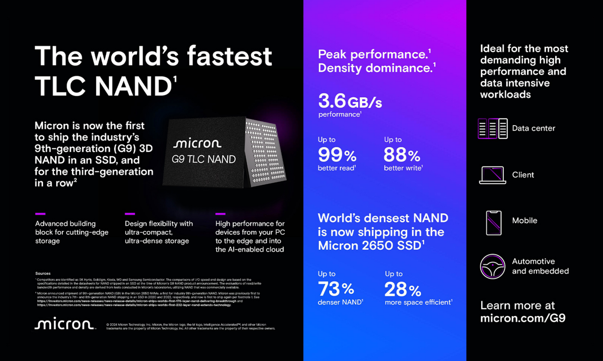

## Document Metadata

- Document ID: 67a38a43f8b965e45f93a9a8f802b0f9bc3c31c6
- Document Title: The world’s fastest TLC NAND
- Document Type: PDF
- Issuing Organization: Micron Technology, Inc.
- Publication Date: null
- Reporting Period: null
- Source File: [S54fd69a896df_micron.com_g9-nand.pdf](https://github.com/jadennevercode/CJCC-Knowledge-Base/blob/564ab11aa9785e569e3853c8a4d7ce86f88e7535/materials/%E5%9F%BA%E7%A1%80%EF%BC%9ANAND%E4%BA%A7%E5%93%81%E4%B8%8E%E6%8A%80%E6%9C%AF%E8%B0%B1%E7%B3%BB/S54fd69a896df_micron.com_g9-nand.pdf)

## Structured Content

> 原文件：[S54fd69a896df_micron.com_g9-nand.pdf](https://github.com/jadennevercode/CJCC-Knowledge-Base/blob/564ab11aa9785e569e3853c8a4d7ce86f88e7535/materials/%E5%9F%BA%E7%A1%80%EF%BC%9ANAND%E4%BA%A7%E5%93%81%E4%B8%8E%E6%8A%80%E6%9C%AF%E8%B0%B1%E7%B3%BB/S54fd69a896df_micron.com_g9-nand.pdf)
> 转换方式：Volcengine OCRPdf v3, parse_mode=ocr

[Source Page: 1]

# The world’s fastest TLC NAND¹

Micron is now the first to ship the industry’s 9th-generation (G9) 3D NAND in an SSD, and for the third-generation in a row².

- Advanced building block for cutting-edge storage
- Design flexibility with ultra-compact, ultra-dense storage
- High performance for devices from your PC to the edge and into the AI-enabled cloud

## Peak performance.¹ Density dominance.¹

- 3.6 GB/s performance¹
- Up to 99% better read¹
- Up to 88% better write¹

World’s densest NAND is now shipping in the Micron 2650 SSD¹:

- Up to 73% denser NAND¹
- Up to 28% more space efficient¹

## Ideal for the most demanding high performance and data intensive workloads

Data center; Client; Mobile; Automotive and embedded.

Learn more at micron.com/G9.

## Sources

¹ Competitors are identified as SK Hynix, Solidigm, Kioxia, WD and Samsung Semiconductor. The comparisons of I/O speed and design are based on the specifications detailed in the datasheets for NAND shipped in an SSD at the time of Micron’s G9 NAND product announcement. The evaluations of read/write bandwidth performance and density are derived from tests conducted in Micron’s laboratories, utilizing NAND that was commercially available.

² Micron announced shipment of 9th-generation NAND (G9) in the Micron 2650 NVMe, a first for industry 9th-generation NAND. Micron was previously first to announce the industry’s 7th- and 8th-generation NAND shipping in an SSD in 2020 and 2022, respectively, and now is first to ship again per footnote 1. See [https://investors.micron.com/news-releases/news-release-details/micron-ships-worlds-first-176-layer-nand-delivering-breakthrough](https://investors.micron.com/news-releases/news-release-details/micron-ships-worlds-first-176-layer-nand-delivering-breakthrough) and [https://investors.micron.com/news-releases/news-release-details/micron-ships-worlds-first-232-layer-nand-extends-technology](https://investors.micron.com/news-releases/news-release-details/micron-ships-worlds-first-232-layer-nand-extends-technology).

© 2024 Micron Technology, Inc. Micron, the Micron logo, the M logo, Intelligence Accelerated™, and other Micron trademarks are the property of Micron Technology, Inc. All other trademarks are the property of their respective owners.

## Processing Notes

- 关键数字、适用领域、来源说明和原图中的两个链接已对照 PDF 页面核验。
