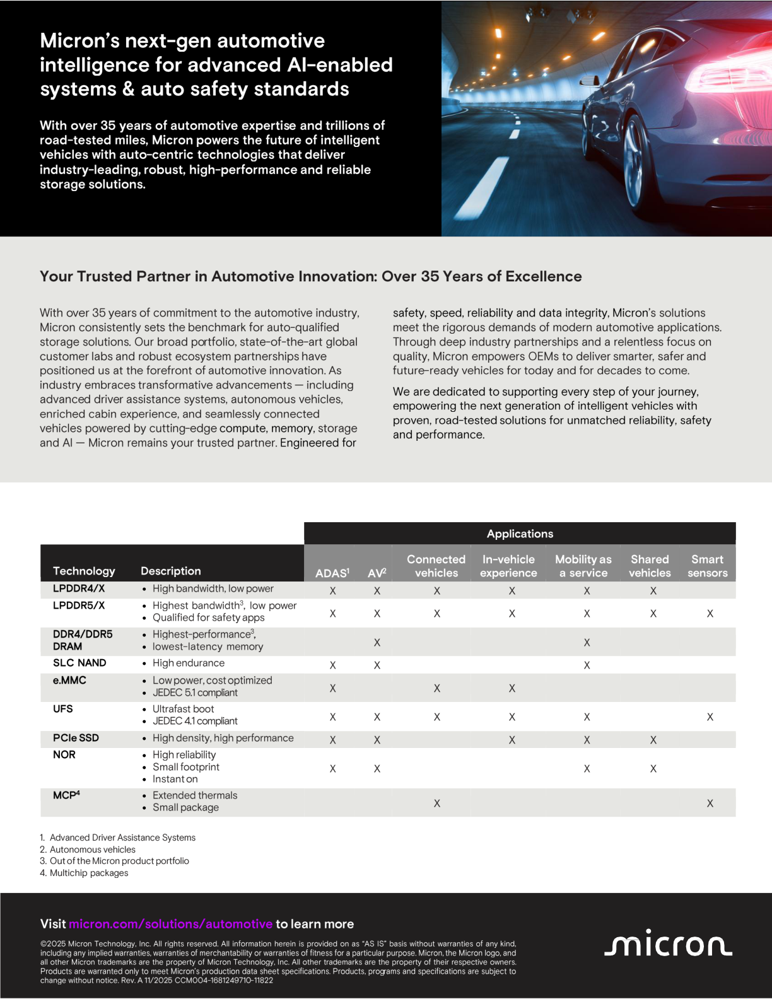

## Document Metadata

- Document ID: b99494e70552cd4fea4c31a259c1f3afaf69e393
- Document Title: Micron’s next-gen automotive intelligence for advanced AI-enabled systems & auto safety standards
- Document Type: PDF
- Issuing Organization: Micron Technology, Inc.
- Publication Date: null
- Reporting Period: null
- Source File: [S54fd69a896df_micron.com_g9-nand_1.pdf](https://github.com/jadennevercode/CJCC-Knowledge-Base/blob/564ab11aa9785e569e3853c8a4d7ce86f88e7535/materials/%E5%9F%BA%E7%A1%80%EF%BC%9ANAND%E4%BA%A7%E5%93%81%E4%B8%8E%E6%8A%80%E6%9C%AF%E8%B0%B1%E7%B3%BB/S54fd69a896df_micron.com_g9-nand_1.pdf)

## Structured Content

> 原文件：[S54fd69a896df_micron.com_g9-nand_1.pdf](https://github.com/jadennevercode/CJCC-Knowledge-Base/blob/564ab11aa9785e569e3853c8a4d7ce86f88e7535/materials/%E5%9F%BA%E7%A1%80%EF%BC%9ANAND%E4%BA%A7%E5%93%81%E4%B8%8E%E6%8A%80%E6%9C%AF%E8%B0%B1%E7%B3%BB/S54fd69a896df_micron.com_g9-nand_1.pdf)
> 转换方式：Volcengine OCRPdf v3, parse_mode=ocr

[Source Page: 1]

# Micron’s next-gen automotive intelligence for advanced AI-enabled systems & auto safety standards

With over 35 years of automotive expertise and trillions of road-tested miles, Micron powers the future of intelligent vehicles with auto-centric technologies that deliver industry-leading, robust, high-performance and reliable storage solutions.

## Your Trusted Partner in Automotive Innovation: Over 35 Years of Excellence

With over 35 years of commitment to the automotive industry, Micron consistently sets the benchmark for auto-qualified storage solutions. Our broad portfolio, state-of-the-art global customer labs and robust ecosystem partnerships have positioned us at the forefront of automotive innovation. As industry embraces transformative advancements — including advanced driver assistance systems, autonomous vehicles, enriched cabin experience, and seamlessly connected vehicles powered by cutting-edge compute, memory, storage and AI — Micron remains your trusted partner. Engineered for safety, speed, reliability and data integrity, Micron’s solutions meet the rigorous demands of modern automotive applications. Through deep industry partnerships and a relentless focus on quality, Micron empowers OEMs to deliver smarter, safer and future-ready vehicles for today and for decades to come.

We are dedicated to supporting every step of your journey, empowering the next generation of intelligent vehicles with proven, road-tested solutions for unmatched reliability, safety and performance.

## Applications

| Technology | Description | ADAS¹ | AV² | Connected vehicles | In-vehicle experience | Mobility as a service | Shared vehicles | Smart sensors |
| --- | --- | --- | --- | --- | --- | --- | --- | --- |
| LPDDR4/X | High bandwidth, low power | X | X | X | X | X | X |  |
| LPDDR5/X | Highest bandwidth³, low power Qualified for safety apps | X | X | X | X | X | X | X |
| DDR4/DDR5 DRAM | Highest-performance³, lowest-latency memory |  | X |  |  | X |  |  |
| SLC NAND | High endurance | X | X |  |  | X |  |  |
| e.MMC | Low power, cost optimized JEDEC 5.1 compliant | X |  | X | X |  |  |  |
| UFS | Ultrafast boot JEDEC 4.1 compliant | X | X | X | X | X |  | X |
| PCIe SSD | High density, high performance | X | X |  | X | X | X |  |
| NOR | High reliability Small footprint Instant on | X | X |  |  | X | X |  |
| MCP⁴ | Extended thermals Small package |  |  | X |  |  |  | X |

1. Advanced Driver Assistance Systems
2. Autonomous vehicles
3. Out of the Micron product portfolio
4. Multichip packages

Visit micron.com/solutions/automotive to learn more.

©2025 Micron Technology, Inc. All rights reserved. All information herein is provided on as “AS IS” basis without warranties of any kind, including any implied warranties, warranties of merchantability or warranties of fitness for a particular purpose. Micron, the Micron logo, and all other Micron trademarks are the property of Micron Technology, Inc. All other trademarks are the property of their respective owners. Products are warranted only to meet Micron’s production data sheet specifications. Products, programs and specifications are subject to change without notice. Rev. A 11/2025 CCM004-1681249710-11822.

## Processing Notes

- 原 OCR 几乎没有提取到正文；已对照原图恢复文本、应用矩阵、空白单元格和脚注。
- 原文件名包含 `g9-nand_1`，但原页实际内容为汽车应用材料；按原页内容处理。
