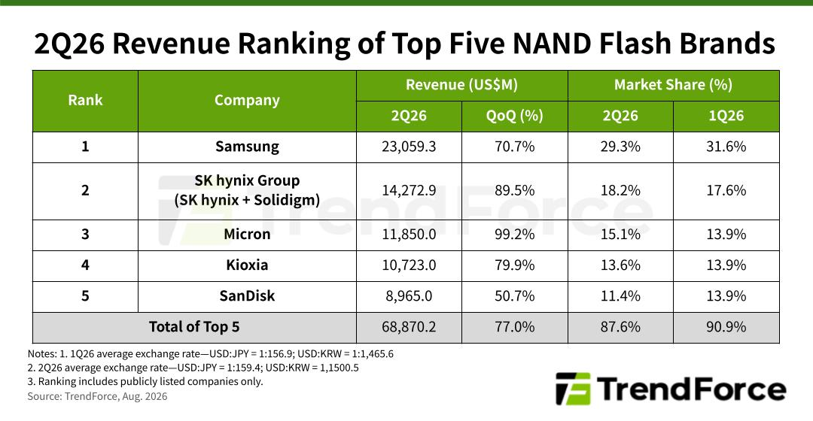

## Document Metadata

- Document ID: 92412e8661aa2c57f82242a050e35e5cd11a3425
- Document Title: Combined Revenue of Top Five NAND Flash Brands Rises 77% QoQ in 2Q26; Micron Moves Up to Third Place, Says TrendForce
- Document Type: HTML
- Issuing Organization: TrendForce
- Publication Date: 2026-08-18
- Reporting Period: 2Q26
- Source File: [Sb242b1a15002_trendforce.com_20260818-13186.html](https://github.com/jadennevercode/CJCC-Knowledge-Base/blob/564ab11aa9785e569e3853c8a4d7ce86f88e7535/materials/%E5%9F%BA%E7%A1%80%EF%BC%9A%E5%8E%82%E5%95%86%E4%B8%8E%E7%BB%84%E7%BB%87%E7%BB%93%E6%9E%84/Sb242b1a15002_trendforce.com_20260818-13186.html)

## Structured Content

> 原文件：[Sb242b1a15002_trendforce.com_20260818-13186.html](https://github.com/jadennevercode/CJCC-Knowledge-Base/blob/564ab11aa9785e569e3853c8a4d7ce86f88e7535/materials/%E5%9F%BA%E7%A1%80%EF%BC%9A%E5%8E%82%E5%95%86%E4%B8%8E%E7%BB%84%E7%BB%87%E7%BB%93%E6%9E%84/Sb242b1a15002_trendforce.com_20260818-13186.html)
> 转换方式：HTML DOM → Markdown

# Combined Revenue of Top Five NAND Flash Brands Rises 77% QoQ in 2Q26; Micron Moves Up to Third Place, Says TrendForce

---

18 August 2026

[Semiconductors](https://www.trendforce.com/presscenter/news/Semiconductors)

[TrendForce](https://www.trendforce.com/search?resource=news&query=TrendForce&column=author)

---

TrendForce’s latest NAND Flash industry research reveals that AI server demand remained steady in the second quarter of 2026—particularly for enterprise SSDs—resulting in a supply shortage across the NAND Flash market. This allowed suppliers to raise ASPs significantly through contract negotiations. As a result, the combined revenue of the top five publicly listed NAND Flash brands rose 77% QoQ to US$68.87 billion.

Looking ahead to the third quarter, demand from smartphones and PCs is expected to remain weak as higher BOM costs push up device prices. However, demand from AI servers for enterprise SSDs remains strong. Meanwhile, suppliers are generally prioritizing capital expenditure on DRAM and HBM, limiting new NAND Flash capacity. ASPs are therefore expected to continue supporting overall industry revenue growth in the third quarter.

Among the top five NAND Flash brands, market leader Samsung benefited from higher NAND Flash ASPs driven by AI server demand, while a growing share of enterprise SSD shipments significantly improved profitability. Revenue rose 70.7% QoQ to nearly $23.06 billion. However, as competitors posted faster revenue growth, Samsung’s market share edged down to 29.3% in the second quarter.

SK hynix Group, including SK hynix and Solidigm, ranked second. Continued ramp-up of its 321-layer process, strong orders for Solidigm’s high-capacity QLC enterprise SSDs, and rising ASPs lifted NAND Flash revenue 89.5% QoQ to more than $14.27 billion. Its operating margin also reached another record high.

Micron likewise benefited from a significant increase in ASPs, with NAND Flash revenue reaching $11.85 billion, up 99.2% QoQ — the highest growth rate among the top five brands. This lifted Micron to third place.

Kioxia ranked fourth. Revenue and profitability increased, supported by persistently high NAND Flash prices and continued growth in BiCS8 output. Revenue rose 79.9% QoQ to approximately $10.72 billion, while market share edged down to 13.6%.

SanDisk also benefited from AI-driven ASP increases in the second quarter. However, relatively conservative bit shipment growth limited its revenue increase to 50.7% QoQ, reaching nearly $8.97 billion and trailing the growth of its peers.

### 2Q26 Revenue Ranking of Top Five NAND Flash Brands

| Rank | Company | Revenue (US$M) 2Q26 | Revenue QoQ (%) | Market Share (%) 2Q26 | Market Share (%) 1Q26 |
| --- | --- | ---: | ---: | ---: | ---: |
| 1 | Samsung | 23,059.3 | 70.7% | 29.3% | 31.6% |
| 2 | SK hynix Group (SK hynix + Solidigm) | 14,272.9 | 89.5% | 18.2% | 17.6% |
| 3 | Micron | 11,850.0 | 99.2% | 15.1% | 13.9% |
| 4 | Kioxia | 10,723.0 | 79.9% | 13.6% | 13.9% |
| 5 | SanDisk | 8,965.0 | 50.7% | 11.4% | 13.9% |
| Total of Top 5 | | 68,870.2 | 77.0% | 87.6% | 90.9% |

Notes: 1. 1Q26 average exchange rate—USD:JPY = 1:156.9; USD:KRW = 1:1,465.6  
2. 2Q26 average exchange rate—USD:JPY = 1:159.4; USD:KRW = 1,1500.5 [OCR_UNCERTAIN]  
3. Ranking includes publicly listed companies only.

Source: TrendForce, Aug. 2026

For more information on TrendForce’s semiconductor reports and market data, please visit the [Report Page](https://www.trendforce.com/research/dram), leave a [Message](https://www.trendforce.com/presscenter/news/20260818-13186.html#contact-sales), or [Email](mailto:SR_MI@trendforce.com) (SR\_MI@trendforce.com) the Sales Department.

For more on the latest technology industry news and trends, please visit [News](https://www.trendforce.com/news/).

---

[Previous Article

**China’s Humanoid Robot Market to Reach CNY 15 Billion in 2026 as Commercial Validation Begins, Says TrendForce**](https://www.trendforce.com/presscenter/news/20260819-13189.html)
[Next Article

**Liquid Cooling Becomes Standard for High-End AI Infrastructure, with Penetration Expected to Reach 53% in 2026, Says TrendForce**](https://www.trendforce.com/presscenter/news/20260817-13183.html)

---

**Subject**

[Press Releases](https://www.trendforce.com/presscenter/news)

- [Subscribe to Newsletters](https://www.trendforce.com/presscenter/subscribe.html)
- [Attribution Guide](https://www.trendforce.com/presscenter/attribution.html)
- [RSS Subscription](https://www.trendforce.com/presscenter/rss.html)

[In-Depth Analyses](https://www.trendforce.com/presscenter/analysis)

[Infographics](https://www.trendforce.com/presscenter/chart)

[Videos](https://www.trendforce.com/presscenter/video)

---

**Related Articles**

[##### Persistently High DRAM Prices Drive Adoption of Reballed Memory, with Smartphone Penetration Expected to Reach 7–9% in 2027, Says TrendForce](https://www.trendforce.com/presscenter/news/20261106-13297.html)

2026.11.06

[##### Marvell’s Acquisition of Lumentum to Unite Optical and Electronic Capabilities, Potentially Challenging Broadcom’s Market Leadership, Says TrendForce](https://www.trendforce.com/presscenter/news/20261103-13294.html)

2026.11.03

[##### AI Networking and Interconnect Market Projected to Reach US$279.8 Billion in 2027, with Scale-Up Share Rising to 24%, Says TrendForce](https://www.trendforce.com/presscenter/news/20261102-13291.html)

2026.11.02

---

**Related Reports**

[##### 4Q26 Consumer DRAM Datasheet](https://www.trendforce.com/research/download/RP200131OD)

2026.11.04

[##### MLCC Monthly Datasheet Nov. 2026](https://www.trendforce.com/research/download/RP210601EG)

2026.11.02

[##### WW SSD Street Price - Oct. 30, 2026](https://www.trendforce.com/research/download/RP131217OO)

2026.10.30

### Get in touch with us

---

### Get in touch with us

---

## Processing Notes

- HTML 快照没有原文页码。图中第二季度 USD:KRW 汇率写作“1,1500.5”，格式有疑问，已按图保留并标记。
