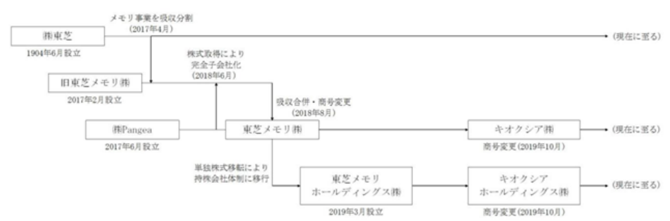
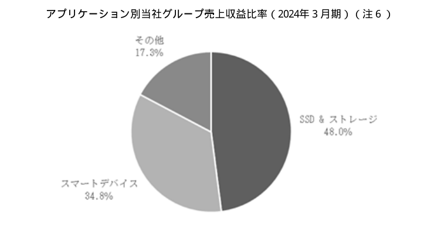
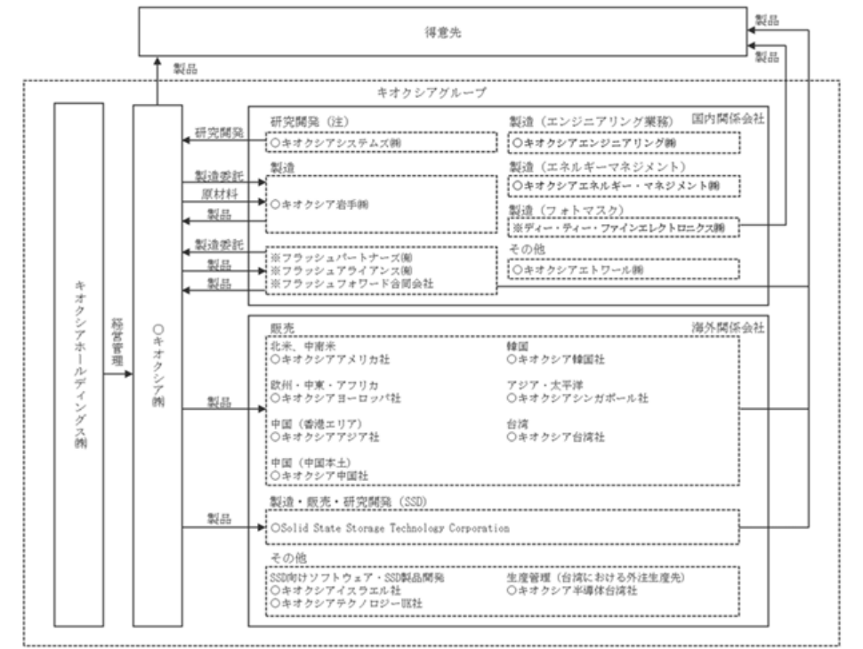
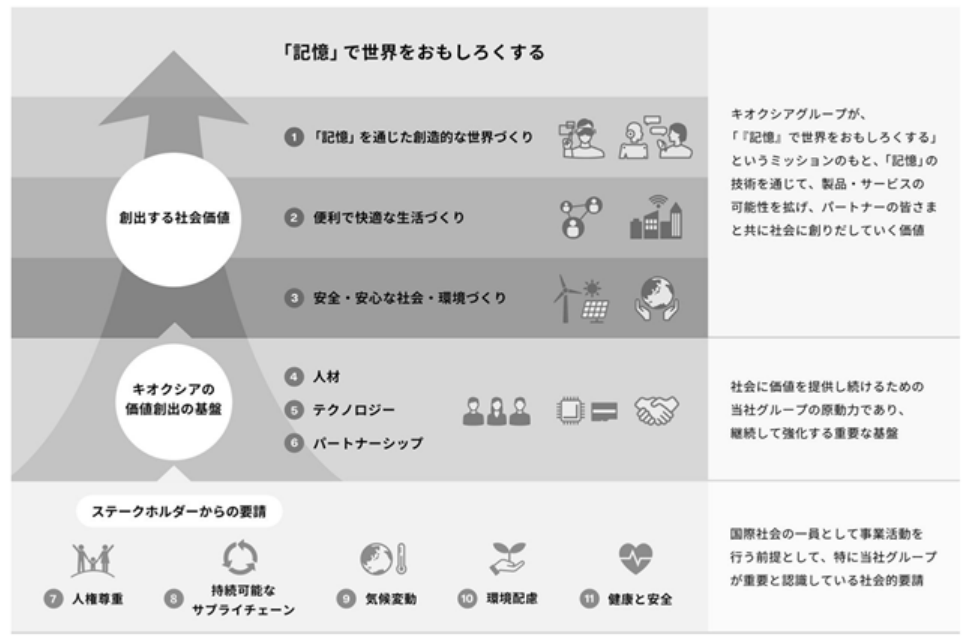
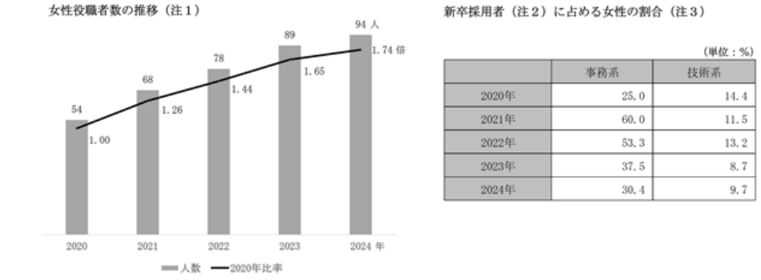
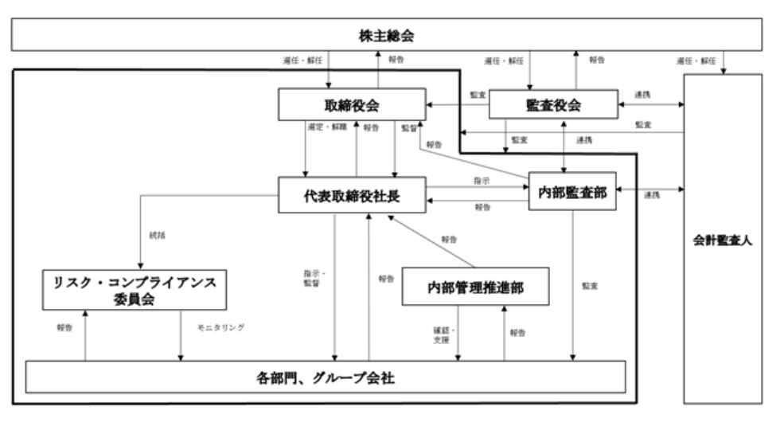

## Document Metadata

- Document ID: 398da3c843bb5f4c9777a478bf04cfa922a92957
- Document Title: 有価証券届出書（新規公開時）
- Document Type: PDF
- Issuing Organization: キオクシアホールディングス株式会社
- Publication Date: 2024-11-08
- Reporting Period: null
- Source File: [5_Kioxia_S100UOKQ.pdf](https://github.com/jadennevercode/CJCC-Knowledge-Base/blob/564ab11aa9785e569e3853c8a4d7ce86f88e7535/materials/%E5%9F%BA%E7%A1%80%EF%BC%9A%E8%A1%8C%E4%B8%9A%E6%9C%AF%E8%AF%AD%E4%B8%8E%E6%8C%87%E6%A0%87/5_Kioxia_S100UOKQ.pdf)

## Structured Content

> 原文件：[5_Kioxia_S100UOKQ.pdf](https://github.com/jadennevercode/CJCC-Knowledge-Base/blob/564ab11aa9785e569e3853c8a4d7ce86f88e7535/materials/%E5%9F%BA%E7%A1%80%EF%BC%9A%E8%A1%8C%E4%B8%9A%E6%9C%AF%E8%AF%AD%E4%B8%8E%E6%8C%87%E6%A0%87/5_Kioxia_S100UOKQ.pdf)
> 转换方式：Volcengine OCRPdf v3, parse_mode=ocr

[Source Page: 1]

【表紙】
 
 
【提出書類】
有価証券届出書
【提出先】
関東財務局長
【提出日】
2024年11月８日
【会社名】
キオクシアホールディングス株式会社
【英訳名】
Kioxia Holdings Corporation
【代表者の役職氏名】
代表取締役社長　　早坂　伸夫
【本店の所在の場所】
東京都港区芝浦三丁目１番21号
【電話番号】
03-6478-2539（代表）
【事務連絡者氏名】
専務執行役員　　花澤　秀樹
【最寄りの連絡場所】
東京都港区芝浦三丁目１番21号
【電話番号】
03-6478-2539（代表）
【事務連絡者氏名】
専務執行役員　　花澤　秀樹
【届出の対象とした募集（売出）有価証券の種類】
株式
【届出の対象とした募集（売出）金額】
募集金額

ブックビルディング方式による募集

10,000,000,000円から100,000,000,000円

売出金額
（引受人の買取引受けによる国内売出し）
ブックビルディング方式による売出し　　　　　　　　　　未定
（オーバーアロットメントによる売出し）
ブックビルディング方式による売出し　　　　　　　　　　未定
（注）　募集金額は、有価証券届出書提出時における見込額（会社法上の払込金額の総額の見込額）です。なお、募集金額は今後提出される有価証券届出書の訂正届出書において変更される可能性があります。売出金額（引受人の買取引受けによる国内売出し及びオーバーアロットメントによる売出し）は未定です。
【縦覧に供する場所】
該当事項はありません。
　（注）　上場承認前の株券の募集又は売出しの相手方について

当社は、株式会社東京証券取引所（以下「取引所」という。）プライム市場への当社普通株式の新規上場を申請しておりますが、有価証券届出書提出時において取引所による新規上場の承認（以下「上場承認」という。）は行われておりません。上場承認前の株券の募集又は売出しは、当社普通株式に係る投資家の需要の状況に関する調査を行うことを目的とし、その相手方は機関投資家を中心に相対的に価格算定能力が高いと推定される投資家に限定されます。

[Source Page: 2]

## 第一部【証券情報】

### 第１【募集要項】

#### １【新規発行株式】

| 種類 | 発行数（株） | 内容 |
| --- | --- | --- |
| 普通株式 | 未定（注）２． | １単元の株式数は、100株となります。完全議決権株式であり、権利内容に何ら限定のない、当社における標準となる株式です。 |

（注）１．2024年11月８日開催の取締役会決議によっております。有価証券届出書提出後に、当社普通株式に係る投資家の需要の状況に関する調査を行うことを目的として、機関投資家を中心に相対的に価格算定能力が高いと推定される投資家に対して、有価証券届出書の対象となる募集又は売出しに係る勧誘が行われます。有価証券届出書提出後、上場承認までの間に、上記以外の一般投資家を含む多数の者を相手方とする募集及び売出しに係る勧誘は行われません。また、機関投資家等の需要の状況に関する調査を踏まえて、多数の者を相手方とする当社普通株式の募集を実施するか否かを判断する予定です。
有価証券届出書の「第一部　証券情報」において未定とされている事項は、上場承認以後に提出される有価証券届出書の訂正届出書（2024年11月から2025年５月までの間のいずれかの日に提出予定）において訂正され、上記以外の一般投資家を含む多数の者を相手方とする当社普通株式の募集は、当該訂正届出書の提出日から行う予定です。
２．発行数については、取引所による当社普通株式の新規上場承認日（2024年11月から2025年５月までの間のいずれかの日を予定。以下同じ。）に開催予定の取締役会において決定される予定であります。なお、当社は、東京証券取引所プライム市場への新規上場を申請しておりますが、有価証券届出書提出時において、取引所による上場承認を得ておりません。上記発行数を決定する予定である上場承認日も未定です。また、後記「３　募集の条件」では、申込期間及び払込期日について一定の期間を記載しておりますが、当該日程を含む上場日程の詳細は、上場承認日に開催予定の取締役会において決定し、有価証券届出書の訂正届出書にて公表いたします。
３．当社の定める振替機関の名称及び住所は、以下のとおりです。
名称：株式会社証券保管振替機構

住所：東京都中央区日本橋兜町７番１号
４．後記「第２　売出要項」の「１　売出株式（引受人の買取引受けによる国内売出し）」に記載のとおり、本募集（以下「国内募集」という。）と同時に、当社の株主が保有する当社普通株式の日本国内における売出し（以下「引受人の買取引受けによる国内売出し」という。）が行われる予定であります。また、国内募集及び引受人の買取引受けによる国内売出しと同時に、欧州及び米国を中心とする海外市場（但し、米国においては1933年米国証券法（以下「米国証券法」という。）に基づくルール144Ａに従った適格機関投資家に対する販売のみとする。）において、当社の株主が保有する当社普通株式の売出し（以下「海外売出し」という。）が行われる予定です。
５．後記「第２　売出要項　３　売出株式（オーバーアロットメントによる売出し）」に記載のとおり、需要状況等を勘案し、国内募集及び引受人の買取引受けによる国内売出しとは別に、上限株式数を定めて、三菱ＵＦＪモルガン・スタンレー証券株式会社が当社の株主から借入れる当社普通株式の日本国内における売出し（以下「オーバーアロットメントによる売出し」という。）が追加的に行われる場合があります。なお、国内募集、引受人の買取引受けによる国内売出し及び海外売出しにおいて国内及び海外のそれぞれの市場における需要状況に見合った販売を行うために、国内の引受団に当初割当てられた当社普通株式の一部が海外の引受団に売却されることがあります。海外売出しの詳細については、後記「募集又は売出しに関する特別記載事項　２　海外売出しについて」をご参照下さい。
６．国内募集、引受人の買取引受けによる国内売出し、オーバーアロットメントによる売出し及び海外売出し（これらを併せて、以下「グローバル・オファリング」という。）のジョイント・グローバル・コーディネーターは、Morgan Stanley & Co. International plc、野村證券株式会社及びBofA証券株式会社（以下「ジョイント・グローバル・コーディネーター」という。）となります。国内募集、引受人の買取引受けによる国内売出し及びオーバーアロットメントによる売出しの共同主幹事会社は、三菱ＵＦＪモルガン・スタンレー証券株式会社、モルガン・スタンレーＭＵＦＧ証券株式会社及び野村證券株式会社であります。
７．グローバル・オファリングに関連して、ロックアップに関する合意が発行価格決定日（2024年12月から2025年６月までの間のいずれかの日を予定。以下同じ。）付でなされる予定です。その内容については、後記「募集又は売出しに関する特別記載事項　４　ロックアップについて」をご参照下さい。
８．当社は、普通株式と異なる種類の株式として、甲種優先株式及び乙種優先株式についての定めを定款に定めております。甲種優先株式及び乙種優先株式を譲渡により取得することについては、当社取締役会による承認を要します。甲種優先株式及び乙種優先株式には議決権がないことから、甲種優先株式及び乙種優先株式の単元株式数は、いずれも１株としております。甲種優先株式及び乙種優先株式については、当社が剰余金

[Source Page: 3]

の配当を行うときは、各種種類株式を有する種類株主に対し、普通株式を有する株主に先立ち、一定の優先配当金を支払うこととされています。また、当社は、その選択により、一定の額を超えない範囲で、各種種類株式を有する種類株主に対し、特別配当を行うことができるとされています。なお、剰余金の配当についての甲種優先株式及び乙種優先株式に係る支払いは同順位とされています。
また、当社が残余財産を分配するときは、甲種優先株式を有する種類株主に対しては、乙種優先株式を有する種類株主及び普通株式を有する株主に先立ち、乙種優先株式を有する種類株主に対しては、普通株式を有する株主に先立ち、それぞれ一定の金銭を支払うこととされています。
また、甲種優先株式及び乙種優先株式には、各種種類株式を有する種類株主が金銭を対価として当該株式の全部又は一部の取得を請求することができる取得請求権及び当社が金銭の交付と引換えに当該株式の全部又は一部を取得することができる取得条項がそれぞれ付されています。なお、甲種優先株式及び乙種優先株式それぞれにおいて、各種種類株式を有する種類株主は、株主総会において議決権を有しません。これは普通株主の議決権への影響を考慮したためです。
また、甲種優先株式及び乙種優先株式には、会社法第322条第１項各号に掲げる行為をする場合（但し、同項第１号に規定する定款の変更（単元株式数についてのものを除く。）を行う場合は、この限りでない。）には、法令に特段の定めがある場合を除き、各種種類株主を構成員とする種類株主総会の決議は要しません。

#### ２【募集の方法】

発行価格決定日に決定される予定の引受価額にて、当社と元引受契約を締結する予定の後記「４　株式の引受け」欄記載の金融商品取引業者（以下「第１　募集要項」において「引受人」という。）は、買取引受けを行い、当該引受価額と異なる価額（発行価格）で国内募集を行います。引受価額は仮条件決定日（2024年12月から2025年６月までの間のいずれかの日を予定。以下同じ。）に開催予定の取締役会において決定する会社法上の払込金額以上の価額となります。引受人は払込期日までに引受価額の総額を当社に払込み、国内募集における発行価格の総額との差額は引受人の手取金といたします。当社は、引受人に対して引受手数料を支払いません。
　なお、国内募集は、取引所の定める「有価証券上場規程施行規則」第246条に規定するブックビルディング方式（株式の取得の申込みの勧誘時において発行価格又は売出価格に係る仮条件を投資家に提示し、株式に係る投資家の需要状況等を把握した上で発行価格等を決定する方法をいう。）により決定する価格で行います。

| 区分 | 発行数（株） | 発行価額の総額（円） | 資本組入額の総額（円） |
| --- | --- | --- | --- |
| 入札方式のうち入札による募集 | － | － | － |
| 入札方式のうち入札によらない募集 | － | － | － |
| ブックビルディング方式 | 未定 | 10,000,000,000から100,000,000,000 | 5,000,000,000から50,000,000,000 |
| 計（総発行株式） | 未定 | 10,000,000,000から100,000,000,000 | 5,000,000,000から50,000,000,000 |

（注）１．全株式を引受人の買取引受けにより募集いたします。
２．上場前の公募増資を行うに際しての手続き等は、取引所の「有価証券上場規程施行規則」により規定されております。
３．発行価額の総額は、会社法上の払込金額の総額であり、有価証券届出書提出時における見込額です。なお、発行価額の総額は今後提出される有価証券届出書の訂正届出書において変更される可能性があります。
４．資本組入額の総額は、会社法上の増加する資本金の額であり、会社計算規則第14条第１項に基づき算出される資本金等増加限度額（見込額）の２分の１相当額を資本金に計上することを前提として算出した見込額です。なお、資本組入額の総額は、上場承認日に開催予定の取締役会決議に基づき、発行価格決定日に決定される予定の引受価額を基礎として、今後提出される有価証券届出書の訂正届出書において変更される可能性があります。

[Source Page: 4]

#### ３【募集の条件】

##### （１）【入札方式】

###### ①【入札による募集】

　該当事項はありません。
 

###### ②【入札によらない募集】

　該当事項はありません。
 

##### （２）【ブックビルディング方式】

| 発行価格（円） | 引受価額（円） | 払込金額（円） | 資本組入額（円） | 申込株数単位（株） | 申込期間 | 申込証拠金（円） | 払込期日 |
| --- | --- | --- | --- | --- | --- | --- | --- |
| 未定(注)１． | 未定(注)１． | 未定(注)２． | 未定(注)３． | 100 | 2024年12月から2025年６月までの間の一定の期間 | 未定(注)４． | 2024年12月から2025年６月までの間のいずれかの日 |

（注）１．発行価格は、ブックビルディング方式によって決定いたします。
発行価格は、2024年12月から2025年６月までの間のいずれかの日に仮条件を決定し、当該仮条件による需要状況、上場日までの価格変動リスク等を総合的に勘案した上で、2024年12月から2025年６月までの間のいずれかの日に引受価額と同時に決定する予定です。
仮条件は、事業内容、経営成績及び財政状態、事業内容等の類似性が高い上場会社との比較、価格算定能力が高いと推定される機関投資家等の意見その他を総合的に勘案して決定する予定です。
需要の申告の受付けに当たり、引受人は、当社普通株式が市場において適正な評価を受けることを目的に、機関投資家等を中心に需要の申告を促す予定です。
２．払込金額は、会社法上の払込金額であり、仮条件決定日に開催予定の取締役会において決定する予定であります。また、前記「２　募集の方法」の冒頭に記載のとおり、発行価格と会社法上の払込金額及び発行価格決定日に決定される予定の引受価額とは各々異なります。発行価格と引受価額との差額の総額は、引受人の手取金となります。
３．資本組入額は、１株当たりの増加する資本金の額となります。なお、上場承認日に開催予定の取締役会において、増加する資本金の額は、発行価格決定日に決定される予定の引受価額を基礎として、会社計算規則第14条第１項に基づき算出される資本金等増加限度額の２分の１の金額とし、計算の結果１円未満の端数が生じたときは、その端数を切り上げるものとする旨、及び増加する資本準備金の額は、資本金等増加限度額から増加する資本金の額を減じた額とする旨を、決議する予定です。
４．申込証拠金は、発行価格と同一の金額とし、利息をつけません。申込証拠金のうち引受価額相当額は、払込期日に新株式払込金に振替充当いたします。
５．株式受渡期日は、当社普通株式の取引所への上場日（2024年12月から2025年６月までの間のいずれかの日を予定しており、以下「上場（売買開始）日」という。）の予定です。当社普通株式の東京証券取引所への上場に伴い、国内募集に係る株式は、株式会社証券保管振替機構（以下「機構」という。）の「株式等の振替に関する業務規程」に従い、機構にて取扱いますので、上場（売買開始）日から売買を行うことができます。
６．申込みの方法は、申込期間内に後記申込取扱場所へ申込証拠金を添えて申込みをするものといたします。
７．申込みに先立ち、仮条件決定日から発行価格決定日までの間で引受人に対して、当該仮条件を参考として需要の申告を行うことができます。当該需要の申告は変更又は撤回することが可能であります。
販売に当たりましては、取引所の「有価証券上場規程」に定める株主数基準の充足、上場後の株式の流通性の確保等を勘案し、需要の申告を行わなかった投資家にも販売が行われることがあります。
引受人及びその委託販売先金融商品取引業者は、公平かつ公正な販売に努めることとし、各社で定める配分に関する基本方針及び社内規程等に従い、販売を行う方針であります。配分に関する基本方針については各社の店頭における表示又はホームページにおける表示等をご確認下さい。
８．引受価額が会社法上の払込金額を下回る場合は国内募集を中止いたします。国内募集が中止された場合には、引受人の買取引受けによる国内売出し、オーバーアロットメントによる売出し及び海外売出しも中止される予定です。また、海外売出しが中止された場合にも、国内募集、引受人の買取引受けによる国内売出し及びオーバーアロットメントによる売出しは中止される予定です。

[Source Page: 5]

###### ①【申込取扱場所】

　後記「４　株式の引受け」欄記載の引受人及びその委託販売先金融商品取引業者の全国の本支店及び営業所で申込みの取扱いをいたします。
 

###### ②【払込取扱場所】

| 店名 | 所在地 |
| --- | --- |
| 株式会社三井住友銀行 本店営業部 | 東京都千代田区丸の内一丁目１番２号 |

（注）　上記の払込取扱場所での申込みの取扱いは行いません。

#### ４【株式の引受け】

| 引受人の氏名又は名称 | 住所 | 引受株式数（株） | 引受けの条件 |
| --- | --- | --- | --- |
| 三菱ＵＦＪモルガン・スタンレー証券株式会社 | 東京都千代田区大手町一丁目９番２号 | 未定 | １．買取引受けによります。２．引受人は新株式払込金として、払込期日（2024年12月から2025年６月までの間のいずれかの日を予定。以下同じ。）までに払込取扱場所へ引受価額と同額を払込むことといたします。３．引受手数料は支払われません。但し、発行価格と引受価額との差額の総額は引受人の手取金となります。 |
| モルガン・スタンレーＭＵＦＧ証券株式会社 | 東京都千代田区大手町一丁目９番７号 | 未定 | １．買取引受けによります。２．引受人は新株式払込金として、払込期日（2024年12月から2025年６月までの間のいずれかの日を予定。以下同じ。）までに払込取扱場所へ引受価額と同額を払込むことといたします。３．引受手数料は支払われません。但し、発行価格と引受価額との差額の総額は引受人の手取金となります。 |
| 野村證券株式会社 | 東京都中央区日本橋一丁目13番１号 | 未定 | １．買取引受けによります。２．引受人は新株式払込金として、払込期日（2024年12月から2025年６月までの間のいずれかの日を予定。以下同じ。）までに払込取扱場所へ引受価額と同額を払込むことといたします。３．引受手数料は支払われません。但し、発行価格と引受価額との差額の総額は引受人の手取金となります。 |
| 計 | － | 未定 | － |

原表の引受株式数及び引受けの条件は３社にまたがる結合セル。

（注）１．引受人は上場承認日に開催予定の取締役会決議において追加される可能性があります。引受株式数は、仮条件決定日に開催予定の取締役会において決定する予定であります。
２．当社は、上記引受人と発行価格決定日に国内募集に関する元引受契約を締結する予定であります。但し、元引受契約の締結後払込期日までの間に、同契約の解除条項に基づき、同契約が解除された場合、国内募集を中止いたします。

[Source Page: 6]

#### ５【新規発行による手取金の使途】

##### （１）【新規発行による手取金の額】

| 払込金額の総額（円） | 発行諸費用の概算額（円） | 差引手取概算額（円） |
| --- | --- | --- |
| 10,000,000,000から100,000,000,000 | 900,000,000 | 9,100,000,000から99,100,000,000 |

（注）１．払込金額の総額は、会社法上の払込金額の総額とは異なり、国内募集における株式の新規発行に際して当社に払い込まれる引受価額の総額であり、有価証券届出書提出時における見込額です。なお、払込金額の総額及び差引手取概算額は今後提出される有価証券届出書の訂正届出書において変更される可能性があります。
２．発行諸費用の概算額は、国内募集における株式の新規発行に係る諸費用の概算額の合計であり、消費税及び地方消費税（以下「消費税等」という。）は含まれておりません。
３．引受手数料は支払わないため、発行諸費用の概算額は、これ以外の費用を合計したものです。
 

##### （２）【手取金の使途】

 
　上記の国内募集における差引手取概算額については、全額を当社の連結子会社であるキオクシア株式会社への投融資資金に充当する予定です。
　キオクシア株式会社では、今後予測されるメモリ市場の伸長に伴うフラッシュメモリの需要増加に対応すると共に、継続的なコスト競争力の向上を図るために生産規模及び生産効率を最大化することを目的として生産能力増強に係る設備投資を予定しております（注）。
　具体的な資金使途の内容及び充当予定時期は、以下のとおりです。
　四日市工場及び北上工場において、今後次世代フラッシュメモリ（第８世代３次元フラッシュメモリ）である218層積層プロセスを適用したBiCS FLASH™向け前工程生産設備の取得費用及び建屋建設費用の一部として充当する予定です。具体的な充当予定時期は、当該設備の取得費用及び建屋建設費用の支払い時期が2025年３月期から2026年３月期の間となる予定であるため、当該期間において上記差引手取概算額の全額を充当する予定です。
　なお、具体的な充当時期までは、安全性の高い金融商品等で運用する方針です。
（注）　当社グループの設備投資方針については、「第二部　企業情報　第３　設備の状況　３　設備の新設、除却等の計画」をご参照下さい。

[Source Page: 7]

### 第２【売出要項】

#### １【売出株式（引受人の買取引受けによる国内売出し）】

売出価格決定日（発行価格決定日と同日であり、2024年12月から2025年６月までの間のいずれかの日を予定。以下同じ。）に決定される予定の引受価額にて、当社と元引受契約を締結する予定の後記「２　売出しの条件（引受人の買取引受けによる国内売出し）　(2）ブックビルディング方式」に記載の金融商品取引業者（以下「第２　売出要項」において「引受人」という。）は、下記売出人から買取引受けを行い、当該引受価額と異なる価額（売出価格、発行価格と同一の価格）で売出しを行います。引受人は株式受渡期日に引受価額の総額を売出人に支払い、引受人の買取引受けによる国内売出しにおける売出価格の総額との差額は引受人の手取金といたします。売出人は、引受人に対して引受手数料を支払いません。

| 種類 | 売出数（株）：方式 | 売出数（株）：数 | 売出価額の総額（円） | 売出しに係る株式の所有者の住所及び氏名又は名称 |
| --- | --- | --- | --- | --- |
| － | 入札方式のうち入札による売出し | － | － | － |
| － | 入札方式のうち入札によらない売出し | － | － | － |
| 普通株式 | ブックビルディング方式 | 未定 | 未定 | 未定 |
| 計(総売出株式) | － | 未定 | 未定 | － |

（注）１．有価証券届出書提出後に、当社普通株式に係る投資家の需要の状況に関する調査を行うこと目的として、機関投資家を中心に相対的に価格算定能力が高いと推定される投資家に対して、有価証券届出書の対象となる募集又は売出しに係る勧誘が行われます。当該勧誘の相手方その他の事項については、前記「第１　募集要項　１　新規発行株式」の（注）１．をご参照下さい。また、機関投資家等の需要の状況に関する調査を踏まえて、多数の者を相手方とする当社普通株式の売出しを実施するか否かを判断する予定です。
２．上場前の売出しを行うに際しての手続き等は、取引所の「有価証券上場規程施行規則」により規定されております。
３．前記「第１　募集要項　１　新規発行株式」の（注）４．に記載のとおり、引受人の買取引受けによる国内売出しと同時に、国内募集及び海外売出しが行われる予定であります。引受人の買取引受けによる国内売出し及び海外売出しの総売出株式数（以下「総売出株式数」という。）並びにその内訳となる引受人の買取引受けによる国内売出しに係る売出株式数及び海外売出しに係る売出株式数は上場承認日に開催予定の取締役会で決定される予定ですが、その最終的な内訳は、総売出株式数の範囲内で、需要状況等を勘案の上、売出価格決定日に決定される予定です。また、総売出株式数については、仮条件決定日に開催予定の取締役会において変更される可能性があります。
４．売出価額の総額並びに売出しに係る株式の所有者の住所及び氏名又は名称は、未定です。
５．振替機関の名称及び住所は、前記「第１　募集要項　１　新規発行株式」の（注）３．に記載した振替機関と同一となります。
６．前記「第１　募集要項　１　新規発行株式」の（注）５．に記載のとおり、国内募集及び引受人の買取引受けによる国内売出しに当たっては、需要状況等を勘案し、オーバーアロットメントによる売出しが追加的に行われる場合があります。
なお、オーバーアロットメントによる売出しについては、後記「３　売出株式（オーバーアロットメントによる売出し）」及び「４　売出しの条件（オーバーアロットメントによる売出し）」をご参照下さい。
７．前記「第１　募集要項　１　新規発行株式」の（注）５．に記載のとおり、国内募集、引受人の買取引受けによる国内売出し及び海外売出しにおいて、国内及び海外のそれぞれの市場における需要状況に見合った販売を行うために、国内の引受団に当初割当てられた当社普通株式の一部が海外の引受団に売却されることがあります。
８．前記「第１　募集要項　１　新規発行株式」の（注）７．に記載のとおり、グローバル・オファリングに関連して、ロックアップに関する合意が売出価格決定日付でなされる予定であります。その内容については、後記「募集又は売出しに関する特別記載事項　４　ロックアップについて」をご参照下さい。
９．国内募集が中止された場合には、引受人の買取引受けによる国内売出しも中止される予定です。

[Source Page: 8]

#### ２【売出しの条件（引受人の買取引受けによる国内売出し）】

##### （１）【入札方式】

###### ①【入札による売出し】

　該当事項はありません。
 

###### ②【入札によらない売出し】

　該当事項はありません。
 

##### （２）【ブックビルディング方式】

| 売出価格（円） | 引受価額（円） | 申込期間 | 申込株数単位（株） | 申込証拠金（円） | 申込受付場所 | 引受人の住所及び氏名又は名称 | 元引受契約の内容 |
| --- | --- | --- | --- | --- | --- | --- | --- |
| 未定(注)１．(注)２． | 未定(注)２． | 2024年12月から2025年６月までの間の一定の期間 | 100 | 未定(注)２． | 引受人及びその委託販売先金融商品取引業者の本支店及び営業所 | 東京都千代田区大手町一丁目９番２号 三菱ＵＦＪモルガン・スタンレー証券株式会社  東京都千代田区大手町一丁目９番７号 モルガン・スタンレーＭＵＦＧ証券株式会社  東京都中央区日本橋一丁目13番１号 野村證券株式会社 | 未定(注)３． |

（注）１．引受人は上場承認日に開催予定の取締役会決議において追加される可能性があります。また、売出価格の決定方法及び決定予定時期は、前記「第１　募集要項　３　募集の条件　(2）ブックビルディング方式」の
（注）１．と同様であります。
２．売出価格及び申込証拠金は、国内募集における発行価格及び申込証拠金とそれぞれ同一となります。但し、申込証拠金には利息をつけません。
引受人の買取引受けによる国内売出しにおける引受価額は、国内募集における引受価額と同一となります。
３．引受人の引受価額による買取引受けによることとし、その他元引受契約の内容、売出しに必要な条件は、売出価格決定日に決定される予定であります。
なお、元引受契約においては、引受手数料は支払われません。但し、売出価格と引受価額との差額の総額は引受人の手取金となります。
４．売出人及び当社は、上記引受人と売出価格決定日に引受人の買取引受けによる国内売出しに関する元引受契約を締結する予定であります。但し、元引受契約の締結後株式受渡期日までの間に、同契約の解除条項に基づき、同契約が解除された場合、引受人の買取引受けによる国内売出しは中止されます。
５．引受人は、引受人の買取引受けによる国内売出しに係る引受株式数のうち、2,000株を上限として、全国の販売を希望する引受人以外の金融商品取引業者に販売を委託する方針であります。
６．株式受渡期日は、上場（売買開始）日の予定であります。引受人の買取引受けによる国内売出しに係る株式は、当社普通株式の東京証券取引所への上場に伴い、機構の「株式等の振替に関する業務規程」に従い、機構にて取扱いますので、上場（売買開始）日から売買を行うことができます。
７．申込みの方法は、申込期間内に上記申込受付場所へ申込証拠金を添えて申込みをするものといたします。
８．上記引受人及びその委託販売先金融商品取引業者の販売方針は、前記「第１　募集要項　３　募集の条件　
(2）ブックビルディング方式」の（注）７．に記載した販売方針と同様であります。
９．引受人の買取引受けによる国内売出しが中止された場合は、国内募集、オーバーアロットメントによる売出し及び海外売出しも中止される予定です。
また、海外売出しが中止された場合にも、国内募集、引受人の買取引受けによる国内売出し及びオーバーアロットメントによる売出しは中止される予定です。

[Source Page: 9]

#### ３【売出株式（オーバーアロットメントによる売出し）】

| 種類 | 売出数（株）：方式 | 売出数（株）：数 | 売出価額の総額（円） | 売出しに係る株式の所有者の住所及び氏名又は名称 |
| --- | --- | --- | --- | --- |
| － | 入札方式のうち入札による売出し | － | － | － |
| － | 入札方式のうち入札によらない売出し | － | － | － |
| 普通株式 | ブックビルディング方式 | 未定 | 未定 | 東京都千代田区大手町一丁目９番２号 三菱ＵＦＪモルガン・スタンレー証券株式会社 |
| 計(総売出株式) | － | 未定 | 未定 | － |

（注）１．有価証券届出書提出後に、当社普通株式に係る投資家の需要の状況に関する調査を行うことを目的として、機関投資家を中心に相対的に価格算定能力が高いと推定される投資家に対して、有価証券届出書の対象となる募集又は売出しに係る勧誘が行われます。当該勧誘の相手方その他の事項については、前記「第１　募集要項　１　新規発行株式」の（注）１．をご参照下さい。また、機関投資家等の需要の状況に関する調査を踏まえて、多数の者を相手方とする当社普通株式の売出しを実施するか否かを判断する予定です。
２．オーバーアロットメントによる売出しは、国内募集及び引受人の買取引受けによる国内売出しに伴い、その需要状況等を勘案し、三菱ＵＦＪモルガン・スタンレー証券株式会社が行う日本国内における売出しであります。オーバーアロットメントによる売出しに係る売出株式数は上限株式数を示すものとして上場承認日に決定される予定でありますが、最終的な売出株式数は需要状況等により減少し、又はオーバーアロットメントによる売出しそのものが全く行われない場合があります。
３．オーバーアロットメントによる売出しに関連して、三菱ＵＦＪモルガン・スタンレー証券株式会社は、モルガン・スタンレーＭＵＦＧ証券株式会社及び野村證券株式会社と協議の上で、東京証券取引所において、オーバーアロットメントによる売出しに係る売出株式数を上限とする当社普通株式の買付け（以下「シンジケートカバー取引」という。）を行う場合があります。
なお、その内容については、後記「募集又は売出しに関する特別記載事項　３　グリーンシューオプション及びシンジケートカバー取引について」をご参照下さい。
４．上場前の売出しを行うに際しての手続き等は、取引所の「有価証券上場規程施行規則」により規定されております。
５．国内募集又は引受人の買取引受けによる国内売出しが中止された場合には、オーバーアロットメントによる売出し及び海外売出しも中止される予定です。
６．売出価額の総額は、未定です。
７．振替機関の名称及び住所は、前記「第１　募集要項　１　新規発行株式」の（注）３．に記載した振替機関と同一となります。

[Source Page: 10]

#### ４【売出しの条件（オーバーアロットメントによる売出し）】

##### （１）【入札方式】

###### ①【入札による売出し】

　該当事項はありません。
 

###### ②【入札によらない売出し】

　該当事項はありません。
 

##### （２）【ブックビルディング方式】

| 売出価格（円） | 申込期間 | 申込株数単位（株） | 申込証拠金（円） | 申込受付場所 | 引受人の住所及び氏名又は名称 | 元引受契約の内容 |
| --- | --- | --- | --- | --- | --- | --- |
| 未定(注)１． | 2024年12月から2025年６月までの間の一定の期間 | 100 | 未定(注)１． | 三菱ＵＦＪモルガン・スタンレー証券株式会社の本店及び全国各支店 | － | － |

（注）１．売出価格及び申込証拠金については、引受人の買取引受けによる国内売出しにおける売出価格及び申込証拠金とそれぞれ同一とし、売出価格決定日に決定される予定であります。但し、申込証拠金には利息をつけません。
２．オーバーアロットメントによる売出しに必要な条件は、売出価格決定日に決定される予定です。
３．株式受渡期日は、引受人の買取引受けによる国内売出しにおける株式受渡期日と同じ上場（売買開始）日の予定であります。オーバーアロットメントによる売出しに係る株式は、当社普通株式の東京証券取引所への上場に伴い、機構の「株式等の振替に関する業務規程」に従い、機構にて取扱いますので、上場（売買開始）日から売買を行うことができます。
４．申込みの方法は、申込期間内に上記申込受付場所へ申込証拠金を添えて申込みをするものといたします。
５．三菱ＵＦＪモルガン・スタンレー証券株式会社の販売方針は、前記「第１　募集要項　３　募集の条件　
(2）ブックビルディング方式」の（注）７．に記載した販売方針と同様となります。

[Source Page: 11]

### 【募集又は売出しに関する特別記載事項】
#### １　東京証券取引所への上場について
　当社は、「第１　募集要項」における新規発行株式及び「第２　売出要項」における売出株式を含む当社普通株式について、三菱ＵＦＪモルガン・スタンレー証券株式会社、モルガン・スタンレーＭＵＦＧ証券株式会社及び野村證券株式会社を共同主幹事会社として、東京証券取引所への上場を予定しております。
　なお、東京証券取引所への上場にあたっての幹事取引参加者は三菱ＵＦＪモルガン・スタンレー証券株式会社及び野村證券株式会社となります。また、当社は、東京証券取引所に上場申請を行っておりますが、有価証券届出書提出時において上場承認は行われておりません。実際の上場承認日が予定した時期から変更され、又は、最終的に上場承認が行われない可能性があります。
 
#### ２　海外売出しについて
　国内募集、引受人の買取引受けによる国内売出し及びオーバーアロットメントによる売出しと同時に、欧州及び米国を中心とする海外市場（但し、米国においては米国証券法に基づくルール144Ａに従った適格機関投資家に対する販売のみとする。）における売出し（海外売出し）がMorgan Stanley & Co. International plc、Nomura International plc及びMerrill Lynch Internationalを共同主幹事引受会社兼ジョイント・ブックランナーとする海外引受会社の総額個別買取引受けにより行われる予定です。
　総売出株式数は未定であり、総売出株式数並びにその内訳となる引受人の買取引受けによる国内売出しに係る売出株式数及び海外売出しに係る売出株式数は上場承認日に開催予定の取締役会で決定される予定でありますが、その最終的な内訳は、総売出株式数の範囲内で、需要状況等を勘案の上、売出価格決定日に決定される予定であります。なお、総売出株式数については、仮条件決定日に開催予定の取締役会において変更される可能性があります。
　また、海外の投資家向けに英文目論見書を発行しておりますが、その様式及び内容は、本書と同一ではありません。
 
#### ３　グリーンシューオプション及びシンジケートカバー取引について
　オーバーアロットメントによる売出しの対象となる当社普通株式は、オーバーアロットメントによる売出しのために、三菱ＵＦＪモルガン・スタンレー証券株式会社が当社の株主（以下「貸株人」という。）より借入れる株式であります。これに関連して、貸株人は、三菱ＵＦＪモルガン・スタンレー証券株式会社に対して、オーバーアロットメントによる売出しに係る売出株式数を上限として、上場（売買開始）日から約30日間（以下「シンジケートカバー取引期間」という。）を行使期間として、その所有する当社普通株式を追加的に取得する権利（以下「グリーンシューオプション」という。）を付与する予定です。
　また、三菱ＵＦＪモルガン・スタンレー証券株式会社は、シンジケートカバー取引期間において、貸株人から借入れる株式の返却を目的として、モルガン・スタンレーＭＵＦＧ証券株式会社及び野村證券株式会社と協議の上、東京証券取引所において、オーバーアロットメントによる売出しに係る売出株式数を上限とするシンジケートカバー取引を行う場合があります。
　なお、シンジケートカバー取引期間内においても、三菱ＵＦＪモルガン・スタンレー証券株式会社は、モルガン・スタンレーＭＵＦＧ証券株式会社及び野村證券株式会社と協議の上、シンジケートカバー取引を全く行わないか又はオーバーアロットメントによる売出しに係る売出株式数に至らない株式数でシンジケートカバー取引を終了させる場合があります。シンジケートカバー取引により買い付けられ返却に充当される当社普通株式の株式数が、貸株人から借入れる当社普通株式の株式数に満たない場合、不足する株式数については三菱ＵＦＪモルガン・スタンレー証券株式会社がグリーンシューオプションを行使することにより貸株人への返却に代えることといたします。
 
#### ４　ロックアップについて
　グローバル・オファリングに関連して、当社の株主であるBCPE Pangea Cayman, L.P.、株式会社東芝、HOYA株式会社、BCPE Pangea Cayman2, Ltd.、BCPE Pangea Cayman 1A, L.P.及びBCPE Pangea Cayman 1B, L.P.並びに当社の新株予約権者である早坂伸夫、ステイシー・スミス、太田裕雄、渡辺友治、花澤秀樹、朝倉崇博、沖代恭太、矢口潤一郎、横塚賢志、市村椎座、川端利明、宮城和史、宮島秀史、佐野修久、松下智治及び橋本真一は、ジョイント・グローバル・コーディネーターに対し、元引受契約締結日から上場（売買開始）日（当日を含む。）後180日目の日（当日を含む。）までの期間（以下「ロックアップ期間」という。）中、ジョイント・グローバル・コーディネーターの事前の書面による同意なしには、当社普通株式の売却等（但し、引受人の買取引受けによる国内売出し、海外売出し、オーバーアロットメントによる売出しのために当社普通株式を貸し渡すこと及びグリーンシューオプションが行使されたことに基づいて当社普通株式を売却すること並びに一定の借入れに関する担保権の設定（担保権設定契約において担保権者がその担保権の実行等について同様の制限に服する場合に限る。）等を除く。）を行わない旨を約束する書面を差し入れる予定です。
　また、当社は、ジョイント・グローバル・コーディネーターに対し、ロックアップ期間中、ジョイント・グローバル・コーディネーターの事前の書面による同意なしには、当社普通株式の発行、当社普通株式に転換若しくは交換さ

[Source Page: 12]

れうる有価証券の発行又は当社普通株式を取得若しくは受領する権利を表章する有価証券の発行等（但し、国内募集、株式分割及びストック・オプションとしての新株予約権の発行（行使期間の始期がロックアップ期間経過後であるものに限る。）等を除く。）を行わない旨を約束する書面を差し入れる予定です。
　なお、上記のいずれの場合においても、ジョイント・グローバル・コーディネーターは、ロックアップ期間中であってもその裁量で当該誓約の内容を一部又は全部につき解除できる権限を有しております。
 
#### ５　目論見書の交付時期について
　国内募集及び引受人の買取引受けによる国内売出し並びにオーバーアロットメントによる売出しにおける目論見書の交付は、上場承認日以降に行います。

[Source Page: 13]

#### ６　英文目論見書における「主要な財務情報及びその他の情報」について
　前記「２　海外売出しについて」に記載のとおり、当社は、海外の投資家向けに英文目論見書を作成しております。当該英文目論見書の「主要な財務情報及びその他の情報」において、大要以下の記載を行っております。
 
国際会計基準に基づく主要な財務情報及びその他の財務情報
　以下の2022年３月31日現在、2023年３月31日現在及び2024年３月31日現在並びに2022年３月期、2023年３月期及び2024年３月期の主要な連結財務情報は、キオクシアホールディングス株式会社の監査済み英文連結財務諸表に基づいて作成されております。2024年３月期第１四半期及び2025年３月期第１四半期のIFRSに基づく主要な四半期財務情報は、同会計期間の当社の未監査英文要約四半期連結財務諸表に基づいて作成されております。
　当社の財務諸表は、米国その他の国において一般に公正妥当と認められる会計原則とは一定の重要な点において異なる国際会計基準（以下「IFRS」という。）に準拠して作成されております。
　以下に含まれるNon-GAAP指標は、当社グループの経営上の社内指標であり、IFRSに基づく会計項目ではなく、監査法人の監査又は期中レビューを受けた数値でもありません。そのため、当社の実際の経営成績及び財政状態を正確に示していない可能性があります。
 
○主要な連結損益計算書情報

単位：百万円

| 項目 | 2022年３月期（監査済） | 2023年３月期（監査済） | 2024年３月期（監査済） | 2024年３月期第１四半期（未監査） | 2025年３月期第１四半期（未監査） |
| --- | --- | --- | --- | --- | --- |
| 売上収益 | 1,526,495 | 1,282,101 | 1,076,584 | 251,095 | 428,497 |
| 売上原価 | 1,139,845 | 1,240,207 | 1,205,927 | 347,195 | 271,905 |
| 売上総利益（△損失） | 386,650 | 41,894 | △129,343 | △96,100 | 156,592 |
| 販売費及び一般管理費 | 169,701 | 138,941 | 128,774 | 33,546 | 31,001 |
| その他の収益 | 4,882 | 3,583 | 19,676 | 475 | 1,477 |
| その他の費用 | 5,603 | 5,551 | 14,257 | 1,642 | 1,209 |
| 営業利益（△損失） | 216,228 | △99,015 | △252,698 | △130,813 | 125,859 |
| 金融収益 | 22,809 | 30,274 | 1,847 | 212 | 199 |
| 金融費用 | 84,947 | 118,205 | 92,740 | 16,144 | 26,192 |
| 持分法による投資利益 | 266 | 503 | 261 | 127 | △120 |
| 税引前利益（△損失） | 154,356 | △186,443 | △343,330 | △146,618 | 99,746 |
| 法人所得税費用 | 48,433 | △48,310 | △99,609 | △43,494 | 29,988 |
| 当期（四半期）利益（△損失） | 105,923 | △138,133 | △243,721 | △103,124 | 69,758 |
| 親会社の所有者に帰属する当期（四半期）利益（△損失） | 105,921 | △138,141 | △243,728 | △103,124 | 69,758 |

[Source Page: 14]

○主要な連結キャッシュ・フロー計算書情報及びその他財務情報

単位：百万円（比率を除く。）

| 項目 | 2022年３月期 | 2023年３月期 | 2024年３月期 | 2024年３月期第１四半期 | 2025年３月期第１四半期 |
| --- | --- | --- | --- | --- | --- |
| キャッシュ・フロー計算書情報 |  |  |  |  |  |
| 営業活動によるキャッシュ・フロー | 549,133 | 339,104 | 195,111 | △18,002 | 95,142 |
| 投資活動によるキャッシュ・フロー | △400,304 | △498,564 | △274,853 | △100,888 | △31,038 |
| 財務活動によるキャッシュ・フロー | △93,277 | △50,787 | 3,238 | △8,085 | △84,157 |
| フリー・キャッシュ・フロー（注）１ | 148,829 | △159,460 | △79,742 | △118,890 | 64,104 |
| その他財務情報 |  |  |  |  |  |
| EBITDA（注）２ | 661,665 | 319,154 | 93,368 | △36,537 | 204,352 |
| Non-GAAP EBITDA（注）３ | 680,663 | 320,248 | 88,103 | △35,498 | 204,352 |
| Non-GAAP売上総利益（△損失）（注）４ | 461,057 | 60,386 | △123,870 | △92,731 | 156,871 |
| 調整後売上総利益（△損失）（注）５ | 552,251 | 166,414 | △40,021 | △70,231 | 176,569 |
| Non-GAAP売上原価（注）６ | 1,065,438 | 1,221,715 | 1,200,454 | 343,826 | 271,626 |
| Non-GAAP販売費及び一般管理費（注）７ | 112,841 | 125,826 | 127,995 | 32,879 | 30,963 |
| Non-GAAP営業利益（△損失）（注）８ | 346,404 | △67,408 | △254,017 | △126,777 | 126,176 |
| Non-GAAP親会社の所有者に帰属する当期（四半期）利益（△損失）（注）９ | 196,945 | △116,398 | △244,586 | △100,334 | 69,984 |
| 研究開発費 | 140,319 | 164,181 | 141,030 | 37,497 | 32,155 |
| 売上原価に含まれる研究開発費 | 91,194 | 106,028 | 83,849 | 22,500 | 19,698 |
| 販売費及び一般管理費に含まれる研究開発費 | 49,125 | 58,153 | 57,181 | 14,997 | 12,457 |
| 減価償却費及び償却費 | 445,437 | 418,169 | 346,066 | 94,276 | 78,493 |
| Non-GAAP減価償却費及び償却費（注）10 | 334,259 | 387,656 | 342,120 | 91,279 | 78,176 |
| CAPEX（注）11 | 400,862 | 510,354 | 305,097 | 104,485 | 46,166 |
| ネットCAPEX（注）12 | 400,081 | 487,196 | 275,189 | 100,807 | 31,044 |
| 有利子負債（注）13 | 1,409,447 | 1,384,253 | 1,434,053 | 1,397,937 | 1,337,678 |
| ネット有利子負債（注）14 | 939,634 | 1,122,902 | 1,246,460 | 1,259,825 | 1,167,605 |
| 比率 |  |  |  |  |  |
| 有利子負債／Non-GAAP EBITDA（倍）（注）15 | 2.07 | 4.32 | 16.28 | △9.85（注）15 | 1.64（注）15 |
| ネット有利子負債／Non-GAAP EBITDA（倍）（注）15 | 1.38 | 3.51 | 14.15 | △8.87（注）15 | 1.43（注）15 |
| ネットD／Eレシオ（倍） | 1.18 | 1.71 | 2.77 | 2.30 | 2.27 |
| 親会社所有者帰属持分比率（％） | 25.9 | 22.1 | 15.7 | 19.1 | 17.7 |

[Source Page: 15]

（注）１．フリー・キャッシュ・フローは、営業活動によるキャッシュ・フローから投資活動によるキャッシュ・フローを差し引いたものです。
２．EBITDAは、営業利益（△損失）に減価償却費及び償却費を加算したものです。
３．Non-GAAP EBITDAは、Non-GAAP営業利益（△損失）にNon-GAAP減価償却費及び償却費を加算したものです。
４．Non-GAAP売上総利益（△損失）は、売上総利益（△損失）に売上原価に含まれるPPA（Purchase Price Allocation）影響額及び不純物を含む部材を起因とする操業影響額を調整したものです。
５．調整後売上総利益（△損失）は、Non-GAAP売上総利益（△損失）に、売上原価に含まれる研究開発費を加算したものです。
６．Non-GAAP売上原価は、PPA影響額及び不純物を含む部材を起因とする操業影響額を調整した売上原価です。
７．Non-GAAP販売費及び一般管理費は、PPA影響額を調整した販売費及び一般管理費です。
８．Non-GAAP営業利益（△損失）は、営業利益（△損失）にNon-GAAP売上総利益（△損失）調整額及び販売費及び一般管理費に含まれるPPA影響額並びにその他の収入に含まれる2019年６月に四日市工場で発生した停電影響額及び不純物を含む部材を起因とする操業影響額を調整したものです。
９．Non-GAAP親会社の所有者に帰属する当期（四半期）利益（△損失）は、親会社の所有者に帰属する当期（四半期）利益（△損失）にNon-GAAP営業利益（△損失）調整額及び当該調整に関連する税金調整額を反映したものです。
10．Non-GAAP減価償却費及び償却費は、PPA影響額及び不純物を含む部材を起因とする操業影響額を調整した減価償却費及び償却費です。
11．CAPEXは、有形固定資産及び無形資産に係る支出により構成されます。
12．ネットCAPEXは、有形固定資産及び無形資産に係る支出、有形固定資産の売却による収入並びに補助金による収入により構成されます。
13．有利子負債は、借入金にその他の金融負債（優先株式）を加算したものです。
14．ネット有利子負債は、有利子負債から現金及び現金同等物を差し引いたものです。
15．2024年３月期第１四半期及び2025年３月期第１四半期については、当社の有利子負債／Non-GAAP EBITDA及びネット有利子負債／Non-GAAP EBITDAの割合は、同四半期のNon-GAAP EBITDAの数値に４を乗じた数値を用いて年換算ベースで算出しております。

[Source Page: 16]

以下の表は、2022年３月期第１四半期から2025年３月期第１四半期までのIFRSに基づく主要な四半期財務情報を表示しており、同会計期間の当社の未監査英文要約四半期連結財務諸表に基づいて作成されております。
 
○主要な連結損益計算書情報及びその他情報
 
（単位：百万円）

| 項目 | 2022年３月期第１四半期 | 2022年３月期第２四半期 | 2022年３月期第３四半期 | 2022年３月期第４四半期 | 2023年３月期第１四半期 | 2023年３月期第２四半期 | 2023年３月期第３四半期 |
| --- | --- | --- | --- | --- | --- | --- | --- |
| 連結損益計算書情報 |  |  |  |  |  |  |  |
| 売上収益 | 329,517 | 400,449 | 402,734 | 393,795 | 367,330 | 391,377 | 278,198 |
| 売上原価 | 253,129 | 277,653 | 288,276 | 320,787 | 241,617 | 278,359 | 337,906 |
| 売上総利益（△損失） | 76,388 | 122,796 | 114,458 | 73,008 | 125,713 | 113,018 | △59,708 |
| 販売費及び一般管理費 | 41,161 | 43,629 | 41,428 | 43,483 | 39,820 | 32,522 | 31,884 |
| 営業利益（△損失） | 35,067 | 78,052 | 72,156 | 30,953 | 85,127 | 80,604 | △93,335 |
| 四半期利益（△損失） | 12,273 | 44,764 | 38,153 | 10,733 | 42,601 | 34,813 | △84,613 |
| 親会社の所有者に帰属する四半期利益（△損失） | 12,275 | 44,762 | 38,155 | 10,729 | 42,600 | 34,804 | △84,609 |
| その他財務情報 |  |  |  |  |  |  |  |
| EBITDA（注）１ | 140,521 | 187,442 | 185,506 | 148,196 | 188,823 | 181,956 | 12,888 |
| Non-GAAP EBITDA（注）２ | 140,446 | 187,303 | 187,706 | 165,208 | 189,557 | 181,822 | 13,141 |
| Non-GAAP売上総利益（△損失）（注）３ | 86,186 | 132,531 | 126,533 | 115,807 | 130,632 | 117,332 | △55,072 |
| 調整後売上総利益（△損失）（注）４ | 107,639 | 155,089 | 148,983 | 140,540 | 155,634 | 144,883 | △24,812 |
| Non-GAAP売上原価（注）５ | 243,331 | 267,918 | 276,201 | 277,988 | 236,698 | 274,045 | 333,270 |
| Non-GAAP販売費及び一般管理費（注）６ | 26,950 | 29,418 | 27,211 | 29,262 | 29,958 | 31,385 | 30,747 |
| Non-GAAP営業利益（△損失）（注）７ | 59,076 | 101,998 | 98,448 | 86,882 | 99,908 | 86,055 | △87,562 |
| Non-GAAP親会社の所有者に帰属する四半期利益（△損失）（注）８ | 29,033 | 61,477 | 56,505 | 49,930 | 52,807 | 38,579 | △80,615 |
| 研究開発費 | 33,434 | 35,238 | 34,271 | 37,376 | 37,451 | 41,539 | 45,435 |
| 売上原価に含まれる研究開発費 | 21,453 | 22,558 | 22,450 | 24,733 | 25,002 | 27,551 | 30,260 |
| 販売費及び一般管理費に含まれる研究開発費 | 11,981 | 12,680 | 11,821 | 12,643 | 12,449 | 13,988 | 15,175 |
| 減価償却費及び償却費 | 105,454 | 109,390 | 113,350 | 117,243 | 103,696 | 101,352 | 106,223 |
| Non-GAAP減価償却費及び償却費（注）９ | 81,370 | 85,305 | 89,258 | 78,326 | 89,649 | 95,767 | 100,703 |
| CAPEX（注）10 | 68,559 | 111,218 | 77,395 | 143,690 | 123,491 | 100,591 | 102,075 |
| ネットCAPEX（注）11 | 68,459 | 111,096 | 77,228 | 143,298 | 123,399 | 100,120 | 101,827 |

[Source Page: 17]

主要な連結損益計算書情報及びその他情報（続）

単位：百万円

| 項目 | 2023年３月期第４四半期 | 2024年３月期第１四半期 | 2024年３月期第２四半期 | 2024年３月期第３四半期 | 2024年３月期第４四半期 | 2025年３月期第１四半期 |
| --- | --- | --- | --- | --- | --- | --- |
| 連結損益計算書情報 |  |  |  |  |  |  |
| 売上収益 | 245,196 | 251,095 | 241,443 | 261,968 | 322,078 | 428,497 |
| 売上原価 | 382,325 | 347,195 | 308,834 | 302,607 | 247,291 | 271,905 |
| 売上総利益（△損失） | △137,129 | △96,100 | △67,391 | △40,639 | 74,787 | 156,592 |
| 販売費及び一般管理費 | 34,715 | 33,546 | 32,402 | 31,348 | 31,478 | 31,001 |
| 営業利益（△損失） | △171,411 | △130,813 | △100,769 | △64,974 | 43,858 | 125,859 |
| 四半期利益（△損失） | △130,934 | △103,124 | △85,975 | △64,875 | 10,253 | 69,758 |
| 親会社の所有者に帰属する四半期利益（△損失） | △130,936 | △103,124 | △85,980 | △64,870 | 10,246 | 69,758 |
| その他財務情報 |  |  |  |  |  |  |
| EBITDA（注）１ | △64,513 | △36,537 | △13,798 | 18,252 | 125,451 | 204,352 |
| Non-GAAP EBITDA（注）２ | △64,272 | △35,498 | △12,531 | 10,681 | 125,451 | 204,352 |
| Non-GAAP売上総利益（△損失）（注）３ | △132,506 | △92,731 | △65,845 | △40,360 | 75,066 | 156,871 |
| 調整後売上総利益（△損失）（注）４ | △109,291 | △70,231 | △49,427 | △15,660 | 95,297 | 176,569 |
| Non-GAAP売上原価（注）５ | 377,702 | 343,826 | 307,288 | 302,328 | 247,012 | 271,626 |
| Non-GAAP販売費及び一般管理費（注）６ | 33,736 | 32,879 | 32,365 | 31,311 | 31,440 | 30,963 |
| Non-GAAP営業利益（△損失）（注）７ | △165,809 | △126,777 | △99,186 | △72,229 | 44,175 | 126,176 |
| Non-GAAP親会社の所有者に帰属する四半期利益（△損失）（注）８ | △127,169 | △100,334 | △84,863 | △69,861 | 10,472 | 69,984 |
| 研究開発費 | 39,756 | 37,497 | 31,318 | 38,533 | 33,682 | 32,155 |
| 売上原価に含まれる研究開発費 | 23,215 | 22,500 | 16,418 | 24,700 | 20,231 | 19,698 |
| 販売費及び一般管理費に含まれる研究開発費 | 16,541 | 14,997 | 14,900 | 13,833 | 13,451 | 12,457 |
| 減価償却費及び償却費 | 106,898 | 94,276 | 86,971 | 83,226 | 81,593 | 78,493 |
| Non-GAAP減価償却費及び償却費（注）９ | 101,537 | 91,279 | 86,655 | 82,910 | 81,276 | 78,176 |
| CAPEX（注）10 | 184,197 | 104,485 | 84,831 | 72,308 | 43,473 | 46,166 |
| ネットCAPEX（注）11 | 161,850 | 100,807 | 83,414 | 65,003 | 25,965 | 31,044 |

（注）１．EBITDAは、営業利益（△損失）に減価償却費及び償却費を加算したものです。
２．Non-GAAP EBITDAは、Non-GAAP営業利益（△損失）にNon-GAAP減価償却費及び償却費を加算したものです。
３．Non-GAAP売上総利益（△損失）は、売上総利益（△損失）に売上原価に含まれるPPA影響額及び不純物を含む部材を起因とする操業影響額を調整したものです。
４．調整後売上総利益（△損失）は、Non-GAAP売上総利益（△損失）に、売上原価に含まれる研究開発費を加算したものです。
５．Non-GAAP売上原価は、PPA影響額及び不純物を含む部材を起因とする操業影響額を調整した売上原価です。
６．Non-GAAP販売費及び一般管理費は、PPA影響額を調整した販売費及び一般管理費です。
７．Non-GAAP営業利益（△損失）は、営業利益（△損失）にNon-GAAP売上総利益（△損失）調整額及び販売費及び一般管理費に含まれるPPA影響額並びにその他の収入に含まれる2019年６月に四日市工場で発生した停電影響額及び不純物を含む部材を起因とする操業影響額を調整したものです。
８．Non-GAAP親会社の所有者に帰属する四半期利益（△損失）は、親会社の所有者に帰属する四半期利益（△損失）にNon-GAAP営業利益（△損失）調整額及び当該調整に関連する税金調整額を反映したものです。
９．Non-GAAP減価償却費及び償却費は、PPA影響額及び不純物を含む部材を起因とする操業影響額を調整した減価償却費及び償却費です。
10．CAPEXは、有形固定資産及び無形資産に係る支出により構成されます。
11．ネットCAPEXは、有形固定資産及び無形資産に係る支出、有形固定資産の売却による収入並びに補助金による収入により構成されます。

[Source Page: 18]

### 第３【その他の記載事項】

該当事項はありません。

[Source Page: 19]

## 第二部【企業情報】

### 第１【企業の概況】

（はじめに）
　キオクシアホールディングス株式会社（以下「当社」という。）は、2019年３月１日付で、東芝メモリ株式会社（現キオクシア株式会社）を株式移転完全子会社とする単独株式移転により、新会社として発足しました。当社は、キオクシア株式会社を含む傘下会社の管理・監督機能を拡充しガバナンスの強化を図るとともに、Ｍ＆Ａを含むグループの経営戦略の策定、資源配分、リスク管理及び資金調達等の機能を担い、グループ全体の企業価値向上を目指します。一方、キオクシア株式会社は、より迅速な運営・意思決定を行う体制の構築を目指すとともに、これまで通りメモリ事業に関わる研究開発や製造、販売に注力します。
　なお、2019年10月１日にブランド名をキオクシアに刷新したことに伴い、当社を含むグループ会社の社名変更を行っています（下記参照）。
　一部を除き、2019年10月１日以降の新社名は下記となっており、本書において特記がない限り新社名にて記載しています。なお、下記の外国法人につきましては、各国における正式名称ではなく下記名称にて記載しています。

| 旧社名 | 新社名 |
| --- | --- |
| 東芝メモリホールディングス株式会社 | キオクシアホールディングス株式会社 |
| 東芝メモリ株式会社 | キオクシア株式会社 |
| 東芝メモリアドバンスドパッケージ株式会社 | キオクシアアドバンスドパッケージ株式会社（注１） |
| 東芝メモリ岩手株式会社 | キオクシア岩手株式会社 |
| 東芝メモリシステムズ株式会社 | キオクシアシステムズ株式会社 |
| 東芝メモリエトワール株式会社 | キオクシアエトワール株式会社 |
| 東芝メモリアメリカ社 | キオクシアアメリカ社 |
| 東芝メモリヨーロッパ社 | キオクシアヨーロッパ社 |
| OCZストレージソリューションズ社 | キオクシアテクノロジーUK社（注２） |
| OCZイスラエル社 | キオクシアイスラエル社（注２） |
| 東芝メモリアジア社（香港） | キオクシアアジア社 |
| 東芝エレクトロニクス（中国）社 | キオクシア中国社（注２） |
| 東芝メモリ韓国社 | キオクシア韓国社 |
| 東芝メモリシンガポール社 | キオクシアシンガポール社 |
| 東芝メモリ台湾社 | キオクシア台湾社 |
| 東芝メモリ半導体台湾社 | キオクシア半導体台湾社 |

（注）１．キオクシア株式会社は、2021年４月１日付でキオクシアアドバンスドパッケージ株式会社を吸収合併しました。
２．キオクシアテクノロジーUK社は2019年７月、キオクシアイスラエル社は2019年８月、キオクシア中国社は2020年２月にそれぞれ社名変更となっています。

[Source Page: 20]

#### １【主要な経営指標等の推移】

(1）連結経営指標等

国際会計基準

| 決算年月 | 2022年３月 | 2023年３月 | 2024年３月 |
| --- | --- | --- | --- |
| 売上収益（百万円） | 1,526,495 | 1,282,101 | 1,076,584 |
| 営業利益（△損失）（百万円） | 216,228 | △99,015 | △252,698 |
| 税引前利益（△損失）（百万円） | 154,356 | △186,443 | △343,330 |
| 親会社の所有者に帰属する当期利益（△損失）（百万円） | 105,921 | △138,141 | △243,728 |
| 親会社の所有者に帰属する当期包括利益（百万円） | 111,058 | △135,870 | △208,393 |
| 親会社の所有者に帰属する持分（百万円） | 793,855 | 658,068 | 449,635 |
| 資産合計（百万円） | 3,068,263 | 2,974,470 | 2,864,941 |
| １株当たり親会社所有者帰属持分（円） | 1,534.02 | 1,271.63 | 868.86 |
| 基本的１株当たり当期利益（△損失）（円） | 204.68 | △266.94 | △470.97 |
| 希薄化後１株当たり当期利益（△損失）（円） | 202.12 | △266.94 | △470.97 |
| 親会社所有者帰属持分比率（％） | 25.9 | 22.1 | 15.7 |
| 親会社所有者帰属持分当期利益率（％） | 14.3 | △19.0 | △44.0 |
| 株価収益率（倍） | － | － | － |
| 営業活動によるキャッシュ・フロー（百万円） | 549,133 | 339,104 | 195,111 |
| 投資活動によるキャッシュ・フロー（百万円） | △400,304 | △498,564 | △274,853 |
| 財務活動によるキャッシュ・フロー（百万円） | △93,277 | △50,787 | 3,238 |
| 現金及び現金同等物の期末残高（百万円） | 469,813 | 261,351 | 187,593 |
| 従業員数（人） | 14,203 | 15,231 | 15,249 |

（注）１．上記指標は、IFRSにより作成された連結財務諸表に基づいております。
２．当社は、設立初年度の連結財務諸表よりIFRSを適用していることから、IFRS第１号「国際財務報告基準の初度適用」の目的において要求事項や免除規定を適用しておりません。
３．株価収益率については、当社株式は非上場であるため、記載しておりません。
４．2022年３月期、2023年３月期及び2024年３月期のIFRSに基づく連結財務諸表については、金融商品取引法第193条の２第１項の規定に基づき、PwC Japan有限責任監査法人の監査を受けております。なお、2023年12月１日付で、PwCあらた有限責任監査法人は、PwC京都監査法人と合併し、名称をPwC Japan有限責任監査法人に変更しております。
５．従業員数は、正規従業員及び期間の定めのある雇用契約に基づく労働者のうち１年以上働いている又は働くことが見込まれる従業員（当社グループからグループ外への出向者を除き、グループ外から当社グループへの出向者を含む。）の合計数であります。

[Source Page: 21]

(2）提出会社の経営指標等

日本基準

| 決算年月 | 2020年３月 | 2021年３月 | 2022年３月 | 2023年３月 | 2024年３月 |
| --- | --- | --- | --- | --- | --- |
| 営業収益（百万円） | 7,638 | 5,409 | 6,048 | 5,625 | 6,417 |
| 経常利益（△損失）（百万円） | △2,990 | 1,542 | 1,474 | 1,224 | 1,169 |
| 当期純利益（百万円） | 10,015 | 967 | 950 | 611 | 892 |
| 資本金（百万円） | 10,000 | 10,000 | 10,000 | 10,000 | 10,000 |
| 発行済株式総数（株） |  |  |  |  |  |
| 普通株式 | 2,727,272 | 517,500,000 | 517,500,000 | 517,500,000 | 517,500,000 |
| 転換型株式 | 5,897,728 | － | － | － | － |
| 優先株式 |  |  |  |  |  |
| 甲種優先株式 | 1,200 | 1,200 | 1,200 | 1,200 | 1,200 |
| 乙種優先株式 | 1,800 | 1,800 | 1,800 | 1,800 | 1,800 |
| 純資産額（百万円） | 1,175,171 | 1,176,384 | 1,164,491 | 1,152,166 | 1,153,019 |
| 総資産額（百万円） | 2,080,063 | 2,094,980 | 2,006,554 | 1,880,666 | 1,871,091 |
| １株当たり純資産額（円） | 101,419.06 | 1,667.03 | 1,643.71 | 1,644.89 | 1,620.40 |
| １株当たり配当額（円） |  |  |  |  |  |
| 普通株式 | － | － | － | － | － |
| （うち１株当たり中間配当額） | (－) | (－) | (－) | (－) | (－) |
| 転換型株式 | － | － | － | － | － |
| （うち１株当たり中間配当額） | (－) | (－) | (－) | (－) | (－) |
| 甲種優先株式 | － | 4,179,871 | 4,179,871 | － | 4,349,156 |
| （うち１株当たり中間配当額） | (－) | (－) | (－) | (－) | (－) |
| 乙種優先株式 | － | 4,446,400 | 4,446,400 | － | 4,637,595 |
| （うち１株当たり中間配当額） | (－) | (－) | (－) | (－) | (－) |
| １株当たり当期純利益（△損失）（円） | 1,161.22 | △19.38 | 1.84 | 1.18 | △0.89 |
| 潜在株式調整後１株当たり当期純利益（円） | － | － | － | － | － |
| 自己資本比率（％） | 56.5 | 56.1 | 58.0 | 61.2 | 61.6 |
| 自己資本利益率（％） | 0.9 | 0.1 | 0.1 | 0.1 | 0.1 |
| 株価収益率（倍） | － | － | － | － | － |
| 配当性向（％） | － | － | － | － | － |
| 従業員数（人） | 109 | 120 | 122 | 120 | 120 |

（注）１．2020年３月期、2022年３月期及び2023年３月期の潜在株式調整後１株当たり当期純利益については、潜在株式は存在するものの、当社は非上場であり、期中平均株価が把握出来ないため、記載しておりません。2021年３月期及び2024年３月期の潜在株式調整後１株当たり当期純利益については、１株当たり当期純損失であり、また、潜在株式は存在するものの、当社は非上場であり、期中平均株価が把握出来ないため、記載しておりません。
２．株価収益率については、当社株式は非上場であるため、記載しておりません。
３．普通株式への配当を実施していないため、配当性向について記載しておりません。
４．2023年３月期及び2024年３月期の財務諸表については、金融商品取引法第193条の２第１項の規定に基づき、PwC Japan有限責任監査法人の監査を受けております。2020年３月期、2021年３月期及び2022年３月期の財務諸表については、金融商品取引法第193条の２第１項の規定に準じて、PwC Japan有限責任監査法人より監査を受けております。なお、2023年12月１日付で、PwCあらた有限責任監査法人は、PwC京都監査法人と合併し、名称をPwC Japan有限責任監査法人に変更しております。
５．従業員数は、正規従業員及び期間の定めのある雇用契約に基づく労働者のうち１年以上働いている又は働くことが見込まれる従業員（当社から社外への出向者を除き、社外から当社への出向者を含む。）の合計数であります。

[Source Page: 22]

６．１株当たり情報については転換型株式を普通株式とみなして算出しております。なお、当社は2020年８月27日付で株主との合意により転換型株式の全部について普通株式に内容の変更を行っております。
７．当社は、2020年８月５日開催の取締役会の決議により、2020年８月27日付で普通株式１株につき60株の株式分割を実施しております。その結果、普通株式の発行済株式総数は、転換型株式の内容変更も併せて517,500,000株となっています。そこで、転換型株式を普通株式とみなした上で、2021年３月期の期首に当該株式分割が行われたと仮定して、「１株当たり純資産額」、「１株当たり当期純利益（△損失）」及び「潜在株式調整後１株当たり当期純利益」を算定しています。また、転換型株式を普通株式とみなした上で、東京証券取引所自主規制法人（現　日本取引所自主規制法人）の引受担当者宛通知「『新規上場申請のための有価証券報告書（Ⅰの部）』の作成上の留意点について」（平成24年８月21日付東証上審第133号）に基づき、2020年３月期の期首に当該株式分割が行われたと仮定して、当該株式分割後の普通株式の発行済株式総数により算定した場合の１株当たり指標の推移を参考までに掲げると、以下のとおりとなります。ただし、2020年３月期の当該１株当たり指標の数値については、PwC Japan有限責任監査法人の監査を受けておりません。

| 決算年月 | 2020年３月 | 2021年３月 | 2022年３月 | 2023年３月 | 2024年３月 |
| --- | --- | --- | --- | --- | --- |
| １株当たり純資産額（円） | 1,690.32 | 1,667.03 | 1,643.71 | 1,644.89 | 1,620.40 |
| １株当たり当期純利益（△損失）（円） | 19.35 | △19.38 | 1.84 | 1.18 | △0.89 |
| 潜在株式調整後１株当たり当期純利益（円） | － | － | － | － | － |
| １株当たり配当額（円） |  |  |  |  |  |
| 普通株式 | － | － | － | － | － |
| （うち１株当たり中間配当額） | (－) | (－) | (－) | (－) | (－) |
| 転換型株式 | － | － | － | － | － |
| （うち１株当たり中間配当額） | (－) | (－) | (－) | (－) | (－) |
| 甲種優先株式 | － | 4,179,871 | 4,179,871 | － | 4,349,156 |
| （うち１株当たり中間配当額） | (－) | (－) | (－) | (－) | (－) |
| 乙種優先株式 | － | 4,446,400 | 4,446,400 | － | 4,637,595 |
| （うち１株当たり中間配当額） | (－) | (－) | (－) | (－) | (－) |

なお、１株当たり当期純利益の算定上、普通株主に帰属しない留保利益から行われる優先配当額を当期純利益から控除することとされているため、2021年３月期及び2024年３月期は１株当たり当期純損失になっております。

[Source Page: 23]

#### ２【沿革】

 
　「はじめに」に記載した通り、当社は、東芝メモリ株式会社（現キオクシア株式会社）からの単独株式移転により、2019年３月１日に設立されました。当社は2019年10月１日に東芝メモリホールディングス株式会社からキオクシアホールディングス株式会社に社名を変更しました。
　東芝メモリ株式会社（以下「旧東芝メモリ株式会社」という。）は、2017年２月に株式会社東芝の100％子会社として設立後、株式会社東芝の社内カンパニーであるストレージ＆デバイスソリューション社のメモリ事業（フラッシュメモリ及び関連製品（SSD事業を含み、イメージセンサ事業を除く。））を会社分割により承継しました。旧東芝メモリ株式会社は、2018年８月１日に親会社である株式会社Pangeaを合併存続会社とする吸収合併を実施するとともに、株式会社Pangeaは東芝メモリ株式会社に社名変更しました。更に、2019年10月１日の当社の社名変更に伴い、社名をキオクシア株式会社に変更しました。キオクシアとは、日本語の「記憶（KIOKU）」と、ギリシャ語の「価値（AXIA）」に由来します。メモリ事業を担う企業グループとして、デジタル社会の未来を加速し、世界に新たな価値を創造していきます。
　以下では、旧東芝メモリ株式会社及びキオクシア株式会社の沿革についても記載しております。また、旧東芝メモリ株式会社設立前と設立以後に分けて記載し、設立前については株式会社東芝における旧東芝メモリ株式会社の事業に関係する事項について参考情報として記載しています。
 
　当社の事業運営主体の変遷を図示すると、次のようになります。

(1）旧東芝メモリ株式会社設立前（参考情報）

| 年月 | 概要 |
| --- | --- |
| 1987年４月 | 世界初のNAND型フラッシュメモリを発明 |
| 1991年４月 | フラッシュメモリを量産 |
| 1992年１月 | 四日市工場を設立 |
| 2000年５月 | SanDisk Corporation（現在はWestern Digital Corporationの子会社であるSanDisk Limited Liability Company）（以下Western Digital Corporationとその関係会社を合わせて「Western Digitalグループ」という。）とフラッシュメモリについて協業を開始 |
| 2001年11月 | 多値技術を利用した160ナノメートル（以下「nm」という。）１ギガビットNAND（２ビット／セル(MLC)）を製品化 |
| 2001年12月 | 汎用DRAM事業の撤退を決定 |
| 2002年４月 | 四日市工場でフラッシュメモリを生産するため、Western Digitalグループと共同出資でフラッシュビジョン㈲（注１）を設立 |
| 2005年２月 | 四日市工場で300mmクリーンルームである第３製造棟を稼動 |
| 2007年６月 | ３次元フラッシュメモリ技術（注２）を開発 |
| 2007年９月 | 四日市工場第４製造棟の竣工 |
| 2009年２月 | ４ビット／セル（QLC）をWestern Digitalグループと共同開発 |
| 2011年７月 | ㈱東芝の社内カンパニーとして、セミコンダクター＆ストレージ社（メモリ・SSD事業含む）を設置 |
|  | 四日市工場第５製造棟の竣工 |
| 2014年４月 | 15nmプロセスを用いた128ギガビットNAND型フラッシュメモリを量産 |
| 2015年３月 | 48層積層プロセスを用いたBiCS FLASH™のサンプル出荷開始 |
| 2016年４月 | 社内カンパニー名をストレージ＆デバイスソリューション社に変更 |

[Source Page: 24]

| 年月 | 概要 |
| --- | --- |
| 2016年７月 | 四日市工場の新第２製造棟の竣工 |
|  | 64層積層プロセスを用いた第３世代BiCS FLASH™のサンプル出荷開始 |
| 2017年１月 | メモリ事業分社化の方針決定 |
| 2017年２月 | 64層積層プロセスを用いた512ギガビットBiCS FLASH™のサンプル出荷開始 |

（注）１．同社は2013年２月に清算しております。
２．３次元フラッシュメモリ技術とは、垂直方向にフラッシュメモリ素子を積み上げる３次元積層構造を取り入れる技術をいい、それを取り入れたフラッシュメモリを３次元フラッシュメモリといいます。（以下同じです。）３次元フラッシュメモリは、従前の平面構造のフラッシュメモリと比べて大容量化、高速化、信頼性向上、省電力化を実現しております。
 
(2）旧東芝メモリ株式会社設立以後

| 年月 | 概要 |
| --- | --- |
| 2017年２月 | ㈱東芝のメモリ・SSD事業の承継を目的として、旧東芝メモリ㈱を設立 |
| 2017年４月 | ㈱東芝から、㈱東芝の社内カンパニーであるストレージ＆デバイスソリューション社のメモリ事業（SSD事業を含み、イメージセンサ事業を除く）を会社分割により承継 |
| 2017年４月 | ㈱東芝からの株式譲受により、国内会社３社（注１）海外会社３社（注２）を関係会社化 |
| 2017年５月 | 64層積層プロセスを用いたBiCS FLASH™を搭載したNVMe™（注３）SSD（「ＸＧ５シリーズ」）の出荷を開始 |
|  | 香港地域でのメモリ製品拡販を目的として、東芝メモリアジア社（現キオクシアアジア社）を設立 |
|  | 北米及び南米地域でのメモリ製品拡販を目的として、東芝メモリアメリカ社（現キオクシアアメリカ社）を設立 |
| 2017年６月 | ４ビット／セル（QLC）技術を用いたBiCS FLASH™を開発、試作品の提供開始 |
|  | 96層積層プロセスを適用した第４世代BiCS FLASH™を試作 |
|  | シリコン貫通電極（TSV）技術を適用した３ビット／セル（TLC）のBiCS FLASH™の試作品の提供開始 |
| 2017年７月 | 欧州地域でのメモリ製品拡販を目的として、東芝エレクトロニクス・ヨーロッパ社（注４）が東芝メモリヨーロッパ社（現キオクシアヨーロッパ社）を設立 |
|  | 連結子会社である東芝メモリアジア社は、東芝エレクトロニクス・アジア社（注４）よりメモリ関連事業を譲受 |
|  | ASEAN地域でのメモリ製品拡販を目的として、東芝メモリシンガポール社（現キオクシアシンガポール社）を設立 |
|  | 韓国地域でのメモリ製品拡販を目的として、東芝メモリ韓国社（現キオクシア韓国社）を設立 |
| 2017年８月 | 64層積層プロセスを用いたBiCS FLASH™を搭載した業界初のエンタープライズSSD（「ＰＭ５シリーズ」「ＣＭ５シリーズ」）のサンプル出荷開始 |
| 2017年９月 | 中国地域でのメモリ製品拡販を目的として、連結子会社の東芝エレクトロニクス（中国）社（現キオクシア中国社）が東芝電子部品（上海）社を設立 |
|  | 連結子会社である東芝メモリ韓国社（現キオクシア韓国社）は、東芝エレクトロニクス韓国社（注４）よりメモリ関連事業を譲受 |
|  | 岩手県北上市の北上工業団地エリアに新規拠点の立ち上げを発表 |
| 2017年10月 | 東芝エレクトロニクス・ヨーロッパ社（注４）から、東芝メモリヨーロッパ社（現キオクシアヨーロッパ社）の全持分を取得し連結子会社化 |
|  | 東芝メモリアメリカ社（現キオクシアアメリカ社）は、東芝アメリカ電子部品社（注４）よりメモリ関連事業を譲受 |
|  | 東芝電子部品（上海）社が東芝エレクトロニクス（中国）社よりメモリ関連事業を譲受 |
|  | 東芝メモリシンガポール社（現キオクシアシンガポール社）が東芝エレクトロニクス・アジア社（注４）よりメモリ関連事業を譲受 |
|  | 東芝メモリアメリカ社（現キオクシアアメリカ社）による東芝アメリカ電子部品社からのメモリ関連事業の譲受及び東芝メモリヨーロッパ社（現キオクシアヨーロッパ社）の連結子会社化に伴い、SSD関連事業を目的とするOCZイスラエル（現キオクシアイスラエル社）、OCZストレージソリューションズ（現キオクシアテクノロジーUK社）を連結子会社化 |
| 2017年11月 | 東芝メモリ台湾社（現キオクシア台湾社）の株式を東芝デバイス＆ストレージ㈱（注４）より取得し連結子会社化 |

[Source Page: 25]

| 年月 | 概要 |
| --- | --- |
| 2017年12月 | 岩手県北上市における製造拠点の立ち上げに向けて、東芝メモリ岩手㈱（現キオクシア岩手㈱）を設立 |
| 2018年１月 | ㈱東芝からの株式譲受により、フラッシュアライアンス有限会社、フラッシュフォワード合同会社、フラッシュパートナーズ有限会社の３社（以下「製造合弁会社３社」という。）（注５）を関連会社化 |
|  | 旧東芝メモリ㈱グループの開発センター清掃業務及びヘルスキーパーを目的として、東芝メモリエトワール㈱（現キオクシアエトワール㈱）を設立 |
| 2018年４月 | 64層積層プロセスを用いたBiCS FLASH™を搭載したデータセンター向けSSDのラインアップ拡充 |
| 2018年６月 | ㈱東芝は、旧東芝メモリ㈱の全株式をBain Capital Private Equity, L.P.（そのグループを含む）を軸とする企業コンソーシアムにより組成される買収目的会社である㈱Pangeaへ譲渡 |
| 2018年７月 | サーバー向けの新しいコンセプトのSAS SSDの発売 |
| 2018年８月 | ㈱Pangeaは、同社を存続会社として旧東芝メモリ㈱と合併し、同日に「東芝メモリ㈱」に社名変更（現キオクシア㈱） |
| 2018年９月 | 四日市工場の第６製造棟とメモリ開発センターの竣工 |

（注）１．東芝メモリアドバンスドパッケージ株式会社（2019年10月にキオクシアアドバンスドパッケージ株式会社に商号変更を実施、2021年４月にキオクシア株式会社に吸収合併）、東芝メモリシステムズ株式会社（現キオクシアシステムズ株式会社）（いずれも連結子会社）、ディー・ティー・ファインエレクトロニクス株式会社（持分法適用関連会社）の３社です。
２．東芝エレクトロニクス中国社（現キオクシア中国社）、東芝メモリ半導体台湾社（現キオクシア半導体台湾社）他１社の３社です。
３．NVMe™はNVM Express, Inc.の商標です。
４．株式会社東芝の関係会社です。
５．当社グループへの製造委託等を目的とする、キオクシア株式会社とWestern Digitalグループが共同出資する会社です。
 
(3）当社設立以後

| 年月 | 概要 |
| --- | --- |
| 2019年３月 | 東芝メモリ㈱（現キオクシア㈱）からの単独株式移転により、東芝メモリホールディングス㈱（現キオクシアホールディングス㈱）を設立 |
| 2019年５月 | 大容量データへの高速アクセスに対応した２テラバイトのクライアントSSDプレミアムモデル（XG6-P）の開発 |
| 2019年６月 | ㈱日本政策投資銀行に対する非転換社債型優先株式の発行及び金融機関からのシンジケートローンによる資金調達を実行 |
| 2019年８月 | ストレージクラスメモリ「XL-FLASH™」のサンプル出荷開始 |
|  | 新しいリムーバブルPCIe®（注１）／NVMe™メモリデバイス「XFMEXPRESS™」を開発 |
|  | 台湾・LITE-ON社のSSD事業の買収計画を公表 |
| 2019年10月 | ブランド名称をキオクシアに刷新したことに伴い、当社を含むグループ会社の社名変更（注２） |
|  | キオクシア㈱北上工場第１製造棟の竣工 |
| 2020年１月 | 112層積層プロセスを適用した第５世代BiCS FLASH™を試作 |
| 2020年３月 | キオクシア㈱は、東芝中国社（注３）より、キオクシア中国社の株式を譲受、完全子会社化 |
|  | キオクシア㈱は、東芝電子部品（上海）社の保有株式を全て東芝デバイス＆ストレージ㈱（注３）に売却 |
| 2020年７月 | キオクシア㈱は、台湾・LITE-ONテクノロジー社の子会社であるSolid State Storage Technology Corporationとその関係会社の全株式を取得 |
| 2021年２月 | 162層積層プロセスを適用した第６世代BiCS FLASH™を試作 |
| 2021年４月 | キオクシア㈱は、キオクシアアドバンスドパッケージ㈱を吸収合併 |
| 2021年９月 | PCIe® 4.0対応ストレージクラスメモリ（SCM）搭載SSDをサンプル出荷 |
| 2022年１月 | ４ビット／セル（QLC）技術を用いたUFS Ver. 3.1準拠の組み込み式フラッシュメモリをサンプル出荷 |

[Source Page: 26]

| 年月 | 概要 |
| --- | --- |
| 2022年６月 | キオクシア㈱は、東芝デジタルソリューションズ㈱（注３）より、中部東芝エンジニアリング㈱の株式を譲受、完全子会社化、キオクシアエンジニアリング㈱に社名変更 |
| 2022年10月 | 四日市工場第７製造棟の竣工 |
| 2022年11月 | 大容量ストレージを活用した記憶検索型AIによる画像分類技術を開発 |
| 2023年３月 | 218層積層プロセスを適用した第８世代BiCS FLASH™を試作 |
| 2023年６月 | 横浜テクノロジーキャンパスFlagship棟と新子安テクノロジーフロントの稼働開始 |
| 2023年８月 | キオクシアエネルギー・マネジメント㈱をキオクシア㈱からの会社分割により設立 |
| 2023年８月 | エンタープライズ・データセンター向けPCIe® 5.0対応NVMe™SSDのサンプルを出荷 |
| 2024年１月 | 車載機器向けUFS Ver.4.0準拠の組み込み式フラッシュメモリのサンプルを出荷 |
| 2024年４月 | メモリ技術研究所を再編し、先端技術研究所を新設 |
| 2024年７月 | 第８世代BiCS FLASH™2Tb QLC製品をサンプル出荷 |
| 2024年７月 | 北上工場第２製造棟の建屋完成 |

（注）１．PCIe®は、PCI-SIGの登録商標です。PCIe®とは、SSDのインターフェースの規格で、従来のSATAより、高速のデータ転送が可能です。
２．キオクシアテクノロジーUK社は2019年７月、キオクシアイスラエル社は2019年８月、キオクシア中国社は2020年２月にそれぞれ社名変更となっております。
３．株式会社東芝の関係会社です。

[Source Page: 27]

#### ３【事業の内容】

 
　当社グループは、本書提出日現在、当社、連結子会社22社（国内７社、海外15社）及び関連会社等６社（国内４社、海外２社）により構成されています。当社グループは、メモリ及び関連製品の製造、販売、研究開発、その他サービスを行っています。当社グループは、メモリ及び関連製品の製造、販売、研究開発、その他サービスを行う、世界最大（注）のフラッシュメモリ専業プレイヤーです。
　（注）　出典：TechInsights Inc.“NAND Market Report Q3 2024”。2023年の売上・物量ベース。
 
　当社グループの報告セグメントは「メモリ事業」単一でありますが、売上収益を製品の用途に応じたアプリケーション別に、「SSD & ストレージ」、「スマートデバイス」及び「その他」に区分しております。「SSD & ストレージ」には主にPC、データセンター、エンタープライズ向けSSD製品及びメモリ製品が含まれております。「スマートデバイス」にはスマートフォン、タブレット、テレビ等の民生機器、車載、産業機器等の用途で使用される制御機能付きの組み込み式メモリ製品が含まれています。「その他」にはSDメモリカード、USBメモリ等のリテール向け製品及び製造合弁会社３社経由で計上されるWestern Digitalグループ向けの売上収益等が含まれています。
 
　当社グループ各社の報告セグメントにおける位置付けと製品分野別の事業内容は以下のとおりです。
（本書提出日現在）

当社及び関係会社の位置付け

| 報告セグメント | 製造 | 販売 | 研究開発 | その他サービス |
| --- | --- | --- | --- | --- |
| メモリ事業 | キオクシア㈱、キオクシア岩手㈱、キオクシアエンジニアリング㈱、キオクシアエネルギー・マネジメント㈱、キオクシア半導体台湾社、Solid State Storage Technology Corporation、フラッシュパートナーズ㈲、フラッシュアライアンス㈲、フラッシュフォワード合同会社、ディー・ティー・ファインエレクトロニクス㈱ | キオクシア㈱、キオクシアアメリカ社、キオクシアヨーロッパ社、キオクシアアジア社、キオクシア中国社、キオクシア韓国社、キオクシアシンガポール社、キオクシア台湾社、Solid State Storage Technology Corporation | キオクシア㈱、キオクシアエンジニアリング㈱、キオクシアシステムズ㈱、キオクシアテクノロジーUK社、キオクシアイスラエル社、Solid State Storage Technology Corporation | キオクシアエトワール㈱ |

メモリ事業ではメモリ製品を開発・製造・販売しています。フラッシュメモリとは、当社グループが1987年に世界で初めて開発し世界標準となった不揮発性半導体メモリ（注１）であり、大容量のデータ保存を可能にする記憶用デバイスです。スマートフォンで写真・動画などを保存するために使われるほか、身近な電子機器やデータセンター等においても、欠かすことのできないコアデバイス（基幹部品）となっています。当社グループは市場の要求に応えるために、フラッシュメモリの微細化（注２）による大容量化、及びコスト低減を推進してきました。もっとも、極度の微細化には電子同士が干渉しエラーが起きやすくなるという課題がありました。そこで当社グループではメモリセルを積み上げることで干渉を防ぐ積層化技術（注３）により、大容量化と信頼性の向上、低消費電力化を実現したBiCS FLASH™を開発しました。本書提出日現在は第８世代BiCS FLASH™を量産しています。第８世代BiCS FLASH™には、高メモリ密度の実現により高性能動作を図るため、CBA（CMOS directly Bonded to Array）（注４）とOPS（On Pitch SGD）（注５）という新技術が用いられています。近年、フラッシュメモリ市場においては、データセンター、エンタープライズ向けSSDの需要が拡大しており、これまで以上に大容量化、信頼性の向上、低消費電力化が求められています。当社グループは、更なる大容量化、高速化に向けた次世代の半導体メモリの開発も進めています。
　フラッシュメモリチップは、当社グループの四日市工場及び北上工場において製造しています。半導体は材料となるシリコンウエハー上に微細な集積回路を作りこむため工程は数百に及び、製造プロセスの効率化は至上命題です。
四日市工場及び北上工場では、生産効率の向上と生産コストの低減に向けた生産ラインの自動化を徹底しており、特に四日市工場では2022年10月に竣工した四日市第７製造棟を含む６つの製造棟を棟間搬送で連結する統合生産体制を確立しております。さらに、高い生産効率を実現するため、開発と量産の拠点一体化、AI・ビッグデータを活用したスマートファクトリー化も進めております。

[Source Page: 28]

また、今後も続くと想定される３次元フラッシュメモリの需要に継続的に対応するため、BiCS FLASH™の生産能力の増強を目的として、2022年４月から北上工場第２製造棟（Ｋ２棟）の建設を開始し、その建屋が2024年７月に完成しました。Ｋ２棟の稼働は2025年秋を見込んでいます。四日市既存製造棟と同様に、地震の揺れを吸収する免震構造を採用するとともに、最新の省エネ製造設備の導入や再生可能エネルギーの利用などで環境面も重視した工場となる予定です。また、四日市工場と共に人工知能（AI）を活用した生産システムの導入などを推進し、全社製造オペレーションの生産性及びフラッシュメモリ製品の品質をさらに向上させます。今後も大容量化に向けた技術開発、生産体制の拡大、コントローラ（ICチップ／ファームウェア）開発等の強化により、技術力とコスト競争力の両面における長期的な優位性の確保に努めてまいります。
　なお、当社グループは、Western Digitalグループとの間で製造合弁契約を締結し、キオクシア株式会社とWestern Digitalグループが共同出資する製造合弁会社３社を設立しています。合弁契約に基づき、製造合弁会社３社が当社グループ及びWestern Digitalグループからの資金借り入れ又は製造合弁会社３社によるリース契約により生産設備を調達し、当社グループの四日市工場及び北上工場に設置、キオクシア株式会社が製造合弁会社３社から製造委託を受け、無償貸与された生産設備にて生産をしております。当社グループとWestern Digitalグループは、合弁事業を通じて四日市工場と北上工場の生産能力合計の約80％を共有し、当社グループが残りの約20％を単独で所有しています。合弁契約に基づき、当社グループとWestern Digitalグループは、それぞれ製造合弁会社３社が所有する生産能力の各半分（すなわち、上記２工場の生産能力合計の各約40％）を割り当てられている一方、当社グループは上記２工場の運営を行い、製造ノウハウを有しています。また、当社グループは、製造合弁会社３社各社の議決権の50.1％を所有しており、IFRSに基づく共同支配事業として、その資産、負債、収益及び費用の50％を連結財務諸表に計上しています。
　SSD & ストレージの主要製品であるSSD（Solid State Drive）は、半導体メモリ（フラッシュメモリ）を記憶素子とするストレージ製品です。HDDに比べて読み出し性能、衝撃・振動等の耐環境性、静寂性に優れ、待機時の消費電力が低いことも特徴の一つです。クラウドサービス、5G、IoTの拡大やAIを搭載したスマートフォンやPC、データセンターを含むAI関連の機器やサービスの普及等により、今後も成長が見込まれています。当社グループはクライアント及びエンタープライズ製品において最先端PCIe®製品を他社に先駆けて上市し、市場における優位性を確立しているものと認識しています。また、自社製フラッシュメモリを活用し、一般汎用品から高付加価値品まで幅広いラインナップを展開しています。
　スマートデバイスにおいては、スマートフォン、タブレット、ウェアラブルデバイス、テレビ等の民生機器、車載、産業機器など、幅広いアプリケーションで利用される制御機能付きの組み込み式メモリ製品群に注力しています。特にスマートフォン向けメモリ製品の市場は依然として規模が大きく、成長しているアプリケーションであり、当社グループにとって重要なマーケットとなっております。
　また、その他には、SDメモリカード、USBメモリ等のリテール向け製品及び製造合弁会社３社経由で計上されるWestern Digitalグループ向けの売上収益等が含まれます。
　今後も製品ラインアップの強化とサポート体制の強化により、市場でのプレゼンス向上を目指します。
　なお、当社は特定上場会社等に該当し、インサイダー取引規制の重要事実の軽微基準のうち、上場会社の規模との対比で定められる数値基準については連結ベースの計数に基づいて判断することとなります。

（注）１．不揮発性半導体メモリとは、電源を切っても記憶が消えないメモリです。
２．微細化とは、メモリチップの中の回路線幅を狭くすることでメモリセル（１ビットの情報を保持するために必要な回路構成）の面積を縮小する技術です。
３．積層化技術とは、メモリセルを多層構造にする技術です。

[Source Page: 29]

４．CBAとは、メモリセルの制御を担うCMOS回路とメモリセルアレイを２枚のウエハーに別々に作製し、その後２枚のウエハーを貼り合わせる技術です。
５．OPSとは、選択ゲート分離体を、メモリ機能を持つメモリストリング間に配置し、ダミーメモリストリングを削除することで、メモリ密度を高める技術です。
６．小数点以下第２位を四捨五入しております。
 
（事業系統図）
○印は連結子会社、※印は関連会社等です。

（注）　キオクシア株式会社及びキオクシアシステムズ株式会社のほか、キオクシアエンジニアリング株式会社において研究開発活動を行っています。また、キオクシアイスラエル社とキオクシアテクノロジーUK社においてはSSDソフトウェア・SSD製品に係る研究開発活動を、Solid State Storage Technology CorporationにおいてはSSD製品に係る研究開発活動を行っています。

[Source Page: 30]

#### ４【関係会社の状況】

（2024年３月31日時点）

| 名称 | 住所 | 資本金 | 主要な事業の内容 | 議決権の所有又は被所有割合（％） | 関係内容：役員の兼任等 | 関係内容：営業上の取引他 |
| --- | --- | --- | --- | --- | --- | --- |
| （連結子会社）キオクシア㈱（注１，２） | 東京都港区 | 10,000百万円 | メモリ・SSD製品の研究、開発、設計、製造及び販売等 | 100.0 | 有 | 資金の貸付 経営指導 |
| キオクシア岩手㈱（注３） | 岩手県北上市 | 10百万円 | メモリ製品の製造 | 100.0 [100.0] | 無 | 資金の借入 |
| キオクシアエンジニアリング㈱（注３） | 愛知県名古屋市 | 200百万円 | メモリ製品の開発、設計、製造及びCIM開発等のエンジニアリング業務受託 | 100.0 [100.0] | 無 | なし |
| キオクシアエネルギー・マネジメント㈱（注３） | 三重県四日市市 | 10百万円 | エネルギーマネジメント事業 | 100.0 [100.0] | 無 | なし |
| キオクシアシステムズ㈱（注３） | 神奈川県横浜市栄区 | 100百万円 | メモリ製品の設計・開発、顧客サポート等 | 100.0 [100.0] | 無 | なし |
| キオクシアエトワール㈱（注３） | 三重県四日市市 | 20百万円 | 開発センター清掃業務、ヘルスキーパー | 100.0 [100.0] | 有 | なし |
| キオクシアアメリカ社（注１、２、３） | 米国カリフォルニア州 | － | メモリ・SSD製品の販売 | 100.0 [100.0] | 有 | なし |
| キオクシアヨーロッパ社（注３） | ドイツノルトラインヴェストファーレン州 | 25千ユーロ | メモリ・SSD製品の販売 | 100.0 [100.0] | 無 | なし |
| キオクシアテクノロジーUK社（注３） | 英国オックスフォードシャー州 | 1ポンド | SSD製品の開発 | 100.0 [100.0] | 有 | なし |
| キオクシアイスラエル社（注３） | イスラエルテルアビブ | 3,555千新シェケル | SSD製品向けソフトウェアの開発 | 100.0 [100.0] | 有 | なし |
| キオクシアアジア社（注３） | 中国香港 | 1,000千香港ドル | メモリ・SSD製品の販売 | 100.0 [100.0] | 有 | なし |
| キオクシア中国社（注１、２、３） | 中国上海 | 58,363千人民元 | メモリ・SSD製品の販売 | 100.0 [100.0] | 有 | なし |
| キオクシア韓国社（注３） | 韓国ソウル市 | 3,000百万ウォン | メモリ・SSD製品の販売 | 100.0 [100.0] | 有 | なし |
| キオクシアシンガポール社（注３） | シンガポール国シンガポール | 1,500千米ドル | メモリ・SSD製品の販売 | 100.0 [100.0] | 無 | なし |
| キオクシア台湾社（注１，２，３） | 台湾台北市 | 3,066,657千台湾ドル | メモリ・SSD製品の販売 | 100.0 [100.0] | 有 | なし |

[Source Page: 31]

| 名称 | 住所 | 資本金 | 主要な事業の内容 | 議決権の所有又は被所有割合（％） | 関係内容：役員の兼任等 | 関係内容：営業上の取引他 |
| --- | --- | --- | --- | --- | --- | --- |
| キオクシア半導体台湾社（注３） | 台湾台北市 | 28,000千台湾ドル | メモリ後工程における生産外注委託品の生産管理 | 100.0 [100.0] | 有 | なし |
| Solid State Storage Technology Corporation（注１，３） | 台湾台北市 | 2,925,704千台湾ドル | SSD製品の製造、販売及び研究開発 | 100.0 [100.0] | 有 | なし |
| その他　５社（注１） |  |  |  |  |  |  |
| （関連会社等）フラッシュパートナーズ㈲（注３，４） | 三重県四日市市 | 50百万円 | メモリ製品製造委託及び当社グループ等への製品販売 | 50.1 [50.1] | 有 | なし |
| フラッシュアライアンス㈲（注３，４） | 三重県四日市市 | 3百万円 | メモリ製品製造委託及び当社グループ等への製品販売 | 50.1 [50.1] | 有 | なし |
| フラッシュフォワード合同会社（注３，４） | 三重県四日市市 | 10百万円 | メモリ製品製造委託及び当社グループ等への製品販売 | 50.1 [50.1] | 有 | なし |
| ディー・ティー・ファインエレクトロニクス㈱（注３） | 神奈川県川崎市幸区 | 490百万円 | 半導体製造用フォトマスクの製造及び販売 | 35.0 [35.0] | 有 | なし |
| その他　２社 |  |  |  |  |  |  |
| （その他の関係会社）㈱東芝（注５） | 東京都港区 | 201,449百万円 | 電気機械器具製造業 | (40.6) | 無 | なし |
| （その他の関係会社の親会社）TBJH㈱（注５） | 東京都千代田区 | 50百万円 | 有価証券の取得及び保有等 | (40.6) [40.6] | 無 | なし |
| TBJホールディングス㈱（注５） | 東京都千代田区 | 50百万円 | 有価証券の取得及び保有等 | (40.6) [40.6] | 無 | なし |

（注）１．特定子会社に該当します。なお、（連結子会社）その他に含まれる会社のうち特定子会社に該当する会社は、横浜大船特定目的会社です。
２．キオクシア株式会社、キオクシアアメリカ社、キオクシア台湾社、キオクシア中国社については、売上高（連結会社相互間の内部売上高を除く。）の連結売上収益に占める割合が10％を超えています。
キオクシア株式会社の主要な損益情報等　①　売上高　　　　　980,137百万円
②　営業利益　　　△166,427百万円
③　経常利益　　　△198,458百万円
④　当期純利益　　△342,119百万円
⑤　資産合計　　　2,084,180百万円
⑥　純資産合計　　　478,346百万円

[Source Page: 32]

キオクシアアメリカ社の主要な損益情報等　①　売上高　　　　　402,573百万円
②　営業利益　　　　　5,647百万円
③　経常利益　　　　　4,704百万円
④　当期純利益　　　　4,155百万円
⑤　資産合計　　　　112,849百万円
⑥　純資産合計　　　21,639百万円
 
キオクシア台湾社の主要な損益情報等　①　売上高　　　　　124,310百万円
②　営業利益　　　　　　985百万円
③　経常利益　　　　　3,943百万円
④　当期純利益　　　　3,730百万円
⑤　資産合計　　　　40,574百万円
⑥　純資産合計　　　16,350百万円
 
キオクシア中国社の主要な損益情報等　①　売上高　　　　　116,535百万円
②　営業利益　　　　　2,069百万円
③　経常利益　　　　　1,053百万円
④　当期純利益　　　　　823百万円
⑤　資産合計　　　　21,453百万円
⑥　純資産合計　　　　3,513百万円
３．議決権の所有又は被所有割合の［　］は、間接所有割合又は間接被所有割合で内数です。
４．関連会社等には、共同支配事業を含んでいます。
５．議決権の所有又は被所有割合の（　）は、被所有割合です。
６．「（その他の関係会社）」及び「（その他の関係会社の親会社）」については、企業会計基準適用指針第22号「連結財務諸表における子会社及び関連会社の範囲の決定に関する適用指針」（以下「日本基準」という。）第24項の規定を適用の上記載しております。その結果、当社議決権の25.92％を所有するBCPE Pangea Cayman, L.P.は、「財務諸表等の用語、様式及び作成方法に関する規則」（昭和38年大蔵省令第59号）（以下「財務諸表等規則」という。）に基づくその他の関係会社には該当しません。なお、当社が採用するIFRSにおける当社の最終的な支配当事者はBain Capital Investors LLCです。

[Source Page: 33]

#### ５【従業員の状況】

 
　当社グループはメモリ事業の単一セグメントであるため、セグメントごとの記載は省略しています。
(1）連結会社の状況
2024年９月30日現在
| 従業員数（名） |
| --- |
| 15,161 |
　（注）　従業員数は、正規従業員及び期間の定めのある雇用契約に基づく労働者のうち１年以上働いている又は働くことが見込まれる従業員（当社グループからグループ外への出向者を除き、グループ外から当社グループへの出向者を含む。）の合計数です。
 
(2）提出会社の状況
 
 
 
2024年９月30日現在

| 従業員数（名） | 平均年齢（歳） | 平均勤続年数（年） | 平均年間給与（円） |
| --- | --- | --- | --- |
| 123 | 46.2 | 14.1 | 10,369,830 |

（注）１．従業員数は、正規従業員及び期間の定めのある雇用契約に基づく労働者のうち１年以上働いている又は働くことが見込まれる従業員（当社から社外への出向者を除き、社外から当社への出向者を含む。）の合計数です。
２．平均勤続年数は東芝グループでの勤続年数を通算しております。
３．平均年間給与の金額には、賞与及び基準外賃金が含まれます。
４．執行役員につきましては、従業員数に含まれておりません。
５．臨時従業員数（パート・アルバイトを含む。）は、従業員数の100分の10未満であるため、記載を省略しております。
 
(3）労働組合の状況
　当社には労働組合はありませんが、キオクシア株式会社からの出向者は、キオクシア労働組合に加入しております。キオクシア株式会社の従業員は、キオクシア労働組合に加入しており、2024年９月末時点の組合員数は、8,948名です。なお、労使関係は安定しており、特に記載すべき事項はありません。
 
(4）女性活躍推進法等（注１）に基づく提出会社及び連結子会社の公表状況
①　提出会社
　該当事項はありません。（注２）
 
②　連結子会社（注３）

最近事業年度

| 国内連結子会社 | 管理職に占める女性労働者の割合（％）（注４） | 男性労働者の育児休業等取得率（％）（注５） | 労働者の男女の賃金の差異（％）：全従業員（注４） | 労働者の男女の賃金の差異（％）：正規従業員（注４、６） | 労働者の男女の賃金の差異（％）：非正規従業員（注４、７） |
| --- | --- | --- | --- | --- | --- |
| キオクシア㈱ | 4.6 | 44.0 | 79.7 | 79.4 | 116.8 |
| キオクシア岩手㈱ | 0.0 | 57.1 | 84.5 | 84.7 | 72.4 |
| キオクシアエンジニアリング㈱ | 0.0 | － | 71.3 | 71.5 | － |
| キオクシアシステムズ㈱ | 3.8 | － | 82.6 | 82.5 | 102.8 |
| キオクシアエトワール㈱ | － | － | 125.4 | 100.8 | 107.4 |

（注）１．「女性の職業生活における活躍の推進に関する法律」（平成27年法律第64号）（以下「女性活躍推進法」という。）及び「育児休業、介護休業等育児又は家族介護を行う労働者の福祉に関する法律」（平成３年法律第76号）（以下「育児・介護休業法」という。）を、総称して「女性活躍推進法等」と記載しています。
２．当社の従業員数は法定開示が求められる101名以上ですが、常時雇用する労働者数は1,000名以下であること、また、直接雇用関係のある従業員数は101名を下回っていることから、女性活躍推進法等所定の公表を行っておりません。

[Source Page: 34]

３．国内グループ会社のみ。女性活躍推進法等に基づく公表義務の対象外となる海外グループ会社の記載を省略しています。
４．女性活躍推進法の規定に基づき算出したものです。
５．育児・介護休業法の規定に基づき、「育児休業、介護休業等育児又は家族介護を行う労働者の福祉に関する法律施行規則」（平成３年労働省令第25号）第71条の４第１号における育児休業等の取得割合を算出したものです。
６．出向者については、当該連結子会社からグループ内他社への出向者を含み、当該連結子会社からグループ外他社への出向者及び他社から当該連結子会社への出向者を除きます。
７．期間の定めのある雇用契約に基づく労働者のうち１年以上働いている又は働くことが見込まれる従業員の合計数です。

[Source Page: 35]

### 第２【事業の状況】

#### １【経営方針、経営環境及び対処すべき課題等】

 
　文中の将来に関する事項は、本書提出日現在において、当社グループが判断したものです。なお、本書で記載する市場データは外部の調査会社の調査に基づくものであり、当社では正確性を独自に検証しておらず、現在及び将来における実際の市場の規模・状況と大きく異なる可能性があります。
 
(1）経営の基本方針
　当社グループは、「『記憶』で世界をおもしろくする。『記憶』の可能性を追求し、新しい価値を創り出すことで、これまでにない体験や経験を生み出し、世界を変えていく。」とのミッションのもと「『記憶』の技術をコアとして、一人ひとりの新たな未来を実現できる製品やサービス、仕組みを提供する。」というビジョンを掲げ、「メモリ技術」で新しい時代を切り拓き、世界を変えていくことを目指しています。
　ミッション・ビジョンを実現するために、従業員一人ひとりが取り込んでいく価値観を以下の行動方針としてまとめています。
・　一人ひとりが夢を持ち、語ることができる
・　制約を設けず、可能性を追求する
・　柔軟な発想で自ら考え、行動する
・　多様な価値観を尊重し、協力し合う
・　常に誠実さと、透明性をもって行動する
 
(2）経営環境及び経営方針
　世界中に広がるデータエコノミーの波の中で、人々が扱うデジタルデータの総量は増加の一途を辿っており、これまで、日々増加するデジタルデータの処理のために、デジタルカメラ、スマートフォン、タブレット端末、PC等においてフラッシュメモリが使用されてきました。今後も、AIの発展を筆頭にクラウド、5G、IoT等の普及により、世界における生成データ量は、2023年から2028年まで年平均成長率24.4％で成長し、2028年には394ZB（ゼタバイト）（注）まで伸長することが予想されています（出典：IDC“Worldwide IDC Global DataSphere Forecast,2024‒2028: AI Everywhere, But Upsurge in Data Will Take Time”, Doc # US52076424, May 2024）。当社は、オートモーティブ、エンターテインメント、ロボティクス、医療・ヘルスケア、インダストリーなど様々なシーンでメモリが果たす役割が重要になると考え、フラッシュメモリの利用も伸長すると見込んでおります。
（注）　ZB（ゼタバイト）とは、10の21乗バイトを指し、データの量やコンピュータの記憶装置の大きさを表す単位として使用されます。
 
　また、フラッシュメモリの技術革新とそれによる記憶容量の増大は、様々なフラッシュメモリのアプリケーションへの採用と新しいマーケットの創出を牽引してきました。さらに、データ量の増加とフラッシュメモリの技術革新によって、HDDから、読み出し性能、衝撃・振動等の耐環境性、静寂性及び待機時の省消費電力性等により優れるSSDへの置き換えも進んでいます。データ量の増加とフラッシュメモリの技術革新の好循環によって、フラッシュメモリ市場は成長を続けるものと当社は考えており、第三者の調査機関であるTechInsightsによれば、フラッシュメモリ全体の需要は約2.7倍に伸長する（2023年-2028年（予想））と見込まれております（出典：TechInsights Inc.“NAND Market Report Q3 2024”）。
　フラッシュメモリ市場における主要なアプリケーションはデータセンター、スマートフォン及びPCであり、TechInsightsによれば、データ総量ベースの各アプリケーションのフラッシュメモリ需要につき、データセンターの年平均成長率は38.9％（2023年-2028年（予想））、スマートフォンの年平均成長率は19.7％（2023年-2028年（予想））、PCの年平均成長率は13.0％（2023年-2028年（予想））と見込まれております（出典：TechInsights Inc.“NAND Market Report Q3 2024”）。

[Source Page: 36]

アプリケーション毎のフラッシュメモリの需要予想　単位：EB（注）

| アプリケーション | 2023年 | 2024年（予想） | 2025年（予想） | 2026年（予想） | 2027年（予想） | 2028年（予想） | 年平均成長率（2023年-2028年）（予想） |
| --- | --- | --- | --- | --- | --- | --- | --- |
| データセンター | 127 | 218 | 295 | 369 | 489 | 658 | 38.9％ |
| スマートフォン | 297 | 346 | 402 | 483 | 589 | 730 | 19.7％ |
| PC | 235 | 258 | 301 | 336 | 391 | 433 | 13.0％ |
| その他 | 44 | 52 | 57 | 69 | 83 | 98 | 17.2％ |
| 合計 | 703 | 874 | 1,055 | 1,256 | 1,552 | 1,919 | 22.2％ |

出典：TechInsights Inc.“NAND Market Report Q3 2024”
（注）　EB（エクサバイト）とは、10の18乗バイトを指し、データの量やコンピュータの記憶装置の大きさを表す単位として使用されます。
 
　近年は、AI活用の普及やクラウドコンピューティング等ビッグデータビジネスの進展により、データセンター、エンタープライズ向けフラッシュメモリ需要の拡大傾向に加え、スマートフォン及びノートPC搭載メモリも大容量化傾向にあります。アプリケーション別では、SSD & ストレージ向けメモリ及びスマートデバイス向けメモリのそれぞれについて、記憶容量ベースでの市場規模は拡大傾向にあり、今後も記憶容量ベースでの市場規模の拡大傾向を当社は見込んでいます。
　新型コロナウイルス感染拡大時においては、在宅勤務や在宅学習への移行によりスマートフォンやPCの需要が急増しましたが、今後はこれらの買替えサイクルが到来することが予想されます。また、かかる買替え需要においては、AI搭載製品の比率が高まると予想されており、これはフラッシュメモリの需要増加にさらにつながる可能性があります。TechInsightsによれば、AI搭載のスマートフォン及びPCは、大規模言語モデル（LLM）及びAI処理専用ロジックASIC（Application Specific Integrated Circuit）を搭載したスマートフォン及びPCが想定されており、各アプリケーションにおけるAI搭載製品の比率（出荷台数ベース）について、スマートフォンにおいては、2024年は0.5％、2025年は3.8％、2028年は47.6％、PCにおいては、2024年は9.8％、2025年は17.5％、2028年は32.6％に増加すると予想されています（出典：TechInsights Inc.“NAND Market Report Q3 2024”）。また、生成AIが生成したデータは自動的にデバイスに保存されることとなるため、その結果、必要な１個当たりメモリ容量が増加することとなり、大容量のAI搭載製品がさらに普及することが予想されます。
　さらに、データセンターからのフラッシュメモリ需要も、AIサーバーを中心に拡大すると予想されています。従来のサーバーとは異なり、AIサーバーには、電力効率が高く、高速なデータ転送ができるストレージが求められるところ、SSDは、DRAM及びHDDと比較して、性能、消費電力及びコストの面でバランスが良いことから、AIサーバーに不可欠なものとなると当社は考えています。TechInsightsによれば、データセンター向けフラッシュメモリ需要全体に占めるAIデータセンター向けSSD比率（記憶容量ベース）は、2023年の18.3％から2028年には53.3％に増加すると予想されており、また、AIデータセンター向けSSD需要は、2023年から2028年にかけて年平均成長率72.0％で成長すると予想されています（出典：TechInsights Inc.“NAND Market Report Q3 2024”）。
データセンター向けフラッシュメモリ需要の推移 　（注）　　　　　　　　　　　　　　　　　　　単位：EB

|  | 2023年 | 2024年（予想） | 2025年（予想） | 2026年（予想） | 2027年（予想） | 2028年（予想） | 年平均成長率（2023年-2028年）（予想） |
| --- | --- | --- | --- | --- | --- | --- | --- |
| AI データセンター向けSSD | 23 | 65 | 114 | 162 | 239 | 351 | 72.0％ |
| 従来型データセンター向けSSD | 97 | 141 | 169 | 196 | 236 | 289 | 24.3％ |
| その他 | 7 | 11 | 12 | 12 | 14 | 19 | 22.8％ |
| 合計 | 127 | 218 | 295 | 369 | 489 | 658 | 38.9％ |

出典：TechInsights Inc.“NAND Market Report Q3 2024”
（注）　フラッシュメモリの消費量（サーバーの販売、データセンター構築等）に基づくものであり、フラッシュメモリ製造事業者によるデータセンターや従来の企業向けメモリ及びSSDの販売量に基づくものではありません。
 
　さらに、データセンター向けフラッシュメモリ需要は、AI学習サーバー及びAI推論サーバー向けフラッシュメモリ需要の増加により加速しており、今後もAI推論サーバーを中心に成長することが見込まれます。TechInsightsによれば、従来型データセンター向けSSD、AI学習向けSSD及びAI推論向けSSDのフラッシュメモリ需要は、2023年の97EB、17EB、6EBから、2029年には289EB、74EB、277EBにそれぞれ増加すると予測されており、AI推論サーバー向けフラッシュメモリ需要は、AI推論サーバーの台数とサーバー当たりの記憶容量の双方が増加することにより増加すると予想されています（出典：TechInsights Inc.“NAND Market Report Q3 2024”）。

[Source Page: 37]

データセンター向けフラッシュメモリ需要予想の内訳　　　　　　　　　　　　　　　　　　　　　　　単位：EB

|  | 2023年 | 2024年（予想） | 2025年（予想） | 2026年（予想） | 2027年（予想） | 2028年（予想） |
| --- | --- | --- | --- | --- | --- | --- |
| AI推論向けSSD | 6 | 33 | 74 | 115 | 179 | 277 |
| AI学習向けSSD | 17 | 32 | 40 | 47 | 60 | 74 |
| 従来型データセンター向けSSD | 97 | 141 | 169 | 196 | 236 | 289 |
| その他 | 7 | 11 | 12 | 12 | 14 | 19 |
| 合計 | 127 | 218 | 295 | 369 | 489 | 658 |

出典：TechInsights Inc.“NAND Market Report Q3 2024”
 
　他方で、フラッシュメモリ製造事業者においては競合他社が大容量化を推し進め供給を増やすことが予想され、価格競争が見込まれることから、単位記憶容量あたりの販売価格は一定レベルで継続的に下落していく傾向が見込まれます。また、SSDはフラッシュメモリを主記憶デバイスとして使っている製品であるため、今後もフラッシュメモリの価格に連動してSSDの単位記憶容量あたりの販売価格も下落していく傾向が見込まれると当社は考えております。
　加えて、フラッシュメモリ市場は、一般に、急速な技術革新と生産性の向上、顧客からの需要の変動と継続的な価格下落圧力、競合他社との市場シェア獲得競争等により、需給の循環的変動傾向が顕著であり、周期的に市況の改善と悪化が繰り返されていると考えております。
　当社グループとしては、このようなマーケット環境において、当社グループの強みと考える高成長市場にアクセス可能な幅広い製品ポートフォリオをもって、規模が大きく高成長が見込めるエンドマーケットにて、これらのアプリケーションにおける各主要顧客との強固な関係構築を継続してまいります。また、業界をリードする技術競争力を有するフラッシュメモリ業界におけるテクノロジーリーダーとして、市場リーダーの求める製品の開発を推進するとともに、世界最大級（注）のフラッシュメモリ工場を活用し、生産規模及び生産効率を最大化することで高いコスト競争力を実現してまいります。
（注）　TechInsights Inc.“NAND Market Report Q3 2024”。2024年４月から６月におけるビット生産量ベースで世界第１位（Western Digitalグループの生産量を含む。）
　足元の世界経済は、先進国においては一部において物価上昇が頭打ちを示していますが、労働市場と個人消費が引き続き堅調であることから、主要国の高金利政策が続いています。新興国の多くにおいては製造業の回復が見られる一方で、不動産市場低迷の影響から個人消費は弱含んでいます。また、地政学リスクは引き続き高い状況にあり、これらの要因により世界経済における不透明な見通しが続いています。
　フラッシュメモリ市場においては、2022年後半から継続した需要低迷に伴い、顧客の在庫水準が上昇し、需給バランスが急激に悪化し、販売価格の大幅な下落を招きました。2023年後半からフラッシュメモリ製造業者各社の減産及び投資抑制が効果を表し始め、また顧客における在庫水準が適正化に向かったため、需給バランスの改善と販売価格上昇が生じました。足元のフラッシュメモリ市場は、顧客の在庫水準の正常化や需要の回復により、需給バランスは改善しました。アプリケーション別では、SSD & ストレージにつきましては、PC向け需要は回復が弱含みましたが、データセンター・エンタープライズSSDの需要は、顧客の在庫水準の正常化やAI需要により伸長しました。AI用途での大容量のSSDに加えて、一般サーバーの需要回復も見込まれています。スマートデバイスにつきましては、スマートフォン向け需要は穏やかに回復しました。今後、オンデバイスAIの普及、メモリ搭載容量の増加に伴う買い替え需要も期待されます。
　このような経営環境において、当社グループは、次の経営方針・経営戦略によりビジョンを実現していきます。
 
［SSD & ストレージ］
　SSDは高成長が期待されるアプリケーションですが、その中でもクラウドサービスの普及に伴うデータセンター向けの需要や、エンタープライズ向けストレージ機器の組み込み容量の増加等を受けて、データセンター・エンタープライズSSD市場について成長が見込まれると当社は考えております。TechInsightsによると、エンタープライズSSD市場は、2025年に第４世代から第５世代へと急速に移行が進むと予測されており、第５世代のエンタープライズPCIeSSDの出荷台数は2024年の210万台から、2025年には1,050万台、2026年には2,130万台へと増加し、それぞれ2025年と2026年のエンタープライズSSDの総出荷台数の30％と54％を占めることが予想されています（出典：TechInsights Inc.“NAND Market Report Q3 2024”）。また、データセンター・エンタープライズSSDは、クライアントSSDと比較して、単位記憶容量あたりの販売価格が高い傾向にあります。TechInsightsによれば、2023年におけるギガバイト当たり平均販売価格は、クライアントSSDは0.05ドルに近い水準であるのに対して、データセンター・エンタープライズSSDは0.06ドルに近い水準であるとされています（出典：
TechInsights Inc.“NAND Market Report Q3 2024”）。

[Source Page: 38]

また、上記のとおり、データセンターからのフラッシュメモリ需要は、今後AIサーバーを中心に拡大すると予想されているところ、AIサーバーの増加に伴い、より大きな記憶容量のSSDの需要が喚起されると考えられます。TechInsightsによれば、SSDストレージ容量はAIデータセンター向けSSDの方が大きいと予測されており、従来型データセンター向けSSDでは、2023年は2.6TB、2028年は6.0TBに増加するにとどまるのに対して、AIデータセンター向けSSDでは、2023年の4.9TBから、2028年には12.9TBまで増加すると予測されています（出典：TechInsights Inc.“NAND Market Report Q3 2024”）。
　かかる市場環境を踏まえ、当社グループは、中期的には大手データセンター、エンタープライズ顧客向けを中心としたデータセンター、エンタープライズSSDのより高いシェアの確保に取り組み、長期的にはSSD市場におけるより高いシェアの獲得を目指します。具体的には、2023年８月にエンタープライズ・データセンター向けPCIe® 5.0対応NVMe™SSDのサンプル出荷、また2023年12月には当社最新SSDがPCIe® 5.0とNVMe™2.0の認証を取得するなど、最新のインターフェースに対応した製品を早期に市場投入しており、それを起点として、CBA（CMOS directly Bonded to Array）とOPS（On Pitch SGD）技術を適用したBiCS FLASH™第８世代の市場投入等により、今後拡大する市場においてシェア拡大を目指します。
　さらに、一般消費者向け市場をターゲットとするSSDであるクライアントSSD（PC、ラップトップ、タブレットコンピュータ等の一般消費者向け市場をターゲットとするSSD）についても、当社は成長が見込まれると考えております。
　クライアントSSDについては、2020年７月に台湾・LITE-ONテクノロジー社から買収したSolid State Storage Technology Corporationの開発リソースと当社開発リソースを融合し、技術力の強化と開発の効率化によって、お客様の要求にタイムリーに応えていきます。
　さらに、急速に普及しているAIの活用に伴い、大規模言語モデルの開発、学習、推論用途でデータセンター、エンタープライズ向け大容量ストレージの需要の高まり、AIを搭載したエッジデバイスの登場によるクライアントSSD市場の更なる拡大も期待されております。TechInsightsによれば、AI搭載PCのSSD１台当たり平均ストレージ密度は、2024年には892GB、2028年には1,373GBに増加すると予測されており、AIを搭載したエッジデバイスは、大容量のクライアントSSDの需要につながると予想されています（出典：TechInsights Inc.“NAND Market Report Q3 2024”）。当社グループはこのような新たな市場の変化を逃すことなく、業界主要企業との関係性構築に努めながら、新たな需要の喚起、創出、販売の拡大を目指します。
 
［スマートデバイス］
　スマートフォン市場は依然として規模が大きく、成長しているアプリケーションであり、当社グループにとって引き続き重要なマーケットとなっています。今後、スマートフォン出荷台数については、これまでと同様の伸長は期待できないと考えられるものの、スマートフォン１台当たりのフラッシュメモリ搭載量は成長を続けると予想され、スマートフォン向けのフラッシュメモリの需要を牽引していくと見込んでおります。TechInsightsによれば、スマートフォン１台あたりのメモリ容量は、2023年の231GBから2028年には458GBとなることが予想されており、スマートフォン向けフラッシュメモリの需要を牽引すると予想されています（出典：TechInsights Inc.“NAND Market Report Q3 2024”）。
　スマートフォン市場において、当社グループは、これまで培ってきた技術力、生産能力、生産性等に基づき、グローバルな主要企業と強固な関係性を長年に亘って構築しており、当該顧客のみが有する最先端のテクノロジーニーズに対応した信頼性の高い高品質な製品やサポートを提供しております。当社グループのかかる強みを活かして、記憶容量ベースでの市場拡大に合わせて、「BiCS FLASH™」の大容量化・積層化・量産化を推進することで、今後もスマートフォン市場におけるシェアを維持してまいります。
 
［生産・販売］
　当社グループが製造合弁契約を締結しているWestern Digitalグループと合わせたフラッシュメモリの2024年４月から６月までのビット生産量は世界最大級となる約31％（注）のシェアを有しております。さらに、拡大するフラッシュメモリ市場に対応すべく、四日市工場及び北上工場の生産能力の強化により、更なる出荷量の拡大を図ります。また、フラッシュメモリの製造は、材料となるシリコンウエハー上に微細な集積回路を作りこむため、工程は数百に及び、製造プロセスの効率化が重要になります。当社グループは、製造過程におけるAIの活用や、四日市工場において製造棟間を繋ぐ棟間搬送を駆使し、製造棟全体の設備の稼働率を高めることで生産性を向上させる総合生産体制を採用することにより、各工場の知見とデータの相互活用により、高い生産効率の実現を図っていきます。今後も継続して生産効率の向上を図り、フラッシュメモリ市場の需要成長に見合う出荷量成長率（メモリ容量単位の前年比成長率）を維持することを目指しております。また、TechInsightsによれば、フラッシュメモリの設備投資額については今後低水準で推移することが予想されていますが（出典：TechInsights Inc.“NAND Market Report Q3 2024”）、当社も設備投資については引き続き規律あるアプローチを採用した上で、投資の効率化を図ります。加えて、ギガバイト当たりのコストの削減も図ってまいります。
　販売に関しては、海外現地法人リソースを充当するとともに、効率的な顧客管理（CRM）等、顧客のニーズに対応した販売インフラの拡充を進めます。

[Source Page: 39]

（注）　TechInsights Inc.“NAND Market Report Q3 2024”。2024年４月から６月におけるビット生産量ベースで世界第１位（Western Digitalグループの生産量を含む。）
 
［研究開発］
　データ処理量の増大に伴い、フラッシュメモリに代表される不揮発性半導体メモリについても、特にSSD用途において高速動作が要求される傾向にあります。当社グループは、フラッシュメモリ業界のパイオニアとして1987年に世界初のNAND型フラッシュメモリを発明し（注１）、1991年には世界で初めてNAND型フラッシュメモリを量産しました（注１）。また、2024年には当社グループのSSDが、国際宇宙ステーション（ISS）での科学実験を行うサーバーのストレージに使われることになりました。本書提出日時点では、CBA技術・OPS技術や218層積層プロセスを用いたBiCS FLASH™第８世代を製品化するなど、コスト効率を高めながらメモリ容量を拡大する技術革新を行ってきました。直近３連結会計年度における当社グループの売上収益に占める研究開発費並びに販売費及び一般管理費（注２）の割合（平均）はそれぞれ11.7％及び5.3％（合計17.1％）であり、他社の公表情報も踏まえれば同業他社と比べて売上収益に比して低い水準に留めていると認識しており、コスト管理に対して規律あるアプローチを維持しています。
　更なる技術革新に向けて、2023年６月に横浜市内に新たな研究・技術開発施設の稼働を開始しました。これにより分散していた技術開発機能を集結し、フラッシュメモリ、SSDの研究開発の効率性を高めます。また、2024年４月に先端技術研究所を新設し、AI技術の基礎研究からその応用、また次世代メモリ等の研究開発、新規事業につながる技術創出を強化していきます。
　当社グループは今後も技術力を武器に、大容量、低コスト、高性能化による市場競争力のあるフラッシュメモリの開発を進めるとともに、信頼性、安定性も備えた、フラッシュメモリ新製品に代わる次世代メモリの開発も進めていきます。そして、これら将来のビジネスに必要な研究開発投資を積極的に行います。
（注）１．上記における発明、開発、量産及びサンプル出荷に関する記述については、それぞれ出願又は発表時点における当社グループ調べによります。
２．販売費及び一般管理費に含まれる研究開発費を控除し、PPA影響額を調整したものです。
 
［財務施策］
　当社グループは、中長期的に、想定されるフラッシュメモリ市場の需要成長に見合う出荷量成長率（記憶容量ベース）を維持すること、メモリ製品の販売価格が過去と同程度の下落傾向となること、及び当社グループが過去と同程度のギガバイト当たりのコストの削減を実現することを前提に、フラッシュメモリ市場の周期的市況におけるトレンドとして、高いNon-GAAP営業利益率（Non-GAAP数値については、「４　経営者による財政状態、経営成績及びキャッシュ・フローの状況の分析」で定義される「Non-GAAP指標」をご参照ください。）を実現していくことを目指しております。
　また、当社グループは、2024年３月期末において、１兆4,341億円の有利子負債（IFRSにおいて負債と認識される社債型優先株式を含みます。）に対し、1,876億円の現預金を有しており、ネット有利子負債は１兆2,465億円となります。当社グループは、事業活動等により生じるフリー・キャッシュ・フローを将来の成長資金として使用すると共に有利子負債の返済に充当し、財務体質を改善し、中長期的にはネット・キャッシュ（有利子負債の額を現預金の額が上回る状況）を目指します。
　なお、当社のネット有利子負債／Non-GAAP EBITDA（倍）の過去の推移は以下のとおりです。

| 2022年３月期 | 2023年３月期 | 2024年３月期 | 2025年３月期第１四半期(注) |
| --- | --- | --- | --- |
| 1.38 | 3.51 | 14.15 | 1.43 |

（注）　2025年３月期第１四半期については、当社のネット有利子負債／Non-GAAP EBITDAの割合は、同四半期のNon-GAAP EBITDAの数値に４を乗じた数値を用いて年換算ベースで算出しております。

[Source Page: 40]

(3）優先的に対処すべき事業上及び財務上の課題
①　拡大する市場についての対応
　中期的なフラッシュメモリ市場は引き続き拡大が見込まれており、当社は競争力のあるBiCS FLASH™第８世代の早期立ち上げ、市場要求に合った新製品の投入、特に市場伸長が見込まれるデータセンター・エンタープライズSSDの新製品の投入によるシェア拡大を目指します。また、クライアントSSD市場で拡大が見込まれる４ビット／セル（QLC）製品の開発及び市場展開を進めます。さらに、急速に普及しているAIの活用に伴い、大規模言語モデルの開発、学習、推論用途でデータセンター、エンタープライズ向け大容量ストレージの需要の高まり、AIを搭載したエッジデバイスの登場も期待されており、当社グループはこのような新たな市場の変化を逃すことなく、業界主要企業との関係構築に努めながら、新たな需要の喚起、新規創出によるビジネス拡大を積極的に推進します。
 
②　開発競争力の強化
　３次元フラッシュメモリは高積層化に伴い開発難易度が高まり、競争は激化しています。その中でコストや性能における競争力を維持していく技術開発が重要と考えています。CBA技術等を生かし、高ビット密度化、高速インターフェース向けの技術開発を推進し、最先端の規格や市場要求に対応していきます。新メモリの研究開発や、BiCS FLASH™応用製品の開発、新材料やAI、システム技術の研究にも積極的に取り組みます。これらの研究開発を強化するため、2023年６月に横浜市内に新たな研究・技術開発施設の稼働を開始しました。神奈川県内に分散していた機能を集結し、研究開発の効率性を高めます。2024年４月に先端技術研究所を新設し、次世代メモリ等の研究開発、新規事業につながる技術創出を強化していきます。
 
③　財務健全性の確保
　引き続き財務の健全性を高めてまいります。資本構成の最適化並びにより有利な条件の実現及び財務コストの削減を目的としたリファイナンスに取り組み、全体的な財務の安定性を高めていきます。また、強固な財務指標を維持し、財務管理を慎重に行うことにより、信用力の向上に努めます。
　財務健全性の確保のため、弾力的なキャッシュ・フローの創出に注力します。具体的には、現在の投資効率を維持しつつ、設備投資については政府からの補助金も活用しながら引き続き規律あるアプローチを採用した上で、在庫管理のベストプラクティスを導入し、需要と供給のバランスの維持を図ります。
 
④　生産能力拡大及び地政学リスクへの対応
　拡大するフラッシュメモリ市場に対応し、需要に沿った生産能力の拡大を図ります。今後、適切なタイミングで北上工場の拡張を行います。また、競争力のある最先端のBiCS FLASH™製品を市場に投入することでコスト競争力を維持しながら、投資効率を改善し、設備投資額の最適化を行います。後工程拠点は、米中対立や台湾有事等の地政学リスクを見据えた後工程拠点計画を推進し、リスク低減を図ります。2022年７月には、四日市工場及び北上工場におけるBiCS FLASH™第６世代及び第８世代を生産する設備投資計画が、2024年２月には、上記工場におけるBiCS FLASH™第８世代及び第９世代を生産する設備投資計画が、それぞれ経済産業大臣により、「特定高度情報通信技術活用システムの開発供給及び導入の促進に関する法律」に基づく「特定半導体生産施設整備等計画」に認定（注）されました。半導体は情報通信技術やエネルギー、国防など多くの分野で必要不可欠であり、当社は、日本国内における最先端フラッシュメモリの開発・生産の強化を通じて、半導体関連産業の発展に貢献してまいります。
（注）　特定半導体生産施設整備等計画認定番号「2022半経第002号－２」（2022年７月26日付認定及び2024年２月６日付変更の認定）並びに「2023半経第002号－１」（2024年２月６日付認定）。
 
⑤　サプライチェーンの強靭化
　2022年２月からのロシアによるウクライナ侵攻の長期化や能登半島地震等の自然災害によるサプライチェーンへの影響や、原油価格の高止まりによる原材料価格の高騰が、当社の調達コストの増加や製品供給網に影響を与えています。これらに対応すべく、複数の調達先確保や部品の共通化及び部品点数の削減により調達コストの改善や強靭なサプライチェーンの構築を進めます。
 
⑥　サステナビリティの取り組み
　当社グループは気候変動への取り組みを経営の最重要課題の一つと位置付けております。当社は気候関連財務情報開示タスクフォース（以下、「TCFD」という。）の提言に賛同を表明しています。当社グループはこのTCFD提言に基づき、気候変動に対して、「ガバナンス」「戦略」「リスク管理」「指標と目標」の４つの視点から分析を行い、TCFDに沿った取り組みと情報開示を積極的に進めています。また、2023年４月には、2050年度までに当社グループのグローバルな事業活動に伴う温室効果ガスの直接・間接排出（スコープ１、２）をネットゼロにするという新たな目標を設定しました。当社グループはこの目標を達成するため、地球温暖化係数の高いガスの除害装置を対象設備に2011年度以降100％設置しています。また、2040年度までに再生可能エネルギー由来の電

[Source Page: 41]

力比率を100％とする長期目標の達成に向け、自家消費型太陽光発電システムの導入や、再生可能エネルギー証書の市場調達を進めるなど、今後も最適かつ安定的な再生可能エネルギーの調達に努めます。
　また、多様化し続ける事業環境と市場ニーズに迅速に対応していくためには、技術者をはじめとした様々な人材を確保することが必須となります。当社グループは、多様な人材がそれぞれの力を十分に発揮することが、イノベーションを創出し、企業の成長や社会への新しい価値創造につながるという考えから、女性の経営参画の推進等、ダイバーシティ（多様性）への取組みを積極的に進めています。
　当社の具体的な取組については、「２　サステナビリティに関する考え方及び取組」もご参照ください。
 
(4）経営上の目標の達成状況を判断するための客観的な指標等
　当社グループは、メモリ市場におけるシェアの獲得状況及び物量と売価の状況を適切にとらえる観点及び適切なコスト管理を実現していく観点から売上収益と営業利益を重要な経営指標と考えております。またPPA（Purchase Price Allocation）（注）を含む非経常的な項目を控除したNon-GAAP営業利益も経営者の意思決定に使用しております。なお、Non-GAAP営業利益を含むNon-GAAP数値については、「４　経営者による財政状態、経営成績及びキャッシュ・フローの状況の分析」で定義される「Non-GAAP指標」をご参照ください。
（注）　PPA（Purchase Price Allocation）については、株式会社Pangeaによる旧東芝メモリ株式の買収等に伴い実施した資産の公正価値を基礎とした取得金額の配分手続を指します。以下同じです。

[Source Page: 42]

#### ２【サステナビリティに関する考え方及び取組】

 
　当社グループのサステナビリティに関する考え方及び取組は、次のとおりです。
　なお、文中の将来に関する事項は、本書提出日現在において入手し得る情報に基づいて当社グループが判断したものであり、不確実性が内在しているため、実際の結果とは異なる可能性があります。
　当社グループは、“「記憶」で世界をおもしろくする”というミッションのもと、「記憶」の技術を通じて社会に価値を創出し続けていきます。そのために、当社グループの中長期的な事業活動を支える基盤を強化し、国際社会の一員としてステークホルダーの皆さまからの要請に応えていくことで、持続可能な社会の発展に貢献します。
　地球規模での気候変動などの環境問題、産業化によるエネルギー・資源不足、貧富の差をはじめとする格差の拡大、新たな感染症の脅威など、昨今では様々な環境・社会課題が深刻化しており、当社グループが社会の持続的な発展のために果たすべき役割はますます高まっていることから、当社グループはサステナビリティを経営戦略の中で最も重要な取り組みの一つと位置付けています。サステナビリティ・マネジメントをさらに進化させるために、サステナビリティ会議体を設置し、経営層が中長期的な経営戦略を決定するため、重要な非財務資産の特定や目標の設定について協議する体制に見直しました。また、当社グループが中長期に成長し社会に価値を提供し続けるために、特に重要なテーマを「戦略マテリアリティ（サステナビリティ重要課題）」として設定しています。
　このサステナビリティ体制のもとで当社はTCFD提言への賛同を表明するとともに、TCFD提言に基づいた「気候関連リスクと機会の分析」や「シナリオ分析」について検討を進めており、TCFDに沿った取り組みと情報開示を積極的に推進しています。また、RBA（Responsible Business Alliance）に加盟しており、RBAの行動規範に沿った責任ある事業遂行（自社CSR活動の推進、及び調達取引先への要請）に取り組んでいます。
(1）ガバナンス及びリスク管理
①　ガバナンス
　当社のサステナビリティに関する戦略・方針・目標等は、代表取締役社長が議長を務め執行役員により構成されるサステナビリティ戦略会議において審議、決定し、定期的にそれらの進捗度・達成度を確認した上で、取締役会に報告しています。サステナビリティ戦略会議で策定された戦略・方針に基づき、サステナビリティ担当執行役員を委員長とするサステナビリティ推進委員会において、重要テーマ並びに指標及び目標の策定等を討議しています。本会議体の下部には、重要なサステナビリティ課題に取り組むタスクフォースを設置し、進捗の報告や方向性の確認を行っています。また、気候変動、人材多様性等、サステナビリティ関連の主要の指標について、経営計画に織り込み、事業計画と統合したサステナビリティ活動計画を策定しています。
　さらに、サステナビリティ推進を専任で行う部門として、2022年７月、サステナビリティ推進部を新設し、経営と一体化したサステナビリティ・マネジメントを強化、推進しています。
 
②　リスク管理
　サステナビリティ関連のリスクと機会について、部門横断のタスクフォースにて、気候変動の財務へのインパクトの算出等、事業に及ぼす影響について検証をしています。これらのリスクと機会及び財務インパクトは、サステナビリティ戦略会議やサステナビリティ推進委員会にて議論され、その概要について当社ウェブサイトで公表しております。
　また、当社グループは、事業の形態やバリューチェーン、関係するステークホルダーに則したサステナビリティ課題・リスクをマッピング・分析し、その回避・軽減に取り組んでいます。

[Source Page: 43]

(2）戦略並びに指標及び目標
①　戦略
　当社グループは、当社グループの中長期的な経営にとって強みとなる非財務資本を特定し、ステークホルダーの皆さまとともに実現したい社会や製品・サービス・技術開発の社会への影響も考慮して、「戦略マテリアリティ」の３つの構成領域と11の要素を抽出しています。

「戦略マテリアリティ」の構成領域は次のとおりです。
（創出する社会価値）
　当社グループが、「『記憶』で世界をおもしろくする」というミッションのもと、「記憶」の技術を通じて、現在、そして将来の製品・サービスの可能性を拡げ、パートナーの皆さまと共に社会に中長期に創りだしていく価値

（価値創出の基盤）
　社会に価値を提供し続けるための当社グループの原動力と考えており、継続して強化する重要な基盤

（ステークホルダーからの要請）
　国際社会の一員として事業活動を行う前提として、特に当社グループが重要と認識している社会的要請

さらに、「戦略マテリアリティ」の主な要素は次のとおりです。
（気候変動）
　当社グループは、気候変動への取り組みを経営の最重要課題の一つと位置付け、事業活動と製品のライフサイクルの両面から、温室効果ガス排出と事業で使用するエネルギーの削減を目指しています。一例として、当社グループは、四日市工場と北上工場において、再生可能エネルギーの活用を推進するために大規模自家消費型太陽光発電システムを導入しており、今後も経営戦略の重要課題の一つと位置付けている気候変動への取り組みを加速させていきます。
（人材（多様性等））
　拡大・高度化・多様化する市場ニーズに対応するためにも、人材は当社グループの重要な経営資本のひとつと考えており、多様な従業員がそれぞれの能力を発揮して活躍できるよう、ダイバーシティ（多様性）を推進しています。特に女性の経営参画推進のため、女性役職者数や、新卒採用における女性比率について目標を設定しています。また、公正な人事諸制度を構築するとともに、人材育成のための教育体系として、各種研修制度（基礎教育、グローバル教育、階層別教育、経営人材教育等）を整備し、人材の育成・活用を積極的に推進しています。人材戦略の推進にあたっては、社長を委員長とした教育委員会を設置、実績を踏まえた改善、翌年度の方針を審議する体制を構築しています。
（テクノロジー）

[Source Page: 44]

これからも社会に価値を創出し続けるために、半導体メモリにおけるテクノロジーリーダーシップを堅持し、将来を見据えた研究・技術開発を推進します。研究・技術開発の基本的な考え方として、「記憶」のテクノロジーリーダーとして、事業ポートフォリオを拡大し続けるために、最先端の研究開発に取り組んでいます。
（パートナーシップ）
　お客様、研究機関・調達取引先をはじめとするパートナーの皆さまと強固な関係を構築し、共に持続的な成長を果たし、社会に価値を創造していくことを目指していきます。
（持続可能なサプライチェーン）
　当社グループは、各国・地域の法令や社会規範を遵守し、調達取引先との相互理解の促進と信頼関係の構築を通じて、サプライチェーン・マネジメントに取り組み、サプライチェーン全体で持続可能な調達活動の推進に努めています。
　当社グループは、グローバルサプライチェーンにおける労働・安全衛生・環境・倫理などの社会的責任を果たすため、RBAとRBA傘下の責任ある鉱物調達に関わるイニシアティブであるRMI（Responsible Minerals Initiative）に加盟しております。レギュラーメンバーとして、RBAの行動規範に沿った責任ある事業遂行（自社サステナビリティ活動の推進、及び調達取引先への要請）や、責任ある鉱物調達に取り組んでいます。
 
②　指標及び目標
（気候変動）
　温室効果ガス排出については、製造時に排出される地球温暖化係数の高いPFC等ガス（注１）を除害する装置を、対象設備に2011年以降100％設置しています。また2020年度には、2040年度までに使用電力の100％を再生可能エネルギーに転換する長期目標を策定しました。さらに、2023年４月には、2050年度までに当社グループのグローバルな事業活動に伴う温室効果ガスの直接・間接排出（スコープ１、２）をネットゼロにするという新たな目標を設定しています。省エネルギー活動と非化石電力証書（注２）の活用も含めたエネルギー・ポートフォリオの検討により、事業の拡大に合わせて最適かつ安定した再生可能エネルギーの調達に努めます。また、低消費電力型製品のニーズが非常に高まっているため、製品のエネルギー効率と記憶容量を向上させる高集積化技術の研究開発に取り組んでいます。これについては、2017年度を基準とした１GB処理あたりのエネルギー消費量を2025年度までに50％削減するという高い目標を掲げています。
　製造事業場での運用においては、省エネ法に基づき、前年度の総エネルギー使用量（SCOPE2）の１％以上を削減する目標を掲げています。2022年度は、各種省エネルギー活動により、目標25,800t-CO2／年以上の削減に対して実績は30,754t-CO2／年の削減効果となり、目標を達成しました。2017年から2022年までの省エネルギー活動による削減効果は、累積で約13万t-CO2になります。
（注）１．PFC等ガス：半導体製造時等に使用する、地球温暖化計数が高い代替フロンガス。
２．非化石電力証書：再生可能エネルギー（再エネ）など発電時にCO2を排出しない非化石電源の環境価値を取り出し取引できるようした証書。

[Source Page: 45]

（人材）
　女性の経営参画推進のため、キオクシア株式会社では、女性役職者数を2025年度までに2019年度比の２倍とすること、そのために、新卒採用における女性比率を事務系45％以上、技術系15％以上とすることなどを中期目標に設定しています。また、「仕事と介護の両立支援ハンドブック」「子育て制度・手続きハンドブック」を作成し、育児、介護などに対応した支援を行うことにより、従業員がこれらのライフイベントに関わらず、それぞれの力を十分に発揮し、活躍できるように努めています。また、多様な専門性を持つ人材を採用し、一人ひとりが力を発揮できるように、キャリア採用の強化、育成の仕組みづくりなどを進めています。

（注）１．キオクシア株式会社における毎期末時点の女性役職者（課長クラス以上。キオクシアホールディングス株式会社への出向者を含む。）が対象です。
２．大卒・大学院卒が対象です。
３．キオクシア株式会社における大卒、大学院卒の正規従業員の年度別入社実績です。なお、キオクシアホールディングス株式会社は新卒採用を行っていません。
 
キャリア採用数　実績（キオクシア株式会社）

| 2019年度 | 2020年度 | 2021年度 | 2022年度 | 2023年度 |
| --- | --- | --- | --- | --- |
| 113人 | 275人 | 280人 | 282人 | 25人 |

障がい者雇用についても、社会全体が目指すゴール「ソーシャル・インクルージョン」に向けて、従業員同士の交流、働きやすく・働きがいのある環境の整備、さらには事業価値の創出の観点で、取り組んでいます。

[Source Page: 46]

#### ３【事業等のリスク】

 
　当社グループの事業領域であるメモリ事業においては、高度で先進的な技術が事業遂行上必要である上に、グローバルな激しい競争があります。当社グループでは、「第４　提出会社の状況　４　コーポレート・ガバナンスの状況等　（１）コーポレート・ガバナンスの概要　③　企業統治に関するその他の事項　ロ．リスク管理体制の整備の状況」に記載の通り、代表取締役社長をリスク・コンプライアンス責任者とし、また、リスク・コンプライアンス委員会での審議等を通じて、経済活動を遂行する上で生じるリスクをビジネスリスク、財務・会計リスク、その他のリスクに大別し、内部監査部による内部監査の結果等を活用しながら詳細な分析を行い、リスクの特性に応じた管理を実施しております。かかるリスク・コンプライアンスマネジメントを通じて、当社の経営者が認識している当社グループの事業等のリスクのうち主要なものは以下のとおりですが、これらは当社グループの全てのリスクを網羅したものではなく、記載された事項以外の予見できないリスクも存在します。このようなリスクが現実化した場合には、当社グループの事業、経営成績、財政状態及びキャッシュ・フローの状況に重要な影響を与える可能性があります。
　なお、文中の将来に関する事項は、本書提出日現在において入手し得る情報に基づいて当社グループが判断したものであり、不確実性が内在しているため、実際の結果とは異なる可能性があります。
 
(1)事業環境及び経済情勢に係るリスク
 
①フラッシュメモリ市場の循環的・短期的変動
　フラッシュメモリ市場は、一般に、急速な技術革新と生産性の向上、顧客からの需要の変動と継続的な価格下落圧力、競合他社との市場シェア獲得競争等により、需給の循環的変動傾向が顕著であり、周期的に市況の改善と悪化が繰り返されています。2022年後半から2023年にかけて経験したように、当社グループ及び競合他社による生産量の拡大や顧客の過剰在庫等により需給バランスに不均衡が生じる場合、フラッシュメモリ製品の販売価格が急速かつ大幅に下落する可能性があります。当社グループは、当該リスクへの対応として、月に１度、業績や市況等の事業の状況を確認する機会を設け、市場の最新動向や顧客の製品動向、リテールの価格状況、顧客の在庫、競合他社の状況を確認して、調査会社等の情報をもとに経済情勢や最新の需給状況を把握し、当社グループの販売状況や生産、開発及び財務状況を確認し、適切に経営状況に反映するよう努めております。しかしながら、そうした経済情勢や需給状況の把握の予測は極めて困難であり、またその経営状況への反映も適時・適切に行える保証はありません。従って、需給バランスが崩れ、顧客の需要又は販売価格が継続的に低迷する場合、当社グループの売上の減少や、工場稼働率の低下に伴う売上総利益率の悪化により当社グループの経営成績及び財政状態に重大な悪影響を及ぼす可能性があります。
　フラッシュメモリ市場においては、クラウドサービス、5G、IoTの拡大やAIを搭載したスマートフォンやPC、データセンターを含むAI関連の機器やサービスの普及など、デジタル社会の進展によりメモリ需要が中長期的に拡大することが調査会社等により予測されていますが、かかる予測は直近の低迷期を事前に予測しておらず今後も正確ではない可能性があります。また、フラッシュメモリ市場においては、当社グループの価格決定力は限られていることから、中長期的には、記憶容量ベースの販売価格は過去と同様のペースで下落することが予想されます。当社グループはコスト削減等により、収益性の向上に努めておりますが、今後経済情勢又はフラッシュメモリの需給状況により、当社グループの想定を上回る販売価格の下落又はフラッシュメモリ需要の減少が発生した場合には、当社グループの事業、経営成績及び財政状態に重大な悪影響を及ぼす可能性があります。
 
②需要変動
　当社グループの製品に対する需要は、経済情勢、個人消費、技術革新、規制環境のほか、当社グループの製品が使用される最終製品の消費者市場や顧客の動向などの要因により左右され、とりわけ現時点における当社グループの主要な顧客であり、今後も注力するデータセンター向けSSDや、引き続き当社グループの売上の相当程度を占めるスマートフォン市場の動向の影響を強く受ける傾向にあります。さらに、在庫管理を含むサプライチェーンが複雑化する傾向にあり、またデータセンター向けSSDは極めて限られた数の大口顧客が市場シェアの大半を占めていることから、市場の動向や顧客の需要の予測には困難が伴います。実際に、新型コロナウイルス感染症の拡大後の大口顧客による在庫調整や競合他社の生産量の変動の影響により需給バランスが悪化したことを受け、当社グループは2022年10月から2024年３月にかけて減産を実施しており、今後も市場の需給バランスが悪化した場合には同様の対応をする可能性があります。当社グループは、当該リスクへの対応として、上記「①フラッシュメモリ市場の循環的・短期的変動」記載のとおり、経済情勢及び最新の需給状況の把握とその経営への反映に努めておりますが、かかる需要を事前に正確に予測することは困難であり、当社グループが、かかる需要の変化を予測できず、又はかかる変化に適時・適切に対応できない場合には当社グループの製品が顧客あるいは最終製品市場の消費者の要求水準に見合う製品を供給できず、顧客からの受注を失う、想定した販売規模や収益性を下回る、あるいは供給過剰による販売価格の下落等が生じるなど、当社グループの事業、経営成績及び財政状態に影響を及ぼす可能性があります。
　また、データセンター等のストレージ、スマートフォン、サーバー等、当社グループの製品の顧客における新製品の売れ行きや大容量化の進展遅れ等様々な要因により、需要が急減し又は当社グループの想定する時期若しくは規模

[Source Page: 47]

での需要拡大が生じない可能性があります。また、それにより価格の下落、生産量の過剰が発生し、当社グループの経営成績に影響を及ぼす可能性があります。
 
③AI関連市場の成長
　近年、AI技術の進展にともない、AIを搭載したスマートフォンやPC、データセンターを含むAI関連の機器やサービスが急速に普及しつつあります。これらのAI関連の機器やサービスには大容量のメモリ系半導体を必要とすることから、AI関連の需要は今後フラッシュメモリの需要を中長期的に牽引することになると期待されていますが、AI関連市場が予想された通りに成長する保証はないうえ、DRAMを含む他のメモリ半導体やHDDが存在する状況においてAI関連市場の成長がフラッシュメモリの需要につながるとは限りません。当社グループは、このような新しい需要の獲得に対応するため、市場の調査、分析やお客様との対話を積極的に行い、AI関連のニーズの把握に努め、研究開発を推進しております。しかしながら、AI関連のニーズに適合するための先端的なフラッシュメモリ技術の研究開発や、競争力のある価格での量産化の実現については、これらを他社に先駆けて実行できない場合や、他のメモリ半導体が需要を獲得し、当社グループがAI関連需要を取り込むことができなかった場合には、当社グループの経営成績に影響を及ぼす可能性があります。
 
④競合他社との競争、買収や合弁会社設立等による業界再編
　当社グループは海外を中心としたグローバルな大企業である競合他社との厳しい競争下にあり、また、フラッシュメモリは主要な競合他社が限定されていることから、主要な競合他社の技術や設備への投資、販売量、戦略等による影響を強く受ける傾向があります。競合他社の中には、フラッシュメモリに加えてDRAMやHDDを提供するなど、当社グループにない技術を保有し、当社グループよりも大きな資金力を有している企業もあり、当社グループよりも競争力において優位に立つ可能性があります。また、中国においては、政府の支援による半導体の国産化に向けた動きの加速も見受けられる一方、米中貿易摩擦の影響により今後中国における海外企業の参入や事業活動に制約が生じる可能性もあります。また、中国のほか、米国、EU及び韓国等においても、政府が半導体事業に対して多額の補助金を提供しており、かかる補助金の交付を受けた製造業者が生産効率を度外視した性能やキャパシティの向上を図る可能性もあり、グローバルな競争はさらに加速しています。今後、当社グループが、市場シェアの維持、拡大を図るためには、主要製品の市場の動向や顧客のニーズを適時・適切に把握し、競合他社に対して、特に販売価格、性能、生産効率の優位性を維持することが不可欠です。当社グループは、当該リスクへの対応として、競争力のある製品を市場に供給するため、競合他社の動向を常に確認し、また、研究開発、生産効率の改善、高集積化による利益率の向上を図る取り組みを続けておりますが、それらの実現が他社に遅れ、販売価格の前提となる生産効率、性能、生産量が競合他社に劣る場合、利益率の圧迫や、顧客からの製品の受注を失い、又は当社グループのシェアを維持することができないことにより、当社グループの事業、経営成績及び財政状態に影響を及ぼす可能性があります。
　また、メモリ・半導体市場は、市況の変化も大きく、当社グループを含めグローバルに事業を展開する事業者が多数います。このような事業環境下で、SK hynix Inc.は、2021年12月にIntel Corporationのフラッシュメモリ事業を買収する旨を公表し、また、Western DigitalグループはStrategic Actionを検討し、その一環としてフラッシュメモリ事業の分離を行う旨公表するなど、メモリ・半導体市場においては、事業の買収、事業提携等が行われる可能性があります。これらの買収等に当社グループが含まれる場合も含まれない場合も、当社グループの競争環境が大きく変化する結果、当社グループの競争力が悪影響を受ける可能性があります。
　さらに、キオクシア株式会社及び製造合弁会社３社は、わが国政府から、四日市工場におけるフラッシュメモリの生産に関し、最大で約929億円（未交付分は2024年３月31日時点で約365億円）の補助金が交付される予定となっております。また、キオクシア株式会社、キオクシア岩手株式会社及び製造合弁会社３社は、わが国政府から、四日市工場及び北上工場におけるフラッシュメモリの生産に関し、最大で1,500億円の補助金が交付される予定となっております。これら補助金を含め、かつ、Western Digitalグループの取得分を除くと、当社グループは、2023年３月期に214億円、2024年３月期に186億円、2025年３月期第１四半期に144億円の資産の取得に対する補助金の交付を受けておりますが、当社グループが今後も同様の条件のもとで補助金の交付を受けることができる保証、また、補助金の交付によって当社グループが外国政府より不利な取扱いを受けないという保証はなく、今後の条件によっては当社グループの経営成績及び財政状態に影響を及ぼす可能性があり、また、当社グループの資金調達を含む事業活動に制約が生じる可能性があります。
 
⑤マクロ経済の変動
　当社グループはグローバルに事業を展開しており、当社グループの経営成績も、世界、主要国の経済動向の影響を受けます。当社グループは、マクロ経済環境の影響に対応するための情報収集に努め、変化に対する必要な対策を講じる体制を整備しており、例えば、サプライチェーンの強化等の対策を実施しておりますが、米中貿易摩擦とこれに伴う中国企業への規制の強化、米国における経済政策の変更、中国その他の新興国の成長の減速、新型コロナウイルス感染症の拡大等による国内外における経済活動や消費の停滞とこれに伴う市場環境の悪化、ウクライナ情勢や中東情勢、台湾をめぐる潜在的な対立を始めとする地政学リスクの上昇、原材料及びエネルギー価格等の高騰、金融市場の急激な変動等様々な要因により、製品需要、販売価格、生産活動に影響が生じた場合には、当社グループの売上の

[Source Page: 48]

減少や、工場稼働率の低下に伴う売上総利益率の悪化に繋がる可能性があり、これにより当社グループの事業、経営成績及び財政状態に影響を及ぼす可能性があります。
 
⑥規制環境の変動
　当社グループは、全世界において事業を展開しているため、各国で規制を受けるところ、半導体については各国において経済安全保障上の重要性が認識され、規制が大幅にかつ急激に変更される可能性があります。当社は、かかるリスクへの対応として、報道や各国当局の公表資料、法律事務所等のアドバイザーからの情報、JETRO、JEITA、CISTEC、米SIA等の業界団体活動を通じて得る情報等により、主要各国の規制動向の情報を早期に入手することに努め、必要に応じて社内周知を行うことにより、法規制遵守の徹底、事業影響への最小化を図っています。しかしながら、これらの対応策が有効に機能する保証はなく、国内外の各地域の政治、社会情勢や政策の変化、投資規制、収益の本国への送金規制、輸出入規制、外国為替規制、税金、贈収賄規制、競争法関連規制等を含む各種規制の動向が各地の需要、当社グループの事業体制に悪影響を与える可能性があり、これにより当社グループの事業展開及び経営成績に影響を及ぼす可能性があります。特に米中貿易摩擦に伴う関税、税金その他の輸出入関連規制や運用見直しにより、中国に所在する当社グループの主要顧客への販売が制限される又はかかる規制により当該顧客の生産量が減少する場合には、かかる主要顧客からの当社グループの売上収益が大幅に減少する可能性があり、また、当社グループが規制の対象となり米国に所在する当社グループの主要顧客との取引が制約される可能性や、米国に所在する当社グループの主要顧客が中国市場へのアクセスを失い生産量が減少し、当該顧客に対する当社グループの売上収益が減少する可能性、当社グループの原材料や生産設備の調達先が規制対象となり、必要な原材料等の調達等に影響を及ぼす可能性があるなど当社グループの事業展開及び経営成績に重大な影響を及ぼすおそれがあります。また、米中貿易摩擦がさらに激化した場合や中国に対する規制の強化等がなされた場合には、米中各政府により、相手国企業に対する更なる規制強化、経済制裁、法令の制定又は改正等がなされる可能性もあり、その内容と当社及び競合他社の対応状況等によっては、当社グループの事業、経営成績及び財政状態に重大な影響を及ぼす可能性があります。
 
(2)経営方針・経営判断に係るリスク
 
①経営戦略・長期財務モデルに関するリスク
　当社グループは、当社グループの掲げるミッション及びビジョンを実現するため、当社グループの経営環境を踏まえた経営方針・経営戦略を実施していくとともに、将来に亘って「メモリ技術」で新しい時代を切り拓き、世界を変えていくことを目指すべく、長期財務モデルを策定しております。しかしながら、当該モデルで設定された数値は、将来の市場動向（(i)フラッシュメモリ市場が、調査会社等によって予測されているとおり（上記「１　経営方針、経営環境及び対処すべき課題等　(2）経営環境及び経営方針」参照）に成長し、当社グループの出荷量（記憶容量ベース）につき、2021年当時の当社グループの市場シェアの水準まで回復した後は、当該市場成長に見合う成長率が維持されること、(ii)2025年３月期以降のフラッシュメモリの平均売買価格の推移が中長期的に見て2020年から2022年において見られた市場価格の傾向と概ね同様となること、(iii)ギガバイト当たりの生産効率が当社グループの過去の実績と同様に進捗すること、及び(iv)ドル円為替は直近４年間における平均値の水準が継続すること並びに新型コロナウイルスの世界的蔓延や工場の稼働停止のような予見困難な異常事象が発生しないことを含みます。）に関する一定の前提に基づき設定されたものです。当社は長期財務モデルの構築に努めてまいりますが、これらの前提が実際の経営環境と異なることとなった場合や、本「３　事業等のリスク」記載の他のリスクが顕在化した場合には、当社グループの経営成績は当該モデルと同様には推移しない可能性があるとともに、当社グループの事業、経営成績及び財政状態に重大な影響を及ぼす可能性があります。
 
②フラッシュメモリ市場の予測と設備投資
　当社グループは、メモリ市場の周期的市況における平均値として、売上収益の20％以内を目安として、需要動向、生産プロセス技術の開発状況及びその投資効率などを総合的に勘案しつつ、四日市工場及び北上工場における生産設備等への投資並びに研究開発等に係る設備投資を行う予定です。しかしながら、生産開始時点で、需要予測に対して市場が大きく変動した場合、生産設備過剰若しくは不足により、利益率の悪化、過剰在庫の発生、販売量又は販売価格の下落、固定資産の減損、あるいは販売機会の喪失やシェアの低下に繋がる可能性があります。当社は、設備投資の決定の際に、最新の需要予測や経営環境を確認し、リスクを評価しておりますが、フラッシュメモリ市場における需要の正確な予測は困難であり、また、製造設備、インフラの発注納期が長いため、これらの評価や予測が正確であるとの保証はなく、当社の予測が実際の経営環境と異なる場合、当社グループの事業、経営成績及び財政状態に影響を及ぼす可能性があります。
　また、当社グループはかかる多額の設備投資に加え、研究開発投資も継続的に行っており、固定費の割合が高い状況にあります。当社は、市場の変動に応じて設備投資計画を変更することは可能ですが、固定費の削減には限界があります。そのため、比較的軽微な売上収益の低下であっても営業利益やキャッシュ・フローに与える影響は相対的に大きくなり、当社グループの事業、経営成績及び財政状態に影響を及ぼす可能性があります。
 
③投資の計画と効果の乖離

[Source Page: 49]

当社グループは、設備投資の決定の際に、納期、必要な人材や設備・資材の確保状況を継続して確認しております。また、技術開発については、競合他社の状況を注意深く把握し、当社製品の競争優位性の検証を継続しております。しかしながら、当社グループが行う四日市工場、北上工場の新棟立ち上げ等の設備投資、次世代フラッシュメモリ等技術開発投資等については、設備納期、量産立ち上げ、歩留まりの改善、開発の進捗、必要な人材や設備・資材の確保等にかかる遅延、また当初予定された歩留まり、製造工期、製品特性が実現されないこと等により、投資開始時点の計画と生産開始時期に乖離が生じる可能性（なお、2022年後半から2023年にかけてのメモリ市場における急激な需給の悪化を受け、予定していた設備投資を一部延期いたしました。）や、当初想定した生産能力、歩留まり、生産効率が得られず、又はこれらが得られたとしてもこれに見合う需要が得られない等により、想定された投資効果が生じない可能性があります。資金回収時期の遅延、新製品の開発・販売において競合他社に劣後することによる競争優位性の低下やシェアの低下により、当社グループが想定した利益を確保できず、当社グループの事業、経営成績及び財政状態に影響を及ぼす可能性があります。
 
④戦略的提携、合弁、買収、出資等の成否
　メモリを始めとする半導体業界では、提携、合弁、買収、出資等による再編が行われており、当社グループにおいても技術の獲得や、事業領域の拡大、競争力の強化や収益力向上を行うため、提携、合弁、買収、出資等を実施することがあり、例えば、Western Digitalグループとの間で製造合弁契約を締結し、合弁事業を行っています。2020年７月には、台湾・LITE-ONテクノロジー社の子会社であるSolid State Storage Technology Corporationとその関係会社の全株式を取得しました。また、2022年６月には、株式会社東芝の関係会社である東芝デジタルソリューションズ㈱より中部東芝エンジニアリング株式会社の全株式を取得しました。提携、合弁、買収、出資等においては、対象先の経営状況、事業内容、財務内容、法令遵守や契約関係等について詳細な事前調査を行い、リスクを吟味した上で決定しておりますが、提携、合弁、買収、出資等を行った対象事業の経営成績が悪化した場合には、当社の連結利益の悪化、保有株式やのれんの減損が起きる可能性があり、これにより当社グループの事業、経営成績及び財政状態に影響を及ぼす可能性があります。また提携、合弁、買収、出資等が当社グループ、若しくはその一部事業についてなされたものの、想定どおりに統合が進まず、また、当社グループが期待するシナジー、スケールメリット等の効果を得られなかった場合には、経営方針の大幅な変更、事業規模の縮小、スケールメリットの喪失等による収益悪化が起きる可能性があり、これにより当社グループの事業、経営成績及び財政状態に影響を及ぼす可能性があります。また、提携、合弁、買収、出資等の形態や内容等によっては、相手方である第三者の行為を当社グループが有効にコントロールすることができず、また、特定の第三者との提携、合弁等を実施した結果、他の者との提携、協業又は取引等が制約される等、当社グループの経営上の選択肢又は事業運営が制約される可能性があります。
 
⑤Western Digitalグループとの合弁事業
　当社グループは、Western Digitalグループとの間で製造合弁契約を締結し、製造合弁会社３社を設立しています。かかる合弁事業を通じることで、当社が単独で投資を行う場合に比して大規模な投資が可能となり、設備投資額や生産効率面でのスケールメリットを享受することが可能となります。合弁契約の概要は、製造合弁会社３社が当社グループ及びWestern Digitalグループからの資金借り入れ又は製造合弁会社３社によるリース契約により生産設備を調達し、当社グループの四日市工場及び北上工場に設置、当社グループは製造合弁会社３社から無償貸与された生産設備にて生産を行い製造合弁会社３社に加工済みのウエハーを販売し、更に製造合弁会社３社から当社グループ及びWestern Digitalグループに50％ずつの割合で販売するというものです。当社グループは、合弁契約に従って、Western Digitalグループによる契約違反など合弁契約上の解約事由が発生した場合、製造合弁会社３社の保有する生産設備の残存簿価を反映したWestern Digitalグループの持分を買い取る可能性があり、この場合多額の資金が必要となることにより当社グループの事業、経営成績及び財政状態に影響を及ぼす可能性があります。また、当該製造合弁会社３社が保有する生産設備のリース契約に関して、現在キオクシア株式会社とWestern Digital Corporationが個別に50％の債務保証をしていますが、Western Digital Corporationの経営成績又は財政状況の悪化により、同社が自身の債務保証を履行できない場合、キオクシア株式会社がWestern Digital Corporation分の保証債務を承継し又は当該保証債務不履行により合弁契約が解約され、製造合弁会社３社の保有する生産設備の残存簿価を反映したWestern Digitalグループの持分を買い取る可能性があります。これにより当社グループの経営成績に影響を及ぼす可能性があります。更に、当社は、Western Digitalとの間で、生産、投資、研究開発、オペレーション、ファイナンス等について多くのコミュニケーションを行っておりますが、合弁契約上、合弁会社の運営に関しては、Western Digitalグループと対等な権利義務を有しており、かつ、Western Digitalグループは当社グループと競合関係にあるため、両社の経営及び戦略的方向性に乖離が生じた場合には、意思決定に想定以上の時間を要するなど、合弁会社の運営に支障が生じる可能性があり、これにより当社グループの事業、経営成績及び財政状態に影響を及ぼす可能性があります。
　なお、キオクシア株式会社がWestern Digitalグループの持分を買い取った場合、当該製造合弁会社３社が当社の連結子会社として扱われる可能性があり、その場合、製造合弁会社３社の経営成績が当社の連結財務諸表に反映されることにより、当社グループの経営成績及び財政状態に影響を及ぼす可能性があります。

[Source Page: 50]

また、Western Digitalグループとの間の製造合弁契約の有効期間は、四日市工場について2029年まで、北上工場について2034年までとされており、当該有効期間の経過後も合弁事業を継続するかどうか、継続する場合、どのような契約条件となるかは現時点では未定です。継続しない場合には、製造合弁会社は解散、清算されることとなり、当社グループの事業、経営成績及び財政状態に影響を及ぼす可能性があります。
　2023年10月、Western Digitalグループは、同社のHDD事業とフラッシュメモリ事業を分離し、各々の会社を上場させる計画を公表しました。公表内容によると、Western DigitalグループがHDD事業を継続し、分社した会社グループがフラッシュメモリ事業を行う予定とのことです。当社は現時点で、Western Digitalグループによる分社が当社又は製造合弁会社に重大な影響を及ぼすとは見込んでいませんが、当社が合弁事業を通じて享受してきたメリットを、分社後も享受し続けられるという保証はありません。その他、製造合弁契約上一定の制約はあるものの、Western Digitalグループが第三者との間で、当社に競争上の悪影響を与えるような戦略的提携関係を構築しないという保証はありません。
 
⑥技術革新
　フラッシュメモリは高度な技術を要し、複雑な生産工程を経て生産されておりますが、世代交代や大容量化、特性改善等の技術革新が非常に早い製品です。また将来的にはフラッシュメモリに代わる新技術が生まれる可能性もあります。このため、最新の技術を利用した製品を迅速に提供するためには、長期的かつ継続的な多額の研究開発投資が必要となります。これに対応するため、当社は、最新の技術動向を確認し研究開発・投資計画へ反映することとしており、また、研究開発の実行にあたり、自社戦略との整合性や、市場要求を満たしているかの確認を行っております。具体的には、BiCS FLASH™の高積層化、CBA技術の開発、４ビット／セル（QLC）への移行、その他の新規技術開発に取り組んでおりますが、かかる取り組みが奏功する保証はなく、世代交代や、技術革新、生産効率の向上等において競合他社や新規参入者、フラッシュメモリの代替品に遅れを取り、製品特性や、ギガバイト当たりの生産効率における競争力が低下した場合や、新製品について顧客が要求する技術性能を実現できない場合、また、開発には成功したものの顧客の最終製品の需要が伸びなかった場合等には、当社グループの技術上の優位性ひいては競争力の低下、顧客の喪失やシェアの低下、又は投資に見合う収益を得られないことにより、当社グループの事業、経営成績及び財政状態に影響を及ぼす可能性があります。
 
(3)当社グループのオペレーションに伴うリスク
 
①特定の販売先への依存
　当社グループはフラッシュメモリ専業メーカーであり、その売上高の多くは大手スマートフォンメーカーやSSDを必要とするハイパースケーラーを含む大規模なIT企業のような限定された顧客や業界に依存しています。当社グループは、市場の成長に合わせた販売の推進、販売ポートフォリオの最適化に努めておりますが、これらの主要顧客や業界の販売動向、経営環境、米中貿易摩擦の激化や台湾を巡る地政学リスクの顕在化や当社グループへの需要量、複数社購買における主要購買先の見直し等の主要顧客の取引に係る方針や取引条件等が変化したこと、又は特定の顧客のニーズに基づき製品開発を進めたものの当該顧客の最終製品の需要が低迷すること等により、これらの主要顧客が当社グループの製品の採用を中止し、又はその発注数量が減少し若しくはその他の取引条件が当社グループに不利に変更された場合には、売上規模の減少、過剰在庫、顧客への転売に伴う価格の見直し等、当社グループの事業、経営成績及び財政状態に影響を及ぼす可能性があります。
　なお、2024年３月期において、Appleグループへの販売高が、当社の連結売上収益の10％以上を占めており、また2023年３月期においてはDellグループへの販売高も10％以上占めており、これらの販売先との関係性は米中貿易摩擦をはじめとする国際情勢に起因するものを含め、特に当社グループの事業、経営成績及び財政状態に大きな影響を及ぼす可能性があります。
 
②資材等調達・エネルギー
　当社グループの事業活動を継続し、競争力を維持・強化する上では、部品、材料、製造設備等が適時、適切に納入されるなどサプライチェーンの最適化が必要ですが、部品、材料、製造設備等の一部については、その特殊性から調達先が限定されているものや調達先の切替えが困難なものがあります。例えば、2020年から2023年にかけて世界的な半導体の不足が生じ、当社グループを含む製造業者の製造活動に大きな支障を生じました。このように、調達先による部品、材料等の供給不足、供給遅延、環境規制の強化、地政学リスクの顕在化、地域紛争、又は、事故、自然災害や新型コロナウイルス感染症をはじめとする感染症の流行による供給の中断等が生じた場合には、必要な部品、材料等が不足することにより当社グループの製品の製造に支障又は遅延が生じる可能性又は他の調達先から購入するための費用が増加する可能性があり、これにより当社グループの事業、経営成績及び財政状態に影響を及ぼす可能性があります。かかるリスクを可能な限り低減するため、当社グループではシリコンウエハーといった当社グループの製品製造に不可欠な一部資材等について、調達先との間で長期購買契約を締結していますが、契約価格よりも市場価格が下回って推移するなどした場合には、必ずしも長期購買契約が当社グループにとって優位な作用をもたらさない、あるいは不利に作用する可能性があります。

[Source Page: 51]

また、当社グループの生産活動をはじめとする事業活動には、電力が安定して供給されることが必要ですが、停電の発生や電力の供給不足により当社グループの工場をはじめとする施設の稼働が停止又は制限された場合や、国内の原子力発電所の稼働停止に伴う電力供給不足と為替変動を受けた燃料費上昇により、電気料金の更なる値上げ等があった場合、又は再生可能エネルギーの調達価格が第６次エネルギー基本計画通りに低減しない場合には、当社グループの競争力や生産・販売活動に悪影響を与える可能性があります。さらに、当社は技術支援などグループ外からサービスの提供を受け事業運営を行っておりますが、就労人口の減少による人件費の高騰、円安の進行、地政学リスクの顕在化等によりこれらのサービスを合理的な条件で受けられなくなる可能性があります。
　また、2022年３月期においては、３次元フラッシュメモリ「BiCS FLASH™」の特定の生産工程における不純物を含む部材を起因とする四日市工場と北上工場での操業影響による332億円の損失も発生しましたが、調達した部品、材料等に欠陥が存在し、仕様が満たされていない場合は、当該部品、材料等を使用した当社グループの製品の信頼性及び評価にも悪影響を及ぼす可能性があり、損害賠償等の請求を受ける可能性もあります。これにより当社グループの製品やブランドに対する評価や社会的信用が低下すること又は賠償金の支払い等が生じること等により、当社グループの事業、経営成績及び財政状態に影響を及ぼす可能性があります。
　また、近時は、原材料費及び人件費の上昇に加え、国内の大手企業による工場建設の同時進行により、建設資材の獲得競争が激化しており、また、必要な専門知識を持つ建設請負業者の確保も困難を極めており、工期の遅延や建設コストの増大、ひいては当社グループの製品の品質低下につながるおそれがあります。
　当社グループは、当該リスクへの対応として、地政学リスクを考慮したサプライチェーンの構築や調達先の複線化やサプライチェーン情報の把握、在庫保有によるサプライヤインシデントリスクの低減等により、安定調達とコスト削減を推進しております。しかしながら、これらの施策が常に有効であるとの保証はなく、地政学リスクの顕在化による物・人材・情報の国際的な移動に支障を生じサプライチェーンが毀損する場合や、原材料及びエネルギー価格等の高騰や建築材料・建築請負業者のリソース等の不足等により企業活動に支障が生じ、当社グループの事業、経営成績及び財政状態に影響を及ぼす可能性があります。
 
③外部への生産委託
　当社グループでは製品製造に関する工程の一部、特に当社グループのメモリ製品及びSSD製品の組立工程については、その殆どを外部協力会社へ生産委託しております。外部協力会社へは当社グループの仕様に基づく生産を要請するとともに、品質管理について様々な工夫を講じております。
　しかしながら、第三者である外部委託先の生産工程や品質管理を当社グループが完全に把握し、コントロールすることは不可能であり、外部協力会社での当社グループからの生産委託工程に不測の事態が生じた場合や何らかの事態により生産に遅滞が生じた場合には当社グループの製品の顧客への期限内での納品に支障をきたす可能性があります。また、既存の外部委託先が、何らかの事態により当社グループからの生産委託を履行できなくなった場合には、適時に他の適切な外部委託先を確保できる保証もありません。例えば、2022年には、中国のゼロコロナ政策による上海の都市封鎖（ロックダウン）を受けて、当社グループのメモリ製品の組立工程を委託している上海の後工程の工場及び物流倉庫が一時的に閉鎖される事態が生じました。また、生産委託工程に起因する製品の欠陥等が発生した場合には、当社グループと当社グループの顧客との間の関係性や当社グループ又はその製品に対するレピュテーションが悪化し、又は、顧客から損害賠償を請求されるなど、当社グループの事業、経営成績及び財政状態に影響を及ぼす可能性があります。
　また、当社グループは外部生産委託先への依存度や、地政学リスクを踏まえた委託先の選定を行っておりますが、これら対応が奏功するとの保証はなく、特定の外部協力会社への依存が進むと、委託先の切替えが困難になり、価格上昇等により当社グループの事業、経営成績及び財政状態に影響を及ぼす可能性があります。
 
④経営者への依存
　当社は、監査役、取締役の統制のもとに執行役員主体による経営活動を行っておりますが、代表取締役である早坂伸夫氏及び取締役であるステイシー・スミス氏など特定の経営者への権限や経営判断の集中が起きる可能性が無いわけではありません。その場合には当該経営者の判断が事業に大きな影響を及ぼし、コーポレート・ガバナンスが適切に機能しないおそれがあること、また当該経営者の不在や退任等により、当社グループの事業活動が停滞し、又は後継者への円滑な承継が進まないことにより、当社グループの事業、経営成績及び財政状態に影響を及ぼす可能性があります。
 
⑤人的資源の確保
　当社グループの事業の成否は、開発、生産、販売、経営管理等のすべてのプロセス、分野における優秀な人材の確保に大きく依存しています。特に事業のグローバル展開及び先端的な開発・研究の推進には、優秀な人材の確保が必要不可欠です。人材の確保に向けて、当社グループの認知度・ブランド価値を高める活動を進めるとともに、ダイバーシティ経営を推進することで、優秀な人材の獲得に努めております。しかし、各プロセス、分野における有能な人材は限られており、特に技術職の人材に対する需要が世界的に高まっている中、円安が進行する傾向がみられるなど、人材確保における競争が一層激しくなっています。このため、当社グループが、必要な人材を必要なタイミングで獲得できず、在籍している従業員の流出を防止できない場合、又は、新たな人材の獲得や維持のために給与やリテ

[Source Page: 52]

ンションプランに従来以上のコストが必要となる可能性があり、これにより当社グループの事業、経営成績及び財政状態に影響を及ぼす可能性があります。
 
⑥大規模災害等による生産の遅延、障害等
　当社グループのフラッシュメモリの生産拠点は日本国内に集中しています。当社グループは、リスク・コンプライアンス委員会の中で、危機管理体制の整備や事業継続計画（BCP）の策定等を確認し、自然災害等の有事の際に事業への影響を小さくするよう努めていますが、当社グループの生産拠点やその他当社グループのサプライチェーンにおいて、地震、津波、台風、洪水、火災、噴火その他の大規模災害、ストライキ、テロ、新型コロナウイルス感染症を含む重大な感染症の流行、停電、事故、システムトラブル、インフラの不全等が発生した場合、自社工場の稼働低下や停止、サプライチェーンからの供給の停滞、また需要の低下等により生産、販売に多大な悪影響を受ける可能性があり、これにより当社グループの事業、経営成績及び財政状態に影響を及ぼす可能性があります。
　当社グループでは、2022年に、中国のゼロコロナ政策による上海の都市封鎖（ロックダウン）を受けて、当社グループのメモリ製品の組立工程を委託している上海の後工程の工場及び物流倉庫が一時的に閉鎖される事態が生じました。当社グループは、かかる新型コロナウイルス感染症の広がりによる影響を受けて、在宅勤務の積極的な採用や、サプライチェーンにおいても複数社購買を推進する等、対策を行っておりますが、今後新たな感染症が発生し、社内、サプライチェーンや販売先拠点、若しくはその拠点のある国、地域での感染症の発症、それに伴う操業、移動に制限が発生した場合には、自社工場の稼働低下や停止、サプライチェーンからの供給の停滞、また受注の減少等により生産、販売に多大な悪影響を受ける可能性があります。また、コロナ禍において在宅勤務やオンライン学習、ビデオストリーミングサービス等が普及し、サーバー需要やゲーム需要が増加した一方、新型コロナウイルス感染症が拡大する時期にスマートフォン等の需要が低迷したように、新たな感染症がメモリ製品の需要に重大な影響を与える可能性があります。これにより当社グループの事業、経営成績及び財政状態に影響を及ぼす可能性があります。
　また、当社グループの生産拠点である四日市工場については、地震や洪水の危険性が高い地域に位置しており、また、北上工場については、東日本大震災で大きな被害を受けた地域に位置しています。当社グループの生産、販売拠点において地震、洪水、台風等の大規模災害や停電等が発生した場合には、生産設備の破損や操業の停止、原材料部品の調達停止、物流販売機能の麻痺等により、生産販売活動が阻害され、資産価値や生産販売能力に重大な悪影響を与える可能性があり、これにより当社グループの事業展開及び経営成績に影響を及ぼす可能性があります。
　災害のみならず、当社グループ製造拠点での、製造装置の故障、部材の不具合、生産システムの不具合等により生産販売活動が阻害され、生産販売能力に重大な悪影響を与える可能性があります。2019年６月には、キオクシア株式会社四日市工場での停電による製造停止により、2020年３月期においては345億円の損失（保険収入11億円を考慮すると停電影響としては△334億円）を計上しました。こうした事象が生じた場合には、これにより当社グループの事業展開及び経営成績に影響を及ぼす可能性があります。
 
⑦ITシステムの障害等
　当社グループは、生産、販売、管理等多岐の業務にITシステムを使用しています。これらのシステムの不具合や外部からのコンピュータウイルスによる攻撃、不正アクセス等により、当社グループのITシステムに重大な障害が発生する可能性があります。当社は、当該リスクへの対応として、ネットワーク及びセキュリティ障害の監視を行い、外部からの攻撃や不正アクセスを検知し、障害の未然防止に努め、大規模なシステム変更やメンテナンスについては、リスク確認会等を開催し、障害のリスクを低減し、また、障害を想定したBCP訓練を定期的に実施しています。しかしながら、かかる対応が常に有効に機能するとの保証はなく、ITシステムに重大な障害が発生した場合には、障害対策に多額の費用と労力を要するほか、復旧期間における工場の生産、受発注、出荷の停止等により、当社グループの事業活動に重大な悪影響を与える可能性があり、これにより当社グループの事業、経営成績及び財政状態に影響を及ぼす可能性があります。
 
⑧個人情報やその他の機密情報の漏えい
　当社グループは、当社グループ及び取引先・調達先等の技術、研究開発、製造、販売及び営業活動等により入手した個人情報やその他機密情報を様々な形態で保持及び管理しています。当社グループにおいては、当該リスクへの対応として、情報セキュリティマネジメントに関する社内規程を定め、情報セキュリティ委員会を運営しており、システム対策と従業員への教育や訓練などを通じ、継続的な改善活動に取り組んでいます。また、個人情報保護法への対応として、拠点・関係会社を含めた情報セキュリティ体制を整備しており、迅速に対応できる連絡・通報体制を構築しています。さらに、保護対象となる情報について、社内ＩＤによるアクセス管理やアクセス権の棚卸を定期的に実施することにより、管理を厳格化しております。しかしながら、これらの対策が常に有効である保証はなく、予期せぬ事態により当社グループが保持又は管理する情報が漏えいし、第三者がこれを不正に取得又は使用するような事態が生じた場合、営業秘密の流出による競争力の低下や顧客の信用や社会的信用の低下を招くほか、個人情報の流出やシステム改修等の対応に係るコストの発生や当社グループに対して損害賠償を求める訴訟が提起されるなどにより、当社グループの事業、経営成績及び財政状態に影響を及ぼす可能性があります。
 
(4)財務リスク

[Source Page: 53]

①多額の借入金及び社債型優先株式
　当社グループは、金融機関を貸付人とする融資契約（シンジケートローン）を締結し、多額の借入を行っております。短期借入金と長期借入金の合計は2022年３月期において1,100,435百万円、2023年３月期において1,074,886百万円、2024年３月期において1,111,312百万円となっており、かかる有利子負債に係る金利が上昇した場合には、金利負担が増加する可能性があります。また、当社グループは、2020年３月期において甲種優先株式及び乙種優先株式（以下これらの優先株式を総称して「社債型優先株式」という。）の発行による資金調達を実施しており、それら社債型優先株式は期限満了をもって償還を行う設計としているため、当社が連結決算において採用するIFRSでは負債として扱われます。社債型優先株式の残高は2022年３月期において309,012百万円、2023年３月期において309,367百万円、2024年３月期において322,741百万円となっております。連結総資産に対する借入金残高及び社債型優先株式残高の合計額は2022年３月期において45.9％、2023年３月期において46.5％、2024年３月期において50.1％を占めております。当社グループは、かかる融資契約及び社債型優先株式の引受契約／投資契約に基づき財務制限条項等一定の条件の遵守が課されており、融資契約については、当社グループ資産の担保提供を課されております。当社グループが融資契約や引受契約／投資契約における財務制限条項等の条件への抵触等により期限前弁済事由や償還（金銭を対価とする取得）事由に該当する状況となった場合には、貸付人又は引受人からの請求により直ちに返済ないし償還のための資金確保が必要となりますが、適時に、また当社にとって望ましい条件で、借換え等による資金確保ができる保証はなく、また、融資契約に基づき返済ができない場合には、担保権を実行される可能性があります。なお、財務制限条項等の内容については、「第５　経理の状況　１　連結財務諸表等　連結財務諸表注記　15．借入金及びその他の金融負債」及び「第５　経理の状況　１　連結財務諸表等　要約四半期連結財務諸表注記　６．借入金及びその他の金融負債」をご参照ください。当社グループは競争力の強化や収益力向上を通じた財務体質の強化に努めますが、これらの事由により当社グループの事業、経営成績及び財政状態に影響を及ぼす可能性があります。
　なお、社債型優先株式の株主は、剰余金の配当及び残余財産の分配に際し、普通株主に先立って、あらかじめ定められた方法で算出される一定額の優先配当金又は残余財産分配金の支払いを受けることができるとされているため、当社の普通株主は、優先株主に対する上記の優先配当金又は残余財産分配金の支払いがなされない場合には、剰余金の配当又は残余財産の分配を受けることができません。当該優先配当金については、一定期間の経過により、配当年率が上昇するとされています。また、当社は、その選択により、普通株主への配当又は上記の優先配当に先立ち、又は、これらを行った後に、社債型優先株式の株主に対して特別配当を行うことができるとされており、これにより当社グループのキャッシュ・フローや配当能力に影響が生じ得る可能性があります。なお、社債型優先株式に係る剰余金の配当及び残余財産の分配に係る規定の詳細については、「第４　提出会社の状況　１　株式等の状況」をご参照ください。
　また、キオクシア株式会社四日市工場の土地については、セール・アンド・リースバック取引を行っており、年間2,667百万円の賃料を負担しています。なお、セール・アンド・リースバック取引の詳細については、後記「５　経営上の重要な契約等」をご参照ください。
 
②のれんの減損
　2024年３月期末におけるのれんは395,405百万円であり、連結資産合計の13.8％を占めています。当社グループにおける重要なのれんは、2018年６月に旧東芝メモリ株式会社の全株式を取得した際に認識したのれんであります。当社が連結決算において採用するIFRSでは、のれんについては償却を行わず、事業年度毎又は減損の兆候が確認される場合において減損テストを実施します。そして、当社グループの事業の収益やキャッシュ・フロー創出力が低下したと認められる場合に減損損失を計上することが必要となり、これにより当社グループの経営成績及び財政状態に影響を及ぼす可能性があります。
　なお、当社が連結決算において採用するIFRSでは、日本において一般に公正妥当と認められる企業会計の基準と異なり、前述のとおりのれんの償却を行いません。そのため、のれんの減損損失の計上が必要となる場合、日本において一般に公正妥当と認められる企業会計の基準に基づく減損損失の計上額に比して、損失計上額が多額となる可能性があります。
 
③繰延税金資産
　当社グループは、現行の会計基準に基づき、税務上の繰越欠損金等及び将来減算一時差異に対して将来の課税所得を合理的に見積り回収可能性の検討をした上で繰延税金資産（2024年３月期末における純額は370,686百万円）を計上しております。当社及び当社グループ各社の経営成績や経営環境の著しい変化により、繰延税金資産の全部又は一部に回収可能性がないと判断した場合や、税率変更を含む税制改正又は会計基準の改正等が行われた場合には、当該繰延税金資産は減額され、当社グループの経営成績及び財政状態に影響を及ぼす可能性があります。
 
(5)金融市場リスク
 
①為替変動

[Source Page: 54]

当社グループの事業活動は、世界各地域において様々な通貨により行われているため、当社グループの事業、経営成績及び財政状態は、為替相場の変動による影響を受けます。特に、当社グループの売上収益は基本的に外貨建てとなり、他方で前工程の製造拠点は日本国内にあるため、営業費用の相当部分は円建てとなり得ることから、円高が進行した場合には当社グループの事業、経営成績及び財政状態への悪影響を及ぼします。
　当社グループは、定期的にヘッジ取引を行うことで、為替相場の変動の影響を極小化する対応に努めていますが、為替ヘッジの期間は実需の規模を見通すことができる数ヵ月としているため、その効果は限定されます。また、急激な為替変動により、外貨建ての債権債務の計上時期と決済時期の為替レートの差異から生じる為替換算差損が発生する可能性があります。
　また、当社グループの保有する外貨建ての資産、負債等を連結財務諸表の表示通貨である円に換算することによって発生する外貨換算調整額は、その他の包括利益として資本に含めて報告されます。このため、当社グループの親会社の所有者に帰属する持分は為替相場の変動により悪影響を受ける可能性があり、これにより当社グループの財政状態に影響を及ぼす可能性があります。
 
②資金調達環境の変化
　当社グループは、金融機関からの借入れや社債型優先株式の発行等による資金調達を行っており、上場後は資本市場での資本性資金の調達も選択肢となりますが、資金調達の可否及び条件は、金融・証券市場の環境、金利等の動向、資金需給の状況、貸し手又は出資者側の融資・投資方針の変更等の影響を強く受けるため、これらの環境の変化が、当社グループの資金調達に悪影響を及ぼす可能性があります。また、当社グループは、金融機関からの借入れについては、財政状態の悪化による当社の信用力の低下、金融市場の混乱、金融機関に対する自己資本規制強化等に伴い、金融機関が貸出しを圧縮するなど当社グループに対する融資方針を変更した場合には、以後新たに同様の条件により借換え又は新規の借入れを行えるとの保証はなく、当社グループが適時に必要とする金額の借入れを行うことができず、又は資金調達コストが増加する場合には、当社グループの事業、経営成績及び財政状態に影響を及ぼす可能性があります。
　フラッシュメモリは、量産効果が大きく、新製品の開発競争も激しいため、価格、品質等の競争力を維持、強化するためには、多額の設備投資と研究開発投資が必要ですが、当社グループが前述の理由により適時に必要とする資金を調達できない場合には、必要な時期に必要な設備投資や研究開発を実施できない可能性があり、これにより当社グループの事業、経営成績及び財政状態に影響を及ぼす可能性があります。
 
(6)法的リスク
 
①重要な訴訟事件等の発生に係るもの
　当社グループは全世界において事業活動を展開しており、訴訟やその他の法的手続に関与し、当局による調査を受ける可能性があります。地域ごとに裁判制度の違いがあり、またこれらの手続は本来見通しがつきにくいものであり、当社グループの想定を超えた金額の支払いや販売差し止め等業務や取引の制限や停止が命じられる可能性も皆無ではありません。このため、訴訟やその他の法的手続、当局による調査の結果、当社グループに不利益な決定がなされた場合、その決定の内容によっては当社グループの事業、経営成績、財政状態、社会的評価・信用に影響を及ぼす可能性があります。また、様々な事情により、訴額の大きな訴訟等が提起された場合には、仮に損害賠償等の金銭の支払いが命じられる可能性が低いとしても、社会的な注目を集める結果、当社グループの社会的評価が低下する可能性があります。当社は、当該リスクへの対応として、外部との取引において当社グループと相手方の責任範囲を明確化する契約の締結に努めるとともに、個別事案については外部の専門性の高い弁護士のアドバイスを取得して対応する方針ですが、これらの施策が常に有効に機能するとの保証はなく、訴訟事件等の内容と結果によっては、当社グループの事業展開、経営成績、社会的評価、及び信用に影響を及ぼす可能性があります。
 
②知的財産権保護
　当社グループは、当社グループの技術やノウハウを保護するため、関連する各部門が連携し、知的財産権の確保に努めています。しかしながら、地域によっては知的財産権に対する十分な保護が得られない可能性があり、これらの地域での第三者による当社の知的財産権を侵害する製品の販売等により当社グループの事業、経営成績及び財政状態に影響を及ぼす可能性があります。また、当社グループは、当社グループの製品の製造や研究開発の一部を第三者に委託し、また、当社グループの知的財産権を第三者に使用させておりますが、かかる第三者により当社グループの技術やノウハウを不適切に利用される可能性も皆無ではありません。
　当社グループは、第三者からの使用許諾を受けて第三者の知的財産権を使用していることがありますが、今後、必要な使用許諾を第三者から受け入れられない可能性や、不利な条件での使用許諾しか受けられなくなる可能性があり、これらの事態が生じた場合には、当社グループの事業展開及び経営成績に影響を及ぼす可能性があります。また、メモリ業界においては、主要な製造業者それぞれが多数の重要な特許を保有しており、それらを相互にクロスライセンスすることが一般的に行われています。他社が当社グループに比して有効かつ多数の特許を保有するに至った場合やクロスライセンスに関する経営方針を変更する場合には、当社グループの製品の製造や販売に制約が生じ、又はライセンス料の支払いが高額となる可能性があります。

[Source Page: 55]

また、当社グループが知的財産権に関する訴訟等を提起される、又は自らの知的財産権を保全するために訴訟等を提起する可能性があります。このような訴訟等には、時間、費用その他の経営資源が費やされ、また、訴訟等の結果によっては、当社グループが重要な技術を利用できなくなる可能性や損害賠償責任を負う可能性があり、これにより当社グループの事業展開及び経営成績に影響を及ぼす可能性があります。
 
③品質問題
　当社グループは、製品の特性に応じて最適な品質を確保できるよう、国際標準規格である品質マネジメントシステムISO9001及びIATF16949、環境マネジメントシステムISO14001を取得しております。重大な品質問題を防ぐため、製品出荷判定プロセスの実行、製造工程での品質管理、継続的な品質改善の推進、不具合発生時の是正及び予防処置等を行っております。しかしながら、今後当社グループや、当社グループの委託先、調達先に起因するものを含む品質問題が発生する可能性は皆無ではありません。また、重大な品質問題が発生し、顧客への納入の大幅な遅延や再作業が必要となった場合、多額の費用負担や損害賠償責任が生じる可能性があり、またSSD、USBメモリ、SDメモリカード等については一般ユーザーに対する製造物責任も生じる可能性があり、その場合の対応費用や損害賠償の額は甚大となり、また当社グループ又は当社グループの製品に対する社会的信頼が著しく低下する可能性があります。これにより当社グループの事業展開、経営成績、社会的評価、及び社会的信用に影響を及ぼす可能性があります。
 
④環境関係
　当社グループは、大気汚染、水質汚濁、有害物質、廃棄物処理、製品リサイクル、地球温暖化防止、エネルギー等に関し、世界各国において様々な環境関連法令（近時では、米国におけるPFAS規制など）の適用を受けています。当社グループは、法令等のチェック体制を構築し、関係する法令等の動向を注視する等、法的規制の遵守に努めるとともに、事業活動における環境への影響をモニタリングし、リスクの低減に努めておりますが、かかる環境関連法令の下、当社グループは、過失の有無にかかわらず、製造等の拠点における土地の浄化責任を負うことがあるなど、過去分を含む事業活動に関し、環境に関する法的、社会的責任を負う可能性があります。また将来環境に関する規制や社会的な要求がより厳しくなり、有害物質の除去や温室効果ガス排出削減等の責任が更に追加される可能性があり、これにより当社グループの事業活動に制約が生じ、又はかかる規制に対応するためのコストが増加する可能性があるほか、かかる環境関連の規制又は社会的要請に適切に対応しないことにより当社グループに対する社会的評価・信用が低下するなど、当社グループの事業、経営成績及び財政状態に影響を及ぼす可能性があります。
 
⑤コンプライアンス
　当社グループは、事業を展開する各国の法令、規則の適用を受けます。かかる法令等のコンプライアンス体制の整備、業務の適正化の為に必要な内部統制システムの導入を図っておりますが、内部統制システムに内在する限界、法規制、法解釈の変更等により法規制等の遵守が困難になる可能性があります。当社グループは、当該リスクを軽減するため、リスク・コンプライアンス委員会を設置しております。また、コンプライアンス教育の実施により法令遵守の周知徹底を行うとともに、内部監査によるモニタリングを実施しておりますが、これらの取組みにもかかわらず、コンプライアンス違反が発生し、業務停止等の行政処分を受けた場合には、業務への障害、罰則や課徴金の適用、法令違反に係る損害賠償請求、当社グループに対する社会的評価・信用の低下等により、当社グループの事業、経営成績及び財政状態に影響を及ぼす可能性があります。
 
(7)株主等の関係に関するリスク
 
①ベインキャピタルグループとの関係
　当社はグローバルなプライベート・エクイティファームであるベインキャピタルグループが投資助言を行うファンドから、BCPE Pangea Cayman, L.P.、BCPE Pangea Cayman 1A, L.P.、BCPE Pangea Cayman 1B, L.P.及びBCPE Pangea Cayman2, Ltd.を通じて出資を受けており、これらのファンドは本書提出日現在では当社発行済普通株式の56.23％を間接的に保有する株主となっております。また、当社の取締役である杉本勇次、末包昌司、当社の監査役である中浜俊介の３名がベインキャピタルグループから派遣されております。
　当社は、Bain Capital Private Equity, L.P.とのマネジメント契約に基づき、同社より戦略立案、資金調達、オペレーション等に関する経営指導を受けており契約に基づくフィーを年間10億円（諸経費を除く）支払っております。なお、当社の新規株式公開等の場合は、35億円をそのクロージング時に支払う義務を負っていますが、それ以降は当該契約に基づく対価の支払いは発生しません（なお、後記「５　経営上の重要な契約等」に記載の、BCPE Pangea Cayman, L.P.、BCPE Pangea Cayman2, Ltd.、BCPE Pangea Cayman 1A, L.P.、BCPE Pangea Cayman 1B,L.P.、株式会社東芝、HOYA株式会社、キオクシア株式会社及び当社との間の株主間契約は、当社普通株式の上場日に終了します）。
　ベインキャピタルグループが投資助言を行うファンドは、当社の上場時において所有する当社株式の一部を売却する可能性があり、またBain Capital Private Equity, L.P.とのマネジメント契約は当社の上場時に終了いたします

[Source Page: 56]

が、上場後においても相当数の当社株式を保有する予定であるため、当社について他の一般株主と異なる利害関係を有しており、一般株主が期待する議決権の行使その他の行為を行わない可能性があります。
 
②東芝グループとの関係
a　株式会社東芝との資本関係
　株式会社東芝は、本書提出日現在、当社の発行済普通株式の40.64％を保有しております。株式会社東芝によれば、2017年９月29日及び2019年11月11日付で同社の保有する当社普通株式に係る議決権の行使に当たり、株式会社INCJに対し、当該普通株式に係る議決権の一部について指図権を付与する旨合意したとのことですが、当社普通株式の上場日をもって当該指図権を消滅させる旨株式会社INCJと合意していると伺っています。株式会社東芝は、当社の上場時において所有する当社株式の一部を売却する可能性がありますが、上場後においても相当数の当社株式を保有する予定であること、また知的財産のクロスライセンスなど当社の一般株主と異なる利害関係を有していることから、株式会社東芝が保有する普通株式に係る議決権については、一般株主の利害と異なる議決権の行使が行われる可能性があります。
b　東芝グループとの取引関係・契約関係
　当社は、後記「５　経営上の重要な契約等」に記載のとおり、株式会社東芝との間で、メモリ事業に必要な特許権及び技術情報に係るクロスライセンス契約を締結しております。今後、当該クロスライセンス契約が終了した場合や契約の条件が当社に不利益に変更される場合には、当社グループの事業展開及び経営成績に影響を及ぼす可能性があります。
　更に当社グループと東芝グループとの取引は、取引の合理性と取引条件の妥当性を確認したうえで行っており、対等な立場で行われているものではありますが、当社と特定の関係を有する者との取引であるため、東芝グループとの取引の条件その他に何らかの影響が生じた場合には、当社グループの事業、経営成績及び財政状態に影響を及ぼす可能性があります。
 
③SK hynix Inc.との関係
　当社グループの競合他社であるSK hynix Inc.は、当社の普通株式77,400,000株（本書提出日現在の発行済普通株式数の14.96％に相当します。）を保有するBCPE Pangea Cayman2, Ltd.に対して、同エンティティのほぼ全ての議決権に係る株式に転換可能な社債を保有しております。他方、SK hynix Inc.は、当社との間で、当社の合意がない限り、2028年まで同社が当社の総議決権数の15％超を保有することはできない旨合意しております。SK hynix Inc.は本書提出日現在までの間にかかる社債の株式への転換を行っていませんが、SK hynix Inc.は、すでに各国の独占禁止法並びに外国為替及び外国貿易法に基づく必要な手続を開始している可能性があり、その完了をもって、いつでも当該社債を同エンティティの株式に転換することが可能であり、そのような転換を早期に行うことも合理的に予測されます。SK hynix Inc.は、かかる転換により、当該エンティティを通じて当社の株主総会における議決権行使が可能となります（なお、SK hynix Inc．と当社又は当社の他の主要株主との間に当該合意の他に特段の契約はなく、当該エンティティが保有する当社普通株式に係る権利の行使以外に、同社が当社の経営に影響を及ぼすことはないものと認識しております。）が、SK hynix Inc.は当社グループと競合関係にあるため、その議決権行使は当社の一般株主の利害とは異なる可能性があります。
 
④関連当事者取引
　当社グループは、当社のグループ会社間の取引のほか、株式会社東芝及びその子会社との間で製品の加工委託やITシステムの保守サービス等に係る取引があります。当社グループは、関連当事者取引の必要性、妥当性を確認した上で、公正な取引条件によって取引を行う体制を構築しており、このような関連当事者取引等についても対等な立場で行われておりますが、当社グループと特定の関係を有する者との取引であるため、当社グループの財政状態や経営成績に影響を及ぼす可能性があります。
 
⑤当社株主による当社株式の処分に係るもの
　べインキャピタルグループが投資助言を行うファンドが保有するエンティティ（BCPE Pangea Cayman, L.P.、BCPE Pangea Cayman 1A, L.P.、BCPE Pangea Cayman 1B, L.P.及びBCPE Pangea Cayman2, Ltd.）、株式会社東芝及びHOYA株式会社は、本書提出日現在、当社の総株主の議決権数のそれぞれ56.23％、40.64％及び3.13％に相当する当社普通株式をそれぞれ保有しております。当社普通株式の上場後において、これらの株主による当社普通株式の売却が行われ、又はかかる売却により当社普通株式の需給状況が悪化するとの観測が市場で広まった場合には、当社普通株式の市場での取引や市場価格に影響を及ぼす可能性があります。
　また、今後ストック・オプションや譲渡制限付き株式を多数発行する場合には、これらの行使や売却により、株式価値に、希薄化等の影響を及ぼす可能性があります。
 
(8)気候変動リスク

[Source Page: 57]

①気候変動に伴う移行・物理的リスク
　気候変動に対して、当社グループは、2040年度までに使用電力の100％を再生可能エネルギーに転換、さらに、2050年度までにグローバルな事業活動に伴う温室効果ガスの直接・間接排出（スコープ１、２）をネットゼロにするという目標を設定し、当社グループ工場での太陽光発電等再生可能エネルギーの導入、製造における省エネルギー化、工場での温室効果ガスの排出量削減などを進めています。しかしながら、脱炭素社会に向けた各国・地域での炭素税等の導入や、再生可能エネルギー証書及び再生可能エネルギーの導入、更に生産拡大とともに増加する温暖化係数の高いPFC等ガスを除害する装置の導入によるコスト増加等で、当社グループのサステナビリティへの取り組みにかかる支出が増加する可能性があります。また、気候変動に伴う物理的リスクとして、外部気温上昇によるクリーンルームの温度調整のための空調コストの増加や、洪水や大規模豪雨などの自然災害の増加、長期的な気候パターンの変化等が、当社グループ及びサプライチェーンに影響を及ぼし、工場の操業低下、停止等事業活動が制限される可能性があります。こうした状況に対応するため、電力使用量や温室効果ガス排出量を抑制するため、全社横断的なワーキンググループを設置し、空調や装置冷却エネルギーの削減、製造プロセスの効率化、PFCガスの使用量削減に取り組んでいます。また、洪水・土砂災害ハザードマップでリスクのある建物に関しては、洪水時の被害を低減するための対策を実施しています。しかしながら、これらの取組みが成果をあげられない可能性があり、かかる場合には、当社グループの事業、経営成績及び財政状態に影響を及ぼす可能性があります。

[Source Page: 58]

#### ４【経営者による財政状態、経営成績及びキャッシュ・フローの状況の分析】

 
　当社グループにおける財政状態、経営成績及びキャッシュ・フロー（以下「経営成績等」という。）の状況の分析は、以下のとおりであります。
　なお、文中の将来に関する事項は、本書提出日現在において判断したものです。
 
(1) 経営成績等の状況の概要
　当社グループの経営成績等の状況の概要は次のとおりであります。
　当社グループはメモリ事業の単一セグメントであるため、セグメントごとの記載は省略しておりますが、売上収益を製品の用途に応じたアプリケーション別に区分しています。「SSD & ストレージ」には主にPC、データセンター、エンタープライズ向けSSD製品及びメモリ製品が含まれています。「スマートデバイス」にはスマートフォン、タブレット、テレビ等の民生機器、車載、産業機器等の用途で使用される制御機能付きの組み込み式メモリ製品が含まれています。「その他」にはSDメモリカード、USBメモリ等のリテール向け製品及び製造合弁会社３社経由で計上されるWestern Digitalグループ向けの売上収益等が含まれています。
　また、当社グループは、経営者が意思決定する際に使用する社内指標（以下「Non-GAAP指標」という。）及びIFRSに基づく指標の双方によって、連結経営成績を開示しています。
　Non-GAAP指標は、IFRSに基づく利益から、非経常的な項目としてPPA（Purchase Price Allocation）影響額（注）、2019年６月に四日市工場で発生した停電影響額及び2022年１月下旬に発生した３次元フラッシュメモリ「BiCS FLASH™」の特定の生産工程における不純物を含む部材を起因とする四日市工場と北上工場での操業影響額を調整したものです。
　経営者は、Non-GAAP指標を開示することで、ステークホルダーにとって同業他社比較や過年度比較が容易になり、当社グループの恒常的な経営成績や将来見通しを理解する上で有益な情報を提供できると判断しています。
Non-GAAP指標は、当社グループの経営上の社内指標であり、IFRSに基づく会計項目ではなく、また、監査法人の監査又は期中レビューを受けた数値ではありません。そのため、当社グループの実際の財政状態や経営成績を正確に示していない可能性があります。なお、非経常的な項目とは、一定のルールに基づき除外すべきと当社グループが判断する一過性の利益や損失のことです。
（注）　過去の企業結合に伴い発生したPPAによる影響額です。
 
①経営成績の状況
2024年３月期連結会計年度（自　2023年４月１日　至　2024年３月31日）

|  | 前連結会計年度（自 2022年４月１日 至 2023年３月31日） | 当連結会計年度（自 2023年４月１日 至 2024年３月31日） | 前期比増減（+：増加、-：減少） |
| --- | --- | --- | --- |
| 売上収益 | １兆2,821億円 | １兆766億円 | -2,055億円 |
| SSD & ストレージ | 6,540億円 | 5,164億円 | -1,377億円 |
| スマートデバイス | 4,402億円 | 3,743億円 | -659億円 |
| その他 | 1,879億円 | 1,859億円 | -20億円 |
| Non-GAAP営業利益（△損失） | △674億円 | △2,540億円 | -1,866億円 |
| 不純物を含む部材を起因とする操業影響額（△損失） | －億円 | 76億円 | +76億円 |
| PPA影響額等（△損失） | △316億円 | △63億円 | +253億円 |
| 営業利益（△損失） | △990億円 | △2,527億円 | -1,537億円 |
| 税引前利益（△損失） | △1,864億円 | △3,433億円 | -1,569億円 |
| 当期利益（△損失） | △1,381億円 | △2,437億円 | -1,056億円 |
| Non-GAAP親会社の所有者に帰属する当期利益（△損失） | △1,164億円 | △2,446億円 | -1,282億円 |
| 親会社の所有者に帰属する当期利益（△損失） | △1,381億円 | △2,437億円 | -1,056億円 |
| 基本的１株当たり当期利益（△損失） | △266.94円 | △470.97円 | -204.03円 |

[Source Page: 59]

（注）　本表における億円単位表記箇所については、Non-GAAP数値、PPA影響額等及び不純物を含む部材を起因とする操業影響額を除き「第５　経理の状況　１　連結財務諸表等」に記載の数値から億円未満を四捨五入した数値を記載しています。
 
　当連結会計年度における世界経済は、先進国では物価高が継続しており、長期金利が高水準に推移しているものの、堅調な労働市場が賃金を押し上げており個人消費は底堅く推移しています。しかしながら、新興国においては経済成長の鈍化が見られ、世界経済においても地政学リスクが高まっており不透明な見通しが続いています。為替レートは国内外の金利差を受けて2023年３月以降、大幅な円安が急速に進みました。
　フラッシュメモリ市場において、2022年後半から継続した需要低迷に伴い、顧客の在庫水準が上昇し、需給バランスが急激に悪化し、販売価格の大幅な下落を招きました。これを受けてフラッシュメモリ製造業者各社は減産を開始しコスト削減策に着手したものの、未稼働製造固定費や棚卸資産評価損の計上を要し、販売価格の下落を吸収できず、経営成績が大幅に悪化しました。
　2023年後半からフラッシュメモリ製造業者各社の減産及び投資抑制が効果を表し始め、また顧客における在庫水準が適正化に向かったため、需給バランスの改善と販売価格上昇が生じました。アプリケーション別では、スマートフォン及びPCは顧客の在庫水準の正常化により需要が回復し、今後、オンデバイスAIの登場、メモリ搭載容量の増加及びPCのオペレーティングシステム更新に伴う買い替え需要も期待されます。データセンター・エンタープライズSSDの需要は、2024年後半に向かって回復傾向がみられており、AI用途での大容量のSSDなどによる今後の需要増加が見込まれています。
　当連結会計年度の売上収益のうちSSD & ストレージにつきましては、売上収益全体の48.0％を占める5,164億円（前期比1,377億円減少）となりました。出荷量（記憶容量ベース）は増加しましたが、販売価格が大幅に下落し、前期比で減収となりました。また、スマートデバイスにつきましては、売上収益全体の34.8％を占める3,743億円（前期比659億円減少）となりました。出荷量（記憶容量ベース）は増加しましたが、販売価格が大幅に下落し、前期比で減収となりました。
　以上の結果、当連結会計年度（2023年４月１日～2024年３月31日）の売上収益は１兆766億円（前期比2,055億円減少）となりました。主な減収要因は販売価格の大幅な下落によるものです。なお、出荷量（記憶容量ベース）は前期比で増加しました。営業損失は2,527億円（前期比1,537億円悪化）、税引前損失は3,433億円（前期比1,569億円悪化）となりました。販売価格の大幅な下落と、生産調整による未稼働製造費用の影響があり、棚卸資産評価損の減少による改善と製造費等のコスト削減は貢献しましたが、損益は大幅に悪化しました。金融費用927億円（前期比255億円減少）及び法人所得税費用等控除後、親会社の所有者に帰属する当期損失は2,437億円（前期比1,056億円悪化）となりました。また、PPA影響額（△63億円）と2022年１月下旬に発生した３次元フラッシュメモリ「BiCS FLASH™」の特定の生産工程における不純物を含む部材を起因とする四日市工場と北上工場での操業影響に係る受取保険金（76億円）を除くNon-GAAP営業損失は2,540億円（前期比1,866億円悪化）、Non-GAAP親会社の所有者に帰属する当期損失は2,446億円（前期比1,282億円悪化）となりました。
 
2025年３月期第１四半期連結累計期間（自　2024年４月１日　至　2024年６月30日）
　当第１四半期連結累計期間（2024年４月１日～2024年６月30日、以下「当四半期」）における世界経済は、先進国においては一部において物価上昇が頭打ちを示していますが、労働市場と個人消費が引き続き堅調であることから、主要国の高金利政策が続いています。新興国の多くにおいては製造業の回復が見られる一方で、不動産市場低迷の影響から個人消費は弱含んでいます。また、地政学リスクは引き続き高い状況にあります。
こうしたことから、世界経済における不透明な見通しが続いています。為替レートは国内外の金利差を受けて円安が進みました。
　フラッシュメモリ市場は、顧客の在庫水準の正常化や需要の回復により、需給バランスは改善しました。アプリケーション別では、SSD & ストレージにつきましては、PC向け需要は回復が弱含みましたが、データセンター・エンタープライズSSDの需要は、顧客の在庫水準の正常化やAI需要により伸長しました。AI用途での大容量のSSDに加えて、一般サーバーの需要回復も見込まれています。スマートデバイスにつきましては、スマートフォン向け需要は穏やかに回復しました。今後、オンデバイスAIの普及、メモリ搭載容量の増加に伴う買い替え需要も期待されます。

[Source Page: 60]

■前四半期比較表

|  | 前第４四半期　　　連結会計期間 （自　2024年１月１日　至　2024年３月31日） | 当第１四半期　　　連結会計期間 （自　2024年４月１日　至　2024年６月30日） | 前四半期比増減（+：増加、-：減少） |
| --- | --- | --- | --- |
| 売上収益 | 3,221億円 | 4,285億円 | +1,064億円 |
| SSD & ストレージ | 1,624億円 | 2,231億円 | +607億円 |
| スマートデバイス | 1,124億円 | 1,519億円 | +395億円 |
| その他 | 473億円 | 536億円 | +63億円 |
| Non-GAAP営業利益 | 442億円 | 1,262億円 | +820億円 |
| PPA影響額等（△損失） | △3億円 | △3億円 | -0億円 |
| 営業利益 | 439億円 | 1,259億円 | +820億円 |
| 税引前四半期利益 | 172億円 | 997億円 | +825億円 |
| 四半期利益 | 103億円 | 698億円 | +595億円 |
| Non-GAAP親会社の所有者に帰属する四半期利益 | 105億円 | 700億円 | +595億円 |
| 親会社の所有者に帰属する四半期利益 | 103億円 | 698億円 | +595億円 |
| 基本的１株当たり四半期利益（△損失） | 19.80円 | 134.80円 | +115.00円 |

（注）　本表における億円単位表記箇所については、Non-GAAP数値及びPPA影響額等を除き「第５　経理の状況　１　連結財務諸表等」に記載の数値から億円未満を四捨五入した数値を記載しております。
 
　当四半期の売上収益は4,285億円（前四半期比1,064億円増加）となりました。この大幅な増収は、販売単価の上昇、出荷量（記憶容量ベース）の増加によるものです。アプリケーション別では、SSD & ストレージの売上収益は2,231億円（前四半期比607億円増加）、スマートデバイスの売上収益は1,519億円（前四半期比395億円増加）となりました。
　営業利益は1,259億円（前四半期比820億円改善）と大幅に増加しました。販売単価の上昇、出荷量（記憶容量ベース）の増加、生産調整による未稼働製造費用の縮小があった一方で、前四半期にあった棚卸資産評価からの改善はなくなりました。金融費用262億円（金利上昇によって支払利息が増加した一方、為替差損益が改善したため、前四半期比９億円減少）等控除後、税引前四半期利益は997億円（前四半期比825億円改善）となりました。法人所得税費用等控除後、親会社の所有者に帰属する四半期利益は698億円（前四半期比595億円改善）となりました。また、PPA影響額（△３億円）を除くNon-GAAP営業利益は1,262億円（前四半期比820億円改善）、Non-GAAP親会社の所有者に帰属する四半期利益700億円（前四半期比595億円改善）となりました。

[Source Page: 61]

■前年同期比較表

|  | 前第１四半期　　　連結累計期間 （自　2023年４月１日　至　2023年６月30日） | 当第１四半期　　　連結累計期間 （自　2024年４月１日　至　2024年６月30日） | 前年同期比増減（+：増加、-：減少） |
| --- | --- | --- | --- |
| 売上収益 | 2,511億円 | 4,285億円 | +1,774億円 |
| SSD & ストレージ | 1,092億円 | 2,231億円 | +1,139億円 |
| スマートデバイス | 953億円 | 1,519億円 | +566億円 |
| その他 | 466億円 | 536億円 | +70億円 |
| Non-GAAP営業利益（△損失） | △1,268億円 | 1,262億円 | +2,530億円 |
| PPA影響額等（△損失） | △40億円 | △3億円 | +37億円 |
| 営業利益（△損失） | △1,308億円 | 1,259億円 | +2,567億円 |
| 税引前四半期利益（△損失） | △1,466億円 | 997億円 | +2,463億円 |
| 四半期利益（△損失） | △1,031億円 | 698億円 | +1,729億円 |
| Non-GAAP親会社の所有者に帰属する四半期利益（△損失） | △1,003億円 | 700億円 | +1,703億円 |
| 親会社の所有者に帰属する四半期利益（△損失） | △1,031億円 | 698億円 | +1,729億円 |
| 基本的１株当たり四半期利益（△損失） | △199.27円 | 134.80円 | +334.07円 |

（注）　本表における億円単位表記箇所については、Non-GAAP数値及びPPA影響額等を除き「第５　経理の状況　１　連結財務諸表等」に記載の数値から億円未満を四捨五入した数値を記載しています。
 
　当四半期の売上収益は4,285億円（前年同期比1,774億円増加）となりました。この大幅な増収は、販売単価の大幅な上昇及び為替の好影響によるものです。アプリケーション別では、SSD & ストレージの売上収益は2,231億円（前年同期比1,139億円増加）、スマートデバイスの売上収益は1,519億円（前年同期比566億円増加）となりました。
　営業利益は1,259億円（前年同期比2,567億円改善）となりました。この大幅な改善は、販売単価の上昇、生産量を増やしたことによる未稼働製造費用の縮小及び為替の好影響によるものです。金融費用262億円（為替差損益の悪化と金利上昇による支払利息の増加等により前年同期比100億円増加）等控除後、税引前四半期利益は997億円（前年同期比2,463億円改善）となりました。法人所得税費用等控除後、親会社の所有者に帰属する四半期利益は698億円（前年同期比1,729億円改善）となりました。また、PPA影響額（△３億円）を除くNon-GAAP営業利益は1,262億円（前年同期比2,530億円改善）、Non-GAAP親会社の所有者に帰属する四半期利益は700億円（前年同期比1,703億円改善）となりました。
 
②財政状態の状況
2024年３月期連結会計年度（自　2023年４月１日　至　2024年３月31日）

|  | 前連結会計年度(2023年３月31日) | 当連結会計年度(2024年３月31日) | 前期末比増減（+：増加、-：減少） |
| --- | --- | --- | --- |
| 資産合計 | ２兆9,745億円 | ２兆8,649億円 | -1,095億円 |
| 負債合計 | ２兆3,163億円 | ２兆4,152億円 | +989億円 |
| 資本合計 | 6,582億円 | 4,498億円 | -2,084億円 |
| 親会社の所有者に帰属する持分 | 6,581億円 | 4,496億円 | -2,084億円 |
| 親会社所有者帰属持分比率 | 22.1％ | 15.7％ | -6.4ポイント |

（注）　本表における億円単位表記箇所については、「第５　経理の状況　１　連結財務諸表等」に記載の数値から億円未満を四捨五入した数値を記載しています。
 
（資産）
　当連結会計年度末の資産は、２兆8,649億円となり、前期末に比べて1,095億円減少しました。

[Source Page: 62]

これは、税務上の繰越欠損金に係る繰延税金資産の増加等により繰延税金資産が957億円増加した一方、業績悪化等により現金及び現金同等物が738億円減少、生産調整影響等により棚卸資産が923億円減少、設備投資の抑制等により有形固定資産が1,127億円減少したことなどによるものです。
 
（負債）
　当連結会計年度末の負債は２兆4,152億円となり、前期末に比べて989億円増加しました。
　これは、リボルビング・クレジット・ファシリティ枠の活用等により借入金（流動負債及び非流動負債）が364億円増加、契約負債の増加等によりその他の流動負債590億円が増加したことなどによるものです。
 
（資本）
　当連結会計年度末の資本は4,498億円となり、前期末に比べて2,084億円減少しました。
　主な減少要因は、当期損失2,437億円の計上です。この結果、親会社所有者帰属持分比率は15.7％となり、前期末に比べて6.4ポイント減少しました。
 
2025年３月期第１四半期連結累計期間（自　2024年４月１日　至　2024年６月30日）

|  | 前連結会計年度(2024年３月31日) | 当第１四半期連結累計期間(2024年６月30日) | 前期末比増減（+：増加、-：減少） |
| --- | --- | --- | --- |
| 資産合計 | ２兆8,649億円 | ２兆9,054億円 | +405億円 |
| 負債合計 | ２兆4,152億円 | ２兆3,917億円 | -235億円 |
| 資本合計 | 4,498億円 | 5,137億円 | +639億円 |
| 親会社の所有者に帰属する持分 | 4,496億円 | 5,136億円 | +640億円 |
| 親会社所有者帰属持分比率 | 15.7％ | 17.7％ | +2.0ポイント |

（注）　本表における億円単位表記箇所については、「第５　経理の状況　１　連結財務諸表等」に記載の数値から億円未満を四捨五入した数値を記載しています。
 
（資産）
　当第１四半期連結会計期間末の資産は２兆9,054億円となり、前期末に比べて405億円増加しました。
　これは、売上収益増加に伴い営業債権及びその他の債権が579億円、棚卸資産が333億円増加した一方で、設備投資の抑制等により有形固定資産が380億円減少したことなどによるものです。
 
（負債）
　当第１四半期連結会計期間末の負債は２兆3,917億円となり、前期末に比べて235億円減少しました。
　これは、営業債務及びその他の債務が601億円増加した一方で、借入金の返済等により借入金（流動負債及び非流動負債）が957億円減少したことなどによるものです。
 
（資本）
　当第１四半期連結会計期間末の資本は5,137億円となり、前期末に比べて639億円増加しました。
　主な増加要因は、四半期利益698億円の計上です。この結果、親会社所有者帰属持分比率は17.7％となり、前期末に比べ2.0ポイント増加しました。
 
③キャッシュ・フローの状況
2024年３月期連結会計年度（自　2023年４月１日　至　2024年３月31日）

|  | 前連結会計年度（自　2022年４月１日至　2023年３月31日） | 当連結会計年度（自　2023年４月１日至　2024年３月31日） | 前期比増減(+：増加、-：減少) |
| --- | --- | --- | --- |
| 営業活動によるキャッシュ・フロー | 3,391億円 | 1,951億円 | -1,440億円 |
| 投資活動によるキャッシュ・フロー | △4,986億円 | △2,749億円 | +2,237億円 |
| 財務活動によるキャッシュ・フロー | △508億円 | 32億円 | +540億円 |

（注）　本表における億円単位表記箇所については、「第５　経理の状況　１　連結財務諸表等」に記載の数値から億円未満を四捨五入した数値を記載しています。

[Source Page: 63]

当連結会計年度末における現金及び現金同等物の残高は1,876億円となり、前期末に比べて738億円減少となりました。各キャッシュ・フローの状況とそれらの要因は、次のとおりです。
 
（営業活動によるキャッシュ・フロー）
　営業活動の結果、獲得した資金は1,951億円（前年同期は3,391億円の獲得）となりました。
　主な内容は、税引前損失3,433億円（前年同期は1,864億円）、減価償却費及び償却費3,461億円（前年同期は4,182億円）、棚卸資産の減少945億円（前年同期は棚卸資産の増加566億円）、営業債権及びその他の債権の増加244億円（前年同期は営業債権及びその他の債権の減少1,834億円）、営業債務及びその他の債務の増加759億円（前年同期は営業債務及びその他の債務の減少333億円）などです。また、獲得した資金が前期比1,440億円減少した主な要因は、棚卸資産の減少等による資金獲得が増加した一方で、税引前損失の計上等による資金流出が増加したことによるものです。
 
（投資活動によるキャッシュ・フロー）
　投資活動の結果、使用した資金は2,749億円（前年同期は4,986億円の使用）となりました。
　主な内容は、有形固定資産の取得による支出3,044億円（前年同期は5,064億円）などです。また、使用した資金が前期比2,237億円減少した主な要因は、設備投資の抑制に伴う有形固定資産の取得による支出の減少によるものです。
 
（財務活動によるキャッシュ・フロー）
　財務活動の結果、獲得した資金は32億円（前年同期は508億円の支出）となりました。
　主な内容は、短期借入金の純増加額911億円（前年同期は276億円）、長期借入による収入1,681億円（前年同期は1,599億円）、長期借入金の返済による支出2,285億円（前年同期は2,156億円）などです。また、獲得した資金が前期比540億円増加した主な要因は、リボルビング・クレジット・ファシリティ枠の活用等による資金調達額が、借入金返済額を上回ったことなどによるものです。
 
2025年３月期第１四半期連結累計期間（自　2024年４月１日　至　2024年６月30日）

|  | 前第１四半期　　　連結累計期間 （自　2023年４月１日　至　2023年６月30日） | 当第１四半期　　　連結累計期間 （自　2024年４月１日　至　2024年６月30日） | 前年同期比増減（+：増加、　-：減少） |
| --- | --- | --- | --- |
| 営業活動によるキャッシュ・フロー | △180億円 | 951億円 | +1,131億円 |
| 投資活動によるキャッシュ・フロー | △1,009億円 | △310億円 | +699億円 |
| 財務活動によるキャッシュ・フロー | △81億円 | △842億円 | -761億円 |

（注）　本表における億円単位表記箇所については、「第５　経理の状況　１　連結財務諸表等」に記載の数値から億円未満を四捨五入した数値を記載しています。
 
　当第１四半期連結会計期間末における現金及び現金同等物の残高は1,701億円となり、前期末に比べて175億円減少となりました。
　各キャッシュ・フローの状況とそれらの要因は、次のとおりです。
 
（営業活動によるキャッシュ・フロー）
　営業活動の結果、獲得した資金は951億円（前年同期は180億円の支出）となりました。
　主な内容は、税引前四半期利益997億円（前年同期は1,466億円）、非資金項目である減価償却費及び償却費785億円（前年同期は943億円）、棚卸資産の増加317億円（前年同期は棚卸資産の減少662億円）、営業債権及びその他の債権の増加484億円（前年同期は328億円）、営業債務及びその他の債務の増加460億円（前年同期は20億円）などです。また、獲得した資金が前年同期比1,131億円増加した主な要因は、業績改善による税引前四半期利益997億円の計上等によるものです。

[Source Page: 64]

（投資活動によるキャッシュ・フロー）
　投資活動の結果、使用した資金は310億円（前年同期は1,009億円の使用）となりました。
　主な内容は、有形固定資産の取得による支出461億円（前年同期は1,043億円）、政府補助金による収入144億円（前年同期は34億円）などです。また、使用した資金が前年同期比699億円減少した主な要因は、設備投資の抑制等による有形固定資産の取得による支出の減少に加え、政府補助金による収入が増加したことなどによるものです。
 
（財務活動によるキャッシュ・フロー）
　財務活動の結果、使用した資金は842億円（前年同期は81億円の使用）となりました。
　主な内容は、長期借入による収入127億円（前年同期は530億円）、長期借入金の返済による支出772億円（前年同期は589億円）、短期借入金の純減少額126億円などです。また、使用した資金が前年同期比761億円増加した主な要因は、長期借入による収入の減少に加え、長期借入金の返済による支出額の増加などによるものです。
 
④生産、受注及び販売の実績
　当社グループはメモリ及び関連製品を製造・販売していますが、同種の製品であっても性能、構造、形式等が異なること、また、受注生産形態を取っていないため、品目ごとの生産規模、受注規模を金額あるいは数量で示すことはしていません。このため、生産、受注及び販売の状況については、「(1）経営成績等の状況の概要」に含めて記載しています。
　なお、最近２連結会計年度の主な相手先別の販売実績及び当該販売実績の総販売実績に対する割合は以下のとおりです。

| 顧客の名称 | 前連結会計年度（自　2022年４月１日至　2023年３月31日） 金額（億円） | 前連結会計年度（自　2022年４月１日至　2023年３月31日） 割合（％） | 当連結会計年度（自　2023年４月１日至　2024年３月31日） 金額（億円） | 当連結会計年度（自　2023年４月１日至　2024年３月31日） 割合（％） |
| --- | --- | --- | --- | --- |
| Appleグループ | 3,110 | 24.3 | 2,253 | 20.9 |
| Western Digitalグループ | 1,705 | 13.3 | 1,705 | 15.8 |
| Dellグループ | 1,455 | 11.3 | （注１）－ | （注１）－ |

（注）１．連結損益計算書の売上収益の10％未満であるため、記載を省略しています。
２．本表における億円単位表記箇所については、「第５　経理の状況　１　連結財務諸表等」に記載の数値から億円未満を四捨五入した数値を記載しています。
 
(2) 経営者の視点による経営成績等の状況に関する分析・検討内容
①経営成績等の状況に関する分析・検討内容
2024年３月期連結会計年度（自　2023年４月１日　至　2024年３月31日）
　前記「(1）経営成績等の状況の概要」に記載のとおり、フラッシュメモリ市場において、2022年後半から継続した需要低迷に伴い、顧客の在庫水準が上昇し、需給バランスが急激に悪化し、販売価格の大幅な下落を招き、経営成績が悪化しました。2023年後半からフラッシュメモリ製造業者各社の減産及び投資抑制が効果を表し始め、また顧客における在庫水準が適正化に向かったため、需給バランスの改善と販売価格上昇が生じました。アプリケーション別では、スマートフォン及びPCは顧客の在庫水準の正常化により需要が回復し、今後、オンデバイスAIの登場、メモリ搭載容量の増加及びPCのオペレーティングシステム更新に伴う買い替え需要も期待されます。データセンター・エンタープライズSSDの需要は、2024年後半に向かって回復傾向がみられており、AI用途での大容量のSSDなどによる今後の需要増加が見込まれています。加えて、AI関連の機器やサービスの普及が加速しており、フラッシュメモリ市場の需要喚起が期待されています。一方で、新興国においては経済成長の鈍化が見られ、世界経済においても地政学リスクが高まっており不透明な見通しが続いています。また、かかるAI関連市場が予想された通りに成長する保証はないうえ、DRAMを含む他のメモリ半導体やHDDが存在する状況においてAI関連市場の成長がフラッシュメモリの需要につながるとは限りません。さらに、足元では、PCの需要はほぼ一服したともみられ、今後大幅な需要の増加は見込めない可能性もあります。また、為替変動については、当社グループは定期的にヘッジ取引を行っていますが、足元の為替相場は大きく変動しており、今後円高が進んだ場合には経営成績に重大な悪影響を及ぼす可能性があります。引き続き市場の動向を注視しつつ、適切に対応してまいります。
 
2025年３月期第１四半期連結累計期間（自　2024年４月１日　至　2024年６月30日）
　前記「(1）経営成績等の状況の概要」に記載のとおり、フラッシュメモリ市場は、顧客の在庫水準の正常化や需要の回復により、需給バランスは改善しました。アプリケーション別では、SSD & ストレージにつきまして

[Source Page: 65]

は、PC向け需要は回復が弱含みましたが、データセンター・エンタープライズSSDの需要は、顧客の在庫水準の正常化やAI需要により伸長しました。AI用途での大容量のSSDに加えて、一般サーバーの需要回復も見込まれています。スマートデバイスにつきましては、スマートフォン向け需要は穏やかに回復しました。今後、オンデバイスAIの普及、メモリ搭載容量の増加に伴う買い替え需要も期待されます。一方で、新興国においては経済成長の鈍化が見られ、世界経済においても地政学リスクが高まっており不透明な見通しが続いています。また、かかるAI関連市場が予想された通りに成長する保証はないうえ、DRAMを含む他のメモリ半導体やHDDが存在する状況においてAI関連市場の成長がフラッシュメモリの需要につながるとは限りません。さらに、足元では、PCの需要はほぼ一服したともみられ、今後大幅な需要の増加は見込めない可能性もあります。また、為替変動については、当社グループは定期的にヘッジ取引を行っていますが、足元の為替相場は大きく変動しており、今後円高が進んだ場合には経営成績に重大な悪影響を及ぼす可能性があります。引き続き市場の動向を注視しつつ、適切に対応してまいります。
 
②経営成績に重要な影響を与える要因について
　「３　事業等のリスク」に記載のとおり、フラッシュメモリ市場の循環的変動、需要変動、競合他社との競争、買収や合弁会社設立等による業界再編、マクロ経済の変動、規制環境、投資の成否、戦略的提携、技術革新、大規模災害等による生産の遅延、障害等、ITシステムの障害等、為替変動、資金調達環境の変化等、様々なリスク要因が当社グループの経営成績に重要な影響を与える可能性があります。
 
③資本の財源及び資金の流動性に係る情報
　当社グループの主な資金需要は、製品製造のための設備投資です。これらの資金需要に対しては、営業活動によるキャッシュ・フローに基づく自己資金を充当することを基本としていますが、市況が大幅に悪化する局面等においては、金融機関からの借入金や種類株式発行の払込金額も充当してきました。当社グループの2024年９月末における借入金の総額は8,900億円、親会社所有者帰属持分比率は21.1％、ネット有利子負債／Non-GAAP EBITDAは1.19倍となっており、また社債型優先株式の残高は3,216億円となっております。また、当社グループの2024年９月末における現金及び現金同等物の残高は1,437億円となっており、当社グループの足元の資金繰りは確保されているものの、今後急速にフラッシュメモリの市況が悪化する場合等においては、金融機関からの追加的な借入や種類株式の発行は困難となる可能性があります。なお、現在予定している設備の新設・改修等に係る投資計画は、「第３　設備の状況　３　設備の新設、除却等の計画」をご参照ください。
 
④重要性がある会計方針及び重要な会計上の見積り
　当社グループの連結財務諸表は、IFRSに基づき作成しております。連結財務諸表の作成に当たって、過去の実績や状況を踏まえ、合理的と考えられる様々な要因を考慮した上で、見積り及び判断を行っていますが、見積り特有の不確実性があるため、実際の結果はこれらの見積りと異なる場合があります。詳細は、「第５　経理の状況　１　連結財務諸表等　(1）連結財務諸表　連結財務諸表注記　３．重要性がある会計方針　４．重要な会計上の見積り及び見積りを伴う判断」をご参照ください。

[Source Page: 66]

#### ５【経営上の重要な契約等】

 
（株式会社東芝と東芝メモリ株式会社（現キオクシア株式会社）との契約）

| 契約の名称 | 契約締結日 | 契約内容の概要 | 契約期間 |
| --- | --- | --- | --- |
| 契約書 | 2017年６月５日（2018年３月22日付で覚書を締結） | 契約当事者が保有し、かつ、単独で第三者に対して許諾しうる特許権及び技術情報について、対価の支払いなしにクロスライセンスする。 | 2017年４月１日から、許諾される各権利の存続期間満了の日又は各技術情報に含まれる営業秘密の秘密管理性の喪失若しくは著作物の著作権の消滅までの、いずれか遅い方まで。 |

（SanDisk Corporation（Western Digital Corporationの子会社である現SanDisk Limited Liability Company）等との製造合弁契約）
　キオクシア株式会社と、SanDisk Corporation（Western Digital Corporationの子会社である現SanDisk Limited Liability Company）及びその関係会社との間で、当社グループの四日市工場及び北上工場における協業に関して、以下の製造合弁契約が有効に存続しています（締結当時の当事者である株式会社東芝から分社時に契約上の地位を承継しています）。

| 契約の名称 | 契約締結日 | 契約内容の概要 | 契約期間 |
| --- | --- | --- | --- |
| FLASH PARTNERS MASTER AGREEMENT | 2004年９月10日 | 四日市工場第３製造棟他におけるメモリ製造に係る合弁企業（フラッシュパートナーズ㈲）の協業の枠組みを規定 | 2004年９月10日から2029年12月31日まで |
| FLASH ALLIANCE MASTER AGREEMENT | 2006年７月７日 | 四日市工場第４製造棟他におけるメモリ製造に係る合弁企業（フラッシュアライアンス㈲）の協業の枠組みを規定 | 2006年７月７日から2029年12月31日まで |
| FLASH FORWARD MASTER AGREEMENT | 2010年７月13日 | 四日市工場第５製造棟他におけるメモリ製造に係る合弁企業（フラッシュフォワード合同会社）の協業の枠組みを規定（但し、当該合弁企業の四日市工場における協業及び設備は、フラッシュパートナーズ㈲及びフラッシュアライアンス㈲に移管する設備を除き、岩手県北上市の北上工場へ順次移管中） | 2010年７月13日から2034年12月31日まで |

[Source Page: 67]

（株主間契約）
　当社は、2019年３月１日付で、BCPE Pangea Cayman, L.P.、BCPE Pangea Cayman2, Ltd.、株式会社東芝、HOYA株式会社及び東芝メモリ株式会社（現キオクシア株式会社）との間で以下の株主間契約を締結し、その後、株式会社日本政策投資銀行との間の投資契約締結及び株式会社三井住友銀行等との間のシニア・ファシリティ契約締結等に伴い、2019年５月31日付でこれらの契約に関する記載を追加するための修正契約を締結しています。なお、2020年８月27日付で実施された、BCPE Pangea Cayman, L.P.が保有する転換型株式の一部の移動に伴い、BCPE Pangea Cayman1A, L.P.及びBCPE Pangea Cayman 1B, L.P.が同日付で契約当事者として加わっておりますが、下記「契約期間」に記載のとおり、当社普通株式の上場日に終了する予定です。

| 契約の名称 | 契約内容の概要 | 契約期間 |
| --- | --- | --- |
| AMENDED AND RESTATED SHAREHOLDERS AGREEMENT | ・BCPE Pangea Cayman, L.P.は当社の全取締役候補及び全監査役候補並びに、代表取締役を指名する権利を有し、当社の全株主は当該指名された取締役候補及び監査役候補が選任されるよう議決権を行使する。・当社及びその子会社の事業上、財務上、ガバナンス上の一定の重要事項は、BCPE Pangea Cayman, L.P.の事前の書面同意が必要である。 | 2019年３月１日から、①当社の発行済株式等の過半数の譲渡等、②当社の株式等の新規公開（IPO）の実施又は③全契約当事者の書面合意、による終了まで。 |

（株式会社三井住友銀行等との借入契約）
　当社は、2019年５月31日付で、株式会社三井住友銀行、株式会社三菱ＵＦＪ銀行及び株式会社みずほ銀行をアレンジャーとする長期借入金（シニア・ファシリティ契約）を締結し、その後、2024年６月12日付で締結された当該契約の修正契約により、返済期限の延長と借入枠の増額を行っています。
　主な契約内容は以下のとおりです。
１　主要な契約の相手方株式会社三井住友銀行、株式会社三菱ＵＦＪ銀行、株式会社みずほ銀行、三井住友信託銀行株式会社
 
２　借入金額（2024年９月30日現在）
タームローン：5,095億円リボルビング・クレジット・ファシリティ：０円
 
３　借入枠リボルビング・クレジット・ファシリティ借入枠：2,100億円
 
４　返済期限タームローン：2024年９月17日より３ヵ月ごとに2027年６月17日（最終返済日）まで。
リボルビング・クレジット・ファシリティ：利息期間の最終日
 
５　金利
TIBOR＋スプレッド
 
６　主な借入人の義務
①　当社グループの決算書及び年次計画等を所定の期間内に提出すること
②　財務制限条項を遵守すること
③　当社グループの不動産、銀行預金、関係会社株式等を担保提供すること
④　本契約において許容されるものを除き、第三者に担保提供を行わないこと
 
　なお、担保に供している資産については、「第５　経理の状況　１　連結財務諸表等（１）連結財務諸表注記15．借入金及びその他の金融負債（２）担保に供している資産」をご参照ください。

[Source Page: 68]

（株式会社日本政策投資銀行との間の投資契約等）
　当社は、2019年５月31日付で、株式会社日本政策投資銀行に対して発行する甲種優先株式及び乙種優先株式の発行に際し、株式会社日本政策投資銀行との間で株式引受契約を締結するとともに、株式会社日本政策投資銀行及びキオクシア株式会社との間で投資契約を締結しています。その後、投資契約については、2024年７月19日付で締結された当該契約の修正契約により、取得請求権発生日の変更と償還期限の延長を行っております。
　当該株式引受契約及び当該投資契約で規定されている、当社の経営上重要な条項は以下のとおりです。
１　当社又はキオクシア株式会社の主な義務
①　優先配当またはＰＩＫ（未払い配当の額を優先株式の基本価額に加算）
②　分配可能額確保義務
③　剰余金振替義務
④　支払原資確保義務
⑤　報告義務
⑥　情報開示義務
⑦　本優先株式の消滅等の禁止義務
⑧　当社が取得価額を支払わない場合のキオクシア株式会社の補償義務
 
２　強制償還及び株式会社日本政策投資銀行による取得請求権の行使時期
　甲種優先株式及び乙種優先株式は、2028年６月17日に強制償還される。また、2027年12月17日を経過したとき、発行会社の各事業年度末に係る確定した財務諸表に基づく分配可能額が取得価額を下回った場合であって、当該財務諸表が確定した日から３ヵ月を経過しても当該状態が治癒されないとき等、一定の場合にも株式会社日本政策投資銀行は金銭を対価とする取得請求権を行使することができる。
 
３　株式会社日本政策投資銀行による事前同意事項
　一定の定款変更、企業再編その他一定の事項について、株式会社日本政策投資銀行による事前同意が必要とされている。
 
４　優先配当の制限
　2024年６月17日以降に発生する甲種優先株式及び乙種優先株式に係る優先配当金については、以下の①ないし③のいずれも満たす場合にのみ、株式会社日本政策投資銀行に対して支払うことができる。
①当該配当金の支払時点において上記シニア・ファシリティ契約に定める債務不履行事由が発生していないこと②当該配当金の支払後に上記シニア・ファシリティ契約に定める財務制限条項に抵触するおそれがないこと③当該配当金の支払後１年間の返済計画をシニア・レンダーに提出していること

[Source Page: 69]

(四日市工場の土地のセール・アンド・リースバック契約）
　当社は、2024年１月30日開催の取締役会において、三重県四日市市に所在するキオクシア株式会社が所有する四日市工場の土地（65万9,281㎡）（以下「本件土地」という。）につき、同社が①自らを当初委託者兼当初受益者、三井住友信託銀行株式会社を受託者として本件土地を信託譲渡すること（以下「本件信託」という。）、②本件信託に係る信託受益権をヒューリック株式会社に対して譲渡すること、及び③本件土地につき、三井住友信託銀行株式会社が当社に対して事業用定期借地権を設定すること（セール・アンド・リースバック取引）を行うことを決議し、当該決議に基づき、同年２月９日付で以下の一連の契約が締結されています。

| 契約の名称 | 契約内容の概要 | 契約期間 |
| --- | --- | --- |
| 不動産管理処分信託契約 | キオクシア株式会社が、本件土地を信託不動産として、自らを当初委託者兼当初受益者、三井住友信託銀行株式会社を受託者として信託譲渡し、三井住友信託銀行株式会社は、受益者の指図に従って本件土地を管理、運営及び処分する。 | （信託期間）2024年３月８日から2034年３月31日まで |
| 信託受益権売買契約 | キオクシア株式会社が、本件信託に係る委託者及び受益者の地位及び権利義務をヒューリック株式会社に対して譲渡する。 | 該当なし |
| 事業用定期借地権設定契約 | 本件土地について、三井住友信託銀行株式会社が、本件信託の委託者兼受益者であるヒューリック株式会社の指図に基づき、当社に対して事業用定期借地権を設定する。 | 2024年３月８日から2074年３月６日まで |

（BCPEマネジメント契約）
　2018年６月１日付で、Bain Capital Private Equity, L.P.とキオクシア株式会社との間でマネジメント契約を締結し、当社はBain Capital Private Equity, L.Pとの間で2019年３月１日付でその変更契約を締結しています。当該契約は、下記「１　契約期間」に記載のとおり、当社の新規株式公開等の完了により終了する予定です。
　主な契約内容は以下のとおりです。
１　契約期間
2018年６月１日から、①Bain Capital Private Equity, L.P.からの書面による解約通知、②当社の新規株式公開等のクロージング、③支配権の異動、又は④契約の一方当事者による重大な違反が他方当事者による書面通知から30日以内に治癒されない場合、のいずれかもっとも早い日まで。
 
２　契約内容資金調達、経営、事業運営、事業戦略等に係るアドバイザリーサービスのBain Capital Private Equity,L.P.から当社に対する提供
 
３　報酬
　継続的サービスに対する定期報酬として、当社はBain Capital Private Equity, L.P.に対して、年10億円を毎四半期初に支払う。
　資金調達、組織再編、有価証券の募集、買収・売却、支配権の異動を伴う取引等に係るアドバイスの対価として、当社はBain Capital Private Equity, L.P.に対して、独立当事者間ベースかつ市場標準レートに基づく別途当事者間で合意する金額をそのクロージング時に支払う。当社の新規株式公開等の場合は、35億円をそのクロージング時に支払う。

[Source Page: 70]

#### ６【研究開発活動】

 
2024年３月期連結会計年度（自　2023年４月１日　至　2024年３月31日）
(1）研究開発活動の体制と方針
　当社グループでは、キオクシア株式会社のメモリ事業部、SSD事業部にて製品の開発を行い、将来市場を見据えた研究開発は同社先端技術研究所が行います。研究開発戦略は同社メモリ開発戦略部と先端技術研究所がそれぞれ協力しながら取り組んでいます。先端技術研究所は、次世代メモリ等の研究開発、新規事業につながる技術創出の強化のためにメモリ技術研究所を再編し、2024年４月に発足しました。
　拡大するストレージ市場におけるお客様の新たな要求に応えることで、安定した事業の成長を目指し、大容量・低コスト、高性能化による市場競争力のあるメモリ及びSSD製品の開発を行います。特にビジネスの中核となる３次元フラッシュメモリチップで世界トップグループの地位を確立するために、新規デバイス、プロセス及びコントローラの技術開発を加速してまいります。そのための将来のビジネスに必要な研究開発投資を積極的に行います。
　2024年３月期における当社グループの研究開発費は141,030百万円であり、研究開発の主要な成果は次のとおりです。
　また、当社グループはメモリ事業の単一セグメントであるため、セグメントごとの記載は省略しています。
 
(2）研究開発の主要な成果

| 主要製品・サービス | 発表時期 | 概要 |
| --- | --- | --- |
| PCIe® 4.0対応の小型・大容量クライアントSSD | 2023年５月 | クライアントSSDのラインアップに、PCIe®4.0高速インターフェースに対応し、モバイル機器向けの小型フォームファクターを採用しながら大容量を実現した「KIOXIA BG６シリーズ」を追加。携帯性と高機能を求められるPCなどのモバイル機器、IoTデバイス、ゲーム機器などの高性能化に貢献。 |
| UFS（注１）4.0に対応した組み込み式フラッシュメモリの、性能を向上させた次世代製品 | 2023年５月 | ハイエンド・スマートフォンをはじめとするモバイル機器などのアプリケーション向けに、データのダウンロードの高速化、タイムラグの短縮など、5Gの高速ネットワークを活用することができるように開発した製品。次世代製品の投入によって、ユーザー体験を向上させる高性能モバイル機器の開発に貢献。 |
| エンタープライズ・データセンター向けPCIe® 5.0対応NVMe™SSD「KIOXIA CD8Pシリーズ」 | 2023年８月 | サーバーやクラウドで必要となる大量で複雑な高速データ処理などの厳しい条件に適した高性能・大容量ラインアップを開発。エンタープライズとデータセンター向けの次世代SSDフォームファクターEDSFF（Enterprise and Datacenter Standard Form Factor）のE3.Sと、2.5インチ（U.2）のフォームファクターに対応。 |
| e-MMC Ver.5.1準拠のフラッシュメモリ製品 | 2023年９月 | 民生機器向けに、性能を向上させたJEDEC e-MMC Ver.5.1（注２）準拠の組み込み式フラッシュメモリを開発し、サンプル出荷を開始。 |
| PCIe®4.0に対応したメインストリームモデルのパーソナル向けSSD「EXCERIA PLUS G3シリーズ」 | 2023年10月 | 「EXCERIA PLUS G3シリーズ」はゲーミングPC、デスクトップPC、ノートPCなどで手軽にPCIe®4.0の高速性を体感したいメインストリーム・ユーザー向けに開発したパーソナル向けSSD。 |
| SDXC規格最大容量となる２TBのmicroSDXC メモリカード「EXCERIA PLUS G2 microSDXC 2TB」 | 2023年12月 | 当社独自の薄厚チップ多段積層パッケージング技術によって、チップ搭載部分の厚さが最大0.8mmのmicroSDメモリカードのパッケージ内に、１テラビット（128ギガバイト）のフラッシュメモリのチップを16枚積層することで、SDXCの最大容量である２TBのmicroSDメモリカードを実現。 |

[Source Page: 71]

| 主要製品・サービス | 発表時期 | 概要 |
| --- | --- | --- |
| 次世代高速インターフェースPCIe®5.0及びNVMe™2.0の認証を取得したエンタープライズSSD | 2023年12月 | 高性能サーバーやストレージシステム用に、次世代高速インターフェースPCIe® 5.0に対応したエンタープライズSSD「KIOXIA CM7シリーズ」の量産を開始。AI、機械学習、データ分析など次世代ユースケースの要求に対応。 |
| 車載機器向けUFS Ver4.0準拠の組み込み式フラッシュメモリ | 2024年１月 | 車載機器向けのJEDEC UFS Version 4.0インターフェースに準拠した組み込み式フラッシュメモリ（UFS製品）を開発し、サンプル出荷を開始。 |

（注）１．UFS（Universal Flash Storage）：JEDECが規定する組み込み式フラッシュストレージの標準規格。シリアルインターフェースを採用し、全二重通信を用いているため、ホスト機器との間でのリード・ライトの同時動作が可能。
２．e-MMC（embedded Multi Media Card）：JEDECが規定する組み込み式フラッシュメモリ標準規格の一つ。
 
2025年３月期第１四半期連結累計期間（自　2024年４月１日　至　2024年６月30日）
(1）研究開発活動の体制と方針
　当第１四半期連結累計期間において研究開発体制及び研究開発方針について変更はありません。
　当第１四半期連結累計期間における当社グループの研究開発費は32,155百万円であり、研究開発の主要な成果は次のとおりです。
　また、当社グループはメモリ事業の単一セグメントであるため、セグメントごとの記載は省略しています。
 
(2）研究開発の主要な成果

| 主要製品・サービス | 発表時期 | 概要 |
| --- | --- | --- |
| 小型化及び性能向上した、最新世代UFS4.0フラッシュメモリ製品 | 2024年４月 | 当社従来製品比でパッケージサイズを約18%縮小し、性能向上した最新世代のUFS4.0組み込み式フラッシュメモリ製品のサンプル出荷を開始。5G高速ネットワークに対応したハイエンド・スマートフォンを含むさまざまな次世代モバイル機器に適した製品。 |
| ノックスライド式デザインのUSBフラッシュメモリ | 2024年４月 | ワンプッシュで簡単にコネクタを格納できるノックスライド式デザインの使いやすいUSBフラッシュメモリ「TransMemory U304シリーズ」を発売。 |
| ゲーマー向けヒートシンク付きSSDの発売 | 2024年６月 | パーソナル向けヒートシンク付きSSDである「EXCERIA with Heatsink SSDシリーズ」を発売。ヒートシンクを標準搭載し、優れた放熱機能を備えSSDが発熱しやすいゲーミング環境でも温度上昇を抑える製品。 |
| 当社のSSD「KIOXIA CM7シリーズ」とXinnor社のRAIDソフトウェアを組み合わせたPCIe 5.0対応高速ストレージソリューションの構築 | 2024年６月 | PCIe® 5.0対応NVMe™SSD「KIOXIA CM7シリーズ」とXinnor社のRAIDソフトウェア「xiRAID Opus」との間の互換性と相互運用性の確保および、性能向上のためのチューニングをすることで、高速ストレージソリューションを構築。ベンチマーク試験において、生成AI などで使われるPostgreSQLデータベースの実行性能を、標準のソフトウェアベースのRAIDソリューションと比較して最大約25倍※向上。オンプレミスのサーバーにおけるAI、データアナリティクスなどのミッションクリティカルなアプリケーションの性能向上に貢献。※ Linux環境での標準RAIDソフトウェアソリューション（mdraid / mdadm）におけるRAID縮退時（ドライブ１台故障状態でのデータベース読み出し時）との比較。 |

[Source Page: 72]

なお、当社は2024年７月に第８世代BiCS FLASH™３次元フラッシュメモリ技術を適用した2Tb（テラビット）QLC（Quad-Level-Cell、４ビット／セル）製品のサンプル出荷を開始しました。業界最大容量となる2Tb QLC製品は、AI向けを始め、様々なアプリケーションにおける需要に対応します。従来製品の第５世代QLC製品と比較して、ビット密度が約2.3倍、書き込み電力効率は約70%と大幅に向上しました。また、2Tbのチップをひとつのパッケージ内に16段積層することにより、パッケージあたり業界最大容量となる4TB（テラバイト）の容量を実現しました。サイズは11.5 x 13.5mm、高さは1.5mmとなっております。
　また、当社グループは2024年９月に株式会社モーデックと共同で、業界初となる立体構造物の高周波特性測定用プロービングシステムを開発したことを発表しました。一般的に、データセンター内のSSDは、プロセッサのマザーボード上の高速インターフェースコネクターに挿入して用いられております。そのため、PCIeなどの高速インターフェースの伝送線路は、プロセッサのマザーボードからSSDのプリント基板まで、直交するカードエッジコネクタを介して延びる立体構造となるところ、今回開発した３次元プロービングシステムにより、初めて110GHzまでの立体構造物の高周波特性を直接測定することが可能になっております。

[Source Page: 73]

### 第３【設備の状況】

#### １【設備投資等の概要】

 
2024年３月期連結会計年度（自　2023年４月１日　至　2024年３月31日）
(1）概況
　当社グループで2024年３月期に実施した設備投資の金額は3,051億円です。フラッシュメモリ、SSDの競争力強化と生産能力増強のため、開発及び製造設備に対して継続的に投資を行いました。加えて、四日市工場（三重県四日市市）の新しい製造棟となる第７製造棟や、北上工場（岩手県北上市）の第２製造棟に関する投資を行いました。
メモリ需要増加に備え生産能力の拡大を図ると共に生産効率の改善やコスト競争力などを強化しております。
　当社グループはメモリ事業の単一セグメントであるため、セグメントごとの記載は省略しています。
| 設備投資額（億円）（注） |
| --- |
| 3,051 |
　（注）　無形資産を含む、支払ベース
 
(2）主要設備投資
 
|  | 概要 |
| --- | --- |
| 当期継続拡充 | 製造設備、建屋、建屋内装、動力設備 |
 
(3）重要な設備の除却・売却等
　該当事項はありません。
 
2025年３月期第１四半期連結累計期間（自　2024年４月１日　至　2024年６月30日）当第１四半期連結累計期間に実施した設備投資の金額は462億円（無形資産を含む、支払ベース）です。
当社グループはメモリ事業の単一セグメントであるため、セグメントごとの記載は省略しています。

[Source Page: 74]

#### ２【主要な設備の状況】

 
　当社グループはメモリ事業の単一セグメントであるため、セグメントごとの記載は省略しています。
(1）提出会社
　傘下会社の管理・監督機能を拡充しガバナンスの強化を図るとともに、Ｍ＆Ａを含むグループの経営戦略の策定、資源配分、リスク管理及び資金調達等の機能を担う持株会社であり該当事項はありません。
 
(2）国内子会社
 
 
 
 
 
 
 
 
2024年３月31日現在

| 会社名 | 事業所名（所在地） | 設備の内容 | 帳簿価額（百万円）：建物及び構築物 | 帳簿価額（百万円）：機械装置及び運搬具 | 帳簿価額（百万円）：土地（面積千㎡） | 帳簿価額（百万円）：リース資産 | 帳簿価額（百万円）：その他 | 帳簿価額（百万円）：合計 | 従業員数（名） |
| --- | --- | --- | --- | --- | --- | --- | --- | --- | --- |
| キオクシア㈱ | 四日市工場（三重県四日市市） | 製造設備 研究開発設備等 | 161,265 | 99,503 | 20,041(717)[659] | 39,561 | 14,667 | 335,039 | 7,204 |
| キオクシア㈱ | 北上工場（岩手県北上市） | 製造設備等 | 88,804 | 47,286 | 10,331(229) | 56,076 | 110,467 | 312,966 | － |
| キオクシアエネルギー・マネジメント㈱ | 四日市工場（三重県四日市市） | 製造設備等 | 83,113 | 22,680 | －(－) | － | 363 | 106,157 | 116 |

（注）１．現在休止中の主要な設備はありません。
２．帳簿価額のうち「その他」は、工具、器具及び備品及び建設仮勘定の合計です。
３．従業員数は、正規従業員及び期間の定めのある雇用契約に基づく労働者のうち１年以上働いている又は働くことが見込まれる従業員（キオクシア株式会社については、同社から同社外への出向者を除き、同社外から同社への出向者を含む。また、キオクシアエネルギー・マネジメント株式会社も同様に、同社から同社外への出向者を除き、同社外から同社への出向者を含む。）の合計数です。
４．キオクシア株式会社北上工場の従業員には、キオクシア岩手株式会社の従業員数1,447名は含まれておりません。
５．帳簿価額は、日本基準に基づく金額を記載しております。
６．上記資産には、国内関連会社である製造合弁会社３社の保有資産は含まれておりません。
７．キオクシア株式会社四日市工場の土地は、一部を当社グループ外から賃借しており、年間賃借料は2,667百万円です。なお、賃借している土地の面積については、[ ]で外書きしております。
８．リース資産は、メモリウェハー製造関連の機械設備等であります。
９．上記の他、当社グループ外から賃借している設備（年間賃借料3,907百万円）があり、主な内容は製造設備等であります。
 
(3）国内関連会社
 
 
 
2024年３月31日現在

| 会社名 | 事業所名（所在地） | 設備の内容 | 帳簿価額（百万円） | 従業員数（名） |
| --- | --- | --- | --- | --- |
| フラッシュアライアンス㈲ フラッシュフォワード合同会社 フラッシュパートナーズ㈲ | キオクシア㈱　 四日市工場（三重県四日市市）　 北上工場（岩手県北上市） | 製造設備等 | 216,791 | － |

（注）１．上記３社は、ジョイント・オペレーション（共同支配事業）です。共同支配営業活動から生じる資産の帳簿価額のうち、当社グループの共同支配の取決めに関する権利のみ認識しています。
２．上記の他、みずほ東芝リース株式会社等から賃借している主要な設備として、製造設備（年間賃借料76,937百万円）等があります。
３．帳簿価額は、日本基準に基づく金額を記載しております。

[Source Page: 75]

(4）在外子会社
 
 
 
 
 
 
 
2024年３月31日現在

| 会社名 | 事業所名（所在地） | 設備の内容 | 帳簿価額（百万円）：建物及び構築物 | 帳簿価額（百万円）：機械装置及び運搬具 | 帳簿価額（百万円）：使用権資産 | 帳簿価額（百万円）：その他 | 帳簿価額（百万円）：合計 | 従業員数（名） |
| --- | --- | --- | --- | --- | --- | --- | --- | --- |
| Solid State Storage Technology Corporation | Hshin-Chu Factory Plant（台湾・新竹市） | 製造設備 研究開発設備 | 548 | 1,113 | 648 | 648 | 2,957 | 861 |

（注）　帳簿価額は、IFRSに基づく金額を記載しております。
 
　なお、2025年３月期第１四半期連結累計期間において主要な設備の新設、休止、大規模改修、除却、売却等はありません。
 
#### ３【設備の新設、除却等の計画】（2024年９月30日現在）
 
　当社グループは、メモリ市場の周期的市況における平均値として、売上収益の20％以内を目安として、需要動向、生産プロセス技術の開発状況及びその投資効率などを総合的に勘案しつつ、四日市工場及び北上工場における生産設備等への投資並びに研究開発等に係る設備投資を行う予定です。
 
（１）重要な設備の新設等
　最近日現在における2025年３月期第３四半期連結会計期間の支払いベースでの設備投資額は、主に四日市工場及び北上工場における前工程製造設備及び建屋に係る設備投資として約680億円を予定しています。その所要資金は、自己資金を充当する予定です。なお、四日市工場及び北上工場において今後次世代フラッシュメモリ（第８世代３次元フラッシュメモリ）である218層積層プロセスを適用したBiCS FLASH™向け前工程製造設備の取得及び建屋建設を含む設備投資を実施する計画であり、2025年３月期及び2026年３月期に発生する予定の所要資金の支払いの一部には新規上場時における新株発行による増資資金を充当する予定です。
 
（２）重要な設備の除却等
　該当事項はありません。

[Source Page: 76]

### 第４【提出会社の状況】

#### １【株式等の状況】

##### （１）【株式の総数等】

###### ①【株式の総数】

| 種類 | 発行可能株式総数（株） |
| --- | --- |
| (１）普通株式 | 2,070,000,000 |
| (２）甲種優先株式 | 1,200 |
| (３）乙種優先株式 | 1,800 |
| 計 | 2,070,000,000 |

（注）　会社法の下では、発行可能種類株式総数の合計は発行可能株式総数と一致する必要はないものとされ、当社におきましても発行可能種類株式総数の合計は発行可能株式総数と一致いたしません。ただし、発行済種類株式総数の合計は発行可能株式総数を超えることができません。
 

###### ②【発行済株式】

| 種類 | 発行数（株） | 上場金融商品取引所名又は登録認可金融商品取引業協会名 | 内容 |
| --- | --- | --- | --- |
| 普通株式 | 517,500,000 | 非上場 | １単元の株式数は100株となります。完全議決権株式であり、権利内容に何ら限定のない、当社における標準となる株式です。 |
| 甲種優先株式 | 1,200 | 非上場 | （注１） |
| 乙種優先株式 | 1,800 | 非上場 | （注２） |
| 計 | 517,503,000 | － | － |

（注）１．甲種優先株式の内容は以下のとおりです。
①　議決権なし
②　（剰余金の配当）
(1）当会社は、剰余金の配当を行うときは、当該配当に係る基準日の最終の株主名簿に記載又は記録された甲種優先株式を有する株主（以下「甲種優先株主」という。）又は甲種優先株式の登録株式質権者（以下「甲種優先登録株式質権者」という。）に対し、普通株式を有する株主（以下「普通株主」という。）又は普通株式の登録株式質権者（以下「普通登録株式質権者」という。）に対する配当（以下「普通配当」という。）に先立ち、甲種優先株式１株につき、(2)に定める額（以下「甲種優先配当金」という。）の剰余金の配当（以下「甲種優先配当」という。）を行う。なお、甲種優先株主又は甲種優先登録株式質権者への甲種優先配当の支払い及び乙種優先株式を有する株主（以下「乙種優先株主」という。）又は乙種優先株式の登録株式質権者（以下「乙種優先登録株式質権者」という。）への乙種優先配当（２．②(1)に定める。以下同じ。）の支払いは同順位とする。
(2）甲種優先配当金の額は、甲種優先株式１株につき、当該配当に係る基準日の属する事業年度の甲種優先株式基本価額に甲種優先配当率を乗じた金額（ただし、甲種優先株式に係る払込期日が属する事業年度に属する日を基準日として剰余金の配当を行う場合又は事業年度終了日以外の日を基準日として剰余金の配当を行う場合は、当該配当に係る基準日の属する事業年度の初日（ただし、当該事業年度が払込期日の属する事業年度の場合には、払込期日）（同日を含む。）から当該配当に係る基準日（同日を含む。）までの実日数で日割計算（１年を365日として計算し、除算は最後に行い、１円未満の端数は切り捨てる。以下の日割計算について同様とする。）をすることにより算出される額）とする。ただし、当該事業年度に属する日を基準日とする甲種優先配当金の全部又は一部の配当がすでに行われているときは、かかる配当の累積額を控除した額とする。
　　「甲種優先株式基本価額」とは、払込期日の属する事業年度においては、100,000,000円とし、翌事業年度以降は、前事業年度の末日時点における甲種優先株式基本価額に、前事業年度に属する日を基準日とする甲種優先配当金の全部又は一部の配当が行われなかった場合には当該未払いの甲種優先配当金の額を加算した額とする。ただし、ある事業年度において本条第4項に定める甲種特別配当が行われた場合には、当該甲種特別配当が支払われた日に当該甲種特別配当の額に相当する額を甲種優先株式基本価額から減額するものとする。なお、当該甲種特別配当が行われた場合、甲種優先配当金の額の計算にあたっては、当該甲種特別配当の日の前日（同日を含む。）までの期間については、当該減額前の甲種優

[Source Page: 77]

先株式基本価額を、また、当該甲種特別配当の日（同日を含む。）以降の期間については、当該減額後の甲種優先株式基本価額を、それぞれ用いて日割計算を行うものとする。
　　「甲種優先配当率」とは以下に定める率（年率）をいう。ただし、ある事業年度の初日から当該配当に係る基準日までの期間に甲種優先配当率の変更が生じることになる場合、甲種優先配当金の額の計算にあたっては、変更前の期間については変更前の甲種優先配当率を、変更後の期間については変更後の甲種優先配当率を用いて、日割計算を行うものとする。
　　　払込期日から2024年６月16日まで：4.05％
　　　2024年６月17日から2025年３月31日まで：8.05％
　　　2025年４月1日から2026年９月30日まで：7.05％
　　　2026年10月1日から2027年３月31日まで：8.35％
　　　2027年４月1日以降：9.65％
(3）ある事業年度に属する日を基準日として、甲種優先株主又は甲種優先登録株式質権者に対して(1)に基づき支払う１株当たりの甲種優先配当の額の合計額が当該事業年度に係る甲種優先配当金の額に達しないときは、その不足額は、翌事業年度以降に累積しない。
(4）当会社は、その選択により、普通配当、甲種優先配当若しくは乙種優先配当に先立ち、又は、普通配当、甲種優先配当若しくは乙種優先配当を行った後に、甲種優先株主又は甲種優先登録株式質権者に対し、甲種優先株式1株につき、その時点における甲種優先株式基本価額から100,000,000円を控除した額を超えない範囲で、剰余金の配当（以下「甲種特別配当」という。）を行うことができる。なお、甲種優先株主又は甲種優先登録株式質権者への甲種特別配当の支払い及び乙種優先株主又は乙種優先登録株式質権者への乙種特別配当（２．②(4)に定める。以下同じ。）の支払いは同順位とする。
(5）当会社は、(1)及び(4)に定めるもののほか、甲種優先株主又は甲種優先登録株式質権者に対し剰余金の配当は行わない。
③　（残余財産の分配）
(1）当会社は、残余財産を分配するときは、甲種優先株主又は甲種優先登録株式質権者に対し、普通株主又は普通登録株式質権者及び乙種優先株主又は乙種優先登録株式質権者に先立ち、甲種優先株式１株につき、(2)に定める額の金銭（以下「甲種優先株式取得価額」という。）を支払う。
(2）「甲種優先株式取得価額」は、甲種優先株式１株につき、残余財産分配日における甲種優先株式基本価額に、残余財産分配日における1株当たり未払配当金相当額を加算した額をいう。「残余財産分配日における1株当たり未払配当金相当額」とは、残余財産分配日を剰余金の配当基準日と仮定し、②の定めに従って、残余財産分配日が属する事業年度の初日（ただし、当該事業年度が払込期日の属する事業年度の場合には、払込期日）（同日を含む。）から残余財産分配日（同日を含む。）までの実日数で日割計算により算出される甲種優先配当金の額をいう。ただし、当該事業年度に属する日を基準日とする甲種優先配当金の全部又は一部の配当がすでに行われているときは、かかる配当の累積額を控除した額とする。
(3）当会社は、(1)に定めるもののほか、甲種優先株主又は甲種優先登録株式質権者に対し残余財産の分配を行わない。
④　（金銭を対価とする取得条項）
当会社は、当会社の取締役会決議をもって別に定める日（以下「甲種優先株式取得日」という。）が到来したときは、法令の定める範囲内において、甲種優先株式取得価額相当額の金銭の交付と引換えに、甲種優先株式の全部又は一部を取得することができるものとする（ただし、甲種優先株式取得価額を算出する場合は、③(2)の「残余財産分配日」を「甲種優先株式取得日」と読み替える。）。当会社が、取得対象となる甲種優先株式の一部のみを取得する場合には、取得対象となる甲種優先株式数に応じた比例按分の方法その他当会社の取締役会が定める合理的かつ公平な方法による。
⑤　（金銭を対価とする取得請求権）
甲種優先株主は、以下の各号に定めるいずれかの事由が発生したときは、法令の定める範囲内において、当会社に対し、金銭を対価として甲種優先株式の全部又は一部を取得することを請求することができるものとする（当該請求をした日を、以下「甲種優先株式取得請求日」という。）。かかる請求があった場合には、当会社は、甲種優先株式の全部又は一部を取得するのと引換えに、甲種優先株式取得請求日における会社法第461条第２項の分配可能額を限度として、甲種優先株主に対して、③(2)の甲種優先株式取得価額相当額の金銭の交付を行うものとする（ただし、甲種優先株式取得価額を算出する場合は、③(2)の「残余財産分配日」を「甲種優先株式取得請求日」と読み替える。）。ただし、甲種優先株主から分配可能額を超えて取得請求があった場合には、当会社が取得すべき甲種優先株式は、取得請求された株式数に応じた比例按分の方法その他当会社の取締役会が定める合理的かつ公平な方法により決定する。
(1)　2027年12月17日を経過したとき。
(2)　法令に基づき当会社の取締役会又は株主総会で承認されたいずれかの事業年度の計算書類により算出した当該事業年度末日における当会社の分配可能額が当該事業年度の末日における全ての発行済みの甲種優先株式の甲種優先株式取得価額及び全ての発行済みの乙種優先株式の乙種優先株式取得価額

[Source Page: 78]

の合計額を下回るとき。ただし、当該事業年度の計算書類が承認された当会社の取締役会又は株主総会の日から３ヵ月以内に、当会社の分配可能額が当該事業年度の末日における全ての発行済みの甲種優先株式の甲種優先株式取得価額及び全ての発行済みの乙種優先株式の乙種優先株式取得価額の合計額以上となった場合は、この限りではない。
(3)　支配権の変更が生じたとき。「支配権の変更」とは、(i) BCPE Pangea Cayman L.P.、BCPE Pangea Cayman 1A, L.P.、BCPE Pangea Cayman 1B, L.P.、BCPE Pangea Cayman2, Ltd.並びにBain Capital Private Equity, LP、同社及びその関係者が保有、支配、管理又は助言するファンド又は法人並びにこれらのファンド又は法人と関連する法人（Bain Capital Private Equity, LPが助言するファンドのリミテッド・パートナーを除く。）により、又は、これらの者のために設立された上記以外の特別目的事業体（以下総称して「スポンサーSPC」という。）、株式会社東芝、HOYA株式会社並びにこれらの関係者が直接又は間接に保有する当会社の普通株式（普通株式以外に議決権付株式が存在する場合は、当該議決権付株式を含む。以下本号において同じ。）の合計が当会社の発行済普通株式総数の３分の２を下回った場合、(ii) スポンサーSPCが直接又は間接に保有する当会社の普通株式の合計が当会社の発行済普通株式総数の３分の１以下となった場合、(iii) 当会社がキオクシア株式会社の発行済普通株式の全てを直接又は間接に保有しないことになった場合、(iv) 当会社が株式会社東芝の連結子会社となった場合、又は、(v) スポンサーSPCが当会社の取締役会を構成する取締役の過半数を直接又は間接に指名する権限を失った場合をいう。
(4)　当会社又はキオクシア株式会社が、自らの負担する金融債務について、当該金融債務にかかる期限の利益喪失事由（名称の如何を問わない。）の発生により、その支払期限よりも前に期限の利益を喪失したとき。ただし、金額が2,000,000,000円（又は他の通貨での同等額）以下である金融債務又はグループ会社間の借入又は劣後借入に基づく金融債務については、この限りではない。
⑥　募集株式の割当て等
(1）当会社は、甲種優先株式について株式の分割又は併合を行わない。
(2）当会社は、甲種優先株式には募集株式の割当てを受ける権利又は募集新株予約権の割当を受ける権利を与えず、また甲種優先株主には株主無償割当て又は新株予約権無償割当ては行わない。
⑦　譲渡制限譲渡による甲種優先株式の取得については、当会社の承認を得なければならない。
⑧　（会社法第322条第２項に規定する定款の定めの有無）
会社法第322条第２項に規定する定款の定めは以下のとおりです。
当会社が会社法第322条第１項各号に掲げる行為をする場合においては、甲種優先株主を構成員とする種類株主総会の決議を要しない。ただし、同項第１号に規定する定款の変更（単元株式数についてのものを除く。）を行う場合は、この限りでない。
 
２．乙種優先株式の内容は以下のとおりです。
①　議決権なし
②　（剰余金の配当）
(1）当会社は、剰余金の配当を行うときは、当該配当に係る基準日の最終の株主名簿に記載又は記録された乙種優先株主又は乙種優先登録株式質権者に対し、普通配当に先立ち、乙種優先株式１株につき、(2)に定める額（以下「乙種優先配当金」という。）の剰余金の配当（以下「乙種優先配当」という。）を行う。なお、乙種優先株主又は乙種優先登録株式質権者への乙種優先配当の支払い及び甲種優先株主又は甲種優先登録株式質権者への甲種優先配当の支払いは同順位とする。
(2）乙種優先配当金の額は、乙種優先株式１株につき、当該配当に係る基準日の属する事業年度の乙種優先株式基本価額に乙種優先配当率を乗じて算出した額（ただし、乙種優先株式に係る払込期日が属する事業年度に属する日を基準日として剰余金の配当を行う場合又は事業年度終了日以外の日を基準日として剰余金の配当を行う場合は、当該配当に係る基準日の属する事業年度の初日（ただし、当該事業年度が払込期日の属する事業年度の場合には、払込期日）（同日を含む。）から当該配当に係る基準日（同日を含む。）までの実日数で日割計算とする。ただし、当該事業年度に属する日を基準日とする乙種優先配当金の全部又は一部の配当がすでに行われているときは、かかる配当の累積額を控除した額とする。
　　「乙種優先株式基本価額」とは、払込期日の属する事業年度においては、100,000,000円とし、翌事業年度以降は、前事業年度の末日時点における乙種優先株式基本価額に、前事業年度に属する日を基準日とする乙種優先配当金の全部又は一部の配当が行われなかった場合には当該未払いの乙種優先配当金の額を加算した額とする。ただし、ある事業年度において乙種特別配当が行われた場合には、当該乙種特別配当が支払われた日に当該乙種特別配当の額に相当する額を乙種優先株式基本価額から減額するものとする。なお、当該乙種特別配当が行われた場合、乙種優先配当金の額の計算にあたっては、当該乙種特別配当の日の前日（同日を含む。）までの期間については、当該減額前の乙種優先株式基本価額を、

[Source Page: 79]

また、当該乙種特別配当の日（同日を含む。）以降の期間については、当該減額後の乙種優先株式基本価額を、それぞれ用いて日割計算を行うものとする。
　　「乙種優先配当率」とは以下に定める率（年率）をいう。ただし、ある事業年度の初日から当該配当に係る基準日までの期間に乙種優先配当率の変更が生じることになる場合、乙種優先配当金の額の計算にあたっては、変更前の期間については変更前の乙種優先配当率を、変更後の期間については変更後の乙種優先配当率を用いて、日割計算を行うものとする。
　　　払込期日から2024年６月16日まで：4.30％
　　　2024年６月17日から2025年３月31日まで：8.30％
　　　2025年４月1日から2026年９月30日まで：7.30％
　　　2026年10月1日から2027年３月31日まで：8.60％
　　　2027年４月1日以降：9.90％
(3）ある事業年度に属する日を基準日として、乙種優先株主又は乙種優先登録株式質権者に対して(1)に基づき支払う１株当たりの乙種優先配当の額の合計額が当該事業年度に係る乙種優先配当金の額に達しないときは、その不足額は、翌事業年度以降に累積しない。
(4）当会社は、その選択により、普通配当、甲種優先配当若しくは乙種優先配当に先立ち、又は、普通配当、甲種優先配当若しくは乙種優先配当を行った後に、乙種優先株主又は乙種優先登録株式質権者に対し、乙種優先株式1株につき、その時点における乙種優先株式基本価額から100,000,000円を控除した額を超えない範囲で、剰余金の配当（以下「乙種特別配当」という。）を行うことができる。なお、乙種優先株主又は乙種優先登録株式質権者への乙種特別配当の支払い及び甲種優先株主又は甲種優先登録株式質権者への甲種特別配当の支払いは同順位とする。
(5)　当会社は、(1)及び(4)に定めるもののほか、乙種優先株主又は乙種優先登録株式質権者に対し剰余金の配当は行わない。
③　（残余財産の分配）
(1）当会社は、残余財産を分配するときは、乙種優先株主又は乙種優先登録株式質権者に対し、普通株主又は普通登録株式質権者に先立ち、乙種優先株式１株につき、(2)に定める額の金銭（以下「乙種優先株式取得価額」という。）を支払う。
(2）「乙種優先株式取得価額」は、乙種優先株式１株につき、残余財産分配日における乙種優先株式基本価額に、残余財産分配日における１株当たり未払配当金相当額を加算した額をいう。「残余財産分配日における１株当たり未払配当金相当額」とは、残余財産分配日を剰余金の配当基準日と仮定し、②の定めに従って、残余財産分配日が属する事業年度の初日（ただし、当該事業年度が払込期日の属する事業年度の場合には、払込期日）（同日を含む。）から残余財産分配日（同日を含む。）までの実日数で日割計算により算出される乙種優先配当金の額をいう。ただし、当該事業年度に属する日を基準日とする乙種優先配当金の全部又は一部の配当がすでに行われているときは、かかる配当の累積額を控除した額とする。
(3）当会社は、(1)に定めるもののほか、乙種優先株主又は乙種優先登録株式質権者に対し残余財産の分配を行わない。
④　（金銭を対価とする取得条項）
当会社は、当会社の取締役会決議をもって別に定める日（以下「乙種優先株式取得日」という。）が到来したときは、法令の定める範囲内において、乙種優先株式取得価額相当額の金銭の交付と引換えに、乙種優先株式の全部又は一部を取得することができるものとする（ただし、乙種優先株式取得価額を算出する場合は、③(2)の「残余財産分配日」を「乙種優先株式取得日」と読み替える。）。当会社が、取得対象となる乙種優先株式の一部のみを取得する場合には、取得対象となる乙種優先株式数に応じた比例按分の方法その他当会社の取締役会が定める合理的かつ公平な方法による。
⑤　（金銭を対価とする取得請求権）
乙種優先株主は、以下の各号に定めるいずれかの事由が発生したときは、法令の定める範囲内において、当会社に対し、金銭を対価として乙種優先株式の全部又は一部を取得することを請求することができるものとする（当該請求をした日を、以下「乙種優先株式取得請求日」という。）。かかる請求があった場合には、当会社は、乙種優先株式の全部又は一部を取得するのと引換えに、乙種優先株式取得請求日における会社法第461条第２項の分配可能額を限度として、乙種優先株主に対して、③(2)に定める乙種優先株式取得価額相当額の金銭の交付を行うものとする（ただし、乙種優先株式取得価額を算出する場合は、③
(2)の「残余財産分配日」を「乙種優先株式取得請求日」と読み替える。）。ただし、乙種優先株主から分配可能額を超えて取得請求があった場合には、当会社が取得すべき乙種優先株式は、取得請求された株式数に応じた比例按分の方法その他当会社の取締役会が定める合理的かつ公平な方法により決定する。
(1)　2027年12月17日を経過したとき。
(2)　法令に基づき当会社の取締役会又は株主総会で承認されたいずれかの事業年度の計算書類により算出した当該事業年度末日における当会社の分配可能額が当該事業年度の末日における全ての発行済みの甲種優先株式の甲種優先株式取得価額及び全ての発行済みの乙種優先株式の乙種優先株式取得価額

[Source Page: 80]

の合計額を下回るとき。ただし、当該事業年度の計算書類が承認された当会社の取締役会又は株主総会の日から3ヵ月以内に、当会社の分配可能額が当該事業年度の末日における全ての発行済みの甲種優先株式の甲種優先株式取得価額及び全ての発行済みの乙種優先株式の乙種優先株式取得価額の合計額以上となった場合は、この限りではない。
(3)　支配権の変更が生じたとき。「支配権の変更」とは、(i) BCPE Pangea Cayman L.P.、BCPE Pangea Cayman 1A, L.P.、BCPE Pangea Cayman 1B, L.P.、BCPE Pangea Cayman2, Ltd.並びにBain Capital Private Equity, LP、同社及びその関係者が保有、支配、管理又は助言するファンド又は法人並びにこれらのファンド又は法人と関連する法人（Bain Capital Private Equity, LPが助言するファンドのリミテッド・パートナーを除く。）により、又は、これらの者のために設立された上記以外の特別目的事業体（以下総称して「スポンサーSPC」という。）、株式会社東芝、HOYA株式会社並びにこれらの関係者が直接又は間接に保有する当会社の普通株式（普通株式以外に議決権付株式が存在する場合は、当該議決権付株式を含む。以下本号において同じ。）の合計が当会社の発行済普通株式総数の３分の２を下回った場合、(ii) スポンサーSPCが直接又は間接に保有する当会社の普通株式の合計が当会社の発行済普通株式総数の３分の１以下となった場合、(iii) 当会社がキオクシア株式会社の発行済普通株式の全てを直接又は間接に保有しないことになった場合、(iv) 当会社が株式会社東芝の連結子会社となった場合、又は、(v) スポンサーSPCが当会社の取締役会を構成する取締役の過半数を直接又は間接に指名する権限を失った場合をいう。
(4)　当会社又はキオクシア株式会社が、自らの負担する金融債務について、当該金融債務にかかる期限の利益喪失事由（名称の如何を問わない。）の発生により、その支払期限よりも前に期限の利益を喪失したとき。ただし、金額が2,000,000,000円（又は他の通貨での同等額）以下である金融債務又はグループ会社間の借入又は劣後借入に基づく金融債務については、この限りではない。
⑥　募集株式の割当て等
(1）当会社は、乙種優先株式について株式の分割又は併合を行わない。
(2）当会社は、乙種優先株式には募集株式の割当てを受ける権利又は募集新株予約権の割当を受ける権利を与えず、また乙種優先株主には株式無償割当て又は新株予約権無償割当ては行わない。
⑦　譲渡制限譲渡による乙種優先株式の取得については、当会社の承認を得なければならない。
⑧　（会社法第322条第２項に規定する定款の定めの有無）
会社法第322条第２項に規定する定款の定めは以下のとおりです。
当会社が会社法第322条第１項各号に掲げる行為をする場合においては、乙種優先株主を構成員とする種類株主総会の決議を要しない。ただし、同項第１号に規定する定款の変更（単元株式数についてのものを除く。）を行う場合は、この限りでない。

[Source Page: 81]

##### （２）【新株予約権等の状況】

　会社法に基づき発行した新株予約権は、次のとおりです。
 

###### ①【ストックオプション制度の内容】

第１回新株予約権

| 項目 | 内容 |
| --- | --- |
| 決議年月日 | 2019年３月12日 |
| 付与対象者の区分及び人数（名） | 当社取締役　　　　　　　　　　　　　　　　1 当社執行役員及び従業員　　　　　　　　　33 当社子会社の役員、執行役員及び従業員　　584 |
| 新株予約権の数（個）※ | 110,298 [109,743]（注１、２） |
| 新株予約権の目的となる株式の種類、内容及び数（株）※ | 普通株式　6,617,880 ［6,584,580］（注１、２、 ３） |
| 新株予約権の行使時の払込金額（円）※ | 1,667（注３、４） |
| 新株予約権の行使期間※ | 自　2021年３月31日　至　2029年３月11日 |
| 新株予約権の行使により株式を発行する場合の株式の発行 価格及び資本組入額（円）※ | 発行価格　　　1,667 資本組入額　　　834（注３） |
| 新株予約権の行使の条件※ | （注５） |
| 新株予約権の譲渡に関する事項※ | 譲渡による本新株予約権の取得については、当社取締 役会の決議による承認を要するものとする。 |
| 組織再編成行為に伴う新株予約権の交付に関する事項※ | （注６） |

※　最近事業年度の末日（2024年３月31日）における内容を記載しております。最近事業年度の末日から提出日の前月末現在（2024年10月31日）にかけて変更された事項については、提出日の前月末現在における内容を［　］内に記載しており、その他の事項については最近事業年度の末日における内容から変更はありません。
　（注）１．本新株予約権の目的である株式の種類は普通株式とし、本新株予約権１個当たりの目的である株式の数（以下「付与株式数」という。）は60株とする。
２．本新株予約権の割当日後に、当社が当社普通株式につき株式分割（無償割当てを含む。）又は株式併合を行う場合、付与株式数は次の算式により調整されるものとする。
調整後付与株式数＝調整前付与株式数×分割・併合の比率

本新株予約権の割当日後に当社が合併、会社分割、株式交換又は株式移転を行う場合等、付与株式数の調整をすることが適切な場合は、当社は必要と認める付与株式数の調整を行うことができる。
上記の調整は当該調整が行われる時点において未行使の本新株予約権にかかる付与株式数についてのみ行われるものとする。
付与株式数の調整を行うときは、当社は調整後付与株式数を適用する日の前日までに、必要な事項を新株予約権原簿に記載又は記録された各本新株予約権の保有者（以下「本新株予約権者」という。）に通知する。
但し、適用の日の前日までに当該通知を行うことができないときには、適用の日以降、速やかに通知する。
３．2020年８月５日開催の取締役会の決議により、2020年８月27日付で普通株式１株につき60株の割合で株式分割を実施しており、上記「新株予約権の目的となる株式の種類、内容及び数」、「新株予約権の行使時の払込金額」及び「新株予約権の行使により株式を発行する場合の株式の発行価格及び資本組入額」が調整されております。
４．本新株予約権の割当日後に、当社普通株式につき次の(1)又は(2)の事由が生じた場合、行使価額をそれぞれ次に定める方法により調整し、調整の結果生じる１円未満の端数はこれを切り上げる。
(1）株式分割（無償割当てを含む。）又は株式併合を行う場合

調整後行使価額＝調整前行使価額×（１／分割・併合の比率）
(2）割当日後に当社が合併、会社分割、株式交換又は株式移転を行う場合等、行使価額の調整をすることが適切な場合は、当社は必要と認める行使価額の調整を行うことができる。
行使価額の調整を行うときは、当社は調整後行使価額を適用する日の前日までに必要な事項を新株予約権原簿に記載又は記録された各本新株予約権者に通知する。但し、適用の日の前日までに当該通知を行うことができないときには、適用の日以降、速やかに通知する。
５．新株予約権行使の条件
(1）１個の本新株予約権の分割行使はできないものとする。
(2）本新株予約権者が本新株予約権を放棄した場合には、かかる本新株予約権を行使することができないものとする。

[Source Page: 82]

(3）各新株予約権者と当社の間で締結した「新株予約権割当契約書」に定められる行使の条件に関する事項のうち、主なものの概要は、以下のとおりである。
①　本新株予約権者は、新株予約権割当契約書に定めるスケジュールに従って権利確定（注１）した本新株予約権は、IPOをもって行使可能となる。
②　上記①にかかわらず、本行使可能事由（注２）が生じた場合には、全ての未確定の本新株予約権は、本行使可能事由の発生の直前に権利確定し、また行使可能となる（但し、2021年３月31日以降に限る。）。当社又は当社が指定する者は、行使可能となった本新株予約権又はその行使により取得した当社の普通株式について、適用ある基準日における当社の普通株式の公正価額を対価として取得することができる。
（注１）　本新株予約権の権利確定は、各権利確定時点において本新株予約権者の雇用が継続していることを条件として、期間に応じた権利確定スケジュールによるものとする。権利確定スケジュールの概要は以下のとおりである。
2021年３月31日を初日として、各新株予約権割当契約書に定められた各時点において、当該本新株予約権者に割り当てられた本新株予約権の一定割合（累積）が順次権利確定する。
（注２）　「本行使可能事由」とは、Bain Capital Private Equity, LP及びその関係会社並びにそれらが助言するファンド（以下「BCPEグループ」という。）が保有する全ての当社株式を、BCPEグループ以外の第三者に譲渡その他処分することをいう。
６．当社が、合併（当社が合併により消滅する場合に限る。）、吸収分割若しくは新設分割（それぞれ当社が分割会社となる場合に限る。）、又は株式交換若しくは株式移転（それぞれ当社が完全子会社となる場合に限る。）（以上を総称して以下「組織再編行為」という。）をする場合において、組織再編行為の効力発生日の直前の時点において残存する本新株予約権（以下「残存新株予約権」という。）の本新株予約権者に対し、それぞれの場合につき、会社法第236条第１項第８号のイからホまでに掲げる株式会社（以下「再編対象会社」という。）の新株予約権を、それぞれ交付することとする。但し、以下の各号に沿って再編対象会社の新株予約権を交付する旨を、吸収合併契約、新設合併契約、吸収分割契約、新設分割計画、株式交換契約又は株式移転計画において定めることを条件とする。
(1）交付する再編対象会社の新株予約権の数

本新株予約権者が保有する残存新株予約権の数と同一の数をそれぞれ交付する。
(2）新株予約権の目的である再編対象会社の株式の種類

再編対象会社の普通株式とする。
(3）新株予約権の目的である再編対象会社の株式の数

組織再編行為の条件等を勘案の上、（注１）（注２）の内容に準じて決定する。
(4）新株予約権の行使に際して出資される財産の価額

組織再編行為の条件等を勘案の上、本新株予約権の行使に際して出資される財産の価額及び（注４）に記載の内容に準じて決定する。
(5）新株予約権を行使することができる期間

本新株予約権を行使することができる期間の開始日と組織再編行為の効力発生日のうちいずれか遅い日から、本新株予約権を行使することができる期間の満了日までとする。
(6）新株予約権の行使により株式を発行する場合における増加する資本金及び資本準備金に関する事項

①　本新株予約権の行使により株式を発行する場合において増加する資本金の額は、会社計算規則第17条第１項に従い算出される資本金等増加限度額の２分の１の金額とし、計算の結果１円未満の端数が生じたときは、その端数を切り上げるものとする。
②　本新株予約権の行使により株式を発行する場合において増加する資本準備金の額は、前号記載の資本金等増加限度額から前号に定める増加する資本金の額を減じた額とする。
(7）譲渡による新株予約権の取得の制限

譲渡による新株予約権の取得については、再編対象会社の株主総会（取締役会設置会社である場合には取締役会）の決議による承認を要する。
(8）新株予約権の行使の条件及び取得条項

残存新株予約権の取決めに準じて決定する。

[Source Page: 83]

第２回新株予約権

| 項目 | 内容 |
| --- | --- |
| 決議年月日 | 2019年３月12日 |
| 付与対象者の区分及び人数（名） | 当社取締役　　　　　　　　　　　　　　　2 当社執行役員　　　　　　　　　　　　　　4 当社子会社の役員、執行役員及び従業員　　84 |
| 新株予約権の数（個）※ | 79,763 [77,163]（注１、２） |
| 新株予約権の目的となる株式の種類、内容及び数（株）※ | 普通株式　4,785,780 ［4,629,780］（注１、２、 ３） |
| 新株予約権の行使時の払込金額（円）※ | 1,667（注３、４） |
| 新株予約権の行使期間※ | 自　2020年３月31日　至　2029年３月11日 |
| 新株予約権の行使により株式を発行する場合の株式の発行 価格及び資本組入額（円）※ | 発行価格　　　1,667 資本組入額　　　834（注３） |
| 新株予約権の行使の条件※ | （注５） |
| 新株予約権の譲渡に関する事項※ | 譲渡による本新株予約権の取得については、当社取締 役会の決議による承認を要するものとする。 |
| 組織再編成行為に伴う新株予約権の交付に関する事項※ | （注６） |

※　最近事業年度の末日（2024年３月31日）における内容を記載しております。最近事業年度の末日から提出日の前月末現在（2024年10月31日）にかけて変更された事項については、提出日の前月末現在における内容を［　］内に記載しており、その他の事項については最近事業年度の末日における内容から変更はありません。
　（注）１．本新株予約権の目的である株式の種類は普通株式とし、本新株予約権１個当たりの目的である株式の数（以下「付与株式数」という。）は60株とする。
２．本新株予約権の割当日後に、当社が当社普通株式につき株式分割（無償割当てを含む。）又は株式併合を行う場合、付与株式数は次の算式により調整されるものとする。
調整後付与株式数＝調整前付与株式数×分割・併合の比率

本新株予約権の割当日後に当社が合併、会社分割、株式交換又は株式移転を行う場合等、付与株式数の調整をすることが適切な場合は、当社は必要と認める付与株式数の調整を行うことができる。
上記の調整は当該調整が行われる時点において未行使の本新株予約権にかかる付与株式数についてのみ行われるものとする。
付与株式数の調整を行うときは、当社は調整後付与株式数を適用する日の前日までに、必要な事項を新株予約権原簿に記載又は記録された各本新株予約権の保有者（以下「本新株予約権者」という。）に通知する。
但し、適用の日の前日までに当該通知を行うことができないときには、適用の日以降、速やかに通知する。
３．2020年８月５日開催の取締役会の決議により、2020年８月27日付で普通株式１株につき60株の割合で株式分割を実施しており、上記「新株予約権の目的となる株式の種類、内容及び数」、「新株予約権の行使時の払込金額」及び「新株予約権の行使により株式を発行する場合の株式の発行価格及び資本組入額」が調整されております。
４．本新株予約権の割当日後に、当社普通株式につき次の(1)又は(2)の事由が生じた場合、行使価額をそれぞれ次に定める方法により調整し、調整の結果生じる１円未満の端数はこれを切り上げる。
(1）株式分割（無償割当てを含む。）又は株式併合を行う場合

調整後行使価額＝調整前行使価額×（１／分割・併合の比率）
(2）割当日後に当社が合併、会社分割、株式交換又は株式移転を行う場合等、行使価額の調整をすることが適切な場合は、当社は必要と認める行使価額の調整を行うことができる。
行使価額の調整を行うときは、当社は調整後行使価額を適用する日の前日までに必要な事項を新株予約権原簿に記載又は記録された各本新株予約権者に通知する。但し、適用の日の前日までに当該通知を行うことができないときには、適用の日以降、速やかに通知する。
５．新株予約権行使の条件
(1）１個の本新株予約権の分割行使はできないものとする。
(2）本新株予約権者が本新株予約権を放棄した場合には、かかる本新株予約権を行使することができないものとする。
(3）本新株予約権者（下記(4)に記載の１名を除く。）と当社の間で締結した「新株予約権割当契約書」に定められる行使の条件に関する事項のうち、主なものの概要は、以下のとおりである。
①　本新株予約権者は、新株予約権割当契約書に定めるスケジュールに従って権利確定（注１）した本新株予約権は、IPOをもって行使可能となる。

[Source Page: 84]

②　上記①にかかわらず、本行使可能事由（注２）が生じた場合には、全ての未確定の本新株予約権は、本行使可能事由の発生の直前に権利確定し、また行使可能となる。当社又は当社が指定する者は、行使可能となった本新株予約権又はその行使により取得した当社の普通株式について、適用ある基準日における当社の普通株式の公正価額を対価として取得することができる。
（注１）　本新株予約権の権利確定は、各権利確定時点において本新株予約権者の雇用が継続していることを条件として、期間に応じた権利確定スケジュールによるものとする。権利確定スケジュールの概要は以下のとおりである。
（ⅰ）2020年３月31日を初日として、各新株予約権割当契約書に定められた各時点において、当該本新株予約権者に割り当てられた本新株予約権の一定割合（累積）が順次権利確定する。
（注２）　「本行使可能事由」とは、Bain Capital Private Equity, LP及びその関係会社並びにそれらが助言するファンド（以下「BCPEグループ」という。）が保有する全ての当社株式を、BCPEグループ以外の第三者に譲渡その他処分することをいう。
(4）本新株予約権者のうち１名の者と当社の間で締結した「修正新株予約権割当契約書」に定められる行使の条件に関する事項のうち、主なものの概要は、以下のとおりである。
①　修正新株予約権割当契約書に定めるスケジュールに従って権利確定（注１）した本新株予約権は、IPOのみをもって行使可能となる。本新株予約権者は、本新株予約権が消滅するまでの間、新株予約権割当契約書に定めるところに従って本新株予約権を行使することができる。
②　新株予約権割当契約書の行使条件の規定にかかわらず、支配権変動事由（注２）が生じた場合には、当社の取締役会は、(ⅰ)本新株予約権を消却し、その時点で権利確定している本新株予約権について、当該取引日時点における当社の普通株式の公正市場価格と、当該権利確定した各本新株予約権の行使価格の差額の合計額を、現金その他の当社の取締役会の裁量で決定する方法によって支払うこと、又は、(ⅱ)本新株予約権の継続、引き受け、又は代替物の提供を行うこと、のいずれかを選択することができる。
（注１）　本新株予約権の権利確定は、修正新株予約権割当契約書に従い、各権利確定時点において本新株予約権者の雇用が継続していることを条件として、そのうち一定割合（以下「期間ベース権利確定オプション」という。）については、期間に応じた権利確定スケジュールにより、残り（以下「期間兼実績ベース権利確定オプション」という。）については期間及び実績に応じた権利確定スケジュールによるものとする。上記にかかわらず、支配権変動事由が生じた場合には、その時点で本新株予約権者の雇用が有効に継続していることを条件として、期間ベース権利確定オプションの全てが当該支配権変動事由の直前に権利確定する。
期間ベース及び期間兼実績ベースの権利確定スケジュールの概要は以下のとおりである。
（期間ベース権利確定オプションに係る権利確定スケジュール）
付与日から１年後の時点を初日として、修正新株予約権割当契約書に定められた各時点において、当該本新株予約権者に割り当てられた本新株予約権の一定割合（累積）が順次権利確定する。
上記にかかわらず、本新株予約権者の雇用が、解除事由なくして解除された場合、又は、正当事由のために退職した場合には、本新株予約権のうちその時点で権利確定していないものは、解除又は退職の理由、付与日から当該雇用の終了までの期間その他の事由に応じて定められる割合に応じて、当該雇用の終了時点において権利確定する。
（期間兼実績ベース権利確定オプションに係る権利確定スケジュール）
期間ベース及び実績ベースの両方について権利確定する必要があり、以下のスケジュールに従って権利確定する。
①　期間ベース権利確定：上記の期間ベース権利確定オプションに係る権利確定スケジュールに従って期間ベースの点で権利確定する。
②　実績ベース権利確定：BCPE（BCPE Pangea Cayman, L.P., BCPE Pangea Cayman 1A,L.P.,及びBCPE Pangea Cayman 1B, L.P.の総称をいう。以下同じ。）がその累積投資額（特定の時点までにBCPE保有株と引き換えにBCPEによって投資された金額の総合計額をいう。）に対して一定の倍率以上の現金収益（(ⅰ)BCPE保有株についてBCPEが現金で受領する売上収益、分配額、剰余金配当、及び、(ⅱ)IPO後６ヵ月間におけるBCPE保有株の市場における取引価値をいう。）を達成した場合に、期間兼実績ベース権利確定オプションの100％について実績ベースの点で権利確定する。
（注２）　「支配権変動事由」とは、(ⅰ)BCPE又はその関係会社による、BCPEの関係会社以外のエンティティ等へのBCPE保有株の売却、(ⅱ)当社の全資産若しくは実質的な全資産のBCPEの関係会社以外のエンティティ等への売却若しくは譲渡、又は(ⅲ)当社とBCPEの関係会社以外のエンティティとの合併若しくは統合であって、その直後に、BCPE及びその関係会社以外の者が

[Source Page: 85]

本取締役会（(ⅲ)の場合においては存続会社の取締役会）の過半数を選任する権利を有することになる①ものをいう。
６．当社が、合併（当社が合併により消滅する場合に限る。）、吸収分割若しくは新設分割（それぞれ当社が分割会社となる場合に限る。）、又は株式交換若しくは株式移転（それぞれ当社が完全子会社となる場合に限る。）（以上を総称して以下「組織再編行為」という。）をする場合において、組織再編行為の効力発生日の直前の時点において残存する本新株予約権（以下「残存新株予約権」という。）の本新株予約権者に対し、それぞれの場合につき、会社法第236条第１項第８号のイからホまでに掲げる株式会社（以下「再編対象会社」という。）の新株予約権を、それぞれ交付することとする。但し、以下の各号に沿って再編対象会社の新株予約権を交付する旨を、吸収合併契約、新設合併契約、吸収分割契約、新設分割計画、株式交換契約又は株式移転計画において定めることを条件とする。
(1）交付する再編対象会社の新株予約権の数

本新株予約権者が保有する残存新株予約権の数と同一の数をそれぞれ交付する。
(2）新株予約権の目的である再編対象会社の株式の種類

再編対象会社の普通株式とする。
(3）新株予約権の目的である再編対象会社の株式の数

組織再編行為の条件等を勘案の上、（注１）（注２）の内容に準じて決定する。
(4）新株予約権の行使に際して出資される財産の価額

組織再編行為の条件等を勘案の上、本新株予約権の行使に際して出資される財産の価額及び（注４）に記載の内容に準じて決定する。
(5）新株予約権を行使することができる期間

本新株予約権を行使することができる期間の開始日と組織再編行為の効力発生日のうちいずれか遅い日から、本新株予約権を行使することができる期間の満了日までとする。
(6）新株予約権の行使により株式を発行する場合における増加する資本金及び資本準備金に関する事項

①　本新株予約権の行使により株式を発行する場合において増加する資本金の額は、会社計算規則第17条第１項に従い算出される資本金等増加限度額の２分の１の金額とし、計算の結果１円未満の端数が生じたときは、その端数を切り上げるものとする。
②　本新株予約権の行使により株式を発行する場合において増加する資本準備金の額は、前号記載の資本金等増加限度額から前号に定める増加する資本金の額を減じた額とする。
(7）譲渡による新株予約権の取得の制限

譲渡による新株予約権の取得については、再編対象会社の株主総会（取締役会設置会社である場合には取締役会）の決議による承認を要する。
(8）新株予約権の行使の条件及び取得条項

残存新株予約権の取決めに準じて決定する。

[Source Page: 86]

第３回新株予約権

| 項目 | 内容 |
| --- | --- |
| 決議年月日 | 2019年３月12日 |
| 付与対象者の区分及び人数（名） | 当社子会社の役員及び執行役員　　3 |
| 新株予約権の数（個）※ | 10,351（注１、２） |
| 新株予約権の目的となる株式の種類、内容及び数（株）※ | 普通株式　621,060（注１、２、３） |
| 新株予約権の行使時の払込金額（円）※ | 1,667（注３、４） |
| 新株予約権の行使期間※ | 自　2020年３月31日　至　2029年３月11日 |
| 新株予約権の行使により株式を発行する場合の株式の発行 価格及び資本組入額（円）※ | 発行価格　　　1,738 資本組入額　　　869（注３） |
| 新株予約権の行使の条件※ | （注５） |
| 新株予約権の譲渡に関する事項※ | 譲渡による本新株予約権の取得については、当社取締 役会の決議による承認を要するものとする。 |
| 組織再編成行為に伴う新株予約権の交付に関する事項※ | （注６） |

※　最近事業年度の末日（2024年３月31日）における内容を記載しております。なお、提出日の前月末現在（2024年10月31日）において、これらの事項に変更はありません。
　（注）１．本新株予約権の目的である株式の種類は普通株式とし、本新株予約権１個当たりの目的である株式の数（以下「付与株式数」という。）は60株とする。
２．本新株予約権の割当日後に、当社が当社普通株式につき株式分割（無償割当てを含む。）又は株式併合を行う場合、付与株式数は次の算式により調整されるものとする。
調整後付与株式数＝調整前付与株式数×分割・併合の比率

本新株予約権の割当日後に当社が合併、会社分割、株式交換又は株式移転を行う場合等、付与株式数の調整をすることが適切な場合は、当社は必要と認める付与株式数の調整を行うことができる。
上記の調整は当該調整が行われる時点において未行使の本新株予約権にかかる付与株式数についてのみ行われるものとする。
付与株式数の調整を行うときは、当社は調整後付与株式数を適用する日の前日までに、必要な事項を新株予約権原簿に記載又は記録された各本新株予約権の保有者（以下「本新株予約権者」という。）に通知する。
但し、適用の日の前日までに当該通知を行うことができないときには、適用の日以降、速やかに通知する。
３．2020年８月５日開催の取締役会の決議により、2020年８月27日付で普通株式１株につき60株の割合で株式分割を実施しており、上記「新株予約権の目的となる株式の種類、内容及び数」、「新株予約権の行使時の払込金額」及び「新株予約権の行使により株式を発行する場合の株式の発行価格及び資本組入額」が調整されております。
４．本新株予約権の割当日後に、当社普通株式につき次の(1)又は(2)の事由が生じた場合、行使価額をそれぞれ次に定める方法により調整し、調整の結果生じる１円未満の端数はこれを切り上げる。
(1）株式分割（無償割当てを含む。）又は株式併合を行う場合

調整後行使価額＝調整前行使価額×（１／分割・併合の比率）
(2）割当日後に当社が合併、会社分割、株式交換又は株式移転を行う場合等、行使価額の調整をすることが適切な場合は、当社は必要と認める行使価額の調整を行うことができる。
行使価額の調整を行うときは、当社は調整後行使価額を適用する日の前日までに必要な事項を新株予約権原簿に記載又は記録された各本新株予約権者に通知する。但し、適用の日の前日までに当該通知を行うことができないときには、適用の日以降、速やかに通知する。
 
５．新株予約権行使の条件
(1）１個の本新株予約権の分割行使はできないものとする。
(2）本新株予約権者が本新株予約権を放棄した場合には、かかる本新株予約権を行使することができないものとする。
(3）各新株予約権者と当社の間で締結した「新株予約権割当契約書」に定められる行使の条件に関する事項のうち、主なものの概要は、以下のとおりである。
①　本新株予約権者は、新株予約権割当契約書に定めるスケジュールに従って権利確定（注１）した本新株予約権は、IPOをもって行使可能となる。
②　上記①にかかわらず、本行使可能事由（注２）が生じた場合には、全ての未確定の本新株予約権は、本行使可能事由の発生の直前に権利確定し、また行使可能となる。当社又は当社が指定する者は、行使可能となった本新株予約権又はその行使により取得した当社の普通株式について、適用ある基準日における当社の普通株式の公正価額を対価として取得することができる。

[Source Page: 87]

（注１）　本新株予約権の権利確定は、各権利確定時点において本新株予約権者の雇用が継続していることを条件として、期間に応じた権利確定スケジュールによるものとする。権利確定スケジュールの概要は以下のとおりである。
2020年３月31日を初日として、各新株予約権割当契約書に定められた各時点において、当該本新株予約権者に割り当てられた本新株予約権の一定割合（累積）が順次権利確定する。
（注２）　「本行使可能事由」とは、Bain Capital Private Equity, LP及びその関係会社並びにそれらが助言するファンド（以下「BCPEグループ」という。）が保有する全ての当社株式を、BCPEグループ以外の第三者に譲渡その他処分することをいう。
６．当社が、合併（当社が合併により消滅する場合に限る。）、吸収分割若しくは新設分割（それぞれ当社が分割会社となる場合に限る。）、又は株式交換若しくは株式移転（それぞれ当社が完全子会社となる場合に限る。）（以上を総称して以下「組織再編行為」という。）をする場合において、組織再編行為の効力発生日の直前の時点において残存する本新株予約権（以下「残存新株予約権」という。）の本新株予約権者に対し、それぞれの場合につき、会社法第236条第１項第８号のイからホまでに掲げる株式会社（以下「再編対象会社」という。）の新株予約権を、それぞれ交付することとする。但し、以下の各号に沿って再編対象会社の新株予約権を交付する旨を、吸収合併契約、新設合併契約、吸収分割契約、新設分割計画、株式交換契約又は株式移転計画において定めることを条件とする。
(1）交付する再編対象会社の新株予約権の数

本新株予約権者が保有する残存新株予約権の数と同一の数をそれぞれ交付する。
(2）新株予約権の目的である再編対象会社の株式の種類

再編対象会社の普通株式とする。
(3）新株予約権の目的である再編対象会社の株式の数

組織再編行為の条件等を勘案の上、（注１）（注２）の内容に準じて決定する。
(4）新株予約権の行使に際して出資される財産の価額

組織再編行為の条件等を勘案の上、本新株予約権の行使に際して出資される財産の価額及び（注４）に記載の内容に準じて決定する。
(5）新株予約権を行使することができる期間

本新株予約権を行使することができる期間の開始日と組織再編行為の効力発生日のうちいずれか遅い日から、本新株予約権を行使することができる期間の満了日までとする。
(6）新株予約権の行使により株式を発行する場合における増加する資本金及び資本準備金に関する事項

①　本新株予約権の行使により株式を発行する場合において増加する資本金の額は、会社計算規則第17条第１項に従い算出される資本金等増加限度額の２分の１の金額とし、計算の結果１円未満の端数が生じたときは、その端数を切り上げるものとする。
②　本新株予約権の行使により株式を発行する場合において増加する資本準備金の額は、前号記載の資本金等増加限度額から前号に定める増加する資本金の額を減じた額とする。
(7）譲渡による新株予約権の取得の制限

譲渡による新株予約権の取得については、再編対象会社の株主総会（取締役会設置会社である場合には取締役会）の決議による承認を要する。
(8）新株予約権の行使の条件及び取得条項

残存新株予約権の取決めに準じて決定する。

[Source Page: 88]

第４回新株予約権

| 項目 | 内容 |
| --- | --- |
| 決議年月日 | 2019年３月12日 |
| 付与対象者の区分及び人数（名） | 当社執行役員及び従業員　　　　5 当社子会社の役員及び従業員　　6 |
| 新株予約権の数（個）※ | 2,116（注１、２） |
| 新株予約権の目的となる株式の種類、内容及び数（株）※ | 普通株式　126,960（注１、２、３） |
| 新株予約権の行使時の払込金額（円）※ | 1,667（注３、４） |
| 新株予約権の行使期間※ | 自　2021年３月31日　至　2029年３月11日 |
| 新株予約権の行使により株式を発行する場合の株式の発行 価格及び資本組入額（円）※ | 発行価格　　　1,667 資本組入額　　　834（注３） |
| 新株予約権の行使の条件※ | （注５） |
| 新株予約権の譲渡に関する事項※ | 譲渡による本新株予約権の取得については、当社取締 役会の決議による承認を要するものとする。 |
| 組織再編成行為に伴う新株予約権の交付に関する事項※ | （注６） |

※　最近事業年度の末日（2024年３月31日）における内容を記載しております。なお、提出日の前月末現在（2024年10月31日）において、これらの事項に変更はありません。
　（注）１．本新株予約権の目的である株式の種類は普通株式とし、本新株予約権１個当たりの目的である株式の数（以下「付与株式数」という。）は60株とする。
２．本新株予約権の割当日後に、当社が当社普通株式につき株式分割（無償割当てを含む。）又は株式併合を行う場合、付与株式数は次の算式により調整されるものとする。
調整後付与株式数＝調整前付与株式数×分割・併合の比率

本新株予約権の割当日後に当社が合併、会社分割、株式交換又は株式移転を行う場合等、付与株式数の調整をすることが適切な場合は、当社は必要と認める付与株式数の調整を行うことができる。
上記の調整は当該調整が行われる時点において未行使の本新株予約権にかかる付与株式数についてのみ行われるものとする。
付与株式数の調整を行うときは、当社は調整後付与株式数を適用する日の前日までに、必要な事項を新株予約権原簿に記載又は記録された各本新株予約権の保有者（以下「本新株予約権者」という。）に通知する。
但し、適用の日の前日までに当該通知を行うことができないときには、適用の日以降、速やかに通知する。
３．2020年８月５日開催の取締役会の決議により、2020年８月27日付で普通株式１株につき60株の割合で株式分割を実施しており、上記「新株予約権の目的となる株式の種類、内容及び数」、「新株予約権の行使時の払込金額」及び「新株予約権の行使により株式を発行する場合の株式の発行価格及び資本組入額」が調整されております。
４．本新株予約権の割当日後に、当社普通株式につき次の(1)又は(2)の事由が生じた場合、行使価額をそれぞれ次に定める方法により調整し、調整の結果生じる１円未満の端数はこれを切り上げる。
(1）株式分割（無償割当てを含む。）又は株式併合を行う場合

調整後行使価額＝調整前行使価額×（１／分割・併合の比率）
(2）割当日後に当社が合併、会社分割、株式交換又は株式移転を行う場合等、行使価額の調整をすることが適切な場合は、当社は必要と認める行使価額の調整を行うことができる。
行使価額の調整を行うときは、当社は調整後行使価額を適用する日の前日までに必要な事項を新株予約権原簿に記載又は記録された各本新株予約権者に通知する。但し、適用の日の前日までに当該通知を行うことができないときには、適用の日以降、速やかに通知する。
５．新株予約権行使の条件
(1）１個の本新株予約権の分割行使はできないものとする。
(2）本新株予約権者が本新株予約権を放棄した場合には、かかる本新株予約権を行使することができないものとする。
(3）各新株予約権者と当社の間で締結した「新株予約権割当契約書」に定められる行使の条件に関する事項のうち、主なものの概要は、以下のとおりである。
①　本新株予約権者は、新株予約権割当契約書に定めるスケジュールに従って権利確定（注１）した本新株予約権は、IPOをもって行使可能となる。
②　上記①にかかわらず、本行使可能事由（注２）が生じた場合には、全ての未確定の本新株予約権は、本行使可能事由の発生の直前に権利確定し、また行使可能となる（但し、2021年３月31日以降に限る。）。当社又は当社が指定する者は、行使可能となった本新株予約権又はその行使により取

[Source Page: 89]

得した当社の普通株式について、適用ある基準日における当社の普通株式の公正価額を対価として取得することができる。
（注１）　本新株予約権の権利確定は、各権利確定時点において本新株予約権者の雇用が継続していることを条件として、期間に応じた権利確定スケジュールによるものとする。権利確定スケジュールの概要は以下のとおりである。
2021年３月31日を初日として、各新株予約権割当契約書に定められた各時点において、当該本新株予約権者に割り当てられた本新株予約権の一定割合（累積）が順次権利確定する。
（注２）　「本行使可能事由」とは、Bain Capital Private Equity, LP及びその関係会社並びにそれらが助言するファンド（以下「BCPEグループ」という。）が保有する全ての当社株式を、BCPEグループ以外の第三者に譲渡その他処分することをいう。
６．当社が、合併（当社が合併により消滅する場合に限る。）、吸収分割若しくは新設分割（それぞれ当社が分割会社となる場合に限る。）、又は株式交換若しくは株式移転（それぞれ当社が完全子会社となる場合に限る。）（以上を総称して以下「組織再編行為」という。）をする場合において、組織再編行為の効力発生日の直前の時点において残存する本新株予約権（以下「残存新株予約権」という。）の本新株予約権者に対し、それぞれの場合につき、会社法第236条第１項第８号のイからホまでに掲げる株式会社（以下「再編対象会社」という。）の新株予約権を、それぞれ交付することとする。但し、以下の各号に沿って再編対象会社の新株予約権を交付する旨を、吸収合併契約、新設合併契約、吸収分割契約、新設分割計画、株式交換契約又は株式移転計画において定めることを条件とする。
(1）交付する再編対象会社の新株予約権の数

本新株予約権者が保有する残存新株予約権の数と同一の数をそれぞれ交付する。
(2）新株予約権の目的である再編対象会社の株式の種類

再編対象会社の普通株式とする。
(3）新株予約権の目的である再編対象会社の株式の数

組織再編行為の条件等を勘案の上、（注１）（注２）の内容に準じて決定する。
(4）新株予約権の行使に際して出資される財産の価額

組織再編行為の条件等を勘案の上、本新株予約権の行使に際して出資される財産の価額及び（注４）に記載の内容に準じて決定する。
(5）新株予約権を行使することができる期間

本新株予約権を行使することができる期間の開始日と組織再編行為の効力発生日のうちいずれか遅い日から、本新株予約権を行使することができる期間の満了日までとする。
(6）新株予約権の行使により株式を発行する場合における増加する資本金及び資本準備金に関する事項

①　本新株予約権の行使により株式を発行する場合において増加する資本金の額は、会社計算規則第17条第１項に従い算出される資本金等増加限度額の２分の１の金額とし、計算の結果１円未満の端数が生じたときは、その端数を切り上げるものとする。
②　本新株予約権の行使により株式を発行する場合において増加する資本準備金の額は、前号記載の資本金等増加限度額から前号に定める増加する資本金の額を減じた額とする。
(7）譲渡による新株予約権の取得の制限

譲渡による新株予約権の取得については、再編対象会社の株主総会（取締役会設置会社である場合には取締役会）の決議による承認を要する。
(8）新株予約権の行使の条件及び取得条項

残存新株予約権の取決めに準じて決定する。

[Source Page: 90]

第５回新株予約権

| 項目 | 内容 |
| --- | --- |
| 決議年月日 | 2019年３月12日 |
| 付与対象者の区分及び人数（名） | 当社執行役員　　1 |
| 新株予約権の数（個）※ | 1,508（注１、２） |
| 新株予約権の目的となる株式の種類、内容及び数（株）※ | 普通株式　90,480（注１、２、３） |
| 新株予約権の行使時の払込金額（円）※ | 1,667（注３、４） |
| 新株予約権の行使期間※ | 自　2020年３月31日　至　2029年３月11日 |
| 新株予約権の行使により株式を発行する場合の株式の発行 価格及び資本組入額（円）※ | 発行価格　　　1,667 資本組入額　　　834（注３） |
| 新株予約権の行使の条件※ | （注５） |
| 新株予約権の譲渡に関する事項※ | 譲渡による本新株予約権の取得については、当社取締 役会の決議による承認を要するものとする。 |
| 組織再編成行為に伴う新株予約権の交付に関する事項※ | （注６） |

※　最近事業年度の末日（2024年３月31日）における内容を記載しております。なお、提出日の前月末現在（2024年10月31日）において、これらの事項に変更はありません。
　（注）１．本新株予約権の目的である株式の種類は普通株式とし、本新株予約権１個当たりの目的である株式の数（以下「付与株式数」という。）は60株とする。
２．本新株予約権の割当日後に、当社が当社普通株式につき株式分割（無償割当てを含む。）又は株式併合を行う場合、付与株式数は次の算式により調整されるものとする。
調整後付与株式数＝調整前付与株式数×分割・併合の比率

本新株予約権の割当日後に当社が合併、会社分割、株式交換又は株式移転を行う場合等、付与株式数の調整をすることが適切な場合は、当社は必要と認める付与株式数の調整を行うことができる。
上記の調整は当該調整が行われる時点において未行使の本新株予約権にかかる付与株式数についてのみ行われるものとする。
付与株式数の調整を行うときは、当社は調整後付与株式数を適用する日の前日までに、必要な事項を新株予約権原簿に記載又は記録された各本新株予約権の保有者（以下「本新株予約権者」という。）に通知する。
但し、適用の日の前日までに当該通知を行うことができないときには、適用の日以降、速やかに通知する。
３．2020年８月５日開催の取締役会の決議により、2020年８月27日付で普通株式１株につき60株の割合で株式分割を実施しており、上記「新株予約権の目的となる株式の種類、内容及び数」、「新株予約権の行使時の払込金額」及び「新株予約権の行使により株式を発行する場合の株式の発行価格及び資本組入額」が調整されております。
４．本新株予約権の割当日後に、当社普通株式につき次の(1)又は(2)の事由が生じた場合、行使価額をそれぞれ次に定める方法により調整し、調整の結果生じる１円未満の端数はこれを切り上げる。
(1）株式分割（無償割当てを含む。）又は株式併合を行う場合

調整後行使価額＝調整前行使価額×（１／分割・併合の比率）
(2）割当日後に当社が合併、会社分割、株式交換又は株式移転を行う場合等、行使価額の調整をすることが適切な場合は、当社は必要と認める行使価額の調整を行うことができる。
行使価額の調整を行うときは、当社は調整後行使価額を適用する日の前日までに必要な事項を新株予約権原簿に記載又は記録された各本新株予約権者に通知する。但し、適用の日の前日までに当該通知を行うことができないときには、適用の日以降、速やかに通知する。
５．新株予約権行使の条件
(1）１個の本新株予約権の分割行使はできないものとする。
(2）本新株予約権者が本新株予約権を放棄した場合には、かかる本新株予約権を行使することができないものとする。
(3）新株予約権者と当社の間で締結した「新株予約権割当契約書」に定められる行使の条件に関する事項のうち、主なものの概要は、以下のとおりである。
①　本新株予約権者は、新株予約権割当契約書に定めるスケジュールに従って権利確定（注１）した本新株予約権は、IPOをもって行使可能となる。
②　上記①にかかわらず、本行使可能事由（注２）が生じた場合には、全ての未確定の本新株予約権は、本行使可能事由の発生の直前に権利確定し、また行使可能となる。当社又は当社が指定する者は、行使可能となった本新株予約権又はその行使により取得した当社の普通株式について、適用ある基準日における当社の普通株式の公正価額を対価として取得することができる。

[Source Page: 91]

（注１）　本新株予約権の権利確定は、各権利確定時点において本新株予約権者の雇用が継続していることを条件として、期間に応じた権利確定スケジュールによるものとする。権利確定スケジュールの概要は以下のとおりである。
2020年３月31日を初日として、新株予約権割当契約書に定められた各時点において、当該本新株予約権者に割り当てられた本新株予約権の一定割合（累積）が順次権利確定する。
（注２）　「本行使可能事由」とは、Bain Capital Private Equity, LP及びその関係会社並びにそれらが助言するファンド（以下「BCPEグループ」という。）が保有する全ての当社株式を、BCPEグループ以外の第三者に譲渡その他処分することをいう。
６．当社が、合併（当社が合併により消滅する場合に限る。）、吸収分割若しくは新設分割（それぞれ当社が分割会社となる場合に限る。）、又は株式交換若しくは株式移転（それぞれ当社が完全子会社となる場合に限る。）（以上を総称して以下「組織再編行為」という。）をする場合において、組織再編行為の効力発生日の直前の時点において残存する本新株予約権（以下「残存新株予約権」という。）の本新株予約権者に対し、それぞれの場合につき、会社法第236条第１項第８号のイからホまでに掲げる株式会社（以下「再編対象会社」という。）の新株予約権を、それぞれ交付することとする。但し、以下の各号に沿って再編対象会社の新株予約権を交付する旨を、吸収合併契約、新設合併契約、吸収分割契約、新設分割計画、株式交換契約又は株式移転計画において定めることを条件とする。
(1）交付する再編対象会社の新株予約権の数

本新株予約権者が保有する残存新株予約権の数と同一の数をそれぞれ交付する。
(2）新株予約権の目的である再編対象会社の株式の種類

再編対象会社の普通株式とする。
(3）新株予約権の目的である再編対象会社の株式の数

組織再編行為の条件等を勘案の上、（注１）（注２）の内容に準じて決定する。
(4）新株予約権の行使に際して出資される財産の価額

組織再編行為の条件等を勘案の上、本新株予約権の行使に際して出資される財産の価額及び（注４）に記載の内容に準じて決定する。
(5）新株予約権を行使することができる期間

本新株予約権を行使することができる期間の開始日と組織再編行為の効力発生日のうちいずれか遅い日から、本新株予約権を行使することができる期間の満了日までとする。
(6）新株予約権の行使により株式を発行する場合における増加する資本金及び資本準備金に関する事項

①　本新株予約権の行使により株式を発行する場合において増加する資本金の額は、会社計算規則第17条第１項に従い算出される資本金等増加限度額の２分の１の金額とし、計算の結果１円未満の端数が生じたときは、その端数を切り上げるものとする。
②　本新株予約権の行使により株式を発行する場合において増加する資本準備金の額は、前号記載の資本金等増加限度額から前号に定める増加する資本金の額を減じた額とする。
(7）譲渡による新株予約権の取得の制限

譲渡による新株予約権の取得については、再編対象会社の株主総会（取締役会設置会社である場合には取締役会）の決議による承認を要する。
(8）新株予約権の行使の条件及び取得条項

残存新株予約権の取決めに準じて決定する。

[Source Page: 92]

第７回新株予約権

| 項目 | 内容 |
| --- | --- |
| 決議年月日 | 2019年３月12日 |
| 付与対象者の区分及び人数（名） | 当社子会社の役員及び従業員　　9 |
| 新株予約権の数（個）※ | 4,226（注１、２） |
| 新株予約権の目的となる株式の種類、内容及び数（株）※ | 普通株式　253,560（注１、２、３） |
| 新株予約権の行使時の払込金額（円）※ | 1,667（注３、４） |
| 新株予約権の行使期間※ | 自　2020年３月31日　至　2029年３月11日 |
| 新株予約権の行使により株式を発行する場合の株式の発行 価格及び資本組入額（円）※ | 発行価格　　　1,667 資本組入額　　　834（注３） |
| 新株予約権の行使の条件※ | （注５） |
| 新株予約権の譲渡に関する事項※ | 譲渡による本新株予約権の取得については、当社取締 役会の決議による承認を要するものとする。 |
| 組織再編成行為に伴う新株予約権の交付に関する事項※ | （注６） |

※　最近事業年度の末日（2024年３月31日）における内容を記載しております。なお、提出日の前月末現在（2024年10月31日）において、これらの事項に変更はありません。
　（注）１．本新株予約権の目的である株式の種類は普通株式とし、本新株予約権１個当たりの目的である株式の数（以下「付与株式数」という。）は60株とする。
２．本新株予約権の割当日後に、当社が当社普通株式につき株式分割（無償割当てを含む。）又は株式併合を行う場合、付与株式数は次の算式により調整されるものとする。
調整後付与株式数＝調整前付与株式数×分割・併合の比率

本新株予約権の割当日後に当社が合併、会社分割、株式交換又は株式移転を行う場合等、付与株式数の調整をすることが適切な場合は、当社は必要と認める付与株式数の調整を行うことができる。
上記の調整は当該調整が行われる時点において未行使の本新株予約権にかかる付与株式数についてのみ行われるものとする。
付与株式数の調整を行うときは、当社は調整後付与株式数を適用する日の前日までに、必要な事項を新株予約権原簿に記載又は記録された各本新株予約権の保有者（以下「本新株予約権者」という。）に通知する。
但し、適用の日の前日までに当該通知を行うことができないときには、適用の日以降、速やかに通知する。
３．2020年８月５日開催の取締役会の決議により、2020年８月27日付で普通株式１株につき60株の割合で株式分割を実施しており、上記「新株予約権の目的となる株式の種類、内容及び数」、「新株予約権の行使時の払込金額」及び「新株予約権の行使により株式を発行する場合の株式の発行価格及び資本組入額」が調整されております。
４．本新株予約権の割当日後に、当社普通株式につき次の(1)又は(2)の事由が生じた場合、行使価額をそれぞれ次に定める方法により調整し、調整の結果生じる１円未満の端数はこれを切り上げる。
(1）株式分割（無償割当てを含む。）又は株式併合を行う場合

調整後行使価額＝調整前行使価額×（１／分割・併合の比率）
(2）割当日後に当社が合併、会社分割、株式交換又は株式移転を行う場合等、行使価額の調整をすることが適切な場合は、当社は必要と認める行使価額の調整を行うことができる。
行使価額の調整を行うときは、当社は調整後行使価額を適用する日の前日までに必要な事項を新株予約権原簿に記載又は記録された各本新株予約権者に通知する。但し、適用の日の前日までに当該通知を行うことができないときには、適用の日以降、速やかに通知する。
５．新株予約権行使の条件
(1）１個の本新株予約権の分割行使はできないものとする。
(2）本新株予約権者が本新株予約権を放棄した場合には、かかる本新株予約権を行使することができないものとする。
(3）各新株予約権者と当社の間で締結した「新株予約権割当契約書」に定められる行使の条件に関する事項のうち、主なものの概要は、以下のとおりである。
①　本新株予約権者は、新株予約権割当契約書に定めるスケジュールに従って権利確定（注１）した本新株予約権は、IPOをもって行使可能となる。
②　上記①にかかわらず、本行使可能事由（注２）が生じた場合には、全ての未確定の本新株予約権は、本行使可能事由の発生の直前に権利確定し、また行使可能となる。当社又は当社が指定する者は、行使可能となった本新株予約権又はその行使により取得した当社の普通株式について、適用ある基準日における当社の普通株式の公正価額を対価として取得することができる。

[Source Page: 93]

（注１）　本新株予約権の権利確定は、各権利確定時点において本新株予約権者の雇用が継続していることを条件として、期間に応じた権利確定スケジュールによるものとする。権利確定スケジュールの概要は以下のとおりである。
2020年３月31日を初日として、各新株予約権割当契約書に定められた各時点において、当該本新株予約権者に割り当てられた本新株予約権の一定割合（累積）が順次権利確定する。
（注２）　「本行使可能事由」とは、Bain Capital Private Equity, LP及びその関係会社並びにそれらが助言するファンド（以下「BCPEグループ」という。）が保有する全ての当社株式を、BCPEグループ以外の第三者に譲渡その他処分することをいう。
６．当社が、合併（当社が合併により消滅する場合に限る。）、吸収分割若しくは新設分割（それぞれ当社が分割会社となる場合に限る。）、又は株式交換若しくは株式移転（それぞれ当社が完全子会社となる場合に限る。）（以上を総称して以下「組織再編行為」という。）をする場合において、組織再編行為の効力発生日の直前の時点において残存する本新株予約権（以下「残存新株予約権」という。）の本新株予約権者に対し、それぞれの場合につき、会社法第236条第１項第８号のイからホまでに掲げる株式会社（以下「再編対象会社」という。）の新株予約権を、それぞれ交付することとする。但し、以下の各号に沿って再編対象会社の新株予約権を交付する旨を、吸収合併契約、新設合併契約、吸収分割契約、新設分割計画、株式交換契約又は株式移転計画において定めることを条件とする。
(1）交付する再編対象会社の新株予約権の数

本新株予約権者が保有する残存新株予約権の数と同一の数をそれぞれ交付する。
(2）新株予約権の目的である再編対象会社の株式の種類

再編対象会社の普通株式とする。
(3）新株予約権の目的である再編対象会社の株式の数

組織再編行為の条件等を勘案の上、（注１）（注２）の内容に準じて決定する。
(4）新株予約権の行使に際して出資される財産の価額

組織再編行為の条件等を勘案の上、本新株予約権の行使に際して出資される財産の価額及び（注４）に記載の内容に準じて決定する。
(5）新株予約権を行使することができる期間

本新株予約権を行使することができる期間の開始日と組織再編行為の効力発生日のうちいずれか遅い日から、本新株予約権を行使することができる期間の満了日までとする。
(6）新株予約権の行使により株式を発行する場合における増加する資本金及び資本準備金に関する事項

①　本新株予約権の行使により株式を発行する場合において増加する資本金の額は、会社計算規則第17条第１項に従い算出される資本金等増加限度額の２分の１の金額とし、計算の結果１円未満の端数が生じたときは、その端数を切り上げるものとする。
②　本新株予約権の行使により株式を発行する場合において増加する資本準備金の額は、前号記載の資本金等増加限度額から前号に定める増加する資本金の額を減じた額とする。
(7）譲渡による新株予約権の取得の制限

譲渡による新株予約権の取得については、再編対象会社の株主総会（取締役会設置会社である場合には取締役会）の決議による承認を要する。
(8）新株予約権の行使の条件及び取得条項

残存新株予約権の取決めに準じて決定する。

[Source Page: 94]

第８回新株予約権

| 項目 | 内容 |
| --- | --- |
| 決議年月日 | 2020年１月22日 |
| 付与対象者の区分及び人数（名） | 当社執行役員　　　　　1 当社子会社の従業員　　1 |
| 新株予約権の数（個）※ | 6,469（注１、２） |
| 新株予約権の目的となる株式の種類、内容及び数（株）※ | 普通株式　388,140（注１、２、３） |
| 新株予約権の行使時の払込金額（円）※ | 1,667（注３、４） |
| 新株予約権の行使期間※ | 自　2021年１月28日　至　2030年１月21日 |
| 新株予約権の行使により株式を発行する場合の株式の発行 価格及び資本組入額（円）※ | 発行価格　　　1,667 資本組入額　　　834（注３） |
| 新株予約権の行使の条件※ | （注５） |
| 新株予約権の譲渡に関する事項※ | 譲渡による本新株予約権の取得については、当社取締 役会の決議による承認を要するものとする。 |
| 組織再編成行為に伴う新株予約権の交付に関する事項※ | （注６） |

※　最近事業年度の末日（2024年３月31日）における内容を記載しております。なお、提出日の前月末現在（2024年10月31日）において、これらの事項に変更はありません。
　（注）１．本新株予約権の目的である株式の種類は普通株式とし、本新株予約権１個当たりの目的である株式の数（以下「付与株式数」という。）は60株とする。
２．本新株予約権の割当日後に、当社が当社普通株式につき株式分割（無償割当てを含む。）又は株式併合を行う場合、付与株式数は次の算式により調整されるものとする。
調整後付与株式数＝調整前付与株式数×分割・併合の比率

本新株予約権の割当日後に当社が合併、会社分割、株式交換又は株式移転を行う場合等、付与株式数の調整をすることが適切な場合は、当社は必要と認める付与株式数の調整を行うことができる。
上記の調整は当該調整が行われる時点において未行使の本新株予約権にかかる付与株式数についてのみ行われるものとする。
付与株式数の調整を行うときは、当社は調整後付与株式数を適用する日の前日までに、必要な事項を新株予約権原簿に記載又は記録された各本新株予約権の保有者（以下「本新株予約権者」という。）に通知する。
但し、適用の日の前日までに当該通知を行うことができないときには、適用の日以降、速やかに通知する。
３．2020年８月５日開催の取締役会の決議により、2020年８月27日付で普通株式１株につき60株の割合で株式分割を実施しており、上記「新株予約権の目的となる株式の種類、内容及び数」、「新株予約権の行使時の払込金額」及び「新株予約権の行使により株式を発行する場合の株式の発行価格及び資本組入額」が調整されております。
４．本新株予約権の割当日後に、当社普通株式につき次の(1)又は(2)の事由が生じた場合、行使価額をそれぞれ次に定める方法により調整し、調整の結果生じる１円未満の端数はこれを切り上げる。
(1）株式分割（無償割当てを含む。）又は株式併合を行う場合

調整後行使価額＝調整前行使価額×（１／分割・併合の比率）
(2）割当日後に当社が合併、会社分割、株式交換又は株式移転を行う場合等、行使価額の調整をすることが適切な場合は、当社は必要と認める行使価額の調整を行うことができる。
行使価額の調整を行うときは、当社は調整後行使価額を適用する日の前日までに必要な事項を新株予約権原簿に記載又は記録された各本新株予約権者に通知する。但し、適用の日の前日までに当該通知を行うことができないときには、適用の日以降、速やかに通知する。
５．新株予約権行使の条件
(1）１個の本新株予約権の分割行使はできないものとする。
(2）本新株予約権者が本新株予約権を放棄した場合には、かかる本新株予約権を行使することができないものとする。
(3）本新株予約権者（下記(4)に記載の１名を除く。）と当社の間で締結した「新株予約権割当契約書」に定められる行使の条件に関する事項のうち、主なものの概要は、以下のとおりである。
①　本新株予約権者は、新株予約権割当契約書に定めるスケジュールに従って権利確定（注１）した本新株予約権は、IPOをもって行使可能となる。
②　上記①にかかわらず、本行使可能事由（注２）が生じた場合には、全ての未確定の本新株予約権は、本行使可能事由の発生の直前に権利確定し、また行使可能となる。当社又は当社が指定する者は、行使可能となった本新株予約権又はその行使により取得した当社の普通株式について、適用ある基準日における当社の普通株式の公正価額を対価として取得することができる。

[Source Page: 95]

（注１）　本新株予約権の権利確定は、各権利確定時点において本新株予約権者の雇用が継続していることを条件として、期間に応じた権利確定スケジュールによるものとする。権利確定スケジュールの概要は以下のとおりである。
（ⅰ）2021年１月28日を初日として、新株予約権割当契約書に定められた各時点において、当該本新株予約権者に割り当てられた本新株予約権の一定割合（累積）が順次権利確定する。
（ⅱ）上記(ⅰ)にかかわらず、本新株予約権者が理由なく雇用を解消された場合や正当事由により退職した場合には、本新株予約権のうちその時点で権利確定していないものは、割当日から当該雇用の終了までの期間に応じて定められる割合について、当該雇用の終了時点において権利確定する。
（注２）　「本行使可能事由」とは、Bain Capital Private Equity, LP及びその関係会社並びにそれらが助言するファンド（以下「BCPEグループ」という。）が保有する全ての当社株式を、BCPEグループ以外の第三者に譲渡その他処分することをいう。
(4）本新株予約権者のうち１名の者と当社の間で締結した「修正新株予約権割当契約書」に定められる行使の条件に関する事項のうち、主なものの概要は、以下のとおりである。
①　修正新株予約権割当契約書に定めるスケジュールに従って権利確定（注１）した本新株予約権は、IPOのみをもって行使可能となる。本新株予約権者は、本新株予約権が消滅するまでの間、新株予約権割当契約書に定めるところに従って本新株予約権を行使することができる。
②　新株予約権割当契約書の行使条件の規定にかかわらず、支配権変動事由（注２）が生じた場合には、当社の取締役会は、(ⅰ)本新株予約権を消却し、その時点で権利確定している本新株予約権について、当該取引日時点における当社の普通株式の公正市場価格と、当該権利確定した各本新株予約権の行使価格の差額の合計額を、現金その他の当社の取締役会の裁量で決定する方法によって支払うこと、又は、(ⅱ)本新株予約権の継続、引き受け、又は代替物の提供を行うこと、のいずれかを選択することができる。
（注１）　本新株予約権の権利確定は、修正新株予約権割当契約書に従い、各権利確定時点において本新株予約権者の雇用が継続していることを条件として、そのうち一定割合以下「期間ベース権利確定オプション」という。）については、期間に応じた権利確定スケジュールにより、残り（以下「期間兼実績ベース権利確定オプション」という。）については期間及び実績に応じた権利確定スケジュールによるものとする。上記にかかわらず、支配権変動事由が生じた場合には、その時点で本新株予約権者の雇用が有効に継続していることを条件として、期間ベース権利確定オプションの全てが当該支配権変動事由の直前に権利確定する。
期間ベース及び期間兼実績ベースの権利確定スケジュールの概要は以下のとおりである。
（期間ベース権利確定オプションに係る権利確定スケジュール）
2019年11月１日から１年後の時点を初日として、修正新株予約権割当契約書に定められた各時点において、当該本新株予約権者に割り当てられた本新株予約権の一定割合（累積）が順次権利確定する。
（期間兼実績ベース権利確定オプションに係る権利確定スケジュール）
期間ベース及び実績ベースの両方について権利確定する必要があり、以下のスケジュールに従って権利確定する。
①　期間ベース権利確定：上記の期間ベース権利確定オプションに係る権利確定スケジュールに従って期間ベースの点で権利確定する。
②　実績ベース権利確定：BCPE（BCPE Pangea Cayman, L.P., BCPE Pangea Cayman 1A,L.P.,及びBCPE Pangea Cayman 1B, L.P.の総称をいう。以下同じ。）がその累積投資額（特定の時点までにBCPE保有株と引き換えにBCPEによって投資された金額の総合計額をいう。）に対して一定の倍率以上の現金収益（(ⅰ)BCPE保有株についてBCPEが現金で受領する売上収益、分配額、剰余金配当、及び、(ⅱ)IPO後６ヵ月間におけるBCPE保有株の市場における取引価値をいう。）を達成した場合に、期間兼実績ベース権利確定オプションの100％について実績ベースの点で権利確定する。
（注２）　「支配権変動事由」とは、(ⅰ)BCPE又はその関係会社による、BCPEの関係会社以外のエンティティ等へのBCPE保有株の売却、(ⅱ)当社の全資産若しくは実質的な全資産のBCPEの関係会社以外のエンティティ等への売却若しくは譲渡、又は(ⅲ)当社とBCPEの関係会社以外のエンティティとの合併若しくは統合であって、その直後に、BCPE及びその関係会社以外の者が本取締役会（(ⅲ)の場合においては存続会社の取締役会）の過半数を選任する権利を有することになるものをいう。
６．当社が、合併（当社が合併により消滅する場合に限る。）、吸収分割若しくは新設分割（それぞれ当社が分割会社となる場合に限る。）、又は株式交換若しくは株式移転（それぞれ当社が完全子会社となる場合に限

[Source Page: 96]

る。）（以上を総称して以下「組織再編行為」という。）をする場合において、組織再編行為の効力発生日の直前の時点において残存する本新株予約権（以下「残存新株予約権」という。）の本新株予約権者に対し、それぞれの場合につき、会社法第236条第１項第８号のイからホまでに掲げる株式会社（以下「再編対象会社」という。）の新株予約権を、それぞれ交付することとする。但し、以下の各号に沿って再編対象会社の新株予約権を交付する旨を、吸収合併契約、新設合併契約、吸収分割契約、新設分割計画、株式交換契約又は株式移転計画において定めることを条件とする。
(1）交付する再編対象会社の新株予約権の数

本新株予約権者が保有する残存新株予約権の数と同一の数をそれぞれ交付する。
(2）新株予約権の目的である再編対象会社の株式の種類

再編対象会社の普通株式とする。
(3）新株予約権の目的である再編対象会社の株式の数

組織再編行為の条件等を勘案の上、（注１）（注２）の内容に準じて決定する。
(4）新株予約権の行使に際して出資される財産の価額

組織再編行為の条件等を勘案の上、本新株予約権の行使に際して出資される財産の価額及び（注４）に記載の内容に準じて決定する。
(5）新株予約権を行使することができる期間

本新株予約権を行使することができる期間の開始日と組織再編行為の効力発生日のうちいずれか遅い日から、本新株予約権を行使することができる期間の満了日までとする。
(6）新株予約権の行使により株式を発行する場合における増加する資本金及び資本準備金に関する事項

①　本新株予約権の行使により株式を発行する場合において増加する資本金の額は、会社計算規則第17条第１項に従い算出される資本金等増加限度額の２分の１の金額とし、計算の結果１円未満の端数が生じたときは、その端数を切り上げるものとする。
②　本新株予約権の行使により株式を発行する場合において増加する資本準備金の額は、前号記載の資本金等増加限度額から前号に定める増加する資本金の額を減じた額とする。
(7）譲渡による新株予約権の取得の制限

譲渡による新株予約権の取得については、再編対象会社の株主総会（取締役会設置会社である場合には取締役会）の決議による承認を要する。
(8）新株予約権の行使の条件及び取得条項

残存新株予約権の取決めに準じて決定する。

[Source Page: 97]

第９回新株予約権

| 項目 | 内容 |
| --- | --- |
| 決議年月日 | 2022年２月２日 |
| 付与対象者の区分及び人数（名） | 当社取締役　　2 |
| 新株予約権の数（個）※ | 9,660（注１、２） |
| 新株予約権の目的となる株式の種類、内容及び数（株）※ | 普通株式　579,600（注１、２） |
| 新株予約権の行使時の払込金額（円）※ | 2,600（注３） |
| 新株予約権の行使期間※ | 自　2022年２月22日　至　2029年３月11日 |
| 新株予約権の行使により株式を発行する場合の株式の発行 価格及び資本組入額（円）※ | 発行価格　　　2,600 資本組入額　　1,300 |
| 新株予約権の行使の条件※ | （注４） |
| 新株予約権の譲渡に関する事項※ | 譲渡による本新株予約権の取得については、当社取締 役会の決議による承認を要するものとする。 |
| 組織再編成行為に伴う新株予約権の交付に関する事項※ | （注５） |

※　最近事業年度の末日（2024年３月31日）における内容を記載しております。なお、提出日の前月末現在（2024年10月31日）において、これらの事項に変更はありません。
　（注）１．本新株予約権の目的である株式の種類は普通株式とし、本新株予約権１個当たりの目的である株式の数（以下「付与株式数」という。）は60株とする。
２．本新株予約権の割当日後に、当社が当社普通株式につき株式分割（無償割当てを含む。）又は株式併合を行う場合、付与株式数は次の算式により調整されるものとする。
調整後付与株式数＝調整前付与株式数×分割・併合の比率

本新株予約権の割当日後に当社が合併、会社分割、株式交換、株式交付又は株式移転を行う場合等、付与株式数の調整をすることが適切な場合は、当社は必要と認める付与株式数の調整を行うことができる。
上記の調整は当該調整が行われる時点において未行使の本新株予約権にかかる付与株式数についてのみ行われるものとする。
付与株式数の調整を行うときは、当社は調整後付与株式数を適用する日の前日までに、必要な事項を新株予約権原簿に記載又は記録された各本新株予約権の保有者（以下「本新株予約権者」という。）に通知する。
但し、適用の日の前日までに当該通知を行うことができないときには、適用の日以降、速やかに通知する。
３．本新株予約権の割当日後に、当社普通株式につき次の(1)又は(2)の事由が生じた場合、行使価額をそれぞれ次に定める方法により調整し、調整の結果生じる１円未満の端数はこれを切り上げる。
(1）株式分割（無償割当てを含む。）又は株式併合を行う場合

調整後行使価額＝調整前行使価額×（１／分割・併合の比率）
(2）割当日後に当社が合併、会社分割、株式交換、株式交付又は株式移転を行う場合等、行使価額の調整をすることが適切な場合は、当社は必要と認める行使価額の調整を行うことができる。
行使価額の調整を行うときは、当社は調整後行使価額を適用する日の前日までに必要な事項を新株予約権原簿に記載又は記録された各本新株予約権者に通知する。但し、適用の日の前日までに当該通知を行うことができないときには、適用の日以降、速やかに通知する。
４．新株予約権行使の条件
(1）１個の本新株予約権の分割行使はできないものとする。
(2）本新株予約権者が本新株予約権を放棄した場合には、かかる本新株予約権を行使することができないものとする。
(3）本新株予約権は、次のいずれかの事由のみをもって行使可能となる。
①　IPO（適用ある証券法に基づく届出書により、又は当社の議決権付株式が金融証券取引所に上場することに伴い、金銭を対価とする公募又は売出がなされることをいう）であって、普通株主（本新株予約権の割当契約締結日において当会社の普通株式を保有する者をいう。）が当該IPOにおいて普通株主保有株（本新株予約権の割当契約締結日において普通株主が保有する当会社の普通株式をいう。）の全てを売却したとすれば、累積投資額（特定の時点までに普通株式及び転換型優先株式と引き換えに普通株主によって投資された金額の総合計額をいう。）に対して一定の倍率以上の現金収益（(ⅰ)普通株主保有株について普通株主が現金で受領する売上収益、分配額、剰余金配当、及び、(ⅱ)普通株主保有株が金融商品取引所において取引されることとなるIPO（そのような取引される普通株主保有株を「取引可能証券」という。）から６ヵ月間の間における、取引可能証券の価値をいう。取引可能証券の価値は、各基準日において算定され、当該基準日における該当金融商品取引所の取引終了時点の平均市場価格に、IPO直後に普通株主が保有する当会社の普通株式数を乗じて得られる金額と同額とする。）を達成することができること

[Source Page: 98]

②　当該IPO後において普通株主が累積投資額に対して一定の倍率以上の現金収益を達成すること
(4）上記の他、各新株予約権者と当社の間で締結した「新株予約権割当契約書」に定められる行使の条件に関する事項（新株予約権割当契約書ごとに一部異なる。）のうち、主なものの概要は、以下のとおりである。
①　本新株予約権者は、新株予約権割当契約書に定めるスケジュールに従って権利確定し（注１）、かつ、適格IPO（注２）に伴って行使可能となった限度において、本新株予約権が消滅するまでの間、新株予約権割当契約書に定めるところに従って本新株予約権を行使することができる。
②　新株予約権割当契約書の行使条件の規定にかかわらず、適格支配権変動事由（注３）が生じた場合には、当社の取締役会は、(ⅰ)本新株予約権を消却し、その時点で権利確定している本新株予約権について、当該取引日時点における当社の普通株式の公正市場価格と、当該権利確定した各本新株予約権の行使価格の差額の合計額を、現金その他の当社の取締役会の裁量で決定する方法によって支払うこと、又は、(ⅱ)本新株予約権の継続、引き受け、又は代替物の提供を行うこと、のいずれかを選択することができる。
（注１）　本新株予約権の権利確定は、各権利確定時点において本新株予約権者の雇用が継続していることを条件として、期間及び／又は実績に応じた権利確定スケジュールによるものとする。
本新株予約権が権利確定するためには、各新株予約権割当契約書に従い、期間ベースで、又は、期間及び実績ベース双方で権利確定していなければならないものとする。
期間及び実績ベースの権利確定スケジュールの主なものの概要は以下のとおりである。
（期間ベースの権利確定スケジュール）
割当日を初日として、各新株予約権割当契約書に定められた各時点において、当該本新株予約権者に割り当てられた本新株予約権の一定割合（累積）が順次権利確定する（本新株予約権者の雇用が各権利確定日において存続していることを条件とする。）。
（実績ベースの権利確定スケジュール）
（ⅰ）普通株主がその累積投資額に対して一定の倍率以上の現金収益を達成した場合には、本新株予約権の100％が実績ベースで権利確定する（本新株予約権者の雇用が各権利確定日において存続していることを条件とする。）。
（ⅱ）適格支配権変動事由が生じた場合には、本新株予約権の全てが当該適格支配権変動事由の直前に権利確定する（適格支配権変動事由の時点で本新株予約権者の雇用が有効に継続していることを条件とする。）。
（ⅲ）本新株予約権者の雇用が、当社又はその関係会社によって、解除事由なくして解除された場合、又は、本新株予約権者が正当事由のために退職した場合には、本新株予約権のうちその時点で権利確定していないものについては、雇用の終了時点で権利確定する。
（注２）　「適格IPO」とは、(ⅰ)IPOであって、普通株主が当該IPOにおいて普通株主保有株の全てを売却したとすれば、累積投資額の一定の倍率以上の現金収益を達成することができるものか、又は(ⅱ)当該IPO後において普通株主が累積投資額の一定の倍率以上の現金収益を達成することをいう。
（注３）　「適格支配権変動事由」とは、支配権変動事由であって、それによって普通株主が当該支配権変動事由に伴って普通株主保有株の全てを売却したとすれば、累積投資額の一定の倍率以上の現金収益を達成することができるものをいう。「支配権変動事由」とは、(ⅰ)BCPE（BCPE Pangea Cayman, L.P.、BCPE Pangea Cayman 1A, L.P.及びBCPE Pangea Cayman 1B,L.P.の総称をいう。以下同じ。）又はその関係会社による、BCPEの関係会社以外のエンティティ等へのBCPE保有株の売却、(ⅱ)当社の全資産若しくは実質的な全資産のBCPEの関係会社以外のエンティティ等への売却若しくは譲渡、又は(ⅲ)当社とBCPEの関係会社以外のエンティティとの合併若しくは統合であって、その直後に、BCPE及びその関係会社以外の者が本取締役会(ⅲ)の場合においては存続会社の取締役会）の過半数を選任する権利を有することになるものをいう。
５．当社が、合併（当社が合併により消滅する場合に限る。）、吸収分割若しくは新設分割（それぞれ当社が分割会社となる場合に限る。）、又は株式交換、株式交付若しくは株式移転（それぞれ当社が完全子会社となる場合に限る。）（以上を総称して以下「組織再編行為」という。）をする場合において、組織再編行為の効力発生日の直前の時点において残存する本新株予約権（以下「残存新株予約権」という。）の本新株予約権者に対し、それぞれの場合につき、会社法第236条第１項第８号のイからホまでに掲げる株式会社（以下「再編対象会社」という。）の新株予約権を、それぞれ交付することとする。但し、以下の各号に沿って再編対象会社の新株予約権を交付する旨を、吸収合併契約、新設合併契約、吸収分割契約、新設分割計画、株式交換契約、株式交付計画又は株式移転計画において定めることを条件とする。
(1）交付する再編対象会社の新株予約権の数

本新株予約権者が保有する残存新株予約権の数と同一の数をそれぞれ交付する。

[Source Page: 99]

(2）新株予約権の目的である再編対象会社の株式の種類

再編対象会社の普通株式とする。
(3）新株予約権の目的である再編対象会社の株式の数

組織再編行為の条件等を勘案の上、（注１）（注２）の内容に準じて決定する。
(4）新株予約権の行使に際して出資される財産の価額

組織再編行為の条件等を勘案の上、本新株予約権の行使に際して出資される財産の価額及び（注３）に記載の内容に準じて決定する。
(5）新株予約権を行使することができる期間

本新株予約権を行使することができる期間の開始日と組織再編行為の効力発生日のうちいずれか遅い日から、本新株予約権を行使することができる期間の満了日までとする。
(6）新株予約権の行使により株式を発行する場合における増加する資本金及び資本準備金に関する事項

①　本新株予約権の行使により株式を発行する場合において増加する資本金の額は、会社計算規則第17条第１項に従い算出される資本金等増加限度額の２分の１の金額とし、計算の結果１円未満の端数が生じたときは、その端数を切り上げるものとする。
②　本新株予約権の行使により株式を発行する場合において増加する資本準備金の額は、前号記載の資本金等増加限度額から前号に定める増加する資本金の額を減じた額とする。
(7）譲渡による新株予約権の取得の制限

譲渡による新株予約権の取得については、再編対象会社の株主総会（取締役会設置会社である場合には取締役会）の決議による承認を要する。
(8）新株予約権の行使の条件及び取得条項

残存新株予約権の取決めに準じて決定する。

[Source Page: 100]

第10回新株予約権

| 項目 | 内容 |
| --- | --- |
| 決議年月日 | 2022年２月２日 |
| 付与対象者の区分及び人数（名） | 当社執行役員　　1 |
| 新株予約権の数（個）※ | 0（注１、２） |
| 新株予約権の目的となる株式の種類、内容及び数（株）※ | 普通株式　0（注１、２） |
| 新株予約権の行使時の払込金額（円）※ | 2,600（注３） |
| 新株予約権の行使期間※ | 自　2022年２月22日　至　2030年１月21日 |
| 新株予約権の行使により株式を発行する場合の株式の発行 価格及び資本組入額（円）※ | 発行価格　　　2,600 資本組入額　　1,300 |
| 新株予約権の行使の条件※ | （注４） |
| 新株予約権の譲渡に関する事項※ | 譲渡による本新株予約権の取得については、当社取締 役会の決議による承認を要するものとする。 |
| 組織再編成行為に伴う新株予約権の交付に関する事項※ | （注５） |

※　最近事業年度の末日（2024年３月31日）における内容を記載しております。なお、提出日の前月末現在（2024年10月31日）において、これらの事項に変更はありません。
　（注）１．本新株予約権の目的である株式の種類は普通株式とし、本新株予約権１個当たりの目的である株式の数（以下「付与株式数」という。）は60株とする。
２．本新株予約権の割当日後に、当社が当社普通株式につき株式分割（無償割当てを含む。）又は株式併合を行う場合、付与株式数は次の算式により調整されるものとする。
調整後付与株式数＝調整前付与株式数×分割・併合の比率

本新株予約権の割当日後に当社が合併、会社分割、株式交換、株式交付又は株式移転を行う場合等、付与株式数の調整をすることが適切な場合は、当社は必要と認める付与株式数の調整を行うことができる。
上記の調整は当該調整が行われる時点において未行使の本新株予約権にかかる付与株式数についてのみ行われるものとする。
付与株式数の調整を行うときは、当社は調整後付与株式数を適用する日の前日までに、必要な事項を新株予約権原簿に記載又は記録された各本新株予約権の保有者（以下「本新株予約権者」という。）に通知する。
但し、適用の日の前日までに当該通知を行うことができないときには、適用の日以降、速やかに通知する。
３．本新株予約権の割当日後に、当社普通株式につき次の(1)又は(2)の事由が生じた場合、行使価額をそれぞれ次に定める方法により調整し、調整の結果生じる１円未満の端数はこれを切り上げる。
(1）株式分割（無償割当てを含む。）又は株式併合を行う場合

調整後行使価額＝調整前行使価額×（１／分割・併合の比率）
(2）割当日後に当社が合併、会社分割、株式交換、株式交付又は株式移転を行う場合等、行使価額の調整をすることが適切な場合は、当社は必要と認める行使価額の調整を行うことができる。
行使価額の調整を行うときは、当社は調整後行使価額を適用する日の前日までに必要な事項を新株予約権原簿に記載又は記録された各本新株予約権者に通知する。但し、適用の日の前日までに当該通知を行うことができないときには、適用の日以降、速やかに通知する。
４．新株予約権行使の条件
(1）１個の本新株予約権の分割行使はできないものとする。
(2）本新株予約権者が本新株予約権を放棄した場合には、かかる本新株予約権を行使することができないものとする。
(3）本新株予約権は、次のいずれかの事由のみをもって行使可能となる。
①　IPO（適用ある証券法に基づく届出書により、又は当社の議決権付株式が金融証券取引所に上場することに伴い、金銭を対価とする公募又は売出がなされることをいう）であって、普通株主（本新株予約権の割当契約締結日において当会社の普通株式を保有する者をいう。）が当該IPOにおいて普通株主保有株（本新株予約権の割当契約締結日において普通株主が保有する当会社の普通株式をいう。）の全てを売却したとすれば、累積投資額（特定の時点までに普通株式及び転換型優先株式と引き換えに普通株主によって投資された金額の総合計額をいう。）に対して一定の倍率以上の現金収益（(ⅰ)普通株主保有株について普通株主が現金で受領する売上収益、分配額、剰余金配当、及び、(ⅱ)普通株主保有株が金融商品取引所において取引されることとなるIPO（そのような取引される普通株主保有株を「取引可能証券」という。）から６ヵ月間の間における、取引可能証券の価値をいう。取引可能証券の価値は、各基準日において算定され、当該基準日における該当金融商品取引所の取引終了時点の平均市場価格に、IPO直後に普通株主が保有する当会社の普通株式数を乗じて得られる金額と同額とする。）を達成することができること

[Source Page: 101]

②　当該IPO後において普通株主が累積投資額に対して一定の倍率以上の現金収益を達成すること
(4）上記の他、新株予約権者と当社の間で締結した「新株予約権割当契約書」に定められる行使の条件に関する事項のうち、主なものの概要は、以下のとおりである。
①　本新株予約権者は、新株予約権割当契約書に定めるスケジュールに従って権利確定し（注１）、かつ、適格IPO（注２）に伴って行使可能となった限度において、本新株予約権が消滅するまでの間、新株予約権割当契約書に定めるところに従って本新株予約権を行使することができる。
②　新株予約権割当契約書の行使条件の規定にかかわらず、適格支配権変動事由（注３）が生じた場合には、当社の取締役会は、(ⅰ)本新株予約権を消却し、その時点で権利確定している本新株予約権について、当該取引日時点における当社の普通株式の公正市場価格と、当該権利確定した各本新株予約権の行使価格の差額の合計額を、現金その他の当社の取締役会の裁量で決定する方法によって支払うこと、又は、(ⅱ)本新株予約権の継続、引き受け、又は代替物の提供を行うこと、のいずれかを選択することができる。
（注１）　本新株予約権の権利確定は、各権利確定時点において本新株予約権者の雇用が継続していることを条件として、期間及び実績に応じた権利確定スケジュールによるものとする。本新株予約権が権利確定するためには、新株予約権割当契約書に従い、期間及び実績ベース双方で権利確定していなければならないものとする。
期間及び実績ベースの権利確定スケジュールの概要は以下のとおりである。
（期間ベースの権利確定スケジュール）
割当日を初日として、新株予約権割当契約書に定められた各時点において、当該本新株予約権者に割り当てられた本新株予約権の一定割合（累積）が順次権利確定する（本新株予約権者の雇用が各権利確定日において存続していることを条件とする。）。
（実績ベースの権利確定スケジュール）
（ⅰ）普通株主がその累積投資額に対して一定の倍率以上の現金収益を達成した場合には、本新株予約権の100％が実績ベースで権利確定する（本新株予約権者の雇用が各権利確定日において存続していることを条件とする。）。
（ⅱ）適格支配権変動事由が生じた場合には、本新株予約権の全てが当該適格支配権変動事由の直前に権利確定する（適格支配権変動事由の時点で本新株予約権者の雇用が有効に継続していることを条件とする。）。
（注２）　「適格IPO」とは、(ⅰ)IPOであって、普通株主が当該IPOにおいて普通株主保有株の全てを売却したとすれば、累積投資額の一定の倍率以上の現金収益を達成することができるものか、又は(ⅱ)当該IPO後において普通株主が累積投資額の一定の倍率以上の現金収益を達成することをいう。
（注３）　「適格支配権変動事由」とは、支配権変動事由であって、それによって普通株主が当該支配権変動事由に伴って普通株主保有株の全てを売却したとすれば、累積投資額の一定の倍率以上の現金収益を達成することができるものをいう。「支配権変動事由」とは、(ⅰ)BCPE（BCPE Pangea Cayman, L.P.、BCPE Pangea Cayman 1A, L.P.及びBCPE Pangea Cayman 1B,L.P.の総称をいう。以下同じ。）又はその関係会社による、BCPEの関係会社以外のエンティティ等へのBCPE保有株の売却、(ⅱ)当社の全資産若しくは実質的な全資産のBCPEの関係会社以外のエンティティ等への売却若しくは譲渡、又は(ⅲ)当社とBCPEの関係会社以外のエンティティとの合併若しくは統合であって、その直後に、BCPE及びその関係会社以外の者が、本取締役会（(ⅲ)の場合においては存続会社の取締役会）の過半数を選任する権利を有することになるものをいう。
５．当社が、合併（当社が合併により消滅する場合に限る。）、吸収分割若しくは新設分割（それぞれ当社が分割会社となる場合に限る。）、又は株式交換、株式交付若しくは株式移転（それぞれ当社が完全子会社となる場合に限る。）（以上を総称して以下「組織再編行為」という。）をする場合において、組織再編行為の効力発生日の直前の時点において残存する本新株予約権（以下「残存新株予約権」という。）の本新株予約権者に対し、それぞれの場合につき、会社法第236条第１項第８号のイからホまでに掲げる株式会社（以下「再編対象会社」という。）の新株予約権を、それぞれ交付することとする。但し、以下の各号に沿って再編対象会社の新株予約権を交付する旨を、吸収合併契約、新設合併契約、吸収分割契約、新設分割計画、株式交換契約、株式交付計画又は株式移転計画において定めることを条件とする。

[Source Page: 102]

(1）交付する再編対象会社の新株予約権の数本新株予約権者が保有する残存新株予約権の数と同一の数をそれぞれ交付する。
(2）新株予約権の目的である再編対象会社の株式の種類再編対象会社の普通株式とする。
(3）新株予約権の目的である再編対象会社の株式の数組織再編行為の条件等を勘案の上、（注１）（注２）の内容に準じて決定する。
(4）新株予約権の行使に際して出資される財産の価額組織再編行為の条件等を勘案の上、本新株予約権の行使に際して出資される財産の価額及び（注３）に記載の内容に準じて決定する。
(5）新株予約権を行使することができる期間本新株予約権を行使することができる期間の開始日と組織再編行為の効力発生日のうちいずれか遅い日から、本新株予約権を行使することができる期間の満了日までとする。
(6）新株予約権の行使により株式を発行する場合における増加する資本金及び資本準備金に関する事項①　本新株予約権の行使により株式を発行する場合において増加する資本金の額は、会社計算規則第17条第１項に従い算出される資本金等増加限度額の２分の１の金額とし、計算の結果１円未満の端数が生じたときは、その端数を切り上げるものとする。
②　本新株予約権の行使により株式を発行する場合において増加する資本準備金の額は、前号記載の資本金等増加限度額から前号に定める増加する資本金の額を減じた額とする。
(7）譲渡による新株予約権の取得の制限譲渡による新株予約権の取得については、再編対象会社の株主総会（取締役会設置会社である場合には取締役会）の決議による承認を要する。
(8）新株予約権の行使の条件及び取得条項残存新株予約権の取決めに準じて決定する。
 

###### ②【ライツプランの内容】

　該当事項はありません。
 

###### ③【その他の新株予約権等の状況】

　該当事項はありません。

[Source Page: 103]

##### （３）【発行済株式総数、資本金等の推移】

| 年月日 | 発行済株式総数増 減数（株） | 発行済株式総数残 高（株） | 資本金増減額 （百万円） | 資本金残高 （百万円） | 資本準備金増 減額 （百万円） | 資本準備金残 高（百万円） |
| --- | --- | --- | --- | --- | --- | --- |
| 2019年３月１日 （注１） | 普通株式 2,727,272 Ａ種優先株式 1,650,000 Ｂ種優先株式 30,000 Ｃ－１種優先株式 550,000 Ｃ－２種優先株式 550,000 Ｄ種優先株式 1,395,000 Ｅ種優先株式 950,000 Ｆ種優先株式 165,000 Ｇ種優先株式 50,000 転換型株式 5,897,728 | 普通株式 2,727,272 Ａ種優先株式 1,650,000 Ｂ種優先株式 30,000 Ｃ－１種優先株式 550,000 Ｃ－２種優先株式 550,000 Ｄ種優先株式 1,395,000 Ｅ種優先株式 950,000 Ｆ種優先株式 165,000 Ｇ種優先株式 50,000 転換型株式 5,897,728 | 10,000 | 10,000 | － | － |
| 2019年６月17日 （注２） | － | 普通株式 2,727,272 Ａ種優先株式 1,650,000 Ｂ種優先株式 30,000 Ｃ－１種優先株式 550,000 Ｃ－２種優先株式 550,000 Ｄ種優先株式 1,395,000 Ｅ種優先株式 950,000 Ｆ種優先株式 165,000 Ｇ種優先株式 50,000 転換型株式 5,897,728 | － | 10,000 | 611 | 611 |

[Source Page: 104]

| 年月日 | 発行済株式総数増 減数（株） | 発行済株式総数残 高（株） | 資本金増減額 （百万円） | 資本金残高 （百万円） | 資本準備金増 減額 （百万円） | 資本準備金残 高（百万円） |
| --- | --- | --- | --- | --- | --- | --- |
| 2019年６月17日 （注３） | Ａ種優先株式 △1,650,000 Ｂ種優先株式 △30,000 Ｃ－１種優先株式 △550,000 Ｃ－２種優先株式 △550,000 Ｄ種優先株式 △1,395,000 Ｅ種優先株式 △950,000 Ｆ種優先株式 △165,000 Ｇ種優先株式 △50,000 | 普通株式 2,727,272 転換型株式 5,897,728 | － | 10,000 | － | 611 |
| 2019年６月17日 （注４） | 甲種優先株式 1,200 乙種優先株式 1,800 | 普通株式 2,727,272 転換型株式 5,897,728 甲種優先株式 1,200 乙種優先株式 1,800 | 150,000 | 160,000 | 150,000 | 150,611 |
| 2019年８月27日 （注５） | － | 普通株式 2,727,272 転換型株式 5,897,728 甲種優先株式 1,200 乙種優先株式 1,800 | △150,000 | 10,000 | △150,000 | 611 |
| 2020年８月27日 （注６） | 普通株式 5,897,728 転換型株式 △5,897,728 | 普通株式 8,625,000 甲種優先株式 1,200 乙種優先株式 1,800 | － | 10,000 | － | 611 |
| 2020年８月27日 （注７） | 普通株式 508,875,000 | 普通株式 517,500,000 甲種優先株式 1,200 乙種優先株式 1,800 | － | 10,000 | － | 611 |
| 2021年６月30日 （注８） | － | 普通株式 517,500,000 甲種優先株式 1,200 乙種優先株式 1,800 | － | 10,000 | 202 | 813 |

[Source Page: 105]

| 年月日 | 発行済株式総数増 減数（株） | 発行済株式総数残 高（株） | 資本金増減額 （百万円） | 資本金残高 （百万円） | 資本準備金増 減額 （百万円） | 資本準備金残 高（百万円） |
| --- | --- | --- | --- | --- | --- | --- |
| 2022年６月30日 （注９） | － | 普通株式 517,500,000 甲種優先株式 1,200 乙種優先株式 1,800 | － | 10,000 | 587 | 1,400 |

（注）１．キオクシア株式会社との株式移転契約に基づき実施された株式移転での会社設立によるものです。
２．資本剰余金からの配当に伴う資本準備金の積立による増加です。
３．2019年６月17日を取得日として、Ａ種優先株式、Ｂ種優先株式、Ｃ－１種優先株式、Ｃ－２種優先株式、Ｄ種優先株式、Ｅ種優先株式、Ｆ種優先株式及びＧ種優先株式を自己株式として取得し、会社法が定める手続を経て2019年６月17日付ですべて消却しております。
４．甲種優先株式　有償第三者割当　発行価格　100,000,000円　資本組入額　50,000,000円
　　乙種優先株式　有償第三者割当　発行価格　100,000,000円　資本組入額　50,000,000円
５．2019年７月31日付臨時株主総会において、今後の資本政策の機動性及び柔軟性を図ることを目的に、2019年８月27日を効力発生日として、資本金を150,000百万円（減資割合93.75％）、資本準備金を150,000百万円（減資割合99.59％）それぞれ減少し、その他資本剰余金に組み替えをしております。
６．株主との合意による転換型株式の全部の普通株式への内容変更によるものであります。
７．2020年８月27日付で普通株式１株につき60株の割合で株式分割を行っております。
８．資本剰余金を原資とする配当に伴い、202百万円を積み立てております。
９．資本剰余金を原資とする配当に伴い、587百万円を積み立てております。

[Source Page: 106]

##### （４）【所有者別状況】

2024年10月31日現在

普通株式の状況（１単元の株式数100株）

| 区分 | 政府及び地方公共団体 | 金融機関 | 金融商品取引業者 | その他の法人 | 外国法人等：個人以外 | 外国法人等：個人 | 個人その他 | 計 | 単元未満株式の状況（株） |
| --- | --- | --- | --- | --- | --- | --- | --- | --- | --- |
| 株主数（人） | － | － | － | 2 | 4 | － | － | 6 | － |
| 所有株式数 （単元） | － | － | － | 2,265,000 | 2,909,999 | － | － | 5,174,999 | 100 |
| 所有株式数の割 合（％） | － | － | － | 43.77 | 56.23 | － | － | 100 | － |

2024年10月31日現在

甲種優先株式の状況

| 区分 | 政府及び地方公共団体 | 金融機関 | 金融商品取引業者 | その他の法人 | 外国法人等：個人以外 | 外国法人等：個人 | 個人その他 | 計 | 単元未満株式の状況（株） |
| --- | --- | --- | --- | --- | --- | --- | --- | --- | --- |
| 株主数（人） | － | 1 | － | － | － | － | － | 1 | － |
| 所有株式数 （株） | － | 1,200 | － | － | － | － | － | 1,200 | － |
| 所有株式数の割 合（％） | － | 100 | － | － | － | － | － | 100 | － |

2024年10月31日現在

乙種優先株式の状況

| 区分 | 政府及び地方公共団体 | 金融機関 | 金融商品取引業者 | その他の法人 | 外国法人等：個人以外 | 外国法人等：個人 | 個人その他 | 計 | 単元未満株式の状況（株） |
| --- | --- | --- | --- | --- | --- | --- | --- | --- | --- |
| 株主数（人） | － | 1 | － | － | － | － | － | 1 | － |
| 所有株式数 （株） | － | 1,800 | － | － | － | － | － | 1,800 | － |
| 所有株式数の割 合（％） | － | 100 | － | － | － | － | － | 100 | － |

[Source Page: 107]

##### （５）【議決権の状況】

###### ①【発行済株式】

 
 
 
 
2024年10月31日現在

| 区分 | 株式数（株） | 議決権の数（個） | 内容 |
| --- | --- | --- | --- |
| 無議決権株式 | 甲種優先株式 1,200 乙種優先株式 1,800 | － － | （注） |
| 議決権制限株式 （自己株式等） | － | － | － |
| 議決権制限株式 （その他） | － | － | － |
| 完全議決権株式 （自己株式等） | － | － | － |
| 完全議決権株式 （その他） | 普通株式 517,499,900 | 5,174,999 | １単元の株式数は、 100株となります。権 利内容に何ら限定のな い、当社における標準 となる株式です。 |
| 単元未満株式 | 普通株式 100 | － | － |
| 発行済株式総数 | 517,503,000 | － | － |
| 総株主の議決権 | － | 5,174,999 | － |

（注）　甲種優先株式及び乙種優先株式の内容は、「１．株式等の状況（１）株式の総数等　②発行済株式」に記載しております。
 

###### ②【自己株式等】

該当事項はありません。

[Source Page: 108]

#### ２【自己株式の取得等の状況】

【株式の種類等】
　該当事項はありません。
 

##### （１）【株主総会決議による取得の状況】

　該当事項はありません。
 

##### （２）【取締役会決議による取得の状況】

　該当事項はありません。
 

##### （３）【株主総会決議又は取締役会決議に基づかないものの内容】

　該当事項はありません。
 

##### （４）【取得自己株式の処理状況及び保有状況】

　該当事項はありません。
 

#### ３【配当政策】

 
　当社は、株主への還元を重要な経営課題のひとつとして認識しておりますが、現時点においては、企業価値最大化の観点から、内部留保資金については、継続的な成長の実現に向けた持続的且つ機動的な設備投資及び研究開発に充当すると共に、財務基盤の強化を優先する方針です。そのため、当面は普通株主への配当を含めた還元は実施しませんが、今後、成長に向けた投資の資金需要及び財務状況に応じて還元の方針を見直す予定としております。
　当社は、期末配当及び中間配当のほか、基準日を定めて剰余金の配当を行うことができる旨を定款に定めております。
当社は、会社法第459条第１項の規定に基づき、剰余金の配当にかかる決定機関を取締役会とする旨を定款に定めております。
　なお、普通株主に先立って、甲種優先株式及び乙種優先株式（社債型優先株式）の株主は剰余金の配当及び残余財産の分配を受けることができるとされております。詳細は「第２事業の状況３事業等のリスク（4）財務リスク　①多額の借入金及び社債型優先株式」をご参照ください。
　最近事業年度における剰余金の配当は実施しておりません。また、本書提出日の属する事業年度開始の日から本書提出日までの間に決議のあった剰余金の配当は以下のとおりであります。

| 決議日 | 株式の種類 | 配当金の総額 （百万円） | １株当たり 配当額（円） | 基準日 | 効力発生日 |
| --- | --- | --- | --- | --- | --- |
| 2024年６月10日 取締役会 | 甲種優先株式 | 5,219 | 4,349,156 | 2024年３月31日 | 2024年６月28日 |
| 2024年６月10日 取締役会 | 乙種優先株式 | 8,348 | 4,637,595 | 2024年３月31日 | 2024年６月28日 |

（注）　甲種及び乙種優先株式は、IFRSでは金融負債として認識しており、連結損益計算書上、配当金は「金融費用」として計上しております。

[Source Page: 109]

#### ４【コーポレート・ガバナンスの状況等】

##### （１）【コーポレート・ガバナンスの概要】

　当社グループのガバナンスは、当社グループの内部統制システムを構築し、経営の効率性を高めるとともに、リスク管理、法令遵守を徹底することにより、当社グループの企業価値の最大化を図り、株主、投資家をはじめ、従業員、顧客、取引先、債権者及び地域社会等の当社に係るすべてのステークホルダーの利益に資することを目的としております。当社では、2019年10月１日に「キオクシアグループ行動基準」を制定し、更に2022年４月１日にサステナビリティ、多様性、リスク管理等における近年の企業の対応に対する社会的な要請を踏まえた改訂を行い、当行動基準に基づき、当社グループのガバナンス体制を構築し、管理しています。当社におけるガバナンスの主体は取締役会であり、経営の監督機能と執行機能の分離を明確にするため、当社取締役会において委任を受け執行を担当する執行役員、及び取締役を補佐する所管部門がこれを執行しています。
①　コーポレート・ガバナンスに関する基本的な考え方
　当社のコーポレート・ガバナンスに関する基本的な考え方は、経営の透明性・公正性を高め、かつ、監督から執行の現場までを連携させることにより経営のスピードを速めることにより、企業の競争力の強化を図り、持続的な企業価値の向上を実現するための仕組みを構築し機能させることです。
 
②　企業統治の体制の概要及び当該体制を採用する理由
　当社は、監査役会設置会社を選択しています。経営と執行を分離し、取締役会は、執行役員の選任を含む重要な業務執行の決定により経営全般に対する監督機能を有し、監査役会が、執行、経営に対して適法性、妥当性の監査を行うことにより、持続的な企業価値の向上を実現できると考えています。
イ．会社の機関の基本説明
　当社は、監査役会設置会社であり、監査役により取締役の職務執行を監査するコーポレート・ガバナンス体制を構築しています。取締役会が、執行役員の選任を含む重要な業務執行の決定により経営全般に対する監督機能を発揮し、監査役会が、執行、経営に対して適法性、妥当性の監査を行うことにより、持続的な企業価値の向上を実現できると考えています。
Ａ．取締役会
　現在、取締役会は、取締役６名（うち社外取締役２名）から構成されています。また、経営責任の明確化及び経営環境の変化への迅速な対応を目的として、取締役の任期を１年としています。
　当社におけるグループ・ガバナンスの主体は取締役会であり、経営の監督機能と執行機能の分離を明確にするため、当社取締役会において委任を受け執行を担当する執行役員、及び取締役を補佐するスタフ部門がこれを執行しています。
 
早坂　伸夫（議長、代表取締役社長、社内取締役）
ステイシー・スミス（社内取締役）
杉本　勇次（社内取締役）
末包　昌司（社内取締役）
鈴木　洋（社外取締役）
マイケル・スプリンター（社外取締役）
 
Ｂ．代表取締役社長
　代表取締役社長は社長執行役員であり、当社の重要事項についての意思決定を行うとともに、当社及び当社グループ会社の経営資源を広域的に最適運用することにより相乗効果を発揮させ、当社の事業を遂行する責任を株主に対して負っています。また、代表取締役社長はＲＣ（リスク・コンプライアンス）責任者として全社ビジネスリスクマネジメントの責任を有しています。
 
早坂　伸夫
 
Ｃ．執行役員
　現在、執行役員は、９名（社長執行役員１名、会長執行役員１名、副社長執行役員２名、専務執行役員１名、常務執行役員３名、執行役員１名）を選任しております。
 
早坂　伸夫（社長執行役員）
ステイシー・スミス（会長執行役員）
太田　裕雄（副社長執行役員）
渡辺　友治（副社長執行役員）
花澤　秀樹（専務執行役員）

[Source Page: 110]

朝倉　崇博（常務執行役員）
沖代　恭太（常務執行役員）
矢口　潤一郎（常務執行役員）
川端　利明（執行役員）
 
Ｄ．監査役会
　現在、監査役会は、監査役３名（うち社外監査役２名）から構成されています。これら監査役から構成される監査役会は、会計監査人及び内部監査部と連携し、経営の健全性確保に努めています。
 
森田　功（議長、常勤監査役、社外監査役）
畑野　耕逸（非常勤監査役、社外監査役）
中浜　俊介（非常勤監査役）
 
ロ．ベインキャピタルグループからの複数の役員招聘について
　当社役員計９名のうち、取締役である杉本勇次、末包昌司、監査役である中浜俊介の３名がベインキャピタルグループから招聘されております。当社としては、特定の属性等の考えに傾倒することなく多様な知見に基づいて経営判断を行うことが可能となる役員構成が最適であると考えており、かかる考え方に照らし、ベインキャピタルグループから招聘された役員はそれぞれがグローバル企業の経営や製造業関連の知見等、様々な業種業態の経営・オペレーションに関して異なる知見を有するものと判断し、役員として招聘しております。
 
ハ．当該体制を採用する理由
　当社は、透明性の確保・向上及び経営環境の変化に対する迅速な対応を図るため、上記体制を採用しております。業務執行に関しては、取締役会による監視を行っており、社外取締役（２名）及び社外監査役
（２名）による助言・提言により、監視・監査体制の強化を図っております。また、監査役監査、会計監査及び内部監査の三様監査が連携するとともに、各機関が相互に連携し役割を果たすことでコーポレート・ガバナンスが有効に機能し、持続的な成長及び中長期的な企業価値向上に資すると考え、現状の機関構成を採用しております。

[Source Page: 111]

当社のコーポレート・ガバナンス体制の概略図は以下のとおりです。

③　企業統治に関するその他の事項

イ．内部統制システムの整備状況
　当社グループは、経営の有効性と効率性の確保、事業及び財務報告の信頼性の確保、遵法及びリスク管理という観点から、2019年３月１日開催の取締役会において、「当社及び当社子会社の業務の適正を確保するための体制」を決議し、内部統制システムの充実に努めています。当該基本方針で定めた体制及び事項は以下のとおりです。当該指導及び支援に基づき、当社グループ会社では、会社法上の大会社、非大会社の別、所在国の国内、海外の別を問わず、以下のとおり内部統制システムを構築することを義務付けています。
　なお、当社は設立当初より執行役員制度を導入しております。
［当社及び当社子会社の業務の適正を確保するための体制］
Ａ．取締役の職務の執行が法令及び定款に適合することを確保するための体制
（ア）当社の取締役会は、定期的に取締役から職務執行状況の報告を受けるとともに、必要事項について取締役に随時取締役会で報告させる。
（イ）当社の監査役は、定期的に取締役のヒアリングを行う。
（ウ）当社の監査役は、監査役に対する報告等に関する規程に基づき、重要な法令違反等について取締役から直ちに報告を受ける。
（エ）当社は、全ての役員、従業員が共有する価値観と行動規範を明確化した「キオクシアグループ行動基準」を策定し、継続的な役員研修の実施等により、当社の取締役に「キオクシアグループ行動基準」を遵守させる。
Ｂ．取締役の職務の執行に係る情報の保存及び管理に関する体制
（ア）当社の取締役は、「文書管理規程」に基づき、経営決定書等重要書類、その他各種帳票類等の保存、管理を適切に行う。
（イ）当社の取締役は、経営決定書、計算関係書類、事業報告等の重要情報を取締役、監査役が閲覧できるシステムを整備する。
Ｃ．損失の危険の管理に関する規程その他の体制
（ア）当社のリスク・コンプライアンス責任者は、「リスク・コンプライアンスマネジメント規程」に基づき、当社及び当社子会社のクライシスリスク管理に関する施策を立案、推進する。
（イ）当社の取締役は、「ビジネスリスクマネジメント規程」に基づき、当社及び当社子会社のビジネスリスク要因の継続的把握とリスクが顕在化した場合の損失を極小化するために必要な施策を立案、推進する。
Ｄ．取締役の職務の執行が効率的に行われることを確保するための体制
（ア）当社の取締役会は、経営の基本方針、中期経営計画、年度予算を決定する。
（イ）当社の取締役会は、取締役の権限、責任の分配を適正に行い、取締役は、「業務分掌規程」及び「役職者職務規程」に基づき従業員の権限、責任を明確化する。
（ウ）当社の取締役は、各部門、各従業員の具体的目標、役割を設定する。

[Source Page: 112]

（エ）当社の取締役は、「取締役会規則」、「権限基準」に基づき、適正な手続に則って業務の決定を行う。
（オ）当社の取締役は、当社及び当社子会社の適正な業績評価を行う。
（カ）当社の取締役は、情報セキュリティ体制の強化を推進するとともに、経理システム等の情報処理システムを適切に運用する。
Ｅ．使用人の職務の執行が法令及び定款に適合することを確保するための体制
（ア）当社の取締役社長は、継続的な従業員教育の実施等により、全ての役員、従業員が共有する価値観と行動規範を明確化した「キオクシアグループ行動基準」を遵守させる。
（イ）当社のリスク・コンプライアンス責任者は、「リスク・コンプライアンスマネジメント規程」に基づき、当社及び当社子会社のコンプライアンスに関する施策を立案、推進する。
（ウ）当社は、当社役職員が当社の違法行為を認めた場合、当社の執行側に対して通報できる内部通報制度を設置し、当社の取締役は、内部通報制度を活用することにより、問題の早期発見と適切な対応を行う。
Ｆ．当社並びにその親会社及び子会社から成る企業集団における業務の適正を確保するための体制（ア）子会社は、「キオクシアグループ行動基準」を採択、実施し、各国の事情に応じ内部通報制度を整備する。
（イ）当社は、子会社の事業運営に関して重要事項が生じた場合は、「業務連絡要綱」等に基づき当該子会社から当社に報告が行われる体制を構築する。
（ウ）当社は、子会社に対し、当社の施策に準じた施策を各子会社の実情に応じて推進させる。
（エ）国内の子会社は、「キオクシアグループ監査役監査方針」に基づいた監査役等の監査体制を構築する。
（オ）当社は、子会社を対象に会計処理プロセス及び業務プロセスを対象とした内部監査を実施する。
 
［当社の監査役の職務の執行のために必要な事項］
Ａ．当社の監査役がその職務を補助すべき使用人を置くことを求めた場合における当該使用人に関する体制
　当社の取締役は、人事総務部、財務部等所属の従業員に監査役の職務を補助させる。
Ｂ．前号の使用人の取締役からの独立性及び当該使用人に対する指示の実効性の確保に関する事項
　当社の取締役は、監査役の職務を補助させる従業員の人事等について、監査役と事前協議を行う。
Ｃ．監査役への報告に関する体制
（ア）当社の取締役、従業員は、別途定める規程に基づき、経営、業績に影響を及ぼす重要な事項が生じたとき、当社の監査役に対して都度報告を行う。
（イ）国内の子会社は、「グループ監査連絡会」等を通じ、定期的に当該子会社の状況等を当社の監査役に報告をする。
（ウ）当社の取締役社長は、監査役に対し経営会議等重要な会議への出席の機会を提供する。
（エ）当社の監査役に報告をした者が当該報告をしたことを理由として不利な取扱いを受けないことを確保するための体制当社の監査役に報告をした当社及び当社子会社の役職員については、報告を行ったことを理由に、不利な取扱いをしないことを監査役に対する報告等に関する規程に明記する。
（オ）監査役の職務の執行について生ずる費用の前払又は償還の手続その他の当該職務の執行について生ずる費用又は債務の処理に係る方針に関する事項当社は、監査役がその職務の執行につき、当社に対し、会社法第388条に基づく費用の前払等を請求した時は、担当部署が審議のうえ、当該請求に係る費用等が当該監査役の職務の執行に必要でないと認められた場合を除き、速やかに当該費用等を処理する。
Ｄ．その他監査役の監査が実効的に行われることを確保するための体制
（ア）当社の取締役社長は、定期的に監査役と情報交換を行う。
（イ）当社の取締役、従業員は、定期的な監査役のヒアリング、巡回ヒアリング等を通じ、職務執行状況を監査役に報告する。
（ウ）当社の取締役は、会計処理プロセス及び業務プロセスを対象とした内部監査の実施結果を監査役に都度報告する。

[Source Page: 113]

ロ．リスク管理体制の整備の状況
　当社グループでは、「リスク・コンプライアンスマネジメント規程」に基づいて、リスク・コンプライアンス責任者を代表取締役社長とし、キオクシアグループのリスク・コンプライアンスマネジメントを統括するとともに、自らの責任においてリスク・コンプライアンスマネジメントを推進しています。そして、リスク・コンプライアンスに係る委員会として、「リスク・コンプライアンス委員会」を半期に一度開催しており、リスク・コンプライアンス活動に必要な事項を審議、立案、推進するとともに、後述のクライシスリスク案件ごとに、処理、解決を行っております。
　また、当社グループでは、経営活動を遂行する上で生じるリスクを、ビジネスリスク、財務・会計リスク、その他のリスクに大別し、内部監査部による内部監査の結果等を活用しながら詳細な分析を行い、リスクの特性に応じた管理を実施しています。ビジネスリスクについては、「ビジネスリスクマネジメント規程」に基づいて、代表取締役社長が全社ビジネスリスクマネジメントの責任を有しています。代表取締役社長は経営会議、経営決定書、取締役会において意思決定案件のリスクを把握し、リスクモニタリング項目を決定及び監視し必要な措置を実施します。財務・会計リスクについては、「会計リスクコンプライアンスマネジメント規程」に基づいて、代表取締役社長を当社における会計コンプライアンスの統括責任者としています。また、会計コンプライアンスに係る委員会として、「会計コンプライアンス委員会」を設置し集められたリスク情報、評価結果及び内部監査結果に基づき、当社における会計コンプライアンスの体制構築、推進、評価（当社の財務報告に係る内部統制に対する評価検討を含む。）及び改善に関する事項の検討を行っています。
　その他のリスクとは、経営活動遂行に際しての不確実要因で、有効に管理しなければクライシスリスク（平常の意思決定ルートでは対処困難なほどの緊急性を要し、発生した場合、イメージダウン、信用失墜、経営資源の損失等により企業の価値を著しく減じるレベルに達し、問題化（クライシス化）するもの）に転化する可能性のあるもの、としております。当リスクは「リスク・コンプライアンスマネジメント規程」に基づき管理し、人事総務部及び法務部が所管しております。また、関連法令の内容・改廃、新たに遵守が必要な社会規範等については、各リスクの所管部門が把握し、必要に応じてリスクテーブルを見直ししております。
　更に、情報セキュリティリスクに対しては、代表取締役社長が任命した情報セキュリティ統括責任者の下に、情報セキュリティ委員会を設置し、情報セキュリティ委員会を定期的に実施しているほか、当社に係る情報セキュリティを徹底するために必要な事項の審議を行っており、情報セキュリティに係る体制構築及び維持管理を実行しております。なお、情報セキュリティ委員会の事務局は、情報セキュリティ部門及び情報システム部門としております。
 
④　取締役及び監査役の責任免除
　当社は、会社法第426条第１項の規定により、任務を怠ったことによる取締役（取締役であった者を含む）及び監査役（監査役であった者を含む）の損害賠償責任を、法令の限度において、取締役会の決議によって免除することができる旨、並びに、会社法第427条第１項の規定により取締役（業務執行取締役等であるものを除く。）及び監査役との間に、法令が規定する額を限度として、任務を怠ったことによる損害賠償責任を限定する契約を締結することができる旨、定款に定めています。これは、取締役及び監査役が職務を遂行するにあたり、その能力を十分に発揮して、期待される役割を果たしうる環境を整備することを目的とするものです。
 
⑤　責任限定契約の内容の概要
　当社は、社外取締役及び監査役との間で、会社法第423条第１項の責任について、会社法第425条第１項に定める最低責任限度額を限度として賠償する責任を負う旨の責任限定契約をそれぞれ締結しています。

[Source Page: 114]

⑥　補償契約の内容の概要
　該当事項はありません。
 
⑦　役員等賠償責任保険契約の内容の概要等イ．被保険者の範囲
　当社及び当社の全ての子会社の全ての取締役、監査役、社外派遣役員、執行役員及び管理職従業員。
ロ．保険契約の内容の概要
　被保険者が会社の役員として行った業務（不作為を含み、執行役員、管理職従業員については会社のために行った業務をいう。）に起因して損害賠償請求がなされたことにより、被保険者が被る損害賠償金や争訟費用等を補償するものです。ただし、被保険者が贈収賄等の犯罪行為や意図的に違法行為を行ったことに起因して被った被保険者自身の損害等は補償対象外とすることにより、被保険者の役員等としての職務の執行の適正性が損なわれないように措置を講じております。保険料は全額当社が負担します。
 
⑧　株式会社の支配に関する基本方針について
　当社では、会社の財務及び事業の方針の決定を支配する者の在り方に関する基本方針は特に定めておりません。
 
⑨　取締役の定数
　当社の取締役は３名以上とする旨を定款に定めています。
 
⑩　取締役の選任の決議要件
　当社は、取締役の選任決議について、議決権を行使することができる株主の議決権の３分の１以上を有する株主が出席し、その議決権の過半数をもって行う旨を定款に定めています。また、取締役の選任決議は、累積投票によらないものとする旨を定款に定めています。
 
⑪　取締役会で決議することができる株主総会決議事項
　当社は、剰余金の配当等、会社法第459条第１項各号に定める事項について、法令に別段の定めがある場合を除き、株主総会の決議によらず取締役会の決議により定める旨定款に定めております。これは、剰余金の配当等を取締役会の権限とすることにより、株主への機動的な配当を行うことを目的とするものであります。また、当社は、経営環境の変化に対応した機動的な資本政策の遂行を確保するため、会社法第165条第２項の規定により、取締役会の決議によって自己の株式を取得することができる旨を定款に定めております。
 
⑫　株主総会の特別決議要件
　当社は、株主総会の円滑な運営を行うことを目的として、会社法第309条第２項に定める特別決議について、議決権を行使することができる株主の議決権の３分の１以上を有する株主が出席し、その議決権の３分の２以上をもって行う旨定款に定めています。
 
⑬　種類株式に関する事項イ．単元株式数
　普通株式の単元株式数は100株であります。甲種優先株式及び乙種優先株式には議決権がないことから、単元株式数は１株としております。
ロ．議決権の有無の差異及び内容の差異並びにその理由
　普通株式は、株主としての権利内容に制限のない株式であります。甲種優先株主及び乙種優先株主は、普通株主と異なり、法令に別段の定めのある場合を除き、株主総会において議決権を有しません。これは普通株主の議決権への影響を考慮したためであります。甲種優先株式及び乙種優先株式の内容につきましては、前記「１　株式等の状況　(1)株式の総数等　②発行済株式」の記載をご参照ください。

[Source Page: 115]

⑭　取締役会の活動状況
　最近事業年度において、取締役会は18回開催されました（注）。最近事業年度の取締役会では、財務部門からの月次業績報告を受け、顧客の在庫調整等によるメモリ製品の需要減という市場環境下における当社事業の短期的な対応や中長期的な事業拡大に向けた課題についての確認や議論をいたしました。また、役員その他の重要人事、定時株主総会の招集、定例議題のほか、法令又は取締役会規則に定める個別の重要業務執行事項について、審議し、決議いたしました。
　最近事業年度において、当社は取締役会を概ね月１回開催しており、個々の取締役の出席状況については次のとおりです。

| 氏名 | 出席状況 |
| --- | --- |
| 早坂　伸夫 | 18回／18回 |
| ステイシー・スミス | 15回／18回 |
| 杉本　勇次 | 12回／18回 |
| デイビッド・グロス | 10回／18回 |
| 鈴木　洋 | 17回／18回 |
| マイケル・スプリンター | 16回／18回 |

（注）　上記取締役会の開催回数のほか、会社法第370条及び当社定款第43条の規定に基づき、取締役会決議があったものとみなす書面決議が１回、会社法第372条第１項の規定に基づく取締役及び監査役への通知が１回ありました。

[Source Page: 116]

##### （２）【役員の状況】

①　役員一覧

男性9名　女性－名　（役員のうち女性の比率－％）

| 役職名 | 氏名 | 生年月日 | 略歴 | 任期 | 所有株式数 （株） |
| --- | --- | --- | --- | --- | --- |
| 代表取締役社長 社長執行役員 | 早坂　伸夫 | 1955年８月７日 | 1984年４月　㈱東芝　入社 2001年７月　セミコンダクター社プロセス技術推進セン ター半導体プロセス開発第五部長 2004年10月　セミコンダクター社プロセス技術推進セン ター半導体プロセス開発第三部長 2007年12月　セミコンダクター社先端メモリ開発セン ター長 2013年10月　セミコンダクター＆ストレージ社統括技師 長、同社半導体研究開発センター長 2014年６月　執行役常務 　　　　　　（セミコンダクター＆ストレージ社統括技 師長、同社半導体研究開発センター長） 2015年３月　執行役常務 　　　　　　（セミコンダクター＆ストレージ社統括技 師長） 2015年10月　執行役常務 　　　　　　（セミコンダクター＆ストレージ社統括技 師長、同社事業化推進プロジェクトチーム プロジェクトマネージャー） 2016年４月　執行役常務 　　　　　　（ストレージ＆デバイスソリューション社 統括技師長、同社事業化推進プロジェクト チームプロジェクトマネージャー） 2016年６月　執行役常務 　　　　　　（ストレージ＆デバイスソリューション社 副社長、同社統括技師長、同社事業化推進 プロジェクトチームプロジェクトマネー ジャー） 2017年４月　旧東芝メモリ㈱　取締役副社長（技術本部 長） 2017年６月　旧東芝メモリ㈱　取締役副社長（技術本部 長）　退任 2017年６月　㈱東芝　執行役常務　退任、旧東芝メモリ ㈱　技術統括　就任 2018年８月　東芝メモリ㈱（現キオクシア㈱）副社長 執行役員、技術統括責任者 2019年７月　当社　代表取締役　副社長執行役員 2019年７月　東芝メモリ㈱（現キオクシア㈱）代表取 締役　副社長執行役員、技術統括責任者 2020年１月　当社　代表取締役社長（現任） 2020年１月　キオクシア㈱　代表取締役社長　社長執行 役員（現任） | （注）１ | － |
| 取締役 会長執行役員 | ステイシー・スミス （Stacy J. Smith） | 1962年10月26日 | 1988年８月　Intel Corporation　入社 2010年６月　GEVO Inc.　取締役 2011年11月　Autodesk Inc.　取締役 2014年１月　Virgin America Inc.　取締役 2018年１月　Intel Corporation　退社 2018年６月　Autodesk Inc.　取締役会長（現任） 2018年７月　Metromile Inc.　取締役 2018年10月　東芝メモリ㈱（現キオクシア㈱）取締 役　会長執行役員（現任） 2019年３月　当社　取締役　会長執行役員（現任） 2023年１月　Wolfspeed Inc.　取締役（現任） 2024年３月　Intel Corporation　取締役（現任） | （注）１ | － |

[Source Page: 117]

| 役職名 | 氏名 | 生年月日 | 略歴 | 任期 | 所有株式数 （株） |
| --- | --- | --- | --- | --- | --- |
| 取締役 | 杉本　勇次 | 1969年７月11日 | 1992年４月　三菱商事㈱　入社 2000年12月　リップルウッド・ホールディングスＬＬ Ｃ　入社 2001年10月　㈱デノン　取締役 2003年６月　コロンビアミュージックエンターテインメ ント㈱　取締役 2003年６月　㈱ディーアンドエムホールディングス　社 外取締役、指名委員 2005年６月　フェニックスリゾート㈱　取締役 2005年６月　㈱ディーアンドエムホールディングス　監 査委員、報酬委員 2005年７月　㈱ＲＨＪインターナショナル・ジャパン　 マネージングディレクター 2006年６月　ベインキャピタル・アジア・ＬＬＣ（現ベ インキャピタル・プライベート・エクイ ティ・ジャパン・ＬＬＣ）　日本代表（現 任） 2007年６月　サンテレホン㈱　社外取締役 2009年３月　㈱ディーアンドエムホールディングス　取 締役 2009年12月　㈱ベルシステム24　社外取締役、指名委 員、監査委員、報酬委員 2010年２月　㈱ヒガ・インダストリーズ　取締役 2010年３月　㈱ドミノ・ピザジャパン　取締役 2010年５月　㈱ベルシステム24　取締役、指名委員、監 査委員、報酬委員 2011年11月　㈱すかいらーく　社外取締役 2012年６月　㈱すかいらーく　取締役 2012年７月　ジュピターショップチャンネル㈱　取締役 2014年３月　㈱マクロミル　社外取締役 2014年３月　㈱ベルシステム24ホールディングス　取締 役、指名委員、監査委員、報酬委員 2014年７月　㈱マクロミル　取締役、監査委員 2015年３月　大江戸温泉ホールディングス㈱　社外取締 役 2015年３月　㈱ベルシステム24ホールディングス　取締 役 2015年３月　㈱マクロミル　指名委員、報酬委員 2015年５月　㈱雪国まいたけ　取締役 2015年６月　㈱ニチイ学館　社外取締役 2015年７月　日本風力開発㈱　取締役 2016年２月　大江戸温泉物語㈱　取締役 2017年６月　㈱Pangea　代表取締役 2018年３月　㈱アサツー　ディ・ケイ　取締役・監査等 委員 2018年８月　東芝メモリ㈱（現キオクシア㈱）取締役 2018年９月　大江戸温泉物語ホテルズ＆リゾーツ㈱　取 締役 2019年１月　㈱ＡＤＫホールディングス　取締役・監査 等委員（現任） 2019年３月　当社　取締役（現任） 2019年５月　東芝メモリ㈱（現キオクシア㈱）取締役 （退任） 2019年８月　㈱Works Human Intelligence　取締役（現 任） 2019年９月　チーターデジタル㈱（現エンバーポイント ㈱）　取締役 2020年４月　昭和飛行機工業㈱　取締役 2020年８月　㈱ニチイ学館　取締役 2020年10月　昭和飛行機都市開発㈱（昭和の森デベロッ プメント㈱（2024年１月清算））取締役 2021年３月　㈱WHI Holdings　取締役（現任）・監査等 委員 2021年４月　㈱ニチイホールディングス　取締役 2022年11月　㈱マッシュホールディングス　取締役（現 任） 2023年１月　㈱プロテリアル　取締役（現任） 2023年３月　㈱ストリートホールディングス　代表取締 役 2023年４月　㈱エビデント　取締役（現任） 2023年７月　㈱WHI Holdings　監査等委員（現任） 2024年６月　㈱アウトソーシング　取締役（現任） 2024年７月　㈱スノーピーク　取締役（現任） | （注）１ | － |

[Source Page: 118]

| 役職名 | 氏名 | 生年月日 | 略歴 | 任期 | 所有株式数 （株） |
| --- | --- | --- | --- | --- | --- |
| 取締役 | 末包　昌司 | 1981年１月21日 | 2004年４月　㈱ボストン・コンサルティング・グルー プ　入社 2006年８月　ベインキャピタル・アジア・ＬＬＣ（現ベ インキャピタル・プライベート・エクイ ティ・ジャパン・ＬＬＣ）　パートナー （現任） 2018年６月　㈱Pangea　取締役 2018年８月　東芝メモリ㈱（現キオクシア㈱）取締役 2019年３月　当社　社外取締役 2019年５月　東芝メモリ㈱（現キオクシア㈱）取締役 （退任） 2020年４月　昭和飛行機工業㈱　取締役（現任） 2020年８月　当社　社外取締役（退任） 2020年８月　当社　監査役 2020年10月　昭和飛行機都市開発㈱（昭和の森デベロッ プメント㈱（2024年１月清算））取締役 2020年10月　日本風力開発㈱　取締役 2022年４月　㈱ニチイホールディングス　社外取締役 2022年４月　㈱ニチイ学館　取締役 2023年１月　㈱プロテリアル　取締役（現任） 2023年３月　昭島都市開発㈱（現昭和飛行機都市開発 ㈱）取締役 2023年４月　㈱エビデント　取締役（現任） 2023年５月　㈱エビデント　代表取締役 2024年５月　㈱T&K　TOKA　取締役（現任） 2024年８月　当社　監査役（退任） 2024年８月　当社　取締役（現任） | （注）１ | － |
| 社外取締役 | 鈴木　洋 | 1958年８月31日 | 1985年４月　HOYA㈱　入社 1993年６月　HOYA㈱　取締役 1997年６月　HOYA㈱　常務取締役 1999年４月　HOYA㈱　常務取締役エレクトロオプティク スカンパニープレジデント 1999年６月　HOYA㈱　専務取締役 2000年６月　HOYA㈱　代表取締役社長 2003年６月　HOYA㈱　取締役兼代表執行役最高経営責任 者 2004年３月　㈱ティ・ワイ・エッチ　取締役（現任） 2011年12月　HOYA㈱　シンガポール支店代表 2018年８月　東芝メモリ㈱（現キオクシア㈱）取締役 2019年３月　当社　社外取締役（現任） 2019年５月　東芝メモリ㈱（現キオクシア㈱）取締役 （退任） 2022年３月　HOYA㈱　取締役 2023年２月　OS Trading & Investments PTE.LTD.　取 締役（現任） 2023年２月　RHYMS Pte. Ltd.　代表取締役（現任） 2023年２月　RHYMS Management Pte. Ltd.　代表取締役 （現任） 2023年３月　株式会社ミルフィーユ　代表取締役（現 任） | （注）１ | － |

[Source Page: 119]

| 役職名 | 氏名 | 生年月日 | 略歴 | 任期 | 所有株式数 （株） |
| --- | --- | --- | --- | --- | --- |
| 社外取締役 | マイケル・スプリン ター （Michael R.Splinter） | 1950年10月１日 | 1974年10月　Rockwell International Corporation 1984年10月　Intel Corporation 2003年４月　Applied Materials, Inc.　President and CEO 2007年６月　University of Wisconsin Foundation　取 締役 2008年５月　Nasdaq OMX Group, Inc.（現、Nasdaq, Inc.）　取締役 2009年３月　Applied Materials, Inc.　Chairman 2013年６月　Pica8, Inc.　取締役 2014年１月　Wisc Partners LP.　General Partner（現 任） 2015年６月　Taiwan Semiconductor Manufacturing Company Limited　取締役（現任） 2015年６月　Tigo Energy, Inc.　取締役（現任） 2015年９月　MRS Business Advisors　CEO（現任） 2016年１月　Generation　Advisor 2017年５月　Nasdaq, Inc. Lead Independent Director　（現任） 2017年５月　Meyer Burger Technology, Ltd.　取締役 2017年６月　Wellbe, Inc.　取締役 2017年10月　Lucis Technologies Holdings Ltd.　取締 役 2018年11月　Gogoro Inc.　取締役 2019年１月　US Taiwan Business Council　 Chairperson 2020年６月　当社　社外取締役（現任） 2022年５月　Imprint Energy, Inc.　取締役 2022年10月　Industry Advisory Committee　Chair 2024年10月　Natcast Trustee（現任） | （注）１ | － |
| 社外監査役 （常勤） | 森田　功 | 1958年１月１日 | 1983年４月　東京芝浦電気㈱（現、㈱東芝）　入社 1997年４月　㈱東芝　青梅工場ディスク設計部グループ （ディスク設計第一担当）開発設計主査 2006年４月　㈱東芝　青梅デジタルメディア工場ＳＤ製 造部長 2009年10月　Toshiba Storage Device (Philippines), Inc.　社長 2013年10月　東芝コンピュータテクノロジー㈱　取締役 2014年６月　東芝コンピュータテクノロジー㈱　代表取 締役社長 2017年４月　旧東芝メモリ㈱　社外常勤監査役 2018年７月　旧東芝メモリ㈱　社外常勤監査役（退任） 2018年８月　東芝メモリ㈱（現キオクシア㈱）社外監 査役 2019年３月　当社　社外常勤監査役（現任） 2019年３月　東芝メモリ㈱（現キオクシア㈱）監査役 （現任） | （注）２ | － |

[Source Page: 120]

| 役職名 | 氏名 | 生年月日 | 略歴 | 任期 | 所有株式数 （株） |
| --- | --- | --- | --- | --- | --- |
| 社外監査役 （非常勤） | 畑野　耕逸 | 1953年10月26日 | 1976年４月　東京芝浦電気㈱（現、㈱東芝）入社 2007年６月　東芝プラントシステム㈱取締役常務総務部 長兼輸出管理部長 2008年６月　東芝プラントシステム㈱取締役上席常務総 務部長兼輸出管理部長 2013年６月　東芝プラントシステム㈱非常勤顧問 2015年４月　神奈川県労働委員会委員（使用者委員） 2015年５月　一般社団法人神奈川県経営者協会専務理事 2015年５月　神奈川県労働審議会委員（使用者代表委 員） 2015年６月　神奈川地方労働審議会委員（神奈川労働 局） 2020年６月　当社　社外監査役（現任） | （注）２ | － |
| 監査役 （非常勤） | 中浜　俊介 | 1977年３月15日 | 2002年４月　マッキンゼー・アンド・カンパニー入社 2010年４月　ベインキャピタル・アジア・LLC（現ベイ ンキャピタル・プライベート・エクイ ティ・ジャパン・LLC）パートナー（現 任） 2010年12月　㈱ドミノ・ピザジャパン　監査役 2015年12月　㈱ドミノ・ピザジャパン　社外取締役 2016年４月　㈱雪国まいたけ　取締役 2018年６月　㈱Pangea　社外監査役 2018年８月　東芝メモリ㈱（現キオクシア㈱）社外監 査役 2019年３月　当社　社外監査役 2019年３月　東芝メモリ㈱（現キオクシア㈱）監査役 2019年５月　キオクシア㈱　監査役（退任） 2019年９月　チーターデジタル㈱（現エンバーポイント ㈱）　取締役 2020年４月　昭和飛行機工業㈱　取締役 2020年８月　当社　社外監査役（退任） 2020年８月　㈱GABA　取締役 2020年10月　昭和飛行機都市開発㈱（昭和の森デベロッ プメント㈱（2024年１月清算））取締役 2020年10月　㈱ニチイ学館　取締役 2020年12月　エンバーポイントホールディングス㈱　取 締役 2021年４月　㈱ニチイホールディングス　社外取締役 2021年６月　エンバーポイントホールディングス㈱　取 締役・監査等委員（社外取締役）（現任） 2023年１月　㈱プロテリアル　社外監査役(現任) 2023年３月　昭島都市開発㈱（現昭和飛行機都市開発 ㈱）　取締役 2023年４月　㈱エビデント　社外監査役(現任) 2024年６月　㈱アウトソーシング　取締役・監査等委員 （社外取締役）(現任) 2024年８月　当社　監査役（現任） | （注）２ | － |
| 計 |  |  |  |  | － |

（注）１．取締役の任期は、2025年３月期に関する定時株主総会の終結の時までとなります。
２．監査役の任期は、2028年３月期に関する定時株主総会の終結の時までとなります。
３．取締役鈴木洋及びマイケル・スプリンターは、社外取締役です。
４．監査役森田功及び畑野耕逸は、社外監査役です。

[Source Page: 121]

５．当社では執行役員制度を導入しております。執行役員の氏名及び役職は、次のとおりです。

| 役位 | 氏名 | 役職 |
| --- | --- | --- |
| 社長執行役員 | 早坂　伸夫 | 社長 |
| 会長執行役員 | ステイシー・スミス | 会長 |
| 副社長執行役員 | 太田　裕雄 | 副社長 |
| 副社長執行役員 | 渡辺　友治 | 副社長 |
| 専務執行役員 | 花澤　秀樹 | 財務統括責任者・財務部長 |
| 常務執行役員 | 朝倉　崇博 | 法務部長 |
| 常務執行役員 | 沖代　恭太 | 人事総務部長 |
| 常務執行役員 | 矢口　潤一郎 | 戦略統括責任者・経営戦略部長 |
| 執行役員 | 川端　利明 | 情報セキュリティ統括責任者 |

②　社外役員の状況
　本書提出日現在、当社の社外取締役は鈴木洋、マイケル・スプリンターの２名で、社外監査役は森田功、畑野耕逸の２名です。
　また、社外取締役及び社外監査役の当社との利害関係及び当社の企業統治において果たす機能・役割は以下のとおりです。

| 地位 | 氏名 | 当社との利害関係及び当社の企業統治において果たす機能・役割 |
| --- | --- | --- |
| 社外取締役 | 鈴木洋 | 同氏は、当社が定める「社外取締役の独立性基準」を満たしてお り、当社と同氏に特別な利害関係はありません。 同氏は、HOYA㈱の取締役兼代表執行役最高経営責任者を長年務める など、経営者として経営戦略及びグローバル経営に関する豊富な知 見を有しており、その知見を当社の経営に活かすとともに独立した 立場から当社の経営を監督することを期待しています。 |
| 社外取締役 | マイケル・スプリンター | 同氏は、当社が定める「社外取締役の独立性基準」を満たしてお り、当社と同氏の間に特別な利害関係はありません。 同氏には、海外の上場会社でグローバル企業の経営者陣を長年務 め、半導体業界において国際事業に豊富な経験を有していることに 加えて、NASDAQの会長として上場会社を監督する側の知見を活かし て、当社の基本戦略の審議への有益な貢献等、独立した立場から当 社の経営を監督することを期待しています。 |
| 社外監査役 | 森田功 | 同氏は、2014年１月まで当社の主要株主である㈱東芝に在籍して おりましたが、東京証券取引所が定める独立役員の独立性基準を 満たしており、当社と同氏の間に特別な利害関係はありません。 同氏には、東芝コンピュータテクノロジー㈱の代表取締役に就任 していた経験等、メモリ・ストレージの知見や経営に関する豊富 な知見を活かして、独立した立場から当社の監査を行うことを期 待しています。 |
| 社外監査役 | 畑野耕逸 | 同氏は、2007年５月まで当社の主要株主である㈱東芝に在籍して おりましたが、東京証券取引所が定める独立役員の独立性基準を 満たしており、当社と同氏の間に特別な利害関係はありません。 同氏には、㈱東芝での人事・総務部門における豊富な職務経験、 東芝プラントシステム㈱の取締役に就任していた経験、また神奈 川県労働委員会にて公職を４年経験して通じた培った人事総務分 野に関する高い知見を活かして、独立した立場から当社の監査を 行うことを期待しています。 |

[Source Page: 122]

③　社外取締役又は社外監査役による監督又は監査と内部監査、監査役監査及び会計監査との相互連携並びに内部統制部門との関係

Ａ．当社の企業統治において果たす機能及び役割並びに関係者との相互連携等
　社外取締役は、取締役会において意思決定の妥当性等を確保するための発言を適宜行っています。
　社外監査役は、取締役会において意思決定の適正性等を確保するための発言を、また監査役会において決議事項及び報告事項に関して必要な発言を適宜行っており、関係者（内部監査部、他の監査役、会計監査人及び内部統制関連部門等）との間で必要に応じ随時意見・情報交換等を行い、相互の連携を高めるとともに、業務執行の監査等を行っています。
 
Ｂ．選任状況に関する考え方並びに当社からの独立性に関する基準又は方針等
　当社の社外取締役の独立性基準に関する方針として、当社取締役会にて2020年６月22日付で下記内容を決議しております。なお、本書提出日現在の役員のうち、取締役鈴木洋、マイケル・スプリンターの２名は独立社外取締役の要件を満たしております。
　当社は、株式会社東京証券取引所等の国内の金融商品取引所が定める独立性基準に加え、以下の各号のいずれかに該当する者は、独立性を有しないと判断します。
(1) 当該社外取締役が、現在又は過去３年間において、業務執行取締役、執行役又は使用人として在籍していた会社の議決権を、現在、当社が10％以上保有している場合。
(2) 当該社外取締役が、現在又は過去３年間において、業務執行取締役、執行役又は使用人として在籍していた会社が、現在、当社の議決権の10％以上を保有している場合。
(3) 当該社外取締役が、現在又は過去３年間において、業務執行取締役、執行役又は使用人として在籍していた会社と当社との取引金額が、過去３事業年度のうちいずれかの事業年度において、当該他社又は当社の連結売上高の１％を超える場合。
(4) 当該社外取締役が、現在又は過去３年間において、現在、当社が当社の総資産の２％以上の資金を借り入れている金融機関の業務執行取締役、執行役又は使用人であった場合。
(5) 当該社外取締役が、過去３事業年度のうちいずれかの事業年度において、法律、会計、税務の専門家又はコンサルタントとして、当社から役員報酬以外に1,000万円を超える報酬を受けている場合。また、当該社外取締役が所属する団体が、過去３事業年度のうちいずれかの事業年度において、法律、会計、税務の専門家又はコンサルタントとして、当社からその団体の年間収入の２％を超える報酬を受けている場合。
(6) 当社又は子会社から、過去３事業年度の平均で年間1,000万円を超える寄付を受けた者又は寄付を受けた団体の理事その他の業務執行者
(7) 当社の主幹事証券会社に所属する業務執行者
(8) 社外役員の相互就任関係となる他の会社に所属する業務執行者
(9) 当社グループの会計監査人である監査法人に所属する公認会計士

[Source Page: 123]

##### （３）【監査の状況】

①　監査役監査の状況
　当社は、監査役制度を採用し、常勤監査役１名、非常勤監査役２名により構成する監査役会を設置しています。監査役は、全員が取締役会に出席し、取締役の業務執行に関して意見を述べる体制となっており、経営会議や経営報告会等の重要な会議へ出席し、議事内容の聴取を行っています。
　常勤監査役は、非常勤監査役と連携をとり、決裁書類の閲覧や財産の状況調査を行うことにより、取締役の業務執行の監査をはじめ、内部統制システムの整備状況、グループ経営に関わる全般の職務執行状況について監査を実施しています。
　監査役会は、会計監査人から期初に監査計画の説明を受けるとともに、期中の監査の状況、期末監査の結果等に随時説明、報告を求めています。
　最近事業年度において、常勤監査役は、取締役会等の重要会議に参加し、必要に応じて意見を述べるとともに、取締役等に対する定期的なヒアリングの実施、内部監査部門及び会計監査人との連携、及び三様監査の実施、拠点往査時における対話会の開催等の活動を行っております。また、常勤監査役はその情報を監査役会と共有し、監査役会は当社グループのガバナンス体制構築・運用の監査、リスク・コンプライアンス管理体制と実効性のモニタリング、内部通報のモニタリングと実効性確認等を行っております。監査上の主要な検討事項（KAM：Key Audit Matters）については、会計監査人と適宜協議し、意見交換を行っております。
　最近事業年度において、当社は監査役会を概ね月１回開催しており、個々の監査役の出席状況については次のとおりです。

| 氏　名 | 出席状況 |
| --- | --- |
| 森田　功 | 13回／13回 |
| 畑野　耕逸 | 13回／13回 |
| 末包　昌司 | 10回／13回 |

②　内部監査の状況等
　当社は、代表取締役社長直轄の内部監査専任部門である内部監査部を設置し、内部統制の強化のために会計・業務を中心とする監査を実施しています。内部監査部は、本書提出日現在、内部監査責任者である内部監査部長１名、内部監査担当者である内部監査部員11名で構成されています。
　内部監査部は、内部監査計画に基づき、往査又は資料提出とリモートでのインタビューにより内部監査を実施し、当該内部監査結果を代表取締役社長に概ね四半期に１回、取締役会に年１回報告しています。発見事項については、当該事項の改善が完了するまで適宜進捗の確認及び改善結果を監査する仕組みとなっています。
　なお、内部監査部は、監査役及び会計監査人との間で、それぞれが行う監査の計画、進捗及び結果に関する情報について相互に意見交換を行う等の連携を強化することで、会計監査及び業務監査等の各種監査機能の強化に努めています。具体的には、監査役、会計監査人及び内部監査部の三者間で概ね四半期に１回、また監査役及び内部監査部の二者間で概ね四半期に１回、定例会議を実施し、監査の実施状況等について情報交換を行っています。さらに、内部監査部より内部統制関連部門に対し、概ね四半期に１回開催される会計コンプライアンス委員会で内部監査の実施状況等の説明を行っております。
 
③　会計監査の状況
ａ．監査法人の名称
PwC Japan有限責任監査法人
※　2023年12月１日付で、PwCあらた有限責任監査法人は、PwC京都監査法人と合併し、名称をPwC Japan有限責任監査法人に変更しております。
 
ｂ．継続監査期間
2018年３月期以降
　上記は、メモリ事業を株式会社東芝から会社分割により承継した年度も含めて記載しております。
 
ｃ．業務を執行した公認会計士の氏名澤山　宏行臼杵　大樹小川　雅嗣

[Source Page: 124]

ｄ．監査業務に係る補助者の構成
　最近事業年度における当社の会計監査業務に係る補助者は、公認会計士14名、会計士試験合格者５名、その他23名です。
 
ｅ．監査法人の選定方針と理由
　当社は、監査法人の選定にあたり、日本公認会計士協会による品質管理レビュー結果等を考慮した品質管理体制の適切性、上場会社の監査実績、グローバル規模での監査体制の充実及び監査品質の高さ、IFRSに基づく監査のための体制、当社及び国内・海外会社からの独立性、監査報酬額等の見積もり等を考慮すべき要件としております。PwC Japan有限責任監査法人は、上記の要件を満たしており、当社の会計監査が適正かつ妥当に行われることを確保する体制を備えているものと判断し、選任しております。
　なお、監査役会は、会計監査人の職務の執行に支障がある場合等、その必要があると判断した場合は、株主総会に提出する会計監査人の解任又は不再任に関する議案の内容を決定いたします。また、会計監査人が会社法第340条第１項各号に定める項目に該当すると認められる場合は、監査役全員の同意に基づき、監査役会が、会計監査人を解任いたします。この場合、監査役会が選定した監査役は、解任後最初に招集される株主総会におきまして、会計監査人を解任した旨と解任の理由を報告いたします。
 
ｆ．監査役及び監査役会による監査法人の評価
　監査役会は、会計監査人が独立の立場を保持し、かつ適正な監査を実施しているかを監視及び検証するとともに、会計監査人の監査方法、監査結果及び会計監査人の職務の遂行に関する事項等の報告聴取により収集した情報に基づき、また、会計監査人や当社役員及び使用人との定期的な面談を行うことにより、毎年会計監査人を評価しており、適切に監査業務が行われていることを確認しております。
 
④　監査報酬の内容等
ａ．監査公認会計士等に対する報酬

| 区分 | 最近連結会計年度の前々連結会計年度（2022年３月期）：監査証明業務に基づく報酬（百万円） | 最近連結会計年度の前々連結会計年度（2022年３月期）：非監査業務に基づく報酬（百万円） | 最近連結会計年度の前連結会計年度（2023年３月期）：監査証明業務に基づく報酬（百万円） | 最近連結会計年度の前連結会計年度（2023年３月期）：非監査業務に基づく報酬（百万円） | 最近連結会計年度（2024年３月期）：監査証明業務に基づく報酬（百万円） | 最近連結会計年度（2024年３月期）：非監査業務に基づく報酬（百万円） |
| --- | --- | --- | --- | --- | --- | --- |
| 提出会社 | 178 | 1 | 169 | － | 182 | － |
| 連結子会社 | 78 | － | 77 | － | 83 | － |
| 計 | 256 | 1 | 246 | － | 265 | － |

（最近連結会計年度の前々連結会計年度）
　非監査業務に基づく報酬の内容は、コンフォートレター作成業務であります。
（最近連結会計年度の前連結会計年度）
　非監査業務に基づく報酬は支払っておりません。
（最近連結会計年度）
　非監査業務に基づく報酬は支払っておりません。
 
ｂ．監査公認会計士等と同一のネットワーク（プライスウォーターハウスクーパース）に対する報酬（ａ．を除く）

| 区分 | 最近連結会計年度の前々連結会計年度（2022年３月期）：監査証明業務に基づく報酬（百万円） | 最近連結会計年度の前々連結会計年度（2022年３月期）：非監査業務に基づく報酬（百万円） | 最近連結会計年度の前連結会計年度（2023年３月期）：監査証明業務に基づく報酬（百万円） | 最近連結会計年度の前連結会計年度（2023年３月期）：非監査業務に基づく報酬（百万円） | 最近連結会計年度（2024年３月期）：監査証明業務に基づく報酬（百万円） | 最近連結会計年度（2024年３月期）：非監査業務に基づく報酬（百万円） |
| --- | --- | --- | --- | --- | --- | --- |
| 提出会社 | － | 236 | － | 65 | － | 132 |
| 連結子会社 | 142 | 21 | 172 | 26 | 184 | 25 |
| 計 | 142 | 257 | 172 | 91 | 184 | 157 |

（最近連結会計年度の前々連結会計年度）
　当社における非監査業務の内容は、税務アドバイザリー業務であります。また、連結子会社における非監査業務の内容は、税務申告支援及び移転価格関連文書作成支援業務等であります。

[Source Page: 125]

（最近連結会計年度の前連結会計年度）
　当社における非監査業務の内容は、税務アドバイザリー業務であります。また、連結子会社における非監査業務の内容は、サステナビリティレポート作成支援業務、税務申告支援及び移転価格関連文書作成支援業務等であります。
（最近連結会計年度）
　当社における非監査業務の内容は、税務アドバイザリー業務であります。また、連結子会社における非監査業務の内容は、サステナビリティレポート作成支援業務、税務申告支援及び移転価格関連文書作成支援業務等であります。
 
ｃ．その他の重要な監査証明業務に基づく報酬の内容
　該当事項はありません。
 
ｄ．監査報酬の決定方針
　当社の監査公認会計士等に対する監査報酬について、PwC Japan有限責任監査法人が策定した監査計画、監査内容、監査日数などを勘案し、当社と同監査法人で協議しております。そして、同監査法人の見積り報酬額の妥当性を精査し、監査役会の同意を得た上で、取締役会決議により決定しております。なお、上場承認後における監査公認会計士等に対する監査報酬については、監査役会の同意を得た上で、代表取締役の承認決裁を得て決定します。
 
ｅ．監査役会が会計監査人の報酬等に同意した理由
　当社の監査役会は、取締役会が提案した会計監査人に対する報酬等に対して、会計監査人の監査計画の内容、会計監査の職務遂行状況及び報酬見積りの算出根拠などが適切であるかどうかについて、所管部門からの聴取を含む必要な検証を行いました。その結果、当該報酬等の額は、監査上必要な作業に係るものであることを確認できたため、会社法第399条第１項の同意をいたしました。

[Source Page: 126]

##### （４）【役員の報酬等】

①　役員の報酬等の額又はその算定方法の決定に関する方針に係る事項
　当社は、コーポレート・ガバナンスに関する基本方針に基づき、持続的な企業価値の向上を実現するため、また、業務執行・経営監督の機能に応じて、それぞれが適切に発揮されるよう、役員報酬制度を定めています。当社の役員報酬制度の基本的な考え方は以下のとおりです。
 
・報酬水準の考え方
　当社役員が担うべき機能・役割に応じた固定の報酬水準としています。また、取締役のうち執行役員を兼ねる者については、当社が目指す業績水準を踏まえ、職務の内容及び負荷等を勘案した相当額とし、業績の達成状況等に応じて、グローバルベースで競争力を有する報酬水準を実現することで組織の活力向上を図ります。
 
・報酬構成の考え方
　取締役のうち執行役員を兼ねる者については、業績との連動を強化し、計画達成度による会社業績と担当する業務における重点事項の達成度に応じた支給額とすることで、より中長期的な企業価値向上を意識づける報酬構成としています。業績連動報酬の額は、執行役員の業績向上のインセンティブとして、下限は０円、上限は執行役員の役位に応じた額としています。
　業績連動報酬の具体的な支給額を算出する際の指標は、執行役員に共通指標として設定している利益やキャッシュ・フロー等の計画達成度合いと、執行役員個別に設定している当社普通株式の上場や後進の選出、ガバナンスの強化等、経営上重要な施策の進捗状況の二つとしております。
　上記指標の、利益やキャッシュ・フロー等の計画達成度合いは、当社の業績に明確に反映される重要なもののため採用しました。
　なお、上限額における業績連動報酬の構成比は、前者が６割、後者が４割と設定しており、最近事業年度における業績連動報酬の達成度は概ね30％です。
 
・役員報酬の決定方法
　取締役の報酬（使用人兼務取締役の使用人分給与を含む）について、報酬限度額は2024年６月27日開催の定時株主総会において年額820百万円以内と決議（決議時点における取締役の員数６名）されております。取締役会は、代表取締役　早坂伸夫に対し各取締役の基本報酬の額及び社外取締役を除く各取締役の担当部門の業績等を踏まえた賞与の評価配分の決定を委任しております。委任した理由は、当社全体の業績等を勘案しつつ各取締役の評価を行うには代表取締役が適していると判断したためであります。
　また、監査役の報酬について、報酬限度額は2020年６月30日開催の第２回定時株主総会において年額67百万円以内と決議（決議時点における監査役の員数３名）されております。監査役個々の報酬は、株主総会で決議された報酬限度額の範囲内で監査役の協議により決定しています。
 
②　役員区分ごとの報酬等の総額、報酬等の種類別の総額及び対象となる役員の員数

| 役員区分 | 報酬等の総額（百万円） | 報酬等の種類別の総額：固定報酬（百万円） | 報酬等の種類別の総額：業績連動報酬（百万円） | 報酬等の種類別の総額：株式報酬（百万円） | 対象となる役員の員数（名） |
| --- | --- | --- | --- | --- | --- |
| 取締役 （社外取締役を除く） | 273 | 197 | 66 | 10 | 2 |
| 監査役 （社外監査役を除く） | － | － | － | － | － |
| 社外役員 | 73 | 73 | － | － | 4 |

（注）１．取締役のうち執行役員を兼ねる者については、取締役と執行役員の報酬を合算した金額を記載しています。
２．株式報酬については、執行役員の企業価値向上のインセンティブとして新株予約権（ストック・オプション）を付与したものです。

[Source Page: 127]

③　役員ごとの連結報酬等の総額等

| 氏名 | 連結報酬等の総額（百万円） | 役員区分 | 連結報酬等の種類別の額：固定報酬（百万円） | 連結報酬等の種類別の額：業績連動報酬（百万円） | 連結報酬等の種類別の額：株式報酬（百万円） |
| --- | --- | --- | --- | --- | --- |
| ステイシー・ スミス | 189 | 取締役 | 131 | 50 | 8 |

（注）１．連結報酬等の総額が１億円以上である者に限定して、記載しております。
２．取締役のうち執行役員を兼ねる者については、取締役と執行役員の報酬を合算した金額を記載しています。
 
④　取締役会の活動状況
　最近事業年度における当社の役員の報酬等の額の決定過程における取締役会の活動は、2022年２月２日開催の取締役会において取締役報酬限度額の決議をしております。
 

##### （５）【株式の保有状況】

①　投資株式の区分の基準及び考え方
　当社グループは、専ら株式の価値の変動又は株式に係る配当によって利益を得ることを目的として保有する株式を「純投資目的である投資株式」として区分し、それ以外の目的で保有する株式を「純投資目的以外の目的である投資株式」として区分しています。
 
②　保有目的が純投資目的以外の目的である投資株式
ａ　保有方針及び保有の合理性を検証する方法並びに個別銘柄の保有の適否に関する取締役会等における検証の内容
　保有先企業との間における事業上の提携又はそれに類する関係、信頼関係の構築・維持強化の必要性や事業上の取引状況等に基づき保有意義や経済合理性の検証を取締役会等において行い、その検証結果や、市場環境、経営・財務戦略等を踏まえ、必要と判断する場合に限り、保有することとしております。
 
ｂ　銘柄数及び貸借対照表計上額
　当社及び連結子会社のうち、投資株式の貸借対照表計上額が最も大きい会社であるキオクシア株式会社について以下のとおりであります。なお、当社については、対象となる株式はありません。

|  | 銘柄数（銘柄） | 貸借対照表計上額の合計額 （百万円） |
| --- | --- | --- |
| 非上場株式 | 6 | 3,018 |
| 非上場株式以外の株式 | 5 | 72,687 |

（注）　日本基準に基づく金額を記載しております。
 
（最近事業年度において株式数が増加した銘柄）

|  | 銘柄数（銘柄） | 株式数の増加に係る取得 価額の合計額（百万円） | 株式数の増加の理由 |
| --- | --- | --- | --- |
| 非上場株式 | － | － | － |
| 非上場株式以外の株式 | － | － | － |

（最近事業年度において株式数が減少した銘柄）

|  | 銘柄数（銘柄） | 株式数の減少に係る売却価額の合計額 （百万円） |
| --- | --- | --- |
| 非上場株式 | － | － |
| 非上場株式以外の株式 | － | － |

（注）　株式数が減少した銘柄には、株式の併合、株式の分割、株式移転、株式交換、合併等による変動を含みません。

[Source Page: 128]

ｃ　特定投資株式及びみなし保有株式の銘柄ごとの株式数、貸借対照表計上額等に関する情報

特定投資株式

| 銘柄 | 最近事業年度：株式数（株） | 最近事業年度：貸借対照表計上額（千円） | 最近事業年度の前事業年度：株式数（株） | 最近事業年度の前事業年度：貸借対照表計上額（千円） | 保有目的、業務提携等の概要、定量的な保有効果及び株式数が増加した理由 | 当社の株式の保有の有無 |
| --- | --- | --- | --- | --- | --- | --- |
| Phison Electronics Corp. | 19,821,112 | 66,377,733 | 19,821,112 | 34,109,755 | フラッシュメモリ、メモリカード製 品、同社製品等の取引を行ってお り、事業上の関係を勘案し、同社と の良好な関係の維持、強化を図るた め、継続して保有しています。 | 無 |
| Powertech Technology Inc. | 4,294,149 | 4,072,442 | 4,294,149 | 1,715,470 | フラッシュメモリの組立、テスト委 託等の取引を行っており、事業上の 関係を勘案し、同社との良好な関係 の維持、強化を図るため、継続して 保有しています。 | 無 |
| ㈱フィックスターズ | 500,000 | 1,204,500 | 500,000 | 737,500 | 製品開発に関連して取引を行ってお り、事業上の関係を勘案し、同社と の良好な関係の維持、強化を図るた め、継続して保有しています。 | 無 |
| Solid State System Co., Ltd. | 3,375,480 | 408,737 | 5,065,847 | 448,125 | フラッシュメモリ関連製品用に同社 製品の取引を行っており、事業上の 関係を勘案し、同社との良好な関係 の維持、強化を図るため、継続して 保有しています。 | 無 |
| Western Digital Corporation | 60,303 | 623,064 | 60,303 | 303,329 | フラッシュメモリの開発及び製造に 関する提携を行っており、事業上の 関係を勘案し、同社との良好な関係 の維持、強化を図るため、継続して 保有しています。 | 無 |

（注）１．日本基準に基づく金額を記載しております。
２．定量的な保有効果については、測定が困難であるため記載を省略しております。なお、保有の合理性を検証した方法は、「ａ　保有方針及び保有の合理性を検証する方法並びに個別銘柄の保有の適否に関する取締役会等における検証の内容」に記載のとおりであります。
 
みなし保有株式
　該当事項はありません。

[Source Page: 129]

③　保有目的が純投資目的である投資株式
　当社及び連結子会社のうち、投資株式の貸借対照表計上額が最も大きい会社であるキオクシア株式会社について以下のとおりであります。なお、当社については、対象となる株式はありません。

|  | 最近事業年度：銘柄数（銘柄） | 最近事業年度：貸借対照表計上額の合計額（百万円） | 最近事業年度の前事業年度：銘柄数（銘柄） | 最近事業年度の前事業年度：貸借対照表計上額の合計額（百万円） |
| --- | --- | --- | --- | --- |
| 非上場株式 | 2 | 22 | 2 | 20 |
| 非上場株式以外の株式 | 1 | 347 | 1 | 302 |

最近事業年度

|  | 受取配当金の合計額（百万円） | 売却損益の合計額（百万円） | 評価損益の合計額（百万円） |
| --- | --- | --- | --- |
| 非上場株式 | － | － | （注２） |
| 非上場株式以外の株式 | － | － | － |

（注）１．日本基準に基づく金額を記載しております。
２．非上場株式については、市場価格がないことから、「評価損益の合計額」は記載しておりません。
 
④　最近事業年度中に投資株式の保有目的を純投資目的から純投資目的以外の目的に変更したもの
　該当事項はありません。
 
⑤　最近事業年度中に投資株式の保有目的を純投資目的以外の目的から純投資目的に変更したもの
　該当事項はありません。

[Source Page: 130]

### 第５【経理の状況】

１．連結財務諸表及び要約四半期連結財務諸表並びに財務諸表の作成方法について
（１）当社の連結財務諸表は、「連結財務諸表の用語、様式及び作成方法に関する規則」（昭和51年大蔵省令第28号）第93条の規定により、国際会計基準（以下「IFRS」という。）に準拠して作成しています。
（２）当社の要約四半期連結財務諸表は、株式会社東京証券取引所の有価証券上場規程施行規則　別添９「四半期財務諸表等の作成基準」第５条第２項の規定により、国際会計基準第34号「期中財務報告」に準拠して作成しております。
（３）当社の財務諸表は、「財務諸表等の用語、様式及び作成方法に関する規則」（昭和38年大蔵省令第59号。以下「財務諸表等規則」という。）に基づいて作成しています。
　また、当社は、特例財務諸表提出会社に該当し、財務諸表等規則第127条の規定により財務諸表を作成しています。
 
２．監査証明について
（１）当社は、金融商品取引法第193条の２第１項の規定に基づき、前々連結会計年度（2021年４月１日から2022年３月31日まで）、前連結会計年度（2022年４月１日から2023年３月31日まで）、当連結会計年度（2023年４月１日から2024年３月31日まで）の連結財務諸表、前事業年度（2022年４月１日から2023年３月31日まで）及び当事業年度（2023年４月１日から2024年３月31日まで）の財務諸表について、PwC Japan有限責任監査法人の監査を受けています。
（２）当社は、第１四半期連結会計期間（2024年４月１日から2024年６月30日まで）及び第１四半期連結累計期間（2024年４月１日から2024年６月30日まで）に係る要約四半期連結財務諸表について、PwC Japan有限責任監査法人による期中レビューを受けております。
 
３．連結財務諸表等の適正性を確保するための特段の取組みについて
　当社は、会計基準等の内容を適切に把握し、会計基準等の変更等について連結財務諸表等に的確に反映できる体制を構築するため、公益財団法人財務会計基準機構へ加入しています。また、専門的情報を有する団体等が主催するセミナーに参加しています。
 
４．IFRSに基づいて連結財務諸表等を適正に作成することができる体制の整備について
　IFRSに基づく適正な連結財務諸表等を作成するために、国際会計基準審議会が公表するプレスリリース等を適時に入手し、IFRSに準拠したグループ会計方針及び実務指針を定め、これらに基づいて会計処理を行っています。

[Source Page: 131]

#### １【連結財務諸表等】

##### （１）【連結財務諸表】

###### ①【連結財政状態計算書】

 
 
  
  
（単位：百万円）

|  | 注記 | 前々連結会計年度 （2022年３月31日） | 前連結会計年度 (2023年３月31日) | 当連結会計年度 (2024年３月31日) |
| --- | --- | --- | --- | --- |
| 資産 |  |  |  |  |
| 流動資産 |  |  |  |  |
| 現金及び現金同等物 | ８ | 469,813 | 261,351 | 187,593 |
| 営業債権及びその他の債権 | ９,32 | 272,522 | 110,540 | 149,815 |
| その他の金融資産 | 10,32 | 5,162 | 1,841 | 5,353 |
| 棚卸資産 | 11 | 304,167 | 364,063 | 271,781 |
| その他の流動資産 |  | 39,641 | 37,892 | 36,833 |
| 流動資産合計 |  | 1,091,305 | 775,687 | 651,375 |
| 非流動資産 |  |  |  |  |
| 有形固定資産 | 12 | 1,149,867 | 1,281,498 | 1,168,765 |
| 使用権資産 | 16 | 126,914 | 168,034 | 159,719 |
| のれん | 13 | 386,696 | 395,167 | 395,405 |
| 無形資産 | 13 | 30,912 | 20,819 | 11,259 |
| 持分法で会計処理されてい る投資 |  | 6,934 | 7,450 | 6,869 |
| その他の金融資産 | 10,32 | 51,390 | 46,399 | 87,139 |
| その他の非流動資産 |  | 4,383 | 4,414 | 13,688 |
| 繰延税金資産 | 14 | 219,862 | 275,002 | 370,722 |
| 非流動資産合計 |  | 1,976,958 | 2,198,783 | 2,213,566 |
| 資産合計 |  | 3,068,263 | 2,974,470 | 2,864,941 |

[Source Page: 132]

（単位：百万円）

|  | 注記 | 前々連結会計年度 （2022年３月31日） | 前連結会計年度 (2023年３月31日) | 当連結会計年度 (2024年３月31日) |
| --- | --- | --- | --- | --- |
| 負債及び資本 |  |  |  |  |
| 負債 |  |  |  |  |
| 流動負債 |  |  |  |  |
| 借入金 | 15,32,39 | 210,106 | 251,778 | 826,413 |
| 営業債務及びその他の債 務 | 17,32 | 526,741 | 517,970 | 512,502 |
| リース負債 | 32,39 | 31,265 | 39,182 | 40,025 |
| その他の金融負債 | 15,32 | 38,162 | 21,927 | 344,341 |
| 未払法人所得税 |  | 3,020 | 3,191 | 6,182 |
| 引当金 | 19 | 3,793 | 1,702 | 4,694 |
| その他の流動負債 |  | 55,976 | 72,947 | 131,970 |
| 流動負債合計 |  | 869,063 | 908,697 | 1,866,127 |
| 非流動負債 |  |  |  |  |
| 借入金 | 15,32,39 | 890,329 | 823,108 | 284,899 |
| リース負債 | 32,39 | 114,505 | 150,993 | 142,871 |
| その他の金融負債 | 15,32,39 | 309,012 | 309,367 | － |
| 退職給付に係る負債 | 18 | 48,553 | 49,724 | 48,492 |
| 引当金 | 19 | 3,301 | 6,243 | 7,331 |
| その他の非流動負債 |  | 39,539 | 68,017 | 65,419 |
| 繰延税金負債 | 14 | － | 136 | 36 |
| 非流動負債合計 |  | 1,405,239 | 1,407,588 | 549,048 |
| 負債合計 |  | 2,274,302 | 2,316,285 | 2,415,175 |
| 資本 |  |  |  |  |
| 資本金 | 20 | 10,000 | 10,000 | 10,000 |
| 資本剰余金 | 20 | 851,517 | 851,517 | 851,517 |
| その他の資本の構成要素 | 20,31 | 14,268 | 15,634 | 51,172 |
| 利益剰余金 | 20 | △81,930 | △219,083 | △463,054 |
| 親会社の所有者に帰属する 持分合計 |  | 793,855 | 658,068 | 449,635 |
| 非支配持分 |  | 106 | 117 | 131 |
| 資本合計 |  | 793,961 | 658,185 | 449,766 |
| 負債及び資本合計 |  | 3,068,263 | 2,974,470 | 2,864,941 |

[Source Page: 133]

【要約四半期連結財政状態計算書】
 
 
  
（単位：百万円）

|  | 注記 | 前連結会計年度 （2024年３月31日） | 当第１四半期連結会計期間 （2024年６月30日） |
| --- | --- | --- | --- |
| 資産 |  |  |  |
| 流動資産 |  |  |  |
| 現金及び現金同等物 |  | 187,593 | 170,073 |
| 営業債権及びその他の債権 |  | 149,815 | 207,701 |
| その他の金融資産 | 12 | 5,353 | 13,951 |
| 棚卸資産 | 13 | 271,781 | 305,084 |
| その他の流動資産 |  | 36,833 | 54,868 |
| 流動資産合計 |  | 651,375 | 751,677 |
| 非流動資産 |  |  |  |
| 有形固定資産 | 14 | 1,168,765 | 1,130,770 |
| 使用権資産 |  | 159,719 | 153,892 |
| のれん |  | 395,405 | 395,559 |
| 無形資産 |  | 11,259 | 10,577 |
| 持分法で会計処理されている投資 |  | 6,869 | 6,760 |
| その他の金融資産 | 12 | 87,139 | 81,430 |
| その他の非流動資産 |  | 13,688 | 15,543 |
| 繰延税金資産 |  | 370,722 | 359,180 |
| 非流動資産合計 |  | 2,213,566 | 2,153,711 |
| 資産合計 |  | 2,864,941 | 2,905,388 |

[Source Page: 134]

（単位：百万円）

|  | 注記 | 前連結会計年度 （2024年３月31日） | 当第１四半期連結会計期間 （2024年６月30日） |
| --- | --- | --- | --- |
| 負債及び資本 |  |  |  |
| 負債 |  |  |  |
| 流動負債 |  |  |  |
| 借入金 | ６ | 826,413 | 248,634 |
| 営業債務及びその他の債務 |  | 512,502 | 572,579 |
| リース負債 |  | 40,025 | 36,792 |
| その他の金融負債 | ６,12 | 344,341 | 28,667 |
| 未払法人所得税 |  | 6,182 | 14,936 |
| 引当金 |  | 4,694 | 4,798 |
| その他の流動負債 |  | 131,970 | 126,284 |
| 流動負債合計 |  | 1,866,127 | 1,032,690 |
| 非流動負債 |  |  |  |
| 借入金 | ６ | 284,899 | 767,006 |
| リース負債 |  | 142,871 | 140,069 |
| その他の金融負債 | ６,12 | － | 322,038 |
| 退職給付に係る負債 |  | 48,492 | 48,770 |
| 引当金 |  | 7,331 | 7,797 |
| その他の非流動負債 |  | 65,419 | 73,326 |
| 繰延税金負債 |  | 36 | 2 |
| 非流動負債合計 |  | 549,048 | 1,359,008 |
| 負債合計 |  | 2,415,175 | 2,391,698 |
| 資本 |  |  |  |
| 資本金 | ７ | 10,000 | 10,000 |
| 資本剰余金 | ７ | 851,517 | 851,517 |
| その他の資本の構成要素 |  | 51,172 | 45,330 |
| 利益剰余金 |  | △463,054 | △393,294 |
| 親会社の所有者に帰属する持分合計 |  | 449,635 | 513,553 |
| 非支配持分 |  | 131 | 137 |
| 資本合計 |  | 449,766 | 513,690 |
| 負債及び資本合計 |  | 2,864,941 | 2,905,388 |

[Source Page: 135]

###### ②【連結損益計算書及び連結包括利益計算書】

【連結損益計算書】
 
 
  
  
（単位：百万円）

|  | 注記 | 前々連結会計年度（自 2021年４月１日 至 2022年３月31日） | 前連結会計年度（自 2022年４月１日 至 2023年３月31日） | 当連結会計年度（自 2023年４月１日 至 2024年３月31日） |
| --- | --- | --- | --- | --- |
| 売上収益 | 22 | 1,526,495 | 1,282,101 | 1,076,584 |
| 売上原価 | 23,27,28 | 1,139,845 | 1,240,207 | 1,205,927 |
| 売上総利益（△損失） |  | 386,650 | 41,894 | △129,343 |
| 販売費及び一般管理費 | 24,31 | 169,701 | 138,941 | 128,774 |
| その他の収益 | 25 | 4,882 | 3,583 | 19,676 |
| その他の費用 | 25 | 5,603 | 5,551 | 14,257 |
| 営業利益（△損失） |  | 216,228 | △99,015 | △252,698 |
| 金融収益 | 26 | 22,809 | 30,274 | 1,847 |
| 金融費用 | 21,26 | 84,947 | 118,205 | 92,740 |
| 持分法による投資利益 |  | 266 | 503 | 261 |
| 税引前利益（△損失） |  | 154,356 | △186,443 | △343,330 |
| 法人所得税費用 | 14 | 48,433 | △48,310 | △99,609 |
| 当期利益（△損失） |  | 105,923 | △138,133 | △243,721 |
| 当期利益（△損失）の帰属 |  |  |  |  |
| 親会社の所有者 |  | 105,921 | △138,141 | △243,728 |
| 非支配持分 |  | 2 | 8 | 7 |
| 当期利益（△損失） |  | 105,923 | △138,133 | △243,721 |
| １株当たり当期利益 |  |  |  |  |
| 基本的１株当たり当期利益 （△損失）（円） | 30 | 204.68 | △266.94 | △470.97 |
| 希薄化後１株当たり当期利益 （△損失）（円） | 30 | 202.12 | △266.94 | △470.97 |

[Source Page: 136]

【連結包括利益計算書】
 
 
  
  
（単位：百万円）

|  | 注記 | 前々連結会計年度（自 2021年４月１日 至 2022年３月31日） | 前連結会計年度（自 2022年４月１日 至 2023年３月31日） | 当連結会計年度（自 2023年４月１日 至 2024年３月31日） |
| --- | --- | --- | --- | --- |
| 当期利益（△損失） |  | 105,923 | △138,133 | △243,721 |
| その他の包括利益 |  |  |  |  |
| 純損益に振り替えられることのない項目 |  |  |  |  |
| その他の包括利益を通じて公正価値で測定する金融資産の純変動 | 29,32 | 1,385 | △5,710 | 27,327 |
| 確定給付制度の再測定 | 18,29 | 200 | 982 | △243 |
| 純損益に振り替えられることのない項目合計 |  | 1,585 | △4,728 | 27,084 |
| 純損益に振り替えられる可能性のある項目 |  |  |  |  |
| 在外営業活動体の換算差額 | 29 | 6,177 | 3,526 | 6,875 |
| キャッシュ・フロー・ヘッ ジの有効部分 | 29,32 | △2,632 | 3,463 | 1,350 |
| 持分法適用会社におけるそ の他の包括利益に対する持 分 | 29 | 16 | 13 | 33 |
| 純損益に振り替えられる可 能性のある項目合計 |  | 3,561 | 7,002 | 8,258 |
| 税引後その他の包括利益 |  | 5,146 | 2,274 | 35,342 |
| 当期包括利益 |  | 111,069 | △135,859 | △208,379 |
| 当期包括利益の帰属 |  |  |  |  |
| 親会社の所有者 |  | 111,058 | △135,870 | △208,393 |
| 非支配持分 |  | 11 | 11 | 14 |
| 当期包括利益 |  | 111,069 | △135,859 | △208,379 |

[Source Page: 137]

【要約四半期連結損益計算書及び要約四半期連結包括利益計算書】
【要約四半期連結損益計算書】
【第１四半期連結累計期間】
 
 
  
（単位：百万円）

|  | 注記 | 前第１四半期連結累計期間（自 2023年４月１日 至 2023年６月30日） | 当第１四半期連結累計期間（自 2024年４月１日 至 2024年６月30日） |
| --- | --- | --- | --- |
| 売上収益 | ９ | 251,095 | 428,497 |
| 売上原価 | 10 | 347,195 | 271,905 |
| 売上総利益（△損失） |  | △96,100 | 156,592 |
| 販売費及び一般管理費 |  | 33,546 | 31,001 |
| その他の収益 |  | 475 | 1,477 |
| その他の費用 |  | 1,642 | 1,209 |
| 営業利益（△損失） |  | △130,813 | 125,859 |
| 金融収益 |  | 212 | 199 |
| 金融費用 | ８ | 16,144 | 26,192 |
| 持分法による投資利益（△損失） |  | 127 | △120 |
| 税引前四半期利益（△損失） |  | △146,618 | 99,746 |
| 法人所得税費用 |  | △43,494 | 29,988 |
| 四半期利益（△損失） |  | △103,124 | 69,758 |
| 四半期利益（△損失）の帰属 |  |  |  |
| 親会社の所有者 |  | △103,124 | 69,758 |
| 非支配持分 |  | 0 | 0 |
| 四半期利益（△損失） |  | △103,124 | 69,758 |
| １株当たり四半期利益 |  |  |  |
| 基本的１株当たり四半期利益（△損失）（円） | 11 | △199.27 | 134.80 |
| 希薄化後１株当たり四半期利益（△損失）（円） | 11 | △199.27 | 133.16 |

[Source Page: 138]

【要約四半期連結包括利益計算書】
【第１四半期連結累計期間】
 
 
  
（単位：百万円）

|  | 注記 | 前第１四半期連結累計期間（自 2023年４月１日 至 2023年６月30日） | 当第１四半期連結累計期間（自 2024年４月１日 至 2024年６月30日） |
| --- | --- | --- | --- |
| 四半期利益（△損失） |  | △103,124 | 69,758 |
| その他の包括利益 |  |  |  |
| 純損益に振り替えられることのない項目 |  |  |  |
| その他の包括利益を通じて公正価値で測定す る金融資産の純変動 | 12 | 3,518 | △4,039 |
| 確定給付制度の再測定 |  | 41 | 2 |
| 純損益に振り替えられることのない項目合計 |  | 3,559 | △4,037 |
| 純損益に振り替えられる可能性のある項目 |  |  |  |
| 在外営業活動体の換算差額 |  | 5,292 | 3,683 |
| キャッシュ・フロー・ヘッジの有効部分 |  | △15,563 | △5,490 |
| 持分法適用会社におけるその他の包括利益に 対する持分 |  | 14 | 11 |
| 純損益に振り替えられる可能性のある項目合計 |  | △10,257 | △1,796 |
| 税引後その他の包括利益 |  | △6,698 | △5,833 |
| 四半期包括利益 |  | △109,822 | 63,925 |
| 四半期包括利益の帰属 |  |  |  |
| 親会社の所有者 |  | △109,828 | 63,919 |
| 非支配持分 |  | 6 | 6 |
| 四半期包括利益 |  | △109,822 | 63,925 |

[Source Page: 139]

###### ③【連結持分変動計算書】

 
 
  
  
  
  
  
（単位：百万円）

|  | 注記 | 資本金 | 資本 剰余金 | その他の 資本の構成 要素 | 利益 剰余金 | 親会社の 所有者に 帰属する 持分合計 | 非支配 持分 | 資本 合計 |
| --- | --- | --- | --- | --- | --- | --- | --- | --- |
| 2021年４月１日時点の残高 | 20 | 10,000 | 851,517 | 9,172 | △188,069 | 682,620 | 95 | 682,715 |
| 当期利益（△損失） |  | － | － | － | 105,921 | 105,921 | 2 | 105,923 |
| その他の包括利益 | 29 | － | － | 5,137 | － | 5,137 | 9 | 5,146 |
| 当期包括利益合計 |  | － | － | 5,137 | 105,921 | 111,058 | 11 | 111,069 |
| 株式報酬取引 | 31 | － | － | 177 | － | 177 | － | 177 |
| その他の資本の構成要素 から利益剰余金への振替 | 20,29 | － | － | △218 | 218 | － | － | － |
| 所有者との取引額合計 |  | － | － | △41 | 218 | 177 | － | 177 |
| 2022年３月31日時点の残高 | 20 | 10,000 | 851,517 | 14,268 | △81,930 | 793,855 | 106 | 793,961 |
| 当期利益（△損失） |  | － | － | － | △138,141 | △138,141 | 8 | △138,133 |
| その他の包括利益 | 29 | － | － | 2,271 | － | 2,271 | 3 | 2,274 |
| 当期包括利益合計 |  | － | － | 2,271 | △138,141 | △135,870 | 11 | △135,859 |
| 株式報酬取引 | 31 | － | － | 83 | － | 83 | － | 83 |
| その他の資本の構成要素 から利益剰余金への振替 | 20,29 | － | － | △988 | 988 | － | － | － |
| 所有者との取引額合計 |  | － | － | △905 | 988 | 83 | － | 83 |
| 2023年３月31日時点の残高 | 20 | 10,000 | 851,517 | 15,634 | △219,083 | 658,068 | 117 | 658,185 |
| 当期利益（△損失） |  | － | － | － | △243,728 | △243,728 | 7 | △243,721 |
| その他の包括利益 | 29 | － | － | 35,335 | － | 35,335 | 7 | 35,342 |
| 当期包括利益合計 |  | － | － | 35,335 | △243,728 | △208,393 | 14 | △208,379 |
| 株式報酬取引 | 31 | － | － | △40 | － | △40 | － | △40 |
| その他の資本の構成要素 から利益剰余金への振替 | 20,29 | － | － | 243 | △243 | － | － | － |
| 所有者との取引額合計 |  | － | － | 203 | △243 | △40 | － | △40 |
| 2024年３月31日時点の残高 | 20 | 10,000 | 851,517 | 51,172 | △463,054 | 449,635 | 131 | 449,766 |

[Source Page: 140]

【要約四半期連結持分変動計算書】
前第１四半期連結累計期間（自　2023年４月１日　至　2023年６月30日）
 
 
  
  
  
  
  
（単位：百万円）

|  | 注記 | 資本金 | 資本 剰余金 | その他の 資本の構成 要素 | 利益 剰余金 | 親会社の 所有者に 帰属する 持分合計 | 非支配 持分 | 資本 合計 |
| --- | --- | --- | --- | --- | --- | --- | --- | --- |
| 2023年４月１日時点の残高 | ７ | 10,000 | 851,517 | 15,634 | △219,083 | 658,068 | 117 | 658,185 |
| 四半期利益（△損失） |  | － | － | － | △103,124 | △103,124 | 0 | △103,124 |
| その他の包括利益 |  | － | － | △6,704 | － | △6,704 | 6 | △6,698 |
| 四半期包括利益合計 |  | － | － | △6,704 | △103,124 | △109,828 | 6 | △109,822 |
| 株式報酬取引 |  | － | － | 2 | － | 2 | － | 2 |
| その他の資本の構成要素 から利益剰余金への振替 |  | － | － | △41 | 41 | － | － | － |
| 所有者との取引額合計 |  | － | － | △39 | 41 | 2 | － | 2 |
| 2023年６月30日時点の残高 | ７ | 10,000 | 851,517 | 8,891 | △322,166 | 548,242 | 123 | 548,365 |

当第１四半期連結累計期間（自　2024年４月１日　至　2024年６月30日）

（単位：百万円）

|  | 注記 | 資本金 | 資本 剰余金 | その他の 資本の構成 要素 | 利益 剰余金 | 親会社の 所有者に 帰属する 持分合計 | 非支配 持分 | 資本 合計 |
| --- | --- | --- | --- | --- | --- | --- | --- | --- |
| 2024年４月１日時点の残高 | ７ | 10,000 | 851,517 | 51,172 | △463,054 | 449,635 | 131 | 449,766 |
| 四半期利益（△損失） |  | － | － | － | 69,758 | 69,758 | 0 | 69,758 |
| その他の包括利益 |  | － | － | △5,839 | － | △5,839 | 6 | △5,833 |
| 四半期包括利益合計 |  | － | － | △5,839 | 69,758 | 63,919 | 6 | 63,925 |
| 株式報酬取引 |  | － | － | △1 | － | △1 | － | △1 |
| その他の資本の構成要素 から利益剰余金への振替 |  | － | － | △2 | 2 | － | － | － |
| 所有者との取引額合計 |  | － | － | △3 | 2 | △1 | － | △1 |
| 2024年６月30日時点の残高 | ７ | 10,000 | 851,517 | 45,330 | △393,294 | 513,553 | 137 | 513,690 |

[Source Page: 141]

###### ④【連結キャッシュ・フロー計算書】

 
 
  
  
（単位：百万円）
 
注記前々連結会計年度
（自　2021年４月１日至　2022年３月31日）
 
前連結会計年度
（自　2022年４月１日至　2023年３月31日）
 
当連結会計年度
（自　2023年４月１日至　2024年３月31日）

|  | 注記 | 前々連結会計年度（自 2021年４月１日 至 2022年３月31日） | 前連結会計年度（自 2022年４月１日 至 2023年３月31日） | 当連結会計年度（自 2023年４月１日 至 2024年３月31日） |
| --- | --- | --- | --- | --- |
| 営業活動によるキャッシュ・フ ロー |  |  |  |  |
| 税引前利益（△損失） |  | 154,356 | △186,443 | △343,330 |
| 減価償却費及び償却費 |  | 445,437 | 418,169 | 346,066 |
| 減損損失 |  | 969 | 240 | 764 |
| 金融収益 |  | △22,809 | △30,274 | △1,847 |
| 金融費用 |  | 84,947 | 118,205 | 92,740 |
| 持分法による投資損益（△は 益） |  | △266 | △503 | △261 |
| 固定資産除売却損益（△は 益） |  | 2,613 | 1,609 | △5,691 |
| 棚卸資産の増減額（△は増 加） |  | △43,358 | △56,569 | 94,472 |
| 営業債権及びその他の債権の 増減額（△は増加） |  | △72,681 | 183,385 | △24,412 |
| 営業債務及びその他の債務の 増減額（△は減少） |  | 33,654 | △33,294 | 75,944 |
| 退職給付に係る負債の増減額 （△は減少） |  | 3,374 | 1,087 | △1,652 |
| その他 |  | 10,105 | △31,504 | △4,297 |
| 小計 |  | 596,341 | 384,108 | 228,496 |
| 利息及び配当金の受取額 |  | 3,043 | 2,795 | 2,717 |
| 利息の支払額 | 21 | △42,728 | △40,168 | △32,333 |
| 法人所得税の支払額又は還付 額（△は支払） |  | △7,523 | △7,631 | △3,769 |
| 営業活動によるキャッシュ・ フロー |  | 549,133 | 339,104 | 195,111 |
|  |  |  |  |  |
| 投資活動によるキャッシュ・フ ロー |  |  |  |  |
| 有形固定資産の取得による支 出 |  | △397,552 | △506,389 | △304,436 |
| 有形固定資産の売却による収 入 |  | 781 | 1,805 | 11,346 |
| 無形資産の取得による支出 |  | △3,310 | △3,965 | △661 |
| 子会社の取得による支出 | ７ | － | △9,552 | － |
| 政府補助金による収入 |  | － | 21,353 | 18,562 |
| その他 |  | △223 | △1,816 | 336 |
| 投資活動によるキャッシュ・ フロー |  | △400,304 | △498,564 | △274,853 |

[Source Page: 142]

（単位：百万円）
 
注記前々連結会計年度
（自　2021年４月１日至　2022年３月31日）
 
前連結会計年度
（自　2022年４月１日至　2023年３月31日）
 
当連結会計年度
（自　2023年４月１日至　2024年３月31日）

|  | 注記 | 前々連結会計年度（自 2021年４月１日 至 2022年３月31日） | 前連結会計年度（自 2022年４月１日 至 2023年３月31日） | 当連結会計年度（自 2023年４月１日 至 2024年３月31日） |
| --- | --- | --- | --- | --- |
| 財務活動によるキャッシュ・フ ロー |  |  |  |  |
| 短期借入金の純増減額（△は 減少） | 39 | △2,646 | 27,551 | 91,082 |
| 長期借入による収入 | 15,39 | 118,473 | 159,944 | 168,148 |
| 長期借入金の返済による支出 | 15,39 | △190,596 | △215,636 | △228,461 |
| リース負債の返済による支出 | 39 | △18,508 | △22,646 | △27,531 |
| 財務活動によるキャッシュ・ フロー |  | △93,277 | △50,787 | 3,238 |
|  |  |  |  |  |
| 現金及び現金同等物に係る換算 差額 |  | 3,760 | 1,785 | 2,746 |
| 現金及び現金同等物の増減額 （△は減少） |  | 59,312 | △208,462 | △73,758 |
| 現金及び現金同等物の期首残高 |  | 410,501 | 469,813 | 261,351 |
| 現金及び現金同等物の期末残高 | ８ | 469,813 | 261,351 | 187,593 |

[Source Page: 143]

【要約四半期連結キャッシュ・フロー計算書】
 
 
  
（単位：百万円）

|  | 注記 | 前第１四半期連結累計期間（自 2023年４月１日 至 2023年６月30日） | 当第１四半期連結累計期間（自 2024年４月１日 至 2024年６月30日） |
| --- | --- | --- | --- |
| 営業活動によるキャッシュ・フロー |  |  |  |
| 税引前四半期利益（△損失） |  | △146,618 | 99,746 |
| 減価償却費及び償却費 |  | 94,276 | 78,493 |
| 減損損失 |  | 119 | 2 |
| 金融収益 |  | △212 | △199 |
| 金融費用 |  | 16,144 | 26,192 |
| 持分法による投資損益（△は益） |  | △127 | 120 |
| 固定資産除売却損益（△は益） |  | 834 | △419 |
| 棚卸資産の増減額（△は増加） |  | 66,166 | △31,702 |
| 営業債権及びその他の債権の増減額（△は増加） |  | △32,810 | △48,364 |
| 営業債務及びその他の債務の増減額（△は減少） |  | 2,046 | 45,954 |
| 退職給付に係る負債の増減額（△は減少） |  | 478 | 280 |
| その他 |  | △10,224 | △23,590 |
| 小計 |  | △9,928 | 146,513 |
| 利息及び配当金の受取額 |  | 1,077 | 294 |
| 利息の支払額 | ８ | △7,073 | △46,628 |
| 法人所得税の支払額又は還付額（△は支払） |  | △2,078 | △5,037 |
| 営業活動によるキャッシュ・フロー |  | △18,002 | 95,142 |
| 投資活動によるキャッシュ・フロー |  |  |  |
| 有形固定資産の取得による支出 |  | △104,315 | △46,091 |
| 有形固定資産の売却による収入 |  | 300 | 724 |
| 無形資産の取得による支出 |  | △170 | △75 |
| 政府補助金による収入 |  | 3,378 | 14,398 |
| その他 |  | △81 | 6 |
| 投資活動によるキャッシュ・フロー |  | △100,888 | △31,038 |
| 財務活動によるキャッシュ・フロー |  |  |  |
| 短期借入金の純増減額（△は減少） | ６ | 4,399 | △12,564 |
| 長期借入による収入 | ６ | 52,995 | 12,749 |
| 長期借入金の返済による支出 | ６ | △58,858 | △77,151 |
| リース負債の返済による支出 |  | △6,621 | △7,191 |
| 財務活動によるキャッシュ・フロー |  | △8,085 | △84,157 |
| 現金及び現金同等物に係る換算差額 |  | 3,736 | 2,533 |
| 現金及び現金同等物の増減額（△は減少） |  | △123,239 | △17,520 |
| 現金及び現金同等物の期首残高 |  | 261,351 | 187,593 |
| 現金及び現金同等物の四半期末残高 |  | 138,112 | 170,073 |

[Source Page: 144]

### 【連結財務諸表注記】
#### １．報告企業
　キオクシアホールディングス株式会社（以下、「当社」という。）は、日本に所在する企業です。その登記されている本店の所在地は、東京都港区芝浦三丁目１番21号です。当社の連結財務諸表は、2024年３月31日を期末日とし、当社及びその子会社（以下、「当社グループ」という。）並びに関連会社及び共同支配の取決めに対する持分により構成されています。2024年3月31日時点における当社の最終的な支配当事者はBain Capital Investors LLCです。
　当社グループは、メモリ及び関連製品の研究開発、製造、販売、その他サービスを行っています。
 
#### ２．作成の基礎
##### （１）IFRSに準拠している旨
　当社グループの連結財務諸表は、株式会社Pangea設立時からIFRSに準拠して作成しています。
　本連結財務諸表は、2024年９月20日に代表取締役社長執行役員早坂伸夫及び専務執行役員花澤秀樹によって承認されています。
 
##### （２）測定の基礎
　当社グループの連結財務諸表は、「注記３．重要性がある会計方針」に記載のとおり、公正価値で測定されている特定の金融商品等を除き、取得原価を基礎として作成しています。
 
##### （３）機能通貨及び表示通貨
　当社グループの連結財務諸表は、当社の機能通貨である日本円を表示通貨としており、百万円未満を四捨五入して表示しています。
 
#### ３．重要性がある会計方針
##### （１）連結の基礎
①子会社
　子会社とは、当社グループにより支配されている企業をいいます。当社グループがある企業への関与により生じる変動リターンに対するエクスポージャー又は権利を有し、かつ、当該企業に対するパワーにより当該リターンに影響を及ぼす能力を有している場合に、当社グループは、当該企業を支配していることとなります。
　子会社の財務諸表は、当社グループが支配を獲得した日から支配を喪失する日まで、連結の対象に含めています。
　子会社が適用する会計方針が当社グループの適用する会計方針と異なる場合には、必要に応じて当該子会社の財務諸表に調整を加えています。子会社の決算日が当社の決算日と異なる場合には、当社の決算日に仮決算を行い、これに基づく財務諸表を連結しています。
　当社グループ間の債権債務残高及び内部取引高、並びに当社グループ間の取引から発生した未実現損益は、連結財務諸表の作成に際して消去しています。
　子会社持分を一部処分した際、支配が継続する場合には、資本取引として会計処理しています。非支配持分の調整額と対価の公正価値との差額は、親会社の所有者に帰属する持分として資本に直接認識されています。
　支配を喪失した場合には、当該子会社の資産及び負債、当該子会社に係る非支配持分の認識を中止し、支配喪失後も継続して保持する残余持分について支配喪失日の公正価値で再測定し、生じた利得又は損失は、純損益で認識しています。
 
②関連会社
　関連会社とは、当社グループが当該企業に対し、財務及び営業の方針に重要な影響力を有しているものの、支配又は共同支配をしていない企業をいいます。当社グループが他の企業の議決権の20％以上50％以下を保有する場合、当社グループは当該他の企業に対して重要な影響力を有していると推定されます。
　関連会社に対する投資は、持分法を適用し、取得時以降の投資先の計上した純損益及びその他の包括利益のうち、当社グループの持分に相当する額を当社グループの純損益及びその他の包括利益として認識するとともに、投資価額を増減する会計処理を行っています。
　関連会社が適用する会計方針が当社グループの適用する会計方針と異なる場合には、必要に応じて当該関連会社の財務諸表に調整を加えています。

[Source Page: 145]

関連会社に対する重要な影響力を喪失し、持分法の適用を中止する場合は、残存している持分について公正価値で再測定しています。持分法の適用中止に伴う利得又は損失は、純損益として認識しています。
 
③共同支配の取決め
　共同支配の取決めとは、当社グループが共同支配を有する取決めをいいます。共同支配とは、取決めに対する契約上合意された支配の共有であり、取決めのリターンに重要な影響を及ぼす活動に関する意思決定が、支配を共有している当事者の全員一致の合意を必要とする場合にのみ存在します。当社グループが有する共同支配の取決めは、次のように会計処理されています。
・共同支配事業- 当社グループが取決めに関する資産の権利及び負債に係る義務を有する場合、その共同支配事業に関連する自らの資産、負債、収益及び費用を認識しています。
・共同支配企業- 当社グループが取決めの純資産に対する権利のみを有している場合、関連会社と同様に持分法により会計処理しています。
 
##### （２）企業結合

企業結合は取得法を用いて会計処理しています。取得対価は、被取得企業の支配と交換に譲渡した資産、引き受けた負債及び当社が発行する持分金融商品の取得日の公正価値の合計として測定されます。取得対価が識別可能な資産及び負債の公正価値の純額を超過する場合は、連結財政状態計算書においてのれんとして計上しています。反対に下回る場合には、直ちに連結損益計算書において利得として計上しています。
　仲介手数料、弁護士費用、デュー・デリジェンス費用等の企業結合に関連して発生する取引コストは、発生時に費用処理しています。
　企業結合の当初の会計処理が、企業結合が発生した連結会計年度末までに完了していない場合は、完了していない項目を暫定的な金額で報告しています。取得日時点に存在していた事実と状況を、取得日当初に把握していたら認識される金額の測定に影響を与えていたと判断される期間（以下、「測定期間」という。）に入手した場合、その情報を反映して、取得日に認識した暫定的な金額を遡及的に修正しています。新たに得た情報が、資産と負債の新たな認識をもたらす場合には、追加の資産と負債を認識しています。測定期間は最長で１年間です。
　支配を維持したままの非支配持分の追加取得については、資本取引として会計処理しており、当該取引からのれんは認識していません。
　被取得企業における識別可能な資産及び負債は、以下を除いて、取得日の公正価値で測定しています。
・繰延税金資産及び負債、並びに従業員給付契約に関連する資産及び負債
・被取得企業の株式に基づく報酬契約
・IFRS第５号「売却目的で保有する非流動資産及び非継続事業」に従って売却目的に分類される資産又は処分グループ
　共通支配下における企業結合取引、すなわち、全ての結合企業又は結合事業が最終的に企業結合の前後で同じ当事者によって支配され、その支配が一時的ではない企業結合取引については、帳簿価額に基づき会計処理しています。結合による対価が被結合企業の資産及び負債の帳簿価額と異なる場合は、資本剰余金で調整しています。
 
##### （３）外貨換算
①外貨建取引
　外貨建取引は、取引日の為替レートで当社グループの各社の機能通貨に換算しています。期末日における外貨建貨幣性資産及び負債は、期末日の為替レートで機能通貨に換算しています。公正価値で測定される外貨建非貨幣性資産及び負債は、当該公正価値の算定日における為替レートで機能通貨に換算しています。
　換算又は決済により生じる換算差額は、純損益として認識しています。ただし、その他の包括利益を通じて測定される金融資産から生じる換算差額については、その他の包括利益として認識しています。
 
②在外営業活動体の財務諸表
　在外営業活動体の資産及び負債については期末日の為替レート、収益及び費用については、著しい変動のない限り期中平均為替レートを用いて日本円に換算しています。在外営業活動体の財務諸表の換算から生じる換算差額は、その他の包括利益として認識しています。在外営業活動体の換算差額は、在外営業活動体が処分された期間に純損益として認識されます。

[Source Page: 146]

##### （４）金融商品
①金融資産
（ⅰ）当初認識及び測定
　当社グループは、契約条項の当事者となった場合に、当初認識しています。
　金融資産は、償却原価で測定する金融資産、その他の包括利益を通じて公正価値で測定する金融資産及び純損益を通じて公正価値で測定する金融資産に分類しています。この分類は、当初認識時に決定しています。
（ａ）償却原価で測定する金融資産
　以下の要件をともに満たす場合には、償却原価で測定する金融資産に分類しています。
・契約上のキャッシュ・フローを回収するために資産を保有することを目的とする事業モデルに基づいて、資産が保有されている。
・金融資産の契約条件により、元本及び元本残高に対する利息の支払のみであるキャッシュ・フローが特定の日に生じる。
（ｂ）その他の包括利益を通じて公正価値で測定する金融資産
　投資先との取引関係の維持又は強化を主な目的として保有する株式等の資本性金融商品については、当初認識時にその他の包括利益を通じて公正価値で測定する金融資産に指定する取消不能な選択を行っています。
（ｃ）純損益を通じて公正価値で測定する金融資産
　上記（ａ）及び（ｂ）以外の金融資産は、純損益を通じて公正価値で測定する金融資産に分類しています。
　全ての金融資産は、純損益を通じて公正価値で測定される区分に分類される場合を除き、公正価値に取引コストを加算した金額で当初測定しています。純損益を通じて公正価値で測定する金融資産の取引費用は、純損益で認識しています。
 
（ⅱ）事後測定
　金融資産の当初認識後の測定は、その分類に応じて以下のとおり測定しています。
（ａ）償却原価で測定する金融資産
　償却原価で測定する金融資産は、実効金利法による償却原価から減損損失を控除した金額で測定しています。また、実効金利法による利息収益は、金融収益の一部として当期の純損益として認識しています。
（ｂ）その他の包括利益を通じて公正価値で測定する金融資産
　資本性金融商品は、決算日現在の公正価値で測定し、公正価値の変動から生じる損益はその他の包括利益として認識し、事後的に純損益へ振り替えられることはありません。ただし、その他の包括利益を通じて公正価値で測定する金融資産の認識が中止された場合には、当該時点までのその他の包括利益は、その他の資本の構成要素から利益剰余金に振り替えています。
　また、資本性金融商品に関する受取配当金は、当社グループの受領権が確定した日に純損益として認識しています。
（ｃ）純損益を通じて公正価値で測定する金融資産
　純損益を通じて公正価値で測定する金融資産は、公正価値で測定し、その変動については純損益として認識しています。
 
（ⅲ）金融資産の減損
　償却原価で測定する金融資産の予想信用損失について、損失評価引当金を計上しています。損失評価引当金は、期末日ごとに測定する金融資産に係る信用リスクが、当初認識時点以降に著しく増大しているかどうかの評価に基づき測定しています。金融資産の信用リスクが、当初認識以降に著しく増大したと判断した場合、金融資産の予想残存期間の全期間の予想信用損失と等しい金額で損失評価引当金を測定します。金融資産の信用リスクが、当初認識以降に著しく増大していないと判断した場合、期末日後12ヶ月以内に生じる予想信用損失と等しい金額で損失評価引当金を測定します。ただし、重大な金融要素を含んでいない営業債権については、信用リスクの当初認識以降の著しい増大の有無にかかわらず、常に全期間の予想信用損失と等しい金額で損失評価引当金を測定しています。
　予想信用損失の金額は、当社グループに支払われるべき契約上のキャッシュ・フローの総額と、当社グループが受け取ると見積る将来キャッシュ・フローとの差額の現在価値として測定し、純損益として認識しています。
　なお、債務者の財務状況の著しい悪化、債務者による支払不履行又は延滞等の契約違反等、金融資産が信用減損している客観的な証拠がある場合、損失評価引当金を控除後の帳簿価額の純額に対して、実効金利法を適用し利息収益を測定しています。

[Source Page: 147]

また、金融資産の全体又は一部分を回収するという合理的な予想を有していない場合は、当該金額を金融資産の帳簿価額から直接減額しています。
 
（ⅳ）金融資産の認識の中止
　当社グループは、金融資産からのキャッシュ・フローに対する契約上の権利が消滅する、又は金融資産を譲渡し、当社グループが金融資産の所有のリスクと経済価値のほとんど全てを移転する場合において、金融資産の認識を中止しています。当社グループが、移転した当該金融資産に対する支配を継続している場合には、継続的関与を有している範囲において、資産と関連する負債を認識しています。
 
②金融負債
（ⅰ）当初認識及び測定
　当社グループは、契約条項の当事者となった場合に、当初認識しています。
　金融負債は、償却原価で測定する金融負債と純損益を通じて公正価値で測定する金融負債のいずれかに分類しています。この分類は、当初認識時に決定しています。
　純損益を通じて公正価値で測定する金融負債は公正価値で当初測定していますが、償却原価で測定する金融負債については、直接帰属する取引コストを控除した金額で測定しています。
 
（ⅱ）事後測定
　金融負債の当初認識後の測定は、その分類に応じて以下のとおり測定しています。
（ａ）償却原価で測定する金融負債
　償却原価で測定する金融負債は、実効金利法による償却原価で測定しています。また、実効金利法による償却及び認識が中止された場合の利得及び損失については、金融費用の一部として当期の純損益として認識しています。
（ｂ）純損益を通じて公正価値で測定する金融負債
　純損益を通じて公正価値で測定する金融負債は、公正価値で測定し、その変動については純損益として認識しています。
 
（ⅲ）金融負債の認識の中止
　当社グループは、金融負債が消滅したとき、すなわち、契約中に特定された債務が免責、取消し、又は失効となった時に、金融負債の認識を中止しています。
 
③金融資産及び金融負債の表示
　金融資産及び金融負債は、当社グループが認識された金額を法的に強制可能な権利を有し、かつ純額で決済するか又は資産の実現と負債の決済を同時に行う意図を有する場合にのみ、連結財政状態計算書上で相殺し純額で表示しています。
 
④デリバティブ
　当社グループは、外国為替レートの変動リスクを管理するため、先物為替予約を利用しています。
　デリバティブは、デリバティブ契約が締結された日の公正価値で当初認識し、当初認識後は各連結会計期間の公正価値で再測定しています。
　ヘッジ手段として指定していないデリバティブに係る利得又は損失は純損益として認識しています。
　ヘッジ手段として指定しているデリバティブは、リスク管理戦略及び目的、ヘッジされるリスクの性質、並びにヘッジの有効性についてヘッジ開始時に正式に文書化し、キャッシュ・フロー・ヘッジとして会計処理しています。
　キャッシュ・フロー・ヘッジは、ヘッジ手段に係る利得又は損失のうち有効部分はその他の包括利益として認識し、非有効部分は直ちに純損益として認識しています。
　その他の包括利益に計上されたヘッジ手段に係る金額は、ヘッジ対象である取引が純損益に影響を与える時点で純損益に振り替えています。

[Source Page: 148]

##### （５）現金及び現金同等物
　現金及び現金同等物は、手許現金、随時引き出し可能な預金及び容易に換金可能であり、かつ、価値の変動について僅少なリスクしか負わない取得日から３ヶ月以内に償還期限の到来する短期投資から構成されています。
 
##### （６）棚卸資産
　原材料並びに販売目的の製品及び仕掛品は、取得原価あるいは正味実現可能価額のいずれか低い価額で計上されており、取得原価は主として平均法により算定されています。正味実現可能価額は、通常の事業の過程における見積売価から、完成までに要する原価の見積額及び販売に要するコストの見積額を控除して算定しています。
 
##### （７）売却目的で保有する資産
　継続的使用ではなく、主に売却取引により回収される非流動資産又は処分グループは、現状で直ちに売却することが可能であり、経営者が売却計画の実行を確約し、１年以内で売却が完了する予定である場合に売却目的保有に分類しています。
　売却目的保有に分類された非流動資産又は処分グループは、帳簿価額と売却コスト控除後の公正価値のいずれか低い方の金額で測定しています。
 
##### （８）有形固定資産
　有形固定資産は、取得原価から減価償却累計額及び減損損失累計額を控除した額で表示しています。
　取得原価には、資産の取得に直接関連する費用、解体・除去及び原状回復費用が含まれています。
　土地及び建設仮勘定以外の各資産の減価償却費は、それぞれの見積耐用年数にわたり、定額法で計上されています。主要な資産項目ごとの見積耐用年数は以下のとおりです。
・建物及び構築物　　　　３－60年
・機械装置及びその他　　３－17年
　なお、見積耐用年数、残存価額及び減価償却方法は、少なくとも各報告期間末に見直しを行い、変更があった場合は、会計上の見積りの変更として将来に向かって適用しています。
 
##### （９）のれん
　当初認識時におけるのれんの測定については、「（２）企業結合」に記載しています。
　のれんの償却は行わず、毎期減損テストを実施しています。減損については「（12）非金融資産の減損」に記載しています。のれんの減損損失は純損益として認識され、その後の戻入れは行っていません。
　当初認識後、のれんは取得原価から減損損失累計額を控除した金額で表示しています。
 
##### （10）無形資産
①研究開発費
　新規の科学的又は技術的な知識及び理解を得る目的で実施される研究活動に関する支出は、発生時に費用として認識しています。
　開発活動に関する支出は、信頼性をもって測定可能であり、製品又は工程が技術的及び商業的に実現可能であり、将来経済的便益を得られる可能性が高く、当社グループが開発を完成させ、当該資産を使用又は販売する意図及びそのための十分な資源を有している場合にのみ無形資産として計上しています。その他の支出は、発生時に費用として認識しています。

[Source Page: 149]

②その他の無形資産
　個別に取得した無形資産は、当初認識時に取得原価で測定されます。
　無形資産は、当初認識後、耐用年数を確定できない無形資産を除いて、それぞれの見積耐用年数にわたって定額法で償却され、取得原価から償却累計額及び減損損失累計額を控除した帳簿価額で表示しています。
主要な無形資産の見積耐用年数は以下のとおりです。なお、耐用年数を確定できない無形資産はありません。
・ソフトウェア　　　　　　５年
・技術関連資産　　　　　　４年
・技術ライセンス料　　　　５年
・顧客関連資産　　　　　　５年
　なお、見積耐用年数、残存価額及び償却方法は、少なくとも各報告期間末に見直しを行い、変更があった場合は、会計上の見積りの変更として将来に向かって適用しています。
 
##### （11）リース
　当社グループは、リースされた資産（不動産、機械装置等）のリース開始日において、使用権資産及びリース負債を認識しています。使用権資産は、リース負債の当初測定金額に初期直接コスト、及び開始日以前に支払ったリース料から受け取ったリース・インセンティブを控除したものを含め当初測定しています。開始日後において、使用権資産は、資産の耐用年数及びリース期間のいずれか短い年数にわたって定額法で減価償却しています。
　リース負債は、開始日に支払われていないリース料を、リース計算利子率を用いて、又は当該利子率が容易に算定できない場合には、当社グループの追加借入利子率を用いて割り引いた現在価値で当初測定しています。当該リース料には、固定リース料や指数又はレートに応じて決まる変動リース料及び行使することが合理的に確実である購入オプションの行使価格が含まれます。開始日後において、リース負債は、リース負債に係る金利や支払われたリース料を反映するように帳簿価額を増減しています。なお、各リース料の支払いは、リース負債の返済額と金融費用とに配分しています。
　リース期間に変化がある場合、指数又はレートの変更から将来のリース料に変動がある場合、又は購入オプションについての判定に変化があった場合には、リース負債の帳簿価額を再測定しており、再測定による調整額は使用権資産の取得原価に加減しています。
 
##### （12）非金融資産の減損
　棚卸資産及び繰延税金資産を除く当社グループの非金融資産の帳簿価額は、期末日ごとに減損の兆候の有無を判断しています。減損の兆候が存在する場合は、当該資産の回収可能価額を見積っています。
　資産又は資金生成単位の回収可能価額は、使用価値と処分コスト控除後の公正価値のうちいずれか大きい方の金額としています。使用価値の算定において、見積将来キャッシュ・フローは、貨幣の時間的価値及び当該資産に固有のリスクを反映した税引前割引率を用いて現在価値に割り引いています。処分コスト控除後の公正価値の算定においては、利用可能な公正価値指標に裏付けられた適切な評価モデルを使用しています。減損テストにおいて個別にテストされない資産は、継続的な使用により他の資産又は資産グループのキャッシュ・インフローから、概ね独立したキャッシュ・インフローを生成する最小の資金生成単位に統合しています。
　当社グループの全社資産は、独立したキャッシュ・インフローを生成しません。全社資産に減損の兆候がある場合、全社資産が帰属する資金生成単位の回収可能価額を算定しています。
　減損損失は、資産又は資金生成単位の帳簿価額が回収可能価額を超過する場合に純損益として認識します。
資金生成単位に関連して認識した減損損失は、まずその単位に配分されたのれんの帳簿価額を減額するように配分し、次に資金生成単位内のその他の資産の帳簿価額を基準に比例的に配分しています。
　のれんを除く資産について過去に認識した減損損失は、毎期末日において損失の減少又は消滅を示す兆候の有無を評価しています。回収可能価額の算定に使用した見積りが変化した場合は、減損損失を戻し入れています。減損損失は、減損損失を認識しなかった場合の帳簿価額から必要な減価償却費及び償却費を控除した後の帳簿価額を超えない金額を上限として戻し入れています。
 
##### （13）従業員給付
①退職後給付
　当社グループは、従業員の退職給付制度として確定給付制度と確定拠出制度を運営しています。
　退職給付に係る負債又は資産は、確定給付制度債務の現在価値から制度資産の公正価値を控除して算定しています。ただし、確定給付制度が積立超過である場合は、確定給付資産の純額は、制度からの返還又は制度への将来掛金の減額の形で利用可能な経済的便益の現在価値を資産上限額としています。
　確定給付制度債務の現在価値は、予測単位積増方式を用いて算定しています。
　割引率は、将来の給付支払見込日までの期間を基に割引期間を設定し、割引期間に対応した期末日時点の優良社債の市場利回りに基づき算定しています。

[Source Page: 150]

退職給付に係る負債又は資産の純額の再測定は、発生時にその他の包括利益として認識し、直ちにその他の資本の構成要素から利益剰余金に振り替えています。
　利息費用の純額は、確定給付制度債務の現在価値から制度資産の公正価値を控除した残高純額に割引率を乗じることによって算定しています。この費用は従業員給付費用に含めています。
　過去勤務費用は、発生した期の純損益として処理しています。
　確定拠出型の退職給付に係る費用は、従業員がサービスを提供した期間において費用として認識しています。
 
②解雇給付
　当社グループは、当社グループが通常の退職日前に従業員の雇用を終了する場合、又は従業員が給付と引き換えに自発的に退職する場合に、解雇給付を支給します。当社グループは、当社グループが当該給付の申し出を撤回できなくなったとき、又は当社グループが解雇給付の支払いを伴う構造改革に係る費用を認識したときのいずれか早い方の日に、解雇給付を費用として認識しています。
 
③短期従業員給付
　短期従業員給付については、割引計算は行わず、関連するサービスが行われた時点で費用として処理しています。
　賞与及び有給休暇費用については、従業員から過去に提供されたサービスの対価として支払うべき現在の法的又は推定的債務を負っており、かつその金額が信頼性をもって見積ることができる場合に、それらの制度に基づいて支払われる将来給付額を負債として認識しています。
 
##### （14）引当金
　引当金は、過去の事象の結果として、当社グループが、現在の法的又は推定的債務を負っており、当該債務を決済するために経済的資源の流出が生じる可能性が高く、当該債務の金額について信頼性のある見積りができる場合に認識しています。引当金は、見積将来キャッシュ・フローを貨幣の時間的価値及び当該負債に特有のリスクを反映した税引前の利率を用いて現在価値に割り引いています。時の経過に伴う割引額の割戻しは金融費用として認識しています。
 
##### （15）収益
　当社グループは、以下の５ステップアプローチに基づき、収益を認識しています。
ステップ１：顧客との契約を識別する
ステップ２：契約における履行義務を識別する
ステップ３：取引価格を算定する
ステップ４：取引価格を契約における履行義務に配分する
ステップ５：企業が履行義務の充足時に収益を認識する
　当社グループは、メモリ及び関連製品の製造販売を行っており、このような製品販売については、製品の引渡時点において顧客が当該製品に対する支配を獲得することから、履行義務が充足されると判断しており、主として当該製品の引渡時において一時点で収益を認識しています。また、収益は、顧客との契約において約束された対価から、値引き、リベート等を控除した金額で測定しています。
 
##### （16）政府補助金
　補助金交付のための条件を満たし、補助金を受領することに合理的な保証がある場合は、補助金収入を公正価値で測定し、認識しています。資産の取得に対する補助金は、当該補助金の金額を資産の取得原価から控除しています。

[Source Page: 151]

##### （17）株式報酬
　当社は、当社グループの役員及び従業員に対するインセンティブ制度として、持分決済型のストック・オプション制度を採用しています。ストック・オプションは、付与日における公正価値によって見積り、最終的に権利確定すると予想されるストック・オプションの数を考慮した上で、権利確定期間にわたって費用として認識し、同額を資本の増加として認識しています。また、その後の情報により確定すると見込まれるストック・オプションの数が従前の見積りと異なることが示された場合には、必要に応じて権利確定数の見積りを修正しています。
 
##### （18）法人所得税
　法人所得税は、当期税金及び繰延税金から構成されています。これらは、企業結合に関連するもの、及び直接資本又はその他の包括利益で認識される項目を除き、純損益として認識しています。
　当期税金は、税務当局に対する納付又は税務当局から還付が予想される金額で測定されます。税額の算定にあたっては、当社グループが事業活動を行い、課税対象となる純損益を稼得する国において、期末日までに制定又は実質的に制定されている税率及び税法に従っています。
　繰延税金は、期末日における資産及び負債の会計上の帳簿価額と税務上の金額との一時差異、繰越欠損金及び繰越税額控除に対して認識しています。
　繰延税金資産は原則として将来減算一時差異、繰越欠損金及び繰越税額控除を使用できるだけの課税所得が稼得される可能性が高い範囲内で、全ての将来減算一時差異等について認識しています。繰延税金負債は原則として全ての将来加算一時差異について認識されます。
　なお、以下の一時差異に対しては、繰延税金資産及び負債を計上していません。
・企業結合取引を除く、取引時に会計上の利益にも税務上の課税所得（税務上の欠損金）にも影響を与えず、かつ取引時に同額の将来加算一時差異と将来減算一時差異を生じさせない取引によって発生する資産及び負債の当初認識により生じる一時差異・のれんの当初認識から生じる将来加算一時差異・子会社、関連会社に対する投資及び共同支配の取決めに対する持分に係る将来減算一時差異のうち、予測可能な将来に一時差異が解消する可能性が高くない場合、又は当該一時差異を使用できるだけの課税所得が稼得される可能性が高くない場合・子会社、関連会社に対する投資及び共同支配の取決めに対する持分に係る将来加算一時差異のうち、解消時期をコントロールでき、かつ予測可能な期間内に一時差異が解消しない可能性が高い場合
　繰延税金資産の帳簿価額は毎期見直され、繰延税金資産の全額又は一部が使用できるだけの十分な課税所得が稼得される可能性が高くない部分については、帳簿価額を減額しています。未認識の繰延税金資産は毎期見直され、将来の課税所得により繰延税金資産が回収される可能性が高くなった範囲内で認識されます。
　繰延税金資産及び負債は、期末日において制定されている、又は実質的に制定されている法定税率及び税法に基づいて資産が実現する期間又は負債が決済される期間に適用されると予想される税率及び税法によって測定されます。
　繰延税金資産及び負債は、当期税金負債と当期税金資産を相殺する法律上強制力のある権利を有し、かつ同一の税務当局によって同一の納税主体に課されている場合、相殺しています。
　法人所得税の不確実な税務ポジションについて、税法上の解釈に基づき税務ポジションが発生する可能性が高い場合には、合理的な見積額を資産又は負債として認識しています。
 
##### （19）１株当たり利益
　基本的１株当たり当期利益は、親会社の普通株主に帰属する当期損益を、その期間の自己株式を調整した発行済普通株式の加重平均株式数で除して計算しています。希薄化後１株当たり当期利益は、希薄化効果を有する全ての潜在株式の影響を調整して算定しています。
 
##### （20）セグメント情報
　事業セグメントは、企業グループ内の他の構成要素との取引に関連する収益及び費用を含んだ、収益を稼得し費用を発生させる事業活動に従事する構成要素の一つです。
　当社グループの事業内容は、メモリ及び関連製品の一貫製造とその販売であり、財務情報が入手可能で、かつ各セグメントへの経営資源の配分及び事業評価を行うために、経営者が定期的にレビューする事業は単一の事業のみであるため、単一のセグメントとして開示しています。

[Source Page: 152]

#### ４．重要な会計上の見積り及び見積りを伴う判断
　IFRSに準拠した連結財務諸表の作成において、経営者は、会計方針の適用並びに資産、負債、収益及び費用の金額に影響を及ぼす判断、見積り及び仮定を行うことが要求されています。実際の業績は、これらの見積りとは異なる場合があります。
　見積り及びその基礎となる仮定は継続して見直されます。会計上の見積りの見直しによる影響は、見積りを見直した会計期間及びそれ以降の将来の会計期間において認識されます。
　経営者が行った連結財務諸表の金額に重要な影響を与える判断及び見積りは以下のとおりです。
・棚卸資産の正味実現可能価額（「注記３．重要性がある会計方針（６）」、「注記11．棚卸資産」）
・非金融資産の減損（「注記３．重要性がある会計方針（12）」、「注記13．のれん及び無形資産」）
・繰延税金資産の回収可能性（「注記３．重要性がある会計方針（18）」、「注記14．法人所得税」）
・確定給付制度債務の測定（「注記３．重要性がある会計方針（13）」、「注記18．従業員給付」）
 
#### ５．未適用の新基準
　連結財務諸表の承認日までに新設又は改訂が行われた新基準書及び新解釈指針のうち、当社グループが早期適用していない主なものは以下のとおりです。なお、当該基準書等の適用による連結財務諸表への影響は検討中です。

| 基準書 | 基準名 | 強制適用時期 （以降開始年度） | 当社グループ 適用予定時期 | 新設・改訂の概要 |
| --- | --- | --- | --- | --- |
| IAS第１号 | 財務諸表の表示 | 2024年１月１日 | 2025年３月期 | 負債の流動、非流動の分類に関わる分類事 項を明確化 特約条項付の長期債務に関する情報の開示 を要求する改訂 |
| IAS第７号、 IFRS第７号 | キャッシュ・フ ロー計算書、 金融商品：開示 | 2024年１月１日 | 2025年３月期 | サプライヤー・ファイナンス契約に関する 情報の開示を要求する改訂 |
| IFRS第18号 | 財務諸表におけ る表示及び開示 | 2027年１月１日 | 2028年３月期 | 損益計算書における比較可能性の改善や経 営者が定義した業績指標の透明性の向上の ために、IAS第１号を置き換える新基準 |
| IFRS第９号、 IFRS第７号 | 金融商品、 金融商品：開示 | 2026年１月１日 | 2027年３月期 | 金融商品の分類及び測定に関する改訂 |

[Source Page: 153]

#### ６．セグメント情報
##### （１）報告セグメントに関する情報
　当社グループは、メモリ事業の単一セグメントであるため、記載を省略しています。
 
##### （２）製品及びサービスに関する情報
　当社グループのアプリケーション別の売上収益に関する情報は以下のとおりです。
 
 
 
（単位：百万円）

|  | 前々連結会計年度 （自　2021年４月１日 至　2022年３月31日） | 前連結会計年度 （自　2022年４月１日 　　至　2023年３月31日） | 当連結会計年度 （自　2023年４月１日 　　至　2024年３月31日） |
| --- | --- | --- | --- |
| SSD & ストレージ | 826,675 | 654,021 | 516,361 |
| スマートデバイス | 540,221 | 440,213 | 374,293 |
| その他 | 159,599 | 187,867 | 185,930 |
| 合計 | 1,526,495 | 1,282,101 | 1,076,584 |

##### （３）地域別に関する情報
　売上収益及び非流動資産（金融商品、繰延税金資産、退職給付に係る資産を除く）の地域別内訳は以下のとおりです。
外部顧客からの売上収益
 
 
 
（単位：百万円）

|  | 前々連結会計年度 （自　2021年４月１日 至　2022年３月31日） | 前連結会計年度 （自　2022年４月１日 　　至　2023年３月31日） | 当連結会計年度 （自　2023年４月１日 　　至　2024年３月31日） |
| --- | --- | --- | --- |
| 日本 | 223,960 | 239,618 | 191,555 |
| 欧米 | 749,792 | 622,121 | 448,658 |
| アジア | 552,743 | 420,362 | 436,371 |
| 合計 | 1,526,495 | 1,282,101 | 1,076,584 |

（注）売上収益は、当社グループの事業拠点の所在地を基礎として分類しています。
 
　前々連結会計年度、前連結会計年度及び当連結会計年度において、アメリカにおける外部顧客向け売上収益は、それぞれ689,391百万円、559,265百万円及び393,909百万円であり、中国における外部顧客向け売上収益は、それぞれ202,102百万円、160,543百万円及び217,870百万円です。
 
非流動資産
 
 
 
（単位：百万円）

|  | 前々連結会計年度 （2022年３月31日） | 前連結会計年度 （2023年３月31日） | 当連結会計年度 （2024年３月31日） |
| --- | --- | --- | --- |
| 日本 | 1,686,682 | 1,856,016 | 1,737,806 |
| 欧米 | 4,486 | 4,871 | 2,661 |
| アジア | 7,565 | 8,982 | 8,285 |
| 合計 | 1,698,733 | 1,869,869 | 1,748,752 |

（注）非流動資産は、資産の所在地によっています。
 
 
##### （４）主要な顧客に関する情報
　外部顧客への売上収益のうち、連結損益計算書の「売上収益」の10％以上を占める相手先は以下のとおりです。
 
 
 
（単位：百万円）

|  | 前々連結会計年度 （自　2021年４月１日 至　2022年３月31日） | 前連結会計年度 （自　2022年４月１日 　　至　2023年３月31日） | 当連結会計年度 （自　2023年４月１日 　　至　2024年３月31日） |
| --- | --- | --- | --- |
| Appleグループ | 383,403 | 311,040 | 225,296 |
| Western Digitalグループ | 134,613 | 170,529 | 170,475 |
| Dellグループ | 155,756 | 145,501 | 93,993 |

[Source Page: 154]

#### ７．企業結合

前々連結会計年度（自　2021年４月１日　至　2022年３月31日）
 
　該当事項はありません。
 
前連結会計年度（自　2022年４月１日　至　2023年３月31日）
 
　当社グループは、2022年６月１日付で、当社グループの技術開発力強化のために、東芝デジタルソリューションズ株式会社の保有する中部東芝エンジニアリング株式会社（注）の発行済株式のすべてを取得し、当社の連結子会社としました。本取引の概要は以下のとおりです。
（注）同日付で、キオクシアエンジニアリング株式会社に社名（商号）を変更しています。
 
##### （１）本企業結合の目的
　子会社化することで当社グループのコスト改善に寄与し、企業価値向上を目指します。また、経験豊富なエンジニアを迎え入れることで、当社グループの技術開発力の強化、工場における生産システムの開発・運用の強化を図り、更なるシナジーも追求していきます。
 
##### （２）被取得企業の名称及び事業の内容
　被取得企業の名称：キオクシアエンジニアリング株式会社
　事業の内容：半導体に関する開発、設計及び製造のエンジニアリング業務
 
##### （３）取得日
　2022年６月１日
 
##### （４）取得した議決権付資本持分の割合
　100%
 
##### （５）被取得企業の支配を獲得した方法
　現金を対価とする株式取得
 
（６）取得日における支払対価、取得資産及び引受負債の公正価値、取得により生じたのれん
　前連結会計年度において企業結合当初の会計処理が完了したため、前連結会計年度の第１四半期連結会計期間における暫定的な金額は、以下のとおり修正されています。

（単位：百万円）

|  | 暫定的な金額 | 修正額 | 確定金額 |
| --- | --- | --- | --- |
| 支払対価の公正価値（注１） | 10,623 | 4 | 10,627 |
| 現金及び現金同等物 | 1,075 |  | 1,075 |
| 営業債権及びその他の債権 | 2,188 |  | 2,188 |
| その他（流動資産） | 171 |  | 171 |
| 無形資産 | 1 | 3,158 | 3,159 |
| 繰延税金資産 | 825 | △825 | － |
| その他（非流動資産） | 477 |  | 477 |
| 資産合計 | 4,737 | 2,333 | 7,070 |
| 営業債務及びその他の債務 | 1,750 |  | 1,750 |
| その他（流動負債） | 1,051 |  | 1,051 |
| 退職給付に係る負債 | 1,472 |  | 1,472 |
| 繰延税金負債 | － | 249 | 249 |
| その他（非流動負債） | 319 |  | 319 |
| 負債合計 | 4,592 | 249 | 4,841 |
| 純資産 | 145 | 2,084 | 2,229 |
| のれん（注２） | 10,478 | △2,080 | 8,398 |

[Source Page: 155]

（注１）譲渡価額調整後の支払対価は、現金及び現金同等物10,627百万円です。
（注２）のれんは当社グループと被取得企業とのシナジーを活かした今後の事業展開等により期待される将来の超過収益力を反映したものです。なお、当該のれんは税務上、損金算入できません。
（注３）取得関連費用は、連結損益計算書に与える影響が軽微なため、記載を省略しています。
 
##### （７）子会社の取得による支出
（単位：百万円）

|  | 百万円 |
| --- | --- |
| 取得により支出した現金及び現金同等物 | 10,627 |
| 取得時に被取得企業が保有していた現金及び現金同等物 | 1,075 |
| 子会社の取得による支出 | 9,552 |

##### （８）当社グループの業績に与える影響
　取得日以降の被取得企業の売上収益及び当期利益、企業結合が期首に行われたと仮定した場合の前連結会計年度の結合後企業の売上収益及び当期利益は、連結損益計算書に対する影響が軽微なため、記載を省略しています。
 
当連結会計年度（自　2023年４月１日　至　2024年３月31日）
 
　該当事項はありません。
 
#### ８．現金及び現金同等物
　現金及び現金同等物の内訳は以下のとおりです。
 
 
 
（単位：百万円）

|  | 前々連結会計年度（2022年３月31日） | 前連結会計年度（2023年３月31日） | 当連結会計年度（2024年３月31日） |
| --- | --- | --- | --- |
| 現金及び預金 | 469,813 | 261,351 | 187,593 |

（注）前々連結会計年度末、前連結会計年度末及び当連結会計年度末の連結財政状態計算書上における「現金及び現金同等物」の残高と連結キャッシュ・フロー計算書上における「現金及び現金同等物」の残高は一致しています。
 
#### ９．営業債権及びその他の債権
　営業債権及びその他の債権の内訳は以下のとおりです。
 
 
 
（単位：百万円）
前々連結会計年度前連結会計年度当連結会計年度

|  | 前々連結会計年度（2022年３月31日） | 前連結会計年度（2023年３月31日） | 当連結会計年度（2024年３月31日） |
| --- | --- | --- | --- |
| 受取手形及び売掛金 | 254,079 | 99,567 | 128,293 |
| 未収入金 | 19,483 | 11,736 | 22,135 |
| 損失評価引当金 | △1,040 | △763 | △613 |
| 合計 | 272,522 | 110,540 | 149,815 |

（注１）営業債権及びその他の債権は、償却原価で測定する金融資産に分類しています。
（注２）営業債権及びその他の債権は、12ヶ月以内に回収が見込まれています。

[Source Page: 156]

#### 10．その他の金融資産
　その他の金融資産の内訳は以下のとおりです。
 
 
 
（単位：百万円）

|  | 前々連結会計年度 （2022年３月31日） | 前連結会計年度 （2023年３月31日） | 当連結会計年度 （2024年３月31日） |
| --- | --- | --- | --- |
| 資本性金融商品 | 48,685 | 41,842 | 80,629 |
| 負債性金融商品 | － | 1,543 | 1,341 |
| デリバティブ資産 | 5,046 | 1,715 | 5,219 |
| その他 | 2,821 | 3,140 | 5,303 |
| 合計 | 56,552 | 48,240 | 92,492 |
| 流動資産 | 5,162 | 1,841 | 5,353 |
| 非流動資産 | 51,390 | 46,399 | 87,139 |
| 合計 | 56,552 | 48,240 | 92,492 |

（注）資本性金融商品はその他の包括利益を通じて公正価値で測定する金融資産、負債性金融商品及びデリバティブ資産は純損益を通じて公正価値で測定する金融資産、その他については償却原価で測定する金融資産にそれぞれ分類しています。
 
#### 11．棚卸資産
　棚卸資産の内訳は以下のとおりです。
 
 
 
（単位：百万円）

|  | 前々連結会計年度 （2022年３月31日） | 前連結会計年度 （2023年３月31日） | 当連結会計年度 （2024年３月31日） |
| --- | --- | --- | --- |
| 製品 | 58,215 | 68,357 | 26,332 |
| 半製品及び仕掛品 | 229,655 | 269,476 | 225,015 |
| 原材料 | 16,213 | 26,178 | 20,355 |
| その他 | 84 | 52 | 79 |
| 合計 | 304,167 | 364,063 | 271,781 |

棚卸資産は、取得原価と正味実現可能価額のいずれか低い金額で計上しています。また、営業循環過程から外れて滞留する棚卸資産については、将来の需要や市場動向を考慮して正味実現可能価額を算定しています。将来の不確実な経済条件の変動などにより、正味実現可能価額の算定基礎である見積売価の前提に変化が生じた場合、棚卸資産の計上額は重要な影響を受ける可能性があります。
　棚卸資産の正味実現可能価額までの評価減の金額は以下のとおりです。
 
 
 
（単位：百万円）

| | 前々連結会計年度（自 2021年４月１日 至 2022年３月31日） | 前連結会計年度（自 2022年４月１日 至 2023年３月31日） | 当連結会計年度（自 2023年４月１日 至 2024年３月31日） |
| --- | --- | --- | --- |
| 評価減の金額 | 9,091 | 131,027 | 55,284 |

（注）当社グループは主としてSSD & ストレージ及びスマートデバイス等のアプリケーションに使用するメモリ及び関連製品の製造・販売を行っているため、「売上原価」のほとんど全てが期中に費用として認識された棚卸資産です。

[Source Page: 157]

#### 12．有形固定資産
　有形固定資産の帳簿価額の増減は以下のとおりです。
取得原価
 
 
 
 
（単位：百万円）

|  | 土地 | 建物及び構築物 | 機械装置及び その他 | 建設仮勘定 | 合計 |
| --- | --- | --- | --- | --- | --- |
| 2021年４月１日 | 21,159 | 306,808 | 1,645,521 | 24,534 | 1,998,022 |
| 取得 | － | － | － | 441,534 | 441,534 |
| 圧縮記帳 | － | △972 | － | － | △972 |
| 建設仮勘定から振替 | 3,139 | 38,250 | 345,430 | △386,819 | － |
| 売却又は処分 | － | △280 | △16,941 | － | △17,221 |
| その他 | 1 | 228 | 1,278 | △10 | 1,497 |
| 2022年３月31日 | 24,299 | 344,034 | 1,975,288 | 79,239 | 2,422,860 |
| 取得 | － | － | － | 513,337 | 513,337 |
| 圧縮記帳（注） | － | △972 | △4,539 | － | △5,511 |
| 建設仮勘定から振替 | 6,358 | 93,356 | 396,809 | △496,523 | － |
| 売却又は処分 | △7 | △236 | △11,508 | － | △11,751 |
| その他 | △1 | 64 | 642 | － | 705 |
| 2023年３月31日 | 30,649 | 436,246 | 2,356,692 | 96,053 | 2,919,640 |
| 取得 | － | － | － | 217,259 | 217,259 |
| 圧縮記帳（注） | － | △972 | △13,457 | － | △14,429 |
| 建設仮勘定から振替 | 2 | 29,013 | 155,047 | △184,062 | － |
| 売却又は処分 | － | △800 | △25,316 | － | △26,116 |
| その他 | － | 172 | 1,342 | － | 1,514 |
| 2024年３月31日 | 30,651 | 463,659 | 2,474,308 | 129,250 | 3,097,868 |

（注）前連結会計年度に行われた圧縮記帳は、主として、サプライチェーン対策のための国内投資促進事業に係る政府補助金です。当連結会計年度に行われた圧縮記帳は、主として、特定半導体生産施設整備等計画に係る政府補助金です。当該政府補助金に付随する重要な未履行の条件又はその他の偶発事象はありません。
 
減価償却累計額及び減損損失累計額
 
 
 
 
（単位：百万円）

|  | 土地 | 建物及び構築物 | 機械装置及び その他 | 建設仮勘定 | 合計 |
| --- | --- | --- | --- | --- | --- |
| 2021年４月１日 | － | 40,460 | 882,197 | － | 922,657 |
| 減価償却費（注） | － | 16,863 | 346,051 | － | 362,914 |
| 売却又は処分 | － | △195 | △14,455 | － | △14,650 |
| その他 | － | 153 | 1,919 | － | 2,072 |
| 2022年３月31日 | － | 57,281 | 1,215,712 | － | 1,272,993 |
| 減価償却費（注） | － | 21,185 | 351,620 | － | 372,805 |
| 売却又は処分 | － | △88 | △8,339 | － | △8,427 |
| その他 | － | 76 | 695 | － | 771 |
| 2023年３月31日 | － | 78,454 | 1,559,688 | － | 1,638,142 |
| 減価償却費（注） | － | 23,137 | 289,018 | － | 312,155 |
| 売却又は処分 | － | △304 | △22,845 | － | △23,149 |
| その他 | － | 200 | 1,755 | － | 1,955 |
| 2024年３月31日 | － | 101,487 | 1,827,616 | － | 1,929,103 |

（注）有形固定資産の減価償却費は、連結損益計算書の「売上原価」及び「販売費及び一般管理費」に含まれています。

[Source Page: 158]

帳簿価額
 
 
 
 
（単位：百万円）

|  | 土地 | 建物及び構築物 | 機械装置及び その他 | 建設仮勘定 | 合計 |
| --- | --- | --- | --- | --- | --- |
| 2021年４月１日 | 21,159 | 266,348 | 763,324 | 24,534 | 1,075,365 |
| 2022年３月31日 | 24,299 | 286,753 | 759,576 | 79,239 | 1,149,867 |
| 2023年３月31日 | 30,649 | 357,792 | 797,004 | 96,053 | 1,281,498 |
| 2024年３月31日 | 30,651 | 362,172 | 646,692 | 129,250 | 1,168,765 |

#### 13．のれん及び無形資産
##### （１）増減表
　のれん及び無形資産の帳簿価額の増減は以下のとおりです。
取得原価
 
 
 
 
 
 
（単位：百万円）

|  | のれん | 無形資産：ソフトウェア | 無形資産：技術関連資産 | 無形資産：技術ライセンス料 | 無形資産：顧客関連資産 | 無形資産：その他 | 無形資産：合計 |
| --- | --- | --- | --- | --- | --- | --- | --- |
| 2021年４月１日 | 386,420 | 21,135 | 173,953 | 30,151 | 37,481 | 2,849 | 265,569 |
| 取得 | － | 2,024 | － | 118 | － | 1,605 | 3,747 |
| 売却又は処分 | － | △51 | － | △236 | － | － | △287 |
| その他 | 276 | △312 | 215 | 1 | 100 | 307 | 311 |
| 2022年３月31日 | 386,696 | 22,796 | 174,168 | 30,034 | 37,581 | 4,761 | 269,340 |
| 取得 | － | 121 | － | 712 | － | 2,619 | 3,452 |
| 企業結合による増加 | 8,398 | 1 | 3,158 | － | － | － | 3,159 |
| 売却又は処分 | － | △303 | △174,202 | － | △36,895 | △351 | △211,751 |
| その他 | 73 | 962 | 34 | 2,777 | 16 | △894 | 2,895 |
| 2023年３月31日 | 395,167 | 23,577 | 3,158 | 33,523 | 702 | 6,135 | 67,095 |
| 取得 | － | 36 | － | 1,506 | － | 584 | 2,126 |
| 売却又は処分 | － | △631 | － | △19,051 | － | － | △19,682 |
| 科目振替 | － | － | － | △15,977 | － | △147 | △16,124 |
| その他 | 238 | 590 | － | △1 | 55 | △506 | 138 |
| 2024年３月31日 | 395,405 | 23,572 | 3,158 | － | 757 | 6,066 | 33,553 |

償却累計額及び減損損失累計額
 
 
 
 
 
 
（単位：百万円）

|  | のれん | 無形資産：ソフトウェア | 無形資産：技術関連資産 | 無形資産：技術ライセンス料 | 無形資産：顧客関連資産 | 無形資産：その他 | 無形資産：合計 |
| --- | --- | --- | --- | --- | --- | --- | --- |
| 2021年４月１日 | － | 10,927 | 122,707 | 15,574 | 26,224 | 566 | 175,998 |
| 償却費（注） | － | 3,845 | 43,723 | 5,553 | 9,353 | 33 | 62,507 |
| 売却又は処分 | － | △44 | － | △219 | － | － | △263 |
| その他 | － | 66 | 104 | 2 | 21 | △7 | 186 |
| 2022年３月31日 | － | 14,794 | 166,534 | 20,910 | 35,598 | 592 | 238,428 |
| 償却費（注） | － | 3,603 | 8,311 | 5,742 | 1,680 | 108 | 19,444 |
| 売却又は処分 | － | △256 | △174,202 | － | △36,895 | △351 | △211,704 |
| その他 | － | 106 | 17 | 35 | 3 | △53 | 108 |
| 2023年３月31日 | － | 18,247 | 660 | 26,687 | 386 | 296 | 46,276 |
| 償却費（注） | － | 2,199 | 792 | 1,949 | 148 | 197 | 5,285 |
| 売却又は処分 | － | △596 | － | △18,919 | － | － | △19,515 |
| 科目振替 | － | － | － | △9,811 | － | － | △9,811 |
| その他 | － | 76 | － | 94 | 34 | △145 | 59 |
| 2024年３月31日 | － | 19,926 | 1,452 | － | 568 | 348 | 22,294 |

（注）無形資産の償却費は、連結損益計算書の「売上原価」及び「販売費及び一般管理費」に含まれています。

[Source Page: 159]

帳簿価額
 
 
 
 
 
 
（単位：百万円）

|  | のれん | 無形資産：ソフトウェア | 無形資産：技術関連資産 | 無形資産：技術ライセンス料 | 無形資産：顧客関連資産 | 無形資産：その他 | 無形資産：合計 |
| --- | --- | --- | --- | --- | --- | --- | --- |
| 2021年４月１日 | 386,420 | 10,208 | 51,246 | 14,577 | 11,257 | 2,283 | 89,571 |
| 2022年３月31日 | 386,696 | 8,002 | 7,634 | 9,124 | 1,983 | 4,169 | 30,912 |
| 2023年３月31日 | 395,167 | 5,330 | 2,498 | 6,836 | 316 | 5,839 | 20,819 |
| 2024年３月31日 | 395,405 | 3,646 | 1,706 | － | 189 | 5,718 | 11,259 |

##### （２）研究開発支出合計額
　研究開発費は、前々連結会計年度は140,319百万円、前連結会計年度は164,181百万円、当連結会計年度は141,030百万円であり、連結損益計算書の「売上原価」及び「販売費及び一般管理費」に含まれています。
 
##### （３）のれんの減損テスト
　当社グループにおける重要なのれんは、主に2018年６月１日における旧東芝メモリ社の取得に伴い認識されたのれんであり、前々連結会計年度末において386,696百万円、前連結会計年度末において395,167百万円、当連結会計年度末において395,405百万円です。当社グループの資金生成単位は１つであり、減損テストにおいて、のれんは全て当資金生成単位に配分しています。
　当社グループは１月１日を基準日としたのれんの減損テストを最低年１回行っており、さらに減損の兆候がある場合には、その都度、減損テストを行っています。2024年１月１日を基準日としたのれんの減損テストの結果、のれんが減損している資金生成単位はありませんでした。
　のれんの減損テストの回収可能価額は、処分コスト控除後の公正価値に基づき算定しています。処分コスト控除後の公正価値は、主として経営者が承認した今後５年間の事業計画を基礎としたキャッシュ・フローの見積額を現在価値に割り引いて計算しています。事業計画は、主として出荷量の成長率、将来の売価の推移及び原価の低減率に影響を受けます。なお、キャッシュ・フローの見積りにおいて、６年目以降のキャッシュ・フローは、資金生成単位が属する国の長期期待成長率を参考に決定しています（前々連結会計年度2.0％、前連結会計年度及び当連結会計年度0.0％）。割引率は、資金生成単位の税引前の加重平均資本コストを基礎に算定しています（前々連結会計年度8.5％、前連結会計年度6.5％及び当連結会計年度7.0％）。主として６年目以降の成長率、割引率の決定、割引現在価値の計算にあたり、専門家を利用しています。当該公正価値のヒエラルキーは、用いた評価技法への重大なインプットに基づき、レベル３に区分しています。
　なお、減損判定に用いた主要な仮定が合理的に予測可能な範囲で変動した場合においても、処分コスト控除後の公正価値は資金生成単位の帳簿価額を上回っています。

[Source Page: 160]

#### 14．法人所得税
##### （１）繰延税金資産及び繰延税金負債
　繰延税金資産及び繰延税金負債の主な発生原因別の内訳及び増減は以下のとおりです。
 
前々連結会計年度（自　2021年４月１日　至　2022年３月31日）
 
 
 
 
（単位：百万円）

|  | 2021年 ４月１日 | 純損益を通じ て認識 | その他の包括 利益において 認識 | その他 | 2022年 ３月31日 |
| --- | --- | --- | --- | --- | --- |
| 繰延税金資産 |  |  |  |  |  |
| 棚卸資産 | 18,508 | 296 | － | － | 18,804 |
| 有形固定資産 | 17,468 | 1,621 | － | － | 19,089 |
| リース負債 | 43,309 | 559 | － | － | 43,868 |
| 未払費用 | 6,066 | 3,014 | － | － | 9,080 |
| 退職給付に係る負債 | 13,912 | 1,527 | △75 | △2 | 15,362 |
| 資産調整勘定 | 77,601 | △77,601 | － | － | － |
| 税務上の繰越欠損金 | 162,179 | △2,052 | － | － | 160,127 |
| その他 | 29,458 | 1,031 | 923 | 610 | 32,022 |
| 繰延税金資産総額 | 368,501 | △71,605 | 848 | 608 | 298,352 |
| 繰延税金負債 |  |  |  |  |  |
| 棚卸資産 | 1,771 | △544 | － | － | 1,227 |
| 有形固定資産 | 19,056 | △10,800 | － | － | 8,256 |
| 無形資産 | 21,305 | △17,021 | － | － | 4,284 |
| 使用権資産 | 39,166 | 390 | － | － | 39,556 |
| 退職給与負債調整勘定 | 12,287 | 137 | － | － | 12,424 |
| その他 | 12,953 | △966 | 487 | 269 | 12,743 |
| 繰延税金負債総額 | 106,538 | △28,804 | 487 | 269 | 78,490 |
| 繰延税金資産純額 | 261,963 | △42,801 | 361 | 339 | 219,862 |

前連結会計年度（自　2022年４月１日　至　2023年３月31日）
 
 
 
 
（単位：百万円）

|  | 2022年 ４月１日 | 純損益を通じ て認識 | その他の包括 利益において 認識 | その他 | 2023年 ３月31日 |
| --- | --- | --- | --- | --- | --- |
| 繰延税金資産 |  |  |  |  |  |
| 棚卸資産 | 18,804 | 39,347 | － | 118 | 58,269 |
| 有形固定資産 | 19,089 | 5,158 | － | 25 | 24,272 |
| リース負債 | 43,868 | 12,458 | － | － | 56,326 |
| 未払費用 | 9,080 | 310 | － | 353 | 9,743 |
| 退職給付に係る負債 | 15,362 | 303 | △436 | 517 | 15,746 |
| 税務上の繰越欠損金 | 160,127 | 4,666 | － | 90 | 164,883 |
| その他 | 32,022 | △5,651 | △1,506 | △385 | 24,480 |
| 繰延税金資産総額 | 298,352 | 56,591 | △1,942 | 718 | 353,719 |
| 繰延税金負債 |  |  |  |  |  |
| 棚卸資産 | 1,227 | △1,031 | － | 39 | 235 |
| 有形固定資産 | 8,256 | △4,198 | － | 3 | 4,061 |
| 無形資産 | 4,284 | △4,333 | － | 1,063 | 1,014 |
| 使用権資産 | 39,556 | 12,283 | － | － | 51,839 |
| 退職給与負債調整勘定 | 12,424 | △234 | － | － | 12,190 |
| その他 | 12,743 | △327 | △2,477 | △425 | 9,514 |
| 繰延税金負債総額 | 78,490 | 2,160 | △2,477 | 680 | 78,853 |
| 繰延税金資産純額 | 219,862 | 54,431 | 535 | 38 | 274,866 |

[Source Page: 161]

当連結会計年度（自　2023年４月１日　至　2024年３月31日）
 
 
 
 
（単位：百万円）

|  | 2023年 ４月１日 | 純損益を通じ て認識 | その他の包括 利益において 認識 | その他 | 2024年 ３月31日 |
| --- | --- | --- | --- | --- | --- |
| 繰延税金資産 |  |  |  |  |  |
| 棚卸資産 | 58,269 | △21,180 | － | 147 | 37,236 |
| 有形固定資産 | 24,272 | 5,082 | － | △23 | 29,331 |
| リース負債 | 56,326 | 253 | － | － | 56,579 |
| 未払費用 | 9,743 | △1,199 | － | 62 | 8,606 |
| 退職給付に係る負債 | 15,746 | △351 | 153 | 4 | 15,552 |
| 税務上の繰越欠損金 | 164,883 | 111,626 | － | △11 | 276,498 |
| その他 | 24,480 | 19,305 | △571 | 822 | 44,036 |
| 繰延税金資産総額 | 353,719 | 113,536 | △418 | 1,001 | 467,838 |
| 繰延税金負債 |  |  |  |  |  |
| 棚卸資産 | 235 | △243 | － | 8 | － |
| 有形固定資産 | 4,061 | 3,134 | － | 284 | 7,479 |
| 無形資産 | 1,014 | △452 | － | 5 | 567 |
| 使用権資産 | 51,839 | 86 | － | － | 51,925 |
| 退職給与負債調整勘定 | 12,190 | 2,422 | － | － | 14,612 |
| その他 | 9,514 | 1,481 | 11,457 | 117 | 22,569 |
| 繰延税金負債総額 | 78,853 | 6,428 | 11,457 | 414 | 97,152 |
| 繰延税金資産純額 | 274,866 | 107,108 | △11,875 | 587 | 370,686 |

繰延税金資産純額は、連結財政状態計算書の以下の項目に含めています。
 
 
 
（単位：百万円）

|  | 前々連結会計年度 （2022年３月31日） | 前連結会計年度 （2023年３月31日） | 当連結会計年度 （2024年３月31日） |
| --- | --- | --- | --- |
| 繰延税金資産 | 219,862 | 275,002 | 370,722 |
| 繰延税金負債 | － | △136 | △36 |
| 合計 | 219,862 | 274,866 | 370,686 |

繰延税金資産には、将来税務上減算される一時差異、税額控除及び繰越欠損金について、当社グループが将来における課税所得の発生及び将来加算一時差異の解消により実現する可能性が高いと判断した額を計上しています。
　なお、前々連結会計年度、前連結会計年度及び当連結会計年度時点の残高には、繰延税金資産を認識した税務上の繰越欠損金がありますが、経営者が承認した今後５年間の事業計画を基礎とした将来課税所得の予測等に基づき、税務便益が実現する可能性が高いと判断しています。今後５年間の事業計画は、主として出荷量の成長率、将来の売価の推移及び原価の低減率に影響を受けます。なお、主要な子会社であるキオクシア株式会社において、最初に到来する税務上の繰越欠損金の期限は2029年３月期です。
 
　繰延税金資産を認識していない将来減算一時差異及び税務上の繰越税額控除は以下のとおりです。
 
 
 
（単位：百万円）

|  | 前々連結会計年度 （2022年３月31日） | 前連結会計年度 （2023年３月31日） | 当連結会計年度 （2024年３月31日） |
| --- | --- | --- | --- |
| 将来減算一時差異 | 30,865 | 30,872 | 32,313 |
| 繰越税額控除 | 170 | 6,914 | － |
| 合計 | 31,035 | 37,786 | 32,313 |

（注）従前未認識であった繰延税金資産で繰延税金費用の減額に使用したものの金額は、前々連結会計年度、前連結会計年度及び当連結会計年度においてありません。

[Source Page: 162]

繰延税金資産を認識していない税務上の繰越税額控除の失効予定は以下のとおりです。
 
 
 
（単位：百万円）

|  | 前々連結会計年度 （2022年３月31日） | 前連結会計年度 （2023年３月31日） | 当連結会計年度 （2024年３月31日） |
| --- | --- | --- | --- |
| １年以内 | － | 6,914 | － |
| １年超５年以内 | 170 | － | － |
| ５年超 | － | － | － |
| 合計 | 170 | 6,914 | － |

##### （２）法人所得税費用
　法人所得税費用の内訳は以下のとおりです。
 
 
 
（単位：百万円）

|  | 前々連結会計年度 （自　2021年４月１日 　至　2022年３月31日） | 前連結会計年度 （自　2022年４月１日 　至　2023年３月31日） | 当連結会計年度 （自　2023年４月１日 　至　2024年３月31日） |
| --- | --- | --- | --- |
| 当期税金費用 | 5,632 | 6,121 | 7,499 |
| 繰延税金費用 | 42,801 | △54,431 | △107,108 |
| 合計 | 48,433 | △48,310 | △99,609 |

当社グループは主に法人税、住民税及び事業税を課されており、これらを基礎として計算した法定実効税率は前々連結会計年度30.28％、前連結会計年度31.09％、当連結会計年度31.09％となっております。ただし、海外子会社についてはその所在地における法人税等が課されております。
　各連結会計年度の継続事業における法定実効税率と実際負担税率との差異について、原因となった主要な項目の内訳は、以下のとおりです。

|  | 前々連結会計年度 （自　2021年４月１日 　至　2022年３月31日） | 前連結会計年度 （自　2022年４月１日 　至　2023年３月31日） | 当連結会計年度 （自　2023年４月１日 　至　2024年３月31日） |
| --- | --- | --- | --- |
| 法定実効税率 | 30.28％ | 31.09％ | 31.09％ |
| 未認識の繰延税金資産増減 | △0.24％ | △0.00％ | △0.13％ |
| 税額控除 | △0.88％ | 0.14％ | 0.20％ |
| 繰越税額控除 | 0.09％ | △3.81％ | －％ |
| 永久に損金（益金）に算入されない項目 | 2.22％ | △0.98％ | △1.23％ |
| その他 | △0.09％ | △0.53％ | △0.92％ |
| 実際負担税率 | 31.38％ | 25.91％ | 29.01％ |

##### （３）グローバル・ミニマム課税
　当社が所在する日本において、第２の柱モデルルールに則したグローバル・ミニマム課税制度を導入する「所得税法等の一部を改正する法律」（2023年法律第３号）が2023年3月28日に成立しました。当該法律は当社に対して2024年４月１日の属する連結会計年度から適用されます。なお、当連結会計年度に上乗せ課税が適用されると仮定した場合の連結財務諸表に与える影響は軽微です。

[Source Page: 163]

#### 15．借入金及びその他の金融負債
##### （１）借入金及びその他の金融負債の内訳
　借入金及びその他の金融負債の内訳は以下のとおりです。
 
 
 
 
（単位：百万円）

|  | 前々連結会計年度 （2022年３月31日） | 前連結会計年度 （2023年３月31日） | 当連結会計年度 （2024年３月31日） | 平均利率 | 返済期限 |
| --- | --- | --- | --- | --- | --- |
| 流動負債：償却原価で測定する金融負債 |  |  |  |  |  |
| 短期借入金（注１）（注２） | 5,726 | 33,211 | 126,180 | 2.95％ | － |
| １年内返済予定の長期借入金（注１）（注２）（注３） | 204,380 | 218,567 | 700,233 | 2.55％ | － |
| 未払利息 | 13,806 | 13,597 | 14,641 | － | － |
| 優先株式（注４） | － | － | 322,741 | 4.20％ | 2024年12月 |
| 純損益を通じて公正価値で測定する金融負債：デリバティブ負債 | 24,356 | 8,330 | 6,959 | － | － |
| 小計 | 248,268 | 273,705 | 1,170,754 | － | － |
| 非流動負債：償却原価で測定する金融負債 |  |  |  |  |  |
| 長期借入金（注１）（注２）（注３） | 890,329 | 823,108 | 284,899 | 2.58％ | 2025年４月～2029年３月 |
| 優先株式（注４） | 309,012 | 309,367 | － | － | － |
| 小計 | 1,199,341 | 1,132,475 | 284,899 | － | － |
| 合計 | 1,447,609 | 1,406,180 | 1,455,653 | － | － |

リボルビング・クレジット・ファシリティ契約に係る借入未実行残高等は以下のとおりです。
 
 
 
（単位：百万円）

|  | 前々連結会計年度 （2022年３月31日） | 前連結会計年度 （2023年３月31日） | 当連結会計年度 （2024年３月31日） |
| --- | --- | --- | --- |
| 借入極度額 | 110,000 | 110,000 | 110,000 |
| 借入実行残高 | － | － | 110,000 |
| 借入未実行残高 | 110,000 | 110,000 | － |

（注１）当社は、2019年５月31日開催の取締役会決議に基づき、当社の連結子会社であるキオクシア株式会社の長期借入金の借換（リファイナンス）及び当社の非転換型優先株式の償還のため、下記の資金調達につき金融機関と契約を締結し、タームローンA及びBの借入を実行しました。また、2020年７月１日にLITE-ON社のSSD事業取得のため、追加でタームローンC及びDの借入を実行しました。本契約による借入金の帳簿価額は、前々連結会計年度末において791,395百万円、前連結会計年度末において690,933百万円、当連結会計年度末において699,915百万円です。
（注２）当連結会計年度においては、財務制限条項への抵触に関する判定は行われません。

| 項目 | 内容 |
| --- | --- |
| 契約日 | 2019年５月31日 |
| 主要な借入先の名称 | 株式会社三井住友銀行、株式会社三菱UFJ銀行、株式会社みずほ銀行、三井住友信託銀行株式会社 |
| 資金調達の金額 | タームローンA　337,500百万円 タームローンB　550,000百万円 タームローンC　 9,360百万円 タームローンD　14,640百万円 リボルビング　110,000百万円（融資枠設定金額） |
| 適用利率 | TIBOR＋スプレッド |
| 資金調達の実施時期 | 2019年６月17日（タームローンA・B）、2020年７月１日（タームローンC・D） |
| 返済期限又は償還期限 | 2024年６月17日 |

[Source Page: 164]

財務制限条項

本契約には、以下の財務制限条項が付されています。
a）連結レバレッジ・レシオが、以下の表に記載の数値を２連結会計年度連続で超えないこと。

|  |  |
| --- | --- |
| 2020年３月期 | 5.80:1 |
| 2021年３月期 | 2.35:1 |
| 2022年３月期 | 1.60:1 |
| 2023年３月期 | 1.16:1 |

b）上場承認日までの期間内においては、連結設備投資額を、連結会計年度ごとに、以下の表に記載の金額以内に維持すること。
（単位：百万円）

|  |  |
| --- | --- |
| 2020年３月期 | 577,700 |
| 2021年３月期 | 683,800 |
| 2022年３月期 | 616,200 |
| 2023年３月期 | 627,400 |
| 2024年３月期 | 695,500 |
| 2025年３月期 | 604,500 |

c）2021年３月期の当社グループの連結財政状態計算書における資本の合計が2019年３月期と比較して75％を下回らないこと。また、2022年３月期以降の連結会計年度末において連結財政状態計算書における資本の合計が前年同期比75％を下回らないこと。
 
 
d）2021年３月期以降の当社グループの当期純損益が２連結会計年度連続で損失とならないこと。
 
［定義及び算式］
・連結：IFRSに準拠して作成された連結財務諸表数値
・連結レバレッジ・レシオ：連結Net Debt／連結EBITDA
・連結Net Debt：連結の借入金残高－連結の現金及び現金同等物残高
・連結EBITDA：連結営業利益に連結営業利益の計算において控除される有形固定資産及び無形資産の償却費、非現金支出項目の調整の他、本契約上の取り決めにより一定の調整を加えたもの。
・当期純損益：連結損益計算書における当期純損益に、事業買収に伴い発生した取得原価の配分の調整を加えたもの。
・設備投資額：設備投資総額－セール・アンド・リースバック取引による資金調達額＋セール・アンド・リースバック取引による資金返済額

担保等

シニア・ファシリティ契約に関連して、借入先に対して担保提供を行っています。また、キオクシア株式会社は、資金調達先に対し担保を提供するとともに、当社の借入債務について連帯保証を行っています。
（注３）当社グループは、一部の有形固定資産について、セール・アンド・リースバック取引を通じて資金調達を行っています。これらの取引は、IFRS第16号「リース」（以下「IFRS第16号」）により、取引の対象となる資産の譲渡がIFRS第15号「顧客との契約から生じる収益」（以下「IFRS第15号」）の譲渡の要件を満たさないため、売却及びリースとして会計処理していません。そのため、当該取引により調達した資金を長期借入金として会計処理しています。前々連結会計年度末、前連結会計年度末及び当連結会計年度末における１年内返済予定の長期借入金及び長期借入金には、当該取引に係る借入金がそれぞれ303,314百万円、350,742百万円、383,311百万円含まれています。なお、当連結会計年度末における長期借入金の内、59,359百万円は、契約期間が長期に亘る四日市工場の底地に係るセール・アンド・リースバック取引によるものであるため、返済期限の記載に含めていません。
（注４）当社は、2019年５月31日開催の取締役会決議に基づき、当社の連結子会社であるキオクシア株式会社の長期借入金の借換（リファイナンス）及び当社の非転換型優先株式の償還のため、以下の第三者割当増資を承認可決しました。
本優先株式を保有する株主は、株主総会において議決権を有さず、また、本優先株式には普通株式を対価とする取得条項及び取得請求権も付されていないため、普通株式に関する希薄化は発生しません。
本優先株式を保有する株主は、普通株主を保有する株主より優先して配当を受け取る又は残余財産の分配を受け取ることができます。

[Source Page: 165]

本優先株式は、特定の日（2025年６月17日）において、現金による償還義務があるため、IFRSでは金融負債に分類しています。当社は、本優先株式を取締役会決議により償還できる権利を有しており、本権利は、組込デリバティブに該当します。本組込デリバティブは、主契約と密接に関連しているため、主契約から分離して会計処理をしていません。そのため、当社は、本優先株式の全てを償却原価で測定する金融負債に分類しています。
 
①甲種優先株式

| 項目 | 内容 |
| --- | --- |
| 募集株式の数 | 甲種優先株式　1,200株 |
| 募集株式の払込金額 | １株につき金100,000,000円 （払込金額の総額　金120,000百万円） |
| 払込期日 | 2019年６月17日 |
| 募集株式の割当方法 | 第三者割当の方法により、募集株式の全てを株式会社日本政策投資銀行に割り当て る。 |
| 剰余金の配当 | （１）当社は、剰余金の配当を行うときは、当該配当に係る基準日の最終の株主名簿 に記載又は記録された甲種優先株主又は甲種優先株式の登録株式質権者（以下「甲種 優先登録株式質権者」という。）に対し、普通株主又は普通株式の登録株式質権者 （以下「普通登録株式質権者」という。）に先立ち、甲種優先株式１株につき、本記 載第（２）項に定める額（以下「甲種優先配当金」という。）の剰余金の配当を行 う。なお、甲種優先株主又は甲種優先登録株式質権者及び乙種優先株式を有する株主 （以下「乙種優先株主」という。）又は乙種優先株式の登録株式質権者（以下「乙種 優先登録株式質権者」という。）への剰余金の配当の支払いは同順位とする。 （２）甲種優先配当金の額は、甲種優先株式１株につき、当該配当に係る基準日の属 する事業年度の甲種優先株式基本価額に年率4.05%の優先配当率を乗じて算出した額 （ただし、甲種優先株式に係る払込期日が属する事業年度に属する日を基準日として 剰余金の配当を行う場合又は事業年度終了日以外の日を基準日として剰余金の配当を 行う場合は、当該配当に係る基準日の属する事業年度の初日（ただし、当該事業年度 が払込期日の属する事業年度の場合には、払込期日）（同日を含む。）から当該配当 に係る基準日（同日を含む。）までの実日数で日割計算（１年を365日として計算し、 除算は最後に行い、１円未満の端数は切り捨てる。）をすることにより算出される 額）とする。ただし、当該事業年度に属する日を基準日とする甲種優先配当金の全部 又は一部の配当がすでに行われているときは、かかる配当の累積額を控除した額とす る。本記載において、「甲種優先株式基本価額」とは、払込期日の属する事業年度に おいては、100,000,000円とし、翌事業年度以降は、前事業年度の甲種優先株式基本価 額に、前事業年度に属する日を基準日とする甲種優先配当金の全部又は一部の配当が 行われなかった場合には当該未払いの優先配当金の額を加算した額とする。 （３）ある事業年度に属する日を基準日として、甲種優先株主又は甲種優先登録株式 質権者に対して支払う１株当たりの金銭による剰余金の配当の額の合計額が当該事業 年度に係る甲種優先配当金の額に達しないときは、その不足額は、翌事業年度以降に 累積しない。 （４）甲種優先株主又は甲種優先登録株式質権者に対しては、甲種優先配当金の額を 超えて剰余金の配当を行わない。 |

[Source Page: 166]

| 項目 | 内容 |
| --- | --- |
| 残余財産の分配 | （１）当社は、残余財産を分配するときは、甲種優先株主又は甲種優先登録株式質権 者に対し、普通株主又は普通登録株式質権者及び乙種優先株主又は乙種優先登録株式 質権者に先立ち、甲種優先株式１株につき、本記載第（２）項に定める額の金銭（以 下「甲種優先株式取得価額」という。）を支払う。 （２）「甲種優先株式取得価額」は、甲種優先株式１株につき、残余財産分配日が属 する事業年度における甲種優先株式基本価額に、残余財産分配日における１株当たり 未払配当金相当額を加算した額をいう。「残余財産分配日における１株当たり未払配 当金相当額」とは、残余財産分配日が属する事業年度における甲種優先株式基本価額 について、残余財産分配日が属する事業年度の初日（ただし、当該事業年度が払込期 日の属する事業年度の場合には、払込期日）（同日を含む。）から残余財産分配日 （同日を含む。）まで年率4.05%の固定利率に基づき日割計算（１年を365日として計 算し、除算は最後に行い、１円未満の端数は切り上げる。）により算出される額をい う。ただし、当該事業年度に属する日を基準日とする甲種優先配当金の全部又は一部 の配当がすでに行われているときは、かかる配当の累積額を控除した額とする。 （３）当社は、本記載第（１）項に定めるもののほか、甲種優先株主又は甲種優先登録 株式質権者に対し残余財産の分配を行わない。 |
| 金銭を対価とする取得請求権 | 甲種優先株主は、以下に定める①から④の事由が発生したときは、法令の定める範囲 内において、当社に対し、金銭を対価として甲種優先株式の全部又は一部を取得する ことを請求することができるものとする（当該請求をした日を、以下「甲種優先株式 取得請求日」という。）。かかる請求があった場合には、当社は、甲種優先株式の全 部又は一部を取得するのと引換えに、甲種優先株式取得請求日における会社法第461条 第２項の分配可能額を限度として、甲種優先株主に対して、上記の「残余財産の分 配」第（２）項に定める甲種優先株式取得価額相当額の金銭の交付を行うものとする （ただし、本記載にいう甲種優先株式取得価額を算出する場合は、上記の「残余財産 の分配」第（２）項の「残余財産分配日」を「甲種優先株式取得請求日」と読み替え る。）。ただし、甲種優先株主から分配可能額を超えて取得請求があった場合には、 当社が取得すべき甲種優先株式は、取得請求された株式数に応じた比例按分の方法そ の他当社の取締役会が定める合理的かつ公平な方法により決定する。 ①2024年12月17日を経過したとき。 ②法令に基づき当社の株主総会で承認されたいずれかの事業年度の計算書類により算 出した当該事業年度末日における当社の分配可能額が当該事業年度の末日における全 ての発行済みの甲種優先株式の甲種優先株式取得価額及び全ての発行済みの乙種優先 株式の乙種優先株式取得価額の合計額を下回るとき。ただし、当該事業年度の計算書 類が承認された当社の株主総会の日から３ヶ月以内に、当社の分配可能額が当該事業 年度の末日における全ての発行済みの甲種優先株式の甲種優先株式取得価額及び全て の発行済みの乙種優先株式の乙種優先株式取得価額の合計額以上となった場合は、こ の限りではない。③支配権の変更が生じたとき。「支配権の変更」とは、（ｉ）BCPE Pangea Cayman L.P. 、BCPE Pangea Cayman2, Ltd. 並びにBain Capital Private Equity, LP、同社及びその関係者が保有、支配、管理又は助言するファンド又は法人 並びにこれらのファンド又は法人と関連する法人（Bain Capital Private Equity, LP が助言するファンドのリミテッド・パートナーを除く。）により、又は、これらの者 のために設立された上記以外の特別目的事業体（以下総称して「スポンサーSPC」とい う。）、株式会社東芝、HOYA株式会社並びにこれらの関係者が直接又は間接に保有す る当社の普通株式（普通株式以外に議決権付株式が存在する場合は、当該議決権付株 式を含む。以下本記載において同じ。）の合計が当社の発行済普通株式総数の３分の ２を下回った場合、（ｉｉ）スポンサーSPCが直接又は間接に保有する当社の普通株式 の合計が当社の発行済普通株式総数の３分の１以下となった場合、（ｉｉｉ）当社が キオクシア株式会社の発行済普通株式の全てを直接又は間接に保有しないことになっ た場合、（ｉｖ）当社が株式会社東芝の連結子会社となった場合、又は、（ｖ）スポ ンサーSPCが当社の取締役会を構成する取締役の過半数を直接又は間接に指名する権限 を失った場合をいう。 ④当社又はキオクシア株式会社が、自らの負担する金融債務について、当該金融債務 にかかる期限の利益喪失事由（名称の如何を問わない。）の発生により、その支払期 |

[Source Page: 167]

|  | 内容 |
| --- | --- |
|  | 限よりも前に期限の利益を喪失したとき。ただし、金額が2,000,000,000円（又は他の 通貨での同等額）以下である金融債務又はグループ会社間の借入又は劣後借入に基づ く金融債務については、この限りではない。 なお、上記の①から④に基づく取得請求権の行使が行われなかった場合には、別途合 意しない限り、法令上及び本件関連契約上認められる範囲で、2025年６月17日におい て、本取得請求権の全部が行使される。 |
| 金銭を対価とする取得条項 | 当社は、当社の取締役会決議をもって別に定める日（以下本記載において「甲種優先 株式取得日」という。）が到来したときは、法令の定める範囲内において、甲種優先 株式取得価額相当額の金銭の交付と引換えに、甲種優先株式の全部又は一部を取得す ることができるものとする（ただし、本記載にいう甲種優先株式取得価額を算出する 場合は、上記の「残余財産の分配」第（２）項の「残余財産分配日」を「甲種優先株 式取得日」と読み替える。）。当社が、取得対象となる甲種優先株式の一部のみを取 得する場合には、取得対象となる甲種優先株式数に応じた比例按分の方法その他当社 の取締役会が定める合理的かつ公平な方法による。 |

[Source Page: 168]

②乙種優先株式

| 項目 | 内容 |
| --- | --- |
| 募集株式の数 | 乙種優先株式　1,800株 |
| 募集株式の払込金額 | １株につき金100,000,000円 （払込金額の総額　金180,000百万円） |
| 払込期日 | 2019年６月17日 |
| 募集株式の割当方法 | 第三者割当の方法により、募集株式の全てを株式会社日本政策投資銀行に割り当て る。 |
| 剰余金の配当 | （１）当社は、剰余金の配当を行うときは、当該配当に係る基準日の最終の株主名 簿に記載又は記録された乙種優先株主又は乙種優先登録株式質権者に対し、普通株 主又は普通登録株式質権者に先立ち、乙種優先株式１株につき、本記載第（２）項 に定める額（以下「乙種優先配当金」という。）の剰余金の配当を行う。なお、乙 種優先株主又は乙種優先登録株式質権者及び甲種優先株主又は甲種優先登録株式質 権者への剰余金の配当の支払いは同順位とする。 （２）乙種優先配当金の額は、乙種優先株式１株につき、当該配当に係る基準日の 属する事業年度の乙種優先株式基本価額に年率4.30%の優先配当率を乗じて算出し た額（ただし、乙種優先株式に係る払込期日が属する事業年度に属する日を基準日 として剰余金の配当を行う場合又は事業年度終了日以外の日を基準日として剰余金 の配当を行う場合は、当該配当に係る基準日の属する事業年度の初日（ただし、当 該事業年度が払込期日の属する事業年度の場合には、払込期日）（同日を含む。） から当該配当に係る基準日（同日を含む。）までの実日数で日割計算（１年を365 日として計算し、除算は最後に行い、１円未満の端数は切り捨てる。）をすること により算出される額）とする。ただし、当該事業年度に属する日を基準日とする乙 種優先配当金の全部又は一部の配当がすでに行われているときは、かかる配当の累 積額を控除した額とする。本記載において、「乙種優先株式基本価額」とは、払込 期日の属する事業年度においては、100,000,000円とし、翌事業年度以降は、前事 業年度の乙種優先株式基本価額に、前事業年度に属する日を基準日とする乙種優先 配当金の全部又は一部の配当が行われなかった場合には当該未払いの優先配当金の 額を加算した額とする。 （３）ある事業年度に属する日を基準日として、乙種優先株主又は乙種優先登録株 式質権者に対して支払う１株当たりの金銭による剰余金の配当の額の合計額が当該 事業年度に係る乙種優先配当金の額に達しないときは、その不足額は、翌事業年度 以降に累積しない。 （４）乙種優先株主又は乙種優先登録株式質権者に対しては、乙種優先配当金の額 を超えて剰余金の配当を行わない。 |
| 残余財産の分配 | （１）当社は、残余財産を分配するときは、乙種優先株主又は乙種優先登録株式質 権者に対し、普通株主又は普通登録株式質権者に先立ち、乙種優先株式１株につ き、本記載第（２）項に定める額の金銭（以下「乙種優先株式取得価額」とい う。）を支払う。 （２）「乙種優先株式取得価額」は、乙種優先株式１株につき、残余財産分配日が 属する事業年度における乙種優先株式基本価額に、残余財産分配日における１株当 たり未払配当金相当額を加算した額をいう。「残余財産分配日における１株当たり 未払配当金相当額」とは、残余財産分配日が属する事業年度における乙種優先株式 基本価額について、残余財産分配日が属する事業年度の初日（ただし、当該事業年 度が払込期日の属する事業年度の場合には、払込期日）（同日を含む。）から残余 財産分配日（同日を含む。）まで年率4.30%の固定利率に基づき日割計算（１年を 365日として計算し、除算は最後に行い、１円未満の端数は切り上げる。）により 算出される額をいう。ただし、当該事業年度に属する日を基準日とする乙種優先配 当金の全部又は一部の配当がすでに行われているときは、かかる配当の累積額を控 除した額とする。 （３）当社は、本記載第（１）項に定めるもののほか、乙種優先株主又は乙種優先 登録株式質権者に対し残余財産の分配を行わない。 |

[Source Page: 169]

| 項目 | 内容 |
| --- | --- |
| 金銭を対価とする取得請求権 | 乙種優先株主は、甲種優先株式の内容「金銭を対価とする取得請求権」に定める① から④の事由が発生したときは、法令の定める範囲内において、当社に対し、金銭 を対価として乙種優先株式の全部又は一部を取得することを請求することができる ものとする（当該請求をした日を、以下「乙種優先株式取得請求日」という。）。 かかる請求があった場合には、当社は、乙種優先株式の全部又は一部を取得するの と引換えに、乙種優先株式取得請求日における会社法第461条第２項の分配可能額 を限度として、乙種優先株主に対して、上記の「残余財産の分配」第（２）項に定 める乙種優先株式取得価額相当額の金銭の交付を行うものとする（ただし、本記載 にいう乙種優先株式取得価額を算出する場合は、上記の「残余財産の分配」第 （２）項の「残余財産分配日」を「乙種優先株式取得請求日」と読み替える。）。 ただし、乙種優先株主から分配可能額を超えて取得請求があった場合には、当社が 取得すべき乙種優先株式は、取得請求された株式数に応じた比例按分の方法その他 当社の取締役会が定める合理的かつ公平な方法により決定する。 なお、上記の①から④に基づく取得請求権の行使が行われなかった場合には、別途 合意しない限り、法令上及び本件関連契約上認められる範囲で、2025年６月17日に おいて、本取得請求権の全部が行使される。 |
| 金銭を対価とする取得条項 | 当社は、当社の取締役会決議をもって別に定める日（以下本記載において「乙種優 先株式取得日」という。）が到来したときは、法令の定める範囲内において、乙種 優先株式取得価額相当額の金銭の交付と引換えに、乙種優先株式の全部又は一部を 取得することができるものとする（ただし、本記載にいう乙種優先株式取得価額を 算出する場合は、上記の「残余財産の分配」第（２）項の「残余財産分配日」を 「乙種優先株式取得日」と読み替える。）。当社が、取得対象となる乙種優先株式 の一部のみを取得する場合には、取得対象となる乙種優先株式数に応じた比例按分 の方法その他当社の取締役会が定める合理的かつ公平な方法による。 |

##### （２）担保に供している資産
　借入金に対して担保に供している資産は以下のとおりです。
　担保権は、財務制限条項に抵触した場合、又は借入契約に不履行がある場合に行使される可能性があります。
 
 
 
（単位：百万円）

|  | 前々連結会計年度 （2022年３月31日） | 前連結会計年度 （2023年３月31日） | 当連結会計年度 （2024年３月31日） |
| --- | --- | --- | --- |
| 流動資産： |  |  |  |
| 現金及び現金同等物 | 379,888 | 157,682 | 5,535 |
| 営業債権及びその他の債権 | 27,278 | 30,950 | 32,077 |
| 棚卸資産 | 83,958 | 193,559 | 84,076 |
| その他の流動資産 | － | 19,000 | － |
| 小計 | 491,124 | 401,191 | 121,688 |
| 非流動資産： |  |  |  |
| 有形固定資産 | 555,413 | 630,821 | 546,533 |
| その他の金融資産 | 949 | 1,311 | 4,043 |
| 小計 | 556,362 | 632,132 | 550,576 |
| 合計 | 1,047,486 | 1,033,323 | 672,264 |

[Source Page: 170]

これらの担保に提供している資産に対応する負債は以下のとおりです。
 
 
 
 
（単位：百万円）

|  | 前々連結会計年度 （2022年３月31日） | 前連結会計年度 （2023年３月31日） | 当連結会計年度 （2024年３月31日） |
| --- | --- | --- | --- |
| 流動負債：借入金 |  |  |  |
| 短期借入金 | 5,726 | 33,211 | 126,180 |
| １年内返済予定の長期借入金 | 103,120 | 103,120 | 590,241 |
| 小計 | 108,846 | 136,331 | 716,421 |
| 非流動負債：借入金：長期借入金 | 688,275 | 587,813 | 11,580 |
| 小計 | 688,275 | 587,813 | 11,580 |
| 合計 | 797,121 | 724,144 | 728,001 |

上記のほか、連結処理により相殺消去されている以下の資産を担保に供しています。なお、金額は当社グループの取得原価で表示しています。
 
 
 
（単位：百万円）

|  | 前々連結会計年度 （2022年３月31日） | 前連結会計年度 （2023年３月31日） | 当連結会計年度 （2024年３月31日） |
| --- | --- | --- | --- |
| 関係会社株式 | 927,481 | 942,748 | 927,550 |
| 関係会社出資金 | 61,487 | 61,487 | 61,487 |
| 営業債権 | 233,280 | 66,705 | 107,836 |
| 貸付金 | 851,467 | 726,647 | 805,801 |
| 合計 | 2,073,715 | 1,797,587 | 1,902,674 |

##### （３）セール・アンド・リースバック取引による資産及び対応債務
　セール・アンド・リースバック取引を行った結果、売却として会計処理していないため、当社グループが引き続き有形固定資産として計上しているものの、所有権を保有していない資産は、以下のとおりです。
 
 
 
（単位：百万円）

|  | 前々連結会計年度 （2022年３月31日） | 前連結会計年度 （2023年３月31日） | 当連結会計年度 （2024年３月31日） |
| --- | --- | --- | --- |
| 有形固定資産 | 264,249 | 287,906 | 279,611 |

所有権を保有していない資産に対応する負債は以下のとおりです。
 
 
 
（単位：百万円）

|  | 前々連結会計年度 （2022年３月31日） | 前連結会計年度 （2023年３月31日） | 当連結会計年度 （2024年３月31日） |
| --- | --- | --- | --- |
| 流動負債：借入金：１年内返済予定の長期借入金 | 101,260 | 115,447 | 109,992 |
| 小計 | 101,260 | 115,447 | 109,992 |
| 非流動負債：借入金：長期借入金 | 202,054 | 235,295 | 273,319 |
| 小計 | 202,054 | 235,295 | 273,319 |
| 合計 | 303,314 | 350,742 | 383,311 |

[Source Page: 171]

#### 16．リース
　当社グループは、賃貸借契約、業務委託契約、動力供給契約等の契約の開始時に、当該契約がリース又はリースを含んだものであるかどうかを判定しています。契約が特定された資産の使用を支配する権利を一定期間にわたり対価と交換に移転する場合には、当該契約はリースであるか又はリースを含んだものであると判断し、リース開始日において使用権資産及びリース負債を認識しております。
　上記契約のうち、一部契約には、更新オプション、解約オプション及び購入選択権が付されています。
　なお、当社グループは、一部の有形固定資産について、セール・アンド・リースバック取引を通じて資金調達を行っていますが、これらの取引は、IFRS第16号により、取引の対象となる資産の譲渡がIFRS第15号の譲渡の要件を満たさないため、売却及びリースとして会計処理していません。詳細は「注記15．借入金及びその他の金融負債」をご参照ください。
 
##### （１）使用権資産に関連する金額
　使用権資産の帳簿価額は以下のとおりです。
 
 
 
（単位：百万円）

|  | 前々連結会計年度 （2022年３月31日） | 前連結会計年度 （2023年３月31日） | 当連結会計年度 （2024年３月31日） |
| --- | --- | --- | --- |
| 使用権資産（帳簿価額） |  |  |  |
| 土地 | 11,015 | 11,746 | 11,199 |
| 建物及び構築物 | 20,267 | 28,921 | 28,657 |
| 機械装置及びその他 | 95,632 | 127,367 | 119,863 |
| 合計 | 126,914 | 168,034 | 159,719 |

（注）使用権資産の増加は、前々連結会計年度23,068百万円、前連結会計年度66,780百万円、当連結会計年度21,098百万円です。
 
##### （２）リースに係る費用及びキャッシュ・フロー
　リースに係る費用及びキャッシュ・フローは以下のとおりです。
 
 
 
（単位：百万円）

|  | 前々連結会計年度 （自　2021年４月１日 　至　2022年３月31日） | 前連結会計年度 （自　2022年４月１日 　至　2023年３月31日） | 当連結会計年度 （自　2023年４月１日 　至　2024年３月31日） |
| --- | --- | --- | --- |
| 使用権資産の減価償却費 |  |  |  |
| 土地 | 204 | 360 | 393 |
| 建物及び構築物 | 2,973 | 3,726 | 4,065 |
| 機械装置及びその他 | 16,839 | 21,835 | 24,170 |
| 合計 | 20,016 | 25,921 | 28,628 |
| 金利費用（注１） | 2,593 | 3,062 | 3,330 |
| 短期リース費用（注１）（注２） | 1,269 | 936 | 783 |
| 少額資産リース費用（注１）（注２） | 100 | 301 | 345 |
| リース負債に含まれない変動リース料（注１） | 148 | 178 | 269 |

（注１）金利費用は、連結損益計算書上の「金融費用」に、短期リース費用、少額資産リース費用及びリース負債に含まれない変動リース料は、「売上原価」及び「販売費及び一般管理費」に含まれています。
（注２）短期リース費用及び少額資産リース費用は、リース期間にわたり定額法により費用認識しています。短期リースとは、リース開始日において、リース期間が12ヵ月以内のリースであり、少額資産は、少額の事務機器等が該当します。
 
　リースに係るキャッシュ・アウトフローの合計額は、前々連結会計年度22,618百万円、前連結会計年度27,123百万円、当連結会計年度32,258百万円です。
 
##### （３）契約しているがまだ開始していないリース
　契約は締結済みであるものの、まだ開始していないリースに重要性はありません。

[Source Page: 172]

#### 17．営業債務及びその他の債務
　営業債務及びその他の債務の内訳は以下のとおりです。
 
 
 
（単位：百万円）

|  | 前々連結会計年度 （2022年３月31日） | 前連結会計年度 （2023年３月31日） | 当連結会計年度 （2024年３月31日） |
| --- | --- | --- | --- |
| 支払手形及び買掛金 | 112,740 | 88,667 | 112,901 |
| 未払金 | 414,001 | 429,303 | 399,601 |
| 合計 | 526,741 | 517,970 | 512,502 |

（注）営業債務及びその他の債務は、償却原価で測定される金融負債に分類しています。
 
#### 18．従業員給付
##### （１）退職後給付
　当社及び一部子会社は、確定給付制度として確定給付年金制度及び退職一時金制度を採用しています。また、当社及び一部子会社においては、確定拠出制度を設けています。
　当社及び一部国内子会社を退職した従業員は、通常、退職手当金規程により退職時までに付与されたポイント、勤続年数、退職事由によって算定される退職金を、一時金又は年金で受取る資格を有します。
　当社及び一部国内子会社は、年金規約に基づく規約型年金制度を設けています。当社及び一部国内子会社は、労働組合又は従業員の同意を得て、受給資格、給付内容・方法、掛金負担等年金制度の内容を規定した確定給付企業年金規約を定め、年金規約について厚生労働大臣の承認を受けています。掛金の払込み及び積立金の管理等に関して信託銀行等と契約を締結し制度を運営しています。契約を締結した信託銀行等は、年金資産の管理・運用を行うとともに、年金数理計算や一時金又は年金の支給業務を行っています。当社及び一部国内子会社は、法令、法令に基づいてする厚生労働大臣の処分及び規約を遵守し、加入者等のため忠実にその業務を遂行しなければならず、自己又は加入者等以外の第三者の利益を図る目的をもって資産管理運用契約を締結すること及び積立金の運用に関し特定の方法を指図することは禁止されています。
　確定給付制度は、数理計算上のリスク及び制度資産の公正価値変動リスクに晒されています。数理計算上のリスクは主として金利リスクです。金利リスクは、確定給付制度債務の現在価値が優良社債等の市場利回りに基づいて決定された割引率を使用して算定されるため、割引率が低下した場合に債務が増加することです。制度資産の公正価値変動リスクは、制度資産の積立基準で定められた利率を下回った場合に、制度の積立状況が悪化することです。
　当社及び一部国内子会社は、多様なライフプランに対応できる仕組みにするための制度見直しに伴って、退職手当金規程を見直しました。この結果、前連結会計年度において過去勤務費用を認識しています。
 
①確定給付制度に係る負債及び資産の状況
　確定給付制度債務及び制度資産と連結財政状態計算書上の認識額との関係は以下のとおりです。
 
 
 
（単位：百万円）

|  | 前々連結会計年度 （2022年３月31日） | 前連結会計年度 （2023年３月31日） | 当連結会計年度 （2024年３月31日） |
| --- | --- | --- | --- |
| 積立型確定給付制度債務の現在価値 | 62,638 | 61,994 | 61,603 |
| 制度資産の公正価値 | △64,200 | △68,837 | △75,659 |
| 小計 | △1,562 | △6,843 | △14,056 |
| 資産上限額の影響 | 4,424 | 9,038 | 16,676 |
| 非積立型確定給付制度債務の現在価値 | 45,652 | 47,466 | 45,788 |
| 確定給付制度債務及び制度資産の純額 | 48,514 | 49,661 | 48,408 |
| 連結財政状態計算書上の金額 |  |  |  |
| 退職給付に係る負債 | 48,553 | 49,724 | 48,492 |
| 退職給付に係る資産 | 39 | 63 | 84 |

[Source Page: 173]

②確定給付制度債務の現在価値の調整表
 
 
 
（単位：百万円）

|  | 前々連結会計年度 （自　2021年４月１日 　至　2022年３月31日） | 前連結会計年度 （自　2022年４月１日 　至　2023年３月31日） | 当連結会計年度 （自　2023年４月１日 　至　2024年３月31日） |
| --- | --- | --- | --- |
| 確定給付制度債務の現在価値の期首残高 | 104,441 | 108,290 | 109,460 |
| 勤務費用 | 5,222 | 5,420 | 5,069 |
| 利息費用 | 670 | 854 | 1,332 |
| 再測定 |  |  |  |
| 人口統計上の仮定の変更により生じた数理計算上の差異 | △597 | △706 | △733 |
| 財務上の仮定の変更により生じた数理計算上の差異 | △2,288 | △7,221 | △3,731 |
| 実績による修正から生じた数理計算上の差異 | 40 | 325 | 925 |
| 過去勤務費用 | 1,972 | △28 | － |
| 給付支払額 | △1,112 | △1,582 | △4,577 |
| 企業結合による増加 | － | 4,162 | － |
| その他 | △58 | △54 | △354 |
| 確定給付制度債務の現在価値の期末残高 | 108,290 | 109,460 | 107,391 |

（注）前々連結会計年度、前連結会計年度及び当連結会計年度の確定給付制度債務の加重平均デュレーションは、それぞれ15.0年、14.0年及び12.9年です。
 
③制度資産の調整表
 
 
 
（単位：百万円）

|  | 前々連結会計年度 （自　2021年４月１日 　至　2022年３月31日） | 前連結会計年度 （自　2022年４月１日 　至　2023年３月31日） | 当連結会計年度 （自　2023年４月１日 　至　2024年３月31日） |
| --- | --- | --- | --- |
| 制度資産の公正価値の期首残高 | 61,024 | 64,200 | 68,837 |
| 利息収益 | 437 | 570 | 896 |
| 再測定 |  |  |  |
| 制度資産に係る収益 | △147 | △2,359 | 3,584 |
| 事業主の拠出 | 3,385 | 3,633 | 3,765 |
| 給付支払額 | △482 | △641 | △926 |
| 企業結合による増加 | － | 3,438 | － |
| その他 | △17 | △4 | △497 |
| 制度資産の公正価値の期末残高 | 64,200 | 68,837 | 75,659 |

④資産上限額の影響の調整表
 
 
 
（単位：百万円）

|  | 前々連結会計年度 （自　2021年４月１日 　至　2022年３月31日） | 前連結会計年度 （自　2022年４月１日 　至　2023年３月31日） | 当連結会計年度 （自　2023年４月１日 　至　2024年３月31日） |
| --- | --- | --- | --- |
| 資産上限額の影響の期首残高 | 1,987 | 4,424 | 9,038 |
| 利息収益の制限 | 14 | 41 | 119 |
| 再測定 |  |  |  |
| 資産上限額の影響の変動額 | 2,423 | 3,825 | 7,519 |
| 企業結合による増加 | － | 748 | － |
| 資産上限額の影響の期末残高 | 4,424 | 9,038 | 16,676 |

[Source Page: 174]

⑤制度資産の公正価値の種類別内訳
 
 
 
 
 
 
 
 
（単位：百万円）

|  | 前々連結会計年度（2022年３月31日） 活発な市場における相場価格：有 | 前々連結会計年度（2022年３月31日） 活発な市場における相場価格：無 | 前々連結会計年度（2022年３月31日） 活発な市場における相場価格：合計 | 前連結会計年度（2023年３月31日） 活発な市場における相場価格：有 | 前連結会計年度（2023年３月31日） 活発な市場における相場価格：無 | 前連結会計年度（2023年３月31日） 活発な市場における相場価格：合計 | 当連結会計年度（2024年３月31日） 活発な市場における相場価格：有 | 当連結会計年度（2024年３月31日） 活発な市場における相場価格：無 | 当連結会計年度（2024年３月31日） 活発な市場における相場価格：合計 |
| --- | --- | --- | --- | --- | --- | --- | --- | --- | --- |
| 現金及び現金同等物 | 5,147 | － | 5,147 | 15,691 | － | 15,691 | 6,989 | － | 6,989 |
| 合同運用信託（株式） |  |  |  |  |  |  |  |  |  |
| 国内株式 | － | 2,912 | 2,912 | － | 3,012 | 3,012 | － | 7,491 | 7,491 |
| 外国株式 | － | 6,366 | 6,366 | － | 6,541 | 6,541 | － | 8,647 | 8,647 |
| その他 | － | 322 | 322 | － | 312 | 312 | － | 376 | 376 |
| 合同運用信託（債券） |  |  |  |  |  |  |  |  |  |
| 国内債券 | － | 28,287 | 28,287 | － | 23,805 | 23,805 | － | 29,132 | 29,132 |
| 外国債券 | － | 16,054 | 16,054 | － | 11,955 | 11,955 | － | 17,052 | 17,052 |
| その他 | － | 156 | 156 | － | 218 | 218 | － | 261 | 261 |
| 生保一般勘定 | － | 4,956 | 4,956 | － | 5,520 | 5,520 | － | 5,711 | 5,711 |
| その他 | － | － | － | － | 1,783 | 1,783 | － | － | － |
| 合計 | 5,147 | 59,053 | 64,200 | 15,691 | 53,146 | 68,837 | 6,989 | 68,670 | 75,659 |

（注）制度資産の大部分は合同運用信託を通じて運用されており、活発な市場における相場価格がない資産に分類しています。
 
　当社及び一部国内子会社の確定給付制度における投資政策は、加入員・受給者等に対する年金給付等を将来にわたり確実に行うため、許容されるリスクの下で、必要とされる総合収益を長期的に確保することを目的としています。中長期的な観点で最適な資産の組み合わせである基本資産配分を策定し、リバランス等によりその構成割合を維持していくことによりリスク管理を行い、長期期待運用収益を達成するように投資しています。
　制度資産の大部分は合同運用信託を通じて運用されており、年金規約に従い主に活発な市場に上場している株式及び債券に適切に分散投資しています。生保一般勘定は、個人保険や企業年金資産等を合同して一つの勘定で運用するもので、一定の予定利率と元本が保証されています。
　当社グループは、掛金の拠出義務が課されています。将来にわたって財政の均衡を保つことができるように、少なくとも５年毎に事業年度末日を基準日として掛金の額の再計算を実施しています。また、当制度には最低積立要件が設けられており、積立不足が存在する場合には、定められた期間内に掛金の追加拠出を行うことが要求されています。
　当社グループの翌連結会計年度（2025年３月期）における予定拠出額は3,719百万円です。
 
⑥重要な数理計算上の仮定
　確定給付制度債務の現在価値の算定に使用した重要な数理計算上の仮定は以下のとおりです。

|  | 前々連結会計年度 （2022年３月31日） | 前連結会計年度 （2023年３月31日） | 当連結会計年度 （2024年３月31日） |
| --- | --- | --- | --- |
| 割引率（加重平均） | 0.8％ | 1.2％ | 1.5％ |

重要な数理計算上の仮定である割引率が変動した場合における確定給付制度債務の現在価値に与える影響の感応度分析は、以下のとおりです。なお、当該感応度分析は、報告期間の末日時点における他の仮定を全て一定とした上で割引率のみを変動させて、確定給付制度債務に与える影響を算定しています。なお、マイナスは確定給付制度債務の減少を、プラスは確定給付制度債務の増加を表しています。
 
 
 
（単位：百万円）

|  | 前々連結会計年度 （2022年３月31日） | 前連結会計年度 （2023年３月31日） | 当連結会計年度 （2024年３月31日） |
| --- | --- | --- | --- |
| 割引率0.5％の上昇 | △7,128 | △6,572 | △5,891 |
| 割引率0.5％の下落 | 7,889 | 7,220 | 6,424 |

[Source Page: 175]

⑦確定拠出制度に関する費用認識額
 
 
 
（単位：百万円）

|  | 前々連結会計年度 （自　2021年４月１日 至　2022年３月31日） | 前連結会計年度 （自　2022年４月１日 　　至　2023年３月31日） | 当連結会計年度 （自　2023年４月１日 　　至　2024年３月31日） |
| --- | --- | --- | --- |
| 確定拠出制度に関する 費用 | 1,350 | 1,515 | 1,604 |

##### （２）従業員給付費用
　連結損益計算書の「売上原価」、「販売費及び一般管理費」及び「その他の費用」に含まれる従業員給付費用の合計額は、以下のとおりです。
 
 
 
（単位：百万円）

|  | 前々連結会計年度 （自　2021年４月１日 至　2022年３月31日） | 前連結会計年度 （自　2022年４月１日 　　至　2023年３月31日） | 当連結会計年度 （自　2023年４月１日 　　至　2024年３月31日） |
| --- | --- | --- | --- |
| 従業員給付費用 | 146,744 | 151,988 | 152,009 |

#### 19．引当金
　引当金の内訳及び増減は以下のとおりです。
 
前々連結会計年度（自　2021年４月１日　至　2022年３月31日）
 
 
 
 
 
（単位：百万円）

|  | 資産除去債務 | 製品保証引当金 | 構造改革引当金 | その他の引当金 | 合計 |
| --- | --- | --- | --- | --- | --- |
| 2021年４月１日残高 | 2,983 | 2,743 | － | 2,248 | 7,974 |
| 当期計上額 | 344 | 2,335 | － | 993 | 3,672 |
| 時の経過による期中増加額 | 26 | － | － | － | 26 |
| 期中減少額（目的使用） | △10 | △1,549 | － | △2,930 | △4,489 |
| 期中減少額（戻入れ） | △12 | － | － | △126 | △138 |
| その他 | 12 | 22 | － | 15 | 49 |
| 2022年３月31日残高 | 3,343 | 3,551 | － | 200 | 7,094 |
| 流動負債 | 96 | 3,551 | － | 146 | 3,793 |
| 非流動負債 | 3,247 | － | － | 54 | 3,301 |
| 合計 | 3,343 | 3,551 | － | 200 | 7,094 |

[Source Page: 176]

前連結会計年度（自　2022年４月１日　至　2023年３月31日）
 
 
 
 
 
（単位：百万円）

|  | 資産除去債務 | 製品保証引当金 | 構造改革引当金 | その他の引当金 | 合計 |
| --- | --- | --- | --- | --- | --- |
| 2022年４月１日残高 | 3,343 | 3,551 | － | 200 | 7,094 |
| 当期計上額 | 1,726 | 1,333 | － | 176 | 3,235 |
| 時の経過による期中増加額 | 24 | － | － | － | 24 |
| 期中減少額（目的使用） | △35 | △2,195 | － | △164 | △2,394 |
| 期中減少額（戻入れ） | △8 | △39 | － | △29 | △76 |
| その他 | 10 | 11 | － | 41 | 62 |
| 2023年３月31日残高 | 5,060 | 2,661 | － | 224 | 7,945 |
| 流動負債 | 441 | 1,116 | － | 145 | 1,702 |
| 非流動負債 | 4,619 | 1,545 | － | 79 | 6,243 |
| 合計 | 5,060 | 2,661 | － | 224 | 7,945 |

当連結会計年度（自　2023年４月１日　至　2024年３月31日）
 
 
 
 
 
（単位：百万円）

|  | 資産除去債務 | 製品保証引当金 | 構造改革引当金 | その他の引当金 | 合計 |
| --- | --- | --- | --- | --- | --- |
| 2023年４月１日残高 | 5,060 | 2,661 | － | 224 | 7,945 |
| 当期計上額 | 394 | 2,822 | 3,124 | 35 | 6,375 |
| 時の経過による期中増加額 | 43 | － | － | － | 43 |
| 期中減少額（目的使用） | △298 | △1,877 | － | △84 | △2,259 |
| 期中減少額（戻入れ） | △103 | － | － | － | △103 |
| その他 | 14 | 14 | － | △4 | 24 |
| 2024年３月31日残高 | 5,110 | 3,620 | 3,124 | 171 | 12,025 |
| 流動負債 | 106 | 1,381 | 3,124 | 83 | 4,694 |
| 非流動負債 | 5,004 | 2,239 | － | 88 | 7,331 |
| 合計 | 5,110 | 3,620 | 3,124 | 171 | 12,025 |

##### （１）資産除去債務
　当社グループが使用する工場設備や敷地の賃貸借契約に付随する原状回復義務などに備え、主に過去の実績等に基づき算出した将来支出の見積額を計上しています。これらの費用の金額や支払時期の見積りは、現在の事業計画等に基づくものであり、将来の事業計画等により今後変更される可能性があります。
 
##### （２）製品保証引当金
　製品のアフターサービスに対する費用に充てるため、主に過去の実績等に基づき算出した保証期間内のサービス費用見積額を計上しています。将来における発生水準は、過去の実績と異なる可能性があります。
 
##### （３）構造改革引当金
　当社グループは、詳細な公式の計画を有し、かつ計画の実施や公表を通じて、影響を受ける関係者に当該構造改革が確実に実施されると予期させた時点で認識しています。当連結会計年度の計上額は、構造改革に伴い不要となる機械装置の撤去費用です。これらの費用の金額や支払時期の見積りは、現在の事業計画等に基づくものであり、将来の事業計画等により今後変更される可能性があります。

[Source Page: 177]

#### 20．資本金及びその他の資本項目
##### （１）資本金及び資本剰余金
　発行可能株式総数、発行済株式数及び資本金等の残高の増減は以下のとおりです。

原表の「発行可能株式総数」は各３行にまたがる結合セルです。

|  | 株式の種類 | 発行可能株式 総数（株） | 発行済株式数 （株） | 資本金 （百万円） | 資本剰余金 （百万円） |
| --- | --- | --- | --- | --- | --- |
| 2021年４月１日時点の残高 | 普通株式 | 2,070,000,000（３行結合） | 517,500,000 | 10,000 | 851,517 |
| 2021年４月１日時点の残高 | 優先株式 |  | 3,000 | － | － |
| 2021年４月１日時点の残高 | 合計 |  | 517,503,000 | 10,000 | 851,517 |
| 期中増減 | 普通株式 | －（３行結合） | － | － | － |
| 期中増減 | 優先株式 |  | － | － | － |
| 期中増減 | 合計 |  | － | － | － |
| 2022年３月31日時点の残高 | 普通株式 | 2,070,000,000（３行結合） | 517,500,000 | 10,000 | 851,517 |
| 2022年３月31日時点の残高 | 優先株式 |  | 3,000 | － | － |
| 2022年３月31日時点の残高 | 合計 |  | 517,503,000 | 10,000 | 851,517 |
| 期中増減 | 普通株式 | －（３行結合） | － | － | － |
| 期中増減 | 優先株式 |  | － | － | － |
| 期中増減 | 合計 |  | － | － | － |
| 2023年３月31日時点の残高 | 普通株式 | 2,070,000,000（３行結合） | 517,500,000 | 10,000 | 851,517 |
| 2023年３月31日時点の残高 | 優先株式 |  | 3,000 | － | － |
| 2023年３月31日時点の残高 | 合計 |  | 517,503,000 | 10,000 | 851,517 |
| 期中増減 | 普通株式 | －（３行結合） | － | － | － |
| 期中増減 | 優先株式 |  | － | － | － |
| 期中増減 | 合計 |  | － | － | － |
| 2024年３月31日時点の残高 | 普通株式 | 2,070,000,000（３行結合） | 517,500,000 | 10,000 | 851,517 |
| 2024年３月31日時点の残高 | 優先株式 |  | 3,000 | － | － |
| 2024年３月31日時点の残高 | 合計 |  | 517,503,000 | 10,000 | 851,517 |

（注１）発行済株式は全額払込済みとなっています。また、全て無額面の株式です。
（注２）新株の発行に直接起因する取引コストは、税効果考慮後の金額を資本の控除項目として認識しています。
（注３）株式に付されている権利、優先権及び制限
①普通株式
　１単元の株式数は100株となります。完全議決権株式であり、権利内容に何ら限定のない株式です。
②優先株式
　議決権はなく、譲渡制限が付されている株式です。特定の日において、現金による償還義務があるため、IFRSでは償却原価で測定する金融負債に分類しています。優先株式の内容については、「注記15．借入金及びその他の金融負債」に記載しています。
 
##### （２）剰余金の内容及び目的
①資本剰余金
　当社グループの資本剰余金には、当社の個別財務諸表における法定準備金である資本準備金及びその他資本剰余金が含まれます。
　会社法では、株式の発行に対しての払込みの２分の１以上を資本金に組み入れ、残りは資本準備金に組み入れることが規定されています。資本準備金は株主総会の決議により、資本金に組み入れることができます。

[Source Page: 178]

②利益剰余金
　当社グループの利益剰余金には、当社の個別財務諸表における法定準備金である利益準備金及びその他利益剰余金が含まれます。
　会社法では、剰余金の配当として支出する金額の10分の１を、資本準備金及び利益準備金の合計額が資本金の４分の１に達するまで、資本準備金又は利益準備金として積み立てることが規定されています。
　積み立てられた利益準備金は、欠損填補に充当できます。また、株主総会の決議をもって、利益準備金を取り崩すことができます。
　なお、分配可能額は会社法及び我が国において一般に公正妥当と認められる企業会計の基準により作成された当社の個別財務諸表に基づいて計算されます。
 
##### （３）その他の資本の構成要素の内容及び目的
①在外営業活動体の換算差額
　外貨建で作成された海外子会社の財務諸表を連結する際に発生した換算差額です。
 
②その他の包括利益を通じて公正価値で測定する金融資産の純変動
　その他の包括利益を通じて公正価値で測定する金融資産の取得価額と公正価値の評価差額です。
 
③確定給付制度の再測定
　確定給付制度の再測定は、数理計算上の差異、制度資産に係る収益（利息収益に含まれる金額を除く）及び資産上限額の影響の変動（利息収益に含まれる金額を除く）です。再測定額については、発生時にその他の包括利益として認識し、直ちにその他の資本の構成要素から利益剰余金に振り替えています。
 
④新株予約権
　当社は、ストック・オプション制度を採用しており、会社法に基づき発行した新株予約権です。
 
⑤キャッシュ・フロー・ヘッジの有効部分
　ヘッジ手段に係る利得又は損失のうち有効部分はその他の包括利益として認識し、非有効部分は直ちに純損益として認識しています。その他の包括利益に計上されたヘッジ手段に係る金額は、ヘッジ対象である取引が純損益に影響を与える時点で純損益に振り替えています。
 
 
 
 
 
（単位：百万円）

|  | 在外営業 活動体の 換算差額 | その他の包 括利益を通 じて公正価 値で測定す る金融資産 の純変動 | 確定給付制 度の再測定 | 新株予約権 （注） | キャッシュ ・フロー・ ヘッジの 有効部分 | 合計 |
| --- | --- | --- | --- | --- | --- | --- |
| 2021年４月１日時点の残高 | 2,801 | 10,505 | － | 677 | △4,811 | 9,172 |
| 期中増減 | 6,184 | 1,385 | 200 | － | △2,632 | 5,137 |
| 利益剰余金への振替 | － | △18 | △200 | － | － | △218 |
| 株式報酬取引 | － | － | － | 177 | － | 177 |
| 2022年３月31日時点の残高 | 8,985 | 11,872 | － | 854 | △7,443 | 14,268 |
| 期中増減 | 3,536 | △5,710 | 982 | － | 3,463 | 2,271 |
| 利益剰余金への振替 | － | △6 | △982 | － | － | △988 |
| 株式報酬取引 | － | － | － | 83 | － | 83 |
| 2023年３月31日時点の残高 | 12,521 | 6,156 | － | 937 | △3,980 | 15,634 |
| 期中増減 | 6,901 | 27,327 | △243 | － | 1,350 | 35,335 |
| 利益剰余金への振替 | － | － | 243 | － | － | 243 |
| 株式報酬取引 | － | － | － | △40 | － | △40 |
| 2024年３月31日時点の残高 | 19,422 | 33,483 | － | 897 | △2,630 | 51,172 |

（注）契約条件及び金額等は、「注記31．株式報酬」に記載しています。

[Source Page: 179]

#### 21．配当金

前々連結会計年度（自　2021年４月１日　至　2022年３月31日）
 
##### （１）配当金支払額

| 決議日 | 株式の種類 | 配当金の総額 （百万円） | １株当たり  配当額（円） | 基準日 | 効力発生日 |
| --- | --- | --- | --- | --- | --- |
| 2021年５月11日 取締役会 | 甲種優先株式 | 5,016 | 4,179,871 | 2021年３月31日 | 2021年６月30日 |
| 2021年５月11日 取締役会 | 乙種優先株式 | 8,004 | 4,446,400 | 2021年３月31日 | 2021年６月30日 |

（注）甲種及び乙種優先株式は、IFRSでは金融負債として認識しており、連結損益計算書上、配当金は「金融費用」として計上しています。
 
（２）基準日が前々連結会計年度に属する配当のうち、配当の効力発生日が前々連結会計年度末後となるもの

| 決議日 | 株式の種類 | 配当金の総額 （百万円） | １株当たり  配当額（円） | 基準日 | 効力発生日 |
| --- | --- | --- | --- | --- | --- |
| 2022年５月12日 取締役会 | 甲種優先株式 | 5,016 | 4,179,871 | 2022年３月31日 | 2022年６月30日 |
| 2022年５月12日 取締役会 | 乙種優先株式 | 8,004 | 4,446,400 | 2022年３月31日 | 2022年６月30日 |

（注）甲種及び乙種優先株式は、IFRSでは金融負債として認識しており、連結損益計算書上、配当金は「金融費用」として計上しています。
 
前連結会計年度（自　2022年４月１日　至　2023年３月31日）
 
##### （１）配当金支払額

| 決議日 | 株式の種類 | 配当金の総額 （百万円） | １株当たり  配当額（円） | 基準日 | 効力発生日 |
| --- | --- | --- | --- | --- | --- |
| 2022年５月12日 取締役会 | 甲種優先株式 | 5,016 | 4,179,871 | 2022年３月31日 | 2022年６月30日 |
| 2022年５月12日 取締役会 | 乙種優先株式 | 8,004 | 4,446,400 | 2022年３月31日 | 2022年６月30日 |

（注）甲種及び乙種優先株式は、IFRSでは金融負債として認識しており、連結損益計算書上、配当金は「金融費用」として計上しています。
 
（２）基準日が前連結会計年度に属する配当のうち、配当の効力発生日が前連結会計年度末後となるもの

該当事項はありません。
 
当連結会計年度（自　2023年４月１日　至　2024年３月31日）
 
（１）配当金支払額

該当事項はありません。
 
（２）基準日が当連結会計年度に属する配当のうち、配当の効力発生日が当連結会計年度末後となるもの

| 決議日 | 株式の種類 | 配当金の総額 （百万円） | １株当たり  配当額（円） | 基準日 | 効力発生日 |
| --- | --- | --- | --- | --- | --- |
| 2024年６月10日 取締役会 | 甲種優先株式 | 5,219 | 4,349,156 | 2024年３月31日 | 2024年６月28日 |
| 2024年６月10日 取締役会 | 乙種優先株式 | 8,348 | 4,637,595 | 2024年３月31日 | 2024年６月28日 |

（注）甲種及び乙種優先株式は、IFRSでは金融負債として認識しており、連結損益計算書上、配当金は「金融費用」として計上しています。

[Source Page: 180]

#### 22．売上収益
##### （１）顧客との契約から生じる収益の分解
　当社グループは、主としてSSD & ストレージ及びスマートデバイス等のアプリケーションに使用するメモリ及び関連製品の提供を行っており、製品の対価として顧客から受領した金額を売上収益として認識しています。主要な財又はサービスの種類に関する情報については、「注記６.セグメント情報」に記載しています。

　製品の販売においては、製品の支配が顧客に移転したとき、すなわち顧客の指定した場所へ配送し引き渡した時点で、顧客に製品の法的所有権、物理的占有、製品の所有に伴う重大なリスク及び経済価値が移転することから、その時点で収益を認識しています。

　当社グループは、取引量や取引金額等の取引状況に応じたリベート及び製品価格の下落を補償するための支払いに充当される価格調整費用等を付けて販売することがあります。その場合の取引価格は、顧客との契約において約束された対価から、リベート等の見積りを控除した金額で算定しています。リベート等は、過去、現在及び将来の予測を含む利用可能な全ての情報を用いて最頻値法により合理的に見積っており、収益は重大な戻し入れが生じない可能性が非常に高い範囲でのみ認識しています。

　取引の対価は、履行義務の充足時点である製品引渡時点から数ヵ月以内に支払いを受けています。そのため、当社グループは、取引価格に重大な金融要素は含まれていません。

　なお、製品の販売にあたっては、製品の一部不良等に伴い、正常品との交換にかかる支出がありますが、これはアシュアランス型製品保証に該当することから、製品保証引当金として会計処理しています。製品保証引当金については、「注記19.引当金」をご参照ください。
 
##### （２）契約残高
　当社グループの契約残高は以下のとおりです。
 
前々連結会計年度（自　2021年４月１日　至　2022年３月31日）
 
 
（単位：百万円）

|  | 2021年４月１日 | 2022年３月31日 |
| --- | --- | --- |
| 受取手形及び売掛金（営業債権及びその他の債権） | 171,508 | 254,079 |
| 契約負債（その他の流動負債） | － | － |

（注）前々連結会計年度末における顧客との契約に基づいて認識した債権にかかる損失評価引当金は827百万円です。
 
前連結会計年度（自　2022年４月１日　至　2023年３月31日）
 
 
（単位：百万円）

|  | 2022年４月１日 | 2023年３月31日 |
| --- | --- | --- |
| 受取手形及び売掛金（営業債権及びその他の債権） | 254,079 | 99,567 |
| 契約負債（その他の流動負債） | － | － |

（注）前連結会計年度末における顧客との契約に基づいて認識した債権にかかる損失評価引当金は468百万円です。
 
当連結会計年度（自　2023年４月１日　至　2024年３月31日）
 
 
（単位：百万円）

|  | 2023年４月１日 | 2024年３月31日 |
| --- | --- | --- |
| 受取手形及び売掛金（営業債権及びその他の債権） | 99,567 | 128,293 |
| 契約負債（その他の流動負債） | － | 50,731 |

（注）当連結会計年度末における顧客との契約に基づいて認識した債権にかかる損失評価引当金は613百万円です。
 
##### （３）残存履行義務に配分した取引価格
　当社グループにおいては、契約の当初の予想期間が１年を超える重要な取引はないため、実務上の便法を使用し、残存履行義務に関する情報の開示を省略しています。
 
##### （４）顧客との契約獲得又は履行のためのコストから認識した資産
　当社グループにおいては、財又はサービスの顧客への移転は１年以内に行われるため、顧客との契約獲得のためのコストは発生時に費用として認識しています。

　また、顧客との契約の履行のためのコストから認識した資産はありません。

[Source Page: 181]

#### 23．売上原価
　売上原価の内訳は以下のとおりです。
 
 
 
（単位：百万円）

|  | 前々連結会計年度（自 2021年４月１日 至 2022年３月31日） | 前連結会計年度（自 2022年４月１日 至 2023年３月31日） | 当連結会計年度（自 2023年４月１日 至 2024年３月31日） |
| --- | --- | --- | --- |
| 棚卸資産の変動 | △43,358 | △56,569 | 94,472 |
| 材料費等（注１） | 471,663 | 550,145 | 364,953 |
| 減価償却費及び償却費 | 369,274 | 382,328 | 322,626 |
| 研究開発費（注２） | 91,194 | 106,028 | 83,849 |
| その他 | 251,072 | 258,275 | 340,027 |
| 合計 | 1,139,845 | 1,240,207 | 1,205,927 |

（注１）材料費等には直接材料費、間接材料費、外注加工費、動力費が含まれています。
（注２）研究開発費の主な内訳は、研究開発に係る人件費、減価償却費及び償却費、外注加工費です。
 
 
#### 24．販売費及び一般管理費
　販売費及び一般管理費の内訳は以下のとおりです。
 
 
 
（単位：百万円）

|  | 前々連結会計年度（自 2021年４月１日 至 2022年３月31日） | 前連結会計年度（自 2022年４月１日 至 2023年３月31日） | 当連結会計年度（自 2023年４月１日 至 2024年３月31日） |
| --- | --- | --- | --- |
| 減価償却費及び償却費 | 63,870 | 21,259 | 6,860 |
| 研究開発費（注） | 49,125 | 58,153 | 57,181 |
| 人件費 | 34,392 | 38,300 | 34,932 |
| その他 | 22,314 | 21,229 | 29,801 |
| 合計 | 169,701 | 138,941 | 128,774 |

（注）研究開発費の主な内訳は、研究開発に係る人件費、減価償却費及び償却費、外注加工費です。
 
#### 25．その他の収益及びその他の費用
　その他の収益の内訳は以下のとおりです。
 
 
 
（単位：百万円）

|  | 前々連結会計年度（自 2021年４月１日 至 2022年３月31日） | 前連結会計年度（自 2022年４月１日 至 2023年３月31日） | 当連結会計年度（自 2023年４月１日 至 2024年３月31日） |
| --- | --- | --- | --- |
| 固定資産売却益 | 910 | 1,991 | 9,894 |
| 貸与資産収入 | 967 | 849 | 864 |
| 受取保険金 | 757 | － | 7,861 |
| その他 | 2,248 | 743 | 1,057 |
| 合計 | 4,882 | 3,583 | 19,676 |

その他の費用の内訳は以下のとおりです。
 
 
 
（単位：百万円）

|  | 前々連結会計年度（自 2021年４月１日 至 2022年３月31日） | 前連結会計年度（自 2022年４月１日 至 2023年３月31日） | 当連結会計年度（自 2023年４月１日 至 2024年３月31日） |
| --- | --- | --- | --- |
| 固定資産除売却損 | 3,523 | 3,600 | 4,203 |
| 貸与資産経費 | 797 | 717 | 724 |
| 構造改革費用（注） | － | － | 7,021 |
| その他 | 1,283 | 1,234 | 2,309 |
| 合計 | 5,603 | 5,551 | 14,257 |

（注）主な内容は、構造改革に伴い不要となる機械装置の撤去費用や早期退職者の募集に伴う退職加算金等です。

[Source Page: 182]

#### 26．金融収益及び金融費用
　金融収益の内訳は以下のとおりです。
 
 
 
（単位：百万円）

|  | 前々連結会計年度 （自　2021年４月１日 至　2022年３月31日） | 前連結会計年度 （自　2022年４月１日 至　2023年３月31日） | 当連結会計年度 （自　2023年４月１日 至　2024年３月31日） |
| --- | --- | --- | --- |
| 受取利息 |  |  |  |
| 償却原価で測定する金融資産 | 279 | 148 | 684 |
| 受取配当金 |  |  |  |
| その他の包括利益を通じて公正価値で測定する金融資産 |  |  |  |
| 決算日現在保有している金融資産 | 2,968 | 2,619 | 1,087 |
| 純損益を通じて公正価値で測定する金融資産 | － | 75 | 76 |
| 有価証券評価益 |  |  |  |
| 純損益を通じて公正価値で測定する金融資産 | － | 1,749 | － |
| デリバティブ収益 |  |  |  |
| 純損益を通じて公正価値で測定する金融資産及び金融負債 | － | － | － |
| 為替差益 | 19,562 | 25,683 | － |
| 合計 | 22,809 | 30,274 | 1,847 |

金融費用の内訳は以下のとおりです。
 
 
 
（単位：百万円）

|  | 前々連結会計年度 （自　2021年４月１日 至　2022年３月31日） | 前連結会計年度 （自　2022年４月１日 至　2023年３月31日） | 当連結会計年度 （自　2023年４月１日 至　2024年３月31日） |
| --- | --- | --- | --- |
| 支払利息 |  |  |  |
| リース負債 | 2,593 | 3,062 | 3,330 |
| 償却原価で測定する金融負債 | 43,180 | 38,565 | 42,823 |
| その他 | 653 | 1,692 | 2,484 |
| 有価証券評価損 |  |  |  |
| 純損益を通じて公正価値で測定する金融資産 | － | 184 | 308 |
| デリバティブ損失 |  |  |  |
| 純損益を通じて公正価値で測定する金融資産及び金融負債 | 38,521 | 74,702 | 38,021 |
| 為替差損 | － | － | 5,774 |
| 合計 | 84,947 | 118,205 | 92,740 |

#### 27．四日市工場と北上工場の操業について
　当社グループの四日市工場と北上工場において、特定の生産工程における不純物を含む部材を起因として、2022年１月下旬より操業影響が生じました。当該操業影響に伴う費用は、前々連結会計年度33,225百万円であり、連結損益計算書の「売上原価」に含まれています。なお、前連結会計年度及び当連結会計年度において、当該事象は生じていません。
 
#### 28．生産調整影響
　当社グループは、四日市工場と北上工場において、2022年10月よりウエハー投入量を削減する生産調整を行いました。当該生産調整に伴う未稼働製造費用は、前連結会計年度91,060百万円、当連結会計年度188,160百万円であり、連結損益計算書の「売上原価」に含まれています。なお、前々連結会計年度において、当該生産調整を行っていません。

[Source Page: 183]

#### 29．その他の包括利益
　その他の包括利益の各項目の当期発生額及び損益の組替調整額、並びに税効果の影響は以下のとおりです。
 
前々連結会計年度（自　2021年４月１日　至　2022年３月31日）
 
 
 
 
（単位：百万円）

|  | 当期発生額 | 組替調整額 | 税効果前 | 税効果 | 税効果後 |
| --- | --- | --- | --- | --- | --- |
| 純損益に振り替えられることのない項目 |  |  |  |  |  |
| その他の包括利益を通じて公正価値で測定する金融資産の純変動 | 2,219 | － | 2,219 | △834 | 1,385 |
| 確定給付制度の再測定 | 275 | － | 275 | △75 | 200 |
| 純損益に振り替えられることのない項目合計 | 2,494 | － | 2,494 | △909 | 1,585 |
| 純損益に振り替えられる可能性のある項目 |  |  |  |  |  |
| 在外営業活動体の換算差額 | 6,177 | － | 6,177 | － | 6,177 |
| キャッシュ・フロー・ヘッジの有効部分 | △9,268 | 5,366 | △3,902 | 1,270 | △2,632 |
| 持分法適用会社におけるその他の包括利益に対する持分 | 16 | － | 16 | － | 16 |
| 純損益に振り替えられる可能性のある項目合計 | △3,075 | 5,366 | 2,291 | 1,270 | 3,561 |
| 合計 | △581 | 5,366 | 4,785 | 361 | 5,146 |

前連結会計年度（自　2022年４月１日　至　2023年３月31日）
 
 
 
 
（単位：百万円）

|  | 当期発生額 | 組替調整額 | 税効果前 | 税効果 | 税効果後 |
| --- | --- | --- | --- | --- | --- |
| 純損益に振り替えられることのない項目 |  |  |  |  |  |
| その他の包括利益を通じて公正価値で測定する金融資産の純変動 | △8,244 | － | △8,244 | 2,534 | △5,710 |
| 確定給付制度の再測定 | 1,418 | － | 1,418 | △436 | 982 |
| 純損益に振り替えられることのない項目合計 | △6,826 | － | △6,826 | 2,098 | △4,728 |
| 純損益に振り替えられる可能性のある項目 |  |  |  |  |  |
| 在外営業活動体の換算差額 | 3,526 | － | 3,526 | － | 3,526 |
| キャッシュ・フロー・ヘッジの有効部分 | △28,910 | 33,936 | 5,026 | △1,563 | 3,463 |
| 持分法適用会社におけるその他の包括利益に対する持分 | 13 | － | 13 | － | 13 |
| 純損益に振り替えられる可能性のある項目合計 | △25,371 | 33,936 | 8,565 | △1,563 | 7,002 |
| 合計 | △32,197 | 33,936 | 1,739 | 535 | 2,274 |

当連結会計年度（自　2023年４月１日　至　2024年３月31日）
 
 
 
 
（単位：百万円）

|  | 当期発生額 | 組替調整額 | 税効果前 | 税効果 | 税効果後 |
| --- | --- | --- | --- | --- | --- |
| 純損益に振り替えられることのない項目 |  |  |  |  |  |
| その他の包括利益を通じて公正価値で測定する金融資産の純変動 | 38,746 | － | 38,746 | △11,419 | 27,327 |
| 確定給付制度の再測定 | △396 | － | △396 | 153 | △243 |
| 純損益に振り替えられることのない項目合計 | 38,350 | － | 38,350 | △11,266 | 27,084 |
| 純損益に振り替えられる可能性のある項目 |  |  |  |  |  |
| 在外営業活動体の換算差額 | 6,875 | － | 6,875 | － | 6,875 |
| キャッシュ・フロー・ヘッジの有効部分 | △28,131 | 30,090 | 1,959 | △609 | 1,350 |
| 持分法適用会社におけるその他の包括利益に対する持分 | 33 | － | 33 | － | 33 |
| 純損益に振り替えられる可能性のある項目合計 | △21,223 | 30,090 | 8,867 | △609 | 8,258 |
| 合計 | 17,127 | 30,090 | 47,217 | △11,875 | 35,342 |

[Source Page: 184]

#### 30．１株当たり利益
　基本的１株当たり当期利益及び希薄化後１株当たり当期利益の計算基礎は以下のとおりです。

|  | 前々連結会計年度 （自　2021年４月１日 至　2022年３月31日） | 前連結会計年度  （自　2022年４月１日 　至　2023年３月31日） | 当連結会計年度  （自　2023年４月１日 　至　2024年３月31日） |
| --- | --- | --- | --- |
| 親会社の所有者に帰属する当期利益 （△損失）（百万円） | 105,921 | △138,141 | △243,728 |
| 普通株式の加重平均株式数（株） | 517,500,000 | 517,500,000 | 517,500,000 |
| 希薄化効果の影響（株） | 6,548,617 | － | － |
| 希薄化効果の影響調整後（株） | 524,048,617 | 517,500,000 | 517,500,000 |
| １株当たり当期利益 |  |  |  |
| 基本的１株当たり当期利益（△損失）（円） | 204.68 | △266.94 | △470.97 |
| 希薄化後１株当たり当期利益（△損失）（円） | 202.12 | △266.94 | △470.97 |

（注）希薄化効果を有しないため希薄化後１株当たり当期利益の計算に含めなかった潜在株式は、前連結会計年度末において13,726,740株、当連結会計年度末において12,727,320株です。前々連結会計年度においては希薄化効果を有するため、希薄化後１株当たり当期利益の計算に含めなかった潜在株式はありません。
 
#### 31．株式報酬
##### （１）持分決済型株式報酬制度の内容
　当社は、ストック・オプション制度を採用しており、当社グループの役員及び従業員にストック・オプションを付与しています。
 
①ストック・オプションの概要
　前々連結会計年度、前連結会計年度及び当連結会計年度において存在するストック・オプション制度の主な内容は、以下のとおりです。

|  | 付与日 | 付与数（株） （注１）（注２） | 行使価格（円） （注２） | 行使期限 | 権利確定条件 |
| --- | --- | --- | --- | --- | --- |
| 第１回 | 2019年３月31日 | 6,703,440 | 1,667 | 2029年３月11日 | （注３） |
| 第２回 | 2019年３月31日 | 6,407,820 | 1,667 | 2029年３月11日 | （注４） |
| 第３回（注５） | 2019年３月31日 | 621,060 | 1,667 | 2029年３月11日 | （注４） |
| 第４回 | 2019年３月31日 | 163,260 | 1,667 | 2029年３月11日 | （注３） |
| 第５回 | 2019年３月31日 | 90,480 | 1,667 | 2029年３月11日 | （注４） |
| 第７回 | 2019年３月31日 | 289,800 | 1,667 | 2029年３月11日 | （注４） |
| 第８回 | 2020年１月28日 | 879,780 | 1,667 | 2030年１月21日 | （注６） |
| 第９回 | 2022年２月22日 | 579,600 | 2,600 | 2029年３月11日 | （注７） |
| 第10回 | 2022年２月22日 | 155,280 | 2,600 | 2030年１月21日 | （注７） |

（注１）付与数は株式数に換算しています。
（注２）2020年８月27日付で１株を60株とする株式分割を行っているため、当該株式分割後の数値に換算した「付与数」及び「行使価格」を記載しています。
（注３）雇用関係の継続を条件として、2021年３月31日以降、段階的に権利が確定します。
（注４）雇用関係の継続を条件として、2020年３月31日以降、段階的に権利が確定します。
（注５）本新株予約権は当社グループの執行役員に対して有償で発行されています。付与対象者から受け取る新株予約権の対価は、権利確定条件を考慮した新株予約権の付与日の公正価値に基づいています。
（注６）雇用関係の継続を条件として、段階的に権利が確定します。2020年11月１日以降に確定するものと、2021年１月28日以降に確定するものがあります。
（注７）雇用関係の継続を条件として、2022年２月22日以降、段階的に権利が確定します。

[Source Page: 185]

②ストック・オプションの価格決定
　前々連結会計年度に付与されたストック・オプションについては、二項モデルを採用して評価しています。評価の前提条件は以下のとおりです。なお、前連結会計年度及び当連結会計年度に付与されたストック・オプションはありません。

|  | 第９回 | 第10回 |
| --- | --- | --- |
| 付与日の加重平均公正価値（注１） | 108円 | 110円 |
| 付与日の１株当たり株式価値（注１）（注２）（注３） | 2,600円 | 2,600円 |
| 行使価格（注１） | 2,600円 | 2,600円 |
| 予想ボラティリティ（注３） | 37.77％ | 36.96％ |
| 予想残存期間 | 7.05年 | 7.92年 |
| 予想配当率 | 0％ | 0％ |
| リスクフリーレート | 0.080％ | 0.113％ |

（注１）株式数に換算した「加重平均公正価値」、「株式価値」及び「行使価格」を記載しています。
（注２）ストック・オプションの対象株式は付与時点において非上場株式であるため、対象会社の事業計画に基づく割引キャッシュ・フロー法により評価額を算定しています。
（注３）当社と類似の上場企業の実績ボラティリティをもとに見積っています。
 
③ストック・オプションの数及び加重平均行使価格

|  | 前々連結会計年度（自 2021年４月１日 至 2022年３月31日）：株式数（株） | 前々連結会計年度（自 2021年４月１日 至 2022年３月31日）：加重平均行使価格（円） | 前連結会計年度（自 2022年４月１日 至 2023年３月31日）：株式数（株） | 前連結会計年度（自 2022年４月１日 至 2023年３月31日）：加重平均行使価格（円） | 当連結会計年度（自 2023年４月１日 至 2024年３月31日）：株式数（株） | 当連結会計年度（自 2023年４月１日 至 2024年３月31日）：加重平均行使価格（円） |
| --- | --- | --- | --- | --- | --- | --- |
| 期首未行使残高 | 13,494,120 | 1,667 | 13,990,860 | 1,716 | 13,726,740 | 1,717 |
| 期中の付与 | 734,880 | 2,600 | － | － | － | － |
| 期中の行使 | － | － | － | － | － | － |
| 期中の失効 | 238,140 | 1,667 | 264,120 | 1,667 | 999,420 | 1,812 |
| 期中の満期消滅 | － | － | － | － | － | － |
| 期末未行使残高 | 13,990,860 | 1,716 | 13,726,740 | 1,717 | 12,727,320 | 1,710 |
| 期末行使可能残高 | － | － | － | － | － | － |

（注１）前々連結会計年度末、前連結会計年度末及び当連結会計年度末の加重平均残存契約期間は、それぞれ7.0年、6.0年及び5.0年です。
（注２）ストック・オプションの数は株式数に換算しています。
 
##### （２）株式報酬費用
　連結損益計算書に含まれている株式報酬費用は、前々連結会計年度177百万円、前連結会計年度83百万円、当連結会計年度△40百万円です。株式報酬費用は「販売費及び一般管理費」として計上しています。

[Source Page: 186]

#### 32．金融商品
##### （１）資本管理
　当社グループは、グローバル規模での成長を通じた企業価値向上のために、設備投資及び研究開発投資等を行っています。これらの資金需要に対応するために、有利子負債から現金及び現金同等物を控除したネット有利子負債及び資本の適切なバランスを考慮した資本管理を行っています。資本管理に関連する指標として、ネットＤ／Ｅレシオ及び親会社所有者帰属持分比率を管理対象としています。

　前々連結会計年度末、前連結会計年度末及び当連結会計年度末におけるネット有利子負債及び資本の残高、並びにネットＤ／Ｅレシオ及び親会社所有者帰属持分比率は、以下のとおりです。
 
 
 
（単位：百万円）

|  | 前々連結会計年度 （2022年３月31日） | 前連結会計年度 （2023年３月31日） | 当連結会計年度 （2024年３月31日） |
| --- | --- | --- | --- |
| 有利子負債（注） | 1,409,447 | 1,384,253 | 1,434,053 |
| 控除：現金及び現金同等物 | △469,813 | △261,351 | △187,593 |
| ネット有利子負債（注） | 939,634 | 1,122,902 | 1,246,460 |
| 資本 | 793,855 | 658,068 | 449,635 |
| ネットＤ／Ｅレシオ | 1.18倍 | 1.71倍 | 2.77倍 |
| 親会社所有者帰属持分比率 | 25.9％ | 22.1％ | 15.7％ |

（注）有利子負債は、リース負債を除く借入金及びその他の金融負債（優先株式）の合計となっています。
 
　なお、当社グループには、外部から課される重要な自己資本に対する規制はありません。また、資本に付されている財務制限条項については、「注記15．借入金及びその他の金融負債」をご参照ください。
 
##### （２）信用リスク管理
　信用リスクは、顧客が契約上の債務に関して債務不履行になり、当社グループに財務上の損失を発生させるリスクです。営業債権については、与信管理規定等に基づいて、取引先に対して与信限度額を設定し、管理しています。なお、当社グループの債権は、広範囲の産業や地域に広がる多数の取引先に対するものであり、単独の相手先又はその相手先が所属するグループについて、過度に集中した信用リスクを有していません。また、デリバティブ取引の利用にあたっては、信用リスクを最小限にするため、信用度の高い金融機関に限定し、かつ相手先を分散しています。連結財務諸表に表示されている金融資産の減損後の帳簿価額は、当社グループの金融資産の信用リスクに対するエクスポージャーの最大値です。いずれの金融資産においても、その全部又は一部について回収ができない、又は回収が極めて困難であると判断された場合には債務不履行と判断し、信用減損金融資産として取り扱っています。

　当社グループでは、営業債権については、常に全期間の予想信用損失と同額で損失評価引当金を測定しています。営業債権以外の債権等については、原則として12ヵ月の予想信用損失と同額で損失評価引当金を測定していますが、信用リスクが著しく増加したと判定された場合には、全期間の予想信用損失と同額で損失評価引当金を測定しています。営業債権以外の債権等について12ヵ月の予想信用損失と同額で損失評価引当金を測定しているものは、全て集合的に測定しています。当社グループでは、信用リスクが著しく増加しているかどうかの判断に当たっては、債務不履行リスクの変動に基づいて判断しており、その判断に当たっては、内部信用格付の格下げ、取引先の経営成績の悪化、期日経過情報等を考慮しています。

　営業債権については、単純化したアプローチに基づき、債権等を相手先の信用リスク特性に応じて区分し、その区分に応じて算定した過去の信用損失の実績率に将来の経済状況等の予測を加味した引当率を乗じて予想信用損失を算定しています。ただし、将来キャッシュ・フローに不利な影響を与える事象等が発生した場合には、信用減損金融資産として個別債権ごとに予想信用損失を測定しています。営業債権以外の債権等については、原則的なアプローチに基づき、信用リスクが著しく増加していると判定されていない債権等については、同種の資産の過去の信用損失の実績率に将来の予測を加味した引当率を帳簿価額に乗じて算定しています。信用リスクが著しく増大していると判定された資産及び信用減損金融資産については、見積将来キャッシュ・フローを当該資産の当初の実効金利で割り引いた現在価値の額と、帳簿価額との差額をもって算定しています。
また、当社グループは営業債権の全体又は一部を回収するという合理的な期待を有していない場合には、社内の審議・承認プロセスを踏み、帳簿価額を直接減額しています。

[Source Page: 187]

前々連結会計年度（自　2021年４月１日　至　2022年３月31日）
 
営業債権及びその他の債権の帳簿価額及び対応する損失評価引当金の増減は以下のとおりです。
 
 
 
 
（単位：百万円）

| 営業債権及びその他の債権 | 12ヵ月の予想信用損失と等しい金額で測定されるもの | 全期間の予想信用損失に等しい金額で測定されるもの：営業債権 | 全期間の予想信用損失に等しい金額で測定されるもの：信用減損金融資産ではない金融資産 | 全期間の予想信用損失に等しい金額で測定されるもの：信用減損金融資産 | 合計 |
| --- | --- | --- | --- | --- | --- |
| 2021年４月１日残高 | 5,791 | 171,478 | － | 248 | 177,517 |
| 期中新規発生又は回収 | 13,428 | 61,522 | － | 5 | 74,955 |
| 為替による変動等 | 39 | 21,047 | － | 4 | 21,090 |
| 2022年３月31日残高 | 19,258 | 254,047 | － | 257 | 273,562 |

（単位：百万円）

| 損失評価引当金 | 12ヵ月の予想信用損失と等しい金額で測定されるもの | 全期間の予想信用損失に等しい金額で測定されるもの：営業債権 | 全期間の予想信用損失に等しい金額で測定されるもの：信用減損金融資産ではない金融資産 | 全期間の予想信用損失に等しい金額で測定されるもの：信用減損金融資産 | 合計 |
| --- | --- | --- | --- | --- | --- |
| 2021年４月１日残高 | － | 577 | － | 106 | 683 |
| 期中新規発生又は回収 | － | 191 | － | 107 | 298 |
| 為替による変動等 | － | 59 | － | － | 59 |
| 2022年３月31日残高 | － | 827 | － | 213 | 1,040 |

営業債権及びその他の債権の帳簿価額及び対応する損失評価引当金の期日別分析は以下のとおりです。
 
 
 
 
 
（単位：百万円）

|  | 合計 | 期日未到来 | 期日経過額：30日以内 | 期日経過額：31日以上60日以内 | 期日経過額：61日以上90日以内 | 期日経過額：90日超 |
| --- | --- | --- | --- | --- | --- | --- |
| 営業債権及びその他の債権 | 273,562 | 257,041 | 15,999 | 263 | 1 | 258 |
| 上記に対する損失評価引当金 | 1,040 | 437 | 389 | － | 1 | 213 |
| 予想信用損失率 | 0.4％ | 0.2％ | 2.4％ | － | 100.0％ | 82.6％ |

[Source Page: 188]

前連結会計年度（自　2022年４月１日　至　2023年３月31日）
 
営業債権及びその他の債権の帳簿価額及び対応する損失評価引当金の増減は以下のとおりです。
 
 
 
 
（単位：百万円）

| 営業債権及びその他の債権 | 12ヵ月の予想信用損失と等しい金額で測定されるもの | 全期間の予想信用損失に等しい金額で測定されるもの：営業債権 | 全期間の予想信用損失に等しい金額で測定されるもの：信用減損金融資産ではない金融資産 | 全期間の予想信用損失に等しい金額で測定されるもの：信用減損金融資産 | 合計 |
| --- | --- | --- | --- | --- | --- |
| 2022年４月１日残高 | 19,258 | 254,047 | － | 257 | 273,562 |
| 期中新規発生又は回収 | △7,678 | △174,824 | － | 80 | △182,422 |
| 為替による変動等 | △66 | 20,227 | － | 2 | 20,163 |
| 2023年３月31日残高 | 11,514 | 99,450 | － | 339 | 111,303 |

（単位：百万円）

| 損失評価引当金 | 12ヵ月の予想信用損失と等しい金額で測定されるもの | 全期間の予想信用損失に等しい金額で測定されるもの：営業債権 | 全期間の予想信用損失に等しい金額で測定されるもの：信用減損金融資産ではない金融資産 | 全期間の予想信用損失に等しい金額で測定されるもの：信用減損金融資産 | 合計 |
| --- | --- | --- | --- | --- | --- |
| 2022年４月１日残高 | － | 827 | － | 213 | 1,040 |
| 期中新規発生又は回収 | － | △414 | － | 84 | △330 |
| 為替による変動等 | － | 55 | － | △2 | 53 |
| 2023年３月31日残高 | － | 468 | － | 295 | 763 |

営業債権及びその他の債権の帳簿価額及び対応する損失評価引当金の期日別分析は以下のとおりです。
 
 
 
 
 
（単位：百万円）

|  | 合計 | 期日未到来 | 期日経過額：30日以内 | 期日経過額：31日以上60日以内 | 期日経過額：61日以上90日以内 | 期日経過額：90日超 |
| --- | --- | --- | --- | --- | --- | --- |
| 営業債権及びその他の債権 | 111,303 | 105,132 | 2,236 | 3,575 | 21 | 339 |
| 上記に対する損失評価引当金 | 763 | 252 | 207 | － | 10 | 294 |
| 予想信用損失率 | 0.7％ | 0.2％ | 9.3％ | － | 47.6％ | 86.7％ |

[Source Page: 189]

当連結会計年度（自　2023年４月１日　至　2024年３月31日）
 
営業債権及びその他の債権の帳簿価額及び対応する損失評価引当金の増減は以下のとおりです。
 
 
 
 
（単位：百万円）

| 営業債権及びその他の債権 | 12ヵ月の予想信用損失と等しい金額で測定されるもの | 全期間の予想信用損失に等しい金額で測定されるもの：営業債権 | 全期間の予想信用損失に等しい金額で測定されるもの：信用減損金融資産ではない金融資産 | 全期間の予想信用損失に等しい金額で測定されるもの：信用減損金融資産 | 合計 |
| --- | --- | --- | --- | --- | --- |
| 2023年４月１日残高 | 11,514 | 99,450 | － | 339 | 111,303 |
| 期中新規発生又は回収 | 10,205 | 17,729 | － | △345 | 27,589 |
| 為替による変動等 | 416 | 11,114 | － | 6 | 11,536 |
| 2024年３月31日残高 | 22,135 | 128,293 | － | － | 150,428 |

（単位：百万円）

| 損失評価引当金 | 12ヵ月の予想信用損失と等しい金額で測定されるもの | 全期間の予想信用損失に等しい金額で測定されるもの：営業債権 | 全期間の予想信用損失に等しい金額で測定されるもの：信用減損金融資産ではない金融資産 | 全期間の予想信用損失に等しい金額で測定されるもの：信用減損金融資産 | 合計 |
| --- | --- | --- | --- | --- | --- |
| 2023年４月１日残高 | － | 468 | － | 295 | 763 |
| 期中新規発生又は回収 | － | 101 | － | △297 | △196 |
| 為替による変動等 | － | 44 | － | 2 | 46 |
| 2024年３月31日残高 | － | 613 | － | － | 613 |

営業債権及びその他の債権の帳簿価額及び対応する損失評価引当金の期日別分析は以下のとおりです。
 
 
 
 
 
（単位：百万円）

|  | 合計 | 期日未到来 | 期日経過額：30日以内 | 期日経過額：31日以上60日以内 | 期日経過額：61日以上90日以内 | 期日経過額：90日超 |
| --- | --- | --- | --- | --- | --- | --- |
| 営業債権及びその他の債権 | 150,428 | 146,623 | 3,799 | 5 | 1 | － |
| 上記に対する損失評価引当金 | 613 | 414 | 199 | － | － | － |
| 予想信用損失率 | 0.4％ | 0.3％ | 5.2％ | － | － | － |

[Source Page: 190]

##### （３）流動性リスク管理
　流動性リスクは、当社グループが期限の到来した金融負債の返済義務を履行するにあたり、支払期日にその支払を実行できなくなるリスクです。

　当社グループは、資金調達手段の多様化を図り、適切な返済資金を準備するとともに、金融機関より随時利用可能な信用枠を確保し、継続的にキャッシュ・フローの計画と実績をモニタリングすることで流動性リスクを管理しています。

　金融負債（デリバティブ金融商品を含む）の期日別残高は以下のとおりです。
 
前々連結会計年度（2022年３月31日）
 
 
 
 
 
 
（単位：百万円）

|  | 帳簿価額 | 契約上の キャッ シュ・フ ロー | １年以内 | １年超 ２年以内 | ２年超 ３年以内 | ３年超 ４年以内 | ４年超 ５年以内 | ５年超 |
| --- | --- | --- | --- | --- | --- | --- | --- | --- |
| 非デリバティブ金融負債 |  |  |  |  |  |  |  |  |
| 営業債務及びその他の債務 | 526,741 | 526,741 | 526,741 | － | － | － | － | － |
| 未払利息 | 13,806 | 13,806 | 13,806 | － | － | － | － | － |
| 短期借入金 | 5,726 | 5,726 | 5,726 | － | － | － | － | － |
| １年内返済予定の長期借入金 | 204,380 | 212,622 | 212,622 | － | － | － | － | － |
| 長期借入金 | 890,329 | 934,983 | 13,790 | 204,055 | 653,291 | 39,724 | 24,123 | － |
| 優先株式（注） | 309,012 | 345,325 | － | 13,019 | 332,306 | － | － | － |
| デリバティブ金融負債 |  |  |  |  |  |  |  |  |
| 先物為替予約 | 24,356 |  |  |  |  |  |  |  |
| キャッシュ・インフロー |  | △487,183 | △487,183 | － | － | － | － | － |
| キャッシュ・アウトフロー |  | 511,539 | 511,539 | － | － | － | － | － |
| リース負債 |  |  |  |  |  |  |  |  |
| 短期リース負債 | 31,265 | 31,453 | 31,453 | － | － | － | － | － |
| 長期リース負債 | 114,505 | 132,229 | － | 21,469 | 19,217 | 17,883 | 14,123 | 59,537 |
| 合計 | 2,120,120 | 2,227,241 | 828,494 | 238,543 | 1,004,814 | 57,607 | 38,246 | 59,537 |

（注）「15．借入金及びその他の金融負債」に記載のとおり、甲種優先株式及び乙種優先株式は、現金配当を行うか、未払配当金の額を基本価額に加算するかの選択を連結会計年度ごとに行いますが、上記では翌連結会計期間を基準日として迎える未払配当金の額を基本価額に加算しないことを仮定して作成しています。
 
前連結会計年度（2023年３月31日）
 
 
 
 
 
 
（単位：百万円）

|  | 帳簿価額 | 契約上の キャッ シュ・フ ロー | １年以内 | １年超 ２年以内 | ２年超 ３年以内 | ３年超 ４年以内 | ４年超 ５年以内 | ５年超 |
| --- | --- | --- | --- | --- | --- | --- | --- | --- |
| 非デリバティブ金融負債 |  |  |  |  |  |  |  |  |
| 営業債務及びその他の債務 | 517,970 | 517,970 | 517,970 | － | － | － | － | － |
| 未払利息 | 13,597 | 13,597 | 13,597 | － | － | － | － | － |
| 短期借入金 | 33,211 | 33,211 | 33,211 | － | － | － | － | － |
| １年内返済予定の長期借入金 | 218,567 | 224,979 | 224,979 | － | － | － | － | － |
| 長期借入金 | 823,108 | 859,014 | 11,778 | 687,009 | 72,417 | 48,095 | 39,715 | － |
| 優先株式（注） | 309,367 | 332,306 | － | 332,306 | － | － | － | － |
| デリバティブ金融負債 |  |  |  |  |  |  |  |  |
| 先物為替予約 | 8,330 |  |  |  |  |  |  |  |
| キャッシュ・インフロー |  | △488,945 | △488,945 | － | － | － | － | － |
| キャッシュ・アウトフロー |  | 497,275 | 497,275 | － | － | － | － | － |
| リース負債 |  |  |  |  |  |  |  |  |
| 短期リース負債 | 39,182 | 39,539 | 39,539 | － | － | － | － | － |
| 長期リース負債 | 150,993 | 171,977 | － | 26,530 | 25,078 | 21,552 | 18,813 | 80,004 |
| 合計 | 2,114,325 | 2,200,923 | 849,404 | 1,045,845 | 97,495 | 69,647 | 58,528 | 80,004 |

（注）「15．借入金及びその他の金融負債」に記載のとおり、甲種優先株式及び乙種優先株式は、現金配当を行うか、未払配当金の額を基本価額に加算するかの選択を連結会計年度ごとに行いますが、上記では翌連結会計期間を基準日として迎える未払配当金の額を基本価額に加算しないことを仮定して作成しています。

[Source Page: 191]

当連結会計年度（2024年３月31日）
 
 
 
 
 
 
（単位：百万円）

|  | 帳簿価額 | 契約上の キャッ シュ・フ ロー | １年以内 | １年超 ２年以内 | ２年超 ３年以内 | ３年超 ４年以内 | ４年超 ５年以内 | ５年超 |
| --- | --- | --- | --- | --- | --- | --- | --- | --- |
| 非デリバティブ金融負債 |  |  |  |  |  |  |  |  |
| 営業債務及びその他の債務 | 512,502 | 512,502 | 512,502 | － | － | － | － | － |
| 未払利息 | 14,641 | 14,641 | 14,641 | － | － | － | － | － |
| 短期借入金 | 126,180 | 126,180 | 126,180 | － | － | － | － | － |
| １年内返済予定の長期借入金 | 700,233 | 709,482 | 709,482 | － | － | － | － | － |
| 長期借入金 | 284,899 | 353,021 | 2,696 | 98,382 | 75,166 | 57,038 | 16,128 | 103,611 |
| 優先株式 | 322,741 | 332,697 | 332,697 | － | － | － | － | － |
| デリバティブ金融負債 |  |  |  |  |  |  |  |  |
| 先物為替予約 | 6,959 |  |  |  |  |  |  |  |
| キャッシュ・インフロー |  | △359,491 | △359,491 | － | － | － | － | － |
| キャッシュ・アウトフロー |  | 366,451 | 366,451 | － | － | － | － | － |
| リース負債 |  |  |  |  |  |  |  |  |
| 短期リース負債 | 40,025 | 40,373 | 40,373 | － | － | － | － | － |
| 長期リース負債 | 142,871 | 162,473 | － | 27,557 | 23,910 | 21,646 | 18,216 | 71,144 |
| 合計 | 2,151,051 | 2,258,329 | 1,745,531 | 125,939 | 99,076 | 78,684 | 34,344 | 174,755 |

##### （４）為替リスク管理
　当社グループは、国際的に事業を展開していることから、外貨建の資産及び負債は為替レート、主として米ドルの影響を受ける可能性があります。当社グループは、外貨建の資産及び負債に対する外国為替レートの変動リスクを軽減することを目的として先物為替予約を締結しています。
 
為替感応度分析
　各連結会計年度末に保有する金融商品において、米ドルに対して日本円が１％円高になった場合に、連結損益計算書の当期利益に与える影響は以下のとおりです。ただし、当該分析には在外営業活動体の資産及び負債を円貨に換算する際の影響は含んでいません。また、その他の変動要因（残高、金利等）は一定であることを前提としています。
 
 
 
（単位：百万円）

|  | 前々連結会計年度 （自　2021年４月１日 至　2022年３月31日） | 前連結会計年度 （自　2022年４月１日 至　2023年３月31日） | 当連結会計年度 （自　2023年４月１日 至　2024年３月31日） |
| --- | --- | --- | --- |
| 当期利益（△は減少額） | △62 | △96 | 452 |

##### （５）金利リスク管理
　当社グループは、事業活動の中で様々な金利変動リスクに晒されており、特に、金利の変動は借入コストに大きく影響いたします。
 
金利感応度分析
　各報告期間において、金利が１％上昇した場合に、連結損益計算書の当期利益に与える影響は以下のとおりです。ただし、本分析においては、その他の変動要因（残高、為替レート等）は一定であることを前提としています。
 
 
 
（単位：百万円）

|  | 前々連結会計年度 （自　2021年４月１日 至　2022年３月31日） | 前連結会計年度 （自　2022年４月１日 至　2023年３月31日） | 当連結会計年度 （自　2023年４月１日 至　2024年３月31日） |
| --- | --- | --- | --- |
| 当期利益（△は減少額） | △4,623 | △5,666 | △6,681 |

[Source Page: 192]

##### （６）市場価格の変動リスク管理
　当社グループは、資本性金融商品（株式）から生じる株価の変動リスクに晒されています。当社グループは、株式について、定期的に公正価値や発行体の財務状況等を把握し、各主管部署において、取引先企業との関係を勘案し、必要により保有の見直しを図ることとしています。

　当社グループが、期末日現在において保有する上場株式の市場価格が10％下落した場合に、その他の包括利益（税効果控除前）が受ける影響は以下のとおりです。ただし、本分析においては、その他の変動要因は一定であることを前提としています。
 
 
 
（単位：百万円）

|  | 前々連結会計年度 （自　2021年４月１日 至　2022年３月31日） | 前連結会計年度 （自　2022年４月１日 至　2023年３月31日） | 当連結会計年度 （自　2023年４月１日 至　2024年３月31日） |
| --- | --- | --- | --- |
| その他の包括利益（税効果控除前） | △4,534 | △3,912 | △7,657 |

##### （７）金融商品の公正価値
　金融商品の帳簿価額と公正価値は以下のとおりです。なお、当該金融商品の帳簿価額が公正価値の合理的な近似値となっている場合には、開示を省略しています。
 
 
 
 
 
（単位：百万円）

|  | 前々連結会計年度（2022年３月31日）：帳簿価額 | 前々連結会計年度（2022年３月31日）：公正価値 | 前連結会計年度（2023年３月31日）：帳簿価額 | 前連結会計年度（2023年３月31日）：公正価値 | 当連結会計年度（2024年３月31日）：帳簿価額 | 当連結会計年度（2024年３月31日）：公正価値 |
| --- | --- | --- | --- | --- | --- | --- |
| その他の金融負債（優先株式） |  |  |  |  |  |  |
| 流動負債 | － | － | － | － | 322,741 | 322,187 |
| 非流動負債 | 309,012 | 307,517 | 309,367 | 308,701 | － | － |
| 合計 | 309,012 | 307,517 | 309,367 | 308,701 | 322,741 | 322,187 |

（注）その他の金融負債（優先株式）の公正価値ヒエラルキーは、レベル３です。
 
　金融商品の公正価値の算定方法は以下のとおりです。
（現金及び現金同等物、営業債権及びその他の債権、営業債務及びその他の債務）
　短期間で決済され、公正価値は帳簿価額にほぼ等しいことから、当該帳簿価額によっています。
 
（その他の金融資産、その他の金融負債）
　上場株式の公正価値については、期末日の市場価格によって算定しています。

　非上場株式は、類似企業比較法等、適切な評価技法を用いて公正価値を算定しています。

　負債性金融商品は、純資産に基づく方式により、公正価値を算定しています。

　未払利息は、短期間で決済されるため、公正価値は帳簿価額にほぼ等しいことから、当該帳簿価額によっています。

　デリバティブは、取引先金融機関から提示された価格を参照しており、期末時点の先物相場等観察可能な市場データに基づき算定されています。

　優先株式の公正価値は、将来キャッシュ・フローの見積現在価値に基づいて算定しています。
 
（借入金）
　短期借入金は、短期間で決済され、公正価値は帳簿価額にほぼ等しいことから、当該帳簿価額によっています。

　長期借入金は、主に変動金利によるもので、短期間で市場金利が反映されるため、公正価値は帳簿価額にほぼ等しいことから、当該帳簿価額によっています。
 
　公正価値で測定される金融商品について、測定に用いたインプットの観察可能性及び重要性に応じた公正価値測定額を、レベル１からレベル３まで分類しています。公正価値ヒエラルキーのレベル間の振替は、振替を生じさせた事象又は状況の変化が生じた日に認識しています。
レベル１：活発な市場における同一の資産又は負債の市場価格

レベル２：レベル１以外の観察可能な価格を直接又は間接的に使用して算出された公正価値

レベル３：観察不能なインプットを含む評価技法から算出された公正価値

[Source Page: 193]

連結財政状態計算書において経常的に公正価値で測定する金融資産及び金融負債の公正価値ヒエラルキーに基づくレベル別分類は、以下のとおりです。
 
前々連結会計年度（2022年３月31日）
 
 
 
（単位：百万円）

|  | レベル１ | レベル２ | レベル３ | 合計 |
| --- | --- | --- | --- | --- |
| 資産：純損益を通じて公正価値で測定する金融資産 |  |  |  |  |
| デリバティブ資産 | － | 5,046 | － | 5,046 |
| その他の包括利益を通じて公正価値で測定する金融資産 |  |  |  |  |
| 資本性金融商品 | 45,341 | － | 3,344 | 48,685 |
| 合計 | 45,341 | 5,046 | 3,344 | 53,731 |
| 負債：純損益を通じて公正価値で測定する金融負債 |  |  |  |  |
| デリバティブ負債 | － | 24,356 | － | 24,356 |
| 合計 | － | 24,356 | － | 24,356 |

（注）前々連結会計年度において、公正価値ヒエラルキーのレベル１、２及び３の間の重要な振替はありません。
 
前連結会計年度（2023年３月31日）
 
 
 
（単位：百万円）

|  | レベル１ | レベル２ | レベル３ | 合計 |
| --- | --- | --- | --- | --- |
| 資産：純損益を通じて公正価値で測定する金融資産 |  |  |  |  |
| デリバティブ資産 | － | 1,715 | － | 1,715 |
| 負債性金融商品 | － | － | 1,543 | 1,543 |
| その他の包括利益を通じて公正価値で測定する金融資産 |  |  |  |  |
| 資本性金融商品 | 39,124 | － | 2,718 | 41,842 |
| 合計 | 39,124 | 1,715 | 4,261 | 45,100 |
| 負債：純損益を通じて公正価値で測定する金融負債 |  |  |  |  |
| デリバティブ負債 | － | 8,330 | － | 8,330 |
| 合計 | － | 8,330 | － | 8,330 |

（注）前連結会計年度において、公正価値ヒエラルキーのレベル１、２及び３の間の重要な振替はありません。
 
当連結会計年度（2024年３月31日）
 
 
 
（単位：百万円）

|  | レベル１ | レベル２ | レベル３ | 合計 |
| --- | --- | --- | --- | --- |
| 資産：純損益を通じて公正価値で測定する金融資産 |  |  |  |  |
| デリバティブ資産 | － | 5,219 | － | 5,219 |
| 負債性金融商品 | － | － | 1,341 | 1,341 |
| その他の包括利益を通じて公正価値で測定する金融資産 |  |  |  |  |
| 資本性金融商品 | 76,568 | － | 4,061 | 80,629 |
| 合計 | 76,568 | 5,219 | 5,402 | 87,189 |
| 負債：純損益を通じて公正価値で測定する金融負債 |  |  |  |  |
| デリバティブ負債 | － | 6,959 | － | 6,959 |
| 合計 | － | 6,959 | － | 6,959 |

（注）当連結会計年度において、公正価値ヒエラルキーのレベル１、２及び３の間の重要な振替はありません。

[Source Page: 194]

レベル３に分類された金融商品の期首から期末までの変動は、以下のとおりです。
 
 
 
（単位：百万円）

|  | 前々連結会計年度 （自　2021年４月１日 至　2022年３月31日） | 前連結会計年度 （自　2022年４月１日 至　2023年３月31日） | 当連結会計年度 （自　2023年４月１日 至　2024年３月31日） |
| --- | --- | --- | --- |
| 期首残高 | 3,174 | 3,344 | 4,261 |
| 利得及び損失 |  |  |  |
| 純損益（注１） | － | 1,565 | △308 |
| その他の包括利益（注２） | 168 | △2,006 | 1,340 |
| 購入 | － | 1,391 | － |
| その他 | 2 | △33 | 109 |
| 期末残高 | 3,344 | 4,261 | 5,402 |

|  | 前々連結会計年度（自 2021年４月１日 至 2022年３月31日） | 前連結会計年度（自 2022年４月１日 至 2023年３月31日） | 当連結会計年度（自 2023年４月１日 至 2024年３月31日） |
| --- | --- | --- | --- |
| 期末に保有する金融商品について純損益に計上された未実現損益の変動（注１） | － | 1,565 | △308 |
（注１）純損益を通じて公正価値で測定する金融資産に関するものであり、連結損益計算書の「金融収益」及び「金融費用」に含まれています。
（注２）その他の包括利益に含まれている利得及び損失は、連結包括利益計算書の「その他の包括利益を通じて公正価値で測定する金融資産の純変動」に含まれています。
 
　レベル３に分類される資産については、社内規定に基づいて、適切な評価担当者が評価の実施及び評価結果の分析を行っています。評価結果は、適切な社内承認プロセスを踏むことで公正価値評価の妥当性を確保しています。

　レベル３に分類される金融商品は、資本性金融商品及び負債性金融商品により構成されています。資本性金融商品の重要な観察可能でないインプットとして、主に非流動性ディスカウントを20％加味しています。公正価値は非流動性ディスカウントの上昇（低下）により減少（増加）します。なお、観察可能でないインプットを合理的に考え得る代替的な仮定に変更した場合の公正価値の増減は重要ではありません。負債性金融商品は主にファンドへの出資であり、評価技法としては純資産価値により公正価値を算定しています。
 
##### （８）その他の包括利益を通じて公正価値で測定する金融資産
　当社グループは、投資先との取引関係の維持又は強化を主な目的として保有する株式について、その他の包括利益を通じて公正価値で測定する金融資産に指定しています。当該株式の主な銘柄ごとの公正価値は、以下のとおりです。
 
前々連結会計年度（2022年３月31日）
 
（単位：百万円）

| 銘柄 | 金額 |
| --- | --- |
| PHISON ELECTRONICS CORP. | 40,435 |
| Powertech Technology Inc. | 3,240 |
| その他 | 5,010 |
| 合計 | 48,685 |

前連結会計年度（2023年３月31日）
 
（単位：百万円）

| 銘柄 | 金額 |
| --- | --- |
| PHISON ELECTRONICS CORP. | 34,111 |
| Powertech Technology Inc. | 3,176 |
| 株式会社フィックスターズ | 738 |
| その他 | 3,817 |
| 合計 | 41,842 |

[Source Page: 195]

当連結会計年度（2024年３月31日）
 
（単位：百万円）

| 銘柄 | 金額 |
| --- | --- |
| PHISON ELECTRONICS CORP. | 66,381 |
| Powertech Technology Inc. | 7,539 |
| 株式会社フィックスターズ | 1,205 |
| その他 | 5,504 |
| 合計 | 80,629 |

資本性金融商品から認識される、受取配当金の内訳は以下のとおりです。
 
 
 
（単位：百万円）

|  | 前々連結会計年度 （自　2021年４月１日 至　2022年３月31日） | 前連結会計年度 （自　2022年４月１日 至　2023年３月31日） | 当連結会計年度 （自　2023年４月１日 至　2024年３月31日） |
| --- | --- | --- | --- |
| 当期中に認識の中止を行った金融資産 | － | － | － |
| 期末日現在で保有する金融資産 | 2,968 | 2,619 | 1,087 |

##### （９）デリバティブ取引及びヘッジ活動
　当社グループは、外国為替レートの変動リスクを管理するため、先物為替予約を利用しています。ヘッジ手段として指定していないデリバティブに係る利得又は損失は純損益として認識しています。ヘッジ手段として指定しているデリバティブは、リスク管理戦略及び目的、ヘッジされるリスクの性質、並びにヘッジの有効性についてヘッジ開始時に正式に文書化し、キャッシュ・フロー・ヘッジとして会計処理しています。

　キャッシュ・フロー・ヘッジとして指定したヘッジ手段に係る利得又は損失のうち有効部分はその他の包括利益として認識し、非有効部分は直ちに純損益として認識しています。その他の包括利益に計上されたヘッジ手段に係る金額は、ヘッジ対象である取引が純損益に影響を与える時点で純損益に振り替えています。

　ヘッジ指定しているヘッジ手段が当社グループの連結財政状態計算書に与える影響は以下のとおりです。なお、デリバティブ資産及びデリバティブ負債は、それぞれ連結財政状態計算書の「その他の金融資産」又は「その他の金融負債」に含めています。

　キャッシュ・フロー・ヘッジについて、キャッシュ・フローが発生すると見込まれる期間及び純損益に影響を与えることになると見込まれる期間は１年以内です。
 
前々連結会計年度（2022年３月31日）
 
 
 
 
（単位：百万円）

|  | 契約額等 | ヘッジ手段の帳簿価額（公正価値）：資産 | ヘッジ手段の帳簿価額（公正価値）：負債 | ヘッジ会計の中止に係るキャッシュ・フロー・ヘッジ剰余金 |
| --- | --- | --- | --- | --- |
| キャッシュ・フロー・ヘッジ |  |  |  |  |
| 為替予約取引（売予約) | 261,644 | － | 10,621 | － |
| 為替予約取引（買予約） | 30,598 | － | 181 | － |

前連結会計年度（2023年３月31日）
 
 
 
 
（単位：百万円）

|  | 契約額等 | ヘッジ手段の帳簿価額（公正価値）：資産 | ヘッジ手段の帳簿価額（公正価値）：負債 | ヘッジ会計の中止に係るキャッシュ・フロー・ヘッジ剰余金 |
| --- | --- | --- | --- | --- |
| キャッシュ・フロー・ヘッジ |  |  |  |  |
| 為替予約取引（売予約) | 398,219 | 401 | 6,050 | － |
| 為替予約取引（買予約） | 29,719 | 4 | 131 | － |

[Source Page: 196]

当連結会計年度（2024年３月31日）
 
 
 
 
（単位：百万円）

|  | 契約額等 | ヘッジ手段の帳簿価額（公正価値）：資産 | ヘッジ手段の帳簿価額（公正価値）：負債 | ヘッジ会計の中止に係るキャッシュ・フロー・ヘッジ剰余金 |
| --- | --- | --- | --- | --- |
| キャッシュ・フロー・ヘッジ |  |  |  |  |
| 為替予約取引（売予約) | 275,160 | － | 3,890 | － |
| 為替予約取引（買予約） | 47,108 | 72 | 0 | － |

ヘッジに指定しているヘッジ対象が当社グループの連結財政状態計算書に与える影響は以下のとおりです。
 
前々連結会計年度（2022年３月31日）
 
 
（単位：百万円）

|  | 継続しているヘッジに係る キャッシュ・フロー・ヘッジ剰余金 | ヘッジ会計の中止に係る キャッシュ・フロー・ヘッジ剰余金 |
| --- | --- | --- |
| キャッシュ・フロー・ヘッジ |  |  |
| 予定取引 | △10,802 | － |

（注）純損益に認識したヘッジ非有効部分の金額に重要性はないため、ヘッジ非有効部分を認識する基礎として用いた公正価値の変動の記載は省略しています。
 
前連結会計年度（2023年３月31日）
 
 
（単位：百万円）

|  | 継続しているヘッジに係る キャッシュ・フロー・ヘッジ剰余金 | ヘッジ会計の中止に係る キャッシュ・フロー・ヘッジ剰余金 |
| --- | --- | --- |
| キャッシュ・フロー・ヘッジ |  |  |
| 予定取引 | △5,776 | － |

（注）純損益に認識したヘッジ非有効部分の金額に重要性はないため、ヘッジ非有効部分を認識する基礎として用いた公正価値の変動の記載は省略しています。
 
当連結会計年度（2024年３月31日）
 
 
（単位：百万円）

|  | 継続しているヘッジに係る キャッシュ・フロー・ヘッジ剰余金 | ヘッジ会計の中止に係る キャッシュ・フロー・ヘッジ剰余金 |
| --- | --- | --- |
| キャッシュ・フロー・ヘッジ |  |  |
| 予定取引 | △3,818 | － |

（注）純損益に認識したヘッジ非有効部分の金額に重要性はないため、ヘッジ非有効部分を認識する基礎として用いた公正価値の変動の記載は省略しています。
 
##### （10）金融資産の譲渡
　当社グループは、資金調達の多様化を図り、安定的に資金を調達することを目的として、営業債権の一部を第三者へ譲渡しています。第三者は債務者の履行に際して、当該譲渡資産のみに遡求権を有しており、当社グループの他の資産に対しては遡求できません。当社グループは営業債権譲渡額の全ての信用リスクを負っており、認識中止の要件を満たさないため、譲渡した営業債権の認識を中止せず、受取った対価を負債に計上しています。

　認識中止の要件を満たさない方法で譲渡された営業債権及び関連する負債に関する帳簿価額は、以下のとおりであり、それぞれ連結財政状態計算書の「営業債権及びその他の債権」及び「借入金」に計上しています。
 
 
 
（単位：百万円）

|  | 前々連結会計年度 （2022年３月31日） | 前連結会計年度 （2023年３月31日） | 当連結会計年度 （2024年３月31日） |
| --- | --- | --- | --- |
| 譲渡資産の帳簿価額 | 5,752 | 14,354 | 16,391 |
| 関連する負債の帳簿価額 | 5,726 | 14,211 | 16,266 |

（注）上記に関する公正価値は帳簿価額と同額です。

[Source Page: 197]

#### 33．主要な子会社
　当社グループの主要な子会社の状況は、以下のとおりです。

| 名称 | 住所 | 主要な事業の内容 | 議決権の所有割合（％）（注１）：前々連結会計年度（2022年３月31日） | 議決権の所有割合（％）（注１）：前連結会計年度（2023年３月31日） | 議決権の所有割合（％）（注１）：当連結会計年度（2024年３月31日） |
| --- | --- | --- | --- | --- | --- |
| キオクシア㈱ | 東京都港区 | メモリ・SSD製品の研究、開 発、設計、製造及び販売等 | 100.0 | 100.0 | 100.0 |
| キオクシア岩手㈱ | 岩手県北上市 | メモリ製品の製造 | 100.0 [100.0] | 100.0 [100.0] | 100.0 [100.0] |
| キオクシアエンジニアリング㈱ （注２） | 愛知県名古屋市 | メモリ製品の開発、設計、 製造及びCIM開発等のエンジ ニアリング業務受託 | － | 100.0 [100.0] | 100.0 [100.0] |
| キオクシアエネルギー・マネジ メント㈱（注３） | 三重県四日市市 | エネルギーマネジメント事 業 | － | － | 100.0 [100.0] |
| キオクシアシステムズ㈱ | 神奈川県横浜市 栄区 | メモリ製品の設計・開発、 顧客サポート等 | 100.0 [100.0] | 100.0 [100.0] | 100.0 [100.0] |
| キオクシアエトワール㈱ | 三重県四日市市 | 開発センター清掃業務、ヘ ルスキーパー | 100.0 [100.0] | 100.0 [100.0] | 100.0 [100.0] |
| キオクシアアメリカ社 | 米国 カリフォルニア州 | メモリ・SSD製品の販売 | 100.0 [100.0] | 100.0 [100.0] | 100.0 [100.0] |
| キオクシアヨーロッパ社 | ドイツ　ノルトラ イン ヴェストファーレ ン州 | メモリ・SSD製品の販売 | 100.0 [100.0] | 100.0 [100.0] | 100.0 [100.0] |
| キオクシアテクノロジーＵＫ社 | 英国　オックス フォードシャー州 | SSD製品の開発 | 100.0 [100.0] | 100.0 [100.0] | 100.0 [100.0] |
| キオクシアイスラエル社 | イスラエル テルアビブ | SSD製品向けソフトウェアの 開発 | 100.0 [100.0] | 100.0 [100.0] | 100.0 [100.0] |
| キオクシアアジア社 | 中国香港 | メモリ・SSD製品の販売 | 100.0 [100.0] | 100.0 [100.0] | 100.0 [100.0] |
| キオクシア中国社 | 中国上海 | メモリ・SSD製品の販売 | 100.0 [100.0] | 100.0 [100.0] | 100.0 [100.0] |
| キオクシア韓国社 | 韓国ソウル市 | メモリ・SSD製品の販売 | 100.0 [100.0] | 100.0 [100.0] | 100.0 [100.0] |
| キオクシアシンガポール社 | シンガポール | メモリ・SSD製品の販売 | 100.0 [100.0] | 100.0 [100.0] | 100.0 [100.0] |
| キオクシア台湾社 | 台湾台北市 | メモリ・SSD製品の販売 | 100.0 [100.0] | 100.0 [100.0] | 100.0 [100.0] |
| キオクシア半導体台湾社 | 台湾台北市 | メモリ後工程における生産 外注委託品の生産管理 | 100.0 [100.0] | 100.0 [100.0] | 100.0 [100.0] |
| Solid State Storage Technology Corporation | 台湾台北市 | SSD製品の製造、販売及び研 究開発 | 100.0 [100.0] | 100.0 [100.0] | 100.0 [100.0] |
| その他　５社 |  |  |  |  |  |

（注１）「議決権の所有割合」欄の[内書]は間接所有です。
（注２）2022年６月１日付で当社の子会社となりました。詳細は、「注記７. 企業結合」をご参照ください。
（注３）新規設立により、2023年８月１日付で当社の子会社となりました。

[Source Page: 198]

#### 34．主要な共同支配の取決め及び関連会社
　当社グループの主要な共同支配の取決め及び関連会社の状況は、以下のとおりです。

| 名称 | 住所 | 主要な事業の内容 | 議決権の所有割合（％）（注１）：前々連結会計年度（2022年３月31日） | 議決権の所有割合（％）（注１）：前連結会計年度（2023年３月31日） | 議決権の所有割合（％）（注１）：当連結会計年度（2024年３月31日） |
| --- | --- | --- | --- | --- | --- |
| （共同支配事業） フラッシュパートナーズ㈲ （注２） | 三重県四日市市 | メモリ製品製造委託、及び 当社グループ等に製品の販 売 | 50.1 [50.1] | 50.1 [50.1] | 50.1 [50.1] |
| （共同支配事業） フラッシュアライアンス㈲ （注２） | 三重県四日市市 | メモリ製品製造委託、及び 当社グループ等に製品の販 売 | 50.1 [50.1] | 50.1 [50.1] | 50.1 [50.1] |
| （共同支配事業） フラッシュフォワード合同会 社（注２） | 三重県四日市市 | メモリ製品製造委託、及び 当社グループ等に製品の販 売 | 50.1 [50.1] | 50.1 [50.1] | 50.1 [50.1] |
| （関連会社） ディー・ティー・ファインエ レクトロニクス㈱ | 神奈川県川崎市 幸区 | 半導体製造用フォトマスク の製造及び販売 | 35.0 [35.0] | 35.0 [35.0] | 35.0 [35.0] |
| その他　２社 |  |  |  |  |  |

（注１）「議決権の所有割合」欄の[内書]は間接所有です。
（注２）半導体事業におけるNAND型フラッシュメモリの生産強化を目的に、米国法人SanDisk Limited Liability Companyとともに設立した合弁会社であり、当社グループとWestern Digitalグループは平等な意思決定権を保有しています。当社グループは、これらを共同支配事業として会計処理しています。

[Source Page: 199]

#### 35．関連当事者
##### （１）関連当事者との取引
　当社グループと関連当事者との間で行われた重要な取引の内容は以下のとおりです。
 
前々連結会計年度（自　2021年４月１日　至　2022年３月31日）
 
重要な取引はありません。
 
前連結会計年度（自　2022年４月１日　至　2023年３月31日）
 
重要な取引はありません。
 
当連結会計年度（自　2023年４月１日　至　2024年３月31日）
 
重要な取引はありません。
 
##### （２）主要な経営幹部に対する報酬
 
 
 
（単位：百万円）

|  | 前々連結会計年度 （自　2021年４月１日 　至　2022年３月31日） | 前連結会計年度 （自　2022年４月１日 　至　2023年３月31日） | 当連結会計年度 （自2023年４月１日 　至　2024年３月31日） |
| --- | --- | --- | --- |
| 報酬及び賞与 | 405 | 464 | 253 |
| 株式報酬 | 69 | 34 | 10 |
| 合計 | 474 | 498 | 263 |

（注）主要な経営幹部に対する報酬とは、当社の取締役及び監査役に対する報酬です。
 
#### 36．偶発債務
　当社グループは、現在係争中の複数の訴訟等の当事者となっています。

　当社は、これらの訴訟等の結果が、現在入手可能な情報に基づき、当社グループの財政状態及び経営成績に重大な悪影響を及ぼすものであるとは想定していません。

[Source Page: 200]

#### 37．後発事象

長期借入金の借換
　当社は2024年６月10日付の取締役会決議に基づき、「注記15．借入金及びその他の金融負債」に記載の長期借入金（シニア・ファシリティ契約）について、金融機関と修正契約を締結いたしました。主な契約内容は以下のとおりです。

| 項目 | 内容 |
| --- | --- |
| 修正契約日 | 2024年６月12日 |
| 主要な借入先の名称 | 株式会社三井住友銀行、株式会社三菱UFJ銀行、株式会社みずほ銀行、三井住友信託銀行株式会社 |
| 借入金総額 | 544,541百万円 リボルビング・クレジット・ファシリティ枠210,000百万円 |
| 適用利率 | TIBOR＋スプレッド |
| 返済期限 | 2027年６月17日 |

財務制限条項

①連結レバレッジ・レシオが、以下の表に記載の数値を２四半期連続で超えないこと。
（ⅰ）上場承認日までの期間内

|  | 2025年3月期 | 2026年3月期 | 2027年3月期 |
| --- | --- | --- | --- |
| 第１四半期 | 4.73 : 1 | 2.28 : 1 | 1.82 : 1 |
| 第２四半期 | 3.69 : 1 | 2.17 : 1 | 1.70 : 1 |
| 第３四半期 | 2.68 : 1 | 2.05 : 1 | 1.57 : 1 |
| 第４四半期 | 2.39 : 1 | 1.94 : 1 | 1.45 : 1 |

（ⅱ）上場承認後の期間

|  | 2025年3月期 | 2026年3月期 | 2027年3月期 |
| --- | --- | --- | --- |
| 第２四半期 | 3.69 : 1 | 2.17 : 1 | 1.70 : 1 |
| 第４四半期 | 2.39 : 1 | 1.94 : 1 | 1.45 : 1 |

②連結Equityの額が以下の金額を上回ること。
（ⅰ）上場承認日までの期間内

2025年３月期第１四半期連結会計期間末：773,000百万円  
2025年３月期第２四半期連結会計期間末：823,000百万円  
2025年３月期第３四半期連結会計期間以降の各四半期末：823,000百万円又は前年同期の連結財政状態計算書における資本の合計の80%に323,000百万円を加算した額のいずれか高い方

（ⅱ）上場承認後の期間

2025年３月期第２四半期連結会計期間末：823,000百万円  
上記以降の各第２四半期末、第４四半期末：823,000百万円又は前年同期連結財政状態計算書における資本の合計の80%に323,000百万円を加算した額のいずれか高い方
 
③連結デット・エクイティ・レシオが、以下の表に記載の数値を超えないこと。
（ⅰ）上場承認日までの期間内

|  | 2025年3月期 | 2026年3月期 | 2027年3月期 |
| --- | --- | --- | --- |
| 第１四半期 | 151% | 124% | 99% |
| 第２四半期 | 137% | 118% | 93% |
| 第３四半期 | 137% | 111% | 86% |
| 第４四半期 | 130% | 105% | 80% |

（ⅱ）上場承認後の期間

|  | 2025年3月期 | 2026年3月期 | 2027年3月期 |
| --- | --- | --- | --- |
| 第２四半期 | 137% | 118% | 93% |
| 第４四半期 | 130% | 105% | 80% |

[Source Page: 201]

④上場承認日までの期間内においては、連結設備投資額を、連結会計年度ごとに、以下の表に記載の金額以内に維持すること。

| 2025年3月期 | 2026年3月期 | 2027年3月期 | 2028年3月期 |
| --- | --- | --- | --- |
| 352,660 百万円 | 450,840 百万円 | 491,640 百万円 | 479,280百万円 |

⑤2025年3月期以降の当社グループの当期純損益が2連結会計年度連続で損失とならないこと
 
［定義及び算式］
①連結：IFRSに準拠して作成された連結財務諸表数値
②連結レバレッジ・レシオ：連結Debt／連結EBITDA
・連結Debt：連結有利子負債（但し、優先株式、リース負債を除く）
・連結EBITDA：連結営業利益に連結営業利益の計算において控除される有形固定資産及び無形資産の償却費を加算した額。
③連結デット・エクイティ・レシオ：連結Debt／連結Equity
・連結Equity：連結財政状態計算書における資本の合計＋優先株式の額（2024年3月末日時点323,000百万円）  
④連結設備投資額：設備投資総額に、本契約上の取り決めにより一定の調整を加えたもの。

定款変更
　当社は、2024年７月18日付の株主総会決議に基づき、優先株式の内容について、2027年12月17日を取得請求権発生日とし、償還期限を2028年６月17日まで延長する等の定款変更を行っています。詳細は、[要約四半期連結財務諸表注記]「注記６．借入金及びその他の金融負債（注３）」をご参照ください。
 
設備投資を目的とした融資枠
　当社グループは、2024年９月13日付の取締役会決議に基づき、株式会社三井住友銀行、三井住友ファイナンス＆リース株式会社及び株式会社三菱UFJ銀行との間で、設備投資を目的とした1,200億円の融資枠に係る契約を2024年９月19日に締結いたしました。今後、融資が実行された場合の調達資金は、四日市工場（三重県四日市市）および北上工場（岩手県北上市）における第8世代BiCS FLASH™向けの成長投資等に充当する予定です。
 
#### 38．コミットメント
　有形固定資産及び無形資産の購入に関する契約債務の金額は以下のとおりです。
 
 
（単位：百万円）

| 前々連結会計年度（2022年３月31日） | 前連結会計年度（2023年３月31日） | 当連結会計年度（2024年３月31日） |
| --- | --- | --- |
| 222,606 | 203,514 | 135,778 |

[Source Page: 202]

#### 39．財務活動から生じた負債の調整表
　財務活動から生じた負債の変動（現金及び非資金の変動の両方を含む）の詳細は以下のとおりです。
 
前々連結会計年度（自　2021年４月１日　至　2022年３月31日）
 
 
 
 
 
（単位：百万円）

|  | 短期借入金 | 長期借入金 （１年内返済 予定含む） | リース負債 | その他の金融負債 （優先株式） | 合計 |
| --- | --- | --- | --- | --- | --- |
| 2021年４月１日 | 7,918 | 1,163,718 | 144,025 | 308,658 | 1,624,319 |
| 財務活動によるキャッシュ・フロー | △2,646 | △72,123 | △18,508 | － | △93,277 |
| 非資金変動 |  |  |  |  |  |
| 新規リース | － | － | 19,828 | － | 19,828 |
| 利息費用 | － | 3,114 | － | 354 | 3,468 |
| 為替換算差額 | 454 | － | 425 | － | 879 |
| 2022年３月31日 | 5,726 | 1,094,709 | 145,770 | 309,012 | 1,555,217 |

前連結会計年度（自　2022年４月１日　至　2023年３月31日）
 
 
 
 
 
（単位：百万円）

|  | 短期借入金 | 長期借入金 （１年内返済 予定含む） | リース負債 | その他の金融負債 （優先株式） | 合計 |
| --- | --- | --- | --- | --- | --- |
| 2022年４月１日 | 5,726 | 1,094,709 | 145,770 | 309,012 | 1,555,217 |
| 財務活動によるキャッシュ・フロー | 27,551 | △55,692 | △22,646 | － | △50,787 |
| 非資金変動 |  |  |  |  |  |
| 新規リース | － | － | 66,904 | － | 66,904 |
| 利息費用 | － | 2,658 | － | 355 | 3,013 |
| 為替換算差額 | △66 | － | △163 | － | △229 |
| その他 | － | － | 310 | － | 310 |
| 2023年３月31日 | 33,211 | 1,041,675 | 190,175 | 309,367 | 1,574,428 |

当連結会計年度（自　2023年４月１日　至　2024年３月31日）
 
 
 
 
 
（単位：百万円）

|  | 短期借入金 | 長期借入金 （１年内返済 予定含む） | リース負債 | その他の金融負債 （優先株式） | 合計 |
| --- | --- | --- | --- | --- | --- |
| 2023年４月１日 | 33,211 | 1,041,675 | 190,175 | 309,367 | 1,574,428 |
| 財務活動によるキャッシュ・フロー | 91,082 | △60,313 | △27,531 | － | 3,238 |
| 営業活動によるキャッシュ・フロー | － | △642 | － | － | △642 |
| 非資金変動 |  |  |  |  |  |
| 新規リース | － | － | 19,744 | － | 19,744 |
| 利息費用 | 223 | 2,189 | － | 355 | 2,767 |
| 為替換算差額 | 1,973 | － | 508 | － | 2,481 |
| その他 | △309 | 2,223 | － | 13,019 | 14,933 |
| 2024年３月31日 | 126,180 | 985,132 | 182,896 | 322,741 | 1,616,949 |

[Source Page: 203]

### 【要約四半期連結財務諸表注記】
#### １．報告企業
 
　キオクシアホールディングス株式会社（以下「当社」という。）は、日本に所在する企業です。その登記されている本店の所在地は、東京都港区芝浦三丁目１番21号です。当社の2024年６月30日に終了する要約四半期連結財務諸表は、当社及びその子会社（以下「当社グループ」という。）並びに関連会社及び共同支配の取決めに対する持分により構成されています。2024年６月30日時点における当社の最終的な支配当事者はBain Capital Investors LLCです。
　当社グループは、メモリ及び関連製品の研究開発、製造、販売、その他サービスを行っています。
 
#### ２．作成の基礎
 
##### （１）IFRSに準拠している旨
　当社グループの要約四半期連結財務諸表は、有価証券上場規程施行規則　別添９「四半期財務諸表等の作成基準」第５条第２項の規定により、国際会計基準第34号「期中財務報告」に準拠して作成しています。要約四半期連結財務諸表は、年次連結財務諸表で要求されている全ての情報が含まれていないため、前連結会計年度の連結財務諸表と併せて利用されるべきものです。
　本要約四半期連結財務諸表は、2024年９月20日に代表取締役社長執行役員早坂伸夫及び専務執行役員花澤秀樹によって承認されています。
 
##### （２）測定の基礎
　当社グループの要約四半期連結財務諸表は、公正価値で測定されている特定の金融商品等を除き、取得原価を基礎として作成しています。
 
##### （３）機能通貨及び表示通貨
　当社グループの要約四半期連結財務諸表は、当社の機能通貨である日本円を表示通貨としており、百万円未満を四捨五入して表示しています。
 
#### ３．重要性がある会計方針
 
　当社グループが本要約四半期連結財務諸表において適用する重要性がある会計方針は、以下の新たに適用する基準を除き、前連結会計年度に係る連結財務諸表において適用した会計方針と同一です。なお、当第１四半期連結累計期間の法人所得税費用は、見積平均年次実効税率を用いて算定しています。
　当社グループは、当第１四半期連結会計期間より、以下の基準を適用しています。当該適用に伴い、当第１四半期連結会計期間の要約四半期連結財政状態計算書において「短期借入金」が106,652百万円減少し、「長期借入金」が同額増加しています。なお、前連結会計年度に係る連結財務諸表において、当該基準書の適用による重要な影響はありません。

| 基準書 | 基準名 | 新設・改訂の概要 |
| --- | --- | --- |
| IAS第１号 | 財務諸表の表示 | ・負債の流動、非流動の分類に関わる分類事項を明確化 ・特約条項付の長期債務に関する情報の開示を要求する改訂 |

#### ４．重要な会計上の見積り及び見積りを伴う判断
 
　IFRSに準拠した要約四半期連結財務諸表の作成において、経営者は、会計方針の適用並びに資産、負債、収益及び費用の金額に影響を及ぼす判断、見積り及び仮定を行うことが要求されています。実際の業績は、これらの見積りとは異なる場合があります。見積り及びその基礎となる仮定は継続して見直されます。会計上の見積りの見直しによる影響は、見積りを見直した会計期間及びそれ以降の将来の会計期間において認識されます。
　本要約四半期連結財務諸表における重要な会計上の見積り及び見積りを伴う判断は、原則として前連結会計年度に係る連結財務諸表と同様です。

[Source Page: 204]

#### ５．セグメント情報
 
報告セグメントに関する情報
　当社グループは、メモリ事業の単一セグメントであるため、記載を省略しています。
 
#### ６．借入金及びその他の金融負債
 
　借入金及びその他の金融負債の内訳は以下のとおりです。
 
 
（単位：百万円）

|  | 前連結会計年度 （2024年３月31日） | 当第１四半期連結会計期間 （2024年６月30日） |
| --- | --- | --- |
| 流動負債：償却原価で測定する金融負債 |  |  |
| 短期借入金（注１） | 126,180 | 4,250 |
| １年内返済予定の長期借入金（注１）（注２） | 700,233 | 244,384 |
| 未払利息 | 14,641 | 5,950 |
| 優先株式（注３） | 322,741 | － |
| 純損益を通じて公正価値で測定する金融負債 |  |  |
| デリバティブ負債 | 6,959 | 22,717 |
| 小計 | 1,170,754 | 277,301 |
| 非流動負債：償却原価で測定する金融負債 |  |  |
| 長期借入金（注１）（注２） | 284,899 | 767,006 |
| 優先株式（注３） | － | 322,038 |
| 小計 | 284,899 | 1,089,044 |
| 合計 | 1,455,653 | 1,366,345 |

リボルビング・クレジット・ファシリティ契約に係る借入未実行残高等は以下のとおりです。
 
 
（単位：百万円）

|  | 前連結会計年度 （2024年３月31日） | 当第１四半期連結会計期間 （2024年６月30日） |
| --- | --- | --- |
| 借入極度額 | 110,000 | 210,000 |
| 借入実行残高 | 110,000 | 110,000 |
| 借入未実行残高 | － | 100,000 |

（注１）当社は、2024年６月10日開催の取締役会決議に基づき、既存借入金の借換（リファイナンス）を目的として、下記の資金調達につき金融機関と2024年６月12日付で修正契約を締結しました。当該借入金の帳簿価額は、前連結会計年度末において699,915百万円、当第１四半期連結会計期間末において634,747百万円です。

[Source Page: 205]

| 項目 | 内容 |
| --- | --- |
| 当初契約日 | 2019年５月31日 |
| 主要な借入先の名称 | 株式会社三井住友銀行、株式会社三菱UFJ銀行、株式会社みずほ銀行、三井住友信託銀行株式会社 |
| 借入金総額 | タームローン：544,541百万円 リボルビング・クレジット・ファシリティ枠：210,000百万円 |
| 適用利率 | TIBOR＋スプレッド |
| 返済期限 | 2027年６月17日 |

財務制限条項

本修正契約には、以下の財務制限条項が付されています。
①連結レバレッジ・レシオが、以下の表に記載の数値を２四半期連続で超えないこと。
（ⅰ）上場承認日までの期間内

|  | 2025年3月期 | 2026年3月期 | 2027年3月期 |
| --- | --- | --- | --- |
| 第１四半期 | 4.73 : 1 | 2.28 : 1 | 1.82 : 1 |
| 第２四半期 | 3.69 : 1 | 2.17 : 1 | 1.70 : 1 |
| 第３四半期 | 2.68 : 1 | 2.05 : 1 | 1.57 : 1 |
| 第４四半期 | 2.39 : 1 | 1.94 : 1 | 1.45 : 1 |

（ⅱ）上場承認後の期間

|  | 2025年3月期 | 2026年3月期 | 2027年3月期 |
| --- | --- | --- | --- |
| 第２四半期 | 3.69 : 1 | 2.17 : 1 | 1.70 : 1 |
| 第４四半期 | 2.39 : 1 | 1.94 : 1 | 1.45 : 1 |

②連結Equityの額が以下の金額を上回ること。
（ⅰ）上場承認日までの期間内

2025年３月期第１四半期連結会計期間末：773,000百万円  
2025年３月期第２四半期連結会計期間末：823,000百万円  
2025年３月期第３四半期連結会計期間以降の各四半期末：823,000百万円又は前年同期の連結財政状態計算書における資本の合計の80%に323,000百万円を加算した額のいずれか高い方

（ⅱ）上場承認後の期間

2025年３月期第２四半期連結会計期間末：823,000百万円  
上記以降の各第２四半期末、第４四半期末：823,000百万円又は前年同期連結財政状態計算書における資本の合計の80%に323,000百万円を加算した額のいずれか高い方
 
③連結デット・エクイティ・レシオが、以下の表に記載の数値を超えないこと。
（ⅰ）上場承認日までの期間内

|  | 2025年3月期 | 2026年3月期 | 2027年3月期 |
| --- | --- | --- | --- |
| 第１四半期 | 151% | 124% | 99% |
| 第２四半期 | 137% | 118% | 93% |
| 第３四半期 | 137% | 111% | 86% |
| 第４四半期 | 130% | 105% | 80% |

（ⅱ）上場承認後の期間

|  | 2025年3月期 | 2026年3月期 | 2027年3月期 |
| --- | --- | --- | --- |
| 第２四半期 | 137% | 118% | 93% |
| 第４四半期 | 130% | 105% | 80% |

④上場承認日までの期間内においては、連結設備投資額を、連結会計年度ごとに、以下の表に記載の金額以内に維持すること。

| 2025年3月期 | 2026年3月期 | 2027年3月期 | 2028年3月期 |
| --- | --- | --- | --- |
| 352,660 百万円 | 450,840 百万円 | 491,640 百万円 | 479,280百万円 |

[Source Page: 206]

⑤2025年3月期以降の当社グループの当期純損益が2連結会計年度連続で損失とならないこと
 
 
［定義及び算式］
①連結：IFRSに準拠して作成された連結財務諸表数値
 
②連結レバレッジ・レシオ：連結Debt／連結EBITDA
・連結Debt：連結有利子負債（但し、優先株式、リース負債を除く）
 ・連結EBITDA：連結営業利益に連結営業利益の計算において控除される有形固定資産及び無形資産の償却費を加算した額。
 
③連結デット・エクイティ・レシオ：連結Debt／連結Equity
 ・連結Equity：連結財政状態計算書における資本の合計＋優先株式の額（2024年6月末日時点323,000百万円）
 
 ④連結設備投資額：設備投資総額－セール・アンド・リースバック取引による資金調達額＋セール・アンド・リースバック取引による資金返済額

担保等

シニア・ファシリティ契約に関連して、借入先に対して担保提供を行っています。また、キオクシア株式会社は、資金調達先に対し担保を提供するとともに、当社の借入債務について連帯保証を行っています。
 
 
（注２）当社グループは、一部の有形固定資産について、セール・アンド・リースバック取引を通じて資金調達を行っています。これらの取引は、IFRS第16号「リース」により、取引の対象となる資産の譲渡がIFRS第15号「顧客との契約から生じる収益」の譲渡の要件を満たさないため、売却及びリースとして会計処理していません。そのため、当該取引により調達した資金を長期借入金として会計処理しています。前連結会計年度末及び、当第１四半期連結会計期間末における１年内返済予定の長期借入金及び長期借入金には、当該取引に係る借入金がそれぞれ383,311百万円、364,883百万円含まれています。
 
（注３）当社は、2024年６月10日開催の取締役会決議に基づき、株式会社日本政策投資銀行と、非転換型優先株式の取得請求発生日の延長、及びその条件について当第１四半期連結会計期間末時点で合意しています。2024年７月18日付で定款変更に係る事務手続が完了し、2024年７月19日付で株式会社日本政策投資銀行と修正投資契約も締結しています。
本優先株式を保有する株主は、株主総会において議決権を有さず、また、本優先株式には普通株式を対価とする取得条項及び取得請求権も付されていないため、普通株式に関する希薄化は発生しません。
本優先株式を保有する株主は、普通株式を保有する株主より優先して配当を受け取る又は残余財産の分配を受け取ることができます。
本優先株式は、特定の日（2028年６月17日）において、現金による償還義務があるため、IFRSでは金融負債に分類しています。当社は、本優先株式を取締役会決議により償還できる権利を有しており、本権利は、組込デリバティブに該当します。本組込デリバティブは、主契約と密接に関連しているため、主契約から分離して会計処理をしていません。そのため、当社は、本優先株式の全てを償却原価で測定する金融負債に分類しています。

[Source Page: 207]

①甲種優先株式

|  |  |
| --- | --- |
| 募集株式の数 | 甲種優先株式　1,200株 |
| 募集株式の払込金額 | １株につき金100,000,000円 （払込金額の総額　金120,000百万円） |
| 払込期日 | 2019年６月17日 |
| 募集株式の割当方法 | 第三者割当の方法により、募集株式の全てを株式会社日本政策投資銀行に割り当てる。 |
| 剰余金の配当 | （１）当社は、剰余金の配当を行うときは、当該配当に係る基準日の最終の株主名簿に記載又は記録された甲種優先株主又は甲種優先株式の登録株式質権者（以下「甲種優先登録株式質権者」という。）に対し、普通株式を有する株主（以下「普通株主」という。）又は普通株式の登録株式質権者 （以下「普通登録株式質権者」という。）に対する配当（以下「普通配当」という。）に先立ち、甲種優先株式１株につき、本記載（２）に定める額（以下「甲種優先配当金」という。）の剰余金の配当（以下「甲種優先配当」という。）を行う。なお、甲種優先株主又は甲種優先登録株式質権者への甲種優先配当の支払い及び乙種優先株式を有する株主（以下「乙種優先株主」という。）又は乙種優先株式の登録株式質権者（以下「乙種優先登録株式質権者」という。）への乙種優先配当（乙種優先株式「剰余金の配当」（１）に定める。以下同じ。）の支払いは同順位とする。 （２）①甲種優先配当金の額は、甲種優先株式１株につき、当該配当に係る基準日の属する事業年度の甲種優先株式基本価額に甲種優先配当率を乗じた金額（ただし、甲種優先株式に係る払込期日が属する事業年度に属する日を基準日として剰余金の配当を行う場合又は事業年度終了日以外の日を基準日として剰余金の配当を行う場合は、当該配当に係る基準日の属する事業年度の初日（ただし、当該事業年度が払込期日の属する事業年度の場合には、払込期日）（同日を含む。）から当該配当に係る基準日（同日を含む。）までの実日数で日割計算（１年を365日として計算し、除算は最後に行い、１円未満の端数は切り捨てる。以下の日割計算について同様とする。）をすることにより算出される額）とする。ただし、当該事業年度に属する日を基準日とする甲種優先配当金の全部又は一部の配当がすでに行われているときは、係る配当の累積額を控除した額とする。      ②「甲種優先株式基本価額」とは、払込期日の属する事業年度においては、100,000,000円とし、翌事業年度以降は、前事業年度の末日時点における甲種優先株式基本価額に、前事業年度に属する日を基準日とする甲種優先配当金の全部又は一部の配当が行われなかった場合には当該未払いの甲種優先配当金の額を加算した額とする。ただし、ある事業年度において本記載（４）に定める甲種特別配当が行われた場合には、当該甲種特別配当が支払われた日に当該甲種特別配当の額に相当する額を甲種優先株式基本価額から減額するものとする。なお、当該甲種特別配当が行われた場合、甲種優先配当金の額の計算にあたっては、当該甲種特別配当の日の前日（同日を含む。）までの期間については、当該減額前の甲種優先株式基本価額を、また、当該甲種特別配当の日（同日を含む。）以降の期間については、当該減額後の甲種優先株式基本価額を、それぞれ用いて日割計算を行うものとする。      ③「甲種優先配当率」とは以下に定める率（年率）をいう。ただし、ある事業年度の初日から当該配当に係る基準日までの期間に甲種優先配当率の変更が生じることになる場合、甲種優先配当金の額の計算にあたっては、変更前の期間については変更前の甲種優先配当率を、変更後の期間については変更後の甲種優先配当率を用いて、日割計算を行うものとする。           払込期日から2024年６月16日まで：4.05％           2024年６月17日から2025年３月31日まで：8.05％           2025年４月１日から2026年９月30日まで：7.05％           2026年10月１日から2027年３月31日まで：8.35％           2027年４月１日以降：9.65％ （３）ある事業年度に属する日を基準日として、甲種優先株主又は甲種優先登録株式質権者に対して本記載（１）に基づき支払う１株当たりの甲種優先配当の額の合計額が当該事業年度に係る甲種優先配当金の額に達しないときは、その不足額は、翌事業年度以降に累積しない。 |

[Source Page: 208]

|  |  |
| --- | --- |
|  | （４）当社は、その選択により、普通配当、甲種優先配当若しくは乙種優先配当に先立ち、又は、普通配当、甲種優先配当若しくは乙種優先配当を行った後に、甲種優先株主又は甲種優先登録株式質権者に対し、甲種優先株式１株につき、その時点における甲種優先株式基本価額から100,000,000円を控除した額を超えない範囲で、剰余金の配当（以下「甲種特別配当」という。）を行うことができる。なお、甲種優先株主又は甲種優先登録株式質権者への甲種特別配当の支払い及び乙種優先株主又は乙種優先登録株式質権者への乙種特別配当（乙種優先株式「剰余金の配当」（４）に定める。以下同じ。）の支払いは同順位とする。 （５）当社は、本記載（１）及び（４）に定めるもののほか、甲種優先株主又は甲種優先登録株式質権者に対し剰余金の配当は行わない。 |
| 残余財産の分配 | （１）当社は、残余財産を分配するときは、甲種優先株主又は甲種優先登録株式質権者に対し、普通株主又は普通登録株式質権者及び乙種優先株主又は乙種優先登録株式質権者に先立ち、甲種優先株式 １株につき、本記載（２）に定める額の金銭（以下「甲種優先株式取得価額」という。）を支払う。 （２）「甲種優先株式取得価額」は、甲種優先株式１株につき、残余財産分配の日における甲種優先株式基本価額に、残余財産分配の日における１株当たり未払配当金相当額を加算した額をいう。「残余財産分配の日における１株当たり未払配当金相当額」とは、残余財産分配の日を剰余金の配当基準日と仮定し、「剰余金の配当」の定めに従って、残余財産分配の日が属する事業年度の初日（ただし、当該事業年度が払込期日の属する事業年度の場合には、払込期日）（同日を含む。）から残余財産分配の日（同日を含む。）までの実日数で日割計算により算出される甲種優先配当金の額をいう。 ただし、当該事業年度に属する日を基準日とする甲種優先配当金の全部又は一部の配当がすでに行われているときは、係る配当の累積額を控除した額とする。 （３）当社は、本記載（１）に定めるもののほか、甲種優先株主又は甲種優先登録株式質権者に対し残余財産の分配を行わない。 |
| 金銭を対価とする取得請求権 | 甲種優先株主は、以下の各号に定めるいずれかの事由が発生したときは、法令の定める範囲内において、当社に対し、金銭を対価として甲種優先株式の全部又は一部を取得することを請求することができるものとする（当該請求をした日を、以下「甲種優先株式取得請求日」という。）。係る請求があった場合には、当社は、甲種優先株式の全部又は一部を取得するのと引換えに、甲種優先株式取得請求日における会社法第461条第２項の分配可能額を限度として、甲種優先株主に対して、上記の 「残余財産の分配」（２）に定める甲種優先株式取得価額相当額の金銭の交付を行うものとする（ただし、本記載にいう甲種優先株式取得価額を算出する場合は、上記の「残余財産の分配」（２）の 「残余財産分配の日」を「甲種優先株式取得請求日」と読み替える。）。ただし、甲種優先株主から分配可能額を超えて取得請求があった場合には、当社が取得すべき甲種優先株式は、取得請求された株式数に応じた比例按分の方法その他当社の取締役会が定める合理的かつ公平な方法により決定する。 ①2027年12月17日を経過したとき。 ②法令に基づき当社の株主総会で承認されたいずれかの事業年度の計算書類により算出した当該事業年度末日における当社の分配可能額が当該事業年度の末日における全ての発行済みの甲種優先株式の甲種優先株式取得価額及び全ての発行済みの乙種優先株式の乙種優先株式取得価額の合計額を下回るとき。ただし、当該事業年度の計算書類が承認された当社の株主総会の日から３ヶ月以内に、当社の分配可能額が当該事業年度の末日における全ての発行済みの甲種優先株式の甲種優先株式取得価額及び全ての発行済みの乙種優先株式の乙種優先株式取得価額の合計額以上となった場合は、この限りではない。 |

[Source Page: 209]

|  |  |
| --- | --- |
| | ③支配権の変更が生じたとき。「支配権の変更」とは、(i) BCPE Pangea Cayman L.P.、BCPE Pangea Cayman 1A, L.P.、BCPE Pangea Cayman 1B, L.P.、BCPE Pangea Cayman2, Ltd.並びにBain Capital Private Equity, LP、同社及びその関係者が保有、支配、管理又は助言するファンド又は法人並びにこれらのファンド又は法人と関連する法人（Bain Capital Private Equity, LPが助言するファンドのリミテッド・パートナーを除く。）により、又は、これらの者のために設立された上記以外の特別目的事業体（以下総称して「スポンサーSPC」という。）、株式会社東芝、HOYA株式会社並びにこれらの関係者が直接又は間接に保有する当社の普通株式（普通株式以外に議決権付株式が存在する場合は、当該議決権付株式を含む。以下本記載において同じ。）の合計が当社の発行済普通株式総数の３ 分の２を下回った場合、(ii) スポンサーSPCが直接又は間接に保有する当社の普通株式の合計が当社の発行済普通株式総数の３分の１以下となった場合、(iii) 当社がキオクシア株式会社の発行済普通株式の全てを直接又は間接に保有しないことになった場合、(iv) 当社が株式会社東芝の連結子会社となった場合、又は、(v) スポンサーSPCが当社の取締役会を構成する取締役の過半数を直接又は間接に指名する権限を失った場合をいう。 ④当社又はキオクシア株式会社が、自らの負担する金融債務について、当該金融債務に係る期限の利益喪失事由（名称の如何を問わない。）の発生により、その支払期限よりも前に期限の利益を喪失したとき。ただし、金額が2,000,000,000円（又は他の通貨での同等額）以下である金融債務又はグループ会社間の借入又は劣後借入に基づく金融債務については、この限りではない。 なお、上記の①から④に基づく取得請求権の行使が行われなかった場合には、別途合意しない限り、 法令上及び本件関連契約上認められる範囲で、2028年６月17日において、本取得請求権の全部が行使される。 |
| 金銭を対価とする取得条項 | 当社は、当社の取締役会決議をもって別に定める日（以下本記載において「甲種優先株式取得日」という。）が到来したときは、法令の定める範囲内において、甲種優先株式取得価額相当額の金銭の交付と引換えに、甲種優先株式の全部又は一部を取得することができるものとする（ただし、本記載にいう甲種優先株式取得価額を算出する場合は、上記の「残余財産の分配」（２）の「残余財産分配の日」を「甲種優先株式取得日」と読み替える。）。当社が、取得対象となる甲種優先株式の一部のみを取得する場合には、取得対象となる甲種優先株式数に応じた比例按分の方法その他当社の取締役会が定める合理的かつ公平な方法による。 |

[Source Page: 210]

②乙種優先株式

|  |  |
| --- | --- |
| 募集株式の数 | 乙種優先株式　1,800株 |
| 募集株式の払込金額 | １株につき金100,000,000円 （払込金額の総額　金180,000百万円） |
| 払込期日 | 2019年６月17日 |
| 募集株式の割当方法 | 第三者割当の方法により、募集株式の全てを株式会社日本政策投資銀行に割り当てる。 |
| 剰余金の配当 | （１）当社は、剰余金の配当を行うときは、当該配当に係る基準日の最終の株主名簿に記載又は記録された乙種優先株主又は乙種優先登録株式質権者に対し、普通配当に先立ち、乙種優先株式１株につき、本記載（２）に定める額（以下「乙種優先配当金」という。）の剰余金の配当（以下「乙種優先配当」という。）を行う。なお、乙種優先株主又は乙種優先登録株式質権者への乙種優先配当の支払い及び甲種優先株主又は甲種優先登録株式質権者への甲種優先配当の支払いは同順位とする。 （２）①乙種優先配当金の額は、乙種優先株式１株につき、当該配当に係る基準日の属する事業年度の乙種優先株式基本価額に乙種優先配当率を乗じて算出した額（ただし、乙種優先株式に係る払込期日が属する事業年度に属する日を基準日として剰余金の配当を行う場合又は事業年度終了日以外の日を基準日として剰余金の配当を行う場合は、当該配当に係る基準日の属する事業年度の初日（ただし、当該事業年度が払込期日の属する事業年度の場合には、払込期日）（同日を含む。）から当該配当に係る基準日（同日を含む。）までの実日数で日割計算とする。ただし、当該事業年度に属する日を基準日とする乙種優先配当金の全部又は一部の配当がすでに行われているときは、係る配当の累積額を控除した額とする。      ②「乙種優先株式基本価額」とは、払込期日の属する事業年度においては、100,000,000円とし、翌事業年度以降は、前事業年度の末日時点における乙種優先株式基本価額に、前事業年度に属する日を基準日とする乙種優先配当金の全部又は一部の配当が行われなかった場合には当該未払いの乙種優先配当金の額を加算した額とする。ただし、ある事業年度において乙種特別配当が行われた場合には、当該乙種特別配当が支払われた日に当該乙種特別配当の額に相当する額を乙種優先株式基本価額から減額するものとする。なお、当該乙種特別配当が行われた場合、乙種優先配当金の額の計算にあたっては、当該乙種特別配当の日の前日（同日を含む。）までの期間については、当該減額前の乙種優先株式基本価額を、また、当該乙種特別配当の日（同日を含む。）以降の期間については、当該減額後の乙種優先株式基本価額を、それぞれ用いて日割計算を行うものとする。      ③「乙種優先配当率」とは以下に定める率（年率）をいう。ただし、ある事業年度の初日から当該配当に係る基準日までの期間に乙種優先配当率の変更が生じることになる場合、乙種優先配当金の額の計算にあたっては、変更前の期間については変更前の乙種優先配当率を、変更後の期間については変更後の乙種優先配当率を用いて、日割計算を行うものとする。           払込期日から2024年６月16日まで：4.30％           2024年６月17日から2025年３月31日まで：8.30％           2025年４月１日から2026年９月30日まで：7.30％           2026年10月１日から2027年３月31日まで：8.60％           2027年４月１日以降：9.90％ （３）ある事業年度に属する日を基準日として、乙種優先株主又は乙種優先登録株式質権者に対して本記載（１）に基づき支払う１株当たりの乙種優先配当の額の合計額が当該事業年度に係る乙種優先配当金の額に達しないときは、その不足額は、翌事業年度以降に累積しない。 （４）当社は、その選択により、普通配当、甲種優先配当若しくは乙種優先配当に先立ち、又は、普通配当、甲種優先配当若しくは乙種優先配当を行った後に、乙種優先株主又は乙種優先登録株式質権者に対し、乙種優先株式１株につき、その時点における乙種優先株式基本価額から100,000,000円を控除した額を超えない範囲で、乙種特別配当を行うことができる。なお、乙種優先株主又は乙種優先登録株式質権者への乙種特別配当の支払い及び甲種優先株主又は甲種優先登録株式質権者への甲種特別配当の支払いは同順位とする。 （５）当社は、本記載（１）及び（４）に定めるもののほか、乙種優先株主又は乙種優先登録株式質権者に対し剰余金の配当は行わない。 |

[Source Page: 211]

|  |  |
| --- | --- |
| 残余財産の分配 | （１）当社は、残余財産を分配するときは、乙種優先株主又は乙種優先登録株式質権者に対し、普通株主又は普通登録株式質権者に先立ち、乙種優先株式１株につき、本記載（２）に定める額の金銭 （以下「乙種優先株式取得価額」という。）を支払う。 （２）「乙種優先株式取得価額」は、乙種優先株式１株につき、残余財産分配の日における乙種優先株式基本価額に、残余財産分配の日における１株当たり未払配当金相当額を加算した額をいう。「残余財産分配の日における１株当たり未払配当金相当額」とは、残余財産分配の日を剰余金の配当基準日と仮定し、「剰余金の配当」の定めに従って、残余財産分配の日が属する事業年度の初日（ただし、当該事業年度が払込期日の属する事業年度の場合には、払込期日）（同日を含む。）から残余財産分配の日（同日を含む。）までの実日数で日割計算により算出される乙種優先配当金の額をいう。 ただし、当該事業年度に属する日を基準日とする乙種優先配当金の全部又は一部の配当がすでに行われているときは、係る配当の累積額を控除した額とする。 （３）当社は、本記載（１）に定めるもののほか、乙種優先株主又は乙種優先登録株式質権者に対し残余財産の分配を行わない。 |
| 金銭を対価とする取得請求権 | 乙種優先株主は、甲種優先株式「金銭を対価とする取得請求権」に定める①から④の事由が発生したときは、法令の定める範囲内において、当社に対し、金銭を対価として乙種優先株式の全部又は一部を取得することを請求することができるものとする（当該請求をした日を、以下「乙種優先株式取得請求日」という。）。係る請求があった場合には、当社は、乙種優先株式の全部又は一部を取得するのと引換えに、乙種優先株式取得請求日における会社法第461条第２項の分配可能額を限度として、 乙種優先株主に対して、上記の「残余財産の分配」（２）に定める乙種優先株式取得価額相当額の金銭の交付を行うものとする（ただし、本記載にいう乙種優先株式取得価額を算出する場合は、上記の 「残余財産の分配」（２）の「残余財産分配の日」を「乙種優先株式取得請求日」と読み替える。）。ただし、乙種優先株主から分配可能額を超えて取得請求があった場合には、当社が取得すべき乙種優先株式は、取得請求された株式数に応じた比例按分の方法その他当社の取締役会が定める合理的かつ公平な方法により決定する。 なお、上記の①から④に基づく取得請求権の行使が行われなかった場合には、別途合意しない限り、 法令上及び本件関連契約上認められる範囲で、2028年６月17日において、本取得請求権の全部が行使される。 |
| 金銭を対価とする取得条項 | 当社は、当社の取締役会決議をもって別に定める日（以下本記載において「乙種優先株式取得日」という。）が到来したときは、法令の定める範囲内において、乙種優先株式取得価額相当額の金銭の交付と引換えに、乙種優先株式の全部又は一部を取得することができるものとする（ただし、本記載にいう乙種優先株式取得価額を算出する場合は、上記の「残余財産の分配」（２）の「残余財産分配の日」を「乙種優先株式取得日」と読み替える。）。当社が、取得対象となる乙種優先株式の一部のみを取得する場合には、取得対象となる乙種優先株式数に応じた比例按分の方法その他当社の取締役会が定める合理的かつ公平な方法による。 |

[Source Page: 212]

#### ７．資本金及び資本剰余金
 
　発行可能株式総数、発行済株式数及び資本金等の残高の増減は以下のとおりです。
 
前第１四半期連結累計期間（自　2023年４月１日　至　2023年６月30日）

<table>
<thead><tr><th></th><th>株式の種類 （注）</th><th>発行可能株式総数 （株）</th><th>発行済株式数 （株）</th><th>資本金 （百万円）</th><th>資本剰余金 （百万円）</th></tr></thead>
<tbody>
<tr><td rowspan="3">2023年４月１日</td><td>普通株式</td><td rowspan="3">2,070,000,000</td><td>517,500,000</td><td>10,000</td><td>851,517</td></tr>
<tr><td>優先株式</td><td>3,000</td><td>－</td><td>－</td></tr>
<tr><td>合計</td><td>517,503,000</td><td>10,000</td><td>851,517</td></tr>
<tr><td rowspan="3">期中増減</td><td>普通株式</td><td rowspan="3">－</td><td>－</td><td>－</td><td>－</td></tr>
<tr><td>優先株式</td><td>－</td><td>－</td><td>－</td></tr>
<tr><td>合計</td><td>－</td><td>－</td><td>－</td></tr>
<tr><td rowspan="3">2023年６月30日</td><td>普通株式</td><td rowspan="3">2,070,000,000</td><td>517,500,000</td><td>10,000</td><td>851,517</td></tr>
<tr><td>優先株式</td><td>3,000</td><td>－</td><td>－</td></tr>
<tr><td>合計</td><td>517,503,000</td><td>10,000</td><td>851,517</td></tr>
</tbody>
</table>

（注）本優先株式は、特定の日において現金による償還義務があるため、IFRSでは償却原価で測定する金融負債に分類しています。本優先株式の内容については、「注記６．借入金及びその他の金融負債」に記載しています。
 
当第１四半期連結累計期間（自　2024年４月１日　至　2024年６月30日）

<table>
<thead><tr><th></th><th>株式の種類 （注）</th><th>発行可能株式総数 （株）</th><th>発行済株式数 （株）</th><th>資本金 （百万円）</th><th>資本剰余金 （百万円）</th></tr></thead>
<tbody>
<tr><td rowspan="3">2024年４月１日</td><td>普通株式</td><td rowspan="3">2,070,000,000</td><td>517,500,000</td><td>10,000</td><td>851,517</td></tr>
<tr><td>優先株式</td><td>3,000</td><td>－</td><td>－</td></tr>
<tr><td>合計</td><td>517,503,000</td><td>10,000</td><td>851,517</td></tr>
<tr><td rowspan="3">期中増減</td><td>普通株式</td><td rowspan="3">－</td><td>－</td><td>－</td><td>－</td></tr>
<tr><td>優先株式</td><td>－</td><td>－</td><td>－</td></tr>
<tr><td>合計</td><td>－</td><td>－</td><td>－</td></tr>
<tr><td rowspan="3">2024年６月30日</td><td>普通株式</td><td rowspan="3">2,070,000,000</td><td>517,500,000</td><td>10,000</td><td>851,517</td></tr>
<tr><td>優先株式</td><td>3,000</td><td>－</td><td>－</td></tr>
<tr><td>合計</td><td>517,503,000</td><td>10,000</td><td>851,517</td></tr>
</tbody>
</table>

（注）本優先株式は、特定の日において現金による償還義務があるため、IFRSでは償却原価で測定する金融負債に分類しています。本優先株式の内容については、「注記６．借入金及びその他の金融負債」に記載しています。
 
#### ８．配当金
 
前第１四半期連結累計期間（自　2023年４月１日　至　2023年６月30日）
 
##### （１）配当金支払額
 
　　　該当事項はありません。
 
（２）基準日が前第１四半期連結累計期間に属する配当のうち、配当の効力発生日が前第１四半期連結会計期間末後となるもの
 
　　　該当事項はありません。

[Source Page: 213]

当第１四半期連結累計期間（自　2024年４月１日　至　2024年６月30日）
 
##### （１）配当金支払額

| 決議日 | 株式の種類 | 配当金の総額 （百万円） | １株当たり 配当額（円） | 基準日 | 効力発生日 |
| --- | --- | --- | --- | --- | --- |
| 2024年６月10日 取締役会 | 甲種優先株式 | 5,219 | 4,349,156 | 2024年３月31日 | 2024年６月28日 |
| 2024年６月10日 取締役会 | 乙種優先株式 | 8,348 | 4,637,595 | 2024年３月31日 | 2024年６月28日 |

（注）甲種及び乙種優先株式は、IFRSでは金融負債として認識しており、要約四半期連結損益計算書上、配当金は「金融費用」として計上しています。
 
（２）基準日が当第１四半期連結累計期間に属する配当のうち、配当の効力発生日が当第１四半期連結会計期間末後となるもの
 
　　　該当事項はありません。
 
#### ９．売上収益
 
顧客との契約から生じる収益の分解
　当社グループは、主としてSSD & ストレージ及びスマートデバイス等のアプリケーションに使用するメモリ及び関連製品の提供を行っており、製品の対価として顧客から受領した金額を売上収益として認識しています。
　主要な財又はサービスの種類に関する情報は以下のとおりです。
 
 
（単位：百万円）

|  | 前第１四半期連結累計期間 （自　2023年４月１日 　　至　2023年６月30日） | 当第１四半期連結累計期間 （自　2024年４月１日 　　至　2024年６月30日） |
| --- | --- | --- |
| SSD & ストレージ | 109,187 | 223,059 |
| スマートデバイス | 95,302 | 151,877 |
| その他 | 46,606 | 53,561 |
| 合計 | 251,095 | 428,497 |

#### 10．生産調整影響
 
　当社グループは、四日市工場と北上工場において、2022年10月よりウエハー投入量を削減する生産調整を行いました。当該生産調整に伴う未稼働製造費用は、前第１四半期連結累計期間61,600百万円であり、要約四半期連結損益計算書の「売上原価」に含まれています。なお、当第１四半期連結累計期間において、当該生産調整を行っていません。

[Source Page: 214]

#### 11．１株当たり四半期利益
 
　基本的１株当たり四半期利益及び希薄化後１株当たり四半期利益の計算基礎は以下のとおりです。

|  | 前第１四半期連結累計期間 （自　2023年４月１日 　　至　2023年６月30日） | 当第１四半期連結累計期間 （自　2024年４月１日 　　至　2024年６月30日） |
| --- | --- | --- |
| 親会社の所有者に帰属する四半期利 益（△損失）（百万円） | △103,124 | 69,758 |
| 普通株式の加重平均株式数（株） | 517,500,000 | 517,500,000 |
| 希薄化効果の影響（株） | － | 6,359,721 |
| 希薄化効果の影響調整後（株） | 517,500,000 | 523,859,721 |
| １株当たり四半期利益 |  |  |
| 基本的１株当たり四半期利益（△損失）（円） | △199.27 | 134.80 |
| 希薄化後１株当たり四半期利益（△損失）（円） | △199.27 | 133.16 |

（注）希薄化効果を有しないため希薄化後１株当たり四半期利益の計算に含めなかった潜在株式は、前第１四半期連結会計期間末において13,597,380株です。当第１四半期連結累計期間においては希薄化効果を有するため、希薄化後１株当たり四半期利益の計算に含めなかった潜在株式はありません。
 
#### 12．金融商品の公正価値
 
　金融商品の帳簿価額と公正価値は以下のとおりです。なお、当該金融商品の帳簿価額が公正価値の合理的な近似値となっている場合には、開示を省略しています。
 
 
 
 
（単位：百万円）

|  | 前連結会計年度（2024年３月31日）：帳簿価額 | 前連結会計年度（2024年３月31日）：公正価値 | 当第１四半期連結会計期間（2024年６月30日）：帳簿価額 | 当第１四半期連結会計期間（2024年６月30日）：公正価値 |
| --- | --- | --- | --- | --- |
| その他の金融負債（優先株式） |  |  |  |  |
| 流動負債 | 322,741 | 322,187 | － | － |
| 非流動負債 | － | － | 322,038 | 321,495 |
| 合計 | 322,741 | 322,187 | 322,038 | 321,495 |

（注）その他の金融負債（優先株式）の公正価値ヒエラルキーは、レベル３です。
 
　金融商品の公正価値の算定方法は以下のとおりです。
 
（現金及び現金同等物、営業債権及びその他の債権、営業債務及びその他の債務）
　短期間で決済され、公正価値は帳簿価額にほぼ等しいことから、当該帳簿価額によっています。
 
（その他の金融資産、その他の金融負債）
　上場株式の公正価値については、期末日の市場価格によって算定しています。
　非上場株式は、類似企業比較法等、適切な評価技法を用いて公正価値を算定しています。
　負債性金融商品は、純資産に基づく方式により、公正価値を算定しています。
　未払利息は、短期間で決済されるため、公正価値は帳簿価額にほぼ等しいことから、当該帳簿価額によっています。
　デリバティブは、取引先金融機関から提示された価格を参照しており、期末時点の先物相場等観察可能な市場データに基づき算定されています。
　優先株式の公正価値は、将来キャッシュ・フローの見積現在価値に基づいて算定しています。

[Source Page: 215]

（借入金）
　短期借入金は、短期間で決済され、公正価値は帳簿価額にほぼ等しいことから、当該帳簿価額によっています。
　長期借入金は、主に変動金利によるもので、変動金利は短期間で市場金利が反映されること、また、債務の残存期間と当社グループの信用状態を考慮すると、公正価値は帳簿価額にほぼ等しいことから、当該帳簿価額によっています。
 
　公正価値で測定される金融商品について、測定に用いたインプットの観察可能性及び重要性に応じた公正価値測定額を、レベル１からレベル３まで分類しています。公正価値ヒエラルキーのレベル間の振替は、振替を生じさせた事象又は状況の変化が生じた日に認識しています。
レベル１：活発な市場における同一の資産又は負債の市場価格  
レベル２：レベル１以外の観察可能な価格を直接又は間接的に使用して算出された公正価値  
レベル３：観察不能なインプットを含む評価技法から算出された公正価値
 
　要約四半期連結財政状態計算書において経常的に公正価値で測定する金融資産及び金融負債の公正価値ヒエラルキーに基づくレベル別分類は、以下のとおりです。
 
前連結会計年度（2024年３月31日）
 
 
 
（単位：百万円）

|  | レベル１ | レベル２ | レベル３ | 合計 |
| --- | --- | --- | --- | --- |
| 資産：純損益を通じて公正価値で測定する金融資産 |  |  |  |  |
| デリバティブ資産 | － | 5,219 | － | 5,219 |
| 負債性金融商品 | － | － | 1,341 | 1,341 |
| その他の包括利益を通じて公正価値で測定する金融資産 |  |  |  |  |
| 資本性金融商品 | 76,568 | － | 4,061 | 80,629 |
| 合計 | 76,568 | 5,219 | 5,402 | 87,189 |
| 負債：純損益を通じて公正価値で測定する金融負債 |  |  |  |  |
| デリバティブ負債 | － | 6,959 | － | 6,959 |
| 合計 | － | 6,959 | － | 6,959 |

(注）前連結会計年度において、公正価値ヒエラルキーのレベル１、２及び３の間の重要な振替はありません。
 
当第１四半期連結会計期間（2024年６月30日）
 
 
 
（単位：百万円）

|  | レベル１ | レベル２ | レベル３ | 合計 |
| --- | --- | --- | --- | --- |
| 資産：純損益を通じて公正価値で測定する金融資産 |  |  |  |  |
| デリバティブ資産 | － | 13,807 | － | 13,807 |
| 負債性金融商品 | － | － | 1,419 | 1,419 |
| その他の包括利益を通じて公正価値で測定する金融資産 |  |  |  |  |
| 資本性金融商品 | 70,617 | － | 4,214 | 74,831 |
| 合計 | 70,617 | 13,807 | 5,633 | 90,057 |
| 負債：純損益を通じて公正価値で測定する金融負債 |  |  |  |  |
| デリバティブ負債 | － | 22,717 | － | 22,717 |
| 合計 | － | 22,717 | － | 22,717 |

（注）当第１四半期連結会計期間において、公正価値ヒエラルキーのレベル１、２及び３の間の重要な振替はありません。

[Source Page: 216]

レベル３に分類された金融商品の期首から期末までの変動は、以下のとおりです。
 
 
（単位：百万円）

|  | 前第１四半期連結累計期間 （自　2023年４月１日 　　至　2023年６月30日） | 当第１四半期連結累計期間 （自　2024年４月１日 　　至　2024年６月30日） |
| --- | --- | --- |
| 期首残高 | 4,261 | 5,402 |
| 利得及び損失 |  |  |
| その他の包括利益（注） | 190 | 150 |
| その他 | 43 | 81 |
| 期末残高 | 4,494 | 5,633 |

（注）その他の包括利益に含まれている利得及び損失は、要約四半期連結包括利益計算書の「その他の包括利益を通じて公正価値で測定する金融資産の純変動」に含まれています。
 
　レベル３に分類される資産については、社内規程に基づいて、適切な評価担当者が評価の実施及び評価結果の分析を行っています。評価結果は、適切な社内承認プロセスを踏むことで公正価値評価の妥当性を確保しています。
　レベル３に分類される金融商品は、資本性金融商品及び負債性金融商品により構成されています。資本性金融商品の重要な観察可能でないインプットとして、主に非流動性ディスカウントを20％加味しています。公正価値は非流動性ディスカウントの上昇（低下）により減少（増加）します。なお、観察可能でないインプットを合理的に考え得る代替的な仮定に変更した場合の公正価値の増減は重要ではありません。負債性金融商品は主にファンドへの出資であり、評価技法として純資産に基づく方式により公正価値を算定しています。
 
#### 13．棚卸資産
 
　棚卸資産の正味実現可能価額までの評価減の金額は以下のとおりです。
 
 
（単位：百万円）

|  | 前第１四半期連結累計期間 （自　2023年４月１日 　　至　2023年６月30日） | 当第１四半期連結累計期間 （自　2024年４月１日 　　至　2024年６月30日） |
| --- | --- | --- |
| 評価減の金額 | 128,311 | 54,000 |

（注）当社グループは主としてSSD & ストレージ及びスマートデバイス等のアプリケーションに使用するメモリ及び関連製品の製造・販売を行っているため、「売上原価」のほとんど全てが期中に費用として認識された棚卸資産です。
 
#### 14．有形固定資産
 
前第１四半期連結累計期間（自　2023年４月１日　至　2023年６月30日）
 
##### （１）取得、売却又は処分
　有形固定資産の取得及び、売却又は処分の帳簿価額は、それぞれ71,100百万円、648百万円です。
 
##### （２）コミットメント
　有形固定資産の購入に関する契約債務の金額は、168,389百万円です。
 
当第１四半期連結累計期間（自　2024年４月１日　至　2024年６月30日）
 
##### （１）取得、売却又は処分
　有形固定資産の取得及び、売却又は処分の帳簿価額は、それぞれ50,732百万円、391百万円です。
 
##### （２）コミットメント
　有形固定資産の購入に関する契約債務の金額は、107,194百万円です。

[Source Page: 217]

#### 15．偶発債務
 
　当社グループは、現在係争中の複数の訴訟等の当事者となっています。
　当社は、これらの訴訟等の結果が、現在入手可能な情報に基づき、当社グループの財政状態及び経営成績に重大な悪影響を及ぼすものであるとは想定していません。
 
#### 16．後発事象
 
定款変更
　当社は、2024年７月18日付の株主総会決議に基づき、優先株式の内容について、2027年12月17日を取得請求権発生日とし、償還期限を2028年６月17日まで延長する等の定款変更を行っています。詳細は、「注記６．借入金及びその他の金融負債（注３）」をご参照ください。
 
設備投資を目的とした融資枠
　当社グループは、2024年９月13日付の取締役会決議に基づき、株式会社三井住友銀行、三井住友ファイナンス＆リース株式会社及び株式会社三菱UFJ銀行との間で、設備投資を目的とした1,200億円の融資枠に係る契約を2024年９月19日に締結いたしました。今後、融資が実行された場合の調達資金は、四日市工場（三重県四日市市）および北上工場（岩手県北上市）における第8世代BiCS FLASH™向けの成長投資等に充当する予定です。

[Source Page: 218]

##### （２）【その他】

該当事項はありません。

[Source Page: 219]

#### ２【財務諸表等】

##### （１）【財務諸表】

###### ①【貸借対照表】

 
 
（単位：百万円）

|  | 前事業年度（2023年３月31日） | 当事業年度（2024年３月31日） |
| --- | --- | --- |
| 資産の部 |  |  |
| 流動資産 |  |  |
| 現金及び預金 | ※２ 257 | ※２ 473 |
| 未収入金 | ※１ 5,205 | ※１ 7,623 |
| 未収収益 | ※１ 637 | ※１ 1,328 |
| 関係会社短期貸付金 | － | ※２ 110,000 |
| １年内回収予定の関係会社長期貸付金 | ※２ 103,120 | ※２ 595,626 |
| 関係会社預け金 | ※２ 27,900 | ※２ 5,299 |
| 前払費用 | 195 | 43 |
| その他 | 2 | 20 |
| 貸倒引当金 | △209 | － |
| 流動資産合計 | 137,108 | 720,414 |
| 固定資産 |  |  |
| 投資その他の資産 |  |  |
| 関係会社株式 | ※２ 1,147,267 | ※２ 1,147,267 |
| 関係会社長期貸付金 | ※２ 595,626 | － |
| 繰延税金資産 | 663 | 1,186 |
| その他 | － | ※２ 2,222 |
| 投資その他の資産合計 | 1,743,557 | 1,150,676 |
| 固定資産合計 | 1,743,557 | 1,150,676 |
| 資産合計 | 1,880,666 | 1,871,091 |
| 負債の部 |  |  |
| 流動負債 |  |  |
| 短期借入金 | － | ※２ 110,000 |
| １年内返済予定の長期借入金 | ※２ 103,120 | ※２ 590,420 |
| 関係会社預り金 | 30,720 | 5,299 |
| 未払金 | ※１ 2,570 | ※１ 5,870 |
| 未払費用 | ※１ 1,307 | ※１ 3,605 |
| 未払法人税等 | 131 | 211 |
| 未払消費税等 | 68 | 251 |
| 流動負債合計 | 137,917 | 715,658 |
| 固定負債 |  |  |
| 長期借入金 | ※２ 590,420 | － |
| 関係会社長期預り金 | － | 2,222 |
| その他 | ※１ 162 | ※１ 190 |
| 固定負債合計 | 590,582 | 2,413 |
| 負債合計 | 728,499 | 718,071 |
| 純資産の部 |  |  |
| 株主資本 |  |  |
| 資本金 | 10,000 | 10,000 |
| 資本剰余金 |  |  |
| 資本準備金 | 1,400 | 1,400 |
| その他資本剰余金 | 1,138,268 | 1,138,268 |
| 資本剰余金合計 | 1,139,668 | 1,139,668 |
| 利益剰余金 |  |  |
| 利益準備金 | 1,099 | 1,099 |
| その他利益剰余金 |  |  |
| 繰越利益剰余金 | 462 | 1,354 |
| 利益剰余金合計 | 1,561 | 2,454 |
| 株主資本合計 | 1,151,230 | 1,152,122 |
| 新株予約権 | 936 | 897 |
| 純資産合計 | 1,152,166 | 1,153,019 |

[Source Page: 220]

|  | 前事業年度（2023年３月31日） | 当事業年度（2024年３月31日） |
| --- | --- | --- |
| 負債純資産合計 | 1,880,666 | 1,871,091 |

[Source Page: 221]

###### ②【損益計算書】

 
 
（単位：百万円）

|  | 前事業年度（自 2022年４月１日 至 2023年３月31日） | 当事業年度（自 2023年４月１日 至 2024年３月31日） |
| --- | --- | --- |
| 営業収益 | ※１ 5,625 | ※１ 6,417 |
| 営業費用 |  |  |
| 販売費及び一般管理費 | ※２ 5,568 | ※２ 6,348 |
| 営業利益 | 56 | 68 |
| 営業外収益 |  |  |
| 受取利息 | ※１ 16,942 | ※１ 17,997 |
| 受取手数料 | ※１ 549 | ※１ 1,164 |
| 雑収入 | 6 | 316 |
| 営業外収益合計 | 17,498 | 19,478 |
| 営業外費用 |  |  |
| 支払利息 | ※１ 15,745 | ※１ 17,193 |
| 支払手数料 | 579 | 1,182 |
| 雑損失 | 5 | 1 |
| 営業外費用合計 | 16,330 | 18,377 |
| 経常利益 | 1,224 | 1,169 |
| 税引前当期純利益 | 1,224 | 1,169 |
| 法人税、住民税及び事業税 | 556 | 799 |
| 法人税等調整額 | 55 | △523 |
| 法人税等合計 | 612 | 276 |
| 当期純利益 | 611 | 892 |

[Source Page: 222]

###### ③【株主資本等変動計算書】

前事業年度（自　2022年４月１日　至　2023年３月31日）
 
 
 
 
 
 
 
（単位：百万円）

|  | 株主資本：資本金 | 株主資本：資本剰余金：資本準備金 | 株主資本：資本剰余金：その他資本剰余金 | 株主資本：資本剰余金合計 | 株主資本：利益剰余金：利益準備金 | 株主資本：利益剰余金：その他利益剰余金：繰越利益剰余金 | 株主資本：利益剰余金合計 | 株主資本合計 |
| --- | --- | --- | --- | --- | --- | --- | --- | --- |
| 当期首残高 | 10,000 | 813 | 1,151,874 | 1,152,687 | 1,099 | △149 | 950 | 1,163,637 |
| 当期変動額 |  |  |  |  |  |  |  |  |
| 剰余金の配当 | － | 587 | △13,606 | △13,019 | － | － | － | △13,019 |
| 当期純利益 | － | － | － | － | － | 611 | 611 | 611 |
| 株主資本以外の項目の当期変 動額（純額） | － | － | － | － | － | － | － | － |
| 当期変動額合計 | － | 587 | △13,606 | △13,019 | － | 611 | 611 | △12,407 |
| 当期末残高 | 10,000 | 1,400 | 1,138,268 | 1,139,668 | 1,099 | 462 | 1,561 | 1,151,230 |

|  | 新株予約権 | 純資産合計 |
| --- | --- | --- |
| 当期首残高 | 853 | 1,164,491 |
| 当期変動額 |  |  |
| 剰余金の配当 | － | △13,019 |
| 当期純利益 | － | 611 |
| 株主資本以外の項目の当期変 動額（純額） | 83 | 83 |
| 当期変動額合計 | 83 | △12,324 |
| 当期末残高 | 936 | 1,152,166 |

当事業年度（自　2023年４月１日　至　2024年３月31日）
 
 
 
 
 
 
 
（単位：百万円）

|  | 株主資本：資本金 | 株主資本：資本剰余金：資本準備金 | 株主資本：資本剰余金：その他資本剰余金 | 株主資本：資本剰余金合計 | 株主資本：利益剰余金：利益準備金 | 株主資本：利益剰余金：その他利益剰余金：繰越利益剰余金 | 株主資本：利益剰余金合計 | 株主資本合計 |
| --- | --- | --- | --- | --- | --- | --- | --- | --- |
| 当期首残高 | 10,000 | 1,400 | 1,138,268 | 1,139,668 | 1,099 | 462 | 1,561 | 1,151,230 |
| 当期変動額 |  |  |  |  |  |  |  |  |
| 剰余金の配当 | － | － | － | － | － | － | － | － |
| 当期純利益 | － | － | － | － | － | 892 | 892 | 892 |
| 株主資本以外の項目の当期変 動額（純額） | － | － | － | － | － | － | － | － |
| 当期変動額合計 | － | － | － | － | － | 892 | 892 | 892 |
| 当期末残高 | 10,000 | 1,400 | 1,138,268 | 1,139,668 | 1,099 | 1,354 | 2,454 | 1,152,122 |

|  | 新株予約権 | 純資産合計 |
| --- | --- | --- |
| 当期首残高 | 936 | 1,152,166 |
| 当期変動額 |  |  |
| 剰余金の配当 | － | － |
| 当期純利益 | － | 892 |
| 株主資本以外の項目の当期変 動額（純額） | △39 | △39 |
| 当期変動額合計 | △39 | 852 |
| 当期末残高 | 897 | 1,153,019 |

[Source Page: 223]

【注記事項】
（重要な会計方針）
１　有価証券の評価基準及び評価方法

子会社株式及び関連会社株式：移動平均法による原価法
 
２　引当金の計上基準

貸倒引当金
　売上債権等の貸倒損失に備えるため、一般債権については貸倒実績率により、貸倒懸念債権等特定の債権については個別に回収可能性を検討し、回収不能見込額を計上することとしています。
 
３　収益及び費用の計上基準
　当社は、「収益認識に関する会計基準」（企業会計基準第29号2020年３月31日。以下「収益認識会計基準」という。）及び「収益認識に関する会計基準の適用指針」（企業会計基準適用指針第30号2021年3月26日）を適用し、以下の５ステップアプローチに基づき、顧客との契約から生じる収益を認識しています。
ステップ１：顧客との契約を識別する
ステップ２：契約における履行義務を識別する
ステップ３：取引価格を算定する
ステップ４：取引価格を契約における履行義務に配分する
ステップ５：履行義務の充足時にまたは充足するにつれて収益を認識する
　当社は、当社グループの経営戦略策定及び経営管理を行っており、当社の子会社を顧客としています。経営指導にかかる契約については、当社の子会社に対し経営全般に関する事項等の指導・助言を行うことを履行義務として識別しています。当該履行義務は、時の経過につれて充足されるため、契約期間にわたって収益を認識しています。
 
４　その他財務諸表作成のための基本となる重要な事項
　　記載金額の表示
　記載金額は百万円未満を切捨てて表示しています。
 
（重要な会計上の見積り）
　市場価格のない関係会社株式（財務諸表に計上した金額は、前事業年度1,147,267百万円、当事業年度1,147,267百万円）について、当該株式の発行会社の財政状態の悪化により株式の実質価額が著しく低下した場合、事業計画等に基づきおおむね５年以内に回復することが十分な証拠によって裏付けられる場合を除いて、期末において相当の減額を行うこととしています。事業計画には市場動向等に関する仮定が含まれており、将来の不確実な経済条件の変動などによりこれらの仮定に変化が生じた場合、減損処理が必要となる可能性があります。この結果、翌事業年度の財務諸表において、関係会社株式の金額は重要な影響を受ける可能性があります。

[Source Page: 224]

（貸借対照表関係）
※１　関係会社に対する金銭債権及び金銭債務（区分表示したものを除く）
 
 
（単位：百万円）

|  | 前事業年度 （2023年３月31日） | 当事業年度 （2024年３月31日） |
| --- | --- | --- |
| 短期金銭債権 | 5,384 | 8,949 |
| 短期金銭債務 | 2,302 | 5,852 |
| 長期金銭債務 | 162 | 190 |

※２　担保に供している資産及び担保に係る債務
　　　担保に供している資産

（単位：百万円）

|  | 前事業年度 （2023年３月31日） | 当事業年度 （2024年３月31日） |
| --- | --- | --- |
| 現金及び預金 | 5 | 5 |
| 関係会社短期貸付金 | － | 110,000 |
| 1年内回収予定の関係会社長期貸付金 | 103,120 | 595,626 |
| 関係会社長期貸付金 | 595,626 | － |
| 関係会社預け金 | 27,900 | 5,299 |
| 関係会社株式 | 879,850 | 879,850 |
| 投資その他の資産「その他」 | － | 2,222 |

担保に係る債務（単位：百万円）

|  | 前事業年度 （2023年３月31日） | 当事業年度 （2024年３月31日） |
| --- | --- | --- |
| 短期借入金 | － | 110,000 |
| １年内返済予定の長期借入金 | 103,120 | 590,420 |
| 長期借入金 | 590,420 | － |

[Source Page: 225]

（損益計算書関係）
※１　関係会社との取引高
 
 
（単位：百万円）

|  | 前事業年度 （自　2022年４月１日 　　至　2023年３月31日） | 当事業年度 （自　2023年４月１日 　　至　2024年３月31日） |
| --- | --- | --- |
| 営業取引による取引高 |  |  |
| 営業収益 | 5,625 | 6,417 |
| 営業取引以外の取引高 |  |  |
| 受取利息 | 16,942 | 17,997 |
| 受取手数料 | 549 | 1,164 |
| 支払利息 | 23 | 255 |

※２　販売費及び一般管理費のうち主要な費目及び金額並びにおおよその割合は、次のとおりです。
 
 
（単位：百万円）

|  | 前事業年度 （自　2022年４月１日 　　至　2023年３月31日） | 当事業年度 （自　2023年４月１日 　　至　2024年３月31日） |
| --- | --- | --- |
| 業務委託費 | 1,398 | 3,087 |
| 人件費 | 2,089 | 1,353 |
| マネジメントフィー | 1,020 | 1,008 |
| おおよその割合 |  |  |
| 一般管理費 | 100％ | 100％ |

[Source Page: 226]

（有価証券関係）
前事業年度（2023年３月31日）
　市場価格のない子会社株式の貸借対照表計上額は、1,147,267百万円です。
 
当事業年度（2024年３月31日）
　市場価格のない子会社株式の貸借対照表計上額は、1,147,267百万円です。
 
（税効果会計関係）
１．繰延税金資産の発生の主な原因別の内訳

（単位：百万円）

|  | 前事業年度 （2023年３月31日） | 当事業年度 （2024年３月31日） |
| --- | --- | --- |
| 繰延税金資産 |  |  |
| 未払費用 | 239 | 703 |
| 未払事業税 | 34 | 44 |
| 繰越欠損金 | 267 | 267 |
| その他 | 185 | 171 |
| 繰延税金資産小計 | 727 | 1,186 |
| 評価性引当額 | △64 | - |
| 繰延税金資産合計 | 663 | 1,186 |

なお、当社は、グループ通算制度を適用し、「グループ通算制度を適用する場合の会計処理及び開示に関する取扱い」（実務対応報告第42号　2021年８月12日）に従って、法人税及び地方法人税の会計処理又はこれらに関する税効果会計の会計処理並びに開示を行っています。
 
２．法定実効税率と税効果会計適用後の法人税等の負担率との間に重要な差異があるときの、当該差異の原因となった主要な項目別の内訳

|  | 前事業年度 （2023年３月31日） | 当事業年度 （2024年３月31日） |
| --- | --- | --- |
| 法定実効税率 | 30.62％ | 30.62％ |
| （調整） |  |  |
| 住民税均等割 | 0.31％ | 0.32％ |
| 適格ストック・オプション等永久に損金に算入 されない金額 | 18.49％ | △1.64％ |
| 評価性引当金 | － | △5.49％ |
| その他 | 0.61％ | △0.15％ |
| 税効果会計適用後の法人税等の負担率 | 50.03％ | 23.66％ |

[Source Page: 227]

（収益認識関係）
　収益を理解するための基礎となる情報は、「（重要な会計方針）３　収益及び費用の計上基準」に記載のとおりです。
 
（重要な後発事象）
１　長期借入金の借換
　「経理の状況　１連結財務諸表等（１）連結財務諸表　連結財務諸表注記　37．後発事象」をご参照ください。
 
２　子会社への貸付
　2024年６月17日付で、「経理の状況　１連結財務諸表等（１）連結財務諸表　連結財務諸表注記　37．後発事象」に記載の借入金を事業会社である子会社のキオクシア株式会社へ貸付けるため、キオクシア株式会社との間で、以下の契約を締結いたしました。
①　インターカンパニーローン契約  
貸付金額　：544,541百万円  
貸付日　　：2024年６月17日  
最終返済日：2027年６月17日
 
②　コミットメントライン契約  
貸付極度額　　　　　　　：210,000百万円  
コミットメント期間開始日：2024年６月17日  
コミットメント期間終了日：2027年６月17日
 
３　定款変更
　当社は、2024年７月18日付の株主総会決議に基づき、優先株式の内容について、2027年12月17日を取得請求権発生日とし、償還期限を2028年６月17日まで延長する等の定款変更を行っています。詳細は、[要約四半期連結財務諸表注記]「注記６．借入金及びその他の金融負債（注３）」をご参照ください。

[Source Page: 228]

###### ④【附属明細表】

【引当金明細表】
 
 
 
 
（単位：百万円）

| 科目 | 当期首残高 | 当期増加額 | 当期減少額 | 当期末残高 |
| --- | --- | --- | --- | --- |
| 貸倒引当金 | 209 | － | 209 | － |

##### （２）【主な資産及び負債の内容】

　連結財務諸表を作成しているため、記載を省略しています。
 

##### （３）【その他】

　該当事項はありません。

[Source Page: 229]

### 第６【提出会社の株式事務の概要】

| 項目 | 内容 |
| --- | --- |
| 事業年度 | 毎年４月１日から翌年３月31日まで |
| 定時株主総会 | 毎年６月 |
| 基準日 | 毎年３月31日 |
| 株券の種類 | － |
| 剰余金の配当の基準日 | 毎年９月30日、毎年３月31日 |
| １単元の株式数 | 普通株式　100株 甲種優先株式　１株 乙種優先株式　１株 |
| 株式の名義書換え（注１） |  |
| 取扱場所 | 東京都千代田区丸の内一丁目３番３号　　みずほ信託銀行株式会社 本店証券代行部 |
| 株主名簿管理人 | 東京都千代田区丸の内一丁目３番３号　　みずほ信託銀行株式会社 |
| 取次所 | みずほ信託銀行株式会社　全国各支店 |
| 名義書換手数料 | 無料 |
| 新券交付手数料 | － |
| 単元未満株式の買取り（注１） |  |
| 取扱場所 | 東京都千代田区丸の内一丁目３番３号　　みずほ信託銀行株式会社 本店証券代行部 |
| 株主名簿管理人 | 東京都千代田区丸の内一丁目３番３号　　みずほ信託銀行株式会社 |
| 取次所 | みずほ信託銀行株式会社　全国各支店 |
| 買取手数料 | 無料 |
| 公告掲載方法 | 当社の公告方法は、日刊工業新聞に掲載して行います。（注３） |
| 株主に対する特典 | 該当事項はありません。 |

（注）１．当社株式は、東京証券取引所への上場に伴い、社債、株式等の振替に関する法律第128条第１項に規定する振替株式となることから、該当事項はなくなる予定です。
２．当社の株主は、その有する単元未満株式について、次に掲げる権利以外の権利を行使することができない旨を定款に定めています。
（１）会社法第189条第２項各号に掲げる権利
（２）会社法第166条第１項の規定による請求をする権利
（３）株主の有する株式数に応じて募集株式の割当て及び募集新株予約権の割当てを受ける権利

３．上場承認日以降の当社の公告方法は、電子公告とし、事故その他やむを得ない事由によって電子公告による公告をすることができない場合には、日本経済新聞に掲載する方法により行うことといたします。

[Source Page: 230]

### 第７【提出会社の参考情報】

#### １【提出会社の親会社等の情報】

　当社は、上場会社でないため金融商品取引法第24条の７第１項の適用がありません。
 

#### ２【その他の参考情報】

　該当事項はありません。

[Source Page: 231]

## 第三部【特別情報】

### 第１【連動子会社の最近の財務諸表】

　当社は、連動子会社を有していないため、該当事項はありません。

[Source Page: 232]

## 第四部【株式公開情報】

### 第１【特別利害関係者等の株式等の移動状況】

　該当事項はありません。
 

### 第２【第三者割当等の概況】

#### １【第三者割当等による株式等の発行の内容】

　該当事項はありません。
 

#### ２【取得者の概況】

　該当事項はありません。
 

#### ３【取得者の株式等の移動状況】

　該当事項はありません。

[Source Page: 233]

### 第３【株主の状況】

| 氏名又は名称 | 住所 | 所有株式数（株） | 株式（自己株式を除 く。）の総数に対す る所有株式数の割合 （％） |
| --- | --- | --- | --- |
| ㈱東芝　※１ | 東京都港区芝浦一丁目１番１号 | 普通株式 210,300,000 | 39.68 |
| BCPE Pangea Cayman, L.P.　※１ | ケイマン諸島、KY1-1104、グランド ケイマン、アグランドハウス、私書 箱309 | 普通株式 134,112,000 | 25.31 |
| BCPE Pangea Cayman2, Ltd.　※１ | ケイマン諸島、KY1-1104、グランド ケイマン、アグランドハウス、私書 箱309 | 普通株式 77,400,000 | 14.60 |
| BCPE Pangea Cayman 1A, L.P. 　※１ | ケイマン諸島、KY1-1104、グランド ケイマン、アグランドハウス、私書 箱309 | 普通株式 48,489,780 | 9.15 |
| BCPE Pangea Cayman 1B, L.P. 　※１ | ケイマン諸島、KY1-1104、グランド ケイマン、アグランドハウス、私書 箱309 | 普通株式 30,998,220 | 5.85 |
| HOYA㈱　※１ | 東京都新宿区西新宿六丁目10番１号 | 普通株式 16,200,000 | 3.06 |
| ㈱日本政策投資銀行　※１ （注４） | 東京都千代田区大手町一丁目９番６ 号 | 甲種優先株式 1,200 乙種優先株式 1,800 | 0.00   0.00 |
| ステイシー・スミス　※１、２、３ | Monte Sereno, CA U.S.A | 普通株式 3,105,000 (3,105,000) | 0.59 (0.59) |
| ロレンツォ・フロレス　※１、８、 ９ | Portland, OR U.S.A. | 普通株式 388,140 (388,140) | 0.07 (0.07) |
| 早坂　伸夫　※１、２、３ | 神奈川県横須賀市 | 普通株式 372,600 (372,600) | 0.07 (0.07) |
| 渡辺　友治　※３、５ | － | 普通株式 310,500 (310,500) | 0.06 (0.06) |
| 佐野　修久　※６、７ | － | 普通株式 155,280 (155,280) | 0.03 (0.03) |
| －　※５、６ | － | 普通株式 155,280 (155,280) | 0.03 (0.03) |
| 松下　智治　※３、６ | － | 普通株式 155,280 (155,280) | 0.03 (0.03) |
| 横塚　賢志　※３、６ | － | 普通株式 155,280 (155,280) | 0.03 (0.03) |
| －　※５、６ | － | 普通株式 103,500 (103,500) | 0.02 (0.02) |

[Source Page: 234]

| 氏名又は名称 | 住所 | 所有株式数（株） | 株式（自己株式を除 く。）の総数に対す る所有株式数の割合 （％） |
| --- | --- | --- | --- |
| 沖代　恭太　※５、６、７ | － | 普通株式 103,500 (103,500) | 0.02 (0.02) |
| －　※５、６ | － | 普通株式 103,500 (103,500) | 0.02 (0.02) |
| David Oded Ilan　※３ | － | 普通株式 51,780 (51,780) | 0.01 (0.01) |
| －　※９ | － | 普通株式 51,780 (51,780) | 0.01 (0.01) |
| Julius Christensen　※４、６ | － | 普通株式 51,780 (51,780) | 0.01 (0.01) |
| Scott Nelson　※３ | － | 普通株式 51,780 (51,780) | 0.01 (0.01) |
| －　※６ | － | 普通株式 36,240 (36,240) | 0.01 (0.01) |
| Arthur James Viggo Tout　※３ | － | 普通株式 36,240 (36,240) | 0.01 (0.01) |
| －　※６ | － | 普通株式 36,240 (36,240) | 0.01 (0.01) |
| －　※６ | － | 普通株式 36,240 (36,240) | 0.01 (0.01) |
| －　※６ | － | 普通株式 36,240 (36,240) | 0.01 (0.01) |
| －　※９ | － | 普通株式 36,240 (36,240) | 0.01 (0.01) |
| －　※６ | － | 普通株式 36,240 (36,240) | 0.01 (0.01) |

[Source Page: 235]

| 氏名又は名称 | 住所 | 所有株式数（株） | 株式（自己株式を除 く。）の総数に対す る所有株式数の割合 （％） |
| --- | --- | --- | --- |
| －　※６ | － | 普通株式 36,240 (36,240) | 0.01 (0.01) |
| －　※６ | － | 普通株式 36,240 (36,240) | 0.01 (0.01) |
| 矢口　潤一郎　※３、５、６ | － | 普通株式 31,080 (31,080) | 0.01 (0.01) |
| －　※９ | － | 普通株式 28,980 (28,980) | 0.01 (0.01) |
| 所有株式数25,860株の株主43名 （注５） |  | 普通株式 1,111,980 (1,111,980) | 0.21 (0.21) |
| 所有株式数21,720株の株主２名 |  | 普通株式 43,440 (43,440) | 0.01 (0.01) |
| 所有株式数20,700株の株主５名 |  | 普通株式 103,500 (103,500) | 0.02 (0.02) |
| 所有株式数20,640株の株主12名 |  | 普通株式 247,680 (247,680) | 0.05 (0.05) |
| 所有株式数15,540株の株主94名 |  | 普通株式 1,460,760 (1,460,760) | 0.28 (0.28) |
| 所有株式数15,480株の株主６名 |  | 普通株式 92,880 (92,880) | 0.02 (0.02) |
| 所有株式数12,420株の株主３名 |  | 普通株式 37,260 (37,260) | 0.01 (0.01) |
| 所有株式数10,380株の株主275名 |  | 普通株式 2,854,500 (2,854,500) | 0.54 (0.54) |
| 所有株式数9,300株の株主１名 |  | 普通株式 9,300 (9,300) | 0.00 (0.00) |
| 所有株式数8,280株の株主１名 |  | 普通株式 8,280 (8,280) | 0.00 (0.00) |
| 所有株式数5,160株の株主154名 |  | 普通株式 794,640 (794,640) | 0.15 (0.15) |
| 計 | － | 普通株式 529,965,420 (12,465,420) 甲種優先株式 1,200 乙種優先株式 1,800 | 100.00 (2.35) 甲種優先株式 0.00 乙種優先株式 0.00 |

[Source Page: 236]

（注）１．「氏名又は名称」欄の※の番号は、次のとおり株主の属性を示します。
※１　特別利害関係者等（大株主上位10名）
※２　特別利害関係者等（当社の役員）
※３　特別利害関係者等（当社子会社の役員）
※４　特別利害関係者等（当社関連会社の役員）
※５　当社執行役員及び従業員
※６　当社子会社の執行役員及び従業員
※７　当社子会社の元役員
※８　当社の元執行役員及び元従業員
※９　当社子会社の元執行役員及び元従業員
２．株式（自己株式を除く。）の総数に対する所有株式総数の割合は、小数点以下第３位を四捨五入しております。
３．（　）内の数字は、新株予約権による潜在株式数及びその割合であり、内数であります。
４．株主総会において議決権を有さない優先株主であります。
５．所有株式数25,860株の株主43名は、全て個人株主であり、取得者が多いことから、取得者別の記載を省略しております。

[Source Page: 237]

なお、所有株式に係る議決権別の状況は、以下のとおりであります。

| 氏名又は名称 | 住所 | 議決権個数（個） | 総株主の議決権に対 する所有議決権の割 合（％） |
| --- | --- | --- | --- |
| ㈱東芝　※１ | 東京都港区芝浦一丁目１番１号 | 2,103,000 | 40.64 |
| BCPE Pangea Cayman, L.P.　※１ | ケイマン諸島、KY1-1104、グランド ケイマン、アグランドハウス、私書 箱309 | 1,341,120 | 25.92 |
| BCPE Pangea Cayman2, Ltd.　※１ | ケイマン諸島、KY1-1104、グランド ケイマン、アグランドハウス、私書 箱309 | 774,000 | 14.96 |
| BCPE Pangea Cayman 1A, L.P. 　※１ | ケイマン諸島、KY1-1104、グランド ケイマン、アグランドハウス、私書 箱309 | 484,897 | 9.37 |
| BCPE Pangea Cayman 1B, L.P. 　※１ | ケイマン諸島、KY1-1104、グランド ケイマン、アグランドハウス、私書 箱309 | 309,982 | 5.99 |
| HOYA㈱　※１ | 東京都新宿区西新宿六丁目10番１号 | 162,000 | 3.13 |
| 計 | － | 5,174,999 | 100.00 |

（注）１．「氏名又は名称」欄の※の番号は、次のとおり株主の属性を示します。
※１　特別利害関係者等（大株主上位10名）
２．総株主の議決権に対する所有議決権の割合は、小数点以下第３位を四捨五入しております。但し、合計数については、小数点以下第２位を四捨五入しております。

[Source Page: 238]

独立監査人の監査報告書
 
 
 
2024年11月７日

キオクシアホールディングス株式会社
 
 取締役会　御中 
 
 
PwC Japan有限責任監査法人 
 
東京事務所
 
 
 
指定有限責任社員業務執行社員
 公認会計士澤山　宏行
 
 
指定有限責任社員業務執行社員
 公認会計士臼杵　大樹
 
＜連結財務諸表監査＞
監査意見
　当監査法人は、金融商品取引法第193条の２第１項の規定に基づく監査証明を行うため、「経理の状況」に掲げられているキオクシアホールディングス株式会社の連結財務諸表、すなわち、2024年３月31日現在、2023年３月31日現在及び2022年３月31日現在の連結財政状態計算書、2024年３月31日、2023年３月31日及び2022年３月31日に終了する３連結会計年度の連結損益計算書、連結包括利益計算書、連結持分変動計算書及び連結キャッシュ・フロー計算書並びに連結財務諸表作成のための基本となる重要な事項及びその他の注記について、監査を行った。
　当監査法人は、上記の連結財務諸表が、「連結財務諸表の用語、様式及び作成方法に関する規則」第93条により規定された国際会計基準に準拠して、キオクシアホールディングス株式会社及び連結子会社の2024年３月31日現在、2023年３月31日現在及び2022年３月31日現在の財政状態並びに2024年３月31日、2023年３月31日及び2022年３月31日をもって終了するそれぞれの連結会計年度の経営成績及びキャッシュ・フローの状況を全ての重要な点において適正に表示しているものと認める。
 
監査意見の根拠
　当監査法人は、我が国において一般に公正妥当と認められる監査の基準に準拠して監査を行った。監査の基準における当監査法人の責任は、「連結財務諸表監査における監査人の責任」に記載されている。当監査法人は、我が国における職業倫理に関する規定に従って、会社及び連結子会社から独立しており、また、監査人としてのその他の倫理上の責任を果たしている。当監査法人は、意見表明の基礎となる十分かつ適切な監査証拠を入手したと判断している。

[Source Page: 239]

監査上の主要な検討事項
　監査上の主要な検討事項とは、2024年３月31日、2023年３月31日及び2022年３月31日に終了する３連結会計年度の連結財務諸表のそれぞれの監査において、監査人が職業的専門家として特に重要であると判断した事項である。監査上の主要な検討事項は、連結財務諸表全体に対する監査の実施過程及び監査意見の形成において対応した事項であり、当監査法人は、当該事項に対して個別に意見を表明するものではない。
 
・2024年３月31日に終了する連結会計年度の連結財務諸表の監査における監査上の主要な検討事項

のれん及び繰延税金資産の評価における事業計画の合理性の検討（連結財務諸表注記13、14）

| 監査上の主要な検討事項の内容及び決定理由 | 監査上の対応 |
| --- | --- |
| 2024年３月31日現在、キオクシアホールディングス株式 会社（以下、「会社」という。）の連結財政状態計算書に は、主に2018年６月１日に旧東芝メモリ株式会社（現キオ クシア株式会社）の全株式を取得したことに伴うのれん 395,405百万円（総資産の14％）が計上されており、連結 財務諸表注記13に関連する注記を行っている。また、繰延 税金資産370,722百万円（総資産の13％）が計上されてお り、連結財務諸表注記14に関連する注記を行っている。 　会社はのれんの減損テストにおける処分コスト控除後の 公正価値の算定及び繰延税金資産の計上において、経営者 が承認した今後５年間の事業計画を基礎としている。事業 計画は主として、出荷量の成長率、将来の売価の推移及び 将来の原価の低減率により影響を受ける。 　これらの出荷量の成長率、将来の売価の推移及び将来の 原価の低減率は経営者の主観的な判断を伴い、不確実性が あるため中長期的な将来の事業計画の合理性を慎重に検討 する必要がある。加えて、のれん及び繰延税金資産の残高 に金額的重要性があることから、当監査法人は、のれん及 び繰延税金資産の評価における事業計画の合理性の検討が 当連結会計年度の連結財務諸表の監査において「監査上の 主要な検討事項」に該当すると判断した。 | 当監査法人は、のれん及び繰延税金資産の評価における 事業計画の合理性を検討するにあたり、主として以下の監 査手続を実施した。 ●事業計画の策定及び承認に係る内部統制の理解及び評価 を実施した。 ●過去に策定された事業計画と実績を比較検討し、経営者 の見積りの複雑性及び不確実性を評価した。 ●会社の当期実績と同業他社の当期実績を比較検討し、市 場環境の理解及び評価を実施した。 ●事業計画に含まれる出荷量の成長率、将来の売価の推移 及び将来の原価の低減率について、以下の手続を実施し た。 ・出荷量の成長率について複数の外部調査機関の予測情 報と比較検討した。その際、会社の過去の市場シェア の実績を考慮した。 ・将来の売価の推移について複数の外部調査機関の予測 情報及び過去の売価の推移と比較検討した。 ・将来の原価の低減率について過去の原価低減実績と比 較検討した。 ・出荷量の成長と原価低減を実現するための設備投資が 事業計画に反映されていることを確かめた。 ・出荷量の成長率、将来の売価の推移及び将来の原価の 低減率について、相互に整合しており現在の市場環境 に照らして適切であることを確かめた。 ●期末日後の財務情報等を閲覧し、事業計画の実現可能性 に疑義を与える事象が生じていないことを確かめた。 |

[Source Page: 240]

・2023年３月31日に終了する連結会計年度の連結財務諸表の監査における監査上の主要な検討事項

のれん及び繰延税金資産の評価における事業計画の合理性の検討（連結財務諸表注記13、14）

| 監査上の主要な検討事項の内容及び決定理由 | 監査上の対応 |
| --- | --- |
| 2023年３月31日現在、キオクシアホールディングス株式 会社（以下、「会社」という。）の連結財政状態計算書に は、主に2018年６月１日に旧東芝メモリ株式会社（現キオ クシア株式会社）の全株式を取得したことに伴うのれん 395,167百万円（総資産の13％）が計上されており、連結 財務諸表注記13に関連する注記を行っている。また、繰延 税金資産275,002百万円（総資産の９％）が計上されてお り、連結財務諸表注記14に関連する注記を行っている。 　会社はのれんの減損テストにおける処分コスト控除後の 公正価値の算定及び繰延税金資産の計上において、経営者 が承認した今後５年間の事業計画を基礎としている。事業 計画は主として出荷量の成長率、将来の売価の推移及び将 来の原価の低減率により影響を受ける。 　これらの出荷量の成長率、将来の売価の推移及び将来の 原価の低減率は経営者の主観的な判断を伴い、不確実性が あるため、中長期的な将来の事業計画の合理性をより慎重 に検討する必要がある。加えて、のれん及び繰延税金資産 の残高に金額的重要性があることから、当監査法人は、の れん及び繰延税金資産の評価における事業計画の合理性の 検討が当連結会計年度の連結財務諸表の監査において「監 査上の主要な検討事項」に該当すると判断した。 | 当監査法人は、のれん及び繰延税金資産の評価における 事業計画の合理性を検討するにあたり、主として以下の監 査手続を実施した。 ●事業計画の策定及び承認に係る内部統制の理解及び評価 を実施した。 ●過去に策定された事業計画と実績を比較検討し、経営者 の見積りの複雑性及び不確実性を評価した。 ●会社の当期実績と同業他社の当期実績を比較検討し、市 場環境の理解及び評価を実施した。 ●事業計画に含まれる出荷量の成長率、将来の売価の推移 及び将来の原価の低減率について、以下の手続を実施し た。 ・出荷量の成長率について複数の外部調査機関の予測情 報と比較検討した。その際、会社の過去の市場シェア 実績を考慮した。 ・将来の売価の推移について複数の外部調査機関の予測 情報及び過去の売価の推移と比較検討した。 ・将来の原価の低減率について過去の原価低減実績と比 較検討した。 ・出荷量の成長と原価低減を実現するための設備投資が 事業計画に反映されていることを確かめた。 ・出荷量の成長率、将来の売価の推移及び将来の原価の 低減率について、相互に整合しており現在の市場環境 に照らして適切であることを確かめた。 ●期末日後の財務情報等を閲覧し、事業計画の実現可能性 に疑義を与える事象が生じていないことを確かめた。 |

[Source Page: 241]

棚卸資産の評価（連結財務諸表注記11）

| 監査上の主要な検討事項の内容及び決定理由 | 監査上の対応 |
| --- | --- |
| 会社は、2023年３月期において、連結財政状態計算書に 棚卸資産364,063百万円（総資産の12％）を計上した。こ れは連結財務諸表注記11に記載のとおり、評価減131,027 百万円を計上した後の残高である。 　会社は、棚卸資産を取得原価あるいは正味実現可能価額 のいずれか低い価額で計上している。正味実現可能価額 は、通常の事業の過程における見積売価から、完成までに 要する原価の見積額及び販売に要するコストの見積額を控 除して算定している。また、営業循環過程から外れて滞留 する棚卸資産については、将来の需要や市場動向を考慮し て正味実現可能価額を算定している。 　会社の正味実現可能価額の算定及び営業循環過程から外 れて滞留する棚卸資産の識別には経営者の主観的な判断が 伴うことに加えて、棚卸資産の残高に金額的重要性がある ことから、当監査法人は、棚卸資産の評価が当連結会計年 度の連結財務諸表の監査において「監査上の主要な検討事 項」に該当すると判断した。 | 当監査法人は、棚卸資産の評価を検討するにあたり、主 として以下の監査手続を実施した。 ●棚卸資産の評価に係る内部統制の理解及び評価を実施し た。 ●正味実現可能価額の基礎となる見積売価について、以下 の手続を実施した。 ・過去の見積売価と実際売価を比較検討し、経営者の見 積りの複雑性及び不確実性を評価した。 ・正味実現可能価額の基礎となる見積売価について、外 部調査機関の記憶容量当たりの販売単価見通しと比較 検討した。 ・正味実現可能価額の基礎となる見積売価と期末日後の 実績売価及び主要顧客との将来販売単価の交渉状況を 比較検討した。 ●正味実現可能価額の基礎となる完成までに要する原価の 見積額について、仕掛品の進捗度及び製造原価実績を踏 まえてその合理性を評価した。 ●営業循環過程から外れて滞留する棚卸資産の識別につい て、以下の手続を実施した。 ・過去の棚卸資産の滞留期間別の販売実績と棚卸資産の 明細を比較検討し、会社による営業循環過程から外れ て滞留する棚卸資産に該当するかの判断の合理性を評 価した。 ・事業計画に基づく生産計画と棚卸資産の明細を比較検 討し、会社による営業循環過程から外れて滞留する棚 卸資産に該当するかの判断の合理性を評価した。 |

[Source Page: 242]

・2022年３月31日に終了する連結会計年度の連結財務諸表の監査における監査上の主要な検討事項

のれん及び繰延税金資産の評価における事業計画の合理性の検討（連結財務諸表注記13、14）

| 監査上の主要な検討事項の内容及び決定理由 | 監査上の対応 |
| --- | --- |
| 2022年３月31日現在、キオクシアホールディングス株式 会社（以下、「会社」という。）の連結財政状態計算書に は、主に2018年６月１日に旧東芝メモリ株式会社（現キオ クシア株式会社）の全株式を取得したことに伴うのれん 386,696百万円（総資産の13％）が計上されており、連結 財務諸表注記13に関連する注記を行っている。また、繰延 税金資産229,628百万円（総資産の７％）が計上されてお り、連結財務諸表注記14に関連する注記を行っている。 　会社はのれんの減損テストにおける処分コスト控除後の 公正価値の算定及び繰延税金資産の計上において、経営者 が承認した今後５年間の事業計画を基礎としている。事業 計画は主として、出荷量の成長率、将来の売価の推移及び 将来の原価の低減率により影響を受ける。 　これらの出荷量の成長率、将来の売価の推移及び将来の 原価の低減率は経営者の主観的な判断を伴い、不確実性が あるため、中長期的な将来の事業計画の合理性を慎重に検 討する必要がある。加えて、のれん及び繰延税金資産の残 高に金額的重要性があることから、当監査法人は、のれん 及び繰延税金資産の評価における事業計画の合理性の検討 が当連結会計年度の連結財務諸表の監査において「監査上 の主要な検討事項」に該当すると判断した。 | 当監査法人は、のれん及び繰延税金資産の評価における 事業計画の合理性を検討するにあたり、主として以下の監 査手続を実施した。 ●事業計画の策定及び承認に係る内部統制の理解及び評価 を実施した。 ●過去に策定された事業計画と実績を比較検討し、経営者 の見積りの複雑性及び不確実性を評価した。 ●会社の当期実績と同業他社の当期実績を比較検討し、市 場環境の理解及び評価を実施した。 ●事業計画に含まれる出荷量の成長率、将来の売価の推移 及び将来の原価の低減率について、以下の手続を実施し た。 ・出荷量の成長率について複数の外部調査機関の予測情 報と比較検討した。その際、会社の過去の市場シェア 実績を考慮した。 ・将来の売価の推移について複数の外部調査機関の予測 情報及び過去の売価の推移と比較検討した。 ・将来の原価の低減率について過去の原価低減実績と比 較検討した。 ・出荷量の成長と原価低減を実現するための設備投資が 事業計画に反映されていることを確かめた。 ・出荷量の成長率、将来の売価の推移及び将来の原価の 低減率について、相互に整合しており現在の市場環境 に照らして適切であることを確かめた。 ●期末日後の財務情報等を閲覧し、事業計画の実現可能性 に疑義を与える事象が生じていないことを確かめた。 |

その他の記載内容
　その他の記載内容は、有価証券届出書第二部【企業情報】に含まれる情報のうち、連結財務諸表及び財務諸表並びにこれらの監査報告書以外の情報である。経営者の責任は、その他の記載内容を作成し開示することにある。また、監査役及び監査役会の責任は、その他の記載内容の報告プロセスの整備及び運用における取締役の職務の執行を監視することにある。
　当監査法人の連結財務諸表に対する監査意見の対象にはその他の記載内容は含まれておらず、当監査法人はその他の記載内容に対して意見を表明するものではない。
　連結財務諸表監査における当監査法人の責任は、その他の記載内容を通読し、通読の過程において、その他の記載内容と連結財務諸表又は当監査法人が監査の過程で得た知識との間に重要な相違があるかどうか検討すること、また、そのような重要な相違以外にその他の記載内容に重要な誤りの兆候があるかどうか注意を払うことにある。
　当監査法人は、実施した作業に基づき、その他の記載内容に重要な誤りがあると判断した場合には、その事実を報告することが求められている。
　その他の記載内容に関して、当監査法人が報告すべき事項はない。
 
連結財務諸表に対する経営者並びに監査役及び監査役会の責任
　経営者の責任は、国際会計基準に準拠して連結財務諸表を作成し適正に表示することにある。これには、不正又は誤謬による重要な虚偽表示のない連結財務諸表を作成し適正に表示するために経営者が必要と判断した内部統制を整備及び運用することが含まれる。
　連結財務諸表を作成するに当たり、経営者は、経営者が清算若しくは事業停止の意図があるか、又はそれ以外に現実的な代替案がない場合を除いて、継続企業の前提に基づき連結財務諸表を作成することが適切であるかどうかを評価し、国際会計基準に基づいて継続企業に関する事項を開示する必要がある場合には当該事項を開示する責任がある。
　監査役及び監査役会の責任は、財務報告プロセスの整備及び運用における取締役の職務の執行を監視することにある。

[Source Page: 243]

連結財務諸表監査における監査人の責任
　監査人の責任は、監査人が実施した監査に基づいて、全体としての連結財務諸表に不正又は誤謬による重要な虚偽表示がないかどうかについて合理的な保証を得て、監査報告書において独立の立場から連結財務諸表に対する意見を表明することにある。虚偽表示は、不正又は誤謬により発生する可能性があり、個別に又は集計すると、連結財務諸表の利用者の意思決定に影響を与えると合理的に見込まれる場合に、重要性があると判断される。
　監査人は、我が国において一般に公正妥当と認められる監査の基準に従って、監査の過程を通じて、職業的専門家としての判断を行い、職業的懐疑心を保持して以下を実施する。
・　不正又は誤謬による重要な虚偽表示リスクを識別し、評価する。また、重要な虚偽表示リスクに対応した監査手続を立案し、実施する。監査手続の選択及び適用は監査人の判断による。さらに、意見表明の基礎となる十分かつ適切な監査証拠を入手する。
・　連結財務諸表監査の目的は、内部統制の有効性について意見表明するためのものではないが、監査人は、リスク評価の実施に際して、状況に応じた適切な監査手続を立案するために、監査に関連する内部統制を検討する。
・　経営者が採用した会計方針及びその適用方法の適切性、並びに経営者によって行われた会計上の見積りの合理性及び関連する注記事項の妥当性を評価する。
・　経営者が継続企業を前提として連結財務諸表を作成することが適切であるかどうか、また、入手した監査証拠に基づき、継続企業の前提に重要な疑義を生じさせるような事象又は状況に関して重要な不確実性が認められるかどうか結論付ける。継続企業の前提に関する重要な不確実性が認められる場合は、監査報告書において連結財務諸表の注記事項に注意を喚起すること、又は重要な不確実性に関する連結財務諸表の注記事項が適切でない場合は、連結財務諸表に対して除外事項付意見を表明することが求められている。監査人の結論は、監査報告書日までに入手した監査証拠に基づいているが、将来の事象や状況により、企業は継続企業として存続できなくなる可能性がある。
・　連結財務諸表の表示及び注記事項が、国際会計基準に準拠しているかどうかとともに、関連する注記事項を含めた連結財務諸表の表示、構成及び内容、並びに連結財務諸表が基礎となる取引や会計事象を適正に表示しているかどうかを評価する。
・　連結財務諸表に対する意見を表明するために、会社及び連結子会社の財務情報に関する十分かつ適切な監査証拠を入手する。監査人は、連結財務諸表の監査に関する指示、監督及び実施に関して責任がある。監査人は、単独で監査意見に対して責任を負う。
　監査人は、監査役及び監査役会に対して、計画した監査の範囲とその実施時期、監査の実施過程で識別した内部統制の重要な不備を含む監査上の重要な発見事項、及び監査の基準で求められているその他の事項について報告を行う。
　監査人は、監査役及び監査役会に対して、独立性についての我が国における職業倫理に関する規定を遵守したこと、並びに監査人の独立性に影響を与えると合理的に考えられる事項、及び阻害要因を除去するための対応策を講じている場合又は阻害要因を許容可能な水準にまで軽減するためのセーフガードを適用している場合はその内容について報告を行う。
　監査人は、監査役及び監査役会と協議した事項のうち、2024年３月31日、2023年３月31日及び2022年３月31日に終了する３連結会計年度の連結財務諸表のそれぞれの監査で特に重要であると判断した事項を監査上の主要な検討事項と決定し、監査報告書において記載する。ただし、法令等により当該事項の公表が禁止されている場合や、極めて限定的ではあるが、監査報告書において報告することにより生じる不利益が公共の利益を上回ると合理的に見込まれるため、監査人が報告すべきでないと判断した場合は、当該事項を記載しない。
 
＜報酬関連情報＞
　当監査法人及び当監査法人と同一のネットワークに属する者に対する、会社及び子会社の監査証明業務に基づく報酬及び非監査業務に基づく報酬の額は、「提出会社の状況」に含まれるコーポレート・ガバナンスの状況等　（３）【監査の状況】に記載されている。
 
利害関係
　会社及び連結子会社と当監査法人又は業務執行社員との間には、公認会計士法の規定により記載すべき利害関係はない。
 
以　　上
 
  
　（注）１．上記の監査報告書の原本は当社（有価証券届出書提出会社）が別途保管しております。
２．ＸＢＲＬデータは監査の対象には含まれていません。

[Source Page: 244]

独立監査人の監査報告書
 
 
 
2024年11月７日キオクシアホールディングス株式会社
 
 取締役会　御中 
 
 
PwC Japan有限責任監査法人 
 
東京事務所
 
 
 
指定有限責任社員業務執行社員
 公認会計士澤山　宏行
 
 
指定有限責任社員業務執行社員
 公認会計士臼杵　大樹
 
＜財務諸表監査＞
監査意見
　当監査法人は、金融商品取引法第193条の２第１項の規定に基づく監査証明を行うため、「経理の状況」に掲げられているキオクシアホールディングス株式会社の2023年４月１日から2024年３月31日までの第６期事業年度の財務諸表、すなわち、貸借対照表、損益計算書、株主資本等変動計算書、重要な会計方針、その他の注記及び附属明細表について監査を行った。
　当監査法人は、上記の財務諸表が、我が国において一般に公正妥当と認められる企業会計の基準に準拠して、キオクシアホールディングス株式会社の2024年３月31日現在の財政状態及び同日をもって終了する事業年度の経営成績を、全ての重要な点において適正に表示しているものと認める。
 
監査意見の根拠
　当監査法人は、我が国において一般に公正妥当と認められる監査の基準に準拠して監査を行った。監査の基準における当監査法人の責任は、「財務諸表監査における監査人の責任」に記載されている。当監査法人は、我が国における職業倫理に関する規定に従って、会社から独立しており、また、監査人としてのその他の倫理上の責任を果たしている。当監査法人は、意見表明の基礎となる十分かつ適切な監査証拠を入手したと判断している。

[Source Page: 245]

監査上の主要な検討事項
　監査上の主要な検討事項とは、当事業年度の財務諸表の監査において、監査人が職業的専門家として特に重要であると判断した事項である。監査上の主要な検討事項は、財務諸表全体に対する監査の実施過程及び監査意見の形成において対応した事項であり、当監査法人は、当該事項に対して個別に意見を表明するものではない。

キオクシア株式会社の株式評価（注記事項（重要な会計上の見積り）、（有価証券関係））

| 監査上の主要な検討事項の内容及び決定理由 | 監査上の対応 |
| --- | --- |
| キオクシアホールディングス株式会社（以下、「会社」 という。）はキオクシア株式会社の全株式を保有し、2024 年３月31日現在の貸借対照表においてキオクシア株式会社 の株式1,147,267百万円（総資産の61％）を関係会社株式 として計上している。 　キオクシア株式会社の株式は市場価格のない株式等に該 当するため、取得原価とキオクシア株式会社の１株当たり 純資産額を基礎として算定した実質価額とを比較すること により減損要否を判定しており、実質価額が著しく低下し たときは、その回復可能性が十分な証拠によって裏付けら れる場合を除き、減損処理を行うこととしている。キオク シア株式会社の実質価額の回復可能性の判定は、実行可能 で合理的な事業計画に基づきおおむね５年以内に回復する と見込まれる金額を上限として行うこととしている。 　また、キオクシア株式会社ののれん及び繰延税金資産を 含む固定資産は、キオクシア株式会社の純資産を構成して いることから、キオクシア株式会社におけるのれん及び繰 延税金資産を含む固定資産の評価は、キオクシア株式会社 の株式の実質価額に重要な影響を及ぼしうる。従って、会 社は、キオクシア株式会社が計上するのれん及び繰延税金 資産を含む固定資産の評価の妥当性を検討している。 　以上の検討を踏まえ、会社は、当事業年度においてキオ クシア株式会社の株式の減損損失を認識していない。 　キオクシア株式会社の株式の実質価額の回復可能性の評 価及びキオクシア株式会社が計上するのれん及び繰延税金 資産を含む固定資産の評価において用いられる事業計画に は経営者の主観的な判断が伴い、不確実性がある。加え て、キオクシア株式会社の株式の残高に金額的重要性があ ることから、当監査法人は、キオクシア株式会社の株式評 価が当事業年度の財務諸表監査において「監査上の主要な 検討事項」に該当すると判断した。 | 当監査法人は、キオクシア株式会社の株式評価の妥当性 を検討するにあたり、主として以下の監査手続を実施し た。 ●会社がキオクシア株式会社の実質価額を同社の１株当た り純資産額を基礎として適切に算定しているかどうかを 評価した。 ●１株当たり純資産額の算定基礎となるキオクシア株式会 社の財務情報の監査結果を評価した。 ●キオクシア株式会社が計上するのれん及び繰延税金資産 を含む固定資産の評価の妥当性の検討結果について、連 結財務諸表に関する監査上の主要な検討事項「のれん及 び繰延税金資産の評価における事業計画の合理性の検 討」に記載の通りの手続を踏まえて評価した。 ●キオクシア株式会社の株式の実質価額の回復可能性の評 価における事業計画の合理性について、連結財務諸表に 関する監査上の主要な検討事項「のれん及び繰延税金資 産の評価における事業計画の合理性の検討」に記載の通 りの手続を踏まえて評価した。 |

その他の記載内容
　その他の記載内容は、有価証券届出書第二部【企業情報】に含まれる情報のうち、連結財務諸表及び財務諸表並びにこれらの監査報告書以外の情報である。経営者の責任は、その他の記載内容を作成し開示することにある。また、監査役及び監査役会の責任は、その他の記載内容の報告プロセスの整備及び運用における取締役の職務の執行を監視することにある。
　当監査法人の財務諸表に対する監査意見の対象にはその他の記載内容は含まれておらず、当監査法人はその他の記載内容に対して意見を表明するものではない。
　財務諸表監査における当監査法人の責任は、その他の記載内容を通読し、通読の過程において、その他の記載内容と財務諸表又は当監査法人が監査の過程で得た知識との間に重要な相違があるかどうか検討すること、また、そのような重要な相違以外にその他の記載内容に重要な誤りの兆候があるかどうか注意を払うことにある。
　当監査法人は、実施した作業に基づき、その他の記載内容に重要な誤りがあると判断した場合には、その事実を報告することが求められている。
　その他の記載内容に関して、当監査法人が報告すべき事項はない。

[Source Page: 246]

財務諸表に対する経営者並びに監査役及び監査役会の責任
　経営者の責任は、我が国において一般に公正妥当と認められる企業会計の基準に準拠して財務諸表を作成し適正に表示することにある。これには、不正又は誤謬による重要な虚偽表示のない財務諸表を作成し適正に表示するために経営者が必要と判断した内部統制を整備及び運用することが含まれる。
　財務諸表を作成するに当たり、経営者は、継続企業の前提に基づき財務諸表を作成することが適切であるかどうかを評価し、我が国において一般に公正妥当と認められる企業会計の基準に基づいて継続企業に関する事項を開示する必要がある場合には当該事項を開示する責任がある。
　監査役及び監査役会の責任は、財務報告プロセスの整備及び運用における取締役の職務の執行を監視することにある。
 
財務諸表監査における監査人の責任
　監査人の責任は、監査人が実施した監査に基づいて、全体としての財務諸表に不正又は誤謬による重要な虚偽表示がないかどうかについて合理的な保証を得て、監査報告書において独立の立場から財務諸表に対する意見を表明することにある。虚偽表示は、不正又は誤謬により発生する可能性があり、個別に又は集計すると、財務諸表の利用者の意思決定に影響を与えると合理的に見込まれる場合に、重要性があると判断される。
　監査人は、我が国において一般に公正妥当と認められる監査の基準に従って、監査の過程を通じて、職業的専門家としての判断を行い、職業的懐疑心を保持して以下を実施する。
・　不正又は誤謬による重要な虚偽表示リスクを識別し、評価する。また、重要な虚偽表示リスクに対応した監査手続を立案し、実施する。監査手続の選択及び適用は監査人の判断による。さらに、意見表明の基礎となる十分かつ適切な監査証拠を入手する。
・　財務諸表監査の目的は、内部統制の有効性について意見表明するためのものではないが、監査人は、リスク評価の実施に際して、状況に応じた適切な監査手続を立案するために、監査に関連する内部統制を検討する。
・　経営者が採用した会計方針及びその適用方法の適切性、並びに経営者によって行われた会計上の見積りの合理性及び関連する注記事項の妥当性を評価する。
・　経営者が継続企業を前提として財務諸表を作成することが適切であるかどうか、また、入手した監査証拠に基づき、継続企業の前提に重要な疑義を生じさせるような事象又は状況に関して重要な不確実性が認められるかどうか結論付ける。継続企業の前提に関する重要な不確実性が認められる場合は、監査報告書において財務諸表の注記事項に注意を喚起すること、又は重要な不確実性に関する財務諸表の注記事項が適切でない場合は、財務諸表に対して除外事項付意見を表明することが求められている。監査人の結論は、監査報告書日までに入手した監査証拠に基づいているが、将来の事象や状況により、企業は継続企業として存続できなくなる可能性がある。
・　財務諸表の表示及び注記事項が、我が国において一般に公正妥当と認められる企業会計の基準に準拠しているかどうかとともに、関連する注記事項を含めた財務諸表の表示、構成及び内容、並びに財務諸表が基礎となる取引や会計事象を適正に表示しているかどうかを評価する。
　監査人は、監査役及び監査役会に対して、計画した監査の範囲とその実施時期、監査の実施過程で識別した内部統制の重要な不備を含む監査上の重要な発見事項、及び監査の基準で求められているその他の事項について報告を行う。
　監査人は、監査役及び監査役会に対して、独立性についての我が国における職業倫理に関する規定を遵守したこと、並びに監査人の独立性に影響を与えると合理的に考えられる事項、及び阻害要因を除去するための対応策を講じている場合又は阻害要因を許容可能な水準にまで軽減するためのセーフガードを適用している場合はその内容について報告を行う。
　監査人は、監査役及び監査役会と協議した事項のうち、当事業年度の財務諸表の監査で特に重要であると判断した事項を監査上の主要な検討事項と決定し、監査報告書において記載する。ただし、法令等により当該事項の公表が禁止されている場合や、極めて限定的ではあるが、監査報告書において報告することにより生じる不利益が公共の利益を上回ると合理的に見込まれるため、監査人が報告すべきでないと判断した場合は、当該事項を記載しない。
 
＜報酬関連情報＞
　報酬関連情報は、連結財務諸表の監査報告書に記載されている。
 
利害関係
　会社と当監査法人又は業務執行社員との間には、公認会計士法の規定により記載すべき利害関係はない。
 
以　　上
 
  
　（注）１．上記の監査報告書の原本は当社（有価証券届出書提出会社）が別途保管しております。
２．ＸＢＲＬデータは監査の対象には含まれていません。

[Source Page: 247]

独立監査人の監査報告書
 
 
 
2024年11月７日キオクシアホールディングス株式会社
 
 取締役会　御中 
 
 
PwC Japan有限責任監査法人 
 
東京事務所
 
 
 
指定有限責任社員業務執行社員
 公認会計士澤山　宏行
 
 
指定有限責任社員業務執行社員
 公認会計士臼杵　大樹
 
監査意見
　当監査法人は、金融商品取引法第193条の２第１項の規定に基づく監査証明を行うため、「経理の状況」に掲げられているキオクシアホールディングス株式会社の2022年４月１日から2023年３月31日までの第５期事業年度の財務諸表、すなわち、貸借対照表、損益計算書、株主資本等変動計算書、重要な会計方針及びその他の注記について監査を行った。
　当監査法人は、上記の財務諸表が、我が国において一般に公正妥当と認められる企業会計の基準に準拠して、キオクシアホールディングス株式会社の2023年３月31日現在の財政状態及び同日をもって終了する事業年度の経営成績を、全ての重要な点において適正に表示しているものと認める。
 
監査意見の根拠
　当監査法人は、我が国において一般に公正妥当と認められる監査の基準に準拠して監査を行った。監査の基準における当監査法人の責任は、「財務諸表監査における監査人の責任」に記載されている。当監査法人は、我が国における職業倫理に関する規定に従って、会社から独立しており、また、監査人としてのその他の倫理上の責任を果たしている。当監査法人は、意見表明の基礎となる十分かつ適切な監査証拠を入手したと判断している。

[Source Page: 248]

監査上の主要な検討事項
　監査上の主要な検討事項とは、当事業年度の財務諸表の監査において、監査人が職業的専門家として特に重要であると判断した事項である。監査上の主要な検討事項は、財務諸表全体に対する監査の実施過程及び監査意見の形成において対応した事項であり、当監査法人は、当該事項に対して個別に意見を表明するものではない。

キオクシア株式会社の株式評価（注記事項（重要な会計上の見積り）、（有価証券関係））

| 監査上の主要な検討事項の内容及び決定理由 | 監査上の対応 |
| --- | --- |
| キオクシアホールディングス株式会社（以下、「会社」 という。）はキオクシア株式会社の全株式を保有し、2023 年３月31日現在の貸借対照表においてキオクシア株式会社 の株式1,147,267百万円（総資産の61％）を関係会社株式 として計上している。 　キオクシア株式会社の株式は市場価格のない株式等に該 当するため、取得原価とキオクシア株式会社の１株当たり 純資産額を基礎として算定した実質価額とを比較すること により減損要否を判定しており、実質価額が著しく低下し たときは、その回復可能性が十分な証拠によって裏付けら れる場合を除き、減損処理を行うこととしている。キオク シア株式会社の実質価額の回復可能性の判定は、実行可能 で合理的な事業計画に基づきおおむね５年以内に回復する と見込まれる金額を上限として行うこととしている。 　また、キオクシア株式会社ののれん及び繰延税金資産を 含む固定資産は、キオクシア株式会社の純資産を構成して いることから、キオクシア株式会社におけるのれん及び繰 延税金資産を含む固定資産の評価は、キオクシア株式会社 の株式の実質価額に重要な影響を及ぼしうる。従って、会 社は、キオクシア株式会社が計上するのれん及び繰延税金 資産を含む固定資産の評価の妥当性を検討している。 　以上の検討を踏まえ、会社は、当事業年度においてキオ クシア株式会社の株式の減損損失を認識していない。 　キオクシア株式会社の株式の残高に金額的重要性がある ことから、当監査法人は、キオクシア株式会社の株式評価 が当事業年度の財務諸表監査において「監査上の主要な検 討事項」に該当すると判断した。 | 当監査法人は、キオクシア株式会社の株式評価の妥当性 を検討するにあたり、主として以下の監査手続を実施し た。 ●会社がキオクシア株式会社の実質価額を同社の１株当た り純資産額を基礎として適切に算定しているかどうかを 評価した。 ●１株当たり純資産額の算定基礎となるキオクシア株式会 社の財務情報の監査結果を評価した。 ●キオクシア株式会社が計上するのれん及び繰延税金資産 を含む固定資産の評価の妥当性の検討結果について、連 結財務諸表に関する監査上の主要な検討事項「のれん及 び繰延税金資産の評価における事業計画の合理性の検 討」に記載の通りの手続を踏まえて評価した。 |

その他の記載内容
　その他の記載内容は、有価証券届出書第二部【企業情報】に含まれる情報のうち、連結財務諸表及び財務諸表並びにこれらの監査報告書以外の情報である。経営者の責任は、その他の記載内容を作成し開示することにある。また、監査役及び監査役会の責任は、その他の記載内容の報告プロセスの整備及び運用における取締役の職務の執行を監視することにある。
　当監査法人の財務諸表に対する監査意見の対象にはその他の記載内容は含まれておらず、当監査法人はその他の記載内容に対して意見を表明するものではない。
　財務諸表監査における当監査法人の責任は、その他の記載内容を通読し、通読の過程において、その他の記載内容と財務諸表又は当監査法人が監査の過程で得た知識との間に重要な相違があるかどうか検討すること、また、そのような重要な相違以外にその他の記載内容に重要な誤りの兆候があるかどうか注意を払うことにある。
　当監査法人は、実施した作業に基づき、その他の記載内容に重要な誤りがあると判断した場合には、その事実を報告することが求められている。
　その他の記載内容に関して、当監査法人が報告すべき事項はない。

[Source Page: 249]

財務諸表に対する経営者並びに監査役及び監査役会の責任
　経営者の責任は、我が国において一般に公正妥当と認められる企業会計の基準に準拠して財務諸表を作成し適正に表示することにある。これには、不正又は誤謬による重要な虚偽表示のない財務諸表を作成し適正に表示するために経営者が必要と判断した内部統制を整備及び運用することが含まれる。
　財務諸表を作成するに当たり、経営者は、継続企業の前提に基づき財務諸表を作成することが適切であるかどうかを評価し、我が国において一般に公正妥当と認められる企業会計の基準に基づいて継続企業に関する事項を開示する必要がある場合には当該事項を開示する責任がある。
　監査役及び監査役会の責任は、財務報告プロセスの整備及び運用における取締役の職務の執行を監視することにある。
 
財務諸表監査における監査人の責任
　監査人の責任は、監査人が実施した監査に基づいて、全体としての財務諸表に不正又は誤謬による重要な虚偽表示がないかどうかについて合理的な保証を得て、監査報告書において独立の立場から財務諸表に対する意見を表明することにある。虚偽表示は、不正又は誤謬により発生する可能性があり、個別に又は集計すると、財務諸表の利用者の意思決定に影響を与えると合理的に見込まれる場合に、重要性があると判断される。
　監査人は、我が国において一般に公正妥当と認められる監査の基準に従って、監査の過程を通じて、職業的専門家としての判断を行い、職業的懐疑心を保持して以下を実施する。
・　不正又は誤謬による重要な虚偽表示リスクを識別し、評価する。また、重要な虚偽表示リスクに対応した監査手続を立案し、実施する。監査手続の選択及び適用は監査人の判断による。さらに、意見表明の基礎となる十分かつ適切な監査証拠を入手する。
・　財務諸表監査の目的は、内部統制の有効性について意見表明するためのものではないが、監査人は、リスク評価の実施に際して、状況に応じた適切な監査手続を立案するために、監査に関連する内部統制を検討する。
・　経営者が採用した会計方針及びその適用方法の適切性、並びに経営者によって行われた会計上の見積りの合理性及び関連する注記事項の妥当性を評価する。
・　経営者が継続企業を前提として財務諸表を作成することが適切であるかどうか、また、入手した監査証拠に基づき、継続企業の前提に重要な疑義を生じさせるような事象又は状況に関して重要な不確実性が認められるかどうか結論付ける。継続企業の前提に関する重要な不確実性が認められる場合は、監査報告書において財務諸表の注記事項に注意を喚起すること、又は重要な不確実性に関する財務諸表の注記事項が適切でない場合は、財務諸表に対して除外事項付意見を表明することが求められている。監査人の結論は、監査報告書日までに入手した監査証拠に基づいているが、将来の事象や状況により、企業は継続企業として存続できなくなる可能性がある。
・　財務諸表の表示及び注記事項が、我が国において一般に公正妥当と認められる企業会計の基準に準拠しているかどうかとともに、関連する注記事項を含めた財務諸表の表示、構成及び内容、並びに財務諸表が基礎となる取引や会計事象を適正に表示しているかどうかを評価する。
　監査人は、監査役及び監査役会に対して、計画した監査の範囲とその実施時期、監査の実施過程で識別した内部統制の重要な不備を含む監査上の重要な発見事項、及び監査の基準で求められているその他の事項について報告を行う。
　監査人は、監査役及び監査役会に対して、独立性についての我が国における職業倫理に関する規定を遵守したこと、並びに監査人の独立性に影響を与えると合理的に考えられる事項、及び阻害要因を除去又は軽減するためにセーフガードを講じている場合はその内容について報告を行う。
　監査人は、監査役及び監査役会と協議した事項のうち、当事業年度の財務諸表の監査で特に重要であると判断した事項を監査上の主要な検討事項と決定し、監査報告書において記載する。ただし、法令等により当該事項の公表が禁止されている場合や、極めて限定的ではあるが、監査報告書において報告することにより生じる不利益が公共の利益を上回ると合理的に見込まれるため、監査人が報告すべきでないと判断した場合は、当該事項を記載しない。
 
利害関係
　会社と当監査法人又は業務執行社員との間には、公認会計士法の規定により記載すべき利害関係はない。
 
以　　上
 
  
　（注）１．上記の監査報告書の原本は当社（有価証券届出書提出会社）が別途保管しております。
２．ＸＢＲＬデータは監査の対象には含まれていません。

## Processing Notes

- 本轮对第 1–60 页逐页对照原 PDF；第 61–159 页的表格逐页对照版面，修复第 73、105、111、116、122 页结构或断行。第 160–179 页逐页对照原图表格和长条款，修复第 163、164、177、179 页；第 180–199 页逐页对照原页表格及正文文本层，修复第 192、194 页及段落断行；第 200–238 页正文逐段对照，207–211 页长文字表和 219–222 页财务表另对照原页；修复断句与第 212 页跨行值。第 239–249 页逐页检查表格。第 239–242、245、248 页长文字表已逐段对照原页及文本层，检查列对应、标题和内容。第 81–100 页正文逐页与 PDF 文本层对照并修复标题断行；第 101–159 页正文已做文本层行内容检查。

- 独立复核已对照 PDF 第 1–60 页；第 36 页末正文标注 2029 年，与第 37 页同组数据表的 2028 年列不一致，均照原文保留。

- 第 1–249 页保留来源页码；此前已逐页对照 PDF 并重建融资契约嵌套表格。本次补充整理断行、附注标题、表格单位及跨页表格；PDF 提取的数值经逐页存在性核对，未发现缺失。数值存在性检查不能单独证明全部表格的行列对应关系。
- 第 177、212 页使用跨行单元格表示原表合并的日期和发行可能股份总数。
