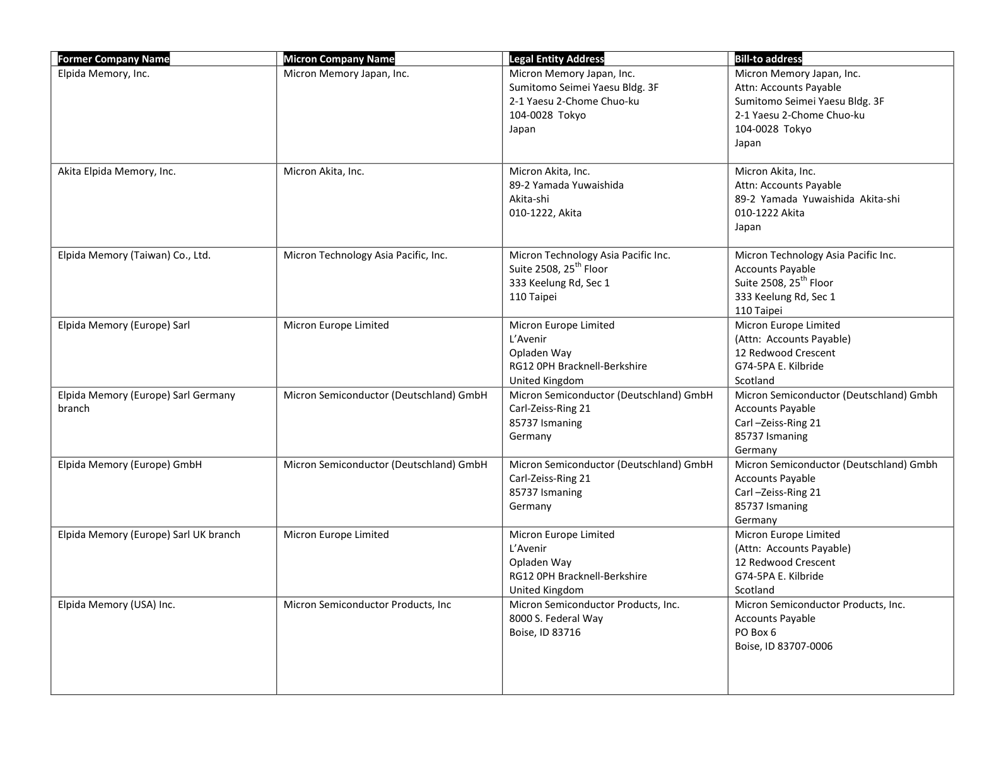
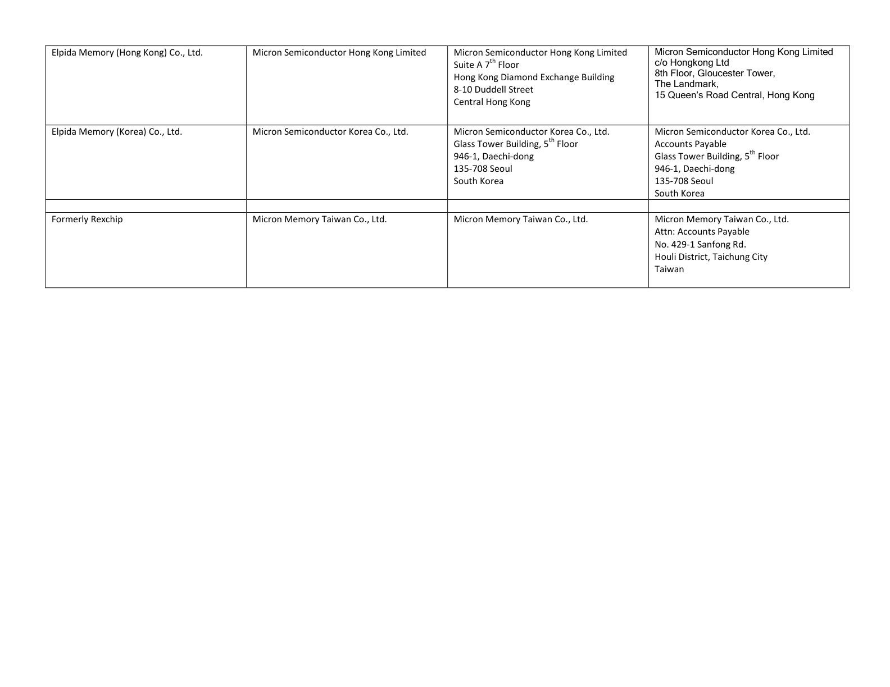

## Document Metadata

- Document ID: 88591ab33825258ee738950ce56dae0efac7f507
- Document Title: null
- Document Type: PDF
- Issuing Organization: null
- Publication Date: null
- Reporting Period: null
- Source File: [S061c59d26d9d_micron.com_faqs_1.pdf](https://github.com/jadennevercode/CJCC-Knowledge-Base/blob/564ab11aa9785e569e3853c8a4d7ce86f88e7535/materials/%E5%9F%BA%E7%A1%80%EF%BC%9A%E8%A1%8C%E4%B8%9A%E6%9C%AF%E8%AF%AD%E4%B8%8E%E6%8C%87%E6%A0%87/S061c59d26d9d_micron.com_faqs_1.pdf)

## Structured Content

> 原文件：[S061c59d26d9d_micron.com_faqs_1.pdf](https://github.com/jadennevercode/CJCC-Knowledge-Base/blob/564ab11aa9785e569e3853c8a4d7ce86f88e7535/materials/%E5%9F%BA%E7%A1%80%EF%BC%9A%E8%A1%8C%E4%B8%9A%E6%9C%AF%E8%AF%AD%E4%B8%8E%E6%8C%87%E6%A0%87/S061c59d26d9d_micron.com_faqs_1.pdf)
> 转换方式：Volcengine OCRPdf v3, parse_mode=ocr

[Source Page: 1]

| Former Company Name | Micron Company Name | Legal Entity Address | Bill-to address |
| --- | --- | --- | --- |
| Elpida Memory, Inc. | Micron Memory Japan, Inc. | Micron Memory Japan, Inc. Sumitomo Seimei Yaesu Bldg. 3F 2-1 Yaesu 2-Chome Chuo-ku 104-0028  Tokyo Japan | Micron Memory Japan, Inc. Attn: Accounts Payable Sumitomo Seimei Yaesu Bldg. 3F 2-1 Yaesu 2-Chome Chuo-ku 104-0028  Tokyo Japan |
| Akita Elpida Memory, Inc. | Micron Akita, Inc. | Micron Akita, Inc. 89-2 Yamada Yuwaishida Akita-shi 010-1222, Akita | Micron Akita, Inc. Attn: Accounts Payable 89-2  Yamada  Yuwaishida  Akita-shi 010-1222 Akita Japan |
| Elpida Memory (Taiwan) Co., Ltd. | Micron Technology Asia Pacific, Inc. | Micron Technology Asia Pacific Inc. Suite 2508, 25th Floor 333 Keelung Rd, Sec 1 110 Taipei | Micron Technology Asia Pacific Inc. Accounts Payable Suite 2508, 25th Floor 333 Keelung Rd, Sec 1 110 Taipei |
| Elpida Memory (Europe) Sarl | Micron Europe Limited | Micron Europe Limited L’Avenir Opladen Way RG12 0PH Bracknell-Berkshire United Kingdom | Micron Europe Limited (Attn:  Accounts Payable) 12 Redwood Crescent G74-5PA E. Kilbride Scotland |
| Elpida Memory (Europe) Sarl Germany branch | Micron Semiconductor (Deutschland) GmbH | Micron Semiconductor (Deutschland) GmbH Carl-Zeiss-Ring 21 85737 Ismaning Germany | Micron Semiconductor (Deutschland) Gmbh Accounts Payable Carl –Zeiss-Ring 21 85737 Ismaning Germany |
| Elpida Memory (Europe) GmbH | Micron Semiconductor (Deutschland) GmbH | Micron Semiconductor (Deutschland) GmbH Carl-Zeiss-Ring 21 85737 Ismaning Germany | Micron Semiconductor (Deutschland) Gmbh Accounts Payable Carl –Zeiss-Ring 21 85737 Ismaning Germany |
| Elpida Memory (Europe) Sarl UK branch | Micron Europe Limited | Micron Europe Limited L’Avenir Opladen Way RG12 0PH Bracknell-Berkshire United Kingdom | Micron Europe Limited (Attn:  Accounts Payable) 12 Redwood Crescent G74-5PA E. Kilbride Scotland |
| Elpida Memory (USA) Inc. | Micron Semiconductor Products, Inc | Micron Semiconductor Products, Inc. 8000 S. Federal Way Boise, ID 83716 | Micron Semiconductor Products, Inc. Accounts Payable PO Box 6 Boise, ID 83707-0006 |

[Source Page: 2]

*Continued from the table on Source Page 1; column headings are repeated for readability.*

| Former Company Name | Micron Company Name | Legal Entity Address | Bill-to address |
| --- | --- | --- | --- |
| Elpida Memory (Hong Kong) Co., Ltd. | Micron Semiconductor Hong Kong Limited | Micron Semiconductor Hong Kong Limited Suite A 7th Floor Hong Kong Diamond Exchange Building 8-10 Duddell Street Central Hong Kong | Micron Semiconductor Hong Kong Limited c/o Hongkong Ltd 8th Floor, Gloucester Tower, The Landmark, 15 Queen’s Road Central, Hong Kong |
| Elpida Memory (Korea) Co., Ltd. | Micron Semiconductor Korea Co., Ltd. | Micron Semiconductor Korea Co., Ltd. Glass Tower Building, 5th Floor 946-1, Daechi-dong 135-708 Seoul South Korea | Micron Semiconductor Korea Co., Ltd. Accounts Payable Glass Tower Building, 5th Floor 946-1, Daechi-dong 135-708 Seoul South Korea |
|  |  |  |  |
| Formerly Rexchip | Micron Memory Taiwan Co., Ltd. | Micron Memory Taiwan Co., Ltd. | Micron Memory Taiwan Co., Ltd. Attn: Accounts Payable No. 429-1 Sanfong Rd． Houli District, Taichung City Taiwan |

## Processing Notes

- 原 OCR 两页均返回空表；已依据原 PDF 表格边框与文字层重建，保留空行及原有空白单元格。
- 第二页是第一页表格的续页；为便于阅读重复列标题。原始页面图已附。
