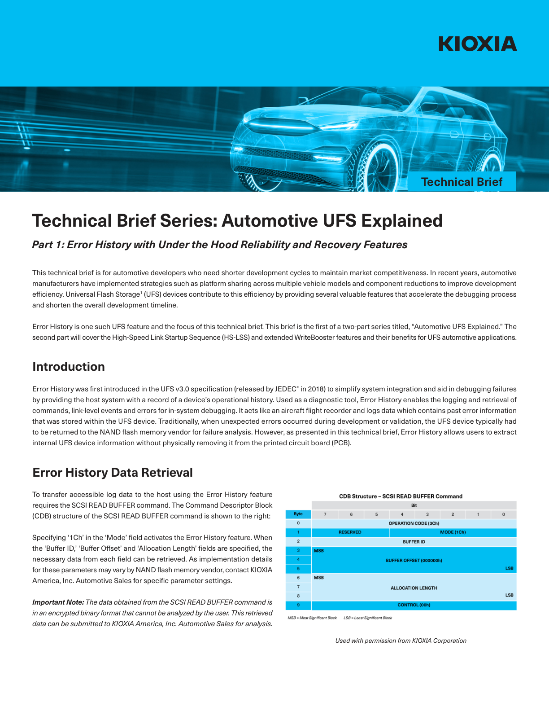
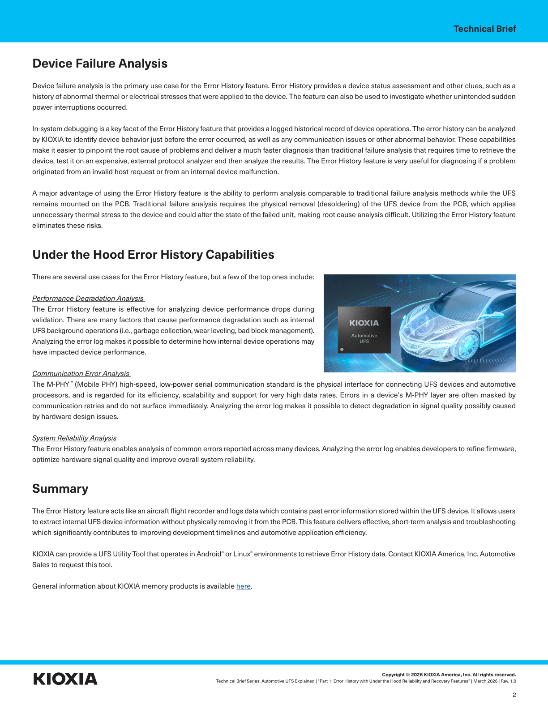

## Document Metadata

- Document ID: 738d8d07105efe430955cfdbc350a15ac3b0ce82
- Document Title: Technical Brief Series: Automotive UFS Explained — Part 1: Error History with Under the Hood Reliability and Recovery Features
- Document Type: PDF
- Issuing Organization: KIOXIA America, Inc.
- Publication Date: March 2026
- Reporting Period: null
- Source File: [S1365c3911348_americas.kioxia.co_KIOXIA_Auto_UFS_Error_History_.pdf](https://github.com/jadennevercode/CJCC-Knowledge-Base/blob/564ab11aa9785e569e3853c8a4d7ce86f88e7535/materials/%E5%9F%BA%E7%A1%80%EF%BC%9A%E8%A1%8C%E4%B8%9A%E6%9C%AF%E8%AF%AD%E4%B8%8E%E6%8C%87%E6%A0%87/S1365c3911348_americas.kioxia.co_KIOXIA_Auto_UFS_Error_History_.pdf)

## Structured Content

> 原文件：[S1365c3911348_americas.kioxia.co_KIOXIA_Auto_UFS_Error_History_.pdf](https://github.com/jadennevercode/CJCC-Knowledge-Base/blob/564ab11aa9785e569e3853c8a4d7ce86f88e7535/materials/%E5%9F%BA%E7%A1%80%EF%BC%9A%E8%A1%8C%E4%B8%9A%E6%9C%AF%E8%AF%AD%E4%B8%8E%E6%8C%87%E6%A0%87/S1365c3911348_americas.kioxia.co_KIOXIA_Auto_UFS_Error_History_.pdf)
> 转换方式：Volcengine OCRPdf v3, parse_mode=ocr

[Source Page: 1]

# Technical Brief Series: Automotive UFS Explained

## Part 1: Error History with Under the Hood Reliability and Recovery Features

This technical brief is for automotive developers who need shorter development cycles to maintain market competitiveness. In recent years, automotive manufacturers have implemented strategies such as platform sharing across multiple vehicle models and component reductions to improve development efficiency. Universal Flash Storage¹ (UFS) devices contribute to this efficiency by providing several valuable features that accelerate the debugging process and shorten the overall development timeline.

Error History is one such UFS feature and the focus of this technical brief. This brief is the first of a two-part series titled, “Automotive UFS Explained.” The second part will cover the High-Speed Link Startup Sequence (HS-LSS) and extended WriteBooster features and their benefits for UFS automotive applications.

## Introduction

Error History was first introduced in the UFS v3.0 specification (released by JEDEC® in 2018) to simplify system integration and aid in debugging failures by providing the host system with a record of a device’s operational history. Used as a diagnostic tool, Error History enables the logging and retrieval of commands, link-level events and errors for in-system debugging. It acts like an aircraft flight recorder and logs data which contains past error information that was stored within the UFS device. Traditionally, when unexpected errors occurred during development or validation, the UFS device typically had to be returned to the NAND flash memory vendor for failure analysis. However, as presented in this technical brief, Error History allows users to extract internal UFS device information without physically removing it from the printed circuit board (PCB).

## Error History Data Retrieval

To transfer accessible log data to the host using the Error History feature requires the SCSI READ BUFFER command. The Command Descriptor Block (CDB) structure of the SCSI READ BUFFER command is shown to the right:

Specifying ‘1Ch’ in the ‘Mode’ field activates the Error History feature. When the ‘Buffer ID,’ ‘Buffer Offset’ and ‘Allocation Length’ fields are specified, the necessary data from each field can be retrieved. As implementation details for these parameters may vary by NAND flash memory vendor, contact KIOXIA America, Inc. Automotive Sales for specific parameter settings.

Important Note: The data obtained from the SCSI READ BUFFER command is in an encrypted binary format that cannot be analyzed by the user. This retrieved data can be submitted to KIOXIA America, Inc. Automotive Sales for analysis.

### CDB Structure – SCSI READ BUFFER Command

| Byte | Bit(s) | Field |
| --- | --- | --- |
| 0 | 7:0 | OPERATION CODE (3Ch) |
| 1 | 7:5 | RESERVED |
| 1 | 4:0 | MODE (1Ch) |
| 2 | 7:0 | BUFFER ID |
| 3–5 | 7:0 | BUFFER OFFSET (000000h); MSB at byte 3, LSB at byte 5 |
| 6–8 | 7:0 | ALLOCATION LENGTH; MSB at byte 6, LSB at byte 8 |
| 9 | 7:0 | CONTROL (00h) |

MSB = Most Significant Block. LSB = Least Significant Block.

Used with permission from KIOXIA Corporation.

[Source Page: 2]

## Device Failure Analysis

Device failure analysis is the primary use case for the Error History feature. Error History provides a device status assessment and other clues, such as a history of abnormal thermal or electrical stresses that were applied to the device. The feature can also be used to investigate whether unintended sudden power interruptions occurred.

In-system debugging is a key facet of the Error History feature that provides a logged historical record of device operations. The error history can be analyzed by KIOXIA to identify device behavior just before the error occurred, as well as any communication issues or other abnormal behavior. These capabilities make it easier to pinpoint the root cause of problems and deliver a much faster diagnosis than traditional failure analysis that requires time to retrieve the device, test it on an expensive, external protocol analyzer and then analyze the results. The Error History feature is very useful for diagnosing if a problem originated from an invalid host request or from an internal device malfunction.

A major advantage of using the Error History feature is the ability to perform analysis comparable to traditional failure analysis methods while the UFS remains mounted on the PCB. Traditional failure analysis requires the physical removal (desoldering) of the UFS device from the PCB, which applies unnecessary thermal stress to the device and could alter the state of the failed unit, making root cause analysis difficult. Utilizing the Error History feature eliminates these risks.

## Under the Hood Error History Capabilities

There are several use cases for the Error History feature, but a few of the top ones include:

### Performance Degradation Analysis

The Error History feature is effective for analyzing device performance drops during validation. There are many factors that cause performance degradation such as internal UFS background operations (i.e., garbage collection, wear leveling, bad block management). Analyzing the error log makes it possible to determine how internal device operations may have impacted device performance.

### Communication Error Analysis

The M-PHY™ (Mobile PHY) high-speed, low-power serial communication standard is the physical interface for connecting UFS devices and automotive processors, and is regarded for its efficiency, scalability and support for very high data rates. Errors in a device’s M-PHY layer are often masked by communication retries and do not surface immediately. Analyzing the error log makes it possible to detect degradation in signal quality possibly caused by hardware design issues.

### System Reliability Analysis

The Error History feature enables analysis of common errors reported across many devices. Analyzing the error log enables developers to refine firmware, optimize hardware signal quality and improve overall system reliability.

## Summary

The Error History feature acts like an aircraft flight recorder and logs data which contains past error information stored within the UFS device. It allows users to extract internal UFS device information without physically removing it from the PCB. This feature delivers effective, short-term analysis and troubleshooting which significantly contributes to improving development timelines and automotive application efficiency.

KIOXIA can provide a UFS Utility Tool that operates in Android® or Linux® environments to retrieve Error History data. Contact KIOXIA America, Inc. Automotive Sales to request this tool.

General information about KIOXIA memory products is available [here](https://americas.kioxia.com/en-us/business/memory/automotive.html).

[Source Page: 3]

## FOOTNOTES

1 Universal Flash Storage (UFS) devices are based on the UFS specification, of which, the v4.1 specification is the current release issued by JEDEC and announced in January 2025.

## TRADEMARKS

Android is a registered trademark of Google LLC. JEDEC is a registered trademark of the Joint Electron Device Engineering Council (JEDEC) Solid State Technology Association. Linux is a registered trademark of Linus Torvalds in the U.S. and other countries. M-PHY is a trademark of MIPI Alliance. All other company names, product names and service names may be trademarks of third-party companies.

## DISCLAIMERS

© 2026 KIOXIA America, Inc. All rights reserved. Information in this tech brief, including product specifications, tested content, and assessments are current and believed to be accurate as of the publication date of the document, but is subject to change without prior notice. Technical and application information contained here is subject to the most recent applicable KIOXIA product specifications. This technical brief is for informational purposes only and KIOXIA makes no representation or warranties of any kind, expressed or implied. Images within are for illustration purposes only.

## Processing Notes

- CDB 表格依据原图中的字节与位范围重建，原文对 MSB、LSB 的缩写展开保留原样。
