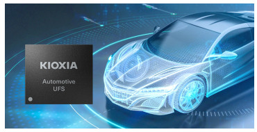
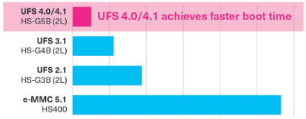
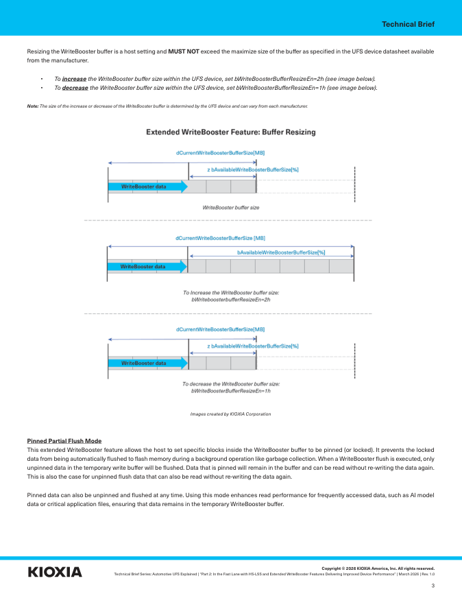
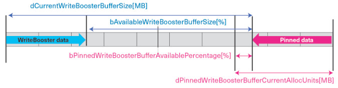

## Document Metadata

- Document ID: 7002c748407d34cef547bcde13ac70f1dd021fb8
- Document Title: Automotive UFS Explained, Part 2: In the Fast Lane with HS-LSS and Extended WriteBooster Features Delivering Improved Device Performance
- Document Type: PDF
- Issuing Organization: KIOXIA America, Inc.
- Publication Date: March 2026
- Reporting Period: null
- Source File: [S7a4f117f3b04_americas.kioxia.co_KIOXIA_Auto_UFS_HS_LSS_WriteBo.pdf](https://github.com/jadennevercode/CJCC-Knowledge-Base/blob/564ab11aa9785e569e3853c8a4d7ce86f88e7535/materials/%E5%9F%BA%E7%A1%80%EF%BC%9A%E8%A1%8C%E4%B8%9A%E6%9C%AF%E8%AF%AD%E4%B8%8E%E6%8C%87%E6%A0%87/S7a4f117f3b04_americas.kioxia.co_KIOXIA_Auto_UFS_HS_LSS_WriteBo.pdf)

## Structured Content

> 原文件：[S7a4f117f3b04_americas.kioxia.co_KIOXIA_Auto_UFS_HS_LSS_WriteBo.pdf](https://github.com/jadennevercode/CJCC-Knowledge-Base/blob/564ab11aa9785e569e3853c8a4d7ce86f88e7535/materials/%E5%9F%BA%E7%A1%80%EF%BC%9A%E8%A1%8C%E4%B8%9A%E6%9C%AF%E8%AF%AD%E4%B8%8E%E6%8C%87%E6%A0%87/S7a4f117f3b04_americas.kioxia.co_KIOXIA_Auto_UFS_HS_LSS_WriteBo.pdf)
> 转换方式：Volcengine OCRPdf v3, parse_mode=ocr

[Source Page: 1]

# Technical Brief Series: Automotive UFS Explained

## Part 2: In the Fast Lane with HS-LSS and Extended WriteBooster Features Delivering Improved Device Performance

This technical brief is Part 2 in the two-part series titled, “Automotive UFS Explained,” and covers high-speed and low-latency capabilities within Universal Flash Storage¹ (UFS) 4.1 managed flash devices². It is targeted at automotive innovators who develop advanced human-driven and autonomous vehicles that utilize high-performance storage. High-Speed Link Startup Sequence and extended WriteBooster features are included. Together, these state-of-the-art capabilities strengthen UFS as a storage solution for automotive applications with growing demands in speed and reduced latency.

## Introduction

UFS managed flash devices are an option of high-performance storage and an integral component of today’s automotive developments. These storage devices directly affect key automotive systems and capabilities, such as:

| System / Capability | High-Performance Storage is Required for: |
| --- | --- |
| ADAS / Autonomous Driving | Advanced Driver Assistance Systems and autonomous driving systems that process data from cameras and Light Detection and Ranging (LiDAR), and high-speed sensor data writing required by event data recorders (EDRs). |
| Network | A fast network is required to accumulate data for training purposes, which is then sent to the cloud |
| Infotainment | Digital cockpits, high-resolution screens and navigation systems to enhance the user experience. In some cases, fast boot up is required by law. |
| Over-the-Air (OTA) Updates | Software updates and patches that can be downloaded and installed without any other human intervention. |

High data demands and near-instantaneous data processing are required by modern connected vehicles to make real-time decisions. The storage subsystem is required to not only manage the high volumes of data but also provide incredibly fast read/write performance³ with low latency, large storage bandwidths and capacities, and continuous operations under harsh environmental conditions.

The latest UFS 4.1 specification introduces new performance enhancements which are useful for automotive development and include:

- High-Speed Link Startup Sequence (HS-LSS) - a faster method of initializing the UFS link from a low-power or inactive state to a quicker operational speed. This feature reduces the time required for link initialization when compared to previous startup sequences.
- Enhanced WriteBooster features – functionalities that improve read/write speeds for a UFS device. One way is to use the single-level cell (SLC) mode as a temporary buffer before transferring data to flash memory (multi-level cell (MLC), triple-level cell (TLC) or quad-level cell (QLC). It’s a high-speed capability that improves vehicle responsiveness for such tasks as real-time sensor recording, log buffering and OTA updating.

A deeper dive into these UFS 4.1 enhancements now follows:

[Source Page: 2]

## HS-LSS

Link Startup Sequence (LSS) is the handshake process between the host and the initial UFS device connection, or during a wake up when the UFS device has been in sleep mode. During LSS, both the host and UFS device communicate each other’s capabilities (i.e., number of lanes, gear speed, power modes, etc.). In UFS generations prior to UFS 4.0, LSS always started in low-speed mode. While this was a stable start-up process, it added latency to the system, especially when a UFS device frequently entered sleep states.

HS-LSS was introduced in UFS 4.0 to enable LSS to start directly in high-speed mode (HS-G1A) using 1.25 gigabits per second (Gb/s) speed. This enhanced speed is significantly faster than pulse width modulation (PWM)-G1 communication speed⁴ (between 3 and ~9 megabits per second (Mb/s)) that was used in older UFS device generations (see image below).

The product image shown is a representation of the design model and not an accurate product depiction.

### Estimated UFS Device Boot Times

(includes the sum of the initialization time and 64 MB⁵ read time)

Estimations conducted by KIOXIA Corporation

With HS-LSS, a vehicle’s electrical control unit (ECU) can initialize the UFS device faster after sleep or an ignition start, resulting in faster in-vehicle infotainment (IVI) and screen display uptime. For ADAS, AI models and map data stored in the UFS device are immediately accessible after wake up, allowing safety functions to resume faster.

HS-LSS drastically reduces system initialization times for advanced on-board electronics delivering faster system boot times, near-instantaneous availability of critical systems and enhanced user experiences.

## Extended WriteBooster Features

The WriteBooster feature was standardized in the UFS 3.1 specification. It provided a mechanism to temporarily enable or disable the SLC mode write buffer (regarded as the WriteBooster buffer) before data was transferred to flash memory. This capability improved data storage performance and considered the impact that additional performance could have on reliability when the WriteBooster buffer was used.

With newly extended WriteBooster features in the UFS 4.1 specification, there are two key enhancements worth further discussion - buffer resizing and a pinned partial flush mode for critical data:

### Buffer Resizing

This extended WriteBooster feature enables the host to dynamically configure and resize the WriteBooster buffer based on workload requirements. For specific workloads, increasing or decreasing the size of the WriteBooster buffer can optimize a UFS device’s write performance. For example, increasing the buffer size can be valuable for large file transfers while reducing the buffer size can improve overall device endurance for less performance-intensive data. Buffer resizing eliminates unnecessary writing to the WriteBooster buffer as transferring that data to flash memory can cause additional write amplification.

[Source Page: 3]

Resizing the WriteBooster buffer is a host setting and MUST NOT exceed the maximize size of the buffer as specified in the UFS device datasheet available from the manufacturer.

- To increase the WriteBooster buffer size within the UFS device, set bWriteBoosterBufferResizeEn=2h (see image below).
- To decrease the WriteBooster buffer size within the UFS device, set bWriteBoosterBufferResizeEn=1h (see image below).

Note: The size of the increase or decrease of the WriteBooster buffer is determined by the UFS device and can vary from each manufacturer.

### Extended WriteBooster Feature: Buffer Resizing

Images created by KIOXIA Corporation

### Pinned Partial Flush Mode

This extended WriteBooster feature allows the host to set specific blocks inside the WriteBooster buffer to be pinned (or locked). It prevents the locked data from being automatically flushed to flash memory during a background operation like garbage collection. When a WriteBooster flush is executed, only unpinned data in the temporary write buffer will be flushed. Data that is pinned will remain in the buffer and can be read without re-writing the data again. This is also the case for unpinned flush data that can also be read without re-writing the data again.

Pinned data can also be unpinned and flushed at any time. Using this mode enhances read performance for frequently accessed data, such as AI model data or critical application files, ensuring that data remains in the temporary WriteBooster buffer.

[Source Page: 4]

[原始页面图像](../_assets/auto_ufs_original_pages/page-4.png)

To enable pinning, the host:

1. Sets bWriteBoosterBufferPartialFlushMode=2h.
2. Sets the dPinnedWriteBoosterBufferNumAllocUnits for the maximum size of the pinned WriteBooster buffer area.
3. Sets the dNonPinnedWriteBoosterBufferMinNumAllocUnits for the minimum size of the non-pinned WriteBooster buffer area.
4. Issues a write command to the UFS device with Group Number=18h to pin data.

To unpin, the host sets fUnpinEn=1h to release the pinned data.

The image below shows the settings to pin data in the WriteBooster buffer:

Images created by KIOXIA Corporation

## Summary

HS-LSS and extended WriteBooster features in the UFS 4.1 specification address important performance requirements in automotive applications. HS-LSS reduces latency between the host and the UFS device during link up, allowing ECUs to quickly access UFS device data after waking up. An extended WriteBooster feature provides buffer resizing that enables the write performance of a UFS device to be optimized depending on the workload requirement. Another extended WriteBooster feature provides a pinned partial flush mode that allows specific blocks inside the WriteBooster buffer to be locked from being automatically flushed to flash memory during garbage collection and enhances read performance for frequently accessed data. These advanced capabilities are essential for automotive development where real-time data capture and low latency are required to meet the high data demands of modern connected vehicles.

General information about KIOXIA memory products is available here.

## FOOTNOTES:

1 Universal Flash Storage (UFS) devices are based on the UFS specification, of which, the v4.1 specification is the current release issued by JEDEC® and announced in January 2025.

2 A managed flash device combines raw NAND flash memory and an intelligent controller in one integrated package, enabling internal memory management.

3 Read and write speed may vary depending on various factors such as host devices, software (drivers, OS, etc.) and read/write conditions

4 PWM-G1 communication speed depends on the host and the UFS device.

5 Definition of capacity: KIOXIA defines a megabyte (MB) as 1,000,000 bytes, a gigabyte (GB) as 1,000,000,000 bytes, a terabyte (TB) as 1,000,000,000,000 bytes and a petabyte (PB) as 1,000,000,000,000,000 bytes. A computer operating system, however, reports storage capacity using powers of 2 for the definition of 1Gbit = 2³⁰ bits = 1,073,741,824 bits, 1GB = 2³⁰ bytes = 1,073,741,824 bytes, 1TB = 2⁴⁰ bytes = 1,099,511,627,776 bytes and 1PB = 2⁴⁰ bytes = 1,125,899,906,842,624 bytes [OCR_UNCERTAIN] and therefore shows less storage capacity. Available storage capacity (including examples of various media files) will vary based on file size, formatting, settings, software and operating system, and/or pre-installed software applications, or media content. Actual formatted capacity may vary.

## TRADEMARKS:

JEDEC is a registered trademark of the Joint Electron Device Engineering Council (JEDEC) Solid State Technology Association. All other company names, product names and service names may be trademarks of third-party companies.

## DISCLAIMERS:

© 2026 KIOXIA America, Inc. All rights reserved. Information in this tech brief, including product specifications, tested content, and assessments are current and believed to be accurate as of the publication date of the document, but is subject to change without prior notice. Technical and application information contained here is subject to the most recent applicable KIOXIA product specifications. This technical brief is for informational purposes only and KIOXIA makes no representation or warranties of any kind, expressed or implied. Images within are for illustration purposes only.

## Processing Notes

- 第 4 页脚注 5 将 1PB 写作 2⁴⁰ bytes，但其后所列字节数对应的指数与此不一致；保留原文并标记 [OCR_UNCERTAIN]。第 3 页示意图保留原页图。
