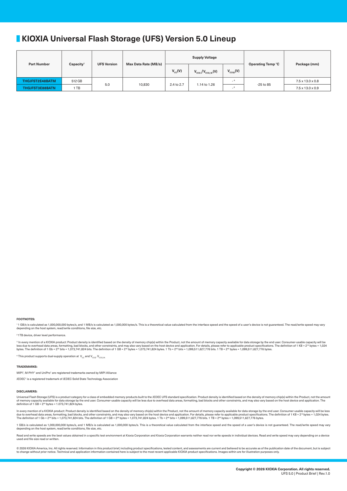

## Document Metadata

- Document ID: 99fdc7ef8fa5215d44dbfbb347ed6ba3e6149a72
- Document Title: Universal Flash Storage (UFS) 5.0 Product Brief
- Document Type: PDF
- Issuing Organization: KIOXIA Corporation
- Publication Date: null
- Reporting Period: null
- Source File: [S880cf58be016_kioxia.com_KIOXIA_UFS5_Product_Brief.pdf](https://github.com/jadennevercode/CJCC-Knowledge-Base/blob/564ab11aa9785e569e3853c8a4d7ce86f88e7535/materials/%E5%9F%BA%E7%A1%80%EF%BC%9A%E8%A1%8C%E4%B8%9A%E6%9C%AF%E8%AF%AD%E4%B8%8E%E6%8C%87%E6%A0%87/S880cf58be016_kioxia.com_KIOXIA_UFS5_Product_Brief.pdf)

## Structured Content

> 原文件：[S880cf58be016_kioxia.com_KIOXIA_UFS5_Product_Brief.pdf](https://github.com/jadennevercode/CJCC-Knowledge-Base/blob/564ab11aa9785e569e3853c8a4d7ce86f88e7535/materials/%E5%9F%BA%E7%A1%80%EF%BC%9A%E8%A1%8C%E4%B8%9A%E6%9C%AF%E8%AF%AD%E4%B8%8E%E6%8C%87%E6%A0%87/S880cf58be016_kioxia.com_KIOXIA_UFS5_Product_Brief.pdf)
> 转换方式：Volcengine OCRPdf v3, parse_mode=ocr

[Source Page: 1]

[原始页面图像](_assets/kioxia-ufs5-reviewed-pages/page-1.png)

# Universal Flash Storage (UFS)

UFS 5.0 is the latest embedded flash storage standard designed to meet the demanding requirements of next-generation mobile devices, such as premium smartphones with advanced on-device AI features. Building on the MIPI® M-PHY® version 6.0 physical layer and UniPro® version 3.0 protocol, UFS 5.0 introduces the High-Speed-Gear6, supporting theoretical interface speeds up to 46.6 Gb/s per lane and approximately 10.8 GB/s of real-world read/write performance using dual lanes¹.

KIOXIA UFS 5.0 flash storage solutions incorporate the latest 8th-generation KIOXIA BiCS FLASH™ technology and a newly developed controller to deliver significant performance enhancements compared to previous versions. Improvements in data transfer speed, efficiency, and design flexibility make UFS 5.0 from KIOXIA the optimal solution for on-device AI applications.

## Key Features

- Enhanced interface speed of up to 46.6 Gb/s per lane
- Breakthrough performance for UFS
- Latest JEDEC® standard, UFS 5.0
- Improved power efficiency and thermal management
- 7.5 x 13 mm BGA package

## Applications

- Premium smartphones featuring on-device AI
- High-end tablets/laptops
- Gaming systems
- Augmented reality (AR)/Virtual reality (VR) glasses
- Robotics
- Security/Smart cameras
- Smart IoT factories

## Densities

- 512 GB
- 1 TB

## Design Considerations

UFS 5.0²:

| | Supports |
| --- | ---: |
| Sequential Read | 10,000 MB/s |
| Sequential Write (WriteBooster) | 9,000 MB/s |
| Random Read | 1,160 KIOPS |
| Random Write | 1,020 KIOPS |

Use UFS 5.0 When:

- SoC supports UFS 5.0 interface
- Fast interface speeds are required
- High density is required
- Fast read/write speed is required
- LLM (Large Language Model) support needed for AI
- VLA (Vision Language Action) model local storage is required

Copyright © 2026 KIOXIA Corporation. All rights reserved. UFS 5.0 | Product Brief | Rev.1.0

[Source Page: 2]

## KIOXIA Universal Flash Storage (UFS) Version 5.0 Lineup

| Part Number | Capacity³ | UFS Version | Max Data Rate (MB/s) | VCC (V) | VCCQ / VCCQ_M (V) | VCCQ2 (V) | Operating Temp °C | Package (mm) |
| --- | --- | --- | --- | --- | --- | --- | --- | --- |
| THGJFST2E48BATM | 512 GB | 5.0 | 10,830 | 2.4 to 2.7 | 1.14 to 1.26 | -⁴ | -25 to 85 | 7.5 x 13.0 x 0.8 |
| THGJFST3E88BATN | 1 TB | 5.0 | 10,830 | 2.4 to 2.7 | 1.14 to 1.26 | -⁴ | -25 to 85 | 7.5 x 13.0 x 0.9 |

*The original uses merged cells for the version, data rate, supply voltages and operating temperature across both product rows.*

Copyright © 2026 KIOXIA Corporation. All rights reserved.

### FOOTNOTES:

1 1 GB/s is calculated as 1,000,000,000 bytes/s, and 1 MB/s is calculated as 1,000,000 bytes/s. This is a theoretical value calculated from the interface speed and the speed of a user’s device is not guaranteed. The read/write speed may vary depending on the host system, read/write conditions, file size, etc.

2 1TB device, driver level performance.

3 In every mention of a KIOXIA product: Product density is identified based on the density of memory chip(s) within the Product, not the amount of memory capacity available for data storage by the end user. Consumer-usable capacity will be less due to overhead data areas, formatting, bad blocks, and other constraints, and may also vary based on the host device and application. For details, please refer to applicable product specifications. The definition of 1 KB = 2^10 bytes = 1,024 bytes. The definition of 1 Gb = 2^30 bits = 1,073,741,824 bits. The definition of 1 GB = 2^30 bytes = 1,073,741,824 bytes. 1 Tb = 2^40 bits = 1,099,511,627,776 bits. 1 TB = 2^40 bytes = 1,099,511,627,776 bytes.

4 This product supports dual-supply operation at VCC and VCCQ. VCCQ_M.

### TRADEMARKS:

MIPI®, M-PHY® and UniPro® are registered trademarks owned by MIPI Alliance

JEDEC® is a registered trademark of JEDEC Solid State Technology Association

### DISCLAIMERS:

[OCR_UNCERTAIN] Universal Flash Storage (UFS) is a product category for a class of embedded memory products built to the JEDEC UFS standard specification. Product density is identified based on the density of memory chip(s) within the Product, not the amount of memory capacity available for data storage by the end user. Consumer-usable capacity will be less due to overhead data areas, formatting, bad blocks and other constraints, and may also vary based on the host device and application. The definition of 1 GB = 2^30 bytes = 1.073,741,824 bytes. [Original source punctuation retained.]

In every mention of a KIOXIA product: Product density is identified based on the density of memory chip(s) within the Product, not the amount of memory capacity available for data storage by the end user. Consumer-usable capacity will be less due to overhead data areas, formatting, bad blocks, and other constraints, and may also vary based on the host device and application. For details, please refer to applicable product specifications. The definition of 1 KB = 2^10 bytes = 1,024 bytes. The definition of 1 Gb = 2^30 bits = 1,073,741,824 bits. The definition of 1 GB = 2^30 bytes = 1,073,741,824 bytes. 1 Tb = 2^40 bits = 1,099,511,627,776 bits. 1 TB = 2^40 bytes = 1,099,511,627,776 bytes.

1 GB/s is calculated as 1,000,000,000 bytes/s, and 1 MB/s is calculated as 1,000,000 bytes/s. This is a theoretical value calculated from the interface speed and the speed of a user’s device is not guaranteed. The read/write speed may vary depending on the host system, read/write conditions, file size, etc.

Read and write speeds are the best values obtained in a specific test environment at Kioxia Corporation and Kioxia Corporation warrants neither read nor write speeds in individual devices. Read and write speed may vary depending on a device used and file size read or written.

© 2026 KIOXIA America, Inc. All rights reserved. Information in this product brief, including product specifications, tested content, and assessments are current and believed to be accurate as of the publication date of the document, but is subject to change without prior notice. Technical and application information contained here is subject to the most recent applicable KIOXIA product specifications. Images within are for illustration purposes only.

## Processing Notes

- 第 2 页免责声明将 1 GB 写为“1.073,741,824 bytes”，与另一处脚注写法不同；按原文保留并标记 [OCR_UNCERTAIN]。
