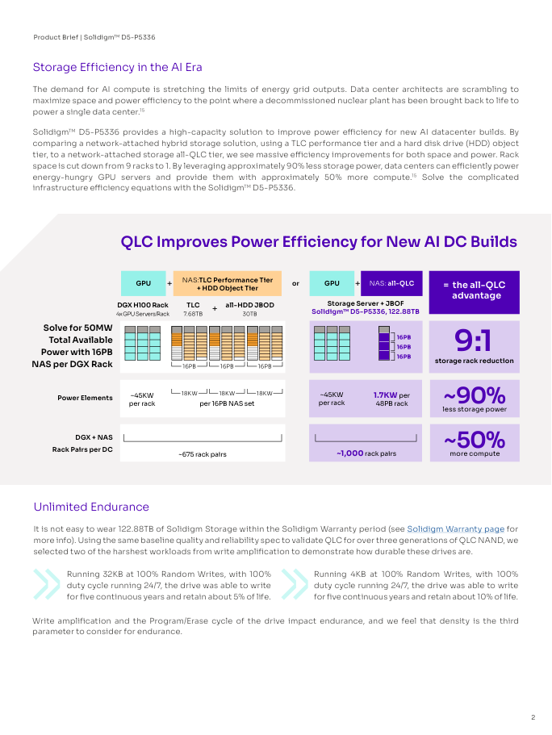

## Document Metadata

- Document ID: d10925440aa107877a3f8850a891272ffbc0e963
- Document Title: The World’s Highest Capacity PCIe SSD — Solidigm D5-P5336
- Document Type: PDF
- Issuing Organization: Solidigm
- Publication Date: null
- Reporting Period: null
- Source File: [Sa078498c5aac_solidigm.com_Solidigm-D5P5336-ProductBrief.pdf](https://github.com/jadennevercode/CJCC-Knowledge-Base/blob/564ab11aa9785e569e3853c8a4d7ce86f88e7535/materials/%E5%9F%BA%E7%A1%80%EF%BC%9A%E8%A1%8C%E4%B8%9A%E6%9C%AF%E8%AF%AD%E4%B8%8E%E6%8C%87%E6%A0%87/Sa078498c5aac_solidigm.com_Solidigm-D5P5336-ProductBrief.pdf)

## Structured Content

[Source Page: 1]

# The World’s Highest Capacity PCIe SSD

Solidigm™ D5-P5336 — PRODUCT BRIEF

The Solidigm™ D5-P5336 is built to improve power and space efficiency for critical IT infrastructure, meeting challenges from the data center core to the edge.

The Solidigm™ D5-P5336 is part of the fourth generation of QLC SSDs from Solidigm, delivering industry-leading power and space efficiency to optimize your storage subsystem for AI- and data-intensive workloads.

Combining read performance exceeding that of some cost-optimized TLC SSDs with capacities up to 122.88TB,¹ the D5-P5336 has been architected to efficiently accelerate and scale with the increasingly massive datasets found in widely deployed, modern read-intensive workloads, while increasing storage density, infrastructure efficiency, and enabling a more sustainable storage infrastructure.

## Storage Density Matters

Widely adopted modern workloads are becoming even more data hungry. The size of datasets used to train language models doubles approximately every eight months.² Many streaming services are shifting from limited paid-for capacity to unlimited free capacity.³ With connected Internet of Things (IoT) devices projected to reach 40B by 2030,⁴ there is no end in sight to unabated growth in data-rich services and applications.

Accompanying this trend is the decentralization of compute and storage to the edge to improve service levels, reduce costs, and improve agility. As recently as 2018, only 10% of enterprise-generated data was created and processed outside of traditional centralized data centers or cloud services. By 2025, Gartner expects 75% of that data to be created, processed, and stored at edge locations.⁵ Storage challenges such as space, power, cooling, and serviceability become even more acute when considering locality constraints at edge deployments.

## Optimized Performance for Data-Intensive Workloads

Modern, data-hungry workloads such as data pipelines and data lakes for AI, machine learning (ML), big data analytics, content delivery network (CDN), scale-out NAS, object storage, and edge usages are increasingly concerned with storing and accessing vast amounts of data efficiently at speed. Solidigm™ D5-P5336 is optimized for both requirements, with read performance equivalent to TLC SSDs and capacities up to 4x higher than alternatives.

| Product Name | Capacity | Content Delivery Network⁶ Total BW | General Purpose Server⁷ Total BW | Object Storage⁸ Total BW | Write Pressure Test⁹ Lower is Better |
| --- | --- | ---: | ---: | ---: | ---: |
| Micron 7450 Pro¹⁰ | 15.36TB | 0.84x | 0.81x | 0.92x | 01.51x |
| Kioxia CD8-R¹¹ | 15.36TB | 0.76x | 0.69x | 0.89x | 1.51x |
| Micron 6500 ION¹² | 30.72TB | 0.85x | 0.70x | 0.92x | 2.00x |
| Solidigm™ D5-P5336¹³ (baseline) | 61.44TB | 1.00x | 1.00x | 1.00x | 1.00x |
| Solidigm™ D5-P5336¹⁴ | 122.88TB | 1.01x | 0.91x | 1.05x | 1.01x |

[Source Page: 2]

## Storage Efficiency in the AI Era

The demand for AI compute is stretching the limits of energy grid outputs. Data center architects are scrambling to maximize space and power efficiency to the point where a decommissioned nuclear plant has been brought back to life to power a single data center.¹⁵

Solidigm™ D5-P5336 provides a high-capacity solution to improve power efficiency for new AI datacenter builds. By comparing a network-attached hybrid storage solution, using a TLC performance tier and a hard disk drive (HDD) object tier, to a network-attached storage all-QLC tier, we see massive efficiency improvements for both space and power. Rack space is cut down from 9 racks to 1. By leveraging approximately 90% less storage power, data centers can efficiently power energy-hungry GPU servers and provide them with approximately 50% more compute.¹⁶ Solve the complicated infrastructure efficiency equations with the Solidigm™ D5-P5336.

### QLC Improves Power Efficiency for New AI DC Builds

## Unlimited Endurance

It is not easy to wear 122.88TB of Solidigm Storage within the Solidigm Warranty period (see Solidigm Warranty page for more info). Using the same baseline quality and reliability spec to validate QLC for over three generations of QLC NAND, we selected two of the harshest workloads from write amplification to demonstrate how durable these drives are.

Running 32KB at 100% Random Writes, with 100% duty cycle running 24/7, the drive was able to write for five continuous years and retain about 5% of life.

Running 4KB at 100% Random Writes, with 100% duty cycle running 24/7, the drive was able to write for five continuous years and retain about 10% of life.

Write amplification and the Program/Erase cycle of the drive impact endurance, and we feel that density is the third parameter to consider for endurance.

[Source Page: 3]

## It’s Not Easy to Wear Out 122TB of Solidigm Storage

Solidigm™ D5-P5336 122.88TB Estimated Endurance (PBW)

| | 32KB 100% Random Writes, 100% Duty Cycle 24/7 | 4KB 100% Random Writes, 100% Duty Cycle 24/7 |
| --- | --- | --- |
| | 95%; 5% | 90%; 10% |
| | 5 years continuous writes; 2 mos remain | 5 years continuous writes; 7 mos remain |

*Actual product label may differ.

## Solidigm D5-P5336 Key Feature Overview

| Product Name | Solidigm™ D5-P5336 |
| --- | --- |
| Form Factor | U.2, E1.L, E3.S |
| Media | 192L QLC NAND |
| Power off Retention | 3 months @ 40°C |
| Max Power | 25 W |
| Idel Power | <5 W |
| UBER | <1 Sector per 10¹⁷ Bits Read |
| MTBF | 2 Million Hours |
| Feature | OCP 2.0 support,¹⁹ NVMe 2.0 Compliance, FIPS 140-3 Level 2²⁰ |

| User Capacity | 7.68TB | 15.36TB | 30.72TB | 61.44TB | 122.88TB |
| --- | ---: | ---: | ---: | ---: | ---: |
| Endurance (DWPD 5yrs)¹⁷ | 0.42 | 0.53 | 0.56 | 0.58 | 0.60 |
| Endurance (PBW)¹⁸ | 5.9 | 14.7 | 32.1 | 65.2 | 134.3 |

[Source Page: 4]

1. Solidigm D5-P5336 U.2, E3.S, now shipping in all capacities.

2. EPOCH AI “The size of datasets used to train language models doubles approximately every eight months.” Updated March 2025. https://epoch.ai/data-insights/dataset-size-trend

3. Based on widely available research on streaming services such as Netflix, Hulu, Amazon Prime, and Spotify.

4. IOT Analytics. “State of IoT 2024: Number of connected IoT devices growing 13% to 18.8 billion globally.” September 2024. https://iot-analytics.com/number-connected-iot-devices/

5. Gartner. “What Edge Computing Means for Infrastructure and Operations Leaders.” October 2018. www.gartner.com/smarterwithgartner/what-edge-computing-means-for-infrastructure-and-operations-leaders.

6. CDN Workload: Comparing 61.44/122.88TB Solidigm™ D5-P5336 with read BW of 7.4/7.4GB/sec to Kioxia CD8-R 15.36TB with 5.6 GB/sec as entry TLC SSD, Micron 7450 15.36TB with 6.2GB/sec as mainstream TLC SSD and Micron 6500 ION 30.72TB with 6.3GB/s as mainstream TLC SSD. Workload simulated using 128KB transfer size with 83% mix and 4KB to 116KB transfer size with 17% mix, 100% random reads. Test Configuration: Supermicro SYS-120U-TNR, Intel(R) Xeon(R) Gold 6354. Number of CPUs: 2, Cores per CPU: 18 (total 36), DRAM: DDR4 – 64GB, OS: Ubuntu 20.04.5 LTS Linux 5.15.0-67-generic. FIO 3.16.

7. General Purpose Server Workload: Comparing 61.44/122.88TB Solidigm™ D5-P5336 with total BW of 6.7/6.1GB/sec to Kioxia CD8-R 15.36TB with 4.6 GB/sec as entry TLC SSD, Micron 7450 15.36TB with 5.4GB/sec as mainstream TLC SSD and Micron 6500 ION 30.72TB with 5.3GB/s as mainstream TLC SSD. GPS workloads typically consist of concurrent large block (≥32KB) reads and writes with random access pattern. Test Configuration: Intel® Server Board M50CYP2SB2U, Intel® ICE LAKE - P5 4GXRAV D, Number of CPUs: 2, Cores per CPU 18 (total 36), DRAM: DDR4 – 64GB, OS: CentOS Linux release 7.5.1804, Kernel Version: 3.10.0-862.el7.x86_64. For IO workload measurement, FIO tool was used.

8. Object Storage Workload: Comparing 61.44/122.88TB Solidigm™ D5-P5336 with read/write bandwidth of 7.1/7.4GB/sec to Kioxia CD8-R 15.36TB with 6.3 GB/sec as entry TLC SSD and Micron 7450 15.36TB with 6.5GB/sec as mainstream TLC SSD and Micron 6500 ION 30.72TB with 6.5GB/s as mainstream TLC SSD. Workload based on SNIA definition from https://www.snia.org/sites/default/files/SDC/2019/presentations/Storage_Performance/Harrigan_John_Object_Storage_Workload_Testing_Tools.pdf (slide 8). Test Configuration: Intel® Server Board M50CYP2SBSTD, Intel® Xeon® Platinum 8360Y, Number of CPUs: 2, Number of Cores per CPU: 24 (total 48), DRAM: DDR4 – 768GB, OS: CentOS Linux release 7.9.2009. FIO v3.7.

9. Write Pressure Test: Comparing 61.44/122.88TB Solidigm™ D5-P5336 with read QoS of 806/676µsec to Kioxia CD8-R read QoS of 1221 µsec as entry TLC SSD, Micron 7450 read QoS of 1221 µsec as mainstream TLC SSD, and Micron 6500 ION 30.72TB read QoS of 1614 µsec as mainstream TLC SSD. Write pressure tests measure 16KB Random read QoS under 16KB random writes. Read response at a 99.99% availability is measured where 250MB/sec of random write pressure is applied.

10. Micron 7450 Pro, TLC, 15.36TB: https://www.micron.com/products/storage/ssd/data-center-ssd/7450-ssd

11. Kioxia CD8-R, TLC, 15.36TB: https://americas.kioxia.com/content/dam/kioxia/shared/business/ssd/data-center-ssd/asset/productbrief/dSSD-CD8-R-U2-product-brief.pdf

12. Micron 6500 ION, TLC, 30.72TB: https://www.micron.com/products/storage/ssd/data-center-ssd/6500-ion

13. Solidigm D5-P5336 61.44TB

14. Solidigm D5-P5336 122.88TB

15. USA Today. “Microsoft announces plan to reopen Three Mile Island nuclear plant to support AI.” September 2024. https://www.usatoday.com/story/money/ energy/2024/09/20/three-mile-island-nuclear-plant-constellation-microsoft-deal/75307770007/

16. Solidigm, Oct 2024. Power consumption analysis assumes a green field (new) bottom-range Hyper-scaler / Tier 2 AI DC implementation utilizing leading-edge power and space optimizations.

17. IU-Aligned Endurance. Based on 100% Random Write 16KB for 16KB IU SKUs, and 100% Random Write 32KB for 32KB IU 122.88TB SKU.

18. See D5-P5336 Product Specification for Exceptions and Modifications for Compliance/Support Details

19. See D5-P5336 Product Specification for Exceptions and Modifications for Compliance/Support Details

20. Requires FIPS enabled SKU. Certification will be available in the future. FIPS 140-3 Level 1 capability for 15.36TB & 30.72TB E1.L 9.5mm. The U.2, 15mm, E3.S, 7.5mm and 61.44TB E1.L 9.5mm will include Level 2 capability.

All information provided is subject to change at any time, without notice. Solidigm™ may make changes to manufacturing life cycle, specifications, and product descriptions at any time, without notice. The information herein is provided “as-is” and Solidigm does not make any representations or warranties whatsoever regarding accuracy of the information, nor on the product features, availability, functionality, or compatibility of the products listed. Please contact system vendor for more information on specific products or systems.

Performance results are based on testing as of dates shown in configurations and may not reflect all publicly available updates. See backup for configuration details. No product or component can be absolutely secure.

Performance varies by use, configuration, and other factors.

Refer to the spec sheet for formal definitions of product properties and features.

Solidigm technologies may require enabled hardware, software, or service activation. No product or component can be secure. Your costs and results may vary. Performance varies by use, configuration and other factors. Other names and brands may be claimed as property of others. Solidigm is committed to respecting human rights and avoiding complicity in human rights abuses. Solidigm products and software are intended only to be used in applications that do not cause or contribute to a violation of an internationally recognized human right.

Solidigm and the Solidigm logo are trademarks of Solidigm. All other trademarks are the property of their respective owners.

© Solidigm 2025. All rights reserved.

## Processing Notes

- 第 1 页比较表首行 Write Pressure Test 原文为 01.51x，按原样保留；第 3 页 Idel Power 为原文拼写。第 2 页对比示意图保留原页图。
