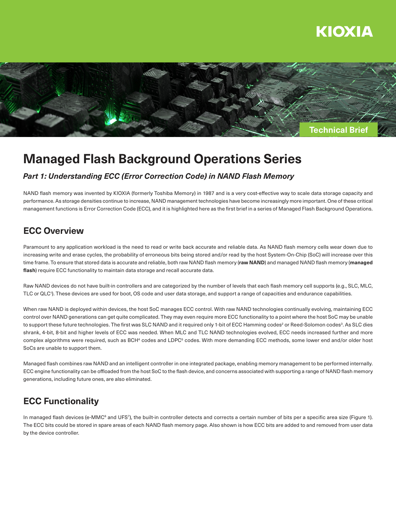
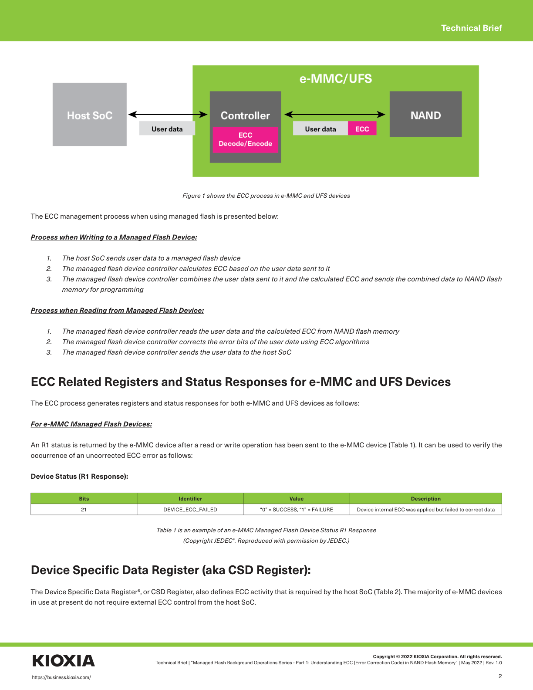
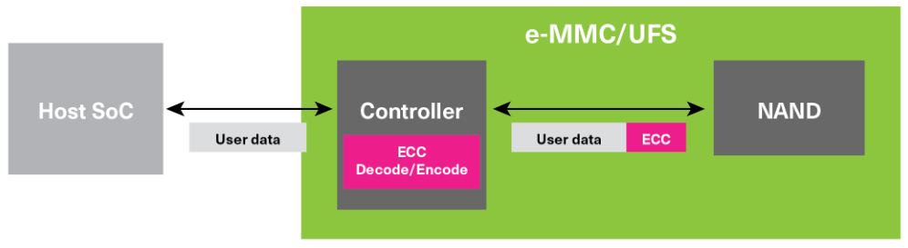
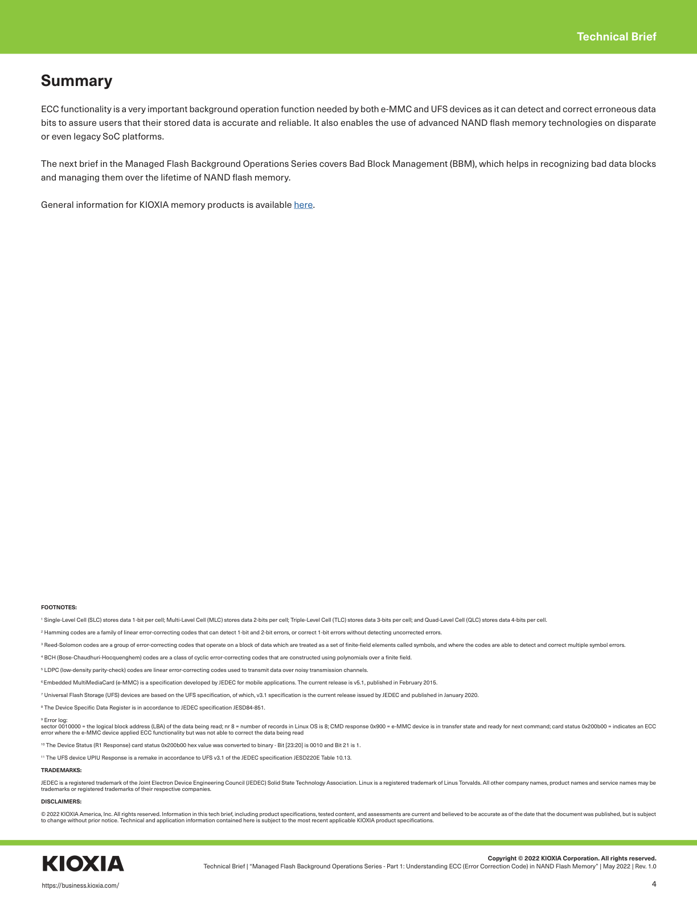

## Document Metadata

- Document ID: 7077e3608ccf8c6dcb379ba2c85b9a3660e8191e
- Document Title: Managed Flash Background Operations Series — Part 1: Understanding ECC (Error Correction Code) in NAND Flash Memory
- Document Type: PDF
- Issuing Organization: KIOXIA Corporation
- Publication Date: May 2022
- Reporting Period: null
- Source File: [Sb60ebe684b8b_kioxia.com_KIOXIA_Understanding_ECC_Tech_.pdf](https://github.com/jadennevercode/CJCC-Knowledge-Base/blob/564ab11aa9785e569e3853c8a4d7ce86f88e7535/materials/%E5%9F%BA%E7%A1%80%EF%BC%9A%E8%A1%8C%E4%B8%9A%E6%9C%AF%E8%AF%AD%E4%B8%8E%E6%8C%87%E6%A0%87/Sb60ebe684b8b_kioxia.com_KIOXIA_Understanding_ECC_Tech_.pdf)

## Structured Content

> 原文件：[Sb60ebe684b8b_kioxia.com_KIOXIA_Understanding_ECC_Tech_.pdf](https://github.com/jadennevercode/CJCC-Knowledge-Base/blob/564ab11aa9785e569e3853c8a4d7ce86f88e7535/materials/%E5%9F%BA%E7%A1%80%EF%BC%9A%E8%A1%8C%E4%B8%9A%E6%9C%AF%E8%AF%AD%E4%B8%8E%E6%8C%87%E6%A0%87/Sb60ebe684b8b_kioxia.com_KIOXIA_Understanding_ECC_Tech_.pdf)
> 转换方式：Volcengine OCRPdf v3, parse_mode=ocr

[Source Page: 1]

# Managed Flash Background Operations Series

## Part 1: Understanding ECC (Error Correction Code) in NAND Flash Memory

NAND flash memory was invented by KIOXIA (formerly Toshiba Memory) in 1987 and is a very cost-effective way to scale data storage capacity and performance. As storage densities continue to increase, NAND management technologies have become increasingly more important. One of these critical management functions is Error Correction Code (ECC), and it is highlighted here as the first brief in a series of Managed Flash Background Operations.

## ECC Overview

Paramount to any application workload is the need to read or write back accurate and reliable data. As NAND flash memory cells wear down due to increasing write and erase cycles, the probability of erroneous bits being stored and/or read by the host System-On-Chip (SoC) will increase over this time frame. To ensure that stored data is accurate and reliable, both raw NAND flash memory (raw NAND) and managed NAND flash memory (managed flash) require ECC functionality to maintain data storage and recall accurate data.

Raw NAND devices do not have built-in controllers and are categorized by the number of levels that each flash memory cell supports (e.g., SLC, MLC, TLC or QLC¹). These devices are used for boot, OS code and user data storage, and support a range of capacities and endurance capabilities.

When raw NAND is deployed within devices, the host SoC manages ECC control. With raw NAND technologies continually evolving, maintaining ECC control over NAND generations can get quite complicated. They may even require more ECC functionality to a point where the host SoC may be unable to support these future technologies. The first was SLC NAND and it required only 1-bit of ECC Hamming codes² or Reed-Solomon codes³. As SLC dies shrank, 4-bit, 8-bit and higher levels of ECC was needed. When MLC and TLC NAND technologies evolved, ECC needs increased further and more complex algorithms were required, such as BCH⁴ codes and LDPC⁵ codes. With more demanding ECC methods, some lower end and/or older host SoCs are unable to support them.

Managed flash combines raw NAND and an intelligent controller in one integrated package, enabling memory management to be performed internally. ECC engine functionality can be offloaded from the host SoC to the flash device, and concerns associated with supporting a range of NAND flash memory generations, including future ones, are also eliminated.

## ECC Functionality

In managed flash devices (e-MMC⁶ and UFS⁷), the built-in controller detects and corrects a certain number of bits per a specific area size (Figure 1). The ECC bits could be stored in spare areas of each NAND flash memory page. Also shown is how ECC bits are added to and removed from user data by the device controller.




[Source Page: 2]

Figure 1 shows the ECC process in e-MMC and UFS devices.

The ECC management process when using managed flash is presented below:

### Process when Writing to a Managed Flash Device

1. The host SoC sends user data to a managed flash device
2. The managed flash device controller calculates ECC based on the user data sent to it
3. The managed flash device controller combines the user data sent to it and the calculated ECC and sends the combined data to NAND flash memory for programming

### Process when Reading from Managed Flash Device

1. The managed flash device controller reads the user data and the calculated ECC from NAND flash memory
2. The managed flash device controller corrects the error bits of the user data using ECC algorithms
3. The managed flash device controller sends the user data to the host SoC

## ECC Related Registers and Status Responses for e-MMC and UFS Devices

The ECC process generates registers and status responses for both e-MMC and UFS devices as follows:

### For e-MMC Managed Flash Devices

An R1 status is returned by the e-MMC device after a read or write operation has been sent to the e-MMC device (Table 1). It can be used to verify the occurrence of an uncorrected ECC error as follows:

#### Device Status (R1 Response)

| Bits | Identifier | Value | Description |
| --- | --- | --- | --- |
| 21 | DEVICE_ECC_FAILED | “0” = SUCCESS, “1” = FAILURE | Device internal ECC was applied but failed to correct data |

Table 1 is an example of an e-MMC Managed Flash Device Status R1 Response. (Copyright JEDEC®. Reproduced with permission by JEDEC.)

### Device Specific Data Register (aka CSD Register)

The Device Specific Data Register⁸, or CSD Register, also defines ECC activity that is required by the host SoC (Table 2). The majority of e-MMC devices in use at present do not require external ECC control from the host SoC.





[Source Page: 3]

## CSD Register

| Name | Field | Width | Cell Type | CSD-slice |
| --- | --- | --- | --- | --- |
| Manufacturer default ECC | DEFAULT_ECC | 2 | R | [30:29] |
| ECC code | ECC | 2 | R/W/E | [9:8] |

Table 2 is an example of data presented in an e-MMC Managed Flash Device Specific Data Register. (Copyright JEDEC. Reproduced with permission by JEDEC.)

For Linux®-specific operating system environments, an error log⁹ may be reported at times during a read operation if there is a failure detected by ECC functionality. The card status VALUE of the R1 Response can provide indication that ECC has failed. In the Device Status (Table 1), this is accomplished by locating the VALUE of bit 21. A snippet of the Linux kernel log below shows an example of an ECC failure in an e-MMC device.

### Sample Linux OS Error Log

```
mmcblk0: error -110 transferring data, sector 0010000, nr 8, cmd response 0x900, card status 0x200b00
mmcblk0: retrying using single block read
```

In review of the Device Status (Table 1), the card status of ‘0x200b00’ has ‘bit 21’ indicating a ‘1’¹⁰ or a device ECC failure. In the sample error log, the Linux kernel reported an error during the read operation because the ECC failed. As a result, the e-MMC device did not output any data. The host SoC would then make a second attempt and issue another read operation to try and read the same data again.

## For UFS Managed Flash Devices

A UFS device can fail for several reasons when running UFS commands. It sends failure information to the host SoC through the Sense Data of the Response UFS Protocol Information Units (UPIU) (Table 3). The Sense Data starts from Byte[34] and is 18 bytes long.

### Response UPIU

| Byte(s) | Field |
| --- | --- |
| 0 | xx10 0001b |
| 1 | Flags |
| 2 | LUN |
| 3 | Task Tag |
| 4 | IID; CMD Set Type |
| 5 | Reserved |
| 6 | Reserved |
| 7 | Status |
| 8 | Total EHS Length (00h) |
| 9 | Device Information |
| 10–11 | Device Segment Length (MSB at 10; LSB at 11) |
| 12–15 | Residual Transfer Count (MSB at 12–13; LSB at 14–15) |
| 16–31 | Reserved |
| 32–33 | Sense Data Length (MSB at 32; LSB at 33) |
| 34 | Sense Data [0] |
| 35 | Sense Data [1] |
| 36 | Sense Data [2]: xh 3h |
| 37 | Sense Data [3] |
| 38–51 | Sense Data [4] - [[17] [OCR_UNCERTAIN] |

Table 3 is an example of an UFS device UPIU Response¹¹. (Copyright JEDEC. Reproduced with permission by JEDEC.)

When an uncorrectable ECC failure occurs, the UFS device will return a MEDIUM ERROR, of which there are many causes. The Sense Key value then becomes ‘3h’ for Bit[0:3] of the Sense Data[2] (as depicted in magenta in Table 3).


[Source Page: 4]

## Summary

ECC functionality is a very important background operation function needed by both e-MMC and UFS devices as it can detect and correct erroneous data bits to assure users that their stored data is accurate and reliable. It also enables the use of advanced NAND flash memory technologies on disparate or even legacy SoC platforms.

The next brief in the Managed Flash Background Operations Series covers Bad Block Management (BBM), which helps in recognizing bad data blocks and managing them over the lifetime of NAND flash memory.

General information for KIOXIA memory products is available [here](https://business.kioxia.com/en-us/memory.html).

## FOOTNOTES

1 Single-Level Cell (SLC) stores data 1-bit per cell; Multi-Level Cell (MLC) stores data 2-bits per cell; Triple-Level Cell (TLC) stores data 3-bits per cell; and Quad-Level Cell (QLC) stores data 4-bits per cell.

2 Hamming codes are a family of linear error-correcting codes that can detect 1-bit and 2-bit errors, or correct 1-bit errors without detecting uncorrected errors.

3 Reed-Solomon codes are a group of error-correcting codes that operate on a block of data which are treated as a set of finite-field elements called symbols, and where the codes are able to detect and correct multiple symbol errors.

4 BCH (Bose-Chaudhuri-Hocquenghem) codes are a class of cyclic error-correcting codes that are constructed using polynomials over a finite field.

5 LDPC (low-density parity-check) codes are linear error-correcting codes used to transmit data over noisy transmission channels.

6 Embedded MultiMediaCard (e-MMC) is a specification developed by JEDEC for mobile applications. The current release is v5.1, published in February 2015.

7 Universal Flash Storage (UFS) devices are based on the UFS specification, of which, v3.1 specification is the current release issued by JEDEC and published in January 2020.

8 The Device Specific Data Register is in accordance to JEDEC specification JESD84-851.

9 Error log: sector 0010000 = the logical block address (LBA) of the data being read; nr 8 = number of records in Linux OS is 8; CMD response 0x900 = e-MMC device is in transfer state and ready for next command; card status 0x200b00 = indicates an ECC error where the e-MMC device applied ECC functionality but was not able to correct the data being read

10 The Device Status (R1 Response) card status 0x200b00 hex value was converted to binary - Bit [23:20] is 0010 and Bit 21 is 1.

11 The UFS device UPIU Response is a remake in accordance to UFS v3.1 of the JEDEC specification JESD220E Table 10.13.

## TRADEMARKS

JEDEC is a registered trademark of the Joint Electron Device Engineering Council (JEDEC) Solid State Technology Association. Linux is a registered trademark of Linus Torvalds. All other company names, product names and service names may be trademarks or registered trademarks of their respective companies.

## DISCLAIMERS

© 2022 KIOXIA America, Inc. All rights reserved. Information in this tech brief, including product specifications, tested content, and assessments are current and believed to be accurate as of the date that the document was published, but is subject to change without prior notice. Technical and application information contained here is subject to the most recent applicable KIOXIA product specifications.




## Processing Notes

- 已对照原页恢复两张寄存器表、UPIU 字节布局、日志及全部脚注。原图“Sense Data [4] - [[17]”中的重复括号保留并标记不确定。
