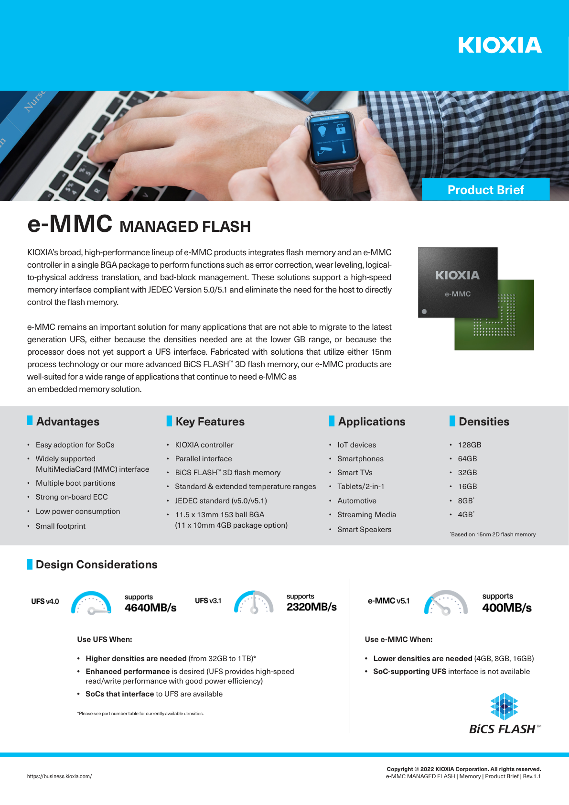
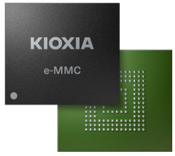
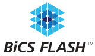
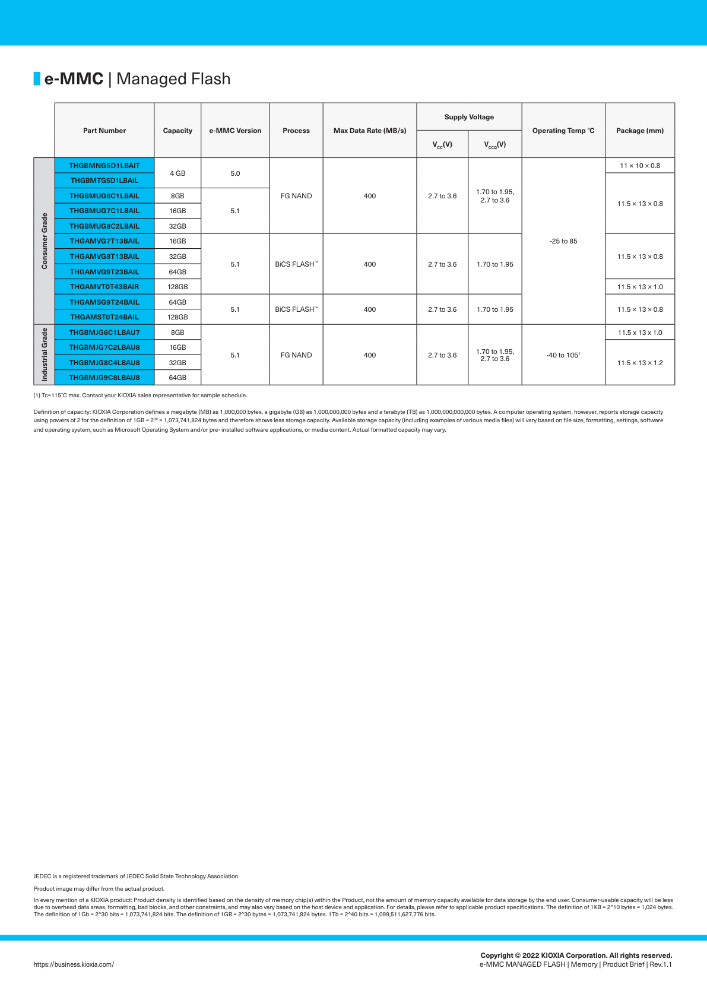

## Document Metadata

- Document ID: 5b1dd5b298fc71988b68ff09c6e2b98870fe44b9
- Document Title: e-MMC MANAGED FLASH
- Document Type: PDF
- Issuing Organization: KIOXIA Corporation
- Publication Date: null
- Reporting Period: null
- Source File: [Sd5c250c4563c_americas.kioxia.co_KIOXIA_e-MMC_Product_Brief.pdf](https://github.com/jadennevercode/CJCC-Knowledge-Base/blob/564ab11aa9785e569e3853c8a4d7ce86f88e7535/materials/%E5%9F%BA%E7%A1%80%EF%BC%9A%E8%A1%8C%E4%B8%9A%E6%9C%AF%E8%AF%AD%E4%B8%8E%E6%8C%87%E6%A0%87/Sd5c250c4563c_americas.kioxia.co_KIOXIA_e-MMC_Product_Brief.pdf)

## Structured Content

> 原文件：[Sd5c250c4563c_americas.kioxia.co_KIOXIA_e-MMC_Product_Brief.pdf](https://github.com/jadennevercode/CJCC-Knowledge-Base/blob/564ab11aa9785e569e3853c8a4d7ce86f88e7535/materials/%E5%9F%BA%E7%A1%80%EF%BC%9A%E8%A1%8C%E4%B8%9A%E6%9C%AF%E8%AF%AD%E4%B8%8E%E6%8C%87%E6%A0%87/Sd5c250c4563c_americas.kioxia.co_KIOXIA_e-MMC_Product_Brief.pdf)
> 转换方式：Volcengine OCRPdf v3, parse_mode=ocr

[Source Page: 1]

# e-MMC MANAGED FLASH

KIOXIA’s broad, high-performance lineup of e-MMC products integrates flash memory and an e-MMC controller in a single BGA package to perform functions such as error correction, wear leveling, logical-to-physical address translation, and bad-block management. These solutions support a high-speed memory interface compliant with JEDEC Version 5.0/5.1 and eliminate the need for the host to directly control the flash memory.

e-MMC remains an important solution for many applications that are not able to migrate to the latest generation UFS, either because the densities needed are at the lower GB range, or because the processor does not yet support a UFS interface. Fabricated with solutions that utilize either 15nm process technology or our more advanced BiCS FLASH™ 3D flash memory, our e-MMC products are well-suited for a wide range of applications that continue to need e-MMC as an embedded memory solution.

## Advantages

- Easy adoption for SoCs
- Widely supported MultiMediaCard (MMC) interface
- Multiple boot partitions
- Strong on-board ECC
- Low power consumption
- Small footprint

## Key Features

- KIOXIA controller
- Parallel interface
- BiCS FLASH™ 3D flash memory
- Standard & extended temperature ranges
- JEDEC standard (v5.0/v5.1)
- 11.5 x 13mm 153 ball BGA (11 x 10mm 4GB package option)

## Applications

- IoT devices
- Smartphones
- Smart TVs
- Tablets/2-in-1
- Automotive
- Streaming Media
- Smart Speakers

## Densities

128GB; 64GB; 32GB; 16GB; 8GB*; 4GB*.

*Based on 15nm 2D flash memory.

## Design Considerations

The figure shows: UFS v4.0 supports 4640MB/s; UFS v3.1 supports 2320MB/s; e-MMC v5.1 supports 400MB/s.

### Use UFS When

- Higher densities are needed (from 32GB to 1TB)*
- Enhanced performance is desired (UFS provides high-speed read/write performance with good power efficiency)
- SoCs that interface to UFS are available

### Use e-MMC When

- Lower densities are needed (4GB, 8GB, 16GB)
- SoC-supporting UFS interface is not available

*Please see part number table for currently available densities.

[Source Page: 2]

## e-MMC | Managed Flash

| Grade | Part Number | Capacity | e-MMC Version | Process | Max Data Rate (MB/s) | VCC (V) | VCCQ (V) | Operating Temp °C | Package (mm) |
| --- | --- | --- | --- | --- | --- | --- | --- | --- | --- |
| Consumer Grade | THGBMNG5D1LBAIT | 4 GB | 5.0 | FG NAND | 400 | 2.7 to 3.6 | 1.70 to 1.95, 2.7 to 3.6 | -25 to 85 | 11 × 10 × 0.8 |
| Consumer Grade | THGBMTG5D1LBAIL | 4 GB | 5.0 | FG NAND | 400 | 2.7 to 3.6 | 1.70 to 1.95, 2.7 to 3.6 | -25 to 85 | 11.5 × 13 × 0.8 |
| Consumer Grade | THGBMUG6C1LBAIL | 8GB | 5.1 | FG NAND | 400 | 2.7 to 3.6 | 1.70 to 1.95, 2.7 to 3.6 | -25 to 85 | 11.5 × 13 × 0.8 |
| Consumer Grade | THGBMUG7C1LBAIL | 16GB | 5.1 | FG NAND | 400 | 2.7 to 3.6 | 1.70 to 1.95, 2.7 to 3.6 | -25 to 85 | 11.5 × 13 × 0.8 |
| Consumer Grade | THGBMUG8C2LBAIL | 32GB | 5.1 | FG NAND | 400 | 2.7 to 3.6 | 1.70 to 1.95, 2.7 to 3.6 | -25 to 85 | 11.5 × 13 × 0.8 |
| Consumer Grade | THGAMVG7T13BAIL | 16GB | 5.1 | BiCS FLASH™ | 400 | 2.7 to 3.6 | 1.70 to 1.95 | -25 to 85 | 11.5 × 13 × 0.8 |
| Consumer Grade | THGAMVG8T13BAIL | 32GB | 5.1 | BiCS FLASH™ | 400 | 2.7 to 3.6 | 1.70 to 1.95 | -25 to 85 | 11.5 × 13 × 0.8 |
| Consumer Grade | THGAMVG9T23BAIL | 64GB | 5.1 | BiCS FLASH™ | 400 | 2.7 to 3.6 | 1.70 to 1.95 | -25 to 85 | 11.5 × 13 × 0.8 |
| Consumer Grade | THGAMVT0T43BAIR | 128GB | 5.1 | BiCS FLASH™ | 400 | 2.7 to 3.6 | 1.70 to 1.95 | -25 to 85 | 11.5 × 13 × 1.0 |
| Consumer Grade | THGAMSG9T24BAIL | 64GB | 5.1 | BiCS FLASH™ | 400 | 2.7 to 3.6 | 1.70 to 1.95 | -25 to 85 | 11.5 × 13 × 0.8 |
| Consumer Grade | THGAMST0T24BAIL | 128GB | 5.1 | BiCS FLASH™ | 400 | 2.7 to 3.6 | 1.70 to 1.95 | -25 to 85 | 11.5 × 13 × 0.8 |
| Industrial Grade | THGBMJG6C1LBAU7 | 8GB | 5.1 | FG NAND | 400 | 2.7 to 3.6 | 1.70 to 1.95, 2.7 to 3.6 | -40 to 105¹ | 11.5 × 13 × 1.0 |
| Industrial Grade | THGBMJG7C2LBAU8 | 16GB | 5.1 | FG NAND | 400 | 2.7 to 3.6 | 1.70 to 1.95, 2.7 to 3.6 | -40 to 105¹ | 11.5 × 13 × 1.2 |
| Industrial Grade | THGBMJG8C4LBAU8 | 32GB | 5.1 | FG NAND | 400 | 2.7 to 3.6 | 1.70 to 1.95, 2.7 to 3.6 | -40 to 105¹ | 11.5 × 13 × 1.2 |
| Industrial Grade | THGBMJG9C8LBAU8 | 64GB | 5.1 | FG NAND | 400 | 2.7 to 3.6 | 1.70 to 1.95, 2.7 to 3.6 | -40 to 105¹ | 11.5 × 13 × 1.2 |

(1) Tc=115°C max. Contact your KIOXIA sales representative for sample schedule.

Definition of capacity: KIOXIA Corporation defines a megabyte (MB) as 1,000,000 bytes, a gigabyte (GB) as 1,000,000,000 bytes and a terabyte (TB) as 1,000,000,000,000 bytes. A computer operating system, however, reports storage capacity using powers of 2 for the definition of 1GB = 2³⁰ = 1,073,741,824 bytes and therefore shows less storage capacity. Available storage capacity (including examples of various media files) will vary based on file size, formatting, settings, software and operating system, such as Microsoft Operating System and/or pre-installed software applications, or media content. Actual formatted capacity may vary.

JEDEC is a registered trademark of JEDEC Solid State Technology Association.

Product image may differ from the actual product.

In every mention of a KIOXIA product: Product density is identified based on the density of memory chip(s) within the Product, not the amount of memory capacity available for data storage by the end user. Consumer-usable capacity will be less due to overhead data areas, formatting, bad blocks, and other constraints, and may also vary based on the host device and application. For details, please refer to applicable product specifications. The definition of 1KB = 2^10 bytes = 1,024 bytes. The definition of 1Gb = 2^30 bits = 1,073,741,824 bits. The definition of 1GB = 2^30 bytes = 1,073,741,824 bytes. 1Tb = 2^40 bits = 1,099,511,627,776 bits.

## Processing Notes

- 参数表按原始合并单元格覆盖范围重复共有值；保留原页图、脚注和容量定义。
