## Document Metadata

- Document ID: e0a30cc0385b2a8fad8e294c0a7e0ea92fb1582e
- Document Title: Arrow Electronics Earnings Presentation: Fourth Quarter & Full Year 2025
- Document Type: Earnings Presentation
- Issuing Organization: Arrow Electronics
- Publication Date: 2026-02-05
- Reporting Period: Fourth Quarter & Full Year 2025
- Source File: [43_s28.q4cdn.com_Q4-25-Earnings-Presentation_2-.pdf](https://github.com/jadennevercode/CJCC-Knowledge-Base/blob/564ab11aa9785e569e3853c8a4d7ce86f88e7535/materials/%E6%B5%81%E9%80%9A%EF%BC%9A%E6%B8%A0%E9%81%93%E4%B8%8E%E4%BA%A4%E6%98%93%E5%85%B3%E7%B3%BB/43_s28.q4cdn.com_Q4-25-Earnings-Presentation_2-.pdf)

## Structured Content

> 原文件：[43_s28.q4cdn.com_Q4-25-Earnings-Presentation_2-.pdf](https://github.com/jadennevercode/CJCC-Knowledge-Base/blob/564ab11aa9785e569e3853c8a4d7ce86f88e7535/materials/%E6%B5%81%E9%80%9A%EF%BC%9A%E6%B8%A0%E9%81%93%E4%B8%8E%E4%BA%A4%E6%98%93%E5%85%B3%E7%B3%BB/43_s28.q4cdn.com_Q4-25-Earnings-Presentation_2-.pdf)
> 转换方式：Volcengine OCRPdf v3, parse_mode=ocr

[Source Page: 1]

# Arrow Electronics Earnings Presentation

Fourth Quarter & Full Year 2025  
February 5, 2026

William Austen, Interim President and CEO  
Raj Agrawal, Senior Vice President and CFO

[Source Page: 2]

## Safe Harbor

This presentation includes “forward-looking statements,” as the term is defined under the federal securities laws. Forward-looking statements are those statements which are not  statements of historical or current fact. These forward-looking statements can be identified by forward-looking words such as “expects,” “anticipates,” “intends,” “plans,” “may,”  “will,” “would,” “could,” “believes,” “seeks,” “projected,” “potential,” “estimates,” and similar expressions. These forward-looking statements are subject to numerous assumptions,  risks, and uncertainties, which could cause actual results or facts to differ materially from such statements for a variety of reasons, including, but not limited to: unfavorable  economic conditions or changes, including those that may occur in connection with recession, inflation, tax rates, foreign currency exchange rates, or the availability of capital;  political instability and changes; impacts of military conflict and sanctions; trade protection measures, tariffs, increased trade tensions, trade agreements and policies, and other  restrictions, duties, and value-added taxes, and the associated macroeconomic impacts; disruptions, shortages, or inefficiencies in the supply chain; non-compliance with certain  laws, regulations, or executive orders, such as trade, export, antitrust, and anti-corruption laws, or regulatory restrictions relating to the company or its subsidiaries or the  permissibility of third-parties to transact therewith; the inability to realize sufficient sales to cover non-cancellable purchase obligations under certain ECS distribution  agreements; management transitions, including the company’s search for a permanent CEO; the incurrence of unanticipated charges or failure to realize contemplated cost  savings in connection with the Operating Expense Efficiency Plan; changes in product supply, pricing, and customer demand; increased profit-margin pressure resulting from  industry conditions, competition, or other factors; changes in relationships with key suppliers; other vagaries in the global components and the global ECS markets; changes to  applicable laws, regulations, executive orders, or rules relating to government contractors and the resulting legal and reputational exposure, including but not limited to those  relating to environmental, social, governance, cybersecurity, data privacy, and artificial intelligence issues; commercial disputes, patent infringement claims, product liability  lawsuits, or other legal proceedings; foreign tax and other loss contingencies; failure, disruption, or compromise of the company’s information systems or those of a third-party  service provider, including unauthorized use or disclosure of company, supplier, or customer information; outbreaks, epidemics, pandemics, or public health crises; the effects of  natural or man-made catastrophic events; and the company’s ability to generate positive cash flow. For a further discussion of these and other factors that could cause the  company’s future results to differ materially from any forward-looking statements, see the section entitled “Risk Factors” in the company’s most recent Annual Report on Form  10-K, as well as in other filings the company makes with the SEC. Shareholders and other readers are cautioned not to place undue reliance on these forward-looking statements,  which speak only as of the date on which they are made. The company undertakes no obligation to update publicly or revise any of the forward-looking statements.

[Source Page: 3]

## Q4 2025 Highlights

- CONSOLIDATED SALES: $8.7 Billion, Up 20% Y/Y
- OPERATING MARGIN¹: 3.8 Percent
- DILUTED EARNINGS PER SHARE¹: $4.39, Up 48% Y/Y
- Consolidated revenue and earnings per share exceeded high end of guidance range
- Global Components segment revenue exceeded high end of guidance range
- Global Enterprise Computing Solutions segment revenue exceeded midpoint of guidance range
- Additional Q4 2025 financial information:
  - Record Global Enterprise Computing Solutions gross profit and operating profit
  - $336 million operating income¹
  - $228 million net income¹

1. Figures are Non-GAAP. See reconciliation to comparable GAAP figures in the tables at the end of this presentation.

[Source Page: 4]

## Why Arrow

As the premier orchestrator of technology solutions, we guide innovation forward

### Strong Position in Large and Growing Markets

- Superior product distribution execution in the $250B+ “indirect” DTAM¹,²
- Expanding addressable market through increased mix shift toward value-added offerings

### Differentiated Capabilities Driving Profitable Growth

- Extending foundational product distribution capabilities into adjacent, higher margin value-added services
- Increased productivity through simplifying operations

### Diversified Business Model Provides Financial Flexibility

- Combination of Global Components and ECS is a strategic advantage
- Strong balance sheet
- Consistent free cash flow generation

### Focused Capital Allocation Strategy

- Reinvest in organic growth
- Strategic M&A
- Return excess capital to shareholders
- Maintain investment-grade credit rating

1. Source: IDC, OMDIA, and Arrow analysis.
2. DTAM: Distribution Total Addressable Market

[Source Page: 5]

## Overview

- Execute through gradual recovery with discipline
- Deliver profitable growth
- Expand value-added offerings
- Position Arrow through strategy, differentiated capabilities, and diversified business model

[Source Page: 6]

## FY 2025 Financial Metrics

- CONSOLIDATED SALES: $30.9 Billion, Up 10% Y/Y
- GLOBAL COMPONENTS SALES: $21.5 Billion, Up 8% Y/Y
- GLOBAL ECS SALES: $9.4 Billion, Up 18% Y/Y
- DILUTED EARNINGS PER SHARE¹: $11.02, Up 4% Y/Y
- Key Takeaways:
  - Growth in accretive value-added services
  - Productivity initiatives driving efficiencies
  - Regional and customer mix headwinds to FY 2025 results, gradually improving

1. Figures are Non-GAAP. See reconciliation to comparable GAAP figures in the tables at the end of this presentation.

[Source Page: 7]

## Q4 2025 Financial Metrics

$ in millions except for EPS

| | 4Q24 | 3Q25 | 4Q25 |
| --- | --- | --- | --- |
| Sales | $7,283 | $7,713 | $8,746 |
| Non-GAAP Gross Margin¹ | 11.7% | 10.8% | 11.5% |
| Non-GAAP Operating Expenses¹ | $580 | $616 | $669 |
| Operating expenses, % Gross Profit | 68% | 74% | 67% |
| Non-GAAP Operating Income¹ | $274 | $217 | $336 |
| Operating Margin | 3.8% | 2.8% | 3.8% |
| Non-GAAP Diluted EPS¹ | $2.97 | $2.41 | $4.39 |
| Shares Oustanding | 53 | 52 | 52 |

Interest and other expense, net in Q4‘25 was $44 million  
Non-GAAP Effective Tax Rate was 23.0%¹

1. See reconciliation to comparable GAAP figures in the tables at the end of this presentation.

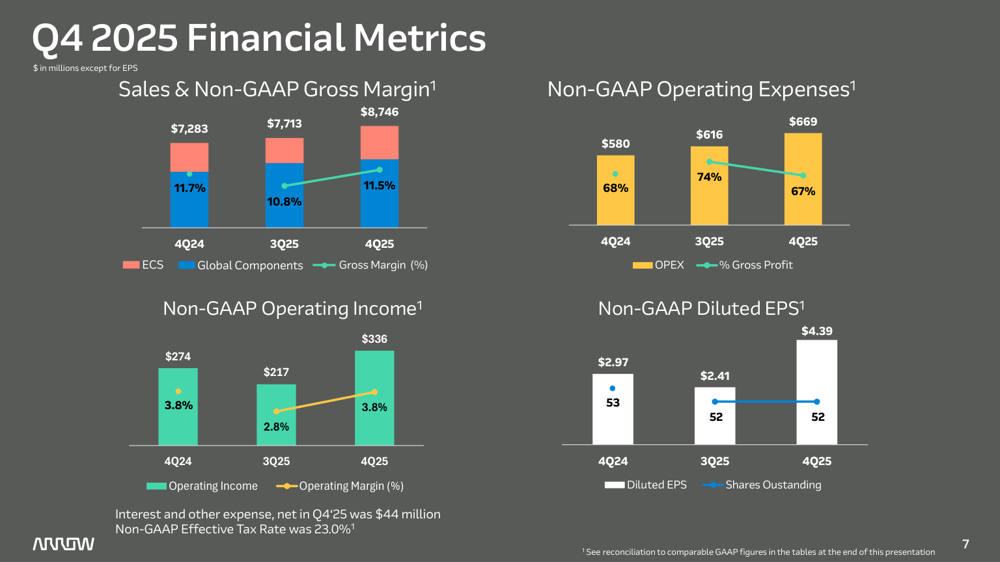

[Source Page: 8]

## Q4 2025 Global Components

$ in millions

| | 4Q24 | 3Q25 | 4Q25 |
| --- | --- | --- | --- |
| Sales | $4,814 | $5,556 | $5,882 |
| Non-GAAP Gross Margin¹ | 11.4% | 10.9% | 10.9% |
| Non-GAAP Operating Income¹ | $173 | $199 | $219 |
| Operating Margin | 3.6% | 3.6% | 3.7% |

- Gradual cyclical upswing:
  - Book-to-bill remains above parity in all regions
  - Backlog grew for fourth consecutive quarter
  - All three regions performed above seasonal
  - Sales for semi and IP&E components grew
  - Healthy demand trends across many core markets
  - Inventory turns normalizing
  - Lead times modestly expanded
- Focus remains on profitable growth:
  - Regional and customer business mix gradually improving
  - Deliberate shift to higher mix of value-added offerings
  - Operational productivity initiatives freeing up reinvestment capacity
- On a regional basis:
  - Americas – strength in Aerospace & Defense, Industrial, Transportation, Networking & Communications
  - EMEA – healthy backlog build across verticals
  - APAC – continued sequential growth

1. See reconciliation to comparable GAAP figures in the tables at the end of this presentation.

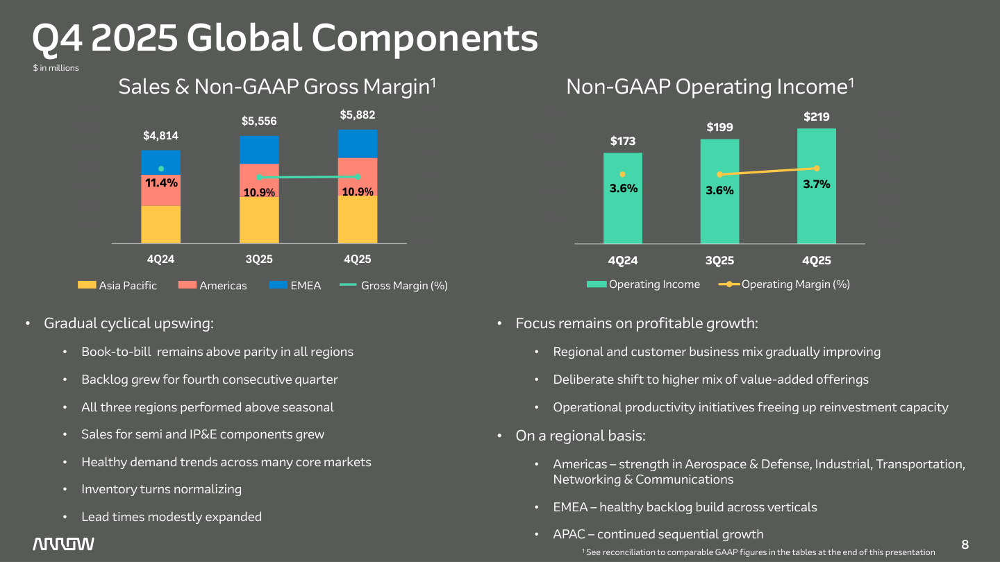

[Source Page: 9]

## Q4 2025 Enterprise Computing Solutions

$ in millions

| | 4Q23 | 4Q24 | 4Q25 |
| --- | --- | --- | --- |
| Sales | $2,213 | $2,469 | $2,864 |
| Non-GAAP Gross Margin¹ | 13.0% | 12.4% | 12.6% |
| Non-GAAP Operating Income¹ | $146 | $161 | $189 |
| Operating Margin | 6.6% | 6.5% | 6.6% |

- Secular demand trends around AI driving strength across technology categories:
  - Hybrid cloud
  - Infrastructure hardware and software
  - Cybersecurity
  - Data protection
  - Data intelligence
- Total billings mix:
  - Recurring revenue roughly 1/3rd
  - 75% software and services | 25% hardware
- Backlog 75%+ higher year over year
- Exclusive go-to-market partnerships taking Arrow beyond a traditional distributor

1. See reconciliation to comparable GAAP figures in the tables at the end of this presentation.

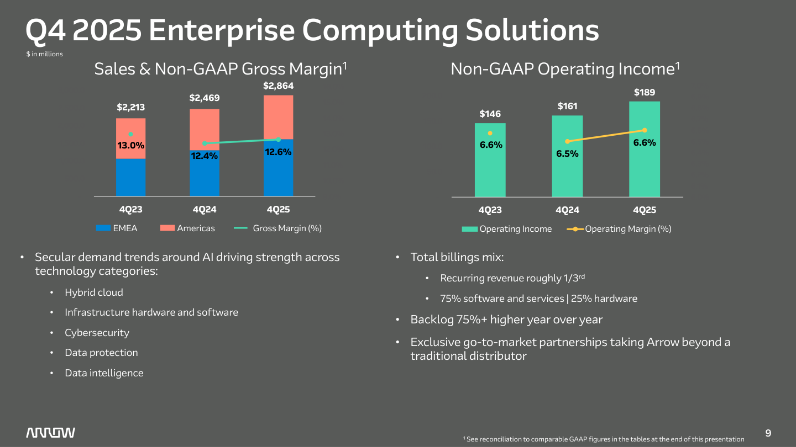

[Source Page: 10]

## Q4 2025 Balance Sheet and Cash Highlights

### Net Working Capital ($B)

| | Q4'24 | Q3'25 | Q4'25 |
| --- | --- | --- | --- |
| Accounts Receivable | 13.0 | 15.7 | 19.7 |
| Inventory | 4.7 | 4.7 | 5.1 |
| Accounts Payable | 11.0 | 13.1 | 17.4 |
| Net Working Capital | 6.7 | 7.3 | 7.4 |

### Cash Conversion (Days)

| | Q4'24 | Q3'25 | Q4'25 |
| --- | --- | --- | --- |
| Days Sales Outstanding | 163 | 185 | 205 |
| Days Inventory Outstanding | 67 | 63 | 60 |
| Days Payable Outstanding | 152 | 174 | 196 |
| Cash Conversion Cycle | 77 | 73 | 70 |
| Inventory Turns | 5.5 | 5.8 | 6.1 |

- Non-GAAP Return on Working Capital (ROWC)¹ was 18.1% in the fourth quarter, rose 170 basis points year on year. The increase in ROWC related primarily to higher operating income in both segments.
- Non-GAAP Return on Invested Capital (ROIC)¹ was 11.1% in the fourth quarter, rose 190 basis points year on year. The increase in ROIC related primarily to higher operating income in both segments.
- Operating Cashflow was $200M
- Gross Debt was $3.1B
- Repurchased $50M in shares

1. See reconciliation to comparable GAAP figures in the tables at the end of this presentation.

Amounts may not calculate precisely due to rounding.

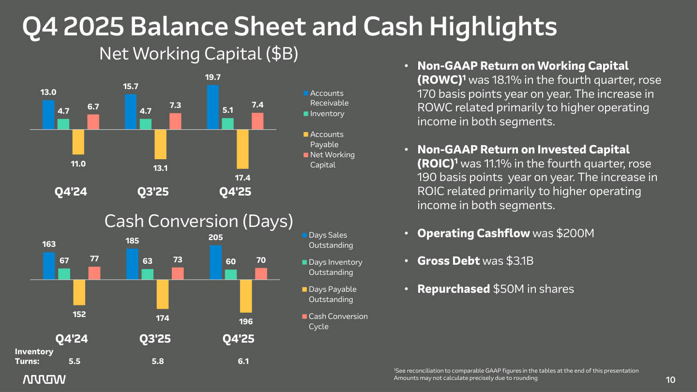

[Source Page: 11]

## Q1 2026 Guidance

| | |
| --- | --- |
| Consolidated Sales | $7.95 billion to $8.55 billion |
| Global components | $5.75 billion to $6.15 billion |
| Global ECS | $2.20 billion to $2.40 billion |
| Diluted Earnings Per Share | $2.13 to $2.33 |
| Non-GAAP Diluted Earnings Per Share¹ | $2.70 to $2.90 |
| Interest and other expense, net | Approximately $60 million |

* Assumes an average tax rate in the range of 23% to 25%.

- Changes in foreign currencies to increase sales by approximately $263 million, and earnings per share on a diluted basis by $0.10 compared to the first quarter of 2025
- Changes in foreign currencies to increase quarter-over-quarter growth in sales by $17 million, and earnings per share on a diluted basis will have no impact compared to the fourth quarter of 2025

1. See reconciliation to comparable GAAP figures in the tables at the end of this presentation.

[Source Page: 12]

## Looking Forward

- Strong execution as gradual recovery progresses
  - Encouraging leading indicators
  - Expanding value-added offerings
- Drive profitable growth
- Better align go to market organization to drive growth initiatives
- Diversified business model, improving profitability, and focused capital allocation
- Focus on shareholder value
- Ongoing CEO search

[Source Page: 13]

## Thank You

Q&A

[Source Page: 14]

## Additional information and financial tables

[Source Page: 15]

## Consolidated fourth-quarter overview

($ in millions, except per share data)

### P&L Highlights

| | Q4 2025 | Q4 2024 | Y/Y CHANGE | Q4 2024 IN CONSTANT CURRENCY | Y/Y CHANGE IN CONSTANT CURRENCY | Q3 2025 | Q/Q CHANGE |
| --- | --- | --- | --- | --- | --- | --- | --- |
| Sales | $8,746 | $7,283 | 20.1% | $7,514 | 16.4% | $7,713 | 13.4% |
| Gross Profit Margin | 11.5% | 11.0% | 50 bps | 11.1% | 40 bps | 10.8% | 70 bps |
| Operating Income | $294 | $195 | 50.7% | $211 | 39.4% | $179 | 64.3% |
| Operating Margin | 3.4% | 2.7% | 70 bps | 2.8% | 60 bps | 2.3% | 110 bps |
| Non-GAAP Operating Income | $336 | $274 | 22.9% | $290 | 16.2% | $217 | 54.7% |
| Non-GAAP Operating Margin | 3.8% | 3.8% | 0 bps | 3.9% | -10 bps | 2.8% | 100 bps |
| Net Income | $195 | $99 | 96.2% | $111 | 75.1% | $109 | 78.2% |
| Diluted EPS | $3.75 | $1.86 | 101.6% | $2.09 | 79.4% | $2.09 | 79.4% |
| Non-GAAP Net Income | $228 | $158 | 44.1% | $170 | 33.9% | $126 | 81.1% |
| Non-GAAP Diluted EPS | $4.39 | $2.97 | 47.8% | $3.20 | 37.2% | $2.41 | 82.2% |
| Operating expenses | $715 | $608 | 17.5% | $626 | 14.1% | $656 | 8.9% |
| Operating expenses margin | 8.2% | 8.4% | -20 bps | 8.3% | -10 bps | 8.5% | -30 bps |
| Non-GAAP Operating expenses | $669 | $580 | 15.3% | $597 | 12.0% | $616 | 8.6% |
| Non-GAAP Operating expenses margin | 7.6% | 8.0% | -40 bps | 7.9% | -30 bps | 8.0% | -40 bps |

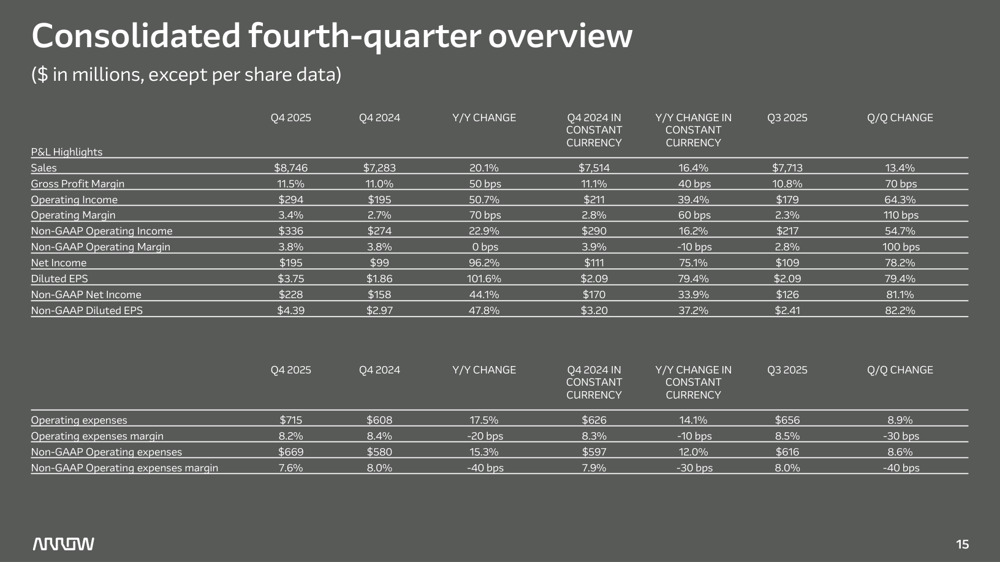

[Source Page: 16]

## Revenue history

($ in millions, may reflect rounding)

| | Q4’24 | Q1’25 | Q2’25 | Q3’25 | Q4’25 | YoY change | QoQ change |
| --- | --- | --- | --- | --- | --- | --- | --- |
| Global Components Total | 4,814 | 4,778 | 5,285 | 5,556 | 5,882 | 22% | 6% |
| Americas | 1,604 | 1,569 | 1,708 | 1,709 | 1,960 | 22% | 15% |
| Europe, Middle East & Africa | 1,262 | 1,340 | 1,427 | 1,444 | 1,460 | 16% | 1% |
| Asia Pacific | 1,948 | 1,869 | 2,150 | 2,404 | 2,462 | 26% | 2% |
| Enterprise Computing Solutions Total | 2,469 | 2,036 | 2,295 | 2,156 | 2,864 | 16% | 33% |
| Europe, Middle East & Africa | 1,307 | 1,126 | 1,242 | 1,134 | 1,618 | 24% | 43% |
| Americas | 1,162 | 910 | 1,053 | 1,022 | 1,246 | 7% | 22% |
| Arrow Electronics Total | 7,283 | 6,814 | 7,580 | 7,713 | 8,746 | 20% | 13% |

[Source Page: 17]

## Operating income history

($M)

| | Q4-'24 | Q1-'25 | Q2-'25 | Q3-'25 | Q4-'25 |
| --- | --- | --- | --- | --- | --- |
| Global Components GAAP | $117 | $171 | $187 | $197 | $219 |
| Global Components Non-GAAP | $173 | $173 | $189 | $199 | $219 |
| Enterprise Computing Solutions GAAP | $160 | $77 | $97 | $64 | $188 |
| Enterprise Computing Solutions Non-GAAP | $161 | $78 | $98 | $65 | $189 |

See the reconciliation to comparable GAAP figures in the tables at the end of this presentation.

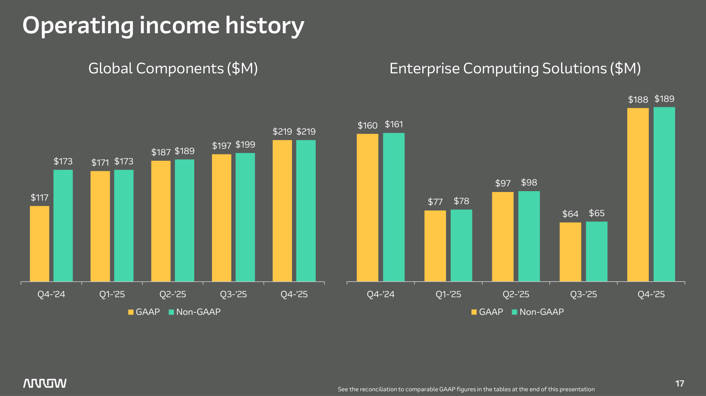

[Source Page: 18]

## Certain Non-GAAP financial information

In addition to disclosing financial results that are determined in accordance with accounting  principles generally accepted in the United States (“GAAP”), the company also provides certain  non-GAAP financial information relating to sales, gross profit, operating income (including by  business  segment),  operating  margin,  operating  expense,  consolidated  net  income,  noncontrolling interest, provision for income tax, income before income taxes, net income  attributable to shareholders, effective tax rate, net income per share on a diluted basis, return on  working capital, and return on invested capital. These non-GAAP measures are adjusted by certain of the following, as applicable: the impact of  changes in foreign currencies (referred to as "changes in foreign currencies" or "on a constant  currency basis") by re-translating prior-period results at current-period foreign exchange rates,  identifiable intangible asset amortization, restructuring, integration, and other charges, net gains  and losses on investments, and the impact of wind down to inventory. Management believes that providing this additional information is useful to the reader to better  assess and understand the company's operating performance and future prospects in the same  manner as management, especially when comparing results with previous periods. Management  typically monitors the business as adjusted for these items, in addition to GAAP results, to  understand and compare operating results across accounting periods, for internal budgeting  purposes, for short- and long-term operating plans, and to evaluate the company's financial  performance. However, analysis of results on a non-GAAP basis should be used as a complement  to, in conjunction with, and not as a substitute for, data presented in accordance with GAAP.  For a complete reconciliation between our GAAP and non-GAAP results, please refer to  reconciliations found at the end of this document.

[Source Page: 19]

[原始页面图像](_assets/arrow-q4-2025-reviewed-pages/page-19.png)

## First-quarter 2026 GAAP to non-GAAP outlook reconciliation

($ in billions, except per share data)

### NON-GAAP SALES RECONCILIATION

| | Quarter Ended 4-Apr-26 | Quarter Ended 29-Mar-25 | % Change | Quarter Ended 4-Apr-26 | Quarter Ended 31-Dec-25 | % Change |
| --- | ---: | ---: | ---: | ---: | ---: | ---: |
| Global components sales, GAAP | $5.75 - 6.15 | $4.78 | 20% - 29% | $5.75 - 6.15 | $5.88 | (2)% - 5% |
| Impact of changes in foreign currencies | — | 0.15 | | — | 0.01 | |
| Global components sales, constant currency | $5.75 - 6.15 | $4.93 | 17% - 25% | $5.75 - 6.15 | $5.89 | (2)% - 4% |
| Global ECS sales, GAAP | $2.20 - 2.40 | $2.04 | 8% - 18% | $2.20 - 2.40 | $2.86 | (23)% - (16)% |
| Impact of changes in foreign currencies | — | 0.12 | | — | 0.01 | |
| Global ECS sales, constant currency | $2.20 - 2.40 | $2.16 | 2% - 12% | $2.20 - 2.40 | $2.87 | (23)% - (16)% |

### NON-GAAP EARNINGS RECONCILIATION

| | REPORTED GAAP MEASURE | INTANGIBLE AMORTIZATION EXPENSE | RESTRUCTURING & INTEGRATION CHARGES | NON-GAAP MEASURE |
| --- | --- | --- | --- | --- |
| Net income per diluted share | $2.13 to $2.33 | $0.07 | $0.50 | $2.70 to $2.90 |

[Source Page: 20]

## Non-GAAP fourth-quarter sales reconciliation

($ in thousands; Quarter Ended)

| | 31-Dec-25 | 31-Dec-24 | % Change |
| --- | --- | --- | --- |
| Consolidated sales, as reported | $8,746,430 | $7,282,877 | 20.1% |
| Impact of changes in foreign currencies | - | 231,615 | |
| Consolidated sales, constant currency | $8,746,430 | $7,514,492 | 16.4% |
| Global components sales, as reported | $5,882,277 | $4,813,760 | 22.2% |
| Impact of changes in foreign currencies | - | 108,900 | |
| Global components sales, constant currency | $5,882,277 | $4,922,660 | 19.5% |
| Americas components sales, as reported | $1,959,548 | $1,603,710 | 22.2% |
| Impact of changes in foreign currencies | - | 808 | |
| Americas components sales, constant currency | $1,959,548 | $1,604,518 | 22.1% |
| EMEA components sales, as reported | $1,460,298 | $1,262,320 | 15.7% |
| Impact of changes in foreign currencies | - | 105,656 | |
| EMEA components sales, constant currency | $1,460,298 | $1,367,976 | 6.7% |
| Asia components sales, as reported | $2,462,431 | $1,947,730 | 26.4% |
| Impact of changes in foreign currencies | - | 2,436 | |
| Asia components sales, constant currency | $2,462,431 | $1,950,166 | 26.3% |
| Global ECS sales, as reported | $2,864,153 | $2,469,117 | 16.0% |
| Impact of changes in foreign currencies | - | 122,715 | |
| Global ECS sales, constant currency | $2,864,153 | $2,591,832 | 10.5% |
| Americas ECS sales, as reported | $1,246,108 | $1,162,227 | 7.2% |
| Impact of changes in foreign currencies | - | 825 | |
| Americas ECS sales, constant currency | $1,246,108 | $1,163,052 | 7.1% |
| EMEA ECS sales, as reported | $1,618,045 | $1,306,890 | 23.8% |
| Impact of changes in foreign currencies | - | 121,890 | |
| EMEA ECS sales, constant currency | $1,618,045 | $1,428,780 | 13.2% |

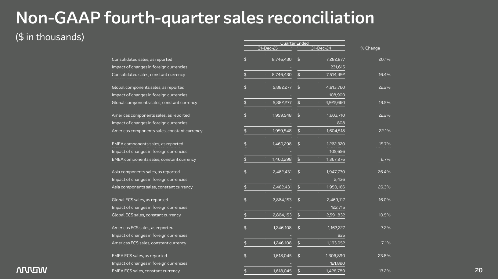

[Source Page: 21]

## Full Year GAAP to non-GAAP reconciliation

($ in thousands, except per share data)

### Year ended December 31, 2025

| | Reported GAAP measure | Intangible Amortization Expense | Restructuring & Integration charges | Impact of Wind Down (1) | Non-recurring tax items (2) | Other (3) | Non-GAAP measure |
| --- | --- | --- | --- | --- | --- | --- | --- |
| Operating income | 822,223 | 19,760 | 116,119 | (10,266) | - | 172 | 948,008 |
| Income before income taxes | 717,928 | 19,760 | 116,119 | (10,266) | - | (109,716) | 733,825 |
| Provision for income taxes | 148,234 | 4,849 | 27,923 | (3,199) | 8,143 | (26,321) | 159,629 |
| Consolidated net income | 569,694 | 14,911 | 88,196 | (7,067) | (8,143) | (83,395) | 574,196 |
| Noncontrolling interests | (1,572) | 156 | - | - | - | - | (1,416) |
| Net income attributable to shareholders | 571,266 | 14,755 | 88,196 | (7,067) | (8,143) | (83,395) | 575,612 |
| Net income per diluted share (5) | 10.93 | 0.28 | 1.69 | (0.14) | (0.16) | (1.60) | 11.02 |
| Effective tax rate (6) | 20.6% | | | | | | 21.8% |

### Year ended December 31, 2024

| | Reported GAAP measure | Intangible Amortization Expense | Restructuring & Integration charges | Impact of Wind Down (1) | Non-recurring tax items | Other (4) | Non-GAAP measure |
| --- | --- | --- | --- | --- | --- | --- | --- |
| Operating income | 768,557 | 29,529 | 142,917 | 60,573 | - | - | 1,001,576 |
| Income before income taxes | 489,319 | 29,529 | 142,917 | 60,573 | - | 6,487 | 728,825 |
| Provision for income taxes | 95,812 | 7,348 | 35,138 | 19,139 | - | 1,557 | 158,994 |
| Consolidated net income | 393,507 | 22,181 | 107,779 | 41,434 | - | 4,930 | 569,831 |
| Noncontrolling interests | 1,433 | 541 | - | - | - | - | 1,974 |
| Net income attributable to shareholders | 392,074 | 21,640 | 107,779 | 41,434 | - | 4,930 | 567,857 |
| Net income per diluted share (5) | 7.29 | 0.40 | 2.00 | 0.77 | - | 0.09 | 10.56 |
| Effective tax rate (6) | 19.6% | | | | | | 21.8% |

1. Includes write-downs (recoveries) of inventory related to the wind down of businesses.
2. Includes gains from settlements related to 2017 U.S. federal tax law changes.
3. Other includes gain on investments, net, and employee severance and benefits costs not related to restructuring initiatives presented in cost of sales.
4. Other includes (gain) loss on investments, net and loss on extinguishment of debt.
5. The sum of the components for non-GAAP diluted EPS, as adjusted may not agree to totals, as presented, due to rounding.
6. The items as shown in this table, represent the reconciling items for the tax rate as reported and as a non-GAAP measure.

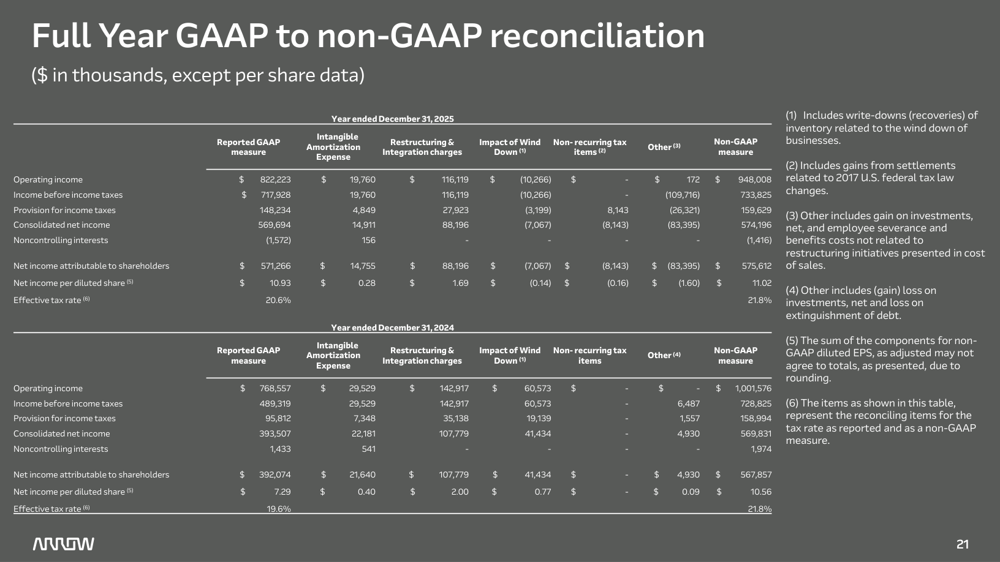

[Source Page: 22]

## Quarterly GAAP to non-GAAP reconciliation

($ in thousands, except per share data)

### Three months ended December 31, 2025

| | Reported GAAP measure | Intangible Amortization Expense | Restructuring & Integration charges | Impact of Wind Down (1) | Non-recurring tax items (2) | Other (3) | Non-GAAP measure |
| --- | --- | --- | --- | --- | --- | --- | --- |
| Operating income | 294,077 | 4,764 | 41,239 | (3,638) | - | - | 336,442 |
| Income before income taxes | 252,973 | 4,764 | 41,239 | (3,638) | - | (913) | 294,425 |
| Provision for income taxes | 59,427 | 1,163 | 8,523 | (1,100) | - | (219) | 67,794 |
| Consolidated net income | 193,546 | 3,601 | 32,716 | (2,538) | - | (694) | 226,631 |
| Noncontrolling interests | (1,058) | - | - | - | - | - | (1,058) |
| Net income attributable to shareholders | 194,604 | 3,601 | 32,716 | (2,538) | - | (694) | 227,689 |
| Net income per diluted share (4) | 3.75 | 0.07 | 0.63 | (0.05) | - | (0.01) | 4.39 |
| Effective tax rate (5) | 23.5% | | | | | | 23.0% |

### Three months ended December 31, 2024

| | Reported GAAP measure | Intangible Amortization Expense | Restructuring & Integration charges | Impact of Wind Down (1) | Non-recurring tax items | Other (3) | Non-GAAP measure |
| --- | --- | --- | --- | --- | --- | --- | --- |
| Operating income | 195,103 | 7,219 | 21,058 | 50,344 | - | - | 273,724 |
| Income before income taxes | 128,704 | 7,219 | 21,058 | 50,344 | - | 4,070 | 211,395 |
| Provision for income taxes | 28,816 | 1,786 | 4,318 | 16,692 | - | 977 | 52,589 |
| Consolidated net income | 99,888 | 5,433 | 16,740 | 33,652 | - | 3,093 | 158,806 |
| Noncontrolling interests | 680 | 135 | - | - | - | - | 815 |
| Net income attributable to shareholders | 99,208 | 5,298 | 16,740 | 33,652 | - | 3,093 | 157,991 |
| Net income per diluted share (4) | 1.86 | 0.10 | 0.31 | 0.63 | - | 0.06 | 2.97 |
| Effective tax rate (5) | 22.4% | | | | | | 24.9% |

### Three months ended September 27, 2025

| | Reported GAAP measure | Intangible Amortization Expense | Restructuring & Integration charges | Impact of Wind Down (1) | Non-recurring tax items (2) | Other (3) | Non-GAAP measure |
| --- | --- | --- | --- | --- | --- | --- | --- |
| Operating income | 179,007 | 4,766 | 35,648 | (1,989) | - | - | 217,432 |
| Income before income taxes | 128,790 | 4,766 | 35,648 | (1,989) | - | (4,859) | 162,356 |
| Provision for income taxes | 19,528 | 1,162 | 9,302 | (629) | 8,359 | (1,166) | 36,556 |
| Consolidated net income | 109,262 | 3,604 | 26,346 | (1,360) | (8,359) | (3,693) | 125,800 |
| Noncontrolling interests | 69 | - | - | - | - | - | 69 |
| Net income attributable to shareholders | 109,193 | 3,604 | 26,346 | (1,360) | (8,359) | (3,693) | 125,731 |
| Net income per diluted share (4) | 2.09 | 0.07 | 0.51 | (0.03) | (0.16) | (0.07) | 2.41 |
| Effective tax rate (5) | 15.2% | | | | | | 22.5% |

1. Includes write-downs (recoveries) of inventory related to the wind down of businesses.
2. Includes gains from settlements related to 2017 U.S. federal tax law changes.
3. Other includes gain on investments, net.
4. The sum of the components for non-GAAP diluted EPS, as adjusted may not agree to totals, as presented, due to rounding.
5. The items as shown in this table, represent the reconciling items for the tax rate as reported and as a non-GAAP measure.

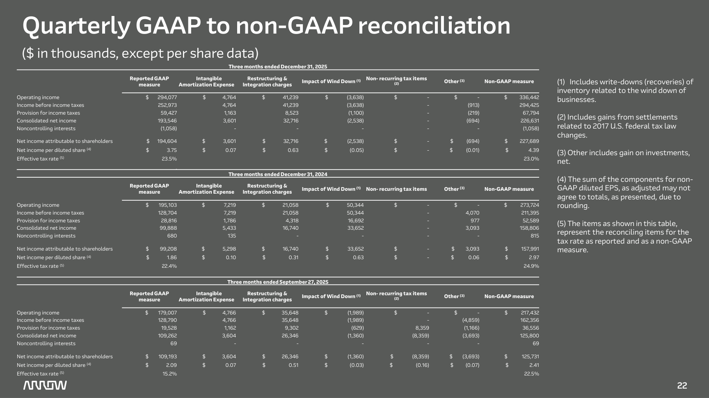

[Source Page: 23]

## Gross profit and operating expense reconciliation

($ in thousands)

| | 12/31/2024 | 3/29/2025 | 6/28/2025 | 9/27/2025 | 12/31/2025 |
| --- | --- | --- | --- | --- | --- |
| Consolidated Gross Profit | 803,310 | 773,992 | 848,657 | 835,314 | 1,008,756 |
| Impact of wind down to inventory | 50,344 | (2,467) | (2,172) | (1,989) | (3,638) |
| Other | - | - | 172 | - | - |
| Consolidated non-GAAP gross profit | 853,654 | 771,525 | 846,657 | 833,325 | 1,005,118 |
| Consolidated Operating Expense | 608,207 | 615,439 | 658,071 | 656,307 | 714,678 |
| Intangible Amortization Expense | (7,219) | (5,360) | (4,870) | (4,766) | (4,764) |
| Restructuring & Integration charges | (21,058) | (17,313) | (21,919) | (35,648) | (41,239) |
| Consolidated non-GAAP Operating Expense | 579,930 | 592,766 | 631,282 | 615,893 | 668,675 |
| Americas ECS gross billings | 2,942,118 | 2,307,737 | 2,543,759 | 2,713,373 | 3,041,843 |
| EMEA ECS gross billings | 3,144,823 | 2,331,216 | 2,596,209 | 2,476,599 | 4,039,437 |
| Global ECS gross billings | 6,086,941 | 4,638,954 | 5,139,968 | 5,189,972 | 7,081,280 |

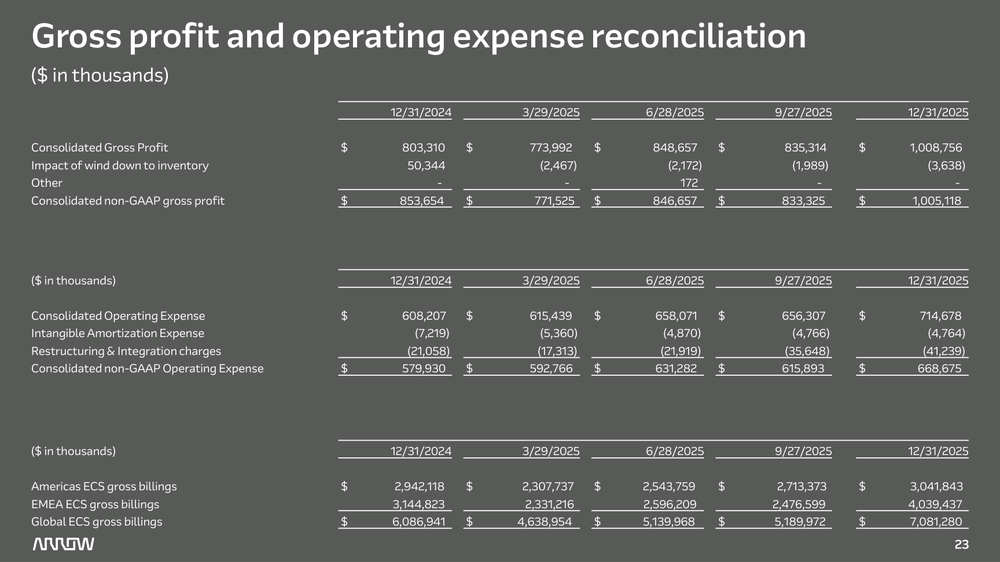

[Source Page: 24]

## Return on working capital reconciliation

($ in thousands)

| | Quarter Ended December 31, 2025 | Quarter Ended December 31, 2024 | Year Ended December 31, 2025 | Year Ended December 31, 2024 |
| --- | --- | --- | --- | --- |
| Numerator: Consolidated operating income, as reported | 294,077 | 195,103 | 822,223 | 768,557 |
| Annualization factor | x4 | x4 | x1 | x1 |
| Annualized consolidated operating income | 1,176,308 | 780,412 | 822,223 | 768,557 |
| Non-GAAP consolidated operating income | 336,442 | 273,724 | 948,008 | 1,001,576 |
| Annualization factor | x4 | x4 | x1 | x1 |
| Annualized non-GAAP consolidated operating income | 1,345,768 | 1,094,896 | 948,008 | 1,001,576 |
| Denominator: Accounts receivable, net | 19,744,499 | 13,030,991 | 15,225,458 | 11,788,955 |
| Inventories | 5,081,863 | 4,709,706 | 4,813,515 | 4,775,686 |
| Less: Accounts payable | 17,383,796 | 11,047,470 | 13,128,372 | 9,644,210 |
| Working capital | 7,442,566 | 6,693,227 | 6,910,601 | 6,920,431 |
| Return on working capital | 15.8% | 11.7% | 11.9% | 11.1% |
| Return on working capital (Non-GAAP) | 18.1% | 16.4% | 13.7% | 14.5% |

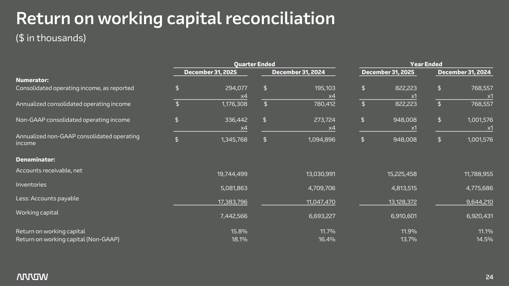

[Source Page: 25]

[原始页面图像](_assets/arrow-q4-2025-reviewed-pages/page-25.png)

## Return on invested capital reconciliation

($ in thousands)

| | Quarter Ended December 31, 2025 | Quarter Ended December 31, 2024 | Year Ended December 31, 2025 | Year Ended December 31, 2024 |
| --- | ---: | ---: | ---: | ---: |
| Numerator: | | | | |
| Consolidated operating income, as reported | $294,077 | $195,103 | $822,223 | $768,557 |
| Equity in earnings of affiliated companies (1) | 2,074 | (544) | 3,198 | 1,368 |
| Less: Noncontrolling interests (1) | (1,058) | 680 | (1,572) | 1,433 |
| Consolidated operating income, as adjusted | 297,209 | 193,879 | 826,993 | 768,492 |
| Less: Tax effect (2) | 69,574 | 43,568 | 170,378 | 150,486 |
| After-tax consolidated operating income, as adjusted | 227,635 | 150,311 | 656,615 | 618,006 |
| | x4 | x4 | x1 | x1 |
| Annualized after-tax consolidated operating income, as adjusted | $910,540 | $601,244 | $656,615 | $618,006 |
| Non-GAAP consolidated operating income | $336,442 | $273,724 | $948,008 | $1,001,576 |
| Equity in earnings of affiliated companies (1) | 2,074 | (544) | 3,198 | 1,368 |
| Less: Noncontrolling interests (1) | (1,058) | 815 | (1,416) | 1,974 |
| Non-GAAP consolidated operating income, as adjusted | 339,574 | 272,365 | 952,622 | 1,000,970 |
| Less: Tax effect (3) | 77,935 | 67,973 | 207,018 | 218,391 |
| After-tax non-GAAP consolidated operating income, as adjusted | 261,639 | 204,392 | 745,604 | 782,579 |
| | x4 | x4 | x1 | x1 |
| Annualized after-tax non-GAAP operating income, as adjusted | $1,046,556 | $817,568 | $745,604 | $782,579 |
| Denominator: | | | | |
| Average short-term borrowings, including current portion of long-term debt (4) | $5,580 | $629,902 | $269,543 | $943,999 |
| Average long-term debt (4) | 3,101,691 | 2,568,512 | 2,731,100 | 2,480,428 |
| Average total equity (4) | 6,566,651 | 5,933,803 | 6,274,264 | 5,865,660 |
| Average cash and cash equivalents (4) | 260,040 | 218,404 | 232,548 | 222,136 |
| Invested capital | $9,413,882 | $8,913,813 | $9,042,360 | $9,067,951 |
| Return on invested capital | 9.7% | 6.7% | 7.3% | 6.8% |
| Return on invested capital (Non-GAAP) | 11.1% | 9.2% | 8.2% | 8.6% |

(1) Operating income, as reported, and non-GAAP operating income is adjusted for noncontrolling interest and equity in earnings of affiliated companies to include the pro-rata ownership of non-wholly owned subsidiaries.

(2) The tax effect is calculated by applying the effective tax rate for the three months ended December 31, 2025 and December 31, 2024 to consolidated operating income, as adjusted. The tax rate is adjusted to exclude the impacts of interest expense, gain on investments, net, and employee benefit plan expense, net.

(3) The tax effect is calculated by applying the non-GAAP effective tax rate for the three months ended December 31, 2025 and December 31, 2024 to non-GAAP consolidated operating income, as adjusted. The tax rate is adjusted to exclude the impacts of interest expense and employee benefit plan expense, net.

(4) The quarter ended average is based on the addition of the account balance at the end of the most recently-ended quarter to the account balance at the end of the prior quarter and dividing by two.

[Source Page: 26]

## Non-GAAP segment reconciliation

($ in thousands)

| | 12/31/2023 | 12/31/2024 | 3/29/2025 | 6/28/2025 | 9/27/2025 | 12/31/2025 |
| --- | --- | --- | --- | --- | --- | --- |
| Global components operating income, as reported | 281,260 | 116,910 | 171,385 | 186,808 | 197,355 | 219,158 |
| Intangible assets amortization expense | 6,436 | 6,162 | 4,438 | 3,945 | 3,838 | 3,837 |
| Impact of wind down to inventory | - | 50,344 | (2,467) | (2,172) | (1,989) | (3,638) |
| Other | - | - | - | 172 | - | - |
| Global components non-GAAP operating income | 287,696 | 173,416 | 173,356 | 188,753 | 199,204 | 219,357 |
| Global ECS operating income, as reported | 145,053 | 160,421 | 77,314 | 96,969 | 63,744 | 187,884 |
| Intangible assets amortization expense | 1,055 | 1,057 | 922 | 925 | 928 | 927 |
| Global ECS non-GAAP operating income | 146,108 | 161,478 | 78,236 | 97,894 | 64,672 | 188,811 |
| Operating Margin | 6.6% | 6.5% | 3.8% | 4.3% | 3.0% | 6.6% |

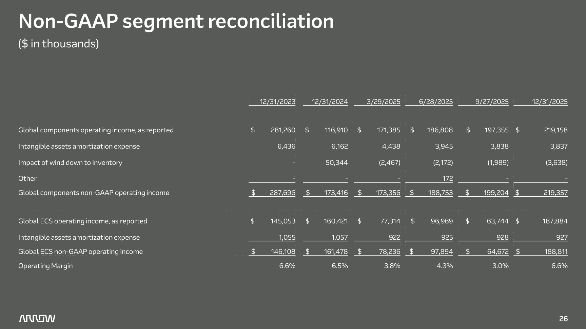

[Source Page: 27]

## Non-GAAP segment reconciliation (continued)

($ in thousands; Quarter Ended)

| | 12/31/2023 | 9/28/2024 | 12/31/2024 | 3/29/2025 | 6/28/2025 | 9/27/2025 | 12/31/2025 |
| --- | --- | --- | --- | --- | --- | --- | --- |
| Global components gross profit, as reported | 702,412 | 564,460 | 497,324 | 554,945 | 591,454 | 609,101 | 647,154 |
| Impact of wind down to inventory | - | (1,857) | 50,344 | (2,467) | (2,172) | (1,989) | (3,638) |
| Other | - | - | - | - | 172 | - | - |
| Global components non-GAAP gross profit | 702,412 | 562,603 | 547,668 | 552,478 | 589,454 | 607,112 | 643,514 |
| Global components gross profit, as a percentage of sales | 12.5% | 11.4% | 10.3% | 11.6% | 11.2% | 11.0% | 11.0% |
| Global components non-GAAP gross profit, as a percentage of sales | 12.5% | 11.4% | 11.4% | 11.6% | 11.2% | 10.9% | 10.9% |
| Global ECS gross profit, as reported | 287,138 | 220,368 | 305,986 | 219,047 | 257,203 | 226,213 | 361,602 |
| Global ECS gross profit as a percentage of sales, as reported | 13.0% | 11.7% | 12.4% | 10.8% | 11.2% | 10.5% | 12.6% |

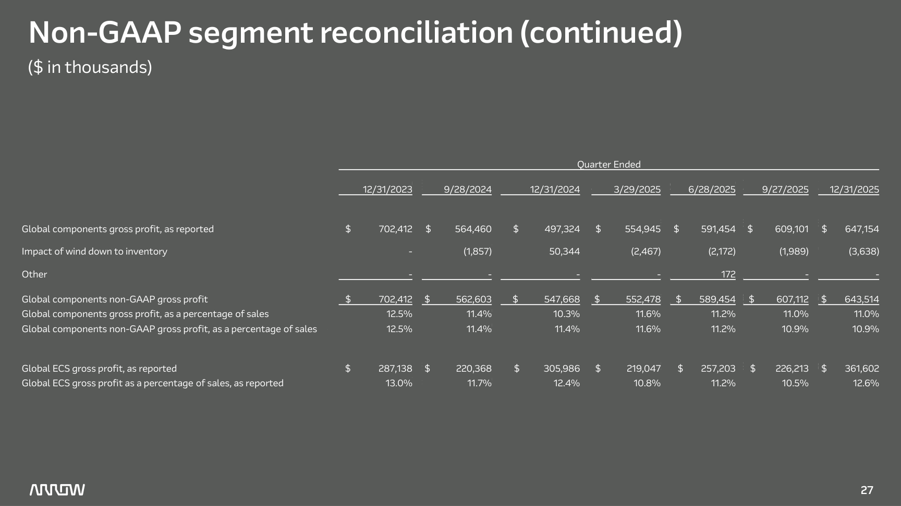

## Processing Notes

- Pages 7–9: Regional portions of charts are shown without numerical labels; original charts are retained without estimating segment values.
- Pages 20, 26 and 27: The PDF contains additional hidden or overlapping historical text; only the visible source tables were reconstructed, and original page images are retained.
