## Document Metadata

- Document ID: c46282d700cef0ea8bbb563818cfa80ec4dbdd20
- Document Title: Memory sector — Surge in general server procurement fueling a memory supercycle
- Document Type: PDF
- Issuing Organization: KGI Asia Ltd
- Publication Date: November 17, 2025
- Reporting Period: null
- Source File: [31_kgi.com.hk_memory-sector-17112025e.pdf](https://github.com/jadennevercode/CJCC-Knowledge-Base/blob/564ab11aa9785e569e3853c8a4d7ce86f88e7535/materials/%E8%B7%A8%E9%93%BE%EF%BC%9A%E4%BE%9B%E9%9C%80%E4%B8%8E%E4%BB%B7%E6%A0%BC%E5%8F%A3%E5%BE%84/31_kgi.com.hk_memory-sector-17112025e.pdf)

## Structured Content

> 原文件：[31_kgi.com.hk_memory-sector-17112025e.pdf](https://github.com/jadennevercode/CJCC-Knowledge-Base/blob/564ab11aa9785e569e3853c8a4d7ce86f88e7535/materials/%E8%B7%A8%E9%93%BE%EF%BC%9A%E4%BE%9B%E9%9C%80%E4%B8%8E%E4%BB%B7%E6%A0%BC%E5%8F%A3%E5%BE%84/31_kgi.com.hk_memory-sector-17112025e.pdf)
> 转换方式：Volcengine OCRPdf v3, parse_mode=ocr

[Source Page: 1]

# Memory sector

## Surge in general server procurement fueling a memory supercycle

INDUSTRY REPORT — Taiwan — November 17, 2025

### Key message

1. Memory bit demand driven by general server purchases by US CSPs.
2. Soaring memory prices will significantly impact the recovery of PC and smartphone demand.
3. We expect memory prices to continue rising in 2026F.

### Event

We expect strong demand from US CSPs for general server will drive continued memory price hikes next year.

### Impact

US CSP general server procurement drives memory price demand. Since September, DDR5 16Gb spot prices have surged more than threefold. While robust AI demand is the primary driver, accelerating orders for general server have amplified price hikes and heightened shortage concerns. Our supply chain checks indicate that US CSPs’ procurement plans for next year far exceed prior expectations and historical averages, with Microsoft (US) being the most aggressive. We expect 2026F US CSP general server shipments to grow by 50% YoY, driven by: (1) CSPs’ extended depreciation periods starting in 2022, creating a replacement peak in the next two years; (2) general server budgets were constrained by AI investments over the past two years; and (3) some 2027F demand is being pulled forward to address expected shortages. Consequently, we raise our 2026F server DRAM bit demand forecast by 17% to 20.74bn GB (up 45% YoY), increasing its share of total DRAM demand from 38% in 2025F to 47% in 2026F. Similarly, we revise up 2026F enterprise SSD (server SSD) bit demand by 6% to 466.5bn GB, up 61.7% YoY (see Figure 8). Its share of total NAND Flash demand will rise from 29% in 2025F to 40% in 2026F, surpassing smartphone to become the largest application segment.

Soaring memory prices will significantly impact recovery of PC & smartphone demand. Since DRAM and NAND Flash account for 10–20% of the BOM costs of PC and smartphone, continued price hikes will force brands and OEMs to raise end-product prices, thereby suppressing shipments next year. In terms of smartphone content, although Apple (US) is expected to mass-produce 2TB models in 2026F, Android vendors may reduce DRAM and SSD content, or even downgrade other IC components, to manage cost pressures. PC OEMs are likely to adopt similar strategies to control overall system costs. We forecast the share of DRAM bit demand of smartphone and PC to decline from 36% and 10% this year to 29% and 8% in 2026F, respectively. Likewise, smartphone and PC SSD demand as a share of total NAND Flash bit demand will fall from a respective 32% and 21% to 27% and 17%.

We expect memory prices to continue rising in 2026F. Strong demand from general server makers will offset memory price headwinds from lower PC and smartphone sales. Based on our supply-demand model, we expect memory to remain in undersupply through next year, with the tightest supply conditions in 3Q26F when DRAM and NAND Flash supply-demand ratios are projected at 90.17% and 90.12%, respectively. We forecast DDR5 die contract prices to climb from US$5.5 in 3Q25 to US$17.2 by 4Q26F (see Figure 10). DDR4 is also likely to benefit indirectly as DDR5 price hikes and slower consumer upgrades to DDR5 support demand. For NAND Flash, we expect 1TB TLC wafer contract prices to rise from US$6.0 in 3Q25 to US$16.7 by 4Q26F (see Figure 11).

### Stocks for Action

We expect memory stocks to benefit from continued price hikes in 2026F. Our top picks are Nanya Technology (2408 TT, NT$166.5, OP), Winbond (2344 TT, NT$66.2, OP), and Innodisk (5289 TT, NT$542, OP).

### Risk

Disappointing general server demand.

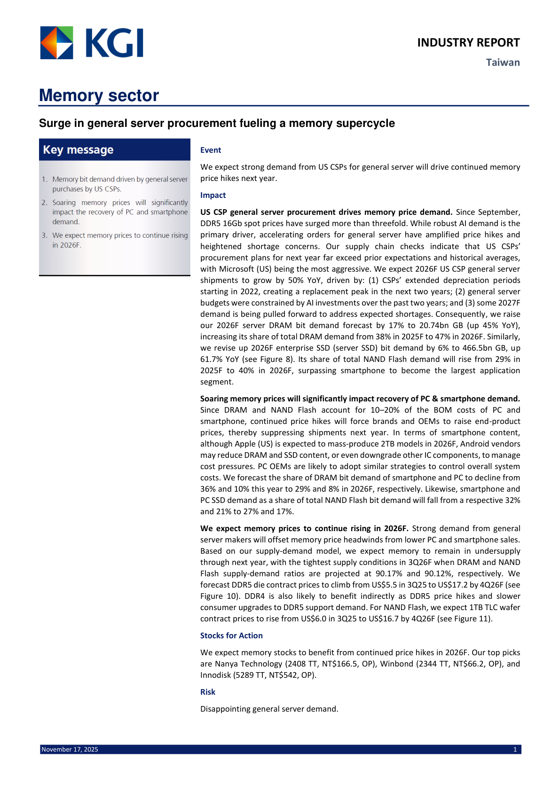

[Source Page: 2]

## Figure 1: Peer comparison – Valuations

| Ticker | Company | Revenue contribution of related products (%) | Market cap (NT$bn) | Price (NT$) | Rating | Target price (NT$) | EPS (NT$) 2023 | EPS (NT$) 2024 | EPS (NT$) 2025F | EPS (NT$) 2026F |
| --- | --- | --- | --- | --- | --- | --- | --- | --- | --- | --- |
| 2408 TT | Nanya Technology | DRAM(100) | 516 | 166.5 | OP | 180 | (2.40) | -1.64 | 1.23 | 20.98 |
| 2344 TT | Winbond | DRAM(30), Flash(35), Logic IC(33) | 298 | 66.2 | OP | 69 | (0.29) | 0.14 | 1.08 | 6.64 |
| 5289 TT | Innodisk | DRAM Module(52), NAND Module(41), AIoT(5) | 51 | 542.0 | OP | 500 | 12.98 | 12.20 | 16.84 | 25.15 |

Source: TEJ; KGI Research.

## Figure 2: Memory industry supply-demand ratios

Supply-demand ratios for DRAM & NAND Flash, percent.

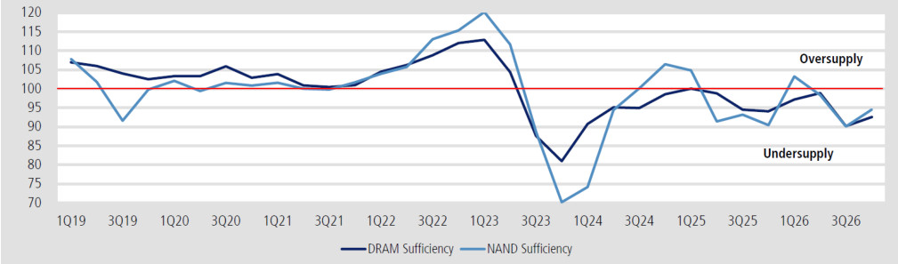

Source: TrendForce; KGI estimates.

## Figure 3: DRAM bit demand share forecasts

Bit demand breakdown, percent.

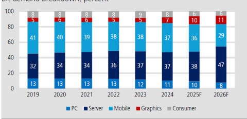

| Year | PC | Server | Mobile | Graphics | Consumer |
| --- | ---: | ---: | ---: | ---: | ---: |
| 2019 | 13 | 32 | 41 | 5 | 8 |
| 2020 | 13 | 34 | 40 | 6 | 8 |
| 2021 | 13 | 34 | 39 | 6 | 8 |
| 2022 | 13 | 36 | 38 | 5 | 8 |
| 2023 | 12 | 37 | 38 | 5 | 9 |
| 2024 | 11 | 37 | 37 | 7 | 8 |
| 2025F | 10 | 38 | 36 | 10 | 6 |
| 2026F | 8 | 47 | 29 | 11 | 6 |

Source: TrendForce; KGI estimates.

## Figure 4: NAND Flash bit demand share forecasts

Bit demand breakdown, percent.

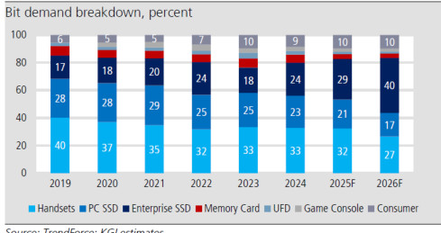

| Year | Handsets | PC SSD | Enterprise SSD | Consumer |
| --- | ---: | ---: | ---: | ---: |
| 2019 | 40 | 28 | 17 | 6 |
| 2020 | 37 | 28 | 18 | 5 |
| 2021 | 35 | 29 | 20 | 5 |
| 2022 | 32 | 25 | 24 | 7 |
| 2023 | 33 | 25 | 18 | 10 |
| 2024 | 33 | 23 | 24 | 9 |
| 2025F | 32 | 21 | 29 | 10 |
| 2026F | 27 | 17 | 40 | 10 |

Memory Card、UFD、Game Console 色块原图未标数值，不推算。

Source: TrendForce; KGI estimates.

## Figure 5: DDR5 16Gb spot price trend

DDR5 16Gb spot price, US$.

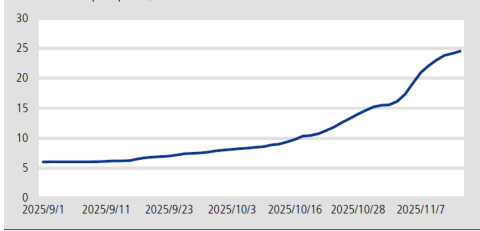

Source: TrendForce; KGI estimates.

## Figure 6: Forecasts of DDR5 bit demand (by application)

Bit demand breakdown, percent.

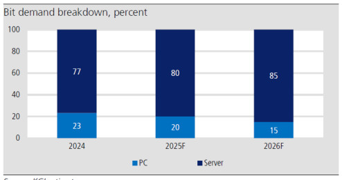

| Year | PC | Server |
| --- | ---: | ---: |
| 2024 | 23 | 77 |
| 2025F | 20 | 80 |
| 2026F | 15 | 85 |

Source: KGI estimates.

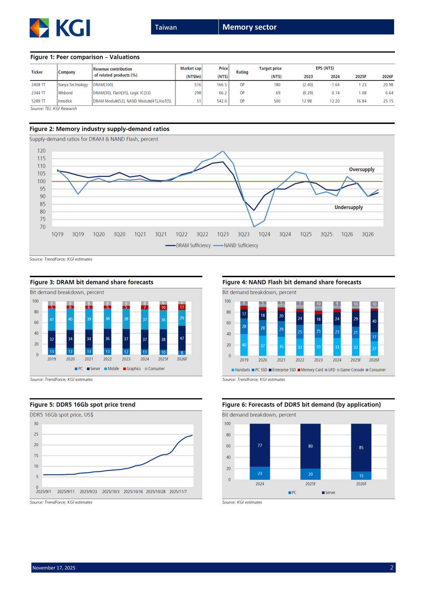

[Source Page: 3]

## Figure 7: Server DRAM bit demand forecasts

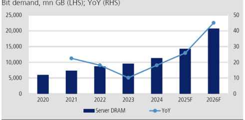

Source: TrendForce; KGI estimates.

## Figure 8: Enterprise SSD bit demand forecasts

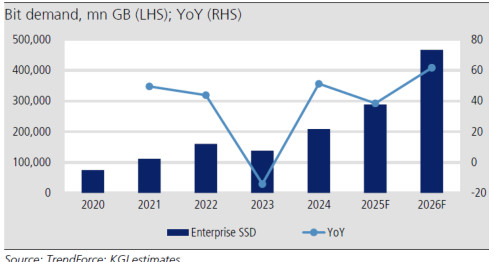

Source: TrendForce; KGI estimates.

## Figure 9: Server memory bit demand breakdown (by customer category)

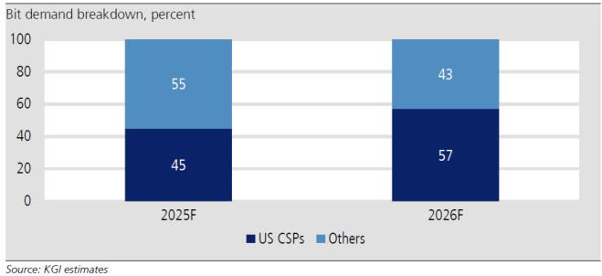

| Year | US CSPs | Others |
| --- | ---: | ---: |
| 2025F | 45 | 55 |
| 2026F | 57 | 43 |

Source: KGI estimates.

## Figure 10: Forecasts for DDR5 & DDR4 die contract prices

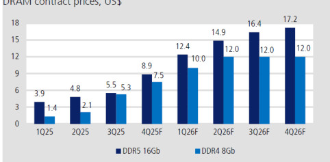

DRAM contract prices, US$.

| Quarter | DDR5 16Gb | DDR4 8Gb |
| --- | ---: | ---: |
| 1Q25 | 3.9 | 1.4 |
| 2Q25 | 4.8 | 2.1 |
| 3Q25 | 5.5 | 5.3 |
| 4Q25F | 8.9 | 7.5 |
| 1Q26F | 12.4 | 10.0 |
| 2Q26F | 14.9 | 12.0 |
| 3Q26F | 16.4 | 12.0 |
| 4Q26F | 17.2 | 12.0 |

Source: KGI estimates.

## Figure 11: NAND Flash wafer contract price forecasts

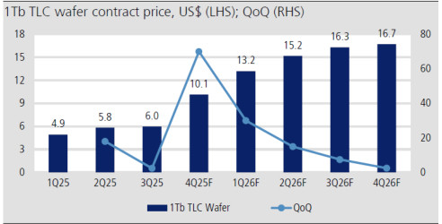

1Tb TLC wafer contract price, US$ (LHS); QoQ (RHS).

| Quarter | 1Tb TLC Wafer contract price (US$) |
| --- | ---: |
| 1Q25 | 4.9 |
| 2Q25 | 5.8 |
| 3Q25 | 6.0 |
| 4Q25F | 10.1 |
| 1Q26F | 13.2 |
| 2Q26F | 15.2 |
| 3Q26F | 16.3 |
| 4Q26F | 16.7 |

QoQ 曲线未标具体值，不推算。

Source: KGI estimates.

## Analyst disclosure and Disclaimer

All the above named KGI analyst(s) is SFC licensed person accredited to KGI Asia Ltd to carry on the relevant regulated activities. Each of them and/or his/her associate(s) does not have any financial interest in the respectively covered stock, issuer and/or new listing applicant. Disclaimer All the information contained in this report is not intended for use by persons or entities located in or residing in jurisdictions which restrict the distribution of this information by KGI Asia Limited (“KGI”) or an affiliate of KGI. Such information shall not constitute investment advice, or an offer to sell, or an invitation, solicitation or recommendation to subscribe for or invest in any securities or investment products or services nor a distribution of information for any such purpose in any jurisdiction. In particular, the information herein is not for distribution and does not constitute an offer to sell or the solicitation of any offer to buy any securities in the United States of America, or to or for the benefit of United States persons (being residents of the United States of America or partnerships or corporations organised under the laws of the United States of America or any state, territory or possession thereof). All the information contained in this report is for general information and reference purpose only without taking into account of any particular investor’s objectives, financial situation or needs. Such information is not intended to provide professional advice and should not be relied upon in that regard. Some of KGI equity research and earnings estimates are available electronically on www.kgi.com.hk. Please contact your KGI representative for information. The information and opinions in this report are those of KGI internal research activity. KGI does not make any representation or warranty, express or implied, as to the fairness, accuracy, completeness or correctness of the information and opinions contained in this report. The information and opinions contained in this report are subject to change without any notice. No person accepts any liability whatsoever for any loss however arising from any use of this report or its contents. This report is not to be construed as an invitation or offer to buy or sell securities and/or to participate in any investment activity. This report is being supplied solely for informational purposes and may not be redistributed, reproduced or published (in whole or in part) by any means for any purpose without the prior written consent of KGI. Members of the KGI group and their affiliates may provide services to any companies and affiliates of such companies mentioned herein. Members of the KGI group, their affiliates and their directors, officers and employees may from time to time have a position in any securities mentioned herein.

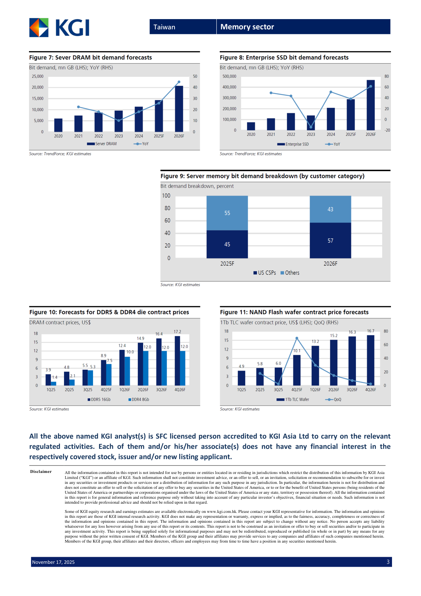

## Processing Notes

- 正文、估值表及免责声明已对照原页；图 2–11 保留原图，曲线或柱形未明确标注的数值未估算。
- 图 3、4、6、9–11 已转录原图明确标示的数据；图 2、5、7、8 和图 11 的 QoQ 曲线无逐点标注，未估算。
