## Document Metadata

- Document ID: 7ed059595526f9d6b47b80319fbc5694243e55ac
- Document Title: 2024-2025年行业有望持续扩容，高端产品渗透加速——存储芯片板块跟踪报告（十）
- Document Type: PDF
- Issuing Organization: 开源证券股份有限公司
- Publication Date: 2024-07-26
- Reporting Period: null
- Source File: [M154_pdf.dfcfw.com_H3_AP202407261638338520_1.pdf](https://github.com/jadennevercode/CJCC-Knowledge-Base/blob/5ec8511eb834073c8bfbd79c94af196282d483cf/materials/%E8%B7%A8%E9%93%BE%EF%BC%9A%E4%BE%9B%E9%9C%80%E4%B8%8E%E4%BB%B7%E6%A0%BC%E5%8F%A3%E5%BE%84/M154_pdf.dfcfw.com_H3_AP202407261638338520_1.pdf)

## Structured Content

> 原文件：[M154_pdf.dfcfw.com_H3_AP202407261638338520_1.pdf](https://github.com/jadennevercode/CJCC-Knowledge-Base/blob/5ec8511eb834073c8bfbd79c94af196282d483cf/materials/%E8%B7%A8%E9%93%BE%EF%BC%9A%E4%BE%9B%E9%9C%80%E4%B8%8E%E4%BB%B7%E6%A0%BC%E5%8F%A3%E5%BE%84/M154_pdf.dfcfw.com_H3_AP202407261638338520_1.pdf)
> 转换方式：多模态逐页转录（页面图像 + 文本层交叉校验）

[Source Page: 1]

开源证券证券研究报告

行业研究
行业点评报告

半导体
2024年07月26日

投资评级：看好

行业走势图

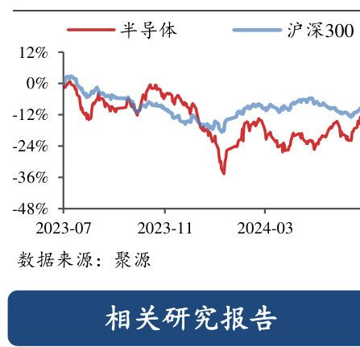

纵轴：-48%至12%，刻度12%、0%、-12%、-24%、-36%、-48%；横轴：2023-07、2023-11、2024-03
图例：半导体、沪深300

数据来源：聚源

相关研究报告

- 《需求回暖带动业绩复苏，功率板块景气度持续提升—行业点评报告》-2024.7.21
- 《周期复苏叠加AI拉动，存储模组行情有望渐行渐盛—存储板块跟踪报告（九）》-2024.7.19
- 《下游需求复苏带动SoC公司2024H1业绩预告同比高增，研发费用持稳业绩有望持续高增—行业点评报告》-2024.7.19

# 2024-2025年行业有望持续扩容，高端产品渗透加速

## ——存储芯片板块跟踪报告（十）

罗通（分析师）　王宇泽（联系人）

luotong@kysec.cn　证书编号：S0790522070002
wangyuze@kysec.cn　证书编号：S0790123120028

- **本周复盘：价格指数走势承压，现货市场持续震荡静待需求回暖**指数方面：据闪存市场，2024年第30周DRAM/NAND指数走势承压，单周分别-1.07%/-0.81%。价格方面：Flash wafer价格持平不变，DDR价格小幅下跌（环比-0.6%）；渠道市场方面，低端资源价格下跌叠加终端需求承压，渠道SSD和内存条价格均继续下探；行业市场方面，存储行业SSD和内存条价格持平，工控客户释出部分SSD小单需求，行业厂商接单较为积极；嵌入式方面，市场行情普遍趋于平稳，终端仍然持续关注原厂官价的落地情况。整体来看，目前存储现货行情处于小幅震荡调整的磨底阶段，行情磨底时长视实际需求而定。
- **DRAM：2024-2025年行业营收有望高增，DDR5/LPDDR5渗透率持续提升**据TrendForce预测，2024和2025年DRAM产品均价有望分别增长53%和35%，推升2024/2025年DRAM产业营收分别年增75%/51%至907/1,365亿美元，产业营收高速增长主要系（1）HBM高速发展、（2）DRAM产品时代演进、（3）原厂资本支出收缩以及（4）服务器需求复苏。此外，DDR5和LPDDR5/5X等高附加值产品的渗透同样有助提高产品均价，TrendForce预计，DDR5将分别贡献2024、2025年Server DRAM位元出货量40%、60-65%，LPDDR5/5X有望贡献2024、2025年Mobile DRAM位元出货量50%和60%。
- **NAND：2024-2025年行业营收有望高增，QLC技术加速崛起**据TrendForce预测，2024年NAND Flash营收有望达674亿美元，年增77%；2025年，在（1）大容量QLC Enterprise SSD崛起、（2）智能手机采用QLC UFS、（3）原厂资本支出收缩和（4）服务器需求复苏等因素带动下，NAND Flash营收将达870亿美元、年增29%。北美CSPs（云端服务业者）已开始在Inference AI Server大量采用QLC Enterprise SSD，尤其是大容量规格。TrendForce预估，QLC将贡献2024年NAND Flash位元出货量20%，此比重2025年将再提升。智能手机方面，QLC预计逐步渗透UFS市场，部分中国智能手机业者预计于2024Q4起采用QLC UFS方案，Apple则预计2026年开始导入至iPhone。随着周期稳步复苏，2024-2025年存储板块营收规模逐渐扩大，国内存储芯片/模组/接口芯片等环节公司有望充分受益，受益标的：

（1）芯片：兆易创新、普冉股份、东芯股份、恒烁股份、北京君正等；

（2）接口：澜起科技、聚辰股份等；

（3）模组：江波龙、佰维存储、德明利、香农芯创、协创数据、朗科科技等；

- **风险提示：**需求复苏不及预期，行业竞争加剧，公司新品研发进度不及预期。

[Source Page: 2]

附图1：指数：2024年第30周NAND指数下降1.07%

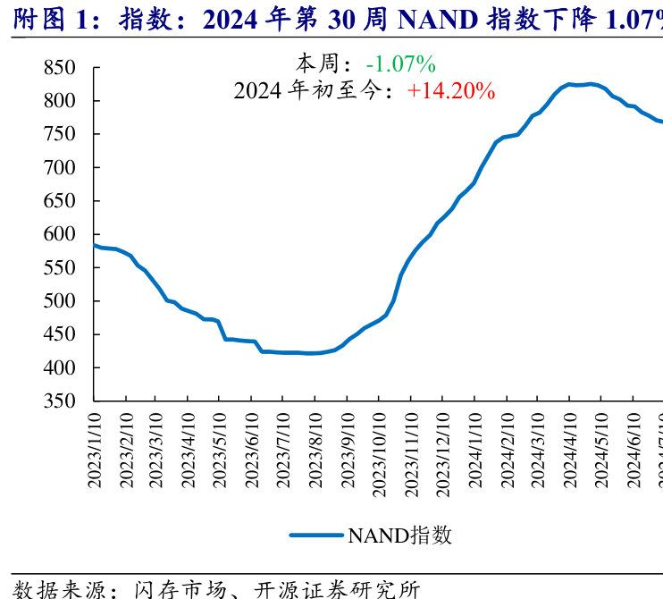

纵轴：NAND指数，350至850；横轴：2023/1/10至2024/7/10
图例：NAND指数
图内标注：本周：-1.07%；2024年初至今：+14.20%

数据来源：闪存市场、开源证券研究所

附图2：指数：2024年第30周DRAM指数下降0.81%

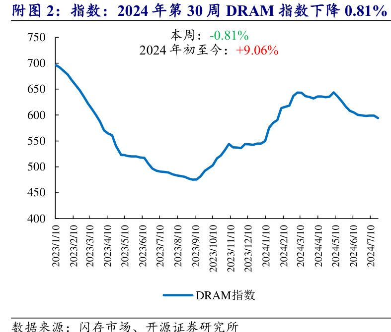

纵轴：DRAM指数，400至750；横轴：2023/1/10至2024/7/10
图例：DRAM指数
图内标注：本周：-0.81%；2024年初至今：+9.06%

数据来源：闪存市场、开源证券研究所

附表2：价格复盘：2024年第30周Wafer价格持平

| 产品名称 | 当前价（美元） | 周涨跌幅 | 2024年初至今涨跌幅 | 产品名称 | 当前价（美元） | 周涨跌幅 | 2024年初至今涨跌幅 |
|---|---|---|---|---|---|---|---|
| Wafer:256Gb TLC | 1.90 | 0.00% | 11.76% | Wafer:1Tb TLC | 7.40 | 0.00% | 21.31% |
|  |  | 0.00 | 0.20 |  |  | 0.00 | 1.30 |
| Wafer:512Gb TLC | 4.00 | 0.00% | 26.98% | Wafer:1Tb QLC | 6.80 | 0.00% | 23.64% |
|  |  | 0.00 | 0.85 |  |  | 0.00 | 1.30 |

数据来源：闪存市场、开源证券研究所

附表3：价格复盘：2024年第30周DDR价格平均跌幅0.6%

| 产品名称 | 当前价（美元） | 周涨跌幅 | 2024年初至今涨跌幅 | 产品名称 | 当前价（美元） | 周涨跌幅 | 2024年初至今涨跌幅 |
|---|---|---|---|---|---|---|---|
| DDR4/8Gb/3200 | 1.35 | 0.00% | -4.93% | DDR4/8Gb/eTT | 1.16 | 0.00% | 7.41% |
|  |  | 0.00 | -0.07 |  |  | 0.00 | 0.08 |
| DDR4/16Gb/3200 | 3.01 | 0.00% | 3.79% | DDR4/4Gb/eTT | 0.68 | -2.86% | -2.86% |
|  |  | 0.00 | 0.11 |  |  | -0.02 | -0.02 |
| DDR4/16Gb/eTT | 2.70 | 0.00% | 11.57% |  |  |  |  |
|  |  | 0.00 | 0.28 |  |  |  |  |

数据来源：闪存市场、开源证券研究所

[Source Page: 3]

附表4：价格复盘：2024年第30周SSD（渠道市场）价格平均跌幅3.8%

| 产品名称 | 当前价（美元） | 周涨跌幅 | 2024年初至今涨跌幅 |
|---|---|---|---|
| SSD/120GB/SATA3 | 6.00 | -3.23% | -22.08% |
|  |  | -0.20 | -1.70 |
| SSD/240GB/SATA3 | 11.50 | -4.17% | -7.26% |
|  |  | -0.50 | -0.90 |
| SSD/480GB/SATA3 | 20.50 | -7.66% | -4.21% |
|  |  | -1.70 | -0.90 |
| SSD/256GB/PCIe3.0 | 13.80 | -3.50% | -0.72% |
|  |  | -0.50 | -0.10 |
| SSD/512GB/PCIe3.0 | 23.80 | -4.80% | 1.28% |
|  |  | -1.20 | 0.30 |
| SSD/1TB/PCIe3.0 | 45.80 | -2.55% | 11.71% |
|  |  | -1.20 | 4.80 |
| SSD/512GB/PCIe4.0 | 30.50 | -3.17% | -0.33% |
|  |  | -1.00 | -0.10 |
| SSD/1TB/PCIe4.0 | 48.00 | -2.04% | 11.63% |
|  |  | -1.00 | 5.00 |
| SSD/2TB/PCIe4.0 | 92.00 | -3.16% | 12.20% |
|  |  | -3.00 | 10.00 |

数据来源：闪存市场、开源证券研究所

附表5：价格复盘：2024年第30周SSD（行业市场）价格持平

| 产品名称 | 当前价（美元） | 周涨跌幅 | 2024年初至今涨跌幅 |
|---|---|---|---|
| SSD/256GB/SATA3 | 17.50 | 0.00% | -2.78% |
|  |  | 0.00 | -0.50 |
| SSD/512GB/SATA3 | 29.00 | 0.00% | -9.38% |
|  |  | 0.00 | -3.00 |
| SSD/1TB/SATA3 | 56.00 | 0.00% | 1.82% |
|  |  | 0.00 | 1.00 |
| SSD/256GB/PCIe3.0 | 20.00 | 0.00% | 0.00% |
|  |  | 0.00 | 0.00 |
| SSD/512GB/PCIe3.0 | 33.50 | 0.00% | -1.47% |
|  |  | 0.00 | -0.50 |
| SSD/1TB/PCIe3.0 | 59.00 | 0.00% | 1.72% |
|  |  | 0.00 | 1.00 |
| SSD/512GB/PCIe4.0 | 36.00 | 0.00% | 0.00% |
|  |  | 0.00 | 0.00 |
| SSD/1TB/PCIe4.0 | 62.00 | 0.00% | 3.33% |
|  |  | 0.00 | 2.00 |
| SSD/2TB/PCIe4.0 | 120.00 | 0.00% | 21.21% |
|  |  | 0.00 | 21.00 |

数据来源：闪存市场、开源证券研究所

附表6：价格复盘：2024年第30周内存条（渠道市场）价格平均跌幅4.60%

| 产品名称 | 当前价（美元） | 周涨跌幅 | 2024年初至今涨跌幅 |
|---|---|---|---|
| DDR4/UDIMM/8GB/3200 | 10.00 | -7.41% | -18.03% |
|  |  | -0.80 | -2.20 |
| DDR4/UDIMM/16GB/3200 | 19.80 | -3.88% | -12.00% |
|  |  | -0.80 | -2.70 |
| DDR4/UDIMM/32GB/3200 | 40.00 | -2.44% | -6.98% |
|  |  | -1.00 | -3.00 |

数据来源：闪存市场、开源证券研究所

[Source Page: 4]

附表7：价格复盘：2024年第30周内存条（行业市场）价格持平

| 产品名称 | 当前价（美元） | 周涨跌幅 | 2024年初至今涨跌幅 |
|---|---|---|---|
| DDR4/SODIMM/4GB/3200 | 9.60 | 0.00% | 6.67% |
|  |  | 0.00 | 0.60 |
| DDR4/SODIMM/8GB/3200 | 15.50 | 0.00% | 0.00% |
|  |  | 0.00 | 0.00 |
| DDR4/SODIMM/16GB/3200 | 26.50 | 0.00% | 1.92% |
|  |  | 0.00 | 0.50 |

数据来源：闪存市场、开源证券研究所

附表8：价格复盘：2024年第30周eMMC价格持平

| 产品名称 | 当前价（美元） | 周涨跌幅 | 2024年初至今涨跌幅 |
|---|---|---|---|
| eMMC/8GB/5.1 | 1.70 | 0.00 | -10.53% |
|  |  | 0.00% | -0.20 |
| eMMC/16GB/5.1 | 2.30 | 0.00 | -4.17% |
|  |  | 0.00% | -0.10 |
| eMMC/32GB/5.1 | 2.45 | 0.00 | -5.77% |
|  |  | 0.00% | -0.15 |
| eMMC/64GB/5.1 | 4.90 | 0.00% | 28.95% |
|  |  | 0.00 | 1.10 |
| eMMC/128GB/5.1 | 9.20 | 0.00 | 35.29% |
|  |  | 0.00% | 2.40 |
| eMMC/256GB/5.1 | 18.00 | 0.00 | 35.34% |
|  |  | 0.00% | 4.70 |

数据来源：闪存市场、开源证券研究所

附表9：价格复盘：2024年第30周eMCP价格持平

| 产品名称 | 当前价（美元） | 周涨跌幅 | 2024年初至今涨跌幅 |
|---|---|---|---|
| eMCP(eMMC+LPDDR4X)64GB+32Gb | 14.50 | 0.00 | 20.83% |
|  |  | 0.00% | 2.50 |
| eMCP(eMMC+LPDDR4X)128GB+32Gb | 18.20 | 0.00 | 21.33% |
|  |  | 0.00% | 3.20 |
| eMCP(eMMC+LPDDR4X)128GB+48Gb | 23.20 | 0.00 | 28.89% |
|  |  | 0.00% | 5.20 |

数据来源：闪存市场、开源证券研究所

附表10：价格复盘：2024年第30周LPDDR价格持平

| 产品名称 | 当前价（美元） | 周涨跌幅 | 2024年初至今涨跌幅 | 产品名称 | 当前价（美元） | 周涨跌幅 | 2024年初至今涨跌幅 |
|---|---|---|---|---|---|---|---|
| LPDDR4X/96Gb | 27.00 | 0.00% | 42.11% | LPDDR4X/32Gb | 8.00 | 0.00 | 6.67% |
|  |  | 0.00 | 8.00 |  |  | 0.00% | 0.50 |
| LPDDR4X/64Gb | 19.50 | 0.00 | 21.88% | LPDDR4/16Gb | 3.70 | 0.00% | 12.12% |
|  |  | 0.00% | 3.50 |  |  | 0.00 | 0.40 |
| LPDDR4X/48Gb | 14.00 | 0.00 | 16.67% | LPDDR4/8Gb | 2.35 | 0.00% | 6.82% |
|  |  | 0.00% | 2.00 |  |  | 0.00 | 0.15 |

数据来源：闪存市场、开源证券研究所

[Source Page: 5]

附表11：价格复盘：2024年第30周UFS价格持平

| 产品名称 | 当前价（美元） | 周涨跌幅 | 2024年初至今涨跌幅 |
|---|---|---|---|
| UFS 2.2 64GB | 5.30 | 0.00% | 20.45% |
|  |  | 0.00 | 0.90 |
| UFS 2.2 128GB | 10.00 | 0.00% | 36.99% |
|  |  | 0.00 | 2.70 |
| UFS 2.2 256GB | 19.00 | 0.00% | 37.68% |
|  |  | 0.00 | 5.20 |
| UFS 2.2 512GB | 38.00 | 0.00% | 0.00% |
|  |  | 0.00 | 0.00 |

数据来源：闪存市场、开源证券研究所

附表12：价格复盘：2024年第30周uMCP价格持平

| 产品名称 | 当前价（美元） | 周涨跌幅 | 2024年初至今涨跌幅 |
|---|---|---|---|
| uMCP(LPDDR4X+ UFS2.2)4GB+128GB | 18.50 | 0.00% | 27.59% |
|  |  | 0.00 | 4.00 |
| uMCP(LPDDR4X + UFS2.2)6GB+128GB | 23.50 | 0.00% | 23.68% |
|  |  | 0.00 | 4.50 |
| uMCP(LPDDR4X+ UFS2.2)8GB+128GB | 29.00 | 0.00% | 26.09% |
|  |  | 0.00 | 6.00 |
| uMCP(LPDDR4X+ UFS2.2)8GB+256GB | 39.00 | 0.00% | 32.20% |
|  |  | 0.00 | 9.50 |

数据来源：闪存市场、开源证券研究所

附图3：价格预测：2024Q3 DRAM价格预计持续上扬

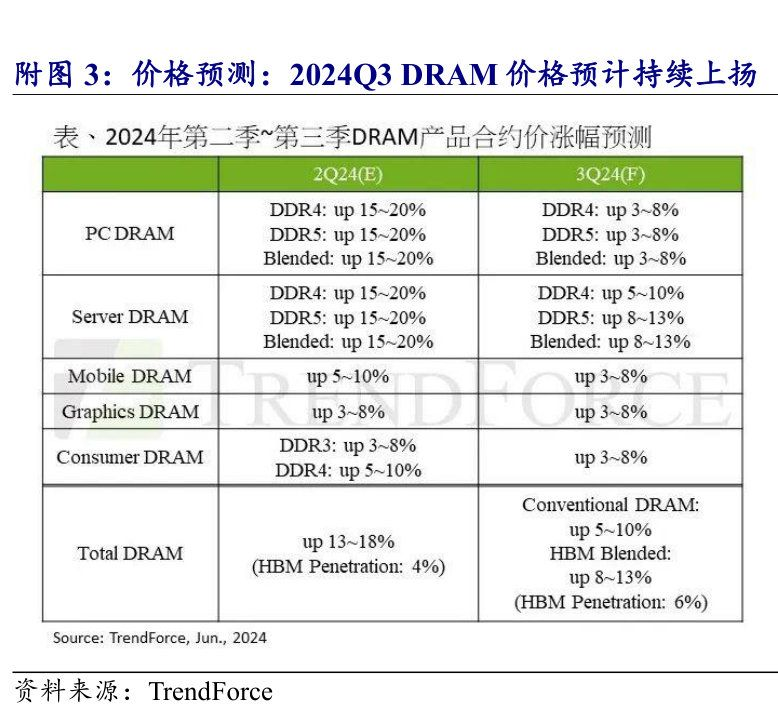

表、2024年第二季~第三季DRAM产品合约价涨幅预测

|  | 2Q24(E) | 3Q24(F) |
|---|---|---|
| PC DRAM | DDR4: up 15~20%；DDR5: up 15~20%；Blended: up 15~20% | DDR4: up 3~8%；DDR5: up 3~8%；Blended: up 3~8% |
| Server DRAM | DDR4: up 15~20%；DDR5: up 15~20%；Blended: up 15~20% | DDR4: up 5~10%；DDR5: up 8~13%；Blended: up 8~13% |
| Mobile DRAM | up 5~10% | up 3~8% |
| Graphics DRAM | up 3~8% | up 3~8% |
| Consumer DRAM | DDR3: up 3~8%；DDR4: up 5~10% | up 3~8% |
| Total DRAM | up 13~18% (HBM Penetration: 4%) | Conventional DRAM: up 5~10%；HBM Blended: up 8~13% (HBM Penetration: 6%) |

Source: TrendForce, Jun., 2024

资料来源：TrendForce

附图4：价格预测：2024Q3 NAND涨幅预计有所收敛

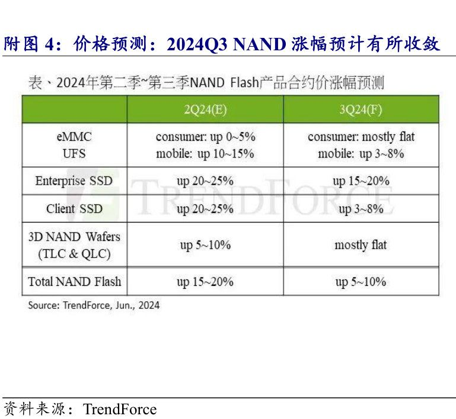

表、2024年第二季~第三季NAND Flash产品合约价涨幅预测

|  | 2Q24(E) | 3Q24(F) |
|---|---|---|
| eMMC / UFS | consumer: up 0~5%；mobile: up 10~15% | consumer: mostly flat；mobile: up 3~8% |
| Enterprise SSD | up 20~25% | up 15~20% |
| Client SSD | up 20~25% | up 3~8% |
| 3D NAND Wafers (TLC & QLC) | up 5~10% | mostly flat |
| Total NAND Flash | up 15~20% | up 5~10% |

Source: TrendForce, Jun., 2024

资料来源：TrendForce

[Source Page: 6]

附表13：价格预测：各类型DRAM产品市场情况

| 项目 | 内容 |
|---|---|
| 整体情况 | 根据全球市场研究机构TrendForce集邦咨询最新调查显示，由于通用型服务器(general server)需求复苏，加上DRAM供应商HBM生产比重进一步拉高，使供应商将延续涨价态度，第三季DRAM均价将持续上扬。DRAM价格涨幅达8~13%，其中Conventional DRAM涨幅为5-10%，较第二季涨幅略有收缩。 |
|  | TrendForce集邦咨询指出，第二季买方补库存意愿渐趋保守，供应商及买方端的库存水平未有显著变化。观察第三季，智能手机及CSPs仍具补库存的空间，且将进入生产旺季，因此预计智能手机及服务器将带动第三季存储器出货量放大。 |
| PC DRAM | 第三季考量通用型服务器需求复苏，加上供应商的HBM生产比重进一步拉高，预估PC DRAM价格将延续涨势，均价涨幅季增3-8%，涨幅低于Server DRAM，并较第二季涨幅收缩，主要因为PC DRAM库存偏高，消费性需求亦未有显著改善。 |
| Server DRAM | 第三季通用型服务器受惠于旺季备货需求，TrendForce集邦咨询预测，这将使得DDR5 Server DRAM合约价涨幅上修至8-13%区间。由于DDR4买方平均库存仍高，因此拉货动能集中在DDR5，使得涨势较DDR4来得高，因此综合两者的平均合约价应落在季增8-13%。 |
| Mobile DRAM | 自去年第四季以来，Mobile DRAM的连续涨价使品牌端的营利面临较大挑战，加上目前库存充足，品牌进入第三季的议价流程放缓，议价态度被动。然而，原厂为填补先前几个季度的获利缺口，以及考量明年供需将转为紧缺，因此维持对合约价格的拉涨态度，但受买方议价态度被动以及高库存影响，可能会压缩第三季涨幅。TrendForce集邦咨询预估，季度涨幅将落在季增3-8%，其中以LPDDR4(X)涨幅最小，不排除有再收缩的可能。 |
| Graphics DRAM | 第三季整体Graphics DRAM需求依旧较为平淡，价格走势主要受到其他DRAM产品的连动影响，在原厂强势进入上涨周期且涨势尚未停歇之下，使得采购端采取持续备货的策略，因此在心态上较能接受卖方提出的涨价。在供给端，因新款GPU将进入验证阶段，原厂将陆续提高GDDR7的生产，而目前GDDR7比GDDR6约有20-30%溢价，随着3Q24的样品出货将略推升平均销售价格，预估Graphics DRAM价格将呈现季增3-8%。 |
| Consumer DRAM | 整体Consumer DRAM市场仍显得供过于求，但三大供应商在HBM产能挤压影响，涨价意图明显，加上其他供应商尚未回到获利状态，故仍有价格上涨的压力存在，预估价格仍维持小幅上涨趋势。 |

资料来源：TrendForce、开源证券研究所

附表14：价格预测：各类型NAND Flash产品市场情况

| 项目 | 内容 |
|---|---|
| 整体情况 | 根据全球市场研究机构TrendForce集邦咨询最新调查显示，第三季除了企业端持续投资服务器建设，尤其Enterprise SSD受惠AI扩大采用，继续受到订单推动，消费性电子需求持续不振，加上原厂下半年增产幅度趋于积极，第三季NAND Flash供过于求比例(Sufficiency Ratio)上升至2.3%，NAND Flash均价(Blended Price)涨幅收敛至季增5-10%。 |
| NAND Flash Wafer | 综观NAND Flash今年价格走势，由于原厂上半年控制增产，NAND Flash价格加速反弹帮助原厂重回获利。但随着各家厂商下半年开始明显扩大投产，零售市场买气仍未复苏，wafer现货价走跌，跌幅扩大导致部分wafer价格已低于合约价超过二成，wafer合约价格未来上涨空间面临挑战。 |
| Client SSD | Client SSD方面，即便NB销售在进入传统旺季，但客户备货意愿较保守，尤其PC终端产品未完全反应去年以来的价格涨幅，因此，下半年采购容量未明显增长。随着供应商开始升级PC client SSD制程至2XX层，原厂供应产能仍持续上升，但拉动价格上涨的动能并不强劲。此外，随着QLC与TLC产品价差明显，更多PC买家扩大使用QLC方案，加剧价格竞争，预料本季价格涨幅空间相对有限，PC Client SSD第三季合约价预估季增3-8%。 |
| Enterprise SSD | Enterprise SSD方面，许多企业持续扩大AI服务器建设，信息设备支出明显复苏，第三季服务器OEMs订单明显回升，采购需求仍较前一季增长。不过，由于智能手机和NB的订单需求保守，NAND Flash市况转向更为平衡。除了大容量QLC Enterprise SSD供应由二家厂商主导外，其他供应商积极争抢Enterprise SSD订单，以加速下半年产能去化，这导致第三季Enterprise SSD合约价格上涨幅度收敛至季增15-20%。 |
| eMMC | eMMC方面，第三季eMMC缺乏驱动需求的因素，但原厂持续提价态度明确，预估最终价格的涨幅甚微，合约价将呈现约略持平状态。 |
| UFS | UFS方面，受到智能手机OEMs库存水位充足且去化较慢的影响，加上模组厂也开始供应UFS物料让需求端选择更多，面对第三季原厂欲再大幅度涨价的情况，势必出现反弹阻力。此外，在买方手上库存充足且市场需求平淡的情况下，预估供应商有可能让步，第三季UFS合约价涨幅将落在季增3-8%。 |

资料来源：TrendForce、开源证券研究所

[Source Page: 7]

附表15：需求预测：预计2024年三大终端DRAM/NAND单机平均搭载容量将同比增加

| 项目 | DRAM 2023 | DRAM 2024（E） | NAND Flash 2023 | NAND Flash 2024（E） |
|---|---|---|---|---|
| 智能手机 | 17.50% | 14.10% | 19.20% | 9.30% |
| 服务器 | 13.60% | 17.30% | 14.90% | 13.20% |
| 笔电 | 9.00% | 12.40% | 10.10% | 9.70% |

数据来源：TrendForce、开源证券研究所

附表16：需求预测：2024年智能手机、服务器、PC出货量预计同比增长4%/2%/8%

|  | 2024F | 2024F YoY |
|---|---|---|
| 智能手机（亿部） | 12.00 | +4.00% |
| 服务器（百万台） | 14.20 | +2.00% |
| PC（亿台） | 2.70 | +8.00% |

数据来源：闪存市场、开源证券研究所

附图5：供给侧：2024Q1 DRAM市场CR3高达94.0%

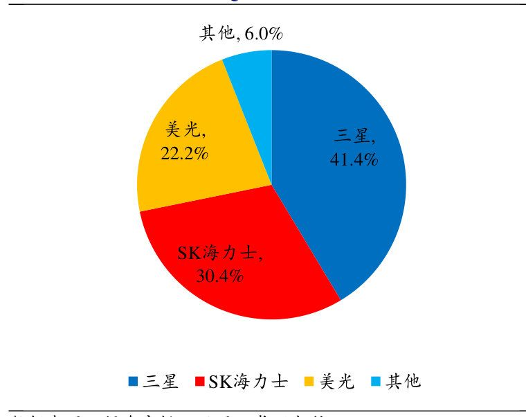

饼图图例：三星、SK海力士、美光、其他
图内标注：三星41.4%、SK海力士30.4%、美光22.2%、其他6.0%

数据来源：闪存市场、开源证券研究所

附图6：供给侧：2024Q1 NAND市场CR5高达93.0%

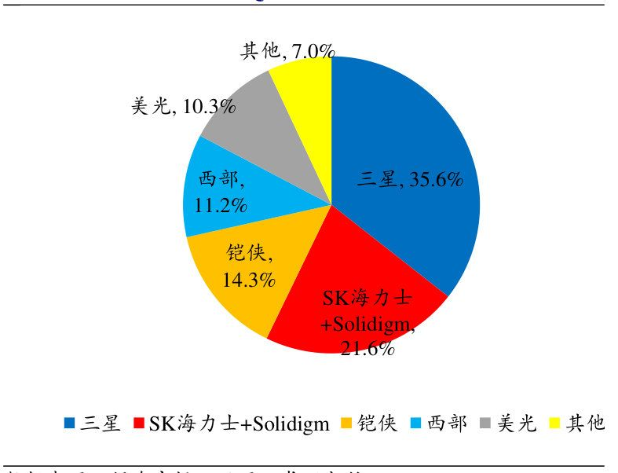

饼图图例：三星、SK海力士+Solidigm、铠侠、西部、美光、其他
图内标注：三星35.6%、SK海力士+Solidigm 21.6%、铠侠14.3%、西部11.2%、美光10.3%、其他7.0%

数据来源：闪存市场、开源证券研究所

附图7：行业规模：2024-2025年DRAM营收有望高增

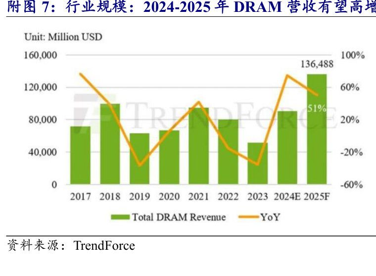

单位：Million USD；横轴：2017至2025F；左纵轴：Total DRAM Revenue，0至160,000；右纵轴：YoY，-60%至100%
图例：Total DRAM Revenue（柱）、YoY（折线）
图内标注：136,488（2025F柱）、51%（YoY折线）

资料来源：TrendForce

附图8：行业规模：2024-2025年NAND营收有望高增

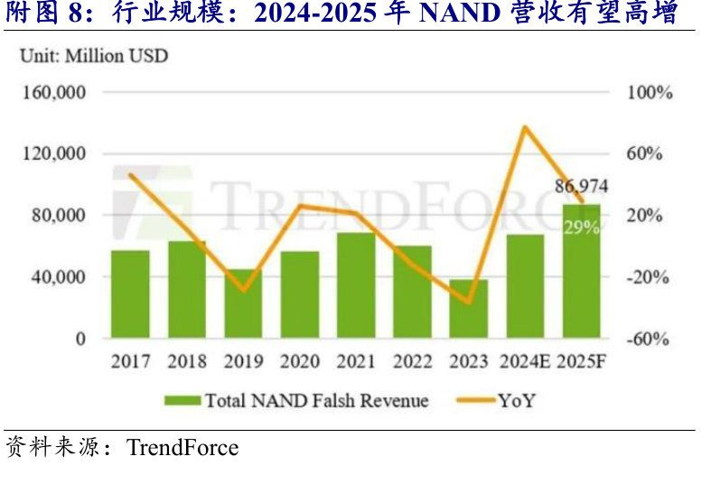

单位：Million USD；横轴：2017至2025F；左纵轴：Total NAND Falsh Revenue，0至160,000；右纵轴：YoY，-60%至100%
图例：Total NAND Falsh Revenue（柱）、YoY（折线）
图内标注：86,974（2025F柱）、29%（YoY折线）

资料来源：TrendForce

[Source Page: 8]

附图9：热点赛道：三大原厂HBM3e预计于2024H2逐季放量

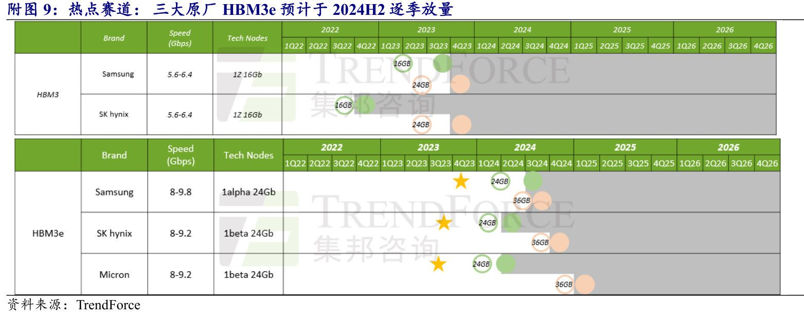

路线图列为Brand、Speed (Gbps)、Tech Nodes及2022–2026各季度（1Q22至4Q26）

| 代次 | Brand | Speed (Gbps) | Tech Nodes |
|---|---|---|---|
| HBM3 | Samsung | 5.6-6.4 | 1Z 16Gb |
| HBM3 | SK hynix | 5.6-6.4 | 1Z 16Gb |
| HBM3e | Samsung | 8-9.8 | 1alpha 24Gb |
| HBM3e | SK hynix | 8-9.2 | 1beta 24Gb |
| HBM3e | Micron | 8-9.2 | 1beta 24Gb |

时间轴标注：HBM3行标注16GB、24GB；HBM3e行于2023Q3附近标注星标，2024年内标注24GB、36GB及圆点标记

资料来源：TrendForce

附表17：热点赛道：2023-2024 HBM市场竞争格局预计将由三星和SK海力士主导

| 公司 | 2022 | 2023（E） | 2024（F） |
|---|---|---|---|
| SK海力士 | 50% | 46%~49% | 47%~49% |
| 三星 | 40% | 46%~49% | 47%~49% |
| 美光 | 10% | 4%~6% | 3%~5% |

数据来源：TrendForce、开源证券研究所

附图10：热点赛道：2024年HBM产值预计占DRAM产值20.1%

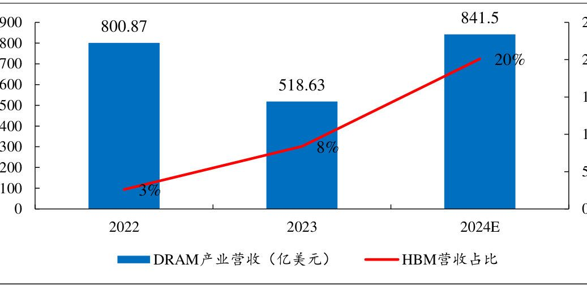

横轴：2022、2023、2024E；左纵轴：DRAM产业营收（亿美元），0至900；右纵轴：HBM营收占比，0%至25%
图例：DRAM产业营收（亿美元）柱、HBM营收占比折线
图内标注：柱800.87、518.63、841.5；折线3%、8%、20%

数据来源：TrendForce、开源证券研究所

附表18：热点赛道：2024年三星海力士HBM产能规划积极，美光占比提升

| 项目 | 三星 | SK海力士 | 美光 |
|---|---|---|---|
| 截至2023年底HBM TSV产能预估 | 45K/m | 45K/m | 3K/m |
| 占比 | 48.39% | 48.39% | 3.23% |
| 截至2024年底HBM TSV产能预估 | 130K/m | 120-125K/m | 20K/m |
| 占比 | 47.71% | 44.95%（中值） | 7.34% |

数据来源：TrendForce、开源证券研究所

[Source Page: 9]

附图11：大厂表现：2024Q1行业营收高速增长，美光表现亮眼

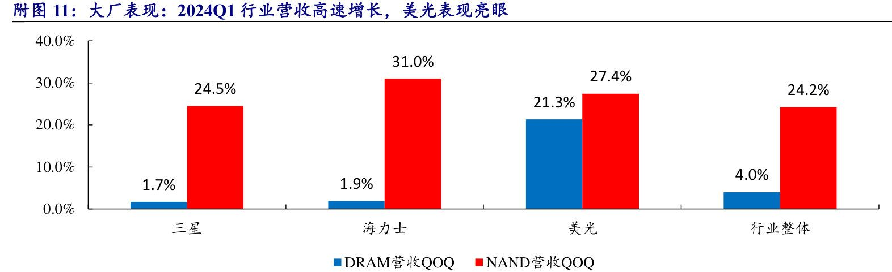

纵轴：0.0%至40.0%；横轴：三星、海力士、美光、行业整体
图例：DRAM营收QOQ（柱）、NAND营收QOQ（柱）
图内标注：三星DRAM营收QOQ 1.7%、NAND营收QOQ 24.5%；海力士1.9%、31.0%；美光21.3%、27.4%；行业整体4.0%、24.2%

数据来源：闪存市场、开源证券研究所

附图12：海外大厂：FY2024Q1三星业绩同比高增

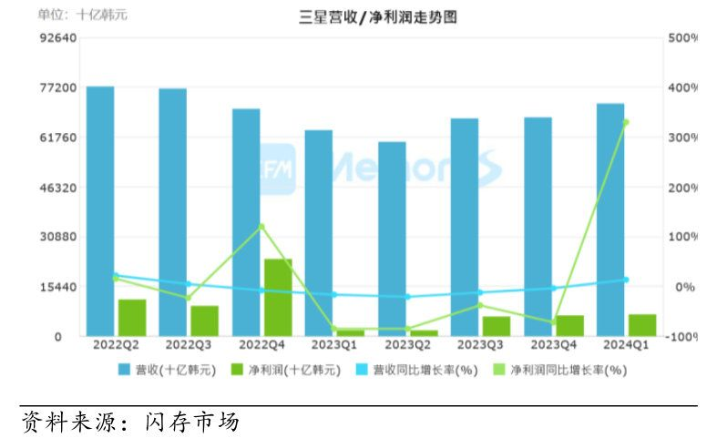

单位：十亿韩元；图题：三星营收/净利润走势图；横轴：2022Q2至2024Q1
左纵轴：0至92640（刻度15440、30880、46320、61760、77200、92640）；右纵轴：同比，-100%至500%
图例：营收(十亿韩元)、净利润(十亿韩元)、营收同比增长率(%)、净利润同比增长率(%)

资料来源：闪存市场

附图13：海外大厂：FY2024Q1 SK海力士业绩扭亏为盈

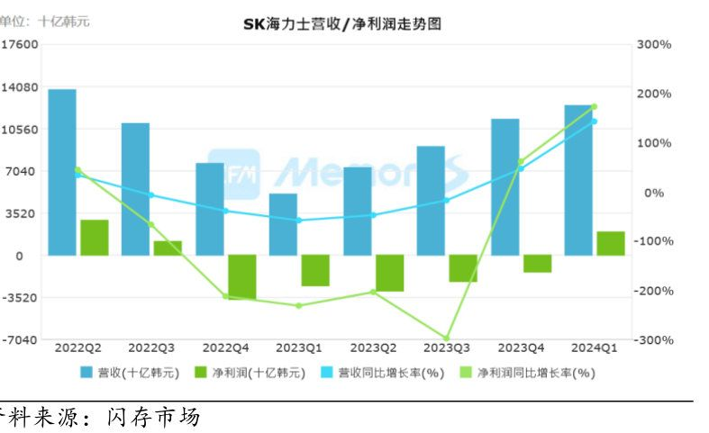

单位：十亿韩元；图题：SK海力士营收/净利润走势图；横轴：2022Q2至2024Q1
左纵轴：-7040至17600（刻度-7040、-3520、0、3520、7040、10560、14080、17600）；右纵轴：同比，-300%至300%
图例：营收(十亿韩元)、净利润(十亿韩元)、营收同比增长率(%)、净利润同比增长率(%)

资料来源：闪存市场

附图14：海外大厂：FY2024Q3美光业绩同比持续高增

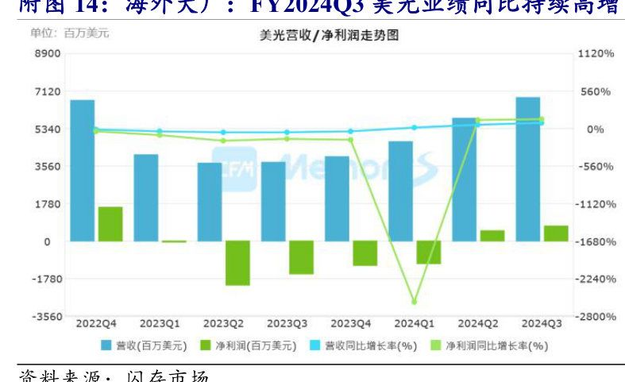

单位：百万美元；图题：美光营收/净利润走势图；横轴：2022Q4至2024Q3
左纵轴：-3560至8900（刻度-3560、-1780、0、1780、3560、5340、7120、8900）；右纵轴：同比，-2800%至1120%
图例：营收(百万美元)、净利润(百万美元)、营收同比增长率(%)、净利润同比增长率(%)

资料来源：闪存市场

附图15：海外大厂：FY2023Q4铠侠业绩扭亏为盈

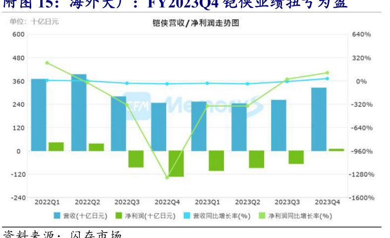

单位：十亿日元；图题：铠侠营收/净利润走势图；横轴：2022Q1至2023Q4
左纵轴：-240至600（刻度-240、-120、0、120、240、360、480、600）；右纵轴：同比，-1600%至640%
图例：营收(十亿日元)、净利润(十亿日元)、营收同比增长率(%)、净利润同比增长率(%)

资料来源：闪存市场

[Source Page: 10]

附图16：国内厂商：2024Q1全球存储大厂季度营收环比走势分化

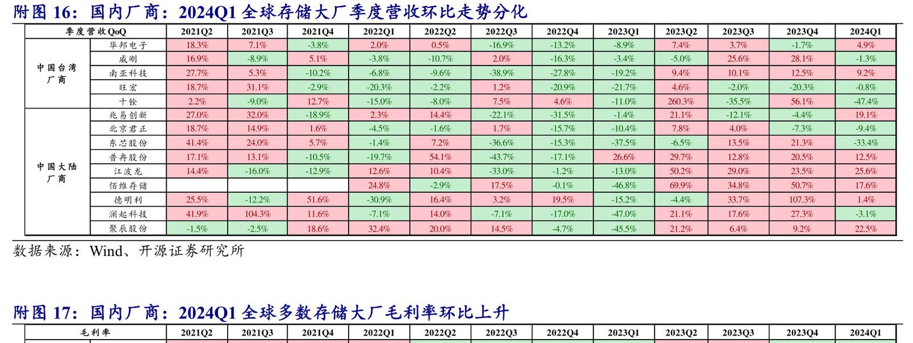

| 季度营收QoQ | 厂商 | 2021Q2 | 2021Q3 | 2021Q4 | 2022Q1 | 2022Q2 | 2022Q3 | 2022Q4 | 2023Q1 | 2023Q2 | 2023Q3 | 2023Q4 | 2024Q1 |
|---|---|---|---|---|---|---|---|---|---|---|---|---|---|
| 中国台湾厂商 | 华邦电子 | 18.3% | 7.1% | -3.8% | 2.0% | 0.5% | -16.9% | -13.2% | -8.9% | 7.4% | 3.7% | -1.7% | 4.9% |
| 中国台湾厂商 | 威刚 | 16.9% | -8.9% | 5.1% | -3.8% | -10.7% | 2.0% | -16.3% | -3.4% | -5.0% | 25.6% | 28.1% | -1.3% |
| 中国台湾厂商 | 南亚科技 | 27.7% | 5.3% | -10.2% | -6.8% | -9.6% | -38.9% | -27.8% | -19.2% | 9.4% | 10.1% | 12.5% | 9.2% |
| 中国台湾厂商 | 旺宏 | 18.7% | 31.1% | -2.9% | -20.3% | -2.2% | 1.2% | -20.9% | -21.7% | 4.6% | -2.0% | -20.3% | -0.8% |
| 中国台湾厂商 | 十铨 | 2.2% | -9.0% | 12.7% | -15.0% | -8.0% | 7.5% | 4.6% | -11.0% | 260.3% | -35.5% | 56.1% | -47.4% |
| 中国大陆厂商 | 兆易创新 | 27.0% | 32.0% | -18.9% | 2.3% | 14.4% | -22.1% | -31.5% | -1.4% | 21.1% | -12.1% | -4.4% | 19.1% |
| 中国大陆厂商 | 北京君正 | 18.7% | 14.9% | 1.6% | -4.5% | -1.6% | 1.7% | -15.7% | -10.4% | 7.8% | 4.0% | -7.3% | -9.4% |
| 中国大陆厂商 | 东芯股份 | 41.4% | 24.0% | 5.7% | -1.4% | 7.2% | -36.6% | -15.3% | -37.5% | -6.5% | 13.5% | 21.3% | -33.4% |
| 中国大陆厂商 | 普冉股份 | 17.1% | 13.1% | -10.5% | -19.7% | 54.1% | -43.7% | -17.1% | 26.6% | 29.7% | 12.8% | 20.5% | 12.5% |
| 中国大陆厂商 | 江波龙 | 14.4% | -16.0% | -12.9% | 12.6% | 10.4% | -33.0% | -1.2% | -13.0% | 50.2% | 29.0% | 23.5% | 25.6% |
| 中国大陆厂商 | 佰维存储 |  |  |  | 24.8% | -2.9% | 17.5% | -0.1% | -46.8% | 69.9% | 34.8% | 50.7% | 17.6% |
| 中国大陆厂商 | 德明利 | 25.5% | -12.2% | 51.6% | -30.9% | 16.4% | 3.2% | 19.5% | -15.2% | -4.4% | 33.7% | 107.3% | 1.4% |
| 中国大陆厂商 | 澜起科技 | 41.9% | 104.3% | 11.6% | -7.1% | 14.0% | -7.1% | -17.0% | -47.0% | 21.1% | 17.6% | 27.3% | -3.1% |
| 中国大陆厂商 | 聚辰股份 | -1.5% | -2.5% | 18.6% | 32.4% | 20.0% | 14.5% | -4.7% | -45.5% | 21.2% | 6.4% | 9.2% | 22.5% |

数据来源：Wind、开源证券研究所

附图17：国内厂商：2024Q1全球多数存储大厂毛利率环比上升

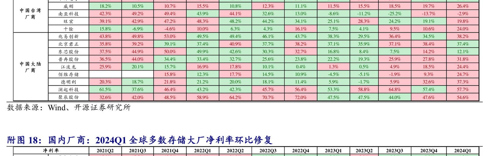

| 毛利率 | 厂商 | 2021Q2 | 2021Q3 | 2021Q4 | 2022Q1 | 2022Q2 | 2022Q3 | 2022Q4 | 2023Q1 | 2023Q2 | 2023Q3 | 2023Q4 | 2024Q1 |
|---|---|---|---|---|---|---|---|---|---|---|---|---|---|
| 中国台湾厂商 | 华邦电子 | 42.2% | 44.8% | 45.1% | 48.6% | 48.4% | 45.5% | 37.5% | 27.7% | 31.3% | 31.7% | 28.5% | 27.6% |
| 中国台湾厂商 | 威刚 | 18.2% | 10.5% | 10.7% | 15.5% | 10.8% | 12.3% | 11.1% | 11.5% | 15.5% | 18.5% | 19.7% | 26.4% |
| 中国台湾厂商 | 南亚科技 | 42.3% | 49.2% | 49.4% | 43.9% | 44.1% | 32.6% | 13.0% | -8.6% | -11.2% | -25.2% | -13.7% | -2.9% |
| 中国台湾厂商 | 旺宏 | 39.1% | 42.9% | 47.2% | 48.3% | 48.2% | 44.2% | 34.1% | 25.1% | 28.3% | 24.2% | 19.1% | 19.8% |
| 中国台湾厂商 | 十铨 | 15.8% | -6.9% | -4.6% | 10.0% | 6.3% | 4.3% | 16.1% | 7.5% | 4.1% | 9.5% | 10.6% | 24.0% |
| 中国大陆厂商 | 兆易创新 | 43.8% | 49.8% | 53.0% | 49.5% | 49.4% | 46.1% | 43.7% | 38.3% | 29.5% | 36.4% | 34.5% | 38.2% |
| 中国大陆厂商 | 北京君正 | 35.8% | 39.2% | 39.1% | 37.4% | 40.9% | 37.7% | 38.2% | 37.1% | 35.9% | 37.1% | 38.4% | 37.4% |
| 中国大陆厂商 | 东芯股份 | 37.5% | 44.9% | 50.0% | 49.9% | 42.6% | 30.3% | 32.7% | 16.8% | 8.4% | 7.5% | 14.2% | 12.1% |
| 中国大陆厂商 | 普冉股份 | 36.5% | 44.0% | 34.4% | 33.4% | 32.7% | 25.6% | 23.8% | 22.2% | 19.3% | 25.9% | 27.8% | 31.8% |
| 中国大陆厂商 | 江波龙 | 25.9% | 20.1% | 15.7% | 16.9% | 17.8% | 10.1% | 0.4% | 1.3% | 0.5% | 4.9% | 18.5% | 24.4% |
| 中国大陆厂商 | 佰维存储 |  |  | 15.8% | 12.3% | 17.7% | 14.5% | 10.9% | -4.5% | -5.1% | -1.9% | 9.3% | 24.7% |
| 中国大陆厂商 | 德明利 | 20.3% | 18.7% | 21.8% | 21.2% | 20.0% | 18.1% | 11.4% | 5.9% | -1.7% | 5.9% | 32.6% | 37.3% |
| 中国大陆厂商 | 澜起科技 | 61.5% | 37.6% | 46.4% | 43.2% | 42.3% | 45.7% | 56.4% | 53.3% | 58.8% | 64.8% | 57.4% | 57.7% |
| 中国大陆厂商 | 聚辰股份 | 32.6% | 42.0% | 48.5% | 58.9% | 64.2% | 70.7% | 72.0% | 47.5% | 47.5% | 44.0% | 47.6% | 54.6% |

数据来源：Wind、开源证券研究所

附图18：国内厂商：2024Q1全球多数存储大厂净利率环比修复

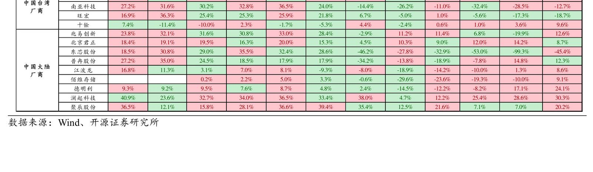

| 净利率 | 厂商 | 2021Q2 | 2021Q3 | 2021Q4 | 2022Q1 | 2022Q2 | 2022Q3 | 2022Q4 | 2023Q1 | 2023Q2 | 2023Q3 | 2023Q4 | 2024Q1 |
|---|---|---|---|---|---|---|---|---|---|---|---|---|---|
| 中国台湾厂商 | 华邦电子 | 15.0% | 17.7% | 18.2% | 19.4% | 21.8% | 14.1% | 4.7% | -3.9% | 3.0% | 0.9% | -0.2% | -1.3% |
| 中国台湾厂商 | 威刚 | 14.6% | 0.0% | 1.0% | 5.1% | 0.2% | 1.9% | 2.7% | 0.8% | 4.2% | 5.0% | 6.6% | 9.7% |
| 中国台湾厂商 | 南亚科技 | 27.2% | 31.6% | 30.2% | 32.8% | 36.5% | 24.0% | -14.4% | -26.2% | -11.0% | -32.4% | -28.5% | -12.7% |
| 中国台湾厂商 | 旺宏 | 16.9% | 36.3% | 25.4% | 25.3% | 25.9% | 21.8% | 6.7% | -5.0% | 1.0% | -5.6% | -17.3% | -18.7% |
| 中国台湾厂商 | 十铨 | 7.4% | -11.4% | -10.0% | 2.3% | -1.7% | -5.3% | 4.4% | -2.4% | 0.6% | 1.0% | 3.6% | 9.6% |
| 中国大陆厂商 | 兆易创新 | 23.8% | 32.1% | 31.6% | 30.8% | 33.0% | 28.4% | -2.9% | 11.2% | 11.4% | 6.8% | -19.9% | 12.6% |
| 中国大陆厂商 | 北京君正 | 18.4% | 19.1% | 19.5% | 16.3% | 20.0% | 15.3% | 4.5% | 10.3% | 9.0% | 12.0% | 14.2% | 8.7% |
| 中国大陆厂商 | 东芯股份 | 18.5% | 30.8% | 29.0% | 35.5% | 32.4% | 28.6% | -46.2% | -27.8% | -32.9% | -53.0% | -99.3% | -45.4% |
| 中国大陆厂商 | 普冉股份 | 27.2% | 35.0% | 24.5% | 18.5% | 17.9% | 17.9% | -34.2% | -13.8% | -18.9% | -7.8% | 14.8% | 12.3% |
| 中国大陆厂商 | 江波龙 | 16.8% | 11.3% | 3.1% | 7.0% | 8.1% | -9.3% | -8.0% | -18.9% | -14.2% | -10.0% | 1.3% | 8.6% |
| 中国大陆厂商 | 佰维存储 |  |  | 0.2% | 2.2% | 5.0% | 3.3% | -0.6% | -29.6% | -23.6% | -19.3% | -10.0% | 9.1% |
| 中国大陆厂商 | 德明利 | 9.3% | 9.2% | 9.5% | 7.6% | 8.7% | 4.8% | 2.4% | -14.5% | -12.2% | -8.2% | 17.1% | 24.1% |
| 中国大陆厂商 | 澜起科技 | 40.9% | 23.6% | 32.7% | 34.0% | 36.5% | 33.4% | 38.0% | 4.7% | 12.2% | 25.4% | 28.6% | 30.3% |
| 中国大陆厂商 | 聚辰股份 | 36.5% | 12.1% | 15.8% | 28.1% | 36.6% | 39.4% | 35.4% | 12.5% | 21.6% | 7.1% | 7.0% | 20.2% |

数据来源：Wind、开源证券研究所

[Source Page: 11]

附图19：国内厂商：2023M12以来，多数中国存储台厂营收同比持续上涨

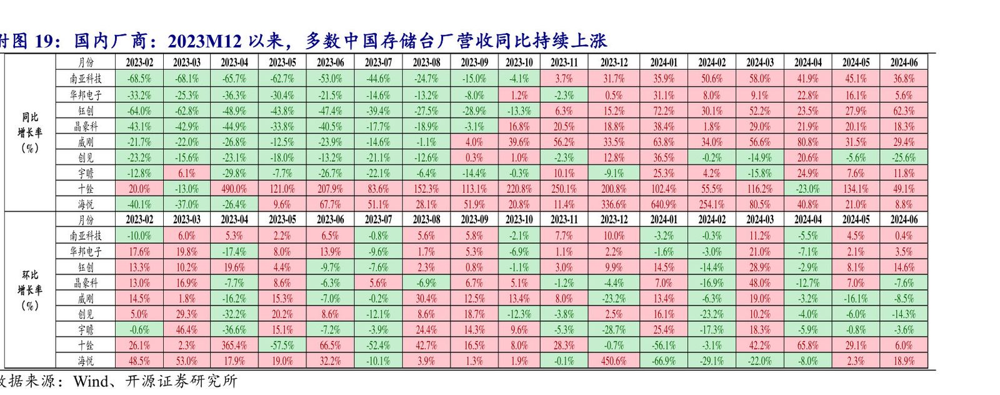

同比增长率（%）

| 月份 | 2023-02 | 2023-03 | 2023-04 | 2023-05 | 2023-06 | 2023-07 | 2023-08 | 2023-09 | 2023-10 | 2023-11 | 2023-12 | 2024-01 | 2024-02 | 2024-03 | 2024-04 | 2024-05 | 2024-06 |
|---|---|---|---|---|---|---|---|---|---|---|---|---|---|---|---|---|---|
| 南亚科技 | -68.5% | -68.1% | -65.7% | -62.7% | -53.0% | -44.6% | -24.7% | -15.0% | -4.1% | 3.7% | 31.7% | 35.9% | 50.6% | 58.0% | 41.9% | 45.1% | 36.8% |
| 华邦电子 | -33.2% | -25.3% | -36.3% | -30.4% | -21.5% | -14.6% | -13.2% | -8.0% | 1.2% | -2.3% | 0.5% | 31.1% | 8.0% | 9.1% | 22.8% | 16.1% | 5.6% |
| 钰创 | -64.0% | -62.8% | -48.9% | -43.8% | -47.4% | -39.4% | -27.5% | -28.9% | -13.3% | 6.3% | 15.2% | 72.2% | 30.1% | 52.2% | 23.5% | 27.9% | 62.3% |
| 晶豪科 | -43.1% | -42.9% | -44.9% | -33.8% | -40.5% | -17.7% | -18.9% | -3.1% | 16.8% | 20.5% | 18.8% | 38.4% | 1.8% | 29.0% | 21.9% | 20.1% | 18.3% |
| 威刚 | -21.7% | -22.0% | -26.8% | -12.5% | -23.9% | -14.6% | -1.1% | 4.0% | 39.6% | 56.2% | 33.5% | 63.8% | 34.0% | 56.6% | 80.8% | 31.5% | 29.4% |
| 创见 | -23.2% | -15.6% | -23.1% | -18.0% | -13.2% | -21.1% | -12.6% | 0.3% | 1.0% | -2.3% | 12.8% | 36.5% | -0.2% | -14.9% | 20.6% | -5.6% | -25.6% |
| 宇瞻 | -12.8% | 6.1% | -29.8% | -7.7% | -26.7% | -22.1% | -6.4% | -14.4% | -0.3% | 10.1% | -9.1% | 25.3% | 4.2% | -15.8% | 24.9% | 7.6% | 11.8% |
| 十铨 | 20.0% | -13.0% | 490.0% | 121.0% | 207.9% | 83.6% | 152.3% | 113.1% | 220.8% | 250.1% | 200.8% | 102.4% | 55.5% | 116.2% | -23.0% | 134.1% | 49.1% |
| 海悦 | -40.1% | -37.0% | -26.4% | 9.6% | 67.7% | 51.1% | 28.1% | 51.9% | 20.8% | 11.4% | 336.6% | 640.9% | 254.1% | 80.5% | 40.8% | 21.0% | 8.8% |

环比增长率（%）

| 月份 | 2023-02 | 2023-03 | 2023-04 | 2023-05 | 2023-06 | 2023-07 | 2023-08 | 2023-09 | 2023-10 | 2023-11 | 2023-12 | 2024-01 | 2024-02 | 2024-03 | 2024-04 | 2024-05 | 2024-06 |
|---|---|---|---|---|---|---|---|---|---|---|---|---|---|---|---|---|---|
| 南亚科技 | -10.0% | 6.0% | 5.3% | 2.2% | 6.5% | -0.8% | 5.6% | 5.8% | -2.1% | 7.7% | 10.0% | -3.2% | -0.3% | 11.2% | -5.5% | 4.5% | 0.4% |
| 华邦电子 | 17.6% | 19.8% | -17.4% | 8.0% | 13.9% | -9.6% | 1.7% | 5.3% | -6.9% | 1.1% | 2.2% | -1.6% | -3.0% | 21.0% | -7.1% | 2.1% | 3.5% |
| 钰创 | 13.3% | 10.2% | 19.6% | 4.4% | -9.7% | -7.6% | 2.3% | 0.8% | -1.1% | 3.0% | 9.9% | 14.5% | -14.4% | 28.9% | -2.9% | 8.1% | 14.6% |
| 晶豪科 | 13.0% | 16.9% | -7.7% | 8.6% | -6.3% | 5.6% | -6.9% | 6.7% | 5.1% | -1.2% | -4.4% | 7.0% | -16.9% | 48.0% | -12.7% | 7.0% | -7.6% |
| 威刚 | 14.5% | 1.8% | -16.2% | 15.3% | -7.0% | -0.2% | 30.4% | 12.5% | 13.4% | 8.0% | -23.2% | 13.4% | -6.3% | 19.0% | -3.2% | -16.1% | -8.5% |
| 创见 | 5.0% | 29.3% | -32.2% | 20.2% | 8.6% | -12.1% | 8.6% | 18.7% | -12.3% | -3.8% | 2.5% | 16.1% | -23.2% | 10.2% | -4.0% | -6.0% | -14.3% |
| 宇瞻 | -0.6% | 46.4% | -36.6% | 15.1% | -7.2% | -3.9% | 24.4% | 14.3% | 9.6% | -5.3% | -28.7% | 25.4% | -17.3% | 18.3% | -5.9% | -0.8% | -3.6% |
| 十铨 | 26.1% | 2.3% | 365.4% | -57.5% | 66.5% | -52.4% | 42.7% | 16.5% | 8.0% | 28.3% | -0.7% | -56.1% | -3.1% | 42.2% | 65.8% | 29.1% | 6.0% |
| 海悦 | 48.5% | 53.0% | 17.9% | 19.0% | 32.2% | -10.1% | 3.9% | 1.3% | 1.9% | -0.1% | 450.6% | -66.9% | -29.1% | -22.0% | -8.0% | 2.3% | 18.9% |

数据来源：Wind、开源证券研究所

[Source Page: 12]

## 特别声明

《证券期货投资者适当性管理办法》、《证券经营机构投资者适当性管理实施指引（试行）》已于2017年7月1日起正式实施。根据上述规定，开源证券评定此研报的风险等级为R3（中风险），因此通过公共平台推送的研报其适用的投资者类别仅限定为专业投资者及风险承受能力为C3、C4、C5的普通投资者。若您并非专业投资者及风险承受能力为C3、C4、C5的普通投资者，请取消阅读，请勿收藏、接收或使用本研报中的任何信息。

因此受限于访问权限的设置，若给您造成不便，烦请见谅！感谢您给予的理解与配合。

## 分析师承诺

负责准备本报告以及撰写本报告的所有研究分析师或工作人员在此保证，本研究报告中关于任何发行商或证券所发表的观点均如实反映分析人员的个人观点。负责准备本报告的分析师获取报酬的评判因素包括研究的质量和准确性、客户的反馈、竞争性因素以及开源证券股份有限公司的整体收益。所有研究分析师或工作人员保证他们报酬的任何一部分不曾与，不与，也将不会与本报告中具体的推荐意见或观点有直接或间接的联系。

## 股票投资评级说明

|  | 评级 | 说明 |
|---|---|---|
| 证券评级 | 买入（Buy） | 预计相对强于市场表现20%以上； |
|  | 增持（outperform） | 预计相对强于市场表现5%～20%； |
|  | 中性（Neutral） | 预计相对市场表现在－5%～＋5%之间波动； |
|  | 减持（underperform） | 预计相对弱于市场表现5%以下。 |
| 行业评级 | 看好（overweight） | 预计行业超越整体市场表现； |
|  | 中性（Neutral） | 预计行业与整体市场表现基本持平； |
|  | 看淡（underperform） | 预计行业弱于整体市场表现。 |

备注：评级标准为以报告日后的6~12个月内，证券相对于市场基准指数的涨跌幅表现，其中A股基准指数为沪深300指数、港股基准指数为恒生指数、新三板基准指数为三板成指（针对协议转让标的）或三板做市指数（针对做市转让标的）、美股基准指数为标普500或纳斯达克综合指数。我们在此提醒您，不同证券研究机构采用不同的评级术语及评级标准。我们采用的是相对评级体系，表示投资的相对比重建议；投资者买入或者卖出证券的决定取决于个人的实际情况，比如当前的持仓结构以及其他需要考虑的因素。投资者应阅读整篇报告，以获取比较完整的观点与信息，不应仅仅依靠投资评级来推断结论。

## 分析、估值方法的局限性说明

本报告所包含的分析基于各种假设，不同假设可能导致分析结果出现重大不同。本报告采用的各种估值方法及模型均有其局限性，估值结果不保证所涉及证券能够在该价格交易。

[Source Page: 13]

## 法律声明

开源证券股份有限公司是经中国证监会批准设立的证券经营机构，已具备证券投资咨询业务资格。

本报告仅供开源证券股份有限公司（以下简称“本公司”）的机构或个人客户（以下简称“客户”）使用。本公司不会因接收人收到本报告而视其为客户。本报告是发送给开源证券客户的，属于商业秘密材料，只有开源证券客户才能参考或使用，如接收人并非开源证券客户，请及时退回并删除。

本报告是基于本公司认为可靠的已公开信息，但本公司不保证该等信息的准确性或完整性。本报告所载的资料、工具、意见及推测只提供给客户作参考之用，并非作为或被视为出售或购买证券或其他金融工具的邀请或向人做出邀请。本报告所载的资料、意见及推测仅反映本公司于发布本报告当日的判断，本报告所指的证券或投资标的的价格、价值及投资收入可能会波动。在不同时期，本公司可发出与本报告所载资料、意见及推测不一致的报告。客户应当考虑到本公司可能存在可能影响本报告客观性的利益冲突，不应视本报告为做出投资决策的唯一因素。本报告中所指的投资及服务可能不适合个别客户，不构成客户私人咨询建议。本公司未确保本报告充分考虑到个别客户特殊的投资目标、财务状况或需要。本公司建议客户应考虑本报告的任何意见或建议是否符合其特定状况，以及（若有必要）咨询独立投资顾问。在任何情况下，本报告中的信息或所表述的意见并不构成对任何人的投资建议。在任何情况下，本公司不对任何人因使用本报告中的任何内容所引致的任何损失负任何责任。若本报告的接收人非本公司的客户，应在基于本报告做出任何投资决定或就本报告要求任何解释前咨询独立投资顾问。

本报告可能附带其它网站的地址或超级链接，对于可能涉及的开源证券网站以外的地址或超级链接，开源证券不对其内容负责。本报告提供这些地址或超级链接的目的纯粹是为了客户使用方便，链接网站的内容不构成本报告的任何部分，客户需自行承担浏览这些网站的费用或风险。

开源证券在法律允许的情况下可参与、投资或持有本报告涉及的证券或进行证券交易，或向本报告涉及的公司提供或争取提供包括投资银行业务在内的服务或业务支持。开源证券可能与本报告涉及的公司之间存在业务关系，并无需事先或在获得业务关系后通知客户。

本报告的版权归本公司所有。本公司对本报告保留一切权利。除非另有书面显示，否则本报告中的所有材料的版权均属本公司。未经本公司事先书面授权，本报告的任何部分均不得以任何方式制作任何形式的拷贝、复印件或复制品，或再次分发给任何其他人，或以任何侵犯本公司版权的其他方式使用。所有本报告中使用的商标、服务标记及标记均为本公司的商标、服务标记及标记。

## 开源证券研究所

| 上海 | 深圳 |
|---|---|
| 地址：上海市浦东新区世纪大道1788号陆家嘴金控广场1号楼3层 | 地址：深圳市福田区金田路2030号卓越世纪中心1号楼45层 |
| 邮编：200120 | 邮编：518000 |
| 邮箱：research@kysec.cn | 邮箱：research@kysec.cn |

| 北京 | 西安 |
|---|---|
| 地址：北京市西城区西直门外大街18号金贸大厦C2座9层 | 地址：西安市高新区锦业路1号都市之门B座5层 |
| 邮编：100044 | 邮编：710065 |
| 邮箱：research@kysec.cn | 邮箱：research@kysec.cn |

## Processing Notes

- 删除 10 处每页重复的页脚「请务必参阅正文后面的信息披露和法律声明」；转换稿未包含独立页码，故无页码需删。
- 附表2–附表12（价格复盘）在原表中每项产品占两行：首行为涨跌幅百分比，次行为对应的涨跌额（美元）；次行在原文中无单独列名，清洗后保留为第一、二列留空的续行，数值与所属产品一一对应。
- 附图19 原图内表头首格为「月份」，转换稿漏录，已在「同比增长率」「环比增长率」两表中补回；原图单表上下两段已分为两张表。
- 附表15 原表为「项目 × DRAM 2023/2024（E） × NAND Flash 2023/2024（E）」两级表头，转为单行表头，数值与归组不变。
- 附图16–18 原表首列「中国台湾厂商/中国大陆厂商」为跨行合并单元格，转换稿按行重复标注，保留以便逐行对齐；未合并单元格。
- 附图8 图例原文拼写为「Total NAND Falsh Revenue」（原文如此），未作改动。
- 第 1 页「开源证券证券研究报告」由刊头与页边竖排标签合并而成，按原样保留；每页重复的页眉「行业点评报告」未进入转换稿，无需处理。
- 已按全部 13 页的页面图像逐页核对正文、表格数值与行列关系（附表2–18、附图1–19），除上述已列明的修正外与转换稿一致；全文无 [OCR_UNCERTAIN]/[OCR_UNREADABLE]/[TABLE_RECONSTRUCTION_UNCERTAIN] 标记。
