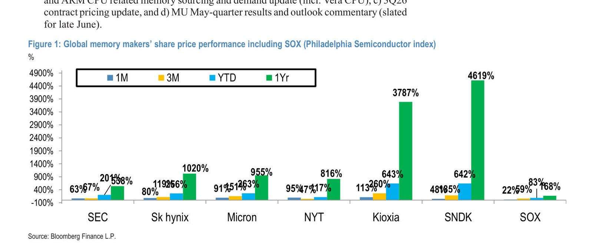
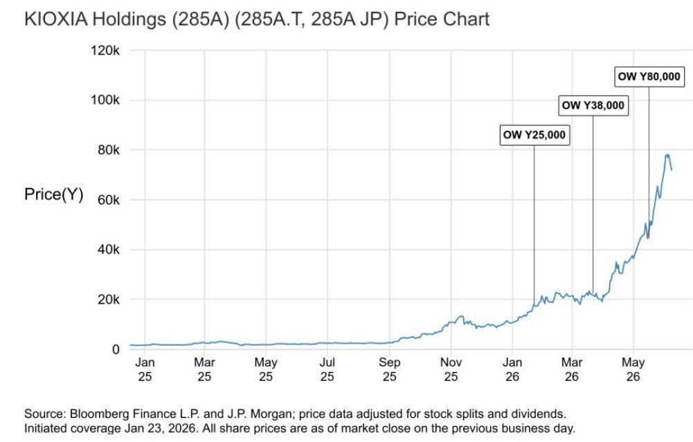
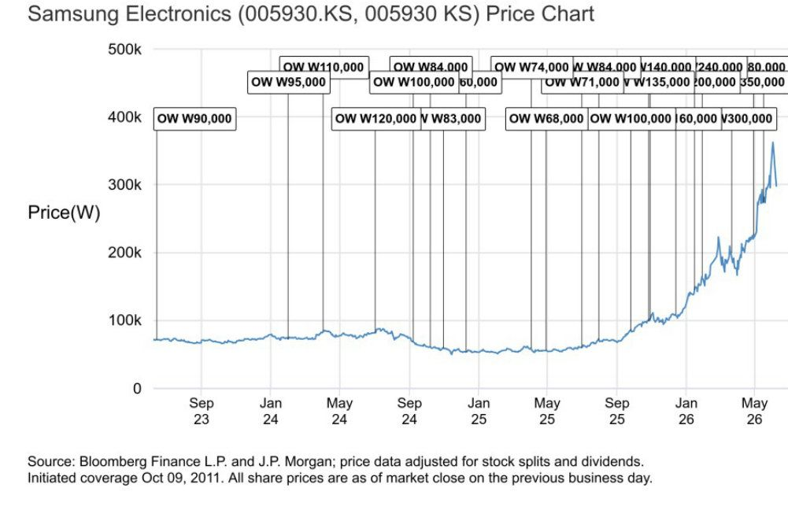
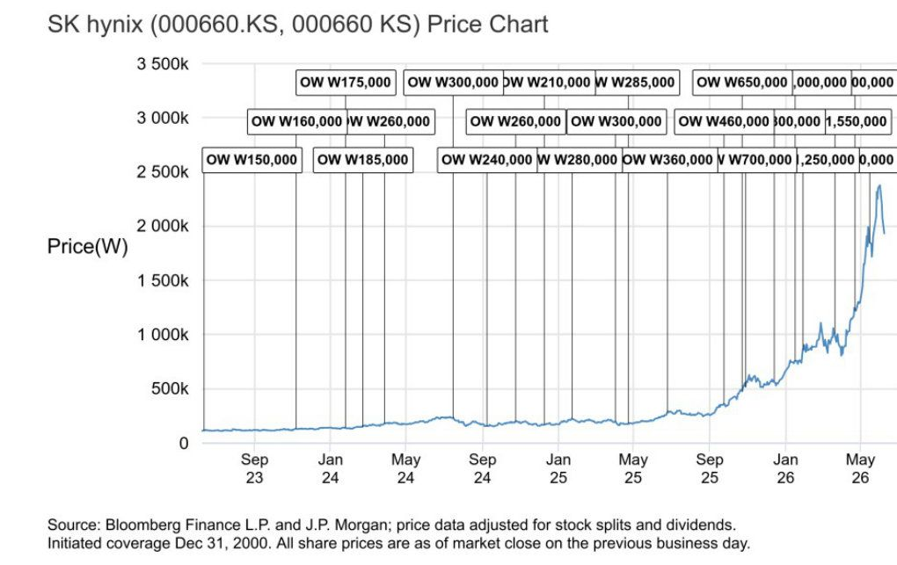

## Document Metadata

- Document ID: 13fc387c8f48c3d1367babc295e972a2880a715e
- Document Title: Memory Market Update: SOCAMM content noise offers a buying opportunity; thoughts on NVDA-SKH partnership and takeaways from Computex 2026
- Document Type: PDF
- Issuing Organization: J.P. Morgan – Asia Pacific Equity Research
- Publication Date: 2026-06-08
- Reporting Period: null
- Source File: [M166_摩根大通_Memory_Market_Update-_SOCAMM_content_controversy_brings_buying_op.pdf](https://github.com/jadennevercode/CJCC-Knowledge-Base/blob/5ec8511eb834073c8bfbd79c94af196282d483cf/materials/%E8%B7%A8%E9%93%BE%EF%BC%9A%E4%BE%9B%E9%9C%80%E4%B8%8E%E4%BB%B7%E6%A0%BC%E5%8F%A3%E5%BE%84/M166_%E6%91%A9%E6%A0%B9%E5%A4%A7%E9%80%9A_Memory_Market_Update-_SOCAMM_content_controversy_brings_buying_op.pdf)

## Structured Content

> 原文件：[M166_摩根大通_Memory_Market_Update-_SOCAMM_content_controversy_brings_buying_op.pdf](https://github.com/jadennevercode/CJCC-Knowledge-Base/blob/5ec8511eb834073c8bfbd79c94af196282d483cf/materials/%E8%B7%A8%E9%93%BE%EF%BC%9A%E4%BE%9B%E9%9C%80%E4%B8%8E%E4%BB%B7%E6%A0%BC%E5%8F%A3%E5%BE%84/M166_%E6%91%A9%E6%A0%B9%E5%A4%A7%E9%80%9A_Memory_Market_Update-_SOCAMM_content_controversy_brings_buying_op.pdf)
> 转换方式：多模态逐页转录（页面图像 + 文本层交叉校验）

[Source Page: 1]

# Memory Market Update

SOCAMM content noise offers a buying opportunity; thoughts on NVDA-SKH partnership and takeaways from Computex 2026

Asia Pacific Equity Research
08 June 2026

**Technology - Semiconductors**

Jay Kwon AC
(82-2) 758-5725
jay.h.kwon@jpmorgan.com
J.P. Morgan Securities (Far East) Limited, Seoul Branch

Sangsik Lee
(82-2) 758 5146
sangsik.lee@jpmorgan.com
J.P. Morgan Securities (Far East) Limited, Seoul Branch

Neelay Y Kamath
(91-22) 6157 3764
neelay.kamath@jpmchase.com
J.P. Morgan India Private Limited

Mio Shikanai
(81-3) 6736 1313
mio.shikanai@jpmorgan.com
JPMorgan Securities Japan Co., Ltd.

- **The truth behind the SOCAMM content cut for Vera Rubin.** Multiple media outlets highlighted the SOCAMM content downgrade for the VR NVL72 rack from 192GB to 96GB (or from 1.5TB of content to 768GB per CPU) stoking fears among investors on the cooling CPU-related memory demand (link). CPU-driven memory demand upside was the core driver of memory demand accelerating into 2027E (JPMe: DRAM bit demand +33%/+34% in 2026/27E - see details in our GMM report). Based on our supply chain checks, we sense growing demand for the 96GB SOCAMM module, **while believe that the shift in demand is predominantly due to limited memory supply rather than performance down-spec.** Despite the higher 96GB-grade SOCAMM SKU, we are seeing no changes to overall SOCAMM bit procurement demand, implying that the content downward revision will likely be compensated by higher SOCAMM module demand (e.g. reshuffle of content and volume based on memory supply and content configurations).

**Table 1: Sensitivity analysis on NVDA demand based on Vera CPU content configuration**

Unit in K, Content in GB

| AI headnode | 2026E | 50% of 96GB and 50% of 192GB | 75% of 96GB and 25% of 192GB | 100% of 96GB and 0% of 192GB |
|---|---|---|---|---|
| **# of CPU** |  |  |  |  |
| Rubin | 1,050 | 1,400 | 1,680 | 2,100 |
| Blackwell | 2,568 | 2,568 | 2,568 | 2,568 |
| **Content per CPU** |  |  |  |  |
| Rubin | 1,536 | 1,152 | 960 | 768 |
| Blackwell | 512 | 512 | 512 | 512 |
| **Bit demand by product** |  |  |  |  |
| Rubin | 1,613 | 1,613 | 1,613 | 1,613 |
| Blackwell | 1,315 | 1,315 | 1,315 | 1,315 |
| Bit Demand (8Gb, Mn. Equiv) | 2,928 | 2,928 | 2,928 | 2,928 |
| **Standalone CPU** |  |  |  |  |
| # of Vera CPU | 600 | 600 | 600 | 600 |
| Content per CPU | 768 | 768 | 768 | 768 |
| Bit Demand (8Gb, Mn. Equiv) | 461 | 461 | 461 | 461 |
| NVDA bit demand | 3,388 | 3,388 | 3,388 | 3,388 |

Source: J.P. Morgan estimates.

- **Strengthening partnership between NVDA and SKH.** Nvidia (OW, covered by JPM analyst, Harlan Sur) and SK Hynix announced a multi-year technology partnership to co-develop the next-generation HBM memory for global AI data centers, with SK Hynix formally designated as Nvidia's largest memory partner (2+ year term with extension options). The pact extends well beyond data center HBM, with SK Hynix co-developing memory across Nvidia's full stack namely Vera Rubin supercomputers (JPMe: AI memory products including HBM/DRAM/NAND), Vera CPUs (JPMe: SOCAMM2), RTX Spark PCs (JPMe: LPDDR5X), and Jetson Thor robotics platforms, effectively diversifying SK Hynix into the AI infrastructure, personal AI, and Physical AI markets Nvidia is creating (see more details link). We believe the multi-year partnership implies extended demand visibility (JPMe: likely until 27E) and highlight that this also acts in favor of other existing memory makers given the likely limited supply. In addition, NVIDIA announced a series of partnerships with leading South Korean technology companies to build large-scale AI

See page 4 for analyst certification and important disclosures, including non-US analyst disclosures.

[Source Page: 2]

infrastructure in Asia, seeking to solidify its data-center footprint and expand its AI ecosystem (see more details in the table 2 provided below). Lastly, CEO Jensen mentioned (link) that 2x DRAM wafer capacity expansion plans over the next five years may not be sufficient, suggesting potentially stronger AI memory demand ahead (consistent with JPM view).

**Table 2: NVIDIA partnership announcements with major South Korean firms**

| Partner | Nature of Deal | Key Details |
|---|---|---|
| SK Hynix | Multi-year memory technology partnership | Next-gen memory chips for AI data centers; ensures stable supply of advanced memory. Named Nvidia's largest memory partner; 2+ years with extension options. |
| SK Telecom | Gigawatt-scale AI cloud | Building GW-scale AI cloud on Nvidia tech; first data center online in 2027. |
| Naver | GW-scale AI factory roadmap | Starts at Gak Sejong data center, expanding capacity then building additional GW-scale AI factories; begins with 55MW project in 2027. |
| Doosan | Physical AI / robotics | Develops robotics and makes components for Nvidia GPUs; planning several ventures with Nvidia. |
| Krafton / NC | Gaming to physical AI | Collaboration with game developers for AI and next-gen robotics; Nvidia views gaming as strategic to physical AI / humanoid robots. |
| Samsung / Hyundai | AI factories | Both companies to invest in AI factories. |

Source: NVIDIA newsroom, Reuters and WSJ.

- **Takeaways from Computex Taiwan 2026.** We attended Computex 2026 last week and walked away with positive impressions, with several implications for our sector:
  - **SK Hynix:** We visited SK Hynix's booth and the key takeaways are: 1) Mass production of 12-Hi HBM4 is on track, echoing CEO Jensen's commentary that all three memory makers have qualified HBM4 (link); 2) higher interest in 12-Hi 48GB HBM4E which supports up to 16 Gbps vs. 16-Hi HBM4E broadly similar to SEC's recent 12-Hi HBM4E sample shipment to customers (link); 3) Inkling of AI-N B (similar to HBF) which carries throughput like HBM and capacity like SSD and is suitable for inference batches, albeit demand pick-up sounded conservative in 2030 (inline with SKH's HBF demand projection - link).
  - **Solidigm:** We attended the Solidigm Key Note session and the key takeaways were: 1) Storage is becoming a critical infrastructure for various AI data pipelines (i.e. Local SSD (G3) used for data prep, training & inferencing; High performance SSD (G3.5) used in KV cache tier for inferencing; and Shared Storage (G4) used to store inactive KV and for archiving purposes; 2) The value of offloading KV Cache to NAND leads to up to 27x faster time to first token (TTFT) vs. recomputing the context; and 3) Solidigm SSD solutions with VAST's software offers 90% savings in DC space costs vs. HDD (link).
  - **Kioxia:** We attended the Kioxia Key Note session with some information overlapping with the investor day announcement (report). We find the extensive partnership collaboration details between Kioxia and NVDA constructive - Kioxia delivering a cost effective solution for ultra-large scale RAG (Retrieval-Augmented Generation) server mainly leveraging Kioxia's AiSAQ software. The SSD software development was surprising to us given the stickiness of the solution leapfrogging from a hardware vendor. We believe the software partnership and commitment will be a strong differentiating factor for Kioxia against NAND competitors.

- **11% memory share correction offers a buy-into-dip opportunity.** We believe that memory shares corrected 11% in the past week (vs. SOX: -6%) due mainly to the SOCAMM content cut noise and escalating geopolitical issues. We believe the SOCAMM content cut noise is misleading and anticipate Vera CPU volume upside to more than offset the 96GB SOCAMM SKU. Among the multiple partnerships announced between NVDA and SKH, we believe the 2+ year partnership bodes well for extended demand visibility into 2027E which also reads positively to other memory makers. In the NAND space, we reconfirmed eSSD's growing role as the critical infrastructure layer in AGI, which should bode well for its mid-to-long term demand outlook. We do not rule out the possibility of additional memory content cuts or optimizations in the future; however, we view it as a necessary reaction from end customers to handle the severe

[Source Page: 3]

shortage of memory supply. We would rather focus on the ongoing customer needs to deploy higher memory content to the system for superior performance. All in all, we see the recent correction as a good buying opportunity from a midterm horizon, and recommend investors add into the pullback and focus on the "higher for longer" upcycle. **Key OW names in Asia are: SEC, SK Hynix, and Kioxia.** Next key catalysts are: a) Long-term supply agreement announcement update by CSP/memory suppliers, b) x86 and ARM CPU related memory sourcing and demand update (incl. Vera CPU), c) 3Q26 contract pricing update, and d) MU May-quarter results and outlook commentary (slated for late June).

**Figure 1: Global memory makers' share price performance including SOX (Philadelphia Semiconductor index)**

%

Chart: grouped bar chart, four bars (1M, 3M, YTD, 1Yr) per company. Y-axis: % (ticks -100%, 400%, 900%, 1400%, 1900%, 2400%, 2900%, 3400%, 3900%, 4400%, 4900%); X-axis: SEC, Sk hynix, Micron, NYT, Kioxia, SNDK, SOX; legend: 1M, 3M, YTD, 1Yr. Data labels:

| Company / Index | 1M | 3M | YTD | 1Yr |
|---|---|---|---|---|
| SEC | 63% | 67% | 201% | 538% |
| Sk hynix | 80% | 119% | 256% | 1020% |
| Micron | 91% | 151% | 263% | 955% |
| NYT | 95% | 47% | 117% | 816% |
| Kioxia | 113% | 260% | 643% | 3787% |
| SNDK | 48% | 185% | 642% | 4619% |
| SOX | 22% | 59% | 83% | 168% |

Source: Bloomberg Finance L.P.

[Source Page: 4]

**Companies Discussed in This Report** (all prices in this report as of market close on 08 June 2026, unless otherwise indicated)

KIOXIA Holdings (285A)(285A.T/¥71,880/OW), SK hynix(000660.KS/W1,934,000/OW), Samsung Electronics(005930.KS/W298,000/OW)

**Analyst Certification:** The Research Analyst(s) denoted by an "AC" on the cover of this report certifies (or, where multiple Research Analysts are primarily responsible for this report, the Research Analyst denoted by an "AC" on the cover or within the document individually certifies, with respect to each security or issuer that the Research Analyst covers in this research) that: (1) all of the views expressed in this report accurately reflect the Research Analyst's personal views about any and all of the subject securities or issuers; and (2) no part of any of the Research Analyst's compensation was, is, or will be directly or indirectly related to the specific recommendations or views expressed by the Research Analyst(s) in this report. For all Korea-based Research Analysts listed on the front cover, if applicable, they also certify, as per KOFIA requirements, that the Research Analyst's analysis was made in good faith and that the views reflect the Research Analyst's own opinion, without undue influence or intervention.

All authors named within this report are Research Analysts who produce independent research unless otherwise specified. In Europe, Sector Specialists (Sales and Trading) may be shown on this report as contacts but are not authors of the report or part of the Research Department.

## Important Disclosures

- **Market Maker/ Liquidity Provider:** J.P. Morgan is a market maker and/or liquidity provider in the financial instruments of/related to KIOXIA Holdings (285A), Samsung Electronics, SK hynix or related entities.
- **Manager or Co-manager:** J.P. Morgan acted as manager or co-manager in a public offering of securities or financial instruments (as such term is defined in Directive 2014/65/EU) of/for Samsung Electronics or related entities within the past 12 months.
- **Beneficial Ownership (1% or more):** J.P. Morgan beneficially owns 1% or more of a class of common equity securities of Samsung Electronics or related entities.
- **Client:** J.P. Morgan currently has, or had within the past 12 months, the following entity(ies) as clients: KIOXIA Holdings (285A), Samsung Electronics, SK hynix or related entities.
- **Client/Investment Banking:** J.P. Morgan currently has, or had within the past 12 months, the following entity(ies) as investment banking clients: Samsung Electronics or related entities.
- **Client/Non-Investment Banking, Securities-Related:** J.P. Morgan currently has, or had within the past 12 months, the following entity(ies) as clients, and the services provided were non-investment-banking, securities-related: Samsung Electronics, SK hynix or related entities.
- **Client/Non-Securities-Related:** J.P. Morgan currently has, or had within the past 12 months, the following entity(ies) as clients, and the services provided were non-securities-related: Samsung Electronics, SK hynix or related entities.
- **Investment Banking Compensation Received:** J.P. Morgan has received in the past 12 months compensation for investment banking services from Samsung Electronics or related entities.
- **Potential Investment Banking Compensation:** J.P. Morgan expects to receive, or intends to seek, compensation for investment banking services in the next three months from KIOXIA Holdings (285A), Samsung Electronics, SK hynix or related entities.
- **Non-Investment Banking Compensation Received:** J.P. Morgan has received compensation in the past 12 months for products or services other than investment banking from Samsung Electronics, SK hynix or related entities.
- **Debt Position:** J.P. Morgan may hold a position in the debt securities of KIOXIA Holdings (285A), Samsung Electronics, SK hynix or related entities, if any.

**Company-Specific Disclosures:** J.P. Morgan does and seeks to do business with companies covered in its research reports. As a result, investors should be aware that the firm may have a conflict of interest that could affect the objectivity of this report. Investors should consider this report as only a single factor in making their investment decision. Important disclosures, including price charts and credit opinion history tables (if applicable), are available for compendium reports and all J.P. Morgan–covered companies, and certain non-covered companies, by visiting https://www.jpmm.com/research/disclosures, calling 1-800-477-0406, or e-mailing research.disclosure.inquiries@jpmorgan.com with your request.

[Source Page: 5]

**KIOXIA Holdings (285A) (285A.T, 285A JP) Price Chart**

Chart: single-series line chart. Y-axis: Price(Y) (ticks 0, 20k, 40k, 60k, 80k, 100k, 120k); X-axis: Jan 25, Mar 25, May 25, Jul 25, Sep 25, Nov 25, Jan 26, Mar 26, May 26. Annotations (price target boxes): OW ¥25,000; OW ¥38,000; OW ¥80,000.

Source: Bloomberg Finance L.P. and J.P. Morgan; price data adjusted for stock splits and dividends. Initiated coverage Jan 23, 2026. All share prices are as of market close on the previous business day.

| Date | Rating | Price (Y) | Price Target (Y) |
|---|---|---|---|
| 23-Jan-26 | OW | 17910 | 25,000 |
| 22-Mar-26 | OW | 22360 | 38,000 |
| 17-May-26 | OW | 44450 | 80,000 |

**Samsung Electronics (005930.KS, 005930 KS) Price Chart**

Chart: single-series line chart. Y-axis: Price(W) (ticks 0, 100k, 200k, 300k, 400k, 500k); X-axis: Sep 23, Jan 24, May 24, Sep 24, Jan 25, May 25, Sep 25, Jan 26, May 26. Annotations: price target boxes overlap heavily and are only partly legible, not transcribed individually (price targets are listed in the table below).

Source: Bloomberg Finance L.P. and J.P. Morgan; price data adjusted for stock splits and dividends. Initiated coverage Oct 09, 2011. All share prices are as of market close on the previous business day.

| Date | Rating | Price (W) | Price Target (W) |
|---|---|---|---|
| 15-Jun-23 | OW | 71900 | 90,000 |
| 01-Feb-24 | OW | 72700 | 95,000 |
| 03-Apr-24 | OW | 85000 | 110,000 |
| 03-Jul-24 | OW | 81800 | 120,000 |
| 08-Sep-24 | OW | 68900 | 100,000 |
| 08-Oct-24 | OW | 61000 | 84,000 |
| 31-Oct-24 | OW | 59100 | 83,000 |
| 10-Dec-24 | N | 53400 | 60,000 |
| 03-Apr-25 | OW | 58800 | 74,000 |
| 30-Apr-25 | OW | 55800 | 68,000 |
| 02-Jul-25 | OW | 60200 | 71,000 |
| 01-Aug-25 | OW | 71400 | 84,000 |
| 25-Sep-25 | OW | 85400 | 100,000 |
| 27-Oct-25 | OW | 98900 | 135,000 |
| 30-Oct-25 | OW | 101700 | 140,000 |
| 14-Dec-25 | OW | 108500 | 160,000 |
| 16-Jan-26 | OW | 145000 | 200,000 |
| 29-Jan-26 | OW | 164300 | 240,000 |
| 22-Mar-26 | OW | 199800 | 300,000 |
| 30-Apr-26 | OW | 226500 | 350,000 |
| 17-May-26 | OW | 273500 | 480,000 |

[Source Page: 6]

**SK hynix (000660.KS, 000660 KS) Price Chart**

Chart: single-series line chart. Y-axis: Price(W) (ticks 0, 500k, 1 000k, 1 500k, 2 000k, 2 500k, 3 000k, 3 500k); X-axis: Sep 23, Jan 24, May 24, Sep 24, Jan 25, May 25, Sep 25, Jan 26, May 26. Annotations: price target boxes overlap heavily and are only partly legible, not transcribed individually (price targets are listed in the table below).

Source: Bloomberg Finance L.P. and J.P. Morgan; price data adjusted for stock splits and dividends. Initiated coverage Dec 31, 2000. All share prices are as of market close on the previous business day.

| Date | Rating | Price (W) | Price Target (W) |
|---|---|---|---|
| 12-Jun-23 | OW | 115400 | 150,000 |
| 07-Nov-23 | OW | 133000 | 160,000 |
| 25-Jan-24 | OW | 141500 | 175,000 |
| 22-Feb-24 | OW | 149000 | 185,000 |
| 28-Mar-24 | OW | 181200 | 260,000 |
| 16-Jul-24 | OW | 230000 | 300,000 |
| 08-Sep-24 | OW | 156400 | 240,000 |
| 24-Oct-24 | OW | 196000 | 260,000 |
| 10-Dec-24 | OW | 168900 | 210,000 |
| 23-Jan-25 | OW | 225500 | 280,000 |
| 03-Apr-25 | OW | 197900 | 300,000 |
| 24-Apr-25 | OW | 181000 | 285,000 |
| 25-Jun-25 | OW | 278500 | 360,000 |
| 24-Sep-25 | OW | 361000 | 460,000 |
| 23-Oct-25 | OW | 481000 | 650,000 |
| 29-Oct-25 | OW | 519000 | 700,000 |
| 14-Dec-25 | OW | 571000 | 800,000 |
| 16-Jan-26 | OW | 756000 | 1,000,000 |
| 29-Jan-26 | OW | 862000 | 1,250,000 |
| 22-Mar-26 | OW | 1006000 | 1,550,000 |
| 23-Apr-26 | OW | 1220000 | 1,800,000 |
| 17-May-26 | OW | 1848000 | 3,000,000 |

The chart(s) show J.P. Morgan's continuing coverage of the stocks; the current analysts may or may not have covered it over the entire period.

J.P. Morgan ratings or designations: OW = Overweight, N= Neutral, UW = Underweight, NR = Not Rated

## Explanation of Equity Research Ratings, Designations and Analyst(s) Coverage Universe

J.P. Morgan uses the following rating system: Overweight (over the duration of the price target indicated in this report, we expect this stock will outperform the average total return of the stocks in the Research Analyst's, or the Research Analyst's team's, coverage universe); Neutral (over the duration of the price target indicated in this report, we expect this stock will perform in line with the average total return of the stocks in the Research Analyst's, or the Research Analyst's team's, coverage universe); and Underweight (over the duration of the price target indicated in this report, we expect this stock will underperform the average total return of the stocks in the Research Analyst's, or the Research Analyst's team's, coverage universe. NR is Not Rated. In this case, J.P. Morgan has removed the rating and, if applicable, the price target, for this stock because of either a lack of a sufficient fundamental basis or for legal, regulatory or policy reasons. The previous rating and, if applicable, the price target, no longer should be relied upon. An NR designation is not a recommendation or a rating. Some stocks under coverage have a rating but no price target; in these cases, we expect the stock will outperform/perform in line/underperform the average total return of the stocks in the Research Analyst's, or the Research Analyst's team's, coverage universe of the relevant duration of the region. In our Asia (ex-Australia and ex-India) and U.K. small- and mid-cap Equity Research, each stock's expected total return is compared to the expected total return of a benchmark country market index, not to those Research Analysts' coverage universe. If it does not appear in the Important Disclosures section of this report, the certifying Research Analyst's coverage universe can be found on J.P. Morgan's Research website, https://www.jpmorganmarkets.com.

Coverage Universe: Kwon, Jay : LG Corp (003550.KS), LG Display (034220.KS), LG Electronics (066570.KS), LG Innotek (011070.KS), Nanya Technology (2408.TW), SK Inc (034730.KS), SK hynix (000660.KS), SKC (011790.KS), Samsung C&T (028260.KS), Samsung Electro-Mechanics (009150.KS), Samsung Electronics (005930.KS), Samsung SDS (018260.KS)

**J.P. Morgan Equity Research Ratings Distribution, as of April 04, 2026**

|  | Overweight (buy) | Neutral (hold) | Underweight (sell) |
|---|---|---|---|
| J.P. Morgan Global Equity Research Coverage* | 51% | 37% | 12% |
| IB clients** | 83% | 79% | 74% |
| JPMS Equity Research Coverage* | 49% | 39% | 13% |
| IB clients** | 94% | 93% | 85% |

*Please note that the percentages may not add to 100% because of rounding.

**Percentage of subject companies within each of the "buy," "hold" and "sell" categories for which J.P. Morgan has provided investment banking services within the previous 12 months.

For purposes of FINRA ratings distribution rules only, our Overweight rating falls into a buy rating category; our Neutral rating falls into a hold rating category; and our Underweight rating falls into a sell rating category. Please note that stocks with an NR designation are not included in the table above. This information is current as of the end of the most recent calendar quarter.

[Source Page: 7]

**Equity Valuation and Risks:** For valuation methodology and risks associated with covered companies or price targets for covered companies, please see the most recent company-specific research report at http://www.jpmorganmarkets.com, contact the primary analyst or your J.P. Morgan representative, or email research.disclosure.inquiries@jpmorgan.com. For material information about the proprietary models used, please see the Summary of Financials in company-specific research reports and the Company Tearsheets, which are available to download on the company pages of our client website, http://www.jpmorganmarkets.com. This report also sets out within it the material underlying assumptions used.

**History of Investment Recommendations:**

A history of J.P. Morgan investment recommendations disseminated during the preceding 12 months can be accessed on the Research & Commentary page of http://www.jpmorganmarkets.com where you can also search by analyst name, sector or financial instrument.

**Analysts' Compensation:** The research analysts responsible for the preparation of this report receive compensation based upon various factors, including the quality and accuracy of research, client feedback, competitive factors, and overall firm revenues.

**Registration of non-US Analysts:** Unless otherwise noted, the non-US analysts listed on the front of this report are employees of non-US affiliates of J.P. Morgan Securities LLC, may not be registered as research analysts under FINRA rules, may not be associated persons of J.P. Morgan Securities LLC, and may not be subject to FINRA Rule 2241 or 2242 restrictions on communications with covered companies, public appearances, and trading securities held by a research analyst account.

## Other Disclosures

J.P. Morgan is a marketing name for investment banking businesses of JPMorgan Chase & Co. and its subsidiaries and affiliates worldwide.

**UK MIFID FICC research unbundling exemption:** UK clients should refer to UK MIFID Research Unbundling exemption for details of J.P. Morgan's implementation of the FICC research exemption and guidance on relevant FICC research categorisation.

All research material made available to clients are simultaneously available on our client website, J.P. Morgan Markets, unless specifically permitted by relevant laws. Not all research content is redistributed, e-mailed or made available to third-party aggregators. For all research material available on a particular stock, please contact your sales representative.

Any long form nomenclature for references to China; Hong Kong; Taiwan; and Macau within this research material are Mainland China; Hong Kong SAR (China); Taiwan (China); and Macau SAR (China).

J.P. Morgan Research may, from time to time, write on issuers or securities targeted by economic or financial sanctions imposed or administered by the governmental authorities of the U.S., EU, UK or other relevant jurisdictions (Sanctioned Securities). Nothing in this report is intended to be read or construed as encouraging, facilitating, promoting or otherwise approving investment or dealing in such Sanctioned Securities. Clients should be aware of their own legal and compliance obligations when making investment decisions.

Any digital or crypto assets discussed in this research report are subject to a rapidly changing regulatory landscape. For relevant regulatory advisories on crypto assets, including bitcoin and ether, please see https://www.jpmorgan.com/disclosures/cryptoasset-disclosure.

The author(s) of this research report may not be licensed to carry on regulated activities in your jurisdiction and, if not licensed, do not hold themselves out as being able to do so.

**Exchange-Traded Funds (ETFs):** J.P. Morgan Securities LLC ("JPMS") acts as authorized participant for substantially all U.S.-listed ETFs. To the extent that any ETFs are mentioned in this report, JPMS may earn commissions and transaction-based compensation in connection with the distribution of those ETF shares and may earn fees for performing other trade-related services, such as securities lending to short sellers of the ETF shares. JPMS may also perform services for the ETFs themselves, including acting as a broker or dealer to the ETFs. In addition, affiliates of JPMS may perform services for the ETFs, including trust, custodial, administration, lending, index calculation and/or maintenance and other services.

**Options and Futures related research:** If the information contained herein regards options- or futures-related research, such information is available only to persons who have received the proper options or futures risk disclosure documents. Please contact your J.P. Morgan Representative or visit https://www.theocc.com/components/docs/riskstoc.pdf for a copy of the Option Clearing Corporation's Characteristics and Risks of Standardized Options or https://www.finra.org/sites/default/files/2020-08/Security_Futures_Risk_Disclosure_Statement_2020.pdf for a copy of the Security Futures Risk Disclosure Statement.

**Changes to Interbank Offered Rates (IBORs) and other benchmark rates:** Certain interest rate benchmarks are, or may in the future become, subject to ongoing international, national and other regulatory guidance, reform and proposals for reform. For more information, please consult: https://www.jpmorgan.com/global/disclosures/interbank_offered_rates

**Notification for Credit Ratings:** If this material includes credit ratings, such credit ratings provided by Japan Credit Rating Agency, Ltd. (JCR) and Rating and Investment Information, Inc. (R&I), are credit ratings provided by Registered Credit Rating Agencies (credit rating agencies registered under the Financial Instruments and Exchange Law of Japan (FIEL)). With respect to credit ratings that are provided by credit rating agencies other than JCR and R&I and have no stipulation that such credit ratings are provided by Registered Credit Rating Agencies, this means

[Source Page: 8]

that such credit ratings are Non Registered Ratings (credit ratings provided by credit rating agencies not registered under the FIEL). Among the Non Registered Ratings, with respect to those credit ratings provided by S&P Global Ratings (S&P), Moody's Investors Service (Moody's), or Fitch Ratings (Fitch), prior to making investment decision based on such Non Registered Ratings, please carefully read the "Explanation Letter regarding Non Registered Ratings" for the corresponding credit rating agency, which we separately have sent or will send.

**Private Bank Clients:** Where you are receiving research as a client of the private banking businesses offered by JPMorgan Chase & Co. and its subsidiaries ("J.P. Morgan Private Bank"), research is provided to you by J.P. Morgan Private Bank and not by any other division of J.P. Morgan, including, but not limited to, the J.P. Morgan Corporate and Investment Bank and its Global Research division.

**Legal entity responsible for the production and distribution of research:** The legal entity identified below the name of the Reg AC Research Analyst who authored this material is the legal entity responsible for the production of this research. Where multiple Reg AC Research Analysts authored this material with different legal entities identified below their names, these legal entities are jointly responsible for the production of this research. Where more than one legal entity is listed under an analyst's name, the first legal entity is responsible for the production unless stated otherwise. Research Analysts from various J.P. Morgan affiliates may have contributed to the production of this material but may not be licensed to carry out regulated activities in your jurisdiction (and do not hold themselves out as being able to do so). Unless otherwise stated below in the legal entity disclosures, this material has been distributed by the legal entity responsible for production, or where more than one legal entity is listed under the analyst's name, the first legal entity will be responsible for distribution. If you have any queries, please contact the relevant Research Analyst in your jurisdiction or the entity in your jurisdiction that has distributed this research material.

**Legal Entities Disclosures and Country-/Region-Specific Disclosures:**

**Argentina:** JPMorgan Chase Bank N.A Sucursal Buenos Aires is regulated by Banco Central de la República Argentina ("BCRA"- Central Bank of Argentina) and Comisión Nacional de Valores ("CNV"- Argentinian Securities Commission - ALYC y AN Integral N°51).

**Australia:** J.P. Morgan Securities Australia Limited ("JPMSAL") (ABN 61 003 245 234/AFS Licence No: 238066) is regulated by the Australian Securities and Investments Commission and is a Market Participant of ASX Limited, a Clearing and Settlement Participant of ASX Clear Pty Limited and a Clearing Participant of ASX Clear (Futures) Pty Limited. This material is issued and distributed in Australia by or on behalf of JPMSAL only to "wholesale clients" (as defined in section 761G of the Corporations Act 2001). A list of all financial products covered can be found by visiting https://www.jpmm.com/research/disclosures. J.P. Morgan seeks to cover companies of relevance to the domestic and international investor base across all Global Industry Classification Standard (GICS) sectors, as well as across a range of market capitalisation sizes. If applicable, in the course of conducting public side due diligence on the subject company(ies), the Research Analyst team may at times perform such diligence through corporate engagements such as site visits, discussions with company representatives, management presentations, etc. Research issued by JPMSAL has been prepared in accordance with J.P. Morgan Australia's Research Independence Policy which can be found at the following link: J.P. Morgan Australia - Research Independence Policy.

**Brazil:** Banco J.P. Morgan S.A. is regulated by the Comissao de Valores Mobiliarios (CVM) and by the Central Bank of Brazil. Ombudsman J.P. Morgan: 0800-7700847 / 0800-7700810 (For Hearing Impaired) / ouvidoria.jp.morgan@jpmchase.com.

**Canada:** J.P. Morgan Securities Canada Inc. is a registered investment dealer, regulated by the Canadian Investment Regulatory Organization and the Ontario Securities Commission and is the participating member on Canadian exchanges. This material is distributed in Canada by or on behalf of J.P.Morgan Securities Canada Inc.

**Chile:** Inversiones J.P. Morgan Limitada is an unregulated entity incorporated in Chile.

**China:** J.P. Morgan Securities (China) Company Limited has been approved by CSRC to conduct the securities investment consultancy business.

**Colombia:** Banco J.P. Morgan Colombia S.A. is supervised by the Superintendencia Financiera de Colombia (SFC). Any reference in this material to products or services offered abroad by entities other than the Bank in Colombia is included exclusively for descriptive purposes. Such references do not constitute, and should not be construed as, promotional activity or the provision of financial products or services within Colombian territory, as defined under applicable Colombian regulation.

**Dubai International Financial Centre (DIFC):** JPMorgan Chase Bank, N.A., Dubai Branch is regulated by the Dubai Financial Services Authority (DFSA) and its registered address is Dubai International Financial Centre - The Gate, West Wing, Level 3 and 9 PO Box 506551, Dubai, UAE. This material has been distributed by JP Morgan Chase Bank, N.A., Dubai Branch to persons regarded as professional clients or market counterparties as defined under the DFSA rules.

**European Economic Area (EEA):** Unless specified to the contrary, research is distributed in the EEA by J.P. Morgan SE ("JPM SE"), which is authorised as a credit institution by the Federal Financial Supervisory Authority (Bundesanstalt für Finanzdienstleistungsaufsicht, BaFin) and jointly supervised by the BaFin, the German Central Bank (Deutsche Bundesbank) and the European Central Bank (ECB). JPM SE is a company headquartered in Frankfurt with registered address at TaunusTurm, Taunustor 1, Frankfurt am Main, 60310, Germany. The material has been distributed in the EEA to persons regarded as professional investors (or equivalent) pursuant to Art. 4 para. 1 no. 10 and Annex II of MiFID II and its respective implementation in their home jurisdictions ("EEA professional investors"). This material must not be acted on or relied on by persons who are not EEA professional investors. Any investment or investment activity to which this material relates is only available to EEA relevant persons and will be engaged in only with EEA relevant persons.

**Hong Kong:** J.P. Morgan Securities (Asia Pacific) Limited (CE number AAJ321) is regulated by the Hong Kong Monetary Authority and the Securities and Futures Commission in Hong Kong, and J.P. Morgan Broking (Hong Kong) Limited (CE number AAB027) is regulated by the

[Source Page: 9]

Securities and Futures Commission in Hong Kong. JP Morgan Chase Bank, N.A., Hong Kong Branch (CE Number AAL996) is regulated by the Hong Kong Monetary Authority and the Securities and Futures Commission, is organized under the laws of the United States with limited liability. Where the distribution of this material is a regulated activity in Hong Kong, the material is distributed in Hong Kong by or through J.P. Morgan Securities (Asia Pacific) Limited and/or J.P. Morgan Broking (Hong Kong) Limited.

**India:** J.P. Morgan India Private Limited (Corporate Identity Number - U67120MH1992FTC068724), having its registered office at J.P. Morgan Tower, Off. C.S.T. Road, Kalina, Santacruz - East, Mumbai – 400098, is registered with the Securities and Exchange Board of India (SEBI) as a 'Research Analyst' having registration number INH000001873. J.P. Morgan India Private Limited is also registered with SEBI as a member of the National Stock Exchange of India Limited and the Bombay Stock Exchange Limited (SEBI Registration Number – INZ000239730) and as a Merchant Banker (SEBI Registration Number - MB/INM000002970). Telephone: 91-22-6157 3000, Facsimile: 91-22-6157 3990 and Website: http://www.jpmipl.com. JPMorgan Chase Bank, N.A. - Mumbai Branch is licensed by the Reserve Bank of India (RBI) (Licence No. 53/ Licence No. BY.4/94; SEBI - IN/CUS/014/ CDSL : IN-DP-CDSL-444-2008/ IN-DP-NSDL-285-2008/ INBI00000984/ INE231311239) as a Scheduled Commercial Bank in India, which is its primary license allowing it to carry on Banking business in India and other activities, which a Bank branch in India are permitted to undertake. For non-local research material, this material is not distributed in India by J.P. Morgan India Private Limited. Compliance Officer: Ashutosh Sharma; ashutosh.j.sharma@jpmchase.com; +912261575002. Grievance Officer: Ramprasadh K, jpmipl.research.feedback@jpmorgan.com; +912261573000. Registration granted by SEBI and certification from NISM in no way guarantee performance of the intermediary or provide any assurance of returns to investors. Please visit Terms and Conditions and Most Important Terms and Conditions (MITC). The annual Compliance audit report is available at http://www.jpmipl.com/#research.

**Indonesia:** PT J.P. Morgan Sekuritas Indonesia is a member of the Indonesia Stock Exchange and is registered and supervised by the Otoritas Jasa Keuangan (OJK).

**Korea:** J.P. Morgan Securities (Far East) Limited, Seoul Branch, is a member of the Korea Exchange (KRX). JPMorgan Chase Bank, N.A., Seoul Branch, is licensed as a branch office of foreign bank (JPMorgan Chase Bank, N.A.) in Korea. Both entities are regulated by the Financial Services Commission (FSC) and the Financial Supervisory Service (FSS). For non-macro research material, the material is distributed in Korea by or through J.P. Morgan Securities (Far East) Limited, Seoul Branch.

**Japan:** JPMorgan Securities Japan Co., Ltd. and JPMorgan Chase Bank, N.A., Tokyo Branch are regulated by the Financial Services Agency in Japan.

**Malaysia:** This material is issued and distributed in Malaysia by JPMorgan Securities (Malaysia) Sdn Bhd (18146-X), which is a Participating Organization of Bursa Malaysia Berhad and holds a Capital Markets Services License issued by the Securities Commission in Malaysia.

**Mexico:** J.P. Morgan Casa de Bolsa, S.A. de C.V., J.P. Morgan Grupo Financiero is member of the Mexican Stock Exchange ("Bolsa Mexicana de Valores") and the Institutional Stock Exchange ("Bolsa Institucional de Valores"), and it is authorized to act as a broker dealer by the National Banking and Securities Exchange Commission ("Comisión Nacional Bancaria y de Valores").

**New Zealand:** This material is issued and distributed by JPMSAL in New Zealand only to "wholesale clients" (as defined in the Financial Markets Conduct Act 2013). JPMSAL is registered as a Financial Service Provider under the Financial Service providers (Registration and Dispute Resolution) Act of 2008.

**Philippines:** J.P. Morgan Securities Philippines Inc. is a Trading Participant of the Philippine Stock Exchange and a member of the Securities Clearing Corporation of the Philippines and the Securities Investor Protection Fund. It is regulated by the Securities and Exchange Commission.

**Singapore:** This material is issued and distributed in Singapore by or through J.P. Morgan Securities Singapore Private Limited (JPMSS) [MDDI (P) 057/08/2025 and Co. Reg. No.: 199405335R], which is a member of the Singapore Exchange Securities Trading Limited, and/or JPMorgan Chase Bank, N.A., Singapore branch (JPMCB Singapore), both of which are regulated by the Monetary Authority of Singapore. This material is issued and distributed in Singapore only to accredited investors, expert investors and institutional investors, as defined in Section 4A of the Securities and Futures Act, Cap. 289 (SFA). This material is not intended to be issued or distributed to any retail investors or any other investors that do not fall into the classes of "accredited investors," "expert investors" or "institutional investors," as defined under Section 4A of the SFA. Recipients of this material in Singapore are to contact JPMSS or JPMCB Singapore in respect of any matters arising from, or in connection with, the material.

**South Africa:** J.P. Morgan Equities South Africa Proprietary Limited and JPMorgan Chase Bank, N.A., Johannesburg Branch are members of the Johannesburg Securities Exchange and are regulated by the Financial Services Conduct Authority (FSCA).

**Taiwan:** J.P. Morgan Securities (Taiwan) Limited is a participant of the Taiwan Stock Exchange (company-type) and regulated by the Taiwan Securities and Futures Bureau. Material relating to equity securities is issued and distributed in Taiwan by J.P. Morgan Securities (Taiwan) Limited, subject to the license scope and the applicable laws and the regulations in Taiwan. To the extent that J.P. Morgan Securities (Taiwan) Limited produces research materials on securities not listed on the Taiwan Stock Exchange or Taipei Exchange ("Non-Taiwan Listed Securities"), these materials shall not constitute securities recommendations for the purpose of applicable Taiwan regulations, and, for the avoidance of doubt, J.P. Morgan Securities (Taiwan) Limited does not act as broker for Non-Taiwan Listed Securities. According to Paragraph 2, Article 7-1 of Operational Regulations Governing Securities Firms Recommending Trades in Securities to Customers (as amended or supplemented) and/or other applicable laws or regulations, please note that the recipient of this material is not permitted to engage in any activities in connection with the material that may give rise to conflicts of interests, unless otherwise disclosed in the "Important Disclosures" in this material.

[Source Page: 10]

**Thailand:** This material is issued and distributed in Thailand by JPMorgan Securities (Thailand) Ltd., which is a member of the Stock Exchange of Thailand and is regulated by the Ministry of Finance and the Securities and Exchange Commission. The registered address is 548 One City Center Building, 50th Floor, Ploenchit Road, Lumphini, Pathum Wan, Bangkok 10330.

**UK:** Research is produced in the UK by J.P. Morgan Securities plc ("JPMS plc") which is a member of the London Stock Exchange and is authorised by the Prudential Regulation Authority and regulated by the Financial Conduct Authority and the Prudential Regulation Authority or J.P. Morgan Markets Limited ("JPMML Ltd") which is authorised and regulated by the Financial Conduct Authority. Unless specified to the contrary, this material is distributed in the UK by JPMS plc and is directed in the UK only to: (a) persons having professional experience in matters relating to investments falling within article 19(5) of the Financial Services and Markets Act 2000 (Financial Promotion) (Order) 2005 ("the FPO"); (b) persons outlined in article 49 of the FPO (high net worth companies, unincorporated associations or partnerships, the trustees of high value trusts, etc.); or (c) any persons to whom this communication may otherwise lawfully be made; all such persons being referred to as "UK relevant persons". This material must not be acted on or relied on by persons who are not UK relevant persons. Any investment or investment activity to which this material relates is only available to UK relevant persons and will be engaged in only with UK relevant persons. A description of J.P. Morgan EMEA's policy for prevention and avoidance of conflicts of interest related to the production of Research can be found at the following link: J.P. Morgan EMEA - Research Independence Policy.

**U.S.:** J.P. Morgan Securities LLC ("JPMS") is a member of the NYSE, FINRA, SIPC, and the NFA. JPMorgan Chase Bank, N.A. is a member of the FDIC. Material published by non-U.S. affiliates is distributed in the U.S. by JPMS who accepts responsibility for its content.

**General:** Additional information is available upon request. The information in this material has been obtained from sources believed to be reliable. While all reasonable care has been taken to ensure that the facts stated in this material are accurate and that the forecasts, opinions and expectations contained herein are fair and reasonable, JPMorgan Chase & Co. or its affiliates and/or subsidiaries (collectively J.P. Morgan) make no representations or warranties whatsoever to the completeness or accuracy of the material provided, except with respect to any disclosures relative to J.P. Morgan and the Research Analyst's involvement with the issuer that is the subject of the material. Accordingly, no reliance should be placed on the accuracy, fairness or completeness of the information contained in this material. There may be certain discrepancies with data and/or limited content in this material as a result of calculations, adjustments, translations to different languages, and/or local regulatory restrictions, as applicable. These discrepancies should not impact the overall investment analysis, views and/or recommendations of the subject company(ies) that may be discussed in the material. Artificial intelligence tools may have been used in the preparation of this material, including assisting in data analysis, pattern recognition, and content drafting for research material. J.P. Morgan accepts no liability whatsoever for any loss arising from any use of this material or its contents, and neither J.P. Morgan nor any of its respective directors, officers or employees, shall be in any way responsible for the contents hereof, apart from the liabilities and responsibilities that may be imposed on them by the relevant regulatory authority in the jurisdiction in question, or the regulatory regime thereunder. Opinions, forecasts or projections contained in this material represent J.P. Morgan's current opinions or judgment as of the date of the material only and are therefore subject to change without notice. Periodic updates may be provided on companies/industries based on company-specific developments or announcements, market conditions or any other publicly available information. There can be no assurance that future results or events will be consistent with any such opinions, forecasts or projections, which represent only one possible outcome. Furthermore, such opinions, forecasts or projections are subject to certain risks, uncertainties and assumptions that have not been verified, and future actual results or events could differ materially. The value of, or income from, any investments referred to in this material may fluctuate and/or be affected by changes in exchange rates. All pricing is indicative as of the close of market for the securities discussed, unless otherwise stated. Past performance is not indicative of future results. Accordingly, investors may receive back less than originally invested. This material is not intended as an offer or solicitation for the purchase or sale of any financial instrument. The opinions and recommendations herein do not take into account individual client circumstances, objectives, or needs and are not intended as recommendations of particular securities, financial instruments or strategies to particular clients. This material may include views on structured securities, options, futures and other derivatives. These are complex instruments, may involve a high degree of risk and may be appropriate investments only for sophisticated investors who are capable of understanding and assuming the risks involved. The recipients of this material must make their own independent decisions regarding any securities or financial instruments mentioned herein and should seek advice from such independent financial, legal, tax or other adviser as they deem necessary. J.P. Morgan may trade as a principal on the basis of the Research Analysts' views and research, and it may also engage in transactions for its own account or for its clients' accounts in a manner inconsistent with the views taken in this material, and J.P. Morgan is under no obligation to ensure that such other communication is brought to the attention of any recipient of this material. Others within J.P. Morgan, including Strategists, Sales staff and other Research Analysts, may take views that are inconsistent with those taken in this material. Employees of J.P. Morgan not involved in the preparation of this material may have investments in the securities (or derivatives of such securities) mentioned in this material and may trade them in ways different from those discussed in this material. This material is not an advertisement for or marketing of any issuer, its products or services, or its securities in any jurisdiction.

**Confidentiality and Security Notice:** This transmission may contain information that is privileged, confidential, legally privileged, and/or exempt from disclosure under applicable law. If you are not the intended recipient, you are hereby notified that any disclosure, copying, distribution, or use of the information contained herein (including any reliance thereon) is STRICTLY PROHIBITED. Although this transmission and any attachments are believed to be free of any virus or other defect that might affect any computer system into which it is received and opened, it is the responsibility of the recipient to ensure that it is virus free and no responsibility is accepted by JPMorgan Chase & Co., its subsidiaries and affiliates, as applicable, for any loss or damage arising in any way from its use. If you received this transmission in error, please immediately contact the sender and destroy the material in its entirety, whether in electronic or hard copy format. This message is subject to electronic monitoring: https://www.jpmorgan.com/disclosures/email

**MSCI:** Certain information herein ("Information") is reproduced by permission of MSCI Inc., its affiliates and information providers ("MSCI")

[Source Page: 11]

©2026. No reproduction or dissemination of the Information is permitted without an appropriate license. MSCI MAKES NO EXPRESS OR IMPLIED WARRANTIES (INCLUDING MERCHANTABILITY OR FITNESS) AS TO THE INFORMATION AND DISCLAIMS ALL LIABILITY TO THE EXTENT PERMITTED BY LAW. No Information constitutes investment advice, except for any applicable Information from MSCI ESG Research. Subject also to msci.com/disclaimer

Sustainalytics: Certain information, data, analyses and opinions contained herein are reproduced by permission of Sustainalytics and: (1) includes the proprietary information of Sustainalytics; (2) may not be copied or redistributed except as specifically authorized; (3) do not constitute investment advice nor an endorsement of any product or project; (4) are provided solely for informational purposes; and (5) are not warranted to be complete, accurate or timely. Sustainalytics is not responsible for any trading decisions, damages or other losses related to it or its use. The use of the data is subject to conditions available at https://www.sustainalytics.com/legal-disclaimers. ©2026 Sustainalytics. All Rights Reserved.

"Other Disclosures" last revised May 16, 2026.

**Copyright 2026 JPMorgan Chase & Co. All rights reserved. This material or any portion hereof may not be reprinted, sold or redistributed without the written consent of J.P. Morgan. It is strictly prohibited to use or share without prior written consent from J.P. Morgan any research material received from J.P. Morgan or an authorized third-party ("J.P. Morgan Data") in any third-party artificial intelligence ("AI") systems or models when such J.P. Morgan Data is accessible by a third-party.**

Completed 09 Jun 2026 12:19 AM HKT

Disseminated 09 Jun 2026 12:19 AM HKT

## Processing Notes

- 删除转换稿的页间分隔横线与「原文第 N 页」HTML 注释（均为版式标记），改为 `[Source Page: N]`；共11页，标记从 1 到 11 连续无重复。
- 修复断词/粘连 2 处：`**Analysts' Compensation:**The research analysts` 补空格；`qualified HBM4 (link) ;` 删除分号前多余空格。
- 图片替代文本内中英文交界空格归一 2 处（「SOX 的」→「SOX的」、「1Yr 分组」→「1Yr分组」）；图片相对路径未改动。
- 跨页断句（第1→2页、2→3页、7→8页、8→9页、9→10页、10→11页）按原文连续保留，未补写、未截断文字。
- 表1、表2、评级分布表及第5、6页三张价格图下方的评级/目标价表均按原行列重建为 Markdown 表格，未计算、未插值；`IB clients**`、`*Please note...`、`**Percentage of subject companies...` 中的星号为原文脚注符号，原样保留。
- 表1 首列表头沿用转换稿「AI headnode」（原文该列为行标签列）；「Unit in K, Content in GB」单位行保留。
- 出版日期 2026-06-08 取自封面「08 June 2026」；文内无报告期表述，Reporting Period 记 null。
- 第5、6页价格图中价格目标标注框重叠、无法逐个辨认，保留转换稿「not transcribed individually」的说明，未新增识别内容。
- 转换稿未包含 `[OCR_UNCERTAIN]`/`[OCR_UNREADABLE]`/`[TABLE_RECONSTRUCTION_UNCERTAIN]` 标记，故无相应处理；未发现每页重复页眉页脚（第1页末尾「See page 4 for analyst certification...」仅出现一次，含信息量，保留）。
