## Document Metadata

- Document ID: 8044b4976c3539bb808b966dc3bb8d33141ab8c8
- Document Title: Greater China Semiconductors | Asia Pacific — Old Memory: Inevitable Derating
- Document Type: PDF
- Issuing Organization: Morgan Stanley Research
- Publication Date: 2026-03-30
- Reporting Period: null
- Source File: [M168_2026-04-01_Morgan_Stanley_行业点评_大中华区半导体_亚太区;传统存储：估值下调不可避免（含翻译）.pdf](https://github.com/jadennevercode/CJCC-Knowledge-Base/blob/5ec8511eb834073c8bfbd79c94af196282d483cf/materials/%E8%B7%A8%E9%93%BE%EF%BC%9A%E4%BE%9B%E9%9C%80%E4%B8%8E%E4%BB%B7%E6%A0%BC%E5%8F%A3%E5%BE%84/M168_2026-04-01_Morgan_Stanley_%E8%A1%8C%E4%B8%9A%E7%82%B9%E8%AF%84_%E5%A4%A7%E4%B8%AD%E5%8D%8E%E5%8C%BA%E5%8D%8A%E5%AF%BC%E4%BD%93_%E4%BA%9A%E5%A4%AA%E5%8C%BA%3B%E4%BC%A0%E7%BB%9F%E5%AD%98%E5%82%A8%EF%BC%9A%E4%BC%B0%E5%80%BC%E4%B8%8B%E8%B0%83%E4%B8%8D%E5%8F%AF%E9%81%BF%E5%85%8D%EF%BC%88%E5%90%AB%E7%BF%BB%E8%AF%91%EF%BC%89.pdf)

## Structured Content

> 原文件：[M168_2026-04-01_Morgan_Stanley_行业点评_大中华区半导体_亚太区;传统存储：估值下调不可避免（含翻译）.pdf](https://github.com/jadennevercode/CJCC-Knowledge-Base/blob/5ec8511eb834073c8bfbd79c94af196282d483cf/materials/%E8%B7%A8%E9%93%BE%EF%BC%9A%E4%BE%9B%E9%9C%80%E4%B8%8E%E4%BB%B7%E6%A0%BC%E5%8F%A3%E5%BE%84/M168_2026-04-01_Morgan_Stanley_%E8%A1%8C%E4%B8%9A%E7%82%B9%E8%AF%84_%E5%A4%A7%E4%B8%AD%E5%8D%8E%E5%8C%BA%E5%8D%8A%E5%AF%BC%E4%BD%93_%E4%BA%9A%E5%A4%AA%E5%8C%BA%3B%E4%BC%A0%E7%BB%9F%E5%AD%98%E5%82%A8%EF%BC%9A%E4%BC%B0%E5%80%BC%E4%B8%8B%E8%B0%83%E4%B8%8D%E5%8F%AF%E9%81%BF%E5%85%8D%EF%BC%88%E5%90%AB%E7%BF%BB%E8%AF%91%EF%BC%89.pdf)
> 转换方式：多模态逐页转录（页面图像 + 文本层交叉校验）

[Source Page: 1]

March 30, 2026 09:00 PM GMT

# Greater China Semiconductors | Asia Pacific

# Old Memory: Inevitable Derating

KV cache compression, server system optimization, and LTA discussions likely to drive further valuation pressure. We cut PTs again for GC memory names with DRAM exposure and reiterate our contrarian preference for legacy NAND vs. DDR4.

## Key Takeaways

- Turboquant impact could be overblown, but better than the prior LLM weights compression from third party vendors.
- Customer affordability is becoming an issue. NAND supply vendors are offering solutions to reduce system DRAM content.
- Private placement and LTA suggest LT downside support, but with rising questions on further pricing upside.
- Pure legacy NAND vendors (e.g. Macronix) could be much less impacted (earnings even stronger), in the next few quarters.

**Even more debate… will software optimization work?** Following our old memory downgrade on March 20, we have received mostly significant push back, and a surprising private placement to Nanya. However, at the same time, the TurboQuant shock, could be overblown (see reports from Shawn Kim and Joe Moore). LLM compression was discussed in Taiwan: Skymizer (private) showcased its weight compression technique with PSMC at Computex 2025, leading to faster inference (Exhibit 1 to Exhibit 3). That said, development is slower as it's not on a KV cache and doesn't have its own LLM, unlike TurboQuant.

**Surging tokens (enterprise) demand (Exhibit 13) vs. high DRAM pricing:** At the CFM Summit in Shenzhen, we saw edge AI potentially becoming a new driver for memory demand (Exhibit 12 to Exhibit 15). Multiple Flash vendors are introducing solutions to reduce system content (Exhibit 4 to Exhibit 11). We see system houses from both the US and China discussing different solutions to optimize DRAM usage. DRAM cost per GB could be 50x vs. NAND in 2Q. We also discussed the DDR4 constraint with eSSD (cache memory). Current fulfillment rates stand at ~80%, in line with the undersupply indicated by our industry model. We also met distributors selling DRAM modules from carry-on inventory.

**Could private placement and LTA guarantee pricing?** Historically, some LTAs with fixed pricing have been honored by customers, mainly in legacy foundry, e.g. smaller MCU suppliers continued to honor Covid-era LTAs even into 2024. Whether it will be the same for DDR4 this time remains uncertain. Even if DDR4 pricing holds for the next 3 years, earnings upside may remain capped. Over time, memory players may transition into dividend plays. (Continued below)

## Analysts

Morgan Stanley Taiwan Limited+
Daniel Yen, CFA
Equity Analyst
Daniel.Yen@morganstanley.com +886 2 2730-2863

Charlie Chan
Equity Analyst
Charlie.Chan@morganstanley.com +886 2 2730-1725

Morgan Stanley Asia Limited+
Daisy Dai, CFA
Equity Analyst
Daisy.Dai@morganstanley.com +852 2848-7310

Morgan Stanley Taiwan Limited+
Tiffany Yeh
Equity Analyst
Tiffany.Yeh@morganstanley.com +886 2 7712-3032

Morgan Stanley Asia Limited+
Ethan Jia
Research Associate
Ethan.Jia@morganstanley.com +852 3963-2287

Greater China Technology Semiconductors
Asia Pacific
Industry View: Attractive

## What's Changed

| | From | To |
| --- | --- | --- |
| Winbond Electronics Corp (2344.TW) Price Target | NT$140.00 | NT$100.00 |
| Powerchip Semiconductor Manufacturing Co (6770.TW) Price Target | NT$88.00 | NT$71.00 |
| GigaDevice Semiconductor Beijing Inc (603986.SS) Price Target | Rmb414.00 | Rmb301.00 |
| AP Memory Technology Corp (6531.TW) Price Target | NT$700.00 | NT$607.00 |
| Nanya Technology Corp. (2408.TW) Price Target | NT$298.00 | NT$278.00 |

Morgan Stanley does and seeks to do business with companies covered in Morgan Stanley Research. As a result, investors should be aware that the firm may have a conflict of interest that could affect the objectivity of Morgan Stanley Research. Investors should consider Morgan Stanley Research as only a single factor in making their investment decision.

For analyst certification and other important disclosures, refer to the Disclosure Section, located at the end of this report.

+= Analysts employed by non-U.S. affiliates are not registered with FINRA, may not be associated persons of the member and may not be subject to FINRA restrictions on communications with a subject company, public appearances and trading securities held by a research analyst account.

# 大中华区半导体 | 亚太地区

# 旧内存：不可避免的估值下调

## 核心要点

- 客户购买力正成为一个问题。NAND供应厂商正在提供解决方案以减少系统DRAM容量。
- 私募配售和长期协议（LTA）表明存在长期下行支撑，但对进一步价格上涨的疑问正在增加。

更多争议……软件优化是否有效？继3月20日我们下调旧内存板块评级后，我们收到了大量强烈反对意见，以及对南亚科技的意外私募。不过，与此同时，TurboQuant冲击可能被夸大了（见Shawn Kim和Joe Moore的报告）。台湾地区讨论了大语言模型（LLM）压缩：Skymizer（私有）在2025年台北国际电脑展（Computex）上与PSMC联合展示了其权重压缩技术，实现了更快的推理速度（附件1至附件3）。尽管如此，其发展速度较慢，因为与TurboQuant不同，它未使用KV缓存，也没有自己的大语言模型。

代币（企业端）需求激增（图表13）与DRAM高价：在深圳CFM峰会上，我们看到边缘AI有可能成为内存需求的新驱动力（图表12至图表15）。多家闪存厂商正在推出减少系统内存用量的解决方案（图表4至图表11）。我们看到系统厂商（中美双方）正在讨论不同的解决方案以优化DRAM使用。2026年第二季度DRAM每GB成本可能是NAND的50倍。我们还讨论了DDR4与eSSD（缓存内存）的限制。当前交付率为~80%，与我们行业模型显示的供应不足一致。我们还会见了分销商销售库存中的DRAM模块。

私募和LTA能否保证定价？历史上，一些含固定定价的LTA曾被客户履行，主要在legacy晶圆厂领域，例如较小的MCU供应商即使到2024年仍在履行新冠时期的LTA。这次DDR4是否同样如此仍不确定。即使DDR4价格在未来3年保持稳定，盈利上行空间可能仍受限。随着时间的推移，存储厂商可能转型为分红型标的。（以下继续）

## 分析师

Morgan Stanley Taiwan Limited+
Daniel Yen, CFA股票分析师
Daniel.Yen@morganstanley.com +886 2 2730-2863

陈查理股票分析师
Charlie.Chan@morganstanley.com +886 2 2730-1725

摩根士丹利亚洲有限公司+
Daisy Dai, CFA股票分析师
Daisy.Dai@morganstanley.com +852 2848-7310

Morgan Stanley Taiwan Limited+
Tiffany Yeh股票分析师
Tiffany.Yeh@morganstanley.com +886 2 7712-3032

Morgan Stanley Asia Limited+
Ethan Jia研究助理
Ethan.Jia@morganstanley.com +852 3963-2287

大中华区科技半导体
亚太地区
行业观点：有吸引力

## 变化点

亚太地区（不含日本、中国大陆及印度）

| | From | To |
| --- | --- | --- |
| (2344.TW)目标价 | NT$140.00 | NT$100.00 |
| 力积电制造公司（6770.TW）目标价 | NT$88.00 | NT$71.00 |
| 兆易创新半导体北京公司（603986.SS）目标价 | Rmb414.00 | Rmb301.00 |
| AP Memory Technology Corp (6531.TW)目标价 | NT$700.00 | NT$607.00 |
| Nanya Technology Corp. (2408.TW)目标价 | NT$298.00 | NT$278.00 |

摩根士丹利与摩根士丹利研究报告中所涉及的公司开展业务并寻求开展业务。因此，投资者应注意，本公司可能存在利益冲突，可能影响摩根士丹利研究的客观性。投资者应将摩根士丹利研究视为其投资决策的唯一因素。

关于分析师认证及其他重要披露，请参阅披露部分，位于本报告末尾。报告。

+= 非美国关联公司雇佣的分析师未在FINRA注册，可能不是会员的关联人士，且可能不受FINRA关于与标的公司沟通、公开露面和交易研究分析师账户持有的证券的限制。

[Source Page: 2]

**Stay selective – we reduce PTs for all DRAM-related legacy memory names:** Our downward revisions focus mainly on valuation multiples, as recent developments suggest further de-rating for legacy memory stocks is likely. We do not currently expect pricing erosion and therefore maintain EW on DDR4 plays (Exhibit 16). If pricing pressure emerges into 2027, we could turn more bearish. Conversely, we could become constructive if pricing momentum extends into 2027, or if GC memory vendors can capture 16x SRAM demand from LPUs in 2028, which currently sits with logic foundries.

保持选择性——我们下调所有DRAM相关传统内存标的的目标价：我们的下调主要集中在估值倍数上，因近期动态表明legacy存储股可能进一步下调估值。我们目前不预期定价下滑，因此维持对DDR4标的的观望评级（EW）（附录16）。若2027年出现定价压力，我们可能转为更看空。相反，若定价势头延续至2027年，或GC存储厂商能够在2028年从LPUs获取16x SRAM需求（目前该需求由逻辑晶圆厂掌握），我们可能转为建设性观点。

[Source Page: 3]

# Key Slides from Skymizer and CFM Summit in Shenzhen

## Exhibit 1: Skymizer: LPU IP for LLM acceleration

Skymizer Launches HyperThought: Language Processing Unit (LPU) IP for LLM Acceleration

- A silicon IP specifically designed for LLM inference engines
  - Custom instruction set architecture (LISAv3) tailored for proprietary LLMs
  - Supports multimodal input/output: text, image, and audio
- Enables concurrent execution of multiple models

| Language | Audio | Image |
| --- | --- | --- |
| LLaMa2/3, Mistral, Phi3, Qwen | Whisper (STT), Piper TTS, GPT-VOVITS | LLaVA, Stable Diffusion, QWen-VL |

- Compatible with open-source tools and various LLM ecosystems:
  - HuggingFace, PyTorch, vLLM, Ollama, llama.cpp

- Highly flexible and scalable
  - Looking for higher tokens-per-second (TPS)? Achieved through increased bandwidth from WoW DRAM
  - Efficient bandwidth sharing and increased core count drive higher TPS

| Cores/Chips | Token/s |
| --- | --- |
| 1 Core | 30 tps |
| 8 Cores | 240 tps |
| 6 Chips | 1200 tps |

- Need to run larger and more [OCR_UNREADABLE] models simultaneously? Supports [OCR_UNREADABLE] design

Source: Skymizer, Morgan Stanley Research

## Exhibit 2: Skymizer: product mix & roadmap

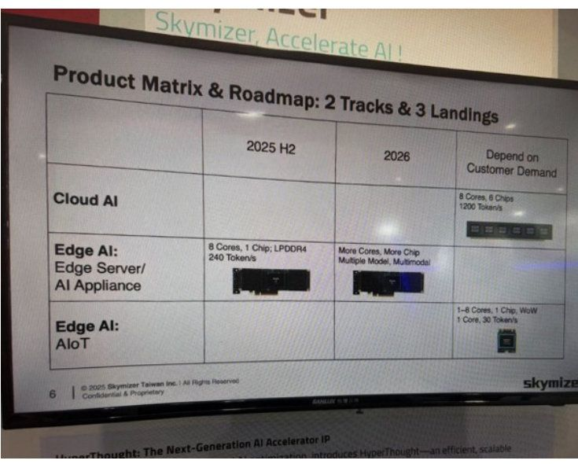

Product Matrix & Roadmap: 2 Tracks & 3 Landings

| | 2025 H2 | 2026 | Depend on Customer Demand |
| --- | --- | --- | --- |
| Cloud AI | | | 8 Cores, 6 Chips 1200 Token/s |
| Edge AI: Edge Server/ AI Appliance | 8 Cores, 1 Chip; LPDDR4 240 Token/s | More Cores, More Chip Multiple Model, Multimodal | |
| Edge AI: AIoT | | | 1–8 Cores, 1 Chip, WoW 1 Core, 30 Token/s |

6 | © 2025 Skymizer Taiwan Inc. All Rights Reserved
Confidential & Proprietary
skymizer

Source: Skymizer, Morgan Stanley Research

## Exhibit 3: Skymizer: smaller weight leads to faster inference

Effective | smaller Weight leads to faster inference

By compressing the original LLaMA2 7B model (26.5GB), the HyperThought software creates a smaller model (3.27GB – 2.96GB) that is 9.17%-17.8% smaller and increases only 0.64%-3.42 % in perplexity, compared to the open-source llama.cpp's compression of LLaMa2 7B (3.6GB).

| LLaMA2 7B Weight | Size |
| --- | --- |
| Original | 26.5GB |
| llama.cpp quantized | 3.6GB |
| HyperThought | 3.27GB – 2.96GB |

Bar chart, y-axis 19.00% / 15.00% / 11.00% / 7.00% / 3.00% / -1.00% / -5.00%; legend: Inference Enhancement, Perplexity Loss. Inference Enhancement (%): 9.17%, 10.83%, 13.33%, 13.69% [OCR_UNCERTAIN], 13.89%, 13.89%, 14.17%, 16.1%, 16.1%, 17.5%, 17.8%; model size labels: 3.27GB, 3.21GB, 3.10GB, 3.10GB, 3.10GB, 3.08GB, 3.02GB, 3.02GB, 2.97GB, 2.96GB; Perplexity Loss (%): -0.64%, -1.21%, -1.67%, -2.15%, -2.15%, -2.44%, -2.70%, -2.71%, -3.28%, -3.42%

© 2025 Skymizer Taiwan Inc.
Confidential & Proprietary

Source: Skymizer, Morgan Stanley Research

## Exhibit 4: Examples of near-memory/storage AI chip integration

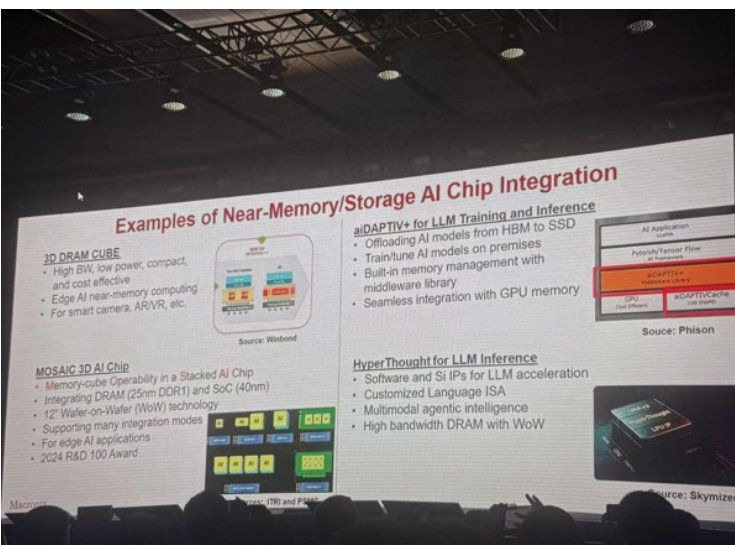

Examples of Near-Memory/Storage AI Chip Integration

3D DRAM CUBE Source: Winbond
- High BW, low power, compact, and cost effective
- Edge AI near-memory computing
- For smart camera, AR/VR, etc.

MOSAIC 3D AI Chip Source: ITRI and PSMC
- Memory-cube Operability in a Stacked AI Chip
- Integrating DRAM (25nm DDR1) and SoC (40nm)
- 12" Wafer-on-Wafer (WoW) technology
- Supporting many integration modes
- For edge AI applications
- 2024 R&D 100 Award

aiDAPTIV+ for LLM Training and Inference Source: Phison
- Offloading AI models from HBM to SSD
- Train/tune AI models on premises
- Built-in memory management with middleware library
- Seamless integration with GPU memory

HyperThought for LLM Inference Source: Skymizer
- Software and Si IPs for LLM acceleration
- Customized Language ISA
- Multimodal agentic intelligence
- High bandwidth DRAM with WoW

Source: CFM Summit, Morgan Stanley Research

# 深圳Skymizer和CFM峰会的关键幻灯片

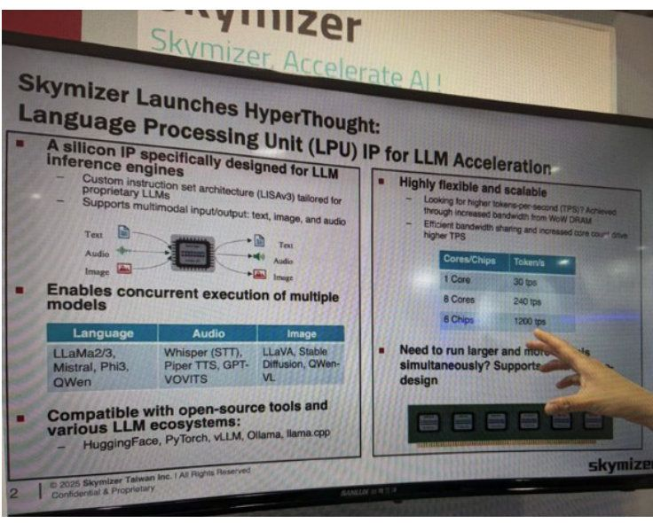

来源：Skymizer、摩根士丹利研究

图表2：Skymizer：产品组合及路线图

来源：Skymizer、摩根士丹利研究

- 客户在宏观经济不确定性下仍有备货意愿
- HBM晶圆需求强度提升进一步改善供需格局
- Micron的HBM份额超预期

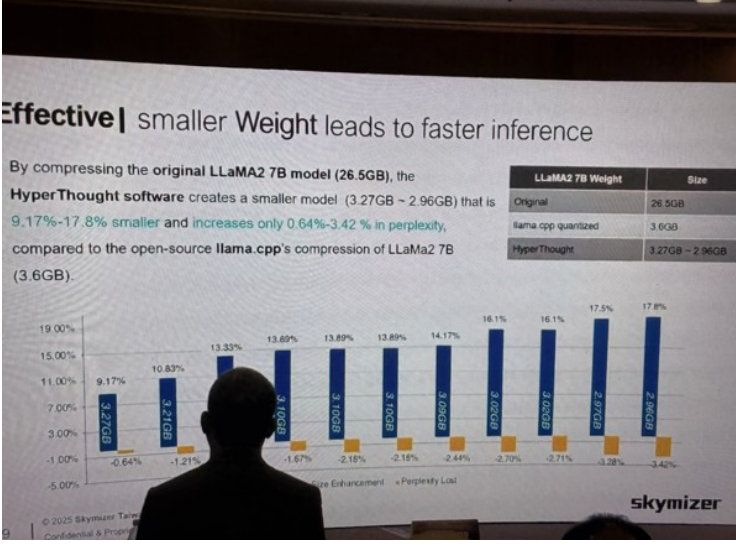

来源：Skymizer、摩根士丹利研究

图表4：近存储/存储AI芯片集成示例集

来源：CFM峰会，摩根士丹利研究

[Source Page: 4]

## Exhibit 5: Longsys: HLC technology reduces DRAM capacity requirement

联合开发HLC技术——UFS实现嵌入式DRAM降容

longsys | 紫光展锐UNISOC

Inactive Process — DRAM — Active Process → Swap out / Swap in → FORESEE UFS 3.1

14nm WM7200 UFS3.1 Controller

启动响应性能对比
- y-axis 1,500 / 1,000 / 500 / 0；x-axis 20 App启动响应时间 (ms)
- legend: 4GB DDR With HLC, 4GB DDR Normal, 6GB DDR Normal, 8GB DDR Normal
- values: With HLC 851 [OCR_UNCERTAIN], 4GB DDR Normal 1,143, 6GB DDR Normal 813, 8GB DDR Normal 796

读写性能对比 (256GB)
- legend: Longsys UFS2.2, Mainstream A, Mainstream B
- Seq.W(MB/s): 1,000 / 850 / 900
- Seq.R(MB/s): 1,070 / 1,000 / 1,050
- Rand.W (KIOPS): 210 / 135 / 170
- Rand.R (KIOPS): 240 / 115 / 150

Source: CFM Summit, Morgan Stanley Research

## Exhibit 6: Longsys: HLC technology reduces DRAM capacity requirement

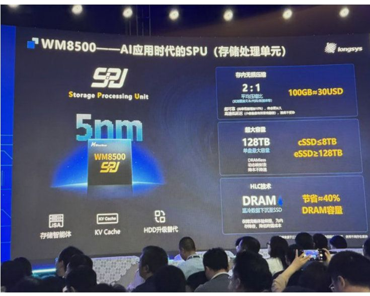

WM8500——AI应用时代的SPU（存储处理单元）

longsys

SPU Storage Processing Unit
5nm
WM8500 SPU

- 存内无损压缩：2:1平均压缩比（[OCR_UNREADABLE]）→ 100GB≈30USD
- 超大容量：128TB单盘最大容量 → cSSD≤8TB、eSSD≥128TB
- HLC技术：DRAM冷数据下沉至SSD → 节省≈40% DRAM容量

存储智能体ISA
KV Cache
HDD升级替代

Source: CFM Summit, Morgan Stanley Research

## Exhibit 7: Phison x iGPU AI PC solution reduces DRAM capacity requirement

Phison Hybrid AI SSD x iGPU = 可负担的AI PC

用于AI PC推论，将可减少超过50%以上的DRAM使用量
可大量部属地端使用AI推论，安全可靠，数据不外泄，成本可控

如果要在本地端AI PC跑GPT-OSS-120B的AI模型推论 → 非常高的DRAM搭载成本

一般AI PC方案：DRAM 96GB（AI Cache）+ SSD（Storage）

Phison x iGPU AI PC方案：大幅降低DRAM的搭载成本 → DRAM 32GB（AI Cache）+ Phison Hybrid AI SSD（Cache + Storage）

Phison x iGPU AI PC方案（aiDAPTIV+ Approach）
- Phison Hybrid AI SSD群联 混合型AI SSD
- "AI Cache + 存储" = 单一顆SSD
- 存储器Storage（OS, User data）
- AI缓存DRAM/Memory缓存需求

PHISON

Source: CFM Summit, Morgan Stanley Research

## Exhibit 8: Maxio: architecture innovation allows support of large capacity SSD with very small amount of DDR

技术创新：高性能、高密度与低成本融合

通过ASIC技术突破与固件架构创新，大容量、低成本成为可能

- 映射扩展技术：最大单盘容量达到512TB
- Agile ECC技术：采用第五代Agile ECC技术
- FW架构创新：极少DDR支持超大容量SSD

MEID联芸科技Maxio Technology

Source: CFM Summit, Morgan Stanley Research

图表5：江波龙（Longsys）：HLC技术降低DRAM容量需求。

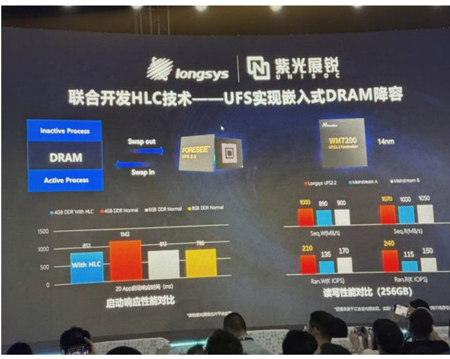

来源：CFM峰会，摩根士丹利研究

图表6：Longsys：HLC技术降低DRAM容量需求

来源：CFM峰会，摩根士丹利研究

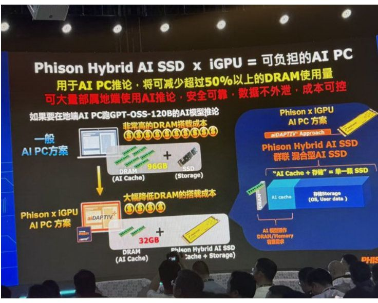

来源：CFM峰会，摩根士丹利研究

图表8：Maxio：架构创新支持使用极少DDR的大容量SSD。

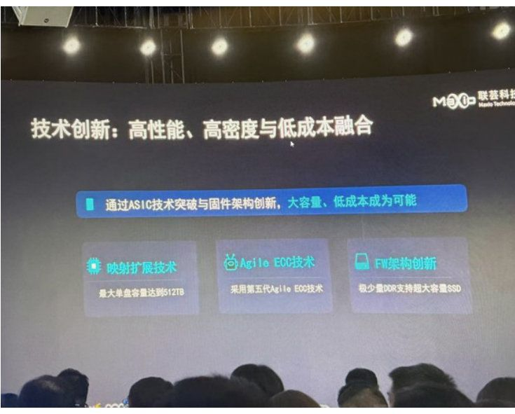

来源：CFM峰会，摩根士丹利研究

[Source Page: 5]

## Exhibit 9: T-Head: ZNS technology reduces DRAM capacity requirement for use of QLC SSD

Alibaba平头哥

ZNS + QLC：释放QLC价值

ZNS技术概要
- Application 1 / Application 2 / Application 3 → Conventional SSD Controller, Flash
- → ZNS [OCR_UNREADABLE] Controller, Flash

ZNS是QLC的最佳选择
- 性能：降低写放大，显著提高顺序写入性能
- 寿命：减少垃圾回收，提高磨损均衡效率，降低SSD磨损
- 成本：大幅减少OP空间，降低DRAM容量 [OCR_UNCERTAIN]

Source: CFM Summit, Morgan Stanley Research

## Exhibit 10: Tencent Cloud: competitiveness improvement is tied to the ability to optimize DRAM cost

方案背景及业界问题——背景

OpenCloud05

AI浪潮下，服务器内存运营成本飙升，内存利用率亟可提升
- 公司业务规模与复杂度不断增长，[OCR_UNREADABLE]成本也在增长。
- AI爆发式增长挤压DRAM产能，导致DRAM供应端缺货。
- 提升内存利用率，优化内存成本是公司竞争力提升的重要因素。
- TencentOS作为业务基座，有着管理内存的天然优势。

云原生场景与商业化竞争对OS基础能力提出更多要求
- 容器场景对宿主机资源有更极致的利用，给OS层的Cgroup内存管理提出更多挑战与机遇。

实际场景中有大量冷内存可以进行回收
- 柱状图：y-axis 100 / 80 / 60 / 40 / 20（[OCR_UNREADABLE]）；x-axis组A、组B [OCR_UNREADABLE]；legend: Sized 1 min, Sized 2 min, Sized 3 min, Total Allocated
- 业界调研与内部观察均发现，应用程序为了更高性能和降低开发成本，大量采用内存密集性策略，内存中存在一定比例的冷内存（https://doi.org/10.1145/3552326.3567311）
- 基于Idle Page Tracking特性，采集公司内主要负载类型5min-24h波动的冷内存情况，冷内存比例可观。

Source: CFM Summit, Morgan Stanley Research

## Exhibit 11: Tencent Cloud: optimized solutions to compress DRAM

方案架构——架构图

OpenCloud05

架构图节点（可辨识部分）：UMRD、Cgroup、PSI、Working Set Avg、Container、[OCR_UNREADABLE]、Page Hotness & Pageout Timing、ZRAM Swap、SWAP Balanced、[OCR_UNREADABLE]、NVMe SSD/HDD/Network、优化

面对众多挑战，进行大量系统性设计开发，实现了高性能多级卸载方案
- 挑战一 [OCR_UNREADABLE]
- 挑战二 [OCR_UNREADABLE]
- 挑战三 [OCR_UNREADABLE]
- 挑战四 [OCR_UNREADABLE]
- 挑战五 [OCR_UNREADABLE]
- 优化一至优化五 [OCR_UNREADABLE]

Source: CFM Summit, Morgan Stanley Research

## Exhibit 12: Intel: cloud + local hybrid deployment may be the best way to use Openclaw

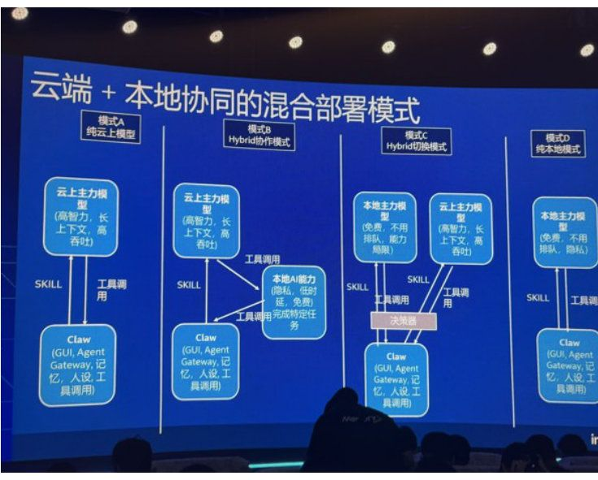

云端 + 本地协同的混合部署模式

模式A纯云上模型
- 云上主力模型（高智力，长上下文，高吞吐）— SKILL / 工具调用 → Claw（GUI, Agent Gateway, 记忆, 人设, 工具调用）

模式B Hybrid协作模式
- 云上主力模型（高智力，长上下文，高吞吐）— SKILL → Claw（GUI, Agent Gateway, 记忆, 人设, 工具调用）
- 本地AI能力（隐私，低时延，免费）— 工具调用 → Claw；云上主力模型 —> 本地AI能力：工具调用 完成特定任务

模式C Hybrid切换模式
- 本地主力模型（免费，不用排队，能力局限）— SKILL → Claw
- 云上主力模型（高智力，长上下文，高吞吐）— 工具调用 → Claw
- 决策器（连接本地主力模型与云上主力模型）

模式D纯本地模式
- 本地主力模型（免费，不用排队，隐私）— SKILL / 工具调用 → Claw（GUI, Agent Gateway, 记忆, 人设, 工具调用）

intel

Source: CFM Summit, Morgan Stanley Research

图表14：Phison：边缘AI的普及将成为NAND、DRAM的新增长驱动力

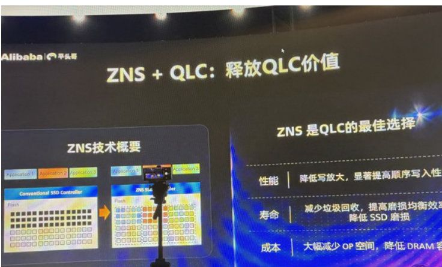

来源：CFM峰会，摩根士丹利研究

图表10：腾讯云：竞争力提升与优化DRAM成本的能力相关。

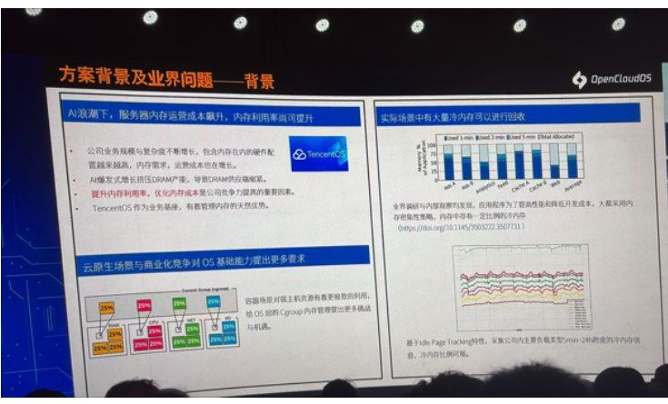

来源：CFM峰会，摩根士丹利研究

附录11：腾讯云：压缩优化解决方案DRAM

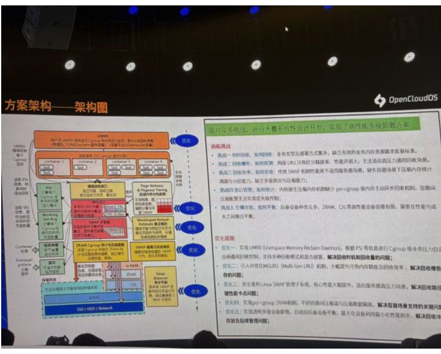

来源：CFM峰会，摩根士丹利研究

图表12：英特尔：云 + 本地混合部署可能是使用Openclaw的最佳方式

来源：CFM峰会，摩根士丹利研究

[Source Page: 6]

## Exhibit 13: Intel: hybrid Openclaw deployment with local models supported by 32GB DRAM

云端Hybrid协助示例

「帮我把今天的微博热搜挑选一个主题，整理成小红书文案，并生成配图」

- 云上模型：拆解并规划任务
- 云上模型：基于定时任务选题，并生成文案
- 云上模型：提取并生成提示词
- 云上模型：归档整理成文档

OpenClaw实现了在具备32GB内存的AI PC上完整智能体环境的本地部署，支持端侧数据处理和交互，同时支持本地35B A3B和Z-image-turbo模型

weibo-trendnote-alpc
- 定时任务：抓取微博热搜榜，Qwen3.5-35B-A3B本地AI摘要，写入Obsidian笔记

local-image-gen-alpc
- 一次性任务：使用z-image-turbo本地图片创作

intel

Source: CFM Summit, Morgan Stanley Research

## Exhibit 14: Phison: proliferation of edge AI to be a new growth driver for NAND, DRAM

AI普及地端化，将是NAND Flash全新的成长动能

PHISON

AI系统需要大量的内存（DRAM/AI Cache）将为NAND Flash创造新的成长动能与机会

- AI Cache → 大语言模型运作、代理人AI
- Data Storage → 数据中心、车用电子、智能型手机、工业系统、PC计算机

NAND Flash在过去40年以来都仅被使用于资料存储

时间轴：2022 Generative AI Boom、2026 (Now)

PHISON NAND Flash Controller
AI DAPTIV+

Source: CFM Summit, Morgan Stanley Research

## Exhibit 15: XPeng: as VLA parameter size expands, large DRAM capacity may no longer be optional

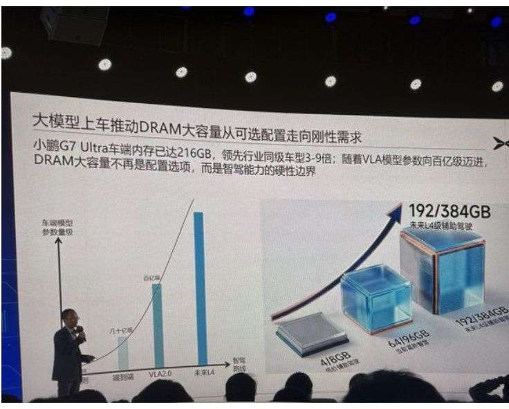

大模型上车推动DRAM大容量从可选配置走向刚性需求

小鹏G7 Ultra车端内存已达216GB，领先行业同级车型3-9倍；随着VLA模型参数向百亿级迈进，DRAM大容量不再是配置选项，而是智驾能力的硬性边界

- 柱状图：纵轴「车端模型参数量级」；横轴「智驾路线」，节点为 端到端、VLA2.0、未来L4；标注 几十亿级、百亿级
- 示意图：4/8GB低阶辅助驾驶 → 64/96GB当前高阶智驾 → 192/384GB未来L4级辅助驾驶

Source: CFM Summit, Morgan Stanley Research

图表13：英特尔：混合OpenClaw部署，本地模型由32GB DRAM支持。

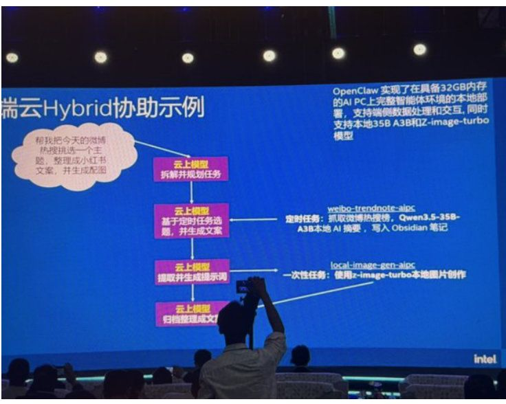

来源：CFM峰会，摩根士丹利研究

1a/1b nm制程产能爬坡慢于预期；4K2K电视及智能机顶盒对专用DRAM的需求减少

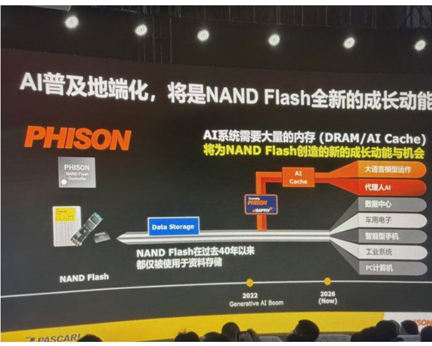

来源：CFM峰会，摩根士丹利研究

图表15：小鹏汽车（XPeng）：随着VLA参数规模扩大，大容量DRAM可能不再是可选配置

来源：CFM峰会，摩根士丹利研究

[Source Page: 7]

# Key Charts and Exhibits

## Exhibit 16: Order of preference: GC memory

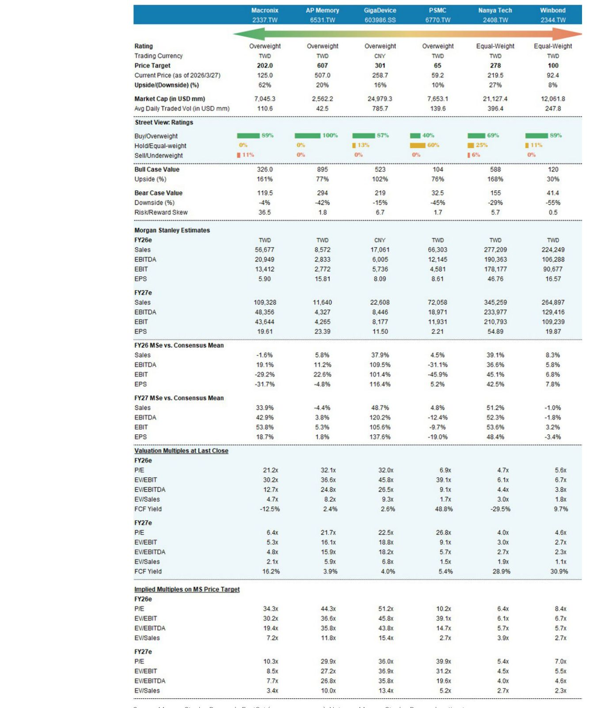

Order of preference: GC memory

| | Macronix 2337.TW | AP Memory 6531.TW | GigaDevice 603986.SS | PSMC 6770.TW | Nanya Tech 2408.TW | Winbond 2344.TW |
| --- | --- | --- | --- | --- | --- | --- |
| Rating | Overweight | Overweight | Overweight | Overweight | Equal-Weight | Equal-Weight |
| Trading Currency | TWD | TWD | CNY | TWD | TWD | TWD |
| Price Target | 202.0 | 607 | 301 | 65 | 278 | 100 |
| Current Price (as of 2026/3/27) | 125.0 | 507.0 | 258.7 | 59.2 | 219.5 | 92.4 |
| Upside/(Downside) (%) | 62% | 20% | 16% | 10% | 27% | 8% |
| Market Cap (in USD mn) | 7,045.3 | 2,562.2 | 24,979.3 | 7,653.1 | 21,127.4 | 12,061.8 |
| Avg Daily Traded Vol (in USD mn) | 110.6 | 42.5 | 785.7 | 139.6 | 396.4 | 247.8 |
| Street View: Ratings | | | | | | |
| Buy/Overweight | 89% | 100% | 87% | 40% | 69% | 89% |
| Hold/Equal-weight | 0% | 0% | 13% | 60% | 25% | 11% |
| Sell/Underweight | 11% | 0% | 0% | 0% | 6% | 0% |
| Bull Case Value | 326.0 | 895 | 523 | 104 | 588 | 120 |
| Upside (%) | 161% | 77% | 102% | 76% | 168% | 30% |
| Bear Case Value | 119.5 | 294 | 219 | 32.5 | 155 | 41.4 |
| Downside (%) | -4% | -42% | -15% | -45% | -29% | -55% |
| Risk/Reward Skew | 36.5 | 1.8 | 6.7 | 1.7 | 5.7 | 0.5 |
| Morgan Stanley Estimates | | | | | | |
| FY26e | TWD | TWD | CNY | TWD | TWD | TWD |
| Sales | 56,677 | 8,572 | 17,061 | 66,303 | 277,209 | 224,249 |
| EBITDA | 20,949 | 2,833 | 6,005 | 12,145 | 190,363 | 106,288 |
| EBIT | 13,412 | 2,772 | 5,736 | 4,581 | 178,177 | 90,677 |
| EPS | 5.90 | 15.81 | 8.09 | 8.61 | 46.76 | 16.57 |
| FY27e | | | | | | |
| Sales | 109,328 | 11,640 | 22,608 | 72,058 | 345,259 | 264,897 |
| EBITDA | 48,356 | 4,327 | 8,446 | 18,971 | 233,977 | 129,416 |
| EBIT | 43,644 | 4,265 | 8,177 | 11,931 | 210,793 | 109,239 |
| EPS | 19.61 | 23.39 | 11.50 | 2.21 | 54.89 | 19.87 |
| FY26 MSe vs. Consensus Mean | | | | | | |
| Sales | -1.6% | 5.8% | 37.9% | 4.5% | 39.1% | 8.3% |
| EBITDA | 19.1% | 11.2% | 109.5% | -31.1% | 36.6% | 5.8% |
| EBIT | -29.2% | 22.6% | 101.4% | -45.9% | 45.1% | 6.8% |
| EPS | -31.7% | -4.8% | 116.4% | 5.2% | 42.5% | 7.8% |
| FY27 MSe vs. Consensus Mean | | | | | | |
| Sales | 33.9% | -4.4% | 48.7% | 4.8% | 51.2% | -1.0% |
| EBITDA | 42.9% | 3.8% | 120.2% | -12.4% | 52.3% | -1.8% |
| EBIT | 53.8% | 5.3% | 105.6% | -9.7% | 53.6% | 3.2% |
| EPS | 18.7% | 1.8% | 137.6% | -19.0% | 48.4% | -3.4% |
| Valuation Multiples at Last Close | | | | | | |
| FY26e | | | | | | |
| P/E | 21.2x | 32.1x | 32.0x | 6.9x | 4.7x | 5.6x |
| EV/EBIT | 30.2x | 36.6x | 45.8x | 39.1x | 6.1x | 6.7x |
| EV/EBITDA | 12.7x | 24.8x | 26.5x | 9.1x | 4.4x | 3.8x |
| EV/Sales | 4.7x | 8.2x | 9.3x | 1.7x | 3.0x | 1.8x |
| FCF Yield | -12.5% | 2.4% | 2.6% | 48.8% | -29.5% | 9.7% |
| FY27e | | | | | | |
| P/E | 6.4x | 21.7x | 22.5x | 26.8x | 4.0x | 4.6x |
| EV/EBIT | 5.3x | 16.1x | 18.8x | 9.1x | 3.0x | 2.7x |
| EV/EBITDA | 4.8x | 15.9x | 18.2x | 5.7x | 2.7x | 2.3x |
| EV/Sales | 2.1x | 5.9x | 6.8x | 1.5x | 1.9x | 1.1x |
| FCF Yield | 16.2% | 3.9% | 4.0% | 5.4% | 28.9% | 30.9% |
| Implied Multiples on MS Price Target | | | | | | |
| FY26e | | | | | | |
| P/E | 34.3x | 44.3x | 51.2x | 10.2x | 6.4x | 8.4x |
| EV/EBIT | 30.2x | 36.6x | 45.8x | 39.1x | 6.1x | 6.7x |
| EV/EBITDA | 19.4x | 35.8x | 43.8x | 14.7x | 5.7x | 5.7x |
| EV/Sales | 7.2x | 11.8x | 15.4x | 2.7x | 3.9x | 2.7x |
| FY27e | | | | | | |
| P/E | 10.3x | 29.9x | 36.0x | 39.9x | 5.4x | 7.0x |
| EV/EBIT | 8.5x | 27.2x | 36.9x | 31.2x | 4.5x | 5.5x |
| EV/EBITDA | 7.7x | 26.8x | 35.8x | 19.6x | 4.0x | 4.6x |
| EV/Sales | 3.4x | 10.0x | 13.4x | 5.2x | 2.7x | 2.3x |

Source: Morgan Stanley Research, FactSet (consensus mean). Note: e = Morgan Stanley Research estimates.

# 关键图表和图表

## 附录16: 优先顺序：GC存储

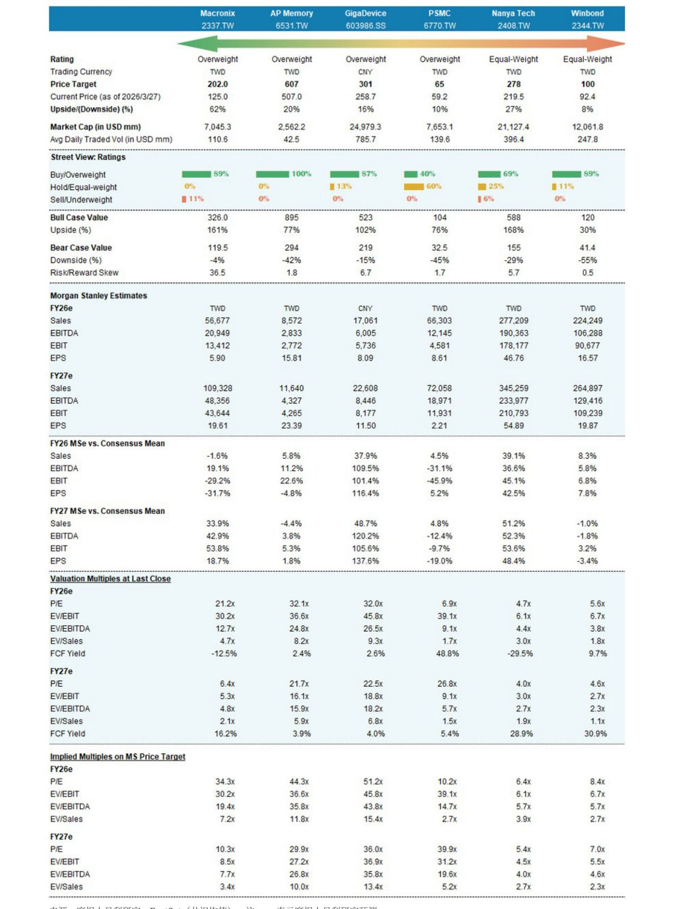

Macronix 2337.TW / AP Memory 6531.TW / GigaDevice 603986.SS / PSMC 6770.TW / Nanya Tech 2408.TW / Winbond 2344.TW

来源：摩根士丹利研究、FactSet（共识均值）。注：e= 表示摩根士丹利研究预测。

[Source Page: 8]

## Exhibit 17: Token demands continue to surge

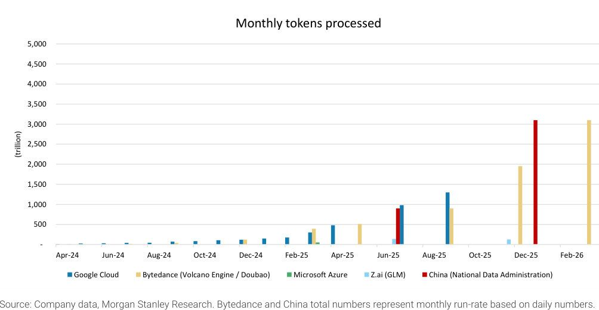

Monthly tokens processed

- y-axis：token（trillion），500–5,000
- x-axis：Apr-24至Feb-26，双月刻度
- legend：Google Cloud、Bytedance (Volcano Engine / Doubao)、Microsoft Azure、Z.ai (GLM)、China (National Data Administration)

Source: Company data, Morgan Stanley Research. Bytedance and China total numbers represent monthly run-rate based on daily numbers.

## Exhibit 18: NOR flash demand and supply growth rates

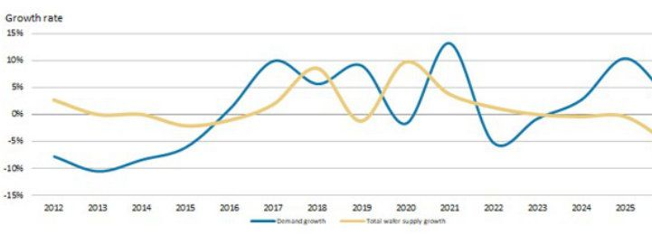

- y-axis：Growth rate，30%至 -30%
- x-axis：2012–2026
- 两条曲线，无图例

Source: Company data, Morgan Stanley Research

## Exhibit 19: NOR flash demand growth and supply growth by density

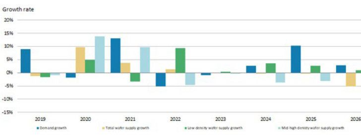

- y-axis：Growth rate，20%至 -20%
- x-axis：2012–2026
- 柱内分组标签：16Gb、32Gb、64Gb、128Gb、256Gb与1-4Gb、8-16Gb、32-64Gb、128-256Gb、512Gb-1Tb

Source: Company data, Morgan Stanley Research

## Exhibit 20: DDR4 quarterly supply and demand summary

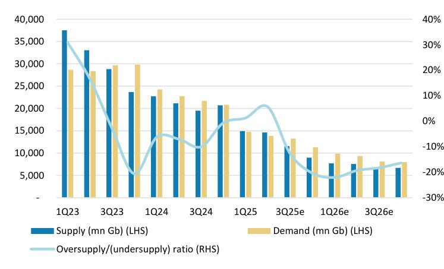

- y-axis（左）：0–40,000；y-axis（右）：-30%至40%
- x-axis：1Q23–4Q26e
- legend：Supply (mn Gb)（左轴）、Demand (mn Gb)（左轴）、Oversupply/(undersupply) ratio（右轴）

Source: Morgan Stanley Research (e) estimates

## Exhibit 21: Quarterly oversupply/undersupply ratio vs. Nanya and Winbond pricing Q/Q change

- y-axis：-50%至60%
- x-axis：1Q23–4Q26e
- legend：Oversupply/(undersupply) ratio、Nanya pricing Q/Q change、Winbond pricing Q/Q change

Source: Morgan Stanley Research (e) estimates

图表17：Token需求持续飙升

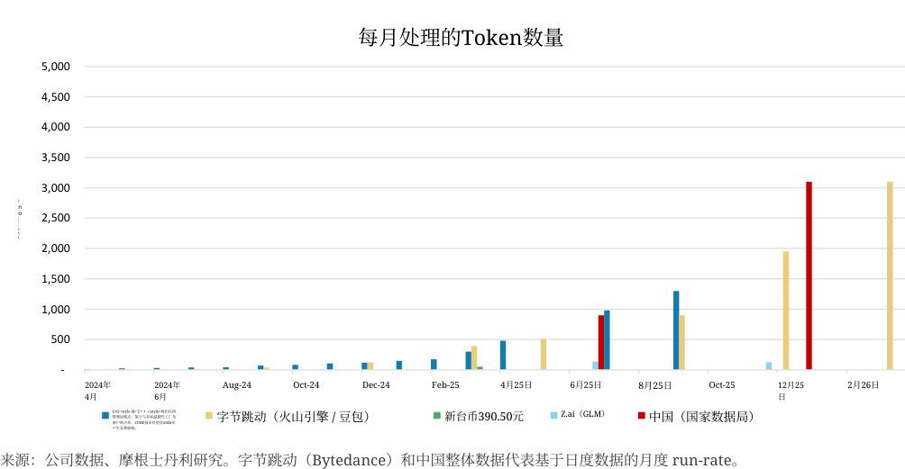

来源：公司数据、摩根士丹利研究。字节跳动（Bytedance）和中国整体数据代表基于日度数据的月度run-rate。

图表18：NOR闪存需求和供应增长率

来源：公司数据，摩根士丹利研究

图表19：NOR闪存需求和供应按密度的增长率。

来源：公司数据，摩根士丹利研究

附件20：DDR4季度供需摘要

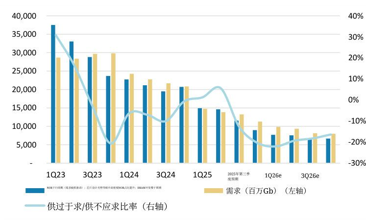

来源：摩根士丹利研究 (e)预估

附录21: 季度供需过剩/不足比率vs. Nanya和Winbond定价环比变化

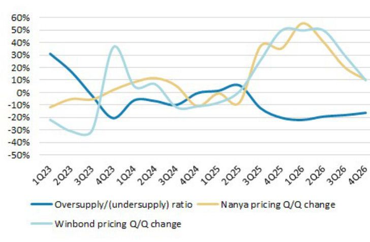

来源：摩根士丹利研究 (e)预估

[Source Page: 9]

## Exhibit 22: Quarterly supply breakdown (mn Gb)

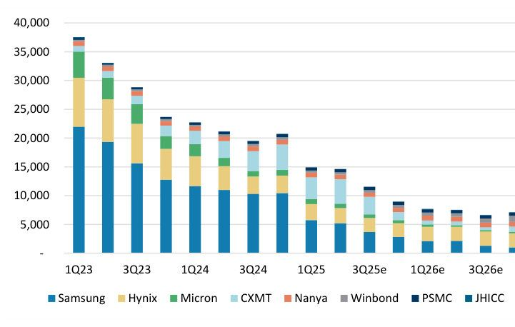

- y-axis：0–40,000
- x-axis：1Q23–3Q26e
- legend：Samsung、Hynix、Micron、CXMT、Nanya、Winbond、PSMC、JHICC

Source: Morgan Stanley Research (e) estimates

## Exhibit 23: Quarterly demand breakdown by product (mn Gb)

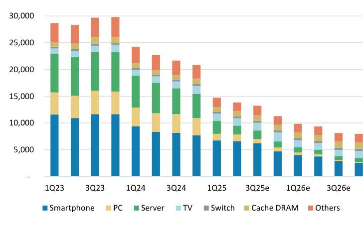

- y-axis：0–30,000
- x-axis：1Q23–3Q26e
- legend：Smartphone、PC、Server、TV、Switch、Cache DRAM、Others

Source: Morgan Stanley Research (e) estimates

## Exhibit 24: Memory vendors GM

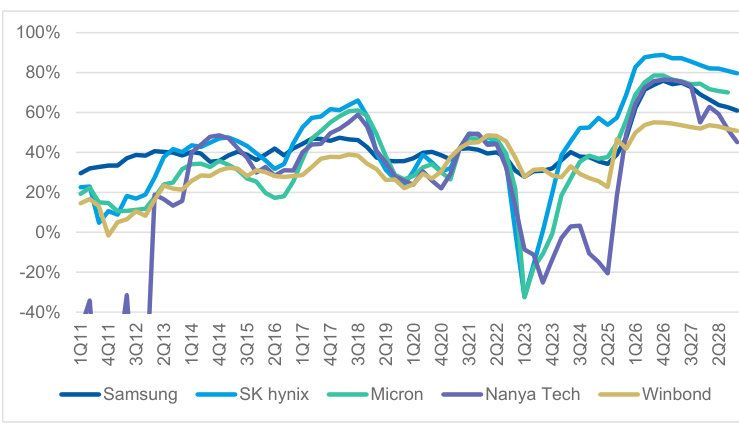

- y-axis：-40%至100%
- x-axis：1Q11–2Q28
- legend：Samsung、SK hynix、Micron、Nanya Tech、Winbond

Source: Company data, Morgan Stanley Research estimates

## Exhibit 25: Memory vendors OPM

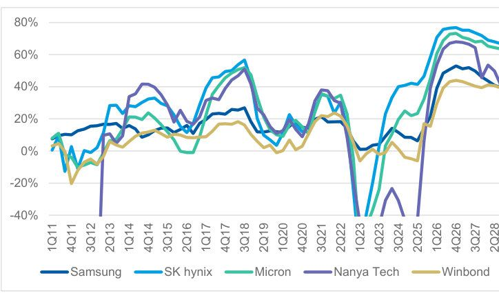

- y-axis：-40%至80%
- x-axis：1Q11–2Q28
- legend：Samsung、SK hynix、Micron、Nanya Tech、Winbond

Source: Company data, Morgan Stanley Research estimates

## Exhibit 26: DDR4 8Gb (1Gx8) pricing chart

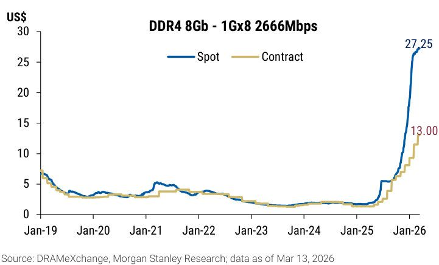

DDR4 8Gb - 1Gx8 2666Mbps

- y-axis：US$，0–30
- x-axis：Jan-19、Jan-20、Jan-21、Jan-22、Jan-23、Jan-24、Jan-25、Jan-26
- legend：Spot、Contract
- 标注：27.25、13.00

Source: DRAMeXchange, Morgan Stanley Research; data as of Mar 13, 2026

## Exhibit 27: DDR5 16Gb (2Gx8) pricing chart

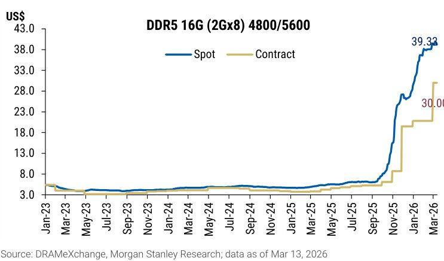

DDR5 16G (2Gx8) 4800/5600

- y-axis：US$，0–43.0
- x-axis：Jan-23至Mar-26，月度刻度
- legend：Spot、Contract
- 标注：39.33、30.00

Source: DRAMeXchange, Morgan Stanley Research; data as of Mar 13, 2026

图表22：季度供应细分（百万Gb）

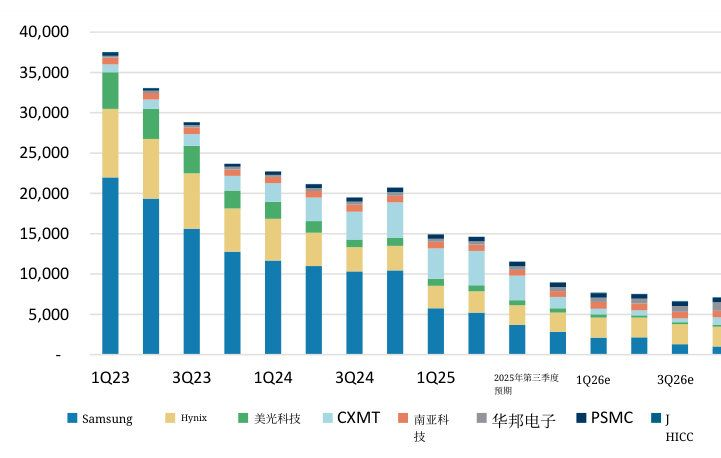

来源：摩根士丹利研究（e）预估

图表23：按产品划分的季度需求细分（百万Gb）

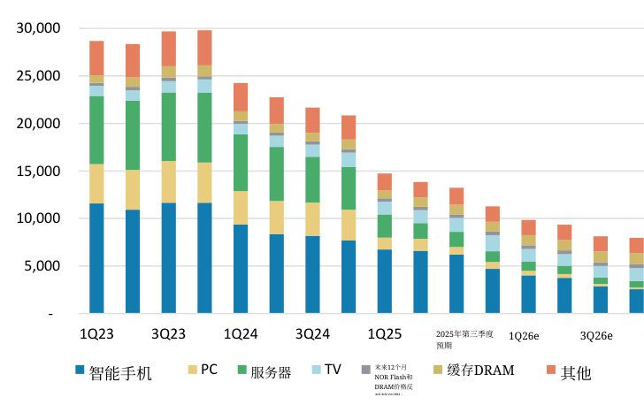

来源：摩根士丹利研究（e）预估

图表24：存储厂商毛利率（GM）

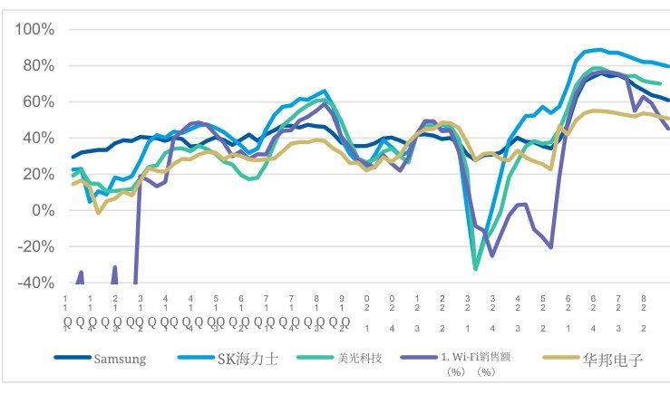

来源：公司数据，摩根士丹利研究预估

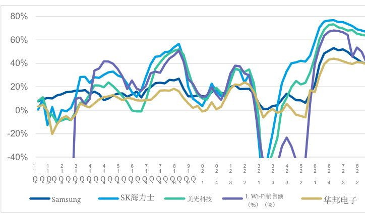

图表1: Skymizer：用于LLM加速的LPU IP

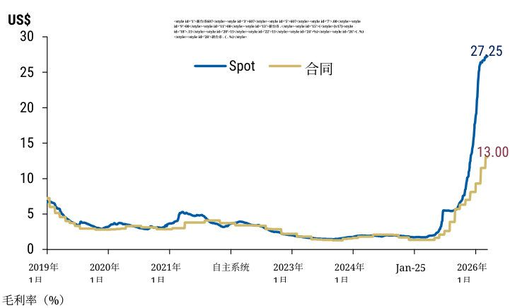

毛利率（%）

图表27：DDR5 16Gb（2Gx8）价格图表

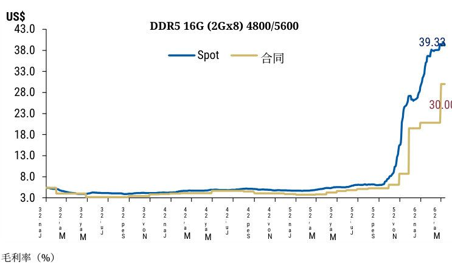

毛利率（%）

来源：DRAMeXchange、摩根士丹利研究；数据截至2026年3月13日

[Source Page: 10]

# AP Memory: Estimate Revisions Summary

**We cut our 2028 EPS estimates by 4%, while keeping 2026e/27e EPS unchanged:** We slightly cut our 2028 revenue forecasts mainly due to a weaker DDR3 market, although we still anticipate strong IPD revenue.

## Exhibit 28: AP Memory – Estimate revisions summary

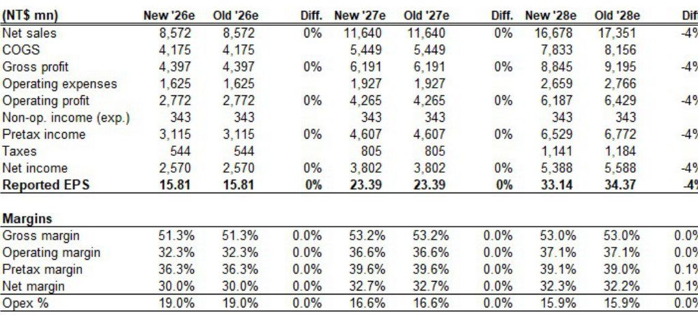

| (NT$ mn) | New '26e | Old '26e | Diff. | New '27e | Old '27e | Diff. | New '28e | Old '28e | Diff. |
| --- | --- | --- | --- | --- | --- | --- | --- | --- | --- |
| Net sales | 8,572 | 8,572 | 0% | 11,640 | 11,640 | 0% | 16,678 | 17,351 | -4% |
| COGS | 4,175 | 4,175 | | 5,449 | 5,449 | | 7,833 | 8,156 | |
| Gross profit | 4,397 | 4,397 | 0% | 6,191 | 6,191 | 0% | 8,845 | 9,195 | -4% |
| Operating expenses | 1,625 | 1,625 | | 1,927 | 1,927 | | 2,659 | 2,766 | |
| Operating profit | 2,772 | 2,772 | 0% | 4,265 | 4,265 | 0% | 6,187 | 6,429 | -4% |
| Non-op. income (exp.) | 343 | 343 | | 343 | 343 | | 343 | 343 | |
| Pretax income | 3,115 | 3,115 | 0% | 4,607 | 4,607 | 0% | 6,529 | 6,772 | -4% |
| Taxes | 544 | 544 | | 805 | 805 | | 1,141 | 1,184 | |
| Net income | 2,570 | 2,570 | 0% | 3,802 | 3,802 | 0% | 5,388 | 5,588 | -4% |
| **Reported EPS** | 15.81 | 15.81 | 0% | 23.39 | 23.39 | 0% | 33.14 | 34.37 | -4% |
| **Margins** | | | | | | | | | |
| Gross margin | 51.3% | 51.3% | 0.0% | 53.2% | 53.2% | 0.0% | 53.0% | 53.0% | 0.0% |
| Operating margin | 32.3% | 32.3% | 0.0% | 36.6% | 36.6% | 0.0% | 37.1% | 37.1% | 0.0% |
| Pretax margin | 36.3% | 36.3% | 0.0% | 39.6% | 39.6% | 0.0% | 39.1% | 39.0% | 0.1% |
| Net margin | 30.0% | 30.0% | 0.0% | 32.7% | 32.7% | 0.0% | 32.3% | 32.2% | 0.1% |
| Opex % | 19.0% | 19.0% | 0.0% | 16.6% | 16.6% | 0.0% | 15.9% | 15.9% | 0.0% |

Source: Company data, Morgan Stanley Research (e) estimates

## Exhibit 29: AP Memory – Quarterly financial summary

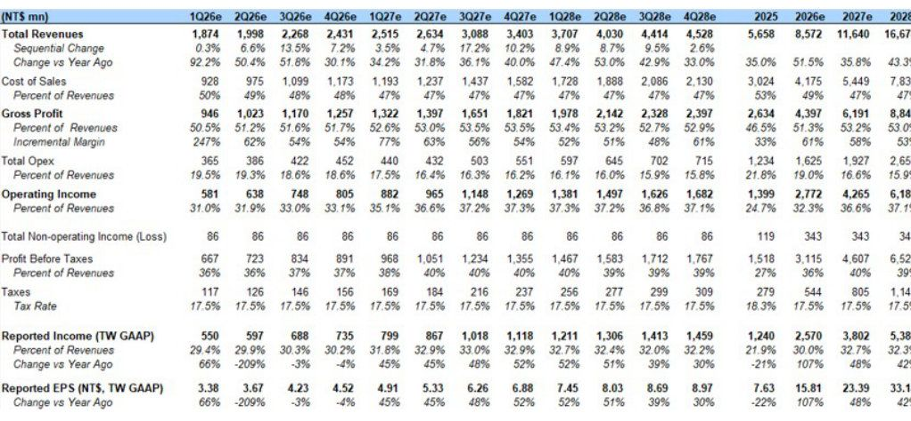

| (NT$ mn) | 1Q26e | 2Q26e | 3Q26e | 4Q26e | 1Q27e | 2Q27e | 3Q27e | 4Q27e | 1Q28e | 2Q28e | 3Q28e | 4Q28e | 2025 | 2026e | 2027e | 2028e |
| --- | --- | --- | --- | --- | --- | --- | --- | --- | --- | --- | --- | --- | --- | --- | --- | --- |
| **Total Revenues** | 1,874 | 1,998 | 2,268 | 2,431 | 2,515 | 2,634 | 3,088 | 3,403 | 3,707 | 4,030 | 4,414 | 4,528 | 5,658 | 8,572 | 11,640 | 16,678 |
| Sequential Change | 0.3% | 6.6% | 13.5% | 7.2% | 3.5% | 4.7% | 17.2% | 10.2% | 8.9% | 8.7% | 9.5% | 2.6% | | | | |
| Change vs Year Ago | 92.2% | 50.4% | 51.8% | 30.1% | 34.2% | 31.8% | 36.1% | 40.0% | 47.4% | 53.0% | 42.9% | 33.0% | 35.0% | 51.5% | 35.8% | 43.3% |
| Cost of Sales | 928 | 975 | 1,099 | 1,173 | 1,193 | 1,237 | 1,437 | 1,582 | 1,728 | 1,888 | 2,086 | 2,130 | 3,024 | 4,175 | 5,449 | 7,833 |
| Percent of Revenues | 50% | 49% | 48% | 48% | 47% | 47% | 47% | 47% | 47% | 47% | 47% | 47% | 53% | 49% | 47% | 47% |
| **Gross Profit** | 946 | 1,023 | 1,170 | 1,257 | 1,322 | 1,397 | 1,651 | 1,821 | 1,978 | 2,142 | 2,328 | 2,397 | 2,634 | 4,397 | 6,191 | 8,845 |
| Percent of Revenues | 50.5% | 51.2% | 51.6% | 51.7% | 52.6% | 53.0% | 53.5% | 53.5% | 53.4% | 53.2% | 52.7% | 52.9% | 46.5% | 51.3% | 53.2% | 53.0% |
| Incremental Margin | 247% | 62% | 54% | 54% | 77% | 63% | 56% | 54% | 52% | 51% | 48% | 61% | 33% | 61% | 58% | 53% |
| Total Opex | 365 | 385 | 422 | 452 | 440 | 432 | 503 | 551 | 597 | 645 | 702 | 715 | 1,234 | 1,625 | 1,927 | 2,659 |
| Percent of Revenues | 19.5% | 19.3% | 18.6% | 18.6% | 17.5% | 16.4% | 16.3% | 16.2% | 16.1% | 16.0% | 15.9% | 15.8% | 21.8% | 19.0% | 16.6% | 15.9% |
| **Operating Income** | 581 | 638 | 748 | 805 | 882 | 965 | 1,148 | 1,269 | 1,381 | 1,497 | 1,626 | 1,682 | 1,399 | 2,772 | 4,265 | 6,187 |
| Percent of Revenues | 31.0% | 31.9% | 33.0% | 33.1% | 35.1% | 36.6% | 37.2% | 37.3% | 37.3% | 37.2% | 36.8% | 37.1% | 24.7% | 32.3% | 36.6% | 37.1% |
| Total Non-operating Income (Loss) | 86 | 86 | 86 | 86 | 86 | 86 | 86 | 86 | 86 | 86 | 86 | 86 | 119 | 343 | 343 | 343 |
| **Profit Before Taxes** | 667 | 723 | 834 | 891 | 968 | 1,051 | 1,234 | 1,355 | 1,467 | 1,583 | 1,712 | 1,767 | 1,518 | 3,115 | 4,607 | 6,529 |
| Percent of Revenues | 36% | 36% | 37% | 37% | 38% | 40% | 40% | 40% | 40% | 39% | 39% | 39% | 27% | 36% | 40% | 39% |
| Taxes | 117 | 126 | 146 | 156 | 169 | 184 | 216 | 237 | 256 | 277 | 299 | 309 | 279 | 544 | 805 | 1,141 |
| Tax Rate | 17.5% | 17.5% | 17.5% | 17.5% | 17.5% | 17.5% | 17.5% | 17.5% | 17.5% | 17.5% | 17.5% | 17.5% | 18.3% | 17.5% | 17.5% | 17.5% |
| **Reported Income (TW GAAP)** | 550 | 597 | 688 | 735 | 799 | 867 | 1,018 | 1,118 | 1,211 | 1,306 | 1,413 | 1,459 | 1,240 | 2,570 | 3,802 | 5,388 |
| Percent of Revenues | 29.4% | 29.9% | 30.3% | 30.2% | 31.8% | 32.9% | 33.0% | 32.9% | 32.7% | 32.4% | 32.0% | 32.2% | 21.9% | 30.0% | 32.7% | 32.3% |
| Change vs Year Ago | 66% | -209% | -3% | -4% | 45% | 45% | 48% | 52% | 52% | 51% | 39% | 30% | -21% | 107% | 48% | 42% |
| **Reported EPS (NT$, TW GAAP)** | 3.38 | 3.67 | 4.23 | 4.52 | 4.91 | 5.33 | 6.26 | 6.88 | 7.45 | 8.03 | 8.69 | 8.97 | 7.63 | 15.81 | 23.39 | 33.14 |
| Change vs Year Ago | 66% | -209% | -3% | -4% | 45% | 45% | 48% | 52% | 52% | 51% | 39% | 30% | -22% | 107% | 48% | 42% |

Source: Company data, Morgan Stanley Research (e) estimates

# AP Memory：预测调整摘要

我们将2028年每股收益预估下调4%，同时维持2026年/2027年预期每股收益不变：我们略微下调2028年营收预测，主要因DDR3市场疲软，尽管我们仍预计IPD收入强劲。

## 附录28: AP Memory – 预估修订摘要

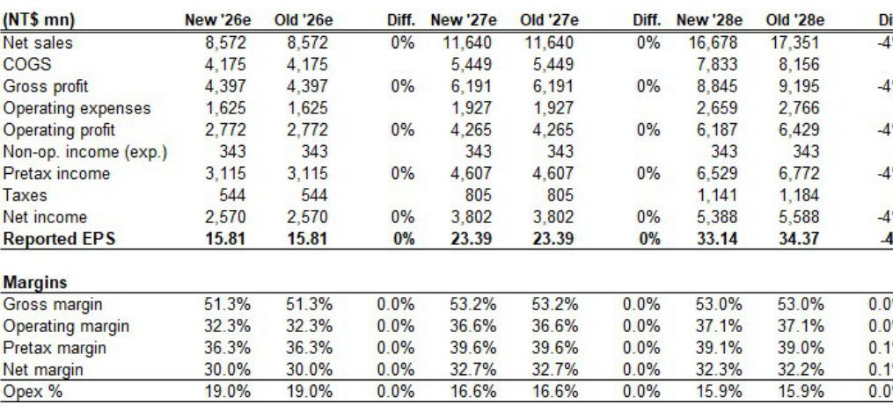

来源：公司数据，摩根士丹利研究（预估）

## 附件29：AP Memory – 季度财务摘要

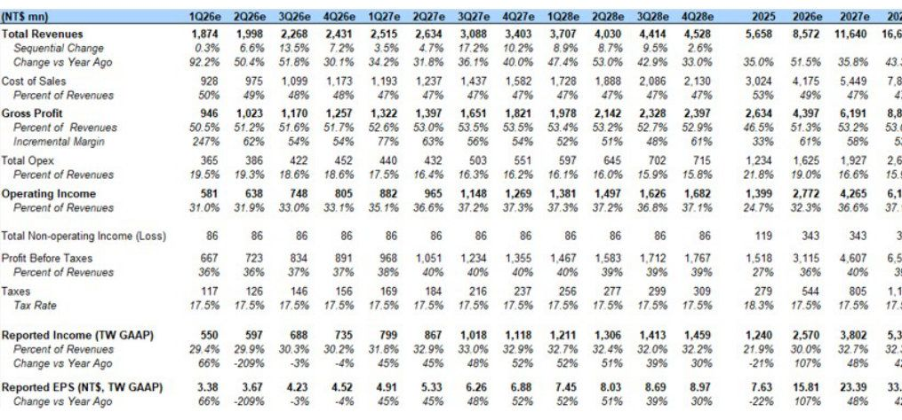

来源：公司数据，摩根士丹利研究（预估）

[Source Page: 11]

# AP Memory: Valuation Methodology

**We cut our price target to NT$607 from NT$700** to reflect our earnings estimate changes.

Most of our residual income model assumptions are unchanged, including: 1) cost of equity unchanged at 9.2% (2.0% risk-free rate, 6% risk premium, 1.2 beta); 2) payout ratio of 67%; and 3) intermediate growth rate at 11.0%. We lower our terminal growth rate to 3.0% from 4.0% to be more in line with the long-term macro growth rate. Our new PT implies 2026e P/E of 38x – still roughly 1 s.d. above the historical average since 2020.

Our bull and bear case values were cut to NT$895 (from NT$1,032) and NT$294 (from NT$339), respectively.

## Exhibit 30: AP Memory: Residual Income model

| (NT$ mn) | 2026e | 2027e | 2028e | 2029e | 2030e | 2031e | 2032e | 2033e | 2034e | 2035e | 2036e | 2037e |
| --- | --- | --- | --- | --- | --- | --- | --- | --- | --- | --- | --- | --- |
| Total Equity | 14,100 | 16,170 | 18,998 | 21,372 | 24,007 | 26,932 | 30,178 | 33,781 | 37,780 | 42,218 | 47,144 | 52,612 |
| Net Profit | 2,570 | 3,802 | 5,388 | 5,980 | 6,637 | 7,367 | 8,177 | 9,075 | 10,073 | 11,180 | 12,408 | 13,772 |
| ROAE | 19.4% | 25.1% | 30.6% | 29.6% | 29.3% | 28.9% | 28.6% | 28.4% | 28.2% | 27.9% | 27.8% | 27.6% |
| Residual Income | 1,264 | 2,244 | 3,467 | 3,880 | 4,285 | 4,734 | 5,233 | 5,786 | 6,400 | 7,082 | 7,838 | 8,678 |
| Spread | 10.2% | 15.9% | 21.4% | 20.4% | 20.0% | 19.7% | 19.4% | 19.2% | 18.9% | 18.7% | 18.6% | 18.4% |
| Ending Equity Capital | 14,100 | | | | | | | | | | | |
| PV of Forecast Period | 29,832 | | | | | | | | | | | |
| PV of Continuing Value | 54,695 | | | | | | | | | | | |
| Equity Value | 98,627 | | | | | | | | | | | |
| No. of Shares | 163 | | | | | | | | | | | |
| Projected Price (NT$) | 607 | | | | | | | | | | | |

Source: Company data, Morgan Stanley Research (e) estimates

## Exhibit 31: AP Memory: Historical forward P/E

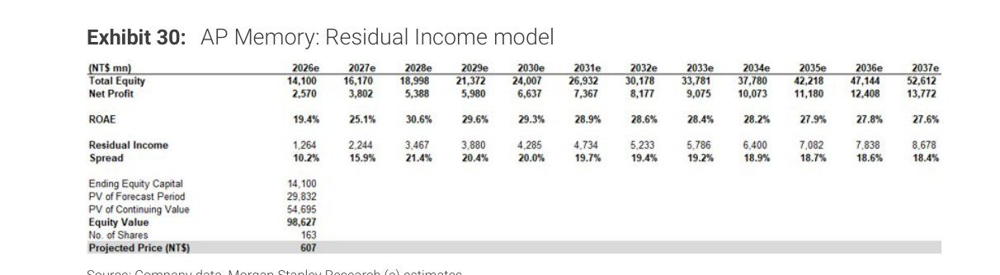

- y轴：0–80，P/E (x)
- x轴：Jan-20–Jan-26
- 标注：-1 S.D.: 16x、Avg.: 27x、+1 S.D.: 39x

Source: Company data, Morgan Stanley Research

# AP Memory：估值方法

我们将目标价从700新台币下调至607新台币以反映盈利预测变化。

我们剩余收益模型的大部分假设保持不变，包括：1）权益成本维持9.2%（2.0无风险利率，6%风险溢价，1.2贝塔值）；2）派息率67%；3）中期增长率11.0%。我们将终期增长率从4.0%下调至3.0%，以更符合长期宏观增长率。我们的新目标价隐含2026年预期市盈率38倍，仍比2020年以来的历史平均水平高出约1个标准差。

我们将牛市和熊市情景值分别下调至NT$895（原NT$1,032）和NT$294（原NT$339）。

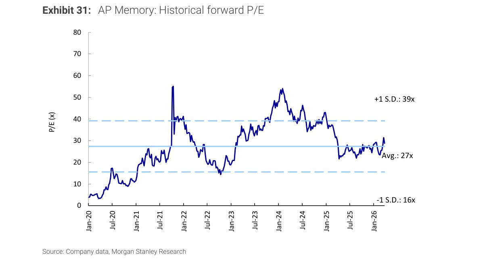

来源：公司数据、摩根士丹利研究（预估）

## 图表31：AP Memory：历史预期市盈率

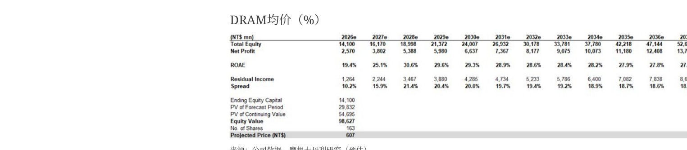

- y轴：0–80，P/E (x)
- x轴：Jan-20–Jan-26
- 标注：-1标准差：16倍、平均：27x、+1标准差：39倍

来源：公司数据、摩根士丹利研究报告

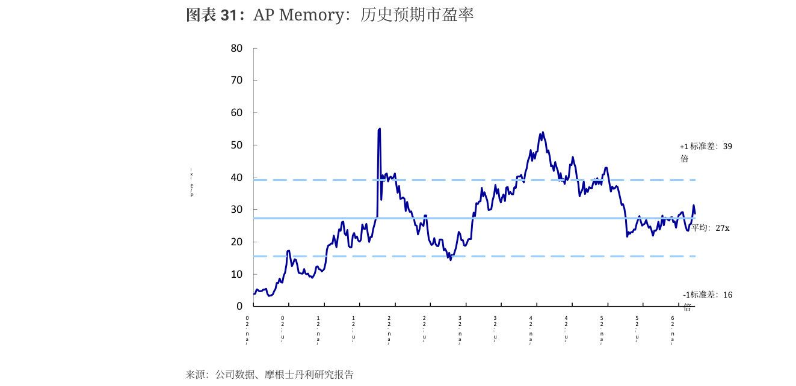

[Source Page: 12]

# Exhibit 32: AP Memory: Earnings estimate revision breadth

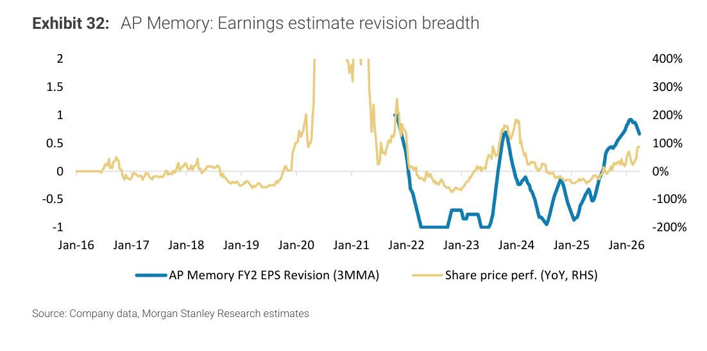

- y轴（左）：-1至2
- y轴（右）：-200%至400%
- x轴：Jan-16–Jan-26
- 图例：AP Memory FY2 EPS Revision (3MMA)、Share price perf. (YoY, RHS)

Source: Company data, Morgan Stanley Research estimates

# 附录32: AP Memory: 盈利预估修订范围

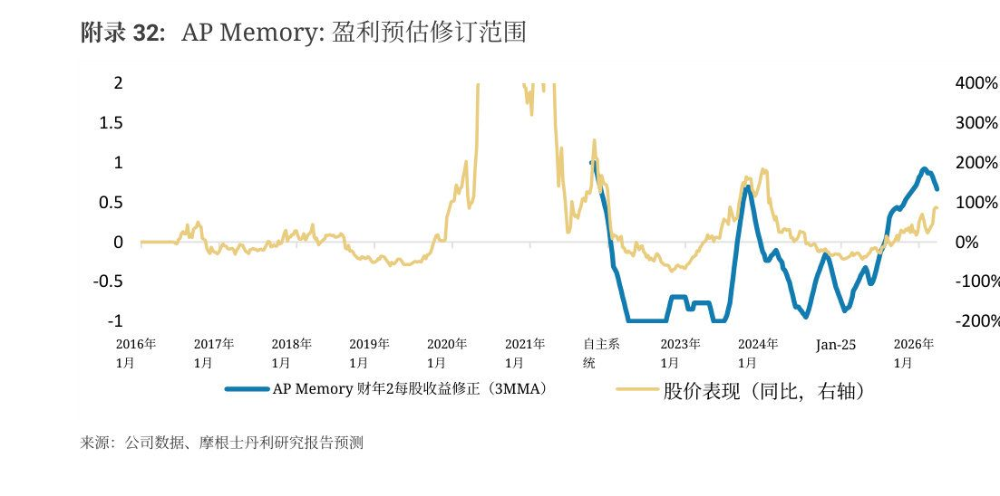

- y轴（左）：-1至2
- y轴（右）：-200%至400%
- x轴：2016年1月–2026年1月
- 图例：AP Memory财年2每股收益修正（3MMA）、股价表现（同比，右轴）

来源：公司数据、摩根士丹利研究报告预测

[Source Page: 13]

# Risk Reward – AP Memory Technology Corp (6531.TW)

OW on IPD and WoW opportunities

## PRICE TARGET NT$607.00

Base case, derived from a residual income model. Key RI model assumptions include 1) cost of equity constant at 9.2% (2.0% risk-free rate, 6% risk premium, 1.2 beta); 2) payout ratio of 67%; 3) terminal growth rate of 3.0%; and 4) medium-term growth rate of 11.0%.

## OVERWEIGHT THESIS

- IPD (interposers and discretes) revenue is likely to ramp in 2026-27e, and be further driven by new IPD interposer opportunities into 2028.
- Memory bandwidth and power consumption are the next issues to be resolved in AI computing, and we believe AP Memory's wafer-on wafer (WoW) packaging technology could be an effective solution.
- The company expects memory business to be stable in the near term.
- Overall AI business should continue to rise in the mix – a positive read for the margin profile.
- Our PT implies 38x 2026e P/E - roughly 1 s.d. above the average level since 2020.

## RISK REWARD CHART

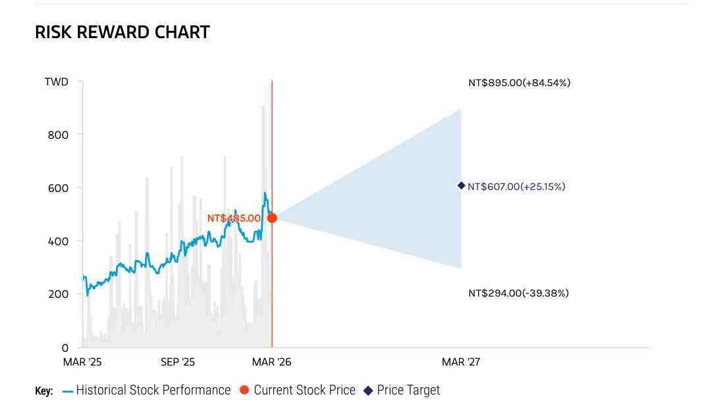

- y轴：TWD 0–600以上
- x轴：MAR '25–MAR '27
- 标注：NT$895.00(+84.54%)、NT$607.00(+25.15%)、NT$294.00(-39.38%)；当前股价NT$485.00
- 图例：Historical Stock Performance、Current Stock Price、Price Target

Key: — Historical Stock Performance ● Current Stock Price ◆ Price Target

Source: Refinitiv, Morgan Stanley Research

## Consensus Rating Distribution

| 评级 | 占比 |
| --- | --- |
| Overweight | 100% |
| Equal-weight | 0% |
| Underweight | 0% |

MS Rating: Overweight

Source: Refinitiv, Morgan Stanley Research

## Risk Reward Themes

- Secular Growth: Positive
- Technology Diffusion: Positive

View descriptions of Risk Rewards Themes here

## BULL CASE NT$895.00

57x 2026e EPS

Faster-than-expected AI and IPD business progress with PSRAM generating more cash flow: We assume: 1) WoW packaging revenue to reach >NT$7bn, and IPD revenue to reach <NT$8bn by 2028; 2) total revenue to rise at a 50%+ CAGR, 2025-28; and 3) gross margin to increase from 46.5% in 2025 to 60%+ by 2028.

## BASE CASE NT$607.00

38x 2026e EPS

Fast-growing AI and IPD business, with PSRAM generating stable cash flows: We expect: 1) WoW revenue to reach NT$5.5bn, and IPD revenue to reach NT$5.9bn by 2028; 2) total revenue to rise at a 43% CAGR, 2025-28; and 3) gross margin to increase from 46.5% in 2025 to over 53% in 2028.

## BEAR CASE NT$294.00

19x 2026e EPS

Slower-than-expected AI and IPD business progress, with PSRAM facing intensifying competition: We assume: 1) WoW packaging revenue of ~NT$1.5bn, and IPD revenue of ~NT$2bn by 2028; 2) total revenue to rise at an 10-15% CAGR, 2025-28; and 3) gross margin to remain at ~51% by 2028.

# 风险回报 – AP Memory Technology Corp（6531.TW）

对IPD和WoW机会给予超配（OW）

## 目标价 新台币607.00元

基准情形，源自剩余收益模型。关键剩余收益（RI）模型假设包括：1）权益成本维持9.2%（2.0%无风险利率，6%风险溢价，1.2贝塔值）；2）派息率67%；3）终期增长率3.0%；4）中期增长率11.0%。

## 增持观点

- IPD（中介层和分立器件）收入可能在2026-2027年预期内增长，并在2028年因新的IPD中介层机会进一步推动。
- AI计算中接下来需要解决的问题是内存带宽和功耗，我们认为AP Memory的晶圆级堆叠（WoW）封装技术可能是一个有效的解决方案。
- 该公司预计近期存储业务将保持稳定。
- Overall AI business should持续上升 [OCR_UNCERTAIN]
- 我们的目标价隐含2026年预期市盈率38倍，约为1 [OCR_UNCERTAIN]比2020年以来的平均水平高1个标准差。

## 风险回报图表

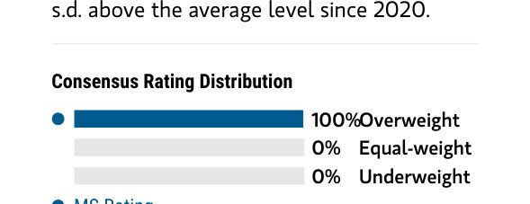

- y轴：TWD 0–600以上
- x轴：2025年3月–2027年3月（SEP '25、2026年3月）
- 标注：NT$485.00（当前股价）、NT$294.00(-39.38%)；NT$895.00(+84.54%)标签显示为 "895 00 / +84 54 %" [OCR_UNCERTAIN]
- 图例：历史股价表现、当前股价、目标价

Key: — 历史股价表现 ● 当前股价 ◆ 目标价

来源：Refinitiv、摩根士丹利研究

## 共识评级分布

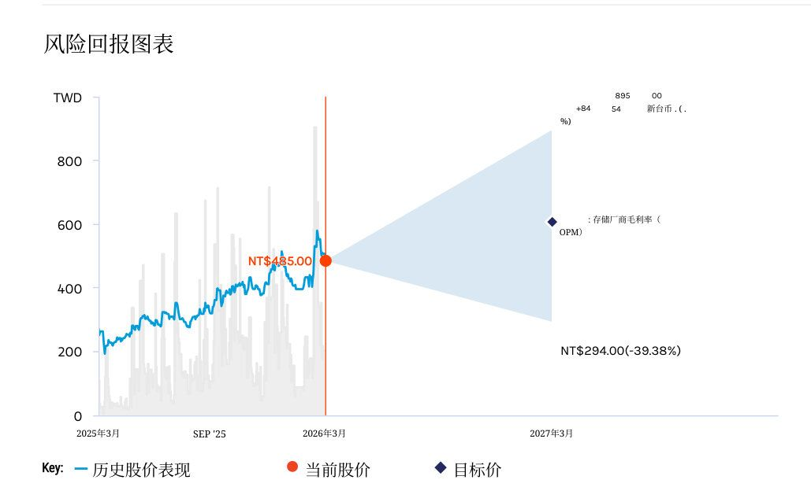

- 标签："19倍2026年预期每股收益（EPS）"、"0%中性"、"0%减持"
- "摩根士丹利评级"

来源：Refinitiv、摩根士丹利研究

## 风险回报主题

长期增长：积极；技术扩散：积极

查看风险回报主题描述 此处

## 牛市情形NT$895.00

57x 2026e EPS

AI和IPD业务进展快于预期，PSRAM产生更多现金流：我们假设：1）到2028年，WoW封装收入将达到>70亿新台币，IPD收入将达到<80亿新台币；2）2025-2028年总营收复合年增长率为50%+；3）毛利率从2025年的46.5%提升至2028年的60%+。

## 基准情景 新台币607.00元

38倍2026年预期每股收益（EPS）

AI和IPD业务快速增长，PSRAM产生稳定现金流：我们预计：1）到2028年，WoW收入将达到55亿新台币，IPD收入将达到59亿新台币；2）2025-2028年总营收复合年增长率为43%；3）毛利率从2025年的46.5%提升至2028年的53%以上。

## 看空情形 新台币200.00元

AI和IPD业务进展慢于预期，PSRAM面临竞争加剧：我们假设：1）到2028年，WoW封装收入为~NT$1.5bn，IPD收入为~NT$2bn；2）2025-28年总收入复合年增长率为10-15%；3）到2028年毛利率保持在~51%。

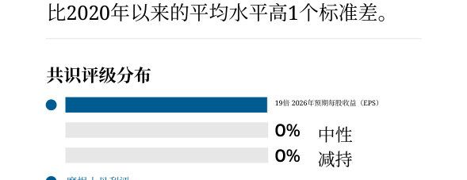

[Source Page: 14]

# Risk Reward – AP Memory Technology Corp (6531.TW)

## KEY EARNINGS INPUTS

| Drivers | 2025 | 2026e | 2027e | 2028e |
| --- | --- | --- | --- | --- |
| 1. Wifi Sales (%) (%) | 73.7 | 62.6 | 50.2 | 31.6 |
| 2. Ethernet Sales (%) (%) | 7.1 | 10.1 | 25.3 | 32.8 |

## INVESTMENT DRIVERS

- Demand for AI applications
- Consumer tech demand, especially from the IoT market

## GLOBAL REVENUE EXPOSURE

- 0-10% India
- 0-10% Japan
- 0-10% Latin America
- 0-10% MEA
- 0-10% North America
- 10-20% APAC, ex Japan, Mainland China and India
- 10-20% Europe ex UK
- 30-40% Mainland China

Source: Morgan Stanley Research Estimate
View explanation of regional hierarchies here

## RISKS TO PT/RATING

### RISKS TO UPSIDE

- Stronger-than-expected consumer demand
- Faster-than-expected IPD ramp and WoW packaging development
- Milder competition from partners (foundry, memory house, GPU vendor) or other design houses

### RISKS TO DOWNSIDE

- Weaker-than-expected consumer demand
- Slower-than-expected IPD ramp and WoW packaging development
- Intensifying competition from partners (foundry, memory house, GPU vendor) or other design houses

## OWNERSHIP POSITIONING

Inst. Owners, % Active 56.2%

Source: Refinitiv, Morgan Stanley Research

## MS ESTIMATES VS. CONSENSUS

FY Dec 2026e

| Metric | Morgan Stanley Estimates | Mean | Range |
| --- | --- | --- | --- |
| EPS (NT$) | 15.81 | 16.60 | 13.11–22.84 |
| Sales / Revenue (NT$, mn) | 8,572 | 8,100 | 7,760–8,572 |
| Net income (NT$, mn) | 2,570 | 2,237 | 1,859–2,570 |
| ROE (%) | 21.0 | 16.9 | 13.9–21.0 |

◇ Mean ◆ Morgan Stanley Estimates

Source: Refinitiv, Morgan Stanley Research

# 风险回报 – AP Memory Technology Corp（6531.TW）

## 关键收益输入

| 驱动因素 | 2025 | 2026e | 2027e | 2028e |
| --- | --- | --- | --- | --- |
| [OCR_UNCERTAIN] | 73.7 | 62.6 | 50.2 | 31.6 |
| 2.以太网销售额（%）（%） | 7.1 | 10.1 | 25.3 | 32.8 |

## 投资驱动因素

- AI应用需求 消费科技需求，尤其是物联网市场

## 全球收入敞口

- 0-10%印度
- 0-10%日本
- 0-10%拉丁美洲
- 0-10%中东及非洲
- 0-10%北美
- 10-20%亚太区（不含日本、中国大陆及印度）
- 10-20%欧洲（不含英国）
- 30-40%中国大陆

来源：摩根士丹利研究预测 查看区域层级说明here

## 目标价/评级风险

### 上行风险

- 强于预期的消费者需求
- 快于预期的IPD提升和WoW封装开发
- 来自合作伙伴（晶圆厂、存储厂商、GPU供应商）或其他设计公司的竞争趋缓

### 下行风险

- 弱于预期的消费者需求
- 慢于预期的IPD提升和WoW封装开发
- 来自合作伙伴（晶圆厂、存储厂商、GPU供应商）或其他设计公司的竞争加剧

## 所有权定位

机构所有者，活跃占比（%）56.2%

来源：Refinitiv、摩根士丹利研究

## 摩根士丹利预测vs共识

- EPS (NT$)：13.11 / 15.81 / 16.60 / 22.84
- 销售额/收入 (NT$, mn)：7,760 / 8,100 / 8,572
- 净利润 (NT$, mn)：1,859 / 2,237 / 2,570
- ROE (%)：13.9 / 16.9 / 21.0
- 图例：Mean、摩根士丹利预估

来源：Refinitiv、摩根士丹利研究

[Source Page: 15]

# AP Memory: Financial Summary

## Exhibit 33: Financial summary

### Income Statement

| NT$ mn (Years End Dec) | 2025 | 2026e | 2027e | 2028e |
| --- | --- | --- | --- | --- |
| Net sales | 5,658 | 8,572 | 11,640 | 16,678 |
| COGS | (3,024) | (4,175) | (5,449) | (7,833) |
| Gross profit | 2,634 | 4,397 | 6,191 | 8,845 |
| Operating expenses | (1,234) | (1,625) | (1,927) | (2,659) |
| **Operating income** | **1,399** | **2,772** | **4,265** | **6,187** |
| Non-operating income | 119 | 343 | 343 | 343 |
| Pre-tax income | 1,518 | 3,115 | 4,607 | 6,529 |
| Income tax | 56 | 150 | 221 | 314 |
| Net Income bf. emp. bonus | 1,575 | 3,264 | 4,828 | 6,843 |
| Employee bonus expense | 335 | 694 | 1,027 | 1,455 |
| **Reported net Income** | **1,240** | **2,570** | **3,802** | **5,388** |
| Adj.wtd.avg.shrs (million) | 163 | 163 | 163 | 163 |
| **Reported EPS (NT$)** | **7.63** | **15.81** | **23.39** | **33.14** |
| **Modelware Diluted EPS (NT$)** | **7.63** | **15.81** | **23.39** | **33.14** |

### Cash Flow Statement

| NT$ mn (Years End Dec) | 2025 | 2026e | 2027e | 2028e |
| --- | --- | --- | --- | --- |
| **Cashflow from Operations** | **1,575** | **2,054** | **3,264** | **4,406** |
| Net profits | 1,240 | 2,570 | 3,802 | 5,388 |
| Depreciation | 59 | 61 | 62 | 64 |
| Working Capital Change | (145) | (577) | (601) | (1,046) |
| Other adjustments | 421 | 0 | 0 | 0 |
| **Cashflow from Investing** | **(67)** | **(66)** | **(69)** | **(71)** |
| Capex | (26) | (66) | (69) | (71) |
| Change of LT Investment | 0 | 0 | 0 | 0 |
| Change of ST Investment | 0 | 0 | 0 | 0 |
| Other adjustments | (41) | 0 | 0 | 0 |
| **Cashflow from financing** | **1,564** | **(835)** | **(1,731)** | **(2,560)** |
| Increase in LT debt | 0 | 0 | 0 | 0 |
| Increase in ST debt | 100 | 0 | 0 | 0 |
| Cash Dividend Paid | (968) | (835) | (1,731) | (2,560) |
| Dir& Emp Bonus Paid | 0 | 0 | 0 | 0 |
| Issuance of stock | 0 | 0 | 0 | 0 |
| Other adjustments | 2,433 | 0 | 0 | 0 |
| Exchange rate adjustment | 3 | 0 | 0 | 0 |
| **Net change in cash** | **3,075** | **1,153** | **1,464** | **1,774** |

### Balance Sheet

| NT$ mn (Years End Dec) | 2025 | 2026e | 2027e | 2028e |
| --- | --- | --- | --- | --- |
| Cash | 7,263 | 8,416 | 9,880 | 11,654 |
| Mkt Securities | 3,756 | 3,756 | 3,756 | 3,756 |
| ARINR | 588 | 942 | 1,279 | 1,833 |
| Inventory | 1,145 | 1,349 | 1,761 | 2,532 |
| Other | 187 | 187 | 187 | 187 |
| **Current Assets** | **12,939** | **14,650** | **16,863** | **19,962** |
| Long-term investments | 1,206 | 1,206 | 1,206 | 1,206 |
| Fixed assets | 57 | 63 | 69 | 76 |
| Deferred assets | 126 | 126 | 126 | 126 |
| Other assets | 411 | 411 | 411 | 411 |
| **Total Assets** | **14,740** | **16,457** | **18,676** | **21,782** |
| SIT borrowings | 200 | 200 | 200 | 200 |
| APINP | 505 | 486 | 635 | 913 |
| Other ST liabilities | 1,582 | 1,582 | 1,582 | 1,582 |
| LT debt | 0 | 0 | 0 | 0 |
| Other LT liabilities | 89 | 89 | 89 | 89 |
| Common shares | 814 | 814 | 814 | 814 |
| **Total Liabilities** | **2,376** | **2,357** | **2,506** | **2,784** |
| Additional capital | 7,535 | 7,535 | 7,535 | 7,535 |
| Retained earning | 3,776 | 5,512 | 7,583 | 10,411 |
| Other shareholders' equity | 179 | 179 | 179 | 179 |
| **Total Equity** | **12,364** | **14,100** | **16,170** | **18,998** |
| **Total Liab. & Shrhldr's Equity** | **14,740** | **16,457** | **18,676** | **21,782** |

### Financial Ratios

| | 2025 | 2026e | 2027e | 2028e |
| --- | --- | --- | --- | --- |
| **Growth(%)** | | | | |
| Turnover | 35.0 | 51.5 | 35.8 | 43.3 |
| Operating profits | 31.6 | 98.1 | 53.8 | 45.1 |
| Pretax profits | -25.3 | 105.1 | 47.9 | 41.7 |
| Net profits | -21.4 | 107.3 | 47.9 | 41.7 |
| EPS | -21.6 | 107.3 | 47.9 | 41.7 |
| **Margins (%)** | | | | |
| Gross Margin | 46.5 | 51.3 | 53.2 | 53.0 |
| Operating Margin | 24.7 | 32.3 | 36.6 | 37.1 |
| Pretax Margin | 26.8 | 36.3 | 39.6 | 39.1 |
| Net Profit | 21.9 | 30.0 | 32.7 | 32.3 |
| **Return (%)** | | | | |
| ROAE | 10.2 | 19.4 | 25.1 | 30.6 |
| ROAA | 8.9 | 16.5 | 21.6 | 26.6 |
| **Gearing (%)** | | | | |
| Net Debt/Equity | (57.1) | (58.3) | (59.3) | (60.3) |
| Liabilities/Equity | 19.2 | 16.7 | 15.5 | 14.7 |
| **Ratios (X)** | | | | |
| Current ratio | 5.7 | 6.5 | 7.0 | 7.4 |
| Quick ratio | 3.4 | 4.1 | 4.6 | 5.0 |
| **Others** | | | | |
| ARINR Turnover (days) | 40 | 40 | 40 | 40 |
| Inventory Turnover (days) | 118 | 118 | 118 | 118 |
| AP Turnover (days) | 43 | 43 | 43 | 43 |
| Cash Conversion (days) | 116 | 116 | 116 | 116 |

e = Morgan Stanley Research Estimates

Source: Morgan Stanley Research, Company Data

# AP Memory：财务摘要

## 图表33：财务摘要

来源：公司数据、摩根士丹利研究（E）估计

[Source Page: 16]

# Winbond: Valuation Methodology

**We cut our price target to NT$100 from NT$140:** We continue to use a P/B multiple methodology to derive our price target, in line with our approach for Greater China memory IDM peers and in view of the industry's high earnings volatility. Our new price target implies a 2.7x 2026e BVPS, down from our prior target multiple of 3.7x 2026e BVPS, although still more than 1 S.D. higher than its historical average of 1.1x since 2017, as we expect derating for Winbond's DDR4/3 exposure.

We cut our bull case PT to NT$120 (3.2x our 2026e BVPS) and our bear case value to NT$41.4 (1.1x our 2026e BVPS).

## Exhibit 34: Winbond: Historical forward P/B

- y轴：0.0x–3.5x
- x轴：Jan-17–Jan-26
- 标注：+1 SD: 1.4x、Average: 1.1x、-1 SD: 0.7x

Source: Company data, Morgan Stanley Research estimates

## Exhibit 35: Winbond: Historical forward P/B vs ROE

- y轴（左）：0.0–3.5（Forward PB）
- y轴（右）：-20%–90%（ROE）
- x轴：01/07/2016–01/07/2026
- 图例：Forward PB (LHS)、ROE (annualized, RHS)

Source: Company data, Morgan Stanley Research estimates

# 华邦电子：估值方法

我们将目标价下调至NT$100从NT$140下调：我们继续使用市净率（P/B）倍数方法来推导目标价，与我们对大中华区存储IDM同行一致，并考虑到行业盈利波动性较高。我们的新价格目标对应2026e BVPS的2.7x，低于之前的3.7x 2026eBVPS，尽管仍比2017年以来1.1x的历史平均水平高出1 S.D.以上，因为我们预计Winbond的DDR4/3敞口将被下调估值。

## 附件34：华邦电子：历史预期市净率

- y轴：0.0x–3.5x
- x轴：Jan-17–Jan-26
- 标注：-1标准差：0.7倍、+1 SD: 1.4倍；另有 "DDR4 8Gb - 1Gx8 2666 Mbps" 标签 [OCR_UNCERTAIN]

来源：公司数据、摩根士丹利研究报告预测

## 附件35：华邦电子：历史预期市净率vs净资产收益率

- y轴（左）：0.0–3.5（预期市净率）
- y轴（右）：-20%–90%（年化净资产收益率）
- x轴：01/07/2016–01/07/2026
- 图例：预期市净率（左轴）、年化净资产收益率（右轴）

来源：公司数据、摩根士丹利研究报告预测

[Source Page: 17]

# Exhibit 36: Winbond: Earnings estimate revision breadth

- y轴（左）：-1至2
- y轴（右）：-200%至1000%
- x轴：Jan-16–Jan-26
- 图例：Winbond FY2 EPS Revision (3MMA)、Share price perf. (YoY, RHS)

Source: Company data, Morgan Stanley Research estimates

# 附录36: Winbond: 盈利预估修订范围

- y轴（左）：-1至2
- y轴（右）：-200%至1000%
- x轴：2016年1月–2026年1月
- 图例：Winbond财年2每股收益修正（3MMA）、股价表现（同比，右轴）

来源：公司数据、摩根士丹利研究报告预测

[Source Page: 18]

# Risk Reward – Winbond Electronics Corp (2344.TW)

DDR, NOR and SLC NAND pricing upside; long-term opportunities in CUBE

## PRICE TARGET NT$100.00

Base case, 2.7x 2026e P/B. This method is in line with the approach we adopt for Greater China memory IDM peers, in view of the industry's high volatility. We believe the stock merits a multiple beyond the high end of its historical band of 0.5-1.5x since 2017, as we are seeing DRAM pricing upside (even though pricing power could moderate into 2H26) and a sustainable NOR price hike.

## Consensus Price Target Distribution

NT$100.00 [MS PT] ｜ NT$156.25 [Mean] ｜ NT$200.00

◆ Mean ◆ Morgan Stanley Estimates

Source: Refinitiv, Morgan Stanley Research

## EQUAL-WEIGHT THESIS

- We expect DDR3 and DDR4 price increases to continue into 2026. However, with strong DDR4 pricing hike in the past one year, we think pricing power could moderate into 2H26 given negative demand impact.
- NOR 1Q pricing hike is skewing towards 30%, with more opportunities in data centers. We expect an ongoing market share shift in PC NOR from Mainland China to Taiwan.
- High density SLC NAND pricing is catching up in 1Q26.
- We share management's view that CUBE could be meaningful in 2026, given engagement with multiple foundry partners and customers.
- We see several headwinds ahead for the logic business.
- Our PT implies 2.7x 2026e P/B.

## Consensus Rating Distribution

| 评级 | 占比 |
| --- | --- |
| Overweight | 78% |
| Equal-weight | 22% |
| Underweight | 0% |

MS Rating: Equal-weight

Source: Refinitiv, Morgan Stanley Research

## Risk Reward Themes

- Pricing Power: Positive

View descriptions of Risk Rewards Themes here

## RISK REWARD CHART

- y轴：TWD 0–120以上
- x轴：MAR '25–MAR '27
- 标注：NT$120.00(+29.03%)、NT$100.00(+7.53%)、NT$41.40(-55.48%)；当前股价NT$93.00
- 图例：Historical Stock Performance、Current Stock Price、Price Target

Key: — Historical Stock Performance ● Current Stock Price ◆ Price Target

Source: Refinitiv, Morgan Stanley Research

## BULL CASE NT$120.00

3.2x 2026e BVPS

NOR Flash pricing and DRAM prices rebound more in the next 12 months: NOR Flash rises dramatically. DRAM prices continue to rise significantly within the next 12 months, with 25nm accounting for >80% of sales.

## BASE CASE NT$100.00

2.7x 2026e BVPS

Margin expansion benefiting from the memory up-cycle: 1) NOR Flash pricing rises significantly in the next 12 months; and 2) DRAM prices rise moderately in the next 12 months.

## BEAR CASE NT$41.40

1.1x 2026e BVPS

NOR Flash prices face pressure in the next 12 months; DRAM market back to oversupply, with slower technology migration: 1) NOR Flash shows price declines; and 2) DRAM prices drop in the next 12 months.

# 风险回报 – Winbond Electronics Corp (2344.TW)

DDR、NOR和SLC NAND价格上涨；CUBE的长期机会

## 目标价NT$100.00

基准情形，2.7倍2026年预期市净率（P/B）。该方法与我们对大中华区存储IDM同行采用的方法一致，鉴于行业高波动性。我们认为该股票的估值倍数应超过其2017年以来0.5-1.5倍的历史区间上限，因为我们看到DRAM价格上涨（尽管定价权可能在2026年下半年有所缓和）以及NOR价格持续上涨。

## 共识目标价分布

NT$100.00（MS PT）、NT$156.25、NT$200.00

◇ Mean ◆ 摩根士丹利预估

来源：Refinitiv、摩根士丹利研究

## 等权重观点

- 我们预计DDR3和DDR4定价将持续上涨至2026年。然而，由于过去一年DDR4定价大幅上涨，考虑到需求的负面影响，我们认为2026年下半年定价权可能减弱。
- NOR 1Q定价涨幅偏向30%，数据中心领域机会更多。我们预计PC NOR的市场份额将持续从中国大陆向台湾转移。
- High density SLC NAND闪存价格正在2026年第一季度追赶上涨 [OCR_UNCERTAIN]
- 我们预计逻辑业务将面临若干逆风。 我们的目标价对应2026年预期市盈率2.7倍。
- 我们与管理层的观点一致，即鉴于与多家晶圆代工合作伙伴和客户的合作，CUBE在2026年可能具有实质性意义。

## 风险回报图表

- y轴：TWD 0–120以上
- x轴：2025年3月–2027年3月
- 标注：NT$93.00（当前股价）；目标价标签被拆为 "120 00 / +29 03 (.%)"、"100 00 / +7 53新台币.(.%)" 残片 [OCR_UNCERTAIN]
- 图例：历史股价表现、当前股价、目标价

Key: — 历史股价表现 ● 当前股价 ◆ 目标价

来源：Refinitiv、摩根士丹利研究

## 共识评级分布

- 标签：微软Azure、"22%等权重"、"0%减持"

## 风险回报主题

定价权：正面

查看风险回报主题描述 此处

## 牛市情形 新台币120.00元

3.2倍2026年预期每股账面价值（BVPS）

DDR4价格见顶、竞争对手扩充产能；下调评级至观望

## 基准情景NT$100.00

2.7倍2026年预期每股账面价值（BVPS）

纯传统NAND厂商（如旺宏电子）未来几个季度受影响较小（盈利甚至更强）。

## 看空情形NT$41.40

1.1倍2026年预期每股账面价值（BVPS）

NOR闪存价格在未来12个月面临压力；DRAM市场重回供过于求，技术迁移放缓：1）NOR闪存价格下降；2）DRAM价格在未来12个月下跌。

[Source Page: 19]

# Risk Reward – Winbond Electronics Corp (2344.TW)

## KEY EARNINGS INPUTS

| Drivers | 2025 | 2026e | 2027e | 2028e |
| --- | --- | --- | --- | --- |
| NOR ASP (%) | 0 | 71 | 9 | (9) |
| DRAM ASP (%) | (2) | 266 | 7 | (14) |
| Mobile RAM sales (NT$, mn) | 5,302 | 17,793 | 21,420 | 20,059 |
| DRAM sales (NT$, mn) | 27,808 | 145,893 | 181,454 | 171,141 |
| Flash sales (NT$, mn) | 31,106 | 51,812 | 56,548 | 51,737 |

## INVESTMENT DRIVERS

- DRAM pricing
- NOR pricing
- Technology migration

## GLOBAL REVENUE EXPOSURE

- 0-10% Europe ex UK
- 0-10% India
- 0-10% Japan
- 0-10% MEA
- 0-10% North America
- 0-10% UK
- 20-30% APAC, ex Japan, Mainland China and India
- 40-50% Mainland China

Source: Morgan Stanley Research Estimate
View explanation of regional hierarchies here

## MS ALPHA MODELS

1/5 MOST — 3 Month Horizon

Source: Refinitiv, FactSet, Morgan Stanley Research; 1 is the highest favored Quintile and 5 is the least favored Quintile

## RISKS TO PT/RATING

### RISKS TO UPSIDE

- NOR Flash pricing increase, driven by stronger-than-expected demand
- Stronger-than-expected DRAM pricing given ongoing supply shortage
- Faster-than-expected SLC NAND development

### RISKS TO DOWNSIDE

- NOR Flash downcycle, driven by weaker demand
- Lower-than-expected DRAM pricing given ongoing oversupply
- Slower-than-expected SLC NAND development

## OWNERSHIP POSITIONING

Inst. Owners, % Active 53.3%

Source: Refinitiv, Morgan Stanley Research

## MS ESTIMATES VS. CONSENSUS

FY Dec 2026e

| Metric | Morgan Stanley Estimates | Mean | Range |
| --- | --- | --- | --- |
| Sales / Revenue (NT$, mn) | 224,249 | 207,097 | 171,645–254,811 |
| EBITDA (NT$, mn) | 106,288 | 100,465 | 70,322–135,204 |
| Net income (NT$, mn) | 74,587 | 69,358 | 45,070–98,548 |
| EPS (NT$) | 16.57 | 15.38 | 10.02–21.90 |

◇ Mean ◆ Morgan Stanley Estimates

Source: Refinitiv, Morgan Stanley Research

# 风险回报 – Winbond Electronics Corp (2344.TW)

## 关键收益输入

| 驱动因素 | 2025 | 2026e | 2027e | 2028e |
| --- | --- | --- | --- | --- |
| NOR ASP（%） | 0 | 71 | 9 | (9) |
| DRAM ASP（%） | (2) | 266 | 7 | (14) |
| 移动RAM销售额（新台币，百万） | 5,302 | 17,793 | 21,420 | 20,059 |
| DRAM销售 (NT$, mn) | 27,808 | 145,893 | 181,454 | 171,141 |
| 闪存销售 (NT$, mn) | 31,106 | 51,812 | 56,548 | 51,737 |

## 投资驱动因素

- DRAM价格
- NOR价格
- 技术迁移

## 全球收入敞口

- 0-10%欧洲（不含英国）
- 0-10%印度
- 0-10%日本
- 0-10% MEA
- 0-10%北美
- 0-10% UK
- 20-30%亚太地区（不含日本、中国大陆）中国和印度
- 40-50%中国大陆

来源：摩根士丹利研究预测 查看区域层级说明here

## MS ALPHA MODELS

1/5 — 3个月最 期限

来源：Refinitiv、FactSet、摩根士丹利研究；1为最受青睐的五分位，5为最不受青睐的五分位

## 目标价/评级风险

### 上行风险

### 下行风险

## 所有权定位

机构所有者，活跃占比（%）53.3%

来源：Refinitiv、摩根士丹利研究

## 摩根士丹利预测vs共识

- 销售额/收入 (NT$, mn)：171,645 / 224,249 / 207,097 / 254,811
- EBITDA (NT$, mn)：70,322 / 106,288 / 100,465 / 135,204
- 净利润 (NT$, mn)：45,070 / 74,587 / 69,358 / 98,548
- EPS (NT$)：10.02 / 16.57 / 15.38 / 21.90
- 图例：Mean、摩根士丹利预估

来源：Refinitiv、摩根士丹利研究

[Source Page: 20]

# Winbond: Financial Summary

## Exhibit 37: Financial summary

### Income Statement

| NT$ mn (Years End Dec) | 2025 | 2026E | 2027E | 2028E |
| --- | --- | --- | --- | --- |
| Net sales | 89,406 | 224,249 | 264,897 | 256,015 |
| COGS | (58,210) | (103,295) | (123,965) | (127,994) |
| Depreciation Expense | (12,683) | (15,219) | (19,785) | (25,721) |
| Variable Cost | (26,224) | (71,862) | (88,061) | (82,465) |
| Gross profit | 31,196 | 120,954 | 140,932 | 128,021 |
| Operating expenses | (25,662) | (30,277) | (31,693) | (31,941) |
| **Operating income** | **5,534** | **90,677** | **109,239** | **96,080** |
| Non-operating income | (924) | 917 | 917 | 897 |
| Pre-tax income | 4,610 | 91,594 | 110,157 | 96,977 |
| Income tax | (649) | (17,008) | (20,721) | (19,272) |
| **Reported net Income** | **3,962** | **74,586** | **89,436** | **77,705** |
| Adj.wtd.avg.shrs(m) | 4,500 | 4,500 | 4,500 | 4,500 |
| **Reported EPS (NT$)** | **0.88** | **16.57** | **19.87** | **18.59** |
| **Modelware EPS (NT$)** | **0.88** | **16.57** | **19.87** | **18.59** |

### Cash Flow Statement

| NT$ mn (Years End Dec) | 2025 | 2026E | 2027E | 2028E |
| --- | --- | --- | --- | --- |
| **Cashflow from Operations** | **20,513** | **47,385** | **129,366** | **105,073** |
| Net profits | 3,962 | 74,586 | 89,436 | 77,705 |
| Depreciation | 12,407 | 15,219 | 19,785 | 19,785 |
| Working Capital Change | (6,172) | (65,261) | 12,472 | (539) |
| Other adjustments | 10,315 | 22,841 | 7,673 | 8,122 |
| **Cashflow from Investing** | **(8,299)** | **(10,331)** | **(10,331)** | **(18,209)** |
| Capex | (5,300) | (10,000) | (10,000) | (10,000) |
| Change of LT Investment | 0 | 0 | 0 | 0 |
| Change of ST Investment | (1,281) | 0 | 0 | 0 |
| Other adjustments | (1,718) | (331) | (331) | (8,209) |
| **Cashflow from financing** | **9,876** | **(14,695)** | **222** | **(55,739)** |
| Increase in LT debt | (3,724) | 0 | 0 | 0 |
| Increase in ST debt | 7,473 | 0 | 0 | 0 |
| Cash Dividend Paid | 0 | (14,917) | 0 | 0 |
| Dir& Emp Bonus Paid | 0 | 0 | 0 | 0 |
| Other adjustments | 6,127 | 222 | 222 | (55,739) |
| Exchange rate adjustment | (8,707) | (8,647) | (8,647) | (8,627) |
| **Net change in cash** | **13,382** | **13,711** | **110,610** | **22,498** |

### Balance Sheet

| NT$ mn (Years End Dec) | 2025 | 2026E | 2027E | 2028E |
| --- | --- | --- | --- | --- |
| Cash | 27,482 | 41,193 | 151,803 | 174,301 |
| Mkt Securities | 9,801 | 9,801 | 9,801 | 9,801 |
| ARINR | 15,383 | 42,406 | 37,631 | 37,545 |
| Inventory | 28,667 | 79,022 | 70,125 | 69,964 |
| Other | 2,380 | 2,380 | 2,380 | 2,380 |
| **Current Assets** | **83,714** | **174,803** | **271,741** | **293,991** |
| Long-term investments | 13,217 | 13,157 | 13,097 | 13,087 |
| Fixed assets | 92,588 | 87,368 | 77,583 | 75,626 |
| Other assets | 6,683 | 6,683 | 6,683 | 6,683 |
| **Total Assets** | **196,201** | **282,011** | **369,104** | **389,386** |
| SIT borrowings | 9,593 | 9,593 | 9,593 | 9,593 |
| APINP | 10,678 | 22,794 | 21,595 | 20,808 |
| Other ST liabilities | 36,502 | 50,304 | 48,938 | 48,041 |
| LT debt | 25,083 | 25,083 | 25,083 | 25,083 |
| Other LT liabilities | 5,098 | 5,098 | 5,098 | 5,098 |
| **Total Liabilities** | **86,953** | **112,872** | **110,307** | **108,623** |
| Common stocks | 45,000 | 45,000 | 45,000 | 45,000 |
| Preferred stocks | 0 | 0 | 0 | 0 |
| Capital Reserve | 13,752 | 13,752 | 13,752 | 13,752 |
| Retained earning | 43,972 | 103,863 | 193,521 | 215,488 |
| Other shareholders' equity | 0 | 0 | 0 | 0 |
| **Total Equity** | **109,248** | **169,139** | **258,797** | **280,764** |
| **Total Liab. & Shrhldr's Equity** | **196,201** | **282,011** | **369,104** | **389,386** |

### Financial Ratio

| | 2025 | 2026E | 2027E | 2028E |
| --- | --- | --- | --- | --- |
| **Growth(%)** | | | | |
| Turnover | 9.6 | 150.8 | 18.1 | -3.4 |
| **Margins (%)** | | | | |
| Gross Margin | 34.9 | 53.9 | 53.2 | 50.0 |
| Operating Margin | 6.2 | 40.4 | 41.2 | 37.5 |
| EBITDA Margin | -8.0 | 33.6 | 33.8 | 27.5 |
| Pretax Margin | 5.2 | 40.8 | 41.6 | 37.9 |
| Net Profit | 4.4 | 33.3 | 33.8 | 30.4 |
| **Return (%)** | | | | |
| ROAE | 4.3 | 72.6 | 55.0 | 30.8 |
| ROAA | 2.1 | 31.2 | 27.5 | 20.5 |
| **Gearing (%)** | | | | |
| Net Debt/Equity | 27.0 | 9.3 | (36.6) | (41.8) |
| Liabilities/Equity | 79.6 | 66.7 | 42.6 | 38.7 |
| **Ratios (X)** | | | | |
| Current ratio | 1.5 | 2.1 | 3.4 | 3.7 |
| Quick ratio | 0.8 | 1.0 | 2.4 | 2.7 |
| **Others** | | | | |
| ARINR Turnover (days) | 45 | 52 | 47 | 55 |
| Inventory Turnover (days) | 107 | 108 | 88 | 103 |
| AP Turnover (days) | 45 | 67 | 81 | 64 |
| Cash Conversion (days) | 107 | 93 | 54 | 94 |

Source: Company data, Morgan Stanley Research (E) estimates

## 附录37: 财务摘要

来源：公司数据、摩根士丹利研究（E）估计

[Source Page: 21]

# GigaDevice: Valuation methodology

**We cut our price target to Rmb301:** We continue to derive our price target from a residual income model, which we believe best captures the stock's long-term value. Our key assumptions include: cost of equity of 8.9% (beta 1.1, risk-free rate 2%, and risk premium 6%), a payout ratio of 40%, a medium-term growth rate of 16.0%, down from 18.5%, and a terminal growth rate of 3.0%, down from 4.0%. We reduce our medium-term and terminal growth rates estimates to reflect our more cautious view on DDR4. Our new price target implies 2026e P/E of 37x, roughly in line with the historical average of 40x since 2016.

We cut our bull case value to Rmb523 from Rmb719 and our bear case value to Rmb219 from Rmb302.

## Exhibit 38: GigaDevice: Residual Income model

| Rmb mn | 2026E | 2027E | 2028E | 2029E | 2030E | 2031E | 2032E | 2033E | 2034E | 2035E | 2036E |
| --- | --- | --- | --- | --- | --- | --- | --- | --- | --- | --- | --- |
| Total Equity | 23,205 | 29,511 | 35,429 | 42,294 | 50,257 | 59,494 | 70,209 | 82,639 | 97,057 | 113,783 | 133,184 |
| Net Profit | 5,626 | 7,994 | 9,273 | 10,756 | 12,478 | 14,474 | 16,790 | 19,476 | 22,592 | 26,207 | 30,400 |
| ROAE | 27.3% | 30.3% | 28.6% | 27.7% | 27.0% | 26.4% | 25.9% | 25.5% | 25.1% | 24.9% | 24.6% |
| Residual Income | 3,319 | 4,975 | 5,805 | 6,658 | 7,645 | 8,789 | 10,116 | 11,653 | 13,436 | 15,503 | 17,900 |
| Spread | 18.4% | 21.4% | 19.7% | 18.8% | 18.1% | 17.5% | 17.0% | 16.6% | 16.3% | 16.0% | 15.7% |
| Ending Equity Capital | 23,205 |  |  |  |  |  |  |  |  |  |  |
| PV of Forecast Period | 52,298 |  |  |  |  |  |  |  |  |  |  |
| PV of Continuing Value | 133,677 |  |  |  |  |  |  |  |  |  |  |
| Equity Value | 209,179 |  |  |  |  |  |  |  |  |  |  |
| No. of Shares | 695 |  |  |  |  |  |  |  |  |  |  |
| Projected Price (Rmb) | 301 |  |  |  |  |  |  |  |  |  |  |

Source: Morgan Stanley Research (E) estimates

## Exhibit 39: GigaDevice: historical forward P/E

0
10
20
30
40
50
60
70
80
90
100

Oct-16
Oct-17
Oct-18
Oct-19
Oct-20
Oct-21
Oct-22
Oct-23
Oct-24
Oct-25

GigaDevice 1-year Forward P/E
+1 S.D.: 58x
Average: 40x
-1 S.D.: 22x

Source: Company data, Morgan Stanley Research estimates

# 兆易创新：估值方法

**我们将目标价下调至人民币301元：** 我们继续从剩余收益模型推导目标价，该模型我们认为最能捕捉股票的长期价值。我们的关键假设包括：权益成本8.9%（贝塔值1.1，无风险利率2%，风险溢价6%），派息率40%，中期增长率从18.5%下调至16.0%，终期增长率从4.0%下调至3.0%。我们下调中期和终期增长率预估，以反映我们对DDR4更谨慎的看法。我们的新目标价隐含2026年预期市盈率37倍，与2016年以来40倍的历史平均水平大致一致。

我们将牛市情形估值从人民币719元下调至523元，熊市情形估值从人民币302元下调至219元。

| Rmb mn | 2026E | 2027E | 2028E | 2029E | 2030E | 2031E | 2032E | 2033E | 2034E | 2035E | 2036E |
| --- | --- | --- | --- | --- | --- | --- | --- | --- | --- | --- | --- |
| Total Equity | 23,205 | 29,511 | 35,429 | 42,294 | 50,257 | 59,494 | 70,209 | 82,639 | 97,057 | 113,783 | 133,184 |
| Net Profit | 5,626 | 7,994 | 9,273 | 10,756 | 12,478 | 14,474 | 16,790 | 19,476 | 22,592 | 26,207 | 30,400 |
| ROAE | 27.3% | 30.3% | 28.6% | 27.7% | 27.0% | 26.4% | 25.9% | 25.5% | 25.1% | 24.9% | 24.6% |
| Residual Income | 3,319 | 4,975 | 5,805 | 6,658 | 7,645 | 8,789 | 10,116 | 11,653 | 13,436 | 15,503 | 17,900 |
| Spread | 18.4% | 21.4% | 19.7% | 18.8% | 18.1% | 17.5% | 17.0% | 16.6% | 16.3% | 16.0% | 15.7% |
| Ending Equity Capital | 23,205 |  |  |  |  |  |  |  |  |  |  |
| PV of Forecast Period | 52,298 |  |  |  |  |  |  |  |  |  |  |
| PV of Continuing Value | 133,677 |  |  |  |  |  |  |  |  |  |  |
| Equity Value | 209,179 |  |  |  |  |  |  |  |  |  |  |
| No. of Shares | 695 |  |  |  |  |  |  |  |  |  |  |
| Projected Price (Rmb) | 301 |  |  |  |  |  |  |  |  |  |  |

来源：摩根士丹利研究（预测）

## 图表39：兆易创新：历史预期市盈率

0
10
20
30
40
50
60
70
80
90
100

Oct-16
Oct-17
Oct-18
Oct-19
Oct-20
Oct-21
Oct-22
Oct-23
Oct-24
Oct-25

兆易创新一年预期市盈率
+1 S.D.: 58x
平均：40倍
-1标准差：22倍

来源：公司数据、摩根士丹利研究报告预测

[Source Page: 22]

# Risk Reward – GigaDevice Semiconductor Beijing Inc (603986.SS)

Multiple drivers ahead

## PRICE TARGET: Rmb301.00

Our price target of Rmb301 is our base case value, derived from our residual income model. Key assumptions: cost of equity of 8.9% (beta 1.1, risk-free rate 2% and risk premium 6%), a payout ratio of 40%, medium-term growth rate of 16.0%, and a terminal growth rate of 3.0%.

Consensus Price Target Distribution

Rmb139.10
Mean
Rmb414.00
MS PT: Rmb266.80

Source: Refinitiv, Morgan Stanley Research

## RISK REWARD CHART

CNY
0
120
240
360
480

MAR '25
SEP '25
MAR '26
MAR '27

Rmb255.85
Rmb301.00(+17.65%)
Rmb523.00(+104.42%)
Rmb219.00(-14.40%)

Key: — Historical Stock Performance ● Current Stock Price ◆ Price Target

Source: Refinitiv, Morgan Stanley Research

## OVERWEIGHT THESIS

▪ We expect GigaDevice to continue to gain share in China's MCU market. Auto MCUs offer bigger opportunities as local self-sufficiency is low.
▪ We expect further NOR Flash pricing upside, and we expect GigaDevice NOR quality to catch up in the auto segment.
▪ Specialty DRAM pricing started to rebound in late 1Q25, and there are opportunities such as wafer-on-wafer specialty memory.
▪ Our new price target implies 2026e P/E of 37x, roughly in line with the historical average of 40x since 2016.

### Consensus Rating Distribution

81% Overweight
19% Equal-weight
0% Underweight

● MS Rating

Source: Refinitiv, Morgan Stanley Research

### Risk Reward Themes

Pricing Power: Positive
Secular Growth: Positive

View descriptions of Risk Rewards Themes here

## BULL CASE: Rmb523.00
65x 2026e EPS

NOR flash prices rise more sharply into 1H26, and the company increases production of mid-/high-density NOR; MCU growth accelerates; DRAM business shows significant contribution: 1) NOR flash sales grow 120%+ Y/Y in 2026 via price hikes and meaningful growth in demand; 2) MCU sales growth significantly exceeds 40% in 2026; 3) contribution from WoW exceeds expectations in 2026-27e; 4) gross margin above 50% in 2026.

## BASE CASE: Rmb301.00
37x 2026e EPS

NOR and DRAM pricing upside in 2026; moderate WoW contribution: 1) NOR flash sales to rise 60%+ Y/Y in 2026; 2) MCU grows 34% in 2026; 3) moderate contribution from WoW in 2026-27e; 4) gross margin at ~50% in 2026.

## BEAR CASE: Rmb219.00
27x 2026e EPS

NOR Flash price declines sharply into 1H26; MCU faces stronger competition from foreign and local vendors; pause in DRAM business development: 1) NOR flash sales decline in 2026, as ASP starts to decline; 2) MCU sales to decline >10% Y/Y in 2026; 3) contribution from WoW falls below expectations in 2026-27e; 4) gross margin below 35% in 2026.

# 风险回报 – 北京兆易创新科技股份有限公司（603986.SS）

北京公司
(603986.SS )

未来多重驱动因素

## 目标价

我们的目标价为人民币301元，是基于剩余收益模型得出的基准情景价值。关键假设：权益成本8.9%（贝塔1.1，无风险利率2%，风险溢价6%），派息率40%，中期增长率16.0%，终端增长率3.0%。

共识目标价分布

人民币139.10
Mean
Rmb414.00
摩根士丹利目标价（MS PT）：人民币266.80元

来源：Refinitiv、摩根士丹利研究

## 风险回报图表

CNY
0
120
240
360
480

255 55 85
人民币

523 00
+104
42
人民币 .( .%)

301 00
+17
65
人民币 .( .%)

2025年3月
SEP '25
2026年3月
2027年3月

Key: — 历史股价表现 ● 当前股价 ◆ 目标价

来源：Refinitiv、摩根士丹利研究

## 增持观点

▪ 我们预计兆易创新将继续在中国MCU市场获得份额。汽车MCU因国内自给率低而提供更大机会。
▪ 我们预计NOR Flash定价将进一步上涨，且GigaDevice NOR质量将在汽车领域迎头赶上。
▪ 专用DRAM定价在2025年1Q末开始反弹，且存在晶圆级堆叠（wafer-on-wafer）专用存储等机会。▪ 我们的新目标价对应2026e P/E 37x，大致与2016年以来40x的历史平均水平一致。

### 共识评级分布

81%超配
19%等权重
0%减持

● 摩根士丹利评级

来源：Refinitiv、摩根士丹利研究

### 风险回报主题

定价权： 积极的
长期增长： 积极的

查看风险回报主题描述 此处

## 牛市情形: 人民币523.00
65x 2026年预期每股收益（EPS）

NOR闪存价格在2026年上半年涨幅更大，公司增加中/高密度NOR的生产；MCU增长加速；DRAM业务贡献显著：1）2026年NOR闪存销售额同比增长120%+ ，得益于价格上涨和需求的显著增长；2）2026年MCU销售额增长显著超过40%；3）2026-27年预期内WoW的贡献超出预期；4）2026年毛利率超过50%。

## 基准情景: 人民币301.00
37x 2026e EPS

2026年NOR和DRAM定价上涨；WoW贡献温和：1）2026年NOR闪存销售额同比增长60%+ ；2）MCU在2026年增长34%；3）2026-27e WoW贡献温和；4）2026年毛利率达到~50%。

## 看空情形: 人民币219.00
27x 2026年预期每股收益（EPS）

[Source Page: 23]

# Risk Reward – GigaDevice Semiconductor Beijing Inc (603986.SS)

## KEY EARNINGS INPUTS

| Drivers | 2024 | 2025e | 2026e | 2027e |
| --- | --- | --- | --- | --- |
| NOR Flash ASP growth (%) | (10) | 3 | 46 | 8 |
| MCU ASP growth (%) | (31) | (8) | 0 | 0 |
| Gross margin (%) | 38 | 39 | 50 | 50 |

## INVESTMENT DRIVERS

- Beneficiary of MCU localization
- Decreasing opex burden
- Development of AI glasses market

## RISKS TO PT/RATING

### RISKS TO UPSIDE

- NOR up-cycle driven by stronger demand
- Superior chip design, leading to increasing exposure to low-density NOR
- Faster-than-expected DRAM development

### RISKS TO DOWNSIDE

- NOR down-cycle driven by weaker demand
- Inferior chip design, leading to increasing exposure to mid-/high-density NOR
- Slower-than-expected DRAM development

## GLOBAL REVENUE EXPOSURE

- 0-10% Europe ex UK
- 0-10% India
- 0-10% Japan
- 0-10% MEA
- 0-10% North America
- 0-10% UK
- 20-30% APAC, ex Japan, Mainland China and India
- 50-60% Mainland China

Source: Morgan Stanley Research Estimate
View explanation of regional hierarchies here

## MS ALPHA MODELS

| 4/5 MOST | 3 Month Horizon |
| --- | --- |

Source: Refinitiv, FactSet, Morgan Stanley Research; 1 is the highest favored Quintile and 5 is the least favored Quintile

## OWNERSHIP POSITIONING

Inst. Owners, % Active 72.3%

Source: Refinitiv, Morgan Stanley Research

## MS ESTIMATES VS. CONSENSUS

FY Dec 2025e

| Metric | Morgan Stanley Estimates | Mean | Consensus low | Consensus high |
| --- | --- | --- | --- | --- |
| Sales / Revenue (Rmb, mn) | 9,203.0 | 9,462.4 | 9,203.0 | 9,769.0 |
| EBITDA (Rmb, mn) | 1,774 | 1,788.5 | 1,427.2 | 2,329.0 |
| Net income (Rmb, mn) | 1,610 | 1,652.7 | 1,501.4 | 1,876.0 |
| EPS (Rmb) | 2.4 | 2.5 | 2.3 | 2.8 |

◆ Mean ◆ Morgan Stanley Estimates

Source: Refinitiv, Morgan Stanley Research

# 风险回报 – 北京兆易创新科技股份有限公司（603986.SS）

## 关键收益输入

| 驱动因素 | 2024 | 2025e | 2026e | 2027e |
| --- | --- | --- | --- | --- |
| NOR Flash ASP增长率（%） | (10) | 3 | 46 | 8 |
| MCU ASP增长率（%） | (31) | (8) | 0 | 0 |
| 毛利率（%） | 38 | 39 | 50 | 50 |

## 投资驱动因素

## 全球收入敞口

- 0-10%欧洲（不含英国）0-10%
- 印度0-10%日本0-10%中东及非洲0-10%北美0-10%英国
- 20-30%亚太区（不含日本、中国大陆及印度）50-60%中国大陆

来源：摩根士丹利研究预测 查看区域层级说明here

## MS ALPHA MODELS

来源：Refinitiv、FactSet、摩根士丹利研究；1为最受青睐的五分位，5为最不受青睐的五分位

## 所有权定位

机构持有者，%活跃72.3%

来源：Refinitiv、摩根士丹利研究

## 目标价/评级风险

### 上行风险

- NOR闪存上行周期由更强劲的需求推动；
- 卓越的芯片设计导致低密度NOR的曝光度增加；DRAM发展快于预期

### 下行风险

- NOR Flash价格上涨（需求超预期驱动）；
- DRAM价格超预期（持续供应短缺）；
- SLC NAND开发快于预期

## 摩根士丹利预测vs共识

FY Dec 2025e

| 指标 | 摩根士丹利预估 | 均值 | 共识区间低 | 共识区间高 |
| --- | --- | --- | --- | --- |
| 销售额 / 3.41 (Rmb, mn) | 9,203.0 | 9,462.4 | 9,203.0 | 9,769.0 |
| EBITDA (Rmb, mn) | 1,774 | 1,788.5 | 1,427.2 | 2,329.0 |
| 净利润 (Rmb, mn) | 1,610 | 1,652.7 | 1,501.4 | 1,876.0 |
| EPS（人民币） | 2.4 | 2.5 | 2.3 | 2.8 |

◆ Mean ◆ 摩根士丹利预估

来源：Refinitiv、摩根士丹利研究

[Source Page: 24]

# GigaDevice: Financial summary

## Exhibit 40: Financial Summary

### Income Statement

| Rmb mn (Years End Dec ) | 2024 | 2025E | 2026E | 2027E |
| --- | --- | --- | --- | --- |
| Net sales | 7,356 | 9,203 | 17,061 | 22,608 |
| COGS | (4,561) | (5,619) | (8,509) | (11,253) |
| Gross profit | 2,795 | 3,584 | 8,552 | 11,355 |
| Operating expenses | (1,984) | (2,079) | (2,816) | (3,177) |
| **Operating income** | **811** | **1,505** | **5,736** | **8,177** |
| Non-operating income | 313 | 171 | 100 | 100 |
| Pre-tax income | 1,124 | 1,676 | 5,836 | 8,277 |
| Income tax | 23 | 36 | 175 | 248 |
| Minority interests | 2 | (30) | (35) | (35) |
| **Reported net Income** | **1,103** | **1,610** | **5,626** | **7,994** |
| Adj.wtd.avg.shrs( m) | 666 | 665 [OCR_UNCERTAIN] | 695 | 695 |
| MW EPS (Rmb) | 1.66 | 2.42 | 8.09 | 11.50 |
| **Reported EPS (Rmb)** | **1.66** | **2.42** | **8.09** | **11.50** |

### Balance Sheet

| Rmb mn (Years End Dec ) | 2024 | 2025E | 2026E | 2027E |
| --- | --- | --- | --- | --- |
| Cash | 9,128 | 10,221 | 14,189 | 19,426 |
| Mkt Securities | 120 | 120 | 120 | 120 |
| AR/NR | 232 | 225 | 416 | 552 |
| Inventory | 2,346 | 2,672 | 4,046 | 5,351 |
| Other | 609 | 609 | 609 | 609 |
| **Current Assets** | **12,435** | **13,846** | **19,380** | **26,058** |
| Long-term investments | 3,503 | 3,503 | 3,503 | 3,503 |
| Fixed assets | 1,062 | 1,062 | 1,062 | 1,062 |
| Deferred assets | 426 | 426 | 426 | 426 |
| Other assets | 1,803 | 1,803 | 1,803 | 1,803 |
| **Total Assets** | **19,229** | **20,640** | **26,174** | **32,852** |
| S/T borrowings | 898 | 898 | 898 | 898 |
| AP/NP | 734 | 761 | 1,152 | 1,524 |
| Other ST liabilities | 699 | 699 | 699 | 699 |
| LT debt | 0 | 0 | 0 | 0 |
| Other LT liabilities | 220 | 220 | 220 | 220 |
| **Total Liabilities** | **2,550** | **2,578** | **2,969** | **3,341** |
| Common shares | 664 | 664 | 664 | 664 |
| Additional capital | 8,656 | 8,656 | 8,656 | 8,656 |
| Retained earning | 6,796 | 8,180 | 13,323 | 19,629 |
| Other shareholders' equity | 563 | 563 | 563 | 563 |
| **Total Equity** | **16,679** | **18,062** | **23,205** | **29,511** |
| **Total Liab. & Shrhldr's Equity** | **19,229** | **20,640** | **26,174** | **32,852** |

### Cash Flow Statement

| Rmb mn (Years End Dec ) | 2024 | 2025E | 2026E | 2027E |
| --- | --- | --- | --- | --- |
| **Cashflow from Operations** | **2,032** | **1,588** | **4,720** | **7,194** |
| Net profits | 1,103 | 1,610 | 5,626 | 7,994 |
| Depreciation | 269 | 269 | 269 | 269 |
| Working Capital Change | (397) | (291) | (1,175) | (1,069) |
| Other adjustments | 1,058 | 0 | 0 | 0 |
| **Cashflow from Investing** | **(669)** | **(269)** | **(269)** | **(269)** |
| Capex | (499) | (269) | (269) | (269) |
| Change of LT Investment | (1,975) | 0 | 0 | 0 |
| Change of ST Investment | 0 | 0 | 0 | 0 |
| Other adjustments | 1,805 | 0 | 0 | 0 |
| **Cashflow from financing** | **480** | **(226)** | **(483)** | **(1,688)** |
| Increase in L/T debt | 0 | 0 | 0 | 0 |
| Increase in S/T debt | 898 | 0 | 0 | 0 |
| Cash Dividend Paid | (15) | (226) | (483) | (1,688) |
| Dir & Emp Bonus Paid | 0 | 0 | 0 | 0 |
| Issuance of stock | 5 | 0 | 0 | 0 |
| Other adjustments | (407) | 0 | 0 | 0 |
| Exchange rate adjustments | 107 | 0 | 0 | 0 |
| **Net change in cash** | **1,950** | **1,093** | **3,968** | **5,237** |

### Financial Ratios

|  | 2024 | 2025E | 2026E | 2027E |
| --- | --- | --- | --- | --- |
| **Growth(%)** |  |  |  |  |
| Turnover | 27.7 | 25.1 | 85.4 | 32.5 |
| Operating profits | 129.9 | 85.6 | 281.1 | 42.6 |
| Pretax profits | 585.3 | 46.2 | 234.3 | 42.1 |
| **Margins (%)** |  |  |  |  |
| Gross Margin | 38.0 | 38.9 | 50.1 | 50.2 |
| Operating Margin | 11.0 | 16.4 | 33.6 | 36.2 |
| Pretax Margin | 15.3 | 18.2 | 34.2 | 36.6 |
| Net Margin | 15.0 | 17.5 | 33.0 | 35.4 |
| **Return (%)** |  |  |  |  |
| ROAE | 6.9 | 9.3 | 27.3 | 30.3 |
| ROAA | 6.2 | 8.1 | 24.0 | 27.1 |
| **Gearing (%)** |  |  |  |  |
| Net Debt/Equity | (49.3) | (51.6) | (57.3) | (62.8) |
| Liabilities/Equity | 15.3 | 14.3 | 12.8 | 11.3 |
| **Ratios (X)** |  |  |  |  |
| Current ratio | 5.3 | 5.9 | 7.0 | 8.3 |
| Quick ratio | 4.0 | 4.4 | 5.3 | 6.4 |
| **Others** |  |  |  |  |
| AR/NR Turnover (days) | 9 | 9 | 9 | 9 |
| Inventory Turnover (days) | 174 | 174 | 174 | 174 |
| AP Turnover (days) | 49 | 49 | 49 | 49 |
| Cash Conversion (days) | 133 | 133 | 133 | 133 |

E = Morgan Stanley Research Estimates
Source: Morgan Stanley Research; Company Data

# 兆易创新：财务摘要

## 图表40：财务摘要

来源：公司数据、摩根士丹利研究（E）估计

[Source Page: 25]

# PSMC: Valuation methodology

**We cut our price target to NT$65 from NT$88:** We factor in our estimate changes. We keep our P/B valuation methodology. Our new target is based on 2026e P/B of 1.4x, down from previous 1.9x, now roughly in line with the historical average of 1.5x since 2021, as we expect derating for PSMC's legacy DRAM exposure.

## Exhibit 41: PSMC: Historical forward P/B

P/B (x)
0
1
2
3
4

Dec-20
Apr-21
Aug-21
Dec-21
Apr-22
Aug-22
Dec-22
Apr-23
Aug-23
Dec-23
Apr-24
Aug-24
Dec-24
Apr-25
Aug-25
Dec-25

P/B
-2 Stdev
-1 Stdev
+1 Stdev
+2 Stdev

Avg: 1.5x
+1 STD: 2.3x
+2 STD: 3.1x
-1 STD: 0.8x

Source: Company data, Morgan Stanley Research estimates

## Exhibit 42: PSMC: Historical forward P/B vs ROE

0.0
0.5
1.0
1.5
2.0
2.5
3.0
3.5
4.0

-50%
-40%
-30%
-20%
-10%
0%
10%
20%
30%

Forward PB (LHS)
ROE (RHS)

Source: Company data, Morgan Stanley Research estimates

# PSMC: 估值方法

**我们将目标价从88新台币下调至65新台币：** 我们考虑了预测变化。我们维持市净率估值方法。新目标基于2026e P/B 1.4x，较之前的1.9x下调，目前与2021年以来1.5x的历史平均水平大致相符，因我们预计力积电（PSMC）的legacy DRAM业务将面临估值下调。

## 附件41：PSMC：历史预期市净率

市净率（倍）
0
1
2
3
4

- x轴：Dec-20、Apr-21、Aug-21、Dec-21、Apr-22、Aug-22、Dec-22、Apr-23、Aug-23、Dec-23、Apr-24、Aug-24、Dec-24、Apr-25、Aug-25、Dec-25

P/B
-2标准差
-1标准差
+1标准差
+2标准差

平均：1.5x
+1 STD: 2.3x
+2 STD: 3.1x
-1标准差：0.8倍

来源：公司数据、摩根士丹利研究报告预测

## 附件42：PSMC：历史预期市净率vs净资产收益率

0.0
0.5
1.0
1.5
2.0
2.5
3.0
3.5
4.0

-50%
-40%
-30%
-20%
-10%
0%
10%
20%
30%

预期市净率（PB）（左轴）
净资产收益率（右轴）

来源：公司数据、摩根士丹利研究报告预测

[Source Page: 26]

## Exhibit 43: PSMC: Earnings estimate revision breadth

2
1.5
1
0.5
0
-0.5
-1

400%
300%
200%
100%
0%
-100%
-200%

Apr-21
Jul-21
Oct-21
Jan-22
Apr-22
Jul-22
Oct-22
Jan-23
Apr-23
Jul-23
Oct-23
Jan-24
Apr-24
Jul-24
Oct-24
Jan-25
Apr-25
Jul-25
Oct-25
Jan-26

PSMC FY2 EPS Revision (3MMA)
Share price perf. (YoY, RHS)

Source: Company data, Morgan Stanley Research estimates

## 图表43：力积电（PSMC）：盈利预测修正范围

2
1.5
1
0.5
0
-0.5
-1

400%
300%
200%
100%
0%
-100%
-200%

- x轴：Apr-21、Jul-21、Oct-21、Jan-22、Apr-22、Jul-22、Oct-22、Jan-23、Apr-23、Jul-23、Oct-23、Jan-24、Apr-24、Jul-24、Oct-24、Jan-25、Apr-25、Jul-25、Oct-25、Jan-26

中芯国际（PSMC）第二财年每股收益修正（3个月移动平均）
股价表现（同比，右轴）

来源：公司数据、摩根士丹利研究报告预测

[Source Page: 27]

# Risk Reward – Powerchip Semiconductor Manufacturing Co (6770.TW)

Benefiting from specialty DRAM pricing momentum

## PRICE TARGET: NT$71.00

Base case, 1.6x 2026e P/B. This method is in line with our approach for Greater China memory IDM players, in view of the industry's high volatility. Our 1.6x target P/B is roughly in line with the company's historical P/B of 1.5x since 2021.

Consensus Price Target Distribution

NT$38.00
Mean
NT$96.00
MS PT: NT$74.25

Source: Refinitiv, Morgan Stanley Research

## RISK REWARD CHART

TWD
0
25
50
75
100

MAR '25
SEP '25
MAR '26
MAR '27

NT$58.10
NT$71.00(+22.20%)
NT$113.60(+95.52%)
NT$35.50(-38.90%)

Key: — Historical Stock Performance ● Current Stock Price ◆ Price Target

Source: Refinitiv, Morgan Stanley Research

## OVERWEIGHT THESIS

▪ Specialty DRAM pricing has been increasing since June 2025 as mainstream players exit DDR4.
▪ Interposers' revenue contribution is only 2%, and WoW is still in qualification (4-stack) and development (8-stack). Management expects interposers and WoW to be the main revenue and profit drivers in the future.
▪ Valuation looks attractive vs. our price target, which is based on 1.4x 2026e BVPS, roughly in line with its historical average of 1.5x since 2021.

### Consensus Rating Distribution

57% Overweight
43% Equal-weight
0% Underweight

● MS Rating

Source: Refinitiv, Morgan Stanley Research

### Risk Reward Themes

Disruption: Positive
Pricing Power: Positive

View descriptions of Risk Rewards Themes here

## BULL CASE: NT$113.60
2.5x 2026e BVPS

Strong sales growth with gross margin expansion: Our assumptions include: 1) a revenue CAGR of >20% in 2024-27; 2) gross margin expanding to 35%+ by 2027; 3) specialty DRAM pricing increases significantly; and 4) Nexchip competition no longer existing.

## BASE CASE: NT$71.00
1.6x 2026e BVPS

Revenue growth with gross margin improvement: Our assumptions include: 1) a revenue CAGR of 17.2% in 2024-27; 2) a gross margin increase to 30%+ by 2027; 3) specialty DRAM pricing continuing to increase; and 4) Chinese competition becoming more fierce.

## BEAR CASE: NT$35.50
0.8x 2026e BVPS

Revenue decline with gross margin erosion: Our assumptions include: 1) a revenue CAGR of <0% in 2024-27; 2) gross margin to be <10% by 2027; 3) specialty DRAM pricing decreases; and 4) Nexchip winning over PSMC's customers.

# 风险收益 – 力积电（6770.TW）

受益于专用DRAM价格上涨势头

## 目标价

NT$71.00

基准情景：2026年预期市净率1.6倍。考虑到行业高波动性，该方法与我们对大中华区内存IDM厂商的分析方法一致。我们1.6倍的目标市净率与公司2021年以来1.5倍的历史市净率大致相符。

共识目标价分布

NT$38.00
Mean
NT$96.00
摩根士丹利目标价（MS PT）: NT$74.25

来源：Refinitiv、摩根士丹利研究

## 风险回报图表

TWD
0
25
50
75
100

113 60
+95
%
52
新台币 .( .%)

NT$71.00(+22.20%)

53 10
新台
币.

2025年3月
SEP '25
2026年3月
2027年3月

Key: — 历史股价表现 ● 当前股价 ◆ 目标价

来源：Refinitiv、摩根士丹利研究

## 增持观点

▪ 专用DRAM定价自2025年6月以来持续上涨，因主流厂商退出DDR4。
▪ Interposers'revenue contribution is only 2%, and WoW is still in qualification (4-stack) and development (8-stack). Management expects interposers and WoW to be the main revenue and profit drivers in the future.

### 共识评级分布

57%超配
43%同等权重
0%减持

● 摩根士丹利评级

来源：Refinitiv、摩根士丹利研究

### 风险回报主题

颠覆：积极；定价权：积极

查看风险回报主题描述 此处

## 牛市情形: NT$113.60
2.5x 2026e BVPS

销售强劲增长且毛利率扩张：我们的假设包括：1）2024-27年收入复合年增长率（CAGR）为>20%；2）到2027年毛利率扩张至35%+ ；3）专用DRAM定价大幅上涨；4）Nexchip竞争不再存在。

## 基准情景: NT$71.00
1.6x 2026年预期每股账面价值（BVPS）

收入增长伴随毛利率提升：我们的假设包括：1）2024-2027年收入复合年增长率17.2%；2）毛利率提升至2027年的30%+ ；3）专用DRAM价格持续上涨；4）中国竞争加剧。

## 看空情形: NT$35.50
0.8倍2026e BVPS

收入下降且毛利率下滑：我们的假设包括：1）2024-27年收入复合年增长率（CAGR）为<0%；2）到2027年毛利率达到<10%；3）专用DRAM价格下降；4）Nexchip争取到PSMC的客户。

[Source Page: 28]

# Risk Reward – Powerchip Semiconductor Manufacturing Co (6770.TW)

## KEY EARNINGS INPUTS

| Drivers | 2024 | 2025e | 2026e | 2027e |
| --- | --- | --- | --- | --- |
| Wafer shipment (k 8 inch) | 2,097 | 2,614 | 2,607 | 2,568 |
| Wafer ASP (USD) | 455.0 | 457.7 | 453.2 | 459.8 |
| Utilization rate (%) (%) | 63.5 | 79.1 | 82.6 | 82.6 |

## INVESTMENT DRIVERS

- Demand from consumer electronics clients
- Inventory in the supply chain
- Utilization rate
- Long-term agreements with clients

## RISKS TO PT/RATING

### RISKS TO UPSIDE

- Pricing power is sustained in 2026.
- Listing on main board attracts investment fund flows.
- Aluminum process enjoys higher margins.

### RISKS TO DOWNSIDE

- Competition from China intensifies.
- Price erosion is faster than expected.
- Demand from consumer electronics clients weakens further.
- Inventory in the supply chain takes longer to digest.

## GLOBAL REVENUE EXPOSURE

- 0-10% Europe ex UK
- 0-10% North America
- 10-20% Japan
- 10-20% Mainland China
- 60-70% APAC, ex Japan, Mainland China and India

Source: Morgan Stanley Research Estimate
View explanation of regional hierarchies here

## MS ALPHA MODELS

| 4/5 MOST | 3 Month Horizon |
| --- | --- |

Source: Refinitiv, FactSet, Morgan Stanley Research; 1 is the highest favored Quintile and 5 is the least favored Quintile

## OWNERSHIP POSITIONING

Inst. Owners, % Active 31.5%

Source: Refinitiv, Morgan Stanley Research

## MS ESTIMATES VS. CONSENSUS

FY Dec 2025e

Sales / Revenue (NT$, mn): 46,528 · Mean 47,061 · ◆ 48,788

EBITDA (NT$, mn): ◆ 1,190

Note: There are not sufficient brokers supplying consensus data for this metric

Net income (NT$, mn): ◆ (10,051) · Mean (8,248) · (6,820)

EPS (NT$): (2.17) · (1.64) · (1.89) · (1.62)

ROE (%): (11.8) · (11.3) · (9.9) · (8.1)

◆ Mean ◆ Morgan Stanley Estimates

Source: Refinitiv, Morgan Stanley Research

# 风险收益 – 力积电（6770.TW）

## 关键收益输入

| 驱动因素 | 2024 | 2025e | 2026e | 2027e |
| --- | --- | --- | --- | --- |
| 晶圆出货量（k 8英寸） | 2,097 | 2,614 | 2,607 | 2,568 |
| 晶圆平均售价（美元） | 455.0 | 457.7 | 453.2 | 459.8 |
| 利用率（%）（%） | 63.5 | 79.1 | 82.6 | 82.6 |

## 投资驱动因素

## 全球收入敞口

来源：摩根士丹利研究预测 查看区域层级说明here

## MS ALPHA MODELS

| 4/5 MOST | 3个月Horizon |
| --- | --- |

来源：Refinitiv、FactSet、摩根士丹利研究；1为最受青睐的五分位，5为最不受青睐的五分位

## 所有权定位

机构所有者，活跃占比（%）31.5%

来源：Refinitiv、摩根士丹利研究

## 目标价/评级风险

### 上行风险

- 2026年定价权得以维持。主板上市吸引投资资金流入。铝制程享有更高利润率。

### 下行风险

- 来自中国的竞争加剧。价格下滑速度快于预期。消费电子客户需求进一步疲软。供应链库存消化时间更长。

## 摩根士丹利预测vs共识

FY Dec 2025e

销售额 / 3.41华邦电子股份有限公司: 46,528 · 均值47,061 · ◆ 48,788

EBITDA华邦电子股份有限公司: ◆ 1,190

注：没有足够的券商提供

净利润 华邦电子股份有限公司: ◆ (10,051) · 均值 (8,248) · (6,820)

EPS (NT$): (2.17) · (1.64) · (1.89) · (1.62)

ROE (%): (11.8) · (11.3) · (9.9) · (8.1)

◆ Mean ◆ 摩根士丹利预估

来源：Refinitiv、摩根士丹利研究

[Source Page: 29]

# PSMC: Financial Summary

## Exhibit 44: Financial Summary

### Income Statement

| NT$ mn (Years End Dec ) | 2023 | 2024 | 2025e | 2026e | 2027e |
| --- | --- | --- | --- | --- | --- |
| Net sales | 44,023 | 44,726 | 48,788 | 66,303 | 72,058 |
| COGS | (38,731) | (44,200) | (48,829) | (53,348) | (50,196) |
| Gross profit | 5,292 | 526 | (41) | 12,955 | 21,862 |
| Operating expenses | (9,260) | (9,821) | (8,052) | (8,375) | (9,931) |
| R&D | (4,371) | (5,084) | (5,228) | (5,240) | (5,320) |
| SG&A | (4,889) | (4,737) | (2,824) | (3,135) | (4,611) |
| **Operating income** | **(3,968)** | **(9,295)** | **(8,093)** | **4,581** | **11,931** |
| Non-operating income | 1,882 | 2,463 | 1,499 | 34,120 | 800 |
| Pre-tax income | (2,086) | (6,832) | (6,593) | 38,701 | 12,731 |
| Income tax | 442 | 54 | (274) | (773) | (2,546) |
| **Net income** | **(1,644)** | **(6,777)** | **(6,867)** | **37,928** | **10,185** |
| Adj.wtd.avg.shrs (mn) | 4,060 | 4,140 | 4,190 | 4,407 | 4,617 |
| **Reported EPS (NT$)** | **(0.40)** | **(1.64)** | **(1.64)** | **8.61** | **2.21** |
| **EPS for consensus (NT$)** | **(0.40)** | **(1.64)** | **(1.64)** | **8.61** | **2.21** |

### Balance Sheet

| NT$mn (Years End Dec ) | 2023 | 2024 | 2025e | 2026e | 2027e |
| --- | --- | --- | --- | --- | --- |
| Cash | 40,580 | 10,929 | 22,130 | 171,882 | 176,665 |
| Mkt Securities | 1,823 | 13,679 | 13,679 | 13,679 | 13,679 |
| AR/NR | 6,679 | 6,417 | 3,119 | 4,238 | 4,606 |
| Inventory | 9,277 | 9,850 | 4,754 | 5,194 | 4,887 |
| Other | 3,447 | 9,486 | 9,486 | 9,486 | 9,486 |
| **Current Assets** | **61,806** | **50,361** | **53,167** | **204,479** | **209,322** |
| Long-term investments | 1,000 | 1,000 | 1,000 | 1,000 | 1,000 |
| Fixed assets | 112,406 | 124,236 | 125,123 | 106,544 | 102,287 |
| Other assets | 13,548 | 13,324 | 13,324 | 13,324 | 13,324 |
| **Total Assets** | **188,761** | **188,921** | **192,614** | **325,347** | **325,932** |
| S/T borrowings | 0 | 0 | 0 | 0 | 0 |
| AP/NP | 3,152 | 2,633 | 3,762 | 4,110 | 3,867 |
| Other ST liabilities | 30,451 | 27,792 | 37,222 | 41,627 | 43,647 |
| LT debt | 0 | 0 | 0 | 0 | 0 |
| Other LT liabilities | 61,368 | 69,850 | 69,850 | 69,850 | 69,850 |
| **Total Liabilities** | **94,971** | **100,275** | **110,834** | **115,587** | **117,365** |
| Common shares | 40,905 | 41,735 | 41,735 | 45,935 | 45,935 |
| Retained earning | 26,107 | 19,530 | 12,665 | 111,244 | 110,052 |
| Other shareholders' equity | 26,778 | 27,380 | 27,380 | 52,580 | 52,580 |
| **Total Equity** | **93,790** | **88,646** | **81,780** | **209,760** | **208,568** |
| **Total Liab. & Shrhldr's Equity** | **188,761** | **188,921** | **192,614** | **325,347** | **325,932** |

### Cash Flow Statement

| NT$mn (Years End Dec ) | 2023 | 2024 | 2025e | 2026e | 2027e |
| --- | --- | --- | --- | --- | --- |
| **Cash flow from Operations** | **1,502** | **4,986** | **18,371** | **45,677** | **15,941** |
| Net profits | (1,644) | (6,777) | (6,866) | 37,919 | 10,183 |
| Depreciation | 6,750 | 9,686 | 9,283 | 7,564 | 7,040 |
| Equity investment losses (income) | 30 | 261 | 0 | 0 | 1 |
| Other adjustments | (3,635) | 1,816 | 15,954 | 194 | (1,283) |
| **Cash flow from Investing** | **(47,688)** | **(28,954)** | **(10,170)** | **44,415** | **(2,782)** |
| Capex | (47,925) | (23,500) | (10,170) | (12,385) | (2,782) |
| Change of LT Investment | 0 | 0 | 0 | 0 | 0 |
| Change of ST Investment | 223 | (10,799) | 0 | 0 | 0 |
| Other adjustments | 13 | 5,345 | 0 | 56,800 | 0 |
| **Cash flow from financing** | **23,804** | **(5,683)** | **3,000** | **59,660** | **(8,376)** |
| Increase in L/T debt | 38,714 | 9,988 | 0 | 0 | 0 |
| Increase in S/T debt | 0 | 111 | 3,000 | 3,000 | 3,000 |
| Cash Dividend Paid | (1,217) | (601) | 0 | 2,060 | (11,378) |
| Dir& Emp Bonus Paid | 0 | 0 | 0 | 0 | 0 |
| Issue of stock | 0 | 0 | 0 | 29,400 | 0 |
| Dec/Inc-TreasureSt | 0 | 0 | 0 | 25,200 | 0 |
| Other Adjustments | (13,694) | (15,182) | 0 | 0 | 1 |
| **Net change in cash** | **(22,383)** | **(29,651)** | **11,201** | **149,752** | **4,782** |

### Financial Ratios

|  | 2023 | 2024 | 2025e | 2026e | 2027e |
| --- | --- | --- | --- | --- | --- |
| **Growth(%)** |  |  |  |  |  |
| Turnover | (42.1) | 1.6 | 9.1 | 35.9 | 8.7 |
| Operating profits | (115.2) | 134.3 | (12.9) | (156.6) | N/A |
| Pretax profits | (107.7) | 227.5 | (3.5) | (687.0) | (67.1) |
| Net profits | N/A | N/A | N/A | N/A | N/A |
| EPS | N/A | N/A | N/A | N/A | N/A |
| **Margins (%)** |  |  |  |  |  |
| Gross Margin | 12.0 | 1.2 | (0.1) | 19.5 | 30.3 |
| Operating Margin | (9.0) | (20.8) | (16.6) | 6.9 | 16.6 |
| Pretax Margin | (4.7) | (15.3) | (13.5) | 58.4 | 17.7 |
| Net Profit Margin | (3.7) | (15.2) | (14.1) | 57.2 | 14.1 |
| **Return (%)** |  |  |  |  |  |
| ROAA | (0.9) | (3.6) | (3.6) | 14.6 | 3.1 |
| ROAE | (1.7) | (7.4) | (8.1) | 26.0 | 4.9 |
| **Gearing (%)** |  |  |  |  |  |
| Net Debt/Equity | 22.2 | 66.5 | 58.4 | (48.6) | (51.2) |
| Liabilities/Equity | 101.3 | 113.1 | 135.5 | 55.1 | 56.3 |
| **Ratios (X)** |  |  |  |  |  |
| Current ratio | 1.8 | 1.7 | 1.3 | 4.5 | 4.4 |
| Quick ratio | 1.5 | 1.0 | 0.9 | 4.1 | 4.1 |
| **Others** |  |  |  |  |  |
| AR/NR Turnover (days) | 23.3 | 23.3 | 23.3 | 23.3 | 23.3 |
| Inventory Turnover (days) | 35.5 | 35.5 | 35.5 | 35.5 | 35.5 |
| AP Turnover (days) | 28.1 | 28.1 | 28.1 | 28.1 | 28.1 |
| Cash Conversion (days) | 30.7 | 30.7 | 30.7 | 30.7 | 30.7 |

E = Morgan Stanley Research Estimates
Source: Morgan Stanley Research; Company Data

# PSMC: 财务摘要

## 附录44：财务摘要

来源：公司数据、摩根士丹利研究（E）估计

[Source Page: 30]

# Nanya Tech: Earnings Estimate Revisions and Quarterly Financials

**We keep 2026e EPS unchanged, decrease 2027e EPS by 1% and decrease 2028e EPS by 12%:** As DDR4 spot pricing approaches its ceiling, and CXMT adds more capacity, we expect price declines from 2H27. We also expect Nanya Tech to bring new capacity online in 2H27. This will likely lead to lower revenue and margins in 2027-28e. We also reflect some consumer demand weakness, in particular the low end smartphones that heavily rely on LPDDR4. As a result, we further model Nanya Tech's ASP to start declining by 6% in each quarter during 3Q27e to 2Q28e, and further decline by 8% in 2H28.

## Exhibit 45: Nanya Tech: Estimate revisions

| NT$ mn | New '26E | Old '26E | Diff. | New '27E | Old '27E | Diff. | New '28E | Old '28E | Diff. |
| --- | --- | --- | --- | --- | --- | --- | --- | --- | --- |
| Net sales | 277,209 | 277,209 | 0% | 345,259 | 347,903 | -1% | 260,658 | 276,867 | -6% |
| Gross profit | 203,060 | 203,060 | 0% | 242,024 | 244,668 | -1% | 137,155 | 153,364 | -11% |
| Operating profit | 178,177 | 178,177 | 0% | 210,793 | 213,284 | -1% | 110,399 | 125,668 | -12% |
| Pretax Income | 183,398 | 183,398 | 0% | 216,161 | 218,651 | -1% | 115,779 | 131,048 | -12% |
| Net income | 147,188 | 147,188 | 0% | 172,768 | 174,784 | -1% | 92,649 | 104,928 | -12% |
| **EPS (NT$)** | **46.76** | **46.76** | **0%** | **54.89** | **55.53** | **-1%** | **29.44** | **33.34** | **-12%** |
| Margins |  |  |  |  |  |  |  |  |  |
| Gross margin | 73.3% | 73.3% |  | 70.1% | 70.3% |  | 52.6% | 55.4% |  |
| Operating margin | 64.3% | 64.3% |  | 61.1% | 61.3% |  | 42.4% | 45.4% |  |
| Pretax margin | 66.2% | 66.2% |  | 62.6% | 62.8% |  | 44.4% | 47.3% |  |
| Net margin | 53.1% | 53.1% |  | 50.0% | 50.2% |  | 35.5% | 37.9% |  |

| NT$ | New '26E | Old '26E | Diff. | New '27E | Old '27E | Diff. | New '27E | Old '27E | Diff. |
| --- | --- | --- | --- | --- | --- | --- | --- | --- | --- |
| BVPS (NT$) | 102.54 | 102.54 | 0% | 158.29 | 158.94 | 0% | 188.19 | 192.81 | -2% |

Source: Morgan Stanley Research (E) estimates

# 南亚科技：盈利预测调整及季度财务数据

**我们维持2026e EPS不变，将2027e EPS下调1%，并将2028e EPS下调12%：** 随着DDR4现货定价接近上限，且CXMT新增更多产能，我们预计2027年下半年定价将下跌。我们还预计Nanya Tech将在2027年下半年投产新产能这可能导致2027-28e收入和利润率下降。我们还考虑到部分消费者需求疲软，尤其是heavily依赖LPDDR4的低端智能手机因此，我们进一步模型化Nanya Tech的ASP将从2027e 3Q开始每季度下降6%至2028e 2Q，2028年下半年进一步下降8%。

| 新台币百万 | 新2026年预测 | 旧2026年预期 | 差异 | [OCR_UNREADABLE] | 旧2027年预测 | 差异 | 新'28E | 旧'28E | 差异 |
| --- | --- | --- | --- | --- | --- | --- | --- | --- | --- |
| 净销售额 | 277,209 | 277,209 | 0% | 345,259 | 347,903 | -1% | 260,658 | 276,867 | -6% |
| 毛利 | 203,060 | 203,060 | 0% | 242,024 | 244,668 | -1% | 137,155 | 153,364 | -11% |
| 营业利润 | 178,177 | 178,177 | 0% | 210,793 | 213,284 | -1% | 110,399 | 125,668 | -12% |
| 税前利润 | 183,398 | 183,398 | 0% | 216,161 | 218,651 | -1% | 115,779 | 131,048 | -12% |
| 净利润 | 147,188 | 147,188 | 0% | 172,768 | 174,784 | -1% | 92,649 | 104,928 | -12% |
| 每股收益（新台币） | 46.76 | 46.76 | 0% | 54.89 | 55.53 | -1% | 29.44 | 33.34 | -12% |
| 利润率 |  |  |  |  |  |  |  |  |  |
| 毛利率 | 73.3% | 73.3% |  | 70.1% | 70.3% |  | 52.6% | 55.4% |  |
| 营业利润率 | 64.3% | 64.3% |  | 61.1% | 61.3% |  | 42.4% | 45.4% |  |
| 税前利润率 | 66.2% | 66.2% |  | 62.6% | 62.8% |  | 44.4% | 47.3% |  |
| 净利率 | 53.1% | 53.1% |  | 50.0% | 50.2% |  | 35.5% | 37.9% |  |

| NT$ | 新2026年预测 | 旧2026年预期 | 差异 | [OCR_UNREADABLE] | 旧2027年预测 | 差异 | [OCR_UNREADABLE] | 旧2027年预测 | 差异 |
| --- | --- | --- | --- | --- | --- | --- | --- | --- | --- |
| 每股账面价值（新台币） | 102.54 | 102.54 | 0% | 158.29 | 158.94 | 0% | 188.19 | 192.81 | -2% |

来源：摩根士丹利研究（预测）

[Source Page: 31]

## Exhibit 46: Nanya Tech: Quarterly financials

YE Dec 31

| NT$ in million | 1Q26E | 2Q26E | 3Q26E | 4Q26E | 1Q27E | 2Q27E | 3Q27E | 4Q27E | 2024 | 2025 | 2026e | 2027e | 2028e |
| --- | --- | --- | --- | --- | --- | --- | --- | --- | --- | --- | --- | --- | --- |
| **Total Revenues** | 46,702 | 65,432 | 78,576 | 86,498 | 89,078 | 89,129 | 86,418 | 80,633 | 34,132 | 66,587 | 277,209 | 345,259 | 260,658 |
| Sequential Change | 55.2% | 40.1% | 20.1% | 10.1% | 3.0% | 0.1% | -3.0% | -6.7% | | | | | |
| Change vs Year Ago | 549.7% | 521.6% | 318.4% | 187.4% | 90.7% | 36.2% | 10.0% | -6.8% | 14.2% | 95.1% | 316.3% | 24.5% | -24.5% |
| Cost of Sales | (16,766) | (17,942) | (19,087) | (20,354) | (21,073) | (21,957) | (23,177) | (37,028) | (32,292) | (50,841) | (74,149) | (103,234) | (123,504) |
| Percent of Revenues | 35.9% | 27.4% | 24.3% | 23.5% | 23.7% | 24.6% | 26.8% | 45.9% | 94.6% | 76.4% | 26.7% | 29.9% | 47.4% |
| Variable costs | (13,841) | (14,956) | (16,041) | (17,125) | (18,209) | (19,093) | (20,313) | (22,435) | (18,408) | (37,321) | (61,964) | (80,050) | (99,099) |
| as a % of revenue | 29.6% | 22.9% | 20.4% | 19.8% | 20.4% | 21.4% | 23.5% | 27.8% | 53.9% | 56.0% | 22.4% | 23.2% | 38.0% |
| Dep. & Amort. expense | (2,925) | (2,986) | (3,046) | (3,229) | (2,864) | (2,864) | (2,864) | (14,593) | (13,883) | (13,520) | (12,186) | (23,184) | (24,404) |
| as a % of COGS | 17.4% | 16.6% | 16.0% | 15.9% | 13.6% | 13.0% | 12.4% | 39.4% | 43.0% | 26.6% | 16.4% | 22.5% | 19.8% |
| as a % of revenue | 6.3% | 4.6% | 3.9% | 3.7% | 3.2% | 3.2% | 3.3% | 18.1% | 40.7% | 20.3% | 4.4% | 6.7% | 9.4% |
| **Gross Margin** | 29,936 | 47,490 | 59,489 | 66,144 | 68,005 | 67,172 | 63,242 | 43,605 | 1,840 | 15,745 | 203,060 | 242,024 | 137,155 |
| Percent of Revenues | 64.1% | 72.6% | 75.7% | 76.5% | 76.3% | 75.4% | 73.2% | 54.1% | 5.4% | 23.6% | 73.3% | 70.1% | 52.6% |
| Total Opex | (4,822) | (5,948) | (6,679) | (7,333) | (7,767) | (7,900) | (7,879) | (7,687) | (10,134) | (9,741) | (24,883) | (31,231) | (26,756) |
| Percent of Revenues | 10.3% | 9.1% | 8.6% | 8.5% | 8.7% | 8.9% | 9.1% | 9.5% | 29.7% | 14.6% | 9.0% | 9.0% | 10.3% |
| R&D | (2,300) | (2,415) | (2,536) | (2,663) | (2,600) | (2,730) | (2,867) | (3,010) | (7,685) | (7,041) | (9,913) | (11,206) | (11,637) |
| Percent of Revenues | 4.9% | 3.7% | 3.2% | 3.1% | 2.9% | 3.1% | 3.3% | 3.7% | 22.5% | 10.6% | 3.6% | 3.2% | 4.5% |
| Sales and Marketing | (654) | (916) | (1,100) | (1,211) | (1,425) | (1,426) | (1,383) | (1,290) | (665) | (832) | (3,881) | (5,524) | (4,171) |
| Percent of Revenues | 1.4% | 1.4% | 1.4% | 1.4% | 1.6% | 1.6% | 1.6% | 1.6% | 1.9% | 1.2% | 1.4% | 1.6% | 1.6% |
| General and Admin | (1,868) | (2,617) | (3,143) | (3,460) | (3,741) | (3,743) | (3,630) | (3,387) | (1,784) | (1,868) | (11,088) | (14,501) | (10,948) |
| Percent of Revenues | 4.0% | 4.0% | 4.0% | 4.0% | 4.2% | 4.2% | 4.2% | 4.2% | 5.2% | 2.8% | 4.0% | 4.2% | 4.2% |
| **Operating Income** | 25,114 | 41,541 | 52,710 | 58,811 | 60,239 | 59,273 | 55,363 | 35,918 | (8,294) | 6,004 | 178,177 | 210,793 | 110,399 |
| Percent of Revenues | 53.8% | 63.5% | 67.1% | 68.0% | 67.6% | 66.5% | 64.1% | 44.5% | -24.3% | 9.0% | 64.3% | 61.1% | 42.4% |
| **EBITDA** | 28,039 | 44,527 | 55,757 | 62,040 | 63,103 | 62,136 | 58,227 | 50,512 | 5,589 | 19,524 | 190,363 | 233,977 | 134,804 |
| EBITDA margin | 60% | 68% | 71% | 72% | 71% | 70% | 67% | 63% | 16% | 29% | 69% | 68% | 52% |
| **Non-operating Income(Loss)** | 1,293 | 1,293 | 1,293 | 1,343 | 1,343 | 1,343 | 1,343 | 1,340 | 3,998 | 2,639 | 5,221 | 5,368 | 5,380 |
| **Profit Before Taxes** | 26,407 | 42,834 | 54,003 | 60,154 | 61,582 | 60,616 | 56,706 | 37,258 | (4,297) | 8,643 | 183,398 | 216,161 | 115,779 |
| Percent of Revenues | 56.5% | 65.5% | 68.7% | 69.5% | 69.1% | 68.0% | 65.6% | 46.2% | -12.6% | 13.0% | 66.2% | 62.6% | 44.4% |
| Taxes | (5,260) | (8,384) | (12,269) | (10,297) | (12,267) | (11,864) | (12,883) | (6,378) | 1,474 | (1,269) | (36,210) | (43,393) | (23,130) |
| Tax Rate | 19.9% | 19.6% | 22.7% | 17.1% | 19.9% | 19.6% | 22.7% | 17.1% | 34.3% | 14.7% | 19.7% | 20.1% | 20.0% |
| **Reported Income (TW GAAP)** | 21,146 | 34,450 | 41,734 | 49,857 | 49,314 | 48,751 | 43,822 | 30,880 | (2,823) | 7,373 | 147,188 | 172,768 | 92,649 |
| Percent of Revenues | 45.3% | 52.7% | 53.1% | 57.6% | 55.4% | 54.7% | 50.7% | 38.3% | -8.3% | 11.1% | 53.1% | 50.0% | 35.5% |
| Change vs Year Ago | -1190% | -940% | 2570% | 349% | 133% | 42% | 5% | -38% | -59% | -361% | 1896% | 17% | -46% |
| **Reported EPS (NT$, TW GAAP)** | 6.72 | 10.95 | 13.26 | 15.84 | 15.67 | 15.49 | 13.92 | 9.81 | (0.91) | 2.36 | 46.76 | 54.89 | 29.44 |
| Sequential Change | 91% | 63% | 21% | 19% | -1% | -1% | -10% | -30% | -59% | -359% | 1881% | 17% | -46% |
| **Book value per share** | | | | | | | | | 53.3 | 54.6 | 100.9 | 155.8 | 185.3 |

Source: Company data, Morgan Stanley Research (E) estimates

## 图表46：南亚科技：季度财务数据

来源：公司数据、摩根士丹利研究（E）估计

[Source Page: 32]

# Nanya Tech: Valuation Methodology

**We further cut our price target (base case scenario value) from NT$298 to NT$278**

**Our price target is based on 2.71x/1.76x 2026e/2027e BVPS vs. ROE of 60%/43% in 2026e/2027e:** As DDR4 spot pricing gradually reaches its ceiling, we no longer see our prior 3.6x 2026e BVPS as justified. Although LTA with customers might be able to provide long-term downside support, this might also cap the near-term upside for contract prices. We maintain EW and believe the stock still warrants a 2.03x 2026e BVPS multiple given near-term record profitability, with ROE reaching 60%. However, as pricing could begin to decline in 2H27 and with CXMT entering the market, we think a 1.76x 2027e BVPS multiple is more appropriate as ROE fades to 43%.

We cut our bull and bear case scenario values from NT$630 and NT$165 to NT$588 and NT$155, respectively, implying 5.73x and 1.51x 2026e BVPS.

## Exhibit 47: Nanya Tech – Historical P/B band

- y-axis：P/B multiple (x)，0.0x至5.0x
- x-axis：Oct-15至Oct-25
- 标注：+1 SD: 2.3x、Average: 1.5x、-1 SD: 0.8x
- 蓝线为Forward P/B历史走势

Source: Company data, Morgan Stanley Research (E) estimates

过去12个月内，摩根士丹利已向或正在向以下公司提供或提供过投资银行服务，或存在投资银行客户关系：Alchip Technologies Ltd、AP Memory Technology Corp、ASE Technology Holding Co. Ltd.、ASMedia Technology Inc、ASMPT Ltd、Espressif Systems、GlobalWafers Co Ltd、Gudeng Precision、Himax Technologies Inc、King Yuan Electronics Co Ltd、Macronix International Co Ltd、MediaTek、Micron Technology Inc.、Montage Technology Co Ltd、Novatek、Phison Electronics Corp、Powerchip Semiconductor Manufacturing Co、Realtek Semiconductor、Silergy Corp.、Silicon Motion、TSMC、UMC、Universal Scientific Ind.（上海）、Vanguard International Semiconductor、Winbond Electronics Corp、WPG Holdings、WT Microelectronics Co. Ltd.。

我们的目标价基于2.71x/1.76x 2026e/2027e BVPS，对应2026e/2027e ROE为60%/43%：随着DDR4现货价格逐渐见顶，我们认为之前的3.6x 2026e BVPS不再合理。尽管与客户的长期协议（LTA）可能提供长期下行支撑，但这也可能限制合约价格的短期上行空间。我们维持同等权重（EW）评级，认为该股仍应享有2.03x 2026e BVPS的估值倍数，因短期盈利能力创纪录，ROE达到60%。然而，随着2027年下半年价格可能开始下跌，且中芯国际（CXMT）进入市场，我们认为1.76x 2027e BVPS的倍数更合适，因ROE将回落至43%。

NOR Flash价格在2026年上半年大幅下跌；MCU面临国内外厂商更激烈竞争；DRAM业务发展停滞：1）2026年NOR Flash销售额下滑（均价开始下跌）；2）2026年MCU销售额同比下降[OCR_UNCERTAIN]%；3）2026-2027年预期WoW贡献低于预期；4）2026年毛利率低于35%。

## 图表47：南亚科技（Nanya Tech）——历史市净率区间

- y-axis：P/B multiple (x)，0.0x至5.0x
- x-axis：Oct-15至Oct-25
- 标注：+1 SD: 2.3x、Average: 1.5x、-1 SD: 0.8x

来源：公司数据、摩根士丹利研究（E）估计

[Source Page: 33]

## Exhibit 48: Nanya Tech: Historical forward P/B vs ROE

- y-axis（左）：P/B multiple (x)，0.0至5.0
- y-axis（右）：ROAE (%)，-15%至65%
- x-axis：Oct-15、Oct-16、Oct-17、Oct-18、Oct-19、Oct-20、Oct-21、Oct-22、Oct-23、Oct-24、Oct-25
- legend：Forward PB（蓝线）、ROAE (RHS)（黄线）

Source: Company data, Morgan Stanley Research estimates

## Exhibit 49: Nanya Tech: Earnings estimate revision breadth

- y-axis（左）：2至 -1（刻度2、1.5、1、0.5、0、-0.5、-1）
- y-axis（右）：-200%至1000%
- x-axis：Jan-16、Jan-17、Jan-18、Jan-19、Jan-20、Jan-21、Jan-22、Jan-23、Jan-24、Jan-25、Jan-26
- legend：Winbond FY2 EPS Revision (3MMA)（蓝线）、Share price perf. (YoY, RHS)（黄线）

Source: Company data, Morgan Stanley Research estimates

## 图表48: 南亚科技：历史预期市净率与净资产收益率对比

- y-axis（左）：P/B multiple (x)（竖排逐字渲染），0.0至5.0
- y-axis（右）：ROAE (%)（竖排逐字渲染），65%至 -15%
- x-axis：2015年10月、2016年10月、2017年10月、2018年10月、2019年10月、2020年10月、Oct-21、2022年10月、Oct-23、Oct-24、Oct-25
- legend：预期市净率、年化净资产收益率（右轴）

来源：公司数据、摩根士丹利研究报告预测

- y-axis（左）：2至 -1
- y-axis（右）：1000%至 -200%
- x-axis：2016年1月、2017年1月、2018年1月、2019年1月、2020年1月、2021年1月、自主系统（对应2022年1月 位置）、2023年1月、2024年1月、Jan-25、2026年1月
- legend：Winbond财年2每股收益修正（3MMA）（蓝线）、股价表现（同比，右轴）（黄线）

来源：公司数据、摩根士丹利研究报告预测

[Source Page: 34]

# Risk Reward – Nanya Technology Corp. (2408.TW)

DDR4 pricing reaching ceiling and more competitors adding capacity; move to EW

## PRICE TARGET NT$278.00

Base case, P/B. We expect the stock to trade to 2.71x/1.51x 2026e/2027e BVPS, which is above its average since 2015. We think NTC will benefit from the supply-driven up-cycle as major memory players are exiting the DDR4 market, which will help NTC to more than offset the competitive impact from CXMT in the near term.

**Consensus Price Target Distribution**

- 区间端点：NT$150.00 — NT$400.00
- MS PT：NT$311.30
- 分布条标注：◆ Mean、◆ Morgan Stanley Estimates

Source: Refinitiv, Morgan Stanley Research

## RISK REWARD CHART

- y-axis：TWD，0至600
- x-axis：MAR '25、SEP '25、MAR '26、MAR '27
- 标注：NT$588.00(+166.67%)、NT$278.00(+26.08%)、NT$155.00(-29.71%)；当前股价NT$220.50（橙点，位于SEP '25与MAR '26之间）
- Key：Historical Stock Performance（蓝线）、Current Stock Price（橙点）、Price Target（菱形）

Source: Refinitiv, Morgan Stanley Research

## EQUAL-WEIGHT THESIS

- Major memory suppliers are gradually exiting the DDR4 market, benefiting existing Taiwanese players, including Nanya Tech.
- We expect a DDR4 shortage into 2H26, suggesting a 2% shortage in 3Q26 vs. 12% oversupply in 2Q25, helping NTC to more than offset the competitive impact from CXMT in 2026.
- However, as DDR4 spot pricing gradually reaches its ceiling, competitors like CXMT add more capacity, and Nanya Tech brings new capacity online in 2H27, we expect prices to start declining from 2H27. This drives lower revenue and margins in 2027 and 2028.
- Our NT$298 price target is based on 2.91x/1.87x 2026e/2027e BVPS.

### Consensus Rating Distribution

| 评级 | 占比 |
| --- | --- |
| Overweight | 73% |
| Equal-weight | 20% |
| Underweight | 7% |

MS Rating

Source: Refinitiv, Morgan Stanley Research

## Risk Reward Themes

Pricing Power: Positive

View descriptions of Risk Rewards Themes here

### BULL CASE NT$588.00

5.73x 2026e BVPS

DRAM prices strong; faster-than-expected 1a/1b nm ramp; competition from Korea and China is a non-factor: DRAM pricing becomes very strong in 2025 thanks to production cuts and relief of inventory pressure. NTC's utilization rate returns to the 100% level. Korean and Chinese competitors all exit the consumer DRAM market.

### BASE CASE NT$278.00

2.71x 2026e BVPS

Strong DRAM cycle: Major DRAM players now plan to exit the DDR4 market, which positions Taiwanese players to benefit. We expect price-hike momentum to continue through 2026. However, as DDR4 spot pricing approaches its ceiling, competitors like CXMT add more capacity, and Nanya Tech brings new capacity online in 2H27, we expect prices to start declining from 2H27. This drives lower revenue and margins in 2027 and 2028.

### BEAR CASE NT$155.00

1.51x 2026e BVPS

Specialty DRAM demand remains weak in 2025 with intensifying Chinese competition: Nanya Tech could face more pressure from pricing and technological competition amid a weak cycle. Inventory remains at historical peak levels. SK hynix and Chinese DRAM competitors take all the market share in China. Nanya Tech's utilization rate falls to the 40% level.

# 风险回报 – 南亚科技股份有限公司（2408.TW）

## 目标价NT$278.00

- 估值相对于我们的目标价具有吸引力，目标价基于2026年预期BVPS的1.4倍，与2021年以来1.5倍的历史平均水平基本一致。

**共识目标价分布**

- 区间端点：NT$150.00 — NT$400.00
- 摩根士丹利目标价（MS PT）：NT$311.30
- 图例：◆ Mean、◆ 摩根士丹利预估

来源：Refinitiv、摩根士丹利研究

## 风险回报图表

- y-axis：TWD，0至600
- x-axis：2025年3月、SEP '25、2026年3月、2027年3月
- 标注：结构占比提升——对利润率的积极信号（目标价标签位置）；588.00(+166.67%)、155.00(-29.71%)两处数值被拆散为“588 / 00 / +166 / 67 / 新台币.(.%)”等碎片；当前股价NT$220.50
- Key：历史股价表现（蓝线）、当前股价（橙点）、目标价（菱形）

来源：Refinitiv、摩根士丹利研究

## 等权重观点

- 主要存储供应商正逐步退出DDR4市场，惠及现有台湾厂商，包括南亚科技（Nanya Tech)。
- 我们预计DDR4在2026年下半年出现短缺，2026年第三季度短缺2%，而2025年第二季度供过于求12%，这有助于NTC在2026年抵消长鑫存储（CXMT）的竞争影响有余。
- 我们的新台币298元目标价基于2.91x/1.87x 2026e/2027e BVPS。

### 共识评级分布

| 评级 | 占比 |
| --- | --- |
| 增持 | 73% |
| 同等权重 | 20% |
| 减持 | 7% |

摩根士丹利评级

来源：Refinitiv、摩根士丹利研究

## 风险回报主题定价权：积极

查看风险回报主题描述 此处

### 牛市情形NT$588.00

5.73x 2026年预期每股账面价值（BVPS)

DRAM价格坚挺；1a/1b纳米制程爬坡速度快于预期；中韩竞争无影响：由于减产和库存压力缓解，2025年DRAM价格将非常坚挺。NTC的利用率回升至100%水平。中韩竞争对手均退出消费级DRAM市场。

### 基准情景NT$278.00

2.71x 2026年预期每股账面价值（BVPS)

DRAM周期强劲：主要DRAM厂商目前计划退出DDR4市场，这使台湾厂商受益。我们预计涨价势头将持续到2026年。然而，随着DDR4现货价格接近上限，长鑫存储（CXMT）等竞争对手增加产能，南亚科技（Nanya Tech）在2027年下半年投产新产能，我们预计价格将从2027年下半年开始下降。这将导致2027年和2028年的收入和利润率下降。

### 看空情形NT$155.00

1.51x 2026e BVPS

2025年专用DRAM需求仍疲软，中国竞争加剧：Nanya Tech在疲软周期中可能面临更大的定价和技术竞争压力。库存仍处于历史峰值水平。SK hynix和中国DRAM竞争对手占据中国全部市场份额。Nanya Tech的利用率降至40%水平。

[Source Page: 35]

# Risk Reward – Nanya Technology Corp. (2408.TW)

## KEY EARNINGS INPUTS

| Drivers | 2025 | 2026e | 2027e | 2028e |
| --- | --- | --- | --- | --- |
| 12" Wafers Out per quarter (000s) | 825.0 | 820.0 | 845.0 | 900.0 |
| Average Wafer Yield (%) | 81.8 | 109.9 | 107.4 | 95.0 |
| Total Die shipments - 2 gb equivalent (mn) | 2,368.0 | 3,180.9 | 3,223.5 | 3,090.4 |

## INVESTMENT DRIVERS

- Specialty DRAM pricing
- Monthly sales momentum
- Industry outlook reported by industry peers

## GLOBAL REVENUE EXPOSURE

- Europe ex UK：0-10%
- Japan：0-10%
- North America：0-10%
- APAC, ex Japan, Mainland China and India：40-50%
- Mainland China：40-50%

Source: Morgan Stanley Research Estimate

View explanation of regional hierarchies here

## MS ALPHA MODELS

4/5 MOST 3 Month Horizon

Source: Refinitiv, FactSet, Morgan Stanley Research; 1 is the highest favored Quintile and 5 is the least favored Quintile

## RISKS TO PT/RATING

### RISKS TO UPSIDE

- Sustained DRAM prices from more disciplined supply and stronger demand
- Stronger pricing environment, enabling revenue guidance to be beaten
- Faster-than-expected 1a/1b nm ramp-up progress

### RISKS TO DOWNSIDE

- Slower-than-expected 1a/1b nm ramp-up
- Less demand for specialty DRAM from 4K2K TVs and smart set-top boxes

## OWNERSHIP POSITIONING

Inst. Owners, % Active：64.4%

Source: Refinitiv, Morgan Stanley Research

## MS ESTIMATES VS. CONSENSUS

FY Dec 2026e

| | 左端数值 | Mean | Morgan Stanley Estimates |
| --- | --- | --- | --- |
| Sales / Revenue (NT$, mn) | 148,363 | 199,222 | 277,209 |
| EBITDA (NT$, mn) | 90,110 | 139,405 | 190,363 |
| Net income (NT$, mn) | 59,981 | 102,730 | 152,379 |
| EPS (NT$) | 19.21 | 32.81 | 49.18 |

◆ Mean ◆ Morgan Stanley Estimates

Source: Refinitiv, Morgan Stanley Research

# 风险回报 – 南亚科技股份有限公司（2408.TW）

## 关键收益输入

| 驱动因素 | 2025 | 2026e | 2027e | 2028e |
| --- | --- | --- | --- | --- |
| 每季度出货12英寸晶圆（千片） | 825.0 | 820.0 | 845.0 | 900.0 |
| 平均晶圆良率（%） | 81.8 | 109.9 | 107.4 | 95.0 |
| 总芯片（Die）出货量 - 2 gb等效（mn） | 2,368.0 | 3,180.9 | 3,223.5 | 3,090.4 |

## 投资驱动因素

- 特种DRAM定价；月度销售势头；行业同
- 行报告的行业前景

## 目标价/评级风险

### 上行风险

- DRAM价格因更disciplined的供应和更强劲的需求而持续上涨；定价环境更强劲，使收入指引有望被超出；1a/1b nm制程ramp-up进展快于预期

### 下行风险

- 新台币百万（年末为12月）

## 全球收入敞口

- 欧洲（不含英国）：0-10%
- 日本：0-10%
- 北美：0-10%
- 亚太地区（不含日本、中国大陆及印度）：40-50%
- 中国大陆：40-50%

来源：摩根士丹利研究预测 查看区域层级说明here

## MS ALPHA MODELS

来源：Refinitiv、FactSet、摩根士丹利研究；1为最受青睐的五分位，5为最不受青睐的五分位

## 所有权定位

机构所有者，活跃占比（%）：64.4%

来源：Refinitiv、摩根士丹利研究

## 摩根士丹利预测vs共识

FY Dec 2026e

| | 左端数值 | Mean | 摩根士丹利预估 |
| --- | --- | --- | --- |
| 销售额 / 3.41华邦电子股份有限公司 | 148,363 | 199,222 | 277,209 |
| EBITDA华邦电子股份有限公司 | 90,110 | 139,405 | 190,363 |
| 净利润 华邦电子股份有限公司 | 59,981 | 102,730 | 152,379 |
| EPS (NT$) | 19.21 | 32.81 | 49.18 |

◆ Mean ◆ 摩根士丹利预估

来源：Refinitiv、摩根士丹利研究

[Source Page: 36]

# Nanya Tech: Financial Summary

## Income Statement

| NT$mn (Years End Dec ) | 2024 | 2025 | 2026E | 2027E | 2028E |
| --- | --- | --- | --- | --- | --- |
| Net sales | 34,132 | 66,587 | 277,209 | 345,259 | 260,658 |
| COGS | (32,292) | (50,841) | (74,149) | (103,234) | (123,504) |
| Depreciation Expense | (13,883) | (13,520) | (12,186) | (23,184) | (24,404) |
| Variable Cost | (18,408) | (37,321) | (61,964) | (80,050) | (99,099) |
| Gross profit | 1,840 | 15,745 | 203,060 | 242,024 | 137,155 |
| Operating expenses | (10,134) | (9,741) | (24,883) | (31,231) | (26,756) |
| **Operating income** | (8,294) | 6,004 | 178,177 | 210,793 | 110,399 |
| Non-operating income | 3,998 | 2,639 | 5,221 | 5,368 | 5,380 |
| Pre-tax income | (4,297) | 8,643 | 183,398 | 216,161 | 115,779 |
| Income tax | 1,474 | (1,269) | (36,210) | (43,393) | (23,130) |
| **Reported net Income** | (2,823) | 7,373 | 147,188 | 172,768 | 92,649 |
| Adj.wtd.avg.shrs( m) | 3,099 | 3,123 | 3,148 | 3,148 | 3,148 |
| **Reported EPS (NT$)** | (0.91) | 2.36 | 46.76 | 54.89 | 29.44 |
| **EPS for consensus (NT$)** | (0.91) | 2.36 | 46.76 | 54.89 | 29.44 |

## Cash Flow Statement

| NT$mn (Years End Dec ) | 2024 | 2025 | 2026E | 2027E | 2028E |
| --- | --- | --- | --- | --- | --- |
| **Cashflow from Operations** | 1,952 | 18,568 | (149,567) | 225,710 | 222,108 |
| Net profits | (2,823) | 7,373 | 147,188 | 172,768 | 92,649 |
| Depreciation | 15,892 | 14,034 | 12,186 | 23,184 | 24,404 |
| Working Capital Change | 8,316 | 5,697 | (299,075) | 30,030 | 102,969 |
| Other adjustments | (19,433) | (8,536) | (9,865) | (272) | 2,085 |
| **Cashflow from Investing** | (16,188) | (14,110) | (50,000) | (30,000) | (30,000) |
| Capex | (16,141) | (13,441) | (50,000) | (30,000) | (30,000) |
| Change of LT Investment | 0 | (612) | 0 | 0 | 0 |
| Change of ST Investment | 0 | 0 | 0 | 0 | 0 |
| Other adjustments | (46) | (57) | 0 | 0 | 0 |
| **Cashflow from financing** | 13,707 | (6,317) | 145,000 | 5,000 | (20,000) |
| Increase in L/T debt | 6,750 | (6,750) | 0 | 0 | 0 |
| Increase in S/T debt | 3,355 | (9,477) | 145,000 | 5,000 | (20,000) |
| Cash Dividend Paid | 0 | 0 | 0 | 0 | 0 |
| Dir& Emp Bonus Paid | 0 | (7,000) | 0 | 0 | 0 |
| Proceed fmNewIssue | 0 | 0 | 0 | 0 | 0 |
| Other adjustments | 3,602 | 16,909 | 0 | 0 | 0 |
| Exchange rate adjustment | 3,619 | (1,970) | (132) | 0 | 0 |
| Net change in cash | 3,091 | -3,829 | -54,699 | 200,710 | 172,108 |

## Balance Sheet

| NT$mn (Years End Dec ) | 2024 | 2025 | 2026E | 2027E | 2028E |
| --- | --- | --- | --- | --- | --- |
| Cash | 61,903 | 58,074 | 3,375 | 204,086 | 376,193 |
| Mkt Securities | 0 | 0 | 0 | 0 | 0 |
| AR/NR | 4,132 | 16,558 | 44,154 | 41,159 | 27,768 |
| Inventory | 35,318 | 27,288 | 300,421 | 280,048 | 188,930 |
| Other | 6,593 | 6,621 | 15,531 | 14,845 | 11,774 |
| **Current Assets** | 107,946 | 108,541 | 363,481 | 540,138 | 604,665 |
| Long-term investments | 4,645 | 5,904 | 7,640 | 8,621 | 9,601 |
| Fixed assets | 84,327 | 85,031 | 122,846 | 129,661 | 135,257 |
| Other assets | 9,789 | 8,977 | 8,221 | 8,221 | 8,221 |
| **Total Assets** | 206,706 | 208,453 | 502,188 | 686,641 | 757,745 |
| S/T borrowings | 14,536 | 5,060 | 150,060 | 155,060 | 135,060 |
| AP/NP | 5,180 | 6,481 | 8,134 | 14,797 | 13,257 |
| Other ST liabilities | 6,330 | 7,480 | 7,374 | 7,396 | 7,391 |
| LT debt | 3,995 | 14,196 | 14,196 | 14,196 | 14,196 |
| Other LT liabilities | 4,878 | 4,698 | 4,698 | 4,698 | 4,698 |
| **Total Liabilities** | 41,653 | 37,914 | 184,462 | 196,147 | 174,601 |
| Common stocks | 30,986 | 30,986 | 30,986 | 30,986 | 30,986 |
| Preferred stocks | 0 | 0 | 0 | 0 | 0 |
| Capital Researve | 32,834 | 33,081 | 33,081 | 33,081 | 33,081 |
| Retained earning | 101,233 | 106,333 | 253,520 | 426,288 | 518,938 |
| Other shareholders' equity | 0 | 0 | 0 | 0 | 0 |
| **Total Equity** | 165,053 | 170,538 | 317,726 | 490,494 | 583,143 |
| **Total Liab. & Shrhldr's Equity** | 206,706 | 208,453 | 502,188 | 686,641 | 757,745 |
| **BVPS** | 53.27 | 54.61 | 100.94 | 155.83 | 185.27 |

## Financial Ratios

| | 2024 | 2025 | 2026E | 2027E | 2028E |
| --- | --- | --- | --- | --- | --- |
| **Growth(%)** | | | | | |
| Turnover | 14.2 | 95.1 | 316.3 | 24.5 | -24.5 |
| **Margins (%)** | | | | | |
| Gross Margin | 5.4 | 23.6 | 73.3 | 70.1 | 52.6 |
| Operating Margin | -24.3 | 9.0 | 64.3 | 61.1 | 42.4 |
| EBITA Margin | -65.0 | -11.3 | 59.9 | 54.3 | 33.0 |
| Pretax Margin | -12.6 | 13.0 | 66.2 | 62.6 | 44.4 |
| Net Profit | -8.3 | 11.1 | 53.1 | 50.0 | 35.5 |
| **Return (%)** | | | | | |
| ROAE | (1.7) | 4.4 | 60.3 | 42.8 | 17.3 |
| ROAA | (1.4) | 3.6 | 41.4 | 29.1 | 12.8 |
| **Gearing (%)** | | | | | |
| Net Debt/Equity | (26.3) | (22.7) | 50.6 | (7.1) | (38.9) |
| Liabilities/Equity | 25.2 | 22.2 | 58.1 | 40.0 | 29.9 |
| **Ratios (X)** | | | | | |
| Current ratio | 4.1 | 5.7 | 2.2 | 3.0 | 3.9 |
| Quick ratio | 2.5 | 3.9 | 0.3 | 1.4 | 2.6 |
| **Others** | | | | | |
| AR/NR Turnover (days) | 59 | 50 | 57 | 40 | 45 |
| Inventory Turnover (days) | 311 | 337 | 172 | 216 | 307 |
| AP Turnover (days) | 37 | 59 | 47 | 40 | 52 |
| Cash Conversion (days) | 333 | 328 | 182 | 216 | 300 |

Source: Company data, TEJ, Morgan Stanley Research. E = Morgan Stanley Research Estimates

# 南亚科技：财务摘要

## 利润表

KV缓存压缩、服务器系统优化及长期协议（LTA）讨论可能带来进一步估值压力。我们再次下调具有DRAM敞口的大中华区存储标的目标价，并重申我们对传统NAND优于DDR4的逆向偏好。

## 现金流量表

## 资产负债表

## 财务比率

来源：公司数据、TEJ、摩根士丹利研究。E = 摩根士丹利研究预测

[Source Page: 37]

*This report references U.S. Executive Order 14032 and/or entities or securities that are designated thereunder. U.S. persons may be prohibited from buying certain securities of entities named in this report. Readers are solely responsible for ensuring that their investment activities are carried out in compliance with applicable laws.*

*This report references export controls and/or entities that may be subject to export control restrictions. Readers are solely responsible for ensuring that their investment or trade activities are carried out in compliance with applicable laws.*

*This report references U.S. Executive Order 14105 and/or entities that may be in scope of such order. U.S. persons may be prohibited from engaging in certain transactions or otherwise require certain other transactions be notified to the U.S. Department of Treasury. Readers are solely responsible for ensuring that their investment or trade activities are carried out in compliance with applicable laws.*

本报告提及美国第14032号行政令和/或其指定的实体或证券。美国人士可能被禁止购买本报告中提及的某些实体的证券。读者有责任确保其投资活动符合适用法律。

本报告提及出口管制和/或可能受出口管制限制的实体。读者有责任确保其投资或贸易活动符合适用法律。

本报告提及美国第14105号行政令和/或可能受该行政令约束的实体。美国人士可能被禁止从事某些交易，或需将某些交易通知美国财政部。读者有责任确保其投资或贸易活动符合适用法律。

[Source Page: 38]

# Valuation Methodology and Risks

**Micron Technology Inc. (MU.O)**

*~25x through-cycle earnings of US $21.00, a premium to history reflecting new opportunities in AI, At the high end of broader semis.*

## Risks to Upside

- Customers continue to demonstrate an appetite to take on inventory around macroeconomic uncertainty
- Additional wafer intensity of HBM further improves overall supply and demand
- Micron's HBM share surpasses expectations

## Risks to Downside

- Pricing can turn quickly; a falter in end demand with inventories elevated could lead to a swift price reduction
- HBM demand falters and competition intensifies, pressuring pricing

# 估值方法及风险

**美光科技（MU.O）**

*~25倍周期盈利为21.00美元，较历史水平溢价，反映了人工智能领域的新机遇，处于半导体行业的高端区间。*

## 上行风险

## 下行风险

- 价格可能快速变化；终端需求疲软且库存高企可能导致价格迅速下跌
- HBM需求疲软且竞争加剧，给价格带来压力

[Source Page: 39]

# Risk Reward Reference links

1. View explanation of Options Probabilities methodology - Options_Probabilities_Exhibit_Link.pdf
2. View descriptions of Risk Rewards Themes - RR_Themes_Exhibit_Link.pdf
3. View explanation of regional hierarchies - GEG_Exhibit_Link.pdf
4. View explanation of Theme/Exposure methodology - ESG_Sustainable_Solutions_External_Link.pdf
5. View explanation of HERS methodology - ESG_HERS_External_Link.pdf

# 风险回报参考链接

1. 查看期权概率方法论说明 -Options_Probabilities_Exhibit_Link.pdf2. 查看风险收益主题描述 - RR_Themes_Exhibit_Link.pdf3. 查看区域层级说明 -GEG_Exhibit_Link.pdf4. 查看主题/敞口方法论说明 -ESG_Sustainable_Solutions_External_Link.pdf

5. 查看HERS方法论说明 - ESG_HERS_外部_链接.pdf

[Source Page: 40]

# Disclosure Section

The information and opinions in Morgan Stanley Research were prepared or are disseminated by Morgan Stanley Asia Limited (which accepts the responsibility for its contents) and/or Morgan Stanley Asia (Singapore) Pte. (Registration number 199206298Z) and/or Morgan Stanley Asia (Singapore) Securities Pte Ltd (Registration number 200008434H), regulated by the Monetary Authority of Singapore (which accepts legal responsibility for its contents and should be contacted with respect to any matters arising from, or in connection with, Morgan Stanley Research), and/or Morgan Stanley Taiwan Limited and/or Morgan Stanley & Co International plc, Seoul Branch, and/or Morgan Stanley Australia Limited (A.B.N. 67 003 734 576, holder of Australian financial services license No. 233742, which accepts responsibility for its contents), and/or Morgan Stanley Wealth Management Australia Pty Ltd (A.B.N. 19 009 145 555, holder of Australian financial services license No. 240813, which accepts responsibility for its contents), and/or Morgan Stanley India Company Private Limited having Corporate Identification No (CIN) U22990MH1998PTC115305, regulated by the Securities and Exchange Board of India (“SEBI”) and holder of licenses as a Research Analyst (SEBI Registration No. INH000001105); Stock Broker (SEBI Stock Broker Registration No. INZ000244438), Merchant Banker (SEBI Registration No. INM000011203), and depository participant with National Securities Depository Limited (SEBI Registration No. IN-DP-NSDL-567-2021) having registered office at Altimus, Level 39 & 40, Pandurang Budhkar Marg, Worli, Mumbai 400018, India; Telephone no. +91-22-61181000; Compliance Officer Details: Mr. Tejarshi Hardas, Tel. No.: +91-22-61181000 or Email: tejarshi.hardas@morganstanley.com; Grievance officer details: Mr. Tejarshi Hardas, Tel. No.: +91-22-61181000 or Email: msic-compliance@morganstanley.com which accepts the responsibility for its contents and should be contacted with respect to any matters arising from, or in connection with, Morgan Stanley Research, and their affiliates (collectively, "Morgan Stanley"). Morgan Stanley India Company Private Limited (MSICPL) may use AI tools in providing research services. All recommendations contained herein are made by the duly qualified research analysts.

For important disclosures, stock price charts and equity rating histories regarding companies that are the subject of this report, please see the Morgan Stanley Research Disclosure Website at www.morganstanley.com/eqr/disclosures/webapp/generalresearch, or contact your investment representative or Morgan Stanley Research at 1585 Broadway, (Attention: Research Management), New York, NY, 10036 USA.

For valuation methodology and risks associated with any recommendation, rating or price target referenced in this research report, please contact the Client Support Team as follows: US/Canada +1 800 303-2495; Hong Kong +852 2848-5999; Latin America +1 718 754-5444 (U.S.); London +44 (0)20-7425-8169; Singapore +65 6834-6860; Sydney +61 (0)2-9770-1505; Tokyo +81 (0)3-6836-9000.  Alternatively you may contact your investment representative or Morgan Stanley Research at 1585 Broadway, (Attention: Research Management), New York, NY 10036 USA.

## Analyst Certification

The following analysts hereby certify that their views about the companies and their securities discussed in this report are accurately expressed and that they have not received and will not receive direct or indirect compensation in exchange for expressing specific recommendations or views in this report: Charlie Chan; Daisy Dai, CFA; Tiffany Yeh; Daniel Yen, CFA.

## Global Research Conflict Management Policy

Morgan Stanley Research has been published in accordance with our conflict management policy, which is available at www.morganstanley.com/institutional/research/conflictpolicies. A Portuguese version of the policy can be found at www.morganstanley.com.br

## Important Regulatory Disclosures on Subject Companies

As of February 27, 2026, Morgan Stanley beneficially owned 1% or more of a class of common equity securities of the following companies covered in Morgan Stanley Research: ACM Research Inc, Advanced Micro-Fabrication Equipment Inc, Advanced Wireless Semiconductor Co, Alchip Technologies Ltd, AllRing Tech Co., AP Memory Technology Corp, ASE Technology Holding Co. Ltd., ASMPT Ltd, FOCI Fiber Optic Communications Inc, Global Unichip Corp, King Yuan Electronics Co Ltd, Macronix International Co Ltd, Micron Technology Inc., Montage Technology Co Ltd, Nanya Technology Corp., Novatek, Parade Technologies Ltd, Phison Electronics Corp, Powerchip Semiconductor Manufacturing Co, Shanghai Fudan Microelectronics, Silergy Corp., TSMC, UMC, Vanguard International Semiconductor, WIN Semiconductors Corp, Winbond Electronics Corp, WPG Holdings, WT Microelectronics Co. Ltd..

Within the last 12 months, Morgan Stanley managed or co-managed a public offering (or 144A offering) of securities of Micron Technology Inc., Montage Technology Co Ltd.

Within the last 12 months, Morgan Stanley has received compensation for investment banking services from ASMPT Ltd, Micron Technology Inc., Montage Technology Co Ltd.

In the next 3 months, Morgan Stanley expects to receive or intends to seek compensation for investment banking services from Alchip Technologies Ltd, AP Memory Technology Corp, ASE Technology Holding Co. Ltd., ASMedia Technology Inc, ASMPT Ltd, Espressif Systems, GlobalWafers Co Ltd, Gudeng Precision, Himax Technologies Inc, King Yuan Electronics Co Ltd, Macronix International Co Ltd, MediaTek, Micron Technology Inc., Montage Technology Co Ltd, Novatek, Phison Electronics Corp, Powerchip Semiconductor Manufacturing Co, Realtek Semiconductor, Silergy Corp., Silicon Motion, TSMC, UMC, Universal Scientific Ind. (Shanghai), Vanguard International Semiconductor, Winbond Electronics Corp, WPG Holdings, WT Microelectronics Co. Ltd..

Within the last 12 months, Morgan Stanley has received compensation for products and services other than investment banking services from ASE Technology Holding Co. Ltd., King Yuan Electronics Co Ltd, MediaTek, Micron Technology Inc., Nanya Technology Corp., Novatek, Nuvoton Technology Corporation, Realtek Semiconductor, Silicon Motion, SMIC, TSMC, UMC, Universal Scientific Ind. (Shanghai), Winbond Electronics Corp, WT Microelectronics Co. Ltd..

Within the last 12 months, Morgan Stanley has provided or is providing investment banking services to, or has an investment banking client relationship with, the following company: Alchip Technologies Ltd, AP Memory Technology Corp, ASE Technology Holding Co. Ltd., ASMedia Technology Inc, ASMPT Ltd, Espressif Systems, GlobalWafers Co Ltd, Gudeng Precision, Himax Technologies Inc, King Yuan Electronics Co Ltd, Macronix International Co Ltd, MediaTek, Micron Technology Inc., Montage Technology Co Ltd, Novatek, Phison Electronics Corp, Powerchip Semiconductor Manufacturing Co, Realtek Semiconductor, Silergy Corp., Silicon Motion, TSMC, UMC, Universal Scientific Ind. (Shanghai), Vanguard International Semiconductor, Winbond Electronics Corp, WPG Holdings, WT Microelectronics Co. Ltd..

Within the last 12 months, Morgan Stanley has either provided or is providing non-investment banking, securities-related services to and/or in the past has entered into an agreement to provide services or has a client relationship with the following company: ASE Technology Holding Co. Ltd., King Yuan Electronics Co Ltd, MediaTek, Micron Technology Inc., Montage Technology Co Ltd, Nanya Technology Corp., Novatek, Nuvoton Technology Corporation, Realtek Semiconductor, Silicon Motion, SMIC, TSMC, UMC, Universal Scientific Ind. (Shanghai), Winbond Electronics Corp, WT Microelectronics Co. Ltd..

Morgan Stanley & Co. LLC makes a market in the securities of ACM Research Inc, Himax Technologies Inc, Silicon Motion.

The equity research analysts or strategists principally responsible for the preparation of Morgan Stanley Research have received compensation based upon various factors, including quality of research, investor client feedback, stock picking, competitive factors, firm revenues and overall investment banking revenues. Equity Research analysts' or strategists' compensation is not linked to investment banking or capital markets transactions performed by Morgan Stanley or the profitability or revenues of particular trading desks.

Morgan Stanley and its affiliates do business that relates to companies/instruments covered in Morgan Stanley Research, including market making, providing liquidity, fund management, commercial banking, extension of credit, investment services and investment banking. Morgan Stanley sells to and buys from customers the securities/instruments of companies covered in Morgan Stanley Research on a principal basis. Morgan Stanley may have a position in the debt of the Company or instruments discussed in this report. Morgan Stanley trades or may trade as principal in the debt securities (or in related derivatives) that are the subject of the debt research report.

# 披露部分

摩根士丹利研究报告中的信息和观点由摩根士丹利亚洲有限公司（对其内容负责）和/或摩根士丹利亚洲（新加坡）私人有限公司（注册号199206298Z）和/或摩根士丹利亚洲（新加坡）证券私人有限公司（注册号200008434H）（受新加坡金融管理局监管）（对其内容承担法律责任，如对摩根士丹利研究报告有任何疑问，请联系该公司）和/或摩根士丹利台湾有限公司和/或摩根士丹利国际有限公司首尔分行和/或摩根士丹利澳大利亚有限公司（澳大利亚商业编号：67 003 734 576，持有澳大利亚金融服务牌照编号233742，对其内容负责）和/或摩根士丹利财富管理澳大利亚私人有限公司（澳大利亚商业编号：19 009 145 555，持有澳大利亚金融服务牌照编号240813，对其内容负责）服务牌照编号240813，对其内容负责）和/或摩根士丹利印度私人有限公司（公司识别码（CIN）：U22990MH1998PTC115305，受印度证券交易委员会（“SEBI”）监管，持有以下牌照：研究分析师（SEBI注册号INH000001105）；股票经纪（SEBI股票经纪注册号INZ000244438）；商人银行家（SEBI注册号INM000011203）；以及印度国家证券存管有限公司存管参与者（SEBI注册号IN-DP-NSDL-567-2021），注册地址为印度孟买沃利潘杜朗·布德卡尔玛格Altimus大厦39-40层，邮编400018；电话：-22-61181000；合规负责人详情：Tejarshi Hardas先生，电话：-22-61181000或邮箱：tejarshi.hardas@morganstanley.com；投诉负责人详情：Tejarshi Hardas先生，电话：-22-61181000或邮箱：msic-compliance@morganstanley.com（对其内容负责，如对摩根士丹利研究报告有任何疑问，请联系该公司）及其关联公司（统称“摩根士丹利”）。摩根士丹利印度私人有限公司（MSICPL）在提供研究服务时可能使用人工智能工具。本报告中所有建议均由合格的研究分析师作出。

有关本报告涉及公司的重要披露、股价图表和股票评级历史，请访问摩根士丹利研究披露网站www.morganstanley.com/eqr/disclosures/webapp/generalresearch，或联系您的投资代表或摩根士丹利研究部（地址：1585 Broadway，（注意：研究管理），纽约，NY，10036美国）。

有关本研究报告中提及的任何建议、评级或目标价的估值方法及相关风险，请按以下方式联系客户支持团队：美国/加拿大+1 800 303-2495；香港 +852 2848-5999；拉丁美洲 +1 718 754-5444（美国）；伦敦 +44 (0)20-7425-8169；新加坡 +65 6834-6860；悉尼 +61 (0)2-9770-1505；东京 +81(0)3-6836-9000。或者，您可以联系您的投资代表，或致函摩根士丹利研究部，地址为：1585 Broadway，（致：研究管理部），纽约，NY 10036，美国。

## 分析师认证

以下分析师特此证明，他们对本报告中讨论的公司及其证券的观点表达准确，且他们未收到也不会收到直接或间接补偿，以换取在本报告中表达特定建议或观点：Charlie Chan；Daisy Dai, CFA；Tiffany Yeh；Daniel Yen, CFA。.

## Global Research Conflict Management Policy

摩根士丹利研究报告已根据我们的冲突管理政策发布，该政策可在www.morganstanley.com/institutional/research/conflictpolicies查阅。该政策的葡萄牙语版本可在www.morganstanley.com.br查阅

## 关于标的公司的重要监管披露

截至2026年2月27日，摩根士丹利实益持有以下摩根士丹利研究覆盖公司的某类普通股证券1%或以上：ACM Research Inc、中微公司（Advanced Micro-Fabrication Equipment Inc）、先进无线半导体公司（Advanced Wireless Semiconductor Co）、华邦电子（Alchip Technologies Ltd）、AllRing Tech Co.、AP Memory Technology Corp、日月光集团（ASE Technology Holding Co. Ltd.）、ASMPT Ltd、FOCI Fiber Optic Communications Inc、Global Unichip Corp、King Yuan Electronics Co Ltd、旺宏电子（Macronix International Co Ltd）、美光科技（Micron Technology Inc.）、Montage Technology CoLtd、南亚科技（Nanya Technology Corp.）、Novatek、Parade Technologies Ltd、群联电子（Phison Electronics Corp）、力积电（Powerchip Semiconductor Manufacturing Co）、复旦微电子（Shanghai Fudan Microelectronics）、矽力杰（Silergy Corp.）、台积电（TSMC）、联电（UMC）、Vanguard International Semiconductor、稳懋半导体（WIN Semiconductors Corp）、华邦电子（Winbond Electronics Corp）、WPG Holdings、WT Microelectronics Co. Ltd..

过去12个月内，摩根士丹利担任或联合担任了美光科技（Micron Technology Inc.）、联芸科技（Montage Technology Co Ltd.）的证券公开发行（或144A发行）的主承销商。过去12个月内，摩根士丹利从ASMPT有限公司、美光科技、联芸科技获得了投资银行服务的报酬。未来3个月内，摩根士丹利预计将从或有意寻求从以下公司获得投资银行服务的报酬：华邦电子（Alchip Technologies Ltd.）、AP Memory科技公司、日月光控股有限公司（ASE Technology Holding Co. Ltd.）、ASMedia科技公司、ASMPT有限公司、乐鑫信息科技（Espressif Systems）、环球晶圆股份有限公司（GlobalWafers Co Ltd.）、固德电子（Gudeng Precision）、奇景光电（Himax Technologies Inc.）、京元电子股份有限公司（King Yuan Electronics Co Ltd.）、旺宏电子股份有限公司（Macronix International Co Ltd.）、联发科（MediaTek）、美光科技、联芸科技、联咏科技（Novatek）、群联电子股份有限公司（Phison Electronics Corp.）、力积电制造公司（Powerchip Semiconductor Manufacturing Co）、瑞昱半导体（Realtek Semiconductor）、矽力杰股份有限公司（Silergy Corp.）、慧荣科技（Silicon Motion）、台积电（TSMC）、联电（UMC）、上海华虹宏力半导体制造有限公司（Universal Scientific Ind. (Shanghai)）、Vanguard国际半导体公司、华邦电子股份有限公司（Winbond Electronics Corp.）、WPG Holdings、旺电科技股份有限公司（WT Microelectronics Co. Ltd.）。过去12个月内，摩根士丹利从以下公司获得了除投资银行服务外的产品和服务报酬：日月光控股有限公司、京元电子股份有限公司、联发科、美光科技、南亚科技股份有限公司（Nanya Technology Corp.）、联咏科技、新唐科技股份有限公司（Nuvoton Technology Corporation）、瑞昱半导体、慧荣科技、中芯国际（SMIC）、台积电、联电、上海华虹宏力半导体制造有限公司、华邦电子股份有限公司、旺电科技股份有限公司。

过去12个月内，摩根士丹利已向或正在向以下公司提供或过去已签订协议提供非投资银行类证券相关服务，或与以下公司存在客户关系：日月光控股有限公司、京元电子股份有限公司、联发科、美光科技、联芸科技、南亚科技股份有限公司、联咏科技、新唐科技股份有限公司、瑞昱半导体、慧荣科技、中芯国际、台积电、联电、上海华虹宏力半导体制造有限公司、华邦电子股份有限公司、旺电科技股份有限公司。

摩根士丹利公司（Morgan Stanley & Co. LLC）为ACM Research Inc、Himax Technologies Inc、慧荣科技的证券做市。

The equity research analysts or strategists principally responsible for the preparation of Morgan Stanley Research have received compensation based upon various factors, including quality of research, investor client feedback, stock picking, competitive factors, firm revenues and overall investment banking revenues. Equity Research analysts' or strategists' compensation is not linked to investment banking or capital markets transactions performed by Morgan Stanley or the profitability or revenues of particular trading desks.

摩根士丹利及其关联公司开展与摩根士丹利研究报告所覆盖公司/工具相关的业务，包括做市、提供流动性、基金管理、商业银行、信贷发放、投资服务和投资银行。摩根士丹利以自营方式向客户买卖摩根士丹利研究报告所覆盖公司的证券/工具。摩根士丹利可能持有本公司债务或本报告讨论的工具的头寸。摩根士丹利作为做市商交易或可能交易债务研究报告标的的债务证券（或相关衍生品）。

[Source Page: 41]

Certain disclosures listed above are also for compliance with applicable regulations in non-US jurisdictions.

## STOCK RATINGS

Morgan Stanley uses a relative rating system using terms such as Overweight, Equal-weight, Not-Rated or Underweight (see definitions below). Morgan Stanley does not assign ratings of Buy, Hold or Sell to the stocks we cover. Overweight, Equal-weight, Not-Rated and Underweight are not the equivalent of buy, hold and sell. Investors should carefully read the definitions of all ratings used in Morgan Stanley Research. In addition, since Morgan Stanley Research contains more complete information concerning the analyst's views, investors should carefully read Morgan Stanley Research, in its entirety, and not infer the contents from the rating alone. In any case, ratings (or research) should not be used or relied upon as investment advice. An investor's decision to buy or sell a stock should depend on individual circumstances (such as the investor's existing holdings) and other considerations.

## Global Stock Ratings Distribution

(as of February 28, 2026)

The Stock Ratings described below apply to Morgan Stanley's Fundamental Equity Research and do not apply to Debt Research produced by the Firm.

For disclosure purposes only (in accordance with FINRA requirements), we include the category headings of Buy, Hold, and Sell alongside our ratings of Overweight, Equal-weight, Not-Rated and Underweight. Morgan Stanley does not assign ratings of Buy, Hold or Sell to the stocks we cover. Overweight, Equal-weight, Not-Rated and Underweight are not the equivalent of buy, hold, and sell but represent recommended relative weightings (see definitions below). To satisfy regulatory requirements, we correspond Overweight, our most positive stock rating, with a buy recommendation; we correspond Equal-weight and Not-Rated to hold and Underweight to sell recommendations, respectively.

| Stock Rating Category | Coverage Universe Count | Coverage Universe % of Total | IBC Count | IBC % of Total IBC | IBC % of Rating Category | MISC Count | MISC % of Total Other MISC |
| --- | --- | --- | --- | --- | --- | --- | --- |
| Overweight/Buy | 1528 | 41% | 444 | 49% | 29% | 690 | 42% |
| Equal-weight/Hold | 1590 | 43% | 374 | 41% | 24% | 725 | 44% |
| Not-Rated/Hold | 4 | 0% | 1 | 0% | 25% | 1 | 0% |
| Underweight/Sell | 588 | 16% | 87 | 10% | 15% | 220 | 13% |
| Total | 3,710 | | 906 | | | 1636 | |

Data include common stock and ADRs currently assigned ratings. Investment Banking Clients are companies from whom Morgan Stanley received investment banking compensation in the last 12 months. Due to rounding off of decimals, the percentages provided in the "% of total" column may not add up to exactly 100 percent.

## Analyst Stock Ratings

Overweight (O). The stock's total return is expected to exceed the average total return of the analyst's industry (or industry team's) coverage universe, on a risk-adjusted basis, over the next 12-18 months.

Equal-weight (E). The stock's total return is expected to be in line with the average total return of the analyst's industry (or industry team's) coverage universe, on a risk-adjusted basis, over the next 12-18 months.

Not-Rated (NR). Currently the analyst does not have adequate conviction about the stock's total return relative to the average total return of the analyst's industry (or industry team's) coverage universe, on a risk-adjusted basis, over the next 12-18 months.

Underweight (U). The stock's total return is expected to be below the average total return of the analyst's industry (or industry team's) coverage universe, on a risk-adjusted basis, over the next 12-18 months.

Unless otherwise specified, the time frame for price targets included in Morgan Stanley Research is 12 to 18 months.

## Analyst Industry Views

Attractive (A): The analyst expects the performance of his or her industry coverage universe over the next 12-18 months to be attractive vs. the relevant broad market benchmark, as indicated below.

In-Line (I): The analyst expects the performance of his or her industry coverage universe over the next 12-18 months to be in line with the relevant broad market benchmark, as indicated below.

Cautious (C): The analyst views the performance of his or her industry coverage universe over the next 12-18 months with caution vs. the relevant broad market benchmark, as indicated below.

Benchmarks for each region are as follows: North America - S&P 500; Latin America - relevant MSCI country index or MSCI Latin America Index; Europe - MSCI Europe; Japan - TOPIX; Asia - relevant MSCI country index or MSCI sub-regional index or MSCI AC Asia Pacific ex Japan Index.

## Important Disclosures for Morgan Stanley Smith Barney LLC Customers

Important disclosures regarding any material conflict of interest that can reasonably be expected to have influenced Morgan Stanley Smith Barney LLC's choice of a third-party research provider or the subject company of a third-party research report, are available on the Morgan Stanley Wealth Management disclosure website at www.morganstanley.com/online/researchdisclosures. For Morgan Stanley specific disclosures, you may refer to https://www.morganstanley.com/eqr/disclosures/webapp/generalresearch.

Each Morgan Stanley research report is reviewed and approved on behalf of Morgan Stanley Smith Barney LLC. This review and approval is conducted by the same person who reviews the research report on behalf of Morgan Stanley. This could create a conflict of interest.

## Other Important Disclosures

A member of Research who had or could have had access to the research prior to completion owns securities (or related derivatives) in the Micron Technology Inc.. This person is not a research analyst or a member of research analyst's household.

Morgan Stanley Research policy is to update research reports as and when the Research Analyst and Research Management deem appropriate, based on developments with the issuer, the sector, or the market that may have a material impact on the research views or opinions stated therein. In addition, certain Research publications are intended to be updated on a regular periodic basis (weekly/monthly/quarterly/annual) and will ordinarily be updated with that frequency, unless the Research Analyst and Research Management determine that a different publication

上述部分披露内容也符合非美国司法管辖区的适用法规。

## 股票评级

摩根士丹利使用相对评级系统，使用诸如增持（Overweight）、等权重（Equal-weight）、未评级（Not-Rated）或减持（Underweight）等术语（见下文定义）。摩根士丹利不对我们覆盖的股票分配买入（Buy）、持有（Hold）或卖出（Sell）评级。增持、等权重、未评级和减持并不等同于买入、持有和卖出。投资者应仔细阅读摩根士丹利研究报告中使用的所有评级的定义。此外，由于摩根士丹利研究报告包含分析师观点的更完整信息，投资者应仔细阅读摩根士丹利研究报告的全部内容，不要仅从评级推断内容。在任何情况下，评级（或研究报告）不应被使用或依赖作为投资建议。投资者买卖股票的决定应取决于个人情况（例如投资者的现有持仓）和其他考虑因素。

## 全球股票评级分布

（截至2026年2月28日）

以下所述的股票评级适用于摩根士丹利的基本面股票研究，不适用于本公司编制的债务研究。仅出于披露目的（符合FINRA要求），我们在“增持、同步、未评级和减持”评级旁标注了“买入、持有和卖出”类别标题。摩根士丹利不对我们覆盖的股票指定买入、持有或卖出评级。增持、同步、未评级和减持并不等同于买入、持有和卖出，而是代表建议的相对权重（见下文定义）。为满足监管要求，我们将最积极的股票评级“增持”对应为买入建议；将“同步”和“未评级”对应为持有建议，将“减持”对应为卖出建议。

| 股票评级类别 | 覆盖范围 数量 | 覆盖范围 % of Total | 投资银行客户（IBC）数量 | 投资银行客户（IBC）% of Total IBC | 投资银行客户（IBC）评级占比类别 | 其他重要投资服务Clients (MISC)数量 | 其他重要投资服务Clients (MISC)其他合计占比MISC |
| --- | --- | --- | --- | --- | --- | --- | --- |
| 增持/买入 | 1528 | 41% | 444 | 49% | 29% | 690 | 42% |
| Equal-weight/Hold | 1590 | 43% | 374 | 41% | 24% | 725 | 44% |
| 未评级/持有 | 4 | 0% | 1 | 0% | 25% | 1 | 0% |
| 减持/卖出 | 588 | 16% | 87 | 10% | 15% | 220 | 13% |
| 总计 | 3,710 | | 906 | | | 1636 | |

数据包括当前被评级的普通股和美国存托凭证（ADRs）。投资银行客户是指摩根士丹利从其获得投资银行服务报酬的公司，该报酬在过去12个月。由于小数四舍五入，“占总计百分比”列中提供的百分比可能无法精确加总至100%。

## 分析师股票评级

增持（O）：经风险调整后，预计该股票的总回报在未来12-18个月内将超过分析师所在行业（或行业团队）覆盖范围内的平均总回报。12-18个月。

等量权重（E）。预计该股票的总回报（经风险调整后）在未来12-18个月内与分析师行业（或行业团队）覆盖范围内的平均总回报一致。

未评级（NR）。目前，分析师对该股票的总回报相对于其行业（或行业团队）覆盖范围内的平均总回报（经风险调整后）在未来12-18个月内的表现没有足够信心。

减持（U）：预计该股票的总回报在风险调整基础上，在未来12-18个月内低于分析师所在行业（或行业团队）覆盖范围内的平均总回报。12-18个月内低于分析师所在行业（或行业团队）覆盖范围内的平均总回报。

除非另有说明，时间摩根士丹利研究报告中包含的价格目标的时间范围是12至18个月。

## 分析师行业观点

有吸引力（A）：分析师预计其行业覆盖范围内的表现在未来12-18个月内相对于相关广泛市场基准具有吸引力，如下所示。

同步（I）：分析师预计其行业覆盖范围内的公司在未来12-18个月的表现将与下文所示的相关广泛市场基准一致。谨慎（C）：分析师对其行业覆盖范围内的公司在未来12-18个月相对于下文所示的相关广泛市场基准的表现持谨慎态度。各地区的基准如下：北美——标准普尔500指数；拉丁美洲——相关MSCI国家指数或MSCI拉丁美洲指数；欧洲——MSCI欧洲指数；日本——东证指数；亚洲——相关MSCI国家指数或MSCI次区域指数或MSCI AC亚太（不含日本）指数。

## 摩根士丹利史密斯·巴尼有限责任公司客户的重要披露

关于任何可能合理预期会影响摩根士丹利士美邦有限责任公司选择第三方研究提供商的重大利益冲突的重要披露或第三方研究报告的标的公司，可在摩根士丹利财富管理披露网站www.morganstanley.com/online/researchdisclosures上查阅。有关摩根士丹利的特定披露，你可参考https://www.morganstanley.com/eqr/disclosures/webapp/generalresearch。每份摩根士丹利研究报告均由摩根士丹利士美邦有限责任公司代表审核并批准。该审核和批准由审核以下内容的同一人执行摩根士丹利代表的研究报告。这可能造成利益冲突。

## 其他重要披露

在研究完成前已或可能接触到该研究的研究部门成员持有美光科技（Micron Technology Inc.）的证券（或相关衍生品）。该人员不是研究分析师或研究分析师的家庭成员。

摩根士丹利研究政策规定，当研究分析师和研究管理层认为合适时，将根据发行人、行业或市场的发展情况更新研究报告，这些发展情况可能对报告中陈述的研究观点或意见产生重大影响。此外，某些研究出版物旨在定期更新（每周/每月/每季度/每年），通常会按该频率更新，除非研究分析师和研究管理层决定采用不同的发布

[Source Page: 42]

schedule is appropriate based on current conditions.

Morgan Stanley is not acting as a municipal advisor and the opinions or views contained herein are not intended to be, and do not constitute, advice within the meaning of Section 975 of the Dodd-Frank Wall Street Reform and Consumer Protection Act.

Morgan Stanley produces an equity research product called a "Tactical Idea." Views contained in a "Tactical Idea" on a particular stock may be contrary to the recommendations or views expressed in research on the same stock. This may be the result of differing time horizons, methodologies, market events, or other factors. For all research available on a particular stock, please contact your sales representative or go to Matrix at http://www.morganstanley.com/matrix.

Morgan Stanley Research is provided to our clients through our proprietary research portal on Matrix and also distributed electronically by Morgan Stanley to clients. Certain, but not all, Morgan Stanley Research products are also made available to clients through third-party vendors or redistributed to clients through alternate electronic means as a convenience. For access to all available Morgan Stanley Research, please contact your sales representative or go to Matrix at http://www.morganstanley.com/matrix.

Any access and/or use of Morgan Stanley Research is subject to Morgan Stanley's Terms of Use (http://www.morganstanley.com/terms.html). By accessing and/or using Morgan Stanley Research, you are indicating that you have read and agree to be bound by our Terms of Use (http://www.morganstanley.com/terms.html). In addition you consent to Morgan Stanley processing your personal data and using cookies in accordance with our Privacy Policy and our Global Cookies Policy (http://www.morganstanley.com/privacy_pledge.html), including for the purposes of setting your preferences and to collect readership data so that we can deliver better and more personalized service and products to you. To find out more information about how Morgan Stanley processes personal data, how we use cookies and how to reject cookies see our Privacy Policy and our Global Cookies Policy (http://www.morganstanley.com/privacy_pledge.html). Please use the provided link to review the Terms and Conditions and Most Important Terms and Conditions for Morgan Stanley India Company Private Limited (https://www.morganstanley.com/assets/pdfs/about-us-global-offices/india/Terms_and_conditions.pdf) and the following link to review the audit report (https://ny.matrix.ms.com/eqr/research/webapp/researchdocs/MSICPL_Morgan_Stanley_Research_Audit_Report.pdf).

If you do not agree to our Terms of Use and/or if you do not wish to provide your consent to Morgan Stanley processing your personal data or using cookies please do not access our research.

Morgan Stanley Research does not provide individually tailored investment advice. Morgan Stanley Research has been prepared without regard to the circumstances and objectives of those who receive it. Morgan Stanley recommends that investors independently evaluate particular investments and strategies, and encourages investors to seek the advice of a financial adviser. The appropriateness of an investment or strategy will depend on an investor's circumstances and objectives. The securities, instruments, or strategies discussed in Morgan Stanley Research may not be suitable for all investors, and certain investors may not be eligible to purchase or participate in some or all of them. Morgan Stanley Research is not an offer to buy or sell or the solicitation of an offer to buy or sell any security/instrument or to participate in any particular trading strategy. The value of and income from your investments may vary because of changes in interest rates, foreign exchange rates, default rates, prepayment rates, securities/instruments prices, market indexes, operational or financial conditions of companies or other factors. There may be time limitations on the exercise of options or other rights in securities/instruments transactions. Past performance is not necessarily a guide to future performance. Estimates of future performance are based on assumptions that may not be realized. If provided, and unless otherwise stated, the closing price on the cover page is that of the primary exchange for the subject company's securities/instruments.

The fixed income research analysts, strategists or economists principally responsible for the preparation of Morgan Stanley Research have received compensation based upon various factors, including quality, accuracy and value of research, firm profitability or revenues (which include fixed income trading and capital markets profitability or revenues), client feedback and competitive factors. Fixed Income Research analysts', strategists' or economists' compensation is not linked to investment banking or capital markets transactions performed by Morgan Stanley or the profitability or revenues of particular trading desks.

The "Important Regulatory Disclosures on Subject Companies" section in Morgan Stanley Research lists all companies mentioned where Morgan Stanley owns 1% or more of a class of common equity securities of the companies. For all other companies mentioned in Morgan Stanley Research, Morgan Stanley may have an investment of less than 1% in securities/instruments or derivatives of securities/instruments of companies and may trade them in ways different from those discussed in Morgan Stanley Research. Employees of Morgan Stanley not involved in the preparation of Morgan Stanley Research may have investments in securities/instruments or derivatives of securities/instruments of companies mentioned and may trade them in ways different from those discussed in Morgan Stanley Research. Derivatives may be issued by Morgan Stanley or associated persons.

With the exception of information regarding Morgan Stanley, Morgan Stanley Research is based on public information. Morgan Stanley makes every effort to use reliable, comprehensive information, but we make no representation that it is accurate or complete. We have no obligation to tell you when opinions or information in Morgan Stanley Research change apart from when we intend to discontinue equity research coverage of a subject company. Facts and views presented in Morgan Stanley Research have not been reviewed by, and may not reflect information known to, professionals in other Morgan Stanley business areas, including investment banking personnel.

Morgan Stanley Research personnel may participate in company events such as site visits and are generally prohibited from accepting payment by the company of associated expenses unless pre-approved by authorized members of Research management.

Morgan Stanley may make investment decisions that are inconsistent with the recommendations or views in this report.

To our readers based in Taiwan or trading in Taiwan securities/instruments: Information on securities/instruments that trade in Taiwan is distributed by Morgan Stanley Taiwan Limited ("MSTL"). Such information is for your reference only. The reader should independently evaluate the investment risks and is solely responsible for their investment decisions. Morgan Stanley Research may not be distributed to the public media or quoted or used by the public media without the express written consent of Morgan Stanley. Any non-customer reader within the scope of Article 7-1 of the Taiwan Stock Exchange Recommendation Regulations accessing and/or receiving Morgan Stanley Research is not permitted to provide Morgan Stanley Research to any third party (including but not limited to related parties, affiliated companies and any other third parties) or engage in any activities regarding Morgan Stanley Research which may create or give the appearance of creating a conflict of interest. Information on securities/instruments that do not trade in Taiwan is for informational purposes only and is not to be construed as a recommendation or a solicitation to trade in such securities/instruments. MSTL may not execute transactions for clients in these securities/instruments.

Certain information in Morgan Stanley Research was sourced by employees of the Shanghai Representative Office of Morgan Stanley Asia Limited for the use of Morgan Stanley Asia Limited.

Morgan Stanley is not incorporated under PRC law and the research in relation to this report is conducted outside the PRC. Morgan Stanley Research does not constitute an offer to sell or the solicitation of an offer to buy any securities in the PRC. PRC investors shall have the relevant qualifications to invest in such securities and shall be responsible for obtaining all relevant approvals, licenses, verifications and/or registrations from the relevant governmental authorities themselves. Neither this report nor any part of it is intended as, or shall constitute, provision of any consultancy or advisory service of securities investment as defined under PRC law. Such information is provided for your reference only.

Morgan Stanley Research is disseminated in Brazil by Morgan Stanley C.T.V.M. S.A. located at Av. Brigadeiro Faria Lima, 3600, 6th floor, São Paulo - SP, Brazil; and is regulated by the Comissão de Valores Mobiliários; in Mexico by Morgan Stanley México, Casa de Bolsa, S.A. de C.V which is regulated by Comision Nacional Bancaria y de Valores. Paseo de los Tamarindos 90, Torre 1, Col. Bosques de las Lomas Floor 29, 05120 Mexico City; in Japan by Morgan Stanley MUFG Securities Co., Ltd. and, for Commodities related research reports only, Morgan Stanley Capital Group Japan Co., Ltd; in Hong Kong by Morgan Stanley Asia Limited (which accepts responsibility for its contents) and by Morgan Stanley Bank Asia Limited; in Singapore by Morgan Stanley Asia (Singapore) Pte. (Registration number 199206298Z) and/or Morgan Stanley Asia (Singapore) Securities Pte Ltd (Registration number 200008434H), regulated by the Monetary Authority of Singapore (which accepts legal responsibility for its contents and should be contacted with respect to any matters arising from, or in connection with, Morgan Stanley Research) and by Morgan

根据当前情况，时间表是合适的。

摩根士丹利不作为市政顾问行事，本文件包含的意见或观点并非旨在构成，也不构成《多德-弗兰克华尔街改革和消费者保护法案》第975条含义内的建议。

摩根士丹利生产一种名为“战术想法”的股票研究产品。“战术想法”中对某只股票的观点可能与对同一只股票的研究中表达的建议或观点相反。这可能是由于不同的时间范围、方法、市场事件或其他因素导致的。对于某只股票的所有可用研究，请联系您的销售代表或访问Matrix（http://www.morganstanley.com/matrix）。

摩根士丹利研究报告通过我们的专有研究门户Matrix提供给客户，并由摩根士丹利以电子方式分发给客户。部分（而非全部）摩根士丹利研究产品也通过第三方供应商提供给客户，或作为便利措施通过其他电子方式重新分发给客户。如需获取所有可用的摩根士丹利研究报告，请联系您的销售代表或访问Matrix网站http://www.morganstanley.com/matrix。

任何对摩根士丹利研究报告的访问和/或使用均受摩根士丹利使用条款约束（http://www.morganstanley.com/terms.html）。访问和/或使用摩根士丹利研究报告即表示您已阅读并同意受我们的使用条款约束（http://www.morganstanley.com/terms.html）。此外，您同意摩根士丹利根据我们的隐私政策和全球Cookie政策（http://www.morganstanley.com/privacy_pledge.html）处理您的个人数据并使用Cookie，包括用于设置您的偏好和收集读者数据，以便我们为您提供更好、更个性化的服务和产品。如需了解更多关于摩根士丹利如何处理个人数据、如何使用Cookie以及如何拒绝Cookie的信息，请参阅我们的隐私政策和全球Cookie政策（http://www.morganstanley.com/privacy_pledge.html）。请使用提供的链接查看摩根士丹利印度私人有限公司的条款和条件及最重要条款和条件（https://www.morganstanley.com/assets/pdfs/about-us-global-offices/india/Terms_and_conditions.pdf），并使用以下链接查看审计报告（https://ny.matrix.ms.com/eqr/research/webapp/researchdocs/MSICPL_Morgan_Stanley_Research_Audit_Report.pdf）。

若您不同意我们的使用条款和/或不希望同意摩根士丹利处理您的个人数据或使用cookies，请不要访问我们的研究报告。

摩根士丹利研究报告不提供量身定制的投资建议。摩根士丹利研究报告的编制未考虑接收者的具体情况和目标。接收者。摩根士丹利建议投资者独立评估特定投资和策略，并鼓励投资者寻求财务顾问的建议。投资或策略的适当性取决于投资者的情况和目标。摩根士丹利研究报告中讨论的证券、工具或策略可能不适合所有投资者，某些投资者可能没有资格购买或参与其中部分或全部。摩根士丹利研究报告不构成买入或卖出要约，也不构成招揽买入或卖出任何证券/工具或参与任何特定交易策略的要约。您的投资价值和收益可能因以下变化而波动：利率、汇率、违约率、提前还款率、证券/工具价格、市场指数、公司的运营或财务状况或其他因素。证券/工具交易中行使期权或其他权利可能存在时间限制。过往业绩不代表未来表现。对未来的估计基于可能无法实现的假设。如果提供，除非另有说明，封面的收盘价为标的公司的证券/工具的主要交易所收盘价。

负责编制摩根士丹利研究报告的固定收益研究分析师、策略师或经济学家已根据多种因素获得薪酬，包括研究质量、准确性和价值、公司盈利能力或收入（包括固定收益交易和资本市场盈利能力或收入）、客户反馈和竞争因素。固定收益研究分析师、策略师或经济学家的薪酬与摩根士丹利开展的投资银行或资本市场交易或特定交易部门的盈利能力或收入无关。

摩根士丹利研究报告中的“标的公司重要监管披露”部分列出了摩根士丹利持有某类普通股1%或以上的所有提及公司。对于摩根士丹利研究报告中提及的其他所有公司，摩根士丹利可能持有其证券/工具或证券/工具衍生品的投资少于1%，并可能以与摩根士丹利研究报告中讨论的不同方式进行交易。摩根士丹利未参与摩根士丹利研究报告编制的员工可能持有提及公司的证券/工具或其衍生品的投资，并可能以不同方式进行交易。方式不同于摩根士丹利研究报告中讨论的内容。衍生品可能由摩根士丹利或关联人士发行。

除有关摩根士丹利的信息外，摩根士丹利研究报告基于公开信息。摩根士丹利尽力使用可靠、全面的信息，但我们不保证其准确或完整。除了当我们打算停止对某标的公司的股票研究覆盖时，我们没有义务告知您摩根士丹利研究报告中的意见或信息何时发生变化。摩根士丹利研究报告中呈现的事实和观点尚未经过摩根士丹利其他业务领域（包括投资银行人员）的专业人士审核，可能未反映这些专业人士已知的信息。已知的信息（包括投资银行人员）。

摩根士丹利研究人员可参加公司活动（如实地考察），但通常禁止接受公司支付的相关费用，除非经研究管理层授权成员预先批准。经研究管理层授权成员预先批准。

MorganStanley可能做出与本报告中的建议或观点不一致的投资决策。

致台湾地区的读者或交易台湾证券/工具的读者：在台湾交易的证券/工具信息由摩根士丹利台湾有限公司（"MSTL"）分发。此类信息仅供参考。读者应独立评估投资风险，并对其投资决策负全部责任。摩根士丹利研究未经摩根士丹利明确书面同意，不得向公众媒体分发或被公众媒体引用或使用。任何属于《台湾证券交易所建议规则》第7-1条范围内的非客户读者，访问和/或接收摩根士丹利研究的，不得向任何第三方7-1 of the Taiwan Stock Exchange Recommendation Regulations accessing and/or receiving Morgan Stanley Research is not permitted to provide Morgan Stanley Research to any third party(including but not limited to related parties, affiliated companies and any other third parties) or engage in any activities regarding Morgan Stanley Research which may create or give theappearance of creating a conflict of interest. Information on securities/instruments that do not trade in Taiwan is for informational purposes only and is not to be construed as a recommendationor a solicitation to trade in such securities/instruments. MSTL may not execute transactions for clients in these securities/instruments.

摩根士丹利研究报告中的某些信息由摩根士丹利亚洲有限公司上海代表处的员工收集，供摩根士丹利亚洲有限公司使用。摩根士丹利并非根据中国法律注册成立，与本报告相关的研究是在中国境外进行的。摩根士丹利研究报告不构成出售要约或在中国境内购买任何证券的要约邀请。中国投资者应具备投资此类证券的相关资格，并负责自行从相关政府部门获得所有相关批准、许可、验证和/或注册。本报告或其任何部分均不旨在构成或构成中国法律定义的任何证券投资咨询或顾问服务。此类信息仅供参考。

摩根士丹利研究报告在巴西由摩根士丹利C.T.V.M. S.A.分发，地址为巴西圣保罗州圣保罗市Faria Lima将军大道3600号6楼；受巴西证券交易委员会（Comissão de Valores Mobiliários）监管；在墨西哥由摩根士丹利墨西哥证券经纪公司（Morgan Stanley México, Casa de Bolsa, S.A. de C.V）分发，受墨西哥国家银行和证券委员会（Comision Nacional Bancaria y de Valores）监管，地址为墨西哥城Bosques de las Lomas区Tamarindos大道90号1号楼29层，邮编05120；在日本由摩根士丹利三菱日联证券有限公司（Morgan Stanley MUFG Securities Co., Ltd.）分发，仅针对大宗商品相关研究报告则由摩根士丹利资本集团日本有限公司（Morgan Stanley Capital Group Japan Co., Ltd）分发；在香港由摩根士丹利亚洲有限公司（对报告内容负责）和摩根士丹利亚洲银行有限公司分发；在新加坡由摩根士丹利亚洲（新加坡）私人有限公司（注册号199206298Z）和/或摩根士丹利亚洲（新加坡）证券私人有限公司（注册号200008434H）分发，受新加坡金融管理局（Monetary Authority of Singapore）监管（该局对报告内容承担法律责任，如对摩根士丹利研究报告有任何疑问，应联系该局），并由摩根

[Source Page: 43]

Stanley Bank Asia Limited, Singapore Branch (Registration number T14FC0118J); in Australia to "wholesale clients" within the meaning of the Australian Corporations Act by Morgan Stanley Australia Limited A.B.N. 67 003 734 576, holder of Australian financial services license No. 233742, which accepts responsibility for its contents; in Australia to "wholesale clients" and "retail clients" within the meaning of the Australian Corporations Act by Morgan Stanley Wealth Management Australia Pty Ltd (A.B.N. 19 009 145 555, holder of Australian financial services license No. 240813, which accepts responsibility for its contents; in Korea by Morgan Stanley & Co International plc, Seoul Branch; in India by Morgan Stanley India Company Private Limited having Corporate Identification No (CIN) U22990MH1998PTC115305, regulated by the Securities and Exchange Board of India ("SEBI") and holder of licenses as a Research Analyst (SEBI Registration No. INH000001105); Stock Broker (SEBI Stock Broker Registration No. INZ000244438), Merchant Banker (SEBI Registration No. INM000011203), and depository participant with National Securities Depository Limited (SEBI Registration No. IN-DP-NSDL-567-2021) having registered office at Altimus, Level 39 & 40, Pandurang Budhkar Marg, Worli, Mumbai 400018, India; Telephone no. +91-22-61181000; Compliance Officer Details: Mr. Tejarshi Hardas, Tel. No.: +91-22-61181000 or Email: tejarshi.hardas@morganstanley.com; Grievance officer details: Mr. Tejarshi Hardas, Tel. No.: +91-22-61181000 or Email: msic-compliance@morganstanley.com. Morgan Stanley India Company Private Limited (MSICPL) may use AI tools in providing research services. All recommendations contained herein are made by the duly qualified research analysts; in Canada by Morgan Stanley Canada Limited; in Germany and the European Economic Area where required by Morgan Stanley Europe S.E., authorised and regulated by Bundesanstalt fuer Finanzdienstleistungsaufsicht (BaFin) under the reference number 149169; in the US by Morgan Stanley & Co. LLC, which accepts responsibility for its contents. Morgan Stanley & Co. International plc, authorized by the Prudential Regulation Authority and regulated by the Financial Conduct Authority and the Prudential Regulation Authority, disseminates in the UK research that it has prepared, and research which has been prepared by any of its affiliates, only to persons who (i) are investment professionals falling within Article 19(5) of the Financial Services and Markets Act 2000 (Financial Promotion) Order 2005 (as amended, the "Order"); (ii) are persons who are high net worth entities falling within Article 49(2)(a) to (d) of the Order; or (iii) are persons to whom an invitation or inducement to engage in investment activity (within the meaning of section 21 of the Financial Services and Markets Act 2000, as amended) may otherwise lawfully be communicated or caused to be communicated. RMB Morgan Stanley Proprietary Limited is a member of the JSE Limited and A2X (Pty) Ltd. RMB Morgan Stanley Proprietary Limited is a joint venture owned equally by Morgan Stanley International Holdings Inc. and RMB Investment Advisory (Proprietary) Limited, which is wholly owned by FirstRand Limited. The information in Morgan Stanley Research is being disseminated by Morgan Stanley Saudi Arabia, regulated by the Capital Market Authority in the Kingdom of Saudi Arabia, and is directed at Sophisticated investors only.

Morgan Stanley Hong Kong Securities Limited is the liquidity provider/market maker for securities of ASMPT Ltd, Hua Hong Semiconductor Ltd listed on the Stock Exchange of Hong Kong Limited. An updated list can be found on HKEx website: http://www.hkex.com.hk.

The information in Morgan Stanley Research is being communicated by Morgan Stanley & Co. International plc (DIFC Branch), regulated by the Dubai Financial Services Authority (the DFSA) or by Morgan Stanley & Co. International plc (ADGM Branch), regulated by the Financial Services Regulatory Authority Abu Dhabi (the FSRA), and is directed at Professional Clients only, as defined by the DFSA or the FSRA, respectively. The financial products or financial services to which this research relates will only be made available to a customer who we are satisfied meets the regulatory criteria of a Professional Client. A distribution of the different MS Research ratings or recommendations, in percentage terms for Investments in each sector covered, is available upon request from your sales representative.

The information in Morgan Stanley Research is being communicated by Morgan Stanley & Co. International plc (QFC Branch), regulated by the Qatar Financial Centre Regulatory Authority (the QFCRA), and is directed at business customers and market counterparties only and is not intended for Retail Customers as defined by the QFCRA.

As required by the Capital Markets Board of Turkey, investment information, comments and recommendations stated here, are not within the scope of investment advisory activity. Investment advisory service is provided exclusively to persons based on their risk and income preferences by the authorized firms. Comments and recommendations stated here are general in nature. These opinions may not fit to your financial status, risk and return preferences. For this reason, to make an investment decision by relying solely to this information stated here may not bring about outcomes that fit your expectations.

The trademarks and service marks contained in Morgan Stanley Research are the property of their respective owners. Third-party data providers make no warranties or representations relating to the accuracy, completeness, or timeliness of the data they provide and shall not have liability for any damages relating to such data. The Global Industry Classification Standard (GICS) was developed by and is the exclusive property of MSCI and S&P.

Morgan Stanley Research, or any portion thereof may not be reprinted, sold or redistributed without the written consent of Morgan Stanley.

Indicators and trackers referenced in Morgan Stanley Research may not be used as, or treated as, a benchmark under Regulation EU 2016/1011, or any other similar framework.

The issuers and/or fixed income products recommended or discussed in certain fixed income research reports may not be continuously followed. Accordingly, investors should regard those fixed income research reports as providing stand-alone analysis and should not expect continuing analysis or additional reports relating to such issuers and/or individual fixed income products.

Morgan Stanley may hold, from time to time, material financial and commercial interests regarding the company subject to the Research report.

Registration granted by SEBI and certification from the National Institute of Securities Markets (NISM) in no way guarantee performance of the intermediary or provide any assurance of returns to investors. Investment in securities market are subject to market risks. Read all the related documents carefully before investing.

## INDUSTRY COVERAGE: Greater China Technology Semiconductors

| COMPANY (TICKER) | RATING (AS OF) | PRICE* (03/30/2026) |
| --- | --- | --- |
| **Charlie Chan** | | |
| ACM Research Inc (ACMR.O) | O (03/07/2023) | US$40.07 |
| Advanced Micro-Fabrication Equipment Inc (688012.SS) | O (11/06/2023) | Rmb316.74 |
| Advanced Wireless Semiconductor Co (8086.TWO) | U (07/14/2025) | NT$125.50 |
| Alchip Technologies Ltd (3661.TW) | O (05/14/2021) | NT$2,750.00 |
| ASE Technology Holding Co. Ltd. (3711.TW) | O (09/15/2024) | NT$353.50 |
| Global Unichip Corp (3443.TW) | O (07/27/2024) | NT$2,310.00 |
| GlobalWafers Co Ltd (6488.TWO) | O (09/19/2025) | NT$437.00 |
| Gudeng Precision (3680.TWO) | O (11/25/2025) | NT$396.00 |
| Hua Hong Semiconductor Ltd (1347.HK) | E (03/12/2026) | HK$81.50 |
| King Yuan Electronics Co Ltd (2449.TW) | O (03/03/2023) | NT$272.00 |

Stanley Bank Asia Limited, Singapore Branch (Registration number T14FC0118J); 澳大利亚方面由摩根士丹利向符合澳大利亚《公司法》定义的“机构客户”提供Australia Limited A.B.N. 67 003 734 576（持有澳大利亚金融服务牌照编号233742）对内容负责；澳大利亚方面向符合澳大利亚《公司法》定义的“机构客户”和“零售客户”由摩根士丹利财富管理澳大利亚私人有限公司（A.B.N. 19 009 145 555，持有澳大利亚金融服务牌照编号240813）对内容负责；韩国方面由Morgan Stanley & Co International plc首尔分行提供；印度方面由Morgan Stanley India Company Private Limited（拥有公司识别号（CIN）U22990MH1998PTC115305）提供，该公司受印度证券交易委员会（“SEBI”）监管，持有研究分析师牌照（SEBI注册编号INH000001105）、股票经纪人（SEBI股票经纪人注册编号INZ000244438）、商人银行家（SEBI注册编号INM000011203）以及国家证券存托有限公司存托参与者（SEBI注册编号IN-DP-NSDL-567-2021），注册地址为印度孟买沃利潘杜朗·布德卡尔Marg的Altimus大厦39-40层，邮编400018；国家证券存托有限公司（SEBI注册编号IN-DP-NSDL-567-2021），注册地址为印度孟买沃利潘杜朗·布德卡尔Marg的Altimus大厦39-40层，邮编400018；电话 +91-22-61181000；合规官详情：Tejarshi Hardas先生，电话：+91-22-61181000或邮箱：tejarshi.hardas@morganstanley.com；申诉官详情：TejarshiHardas先生，电话：+91-22-61181000或邮箱：msic-compliance@morganstanley.com。Morgan Stanley India Company Private Limited（MSICPL）在提供研究服务时可能使用人工智能工具。本文件中的所有建议均由合格的研究分析师提出；加拿大方面由Morgan Stanley Canada Limited提供；德国及欧洲经济区（需由Morgan Stanley Europe S.E.提供的地区）由Morgan Stanley Europe S.E.提供，该公司受德国联邦金融监管局（BaFin）授权和监管，参考编号149169；美国方面由Morgan Stanley& Co. LLC提供，该公司对内容负责。Morgan Stanley & Co. International plc受审慎监管局授权，受金融行为监管局和审慎监管局监管，仅向以下人士在英国传播其编制的研究报告及关联公司编制的研究报告：（i）符合2000年《金融服务与市场法》（金融促销）令2005（经修订，以下简称“令”）第19(5)条定义的投资专业人士；（ii）符合令第49(2)(a)至(d)条定义的高净值实体；或（iii）可合法向其传达或促使传达2000年《金融服务与市场法》（经修订）第21条定义的投资活动邀请或诱因的人士。RMB Morgan Stanley Proprietary Limited是JSE Limited和A2X（私人）有限公司的成员。RMB Morgan Stanley Proprietary Limited是由Morgan Stanley International Holdings Inc.和RMB Investment Advisory（私人）有限公司各持股50%的合资企业，其中RMB Investment Advisory（私人）有限公司为FirstRand Limited全资拥有。摩根士丹利研究报告中的信息由受沙特阿拉伯资本市场管理局监管的Morgan Stanley Saudi Arabia传播，仅面向合格投资者。21 of the Financial Services and Markets Act 2000, as amended) may otherwise lawfully be communicated or caused to be communicated. RMB Morgan Stanley Proprietary Limited is a memberof the JSE Limited and A2X (Pty) Ltd. RMB Morgan Stanley Proprietary Limited is a joint venture owned equally by Morgan Stanley International Holdings Inc. and RMB Investment Advisory(Proprietary) Limited, which is wholly owned by FirstRand Limited. The information in Morgan Stanley Research is being disseminated by Morgan Stanley Saudi Arabia, regulated by the CapitalMarket Authority in the Kingdom of Saudi Arabia, and is directed at Sophisticated investors only.

摩根士丹利香港证券有限公司是香港联合交易所有限公司上市的ASMPT Ltd、华虹半导体有限公司证券的流动性提供者/做市商。最新名单可在香港交易所网站查询：http://www.hkex.com.hk。

摩根士丹利研究报告中的信息由受迪拜金融服务管理局（Dubai Financial Services Authority，DFSA）监管的摩根士丹利国际有限公司（迪拜国际金融中心分行，Morgan Stanley & Co. International plc (DIFC Branch)）或受阿布扎比全球市场金融服务监管局（Financial Services Regulatory Authority Abu Dhabi，FSRA）监管的摩根士丹利国际有限公司（阿布扎比全球市场分行，Morgan Stanley & Co. International plc (ADGM Branch)）传达，仅针对DFSA或FSRA分别定义的专业客户。与本研究相关的金融产品或金融服务仅向我们认为符合专业客户监管标准的客户提供。各行业覆盖的投资的摩根士丹利研究评级或建议的分布百分比，可应要求向您的销售代表索取。

摩根士丹利研究报告中的信息由摩根士丹利国际公共有限公司（卡塔尔金融中心分行）传达，该公司受卡塔尔金融中心监管局（QFCRA）监管，仅针对企业客户和市场交易对手，不适用于QFCRA定义的零售客户。（QFCRA）监管，仅针对企业客户和市场交易对手，不适用于QFCRA定义的零售客户。

根据土耳其资本市场委员会的要求，此处所述的投资信息、评论和建议不属于投资咨询活动的范围。投资咨询服务仅由授权公司根据个人的风险和收入偏好提供。此处所述的评论和建议具有一般性。这些意见可能不符合您的财务状况、风险和回报偏好。因此，仅依赖此处所述的信息做出投资决策可能不会带来符合您期望的结果。

摩根士丹利研究报告中包含的商标和服务标志是其各自所有者的财产。第三方数据提供商不保证或陈述其提供的数据的准确性、完整性或及时性，且对与此类数据相关的任何损害不承担责任。全球行业分类标准（GICS）由MSCI和S&P开发并独家拥有。

未经摩根士丹利书面同意，不得复制、出售或分发摩根士丹利研究报告或其任何部分。摩根士丹利研究报告中引用的指标和跟踪器不得作为或视为欧盟法规2016/1011或任何其他类似框架下的基准。某些固定收益研究报告中推荐或讨论的发行人及/或固定收益产品可能不会被持续跟踪。因此，投资者应将这些固定收益研究报告视为提供独立分析，不应期望获得与此类发行人及/或个别固定收益产品相关的持续分析或额外报告。摩根士丹利可能不时持有与本研究报告所涉公司相关的重大财务和商业利益。

由印度证券交易委员会（SEBI）授予的注册以及印度国家证券市场研究所（NISM）颁发的认证绝不保证中介机构的业绩或向投资者提供任何回报保证。证券市场投资存在市场风险。请仔细阅读投资前所有相关文件。

## 行业覆盖：大中华区科技半导体

| 公司（股票代码） | 评级（截至日期） | 价格*（2026年3月30日） |
| --- | --- | --- |
| **Charlie Chan** | | |
| ACM Research Inc (ACMR.O) | O (03/07/2023) | NOR Flash下行周期（需求疲软驱动）；DRAM价格低于预期（持续供过于求）；SLC NAND开发慢于预期 [OCR_UNCERTAIN] |
| 中微公司 (688012.SS) | O (11/06/2023) | Rmb316.74 |
| 先进无线半导体公司 (8086.TWO) | U (07/14/2025) | NT$125.50 |
| Alchip Technologies Ltd (3661.TW) | O (05/14/2021) | NT$2,750.00 |
| ASE Technology Holding Co. Ltd. (3711.TW) | O (09/15/2024) | NT$353.50 |
| Global Unichip Corp (3443.TW) | O (07/27/2024) | NT$2,310.00 |
| GlobalWafers Co Ltd (6488.TWO) | O (09/19/2025) | NT$437.00 |
| 固德威精密（3680.TWO） | O (11/25/2025) | NT$396.00 |
| 华虹半导体有限公司（1347.HK） | E (03/12/2026) | HK$81.50 |
| King Yuan Electronics Co Ltd (2449.TW) | O (03/03/2023) | 新台币272.00元 |

[Source Page: 44]

## INDUSTRY COVERAGE: Greater China Technology Semiconductors

| COMPANY (TICKER) | RATING (AS OF) | PRICE* (03/30/2026) |
| --- | --- | --- |
| Maxscend Microelectronics Co Ltd (300782.SZ) | U (01/11/2021) | Rmb83.76 |
| MediaTek (2454.TW) | O (11/28/2025) | NT$1,510.00 |
| Nanya Technology Corp. (2408.TW) | E (03/20/2026) | NT$220.50 |
| NAURA Technology Group Co Ltd (002371.SZ) | O (11/06/2023) | Rmb468.84 |
| OmniVision Integrated Circuits Group Inc (603501.SS) | E (11/17/2025) | Rmb100.32 |
| Phison Electronics Corp (8299.TWO) | E (02/25/2026) | NT$1,605.00 |
| SG Micro Corp. (300661.SZ) | E (11/03/2025) | Rmb71.10 |
| Silergy Corp. (6415.TW) | O (02/13/2025) | NT$285.50 |
| SMIC (0981.HK) | O (10/21/2025) | HK$51.40 |
| TSMC (2330.TW) | O (02/07/2022) | NT$1,780.00 |
| UMC (2303.TW) | U (01/14/2026) | NT$57.00 |
| Vanguard International Semiconductor (5347.TWO) | E (01/14/2026) | NT$117.00 |
| WIN Semiconductors Corp (3105.TWO) | U (07/14/2025) | NT$390.50 |
| **Daisy Dai, CFA** | | |
| ASMPT Ltd (0522.HK) | O (07/24/2025) | HK$103.00 |
| China Resources Microelectronics Limited (688396.SS) | U (03/02/2026) | Rmb45.29 |
| Elan Microelectronics Corp (2458.TW) | O (10/03/2025) | NT$126.50 |
| Empyrean Technology Co Ltd (301269.SZ) | E (01/17/2025) | Rmb82.35 |
| Hangzhou Silan Microelectronics Co. Ltd. (600460.SS) | U (08/25/2025) | Rmb25.95 |
| Innoscience (2577.HK) | E (10/13/2025) | HK$51.60 |
| JCET Group Co Ltd (600584.SS) | E (01/16/2026) | Rmb39.84 |
| Shanghai Fudan Microelectronics (1385.HK) | O (03/07/2025) | HK$39.44 |
| SICC Co Ltd (688234.SS) | O (03/20/2026) | Rmb79.42 |
| StarPower Semiconductor Ltd (603290.SS) | O (03/01/2022) | Rmb107.01 |
| Unigroup Guoxin Microelectronics Co Ltd (002049.SZ) | U (01/10/2023) | Rmb67.63 |
| Universal Scientific Ind. (Shanghai) (601231.SS) | O (11/05/2025) | Rmb33.83 |
| Yangjie Technology (300373.SZ) | O (06/10/2022) | Rmb72.78 |
| **Daniel Yen, CFA** | | |
| AP Memory Technology Corp (6531.TW) | O (07/11/2025) | NT$485.00 |
| ASMedia Technology Inc (5269.TW) | U (10/03/2025) | NT$1,110.00 |
| Aspeed Technology (5274.TWO) | O (06/09/2025) | NT$11,220.00 |
| Egis Technology Inc (6462.TWO) | E (01/28/2026) | NT$101.50 |
| Espressif Systems (688018.SS) | O (05/15/2023) | Rmb143.80 |
| GigaDevice Semiconductor Beijing Inc (603986.SS) | O (05/15/2025) | Rmb255.85 |
| Macronix International Co Ltd (2337.TW) | O (09/18/2025) | NT$128.00 |
| Montage Technology Co Ltd (6809.HK) | O (03/18/2026) | HK$165.10 |
| Montage Technology Co Ltd (688008.SS) | O (03/18/2026) | Rmb132.00 |
| Novatek (3034.TW) | U (02/04/2026) | NT$391.00 |
| Nuvoton Technology Corporation (4919.TW) | U (11/10/2025) | NT$94.90 |
| Parade Technologies Ltd (4966.TWO) | E (01/30/2026) | NT$485.00 |
| Powerchip Semiconductor Manufacturing Co (6770.TW) | O (10/27/2025) | NT$58.10 |
| Realtek Semiconductor (2379.TW) | E (01/30/2026) | NT$488.00 |
| Shenzhen Goodix Technology Co Ltd (603160.SS) | U (07/14/2025) | Rmb66.77 |
| Winbond Electronics Corp (2344.TW) | E (03/20/2026) | NT$93.00 |
| WPG Holdings (3702.TW) | O (03/16/2026) | NT$90.40 |
| WT Microelectronics Co. Ltd. (3036.TW) | O (01/27/2026) | NT$225.00 |
| **Duan Liu** | | |
| Dosilicon Co Ltd (688110.SS) | U (09/06/2024) | Rmb113.01 |
| Shenzhen Longsys Electronics Co Ltd (301308.SZ) | E (02/25/2026) | Rmb315.00 |
| **Tiffany Yeh** | | |
| AllRing Tech Co. (6187.TWO) | O (09/23/2025) | NT$900.00 |
| FOCI Fiber Optic Communications Inc (3363.TWO) | O (01/15/2025) | NT$611.00 |
| Himax Technologies Inc (HIMX.O) | E (02/04/2026) | US$8.09 |
| Silicon Motion (SIMO.O) | O (05/06/2024) | US$110.06 |

## 行业覆盖：大中华区科技半导体

| 公司（股票代码） | 评级（截至日期） | 价格*（2026年3月30日） |
| --- | --- | --- |
| 兆易创新（300782.SZ） | U (01/11/2021) | Rmb83.76 |
| MediaTek (2454.TW) | O (11/28/2025) | 新台币1510.00元 |
| Nanya Technology Corp. (2408.TW) | E (03/20/2026) | NT$220.50 |
| 中微公司（002371.SZ） | O (11/06/2023) | |
| 豪威科技集成电路集团股份有限公司（603501.SS） | E (11/17/2025) | TurboQuant的影响可能被夸大，但优于第三方供应商此前的LLM权重压缩技术。 |
| Phison Electronics Corp（8299.TWO） | E (02/25/2026) | 新台币1,605.00元 |
| SG Micro Corp.（300661.SZ） | E (11/03/2025) | Rmb71.10 |
| Silergy Corp.（6415.TW） | O (02/13/2025) | NT$285.50 |
| 中芯国际（0981.HK） | O (10/21/2025) |  |
| 台积电（2330.TW） | O (02/07/2022) | 新台币1780.00元 |
| 联电（2303.TW） | U (01/14/2026) | NT$57.00 |
| Vanguard International Semiconductor（5347.TWO） | E (01/14/2026) | 新台币117.00元 |
| WIN Semiconductors Corp（3105.TWO） | U (07/14/2025) |  |
| **Daisy Dai, CFA** | | |
| ASMPT Ltd (0522.HK) | O (07/24/2025) | 港币103.00 |
| 华润微电子有限公司 (688396.SS) | U (03/02/2026) | 人民币45.29元 |
| 义隆电子（2458.TW） | O (10/03/2025) | 新台币126.50元 |
| 天岳先进科技股份有限公司 (301269.SZ) | E (01/17/2025) | Rmb82.35 |
| 杭州士兰微电子股份有限公司（600460.SS） | U (08/25/2025) | 人民币25.95元 |
| 英诺赛科（2577.HK） | E (10/13/2025) | 港币51.60 |
| 长电科技（600584.SS） | E (01/16/2026) | 人民币39.84元 |
| 上海复旦微电子（1385.HK） | O (03/07/2025) | 港币39.44元 |
| SICC Co Ltd（688234.SS） | O (03/20/2026) | 人民币79.42元 |
| 星科源半导体有限公司（603290.SS） | O (03/01/2022) | 我们将乐观情景目标价从新台币630元下调至588元，悲观情景目标价从新台币165元下调至155元，对应2026年预期每股账面价值（BVPS）的5.73倍和1.51倍。 |
| 紫光国微股份有限公司 (002049.SZ) | U (01/10/2023) | Rmb67.63 |
| 环旭电子（上海）（601231.SS） | O (11/05/2025) | 人民币33.83元 |
| 扬杰科技 (300373.SZ) | O (06/10/2022) | 人民币72.78元 |
| **Daniel Yen , CFA** | | |
| AP Memory Technology Corp (6531.TW) | O (07/11/2025) | NT$485.00 |
| ASMedia Technology Inc（5269.TW） | U (10/03/2025) |  |
| 华邦电子（5274.TWO） | O (06/09/2025) | 新台币11220.00元 |
| Egis Technology Inc (6462.TWO) | E (01/28/2026) | 新台币101.50元 |
| Espressif Systems（688018.SS） | O (05/15/2023) | 人民币143.80元 |
| 兆易创新（603986.SS） | O (05/15/2025) | Rmb255.85 |
| Macronix International Co Ltd（2337.TW） | O (09/18/2025) | 新台币128.00元 |
| Montage Technology Co Ltd（6809.HK） | O (03/18/2026) | 港币165.10元 |
| Montage Technology Co Ltd（688008.SS） | O (03/18/2026) | Rmb132.00 |
| Novatek (3034.TW) | U (02/04/2026) | 新台币391.00元 |
| 华邦电子（4919.TW） | U (11/10/2025) | NT$94.90 |
| 谱瑞科技（4966.TWO） | E (01/30/2026) | NT$485.00 |
| Powerchip Semiconductor Manufacturing Co（6770.TW） | O (10/27/2025) | 新台币58.10元 |
| Realtek Semiconductor（2379.TW） | E (01/30/2026) | NT$488.00 |
| 深圳汇顶科技股份有限公司 (603160.SS) | U (07/14/2025) | Rmb66.77 |
| 华邦电子（2344.TW） | E (03/20/2026) | NT$93.00 |
| WPG Holdings（3702.TW） | O (03/16/2026) | NT$90.40 |
| WT Microelectronics Co. Ltd.（3036.TW） | O (01/27/2026) | NT$225.00 |
| **Duan Liu** | | |
| Dosilicon Co Ltd（688110.SS） | U (09/06/2024) | 消费电子客户需求；供应链库存；产能利用率；与客户的长期协议 |
| 深圳朗科科技股份有限公司（301308.SZ） | E (02/25/2026) | 人民币315.00元 |
| **Tiffany Yeh** | | |
| AllRing Tech Co. (6187.TWO) | O (09/23/2025) | NT$900.00 |
| 富创精密（3363.TWO） | O (01/15/2025) | NT$611.00 |
| Himax Technologies Inc (HIMX.O) | E (02/04/2026) | US$8.09 |
| 慧荣科技（SIMO.O） | O (05/06/2024) | US$110.06 |

[Source Page: 45]

Stock Ratings are subject to change. Please see latest research for each company.

* Historical prices are not split adjusted.

© 2026 Morgan Stanley

股票评级可能会发生变化。请查阅各公司的最新研究报告。* 历史价格未进行拆股调整。

© 2026 Morgan Stanley

## Processing Notes

- 原文件为双栏对照排版（英文正文 + 中文译文），转换稿将两栏按阅读顺序交替转录；清洗稿保留该顺序与双语对照，除下列注明的版式噪声与被误置碎片外未删减内容。
- 删除版式噪声：45 处 `---` 页隔线、`<style id='…'>` 内联样式残片、模板占位符（`{v1}`/`{v17}` 改为 `[OCR_UNCERTAIN]`）、孤立价格标签与侧栏残片（如「人民币113.01元」「新台币700.00元」「新台币294.00元」「100%增持」「谷歌云」）、5 处跨页重复的栏头/页脚（如「Risk Reward – GigaDevice …(603986.SS)」「风险收益 – 力积电（6770.TW）」）。
- 删除被 OCR 置入错误位置的图注/表头残片（如「## DRAM均价（%）」「## 折旧及摊销费用」「## 应收账款/应付账款周转天数（天）」「# （新台币，百万）」「## 汇率调整」「图表 38: 兆易创新：剩余收益模型」），以及转换时加入的版式说明（「该行占据图表 49 标题位置」「（续，本页未重复表头）」）。
- 修复断行断词：第 19 页中文表格「DRAM价格 NOR价 / 格技术迁移」拆回「DRAM价格」「NOR价格」「技术迁移」；第 18 页「High d ensity … 价格正在上涨 hing 2026年第一季度上涨」合并为「High density SLC NAND闪存价格正在2026年第一季度追赶上涨」；第 25、26 页竖排逐字拆散的横轴日期（Dec-20/Apr-21… 与 Apr-21/Jul-21…）按文本层重组为单行「- x轴：…」；第 19 页「Forwrad PB」按文本层更正为「Forward PB」；第 36 页连写的来源行「Morgan Stanley ResearchE= …」「摩根士丹利研究= …」已拆分。
- 中文与拉丁字母/数字之间的空格统一删除（如「2024 年」→「2024年」、「图表 13」→「图表13」），英文词内空格保留；删除中文行尾多余空格，全文数百处。
- 保留全部 45 个 `[Source Page: N]` 页码标记，连续不重不漏；第 37 页（法律提示）、第 39 页（参考链接）内容较少的页面亦保留标记。
- 表格：可确认行列关系者转 Markdown 表格，数据、单位、空值原样；第 19 页中文表被误置栏头「风险回报 - 南亚科技」的单元格，按同表英文行恢复为「DRAM ASP（%）」；第 44 页中文覆盖表中 3 处被置入图注/标题碎片的价格单元格（中芯国际、WIN Semiconductors、ASMedia）已清空。
- 第 16 页中文半页缺失的标题按该页残留文字补回为 `# 华邦电子：估值方法`（同一文本亦见于第 44 页覆盖表被误置的单元格）。
- `[OCR_UNCERTAIN]` / `[OCR_UNREADABLE]` 原样保留；第 44 页中文覆盖表个别价格单元格中混入的完整译句（如「TurboQuant的影响可能被夸大…」「我们将乐观情景目标价…」）为其唯一中文副本，按原样保留未删。
- 原文内部不一致按原样保留：第 13 页中文「看空情形 新台币200.00元」与英文 BEAR CASE NT$294.00 不一致；第 23、28、35 页中文表混入「3.41」「华邦电子股份有限公司」等错位标签；第 26 页图例把 PSMC 译为「中芯国际」；第 22、27 页中文图表价格标签仍为碎片（如「523 00 / +104 / 42」），未强行拼合。
- 第 22 页被 OCR 误置的一句「我们进一步将目标价（基准情景值）从新台币298元下调至278元」（南亚科技段落，错落到兆易创新页的目标价小节）已删除；同义英文表述见第 32 页「We further cut our price target (base case scenario value) from NT$298 to NT$278」，信息未丢失。
- 第 19、38 页中文「上行风险/下行风险」仅剩标题、条目文字在转换稿中缺失（被其他页碎片替代），已按原样保留空标题。
- 出版日期取文内「March 30, 2026 09:00 PM GMT」；文件名日期为 2026-04-01，未采用。
