## Document Metadata

- Document ID: e3ce9b983c5c11c583d2cce86dfad123c6bb129b
- Document Title: Global Memory: Any upside left after the recent rally?
- Document Type: PDF
- Issuing Organization: Bernstein (Société Générale Group)
- Publication Date: 2025-12-08
- Reporting Period: null
- Source File: [M172_2025-12-08_Bernstein_行业策略_全球内存：近期反弹后还有上涨空间吗？（含翻译）.pdf](https://github.com/jadennevercode/CJCC-Knowledge-Base/blob/5ec8511eb834073c8bfbd79c94af196282d483cf/materials/%E8%B7%A8%E9%93%BE%EF%BC%9A%E4%BE%9B%E9%9C%80%E4%B8%8E%E4%BB%B7%E6%A0%BC%E5%8F%A3%E5%BE%84/M172_2025-12-08_Bernstein_%E8%A1%8C%E4%B8%9A%E7%AD%96%E7%95%A5_%E5%85%A8%E7%90%83%E5%86%85%E5%AD%98%EF%BC%9A%E8%BF%91%E6%9C%9F%E5%8F%8D%E5%BC%B9%E5%90%8E%E8%BF%98%E6%9C%89%E4%B8%8A%E6%B6%A8%E7%A9%BA%E9%97%B4%E5%90%97%EF%BC%9F%EF%BC%88%E5%90%AB%E7%BF%BB%E8%AF%91%EF%BC%89.pdf)

## Structured Content

> 原文件：[M172_2025-12-08_Bernstein_行业策略_全球内存：近期反弹后还有上涨空间吗？（含翻译）.pdf](https://github.com/jadennevercode/CJCC-Knowledge-Base/blob/5ec8511eb834073c8bfbd79c94af196282d483cf/materials/%E8%B7%A8%E9%93%BE%EF%BC%9A%E4%BE%9B%E9%9C%80%E4%B8%8E%E4%BB%B7%E6%A0%BC%E5%8F%A3%E5%BE%84/M172_2025-12-08_Bernstein_%E8%A1%8C%E4%B8%9A%E7%AD%96%E7%95%A5_%E5%85%A8%E7%90%83%E5%86%85%E5%AD%98%EF%BC%9A%E8%BF%91%E6%9C%9F%E5%8F%8D%E5%BC%B9%E5%90%8E%E8%BF%98%E6%9C%89%E4%B8%8A%E6%B6%A8%E7%A9%BA%E9%97%B4%E5%90%97%EF%BC%9F%EF%BC%88%E5%90%AB%E7%BF%BB%E8%AF%91%EF%BC%89.pdf)
> 转换方式：多模态逐页转录（页面图像 + 文本层交叉校验）

[Source Page: 1]

# Global Memory

## Global Memory: Any upside left after the recent rally?

BERNSTEIN | SOCIETE GENERALE GROUP
8 December 2025
Price Target Change

**Mark Li** +852 2123 2645 mark.li@bernsteinsg.com
**Edward Hou, CFA** +852 2123 2623 edward.hou@bernsteinsg.com
**Yipin Cai, CFA** +852 2123 2669 yipin.cai@bernsteinsg.com

*We update our memory & industry models (models for HBM, DRAM, NAND, Samsung, SK hynix, Micron & KIOXIA) & maintain Outperform rating on Samsung, SK hynix & Micron & Underperform on KIOXIA.*

**Imminent capex hike should "normalize" memory price starting late CY2026.** Recent signals indicate Samsung, SK hynix & Micron will increase DRAM capex significantly and price hence should turn soft starting late CY2026 when new supply arrives. We assume HBM's growth stays structural, & hence price at late CY2027 only "normalize" (instead of "collapse") to the levels before the recent surge began.

**Cost reduction will keep margins elevated & make this cycle a record.** Price will be back to the starting point but cost reduction over this period will keep margins high. We model industry DRAM gross margin to reach a new high of 77% in 4QCY26 & dip only to 62% in 4QCY27, effectively assuming this cycle the best ever.

**Outperform on Samsung, SK hynix & Micron based on 2-year P/B.** Book value will accrue very quickly & with solid demand visibility we use 1.5x/1.7x/2.4x 2-year P/B & set price target of Samsung, SK hynix & Micron at KRW 130,000, KRW650,000 & US$270, respectively. All Outperform but prefer 1) Samsung on progress in HBM, exposure to conventional memory & valuation, & 2) SK hynix on HBM leadership.

**Past trading behaviors also suggest too early to "jump off the bus" yet.** Capex hike & IPOs of Chinese rivals will be negative signals but in prior cycles it was memory spot/contract price actually beginning to fall that triggered stocks to roll over.

**Underperform on KIOXIA.** NAND's price surge isn't as crazy as DRAM's but is still enough to expand KIOXIA's book value nearly 5 times in the next 2 years. However, with the threat from China & unclear linkage between demand & AI, we don't think KIOXIA justifies as high valuation as DRAM suppliers. On 1.5x 2-year P/B, we set price target at JPY 7,000 & keep Underperform with 26% downside.

**Chinese rivals will gain shares, but the magnitudes are insufficient to turn shortage into oversupply soon.** With capacity expansion, technology upgrades & yield progress, CXMT (for DRAM) & YMTC (for NAND) are modeled to gain bit share from 8% & 12% in CY2025 to 10% & 15% in CY2027, respectively. From low bases, growth rates will be impressive but the absolute sizes of supply won't be enough to tip market over into oversupply in the next 2 years.

**Capex hike on DRAM but much less on NAND.** We expect DRAM industry capex to rise by 40% in CY2026 to support equipment & infrastructure. NAND capex will rise too, but from a very low base & stay notably below the levels in CY2022 or before.

**Structural thesis is intact, but be mindful of short-term volatility.** Memory stocks have high betas & valuation is susceptible of macro risk appetite & AI bubble concern. Our recent study reinforces our conviction that memory is the cornerstone of data economy, but investors still need to tread these stocks carefully.

See the Disclosure Appendix of this report for required disclosures, analyst certifications and other important information. Alternatively, visit our Global Research Disclosure Website. www.bernsteinresearch.com
First Published: 08 Dec 2025 11:40 UTC Completion Date: 08 Dec 2025 11:40 UTC

# 全球内存

## 全球内存市场：近期上涨后还有上行空间吗？

2025年12月8日
目标价变化

**Mark Li** +852 2123 2645 mark.li@bernsteinsg.com
**Edward Hou, CFA** +852 2123 2623 edward.hou@bernsteinsg.com
**李一斌（Yipin Cai）, CFA** +852 2123 2669 yipin.cai@bernsteinsg.com

我们更新了内存及行业模型（包括HBM、DRAM、NAND、三星、SK海力士、美光及KIOXIA的模型），并维持对三星、SK海力士和美光的"跑赢大市"评级，对KIOXIA的"跑输大市"评级。

**即将到来的资本支出增加应使内存价格从CY2026年末开始"正常化"。** 近期信号表明三星、SK hynix和Micron将大幅增加DRAM资本支出，因此当新供应在CY2026年末进入市场时，价格应开始走软。我们假设HBM的增长保持结构性，因此CY2027年末的价格仅会"正常化"（而非"崩溃"）至近期上涨开始前的水平。

**成本降低将使利润率保持高位，使本周期创纪录。** 价格将回到起点，但此期间的成本降低将使利润率保持高位。我们预测DRAM行业毛利率在2026日历第四季度将达到77%的新高，并在2027日历第四季度仅降至62%，实际上假设本周期是有史以来最好的。

**基于2年期市净率（P/B）给予三星、SK海力士和Micron"跑赢大盘"评级。** 账面价值将快速积累，且由于需求前景明朗，我们使用1.5倍/1.7倍/2.4倍的2年期市净率，分别将三星、SK海力士和Micron的目标价设定为130,000韩元、650,000韩元和270美元。均为"跑赢大盘"，但更偏好：1）三星因其在HBM方面的进展、对传统内存的敞口及估值；2）SK海力士因其在HBM领域的领先地位。

**过去的交易行为也表明现在"下车"还为时过早。** 中国竞争对手的资本支出增加和IPO将是负面信号，但在以往周期中，是内存现货/合约价格实际开始下跌触发了股价下跌。

**对KIOXIA给予跑输大盘评级。** NAND的价格上涨虽不如DRAM疯狂，但仍足以使KIOXIA的账面价值在未来2年内增长近5倍。然而，由于来自中国的威胁以及需求与AI之间的关联尚不明确，我们认为KIOXIA的估值不应与DRAM供应商相当。基于1.5倍的2年期市净率（P/B），我们将目标价设定为JPY 7,000，并维持跑输大盘评级，潜在下跌空间为26%。

**中国竞争对手将获得市场份额，但幅度不足以很快将短缺转为供过于求。** 随着产能扩张、技术升级和良率提升，我们预测CXMT（DRAM领域）和YMTC（NAND领域）的位市场份额将分别从2025财年的8%和12%提升至2027财年的10%和15%。尽管基数较低，增长率将令人印象深刻，但供应的绝对规模不足以在未来2年内使市场转为供过于求。

**DRAM资本支出增加，但NAND的增加幅度小得多。** 我们预计DRAM行业资本支出在CY2026年将增长40%，以支持设备和基础设施。NAND资本支出也将增长，但基数非常低，且显著低于CY2022年或之前的水平。

**结构性论点仍然成立，但需注意短期波动。** 内存股票贝塔值较高，估值易受宏观风险偏好和AI泡沫担忧的影响。我们最近的研究强化了我们的信念，即内存是数据经济的基石，但投资者仍需谨慎对待这些股票。

有关必要披露、分析师认证及其他重要信息，请参阅本报告的披露附录。或者，访问我们的全球研究披露网站。www.bernsteinresearch.com
首次发布：2025年12月8日11:40 UTC完成日期：2025年12月8日11:40 UTC

[Source Page: 2]

## BERNSTEIN TICKER TABLE

| Ticker | Rating | Cur | Closing Price (5 Dec 2025) | Price Target | TTM Rel. Perf. | Cur | EPS 2024A | EPS 2025E | EPS 2026E | P/E (x) 2024A | P/E (x) 2025E | P/E (x) 2026E |
|---|---|---|---|---|---|---|---|---|---|---|---|---|
| 005930.KS (SEC) | O | KRW | 108,200 | **130,000** | 79.6% | KRW | 4,948.97 | **6,913.41** | **19,403** | 21.9 | 15.7 | 5.6 |
| OLD |  |  |  | 95,000 |  |  |  | 4,686.49 | 8,080.39 |  |  |  |
| 005935.KS (SEC-Pref) | O | KRW | 80,100 | **110,500** | 54.3% | KRW | 4,948.97 | **6,913.41** | **19,403** | 16.2 | 11.6 | 4.1 |
| OLD |  |  |  | 80,750 |  |  |  | 4,686.49 | 8,080.39 |  |  |  |
| SMSN.LI | O | USD | 1,822.00 | **2,257.00** | 72.3% | USD | 90.66 | **121.71** | **336.86** | 20.1 | 15.0 | 5.4 |
| OLD |  |  |  | 1,734.00 |  |  |  | 83.78 | 147.45 |  |  |  |
| 000660.KS (SK hynix) | O | KRW | 543,000 | **650,000** | 220.3% | KRW | 28,300 | **60,173** | **145,826** | 19.2 | 9.0 | 3.7 |
| OLD |  |  |  | 400,000 |  |  |  | 50,488 | 64,734 |  |  |  |
| MU | O | USD | 237.22 | **270.00** | 121.4% | USD | 8.29 | **32.03** | **39.03** | 28.6 | 7.4 | 6.1 |
| OLD |  |  |  | 170.00 |  |  |  | 14.64 | 19.65 |  |  |  |
| 285A.JP (KIOXIA) | U | JPY | 10,150 | **7,000.00** | NA | JPY | 516.74 | **545.46** | **2,031.89** | 19.6 | 18.6 | 5.0 |
| OLD |  |  |  | 3,500.00 |  |  |  | 386.45 | 658.62 |  |  |  |
| ASIAX |  |  | 1,616.32 |  |  |  |  |  |  |  |  |  |
| EM |  |  | 1,518.27 |  |  |  |  |  |  |  |  |  |
| SPX |  |  | 6,870.40 |  |  |  |  |  |  |  |  |  |

**PRICE TARGET CHANGE / ESTIMATE CHANGE IN BOLD**

O - Outperform, M - Market-Perform, U - Underperform, NR - Not Rated, CS - Coverage Suspended

MU estimate is Adjusted EPS; MU valuation is Adjusted P/E (x); MU base year is 2025;

Source: Bloomberg, Bernstein estimates and analysis.

## INVESTMENT IMPLICATIONS

**Samsung, SK hynix, Micron:** We maintain **Outperform** on Samsung, SK hynix and Micron and raise price targets to **KRW130,000 (vs 95,000), KRW650,000 (vs 400,000) and US$270 (vs 170)** respectively, primarily driven by increased forecasts reflecting the stronger conventional memory pricing going forward. We now value them using 2-year forward P/B and target 1.5x for Samsung, 1.7x for SK hynix and 2.4x for Micron.

**KIOXIA:** We raise price target to JPY 7,000, also driven by notably raised estimates that reflect the stronger NAND pricing outlook. But we still find current valuation expensive. We target 1.5x 2-year forward P/B and reiterate Underperform.

## BERNSTEIN股票代码表

| Ticker | 评级 | Cur | 2025年12月5日 结语 价格 | 价格 目标 | TTM Rel. 表现 | Cur | 上报每股收益（EPS）2024A | 2025E | 2026E | 报告市盈率（倍）2024A | 2025E | 2026E |
|---|---|---|---|---|---|---|---|---|---|---|---|---|
| 005930.KS (SEC) | O | KRW | 108,200 | **130,000** | 79.6% | KRW | 4,948.97 | **6,913.41** | **19,403** | 21.9 | 15.7 | 5.6 |
| OLD |  |  |  | 95,000 |  |  |  | 4,686.49 | 8,080.39 |  |  |  |
| 005935.KS (SEC-Pref) | O | KRW | 80,100 | **110,500** | 54.3% | KRW | 4,948.97 | **6,913.41** | **19,403** | 16.2 | 11.6 | 4.1 |
| OLD |  |  |  | 80,750 |  |  |  | 4,686.49 | 8,080.39 |  |  |  |
| SMSN.LI | O | USD | 1,822.00 | **2,257.00** | 72.3% | USD | 90.66 | **121.71** | **336.86** | 20.1 | 15.0 | 5.4 |
| OLD |  |  |  | 1,734.00 |  |  |  | 83.78 | 147.45 |  |  |  |
| 000660.KS（SK海力士） | O | KRW | 543,000 | **650,000** | 220.3% | KRW | 28,300 | **60,173** | **145,826** | 19.2 | 9.0 | 3.7 |
| OLD |  |  |  | 400,000 |  |  |  | 50,488 | 64,734 |  |  |  |
| MU | O | USD | 237.22 | **270.00** | 121.4% | USD | 8.29 | **32.03** | **39.03** | 28.6 | 7.4 | 6.1 |
| OLD |  |  |  | 170.00 |  |  |  | 14.64 | 19.65 |  |  |  |
| 285A.JP（KIOXIA） | U | JPY | 10,150 | **7,000.00** | NA | JPY | 516.74 | **545.46** | **2,031.89** | 19.6 | 18.6 | 5.0 |
| OLD |  |  |  | 3,500.00 |  |  |  | 386.45 | 658.62 |  |  |  |
| ASIAX |  |  | 1,616.32 |  |  |  |  |  |  |  |  |  |
| EM |  |  | 1,518.27 |  |  |  |  |  |  |  |  |  |
| SPX |  |  | 6,870.40 |  |  |  |  |  |  |  |  |  |

目标价变化/预估变化（加粗）O - 跑赢大盘，M - 与大盘持平，U - 跑输大盘，NR - 未评级，CS - 暂停覆盖MU预估为调整后每股收益（Adjusted EPS）；MU估值为调整后市盈率（Adjusted P/E，倍）；MU基准年为2025年；来源：Bloomberg、Bernstein估算和分析。

## 投资影响

**三星、SK海力士、美光：** 我们维持对三星、SK海力士和美光的**跑赢大盘**评级，并将目标价分别上调至**130,000韩元（原95,000韩元）、650,000韩元（原400,000韩元）和270美元（原170美元）**，主要得益于对未来传统内存价格走强的预测上调。我们现在使用2年期预期市净率（P/B）对其进行估值，三星目标1.5倍，SK海力士1.7倍，美光2.4倍。

**KIOXIA:** 我们将目标价上调至7,000日元，这也得益于显著上调的预测，该预测反映了更强劲的NAND价格前景。但我们仍认为当前估值过高。我们的目标是1.5倍的2年期预期市净率，并重申跑输大盘。

[Source Page: 3]

## DETAILS

Please feel free download our industry (DRAM, NAND, CoWoW/HBM) and company models (Samsung, SK hynix, Micron & KIOXIA).

**Imminent capex hike should "normalize" memory price starting late CY2026. Cost reduction can keep margins high & make this cycle a record in history.**

- Becoming more convinced with CSP demand, memory suppliers, we believe, will likely begin to notably ramp up capex in 2026 to capitalize on the current supply shortage and skyrocketing memory prices. Hence we expect companies to guide a significant capex hike for 2026 in their coming earnings release. If not, we should receive similar signals from WFE (wafer fab equipment) suppliers in their next earnings releases as well. Nonetheless given the lead time between the equipment order & memory output, the added capex likely won't contribute additional output in most of 2026, until the increased supply arrives at the market in late 2026 and expands further throughout 2027.

- As a result, the acute memory shortage should persist and pricing likely will continue rising in the near term. Then with the new supply arriving, we believe price increase should start to moderate into 2HCY26 and taper off towards the end of CY2027. And in CY2027 we should see price come down as more supply gets added (Exhibit 1-Exhibit 2). That said, we are not expecting price to plummet like in CY2019, as supply additions likely will be kept in check due to clean room space limitations. We also believe HBM demand will stay robust into CY2027 and keep capacity for conventional DRAM relatively tight. Therefore we see more of a "normalization" for prices in CY2027, and expect conventional DRAM price at the end of CY2027 "normalizes" back to the level right before the recent surge began in late 3QCY25 (Exhibit 3-Exhibit 4).

- The steep price hike in the near term will propel margins to rise as well. We expect margins to peak in 2HCY26, which will be similar or likely higher than the peak back in 2018. Price should come down in CY2027 but with cost also dropping, we model DRAM gross margin (GM) to remain higher at the end of CY2027 than it now is. As shown in Exhibit 5-Exhibit 6, this effectively makes the current cycle a record, as the upswing drives gross margins to new highs, and the downcycle is a "normalization" instead of a "correction" or "collapse", making gross margins exiting CY2027 still very elevated.

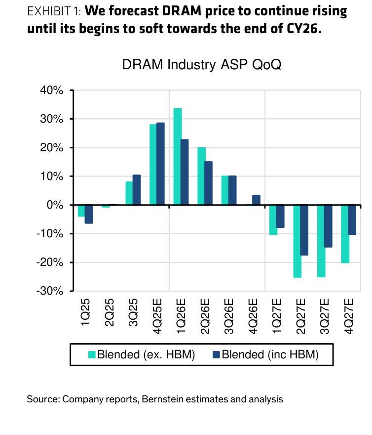

**EXHIBIT 1: We forecast DRAM price to continue rising until its begins to soft towards the end of CY26.**

DRAM Industry ASP QoQ

- Y-axis: 40%, 30%, 20%, 10%, 0%, -10%, -20%, -30%
- X-axis: 1Q25, 2Q25, 3Q25, 4Q25E, 1Q26E, 2Q26E, 3Q26E, 4Q26E, 1Q27E, 2Q27E, 3Q27E, 4Q27E
- Legend: Blended (ex. HBM), Blended (inc HBM)
- Source: Company reports, Bernstein estimates and analysis

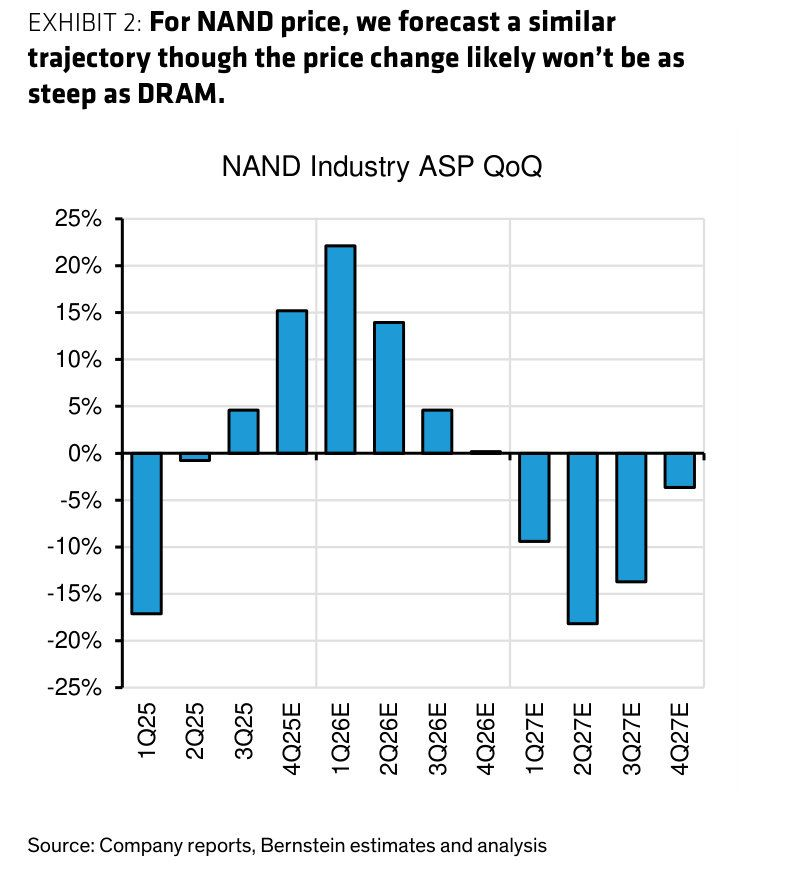

**EXHIBIT 2: For NAND price, we forecast a similar trajectory though the price change likely won't be as steep as DRAM.**

NAND Industry ASP QoQ

- Y-axis: 25%, 20%, 15%, 10%, 5%, 0%, -5%, -10%, -15%, -20%, -25%
- X-axis: 1Q25, 2Q25, 3Q25, 4Q25E, 1Q26E, 2Q26E, 3Q26E, 4Q26E, 1Q27E, 2Q27E, 3Q27E, 4Q27E
- Source: Company reports, Bernstein estimates and analysis

## 详情

请随意下载我们的行业（DRAM、NAND、CoWoW/HBM）和公司模型（三星、SK hynix、美光及铠侠）。

**即将到来的资本支出增加应从2026日历年度末开始使内存价格"正常化"。成本降低可以保持高利润率，并使本轮周期成为历史纪录。**

- 随着对云服务提供商（CSP）需求的信心增强，我们认为内存供应商可能会在2026年开始大幅增加capex，以利用当前的供应短缺和内存价格飙升的机会。因此，我们预计公司将在即将发布的收益报告中指引2026年capex大幅增加。如果没有，我们也应该从晶圆厂设备（WFE）供应商的下一份收益报告中获得类似信号。尽管如此，考虑到设备订单与内存产出之间的前置时间，新增的capex可能在2026年大部分时间内不会带来额外产出，直到2026年底增加的供应进入市场，并在2027年进一步扩大。

- 因此，内存短缺问题应会持续，近期价格可能继续上涨。随着新供应的到来，我们认为价格涨幅应在2HCY26年开始放缓，并在CY2027年末趋于平稳。CY2027年，随着更多供应的增加，价格应会下降（Exhibit 1-Exhibit 2）。尽管如此，我们预计价格不会像CY2019年那样暴跌，因为由于洁净室空间限制，供应增加可能会受到控制。我们还认为HBM需求在CY2027年将保持强劲，使传统DRAM的产能相对紧张。因此，我们认为CY2027年价格更多是"正常化"，预计CY2027年末传统DRAM价格将"正常化"回3QCY25年末近期上涨开始前的水平（Exhibit 3-Exhibit 4）。

- 近期价格大幅上涨也将推动利润率上升。我们预计利润率将在2026财年下半年达到峰值，这将与2018年的峰值相似或可能更高。2027财年价格应会下降，但由于成本也在下降，我们预测到2027财年末，DRAM毛利率（GM）将高于当前水平。如下图所示图表5-图表6，这实际上使当前周期成为创纪录的周期，因为上升周期推动毛利率达到新高，而下行周期是"正常化"而非"修正"或"崩溃"，使得2027财年末的毛利率仍然非常高。

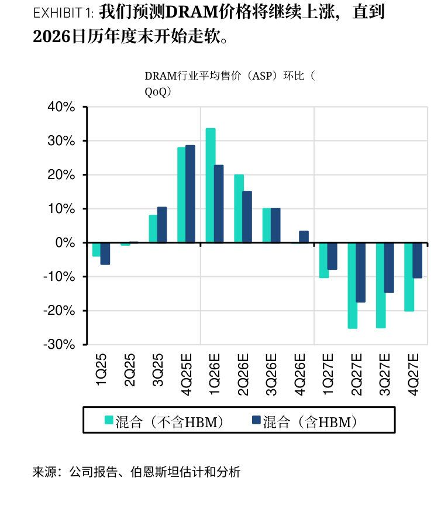

**EXHIBIT 1: 我们预测DRAM价格将继续上涨，直到2026日历年度末开始走软。**

DRAM行业平均售价（ASP）环比（QoQ）

- Y轴：40%、30%、20%、10%、0%、-10%、-20%、-30%
- X轴：1Q25、2Q25、3Q25、4Q25E、1Q26E、2Q26E、3Q26E、4Q26E、1Q27E、2Q27E、3Q27E、4Q27E
- 图例：混合（不含HBM）、混合（含HBM）
- 来源：公司报告、伯恩斯坦估计和分析

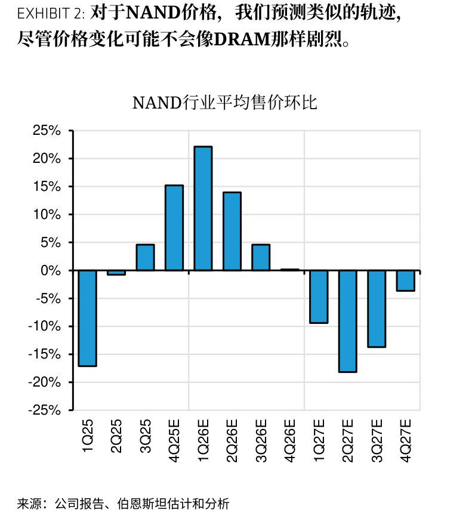

**EXHIBIT 2: 对于NAND价格，我们预测类似的轨迹，尽管价格变化可能不会像DRAM那样剧烈。**

NAND行业平均售价环比

- Y轴：25%、20%、15%、10%、5%、0%、-5%、-10%、-15%、-20%、-25%
- X轴：1Q25、2Q25、3Q25、4Q25E、1Q26E、2Q26E、3Q26E、4Q26E、1Q27E、2Q27E、3Q27E、4Q27E
- 来源：公司报告、伯恩斯坦估计和分析

[Source Page: 4]

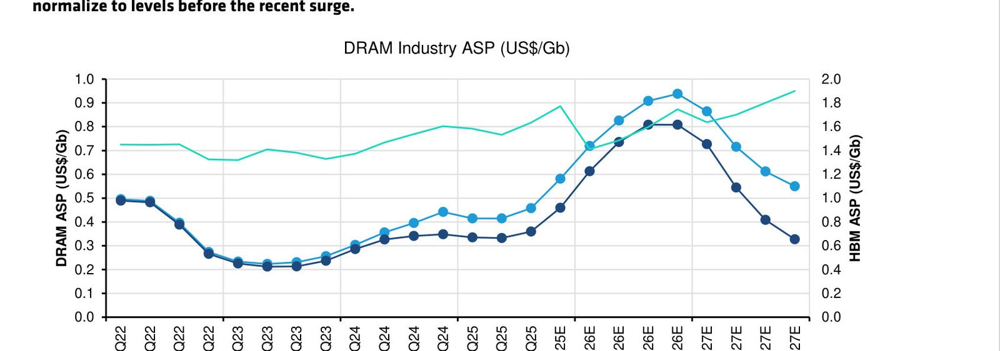

**EXHIBIT 3: With supply arrives at the market in late CY2026 & more in CY2027, we believe DRAM price will normalize to levels before the recent surge.**

DRAM Industry ASP (US$/Gb)

- Left Y-axis: DRAM ASP (US$/Gb), 0.0 to 1.0 (0.0, 0.1, 0.2, 0.3, 0.4, 0.5, 0.6, 0.7, 0.8, 0.9, 1.0)
- Right Y-axis: HBM ASP (US$/Gb), 0.0 to 2.0 (0.0, 0.2, 0.4, 0.6, 0.8, 1.0, 1.2, 1.4, 1.6, 1.8, 2.0)
- X-axis: 1Q22, 2Q22, 3Q22, 4Q22, 1Q23, 2Q23, 3Q23, 4Q23, 1Q24, 2Q24, 3Q24, 4Q24, 1Q25, 2Q25, 3Q25, 4Q25E, 1Q26E, 2Q26E, 3Q26E, 4Q26E, 1Q27E, 2Q27E, 3Q27E, 4Q27E
- Legend: All DRAM Blended ASP, Non-HBM Blended ASP, HBM ASP (RHS)
- Source: Company reports, Bernstein estimates and analysis

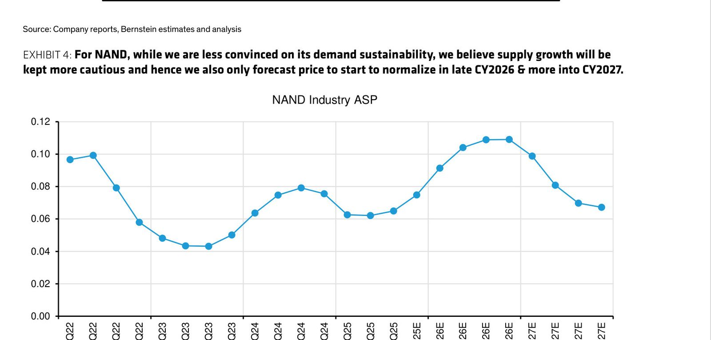

**EXHIBIT 4: For NAND, while we are less convinced on its demand sustainability, we believe supply growth will be kept more cautious and hence we also only forecast price to start to normalize in late CY2026 & more into CY2027.**

NAND Industry ASP

- Y-axis: 0.00, 0.02, 0.04, 0.06, 0.08, 0.10, 0.12
- X-axis: 1Q22, 2Q22, 3Q22, 4Q22, 1Q23, 2Q23, 3Q23, 4Q23, 1Q24, 2Q24, 3Q24, 4Q24, 1Q25, 2Q25, 3Q25, 4Q25E, 1Q26E, 2Q26E, 3Q26E, 4Q26E, 1Q27E, 2Q27E, 3Q27E, 4Q27E
- Source: Company reports, Bernstein estimates and analysis

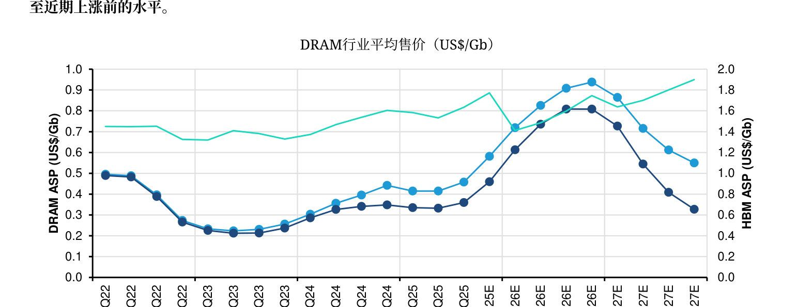

**EXHIBIT 3: 随着供应在CY2026年末进入市场，且CY2027年供应进一步增加，我们认为DRAM价格将回落至近期上涨前的水平。**

DRAM行业平均售价（US$/Gb）

- 左Y轴：DRAM ASP (US$/Gb)，0.0至1.0（0.0、0.1、0.2、0.3、0.4、0.5、0.6、0.7、0.8、0.9、1.0）
- 右Y轴：HBM ASP (US$/Gb)，0.0至2.0（0.0、0.2、0.4、0.6、0.8、1.0、1.2、1.4、1.6、1.8、2.0）
- X轴：1Q22、2Q22、3Q22、4Q22、1Q23、2Q23、3Q23、4Q23、1Q24、2Q24、3Q24、4Q24、1Q25、2Q25、3Q25、4Q25E、1Q26E、2Q26E、3Q26E、4Q26E、1Q27E、2Q27E、3Q27E、4Q27E
- 图例：所有DRAM混合平均售价、非HBM混合平均售价、HBM平均售价（右轴）
- 来源：公司报告、伯恩斯坦估计和分析

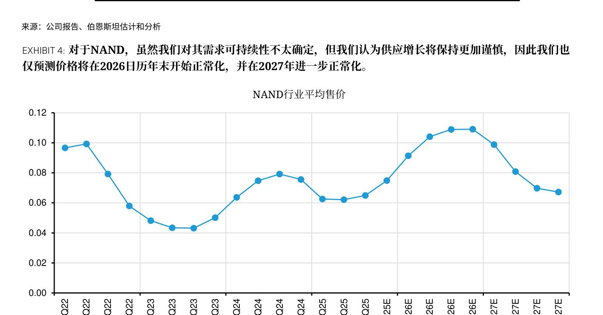

**EXHIBIT 4: 对于NAND，虽然我们对其需求可持续性不太确定，但我们认为供应增长将保持更加谨慎，因此我们也仅预测价格将在2026日历年末开始正常化，并在2027年进一步正常化。**

NAND行业平均售价

- Y轴：0.00、0.02、0.04、0.06、0.08、0.10、0.12
- X轴：1Q22、2Q22、3Q22、4Q22、1Q23、2Q23、3Q23、4Q23、1Q24、2Q24、3Q24、4Q24、1Q25、2Q25、3Q25、4Q25E、1Q26E、2Q26E、3Q26E、4Q26E、1Q27E、2Q27E、3Q27E、4Q27E
- 来源：公司报告、伯恩斯坦估计和分析

[Source Page: 5]

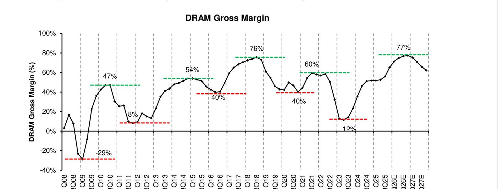

**EXHIBIT 5: We model industry DRAM margin to reach a historical high in late CY2026, and even with ASP normalizing afterwards, we still see margins hover at an elevated level exiting CY2027.**

DRAM Gross Margin

- Left Y-axis: DRAM Gross Margin (%), -40%, -20%, 0%, 20%, 40%, 60%, 80%, 100%
- X-axis: 1Q08, 3Q08, 1Q09, 3Q09, 1Q10, 3Q10, 1Q11, 3Q11, 1Q12, 3Q12, 1Q13, 3Q13, 1Q14, 3Q14, 1Q15, 3Q15, 1Q16, 3Q16, 1Q17, 3Q17, 1Q18, 3Q18, 1Q19, 3Q19, 1Q20, 3Q20, 1Q21, 3Q21, 1Q22, 3Q22, 1Q23, 3Q23, 1Q24, 3Q24, 1Q25, 3Q25, 1Q26E, 3Q26E, 1Q27E, 3Q27E
- 图内标注（从左至右）：47%、8%、29%、54%、40%、76%、60%、40%、12%、77%
- Source: Company reports, Bernstein estimates and analysis

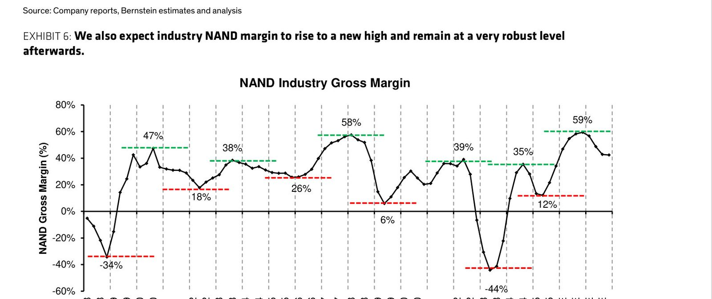

**EXHIBIT 6: We also expect industry NAND margin to rise to a new high and remain at a very robust level afterwards.**

NAND Industry Gross Margin

- Left Y-axis: NAND Gross Margin (%), -60%, -40%, -20%, 0%, 20%, 40%, 60%, 80%
- X-axis: 1Q08, 3Q08, 1Q09, 3Q09, 1Q10, 3Q10, 1Q11, 3Q11, 1Q12, 3Q12, 1Q13, 3Q13, 1Q14, 3Q14, 1Q15, 3Q15, 1Q16, 3Q16, 1Q17, 3Q17, 1Q18, 3Q18, 1Q19, 3Q19, 1Q20, 3Q20, 1Q21, 3Q21, 1Q22, 3Q22, 1Q23, 3Q23, 1Q24, 3Q24, 1Q25, 3Q25, 1Q26E, 3Q26E, 1Q27E, 3Q27E
- 图内标注（从左至右）：47%、18%、-34%、38%、26%、58%、6%、39%、-44%、12%、35%、59%
- Source: Company reports, Bernstein estimates and analysis

**Based on 2-year P/B & short-term trading behaviors, we stay Outperform on Samsung, SK hynix & Micron but prefer Samsung & SK hynix. We reiterate Underperform on KIOXIA.**

- We revise up our models significantly to reflect the much stronger conventional memory pricing cycle. We hence now stand considerably above consensus, which likely struggles to keep up with the rapid memory price increase (Exhibit 7-Exhibit 10).

- Under the revised outlook, book value will accrue very quickly too (Exhibit 11-Exhibit 13). Our forecasts see 59-189% growth in book value per share (BVPS) in the next 2 years for Samsung, SK hynix and Micron. However, this has also been somewhat expected, as shown by the very lofty valuations currently.

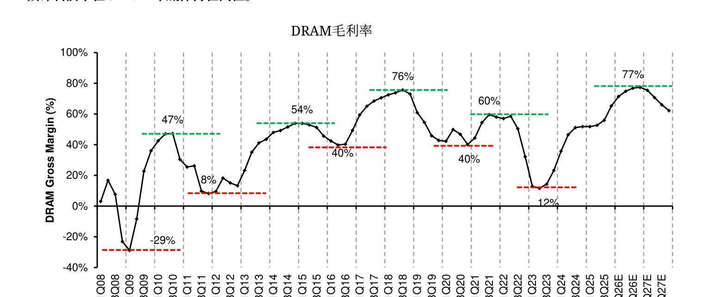

**EXHIBIT 5: 我们预测行业DRAM利润率将在CY2026年底达到历史新高，即使之后ASP恢复正常，我们仍预计利润率在CY2027年底保持在高位。**

DRAM毛利率

- 左Y轴：DRAM Gross Margin (%)，-40%、-20%、0%、20%、40%、60%、80%、100%
- X轴：1Q08、3Q08、1Q09、3Q09、1Q10、3Q10、1Q11、3Q11、1Q12、3Q12、1Q13、3Q13、1Q14、3Q14、1Q15、3Q15、1Q16、3Q16、1Q17、3Q17、1Q18、3Q18、1Q19、3Q19、1Q20、3Q20、1Q21、3Q21、1Q22、3Q22、1Q23、3Q23、1Q24、3Q24、1Q25、3Q25、1Q26E、3Q26E、1Q27E、3Q27E
- 图内标注（从左至右）：47%、8%、29%、54%、40%、76%、60%、40%、12%、77%
- 来源：公司报告、伯恩斯坦估计和分析

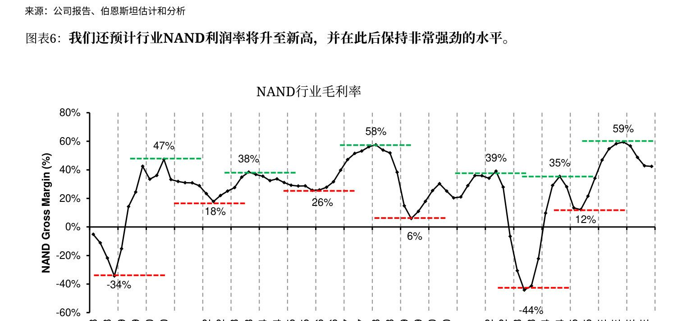

**图表6：我们还预计行业NAND利润率将升至新高，并在此后保持非常强劲的水平。**

NAND行业毛利率

- 左Y轴：NAND Gross Margin (%)，-60%、-40%、-20%、0%、20%、40%、60%、80%
- X轴：1Q08、3Q08、1Q09、3Q09、1Q10、3Q10、1Q11、3Q11、1Q12、3Q12、1Q13、3Q13、1Q14、3Q14、1Q15、3Q15、1Q16、3Q16、1Q17、3Q17、1Q18、3Q18、1Q19、3Q19、1Q20、3Q20、1Q21、3Q21、1Q22、3Q22、1Q23、3Q23、1Q24、3Q24、1Q25、3Q25、1Q26E、3Q26E、1Q27E、3Q27E
- 图内标注（从左至右）：47%、18%、-34%、38%、26%、58%、6%、39%、-44%、12%、35%、59%
- 来源：公司报告、伯恩斯坦估计和分析

**基于两年期市净率（P/B）及短期交易行为，我们维持对三星、SK海力士和美光的"跑赢大市"评级，但更偏好三星和SK海力士。我们重申对KIOXIA的"跑输大市"评级。**

- 我们大幅上调模型，以反映常规内存价格周期的显著增强。因此，我们目前的预测远高于共识，而共识可能难以跟上内存价格的快速上涨（Exhibit 7-Exhibit 10）。

- 在修订后的展望下，账面价值也将快速积累（图表11-图表13）。我们的预测显示，三星、SK hynix和Micron的每股账面价值（BVPS）在未来2年内将增长59%-189%。然而，这也有些在预期之中，因为当前估值非常高。

[Source Page: 6]

So we choose to value them on 2-year forward book value & set target multiples at 1.5x/1.7x/2.4x for Samsung/SK hynix/Micron. These multiples close to historical peak levels, to reflect continued robust profitability even 2 years from now (Exhibit 15-Exhibit 17). Target prices are now KRW130,000, KRW650,000 and US$270 for Samsung, SK hynix and Micron, respectively, implying 14-20% upside as of Dec 5. We reiterate Outperform on all three, but slightly prefer Samsung and SK hynix over Micron for valuation reasons.

- For KIOXIA, its BVPS should also expand quickly, but we don't think it can justify the current valuation (Exhibit 14,Exhibit 18). Pricing and profitability of NAND is also more difficult to hold due to structurally more competition & the threat from China. We therefore don't believe KIOXIA deserves to be valued at a premium over the DRAM suppliers, and choose to value KIOXIA at 1.5x 2-year forward book value. Target price is bumped to JPY 7,000 but still 26% below the current price. Reiterate Underperform. Additionally, we also note Bain-led funds, the largest shareholder of KIOXIA, has recently sold 7% of its holding in a block trade (Exhibit 19), soon after KIOXIA share price peaked. Further profit taking from Bain is possible and, if so, can pressure further on KIOXIA share price.

- In terms of short-term trading behaviors, capex hike and IPOs from Chinese rivals may be negative signals that investors should watch out for. Take Micron's example in the previous "super cycle" in 2017-18. Micron first guided a major YoY increase in FY2018 capex in Sep CY2017. That made the stock price take a brief pause but the share price went on to make a new high later in Jun 2018, when it actually retreated as memory price and margins began to fall (Exhibit 20).

- Historically what mattered more for stock prices was memory prices. In the prior cycles share prices usually peaked either together with or behind DRAM spot and contract prices (Exhibit 21-Exhibit 22). And recent data shows spot prices continued to exhibit robust positive momentum (see MEMORY TRACKER (Nov): DRAM contract price 50%+ over 3QCY25). This is another reason why we rate Samsung, SK hynix and Micron Outperform.

**EXHIBIT 7: We see a significant upside to Samsung consensus EPS in CY2026-27 for stronger outlook on conventional memory price and improving HBM market share.**

| Samsung | 2025E New | 2025E Old | 2025E % Chg | 2025E Consensus | 2025E % Diff | 2026E New | 2026E Old | 2026E % Chg | 2026E Consensus | 2026E % Diff | 2027E New | 2027E Old | 2027E % Chg | 2027E Consensus | 2027E % Diff |
|---|---|---|---|---|---|---|---|---|---|---|---|---|---|---|---|
| Revenue (KRW B) | 327,089 | 317,278 | 3.1% | 326,487 | 0.2% | 430,375 | 350,213 | 22.9% | 384,840 | 11.8% | 426,429 | 371,559 | 14.8% | 419,174 | 1.7% |
| YoY | 8.7% | 5.5% |  | 8.5% |  | 31.6% | 10.4% |  | 17.9% |  | -0.9% | 6.1% |  | 8.9% |  |
| Gross Margin | 41.4% | 37.6% | 3.8% | 37.8% | 3.6% | 64.4% | 44.5% | 20.0% | 43.7% | 20.7% | 58.3% | 45.9% | 12.4% | 43.1% | 15.2% |
| Operating Margin | 15.3% | 11.3% | 4.1% | 11.7% | 3.6% | 40.6% | 20.5% | 20.1% | 21.2% | 19.5% | 36.6% | 24.1% | 12.6% | 22.2% | 14.4% |
| EPS (KRW) | 6,913 | 4,686 | 47.5% | 5,685 | 21.6% | 19,403 | 8,080 | 140.1% | 10,450 | 85.7% | 17,600 | 10,110 | 74.1% | 11,852 | 48.5% |
| YoY | 39.7% | -5.3% |  | 14.9% |  | 180.7% | 72.4% |  | 83.8% |  | -9.3% | 25.1% |  | 13.4% |  |

Source: Bloomberg, Bernstein estimates and analysis

**EXHIBIT 8: Our CY2026 EPS for SK hynix is also significantly ahead of consensus as we raise both conventional and HBM forecasts.**

| SK hynix | 2025E New | 2025E Old | 2025E % Chg | 2025E Consensus | 2025E % Diff | 2027E New | 2027E Old | 2027E % Chg | 2027E Consensus | 2027E % Diff | 2027E New | 2027E Old | 2027E % Chg | 2027E Consensus | 2027E % Diff |
|---|---|---|---|---|---|---|---|---|---|---|---|---|---|---|---|
| Revenue (KRW Bn) | 97,154 | 92,528 | 5.0% | 92,759 | 4.7% | 185,614 | 113,005 | 64.3% | 134,793 | 37.7% | 171,705 | 119,853 | 43.3% | 159,148 | 7.9% |
| YoY | 46.8% | 39.8% |  | 40.1% |  | 91.1% | 22.1% |  | 45.3% |  | -7.5% | 6.1% |  | 18.1% |  |
| Gross Margin | 59.5% | 57.6% | 1.9% | 57.6% | 1.9% | 76.3% | 61.9% | 14.4% | 63.4% | 12.8% | 72.1% | 62.5% | 9.6% | 60.4% | 11.7% |
| Operating Margin | 47.9% | 45.7% | 2.2% | 45.6% | 2.3% | 68.4% | 50.1% | 18.3% | 54.0% | 14.4% | 62.5% | 50.6% | 11.9% | 51.3% | 11.2% |
| Diluted EPS (KRW) | 60,173 | 50,488 | 19.2% | 53,348 | 12.8% | 145,826 | 64,734 | 125.3% | 81,866 | 78.1% | 123,274 | 69,468 | 77.5% | 91,587 | 34.6% |
| YoY | 112.6% | 78.4% |  | 88.5% |  | 142.3% | 28.2% |  | 53.5% |  | -15.5% | 7.3% |  | 11.9% |  |

Source: Bloomberg, Bernstein estimates and analysis

因此，我们选择基于2年期预期账面价值对其进行估值，并为三星/SK海力士/Micron设定目标倍数为1.5倍/1.7倍/2.4倍。这些倍数接近历史峰值水平，以反映即使在2年后仍将持续强劲的盈利能力（图表15-图表17）。三星、SK海力士和Micron的目标价分别为130,000韩元、650,000韩元和270美元，截至12月5日隐含14-20%的上行空间。我们重申对这三家公司的"跑赢大盘"评级，但出于估值原因，略微更偏好三星和SK海力士而非Micron。

- 对于铠侠（KIOXIA），其BVPS也应快速增长，但我们认为当前估值缺乏合理性（Exhibit 14,Exhibit 18）。由于竞争结构更趋激烈以及来自中国的威胁，NAND的定价和盈利能力也更难维持。因此，我们认为铠侠不应获得高于DRAM供应商的估值溢价，选择以1.5倍的2年期预期账面价值对其进行估值。目标价上调至7,000日元，但仍比当前价格低26%。重申"跑输大盘"评级。此外，我们还注意到铠侠最大股东贝恩资本牵头的基金最近在铠侠股价见顶后不久，通过大宗交易出售了其7%的持股（Exhibit 19）。贝恩资本可能会进一步获利了结，若如此，可能会给铠侠股价带来更大压力。

- 就短期交易行为而言，资本支出增加及中国竞争对手的IPO可能是投资者应警惕的负面信号。以美光在2017-18年上一轮"超级周期"中的表现为例。美光首先在2017日历年度9月指引FY2018资本支出同比大幅增长。这导致股价短暂停顿，但股价在2018年6月后期再创历史新高，随后随着内存价格和利润率开始下降而回落（Exhibit 20）。

- 历史上，对股价影响更大的是内存价格。在之前的周期中，股价通常与DRAM现货和合约价格同时达到峰值或滞后于它们（图表21-图表22）。近期数据显示现货价格继续呈现强劲的积极势头（见内存追踪（11月）：DRAM合约价格上涨50%+ 较2025财年第三季度上涨）。这是我们给予三星、SK海力士和Micron"跑赢大盘"评级的另一个原因。

**图表7：我们认为，由于传统内存价格前景更加强劲以及HBM市场份额提升，三星2026-2027财年的共识每股收益（EPS）有显著上行空间。**

| 三星 | 2025E New | 2025E Old | 2025E变化百分比（%） | 2025E Consensus（共识） | 2025E百分比差异 | 2026E New | 2026E Old | 2026E变化百分比（%） | 2026E Consensus（共识） | 2026E百分比差异 | 2027E New | 2027E Old | 2027E变化百分比（%） | 2027E Consensus（共识） | 2027E百分比差异 |
|---|---|---|---|---|---|---|---|---|---|---|---|---|---|---|---|
| 收入（十亿韩元） | 327,089 | 317,278 | 3.1% | 326,487 | 0.2% | 430,375 | 350,213 | 22.9% | 384,840 | 11.8% | 426,429 | 371,559 | 14.8% | 419,174 | 1.7% |
| YoY | 8.7% | 5.5% |  | 8.5% |  | 31.6% | 10.4% |  | 17.9% |  | -0.9% | 6.1% |  | 8.9% |  |
| 毛利率 | 41.4% | 37.6% | 3.8% | 37.8% | 3.6% | 64.4% | 44.5% | 20.0% | 43.7% | 20.7% | 58.3% | 45.9% | 12.4% | 43.1% | 15.2% |
| 营业利润率 | 15.3% | 11.3% | 4.1% | 11.7% | 3.6% | 40.6% | 20.5% | 20.1% | 21.2% | 19.5% | 36.6% | 24.1% | 12.6% | 22.2% | 14.4% |
| 每股收益（韩元） | 6,913 | 4,686 | 47.5% | 5,685 | 21.6% | 19,403 | 8,080 | 140.1% | 10,450 | 85.7% | 17,600 | 10,110 | 74.1% | 11,852 | 48.5% |
| YoY | 39.7% | -5.3% |  | 14.9% |  | 180.7% | 72.4% |  | 83.8% |  | -9.3% | 25.1% |  | 13.4% |  |

来源：Bloomberg、Bernstein估算和分析

**EXHIBIT 8: 我们对SK海力士2026日历年度的每股收益（EPS）也显著高于市场共识，因为我们上调了传统内存和HBM的预测。**

| SK hynix | 2025E New | 2025E Old | 2025E百分比变化 | 2025E共识 | 2025E百分比差异 | 2027E New | 2027E Old | 2027E百分比变化 | 2027E共识 | 2027E百分比差异 | 2027E New | 2027E Old | 2027E百分比变化 | 2027E共识 | 2027E百分比差异 |
|---|---|---|---|---|---|---|---|---|---|---|---|---|---|---|---|
| 收入（十亿韩元） | 97,154 | 92,528 | 5.0% | 92,759 | 4.7% | 185,614 | 113,005 | 64.3% | 134,793 | 37.7% | 171,705 | 119,853 | 43.3% | 159,148 | 7.9% |
| YoY | 46.8% | 39.8% |  | 40.1% |  | 91.1% | 22.1% |  | 45.3% |  | -7.5% | 6.1% |  | 18.1% |  |
| 毛利率 | 59.5% | 57.6% | 1.9% | 57.6% | 1.9% | 76.3% | 61.9% | 14.4% | 63.4% | 12.8% | 72.1% | 62.5% | 9.6% | 60.4% | 11.7% |
| 营业利润率 | 47.9% | 45.7% | 2.2% | 45.6% | 2.3% | 68.4% | 50.1% | 18.3% | 54.0% | 14.4% | 62.5% | 50.6% | 11.9% | 51.3% | 11.2% |
| 稀释每股收益（韩元） | 60,173 | 50,488 | 19.2% | 53,348 | 12.8% | 145,826 | 64,734 | 125.3% | 81,866 | 78.1% | 123,274 | 69,468 | 77.5% | 91,587 | 34.6% |
| YoY | 112.6% | 78.4% |  | 88.5% |  | 142.3% | 28.2% |  | 53.5% |  | -15.5% | 7.3% |  | 11.9% |  |

来源：Bloomberg、Bernstein估算和分析

[Source Page: 7]

**EXHIBIT 9: We are way above consensus for Micron as well.**

| Micron | FY2026E New | FY2026E Old | FY2026E % Chg | FY2026E Consensus | FY2026E % Diff | FY2027E New | FY2027E Old | FY2027E % Chg | FY2027E Consensus | FY2027E % Diff |
|---|---|---|---|---|---|---|---|---|---|---|
| **GAAP** |  |  |  |  |  |  |  |  |  |  |
| Revenue (US$B) | 75.8 | 50.6 | 49.9% | 55.1 | 37.7% | 90.8 | 60.7 | 49.7% | 64.2 | 41.4% |
| YoY | 102.8% | 35.3% |  | 47.3% |  | 19.8% | 20.0% |  | 16.6% |  |
| Gross Margin | 66.1% | 50.8% | 15.2% | 54.0% | 12.0% | 66.9% | 55.6% | 11.3% | 55.5% | 11.4% |
| Operating Margin | 57.6% | 38.1% | 19.5% | 42.3% | 15.3% | 58.8% | 43.3% | 15.6% | 43.3% | 15.5% |
| Diluted EPS (US$) | 31.69 | 14.23 | 122.7% | 16.93 | 87.2% | 38.85 | 14.23 | 173.1% | 20.37 | 90.7% |
| YoY | 317.6% | 87.5% |  | 123.1% |  | 411.9% | 0.0% |  | 20.3% |  |
| **Non-GAAP** |  |  |  |  |  |  |  |  |  |  |
| Diluted EPS (US$) | 32.03 | 14.64 | 118.8% | 17.56 | 82.4% | 39.03 | 19.65 | 98.6% | 21.29 | 83.3% |
| YoY | 286.5% | 76.6% |  | 111.9% |  | 371.0% | 34.2% |  | 21.2% |  |

Source: Bloomberg, Bernstein estimates and analysis

**EXHIBIT 10: We are notably above on KIOXIA for FY26 as we raise near-term price forecast but we remain below on FY27.**

| KIOXIA | FY2025E New | FY2025E Old | FY2025E % Chg | FY2025E Consensus | FY2025E % Diff | FY2027E New | FY2027E Old | FY2027E % Chg | FY2027E Consensus | FY2027E % Diff | FY2027E New | FY2027E Old | FY2027E % Chg | FY2027E Consensus | FY2027E % Diff |
|---|---|---|---|---|---|---|---|---|---|---|---|---|---|---|---|
| Revenue (JPY B) | 1,920 | 1,735 | 10.7% | 1,919 | 0.1% | 3,146 | 2,005 | 56.9% | 2,499 | 25.9% | 2,377 | 1,928 | 23.3% | 2,792 | -14.9% |
| YoY | 12.5% | 1.7% |  | 12.5% |  | 63.8% | 15.6% |  | 30.2% |  | -24.4% | -3.9% |  | 11.7% |  |
| Gross Margin | 33.2% | 27.0% | 6.2% | 34.7% | -1.4% | 56.2% | 33.5% | 22.7% | 39.9% | 16.3% | 41.5% | 29.3% | 12.2% | 42.5% | -1.1% |
| Operating Margin | 25.4% | 19.6% | 5.8% | 24.1% | 1.2% | 50.1% | 26.2% | 23.9% | 35.3% | 14.8% | 33.5% | 21.7% | 11.8% | 36.7% | -3.1% |
| EPS (JPY) | 545 | 386 | 41.1% | 496 | 10.0% | 2,032 | 659 | 208.5% | 1,107 | 83.6% | 1,037 | 528 | 96.3% | 1,349 | -23.1% |
| YoY | 5.6% | -25.2% |  | -4.0% |  | 272.5% | 70.4% |  | 123.3% |  | -49.0% | -19.8% |  | 21.9% |  |

Source: Bloomberg and Bernstein analysis

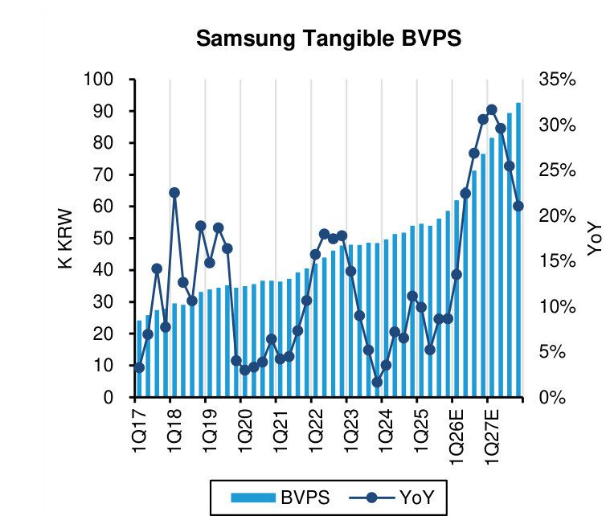

**EXHIBIT 11: We see 59% growth in Samsung BVPS in the next 2 years.**

Samsung Tangible BVPS

- Left Y-axis: K KRW, 0, 10, 20, 30, 40, 50, 60, 70, 80, 90, 100
- Right Y-axis: YoY, 0%, 5%, 10%, 15%, 20%, 25%, 30%, 35%
- X-axis: 1Q17, 1Q18, 1Q19, 1Q20, 1Q21, 1Q22, 1Q23, 1Q24, 1Q25, 1Q26E, 1Q27E
- Legend: BVPS, YoY
- Source: Company reports, Bernstein estimates and analysis

**EXHIBIT 12: We project SK hynix's BVPS to rise by 189% in the next 2 years.**

SK hynix Tangible BVPS

- Left Y-axis: K KRW, 0, 50, 100, 150, 200, 250, 300, 350, 400, 450
- Right Y-axis: YoY, -40%, -20%, 0%, 20%, 40%, 60%, 80%, 100%
- X-axis: 1Q17, 1Q18, 1Q19, 1Q20, 1Q21, 1Q22, 1Q23, 1Q24, 1Q25, 1Q26E, 1Q27E
- Legend: BVPS, YoY
- Source: Company reports, Bernstein estimates and analysis

**EXHIBIT 9: 我们对美光的预测也远高于共识。**

| 美光（Micron） | FY2026E New | FY2026E Old | FY2026E百分比变化 | FY2026E共识 | FY2026E百分比差异 | FY2027E New | FY2027E Old | FY2027E百分比变化 | FY2027E共识 | FY2027E百分比差异 |
|---|---|---|---|---|---|---|---|---|---|---|
| **GAAP** |  |  |  |  |  |  |  |  |  |  |
| 收入（十亿美元） | 75.8 | 50.6 | 49.9% | 55.1 | 37.7% | 90.8 | 60.7 | 49.7% | 64.2 | 41.4% |
| YoY | 102.8% | 35.3% |  | 47.3% |  | 19.8% | 20.0% |  | 16.6% |  |
| 毛利率 | 66.1% | 50.8% | 15.2% | 54.0% | 12.0% | 66.9% | 55.6% | 11.3% | 55.5% | 11.4% |
| 营业利润率 | 57.6% | 38.1% | 19.5% | 42.3% | 15.3% | 58.8% | 43.3% | 15.6% | 43.3% | 15.5% |
| 稀释后每股收益（美元） | 31.69 | 14.23 | 122.7% | 16.93 | 87.2% | 38.85 | 14.23 | 173.1% | 20.37 | 90.7% |
| YoY | 317.6% | 87.5% |  | 123.1% |  | 411.9% | 0.0% |  | 20.3% |  |
| **Non-GAAP** |  |  |  |  |  |  |  |  |  |  |
| 稀释后每股收益（美元） | 32.03 | 14.64 | 118.8% | 17.56 | 82.4% | 39.03 | 19.65 | 98.6% | 21.29 | 83.3% |
| YoY | 286.5% | 76.6% |  | 111.9% |  | 371.0% | 34.2% |  | 21.2% |  |

来源：Bloomberg、Bernstein估算和分析

**EXHIBIT 10: 由于我们上调了短期价格预测，我们对铠侠（KIOXIA）26财年的预测显著高于共识，但27财年仍低于共识。**

| KIOXIA | 2025财年预期New | 2025财年预期Old | 2025财年预期 百分比变化 | 2025财年预期 共识 | 2025财年预期 百分比差异 | 2027财年预期New | 2027财年预期Old | 2027财年预期 百分比变化 | 2027财年预期 共识 | 2027财年预期 百分比差异 | 2027财年预期New | 2027财年预期Old | 2027财年预期 百分比变化 | 2027财年预期 共识 | 2027财年预期 百分比差异 |
|---|---|---|---|---|---|---|---|---|---|---|---|---|---|---|---|
| 收入（十亿日元） | 1,920 | 1,735 | 10.7% | 1,919 | 0.1% | 3,146 | 2,005 | 56.9% | 2,499 | 25.9% | 2,377 | 1,928 | 23.3% | 2,792 | -14.9% |
| YoY | 12.5% | 1.7% |  | 12.5% |  | 63.8% | 15.6% |  | 30.2% |  | -24.4% | -3.9% |  | 11.7% |  |
| 毛利率 | 33.2% | 27.0% | 6.2% | 34.7% | -1.4% | 56.2% | 33.5% | 22.7% | 39.9% | 16.3% | 41.5% | 29.3% | 12.2% | 42.5% | -1.1% |
| 营业利润率 | 25.4% | 19.6% | 5.8% | 24.1% | 1.2% | 50.1% | 26.2% | 23.9% | 35.3% | 14.8% | 33.5% | 21.7% | 11.8% | 36.7% | -3.1% |
| 每股收益（JPY） | 545 | 386 | 41.1% | 496 | 10.0% | 2,032 | 659 | 208.5% | 1,107 | 83.6% | 1,037 | 528 | 96.3% | 1,349 | -23.1% |
| YoY | 5.6% | -25.2% |  | -4.0% |  | 272.5% | 70.4% |  | 123.3% |  | -49.0% | -19.8% |  | 21.9% |  |

来源：彭博和伯恩斯坦分析

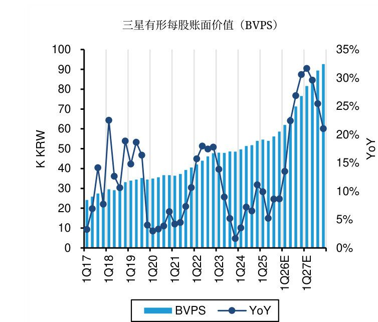

**图表11：我们预计三星每股账面价值（BVPS）在未来2年将增长59%。**

三星有形每股账面价值（BVPS）

- 左Y轴：K KRW，0、10、20、30、40、50、60、70、80、90、100
- 右Y轴：YoY，0%、5%、10%、15%、20%、25%、30%、35%
- X轴：1Q17、1Q18、1Q19、1Q20、1Q21、1Q22、1Q23、1Q24、1Q25、1Q26E、1Q27E
- 图例：BVPS、YoY
- 来源：公司报告、伯恩斯坦估计和分析

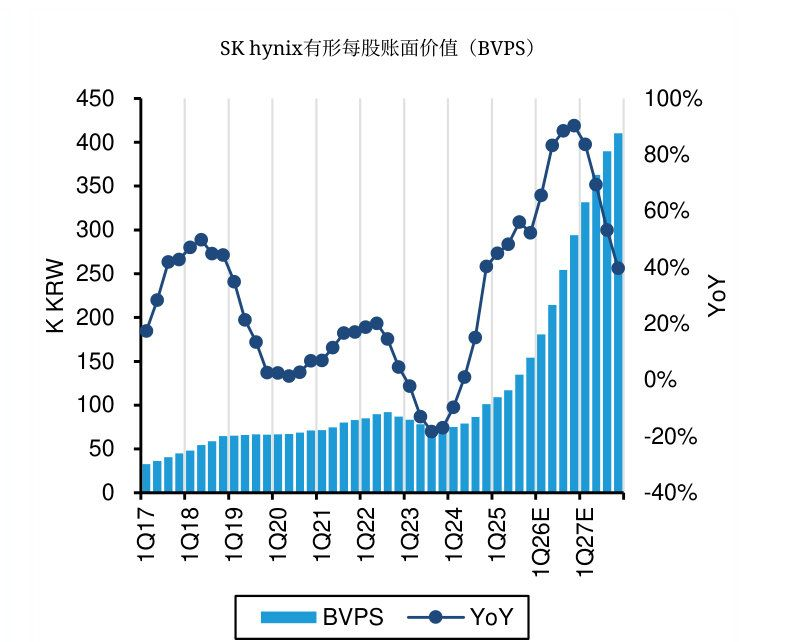

**EXHIBIT 12: 我们预测SK hynix的每股账面价值（BVPS）将在未来2年增长189%。**

SK hynix有形每股账面价值（BVPS）

- 左Y轴：K KRW，0、50、100、150、200、250、300、350、400、450
- 右Y轴：YoY，-40%、-20%、0%、20%、40%、60%、80%、100%
- X轴：1Q17、1Q18、1Q19、1Q20、1Q21、1Q22、1Q23、1Q24、1Q25、1Q26E、1Q27E
- 图例：BVPS、YoY
- 来源：公司报告、伯恩斯坦估计和分析

[Source Page: 8]

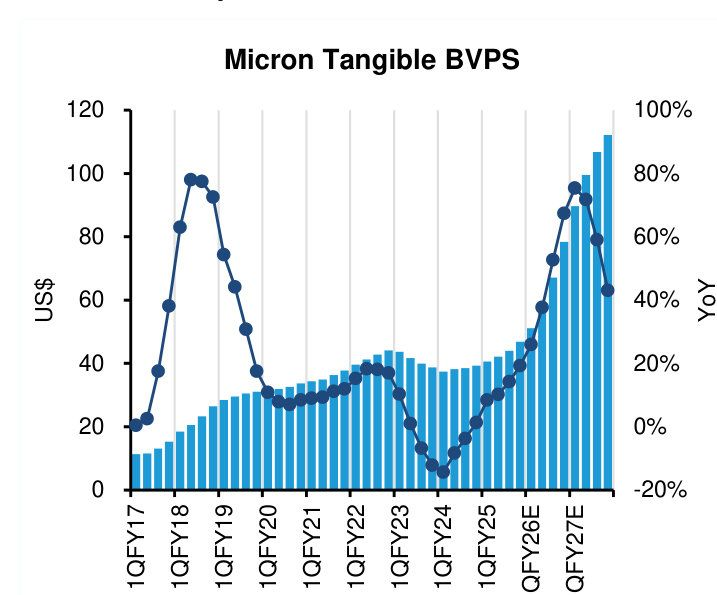

**EXHIBIT 13: Micron's BVPS is expected to expand by 139% in the next two years.**

Micron Tangible BVPS

- Left Y-axis: US$, 0, 20, 40, 60, 80, 100, 120
- Right Y-axis: YoY, -20%, 0%, 20%, 40%, 60%, 80%, 100%
- X-axis: 1QFY17, 1QFY18, 1QFY19, 1QFY20, 1QFY21, 1QFY22, 1QFY23, 1QFY24, 1QFY25, 1QFY26E, 1QFY27E
- Legend: BVPS, YoY
- Source: Company reports, Bernstein estimates and analysis

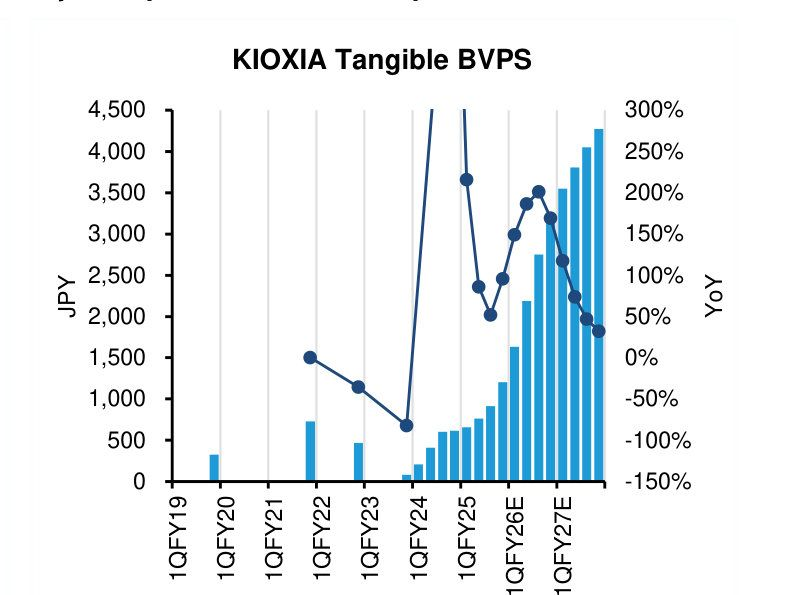

**EXHIBIT 14: From a very low base, KIOXIA's BVPS may expand by 244% in the next 2 years.**

KIOXIA Tangible BVPS

- Left Y-axis: JPY, 0, 500, 1,000, 1,500, 2,000, 2,500, 3,000, 3,500, 4,000, 4,500
- Right Y-axis: YoY, -150%, -100%, -50%, 0%, 50%, 100%, 150%, 200%, 250%, 300%
- X-axis: 1QFY19, 1QFY20, 1QFY21, 1QFY22, 1QFY23, 1QFY24, 1QFY25, 1QFY26E, 1QFY27E
- Legend: BVPS, YoY
- Source: Company reports, Bernstein estimates and analysis

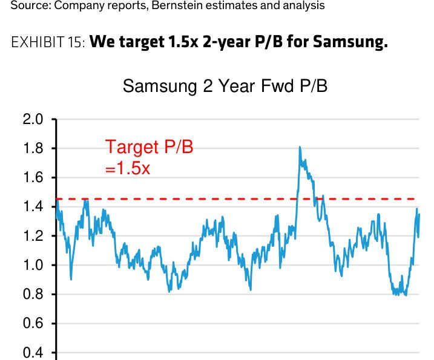

**EXHIBIT 15: We target 1.5x 2-year P/B for Samsung.**

Samsung 2 Year Fwd P/B

- Y-axis: 0.0, 0.2, 0.4, 0.6, 0.8, 1.0, 1.2, 1.4, 1.6, 1.8, 2.0
- X-axis: Jan-11, Jan-12, Jan-13, Jan-14, Jan-15, Jan-16, Jan-17, Jan-18, Jan-19, Jan-20, Jan-21, Jan-22, Jan-23, Jan-24, Jan-25
- Annotation: Target P/B =1.5x
- Source: Bloomberg and Bernstein analysis

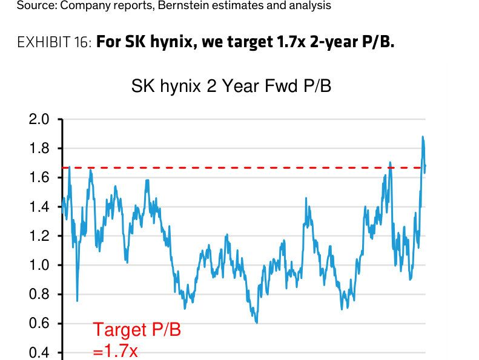

**EXHIBIT 16: For SK hynix, we target 1.7x 2-year P/B.**

SK hynix 2 Year Fwd P/B

- Y-axis: 0.0, 0.2, 0.4, 0.6, 0.8, 1.0, 1.2, 1.4, 1.6, 1.8, 2.0
- X-axis: Jan-11, Jan-12, Jan-13, Jan-14, Jan-15, Jan-16, Jan-17, Jan-18, Jan-19, Jan-20, Jan-21, Jan-22, Jan-23, Jan-24, Jan-25
- Annotation: Target P/B =1.7x
- Source: Bloomberg and Bernstein analysis

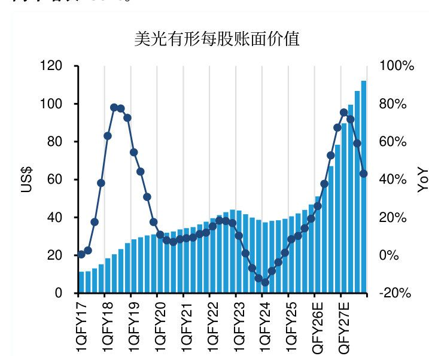

**图表13：Micron的每股账面价值（BVPS）预计在未来两年增长139%。**

美光有形每股账面价值

- 左Y轴：US$，0、20、40、60、80、100、120
- 右Y轴：YoY，-20%、0%、20%、40%、60%、80%、100%
- X轴：1QFY17、1QFY18、1QFY19、1QFY20、1QFY21、1QFY22、1QFY23、1QFY24、1QFY25、1QFY26E、1QFY27E
- 图例：BVPS、YoY
- 来源：公司报告、伯恩斯坦估计和分析

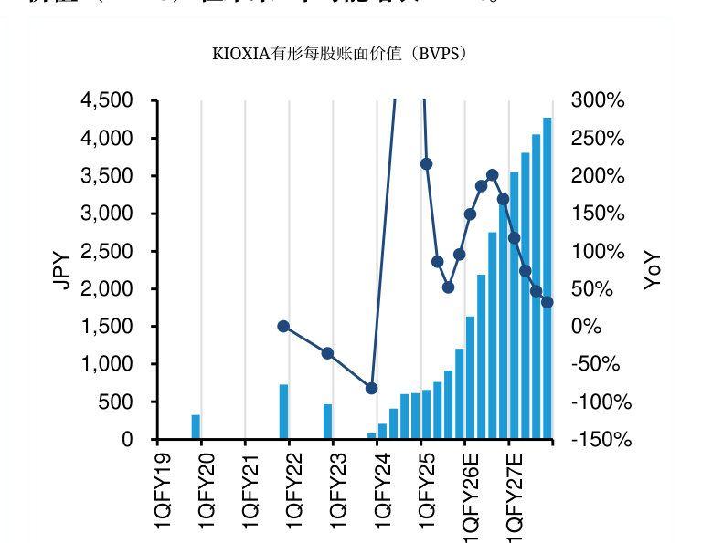

**图表14：从非常低的基数开始，KIOXIA的每股账面价值（BVPS）在未来2年可能增长244%。**

KIOXIA有形每股账面价值（BVPS）

- 左Y轴：JPY，0、500、1,000、1,500、2,000、2,500、3,000、3,500、4,000、4,500
- 右Y轴：YoY，-150%、-100%、-50%、0%、50%、100%、150%、200%、250%、300%
- X轴：1QFY19、1QFY20、1QFY21、1QFY22、1QFY23、1QFY24、1QFY25、1QFY26E、1QFY27E
- 图例：BVPS、YoY
- 来源：公司报告、伯恩斯坦估计和分析

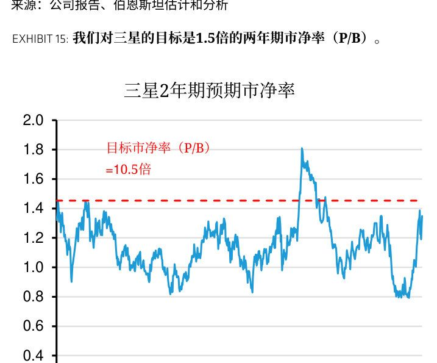

**EXHIBIT 15: 我们对三星的目标是1.5倍的两年期市净率（P/B）。**

三星2年期预期市净率

- Y轴：0.0、0.2、0.4、0.6、0.8、1.0、1.2、1.4、1.6、1.8、2.0
- X轴：Jan-11、Jan-12、Jan-13、Jan-14、Jan-15、Jan-16、Jan-17、Jan-18、Jan-19、Jan-20、Jan-21、Jan-22、Jan-23、Jan-24、Jan-25
- 标注：目标市净率（P/B）=10.5倍
- 来源：彭博和伯恩斯坦分析

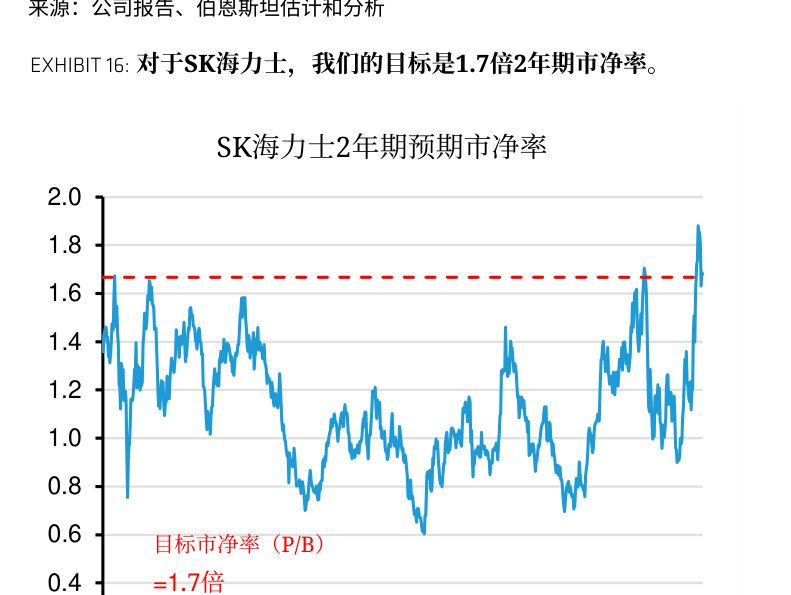

**EXHIBIT 16: 对于SK海力士，我们的目标是1.7倍2年期市净率。**

SK海力士2年期预期市净率

- Y轴：0.0、0.2、0.4、0.6、0.8、1.0、1.2、1.4、1.6、1.8、2.0
- X轴：Jan-11、Jan-12、Jan-13、Jan-14、Jan-15、Jan-16、Jan-17、Jan-18、Jan-19、Jan-20、Jan-21、Jan-22、Jan-23、Jan-24、Jan-25
- 标注：目标市净率（P/B）=1.7倍
- 来源：彭博和伯恩斯坦分析

[Source Page: 9]

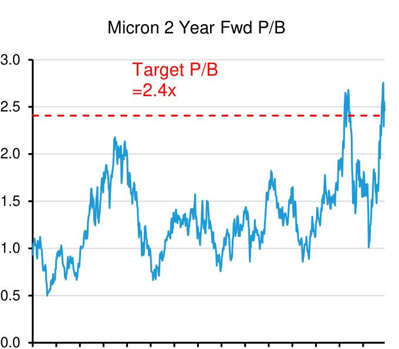

**EXHIBIT 17: We use 2.4x 2-year P/B to value Micron.**

Micron 2 Year Fwd P/B

- Y-axis: 0.0, 0.5, 1.0, 1.5, 2.0, 2.5, 3.0
- X-axis: Jan-11, Jan-12, Jan-13, Jan-14, Jan-15, Jan-16, Jan-17, Jan-18, Jan-19, Jan-20, Jan-21, Jan-22, Jan-23, Jan-24, Jan-25
- Annotation: Target P/B =2.4x
- Source: Bloomberg and Bernstein analysis

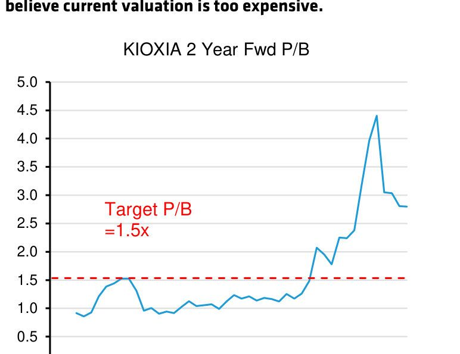

**EXHIBIT 18: We use 1.5x 2-year P/B for KIOXIA and believe current valuation is too expensive.**

KIOXIA 2 Year Fwd P/B

- Y-axis: 0.0, 0.5, 1.0, 1.5, 2.0, 2.5, 3.0, 3.5, 4.0, 4.5, 5.0
- X-axis: Jan-25, Feb-25, Mar-25, Apr-25, May-25, Jun-25, Jul-25, Aug-25, Sep-25, Oct-25, Nov-25
- Annotation: Target P/B =1.5x
- Source: Bloomberg and Bernstein analysis

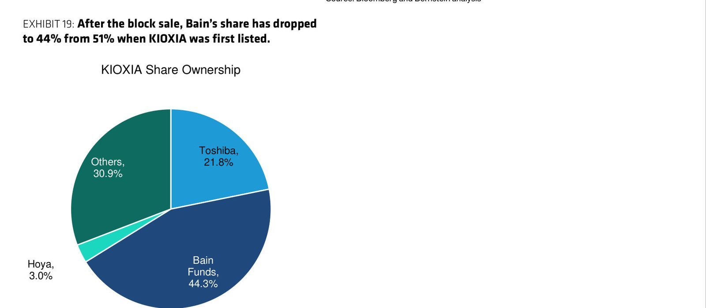

**EXHIBIT 19: After the block sale, Bain's share has dropped to 44% from 51% when KIOXIA was first listed.**

KIOXIA Share Ownership

- Toshiba, 21.8%
- Bain Funds, 44.3%
- Hoya, 3.0%
- Others, 30.9%
- Source: Company reports, Bloomberg and Bernstein analysis

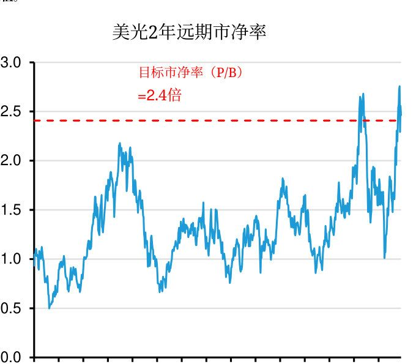

**EXHIBIT 17: 我们使用2.4倍的两年期市净率（P/B）对美光（Micron）进行估值。**

美光2年远期市净率

- Y轴：0.0、0.5、1.0、1.5、2.0、2.5、3.0
- X轴：Jan-11、Jan-12、Jan-13、Jan-14、Jan-15、Jan-16、Jan-17、Jan-18、Jan-19、Jan-20、Jan-21、Jan-22、Jan-23、Jan-24、Jan-25
- 标注：目标市净率（P/B）=2.4倍
- 来源：彭博和伯恩斯坦分析

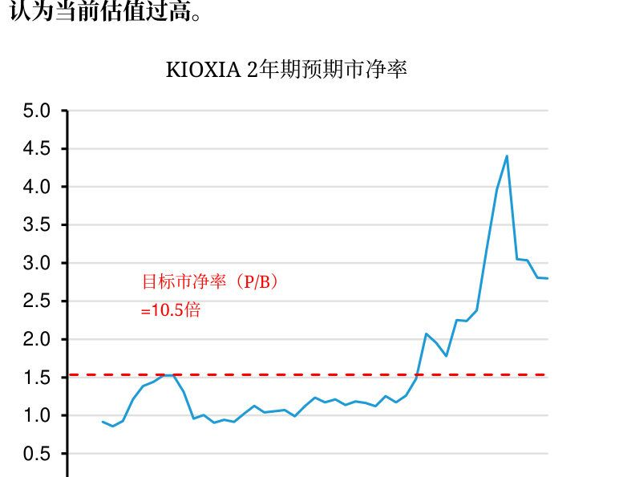

**EXHIBIT 18: 我们对KIOXIA使用1.5倍2年期市净率，认为当前估值过高。**

KIOXIA 2年期预期市净率

- Y轴：0.0、0.5、1.0、1.5、2.0、2.5、3.0、3.5、4.0、4.5、5.0
- X轴：Jan-25、Feb-25、Mar-25、Apr-25、May-25、Jun-25、Jul-25、Aug-25、Sep-25、Oct-25、Nov-25
- 标注：目标市净率（P/B）=10.5倍
- 来源：彭博和伯恩斯坦分析

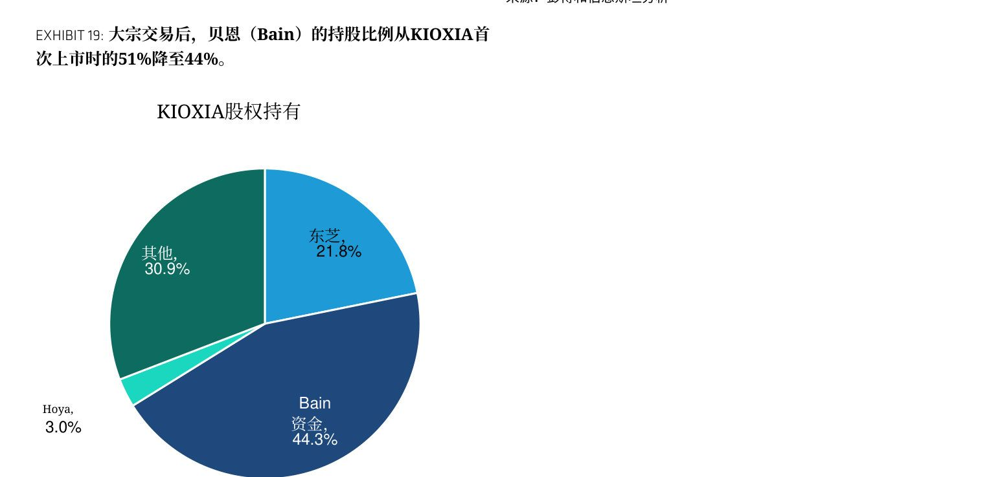

**EXHIBIT 19: 大宗交易后，贝恩（Bain）的持股比例从KIOXIA首次上市时的51%降至44%。**

KIOXIA股权持有

- 东芝，21.8%
- Bain资金，44.3%
- Hoya, 3.0%
- 其他, 30.9%
- 来源：公司报告、Bloomberg和Bernstein分析

[Source Page: 10]

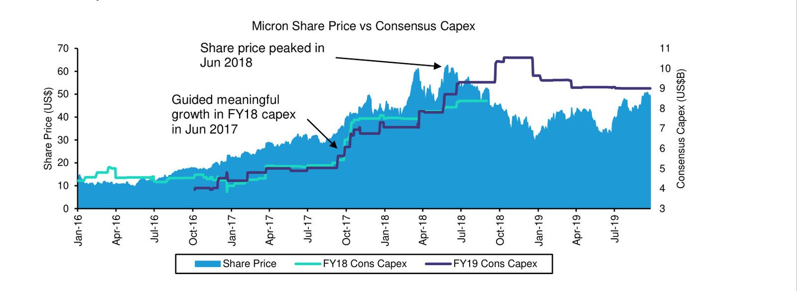

**EXHIBIT 20: History on Micron shows thta guiding capex increase may not lead to a downturn in share prices immediately.**

Micron Share Price vs Consensus Capex

- Left Y-axis: Share Price (US$), 0, 10, 20, 30, 40, 50, 60, 70
- Right Y-axis: Consensus Capex (US$B), 3, 4, 5, 6, 7, 8, 9, 10, 11
- X-axis: Jan-16, Apr-16, Jul-16, Oct-16, Jan-17, Apr-17, Jul-17, Oct-17, Jan-18, Apr-18, Jul-18, Oct-18, Jan-19, Apr-19, Jul-19
- Legend: Share Price, FY18 Cons Capex, FY19 Cons Capex
- Annotations: "Guided meaningful growth in FY18 capex in Jun 2017"; "Share price peaked in Jun 2018"
- Source: Bloomberg and Bernstein analysis

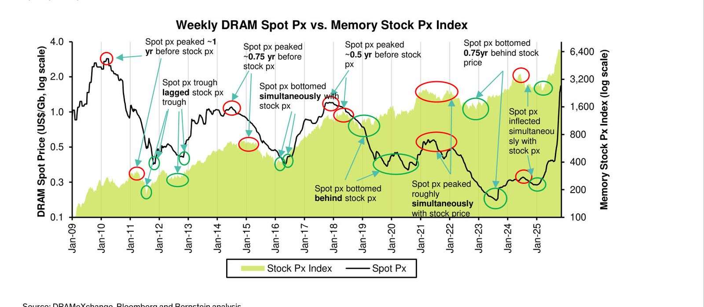

**EXHIBIT 21: Historically, we found that memory share prices typically topped out roughly together or after DRAM spot price peaked.**

Weekly DRAM Spot Px vs. Memory Stock Px Index

- Left Y-axis: DRAM Spot Price (US$/Gb, log scale), 0.1, 0.3, 0.5, 1.0, 2.0, 4.0
- Right Y-axis: Memory Stock Px Index (log scale), 100, 200, 400, 800, 1,600, 3,200, 6,400
- X-axis: Jan-09, Jan-10, Jan-11, Jan-12, Jan-13, Jan-14, Jan-15, Jan-16, Jan-17, Jan-18, Jan-19, Jan-20, Jan-21, Jan-22, Jan-23, Jan-24, Jan-25
- Legend: Stock Px Index, Spot Px
- Annotations: "Spot px peaked ~1 yr before stock px"; "Spot px peaked ~0.75 yr before stock px"; "Spot px peaked ~0.5 yr before stock px"; "Spot px trough lagged stock px trough"; "Spot px bottomed simultaneously with stock px"; "Spot px bottomed behind stock px"; "Spot px peaked roughly simultaneously with stock price"; "Spot px bottomed 0.75yr behind stock price"; "Spot px inflected simultaneously with stock px"
- Source: DRAMeXchange, Bloomberg and Bernstein analysis

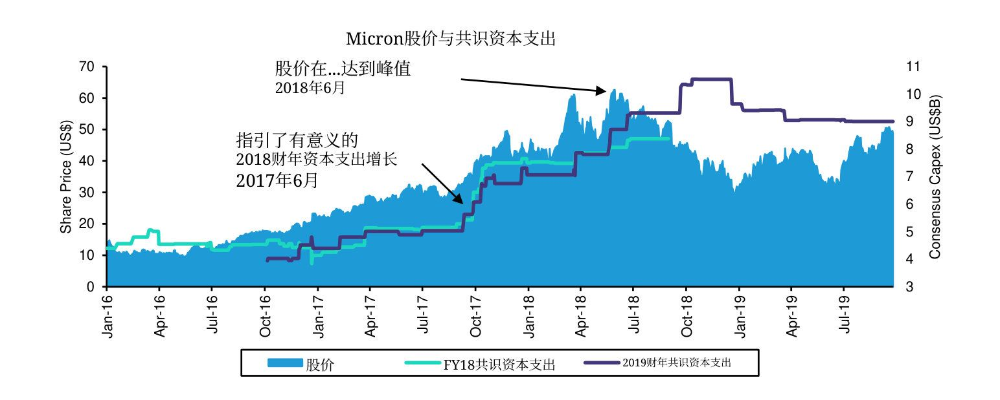

**EXHIBIT 20: 美光（Micron）的历史表明，指引资本支出增加可能不会立即导致股价下跌。**

Micron股价与共识资本支出

- 左Y轴：Share Price (US$)，0、10、20、30、40、50、60、70
- 右Y轴：Consensus Capex (US$B)，3、4、5、6、7、8、9、10、11
- X轴：Jan-16、Apr-16、Jul-16、Oct-16、Jan-17、Apr-17、Jul-17、Oct-17、Jan-18、Apr-18、Jul-18、Oct-18、Jan-19、Apr-19、Jul-19
- 图例：股价、FY18共识资本支出、2019财年共识资本支出
- 标注："指引了有意义的2018财年资本支出增长2017年6月"；"股价在...达到峰值2018年6月"
- 来源：彭博和伯恩斯坦分析

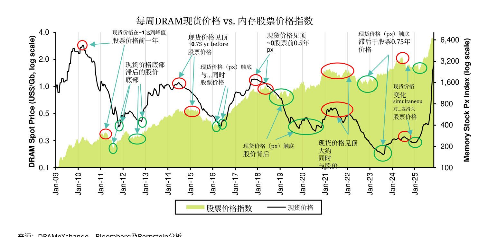

**EXHIBIT 21: 历史上，我们发现存储器股价通常在DRAM现货价格见顶时或之后大致同步见顶。**

每周DRAM现货价格vs.内存股票价格指数

- 左Y轴：DRAM Spot Price (US$/Gb, log scale)，0.1、0.3、0.5、1.0、2.0、4.0
- 右Y轴：Memory Stock Px Index (log scale)，100、200、400、800、1,600、3,200、6,400
- X轴：Jan-09、Jan-10、Jan-11、Jan-12、Jan-13、Jan-14、Jan-15、Jan-16、Jan-17、Jan-18、Jan-19、Jan-20、Jan-21、Jan-22、Jan-23、Jan-24、Jan-25
- 图例：股票价格指数、现货价格
- 标注："现货价格在~1达到峰值股票价格前一年"；"现货价格见顶~0.75 yr before股票价格"；"现货价格见顶~0股票前0.5年px"；"现货价格底部滞后的股价底部"；"现货价格（px）触底与...同时股票价格"；"现货价格（px）触底股价背后"；"现货价格见顶大约同时与股价"；"现货价格（px）触底滞后于股票0.75年价格"；"现货价格变化simultaneou对...耍滑头股票价格"
- 来源：DRAMeXchange、Bloomberg及Bernstein分析

[Source Page: 11]

EXHIBIT 22: The pattern is similar if we use DRAM contract prices instead of spot prices.

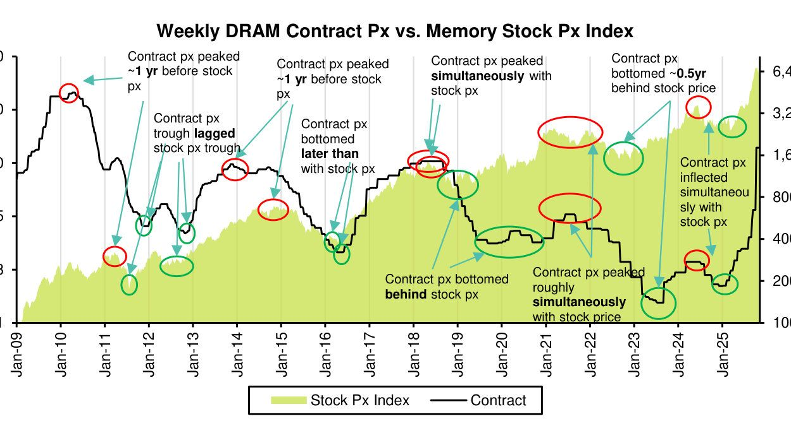

Weekly DRAM Contract Px vs. Memory Stock Px Index
- 左纵轴：DRAM Contract Price (US$/Gb, log scale)：0.1、0.3、0.5、1.0、2.0、4.0
- 右纵轴：Memory Stock Px Index (log scale)：100、200、400、800、1,600、3,200、6,400
- 横轴：Jan-09至Jan-25
- 图例：Stock Px Index（浅绿色面积）、Contract（黑线）
- 图内标注：Contract px peaked ~1 yr before stock px；Contract px trough lagged stock px trough；Contract px peaked simultaneously with stock px；Contract px bottomed later than with stock px；Contract px bottomed behind stock px；Contract px peaked roughly simultaneously with stock price；Contract px bottomed ~0.5yr behind stock price；Contract px inflected simultaneously with stock px

Source: DRAMeXchange, Bloomberg and Bernstein analysis

HBM & CoWoS forecast is also revised up, as suppliers add more capacity to meet stronger demand.

- Given the AI projects announced in the past few months and robust downstream signals, we expect TSMC, ASE (not covered), Amkor (not covered) to expand CoWoS capacity (see our recent report on TSMC) and similarly we expect more HBM supply from Samsung, SK hynix & Micron, in order to support these projects. NVIDIA meeting its US$0.5T target is an example and more supply is probably necessary if we learn more downstream projects later. We hence revise up our HBM bit shipment forecast to grow by 100% in CY2026, and another 35% in CY2027 (Exhibit 23).

- The supply tightness will be in both HBM and conventional memory in CY2026, and we hence project HBM price to stay robust, with the erosion of HBM3E price offset by the premium of HBM4. We see over 20% decline in HBM3E price starting next year but also see over 40% price premium from HBM4 vs. HBM3E. Overall we see only mild 5% drop in blended HBM ASP YoY from CY2025 to CY2026 (Exhibit 24-Exhibit 25). The implies that the total HBM revenue to grow by 91% to reach US$75B in CY2026 (Exhibit 26).

- HBM's revenue mix in the overall DRAM however likely will dip in CY2026, simply due to the drastic surge in conventional DRAM price & hence revenue. As conventional DRAM price normalizes in CY2027, we foresee HBM's mix to rise again to ~40% of the total (Exhibit 27). As it returns to a strong support to the overall DRAM ASP, we model the blended DRAM ASP to remain higher at the end of CY2027 than now also thanks to the growing HBM contribution (Exhibit 3).

- For wafer consumption, HBM likely is going to consume nearly 30% of the overall DRAM wafer consumption by CY2027, perhaps surpassing conventional server DRAM to become the largest use of DRAM wafers (Exhibit 29). And as we discussed earlier, this expanding wafer consumption of HBM should continue to keep conventional DRAM capacity relatively tight, and as a result we only model a normalization in DRAM ASP and see DRAM margins to stay respectable exiting CY2027.

- Comparatively, we reiterate Samsung's position will improve from HBM3E to HBM4, especially considering that its better DRAM & base die manufacturing technology allows Samsung to better meet the higher speed required by NVIDIA & to maintain good yields at the same time. We also believe Samsung is less constrained on clean room space than SK hynix and Micron and will be able to offer more capacity to gain share in the shortage market now. As such we continue to model a rebound in market share in CY26 by Samsung (Exhibit 30).

EXHIBIT 22: 如果我们使用DRAM合同价格而非现货价格，模式类似。

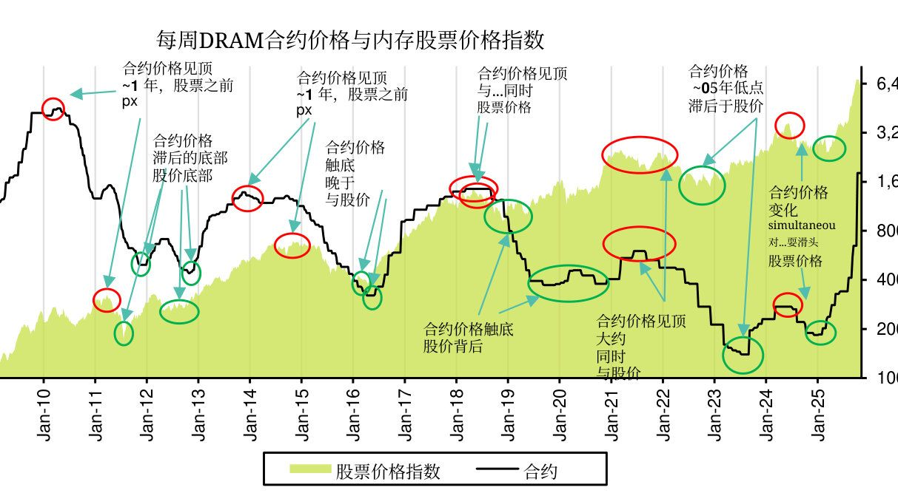

每周DRAM合约价格与内存股票价格指数
- 纵轴：DRAM Contract Price（US$/Gb，对数轴）；Memory Stock Px Index（对数轴）；Memory Stock Px Index (log scale)
- 横轴：Jan-09至Jan-25
- 图例：股票价格指数、合约

来源：DRAMeXchange、Bloomberg及Bernstein分析

HBM及CoWoS预测也被上调，因为供应商增加更多产能以满足更强劲的需求。

- 鉴于过去几个月宣布的AI项目和强劲的下游信号，我们预计台积电（TSMC）、ASE（未覆盖）、Amkor（未覆盖）将扩大CoWoS产能（见我们近期关于台积电的报告）；同样，我们预计三星（Samsung）、SK hynix和Micron将增加HBM供应，以支持这些项目。NVIDIA实现其US$0.5万亿目标就是一个例子，如果后续了解到更多下游项目，可能需要更多供应。因此，我们上调HBM比特出货量预测：CY2026年增长100%，CY2027年再增长35%（Exhibit 23）。

- CY2026年HBM和常规内存的供应都将紧张，因此我们预测HBM价格将保持强劲，HBM3E价格的下跌将被HBM4的溢价抵消。我们预计从明年开始HBM3E价格将下降超过20%，但HBM4相对于HBM3E的价格溢价超过40%。总体而言，我们预计从CY2025到CY2026年混合HBM平均售价（ASP）仅同比温和下降5%（Exhibit 24-Exhibit 25）。这意味着CY2026年HBM总收入将增长91%，达到750亿美元（Exhibit 26）。

- 然而，由于传统DRAM价格大幅上涨，进而导致收入激增，HBM在整体DRAM中的收入占比在2026财年可能会下降。随着传统DRAM价格在2027财年恢复正常，我们预计HBM的占比将再次上升至~40%的总占比（图表27）。由于HBM重新成为整体DRAM平均售价（ASP）的强劲支撑，我们预测到2027财年末，混合DRAM平均售价将高于当前水平，这也得益于HBM贡献的增长（图表3）。

- 就晶圆消耗量而言，到2027日历年度，HBM可能将消耗近30%的整体DRAM晶圆消耗量，或许会超过传统服务器DRAM，成为DRAM晶圆的最大用途（Exhibit 29）。正如我们之前讨论的，HBM晶圆消耗量的增长应继续使传统DRAM产能相对紧张，因此我们仅模拟DRAM平均售价（ASP）的正常化，并预计到2027日历年度末DRAM利润率仍将保持可观。

- 相比之下，我们重申三星的地位将从HBM3E提升到HBM4，尤其是考虑到其更先进的DRAM和基础芯片制造技术使三星能够更好地满足NVIDIA所需的更高速度，同时保持良好的良率。我们还认为三星的洁净室空间比SK hynix和美光更宽松，现在能够提供更多产能以在短缺市场中获得份额。因此，我们继续预测三星在CY26年的市场份额将反弹（Exhibit 30）。

[Source Page: 12]

EXHIBIT 23: We raise HBM forecast to 100% growth in bit shipment in CY2026.

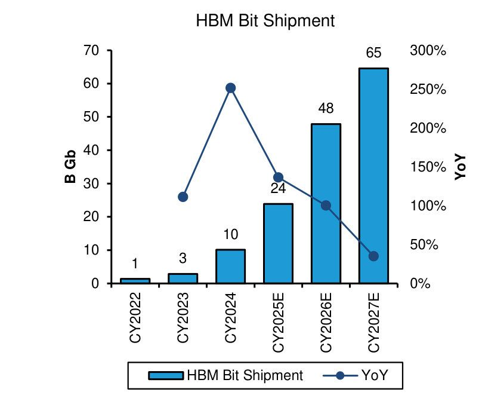

HBM Bit Shipment
- 柱状标注（B Gb）：CY2022 1、CY2023 3、CY2024 10、CY2025E 24、CY2026E 48、CY2027E 65
- 左纵轴：B Gb（0–70）；右纵轴：YoY（0%–300%）
- 图例：HBM Bit Shipment（蓝色柱）、YoY（折线，无数据标签）

Source: TrendForce, Yole, Bernstein estimates and analysis

EXHIBIT 24: The price erosion of HBM3E should be largely compensated by the premium of HBM4.

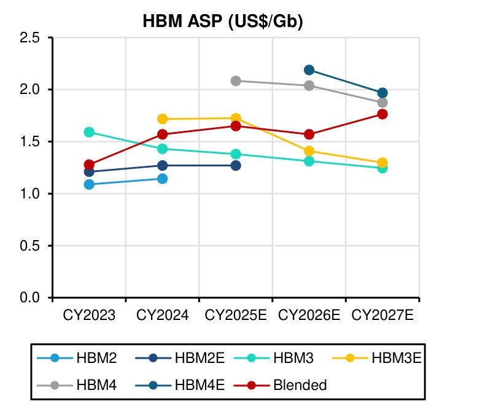

HBM ASP (US$/Gb)
- 纵轴：US$/Gb，0.0–2.5
- 横轴：CY2023、CY2024、CY2025E、CY2026E、CY2027E
- 图例：HBM2、HBM2E、HBM3、HBM3E、HBM4、HBM4E、Blended（折线，无数据标签）

Source: Company reports, TrendForce, Bernstein estimates and analysis

EXHIBIT 25: With TPU gaining more momentum, we see more HBM3E and HBM4 only 27% of CY2026's total bit shipment.

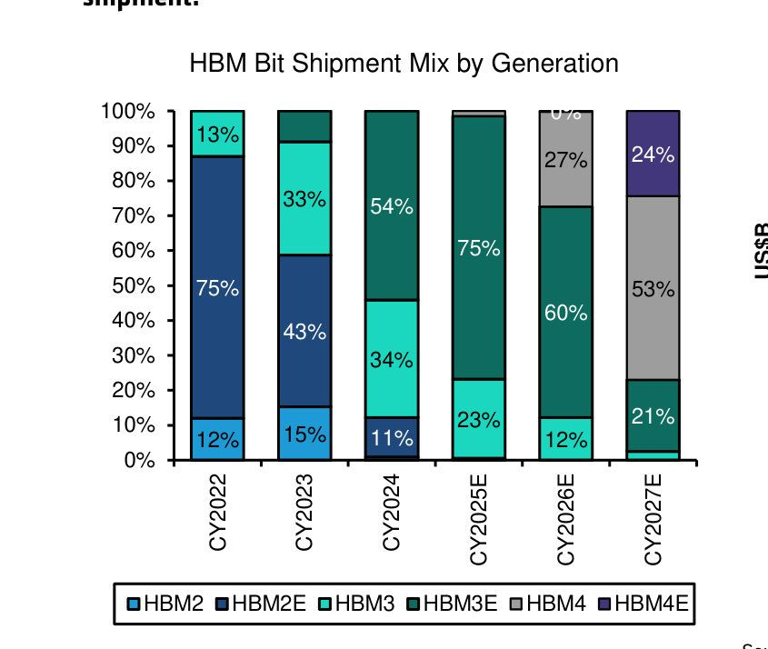

HBM Bit Shipment Mix by Generation
- 纵轴：0%–100%
- 横轴：CY2022、CY2023、CY2024、CY2025E、CY2026E、CY2027E
- 图例（自下而上堆叠顺序）：HBM2、HBM2E、HBM3、HBM3E、HBM4、HBM4E
- 各年标注值（自下而上）：CY2022 12%、75%、13%；CY2023 15%、43%、33%（顶部另有深绿色段无标注）；CY2024 11%、34%、54%；CY2025E 23%、75%；CY2026E 12%、60%、27%、0%；CY2027E 21%、53%、24%

Source: TrendForce, Bernstein estimates and analysis

EXHIBIT 26: Overall we project HBM revenue to nearly double US$75B next year.

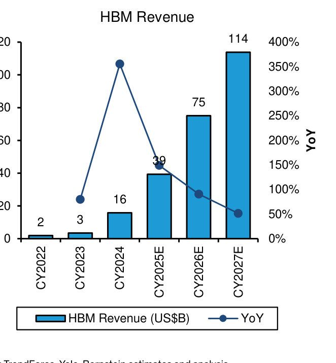

HBM Revenue
- 柱状标注（US$B）：CY2022 2、CY2023 3、CY2024 16、CY2025E 39、CY2026E 75、CY2027E 114
- 左纵轴：US$B（0–120）；右纵轴：YoY（0%–400%）
- 图例：HBM Revenue (US$B)（蓝色柱）、YoY（折线，无数据标签）

Source: TrendForce, Yole, Bernstein estimates and analysis

EXHIBIT 23: 我们将HBM预测上调至2026日历年度比特出货量增长100%。

HBM比特出货量
- 柱状标注（B Gb）：同左栏，CY2022 1、CY2023 3、CY2024 10、CY2025E 24、CY2026E 48、CY2027E 65
- 左纵轴：B Gb（0–70）；右纵轴：YoY（0%–300%）
- 图例：HBM比特出货量（蓝色柱）、YoY（折线）

来源：TrendForce、Yole、Bernstein估算和分析

EXHIBIT 24: HBM3E的价格下跌应主要由HBM4的溢价弥补。

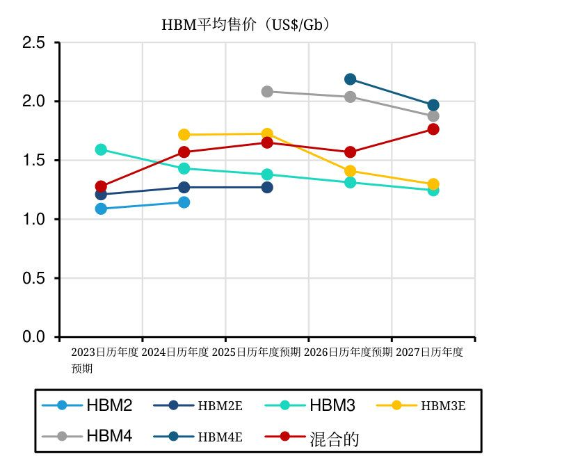

HBM平均售价（US$/Gb）
- 纵轴：US$/Gb，0.0–2.5
- 横轴：2023日历年度、2024日历年度、2025日历年度预期、2026日历年度预期、2027日历年度预期
- 图例：HBM2、HBM2E、HBM3、HBM3E、HBM4、HBM4E、混合的

来源：公司报告、TrendForce、Bernstein估计和分析

EXHIBIT 25: 随着TPU的势头增强，我们预计HBM3E和HBM4仅占CY2026年总比特出货量的27%。

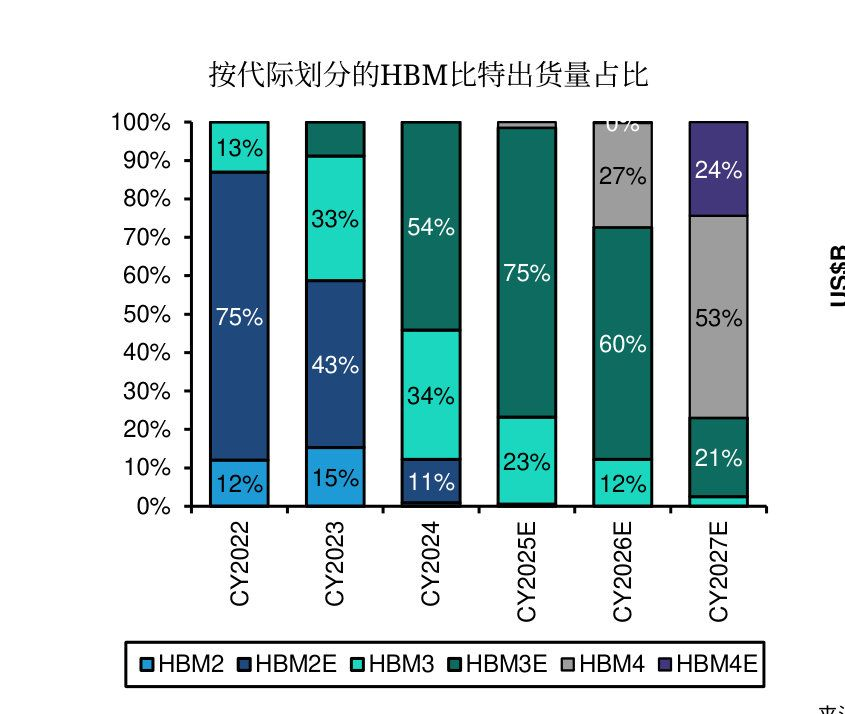

按代际划分的HBM比特出货量占比
- 纵轴：0%–100%
- 横轴：CY2022、CY2023、CY2024、CY2025E、CY2026E、CY2027E
- 图例（自下而上堆叠顺序）：HBM2、HBM2E、HBM3、HBM3E、HBM4、HBM4E
- 各年标注值（自下而上）：CY2022 12%、75%、13%；CY2023 15%、43%、33%；CY2024 11%、34%、54%；CY2025E 23%、75%；CY2026E 12%、60%、27%、0%；CY2027E 21%、53%、24%

来源：TrendForce、Bernstein估计及分析

EXHIBIT 26: 总体而言，我们预计明年HBM收入将接近翻一番，达到750亿美元。

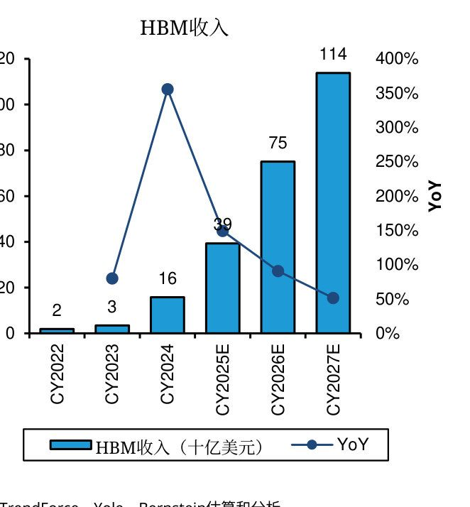

HBM收入
- 柱状标注（十亿美元）：CY2022 2、CY2023 3、CY2024 16、CY2025E 39、CY2026E 75、CY2027E 114
- 左纵轴：US$B（0–120）；右纵轴：YoY（0%–400%）
- 图例：HBM收入（十亿美元）（蓝色柱）、YoY（折线）

来源：TrendForce、Yole、Bernstein估算和分析

[Source Page: 13]

EXHIBIT 27: Revenue mix of HBM will likely fall in CY2026 due to strong conventional DRAM pricing but rise again in CYc027.

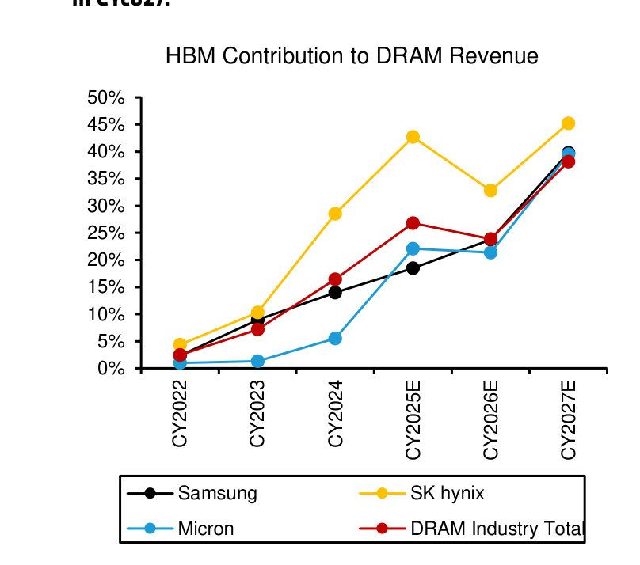

HBM Contribution to DRAM Revenue
- 纵轴：0%–50%（步长5%）
- 横轴：CY2022、CY2023、CY2024、CY2025E、CY2026E、CY2027E
- 图例：Samsung、SK hynix、Micron、DRAM Industry Total（折线，无数据标签）

Source: TrendForce, company reports, Bernstein estimates and analysis

EXHIBIT 28: HBM's bit shipment mix should grow notably next year and continue rising in CY2027.

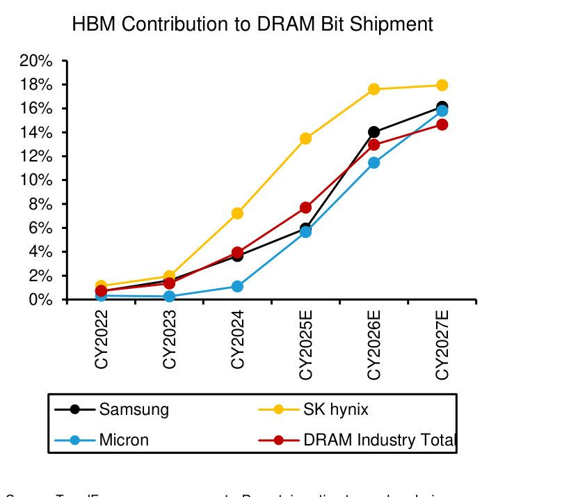

HBM Contribution to DRAM Bit Shipment
- 纵轴：0%–20%（步长2%）
- 横轴：CY2022、CY2023、CY2024、CY2025E、CY2026E、CY2027E
- 图例：Samsung、SK hynix、Micron、DRAM Industry Total（折线，无数据标签）

Source: TrendForce, company reports, Bernstein estimates and analysis

EXHIBIT 29: We model HBM wafer consumption to reach 28% of the total DRAM in CY2027, perhaps surpassing the consumption of conventional server DRAM.

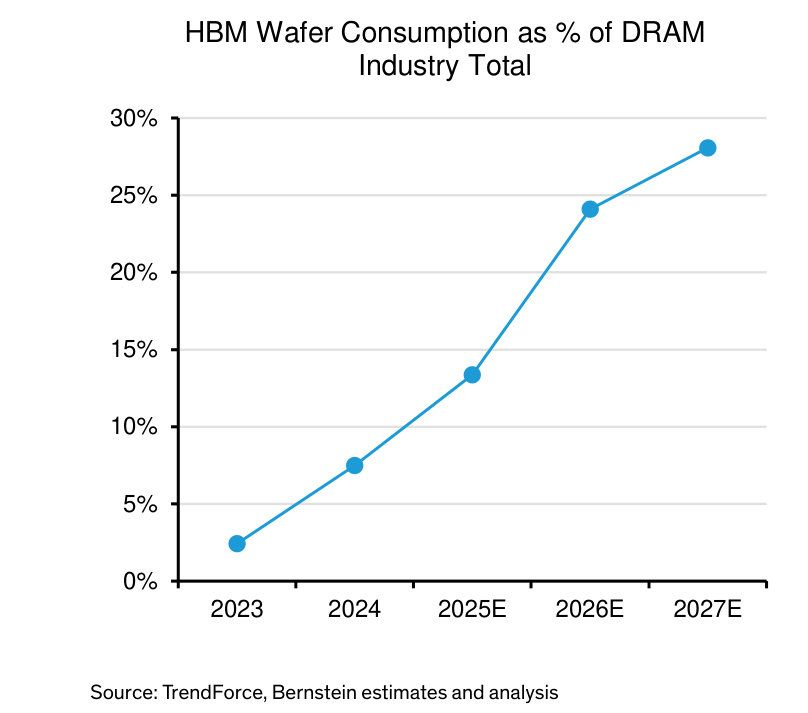

HBM Wafer Consumption as % of DRAM Industry Total
- 纵轴：0%–30%（步长5%）
- 横轴：2023、2024、2025E、2026E、2027E
- 单条折线，无图例、无数据标签

Source: TrendForce, Bernstein estimates and analysis

EXHIBIT 30: We predict Samsung to gain share in HBM as it should release more supply for HBM3E and its competitive position in HBM4 also improves than in HBM3E.

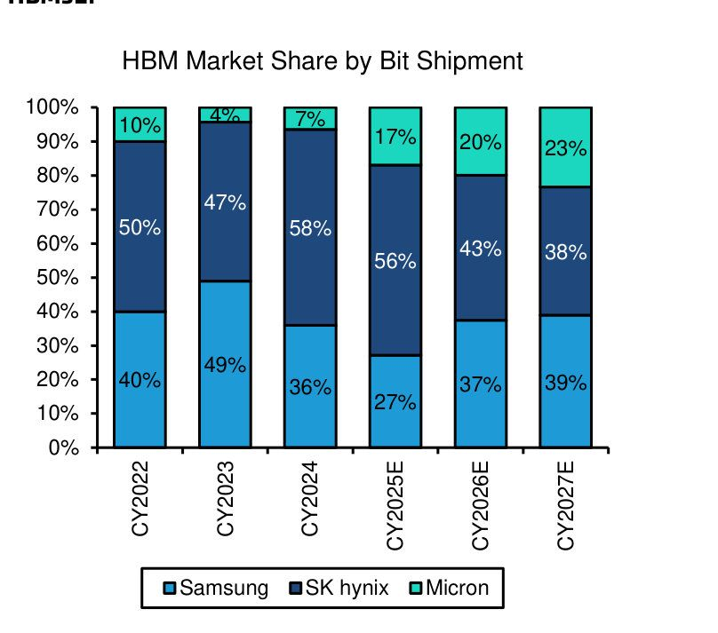

HBM Market Share by Bit Shipment
- 纵轴：0%–100%（步长10%）
- 横轴：CY2022、CY2023、CY2024、CY2025E、CY2026E、CY2027E
- 图例（自下而上堆叠顺序）：Micron、Samsung、SK hynix
- 各年标注值（自上而下）：CY2022 10%／50%／40%；CY2023 4%／47%／49%；CY2024 7%／58%／36%；CY2025E 17%／56%／27%；CY2026E 20%／43%／37%；CY2027E 23%／38%／39%

Source: TrendForce, Bernstein estimates and analysis

With both short- & long-term visibility, we project DRAM capex to jump significantly in CY2026 but much less so for NAND.

- Micron CFO strongly suggested a notable capex hike in a recent conference. We also pick up from supply chain significant capex increases coming from Samsung and SK hynix too. With that, we model 30-65% YoY growth in CY2026 DRAM capex from them, and the aggregate DRAM industry capex up by another 40% in that year, for both WFE spending and also continued spending in infrastructure (Exhibit 31).

图表27：由于传统DRAM价格强劲，HBM的收入占比在2026财年可能会下降，但在2027财年将再次上升。

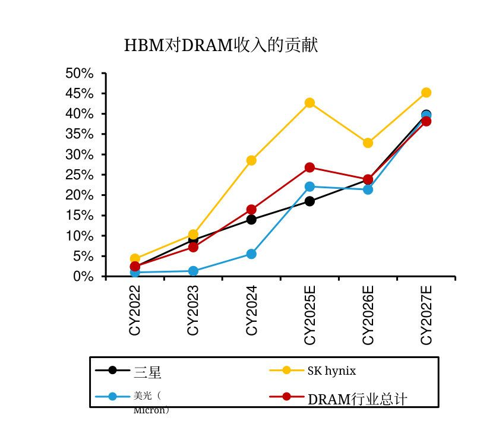

HBM对DRAM收入的贡献
- 纵轴：0%–50%（步长5%）
- 横轴：CY2022、CY2023、CY2024、CY2025E、CY2026E、CY2027E
- 图例：三星、SK hynix、美光（Micron）、DRAM行业总计

来源：TrendForce、公司报告、伯恩斯坦估计和分析

EXHIBIT 28: HBM的比特出货量占比明年应显著增长，并在2027日历年度继续上升。

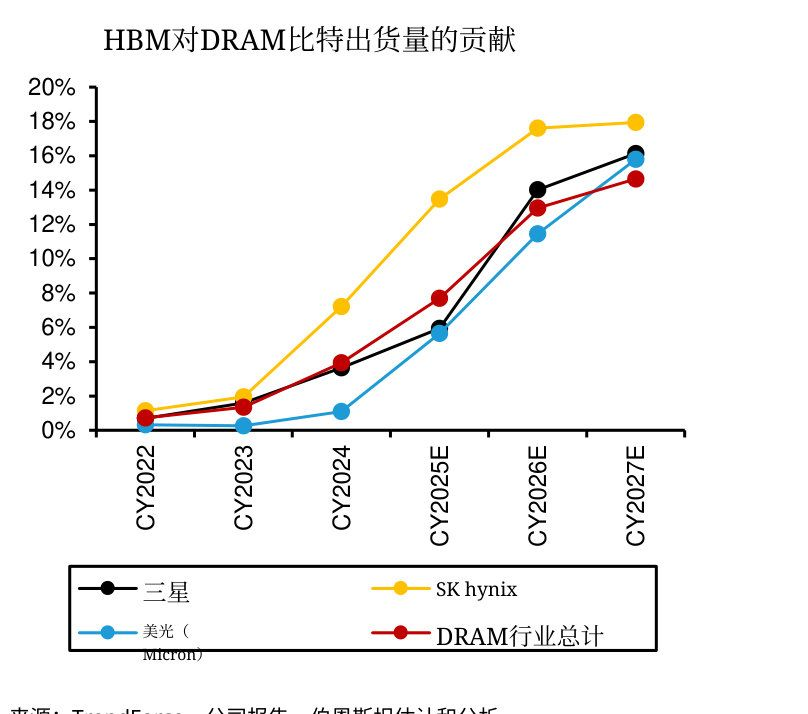

HBM对DRAM比特出货量的贡献
- 纵轴：0%–20%（步长2%）
- 横轴：CY2022、CY2023、CY2024、CY2025E、CY2026E、CY2027E
- 图例：三星、SK hynix、美光（Micron）、DRAM行业总计

来源：TrendForce、公司报告、伯恩斯坦估计和分析

EXHIBIT 29: 我们预测HBM晶圆消耗量将在CY2027达到DRAM总量的28%，可能超过传统服务器DRAM的消耗量。

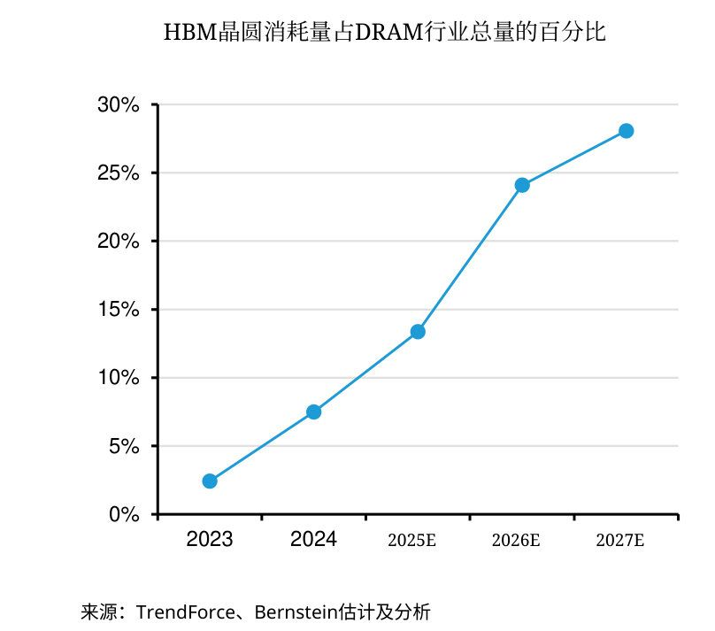

HBM晶圆消耗量占DRAM行业总量的百分比
- 纵轴：0%–30%（步长5%）
- 横轴：2023、2024、2025E、2026E、2027E

来源：TrendForce、Bernstein估计及分析

EXHIBIT 30: 我们预测三星将在HBM领域获得份额，因为它应释放更多HBM3E供应，且其在HBM4中的竞争地位也比HBM3E有所提升。

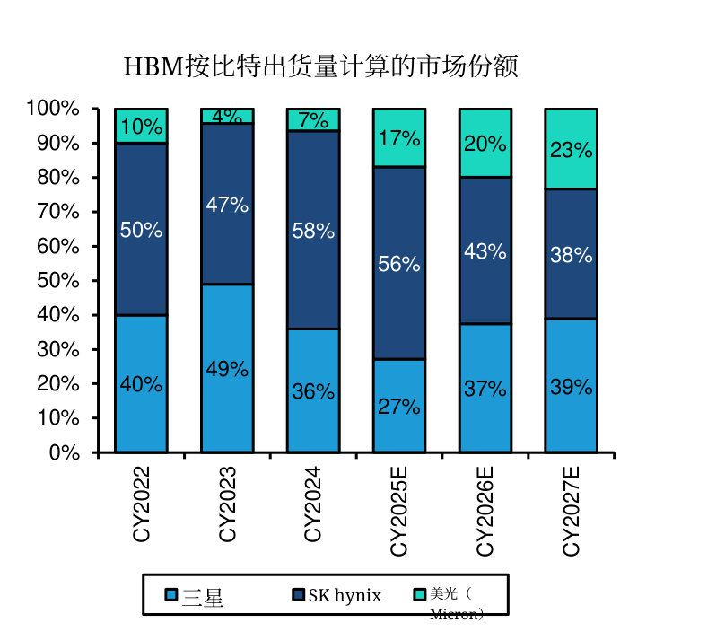

HBM按比特出货量计算的市场份额
- 纵轴：0%–100%（步长10%）
- 横轴：CY2022、CY2023、CY2024、CY2025E、CY2026E、CY2027E
- 图例（自下而上堆叠顺序）：美光（Micron）、三星、SK hynix
- 各年标注值（自上而下）：CY2022 10%／50%／40%；CY2023 4%／47%／49%；CY2024 7%／58%／36%；CY2025E 17%／56%／27%；CY2026E 20%／43%／37%；CY2027E 23%／38%／39%

来源：TrendForce、Bernstein估计及分析

由于短期和长期前景均清晰，我们预计DRAM资本支出在CY2026年将大幅增长，但NAND的增长幅度小得多。

- Micron CFO强烈建议在最近的一次会议上大幅增加capex。我们还从供应链获悉，三星和SK hynix也将大幅增加capex。基于此，我们预测CY2026年DRAM的同比（YoY）增长率为30-65%（来自它们的资本支出），DRAM行业总资本支出在该年再增长40%，包括WFE支出和基础设施的持续支出（Exhibit 31）。

[Source Page: 14]

- Notably the capex hike signals are much more about DRAM, but signals on NAND are much weaker. We believe that Samsung is even re-purposing an NAND fab for DRAM. This aligns with our long-term cautious stance on NAND market, and we accordingly model NAND capex to grow 30% YoY, but from a very low base, and the overall spending will remain considerably below levels prior to CY2022 (Exhibit 32).

EXHIBIT 31: We expect DRAM industry capex to rise by 40% to another new high in CY2026.

DRAM Industry Capex
- 柱顶合计标注（US$B，2010–2027E）：12、9、6、8、11、14、12、17、27、22、23、27、33、32、43、55、77、86
- 左纵轴：US$B（10–90）；右纵轴：YoY（-50%–70%，步长20%）
- 横轴：2010–2027E（Calendar years）
- 图例：Samsung、SK hynix、Micron、Elpida、ProMOS、Winbond、Powerchip、Rexchip、Nanya、Fujian Jinhua、CXMT（堆叠柱）；% YoY、WFE YoY（折线，无数据标签）

Source: Company reports, TrendForce, SEMI, bernstein estimates and analysis

EXHIBIT 32: For NAND, we expect capex growth to be slower and overall capex $ remain considerably behind levels prior to CY2022.

NAND Industry Capex
- 柱顶合计标注（US$B，2010–2027E）：7、9、9、9、11、13、16、25、28、22、22、29、33、14、14、18、23、27
- 左纵轴：US$B（5–40）；右纵轴：YoY（-60%–80%，步长20%）
- 横轴：2010–2027E（Calendar years）
- 图内标注：3D NAND Ramp（箭头指向2017年前后）
- 图例：SEC、KIOXIA/SanDisk、SK hynix、Micron、Intel、YMTC（堆叠柱）；% YoY、WFE YoY（折线，无数据标签）

Source: Company reports, SEMI, TrendForce, Gartner, Bernstein estimates and analysis

Helped by pending IPOs, China will add capacity but won't be able to turn shortage into oversupply next year.

- China is also seizing the current shortage as an opportunity to expand production and gain more share, & maybe even to enjoy decent profitability thanks to the skyrocketing memory price. We understand both YMTC and CXMT are ramping production to nearly full capacity under their existing clean room space.

- 值得注意的是，capex增加的信号主要针对DRAM，而NAND的信号则弱得多。我们认为三星甚至正在将一个NAND晶圆厂改用于DRAM。这与我们对NAND市场的长期谨慎立场一致，因此我们预测NAND capex将同比增长30%，但基数非常低，整体支出仍将远低于CY2022之前的水平（Exhibit 32）。

EXHIBIT 31: 我们预计DRAM行业资本支出将增长40%，在2026日历年度达到另一个新高。

DRAM行业Capex
- 柱顶合计标注（US$B，2010–2027E）：12、9、6、8、11、14、12、17、27、22、23、27、33、32、43、55、77、86
- 左纵轴：US$B（10–90）；右纵轴：YoY（同比百分比，-50%–70%）
- 横轴：2010–2027E（日历年度）
- 图例：三星、SK hynix、美光（Micron）、Elpida、ProMOS、Winbond、力积电（Powerchip）、瑞晶、Nanya、福建晋华、CXMT（堆叠柱）；同比百分比、晶圆厂设备支出同比（折线）

来源：公司报告、TrendForce、SEMI、Bernstein预估及分析

EXHIBIT 32: 对于NAND，我们预计资本支出增长将更慢，整体资本支出金额仍远低于2022日历年度之前的水平。

NAND行业资本支出
- 柱顶合计标注（US$B，2010–2027E）：7、9、9、9、11、13、16、25、28、22、22、29、33、14、14、18、23、27
- 左纵轴：US$B（5–40）；右纵轴：YoY（-60%–80%）
- 横轴：2010–2027E（日历年度）
- 图内标注：3D NAND产能提升（箭头指向2017年前后）
- 图例：SEC、KIOXIA/SanDisk、SK hynix、美光（Micron）、英特尔、YMTC（堆叠柱）；同比百分比、晶圆厂设备支出同比（折线）

来源：公司报告、SEMI、TrendForce、Gartner、伯恩斯坦估计和分析

在IPO的帮助下，中国将增加产能，但明年无法将短缺转为供过于求。

- 中国也在利用当前短缺的机会扩大生产并获得更多份额，甚至可能因内存价格飙升而获得可观利润。我们了解到YMTC和CXMT都在扩产，在现有洁净室空间下达到接近满产。

[Source Page: 15]

With node migration and yield improvement, we estimate 40-50% bit output growth from them in CY2026. Moreover, likely expecting funding from equity market (both are seeking A share IPO, see link, link), they have both started building additional fab plants, which should be completed and bring additional capacity in the next 2 years.

- Having said that, they will still be growing from a relatively low base and hence the magnitude of their supply increase likely won't be enough to alter the supply shortage next year. And in particular, CXMT likely will also be tasked to supply HBM to support China's local AI chips, which will reduce capacity available for conventional DRAM too. Therefore we model their share to expand in the next 2 years, but still with a measured magnitude, especially for DRAM (Exhibit 33). In the long run, as NAND does not require EUV to advance and China hence has good enough domestic equipment supply to expand capacity amid export controls, we advocate that China is a long-term threat to the incumbent NAND suppliers. This is one of the reasons why we're structurally cautious on NAND.

EXHIBIT 33: We model CXMT and YMTC's share to expand in the next 2 years, but still from a lowe base & hence with a measured magnitude, especially for CXMT.

Market Share in Bit Shipment
- 纵轴：0%–16%（步长2%）
- 横轴：CY2020、CY2021、CY2022、CY2023、CY2024、CY2025E、CY2026E、CY2027E
- CXMT标注：0%、1%、1%、3%、5%、8%、9%、10%
- YMTC标注：1%、3%、6%、7%、8%、12%、14%、15%
- 图例：CXMT、YMTC（折线）

Source: TrendForce, Gartner, Bernstein estimates and analysis

Overall, investors should be mindful of the high beta of memory stocks though we're structurally positive on DRAM & negative on NAND.

- We have been advocating memory is a cornerstone of data economy (Global Memory: The cornerstone of the data economy but painful cyclicality - Initiating with Underperform) and our recent study (Asian Semis & Global Memory: Two findings, one simulation & one model for AI) reinforces our conviction. However the rapid conventional memory price moves & the concern on AI being a bubble will still result in very high volatility in the stock prices. Hence we're constructive for DRAM & negative for NAND structurally, but still advise investors to tread these stocks carefully.

随着节点迁移和良率提升，我们预计它们在2026财年的位输出增长40-50%。此外，由于可能获得股权市场融资（两者均在寻求A股IPO，见link，link），两者均已开始建设额外的晶圆厂，这些工厂应在未来2年内完工并带来额外产能。

- 尽管如此，它们仍将从相对较低的基数上增长，因此其供应增加的幅度可能不足以改变明年的供应短缺。特别是，CXMT可能还将被要求供应HBM以支持中国本土AI芯片，这也将减少传统DRAM的可用产能。因此，我们预测其份额将在未来2年内扩大，但幅度仍将适中，尤其是DRAM（Exhibit 33）。从长期来看，由于NAND的发展不需要EUV，因此中国在出口管制下拥有足够好的国内设备供应来扩大产能，我们认为中国对现有NAND供应商构成长期威胁。这也是我们对NAND持结构性谨慎态度的原因之一。

EXHIBIT 33: 我们预测CXMT和YMTC的份额将在未来2年扩大，但仍处于较低基数，因此增长幅度有限，尤其是对CXMT而言。

比特出货量市场份额
- 纵轴：0%–16%（步长2%）
- 横轴：2020日历年度、CY2021、2022日历年度、CY2023、2024年、2025财年预期、2026年预估、2027日历年度预期
- CXMT标注：0%、1%、1%、3%、5%、8%、9%、10%
- YMTC标注：1%、3%、6%、7%、8%、12%、14%、15%
- 图例：CXMT、YMTC

来源：TrendForce、Gartner、Bernstein估计和分析

总体而言，尽管我们在结构上对DRAM持积极态度，对NAND持消极态度，但投资者应注意内存股票的高贝塔值。

- 我们一直主张内存是数据经济的基石（全球内存：数据经济的基石但具有痛苦的周期性 - 初始评级为跑输大市），我们最近的研究（亚洲半导体与全球内存：两项发现、一项模拟及一个AI模型）强化了我们的信念。然而，传统内存价格的快速变动以及对AI是泡沫的担忧仍将导致股价高度波动。因此，我们对DRAM持建设性看法，对NAND持结构性负面看法，但仍建议投资者谨慎投资这些股票。

[Source Page: 16]

## APPENDIX - FINANCIAL FORECASTS

### EXHIBIT 34: Samsung Income Statement

**Figures in KRW B Unless Otherwise Stated**

**Income Statement**

| 项目 | 2024 | 2025E | 2026E | 2027E | 1Q25 | 2Q25 | 3Q25 | 4Q25E | 1Q26E | 2Q26E | 3Q26E | 4Q26E |
|---|---|---|---|---|---|---|---|---|---|---|---|---|
| Revenue | 300,878 | 327,089 | 430,375 | 426,429 | 79,141 | 74,566 | 86,060 | 87,322 | 97,673 | 102,078 | 117,154 | 113,471 |
| COGS | 186,569 | 191,643 | 153,157 | 177,637 | 51,010 | 49,070 | 49,070 | 42,494 | 39,891 | 35,980 | 40,359 | 36,928 |
| Gross Profit | 114,310 | 135,446 | 277,218 | 248,792 | 28,131 | 25,497 | 36,990 | 44,828 | 57,782 | 66,098 | 76,795 | 76,543 |
| R&D | 34,152 | 37,035 | 45,227 | 41,467 | 9,033 | 9,019 | 9,019 | 9,963 | 10,589 | 11,121 | 11,895 | 11,622 |
| SG&A | 47,425 | 48,215 | 57,054 | 51,124 | 12,413 | 11,801 | 11,801 | 12,200 | 13,787 | 14,540 | 14,459 | 14,268 |
| Operating Profit | 32,733 | 50,196 | 174,938 | 156,201 | 6,685 | 4,676 | 16,170 | 22,665 | 33,406 | 40,437 | 50,441 | 50,653 |
| Other non-operating Income/(Expenses) | – | – | – | – | 865 | 18 | 18 | – | – | – | – | – |
| Equity-Method Investments | 744 | 621 | 706 | 742 | 119 | 159 | 159 | 184 | 181 | 177 | 174 | 174 |
| Net interest (expense)/gain | 3,506 | 3,772 | 2,534 | 4,873 | 1,483 | 903 | 903 | 484 | 495 | 559 | 651 | 830 |
| Income Before Taxes | 36,983 | 54,589 | 178,178 | 161,816 | 9,152 | 5,756 | 17,250 | 23,334 | 34,082 | 41,173 | 51,266 | 51,657 |
| Income Taxes | 3,073 | 8,625 | 48,999 | 44,500 | 929 | 640 | 640 | 6,417 | 9,373 | 11,322 | 14,098 | 14,206 |
| Net Income (before minority interest) | 33,910 | 45,965 | 129,179 | 117,317 | 8,223 | 5,116 | 16,610 | 16,917 | 24,709 | 29,850 | 37,168 | 37,451 |
| Minority Interest | 294 | (232) | 461 | 557 | 194 | 182 | 182 | 111 | 71 | 83 | 181 | 126 |
| Net Income (after minority interest) | 33,616 | 46,196 | 128,718 | 116,759 | 8,028 | 4,934 | 16,428 | 16,806 | 24,638 | 29,767 | 36,987 | 37,325 |
| EPS After Minority (KRW per share) | 4,949 | 6,913 | 19,403 | 17,600 | 1,192 | 737 | 2,465 | 2,533 | 3,714 | 4,487 | 5,575 | 5,626 |
| Total Shares Out | 6,793 | 6,682 | 6,634 | 6,634 | 6,737 | 6,692 | 6,665 | 6,634 | 6,634 | 6,634 | 6,634 | 6,634 |
| EBITDA | 72,383 | 94,194 | 221,077 | 206,715 | 17,415 | 16,033 | 27,130 | 33,616 | 44,523 | 51,844 | 62,119 | 62,590 |

**Margins %**

| 项目 | 2024 | 2025E | 2026E | 2027E | 1Q25 | 2Q25 | 3Q25 | 4Q25E | 1Q26E | 2Q26E | 3Q26E | 4Q26E |
|---|---|---|---|---|---|---|---|---|---|---|---|---|
| Gross Margin | 38.0% | 41.4% | 64.4% | 58.3% | 35.5% | 34.2% | 43.0% | 51.3% | 59.2% | 64.8% | 65.6% | 67.5% |
| Operating Margin | 10.9% | 15.3% | 40.6% | 36.6% | 8.4% | 6.3% | 18.8% | 26.0% | 34.2% | 39.6% | 43.1% | 44.6% |
| NI before MI Margin | 11.3% | 14.1% | 30.0% | 27.5% | 10.4% | 6.9% | 19.3% | 19.4% | 25.3% | 29.2% | 31.7% | 33.0% |
| NI after MI Margin | 11.2% | 14.1% | 29.9% | 27.4% | 10.1% | 6.6% | 19.1% | 19.2% | 25.2% | 29.2% | 31.6% | 32.9% |
| EBITDA Margin | 24.1% | 28.8% | 51.4% | 48.5% | 22.0% | 21.5% | 31.5% | 38.5% | 45.6% | 50.8% | 53.0% | 55.2% |
| ROE % | 8.9% | 11.1% | 26.5% | 19.5% | 8.1% | 5.1% | 16.3% | 16.1% | 22.5% | 25.7% | 30.0% | 28.3% |

**Growth %**

| 项目 | 2024 | 2025E | 2026E | 2027E | 1Q25 | 2Q25 | 3Q25 | 4Q25E | 1Q26E | 2Q26E | 3Q26E | 4Q26E |
|---|---|---|---|---|---|---|---|---|---|---|---|---|
| Revenue Growth | 16.2% | 8.7% | 31.6% | (0.9%) | 4.4% | (5.8%) | 15.4% | 1.5% | 11.9% | 4.5% | 14.8% | (3.1%) |
| Operating Profit Growth | 399.0% | 53.4% | 248.5% | (10.7%) | 3.0% | (30.1%) | 245.8% | 40.2% | 47.4% | 21.0% | 24.7% | 0.4% |
| EPS Growth | 132.3% | 39.7% | 180.7% | (9.3%) | 6.8% | (38.1%) | 234.3% | 2.8% | 46.6% | 20.8% | 24.3% | 0.9% |

**Division Financials**

**Semiconductor**

| 项目 | 2024 | 2025E | 2026E | 2027E | 1Q25 | 2Q25 | 3Q25 | 4Q25E | 1Q26E | 2Q26E | 3Q26E | 4Q26E |
|---|---|---|---|---|---|---|---|---|---|---|---|---|
| Total Revenue | 111,105 | 127,442 | 252,006 | 245,545 | 25,131 | 27,875 | 33,117 | 41,319 | 49,513 | 59,842 | 69,456 | 73,195 |
| DRAM | 52,163 | 69,493 | 160,610 | 159,384 | 12,814 | 13,813 | 18,210 | 24,656 | 31,223 | 37,849 | 44,940 | 46,599 |
| NAND | 32,308 | 31,589 | 63,062 | 56,145 | 6,261 | 7,362 | 8,466 | 9,499 | 11,937 | 14,963 | 17,439 | 18,723 |
| Total Memory | 84,495 | 101,179 | 223,767 | 215,623 | 19,100 | 21,200 | 26,700 | 34,179 | 43,183 | 52,836 | 62,403 | 65,345 |
| System LSI | 26,410 | 26,063 | 28,039 | 29,721 | 5,981 | 6,625 | 6,367 | 7,090 | 6,280 | 6,956 | 7,003 | 7,799 |
| Operating Profit | 15,100 | 23,328 | 134,860 | 115,777 | 1,106 | 350 | 6,991 | 14,881 | 22,980 | 31,084 | 39,144 | 41,652 |
| OP margin % | 13.6% | 18.3% | 53.5% | 47.2% | 4.4% | 1.3% | 21.1% | 36.0% | 46.4% | 51.9% | 56.4% | 56.9% |

**Display Panel**

| 项目 | 2024 | 2025E | 2026E | 2027E | 1Q25 | 2Q25 | 3Q25 | 4Q25E | 1Q26E | 2Q26E | 3Q26E | 4Q26E |
|---|---|---|---|---|---|---|---|---|---|---|---|---|
| Total Revenue | 29,208 | 29,160 | 31,671 | 34,510 | 5,867 | 6,380 | 8,102 | 8,811 | 6,267 | 7,666 | 9,059 | 8,679 |
| LCD | 1,250 | 1,892 | 2,032 | 2,059 | 411 | 447 | 486 | 548 | 483 | 474 | 534 | 540 |
| AMOLED | 27,958 | 27,268 | 29,640 | 32,451 | 5,456 | 5,933 | 7,615 | 8,263 | 5,784 | 7,192 | 8,525 | 8,138 |
| Operating Profit | 3,700 | 3,099 | 3,901 | 4,717 | 462 | 473 | 1,225 | 939 | 602 | 700 | 1,529 | 1,069 |
| OP margin % | 12.7% | 10.6% | 12.3% | 13.7% | 7.9% | 7.4% | 15.1% | 10.7% | 9.6% | 9.1% | 16.9% | 12.3% |

**IT & Mobile**

| 项目 | 2024 | 2025E | 2026E | 2027E | 1Q25 | 2Q25 | 3Q25 | 4Q25E | 1Q26E | 2Q26E | 3Q26E | 4Q26E |
|---|---|---|---|---|---|---|---|---|---|---|---|---|
| Total Revenue | 117,300 | 128,191 | 129,066 | 127,622 | 37,000 | 29,200 | 34,100 | 27,891 | 37,502 | 29,698 | 34,197 | 27,669 |
| Mobile (handsets + tablets) | 96,640 | 103,689 | 103,179 | 99,818 | 30,754 | 23,735 | 27,496 | 21,703 | 31,631 | 23,286 | 27,077 | 21,184 |
| Other (PCs, smartwatches, VR etc.) | 17,757 | 21,309 | 22,374 | 23,941 | 5,446 | 4,765 | 6,004 | 5,095 | 4,942 | 5,436 | 6,251 | 5,745 |
| Networking | 2,903 | 3,193 | 3,513 | 3,864 | 800 | 700 | 600 | 1,093 | 929 | 976 | 868 | 739 |
| Operating Profit | 10,600 | 13,146 | 13,103 | 12,653 | 4,300 | 3,100 | 3,600 | 2,146 | 4,429 | 3,044 | 3,545 | 2,085 |
| OP margin % | 9.0% | 10.3% | 10.2% | 9.9% | 11.6% | 10.6% | 10.6% | 7.7% | 11.8% | 10.3% | 10.4% | 7.5% |

**Consumer Electronics**

| 项目 | 2024 | 2025E | 2026E | 2027E | 1Q25 | 2Q25 | 3Q25 | 4Q25E | 1Q26E | 2Q26E | 3Q26E | 4Q26E |
|---|---|---|---|---|---|---|---|---|---|---|---|---|
| Total Revenue | 56,500 | 56,887 | 58,641 | 59,710 | 14,500 | 14,100 | 13,900 | 14,387 | 14,621 | 14,296 | 14,595 | 15,128 |
| Visual Display | 30,891 | 30,805 | 31,857 | 32,391 | 7,800 | 7,000 | 7,300 | 8,705 | 7,787 | 7,054 | 7,797 | 9,218 |
| Appliance | 25,609 | 26,083 | 26,784 | 27,320 | 6,700 | 7,100 | 6,600 | 5,683 | 6,834 | 7,242 | 6,798 | 5,910 |
| Operating Profit | 1,700 | 575 | 1,231 | 1,238 | 300 | 200 | (100) | 175 | 458 | 443 | 273 | 57 |
| OP Margin % | 3.0% | 1.0% | 2.1% | 2.1% | 2.1% | 1.4% | (0.7%) | 1.2% | 3.1% | 3.1% | 1.9% | 0.4% |

**Harman**

| 项目 | 2024 | 2025E | 2026E | 2027E | 1Q25 | 2Q25 | 3Q25 | 4Q25E | 1Q26E | 2Q26E | 3Q26E | 4Q26E |
|---|---|---|---|---|---|---|---|---|---|---|---|---|
| Total Revenue | 14,301 | 15,352 | 16,119 | 17,731 | 3,419 | 3,830 | 3,954 | 4,149 | 3,590 | 4,022 | 4,151 | 4,356 |
| Operating Profit | 1,300 | 1,644 | 1,674 | 1,832 | 307 | 484 | 421 | 432 | 360 | 382 | 459 | 473 |
| OP Margin % | 9.1% | 10.7% | 10.4% | 10.3% | 9.0% | 12.6% | 10.6% | 10.4% | 10.0% | 9.5% | 11.1% | 10.9% |

Source: Company reports, Bernstein estimates and analysis

## 附录 - 财务预测

### EXHIBIT 34: 三星利润表

数字以十亿韩元计（除非另有说明）

来源：公司报告、伯恩斯坦估计和分析

[Source Page: 17]

### EXHIBIT 35: Samsung Operating Metrics

**Division Operating Metrics**

**Semiconductor**

| 项目 | 2024 | 2025E | 2026E | 2027E | 1Q25 | 2Q25 | 3Q25 | 4Q25E | 1Q26E | 2Q26E | 3Q26E | 4Q26E |
|---|---|---|---|---|---|---|---|---|---|---|---|---|
| DRAM ASP ($/Gb) | 0.38 | 0.45 | 0.87 | 0.71 | 0.38 | 0.38 | 0.44 | 0.56 | 0.73 | 0.85 | 0.93 | 0.97 |
| % change | 59.4% | 16.9% | 94.8% | (18.7%) | (19.0%) | (0.2%) | 15.8% | 27.6% | 29.2% | 16.6% | 9.9% | 3.8% |
| NAND ASP ($/GB) | 0.08 | 0.07 | 0.11 | 0.08 | 0.07 | 0.06 | 0.07 | 0.08 | 0.10 | 0.11 | 0.12 | 0.12 |
| % change | 65.9% | (7.8%) | 62.5% | (27.0%) | (16.0%) | (4.0%) | 5.6% | 20.0% | 22.0% | 15.0% | 5.0% | – |
| DRAM Bits Shipped (Gb) | 99,510 | 109,163 | 127,721 | 155,819 | 23,107 | 25,880 | 29,762 | 30,414 | 29,806 | 30,998 | 33,478 | 33,438 |
| % change | 13.5% | 9.7% | 17.0% | 22.0% | 2.2% | 12.0% | 15.0% | 2.2% | (2.0%) | 4.0% | 8.0% | (0.1%) |
| NAND Bits Shipped (GB) | 315,370 | 321,993 | 389,612 | 475,326 | 65,378 | 83,030 | 91,333 | 82,252 | 84,719 | 92,344 | 102,502 | 110,046 |
| % change | 11.2% | 2.1% | 21.0% | 22.0% | (11.0%) | 27.0% | 10.0% | (9.9%) | 3.0% | 9.0% | 11.0% | 7.4% |
| DRAM Cost/Gb | 0.18 | 0.19 | 0.20 | 0.20 | 0.19 | 0.19 | 0.20 | 0.19 | 0.19 | 0.20 | 0.21 | 0.21 |
| % change | 0.4% | 5.6% | 7.1% | (2.0%) | (11.3%) | (1.5%) | 5.1% | (3.7%) | 2.0% | 4.0% | 4.0% | 2.0% |
| NAND Cost/GB | 0.05 | 0.05 | 0.05 | 0.04 | 0.06 | 0.06 | 0.05 | 0.05 | 0.05 | 0.05 | 0.04 | 0.04 |
| % change | (5.6%) | (2.4%) | (13.2%) | (12.3%) | 4.1% | (2.5%) | (10.1%) | (3.7%) | (1.0%) | (3.0%) | (3.0%) | (3.0%) |
| NAND gross margins | 29.0% | 24.7% | 59.8% | 51.7% | 14.0% | 12.6% | 25.6% | 40.3% | 51.6% | 59.1% | 62.3% | 63.4% |
| DRAM gross margins | 53.0% | 57.4% | 76.6% | 71.8% | 50.2% | 50.9% | 55.4% | 66.3% | 73.4% | 76.3% | 77.6% | 78.0% |

**Display Panel**

| 项目 | 2024 | 2025E | 2026E | 2027E | 1Q25 | 2Q25 | 3Q25 | 4Q25E | 1Q26E | 2Q26E | 3Q26E | 4Q26E |
|---|---|---|---|---|---|---|---|---|---|---|---|---|
| LCD Panel Units (mn) | 1.4 | 1.8 | 2.0 | 2.2 | 0.4 | 0.4 | 0.5 | 0.5 | 0.5 | 0.5 | 0.5 | 0.5 |
| % change | 25.0% | 25.0% | 10.0% | 10.0% | (10.0%) | 5.0% | 7.0% | 10.8% | (10.0%) | – | 15.0% | 3.3% |
| AMOLED Panel Units (mn) | 343.1 | 351.4 | 363.6 | 383.7 | 71.5 | 83.5 | 94.6 | 101.9 | 75.9 | 88.2 | 99.5 | 100.0 |
| % change | (3.4%) | 2.4% | 3.5% | 5.5% | (26.5%) | 16.7% | 13.3% | 7.7% | (25.5%) | 16.2% | 12.9% | 0.5% |
| LCD Panel ASP (USD) | 637.2 | 741.3 | 713.8 | 657.5 | 695.2 | 746.6 | 767.1 | 751.8 | 736.8 | 722.0 | 707.6 | 693.4 |
| % change | 15.9% | 16.3% | (3.7%) | (7.9%) | 7.7% | 7.4% | 2.8% | (2.0%) | (2.0%) | (2.0%) | (2.0%) | (2.0%) |
| AMOLED ASP (USD) | 59.7 | 54.6 | 56.6 | 58.7 | 52.5 | 50.7 | 58.1 | 56.3 | 52.9 | 56.7 | 59.5 | 56.5 |
| % change | (10.2%) | (8.5%) | 3.6% | 3.7% | (7.8%) | (3.4%) | 14.4% | (3.0%) | (6.0%) | 7.0% | 5.0% | (5.0%) |

**IT & Mobile**

| 项目 | 2024 | 2025E | 2026E | 2027E | 1Q25 | 2Q25 | 3Q25 | 4Q25E | 1Q26E | 2Q26E | 3Q26E | 4Q26E |
|---|---|---|---|---|---|---|---|---|---|---|---|---|
| Smartphone Units (mn) | 224 | 230 | 233 | 241 | 61 | 58 | 61 | 50 | 63 | 57 | 61 | 53 |
| % change | (0.4%) | 2.8% | 1.1% | 3.4% | 17.3% | (4.9%) | 5.2% | (17.4%) | 25.0% | (10.0%) | 7.0% | (13.0%) |
| Featurephone Units (mn) | 15 | 15 | 15 | 15 | 4 | 4 | 4 | 4 | 4 | 4 | 4 | 4 |
| % change | – | – | – | – | – | – | – | – | – | – | – | – |
| Total Handset Units (mn) | 239 | 246 | 248 | 256 | 65 | 62 | 65 | 54 | 67 | 60 | 64 | 57 |
| % change | (0.4%) | 2.7% | 1.1% | 3.2% | 16.1% | (4.6%) | 4.9% | (16.4%) | 23.2% | (9.4%) | 6.6% | (12.2%) |
| Total Tablet Units (mn) | 28 | 28 | 28 | 29 | 7 | 7 | 7 | 7 | 7 | 7 | 7 | 7 |
| % change | 7.3% | 0.5% | 1.0% | 1.0% | 0.5% | (0.5%) | – | 1.0% | 0.5% | (0.5%) | – | 1.0% |
| Smartphone ASP (USD) | 293.2 | 294.6 | 285.3 | 266.1 | 326.0 | 270.0 | 304.0 | 273.6 | 328.3 | 262.7 | 288.9 | 254.3 |
| % change | (0.4%) | 0.5% | (3.2%) | (6.7%) | 25.4% | (17.2%) | 12.6% | (10.0%) | 20.0% | (20.0%) | 10.0% | (12.0%) |
| Featurephone ASP (USD) | 44.6 | 42.7 | 41.4 | 39.8 | 42.5 | 43.1 | 42.9 | 42.5 | 42.0 | 41.6 | 41.2 | 40.8 |
| % change | 4.0% | (4.2%) | (3.1%) | (3.9%) | (3.9%) | 1.2% | (0.4%) | (1.0%) | (1.0%) | (1.0%) | (1.0%) | (1.0%) |
| Total Handset ASP (USD) | 277.4 | 279.0 | 270.4 | 252.7 | 309.4 | 256.0 | 288.7 | 257.4 | 312.0 | 248.8 | 274.3 | 239.9 |
| % change | (0.4%) | 0.6% | (3.1%) | (6.5%) | 26.1% | (17.2%) | 12.7% | (10.8%) | 21.2% | (20.3%) | 10.3% | (12.5%) |
| Total Tablet ASP (USD) | 159.8 | 159.8 | 159.8 | 159.8 | 159.8 | 159.8 | 159.8 | 159.8 | 159.8 | 159.8 | 159.8 | 159.8 |
| % change | 1.6% | 0.0% | (0.0%) | – | – | – | – | – | – | – | – | – |

**Consumer Electronics**

| 项目 | 2024 | 2025E | 2026E | 2027E | 1Q25 | 2Q25 | 3Q25 | 4Q25E | 1Q26E | 2Q26E | 3Q26E | 4Q26E |
|---|---|---|---|---|---|---|---|---|---|---|---|---|
| TV Unit Shipments (K) | 41,348 | 41,341 | 42,107 | 42,303 | 10,142 | 9,331 | 10,077 | 11,791 | 10,376 | 9,338 | 10,272 | 12,121 |
| % change | (0.4%) | (0.0%) | 1.9% | 0.5% | (13.0%) | (8.0%) | 8.0% | 17.0% | (12.0%) | (10.0%) | 10.0% | 18.0% |
| TV ASP (USD) | 521 | 497 | 498 | 503 | 503 | 506 | 494 | 489 | 494 | 494 | 499 | 504 |
| % change | (2.5%) | (4.4%) | 0.1% | 1.0% | 0.7% | 0.5% | (2.3%) | (1.0%) | 1.0% | – | 1.0% | 1.0% |

Source: Company reports, Bernstein estimates and analysis

### EXHIBIT 35: 三星运营指标

**部门运营指标**

来源：公司报告、伯恩斯坦估计和分析

[Source Page: 18]

### EXHIBIT 36: Samsung Balance Sheet and Cash Flow Statement

**Figures in KRW B Unless Otherwise Stated**

**Balance Sheet**

| 项目 | 2024 | 2025E | 2026E | 2027E | 1Q25 | 2Q25 | 3Q25 | 4Q25E | 1Q26E | 2Q26E | 3Q26E | 4Q26E |
|---|---|---|---|---|---|---|---|---|---|---|---|---|
| Cash & Cash Equivalents | 112,652 | 114,088 | 204,797 | 306,869 | 105,134 | 100,728 | 108,464 | 114,088 | 125,887 | 142,905 | 176,042 | 204,797 |
| Accounts Receivable | 43,623 | 51,279 | 67,513 | 61,910 | 44,867 | 43,551 | 50,539 | 51,279 | 57,572 | 60,159 | 69,231 | 67,513 |
| Inventory | 51,755 | 48,127 | 34,017 | 42,239 | 53,220 | 51,037 | 50,332 | 48,127 | 44,428 | 39,146 | 35,254 | 34,017 |
| Other Current Assets | 19,033 | 19,381 | 23,686 | 20,175 | 19,465 | 16,845 | 20,106 | 19,381 | 23,846 | 24,921 | 25,742 | 23,686 |
| Total Current Assets | 227,062 | 232,874 | 330,014 | 431,193 | 222,686 | 212,161 | 229,441 | 232,874 | 251,732 | 267,131 | 306,269 | 330,014 |
| Net PP&E | 205,945 | 207,971 | 227,835 | 249,240 | 207,386 | 205,026 | 204,861 | 207,971 | 213,390 | 218,458 | 223,293 | 227,835 |
| Intangibles | 23,739 | 26,469 | 26,469 | 26,469 | 26,695 | 25,998 | 26,469 | 26,469 | 26,469 | 26,469 | 26,469 | 26,469 |
| Investments | 33,981 | 38,530 | 39,235 | 39,978 | 33,489 | 33,240 | 38,345 | 38,530 | 38,711 | 38,888 | 39,062 | 39,235 |
| Other Non-Current Assets | 23,805 | 24,903 | 32,360 | 29,307 | 26,121 | 28,451 | 24,543 | 24,903 | 27,855 | 29,111 | 33,411 | 32,360 |
| Total Non-Current Assets | 287,470 | 297,873 | 325,900 | 344,994 | 293,691 | 292,715 | 294,219 | 297,873 | 306,425 | 312,926 | 322,235 | 325,900 |
| Total Assets | 514,532 | 530,747 | 655,914 | 776,186 | 516,377 | 504,875 | 523,660 | 530,747 | 558,157 | 580,057 | 628,504 | 655,914 |
| Accounts Payable | 60,531 | 51,684 | 43,291 | 57,212 | 63,433 | 55,598 | 57,731 | 51,684 | 49,104 | 41,862 | 46,495 | 43,291 |
| Total Debt | 19,330 | 16,672 | 16,672 | 16,672 | 11,144 | 14,030 | 16,672 | 16,672 | 16,672 | 16,672 | 16,672 | 16,672 |
| Other Liabilities | 32,479 | 34,423 | 48,604 | 47,438 | 35,186 | 35,686 | 35,755 | 34,423 | 42,153 | 43,895 | 52,991 | 48,604 |
| Total Liabilities | 112,340 | 102,779 | 108,567 | 121,322 | 109,762 | 105,313 | 110,158 | 102,779 | 107,930 | 102,429 | 116,158 | 108,567 |
| Shareholders' Equity | 402,192 | 427,968 | 547,347 | 654,864 | 406,614 | 399,562 | 413,502 | 427,968 | 450,228 | 477,628 | 512,346 | 547,347 |
| Total Liabilities & Equity | 514,532 | 530,747 | 655,914 | 776,186 | 516,377 | 504,875 | 523,660 | 530,747 | 558,157 | 580,057 | 628,504 | 655,914 |

**Cash Flow Statement**

| 项目 | 2024 | 2025E | 2026E | 2027E | 1Q25 | 2Q25 | 3Q25 | 4Q25E | 1Q26E | 2Q26E | 3Q26E | 4Q26E |
|---|---|---|---|---|---|---|---|---|---|---|---|---|
| Net Income | 34,445 | 46,866 | 129,179 | 117,317 | 8,223 | 5,116 | 16,610 | 16,917 | 24,709 | 29,850 | 37,168 | 37,451 |
| Depreciation & Amortization | 41,305 | 45,653 | 47,795 | 52,170 | 11,144 | 11,771 | 11,374 | 11,365 | 11,531 | 11,821 | 12,092 | 12,350 |
| Changes in Net Working Capital & Other | (2,760) | (13,410) | (8,805) | 15,960 | (2,787) | 473 | (5,364) | (5,733) | (7,492) | (2,864) | 3,254 | (1,704) |
| Cash Flow From Operations | 72,990 | 79,109 | 168,168 | 185,447 | 16,580 | 17,360 | 22,620 | 22,549 | 28,749 | 38,808 | 52,514 | 48,097 |
| Capex | (51,410) | (50,036) | (66,003) | (71,919) | (12,130) | (13,035) | (10,810) | (14,061) | (16,537) | (16,475) | (16,513) | (16,478) |
| Other | (1,960) | (8,791) | (1,655) | (1,655) | (1,440) | (4,707) | (2,231) | (414) | (414) | (414) | (414) | (414) |
| Cash Flow From Investing | (53,370) | (58,828) | (67,658) | (73,575) | (13,570) | (17,742) | (13,040) | (14,475) | (16,950) | (16,889) | (16,927) | (16,892) |
| Cash Flow From Financing | (7,800) | (21,387) | (9,800) | (9,800) | (11,340) | (3,407) | (4,190) | (2,450) | - | (4,900) | (2,450) | (2,450) |
| Free Cash Flow | 21,580 | 29,073 | 102,165 | 113,527 | 4,450 | 4,325 | 11,811 | 8,488 | 12,213 | 22,332 | 36,001 | 31,619 |
| BVPS | 53,969 | 58,630 | 76,556 | 92,679 | 54,600 | 53,988 | 56,202 | 58,630 | 61,975 | 66,092 | 71,299 | 76,556 |

Source: Company reports, Bernstein estimates and analysis

### EXHIBIT 36: 三星资产负债表和现金流量表

除非另有说明，否则数字以十亿韩元计

来源：公司报告、伯恩斯坦估计和分析

[Source Page: 19]

### EXHIBIT 37: SK hynix Income Statement

**Figures in KRW B Unless Otherwise Stated**

**Income Statement**

| 项目 | 2024 | 2025E | 2026E | 2027E | 1Q25 | 2Q25 | 3Q25 | 4Q25E | 1Q26E | 2Q26E | 3Q26E | 4Q26E |
|---|---|---|---|---|---|---|---|---|---|---|---|---|
| Revenue | 66,193 | 97,154 | 185,614 | 171,705 | 17,639 | 22,232 | 24,449 | 32,834 | 37,055 | 44,281 | 50,162 | 54,117 |
| COGS | 34,365 | 39,335 | 44,023 | 47,865 | 7,537 | 10,249 | 10,420 | 11,129 | 10,539 | 10,881 | 11,181 | 11,423 |
| Gross Profit | 31,828 | 57,818 | 141,591 | 123,840 | 10,102 | 11,983 | 14,029 | 21,704 | 26,516 | 33,400 | 38,981 | 42,694 |
| SG&A | 3,924 | 5,246 | 7,425 | 8,242 | 1,189 | 1,294 | 1,170 | 1,592 | 1,667 | 1,860 | 1,956 | 1,941 |
| R&D | 4,437 | 5,990 | 7,188 | 8,266 | 1,472 | 1,476 | 1,476 | 1,567 | 1,700 | 1,800 | 1,800 | 1,888 |
| Other Operating Exp. (Inc.) | (1) | 0 | 0 | 0 | - | - | - | - | - | - | - | - |
| Operating Income | 23,468 | 46,582 | 126,979 | 107,332 | 7,441 | 9,213 | 11,383 | 18,545 | 23,149 | 29,740 | 35,225 | 38,865 |
| Net Interest Expense | (1,000) | (483) | (359) | (294) | (152) | (129) | (103) | (99) | (95) | (91) | (88) | (84) |
| Other Inc/(Exp) | 1,417 | 5,159 | - | - | 2,010 | (361) | 3,510 | - | - | - | - | - |
| Earnings Before Tax | 23,885 | 51,258 | 126,620 | 107,038 | 9,299 | 8,723 | 14,790 | 18,446 | 23,054 | 29,649 | 35,137 | 38,780 |
| Income Tax/(Benefit) | 4,089 | 8,430 | 22,792 | 19,267 | 1,191 | 1,726 | 2,193 | 3,320 | 4,150 | 5,337 | 6,325 | 6,980 |
| Net Income | 19,796 | 42,828 | 103,828 | 87,771 | 8,108 | 6,997 | 12,597 | 15,126 | 18,904 | 24,312 | 28,812 | 31,800 |
| Basic EPS (KRW) | 28,742 | 62,069 | 150,476 | 127,205 | 11,756 | 10,135 | 18,242 | 21,921 | 27,397 | 35,235 | 41,757 | 46,087 |
| Diluted EPS (KRW) | 28,300 | 60,173 | 145,826 | 123,274 | 11,411 | 9,572 | 17,850 | 21,244 | 26,551 | 34,146 | 40,467 | 44,663 |
| Dividend per share (KRW) | 2,205 | 2,982 | 6,509 | 6,788 | 375 | 375 | 375 | 1,857 | 375 | 375 | 375 | 5,384 |
| Basic WASO | 689 | 690 | 690 | 690 | 690 | 690 | 690 | 690 | 690 | 690 | 690 | 690 |
| Diluted WASO | 700 | 712 | 712 | 712 | 711 | 712 | 712 | 712 | 712 | 712 | 712 | 712 |
| EBITDA | 36,049 | 60,758 | 146,309 | 131,508 | 10,787 | 12,667 | 14,943 | 22,361 | 27,331 | 34,329 | 40,261 | 44,388 |

**Margins**

| 项目 | 2024 | 2025E | 2026E | 2027E | 1Q25 | 2Q25 | 3Q25 | 4Q25E | 1Q26E | 2Q26E | 3Q26E | 4Q26E |
|---|---|---|---|---|---|---|---|---|---|---|---|---|
| Gross Margin | 48.1% | 59.5% | 76.3% | 72.1% | 57.3% | 53.9% | 57.4% | 66.1% | 71.6% | 75.4% | 77.7% | 78.9% |
| EBITDA Margin | 54.5% | 62.5% | 78.8% | 76.6% | 61.2% | 57.0% | 61.1% | 68.1% | 73.8% | 77.5% | 80.3% | 82.0% |
| Operating Margin | 35.5% | 47.9% | 68.4% | 62.5% | 42.2% | 41.4% | 46.6% | 56.5% | 62.5% | 67.2% | 70.2% | 71.8% |
| Net Income Margin | 29.9% | 44.1% | 55.9% | 51.1% | 46.0% | 31.5% | 51.5% | 46.1% | 51.0% | 54.9% | 57.4% | 58.8% |
| ROE | 31.1% | 45.6% | 63.5% | 34.5% | 41.8% | 33.2% | 53.8% | 56.6% | 61.4% | 67.3% | 67.5% | 63.9% |

**Growth**

| 项目 | 2024 | 2025E | 2026E | 2027E | 1Q25 | 2Q25 | 3Q25 | 4Q25E | 1Q26E | 2Q26E | 3Q26E | 4Q26E |
|---|---|---|---|---|---|---|---|---|---|---|---|---|
| Revenue Growth | 102.0% | 46.8% | 91.1% | (7.5%) | (10.8%) | 26.0% | 10.0% | 34.3% | 12.9% | 19.5% | 13.3% | 7.9% |
| Operating Profit Growth | N.A. | 98.5% | 172.6% | (15.5%) | (7.9%) | 23.8% | 23.6% | 62.9% | 24.8% | 28.5% | 18.4% | 10.3% |
| EPS Growth | N.A. | 116.0% | 142.4% | (15.5%) | 1.2% | (13.8%) | 80.0% | 20.2% | 25.0% | 28.6% | 18.5% | 10.4% |

**Key Operating Metrics**

| 项目 | 2024 | 2025E | 2026E | 2027E | 1Q25 | 2Q25 | 3Q25 | 4Q25E | 1Q26E | 2Q26E | 3Q26E | 4Q26E |
|---|---|---|---|---|---|---|---|---|---|---|---|---|
| Total Revenue | 66,193 | 97,154 | 185,614 | 171,705 | 17,639 | 22,232 | 24,449 | 32,834 | 37,055 | 44,281 | 50,162 | 54,117 |
| DRAM Revenue (KRW B) | 45,092 | 76,525 | 145,805 | 136,925 | 14,041 | 17,208 | 19,168 | 26,109 | 29,126 | 34,633 | 39,377 | 42,668 |
| Gb Shipped (M Gb) | 80,522 | 99,042 | 115,879 | 135,579 | 20,062 | 24,877 | 26,743 | 27,359 | 26,539 | 28,396 | 29,816 | 31,128 |
| ASP ($/Gb) | 0.41 | 0.54 | 0.87 | 0.70 | 0.48 | 0.49 | 0.52 | 0.66 | 0.76 | 0.85 | 0.92 | 0.95 |
| Cost ($/Gb) | 0.17 | 0.16 | 0.16 | 0.15 | 0.16 | 0.16 | 0.16 | 0.17 | 0.16 | 0.16 | 0.16 | 0.15 |
| Gb Shipped Change | 16.4% | 23.0% | 17.0% | 17.0% | (7.0)% | 24.0% | 7.5% | 2.3% | (3.0)% | 7.0% | 5.0% | 4.4% |
| ASP Change | 78.1% | 33.1% | 60.6% | (19.7)% | 0.0% | 2.5% | 4.7% | 28.2% | 15.0% | 11.1% | 8.3% | 3.8% |
| Cost Change | (2.3)% | (6.0)% | (3.0)% | (3.9)% | (12.0)% | 3.9% | 1.6% | 2.0% | (2.0)% | (3.0)% | (2.0)% | (2.0)% |
| DRAM Gross Margin | 57.7% | 70.1% | 82.0% | 78.4% | 67.7% | 67.3% | 68.3% | 74.8% | 78.5% | 81.2% | 83.0% | 84.0% |

**MU DRAM GM**

| 项目 | 2024 | 2025E | 2026E | 2027E | 1Q25 | 2Q25 | 3Q25 | 4Q25E | 1Q26E | 2Q26E | 3Q26E | 4Q26E |
|---|---|---|---|---|---|---|---|---|---|---|---|---|
| NAND Revenue (KRW B) | 19,027 | 19,184 | 38,093 | 33,165 | 3,175 | 4,758 | 4,988 | 6,264 | 7,489 | 9,215 | 10,353 | 11,036 |
| GB Shipped (M GB) | 158,733 | 170,956 | 205,147 | 244,125 | 28,730 | 48,984 | 46,045 | 47,197 | 46,253 | 49,491 | 52,955 | 56,448 |
| ASP ($/GB) | 0.09 | 0.08 | 0.13 | 0.09 | 0.08 | 0.07 | 0.08 | 0.09 | 0.11 | 0.13 | 0.14 | 0.14 |
| Cost ($/GB) | 0.07 | 0.06 | 0.06 | 0.05 | 0.06 | 0.06 | 0.06 | 0.06 | 0.06 | 0.06 | 0.06 | 0.05 |
| GB Shipped Change | (1.8)% | 7.7% | 20.0% | 19.0% | (18.0)% | 70.5% | (6.0)% | 2.5% | (2.0)% | 7.0% | 7.0% | 6.6% |
| ASP Change | 92.8% | (9.9)% | 63.0% | (26.8)% | (20.0)% | (8.9)% | 12.7% | 18.0% | 22.0% | 15.0% | 5.0% | 0.0% |
| Cost Change | (0.6)% | (9.2)% | (11.1)% | (12.8)% | (13.4)% | 1.0% | 0.0% | (2.0)% | (4.0)% | (4.0)% | (4.0)% | (4.0)% |
| NAND Gross Margin | 20.3% | 19.7% | 56.2% | 47.8% | 16.7% | 7.7% | 18.1% | 32.0% | 46.5% | 55.3% | 59.1% | 60.8% |
| Operating Profit (KRW B) | 23,468 | 46,582 | 126,979 | 107,332 | 7,441 | 9,213 | 11,383 | 18,545 | 23,149 | 29,740 | 35,225 | 38,865 |

Source: Company reports, Bernstein estimates and analysis

### EXHIBIT 37: SK hynix利润表

数字以十亿韩元计（除非另有说明）

来源：公司报告、伯恩斯坦估计和分析

[Source Page: 20]

### EXHIBIT 38: SK hynix Balance Sheet and Cash Flow Statement

**Figures in KRW B Unless Otherwise Stated**

**Balance Sheet**

| 项目 | 2024 | 2025E | 2026E | 2027E | 1Q25 | 2Q25 | 3Q25 | 4Q25E | 1Q26E | 2Q26E | 3Q26E | 4Q26E |
|---|---|---|---|---|---|---|---|---|---|---|---|---|
| Cash & Cash Equivalents | 14,156 | 30,966 | 96,533 | 164,373 | 14,311 | 16,962 | 27,854 | 30,966 | 38,270 | 55,222 | 72,956 | 96,533 |
| Accounts Receivable | 13,019 | 21,097 | 34,605 | 24,881 | 10,629 | 13,125 | 14,312 | 21,097 | 25,752 | 27,915 | 33,105 | 34,605 |
| Inventories | 13,314 | 13,485 | 13,349 | 15,538 | 14,551 | 13,408 | 13,156 | 13,485 | 14,224 | 13,715 | 13,260 | 13,349 |
| Other Current Assets | 1,790 | 1,818 | 1,818 | 1,818 | 1,737 | 1,708 | 1,818 | 1,818 | 1,818 | 1,818 | 1,818 | 1,818 |
| Total Current Assets | 42,279 | 67,367 | 146,304 | 206,609 | 41,228 | 45,203 | 57,140 | 67,367 | 80,064 | 98,670 | 121,139 | 146,304 |
| PP&E | 60,157 | 72,112 | 91,661 | 110,685 | 63,015 | 64,473 | 68,145 | 72,112 | 76,483 | 81,225 | 86,298 | 91,661 |
| Other Non-Current Assets | 17,419 | 23,162 | 23,219 | 23,283 | 19,742 | 19,412 | 23,150 | 23,162 | 23,175 | 23,189 | 23,204 | 23,219 |
| Non-Current Assets | 77,576 | 95,274 | 114,881 | 133,968 | 82,757 | 83,885 | 91,295 | 95,274 | 99,658 | 104,414 | 109,502 | 114,881 |
| Total Assets | 119,855 | 162,641 | 261,185 | 340,577 | 123,985 | 129,088 | 148,435 | 162,641 | 179,722 | 203,085 | 230,642 | 261,185 |
| Debt | 22,683 | 23,079 | 19,679 | 15,679 | 23,333 | 21,841 | 24,079 | 23,079 | 22,229 | 21,379 | 20,529 | 19,679 |
| Accounts Payable | 2,277 | 2,609 | 2,782 | 2,895 | 1,875 | 1,806 | 2,270 | 2,609 | 2,917 | 3,076 | 2,930 | 2,782 |
| Other Liabilities | 20,980 | 23,102 | 25,537 | 25,729 | 17,339 | 18,298 | 22,080 | 23,102 | 22,080 | 22,080 | 22,080 | 25,537 |
| Total Liabilities | 45,940 | 48,790 | 47,997 | 44,303 | 42,547 | 41,945 | 48,429 | 48,790 | 47,226 | 46,535 | 45,539 | 47,997 |
| Minority Interest/Other | - | - | - | - | - | - | - | - | - | - | - | - |
| Shareholder's Equity | 73,916 | 113,851 | 213,188 | 296,275 | 81,439 | 87,142 | 100,006 | 113,851 | 132,496 | 156,549 | 185,103 | 213,188 |
| Total Liabilities & Equity | 119,856 | 162,641 | 261,185 | 340,577 | 123,986 | 129,087 | 148,435 | 162,641 | 179,722 | 203,085 | 230,642 | 261,185 |
| Tangible BVPS | 99,924 | 154,386 | 293,770 | 410,376 | 108,968 | 116,850 | 134,904 | 154,332 | 180,501 | 214,264 | 254,346 | 293,770 |

**Cash Flow Statement**

| 项目 | 2024 | 2025E | 2026E | 2027E | 1Q25 | 2Q25 | 3Q25 | 4Q25E | 1Q26E | 2Q26E | 3Q26E | 4Q26E |
|---|---|---|---|---|---|---|---|---|---|---|---|---|
| Net Income | 19,796 | 42,828 | 103,828 | 87,771 | 8,108 | 6,997 | 12,597 | 15,126 | 18,904 | 24,312 | 28,812 | 31,800 |
| Depreciation & Amortization | 12,581 | 14,176 | 19,330 | 24,176 | 3,346 | 3,454 | 3,560 | 3,816 | 4,182 | 4,589 | 5,036 | 5,523 |
| Other | (2,410) | (12,187) | (13,198) | 7,648 | (2,379) | (1,243) | (1,789) | (6,776) | (6,366) | (214) | (4,881) | (1,737) |
| CF From Operations | 29,967 | 44,817 | 109,961 | 119,595 | 9,075 | 9,208 | 14,368 | 12,166 | 16,720 | 28,687 | 28,967 | 35,586 |
| Capex | (15,946) | (23,432) | (38,880) | (43,200) | (6,284) | (4,332) | (5,033) | (7,783) | (8,554) | (9,331) | (10,109) | (10,886) |
| Other | (644) | (3,316) | (57) | (63) | (3,186) | 3 | (121) | (12) | (13) | (14) | (15) | (15) |
| CF From Investing | (16,590) | (26,748) | (38,937) | (43,263) | (9,470) | (4,329) | (5,154) | (7,795) | (8,566) | (9,346) | (10,124) | (10,901) |
| CF From Financing | (8,704) | (1,155) | (5,457) | (8,492) | 509 | (1,780) | 1,375 | (1,259) | (850) | (2,390) | (1,109) | (1,109) |
| Cash at Beginning of Period | 8,921 | 14,156 | 30,966 | 96,533 | 14,156 | 14,311 | 16,962 | 27,854 | 30,966 | 38,270 | 55,222 | 72,956 |
| Net Cash Flow | 5,236 | 16,811 | 65,566 | 67,840 | 155 | 2,652 | 10,892 | 3,112 | 7,304 | 16,952 | 17,734 | 23,576 |
| Adjustments | (1) | (1) | - | - | - | (1) | - | - | - | - | - | - |
| Cash at End of Period | 14,156 | 30,966 | 96,533 | 164,373 | 14,311 | 16,962 | 27,854 | 30,966 | 38,270 | 55,222 | 72,956 | 96,533 |
| Free Cash Flow | 14,021 | 21,385 | 71,081 | 76,395 | 2,791 | 4,876 | 9,335 | 4,383 | 8,167 | 19,356 | 18,858 | 24,700 |

Source: Company reports, Bernstein estimates and analysis

### EXHIBIT 38: SK hynix资产负债表和现金流量表

除非另有说明，否则数据单位为十亿韩元

来源：公司报告、伯恩斯坦估计和分析

[Source Page: 21]

### EXHIBIT 39: Micron Income Statement

Figures in USD M Unless Otherwise Stated; Fiscal Year ends August 30

## Income Statement (GAAP)

|  | FY2024 | FY2025 | FY2026E | FY2027E | 1QFY25 | 2QFY25 | 3QFY25 | 4QFY25 | 1QFY26E | 2QFY26E | 3QFY26E | 4QFY26E |
|---|---|---|---|---|---|---|---|---|---|---|---|---|
| Revenue | 25,111 | 37,378 | 75,807 | 90,812 | 8,709 | 8,053 | 9,301 | 11,315 | 13,450 | 17,375 | 20,787 | 24,196 |
| COGS | 19,498 | 22,505 | 25,735 | 30,040 | 5,361 | 5,090 | 5,793 | 6,261 | 6,070 | 6,261 | 6,522 | 6,882 |
| **Gross Profit** | 5,613 | 14,873 | 50,072 | 60,772 | 3,348 | 2,963 | 3,508 | 5,054 | 7,380 | 11,114 | 14,265 | 17,314 |
| SG&A | 1,129 | 1,205 | 1,675 | 1,876 | 288 | 285 | 318 | 314 | 363 | 417 | 437 | 458 |
| R&D | 3,430 | 3,798 | 4,748 | 5,460 | 888 | 898 | 965 | 1,047 | 1,130 | 1,187 | 1,187 | 1,244 |
| **Operating Profit (excl. restruct. & Other)** | 1,054 | 9,870 | 43,650 | 53,436 | 2,172 | 1,780 | 2,225 | 3,693 | 5,887 | 9,510 | 12,641 | 15,612 |
| Net Interest Expense | (33) | 19 | 25 | (514) | (11) | (4) | 12 | 22 | 20 | 20 | 7 | (23) |
| Other Non-Operating/Operating Income | 219 | (235) | - | - | (9) | (18) | (124) | (84) | - | - | - | - |
| **Earnings Before Tax** | 1,240 | 9,654 | 43,675 | 52,922 | 2,152 | 1,758 | 2,113 | 3,631 | 5,907 | 9,530 | 12,648 | 15,589 |
| Income Tax | 451 | 1,124 | 7,773 | 9,526 | 283 | 177 | 235 | 429 | 975 | 1,715 | 2,277 | 2,806 |
| Equity Method Gains/(Losses) | (11) | 9 | - | (1) | 1 | 2 | 7 | (1) | (5) | 5 | (1) | 1 |
| Minority Interest | - | - | - | - | - | - | - | - | - | - | - | - |
| **Net Income (GAAP)** | 778 | 8,539 | 35,902 | 43,396 | 1,870 | 1,583 | 1,885 | 3,201 | 4,927 | 7,820 | 10,371 | 12,784 |
| Non-GAAP adjustments | 694 | 931 | 832 | 827 | 167 | 200 | 296 | 268 | 216 | 202 | 205 | 209 |
| **Net Income (Non-GAAP)** | 1,472 | 9,470 | 36,734 | 44,222 | 2,037 | 1,783 | 2,181 | 3,469 | 5,143 | 8,023 | 10,576 | 12,992 |
| Basic EPS (USD) | 0.70 | 7.65 | 32.00 | 39.23 | 1.68 | 1.42 | 1.69 | 2.86 | 4.39 | 6.97 | 9.24 | 11.39 |
| Diluted GAAP EPS (USD) | 0.70 | 7.59 | 31.69 | 38.85 | 1.67 | 1.41 | 1.68 | 2.83 | 4.35 | 6.90 | 9.15 | 11.28 |
| Diluted Non-GAAP EPS (USD) | 1.26 | 8.29 | 32.03 | 39.03 | 1.79 | 1.56 | 1.91 | 3.03 | 4.48 | 6.99 | 9.22 | 11.33 |
| Tangible BVPS (US$) | 40.3 | 47.9 | 79.4 | 113.2 | 40.6 | 42.1 | 43.9 | 46.8 | 51.1 | 58.0 | 67.1 | 78.4 |
| Weighted Average Basic Shares (M) | 1,105 | 1,116 | 1,122 | 1,106 | 1,111 | 1,115 | 1,118 | 1,120 | 1,122 | 1,122 | 1,122 | 1,122 |
| GAAP Diluted Shares Out (M) | 1,116 | 1,125 | 1,133 | 1,117 | 1,122 | 1,123 | 1,125 | 1,131 | 1,133 | 1,133 | 1,133 | 1,133 |
| Non-GAAP Diluted Shares Out (M) | 1,128 | 1,143 | 1,147 | 1,131 | 1,138 | 1,143 | 1,144 | 1,145 | 1,147 | 1,147 | 1,147 | 1,147 |
| **EBITDA** | 8,834 | 18,222 | 53,806 | 66,038 | 4,202 | 3,859 | 4,319 | 5,842 | 8,225 | 11,978 | 15,256 | 18,347 |

## Margins %

|  | FY2024 | FY2025 | FY2026E | FY2027E | 1QFY25 | 2QFY25 | 3QFY25 | 4QFY25 | 1QFY26E | 2QFY26E | 3QFY26E | 4QFY26E |
|---|---|---|---|---|---|---|---|---|---|---|---|---|
| GAAP Gross Margin | 22.4% | 39.8% | 66.1% | 66.9% | 38.4% | 36.8% | 37.7% | 44.7% | 54.9% | 64.0% | 68.6% | 71.6% |
| GAAP EBITDA Margin (excl. restruct. & Other) | 35.2% | 48.8% | 71.0% | 72.7% | 48.2% | 47.9% | 46.4% | 51.6% | 61.2% | 68.9% | 73.4% | 75.8% |
| GAAP Operating Margin (excl. restruct. & Other) | 4.2% | 26.4% | 57.6% | 58.8% | 24.9% | 22.1% | 23.9% | 32.6% | 43.8% | 54.7% | 60.8% | 64.5% |
| GAAP Net Income Margin | 3.1% | 22.8% | 47.4% | 47.8% | 21.5% | 19.7% | 20.3% | 28.3% | 36.6% | 45.0% | 49.9% | 52.8% |
| GAAP ROE % | 1.7% | 17.2% | 50.0% | 40.7% | 16.3% | 13.3% | 15.2% | 24.4% | 34.8% | 49.8% | 57.8% | 61.4% |

## Growth %

|  | FY2024 | FY2025 | FY2026E | FY2027E | 1QFY25 | 2QFY25 | 3QFY25 | 4QFY25 | 1QFY26E | 2QFY26E | 3QFY26E | 4QFY26E |
|---|---|---|---|---|---|---|---|---|---|---|---|---|
| Revenue Growth | 61.6% | 48.9% | 102.8% | 19.8% | 12.4% | (7.5%) | 15.5% | 21.7% | 18.9% | 29.2% | 19.6% | 16.4% |
| Operating Profit Growth | (119.3%) | 836.4% | 342.2% | 22.4% | 41.1% | (18.0%) | 25.0% | 66.0% | 59.4% | 61.5% | 32.9% | 23.5% |

## Key Operating Metrics

|  | FY2024 | FY2025 | FY2026E | FY2027E | 1QFY25 | 2QFY25 | 3QFY25 | 4QFY25 | 1QFY26E | 2QFY26E | 3QFY26E | 4QFY26E |
|---|---|---|---|---|---|---|---|---|---|---|---|---|
| **Total Revenue** | 25,111 | 37,378 | 75,807 | 90,812 | 8,709 | 8,053 | 9,301 | 11,315 | 13,450 | 17,375 | 20,787 | 24,196 |
| **DRAM Revenue** | 17,603 | 28,578 | 60,984 | 74,705 | 6,400 | 6,123 | 7,071 | 8,984 | 10,875 | 13,855 | 16,631 | 19,623 |
| Gb Shipped | 59,144 | 68,444 | 79,774 | 92,414 | 16,085 | 14,726 | 17,715 | 19,918 | 19,380 | 19,283 | 20,054 | 21,057 |
| ASP ($/Gb) | 0.30 | 0.42 | 0.76 | 0.81 | 0.40 | 0.42 | 0.40 | 0.45 | 0.56 | 0.72 | 0.83 | 0.93 |
| Actual Cost ($/Gb) | 0.23 | 0.22 | 0.23 | 0.24 | 0.23 | 0.22 | 0.21 | 0.22 | 0.22 | 0.22 | 0.23 | 0.23 |
| **NAND Revenue** | 7,227 | 8,502 | 14,508 | 15,791 | 2,240 | 1,855 | 2,155 | 2,252 | 2,496 | 3,441 | 4,076 | 4,494 |
| GB Shipped — Trade | 101,896 | 120,664 | 138,295 | 164,161 | 26,896 | 27,163 | 34,004 | 32,601 | 30,623 | 34,604 | 35,643 | 37,425 |
| ASP ($/GB) — Total | 0.07 | 0.07 | 0.10 | 0.10 | 0.08 | 0.07 | 0.06 | 0.07 | 0.08 | 0.10 | 0.11 | 0.12 |
| ASP ($/GB) — Trade | 0.07 | 0.07 | 0.10 | 0.10 | 0.08 | 0.07 | 0.06 | 0.07 | 0.08 | 0.10 | 0.11 | 0.12 |
| Actual Cost ($/GB) — Trade | 0.07 | 0.06 | 0.05 | 0.05 | 0.06 | 0.06 | 0.06 | 0.06 | 0.06 | 0.05 | 0.05 | 0.05 |
| NOR Revenue | 200 | 200 | 200 | 200 | 50 | 50 | 50 | 50 | 50 | 50 | 50 | 50 |
| Other Revenue | 81 | 98 | 116 | 116 | 19 | 25 | 25 | 29 | 29 | 29 | 29 | 29 |
| **Operating Profit (excl. restruct. & Other)** | 1,054 | 9,870 | 43,650 | 53,436 | 2,172 | 1,780 | 2,225 | 3,693 | 5,887 | 9,510 | 12,641 | 15,612 |
| Tangible BVPS | 40.3 | 47.9 | 79.4 | 113.2 | 40.6 | 42.1 | 43.9 | 46.8 | 51.1 | 58.0 | 67.1 | 78.4 |
| **Company gross margins** | 22.4% | 39.8% | 66.1% | 66.9% | 38.4% | 36.8% | 37.7% | 44.7% | 54.9% | 64.0% | 68.6% | 71.6% |
| DRAM gross margins | 22.6% | 47.3% | 70.4% | 70.4% | 42.5% | 46.0% | 46.6% | 52.3% | 60.9% | 68.8% | 72.5% | 75.0% |
| Total NAND gross margins | 7.8% | 15.8% | 49.0% | 51.4% | 27.5% | 8.9% | 9.7% | 15.9% | 30.1% | 45.6% | 54.1% | 57.6% |
| Trade NAND gross margins | 7.8% | 15.8% | 49.0% | 51.4% | 27.5% | 8.9% | 9.7% | 15.9% | 30.1% | 45.6% | 54.1% | 57.6% |

Source: Company reports, Bernstein estimates and analysis

[Source Page: 22]

### EXHIBIT 40: Micron Balance Sheet and Cash Flow Statement

Figures in USD M Unless Otherwise Stated; Fiscal Year ends August 30

## Balance Sheet

|  | FY2024 | FY2025 | FY2026E | FY2027E | 1QFY25 | 2QFY25 | 3QFY25 | 4QFY25 | 1QFY26E | 2QFY26E | 3QFY26E | 4QFY26E |
|---|---|---|---|---|---|---|---|---|---|---|---|---|
| Cash and equivalents | 7,041 | 9,642 | 22,198 | 45,749 | 6,693 | 7,552 | 10,163 | 9,642 | 9,234 | 11,051 | 15,688 | 22,198 |
| Restricted Cash | - | - | - | - | - | - | - | - | - | - | - | - |
| Receivables | 6,615 | 9,265 | 19,812 | 15,392 | 7,423 | 6,504 | 7,436 | 9,265 | 11,136 | 14,227 | 16,655 | 19,812 |
| Inventories | 8,875 | 8,355 | 8,281 | 10,454 | 8,705 | 9,007 | 8,727 | 8,355 | 8,187 | 8,428 | 8,246 | 8,281 |
| Other Current Assets | 1,841 | 1,579 | 1,579 | 1,579 | 1,672 | 1,626 | 1,593 | 1,579 | 1,579 | 1,579 | 1,579 | 1,579 |
| **Total Current Assets** | 24,372 | 28,841 | 51,870 | 73,173 | 24,493 | 24,689 | 27,919 | 28,841 | 30,135 | 35,285 | 42,167 | 51,870 |
| Property, Plant & Equipment | 39,749 | 46,590 | 58,934 | 71,331 | 41,476 | 42,528 | 44,773 | 46,590 | 48,752 | 51,909 | 54,919 | 58,934 |
| Intangible Assets & Goodwill | 4,249 | 5,738 | 5,738 | 5,738 | 4,336 | 4,461 | 4,303 | 5,738 | 5,738 | 5,738 | 5,738 | 5,738 |
| Long-Term marketable investments | 1,046 | 1,629 | 1,629 | 1,628 | 1,156 | 1,375 | 1,402 | 1,629 | 1,624 | 1,629 | 1,628 | 1,629 |
| Equity Method Investments | - | - | - | - | - | - | - | - | - | - | - | - |
| Other Non-Current Assets | - | - | - | - | - | - | - | - | - | - | - | - |
| **Total Non-Current Assets** | 45,044 | 53,957 | 66,301 | 78,698 | 46,968 | 48,364 | 50,478 | 53,957 | 56,114 | 59,276 | 62,285 | 66,301 |
| **Total Assets** | 69,416 | 82,798 | 118,171 | 151,871 | 71,461 | 73,053 | 78,397 | 82,798 | 86,249 | 94,561 | 104,452 | 118,171 |
| Accounts Payable | 7,299 | 9,649 | 11,036 | 11,849 | 7,126 | 6,176 | 8,761 | 9,649 | 8,652 | 9,622 | 9,622 | 11,036 |
| Debt | 13,397 | 14,577 | 13,177 | 11,777 | 13,785 | 14,355 | 15,541 | 14,577 | 14,227 | 13,877 | 13,527 | 13,177 |
| Other Liabilities | 3,589 | 4,407 | 4,407 | 4,407 | 3,753 | 3,889 | 3,347 | 4,407 | 4,407 | 4,407 | 4,407 | 4,407 |
| **Total Liabilities** | 24,285 | 28,633 | 28,620 | 28,033 | 24,664 | 24,420 | 27,649 | 28,633 | 27,286 | 27,906 | 27,556 | 28,620 |
| Minority Interest | - | - | - | - | - | - | - | - | - | - | - | - |
| **Shareholder's Equity** | 45,131 | 54,165 | 89,551 | 123,838 | 46,797 | 48,633 | 50,748 | 54,165 | 58,963 | 66,655 | 76,896 | 89,551 |
| **Total Liabilities & Equity** | 69,416 | 82,798 | 118,171 | 151,871 | 71,461 | 73,053 | 78,397 | 82,798 | 86,249 | 94,561 | 104,452 | 118,171 |
| Tangible BVPS | 40.3 | 47.9 | 79.4 | 113.2 | 40.6 | 42.1 | 43.9 | 46.8 | 51.1 | 58.0 | 67.1 | 78.4 |

## Cash Flow Statement

|  | FY2024 | FY2025 | FY2026E | FY2027E | 1QFY25 | 2QFY25 | 3QFY25 | 4QFY25 | 1QFY26E | 2QFY26E | 3QFY26E | 4QFY26E |
|---|---|---|---|---|---|---|---|---|---|---|---|---|
| Net Income | 778 | 8,539 | 35,902 | 43,396 | 1,870 | 1,583 | 1,885 | 3,201 | 4,927 | 7,820 | 10,371 | 12,784 |
| Depreciation & Amortization | 7,780 | 8,352 | 10,156 | 12,602 | 2,030 | 2,079 | 2,094 | 2,149 | 2,338 | 2,468 | 2,615 | 2,735 |
| Other | (51) | 634 | (9,086) | 3,061 | (656) | 280 | 630 | 380 | (2,695) | (2,367) | (2,245) | (1,780) |
| **CF from Operations** | 8,507 | 17,525 | 36,972 | 59,059 | 3,244 | 3,942 | 4,609 | 5,730 | 4,570 | 7,921 | 10,741 | 13,739 |
| Capex | (8,386) | (15,857) | (22,500) | (25,000) | (3,206) | (4,055) | (2,938) | (5,658) | (4,500) | (5,625) | (5,625) | (6,750) |
| Other | 77 | 1,770 | - | - | 58 | 903 | 349 | 460 | - | - | - | - |
| **CF from Investing** | (8,309) | (14,087) | (22,500) | (25,000) | (3,148) | (3,152) | (2,589) | (5,198) | (4,500) | (5,625) | (5,625) | (6,750) |
| **CF from Financing** | (1,842) | (850) | (1,916) | (10,509) | (422) | 96 | 540 | (1,064) | (479) | (479) | (479) | (479) |
| Beginning Cash | 8,577 | 7,041 | 9,609 | 22,165 | 7,041 | 6,693 | 7,552 | 10,163 | 9,642 | 9,234 | 11,051 | 15,688 |
| **Net Cash Flow** | (1,536) | 2,568 | 12,556 | 23,551 | (348) | 859 | 2,611 | (554) | (408) | 1,817 | 4,637 | 6,510 |
| Adjustments | - | - | - | - | - | - | - | - | - | - | - | - |
| **Ending Cash** | 7,041 | 9,609 | 22,165 | 45,716 | 6,693 | 7,552 | 10,163 | 9,609 | 9,234 | 11,051 | 15,688 | 22,198 |
| **Free Cash Flow** | 121 | 1,668 | 14,472 | 34,059 | 38 | (113) | 1,671 | 72 | 70 | 2,296 | 5,116 | 6,989 |

Source: Company reports, Bernstein estimates and analysis

[Source Page: 23]

### EXHIBIT 41: KIOXIA Income Statement

Figures in JPY M Unless Otherwise Stated

## Income Statement

|  | FY2024 | FY2025E | FY2026E | FY2027E | 1QFY25 | 2QFY25 | 3QFY25E | 4QFY25E | 1QFY26E | 2QFY26E | 3QFY26E | 4QFY26E |
|---|---|---|---|---|---|---|---|---|---|---|---|---|
| Revenue | 1,706,460 | 1,920,416 | 3,145,578 | 2,376,803 | 342,799 | 448,346 | 528,315 | 600,957 | 711,699 | 832,003 | 837,286 | 764,589 |
| COGS | 1,137,027 | 1,282,081 | 1,377,784 | 1,391,275 | 271,620 | 326,208 | 359,604 | 324,649 | 330,135 | 353,572 | 351,314 | 342,763 |
| **Gross Profit** | 569,433 | 638,335 | 1,767,794 | 985,528 | 71,179 | 122,138 | 168,711 | 276,308 | 381,564 | 478,432 | 485,972 | 421,826 |
| SG&A | 75,451 | 97,941 | 125,823 | 121,217 | 17,647 | 23,635 | 27,472 | 29,187 | 28,468 | 29,952 | 33,491 | 33,912 |
| R&D | 52,400 | 59,212 | 71,054 | 72,475 | 12,200 | 12,600 | 17,000 | 17,412 | 18,000 | 18,000 | 18,000 | 17,054 |
| Other Operating Exp. (Inc.) | (10,166) | (5,844) | (6,291) | (4,754) | (3,567) | (18) | (1,057) | (1,202) | (1,423) | (1,664) | (1,675) | (1,529) |
| **Operating Income** | 451,748 | 487,026 | 1,577,208 | 796,589 | 44,899 | 85,921 | 125,295 | 230,911 | 336,520 | 432,144 | 436,155 | 372,389 |
| Net Interest Expense | (81,621) | (70,642) | (33,624) | (9,455) | (17,462) | (29,504) | (12,357) | (11,320) | (10,608) | (9,369) | (7,777) | (5,870) |
| Other Inc/(Exp) | 542 | 657 | 653 | 754 | (143) | 299 | 246 | 255 | 230 | 44 | 171 | 208 |
| **Earnings Before Tax** | 370,669 | 417,040 | 1,544,237 | 787,888 | 27,294 | 56,716 | 113,183 | 219,846 | 326,142 | 422,818 | 428,549 | 366,728 |
| Income Tax/(Benefit) | 98,354 | 121,652 | 447,831 | 228,495 | 9,010 | 16,054 | 32,827 | 63,761 | 94,583 | 122,613 | 124,281 | 106,354 |
| **Net Income** | 272,315 | 295,388 | 1,096,405 | 559,393 | 18,284 | 40,662 | 80,356 | 156,085 | 231,559 | 300,205 | 304,268 | 260,374 |
| Basic EPS (JPY) | 520 | 547 | 2,032 | 1,037 | 34 | 75 | 149 | 289 | 429 | 556 | 564 | 483 |
| Diluted EPS (JPY) | 517 | 545 | 2,032 | 1,037 | 34 | 75 | 149 | 289 | 429 | 556 | 564 | 483 |
| Dividend per share (JPY) | - | - | - | - | - | - | - | - | - | - | - | - |
| Basic WASO | 524 | 540 | 540 | 540 | 539 | 540 | 540 | 540 | 540 | 540 | 540 | 540 |
| Diluted WASO | 527 | 542 | 540 | 540 | 542 | 545 | 540 | 540 | 540 | 540 | 540 | 540 |
| **EBITDA** | 764,055 | 819,314 | 1,927,212 | 1,152,102 | 124,886 | 164,773 | 211,048 | 318,607 | 423,713 | 518,359 | 523,783 | 461,357 |

## Margins

|  | FY2024 | FY2025E | FY2026E | FY2027E | 1QFY25 | 2QFY25 | 3QFY25E | 4QFY25E | 1QFY26E | 2QFY26E | 3QFY26E | 4QFY26E |
|---|---|---|---|---|---|---|---|---|---|---|---|---|
| Gross Margin | 33.4% | 33.2% | 56.2% | 41.5% | 20.8% | 27.2% | 31.9% | 46.0% | 53.6% | 57.5% | 58.0% | 55.2% |
| EBITDA Margin | 44.8% | 42.7% | 61.3% | 48.5% | 36.4% | 36.8% | 39.9% | 53.0% | 59.5% | 62.3% | 62.6% | 60.3% |
| Operating Margin | 26.5% | 25.4% | 50.1% | 33.5% | 13.1% | 19.2% | 23.7% | 38.4% | 47.3% | 51.9% | 52.1% | 48.7% |
| Net Income Margin | 16.0% | 15.4% | 34.9% | 23.5% | 5.3% | 9.1% | 15.2% | 26.0% | 32.5% | 36.1% | 36.3% | 34.1% |
| ROE | 45.9% | 32.9% | 68.4% | 23.0% | 9.8% | 20.6% | 37.4% | 63.9% | 79.1% | 83.5% | 70.0% | 51.5% |

## Growth

|  | FY2024 | FY2025E | FY2026E | FY2027E | 1QFY25 | 2QFY25 | 3QFY25E | 4QFY25E | 1QFY26E | 2QFY26E | 3QFY26E | 4QFY26E |
|---|---|---|---|---|---|---|---|---|---|---|---|---|
| Revenue Growth | 58.5% | 12.5% | 63.8% | (24.4%) | (1.2%) | 30.8% | 17.8% | 13.7% | 18.4% | 16.9% | 0.6% | (8.7%) |
| Operating Profit Growth | N.A. | 7.8% | 223.8% | (49.5%) | 20.9% | 91.4% | 45.8% | 84.3% | 45.7% | 28.4% | 0.9% | (14.6%) |
| EPS Growth | N.A. | 5.3% | 271.1% | (49.0%) | (9.8%) | 122.3% | 97.6% | 94.2% | 48.4% | 29.6% | 1.4% | (14.4%) |

## Key Operating Metrics

|  | FY2024 | FY2025E | FY2026E | FY2027E | 1QFY25 | 2QFY25 | 3QFY25E | 4QFY25E | 1QFY26E | 2QFY26E | 3QFY26E | 4QFY26E |
|---|---|---|---|---|---|---|---|---|---|---|---|---|
| **Total Revenue (JPY M)** | 1,706,460 | 1,920,416 | 3,145,578 | 2,376,803 | 342,799 | 448,346 | 528,315 | 600,957 | 711,699 | 832,003 | 837,286 | 764,589 |
| **NAND Revenue (JPY M)** | 1,507,888 | 1,760,950 | 2,996,425 | 2,224,904 | 299,710 | 407,341 | 488,595 | 565,304 | 676,104 | 795,098 | 797,086 | 728,138 |
| GB Shipped (M GB) | 186,291 | 224,532 | 261,155 | 302,046 | 43,306 | 59,546 | 64,381 | 57,299 | 59,591 | 66,742 | 66,909 | 67,913 |
| ASP ($/GB) | 0.05 | 0.05 | 0.08 | 0.05 | 0.05 | 0.05 | 0.05 | 0.07 | 0.08 | 0.08 | 0.08 | 0.07 |
| Cost ($/GB) | 0.03 | 0.03 | 0.03 | 0.03 | 0.04 | 0.03 | 0.03 | 0.03 | 0.03 | 0.03 | 0.03 | 0.03 |
| GB Shipped Change | 17.4% | 20.5% | 16.3% | 15.7% | 0.0% | 37.5% | 8.1% | (11.0)% | 4.0% | 12.0% | 0.3% | 1.5% |
| ASP Change | 34.5% | (0.8)% | 44.4% | (35.8)% | 7.0% | (2.5)% | 8.0% | 30.0% | 15.0% | 5.0% | 0.0% | (10.0)% |
| Cost Change | (26.9)% | 1.9% | (7.3)% | (12.8)% | 4.0% | (10.4)% | 1.0% | 1.5% | (2.0)% | (4.0)% | (2.0)% | (3.0)% |
| NAND Gross Margin | 37.8% | 36.3% | 59.0% | 44.3% | 23.8% | 30.1% | 34.6% | 48.9% | 56.5% | 60.2% | 61.0% | 58.0% |
| Operating Profit (JPY M) | 451,748 | 487,026 | 1,577,208 | 796,589 | 44,899 | 85,921 | 125,295 | 230,911 | 336,520 | 432,144 | 436,155 | 372,389 |

Source: Company reports, Bernstein estimates and analysis

[Source Page: 24]

### EXHIBIT 42: KIOXIA Balance Sheet and Cash Flow Statement

Figures in JPY M Unless Otherwise Stated

## Balance Sheet

|  | FY2024 | FY2025E | FY2026E | FY2027E | 1QFY25 | 2QFY25 | 3QFY25E | 4QFY25E | 1QFY26E | 2QFY26E | 3QFY26E | 4QFY26E |
|---|---|---|---|---|---|---|---|---|---|---|---|---|
| Cash & Cash Equivalents | 167,932 | 435,580 | 1,330,378 | 1,799,779 | 178,421 | 235,546 | 359,518 | 435,580 | 600,167 | 821,267 | 1,092,885 | 1,330,378 |
| Accounts Receivable | 238,594 | 377,378 | 473,984 | 331,855 | 211,542 | 236,412 | 341,867 | 377,378 | 431,549 | 496,804 | 514,573 | 473,984 |
| Inventories | 352,863 | 355,064 | 373,002 | 410,340 | 371,882 | 361,634 | 361,632 | 355,064 | 352,705 | 352,707 | 350,569 | 373,002 |
| Other Current Assets | 47,320 | 56,683 | 56,683 | 56,683 | 46,595 | 56,683 | 56,683 | 56,683 | 56,683 | 56,683 | 56,683 | 56,683 |
| **Total Current Assets** | 806,709 | 1,224,705 | 2,234,047 | 2,598,658 | 808,440 | 890,275 | 1,119,700 | 1,224,705 | 1,441,104 | 1,727,461 | 2,014,710 | 2,234,047 |
| PP&E | 1,297,244 | 1,162,572 | 1,202,567 | 1,277,054 | 1,271,636 | 1,261,071 | 1,201,318 | 1,162,572 | 1,165,079 | 1,184,163 | 1,186,235 | 1,202,567 |
| Other Non-Current Assets | 815,726 | 831,374 | 832,027 | 832,781 | 813,947 | 830,873 | 831,119 | 831,374 | 831,604 | 831,647 | 831,819 | 832,027 |
| **Non-Current Assets** | 2,112,970 | 1,993,946 | 2,034,595 | 2,109,836 | 2,085,583 | 2,091,944 | 2,032,437 | 1,993,946 | 1,996,683 | 2,015,811 | 2,018,054 | 2,034,595 |
| **Total Assets** | 2,919,679 | 3,218,651 | 4,268,641 | 4,708,494 | 2,894,023 | 2,982,219 | 3,152,136 | 3,218,651 | 3,437,787 | 3,743,271 | 4,032,764 | 4,268,641 |
| Debt | 1,320,782 | 1,279,550 | 1,199,550 | 1,119,550 | 1,317,131 | 1,329,550 | 1,304,550 | 1,279,550 | 1,259,550 | 1,239,550 | 1,219,550 | 1,199,550 |
| Accounts Payable | 504,011 | 594,621 | 628,204 | 588,656 | 527,946 | 544,641 | 659,198 | 594,621 | 602,197 | 627,481 | 632,703 | 628,204 |
| Other Liabilities | 357,190 | 288,686 | 288,686 | 288,686 | 288,645 | 288,686 | 288,686 | 288,686 | 288,686 | 288,686 | 288,686 | 288,686 |
| **Total Liabilities** | 2,181,983 | 2,162,857 | 2,116,440 | 1,996,892 | 2,133,722 | 2,162,877 | 2,252,434 | 2,162,857 | 2,150,433 | 2,155,717 | 2,140,939 | 2,116,440 |
| Minority Interest/Other | 131 | 149 | 151 | 159 | 133 | 139 | 143 | 149 | 151 | 146 | 148 | 151 |
| **Shareholder's Equity** | 737,696 | 1,055,793 | 2,152,201 | 2,711,602 | 760,301 | 819,342 | 899,702 | 1,055,793 | 1,287,354 | 1,587,555 | 1,891,825 | 2,152,201 |
| **Total Liabilities & Equity** | 2,919,679 | 3,218,651 | 4,268,641 | 4,708,494 | 2,894,023 | 2,982,219 | 3,152,136 | 3,218,651 | 3,437,787 | 3,743,271 | 4,032,764 | 4,268,641 |
| Tangible BVPS | 633 | 1,203 | 3,234 | 4,271 | 656 | 764 | 913 | 1,203 | 1,632 | 2,188 | 2,752 | 3,234 |

## Cash Flow Statement

|  | FY2024 | FY2025E | FY2026E | FY2027E | 1QFY25 | 2QFY25 | 3QFY25E | 4QFY25E | 1QFY26E | 2QFY26E | 3QFY26E | 4QFY26E |
|---|---|---|---|---|---|---|---|---|---|---|---|---|
| Profit Before Tax | 370,669 | 417,040 | 1,544,237 | 787,888 | 27,294 | 56,716 | 113,183 | 219,846 | 326,142 | 422,818 | 428,549 | 366,728 |
| Depreciation & Amortization | 312,307 | 332,288 | 350,004 | 355,513 | 79,987 | 78,852 | 85,753 | 87,696 | 87,193 | 86,216 | 87,628 | 88,968 |
| Other | (206,560) | (249,192) | (529,443) | (164,000) | (46,175) | (21,522) | (23,965) | (157,530) | (139,048) | (162,634) | (134,860) | (92,902) |
| **CF From Operations** | 476,416 | 500,136 | 1,364,798 | 979,401 | 61,106 | 114,046 | 174,972 | 150,013 | 274,286 | 346,400 | 381,317 | 362,794 |
| Capex | (223,847) | (278,077) | (390,000) | (430,000) | (52,512) | (90,615) | (56,000) | (78,950) | (89,700) | (105,300) | (89,700) | (105,300) |
| Other | 50,836 | 96,245 | - | - | 18,390 | 17,855 | 30,000 | 30,000 | - | - | - | - |
| **CF From Investing** | (173,011) | (181,832) | (390,000) | (430,000) | (34,122) | (72,760) | (26,000) | (48,950) | (89,700) | (105,300) | (89,700) | (105,300) |
| **CF From Financing** | (322,679) | (52,006) | (80,000) | (80,000) | (17,277) | 15,271 | (25,000) | (25,000) | (20,000) | (20,000) | (20,000) | (20,000) |
| Cash at Beginning of Period | 187,593 | 167,932 | 435,580 | 1,330,378 | 167,932 | 178,421 | 235,546 | 359,518 | 435,580 | 600,167 | 821,267 | 1,092,885 |
| **Net Cash Flow** | (19,661) | 267,648 | 894,798 | 469,401 | 10,489 | 57,125 | 123,972 | 76,063 | 164,586 | 221,100 | 271,617 | 237,494 |
| Adjustments | - | - | - | - | - | - | - | - | - | - | - | - |
| **Cash at End of Period** | 167,932 | 435,580 | 1,330,378 | 1,799,779 | 178,421 | 235,546 | 359,518 | 435,580 | 600,167 | 821,267 | 1,092,885 | 1,330,378 |
| **Free Cash Flow** | 303,405 | 318,304 | 974,798 | 549,401 | 26,984 | 41,286 | 148,972 | 101,063 | 184,586 | 241,100 | 291,617 | 257,494 |

Source: Company reports, Bernstein estimates and analysis

[Source Page: 25]

# DISCLOSURE APPENDIX

## I. REQUIRED DISCLOSURES

References to "Bernstein" or the "Firm" in these disclosures relate to the following entities: Bernstein Institutional Services LLC (April 1, 2024 onwards), Sanford C. Bernstein & Co., LLC (pre April 1, 2024), Bernstein Autonomous LLP, BSG France S.A. (April 1, 2024 onwards), Sanford C. Bernstein (Hong Kong) Limited盛博香港有限公司, Sanford C. Bernstein (Canada) Limited, Sanford C. Bernstein (India) Private Limited (SEBI registration no. INH000006378), Sanford C. Bernstein (Singapore) Private Limited and Sanford C. Bernstein Japan KK (サンフォード・C・バーンスタイン株式会社).

On April 1, 2024, Société Générale (SG) and AllianceBernstein, L.P. (AB) completed a transaction that created a new joint venture in which their respective cash equities and research businesses operate in a new business combination. Although their respective ownership percentages in the joint venture differ between North America and the rest of the world, the creation, production and publication of research is handled collaboratively on a global basis across the two research brands, "Bernstein" and "Autonomous". Unless specifically noted otherwise, for purposes of these disclosures, references to Bernstein's "affiliates" relate to both SG and AB and their respective affiliates.

## VALUATION METHODOLOGY

### Samsung Electronics Co Ltd

For 005930.KS, we set a KRW130,000 1-year price target using a P/B multiple of 1.5x against our forward 2 year tangible BVPS estimate of KRW88,449.

For SMSN.LI, price target is set at US$2,257 assuming an USDKRW rate of 1,440.

For 005935.KS, we set the price target at KRW110,500 assuming 15% discount on the common share 005930.KS

### SK Hynix Inc

We set a KRW650,000 1-year price target using a P/B multiple of 1.7x against our forward 2 year tangible BVPS estimate of KRW389,825.

### Micron Technology Inc

We set a US$270 1-year price target using a P/B multiple of 2.4x against our forward 2 year tangible BVPS estimate of US$112.1.

### KIOXIA Holdings Corp

We set a JPY7,000 1-year target price using a P/B multiple of 1.5x against our forward 2 year BVPS estimate of JPY4,560

## RISKS

### Samsung Electronics Co Ltd

The biggest downside risk to our price target is an earlier end of favorable pricing environment, which can be a result of weaker demand or higher supply. Investor sentiment and hence the valuation rewarded by investors is also a risk. China's progress in memory, especially in NAND, is a downside risk too.

### SK Hynix Inc

The biggest downside risk to our price target is an earlier end of favorable pricing environment, which can be a result of weaker demand or higher supply. Investor sentiment and hence the valuation rewarded by investors is also a risk. China's progress in memory, especially in NAND, is a downside risk too.

### Micron Technology Inc

The biggest downside risk to our price target is an earlier end of favorable pricing environment, which can be a result of weaker demand or higher supply. Investor sentiment and hence the valuation rewarded by investors is also a risk. China's progress in memory, especially in NAND, is a downside risk too.

[Source Page: 26]

### KIOXIA Holdings Corp

Upside risk to our target price include 1) stronger than expected NAND demand growth, which likely would lead to better NAND pricing and hence company earnings, 2) favorable policy support from Japanese government such as capex subsidies, and 3) better than expected cost reduction

## RATINGS DEFINITIONS, BENCHMARKS AND DISTRIBUTION

### EQUITY RATINGS DEFINITIONS

#### Bernstein brand

The Bernstein brand rates stocks based on forecasts of relative performance for the next 12 months versus the S&P 500 for stocks listed on the U.S. and Canadian exchanges, versus the Bloomberg Europe Developed Markets Large and Mid Cap Price Return Index (EDM) for stocks listed on the European exchanges and emerging markets exchanges outside of the Asia Pacific region, versus the Bloomberg Japan Large and Mid Cap Price Return Index USD (JP) for stocks listed on the Japanese exchanges, and versus the Bloomberg Asia ex-Japan Large and Mid Cap Price Return Index (ASIAX) for stocks listed on the Asian (ex-Japan) exchanges -unless otherwise specified.

The Bernstein brand has three categories of ratings:

- Outperform: Stock will outpace the market index by more than 15 pp
- Market-Perform: Stock will perform in line with the market index to within +/-15 pp
- Underperform: Stock will trail the performance of the market index by more than 15 pp

Coverage Suspended: Coverage of a company under the Bernstein research brand has been suspended. Ratings and price targets are suspended temporarily, are no longer current, and should therefore not be relied upon.

Not Rated: A rating assigned when the stock cannot be accurately valued, or the performance of the company accurately predicted, at the present time. The covering analyst may continue to publish research reports on the company to update investors on events and developments.

Not Covered (NC) denotes companies that are not under coverage.

Bernstein brand stock ratings are based on a 12-month time horizon.

#### Autonomous brand – common stocks

The Autonomous brand rates common stocks as indicated below. As our benchmarks we use the Bloomberg Europe 500 Banks And Financial Services Index (BEBANKS) and Bloomberg Europe Dev Mkt Financials Large and Mid Cap Price Ret Index EUR (EDMFI) index for developed European banks and Payments, the Bloomberg Europe 500 Insurance Index (BEINSUR) for European insurers, the S&P 500 and S&P Financials for US banks and Payments coverage, S5LIFE for US Insurance, the S&P Insurance Select Industry (SPSIINS) for US Non-Life Insurers coverage, and the Bloomberg Emerging Markets Financials Large, Mid and Small Cap Price Return Index (EMLSF) for emerging market banks and insurers and Payments. Ratings are stated relative to the sector (not the market).

The Autonomous brand has three categories of common stock ratings:

- Outperform (OP): Stock will outpace the relevant index by more than 10 pp
- Neutral (N): Stock will perform in line with the market index to within +/-10 pp
- Underperform (UP): Stock will trail the performance of the relevant index by more than 10 pp

Coverage Suspended: Coverage of a company under the Autonomous research brand has been suspended. Ratings and price targets are suspended temporarily, are no longer current, and should therefore not be relied upon.

Not Rated: A rating assigned when the stock cannot be accurately valued, or the performance of the company accurately predicted, at the present time. The covering analyst may continue to publish research reports on the company to update investors on events and developments.

[Source Page: 27]

Those denoted as 'Feature' (e.g., Feature Outperform FOP, Feature Under Outperform FUP) are our core ideas.

Not Covered (NC) denotes companies that are not under coverage.

Autonomous brand common stock ratings are based on a 12-month time horizon.

#### Autonomous brand – preferred stocks

The Autonomous brand has three categories of preferred stock ratings:

- Outperform (OP): The total return of the preferred instrument is expected to outperform preferred securities of other issuers operating in similar sectors or rating categories over the next six months.
- Neutral (N): The total return of the preferred instrument is expected to perform in line with preferred securities of other issuers operating in similar sectors or rating categories over the next six months.
- Underperform (UP): The total return of the preferred instrument is expected to underperform preferred securities of other issuers operating in similar sectors or rating categories over the next six months.

Autonomous preferred stock ratings are based on a 6-month time horizon.

### AUTONOMOUS CREDIT RESEARCH

Where this report contains investment recommendations for credit instruments, as defined in article 3(1)(35) of the Market Abuse Regulation, the information below is presented to comply with its disclosure requirements.

The report may also include reference(s) to published opinions by other Autonomous or Bernstein analysts covering the equity securities of the issuer(s) referenced herein. Please note an investment recommendation for credit instruments published by the author(s) of this report may differ from the published view of the analyst covering equity securities for the issuer(s) contained in this report and vice versa.

### CREDIT RATINGS DEFINITIONS

The Autonomous brand has three categories of credit ratings:

- Credit Outperform (C-OP): The total return of the Reference Credit Instrument is expected to outperform the credit spread of bonds of other issuers operating in similar sectors or rating categories over the next six months.
- Credit Neutral (C-N): The total return of the Reference Credit Instrument is expected to perform in line with the credit spread of bonds of other issuers operating in similar sectors or rating categories over the next six months.
- Credit Underperform (C-UP): The total return of the Reference Credit Instrument is expected to underperform the credit spread of bonds of other issuers operating in similar sectors or rating categories over the next six months.

Autonomous credit ratings are based on a 6-month time horizon.

A list of all investment recommendations produced by the author(s) of this report alongside credit ratings history are available upon request.

It is at the sole discretion of the Firm as to when to initiate, update and cease research coverage. The Firm has established, maintains and relies on information barriers to control the flow of information contained in one or more areas (i.e. the private side) within the Firm, and into other areas, units, groups or affiliates (i.e. public side) of the Firm

[Source Page: 28]

## DISTRIBUTION OF EQUITY RATINGS/INVESTMENT BANKING SERVICES

| Equity Rating | Market Abuse Regulation (MAR) and FINRA Rating Category | Global Rating Distribution | Investment Banking Relationships* |
|---|---|---|---|
| Outperform | BUY | 51.1% | 18.1% |
| Market-Perform (Bernstein Brand) Neutral (Autonomous Brand) | HOLD | 34.6% | 19.3% |
| Underperform | SELL | 14.3% | 10.9% |

\* These figures represent the percentage of companies within each equity rating category for which affiliates of Bernstein have provided investment banking services within the previous 12 months.
As of September 30, 2025. All figures are updated quarterly.

## PRICE CHARTS / RATINGS AND PRICE TARGET HISTORY

**Samsung Electronics Co Ltd (005930.KS) Rating History for Bernstein as of 12/05/2025**

Y-axis: KRW120,000 / KRW110,000 / KRW100,000 / KRW90,000 / KRW80,000 / KRW70,000 / KRW60,000 / KRW50,000 / KRW40,000
X-axis: Jan 23, Apr 23, Jul 23, Oct 23, Jan 24, Apr 24, Jul 24, Oct 24, Jan 25, Apr 25, Jul 25, Oct 25
Price targets: O:KRW82,000.00 (06/13/2023); O:KRW92,000.00 (12/11/2023); O:KRW104,000.00 (06/11/2024); O:KRW82,000.00 (12/18/2024); O:KRW78,000.00 (06/23/2025); O:KRW95,000.00 (09/19/2025)
Legend: Closing Price / Price Target
Outperform (O); Market-Perform (M); Underperform (U); Coverage Suspended (CS); Not Covered (NC)

**Samsung Electronics Co Ltd (005935.KS) Rating History for Bernstein as of 12/05/2025**

Y-axis: KRW100,000 / KRW90,000 / KRW80,000 / KRW70,000 / KRW60,000 / KRW50,000 / KRW40,000
X-axis: Jan 23, Apr 23, Jul 23, Oct 23, Jan 24, Apr 24, Jul 24, Oct 24, Jan 25, Apr 25, Jul 25, Oct 25
Price targets: O:KRW73,800.00 (06/13/2023); O:KRW82,800.00 (12/11/2023); O:KRW93,600.00 (06/11/2024); O:KRW69,700.00 (12/18/2024); O:KRW66,300.00 (06/23/2025); O:KRW80,750.00 (09/19/2025)
Legend: Closing Price / Price Target
Outperform (O); Market-Perform (M); Underperform (U); Coverage Suspended (CS); Not Covered (NC)

[Source Page: 29]

**Samsung Electronics Co Ltd (SMSN.LI) Rating History for Bernstein as of 12/05/2025**

Y-axis: $2,000 / $1,800 / $1,600 / $1,400 / $1,200 / $1,000 / $800
X-axis: Jan 23, Apr 23, Jul 23, Oct 23, Jan 24, Apr 24, Jul 24, Oct 24, Jan 25, Apr 25, Jul 25, Oct 25
Price targets: O:$1,309.00 (12/07/2022); O:$1,417.00 (03/16/2023); O:$1,551.00 (06/13/2023); O:$1,756.00 (12/11/2023); O:$1,729.00 (03/07/2024); O:$1,903.00 (06/11/2024); O:$1,479.00 (12/18/2024); O:$1,423.00 (06/23/2025); O:$1,734.00 (09/19/2025)
Legend: Closing Price / Price Target
Outperform (O); Market-Perform (M); Underperform (U); Coverage Suspended (CS); Not Covered (NC)

**SK Hynix Inc (000660.KS) Rating History for Bernstein as of 12/05/2025**

Y-axis: KRW700,000 / KRW600,000 / KRW500,000 / KRW400,000 / KRW300,000 / KRW200,000 / KRW100,000 / KRW0
X-axis: Jan 23, Apr 23, Jul 23, Oct 23, Jan 24, Apr 24, Jul 24, Oct 24, Jan 25, Apr 25, Jul 25, Oct 25
Price targets: O:KRW120,000.00 (12/07/2022); O:KRW105,000.00 (03/16/2023); O:KRW130,000.00 (06/13/2023); O:KRW140,000.00 (12/11/2023); O:KRW185,000.00 (03/07/2024); O:KRW240,000.00 (06/11/2024); O:KRW310,000.00 (06/23/2025); O:KRW400,000.00 (09/19/2025)
Legend: Closing Price / Price Target
Outperform (O); Market-Perform (M); Underperform (U); Coverage Suspended (CS); Not Covered (NC)

**Micron Technology Inc (MU) Rating History for Bernstein as of 12/05/2025**

Y-axis: $300 / $250 / $200 / $150 / $100 / $50 / $0
X-axis: Jan 23, Apr 23, Jul 23, Oct 23, Jan 24, Apr 24, Jul 24, Oct 24, Jan 25, Apr 25, Jul 25, Oct 25
Price targets: O:$80.00 (01/03/2023); O:$85.00 (06/13/2023); O:$105.00 (03/07/2024); O:$140.00 (06/11/2024); O:$120.00 (12/18/2024); O:$140.00 (06/23/2025); O:$170.00 (09/19/2025)
Legend: Closing Price / Price Target
Outperform (O); Market-Perform (M); Underperform (U); Coverage Suspended (CS); Not Covered (NC)

[Source Page: 30]

**KIOXIA Holdings Corp (285A.JP) Rating History for Bernstein as of 12/05/2025**

Y-axis: ¥14,000 / ¥12,000 / ¥10,000 / ¥8,000 / ¥6,000 / ¥4,000 / ¥2,000 / ¥0
X-axis: Jan 23, Apr 23, Jul 23, Oct 23, Jan 24, Apr 24, Jul 24, Oct 24, Jan 25, Apr 25, Jul 25, Oct 25
Price targets: I:U:¥1,500.00 (06/13/2025); U:¥3,500.00 (09/19/2025)
Legend: Closing Price / Price Target
Outperform (O); Market-Perform (M); Underperform (U); Coverage Suspended (CS); Not Covered (NC)

All price target and closing price data in the chart(s) above are denominated in the currency noted in the Ticker Table of this report.

## CONFLICTS OF INTEREST

Bernstein has received compensation for non-investment banking securities-related products or services in the previous twelve months from the following clients: Samsung Electronics Co Ltd.

Bernstein and/or affiliates have received compensation for non-investment banking securities-related products or services in the previous twelve months from the following clients: Samsung Electronics Co Ltd, SK Hynix Inc and KIOXIA Holdings Corp.

Certain affiliates of Bernstein act as market maker or liquidity provider in the debt securities of: SK Hynix Inc and KIOXIA Holdings Corp.

Certain affiliates of Bernstein act as market maker or liquidity provider in the equities securities of: Micron Technology Inc.

## OTHER MATTERS

The legal entity(ies) employing the analyst(s) listed in this report, and their location, can be determined by the country code of their phone number, as follows:

+1 Bernstein Institutional Services LLC; New York, New York, USA

+44 Bernstein Autonomous LLP; London UK

+33 BSG France S.A.; Paris, France

+34 BSG France S.A.; Madrid, Spain

+41 Bernstein Autonomous LLP; Geneva, Switzerland

+49 BSG France S.A.; Frankfurt, Germany

+91 Sanford C. Bernstein (India) Private Limited; Mumbai, India

+852 Sanford C. Bernstein (Hong Kong) Limited盛博香港有限公司; Hong Kong, China

+65 Sanford C. Bernstein (Singapore) Private Limited; Singapore

+81 Sanford C. Bernstein Japan KK; Tokyo, Japan

Where this report has been prepared by research analyst(s) employed by a non-US affiliate, such analyst(s), is/are (unless otherwise expressly noted below) not registered as associated persons of Bernstein Institutional Services LLC or any other SEC-registered broker-dealer and are not licensed or qualified as research analysts with FINRA. Accordingly, such analyst(s) may not be subject to FINRA's restrictions regarding (among other things) communications by research analysts with a subject company, interactions between research analysts and investment banking personnel, participation by research analysts in solicitation and marketing activities relating to investment banking transactions, public appearances by research analysts, and trading securities held by a research analyst account.

[Source Page: 31]

## CERTIFICATION

Each research analyst listed in this report, who is primarily responsible for the preparation of the content of this report, certifies that all of the views expressed in this publication accurately reflect that analyst's personal views about any and all of the subject securities or issuers and that no part of that analyst's compensation was, is, or will be, directly or indirectly, related to the specific recommendations or views in this publication.

## II. ADDITIONAL GLOBAL CONFLICT DISCLOSURES

It is at the sole discretion of the Firm as to when to initiate, update and cease research coverage. The Firm has established, maintains and relies on information barriers to control the flow of information contained in one or more areas (i.e., the private side) within the Firm, and into other areas, units, groups or affiliates (i.e., public side) of the Firm.

## III. OTHER IMPORTANT INFORMATION AND DISCLOSURES

Separate branding is maintained for “Bernstein” and “Autonomous” research products.

- Bernstein produces a number of different types of research products including, among others, fundamental analysis and quantitative analysis under both the “Autonomous” and “Bernstein” brands. Recommendations contained within one type of research product may differ from recommendations contained within other types of research products, whether as a result of differing time horizons, methodologies or otherwise. Furthermore, views or recommendations within a research product issued under one brand may differ from views or recommendations under the same type of research product issued under the other brand. The Research Ratings System for the two brands and other information related to those Rating Systems are included in the previous section.

- Autonomous operates as a separate business unit within the following entities: Bernstein Institutional Services LLC, Bernstein Autonomous LLP, Sanford C. Bernstein (Hong Kong) Limited盛博香港有限公司, and Sanford C. Bernstein (India) Private Limited. For information relating to “Autonomous” branded products (including certain Sales materials) please visit: www.autonomous.com. For information relating to Bernstein branded products please visit: www.bernsteinresearch.com.

Analysts are compensated based on aggregate contributions to the research franchise as measured by account penetration, productivity and proactivity of investment ideas. No analysts are compensated based on performance in, or contributions to, generating investment banking revenues.

This report has been produced by an independent analyst as defined in Article 3 (1)(34)(i) of EU 596/2014 Market Abuse Regulation (“MAR”) and the same article of MAR as it forms part of United Kingdom domestic law by virtue of the European Union (Withdrawal) Act 2018.

**To our readers in the United States:** Bernstein Institutional Services LLC, a broker-dealer registered with the U.S. Securities and Exchange Commission (“SEC”) and a member of the U.S. Financial Industry Regulatory Authority, Inc. (“FINRA”) is distributing this publication in the United States and accepts responsibility for its contents. Where this material contains an analysis of debt product(s), such material is intended only for institutional investors and is not subject to the US independence and disclosure standards applicable to debt research prepared for retail investors.

Bernstein Institutional Services LLC may act as principal for its own account or as agent for another person (including an affiliate) in sales or purchases of any security which is a subject of this report. This report does not purport to meet the objectives or needs of any specific individuals, entities or accounts.

**To our readers in Canada:** If this publication pertains to a Canadian domiciled company, it is being distributed in Canada by Sanford C. Bernstein (Canada) Limited, which is licensed and regulated by the Canadian Investment Regulatory Organization. If the publication pertains to a non-Canadian domiciled company, it is being distributed by Bernstein Institutional Services LLC, which is licensed and regulated by both the SEC and FINRA, into Canada under the International Dealers Exemption.

This document may not be passed onto any person in Canada unless that person qualifies as "permitted client" as defined in Section 1.1 of NI 31-103.

研究分析师与投资银行人员之间的互动、研究分析师参与与投资银行交易相关的招揽和营销活动、研究分析师的公开露面，以及研究分析师账户持有的证券交易。

## 认证

本报告中列出的每位主要负责编制本报告内容的研究分析师均声明：本出版物中表达的所有观点均准确反映该分析师对任何及所有标的证券或发行人的个人观点；该分析师的薪酬中，过去、现在或将来均无任何部分直接或间接与本出版物中的具体建议或观点相关。

## II. 其他全球冲突披露

公司全权决定何时启动、更新和停止研究覆盖。公司已建立、维护并依赖信息壁垒，以控制公司内部一个或多个区域（即“私密侧”）的信息流向公司其他区域、部门、集团或关联公司（即“公开侧”）。

## 三、其他重要信息及披露

“Bernstein”和“Autonomous”研究产品保持独立品牌。

- 伯恩斯坦（Bernstein）提供多种不同类型的研究产品，包括（但不限于）“Autonomous”和“Bernstein”品牌下的基本面分析和定量分析。一种类型研究产品中的建议可能与其他类型研究产品中的建议不同，无论是由于不同的时间范围、方法还是其他原因。此外，一个品牌下发布的研究产品中的观点或建议可能与另一个品牌下发布的相同类型研究产品中的观点或建议不同。两个品牌的研究评级体系以及与这些评级体系相关的其他信息包含在上一节中。

- Autonomous在以下实体中作为独立业务部门运营：Bernstein Institutional Services LLC、Bernstein Autonomous LLP、Sanford C. Bernstein (Hong Kong) Limited盛博香港有限公司以及Sanford C. Bernstein (India) Private Limited。有关“Autonomous”品牌产品（包括某些销售材料）的信息，请访问：www.autonomous.com。有关Bernstein品牌产品的信息，请访问：www.bernsteinresearch.com。

分析师的薪酬基于其对研究业务的整体贡献，衡量标准包括账户渗透率、生产力和投资理念的积极性。没有分析师的薪酬基于投资银行业务收入的表现或贡献。

本报告由符合欧盟596/2014《市场滥用条例》（“MAR”）第3(1)(34)(i)条定义的独立分析师编制，且该MAR条款因2018年《欧盟（退出）法》已成为英国国内法的一部分。

**致美国读者：** Bernstein Institutional Services LLC是在美国证券交易委员会（“SEC”）注册的经纪交易商，也是美国金融业监管局（“FINRA”）的成员，负责在美国分发本出版物并对其内容负责。如果本材料包含对债务产品的分析，则此类材料仅面向机构投资者，不适用美国针对零售投资者的债务研究的独立性和披露标准。

Bernstein Institutional Services LLC在买卖本报告涉及的任何证券时，可能以本人账户的主经纪商身份或作为其他人（包括关联公司）的代理人行事。本报告并非旨在满足任何特定个人、实体或账户的目标或需求。

**致加拿大读者：** 若本出版物涉及加拿大注册公司，则由受加拿大投资监管机构（Canadian Investment Regulatory Organization）许可和监管的Sanford C. Bernstein (Canada) Limited在加拿大分发。若本出版物涉及非加拿大注册公司，则由受美国证券交易委员会（SEC）和金融业监管局（FINRA）许可和监管的Bernstein Institutional Services LLC根据国际交易商豁免条款向加拿大分发。

本文件不得传递给加拿大境内的任何人士，除非该人士符合《NI 31-103》第1.1节定义的“合格客户”资格。

[Source Page: 32]

**To our readers in Brazil:** This report has been prepared by Bernstein Institutional Services LLC, and Banco BTG Pactual S.A. ("BTG") is responsible for the distribution of this report in Brazil.

**To readers in the United Kingdom:** This publication has been issued or approved for issue in the United Kingdom by Bernstein Autonomous LLP, authorised and regulated by the Financial Conduct Authority and located at 60 London Wall, London EC2M 5SH, +44 (0)20-7170-5000. Registered in England & Wales No OC343985.

This document is for distribution only to persons who (i) have professional experience in matters relating to investments falling within Article 19(5) of the Financial Services and Markets Act 2000 (Financial Promotion) Order 2005 (as amended, the “Financial Promotion Order”), (ii) are persons falling within Article 49(2)(a) to (d) (“high net worth companies, unincorporated associations, etc.”) of the Financial Promotion Order, (iii) are outside the United Kingdom, or (iv) are persons to whom an invitation or inducement to engage in investment activity (within the meaning of section 21 of the FSMA) in connection with the issue or sale of any securities may otherwise lawfully be communicated or caused to be communicated (all such persons together being referred to as “relevant persons”). This document is directed only at relevant persons and must not be acted on or relied on by persons who are not relevant persons. Any investment or investment activity to which this document relates is available only to relevant persons and will be engaged in only with relevant persons.

**To our readers in the member states of the EEA:** This publication is being distributed by BSG France SA, which is authorised and regulated by the Autorité de Contrôle Prudentiel et de Résolution (ACPR) and Autorité des Marchés Financiers (AMF).

**To our readers in Hong Kong:** This publication is being distributed in Hong Kong by Sanford C. Bernstein (Hong Kong) Limited盛博香港有限公司, which is licensed and regulated by the Hong Kong Securities and Futures Commission (Central Entity No. AXC846) to carry out Type 4 (Advising on Securities) regulated activities and subject to the licensing conditions mentioned in the SFC Public Register (https://www.sfc.hk/publicregWeb/corp/AXC846/details)). This publication is solely for professional investors, as defined in the Securities and Futures Ordinance (Cap. 571). The purpose of this report is solely to provide an analysis of the issuers referred to in this report and is not intended for any purpose contrary to the laws of Hong Kong.

**To our readers in Singapore:** This publication is being distributed in Singapore by Sanford C. Bernstein (Singapore) Private Limited, only to accredited investors or institutional investors, as defined in the Securities and Futures Act 2001 of Singapore ("SFA"). Recipients in Singapore should contact Sanford C. Bernstein (Singapore) Private Limited in respect of matters arising from, or in connection with, this publication. Sanford C. Bernstein (Singapore) Private Limited is regulated by the Monetary Authority of Singapore and licensed under the SFA as a capital markets services licence holder for dealing in capital markets products that are securities and collective investment schemes and an exempt financial adviser for advising on, issuing and promulgating analyses and reports on securities. Sanford C. Bernstein (Singapore) Private Limited is registered in Singapore with Company Registration No. 20213710W and located at One Raffles Quay, #27-11 South Tower, Singapore 048583, +65-6230-4612.

**To our readers in the People's Republic of China:** The securities referred to in this document are not being offered or sold and may not be offered or sold, directly or indirectly, in the People's Republic of China (for such purposes, not including the Hong Kong and Macau Special Administrative Regions or Taiwan, the “PRC”) in contravention of any applicable laws of the PRC.

This document does not constitute an offer to sell or the solicitation of an offer to buy any securities in the PRC to any person to whom it is unlawful to make the offer or solicitation in the PRC.

We do not represent that this document may be lawfully distributed, or that any securities may be lawfully offered, in compliance with any applicable registration or other requirements in the PRC, or pursuant to an exemption available thereunder, or assume any responsibility for facilitating any such distribution or offering. In particular, no action has been taken by us which would permit a public offering of any securities or distribution of this document in the PRC. Accordingly, the securities are not being offered or sold within the PRC by means of this document or any other document. Neither this document nor any advertisement or other offering material may be distributed or published in the PRC, except under circumstances that will result in compliance with any applicable laws and regulations.

**To our readers in Japan:** This publication is being distributed in Japan by Sanford C. Bernstein Japan KK (サンフォード・C・バーンスタイン株式会社), which is registered in Japan as a Financial Instruments Business Operator with the Kanto Local Finance Bureau (registration number: The Director-General of Kanto Local Finance Bureau (FIBO) No.3387) and regulated by the Financial Services Agency. It is also a member of Japan Investment Advisers Association. This publication is solely for qualified institutional investors in Japan only, as defined in Article 2, paragraph (3), items (i) of the Financial Instruments and Exchange Act.

For the institutional client readers in Japan who have been granted access to the Bernstein website by Daiwa Securities Group Inc. (“Daiwa”), your access to this document should not be construed as meaning that Bernstein is providing you with investment advice for any purposes. Whilst Bernstein has prepared this document, your relationship is, and will remain with, Daiwa, and Bernstein has neither any contractual relationship with you nor any obligations towards you.

**致巴西读者：** 本报告由Bernstein Institutional Services LLC编制，巴西BTG Pactual银行（Banco BTG Pactual S.A.，简称“BTG”）负责本报告在巴西的分发。

**致英国读者：** 本出版物由Bernstein Autonomous LLP在英国发行或批准发行，该公司受英国金融行为监管局（Financial Conduct Authority）授权和监管，地址为伦敦伦敦墙60号（60 London Wall, London EC2M 5SH），+44 (0)20-7170-5000。英格兰及威尔士注册号：OC343985。

本文件仅向以下人员分发：(i) 具有《2000年金融服务和市场法》（《金融促销令》）第19(5)条所指投资相关事项专业经验的人员；(ii) 属于《金融促销令》第49(2)(a)至(d)条（“高净值公司、非法人团体等”）的人员；(iii) 英国境外人员；或(iv) 可合法向其传达或促使传达与任何证券发行或出售相关的投资活动邀请或诱导（《金融服务和市场法》第21条含义内）的人员（所有此类人员统称为“相关人员”）。本文件仅针对相关人员，非相关人员不得采取行动或依赖本文件。本文件涉及的任何投资或投资活动仅向相关人员提供，并仅与相关人员进行。

致我们的读者（原文：in the me） 欧洲经济区（EEA）成员国：本出版物由BSG France SA分发，该公司是授权... 由Auto[OCR_UNCERTAIN]许可和监管rité de Contrôle Prudentiel et de Résolution (ACPR) 和Autorité des Marchés Financiers (AMF).[OCR_UNCERTAIN]

**致香港读者：** 本出版物由Sanford C. Bernstein（香港）有限公司（中央实体编号：AXC846）在香港分发，该公司获香港证券及期货事务监察委员会（证监会）许可并受其监管，从事第4类（提供证券咨询）受规管活动，并受证监会公开注册处（https://www.sfc.hk/publicregWeb/corp/AXC846/details）所述的许可条件约束。本出版物仅面向《证券及期货条例》（第571章）定义的专业投资者。本报告的目的仅为提供对本报告中提及发行人的分析，并非用于任何违反香港法律的目的。

**致新加坡读者：** 本出版物由Sanford C. Bernstein (Singapore) Private Limited在新加坡分发，仅面向新加坡《2001年证券及期货法》（“SFA”）定义的认可投资者或机构投资者。新加坡的收件人应就本出版物产生的或与之相关的事宜联系Sanford C. Bernstein (Singapore) Private Limited。Sanford C. Bernstein (Singapore) Private Limited受新加坡金融管理局监管，并根据SFA获得资本市场服务牌照，可从事证券和集合投资计划等资本市场产品的交易，同时作为豁免财务顾问提供证券分析和报告的建议、发布和宣传。Sanford C. Bernstein (Singapore) Private Limited在新加坡注册，公司注册号20213710W，地址为One Raffles Quay, #27-11 South Tower, Singapore 048583， +65-6230-4612。

**致中华人民共和国读者：** 本文件中提及的证券未在中华人民共和国（为此目的，不包括香港和澳门特别行政区或台湾，以下简称“中国”）境内发行或销售，也不得直接或间接发行或销售，否则将违反中国适用法律。

本文件不[OCR_UNCERTAIN]（原文：does not c）onstitute an offer to sell or the solicitation of an offer to buy any securities in the PRC to any person to whom it is unlawful to make the offer or solicitation in the PRC.（原文：e the offer or solicitation in the PRC.）[OCR_UNCERTAIN]

我们不代表本文件可合法分发，或任何证券可合法发售，符合中国境内任何适用的注册或其他要求，或根据其下可用的豁免，也不承担任何促进此类分发或发售的责任。特别是，我们未采取任何行动允许在中国境内公开发售任何证券或分发本文件。因此，证券未通过本文件或任何其他文件在中国境内发售或出售。本文件或任何广告或其他发售材料不得在中国境内分发或发布，除非符合任何适用的法律法规。

**致日本读者：** 本出版物由Sanford C. Bernstein Japan KK (サンフォード・C・バーンスタイン株式会社)在日本分发，该公司在日本注册为金融工具业务运营商，注册号为关东财务局局长（FIBO）第3387号，受金融服务厅监管。它也是日本投资顾问协会的成员。本出版物仅面向日本《金融商品交易法》第2条第3款第(i)项定义的合格机构投资者。

对于由大和证券集团（Daiwa Securities Group Inc.，简称“大和”）授予Bernstein网站访问权限的日本机构客户读者，您对本文件的访问不应被解释为Bernstein在任何情况下向您提供投资建议。尽管本文件由Bernstein编制，但您的关系始终属于大和，Bernstein与您之间既无任何合同关系，也无任何义务。

[Source Page: 33]

**To our readers in Australia:** Sanford C. Bernstein (Hong Kong) Limited盛博香港有限公司is responsible for distributing research in Australia. It is regulated by the Securities and Exchange Commission under U.S. laws, by the Financial Conduct Authority under U.K. laws, which differs from Australian laws. Sanford C. Bernstein (Hong Kong) Limited盛博香港有限公司is exempt from the requirement to hold an Australian financial services license under the Corporations Act 2001 in respect of the provision of the following financial services to wholesale clients:

- providing financial product advice;
- dealing in a financial product;
- making a market for a financial product; and
- providing a custodial or depository service.

**To our readers in India:** This publication is being distributed in India by Sanford C. Bernstein (India) Private Limited (SCB India) which is licensed and regulated by Securities and Exchange Board of India ("SEBI") as a research analyst entity under the SEBI (Research Analyst) Regulations, 2014, having registration no. INH000006378 and as a stock broker having registration no. INZ000213537. SCB India is currently engaged in the business of providing research and stock broking services. Please refer to www.bernsteinresearch.in for more information.

- SCB India is a Private limited company incorporated under the Companies Act, 2013, on April 12, 2017 bearing corporate identification number U65999MH2017FTC293762, and registered office at Level 3A, 4th Floor, First International Financial Centre, Plot Nos C-54 and C-55, G Block, Near CBI Office, Bandra Kurla Complex, Bandra (East), Mumbai 400098, Maharashtra, India (Phone No: +91-22-68421401).

- For details of Associates (i.e., affiliates/group companies) of SCB India, kindly email MUM-BERNSTEIN-InCompliance@bernsteinsg.com.

- SCB India does not have any disciplinary history as on the date of this report.

- Except as noted above, SCB India and/or its Associates (i.e., affiliates/group companies), the Research Analysts authoring this report, and their relatives
  - do not have any financial interest in the subject company
  - do not have actual/beneficial ownership of one percent or more in securities of the subject company;
  - is not engaged in any investment banking activities for Indian companies, as such;
  - have not managed or co-managed a public offering in the past twelve months for any Indian companies;
  - have not received any compensation for investment banking services or merchant banking services from the subject company in the past 12 months;
  - have not received compensation for brokerage services from the subject company in the past twelve months;
  - have not received any compensation or other benefits from the subject company or third party related to the specific recommendations or views in this report; and
  - do not currently, but may in the future, act as a market maker in the financial instruments of the companies covered in the report.
  - do not have any conflict of interest in the subject company as of the date of this report.

- Except as noted above, the subject company has not been a client of SCB India during twelve months preceding the date of distribution of this research report. Neither SCB India nor its Associates (i.e., affiliates/group companies) have received compensation for products or services other than investment banking, merchant banking or brokerage services from the subject company in the past twelve months.

**致澳大利亚读者：** 盛博香港有限公司（Sanford C. Bernstein (Hong Kong) Limited）盛博香港有限公司负责在澳大利亚分发研究报告。它受美国法律下的证券交易委员会（SEC）和英国法律下的金融行为监管局（FCA）监管，这与澳大利亚法律不同。盛博香港有限公司（Sanford C. Bernstein (Hong Kong) Limited）盛博香港有限公司根据《2001年公司法》豁免持有澳大利亚金融服务牌照，可向批发客户提供以下金融服务：

- 提供金融产品咨询；
- 从事金融产品交易；
- 为金融产品做市；以及
- 提供托管或保管服务。

**致印度读者：** 本出版物由Sanford C. Bernstein（印度）私人有限公司（SCB India）在印度分发，该公司根据《印度证券交易委员会（研究分析师）条例》2014年获印度证券交易委员会（“SEBI”）许可并受其监管，作为研究分析师实体的注册号为INH000006378，作为股票经纪人的注册号为INZ000213537。SCB India目前从事提供研究和股票经纪服务的业务。更多信息请参考www.bernsteinresearch.in。

- SCB India是一家根据2013年《公司法》于2017年4月12日注册成立的私人有限公司，公司识别号为U65999MH2017FTC293762，注册办事处位于印度马哈拉施特拉邦孟买市班德拉-库尔拉综合体东班德拉区CBI办公室附近G街区C-54和C-55号地块第一国际金融中心4楼3A层（电话：+91-22-68421401）。

- 有关SCB India关联方（即附属公司/集团公司）的详情，请发送电子邮件至MUM-BERNSTEIN-InCompliance@bernsteinsg.com。

- 截至本报告日期，SCB India无任何纪律处分记录。

- 除上述说明外，SCB India和/或其关联方（即附属公司/集团公司）、撰写本报告的研究分析师及其亲属
  - 在标的公司中无任何财务利益
  - 不拥有标的公司证券的实际/受益所有权达到1%或以上y;
  - 因此，未参与任何针对印度公司的投资银行业务；
  - 在过去十二个月内未为任何印度公司管理或联合管理过首次公开发行；
  - 过去12个月内未从标的公司获得任何投资银行服务或商人银行服务的补偿；
  - 在过去十二个月内未从标的公司获得经纪服务相关补偿；
  - 未从标的公司或第三方收到与本报告中具体建议或观点相关的任何报酬或其他利益；且
  - 目前未担任本报告所涵盖公司金融工具的做市商，但未来可能担任。
  - 截至本报告日期，与标的公司不存在任何利益冲突。

- 除上述说明外，在本研究报告发布日期之前的十二个月内，标的公司并非SCB India的客户。SCB India及其关联公司（即附属/集团公司）在过去十二个月内未从标的公司获得除投资银行、商人银行或经纪服务以外的产品或服务相关补偿。

[Source Page: 34]

- The principal research analyst(s) who prepared this report, members of the analysts' team, and members of their households are not an officer, director, employee or advisory board member of the companies covered in the report.

- Our Compliance officer / Grievance officer is Ms. Rupal Talati, who can be reached at +91-22-68421451, or MUM-BERNSTEIN-InCompliance@bernsteinsg.com / Scbin-investorgrievance@bernsteinsg.com

- The Research investor charter and Terms & Conditions of SCB India are available on its website and may be accessed at Sanford C. Bernstein (India) Private Limited (https://bernsteinresearch.in/) for your reference.

- Disclaimer: Registration granted by SEBI, and certification from NISM, is in no way a guarantee of performance of the intermediary or provide any assurance of returns to investors. Investments in securities market are subject to market risks. Read all the related documents carefully before investing.

**To our readers in Switzerland:** This document is provided in Switzerland by or through Bernstein Autonomous LLP, and is provided only to qualified investors as defined in article 10 of the Swiss Collective Investment Scheme Act (“CISA”) and related provisions of the Collective Investment Scheme Ordinance and in strict compliance with applicable Swiss law and regulations. The products mentioned in this document may not be suitable for all types of investors. This document is based on the Directives on the Independence of Financial Research issued by the Swiss Bankers Association (SBA) in January 2008.

**To our readers in the Middle East:** Bernstein Autonomous LLP, DIFC branch has its principal office at Gate Village 06, DIFC, Dubai, UAE. Bernstein Autonomous LLP, DIFC branch is regulated by the Dubai Financial Services Authority (DFSA) with the registration number F008549 and is provisioned for Arranging Deals in Investments and Advising on Financial Products. All communications and services are directed at Professional Clients and Market Counterparties only (as defined in the DFSA rulebook). Persons other than Professional Clients and Market Counterparties, such as Retail Clients, are not the intended recipients of our communications or services.

## LEGAL

All research publications are disseminated to our clients through posting on the firm's password protected websites, bernsteinresearch.com and autonomous.com. Certain, but not all, research publications are also made available to clients through third-party vendors or redistributed to clients through alternate electronic means as a convenience.

This publication has been published and distributed in accordance with the Firm's policy for management of conflicts of interest in investment research, a copy of which is available from Bernstein Institutional Services LLC, Director of Compliance, 245 Park Avenue, New York, NY 10167. Additional disclosures and information regarding Bernstein's business are available on our website www.bernsteinresearch.com.

The securities described herein may not be eligible for sale in all jurisdictions or to certain categories of investors where that permission profile is not consistent with the licenses held by the entities noted herein. This document is for distribution only as may be permitted by law. This publication is not directed to, or intended for distribution to or use by, any person or entity who is a citizen or resident of, or located in any locality, state, country or other jurisdiction where such distribution, publication, availability or use would be contrary to law or regulation or which would subject any of the entities referenced herein or any of their subsidiaries or affiliates to any registration or licensing requirement within such jurisdiction. This publication is based upon public sources we believe to be reliable, but no representation is made by us that the publication is accurate or complete. We do not undertake to advise you of any change in the reported information or in the opinions herein. This publication was prepared and issued by entity referred to herein for distribution to eligible counterparties or professional clients. This publication is not an offer to buy or sell any security, and it does not constitute investment, legal or tax advice. The investments referred to herein may not be suitable for you. Investors must make their own investment decisions in consultation with their professional advisors in light of their specific circumstances. The value of investments may fluctuate, and investments that are denominated in foreign currencies may fluctuate in value as a result of exposure to exchange rate movements. Information about past performance of an investment is not necessarily a guide to, indicator of, or assurance of, future performance.

This report is directed to and intended only for our clients who are “eligible counterparties”, “professional clients”, “institutional investors” and/or “professional investors” as defined by the aforementioned regulators, and must not be redistributed to retail clients as defined by the aforementioned regulators. Retail clients who receive this report should note that the services of the entities noted herein are not available to them and should not rely on the material herein to make an investment decision. The result of such act will not hold the entities noted herein liable for any loss thus incurred as the entities noted herein are not registered/authorised/ licensed to deal with retail clients and will not enter into any contractual agreement/arrangement with retail clients. This report is provided subject to the terms and conditions of any agreement that the clients may have entered into with the entities noted herein. All research reports are disseminated on a simultaneous basis to eligible clients through electronic publication to our client portal. The information is private and confidential and for the use of the clients only.

- 编制本报告的主要研究分析师、分析师团队成员及其家庭成员均非本报告所覆盖公司的高管、董事、员工或咨询委员会成员。

- 我们的合规官/申诉官是Rupal Talati女士，联系方式为 +91-22-68421451，或MUM-BERNSTEIN-InCompliance@bernsteinsg.com / Scbin-investorgrievance@bernsteinsg.com

- SCB India的研究投资者章程和条款可在其网站上查阅，访问地址为SanfordC. Bernstein (India) Private Limited（https://bernsteinresearch.in/）供您参考。

- 免责声明：SEBI授予的注册和NISM颁发的认证绝不构成对中介机构业绩的保证，也不向投资者提供任何回报保证。证券市场投资存在市场风险。投资前请仔细阅读所有相关文件。

**致瑞士读者：** 本文件由或通过Bernstein Autonomous LLP在瑞士提供，仅向《瑞士集体投资计划法》（“CISA”）第10条及《集体投资计划条例》相关规定定义的合格投资者提供，并严格遵守适用的瑞士法律和法规。本文件中提及的产品可能不适合所有类型的投资者。本文件基于瑞士银行家协会（SBA）2008年1月发布的《金融研究独立性指引》。

**致中东读者：** Bernstein Autonomous LLP迪拜国际金融中心（DIFC）分行的主要办公地点位于阿联酋迪拜DIFC Gate Village 06。该分行受迪拜金融服务管理局（DFSA）监管，注册号F008549，获准开展投资交易安排及金融产品咨询业务。所有沟通和服务仅面向专业客户和市场交易对手（按DFSA规则手册定义）。专业客户和市场交易对手以外的人士（如零售客户）并非我们沟通或服务的目标对象。

## 法律声明

所有研究出版物均通过发布在公司受密码保护的网站bernsteinresearch.com和autonomous.com上分发给我们的客户。某些（但并非所有）研究出版物还通过第三方供应商向客户提供，或为方便起见通过其他电子方式重新分发给客户。

本出版物已根据公司投资研究利益冲突管理政策发布和分发，该政策副本可从Bernstein Institutional Services LLC合规总监处获取，地址为纽约州纽约市公园大道245号，邮编10167。有关Bernstein业务的其他披露和信息可在我们的网站www.bernsteinresearch.com上获取。

本文件所述证券可能无法在所有司法管辖区发售，或无法向某些类别投资者发售，前提是该等许可情况与本文件所述实体持有的许可证不一致。本文件仅可在法律允许的范围内分发。本出版物并非针对以下任何个人或实体，亦不打算向其分发或供其使用：任何司法管辖区（包括任何地方、州、国家或其他辖区）的公民、居民或位于该等司法管辖区的个人或实体；若向其分发、发布、提供或使用本出版物会违反当地法律或法规，或会使本文件提及的任何实体或其任何子公司或关联公司在该司法管辖区内承担任何注册或许可要求。本出版物基于我们认为可靠的公开来源，但我们不对本出版物的准确性或完整性作出任何陈述。我们不承担告知您本文件中报告的信息或观点发生任何变化的义务。本出版物由本文件所述实体编制并发布，仅供合格对手方或专业客户分发。本出版物不构成购买或出售任何证券的要约，亦不构成投资、法律或税务建议。本文件提及的投资可能不适合您。投资者必须根据自身具体情况，咨询其专业顾问后自行作出投资决策。投资价值可能波动，以外币计价的投资因受汇率变动影响，其价值亦可能波动。投资的过往业绩信息不一定构成未来业绩的指引、指标或保证。

本报告仅针对并面向我们的客户，这些客户是上述监管机构定义的“合格对手方”、“专业客户”、“机构投资者”和/或“专业投资者”，不得重新分发给上述监管机构定义的零售客户。收到本报告的零售客户应注意，本文所述实体的服务不对其提供，且不应依赖本文材料做出投资决策。此类行为的结果不会使本文所述实体对由此产生的任何损失承担责任，因为本文所述实体未注册/授权/许可与零售客户进行交易，也不会与零售客户签订任何合同协议/安排。本报告的提供受客户与本文所述实体可能签订的任何协议的条款和条件约束。所有研究报告通过电子发布到我们的客户门户，同时分发给符合条件的客户。信息是私密和机密的，仅供客户使用。

[Source Page: 35]

This report has been prepared for information purposes only and is based on current public information that we consider reliable, but the entities noted herein do not warrant or represent (express or implied) as to the sources of information or data contained herein are accurate, complete, not misleading or as to its fitness for the purpose intended even though the entities noted herein rely on reputable or trustworthy data providers, it should not be relied upon as such. Opinions expressed are the author(s)’ current opinions as of the date appearing on the material only and we do not undertake to advise you of any change in the reported information or in the opinions herein.

This publication was prepared and issued by the entity referred to herein for distribution to eligible counterparties or professional clients. The information in this report is intended for general circulation and does not constitute an offer to buy or sell any security, investment, legal or tax advice nor a personal recommendation, as defined by any of the aforementioned regulators. It does not take into account the particular investment objectives, financial situations, or needs of individual investors. The report has not been reviewed by any of the aforementioned regulators and does not represent any official recommendation from the aforementioned regulators. The investments referred to herein may not be suitable for you. Investors must make their own investment decisions in consultation with advice sought from a financial adviser regarding the suitability of the investment product, taking into account the specific investment objectives, financial situation or particular needs of any recipient of the recommendation, before the recipient makes a commitment to purchase the investment product.

The analysis contained herein is based on numerous assumptions. Different assumptions could result in materially different results. The information in this report does not constitute, or form part of, any offer to sell or issue, or any offer to purchase or subscribe for shares, or to induce engage in any other investment activity. The value of any securities or financial instruments mentioned in this report may fluctuate subject to market conditions. Information about past performance of an investment is not necessarily a guide to, indicative of, or assurance of future performance. Estimates of future performance mentioned by the research analyst in this report are based on assumptions that may not be realized due to unforeseen factors like market volatility/fluctuation. In relation to securities or financial instruments denominated in a foreign currency other than the clients’ home currency, movements in exchange rates will have an effect on the value, either favorable or unfavorable. Before acting on any recommendations in this report, recipients should consider the appropriateness of investing in the subject securities or financial instruments mentioned in this report and, if necessary, seek for independent professional advice.

The securities described herein may not be eligible for sale in all jurisdictions or to certain categories of investors where that permission profile is not consistent with the licenses held by the entities noted herein. This document is for distribution only as may be permitted by law. It is not directed to, or intended for distribution to or use by, any person or entity who is a citizen or resident of or located in any locality, state, country or other jurisdiction where such distribution, publication, availability or use would be contrary to law or regulation or would subject the entities noted herein to any regulation or licensing requirement within such jurisdiction.

Source: Bloomberg Index Services Limited. BLOOMBERG® is a trademark and service mark of Bloomberg Finance L.P. and its affiliates (collectively “Bloomberg”). Bloomberg or Bloomberg’s licensors own all proprietary rights in the Bloomberg Indices. Neither Bloomberg nor Bloomberg’s licensors approves or endorses this material, or guarantees the accuracy or completeness of any information herein, or makes any warranty, express or implied, as to the results to be obtained therefrom and, to the maximum extent allowed by law, neither shall have any liability or responsibility for injury or damages arising in connection therewith.

No part of this material may be reproduced, distributed or transmitted or otherwise made available without prior consent of the entities noted herein. Copyright Bernstein Institutional Services LLC Bernstein Autonomous LLP, BSG France S.A., Sanford C. Bernstein (Hong Kong) Limited盛博香港有限公司, Sanford C. Bernstein (Canada) Limited, Sanford C. Bernstein (India) Private Limited (SEBI registration no. INH000006378), Sanford C. Bernstein (Singapore) Private Limited and Sanford C. Bernstein Japan KK (サンフォード・C・バーンスタイン株式会社). All rights reserved. The trademarks and service marks contained herein are the property of their respective owners. Any unauthorized use or disclosure is strictly prohibited. The entities noted herein may pursue legal action if the unauthorized use results in any defamation and/or reputational risk to the entities noted herein and research published under the Bernstein and Autonomous brands.

本报告仅供参考，基于我们认为可靠的当前公开信息编制，但本报告中提及的实体不保证或声明（明示或暗示）本报告中包含的信息或数据来源准确、完整、不误导或适合预期用途，即使本报告中提及的实体依赖声誉良好或可信的数据提供商，也不应依赖此类保证或声明。所表达的观点仅为作者截至材料上显示日期的当前观点，我们不承诺告知您本报告中信息或观点的任何变化。

本出版物由本文提及的实体编制并发布，仅供符合条件的交易对手方或专业客户分发。本报告中的信息仅供一般传阅，不构成购买或出售任何证券的要约、投资、法律或税务建议，也不构成任何上述监管机构定义的个人推荐。它没有考虑个别投资者的特定投资目标、财务状况或需求。本报告未经任何上述监管机构审核，也不代表任何上述监管机构的官方推荐。本文提及的投资可能不适合您。投资者在承诺购买投资产品之前，必须咨询财务顾问关于投资产品的适用性的建议，并考虑推荐对象的特定投资目标、财务状况或特殊需求，自行做出投资决策。

本报告包含的分析基于众多假设。不同的假设可能导致实质性不同的结果。本报告中的信息不构成、也不构成任何出售或发行要约、购买或认购股份的要约，或诱导参与任何其他投资活动的要约。本报告中提及的任何证券或金融工具的价值可能因市场情况而波动。投资的过往业绩信息不一定是未来业绩的指南、指标或保证。本报告中研究分析师提及的未来业绩估计基于可能因不可预见因素（如市场波动）而无法实现的假设。对于以客户本国货币以外的外币计价的证券或金融工具，汇率变动将对其价值产生有利或不利影响。在根据本报告中的任何建议采取行动之前，收件人应考虑投资本报告中提及的标的证券或金融工具的适当性，并在必要时寻求独立专业建议。

本报告中描述的证券可能无法在所有司法管辖区出售，或无法出售给某些类别的投资者（如果该许可概况与本报告中提及实体持有的许可证不一致）。本文件仅在法律允许的范围内分发。本文件不针对任何司法管辖区（地区、州、国家或其他司法管辖区）的公民、居民或位于该司法管辖区的任何个人或实体，也不打算分发给或供其使用，因为此类分发、发布、可用性或使用将违反法律或法规，或使本报告中提及的实体在该司法管辖区内受到任何法规或许可要求的约束。

来源：彭博指数服务有限公司。BLOOMBERG® 是Bloomberg Finance L.P. 及其关联公司（统称“彭博”）的商标和服务商标。彭博或彭博的许可方拥有彭博指数的所有专有权利。彭博或彭博的许可方既不批准也不认可本材料，不保证本文中任何信息的准确性或完整性，也不就从中获得的结果作出任何明示或暗示的保证，并且在法律允许的最大范围内，对因本材料产生的任何伤害或损害不承担任何责任。

未经本文件中提及的实体事先同意，不得复制、分发、传播或以其他方式提供本材料的任何部分。版权所有：Bernstein Institutional Services LLC、Bernstein Autonomous LLP、BSG France S.A.、Sanford C. Bernstein (Hong Kong) Limited盛博香港有限公司,、Sanford C. Bernstein (Canada) Limited、Sanford C. Bernstein (India) Private Limited（SEBI注册号INH000006378）、Sanford C. Bernstein (Singapore) Private Limited及Sanford C. Bernstein Japan KK (サンフォード・C・バーンスタイン株式会社). 保留所有权利。本文件中包含的商标和服务标志为其各自所有者的财产。任何未经授权的使用或披露均严格禁止。若未经授权的使用对本文件中提及的实体及以Bernstein和Autonomous品牌发布的研究造成任何诽谤和/或声誉风险，本文件中提及的实体可能采取法律行动。

## Processing Notes

- 分页：转换稿以 35 处 HTML 注释「原文第 N 页」与 35 条 `---` 分隔线分页，已全部替换为 `[Source Page: 1]`–`[Source Page: 35]`，连续、不重不漏，共 35 页。转换稿未转录重复页眉、页脚与独立页码，故无重复页脚、水印或孤立页码需删除；第 1 页 BERNSTEIN / SOCIETE GENERALE GROUP 报头与「First Published / Completion Date」含实质信息，保留。
- 跨页断句接合 7 处（英文 4 处、中文 3 处），接好后页码标记置于该页余下内容之前：①第 5/6 页「…However, this has also been」+「somewhat expected, as shown by the very lofty valuations currently.」；中文「…然而，这也…」+「这有点预期之中，因为当前估值非常高。」，两处重复的「这也／这有点」合并为「然而，这也有些在预期之中」（未增删信息）。②第 13/14 页「…in CY2026 DRAM」+「capex from them, and the aggregate DRAM industry capex up by another 40%…infrastructure (Exhibit 31).」；中文接为「…增长率为30-65%（来自它们的资本支出），DRAM行业总资本支出在该年再增长40%…」。③第 14/15 页「…are ramping」+「production to nearly full capacity under their existing clean room space.」；中文「…都在扩产」+「在现有洁净室空间下达到接近满产。」。④第 30/31 页「…communications by research analysts with a subject company,」+「interactions between research analysts and investment banking personnel…trading securities held by a research analyst account.」（该句中文仅有后半句译文，见遗留项）。
- 重复/乱码处理：第 14 页「Helped by pendi（原文：ng）在IPO期间，中国将增加产能，但明年无法将短缺转为供过于求（原文：yea）r.」为英文小标题与中文译文被切断后重复转录，已删去重复的英文残片，仅保留中文译文「在IPO的帮助下，中国将增加产能，但明年无法将短缺转为供过于求。」；同页中文「…远低于CY2022之前的水平（Exhibit 32).」括号不配对，改为「（Exhibit 32）。」。
- 删除转换工具痕迹（非原文）：第 16–20 页 5 处说明性注释（转换稿以 HTML 注释形式给出，内容为「右栏中文版与左栏为同一表格，行标签为中文译名、数值逐项一致，未重复转录」）；第 34 页中文段末译文脚本自注「（注：原文无特殊符号、数字及HTML标签，已完整保留所有语义及法律表述的准确性。）」。
- 空格清理 150 处：删除中文与拉丁字母/数字之间的半角空格，如「步长 20%」→「步长20%」、「0.0 至 2.0」→「0.0至2.0」、「Limited 盛博香港有限公司」→「Limited盛博香港有限公司」、「（2023-01 至 2025-10）」→「（2023-01至2025-10）」；英文词与缩写内部空格保留（如「JPY 7,000」「KRW 130,000」「US$270」），表格单元格之间的空格保留（转换稿无中文行尾空格）。
- 标题层级：第 21–24 页「EXHIBIT 39–42」原为一级标题（`#`），与第 16–20 页「EXHIBIT 34–38」的 `###` 不一致，统一改为 `###`；其余层级照转换稿（第 1 页主标题＋副标题、第 16 页「## APPENDIX - FINANCIAL FORECASTS」、第 25 页「# DISCLOSURE APPENDIX」等），未新增层级。
- 表格：全文 44 张表逐表核对列数与数值，未重建、未计算、未插值；`| OLD |` 行按原稿保留旧预测值，空单元格与 `-`／`–` 的区别、括号负数写法（如「(18.7%)」）均未改；全文无 `[TABLE_RECONSTRUCTION_UNCERTAIN]`。
- 图片：74 处 `../_assets/e3ce9b983c5c11c583d2cce86dfad123c6bb129b/fig_pXXXX_N.jpg` 引用路径与所在页面未改；`materials_md/_assets/e3ce9b983c5c11c583d2cce86dfad123c6bb129b/` 已整体复制到 `materials_md_cleaned/_assets/`（74 个文件，未改名、未重编码）。
- 标记：`[OCR_UNCERTAIN]` 共 4 处（均在第 32 页：欧洲经济区（EEA）分发说明、中国发售条款两段）原样保留；转换稿未提供对应整页图像，无法据图确认，故未删标记、未补字。
- 原文照录未改（疑似原文错字或译文问题，均无图像可核）：`thta`（第 10 页 EXHIBIT 20 标题）、`lowe base`（第 15 页 EXHIBIT 33 标题）、`CYc027`（第 13 页 EXHIBIT 27 标题）、中文图注「目标市净率（P/B）=10.5倍」（第 8、9 页，英文同图为 1.5x）、中文行情表表头「2025年12月5日 结语 价格」「价格 目标」「TTM Rel. 表现」、第 2 页脚注「目标价变化/预估变化（加粗）O - 跑赢大盘…」整段并作一行（原稿即为一行，未拆分）、「SK hynix／SK海力士」「KIOXIA／铠侠」「Micron／美光」混用。
- 元数据：Document Title 取封面「Global Memory: Any upside left after the recent rally?」；Publication Date 取封面「8 December 2025」（第 1 页首次发布/完成时间为 08 Dec 2025 11:40 UTC）；文内无报告期表述，Reporting Period 记 null；Issuing Organization 据封面「BERNSTEIN | SOCIETE GENERALE GROUP」与披露附录记为 Bernstein (Société Générale Group)。
- 遗留不确定项 4 项：①第 32 页 EEA 段落中英混杂（「致我们的读者（原文：in the me） 欧洲经济区（EEA）成员国：…由Auto[OCR_UNCERTAIN]许可和监管 rité…」），含 2 处标记，未改动；②第 32 页中国发售条款一段同样中英混杂，含 2 处标记，未改动；③第 10 页中文图注整段乱码（如「现货价格变化simultaneou对…耍滑头股票价格」），英文同图标注完整可读，未据英文改写中文；④第 30/31 页跨页句的中文译文缺前半句「研究分析师与标的公司之间的沟通，」，第 31 页中文块首句仅为后半句译文，未补。
